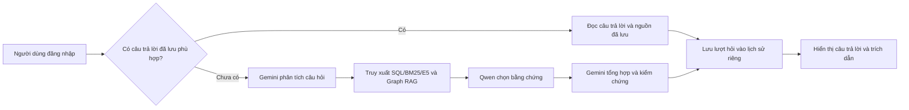
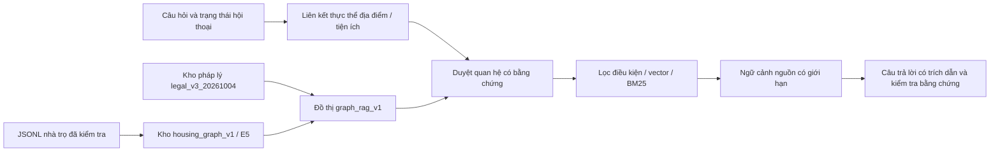
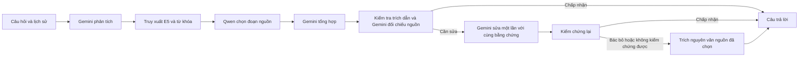
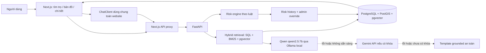

# Chatbot CTU — tài liệu tổng

Cập nhật bản local ngày **07/10/2026**. Đây là đầu mối duy nhất cho kiến trúc chatbot, dữ liệu, vận hành, lịch sử hội thoại, bộ câu hỏi và báo cáo. Phần hiện hành nằm ở đầu; nguyên văn các tài liệu/báo cáo trước được gộp trong phụ lục có thể mở rộng ở cuối. Thông số, lệnh và kết luận trong phụ lục chỉ mô tả phiên bản của lần chạy đó.

## Mục lục

- [1. Chức năng và flow hiện hành](#flow)
- [2. Kho dữ liệu và embedding](#data)
- [3. Lịch sử theo tài khoản và dùng lại câu trả lời](#history)
- [4. API và cấu trúc mã](#api)
- [5. Chạy và bảo trì bản local](#operations)
- [6. Kiểm thử và cách đọc báo cáo](#verification)
- [7. Bộ câu hỏi kiểm thử](#questions)
- [8. Tài liệu và báo cáo đã gộp](#archives)

<a id="flow"></a>

## 1. Chức năng và flow hiện hành

Chatbot hỗ trợ tìm/lọc/so sánh phòng trọ quanh CTU, hỏi thông tin KTX và giải thích pháp lý thuê trọ cơ bản: hợp đồng, cọc, điện nước, cư trú, PCCC, môi giới, dữ liệu cá nhân và dấu hiệu lừa đảo. Yêu cầu soạn hợp đồng, điền CT01, viết đơn hoặc thực hiện thủ tục chuyên sâu nằm ngoài phạm vi.

Giữ flow trước các thử nghiệm Gemini mới, theo mốc `373a3d6`:



Đây là flow pháp lý/KTX. Với tìm phòng, backend phân tích bộ lọc rồi truy xuất/xếp hạng listing trước khi sinh câu trả lời. Ngữ cảnh tiếp nối được giải quyết trước truy xuất. Tối đa 5 listing/nguồn được trả về; thiếu mô hình hoặc bằng chứng có thể dùng phản hồi dự phòng và nêu giới hạn.

Giao diện giữ toàn văn sau nút mở rộng, trích dẫn `[1]`–`[5]`, panel nguồn, giới hạn và câu hỏi tiếp theo. Nhãn Gemini + Qwen và các dòng thông báo Word cố định đã bỏ khỏi phần hiển thị. Câu trả lời có nguồn vẫn phải giữ các điều kiện và phần chưa đủ dữ liệu.

<a id="data"></a>

## 2. Kho dữ liệu và embedding

| Thành phần đang phục vụ | Schema / dữ liệu | Nội dung |
|---|---|---|
| Pháp lý và KTX | `legal_ctu_ktx_v2_20261007` | 40 tài liệu pháp lý/hướng dẫn nền và 4 nguồn KTX CTU; 530 chunk/vector gồm 478 nền + 52 KTX |
| Graph pháp lý/KTX | `graph_ctu_ktx_v2_20261007` | Graph gắn với corpus và kho phòng đúng release |
| Phòng cho chatbot | `housing_graph_word_repair_v16` | Cùng hash catalog Datahouse với bản v6; không đồng nhất ID giữa các schema |
| Nguồn nền và bổ sung | `docs/legal_word_repair_corpus_v16_20261006/manifest.json` | Manifest hợp nhất 40 nguồn; có 8 tài liệu về nền tảng đăng tin, hướng dẫn giao dịch và chống lừa đảo |
| Nguồn KTX | `docs/ctu_ktx_corpus_20261007/` | 4 nguồn, 46 đơn vị nội dung, 52 chunk/vector |
| Dữ liệu gốc | `Data/`, `Datehouse/` và các thư mục corpus | Giữ nguyên; không lấy đáp án đánh giá làm nội dung nhúng |

Embedding là `intfloat/multilingual-e5-small`, 384 chiều, passage/query prefix và vector chuẩn hóa. Hash dùng để kiểm tra tính toàn vẹn và bỏ qua nguồn không đổi. Vector phải được sinh thật; không ghi vector giả khi model không sẵn sàng.

Kho Word được đọc bằng XML Word/antiword và chia theo điều/khoản, giữ điều kiện, ngoại lệ và xuất xứ. OCR/PDF của các bản thử cũ không phải nội dung kho Word đang chạy. Nguồn KTX gồm nội quy PDF/trích đoạn và các trang CTU, được nạp riêng theo manifest KTX.

### Nguồn KTX

- [Đăng ký KTX HK1 năm học 2026–2027](https://ssc.ctu.edu.vn/thong-bao/226-dang-ky-o-ky-tuc-xa-hoc-ky-1-nam-hoc-2026-2027.html).
- [Hướng dẫn tân sinh viên đăng ký KTX](https://tansinhvien.ctu.edu.vn/sinh-hoat/huong-dan-tan-sinh-vien-dang-ky-o-ky-tuc-xa).
- [Nội quy KTX công bố 09/2025](https://ssc.ctu.edu.vn/images/upload/Noiquy_KTX_trich_092025.pdf).
- [Cơ sở vật chất, loại phòng và phí KTX](https://ssc.ctu.edu.vn/hoat/160-cs1.html), tải 07/10/2026.

Giữ nguyên mốc học kỳ trong nguồn. Trang cơ sở vật chất không ghi ngày công bố; khung phí không xác nhận phòng trống hay phí của một phòng cụ thể. Nguồn điện nước chỉ nói thu theo phòng hàng tháng theo thực tế sử dụng, chưa nêu đơn giá mỗi kWh/m³ hoặc cách chia phí. Các câu KTX/ký túc xá/kí túc xá ưu tiên `student_housing`; bộ lọc điện/cư trú không loại nhầm nguồn KTX.

Thông tin phòng là nội dung tin đăng; giá, tình trạng phòng và tiện ích cần xác nhận. Khoảng cách haversine chỉ là đường chim bay ước tính. Không suy ra tiện ích thiếu, risk score hoặc tình trạng còn phòng.

<a id="history"></a>

## 3. Lịch sử theo tài khoản và dùng lại câu trả lời

API lưu câu hỏi, câu trả lời, nguồn, thời điểm và trạng thái hội thoại trong `chatbot_conversations`/`chatbot_turns`. Widget tự mở hội thoại gần nhất; nút **Lịch sử**, **Chat mới**, **Xóa** và **Xem tin nhắn cũ hơn** giúp quản lý hội thoại. Chủ sở hữu lấy từ token đăng nhập; tài khoản khác không đọc, tiếp tục hoặc xóa được hội thoại của bạn.

Khi hỏi lại, hệ thống so sánh sau chuẩn hóa Unicode, chữ hoa/thường và khoảng trắng, vẫn giữ dấu tiếng Việt, số và dấu câu. Câu hỏi pháp lý/KTX tự đủ ngữ cảnh có thể dùng lại trong cùng hội thoại. Câu hỏi tiếp nối/tìm phòng cần khớp ngữ cảnh và bộ lọc. Ngữ cảnh của hội thoại đã lưu lấy từ server, không tin ngữ cảnh giả do client gửi.

Thứ tự tìm câu trả lời là cache riêng → cache dùng chung → sinh câu trả lời mới. `chatbot_shared_answers` lưu câu trả lời có nguồn cho câu hỏi độc lập, không có ngữ cảnh/trạng thái hội thoại, dấu hiệu thông tin cá nhân hoặc tham chiếu tới phòng vừa hỏi. Khóa gồm câu hỏi chuẩn hóa và bộ lọc; phạm vi gồm schema dữ liệu, phiên bản nguồn và cấu hình chatbot. Hai tài khoản hỏi cùng câu đủ điều kiện có thể nhận ngay đáp án chung, nhưng có mã hội thoại/lượt hỏi/event riêng. Payload chung không lưu mã cá nhân, agent trace hoặc dữ liệu đánh giá.

Chỉ dùng lại câu trả lời có nguồn phù hợp; lỗi/template không thành ứng viên cache. Phản hồi một phần đã kiểm chứng có thể được lưu cùng giới hạn. Nếu draft bị bác bỏ nhưng phần còn lại đã được service kiểm chứng và kiểm tra lại trích dẫn/quy tắc, chỉ lưu phần trả về đó. Dựa trên trạng thái kiểm chứng cuối cùng, không lấy một lần chấp nhận trước đó để hợp thức hóa phản hồi bị bác bỏ về sau. Khi dùng lại, giữ nguyên trích dẫn và hiển thị thông báo; mỗi lần hỏi vẫn tạo lượt lịch sử và event riêng.

| Loại câu trả lời | Thời hạn dùng lại tối đa |
|---|---|
| Pháp lý/KTX | 24 giờ |
| Tin phòng | 5 phút |

Thay cấu hình chatbot, dữ liệu nguồn hoặc ngày theo giờ Việt Nam làm mất hiệu lực cache. Dùng lại không kéo dài thời hạn cũ. Xóa hội thoại xóa cả lượt hỏi và ứng viên cache riêng thuộc hội thoại; đáp án công khai trong cache chung có thời hạn riêng. Lịch sử không tự hết hạn theo thời hạn cache. Nội dung đánh giá riêng `evaluation_contexts` không lưu vào lịch sử và yêu cầu đánh giá không dùng cache.

Admin vào `/admin/documents` để tìm/lọc tài liệu của corpus đang phục vụ, đọc nội dung đã trích xuất theo trang, sửa tên/nhóm và bật/tắt sử dụng. Cờ `admin_enabled` độc lập với trạng thái xử lý; tài liệu bị tắt vẫn giữ nguyên đoạn và vector, và quá trình lập chỉ mục không tự bật lại cờ này. Chỉ bật được tài liệu `ready` có nội dung. Mọi thay đổi lưu người thực hiện và trước/sau trong `legal_document_admin_audit`; `updated_at` và cờ sử dụng làm cache cũ mất hiệu lực. Trang hiện quản lý các tài liệu đã được nạp; nạp tài liệu mới vẫn dùng indexer hiện có.

<a id="api"></a>

## 4. API và cấu trúc mã

Các route chat yêu cầu tài khoản đăng nhập; Next.js proxy dùng cookie/token hiện có.

| Route FastAPI | Mục đích |
|---|---|
| `POST /chat/ask` | Gửi `message`, optional `conversation_id`, bộ lọc/ngữ cảnh; trả câu trả lời và nguồn |
| `GET /chat/conversations?limit=30&offset=0` | Danh sách hội thoại riêng, số lượt và thời điểm cập nhật |
| `GET /chat/conversations/{id}?limit=50&before_id=...` | Mở hội thoại, phân trang các lượt cũ |
| `DELETE /chat/conversations/{id}` | Xóa hội thoại của chính mình |
| `POST /chat/feedback` | Đánh giá hữu ích theo `event_id` thuộc tài khoản |
| `GET /admin/documents?q=...&enabled=...&status=...` | Admin tìm/lọc, phân trang tài liệu đang phục vụ |
| `GET /admin/documents/{id}?limit=20&offset=0` | Admin đọc metadata và nội dung đã trích xuất |
| `PATCH /admin/documents/{id}` | Admin sửa `title`, `category`, `admin_enabled`; lưu audit |

`POST /chat/ask` trả thêm `conversation_id`, `turn_id`, `reused_answer`. Các trường cũ vẫn có: `answer`, `sources`, `listings`, `no_answer`, `partial_answer`, `degraded`, `generation_provider`, `latency_ms`, `agent_trace`, `conversation_state`. API không nhận `user_id` từ client để xác định chủ lịch sử.

| Mã / cấu hình | Vai trò |
|---|---|
| `apps/api/app/room_service/chatbot/router.py` | Route, xác thực và tích hợp lịch sử |
| `apps/api/app/room_service/chatbot/history.py` | Lưu lịch sử, phân quyền, khóa và thời hạn cache |
| `apps/api/app/room_service/chatbot/service.py` | Điều phối truy xuất/sinh/kiểm chứng |
| `agents.py`, `agent_workflow.py`, `providers.py` | Gemini phân tích/tổng hợp, Qwen chọn nguồn, fallback |
| `repo.py`, `legal_retrieval.py`, `graph_retrieval.py`, `topics.py` | SQL/BM25/vector/graph, định tuyến và xếp hạng |
| `source_selection.py`, `claim_verification.py` | Bằng chứng, trích dẫn và kiểm chứng phát biểu |
| `apps/web/src/app/chat/ChatClient.tsx`, `ChatAnswer.tsx` | Widget, lịch sử và hiển thị nguồn |
| `apps/web/src/app/api/chat/` | Proxy HTTP theo phiên đăng nhập |
| `infra/db/migrations/99_chat_history.sql` | Bảng lịch sử; additive và chạy lại được |
| `docker-compose.ctu-ktx.yml` | Schema và flow phục vụ hiện hành |

<a id="operations"></a>

## 5. Chạy và bảo trì bản local

Website `http://localhost:3000`, Swagger `http://localhost:8000/docs`. Mở website, nhấn **Ctrl + F5**, đăng nhập và mở widget để thử bản mới. Cấu hình chung của Docker, email, auth và các module khác vẫn xem [LOCAL_DEPLOYMENT.md](LOCAL_DEPLOYMENT.md).

Flow hiện hành bật `CHATBOT_GRAPH_ENABLED=true`, `CHATBOT_AGENTS_ENABLED=true`, `CHATBOT_ANSWER_SYNTHESIS_ENABLED=true`, `CHATBOT_LLM_PROVIDER=auto`. Ollama/Qwen chạy trên host, API Docker gọi `http://host.docker.internal:11434`; model local đang dùng là `qwen3.5:9b`. Gemini dùng model/key cấu hình trên máy trong `.env`; không ghi khóa thật vào tài liệu.

Build và chạy đúng stack:

```powershell
docker build --build-arg INSTALL_ML=true -t nckh-api:ctu-ktx-final-local apps/api
docker build -t nckh-web:ctu-ktx-final-local apps/web
docker compose -f docker-compose.yml -f docker-compose.override.yml -f docker-compose.ragas.yml -f docker-compose.legal-refresh.yml -f docker-compose.graph-rag.yml -f docker-compose.source-grounded.yml -f docker-compose.word-legal.yml -f docker-compose.ctu-ktx.yml up -d --no-deps --no-build api web
```

`scripts/start_all.ps1` dùng các lớp cấu hình này, sao chép và áp migration lịch sử cả khi `-SkipBuild`. Volume có sẵn không tự chạy migration mới qua entrypoint. Khi nâng cấp bằng lệnh thủ công, áp migration 99 trước khi khởi động API có lịch sử:

```powershell
docker cp infra/db/migrations/99_chat_history.sql nckh-db-1:/tmp/99-chat-history.sql
docker exec nckh-db-1 sh -ec 'psql -v ON_ERROR_STOP=1 -U "$POSTGRES_USER" -d "$POSTGRES_DB" -f /tmp/99-chat-history.sql'
```

Để chuẩn bị/lập chỉ mục KTX, dùng `scripts/prepare_ctu_ktx_corpus.py` và `scripts/index_ctu_ktx.py`. Mặc định indexer tạo bản v2 từ `legal_word_repair_v16_20261006`, graph `graph_rag_word_repair_v16` và catalog `housing_graph_word_repair_v16`; đặt `PYTHONPATH=/app` khi chạy trong API image và repo ở `/workspace`. Giữ nguồn bổ sung khi thêm KTX: dùng lại nền Word v7 sẽ bỏ mất các hướng dẫn và nhóm nền tảng đăng tin. Cùng manifest bỏ qua nguồn không đổi; nguồn khác cần release mới. Không dùng indexer OCR lịch sử để thay kho Word/KTX hiện hành.

`scripts/probe_ctu_ktx.py` gọi service thật, hỗ trợ chọn câu bằng `--question`. Kết quả lập chỉ mục hiện hành: [index v2 JSON](../eval/reports/ctu_ktx_v2_index_20261007.json). [Index v1](../eval/reports/ctu_ktx_index_20261007.json) và [answers v1](../eval/reports/ctu_ktx_answers_20261007.json) là kết quả trước khi phục hồi nguồn bổ sung. Các nguồn gốc/schema nền đã được giữ để đối chiếu.

<a id="verification"></a>

## 6. Kiểm thử và cách đọc báo cáo

### Kết quả bản local 07/10/2026

| Kiểm tra | Kết quả đã đo |
|---|---|
| Build API/web và TypeScript | Đạt |
| Bộ kiểm thử chatbot khi chốt flow cũ | 193 đạt; 7 cần dịch vụ riêng được bỏ qua; Word chạy trong image có antiword |
| Lịch sử và cache | 22 kiểm thử backend đạt, gồm PostgreSQL thật trong schema riêng và tái sử dụng phần kết luận đã kiểm chứng |
| Giao diện chat và lịch sử | 8 Playwright đạt trên desktop/mobile |
| Corpus KTX | Hash 4 tài liệu khớp manifest, 52 vector thật; dữ liệu nền không đổi |
| Phí ở và đăng ký KTX | Truy xuất đúng nguồn, Qwen chọn bằng chứng, Gemini tổng hợp/kiểm chứng chấp nhận |
| Điện nước KTX | Trả lời một phần, giữ giới hạn thiếu đơn giá/cách chia phí |
| 36 câu qua service thật, không dùng cache | 36 có nguồn và trích dẫn hợp lệ; 15 đầy đủ, 21 một phần; 0 phản hồi thiếu toàn bộ căn cứ, 0 lỗi dịch vụ |
| HTTP thật: câu 25 kiểm tra người đăng/nguồn tin | Đáp án đầy đủ; 95,02 giây lần đầu, 0,29 giây khi hỏi lại |
| HTTP thật: hỏi phí KTX lần đầu | Đáp án đầy đủ; 77,11 giây |
| Hỏi lại phí KTX cùng hội thoại | 0,03 giây, cùng câu trả lời và nguồn |
| Phân quyền/xóa | Tài khoản khác bị 404; xóa hội thoại thành công; tài khoản/schema thử đã dọn |

Các số liệu này là lượt kiểm chứng trên máy local, không phải SLA hoặc điểm RAGAS mới cho toàn bộ bộ câu hỏi.

### Rà lại 36 câu sau khi bổ sung KTX

Bản KTX v1 lấy nền Word v7 (16 tài liệu), bỏ sót các nguồn bổ sung đã có của bản v16. Câu 26–27 không có tài liệu thuộc nhóm nền tảng đăng tin; câu 25 chỉ lấy được nguồn chung với độ tin cậy dưới 0,65, nên service loại nguồn trước khi sinh đáp án. Câu 28 thiếu khuyến cáo kiểm tra giao dịch/liên kết, dẫn đến phản hồi chung. Bản v2 giữ đủ 40 nguồn nền/bổ sung và thêm 4 nguồn KTX, giữ nguyên ngưỡng 0,65 và flow Gemini phân tích → Qwen chọn bằng chứng → Gemini tổng hợp/kiểm chứng.

Đối chiếu truy xuất thật trước/sau: [36 câu](../eval/reports/legal36_retrieval_comparison_20261007.json); kiểm tra hash nguồn gốc: [44 tài liệu](../eval/reports/chatbot_v2_source_integrity_20261007.json). Truy xuất độc lập đã có nguồn vượt ngưỡng cho 36/36 câu; điều này không tự chứng minh câu trả lời sinh ra đầy đủ. Kết quả câu trả lời thật được lưu tại [báo cáo 36 câu](../eval/reports/legal36_retest_20261007.json), với từng câu, nguồn, giới hạn và trace kiểm chứng.

Lượt sinh đáp án đã hoàn thành đủ 36 câu: **15 đầy đủ, 21 một phần, 36 có nguồn, 36 có trích dẫn hợp lệ, 0 lỗi dịch vụ**. Câu 25 trong ảnh trả lời đầy đủ; câu 26–28 có nội dung trả lời theo nguồn và được đánh dấu một phần, không còn mẫu báo không tìm thấy tài liệu. Các phát biểu được trả về đã qua kiểm chứng hoặc là phần đã kiểm chứng được giữ lại sau khi loại phát biểu không có căn cứ. Không coi 21 câu một phần là nghiệm thu đáp án đầy đủ.

Hai container kiểm thử dùng cùng snapshot phần truy xuất/sinh đáp án và cấu hình corpus; fingerprint từng file trong báo cáo khớp code phục vụ. Bộ 36 câu gọi service trực tiếp, bỏ qua cache/lịch sử; phần lịch sử/cache được kiểm tra riêng qua 22 test và [HTTP thật](../eval/reports/legal36_http_smoke_20261007.json) cho câu 25 cùng phí KTX. Hai lượt HTTP lưu đủ lượt hỏi, dùng lại đúng đáp án/nguồn, chặn tài khoản khác đọc/xóa và dọn tài khoản thử. [Trạng thái sau kiểm thử](../eval/reports/legal36_final_state_20261007.json) xác nhận 44 tài liệu/530 vector đang bật và nguồn nền giữ nguyên.

Một phản hồi `partial` vẫn có thể có các kết luận đã được kiểm chứng. Nếu có phát biểu bị loại, chỉ giữ những phần được nguồn hỗ trợ và ghi rõ giới hạn; không tự chuyển thành đáp án đầy đủ. `no_answer` ở flow hiện tại cũng có thể là câu trả lời một phần, vì vậy cần đọc cùng `partial_answer`, `sources` và trạng thái kiểm chứng, không chỉ đếm riêng cờ đó.

### Phương pháp đánh giá

Chạy lại 36 câu với `eval/retest_legal36.py`: gọi trực tiếp cùng service/cấu hình đang phục vụ, không dùng lịch sử hoặc cache và không lấy đáp án tham chiếu làm nội dung trả lời. Checkpoint JSON giữ câu trả lời, nguồn, trạng thái một phần/thiếu căn cứ, trace Qwen/Gemini và hash code/corpus. `--resume` chỉ nhận cùng phiên bản; `--ids` chọn các câu cần tái hiện. Đây là kiểm thử câu trả lời thực tế, chưa phải lượt chấm RAGAS.

Tách unit/parser test, đánh giá truy xuất trên dữ liệu kiểm soát, và RAGAS end-to-end trên dịch vụ thật. Faithfulness/answer relevancy/context utilization chỉ công bố khi đã chấm thật; metric thiếu hoặc lỗi giữ N/A và số mẫu hợp lệ. Citation accuracy chỉ đo tham chiếu đến nguồn, không chứng minh mọi kết luận đúng.

Đáp án người dùng chỉ dùng ở bước so sánh, không đưa vào truy xuất hoặc prompt sinh. Các nhãn high/partial/low thể hiện độ khớp tham chiếu, không phải phần trăm đúng pháp luật. Báo cáo phải gắn dataset, model, corpus/pipeline hash, cấu hình judge, độ trễ và lỗi; không trộn điểm từ phương pháp hoặc phiên bản khác nhau. Bộ câu hỏi đã biết là hồi quy, không mặc định benchmark chưa thấy.

Script đang dùng: `eval/question_bank_ragas.py`, `eval/graph_rag_question_bank.py`, `eval/compare_grounded_references.py`; kiểm thử lịch sử: `apps/api/tests/test_chat_history.py`, `apps/web/e2e/chat-history.spec.ts`. Report JSON và corpus/manifest giữ nguyên ở đường dẫn gốc để tái kiểm tra. Risk/recommendation có phương pháp riêng ở [eval/README.md](../eval/README.md).

### Báo cáo và phiên bản trước

Các mốc OCR, legal_v2/v3…, Graph RAG, Word v7, bổ sung Word v8, sửa ưu tiên/36 câu và thử Gemini chỉ là lịch sử của từng lần chạy. Không gọi một kết quả cũ là nghiệm thu bản hiện tại và không dùng lệnh đổi schema trong phụ lục để thay cấu hình đang phục vụ. Xem nguyên văn qua danh mục ở cuối.

<a id="questions"></a>

## 7. Bộ câu hỏi kiểm thử

Hai bộ được giữ nguyên byte dưới dạng dữ liệu `.txt` để runner và hash/checkpoint tiếp tục hoạt động:

| Bộ dữ liệu | File input cho script | Ghi chú |
|---|---|---|
| 36 câu pháp lý/điện/nước | `eval/datasets/legal_question_bank.txt` | ID/category/nội dung giữ nguyên; mount Docker vẫn là `/question_bank.md` |
| 58 câu tìm phòng/pháp lý/KTX | `eval/datasets/chatbot_question_bank.txt` | ID/category/nội dung giữ nguyên; mount Docker vẫn là `/housing_bank.md` |
| Các ý rà 36 đáp án tham chiếu | `eval/datasets/legal_reference_point_review.txt` | Input nguyên bản cho `build_reference_point_review.py`, không coi là nguồn pháp luật đã xác minh |

Nguyên văn bộ câu hỏi và bản rà nằm trong phụ lục, có thể mở khi cần. Mô tả loại trừ KTX/phòng trong các bộ cũ chỉ phản ánh giai đoạn đánh giá cũ; bản hiện tại đã hỗ trợ KTX.

Thử nhanh bản hiện tại bằng các câu sau:

- Tìm phòng dưới 2 triệu ở Ninh Kiều có wifi.
- Phí ở KTX khu A và khu B của CTU bao nhiêu một tháng?
- Tân sinh viên đăng ký KTX CTU như thế nào?
- KTX CTU thu tiền điện nước như thế nào?
- Chủ trọ được thu tiền điện của người thuê như thế nào theo quy định?

Sau khi có câu trả lời, hỏi lại nguyên câu để kiểm tra nhãn dùng lại; tải lại trang để kiểm tra hội thoại; mở **Lịch sử**, tạo **Chat mới** hoặc xóa hội thoại. Khi thiếu đơn giá KTX, phần thiếu phải được giữ.

<a id="archives"></a>

## 8. Tài liệu và báo cáo đã gộp

Phụ lục giữ nguyên nội dung các hồ sơ đã có, chỉ chỉnh liên kết để dùng được từ file tổng. Mở đúng hồ sơ theo ngày/phiên bản; hướng dẫn hiện hành là các mục 1–7. Dữ liệu nguồn, đáp án gốc và report JSON không bị xóa hoặc sửa.

| Hồ sơ đã gộp | Nội dung |
|---|---|
| [CTU_LEGAL_REVIEW_36.md](#archive-ctu-legal-review-36-md) | BỘ RÀ SOÁT 36 CÂU TRẢ LỜI MẪU — TRỢ LÝ TRỌ CTU |
| [docs/CHATBOT_QUESTION_BANK.md](#archive-docs-chatbot-question-bank-md) | Bộ câu hỏi mẫu cho Trợ lý Trọ CTU |
| [docs/COMPACT_LEGAL_ANSWERS_20261006.md](#archive-docs-compact-legal-answers-20261006-md) | Sửa trả lời quá dài — kiểm thử ngày 06/10/2026 |
| [docs/CTU_KTX_EMBEDDING_20261007.md](#archive-docs-ctu-ktx-embedding-20261007-md) | Bản local Gemini + Qwen và dữ liệu KTX — 07/10/2026 |
| [docs/Data_Corpus_Gap_Review_2026-10-01.md](#archive-docs-data-corpus-gap-review-2026-10-01-md) | Rà soát khoảng trống bộ tài liệu thuê trọ — 01/10/2026 |
| [docs/Data_Corpus_Review_2026-09-22.md](#archive-docs-data-corpus-review-2026-09-22-md) | Rà soát Data cho chatbot hỗ trợ sinh viên thuê trọ |
| [docs/Data_Corpus_Review_2026-09-26.md](#archive-docs-data-corpus-review-2026-09-26-md) | Rà soát Data ngày 26/09/2026 |
| [docs/FOCUS3_IMPROVEMENT_20261006.md](#archive-docs-focus3-improvement-20261006-md) | Sửa riêng câu 47–49 theo bộ đáp án mới — 06/10/2026 |
| [docs/GRAPH_RAG_20261004.md](#archive-docs-graph-rag-20261004-md) | Graph RAG với kho nhà trọ riêng — 04/10/2026 |
| [docs/HOUSING_IMPORT_20261004.md](#archive-docs-housing-import-20261004-md) | Kho nhà trọ mới và 12 câu kiểm thử |
| [docs/LEGAL_AGENT_REBUILD.md](#archive-docs-legal-agent-rebuild-md) | Kho pháp lý riêng và phân công agent — 03/10/2026 |
| [docs/LEGAL_AGENT_WORKFLOW.md](#archive-docs-legal-agent-workflow-md) | Workflow agent cho chatbot pháp lý thuê trọ |
| [docs/LEGAL_CORPUS_V2_SOURCES.md](#archive-docs-legal-corpus-v2-sources-md) | Sổ nguồn kho pháp lý legal_v2 |
| [docs/Legal_Extract_Metadata_Audit_2026-10-01.md](#archive-docs-legal-extract-metadata-audit-2026-10-01-md) | Kiểm tra bản trích pháp lý trong `Data` — 01/10/2026 |
| [docs/LEGAL_FIXES_20261004.md](#archive-docs-legal-fixes-20261004-md) | Sửa năm nhóm lỗi pháp lý — 04/10/2026 |
| [docs/LEGAL_QUESTION_BANK.md](#archive-docs-legal-question-bank-md) | Bộ câu hỏi pháp lý, điện và nước CTU |
| [docs/LEGAL_RAG_QUALITY.md](#archive-docs-legal-rag-quality-md) | Kiểm tra chất lượng chatbot pháp luật |
| [docs/LEGAL_REFRESH_20261004.md](#archive-docs-legal-refresh-20261004-md) | Kho pháp lý cập nhật — 04/10/2026 |
| [docs/LEGAL_REPAIR_36_COMPARISON_20261006.md](#archive-docs-legal-repair-36-comparison-20261006-md) | So sánh 36 câu sau sửa bộ chấm và workflow |
| [docs/LEGAL_REPAIR_PROGRESS_20261006.md](#archive-docs-legal-repair-progress-20261006-md) | Rà bộ chấm và workflow pháp lý — 06/10/2026 |
| [docs/Legal_Supplement_2026-10-03.md](#archive-docs-legal-supplement-2026-10-03-md) | Bổ sung nguồn và sửa xử lý pháp lý — 03/10/2026 |
| [docs/legal_web_supplement_20261004/extension_10_topics/AUDIT.md](#archive-docs-legal-web-supplement-20261004-extension-10-topics-audit-md) | Đối chiếu đề xuất 10 chủ đề — 04/10/2026 |
| [docs/legal_web_supplement_20261004/extension_10_topics/README.md](#archive-docs-legal-web-supplement-20261004-extension-10-topics-readme-md) | Bổ sung thực tế theo danh sách 10 chủ đề |
| [docs/legal_web_supplement_20261004/extension_10_topics/SOURCES.md](#archive-docs-legal-web-supplement-20261004-extension-10-topics-sources-md) | Nguồn của phần bổ sung 10 chủ đề |
| [docs/legal_web_supplement_20261004/README.md](#archive-docs-legal-web-supplement-20261004-readme-md) | Bổ sung tài liệu pháp lý thuê trọ — 04/10/2026 |
| [docs/legal_web_supplement_20261004/SOURCES.md](#archive-docs-legal-web-supplement-20261004-sources-md) | Danh mục nguồn minh bạch — 04/10/2026 |
| [docs/legal_web_supplement_20261004/SYSTEM_CROSSCHECK.md](#archive-docs-legal-web-supplement-20261004-system-crosscheck-md) | Đối chiếu bổ sung với đáp án hệ thống đã lưu |
| [docs/PRIORITY7_36_COMPARISON_20261006.md](#archive-docs-priority7-36-comparison-20261006-md) | Sửa 7 câu ưu tiên và chạy lại cùng 36 câu — 06/10/2026 |
| [docs/REFERENCE_REVIEW_36_20261006.md](#archive-docs-reference-review-36-20261006-md) | Rà bộ 36 đáp án người dùng — 06/10/2026 |
| [docs/review_sources_20261005/README.md](#archive-docs-review-sources-20261005-readme-md) | Nguồn bổ sung hỗ trợ thuê trọ để đọc và duyệt |
| [docs/SOURCE_GROUNDED_DATAHOUSE_20261004.md](#archive-docs-source-grounded-datahouse-20261004-md) | Datahouse làm kho chính và Graph RAG chỉ dùng nguồn có xuất xứ |
| [docs/tech_specs/Chatbot_RAG.md](#archive-docs-tech-specs-chatbot-rag-md) | Chatbot RAG tìm nhà trọ và tra cứu pháp luật |
| [docs/tech_specs/Legal_Document_RAG.md](#archive-docs-tech-specs-legal-document-rag-md) | RAG văn bản pháp luật: scan, OCR và embedding |
| [docs/WORD_ONLY_TENANT_SUPPORT_20261005.md](#archive-docs-word-only-tenant-support-20261005-md) | Word và pháp lý thuê trọ cơ bản — 05/10/2026 |
| [docs/WORD_SUPPLEMENT_36_REVIEW_20261005.md](#archive-docs-word-supplement-36-review-20261005-md) | Ý cần xem lại trong 36 câu |
| [docs/WORD_SUPPLEMENT_COMPARISON_20261005.md](#archive-docs-word-supplement-comparison-20261005-md) | So sánh 36 câu sau bổ sung nguồn Word |
| [docs/WORD_SUPPLEMENT_EXPERIMENT_20261005.md](#archive-docs-word-supplement-experiment-20261005-md) | Kho Word bổ sung để thử nghiệm 36 câu |
| [eval/datasets/external_legal_20261004/README.md](#archive-eval-datasets-external-legal-20261004-readme-md) | Bộ đáp án tham chiếu hiện hành |
| [eval/ragas_reports/chatbot_vs_reference_36_2026-10-04.md](#archive-eval-ragas-reports-chatbot-vs-reference-36-2026-10-04-md) | Câu trả lời chatbot so với bộ đáp án bạn cung cấp — 36 câu |
| [eval/ragas_reports/external_legal_comparison_2026-10-04.md](#archive-eval-ragas-reports-external-legal-comparison-2026-10-04-md) | Đối chiếu bộ đáp án ngoài với phản hồi hệ thống — 04/10/2026 |
| [eval/ragas_reports/external_legal_comparison_details_2026-10-04.md](#archive-eval-ragas-reports-external-legal-comparison-details-2026-10-04-md) | Nguyên văn đối chiếu 36 câu — bộ ngoài và local v15 |
| [eval/ragas_reports/gemini_qwen_vs_pasted_2026-10-04.md](#archive-eval-ragas-reports-gemini-qwen-vs-pasted-2026-10-04-md) | Đối chiếu Gemini, Gemini + Qwen và 36 đáp án bạn dán |
| [eval/ragas_reports/gemini_qwen_vs_pasted_2026-10-04_details.md](#archive-eval-ragas-reports-gemini-qwen-vs-pasted-2026-10-04-details-md) | Nguyên văn 36 câu: Gemini, Gemini + Qwen, bản dán |
| [eval/ragas_reports/gemini_vs_qwen_2026-10-04.md](#archive-eval-ragas-reports-gemini-vs-qwen-2026-10-04-md) | So sánh Gemini và Gemini + Qwen trên 36 câu |
| [eval/ragas_reports/gemini_vs_qwen_2026-10-04_answers.md](#archive-eval-ragas-reports-gemini-vs-qwen-2026-10-04-answers-md) | Toàn bộ phản hồi của hai phương án |
| [eval/ragas_reports/gemini_vs_qwen_2026-10-04_recommendation.md](#archive-eval-ragas-reports-gemini-vs-qwen-2026-10-04-recommendation-md) | gemini_vs_qwen_2026-10-04_recommendation |
| [eval/ragas_reports/housing_evaluation_2026-10-04.md](#archive-eval-ragas-reports-housing-evaluation-2026-10-04-md) | Nạp dữ liệu nhà trọ và kiểm thử 12 câu — 04/10/2026 |
| [eval/ragas_reports/legal_agent_comparison_2026-10-03.md](#archive-eval-ragas-reports-legal-agent-comparison-2026-10-03-md) | Kho embedding mới và agent — kiểm thử hoàn tất ngày 04/10/2026 |
| [eval/ragas_reports/legal_agent_comparison_v9_2026-10-03.md](#archive-eval-ragas-reports-legal-agent-comparison-v9-2026-10-03-md) | Kho embedding mới và agent — kết quả 03/10/2026 |
| [eval/ragas_reports/legal_agent_workflow_36_2026-10-04.md](#archive-eval-ragas-reports-legal-agent-workflow-36-2026-10-04-md) | Kết quả workflow Gemini + Qwen: 36 câu |
| [eval/ragas_reports/legal_fixes_2026-10-04.md](#archive-eval-ragas-reports-legal-fixes-2026-10-04-md) | Kiểm thử năm nhóm sửa lỗi pháp lý — v15 |
| [eval/ragas_reports/legal_fixes_comparison_2026-10-01.md](#archive-eval-ragas-reports-legal-fixes-comparison-2026-10-01-md) | Kết quả sửa và kiểm thử phần pháp lý, điện và nước |
| [eval/ragas_reports/legal_gemini38_retest_2026-10-04.md](#archive-eval-ragas-reports-legal-gemini38-retest-2026-10-04-md) | Kiểm thử lại 36 câu qua Gemini proxy |
| [eval/ragas_reports/legal_gemini38_retest_2026-10-04_answers.md](#archive-eval-ragas-reports-legal-gemini38-retest-2026-10-04-answers-md) | Toàn bộ phản hồi của lượt test Gemini proxy |
| [eval/ragas_reports/legal_local_comparison_2026-10-03.md](#archive-eval-ragas-reports-legal-local-comparison-2026-10-03-md) | Chạy và chấm bằng model local — 03/10/2026 |
| [eval/ragas_reports/legal_model_upgrade_comparison_2026-10-02.md](#archive-eval-ragas-reports-legal-model-upgrade-comparison-2026-10-02-md) | Nâng cấp model và kiểm thử 36 câu pháp lý |
| [eval/ragas_reports/legal_question_bank_release_2026-10-01.md](#archive-eval-ragas-reports-legal-question-bank-release-2026-10-01-md) | Kết quả kiểm thử bộ 36 câu hỏi bằng Ragas |
| [eval/ragas_reports/legal_refresh_vs_reference_36_2026-10-04.md](#archive-eval-ragas-reports-legal-refresh-vs-reference-36-2026-10-04-md) | Kiểm thử kho dữ liệu mới và đối chiếu 36 đáp án — 04/10/2026 |
| [eval/ragas_reports/question_bank_error_analysis_2026-10-01.md](#archive-eval-ragas-reports-question-bank-error-analysis-2026-10-01-md) | Phân tích lỗi bộ 58 câu hỏi CTU — 01/10/2026 |
| [eval/ragas_reports/question_bank_ragas_2026-10-01.md](#archive-eval-ragas-reports-question-bank-ragas-2026-10-01-md) | Kết quả kiểm thử bộ 58 câu hỏi bằng Ragas |
| [eval/reports/chatbot_eval.md](#archive-eval-reports-chatbot-eval-md) | Chatbot evaluation report |
| [eval/reports/gemini-legal-comparison-v1-20261006.md](#archive-eval-reports-gemini-legal-comparison-v1-20261006-md) | Kết quả thử Gemini RAG |
| [eval/reports/graph_rag_acceptance_2026-10-04.md](#archive-eval-reports-graph-rag-acceptance-2026-10-04-md) | Graph RAG — kiểm thử 56 câu và đối chiếu đáp án |
| [eval/reports/graph_rag_acceptance_v15_2026-10-05.md](#archive-eval-reports-graph-rag-acceptance-v15-2026-10-05-md) | Graph RAG — kiểm thử 56 câu và đối chiếu đáp án |
| [eval/reports/graph_rag_comparison_pilot_v12_2026-10-04.md](#archive-eval-reports-graph-rag-comparison-pilot-v12-2026-10-04-md) | Đối chiếu Graph RAG với đáp án người dùng |
| [eval/reports/graph_rag_focus3_reference_v10_2026-10-06.md](#archive-eval-reports-graph-rag-focus3-reference-v10-2026-10-06-md) | Đối chiếu Graph RAG với đáp án người dùng |
| [eval/reports/graph_rag_focus3_reference_v12_2026-10-06.md](#archive-eval-reports-graph-rag-focus3-reference-v12-2026-10-06-md) | Đối chiếu Graph RAG với đáp án người dùng |
| [eval/reports/graph_rag_focus3_reference_v14_2026-10-06.md](#archive-eval-reports-graph-rag-focus3-reference-v14-2026-10-06-md) | Đối chiếu Graph RAG với đáp án người dùng |
| [eval/reports/graph_rag_focus3_reference_v9_2026-10-06.md](#archive-eval-reports-graph-rag-focus3-reference-v9-2026-10-06-md) | Đối chiếu Graph RAG với đáp án người dùng |
| [eval/reports/graph_rag_vs_reference_34_2026-10-04.md](#archive-eval-reports-graph-rag-vs-reference-34-2026-10-04-md) | Đối chiếu Graph RAG với đáp án người dùng |
| [eval/reports/graph_rag_vs_reference_36_v12_2026-10-04.md](#archive-eval-reports-graph-rag-vs-reference-36-v12-2026-10-04-md) | Đối chiếu Graph RAG với đáp án người dùng |
| [eval/reports/graph_rag_vs_reference_36_v15_2026-10-05.md](#archive-eval-reports-graph-rag-vs-reference-36-v15-2026-10-05-md) | Đối chiếu Graph RAG với đáp án người dùng |
| [eval/reports/graph_rag_word_acceptance_v7_2026-10-05.md](#archive-eval-reports-graph-rag-word-acceptance-v7-2026-10-05-md) | Kết quả 36 câu — corpus Word |
| [eval/reports/graph_rag_word_supplement_vs_reference_36_v8_2026-10-05.md](#archive-eval-reports-graph-rag-word-supplement-vs-reference-36-v8-2026-10-05-md) | Đối chiếu Graph RAG với đáp án người dùng |
| [eval/reports/graph_rag_word_vs_reference_36_v7_2026-10-05.md](#archive-eval-reports-graph-rag-word-vs-reference-36-v7-2026-10-05-md) | Đối chiếu Graph RAG với đáp án người dùng |
| [eval/reports/legal_eval.md](#archive-eval-reports-legal-eval-md) | Kết quả kiểm thử chatbot tiền điện |
| [eval/reports/legal_repair_36_comparison_v15_20261006.md](#archive-eval-reports-legal-repair-36-comparison-v15-20261006-md) | So sánh 36 câu sau sửa bộ chấm và workflow |
| [docs/AI_CHAT_RISK_INTEGRATION.md](#archive-docs-ai-chat-risk-integration-md) | Hướng dẫn tích hợp AI Chat + Risk vào hệ thống Trọ CTU |
| [eval/README.md](#archive-eval-readme-md) | Đánh giá thực nghiệm AI |

<a id="archive-ctu-legal-review-36-md"></a>

<details>
<summary>BỘ RÀ SOÁT 36 CÂU TRẢ LỜI MẪU — TRỢ LÝ TRỌ CTU — CTU_LEGAL_REVIEW_36.md</summary>

> Hồ sơ theo phiên bản gốc; cấu hình/chỉ dẫn ở đây không thay phần hiện hành ở đầu tài liệu.

# BỘ RÀ SOÁT 36 CÂU TRẢ LỜI MẪU — TRỢ LÝ TRỌ CTU

> **Mục đích tài liệu:** Tách từng đáp án thành các ý riêng biệt, ghi rõ nội dung và nguồn kiểm chứng, phạm vi áp dụng, điều kiện bắt buộc, ý chính và ý phụ để phục vụ kiểm thử và đánh giá chất lượng chatbot.
>
> **Quy ước:** 🔴 Ý chính — bắt buộc phải có trong câu trả lời | 🟡 Ý phụ — bổ sung, nên có | ⚠️ Điều kiện — ràng buộc áp dụng

---

## PHẦN 1. HỢP ĐỒNG THUÊ NHÀ (`housing_contract`)

---

### Câu 1: Trước khi ký hợp đồng thuê trọ, sinh viên nên kiểm tra những điều khoản nào?

| # | Ý | Loại | Nội dung cần có trong đáp án | Nguồn kiểm chứng | Phạm vi & điều kiện |
|---|---|---|---|---|---|
| 1.1 | Thông tin các bên & thẩm quyền | 🔴 Ý chính | Họ tên, số CCCD chủ nhà; địa chỉ phòng trọ; nếu người quản lý đứng ký thì phải có văn bản ủy quyền hợp pháp từ chủ sở hữu | Khoản 1 Điều 163 *Luật Nhà ở 79/VBHN-VPQH* | Áp dụng mọi hợp đồng thuê nhà ở; không phân biệt phòng trọ hay căn hộ |
| 1.2 | Giá thuê & phương thức thanh toán | 🔴 Ý chính | Mức tiền thuê cố định, ngày thanh toán hàng tháng, hình thức trả (chuyển khoản/tiền mặt) | Khoản 3, 4 Điều 163 *Luật Nhà ở*; Điều 472 *BLDS 2015* | Giá thuê phải ghi bằng con số; không được để trống hoặc ghi "theo thỏa thuận" |
| 1.3 | Tiền đặt cọc & điều kiện hoàn cọc | 🔴 Ý chính | Mức cọc, điều kiện hoàn lại 100%, thời hạn chủ nhà phải hoàn trả | Điều 328 *BLDS 2015* | Đặt cọc là biện pháp bảo đảm; không có quy định bắt buộc tối đa 1 tháng |
| 1.4 | Chi phí phát sinh | 🔴 Ý chính | Đơn giá điện (VNĐ/kWh), nước (VNĐ/m³ hoặc/người), rác, internet, gửi xe | Điều 472 *BLDS 2015*; Khoản 5 Điều 12 *TT 60/2025/TT-BCT* | Chi phí điện không được vượt hóa đơn điện lực; nước không được vượt biểu giá UBND |
| 1.5 | Hiện trạng tài sản & sửa chữa | 🟡 Ý phụ | Biên bản bàn giao liệt kê thiết bị; phân định ai chịu chi phí hao mòn tự nhiên; chốt chỉ số điện nước trước khi vào | Điều 477 *BLDS 2015* | Không bắt buộc theo luật nhưng rất cần thiết để phòng ngừa tranh chấp cọc |
| 1.6 | Điều khoản chấm dứt hợp đồng | 🔴 Ý chính | Thời gian báo trước khi chuyển đi (thường 15–30 ngày) để không bị mất cọc | Điều 5 *Luật Nhà ở*; Điều 328 *BLDS 2015* | Nếu không có điều khoản báo trước, áp dụng nguyên tắc chung về chấm dứt hợp đồng |

**Ghi chú phạm vi:** Điều 163 Luật Nhà ở quy định nội dung hợp đồng nhà ở nói chung (bao gồm cả thuê mua, mua bán). Sinh viên cần lọc các khoản áp dụng cho hợp đồng **cho thuê nhà ở** (khoản 3, 4, 5, 6).

---

### Câu 2: Hợp đồng thuê phòng có cần ghi rõ tiền cọc, tiền thuê và ngày thanh toán không?

| # | Ý | Loại | Nội dung cần có trong đáp án | Nguồn kiểm chứng | Phạm vi & điều kiện |
|---|---|---|---|---|---|
| 2.1 | Khẳng định bắt buộc lập thành văn bản | 🔴 Ý chính | Hợp đồng về nhà ở bắt buộc phải lập thành văn bản | Điều 163 *Luật Nhà ở 79/VBHN-VPQH* | Không phân biệt giá trị hợp đồng |
| 2.2 | Tiền đặt cọc | 🔴 Ý chính | Đặt cọc là biện pháp bảo đảm nghĩa vụ; hợp đồng phải ghi rõ mức cọc, mục đích và điều kiện hoàn trả hoặc khấu trừ | Điều 328 *BLDS 2015* | Áp dụng khi hai bên có giao kết đặt cọc; không bắt buộc phải có cọc |
| 2.3 | Tiền thuê | 🔴 Ý chính | Phải ghi rõ con số cụ thể để tránh chủ trọ tăng giá giữa chừng | Khoản 3 Điều 163 *Luật Nhà ở* | Giá thuê thỏa thuận; nếu Nhà nước quy định giá thì phải tuân theo |
| 2.4 | Ngày thanh toán | 🔴 Ý chính | Xác định mốc thời gian trả tiền, tránh bị phạt trễ hạn vô lý | Khoản 4 Điều 163 *Luật Nhà ở*; Điều 472 *BLDS 2015* | Bắt buộc ghi "thời hạn và phương thức thanh toán" theo luật |
| 2.5 | Không ký hợp đồng bỏ trống | 🔴 Ý chính | Cảnh báo không ký mẫu có ô trống về tiền hoặc thỏa thuận miệng | Nguyên tắc hợp đồng *BLDS 2015* | Ký hợp đồng bỏ trống không bảo vệ được quyền lợi người thuê |

---

### Câu 3: Nếu chủ trọ muốn tăng giá thuê giữa thời hạn hợp đồng thì cần xem xét những gì?

| # | Ý | Loại | Nội dung cần có trong đáp án | Nguồn kiểm chứng | Phạm vi & điều kiện |
|---|---|---|---|---|---|
| 3.1 | Nguyên tắc không được tự ý tăng giá | 🔴 Ý chính | Trong thời hạn hợp đồng còn hiệu lực, chủ trọ không được đơn phương tăng giá trừ khi hợp đồng đã có điều khoản cho phép | Điều 472 *BLDS 2015* | Áp dụng khi hợp đồng không có điều khoản tăng giá |
| 3.2 | Trường hợp cải tạo nhà ở | 🔴 Ý chính | Chủ trọ được điều chỉnh giá nếu: (1) đã thực hiện cải tạo, (2) được bên thuê đồng ý, (3) thời gian còn lại ≤ 1/3 thời hạn hợp đồng | Khoản 2 Điều 170 *Luật Nhà ở 79/VBHN-VPQH* | **Phải đáp ứng đồng thời cả 3 điều kiện** mới được tăng giá |
| 3.3 | Quyền của người thuê khi bị ép tăng giá | 🔴 Ý chính | Có quyền từ chối mức giá mới và tiếp tục trả giá cũ đến hết hạn hợp đồng | Điều 472 *BLDS 2015* | Áp dụng khi không thuộc trường hợp điều chỉnh hợp pháp |
| 3.4 | Quyền đòi bồi thường khi bị đuổi | 🟡 Ý phụ | Nếu chủ trọ đơn phương chấm dứt hợp đồng trái luật để ép tăng giá, phải hoàn toàn bộ cọc và bồi thường thiệt hại | Điều 477 *BLDS 2015* | Chỉ áp dụng khi chủ trọ vi phạm hợp đồng; người thuê cần có bằng chứng |
| 3.5 | Kiểm tra điều khoản hợp đồng trước | 🟡 Ý phụ | Cần đọc kỹ điều khoản trong hợp đồng trước khi từ chối hay chấp nhận | Điều 163, 170 *Luật Nhà ở* | Nếu hợp đồng đã ghi rõ lộ trình tăng giá thì việc tăng là hợp pháp |

> ⚠️ **Điều kiện quan trọng:** Khoản 2 Điều 170 quy định **ba điều kiện phải thỏa mãn đồng thời** để tăng giá thuê hợp pháp khi cải tạo. Thiếu bất kỳ điều kiện nào thì việc tăng giá vẫn là trái luật.

---

### Câu 4: Khi trả phòng, việc hoàn lại tiền cọc được xác định theo hợp đồng và quy định như thế nào?

| # | Ý | Loại | Nội dung cần có trong đáp án | Nguồn kiểm chứng | Phạm vi & điều kiện |
|---|---|---|---|---|---|
| 4.1 | Nguyên tắc hoàn trả cọc | 🔴 Ý chính | Khi hợp đồng chấm dứt đúng thời hạn, người thuê đã thanh toán đủ và bàn giao phòng đúng hiện trạng thì chủ trọ phải hoàn trả toàn bộ tiền cọc | Khoản 2 Điều 328 *BLDS 2015* | Điều kiện: (1) Hợp đồng đúng thời hạn; (2) Trả tiền đủ; (3) Bàn giao phòng theo hiện trạng |
| 4.2 | Các trường hợp chủ trọ được khấu trừ cọc | 🔴 Ý chính | Chỉ được khấu trừ khi: người thuê làm hư hỏng tài sản do lỗi chủ quan; còn nợ tiền nhà/điện nước; đơn phương dọn đi sớm không báo trước | Khoản 2 Điều 328 *BLDS 2015* | Hao mòn tự nhiên theo thời gian không thuộc lỗi người thuê |
| 4.3 | Trường hợp người thuê từ chối giao kết | 🟡 Ý phụ | Nếu bên đặt cọc từ chối thực hiện hợp đồng thì mất cọc; nếu bên nhận cọc từ chối thì trả lại cọc và khoản tương đương | Điều 328 *BLDS 2015* | Quy định bồi cọc (trả gấp đôi) khi bên nhận cọc vi phạm |
| 4.4 | Lập biên bản bàn giao & chứng cứ ảnh | 🟡 Ý phụ | Chụp ảnh/quay video phòng khi nhận và trả phòng; lập biên bản bàn giao và chốt chỉ số công tơ điện nước | Nguyên tắc chứng cứ | Không bắt buộc theo luật nhưng là căn cứ quan trọng khi xảy ra tranh chấp |

---

## PHẦN 2. ĐIỆN THUÊ TRỌ (`electricity`)

---

### Câu 5: Chủ trọ được thu tiền điện của người thuê như thế nào theo quy định?

| # | Ý | Loại | Nội dung cần có trong đáp án | Nguồn kiểm chứng | Phạm vi & điều kiện |
|---|---|---|---|---|---|
| 5.1 | Trần thu tiền điện = hóa đơn thực tế | 🔴 Ý chính | Khi không ký hợp đồng trực tiếp với Điện lực, tổng tiền điện chủ nhà thu **không được vượt quá** số tiền trên hóa đơn điện lực hằng tháng | Khoản 5 Điều 12 *TT 60/2025/TT-BCT* | Áp dụng khi người thuê không có hợp đồng trực tiếp với Điện lực |
| 5.2 | Trường hợp ký hợp đồng trực tiếp | 🔴 Ý chính | Người thuê có hợp đồng ≥ 12 tháng + đăng ký tạm trú được ký hợp đồng mua bán điện trực tiếp với Điện lực hoặc chủ nhà đại diện | Điều 48, 49 *Luật Điện lực 61/2024/QH15* | ⚠️ Điều kiện: thuê ≥ 12 tháng VÀ có đăng ký cư trú hợp pháp |
| 5.3 | Cấp định mức theo số người | 🔴 Ý chính | Nếu chủ nhà kê khai đầy đủ thông tin cư trú, cứ 4 người được cấp 1 định mức hộ gia đình theo biểu giá bậc thang | Khoản 5 Điều 12 *TT 60/2025/TT-BCT* | ⚠️ Điều kiện: chủ nhà phải kê khai với bên bán điện |
| 5.4 | Trường hợp không kê khai định mức | 🔴 Ý chính | Hợp đồng thuê < 12 tháng hoặc không kê khai đủ số người → áp giá bán lẻ điện sinh hoạt theo bậc 2 (TT 60/2025) hoặc bậc 3 (TT 25/2018 cũ) cho toàn bộ sản lượng | Khoản 5 Điều 12 *TT 60/2025/TT-BCT* | Văn bản áp dụng TT 60/2025; trước đây TT 25/2018 áp bậc 3 — cần lưu ý phiên bản |
| 5.5 | Nghiêm cấm trục lợi | 🟡 Ý phụ | Cấm chủ trọ tự đặt mức giá điện cao hơn quy định để thu lời bất chính | Khoản 6 Điều 12 *NĐ 134/2013/NĐ-CP* sửa đổi bởi *NĐ 17/2022/NĐ-CP* | Chế tài: phạt tiền 20–30 triệu đồng + buộc hoàn trả |

> ⚠️ **Lưu ý về phiên bản văn bản:** TT 60/2025/TT-BCT thay thế TT 25/2018/TT-BCT. Mức bậc áp dụng khi không kê khai khác nhau (bậc 2 vs bậc 3). Câu trả lời cần ghi rõ văn bản áp dụng và thời điểm hiệu lực để tránh nhầm lẫn.

---

### Câu 6: Ba sinh viên ở chung một phòng được tính tiền điện ra sao?

| # | Ý | Loại | Nội dung cần có trong đáp án | Nguồn kiểm chứng | Phạm vi & điều kiện |
|---|---|---|---|---|---|
| 6.1 | Quy tắc 4 người = 1 hộ | 🔴 Ý chính | Cứ 4 người được tính là 1 hộ sử dụng điện; số người lẻ được tính theo tỷ lệ tương ứng | Khoản 5 Điều 12 *TT 60/2025/TT-BCT* | ⚠️ Điều kiện: chủ nhà đã kê khai đầy đủ thông tin cư trú |
| 6.2 | Định mức cho 3 người | 🔴 Ý chính | 3 sinh viên = 3/4 định mức hộ gia đình; Bậc 1 được tính: 50 × 3/4 = 37,5 kWh; Bậc 2 tiếp theo: 37,5 kWh | Khoản 5 Điều 12 *TT 60/2025/TT-BCT* | Áp dụng khi có kê khai; cần đối chiếu biểu giá *QĐ 1279/QĐ-BCT* |
| 6.3 | Trường hợp không kê khai | 🔴 Ý chính | Nếu không kê khai: áp giá bậc 2 (101–200 kWh) theo TT 60/2025 cho toàn bộ sản lượng | Khoản 5 Điều 12 *TT 60/2025/TT-BCT* | ⚠️ Khác biệt so với bậc 3 theo TT cũ — ghi rõ văn bản |
| 6.4 | Khuyến nghị đăng ký cư trú | 🟡 Ý phụ | Sinh viên nên cung cấp CCCD và yêu cầu chủ trọ kê khai định mức với Điện lực để hưởng giá bậc thang ưu đãi | TT 60/2025 | Không bắt buộc nhưng có lợi kinh tế đáng kể |
| 6.5 | Kiểm tra hóa đơn hằng tháng | 🟡 Ý phụ | Nếu không ký hợp đồng trực tiếp, kiểm tra để bảo đảm tổng tiền không vượt hóa đơn thực tế | Khoản 5 Điều 12 *TT 60/2025* | Quyền của người thuê |

---

### Câu 7: Nếu tôi nghi tiền điện bị thu cao hơn quy định, nên kiểm tra hóa đơn và căn cứ nào?

| # | Ý | Loại | Nội dung cần có trong đáp án | Nguồn kiểm chứng | Phạm vi & điều kiện |
|---|---|---|---|---|---|
| 7.1 | Chốt chỉ số công tơ | 🔴 Ý chính | Ghi lại chỉ số điện đầu và cuối kỳ trên công tơ phòng để xác định số kWh thực tế đã dùng | Quy trình thực tế | Áp dụng khi có công tơ riêng cho từng phòng |
| 7.2 | Yêu cầu đối chiếu hóa đơn gốc | 🔴 Ý chính | Đề nghị chủ nhà cho xem hóa đơn tiền điện gốc của Điện lực; hoặc tra cứu qua mã khách hàng trên App EVNSPC | Khoản 5 Điều 12 *TT 60/2025/TT-BCT* | Tổng tiền thu không được vượt hóa đơn gốc |
| 7.3 | Căn cứ pháp lý xử phạt | 🔴 Ý chính | Hành vi thu tiền điện cao hơn quy định bị phạt 20–30 triệu đồng + buộc hoàn trả | Khoản 6 Điều 12 *NĐ 134/2013/NĐ-CP* sửa đổi bởi *NĐ 17/2022/NĐ-CP* | Áp dụng khi có hành vi vi phạm giá điện sinh hoạt |
| 7.4 | Kênh phản ánh | 🔴 Ý chính | Tổng đài EVNSPC 1900 1006 / 1900 9000; Điện lực địa phương (Ninh Kiều, Cái Răng...); UBND phường/xã | Quy định về tiếp nhận khiếu nại | Áp dụng tại TP. Cần Thơ; số điện thoại cần xác minh hiện hành |
| 7.5 | Kiểm tra định mức kê khai | 🟡 Ý phụ | Xem chủ nhà có kê khai đúng số người cư trú để xác định mức giá áp dụng | *TT 60/2025* | Nếu không kê khai → áp bậc 2, không phải bậc 3 |

---

### Câu 8: Chủ trọ có phải thông báo cách tính tiền điện và số điện đã sử dụng không?

| # | Ý | Loại | Nội dung cần có trong đáp án | Nguồn kiểm chứng | Phạm vi & điều kiện |
|---|---|---|---|---|---|
| 8.1 | Chủ trọ phải minh bạch | 🔴 Ý chính | Có — chủ trọ phải minh bạch về cách tính và số điện tiêu thụ vì tổng thu không được vượt hóa đơn gốc | Khoản 5 Điều 12 *TT 60/2025/TT-BCT* | Nguyên tắc trần thu tiền = hóa đơn gốc ngầm định nghĩa vụ công khai |
| 8.2 | Nội dung bảng kê thanh toán | 🔴 Ý chính | Bảng kê cần ghi: (1) Chỉ số công tơ cũ & mới; (2) Số kWh tiêu thụ; (3) Đơn giá áp dụng; (4) Thành tiền | Điều 472 *BLDS 2015*; Nguyên tắc minh bạch hợp đồng | Nếu hợp đồng quy định cung cấp bảng kê thì có nghĩa vụ pháp lý |
| 8.3 | Quyền cùng chốt điện | 🟡 Ý phụ | Người thuê có quyền đề nghị cùng chốt chỉ số công tơ vào ngày thanh toán định kỳ | Điều 472 *BLDS 2015* | Không quy định cụ thể; căn cứ nguyên tắc thực hiện hợp đồng trung thực |

> ⚠️ **Lưu ý giới hạn nguồn:** Nghĩa vụ cụ thể về thông báo bảng kê chi tiết **chưa được quy định rõ ràng** trong TT 60/2025 hay Luật Điện lực. Câu trả lời phải thừa nhận giới hạn này, không khẳng định đây là nghĩa vụ pháp lý bắt buộc độc lập.

---

## PHẦN 3. NƯỚC SINH HOẠT TẠI CẦN THƠ (`water_cantho`)

---

### Câu 9: Giá nước sinh hoạt áp dụng cho phòng trọ ở Cần Thơ được xác định theo căn cứ nào?

| # | Ý | Loại | Nội dung cần có trong đáp án | Nguồn kiểm chứng | Phạm vi & điều kiện |
|---|---|---|---|---|---|
| 9.1 | Khung giá do UBND TP. Cần Thơ ban hành | 🔴 Ý chính | Giá nước do UBND TP. Cần Thơ phê duyệt theo từng đơn vị cấp nước và khu vực (đô thị/nông thôn) | *QĐ 215/QĐ-UBND TP. Cần Thơ*; *TT 44/2021/TT-BTC* | Áp dụng trên địa bàn TP. Cần Thơ; năm 2024 — cần xác nhận hiệu lực tại thời điểm áp dụng |
| 9.2 | Phân biệt khu vực đô thị/nông thôn | 🔴 Ý chính | Giá nước khác nhau tùy khu vực đô thị (quận Ninh Kiều, Bình Thủy...) và nông thôn | *QĐ 215/QĐ-UBND* | ⚠️ Phải xác định rõ địa chỉ phòng trọ thuộc khu vực nào |
| 9.3 | Phân biệt nhóm khách hàng | 🔴 Ý chính | Hộ dân cư sinh hoạt được áp giá bậc thang ưu đãi; kinh doanh dịch vụ áp giá cao hơn | *QĐ 215/QĐ-UBND* | Phòng trọ thông thường nếu không kinh doanh áp giá hộ dân cư |
| 9.4 | Định mức 4 m³/người/tháng | 🟡 Ý phụ | Khi có đăng ký tạm trú, chủ trọ có thể đăng ký cấp định mức nước sinh hoạt theo đầu người | Thực tiễn áp dụng | **Chưa có điều khoản rõ ràng trong QĐ 215** về định mức; cần ghi rõ đây là thực tiễn phổ biến |
| 9.5 | Cơ cấu hóa đơn tiền nước | 🟡 Ý phụ | Giá nước chưa bao gồm VAT (5%) và phí bảo vệ môi trường/thoát nước | Luật Thuế GTGT; quy định phí nước thải | Cần ghi rõ khi so sánh với mức chủ trọ thu |

---

### Câu 10: Tôi nên kiểm tra gì khi chủ trọ thu tiền nước theo đầu người thay vì đồng hồ?

| # | Ý | Loại | Nội dung cần có trong đáp án | Nguồn kiểm chứng | Phạm vi & điều kiện |
|---|---|---|---|---|---|
| 10.1 | Mức khoán tham khảo phổ biến | 🔴 Ý chính | Mức thu khoán nước tại Cần Thơ phổ biến là 30.000–50.000 VNĐ/người/tháng (tương đương 3–5 m³) | Thực tiễn địa phương; *QĐ 215/QĐ-UBND* | ⚠️ **Nguồn không chứa con số này rõ ràng**; là ước tính thực tiễn, cần thừa nhận khi trả lời |
| 10.2 | Yêu cầu đối chiếu hóa đơn khi thu quá cao | 🔴 Ý chính | Có quyền yêu cầu chủ nhà xuất trình hóa đơn nước thực tế chia đều cho số người đang ở | *QĐ 215/QĐ-UBND*; Điều 472 *BLDS 2015* | Mức thu khoán không nên vượt chi phí thực tế bình quân đầu người |
| 10.3 | Ghi vào hợp đồng | 🔴 Ý chính | Mức khoán phải ghi rõ trong hợp đồng thuê, cam kết không tự ý nâng giá | Điều 472 *BLDS 2015* | Không ghi thì chủ nhà có thể tăng tùy tiện |

---

### Câu 11: Nếu nhà trọ dùng chung đồng hồ nước, cách phân chia chi phí nên được thỏa thuận ra sao?

| # | Ý | Loại | Nội dung cần có trong đáp án | Nguồn kiểm chứng | Phạm vi & điều kiện |
|---|---|---|---|---|---|
| 11.1 | Phương án chia theo đầu người | 🔴 Ý chính | Tổng hóa đơn nước chia đều cho số người thực tế đang ở trong kỳ | Điều 472 *BLDS 2015*; *QĐ 215/QĐ-UBND* | Phương án đơn giản, phổ biến; sát thực tế hóa đơn |
| 11.2 | Phương án lắp đồng hồ phụ | 🔴 Ý chính | Lắp đồng hồ nước riêng từng phòng; phần hao hụt/nước chung chia theo tỷ lệ thỏa thuận | Điều 472 *BLDS 2015* | Minh bạch nhất, ít tranh chấp nhất |
| 11.3 | Ghi thỏa thuận bằng văn bản | 🔴 Ý chính | Dù chọn phương án nào cũng phải ghi rõ trong hợp đồng | Điều 472 *BLDS 2015* | Tránh mâu thuẫn khi phát sinh |
| 11.4 | Giới hạn nguồn tài liệu | 🟡 Ý phụ | Nguồn dữ liệu hiện có (QĐ 215) chỉ quy định biểu giá nước, không hướng dẫn cách phân chia giữa các phòng trọ | *QĐ 215/QĐ-UBND* | ⚠️ Chatbot cần thừa nhận giới hạn này; hai phương án đề xuất là nguyên tắc thực tiễn |

---

### Câu 12: Tôi có thể đối chiếu tiền nước trên hóa đơn với đơn vị cấp nước như thế nào?

| # | Ý | Loại | Nội dung cần có trong đáp án | Nguồn kiểm chứng | Phạm vi & điều kiện |
|---|---|---|---|---|---|
| 12.1 | Lấy IDKH / Mã khách hàng | 🔴 Ý chính | Xem trên hóa đơn giấy/phiếu thu của chủ nhà để lấy IDKH và Mã xác nhận | Hướng dẫn tra cứu CANTHOWASSCO | Áp dụng khi đơn vị cấp nước là CANTHOWASSCO |
| 12.2 | Tra cứu qua website | 🔴 Ý chính | Truy cập `https://hddt.ctn-cantho.com.vn` → nhập IDKH và Mã xác nhận → xem hóa đơn điện tử chi tiết | Hướng dẫn tra cứu CANTHOWASSCO | Website chính thức CANTHOWASSCO; cần kiểm tra tính khả dụng |
| 12.3 | Kênh Zalo OA | 🟡 Ý phụ | Có thể tra cứu qua Zalo OA "Cấp thoát nước Cần Thơ" | Thực tiễn dịch vụ | Cần xác minh kênh Zalo vẫn hoạt động tại thời điểm hỏi |
| 12.4 | Nội dung hóa đơn cần đối chiếu | 🔴 Ý chính | Đối chiếu: số m³ tiêu thụ, đơn giá, phí thoát nước, VAT và tổng tiền | *QĐ 215/QĐ-UBND* | Mức thu của chủ nhà không được vượt tổng hóa đơn |

---

## PHẦN 4. ĐĂNG KÝ CƯ TRÚ (`residence`)

---

### Câu 13: Sinh viên thuê trọ tại Cần Thơ cần làm thủ tục cư trú nào?

| # | Ý | Loại | Nội dung cần có trong đáp án | Nguồn kiểm chứng | Phạm vi & điều kiện |
|---|---|---|---|---|---|
| 13.1 | Loại thủ tục: Đăng ký tạm trú | 🔴 Ý chính | Sinh viên thuê trọ phải thực hiện **đăng ký tạm trú** (không phải thường trú) | Khoản 1 Điều 27 *Luật Cư trú 68/2020/QH14* | Áp dụng khi chỗ ở thuê **ngoài phạm vi xã/phường nơi đã thường trú** |
| 13.2 | Điều kiện bắt buộc | 🔴 Ý chính | Sinh sống tại chỗ ở hợp pháp ngoài xã/phường thường trú để học tập từ 30 ngày trở lên | Khoản 1 Điều 27 *Luật Cư trú 2020* | ⚠️ Nếu thuê trọ trong cùng xã/phường thường trú → không bắt buộc đăng ký tạm trú |
| 13.3 | Thời hạn nộp hồ sơ | 🔴 Ý chính | Phải đăng ký trong vòng **30 ngày** kể từ ngày chuyển đến ở trọ | Điều 27 *Luật Cư trú 2020* | Không tuân thủ bị phạt tiền |
| 13.4 | Thời hạn tạm trú | 🟡 Ý phụ | Tạm trú tối đa **2 năm**; có thể gia hạn nhiều lần | Điều 27 *Luật Cư trú 2020* | Gia hạn phải nộp trước 15 ngày khi hết hạn |
| 13.5 | Địa điểm tại Cần Thơ | 🟡 Ý phụ | Áp dụng cho tất cả các quận/huyện của TP. Cần Thơ nơi sinh viên thuê trọ | *Luật Cư trú 2020* | Bối cảnh địa phương CTU — thường là quận Ninh Kiều hoặc lân cận |

---

### Câu 14: Ai có trách nhiệm cung cấp thông tin, giấy tờ để người thuê đăng ký tạm trú?

| # | Ý | Loại | Nội dung cần có trong đáp án | Nguồn kiểm chứng | Phạm vi & điều kiện |
|---|---|---|---|---|---|
| 14.1 | Trách nhiệm của chủ trọ | 🔴 Ý chính | Chủ trọ cung cấp giấy tờ chứng minh chỗ ở hợp pháp (sổ hồng, hợp đồng cho thuê hợp pháp) và ký xác nhận vào Tờ khai CT01 | Khoản 1 Điều 28 *Luật Cư trú 2020* | ⚠️ Nguồn (Điều 28) quy định thành phần hồ sơ của người đăng ký, chưa quy định rõ nghĩa vụ riêng của chủ nhà |
| 14.2 | Trách nhiệm của sinh viên | 🔴 Ý chính | Sinh viên kê khai Tờ khai CT01 và cung cấp CCCD; người chưa thành niên cần có ý kiến đồng ý của cha mẹ/người giám hộ | Khoản 1 Điều 28 *Luật Cư trú 2020* | Người đủ 18 tuổi tự đứng tên đăng ký |
| 14.3 | Chủ trọ có thể tự đăng ký thay | 🟡 Ý phụ | Chủ cơ sở cho thuê có thể trực tiếp làm thủ tục đăng ký tạm trú cho người thuê theo quy định | *Luật Cư trú 2020* | Thực tế phổ biến với nhà trọ nhiều phòng |
| 14.4 | Mức phạt vi phạm | 🟡 Ý phụ | Không thực hiện đúng quy định đăng ký tạm trú bị phạt 500.000–1.000.000 đồng | Điều 9 *NĐ 144/2021/NĐ-CP* | Áp dụng cho cả người thuê và chủ cơ sở vi phạm |

---

### Câu 15: Tôi cần chuẩn bị những giấy tờ gì để đăng ký tạm trú tại phòng trọ?

| # | Ý | Loại | Nội dung cần có trong đáp án | Nguồn kiểm chứng | Phạm vi & điều kiện |
|---|---|---|---|---|---|
| 15.1 | Tờ khai CT01 | 🔴 Ý chính | Tờ khai thay đổi thông tin cư trú (Mẫu CT01) có xác nhận của chủ sở hữu chỗ ở hợp pháp | Khoản 1 Điều 28 *Luật Cư trú 2020* | Bắt buộc theo luật |
| 15.2 | Giấy tờ chứng minh chỗ ở hợp pháp | 🔴 Ý chính | Hợp đồng thuê phòng trọ hợp pháp còn hiệu lực (không bắt buộc công chứng) | Khoản 1 Điều 28 *Luật Cư trú 2020* | ⚠️ Luật quy định "giấy tờ chứng minh" nhưng không liệt kê cụ thể loại giấy tờ nào |
| 15.3 | Thẻ Căn cước / CCCD | 🔴 Ý chính | Thẻ Căn cước công dân hoặc Thẻ căn cước của người đăng ký | *Luật Cư trú 2020*; *Luật Căn cước 26/2023/QH15* | Bắt buộc để xác minh nhân thân |
| 15.4 | Nộp trực tuyến qua VNeID | 🟡 Ý phụ | Có thể nộp qua Cổng Dịch vụ công Quốc gia, Cổng DVC Bộ Công an hoặc App VNeID (định danh mức 2) | Luật Cư trú; quy định dịch vụ công | Cần tài khoản VNeID mức 2 |
| 15.5 | Thời gian xử lý | 🟡 Ý phụ | Trong **3 ngày làm việc** kể từ ngày nhận đủ hồ sơ hợp lệ | Khoản 2 Điều 28 *Luật Cư trú 2020* | Áp dụng cho nộp trực tiếp và trực tuyến |

---

### Câu 16: Nếu chuyển sang phòng trọ khác, tôi cần cập nhật thông tin cư trú thế nào?

| # | Ý | Loại | Nội dung cần có trong đáp án | Nguồn kiểm chứng | Phạm vi & điều kiện |
|---|---|---|---|---|---|
| 16.1 | Chuyển sang phường/xã khác | 🔴 Ý chính | Phải đăng ký tạm trú tại địa chỉ mới trong vòng 30 ngày; hệ thống sẽ **tự động xóa** đăng ký tại nơi cũ | Điều 27, 28 *Luật Cư trú 2020* | Áp dụng khi chuyển sang phường/xã khác ngoài thường trú |
| 16.2 | Chuyển trong cùng phường/xã | 🟡 Ý phụ | Làm thủ tục điều chỉnh thông tin địa chỉ cư trú trong CSDL quốc gia; nộp CT01 và hợp đồng trọ mới | Điều 28 *Luật Cư trú 2020* | ⚠️ Nguồn chưa quy định rõ; cần xác nhận quy trình cụ thể với công an phường |
| 16.3 | Gia hạn tạm trú | 🟡 Ý phụ | Phải gia hạn trước **15 ngày** khi hết hạn 2 năm nếu tiếp tục ở lại cùng địa điểm | Khoản 3 Điều 28 *Luật Cư trú 2020* | Không cần chuyển sang nơi mới |

---

## PHẦN 5. PHÒNG CHÁY, CHỮA CHÁY (`fire_safety`)

---

### Câu 17: Khi xem phòng trọ, tôi nên kiểm tra những điều kiện phòng cháy, chữa cháy nào?

| # | Ý | Loại | Nội dung cần có trong đáp án | Nguồn kiểm chứng | Phạm vi & điều kiện |
|---|---|---|---|---|---|
| 17.1 | Lối thoát nạn thứ hai | 🔴 Ý chính | Ngoài cửa chính, phòng/dãy trọ có ban công, thang thoát ngoài trời, lối lên mái sang nhà bên không | Điều 20 *Luật PCCC 55/2024/QH15* | Áp dụng cho mọi loại nhà trọ |
| 17.2 | Cửa mở khẩn cấp trên chuồng cọp | 🔴 Ý chính | Nếu có khung sắt/chuồng cọp bắt buộc phải có cửa thoát hiểm và chìa khóa để gần cửa | Điều 20 *Luật PCCC 55/2024/QH15*; thực tiễn PCCC | ⚠️ Thuật ngữ "chuồng cọp" không có trong văn bản luật; thuộc thực hành an toàn |
| 17.3 | Bình chữa cháy tại chỗ | 🔴 Ý chính | Kiểm tra bình chữa cháy (bột ABC/khí CO2): chốt kẹp chì nguyên vẹn, đồng hồ áp suất ở vạch xanh | Điều 20 *Luật PCCC 55/2024/QH15* | Yêu cầu trang bị "phương tiện phòng cháy phù hợp" |
| 17.4 | An toàn hệ thống điện | 🔴 Ý chính | Dây điện có đi trong ống gen chống cháy; có aptomat (CB) riêng tự ngắt khi quá tải/chập điện | Điều 24 *Luật PCCC 55/2024/QH15* | Áp dụng cho mọi nhà ở |
| 17.5 | Khu vực để xe & sạc xe điện | 🟡 Ý phụ | Bãi xe không bít kín lối thoát nạn; có giải pháp an toàn và bình chữa cháy cho sạc xe điện | Điều 20, 21 *Luật PCCC 55/2024/QH15* | Đặc biệt quan trọng với phòng trọ có nhiều xe điện |
| 17.6 | Loại nhà trọ cần phân biệt | 🟡 Ý phụ | Nhà trọ đơn thuần khác với nhà ở kết hợp kinh doanh hoặc chung cư mini; có thể chịu tiêu chuẩn kỹ thuật riêng | Điều 21, 23 *Luật PCCC 55/2024/QH15* | ⚠️ Cần hỏi thêm để xác định loại hình nhà trọ |

---

### Câu 18: Nhà trọ có nhiều phòng cần đáp ứng những yêu cầu an toàn cháy nổ nào?

| # | Ý | Loại | Nội dung cần có trong đáp án | Nguồn kiểm chứng | Phạm vi & điều kiện |
|---|---|---|---|---|---|
| 18.1 | Nội quy & biển chỉ dẫn thoát nạn | 🔴 Ý chính | Phải có nội quy PCCC, tiêu lệnh chữa cháy, biển chỉ dẫn thoát nạn và đèn sự cố/Exit | Điều 20, 21 *Luật PCCC 55/2024/QH15* | Áp dụng khi nhà trọ có nhiều phòng, nhiều tầng |
| 18.2 | Tối thiểu 2 lối thoát nạn độc lập | 🔴 Ý chính | Hai lối thoát nạn luôn thông thoáng; không để xe cộ/đồ đạc chắn hành lang và cầu thang | Điều 20 *Luật PCCC 55/2024/QH15* | Bắt buộc; không có ngoại lệ |
| 18.3 | Ngăn cháy lan khu vực nguy cơ cao | 🔴 Ý chính | Có vách ngăn cháy giữa bãi xe/tầng trệt với khu vực phòng ở và cầu thang bộ | Điều 20, 21 *Luật PCCC 55/2024/QH15* | Đặc biệt với nhà trọ có xe điện/xe máy ở tầng trệt |
| 18.4 | Số lượng bình chữa cháy | 🟡 Ý phụ | Bình quân mỗi tầng ít nhất 2 bình chữa cháy; đặt ở vị trí dễ thấy, dễ lấy | *NĐ 136/2020* sửa đổi bởi *NĐ 50/2024*; *NĐ 105/2025* | ⚠️ Con số cụ thể phụ thuộc vào diện tích và loại công trình; cần đối chiếu quy chuẩn |
| 18.5 | Tập huấn PCCC cho chủ trọ | 🟡 Ý phụ | Người quản lý cơ sở trọ phải được bồi dưỡng, tập huấn nghiệp vụ PCCC định kỳ | Điều 23 *Luật PCCC 55/2024/QH15* | Áp dụng khi nhà trọ thuộc danh mục cơ sở quản lý PCCC |

---

### Câu 19: Nếu lối thoát nạn bị khóa hoặc bị chặn, người thuê nên làm gì?

| # | Ý | Loại | Nội dung cần có trong đáp án | Nguồn kiểm chứng | Phạm vi & điều kiện |
|---|---|---|---|---|---|
| 19.1 | Yêu cầu chủ trọ khắc phục ngay | 🔴 Ý chính | Yêu cầu trực tiếp hoặc qua nhóm cư dân: dọn dẹp xe cộ/đồ đạc chắn lối, mở khóa cửa thoát hiểm | Điều 8 *Luật PCCC 55/2024/QH15* | Bước đầu tiên cần thực hiện |
| 19.2 | Đề nghị lắp hộp chìa khóa khẩn cấp | 🟡 Ý phụ | Yêu cầu chủ trọ đặt hộp đập kính chứa chìa khóa thoát hiểm tại cửa thoát nạn | Thực hành PCCC | Không có điều khoản cụ thể trong luật |
| 19.3 | Phản ánh cơ quan chức năng | 🔴 Ý chính | Nếu chủ trọ không khắc phục: phản ánh đến Công an phường/xã hoặc Đội Cảnh sát PCCC & CNCH địa phương | Điều 8 *Luật PCCC 55/2024/QH15* | Cơ quan có thẩm quyền kiểm tra, xử phạt vi phạm PCCC |
| 19.4 | Kỹ năng thoát nạn khi xảy ra hỏa hoạn | 🟡 Ý phụ | Ưu tiên thang bộ; nếu bị kẹt thì đóng cửa, chèn khe cửa bằng khăn ướt; ra ban công dùng đèn/vải sáng cầu cứu; gọi 114; không nhảy từ cao | Hướng dẫn Công an tỉnh Phú Thọ; thực hành thoát nạn | Chỉ áp dụng khi đã xảy ra hỏa hoạn thực sự |

> ⚠️ **Phân biệt hai tình huống:** (1) Lối thoát bị chặn bình thường → yêu cầu dọn dẹp phòng ngừa; (2) Đang xảy ra hỏa hoạn mà lối thoát bị chặn → kỹ năng sinh tồn khẩn cấp. Câu hỏi hỏi về (1), nhưng đáp án cũng cần nêu (2) để toàn diện.

---

### Câu 20: Chủ trọ và người thuê có trách nhiệm gì đối với thiết bị điện và an toàn cháy nổ?

| # | Ý | Loại | Nội dung cần có trong đáp án | Nguồn kiểm chứng | Phạm vi & điều kiện |
|---|---|---|---|---|---|
| 20.1 | Trách nhiệm của chủ trọ: tuyên truyền | 🔴 Ý chính | Người cho thuê có trách nhiệm tuyên truyền, đôn đốc người thuê chấp hành quy định PCCC | Điểm a Khoản 8 Điều 8 *Luật PCCC 55/2024/QH15* | Áp dụng cho mọi nhà cho thuê, mượn |
| 20.2 | Trách nhiệm của chủ trọ: hệ thống điện | 🔴 Ý chính | Lắp đặt hệ thống điện an toàn, có aptomat bảo vệ; định kỳ kiểm tra sửa chữa; bảo dưỡng phương tiện chữa cháy | Điều 24 *Luật PCCC 55/2024/QH15* | Áp dụng cho khu vực lắp đặt, sử dụng điện cho sinh hoạt |
| 20.3 | Trách nhiệm của người thuê: tuân thủ nội quy | 🔴 Ý chính | Người thuê có trách nhiệm theo quy định tại Khoản 6 Điều 8 (không tự ý câu móc điện, tắt thiết bị trước khi ra ngoài...) | Điểm b Khoản 8 Điều 8 *Luật PCCC 55/2024/QH15* | Áp dụng trừ trường hợp có thỏa thuận khác với chủ nhà |
| 20.4 | Sạc xe điện an toàn | 🟡 Ý phụ | Không sạc xe điện qua đêm không có người giám sát; không sạc gần vật dễ cháy | Điều 20, 21 *Luật PCCC 55/2024/QH15* | Rủi ro cháy nổ ngày càng phổ biến |
| 20.5 | Trường hợp nhà ở kết hợp kinh doanh | 🟡 Ý phụ | Nếu nhà trọ kết hợp kinh doanh thì người thuê kinh doanh có trách nhiệm bổ sung | Điều 21 *Luật PCCC 55/2024/QH15* | Không áp dụng nếu thuần túy sinh hoạt |

---

## PHẦN 6. MÔI GIỚI BẤT ĐỘNG SẢN (`real_estate_brokerage`)

---

### Câu 21: Người giới thiệu phòng trọ và thu phí môi giới cần công khai những thông tin gì?

| # | Ý | Loại | Nội dung cần có trong đáp án | Nguồn kiểm chứng | Phạm vi & điều kiện |
|---|---|---|---|---|---|
| 21.1 | Thông tin tư cách hành nghề | 🔴 Ý chính | Họ tên, số điện thoại, chứng chỉ hành nghề môi giới BĐS (với doanh nghiệp) hoặc thông tin pháp nhân | Điều 61 *Luật KDBĐS 29/2023/QH15* | ⚠️ Yêu cầu chứng chỉ áp dụng cho cá nhân hành nghề môi giới thành lập DN; chưa rõ cho cá nhân đơn lẻ |
| 21.2 | Thông tin phòng trọ trung thực | 🔴 Ý chính | Phải cung cấp đầy đủ, trung thực hồ sơ thông tin bất động sản môi giới và chịu trách nhiệm về thông tin đó | Khoản 1 Điều 65 *Luật KDBĐS 29/2023/QH15* | Áp dụng cho doanh nghiệp môi giới BĐS |
| 21.3 | Biểu phí dịch vụ | 🔴 Ý chính | Mức phí dịch vụ môi giới, điều kiện và thời điểm phát sinh nghĩa vụ thanh toán | Điều 63, Khoản 4 Điều 46 *Luật KDBĐS 2023* | Thỏa thuận tự do; không có mức trần |
| 21.4 | Phạm vi áp dụng của luật | 🟡 Ý phụ | Luật KDBĐS 2023 quy định chủ yếu cho doanh nghiệp môi giới; áp dụng cho cá nhân độc lập còn có khoảng trống | Điều 61 *Luật KDBĐS 2023* | ⚠️ Cần thừa nhận giới hạn này trong câu trả lời |

---

### Câu 22: Trước khi chuyển tiền cho người môi giới, tôi nên kiểm tra quyền cho thuê và thông tin phòng như thế nào?

| # | Ý | Loại | Nội dung cần có trong đáp án | Nguồn kiểm chứng | Phạm vi & điều kiện |
|---|---|---|---|---|---|
| 22.1 | Không chuyển tiền trước khi xem phòng | 🔴 Ý chính | Tuyệt đối không chuyển tiền cọc giữ chỗ hay phí xem phòng trước khi đến tận nơi và gặp chủ nhà | Thực tiễn chống lừa đảo; Điều 65 *Luật KDBĐS 2023* | Nguyên tắc vàng; áp dụng với mọi giao dịch phòng trọ |
| 22.2 | Xác minh quyền cho thuê | 🔴 Ý chính | Yêu cầu chỉ rõ ai là chủ nhà; kiểm tra giấy tờ nhà hoặc văn bản ủy quyền cho thuê hợp pháp | Điều 160, 161 *Luật Nhà ở 79/VBHN-VPQH* | Nhà ở tham gia giao dịch phải đáp ứng điều kiện theo Điều 160 |
| 22.3 | Ký & trả tiền trực tiếp với chủ nhà | 🔴 Ý chính | Hợp đồng và tiền cọc phải giao dịch trực tiếp với chủ nhà thực sự, đối chiếu CCCD với giấy tờ nhà | Điều 65 *Luật KDBĐS 2023* | Môi giới không có quyền thu tiền cọc thay chủ nhà |
| 22.4 | Quy tắc phí môi giới | 🟡 Ý phụ | Theo thông lệ, phí môi giới do chủ trọ chi trả; người thuê không phải trả trừ khi có văn bản thỏa thuận trước | Điều 63 *Luật KDBĐS 2023* | Không có quy định bắt buộc bên nào trả phí; tự do thỏa thuận |

---

### Câu 23: Nếu người môi giới đưa thông tin khác với phòng thực tế, người thuê có thể làm gì?

| # | Ý | Loại | Nội dung cần có trong đáp án | Nguồn kiểm chứng | Phạm vi & điều kiện |
|---|---|---|---|---|---|
| 23.1 | Quyền từ chối thuê & không trả phí | 🔴 Ý chính | Có toàn quyền từ chối thuê phòng và không thanh toán phí môi giới khi thông tin sai sự thật | Khoản 1 Điều 65 *Luật KDBĐS 2023* | Áp dụng khi bên môi giới vi phạm nghĩa vụ cung cấp thông tin trung thực |
| 23.2 | Yêu cầu hoàn trả phí đã nộp | 🔴 Ý chính | Nếu đã đóng phí dẫn xem phòng trước, có quyền yêu cầu hoàn trả 100% vì bên môi giới vi phạm | Khoản 1, 2 Điều 65 *Luật KDBĐS 2023* | Áp dụng khi có lỗi của bên môi giới |
| 23.3 | Yêu cầu bồi thường thiệt hại | 🟡 Ý phụ | Yêu cầu bên môi giới bồi thường nếu thông tin sai lệch gây thiệt hại thực tế | Điều 65 *Luật KDBĐS 2023*; BLDS 2015 | Cần chứng minh thiệt hại cụ thể |
| 23.4 | Báo cáo lên nền tảng hoặc công an | 🟡 Ý phụ | Báo cáo tài khoản vi phạm lên nền tảng đăng tin; nếu có dấu hiệu lừa đảo thì trình báo công an | Điều 174 *BLHS* (nếu có dấu hiệu hình sự) | Phụ thuộc vào mức độ vi phạm |
| 23.5 | Giới hạn áp dụng | 🟡 Ý phụ | Điều 65 áp dụng cho doanh nghiệp môi giới; cá nhân độc lập chưa được quy định rõ ràng | Điều 65 *Luật KDBĐS 2023* | ⚠️ Cần thừa nhận khoảng trống này |

---

### Câu 24: Khoản phí môi giới nên được thỏa thuận và thể hiện trong giấy tờ ra sao?

| # | Ý | Loại | Nội dung cần có trong đáp án | Nguồn kiểm chứng | Phạm vi & điều kiện |
|---|---|---|---|---|---|
| 24.1 | Phải lập hợp đồng/phiếu thu bằng văn bản | 🔴 Ý chính | Phí môi giới phải được thể hiện trong Hợp đồng dịch vụ môi giới hoặc phiếu thu có chữ ký hai bên | Khoản 4 Điều 46 *Luật KDBĐS 2023* | Bắt buộc theo luật đối với hợp đồng kinh doanh dịch vụ BĐS |
| 24.2 | Nội dung bắt buộc trong hợp đồng dịch vụ | 🔴 Ý chính | Phải ghi: (1) Thông tin hai bên; (2) Nội dung dịch vụ; (3) Mức phí/thù lao cụ thể; (4) Phương thức & thời hạn thanh toán; (5) Quyền, nghĩa vụ các bên | Khoản 4 Điều 46 *Luật KDBĐS 2023* | Áp dụng cho hợp đồng kinh doanh dịch vụ BĐS nói chung |
| 24.3 | Điều kiện phát sinh phí | 🔴 Ý chính | Phí môi giới chỉ được thanh toán sau khi ký được hợp đồng thuê phòng thành công với chủ trọ | Điều 63 *Luật KDBĐS 2023* | Thực tiễn tốt; không có quy định cụ thể về thời điểm phát sinh phí |
| 24.4 | Cam kết hoàn tiền | 🟡 Ý phụ | Quy định điều kiện hoàn trả phí nếu giao dịch không thành do lỗi của bên môi giới | Điều 65 *Luật KDBĐS 2023* | Tự do thỏa thuận |

---

## PHẦN 7. NỀN TẢNG ĐĂNG TIN TRỰC TUYẾN (`ecommerce_platform`)

---

### Câu 25: Khi tìm phòng qua một nền tảng trực tuyến, tôi nên kiểm tra người đăng và nguồn tin như thế nào?

| # | Ý | Loại | Nội dung cần có trong đáp án | Nguồn kiểm chứng | Phạm vi & điều kiện |
|---|---|---|---|---|---|
| 25.1 | Kiểm tra xác thực tài khoản | 🔴 Ý chính | Xem tài khoản đã được xác thực danh tính/SĐT trên nền tảng, thâm niên hoạt động, đánh giá người dùng | Điều 17 *Luật TMĐT 122/2025/QH15*; Quy chế Chợ Tốt | Áp dụng với các nền tảng có hệ thống định danh người bán |
| 25.2 | Xác minh nội dung tin đăng | 🔴 Ý chính | Địa chỉ phải chi tiết (số nhà, tên đường, phường tại Cần Thơ); có số điện thoại liên hệ rõ ràng | Thực tiễn | Dấu hiệu địa chỉ mơ hồ là cảnh báo |
| 25.3 | Tìm kiếm hình ảnh ngược (Reverse Image Search) | 🔴 Ý chính | Dùng Google Hình ảnh kiểm tra xem ảnh phòng có bị sao chép từ nơi khác không | Thực tiễn chống lừa đảo | Miễn phí, dễ thực hiện |
| 25.4 | Cảnh giác giá rẻ bất thường | 🔴 Ý chính | Phòng đầy đủ nội thất, máy lạnh ở trung tâm nhưng giá thấp hơn thị trường nhiều là dấu hiệu lừa đảo | Khuyến cáo Bộ Công an | Áp dụng đặc biệt với tân sinh viên mùa nhập học |
| 25.5 | Cảnh báo link, OTP | 🟡 Ý phụ | Không nhấp vào link lạ; không cung cấp OTP dù cho bất kỳ ai | Điều 17 *NĐ 248/2026/NĐ-CP* | Áp dụng khi người đăng gửi link thanh toán |

---

### Câu 26: Nếu một tin đăng nhà trọ có thông tin sai, tôi có thể báo cáo cho nền tảng bằng cách nào?

| # | Ý | Loại | Nội dung cần có trong đáp án | Nguồn kiểm chứng | Phạm vi & điều kiện |
|---|---|---|---|---|---|
| 26.1 | Dùng nút "Báo cáo tin đăng" | 🔴 Ý chính | Nhấn nút Report → chọn lý do (Lừa đảo/Thông tin sai/Không liên lạc được...) → nhập mô tả + đính kèm ảnh bằng chứng | Hướng dẫn tra cứu Chợ Tốt; *NĐ 248/2026/NĐ-CP* | Áp dụng cho sàn Chợ Tốt; nền tảng khác có thể khác giao diện |
| 26.2 | Liên hệ bộ phận CSKH của sàn | 🟡 Ý phụ | Gửi email/liên hệ tổng đài sàn cung cấp ID tin đăng, SĐT người đăng, mô tả vi phạm | Quy chế Chợ Tốt | Thời gian xử lý theo cam kết sàn |
| 26.3 | Sàn phải xử lý trong 24 giờ | 🟡 Ý phụ | Sàn có nghĩa vụ tiếp nhận phản ánh; chủ quản nền tảng phải cung cấp thông tin vi phạm cho cơ quan nhà nước trong 24 giờ khi có yêu cầu | Điều 18 *NĐ 248/2026/NĐ-CP* | Áp dụng theo NĐ 248/2026 hiệu lực 1/7/2026 |

---

### Câu 27: Nền tảng đăng tin có trách nhiệm gì đối với thông tin người cho thuê theo tài liệu hiện có?

| # | Ý | Loại | Nội dung cần có trong đáp án | Nguồn kiểm chứng | Phạm vi & điều kiện |
|---|---|---|---|---|---|
| 27.1 | Định danh người đăng | 🔴 Ý chính | Nền tảng phải yêu cầu người đăng cung cấp thông tin xác thực danh tính (họ tên, SĐT, địa chỉ) | Điều 17 *Luật TMĐT 122/2025/QH15* | Áp dụng với chủ quản nền tảng TMĐT trung gian |
| 27.2 | Kiểm duyệt và gỡ nội dung vi phạm | 🔴 Ý chính | Phải thiết lập bộ lọc, cơ chế tiếp nhận phản ánh, gỡ bỏ tin đăng vi phạm và khóa tài khoản | Điều 17, 18 *Luật TMĐT 2025*; Điều 18 *NĐ 248/2026* | Bắt buộc đối với nền tảng có chức năng đặt hàng trực tuyến |
| 27.3 | Cung cấp dữ liệu cho cơ quan điều tra | 🔴 Ý chính | Khi cơ quan Công an yêu cầu điều tra vi phạm, nền tảng phải cung cấp thông tin tài khoản người đăng trong vòng 24 giờ | Điều 18 *NĐ 248/2026/NĐ-CP* | ⚠️ NĐ 248/2026 hiệu lực từ 1/7/2026; điều khoản chuyển tiếp đến 30/6/2027 |
| 27.4 | Văn bản áp dụng cũ/mới | 🟡 Ý phụ | Trước 1/7/2026 áp dụng NĐ 52/2013 sửa đổi bởi NĐ 85/2021; từ 1/7/2026 áp dụng Luật TMĐT 122/2025 và NĐ 248/2026 | *NĐ 248/2026 Điều 53* | ⚠️ Cần lưu ý thời điểm hiệu lực khi so sánh văn bản |

---

### Câu 28: Nếu người đăng yêu cầu chuyển cọc qua liên kết lạ, tôi nên kiểm tra những dấu hiệu nào trước khi trả tiền?

| # | Ý | Loại | Nội dung cần có trong đáp án | Nguồn kiểm chứng | Phạm vi & điều kiện |
|---|---|---|---|---|---|
| 28.1 | Đường link giả mạo | 🔴 Ý chính | Link rút gọn (bit.ly...) hoặc tên miền lạ mô phỏng ngân hàng/cổng thanh toán | Khuyến cáo Bộ Công an; *NĐ 248/2026* | Áp dụng khi nhận link qua Messenger/Zalo/SMS |
| 28.2 | Yêu cầu nhập OTP | 🔴 Ý chính | Bất kỳ yêu cầu nhập OTP/Smart OTP/mật khẩu ngân hàng qua link là dấu hiệu lừa đảo chiếm tài khoản | Khuyến cáo Bộ Công an; *Cảnh giác mạo danh Fanpage — Bộ Công an* | Tuyệt đối không cung cấp OTP cho bất kỳ ai |
| 28.3 | Áp lực thời gian gấp gáp | 🔴 Ý chính | Hối thúc "chuyển trong 10–15 phút không thì mất phòng" là chiêu kích động tâm lý để bạn không kịp suy nghĩ | Khuyến cáo Bộ Công an | Chiêu thức phổ biến |
| 28.4 | Quy tắc bảo vệ | 🔴 Ý chính | Không bấm link lạ; không cung cấp OTP; dừng ngay giao dịch; báo cáo nền tảng | Điều 17 *NĐ 248/2026* | Áp dụng ngay lập tức khi phát hiện |
| 28.5 | Mạo danh Fanpage chính thức | 🟡 Ý phụ | Cảnh giác Fanpage Facebook giả mạo nhà trọ uy tín: sao chép ảnh, logo, địa chỉ từ trang thật; chạy quảng cáo trả phí | *Cảnh giác mạo danh Fanpage — Bộ Công an tỉnh Tuyên Quang* | Thủ đoạn ngày càng tinh vi |

---

## PHẦN 8. DỮ LIỆU CÁ NHÂN (`privacy_data`)

---

### Câu 29: Chủ trọ có thể yêu cầu tôi cung cấp những thông tin cá nhân nào để làm hợp đồng và đăng ký cư trú?

| # | Ý | Loại | Nội dung cần có trong đáp án | Nguồn kiểm chứng | Phạm vi & điều kiện |
|---|---|---|---|---|---|
| 29.1 | Danh sách thông tin được phép thu thập | 🔴 Ý chính | Hợp pháp: họ tên, số CCCD, ngày sinh, địa chỉ thường trú, số điện thoại (để lập hợp đồng và kê khai CT01) | Điều 163 *Luật Nhà ở*; Điều 28 *Luật Cư trú 2020*; Điều 3 *Luật BVDLCN 91/2025* | Thu thập phải đúng phạm vi mục đích rõ ràng |
| 29.2 | Yêu cầu sự đồng ý | 🔴 Ý chính | Việc thu thập và xử lý dữ liệu cá nhân phải có sự đồng ý tự nguyện và biết rõ của người thuê | Điều 9 *Luật BVDLCN 91/2025/QH15* | Trừ trường hợp pháp luật quy định khác (đăng ký cư trú) |
| 29.3 | Thông tin không được phép yêu cầu | 🔴 Ý chính | Không được đòi: mật khẩu mạng xã hội, tài khoản ngân hàng, thông tin nhạy cảm không liên quan | Điều 3 *Luật BVDLCN 91/2025* | Nguyên tắc tối thiểu hóa dữ liệu |
| 29.4 | Người chưa thành niên | 🟡 Ý phụ | Nếu sinh viên dưới 18 tuổi, cần có ý kiến đồng ý của cha mẹ/người giám hộ | Khoản 1 Điều 28 *Luật Cư trú 2020*; Điều 9 *Luật BVDLCN 2025* | Áp dụng cho sinh viên dưới 18 tuổi |

---

### Câu 30: Ảnh căn cước công dân của người thuê được lưu và sử dụng như thế nào?

| # | Ý | Loại | Nội dung cần có trong đáp án | Nguồn kiểm chứng | Phạm vi & điều kiện |
|---|---|---|---|---|---|
| 30.1 | Mục đích sử dụng hợp pháp | 🔴 Ý chính | Ảnh CCCD chỉ dùng cho mục đích đã được thông báo: lưu hồ sơ phòng trọ và đăng ký tạm trú | Điều 3 *Luật BVDLCN 91/2025* | Thu thập "đúng phạm vi, mục đích cụ thể, rõ ràng" |
| 30.2 | Nghĩa vụ bảo mật của chủ trọ | 🔴 Ý chính | Chủ trọ (bên kiểm soát dữ liệu) không được chuyển giao, bán, phát tán ảnh CCCD cho bên thứ ba | Điều 11 *Luật BVDLCN 91/2025* | Bắt buộc; vi phạm bị xử phạt |
| 30.3 | Mẹo watermark | 🟡 Ý phụ | Khi gửi ảnh CCCD, chèn dòng chữ chìm: "Chỉ dùng để đăng ký tạm trú tại [địa chỉ] ngày [dd/mm/yyyy]" | Thực tiễn bảo vệ dữ liệu | Không bắt buộc theo luật nhưng rất hiệu quả ngăn ngừa |
| 30.4 | Căn cứ văn bản | 🟡 Ý phụ | Câu trả lời dùng Luật BVDLCN 2025 (91/2025/QH15); trước đây là NĐ 13/2023/NĐ-CP | *Luật 91/2025/QH15*; *NĐ 13/2023* | ⚠️ Cần ghi rõ văn bản áp dụng; NĐ 13/2023 có thể đã được thay thế |

---

### Câu 31: Chủ trọ có được đăng công khai ảnh giấy tờ hoặc số điện thoại của tôi không?

| # | Ý | Loại | Nội dung cần có trong đáp án | Nguồn kiểm chứng | Phạm vi & điều kiện |
|---|---|---|---|---|---|
| 31.1 | Kết luận: Không được phép | 🔴 Ý chính | Chủ trọ không được đăng công khai ảnh CCCD, SĐT, ảnh cá nhân của người thuê lên mạng xã hội | Điều 16 *Luật BVDLCN 91/2025* | Công khai dữ liệu cá nhân phải được sự đồng ý của chủ thể dữ liệu |
| 31.2 | Các trường hợp ngoại lệ | 🔴 Ý chính | Chỉ được công khai khi: (1) Có sự đồng ý; (2) Theo quy định pháp luật (phòng chống tội phạm, an ninh quốc gia...) | Điều 16 *Luật BVDLCN 91/2025* | ⚠️ Đòi nợ tiền phòng KHÔNG phải ngoại lệ theo luật |
| 31.3 | Chế tài xử phạt | 🔴 Ý chính | Phạt tiền 10–20 triệu đồng theo NĐ 15/2020/NĐ-CP; buộc gỡ bài, xin lỗi và bồi thường thiệt hại | Điều 102 *NĐ 15/2020/NĐ-CP* sửa đổi bởi *NĐ 14/2022* | Áp dụng cho hành vi xử lý thông tin cá nhân sai mục đích |
| 31.4 | Xâm phạm quyền đời tư theo BLDS | 🟡 Ý phụ | Cũng vi phạm quyền về đời sống riêng tư, bí mật cá nhân theo Điều 38 *BLDS 2015* | Điều 38 *BLDS 2015* | Có thể khởi kiện dân sự đòi bồi thường |

---

### Câu 32: Nếu thông tin cá nhân của tôi bị chia sẻ sai mục đích, tôi nên yêu cầu xử lý như thế nào?

| # | Ý | Loại | Nội dung cần có trong đáp án | Nguồn kiểm chứng | Phạm vi & điều kiện |
|---|---|---|---|---|---|
| 32.1 | Bước 1: Yêu cầu gỡ bỏ & rút sự đồng ý | 🔴 Ý chính | Gửi văn bản/tin nhắn yêu cầu bên vi phạm rút lại sự đồng ý, xóa dữ liệu và chấm dứt xử lý ngay | Điều 5 *NĐ 356/2025/NĐ-CP*; Điều 10 *Luật BVDLCN 2025* | Bên kiểm soát dữ liệu phải phản hồi trong thời hạn quy định |
| 32.2 | Bước 2: Lưu giữ bằng chứng vi phạm | 🔴 Ý chính | Chụp ảnh màn hình bài đăng, link, thời gian đăng, tài khoản vi phạm; nhờ Thừa phát lại lập vi bằng | Nguyên tắc chứng cứ | Bằng chứng là nền tảng để khiếu nại và khởi kiện |
| 32.3 | Bước 3: Trình báo cơ quan chức năng | 🔴 Ý chính | Làm đơn tố cáo gửi đến Thanh tra Sở TTTT TP. Cần Thơ hoặc PA05 Công an TP. Cần Thơ | *NĐ 15/2020/NĐ-CP*; *Luật BVDLCN 2025* | Cơ quan có thẩm quyền xử phạt và buộc gỡ bỏ |
| 32.4 | Thời hạn bên vi phạm phải xử lý | 🟡 Ý phụ | Bên kiểm soát dữ liệu phải phản hồi trong 72 giờ kể từ khi nhận yêu cầu (theo NĐ 356/2025) | Điều 5 *NĐ 356/2025/NĐ-CP* | ⚠️ Cần xác minh điều khoản thời hạn cụ thể trong NĐ 356 |

---

## PHẦN 9. DẤU HIỆU LỪA ĐẢO VÀ PHÁP LUẬT HÌNH SỰ (`criminal_law`)

---

### Câu 33: Người đăng yêu cầu đặt cọc trước nhưng không cho xem phòng: tôi nên kiểm tra những dấu hiệu rủi ro nào?

| # | Ý | Loại | Nội dung cần có trong đáp án | Nguồn kiểm chứng | Phạm vi & điều kiện |
|---|---|---|---|---|---|
| 33.1 | Cớ không cho xem phòng | 🔴 Ý chính | Viện lý do "chủ nhà ở xa", "bận", "đang có nhiều người xếp hàng" → yêu cầu cọc trước để giữ chân | Khuyến cáo Bộ Công an; Điều 174 *BLHS* | Thủ đoạn phổ biến nhắm vào tân sinh viên |
| 33.2 | Hình ảnh/địa chỉ giả mạo | 🔴 Ý chính | Ảnh phòng đẹp không trùng thực tế; địa chỉ mơ hồ, đến nơi không tìm được phòng như mô tả | Thực tiễn; khuyến cáo CA | Kiểm tra bằng Google Maps và tìm ảnh ngược |
| 33.3 | Tài khoản ảo, từ chối gặp mặt | 🔴 Ý chính | Tài khoản mạng xã hội mới tạo, không có tương tác thật; từ chối video call xem phòng thực tế; tên tài khoản ngân hàng không khớp | Khuyến cáo Bộ Công an | Dấu hiệu mạo danh |
| 33.4 | Nguyên tắc tuyệt đối | 🔴 Ý chính | **Không xem phòng tận mắt → Không chuyển bất kỳ đồng nào** | Thực tiễn chống lừa đảo | Không có ngoại lệ |
| 33.5 | Cơ sở hình sự | 🟡 Ý phụ | Hành vi dùng thủ đoạn gian dối chiếm đoạt tiền cọc có thể bị truy tố tội Lừa đảo chiếm đoạt tài sản | Điều 174 *BLHS 135/VBHN-VPQH* | Khởi tố khi đủ yếu tố cấu thành (gian dối + chiếm đoạt) |

---

### Câu 34: Tôi đã chuyển cọc cho một tin trọ có dấu hiệu giả mạo; nên lưu lại bằng chứng gì và trình báo ở đâu?

| # | Ý | Loại | Nội dung cần có trong đáp án | Nguồn kiểm chứng | Phạm vi & điều kiện |
|---|---|---|---|---|---|
| 34.1 | Biên lai chuyển tiền ngân hàng | 🔴 Ý chính | Lưu: số tài khoản người nhận, tên chủ TK, ngân hàng, mã giao dịch, thời gian chuyển | Điều 87, 88 *BLTTHS 17/VBHN-VPQH* | Bằng chứng giao dịch tài chính quan trọng nhất |
| 34.2 | Toàn bộ tin nhắn hội thoại | 🔴 Ý chính | Chụp ảnh màn hình toàn bộ trao đổi qua Zalo/Messenger/SMS từ đầu đến khi bị chặn | Điều 87, 88 *BLTTHS 17/VBHN-VPQH* | Lưu ngay trước khi bị xóa |
| 34.3 | Thông tin nhận diện đối tượng | 🔴 Ý chính | Lưu: link trang cá nhân, SĐT, ảnh đại diện, ảnh bài đăng phòng trọ giả mạo | Điều 87, 88 *BLTTHS 17/VBHN-VPQH* | Cần trước khi đối tượng xóa tài khoản |
| 34.4 | Nơi trình báo tại Cần Thơ | 🔴 Ý chính | Công an phường/xã nơi chuyển tiền; Đội Cảnh sát hình sự Công an quận/huyện; PA05 Công an TP. Cần Thơ | Điều 145 *BLTTHS 17/VBHN-VPQH* | Trình báo càng sớm càng tốt |
| 34.5 | Liên hệ ngân hàng | 🔴 Ý chính | Gọi ngay tổng đài ngân hàng của bạn thông báo giao dịch lừa đảo để đề nghị hỗ trợ đánh dấu rủi ro tài khoản nhận | Thực tiễn xử lý | Có thể giúp ngăn chặn đối tượng rút tiền nếu còn kịp |
| 34.6 | Viện kiểm sát / Đơn vị PCTP mạng | 🟡 Ý phụ | Có thể gửi đơn đến Viện kiểm sát nhân dân nếu Công an chậm xử lý | Điều 144 *BLTTHS* | Quyền kiến nghị khởi tố |

---

### Câu 35: Khi nào tranh chấp tiền cọc có thể có dấu hiệu lừa đảo, và khi nào chỉ là tranh chấp hợp đồng?

| # | Ý | Loại | Nội dung cần có trong đáp án | Nguồn kiểm chứng | Phạm vi & điều kiện |
|---|---|---|---|---|---|
| 35.1 | Tranh chấp hợp đồng dân sự | 🔴 Ý chính | Dấu hiệu: phòng có thật; người cho thuê đúng là chủ nhà; tranh chấp về mức khấu trừ cọc, hư hỏng tài sản, thời hạn báo trước | Điều 328, 472 *BLDS 2015* | Giải quyết tại **Tòa án nhân dân quận/huyện** |
| 35.2 | Dấu hiệu tội phạm hình sự (Lừa đảo) | 🔴 Ý chính | Dấu hiệu: đối tượng gian dối ngay từ đầu (phòng ảo, giả chủ nhà, không có quyền cho thuê); nhận cọc rồi chặn liên lạc, bỏ trốn để chiếm đoạt tiền | Điều 174 *BLHS 135/VBHN-VPQH* | Xử lý bởi **Cơ quan Cảnh sát điều tra (Công an)** |
| 35.3 | Cơ quan giải quyết khác nhau | 🔴 Ý chính | Dân sự → Tòa án; Hình sự → Công an điều tra | Điều 472 *BLDS 2015*; Điều 174 *BLHS* | Cần phân biệt rõ để nộp đơn đúng nơi |
| 35.4 | Yếu tố phân biệt chính | 🟡 Ý phụ | Yếu tố quyết định: có **ý thức gian dối ngay từ đầu** hay không; phòng có thật hay ảo; có quyền cho thuê hay không | Điều 174 *BLHS* | Gian dối từ đầu + chiếm đoạt = hình sự |

---

### Câu 36: Nếu có nhiều sinh viên cùng bị một người nhận cọc rồi cắt liên lạc, chúng tôi nên cung cấp thông tin gì cho cơ quan có thẩm quyền?

| # | Ý | Loại | Nội dung cần có trong đáp án | Nguồn kiểm chứng | Phạm vi & điều kiện |
|---|---|---|---|---|---|
| 36.1 | Lập đơn tố giác tập thể | 🔴 Ý chính | Đơn tố giác có đủ chữ ký, CCCD, thông tin liên lạc của tất cả nạn nhân; tóm tắt thủ đoạn gian dối có hệ thống | Điều 144, 145 *BLTTHS 17/VBHN-VPQH* | Nhiều nạn nhân = tính chất chuyên nghiệp = khung hình phạt nặng hơn |
| 36.2 | Bảng thống kê thiệt hại từng người | 🔴 Ý chính | Liệt kê: họ tên nạn nhân, số tiền bị chiếm đoạt, ngày chuyển, số tài khoản thụ hưởng; tổng thiệt hại cộng dồn | Điều 87 *BLTTHS*; Điều 174 *BLHS* | Tổng thiệt hại càng lớn, mức độ nghiêm trọng càng cao |
| 36.3 | Bằng chứng chứng minh cùng kịch bản | 🔴 Ý chính | Sao kê ngân hàng tất cả nạn nhân chuyển vào cùng 1 tài khoản; ảnh chụp các cuộc hội thoại thể hiện cùng một kịch bản lừa đảo | Điều 87, 88 *BLTTHS* | Chứng minh hành vi có tổ chức, có kế hoạch |
| 36.4 | Nơi tiếp nhận tại Cần Thơ | 🔴 Ý chính | Nộp tại Cơ quan Cảnh sát điều tra Công an quận/huyện nơi xảy ra vụ việc hoặc Phòng Cảnh sát hình sự Công an TP. Cần Thơ | Điều 145 *BLTTHS 17/VBHN-VPQH* | Cơ quan điều tra sẽ thụ lý và khởi tố theo thẩm quyền |
| 36.5 | Khung hình phạt tăng nặng | 🟡 Ý phụ | Hành vi có tính chất chuyên nghiệp hoặc gây hậu quả đặc biệt nghiêm trọng → khung hình phạt cao hơn | Khoản 2, 3, 4 Điều 174 *BLHS* | ⚠️ Ngưỡng giá trị tài sản ảnh hưởng đến khung hình phạt |

---

## PHỤ LỤC: BẢNG TỔNG HỢP GIỚI HẠN NGUỒN CẦN LƯU Ý

| # | Chủ đề | Giới hạn | Hướng xử lý khi trả lời |
|---|---|---|---|
| L1 | Định mức 4 m³/người/tháng nước | Chưa có trong QĐ 215; là thực tiễn phổ biến | Ghi rõ "thực tiễn phổ biến, cần xác nhận với đơn vị cấp nước" |
| L2 | Nghĩa vụ chủ trọ cung cấp bảng kê điện | Không được quy định rõ trong TT 60/2025 | Ghi là "quy tắc thực hiện hợp đồng trung thực", không khẳng định nghĩa vụ pháp lý riêng |
| L3 | Mức phí môi giới phòng trọ | Không có mức chuẩn hay trần trong Luật KDBĐS 2023 | Ghi "tự do thỏa thuận; phải bằng văn bản" |
| L4 | Luật KDBĐS chỉ điều chỉnh doanh nghiệp | Cá nhân môi giới tự do chưa có quy định riêng đầy đủ | Ghi rõ "nguồn quy định chủ yếu cho doanh nghiệp; cá nhân đơn lẻ chưa có quy định rõ" |
| L5 | Thủ đoạn cụ thể qua mạng xã hội | Từ nguồn cảnh báo của Công an; không phải điều luật | Ghi rõ "khuyến cáo thực tiễn của cơ quan Công an, không phải quy định pháp luật" |
| L6 | Số điện thoại hotline EVNSPC | Cần xác minh số điện thoại còn hiệu lực | Khuyên người dùng tự xác minh trên website EVNSPC chính thức |
| L7 | Giá điện bậc 2 vs bậc 3 khi không kê khai | TT 60/2025 áp bậc 2; TT 25/2018 áp bậc 3 — hai văn bản khác nhau | Luôn nêu rõ văn bản áp dụng và thời điểm hiệu lực |
| L8 | Hiệu lực NĐ 248/2026/NĐ-CP | Hiệu lực từ 01/7/2026; điều khoản chuyển tiếp đến 30/6/2027 | Ghi rõ thời điểm hiệu lực khi viện dẫn |
| L9 | Định mức nước 4 m³/người | Thực tiễn CANTHOWASSCO; chưa có trong văn bản QĐ 215 được trích dẫn | Dùng từ "phổ biến" hoặc "thường được áp dụng", không khẳng định là bắt buộc |
| L10 | Thời hạn hoàn cọc cụ thể (3–5 ngày) | BLDS 2015 không quy định số ngày cụ thể | Ghi "theo thỏa thuận trong hợp đồng; nên ghi rõ trong hợp đồng" |

</details>

<a id="archive-docs-chatbot-question-bank-md"></a>

<details>
<summary>Bộ câu hỏi mẫu cho Trợ lý Trọ CTU — docs/CHATBOT_QUESTION_BANK.md</summary>

> Hồ sơ theo phiên bản gốc; cấu hình/chỉ dẫn ở đây không thay phần hiện hành ở đầu tài liệu.

# Bộ câu hỏi mẫu cho Trợ lý Trọ CTU

> Bản lưu của lần đánh giá trước. Theo yêu cầu cập nhật, đợt kiểm thử hiện tại dùng `LEGAL_QUESTION_BANK.md` gồm 36 câu pháp lý, điện và nước; tạm bỏ kiểm thử giá thuê, khoảng cách, thông tin tin phòng cũ và KTX.

> Bản lưu của lần đánh giá trước. Theo yêu cầu cập nhật, đợt kiểm thử hiện tại dùng `LEGAL_QUESTION_BANK.md` gồm 36 câu pháp lý, điện và nước; tạm bỏ kiểm thử giá thuê, khoảng cách, thông tin tin phòng cũ và KTX.

Bộ câu hỏi được xếp theo hành trình của sinh viên: **tìm và lọc phòng trước**, sau đó **hỏi về quyền lợi, chi phí, an toàn và các chủ đề liên quan**. Mỗi dòng là một câu có thể nhập nguyên văn vào chatbot. Các tình huống pháp lý chỉ là câu hỏi, không ngầm khẳng định một quy định hay mức giá đang có hiệu lực.

## 1. Tìm phòng và lọc kết quả

### 1.1. Giá thuê

1. Tìm phòng trọ dưới 2 triệu đồng mỗi tháng gần Đại học Cần Thơ.
2. Có phòng nào giá từ 1,5 đến 2 triệu đồng mỗi tháng không?
3. Tìm phòng có giá thuê thấp nhất trong các tin còn hiệu lực.
4. Tôi có ngân sách tối đa 2,5 triệu đồng mỗi tháng, có những lựa chọn nào?

### 1.2. Vị trí và khoảng cách

5. Tìm phòng trọ ở quận Ninh Kiều.
6. Có phòng nào ở Bình Thủy, cách Đại học Cần Thơ dưới 2 km không?
7. Tìm phòng gần khu II Đại học Cần Thơ, ưu tiên đi lại thuận tiện.
8. Có phòng nào gần đường 3/2 hoặc khu Xuân Khánh không?

### 1.3. Diện tích, tiện ích và nhu cầu ở

9. Tìm phòng từ 20 m² trở lên, có gác lửng.
10. Có phòng nào có máy lạnh, Wi-Fi và chỗ để xe không?
11. Tìm phòng có nhà vệ sinh riêng và giờ giấc tự do.
12. Có phòng phù hợp cho hai sinh viên ở ghép không?

### 1.4. Kết hợp nhiều điều kiện và hỏi tiếp

13. Tìm phòng dưới 2 triệu đồng ở Ninh Kiều, có gác và cách trường dưới 2 km.
14. Tìm phòng từ 18 m² trở lên, có máy lạnh, giá không quá 2,5 triệu đồng mỗi tháng.
15. Trong các phòng vừa tìm được, phòng nào rẻ nhất?
16. Phòng đó có chỗ để xe và Wi-Fi không?
17. Nếu không có phòng đúng tất cả điều kiện, hãy cho tôi biết điều kiện nào cần nới lỏng.
18. Các tin vừa gợi ý được cập nhật gần đây chưa? Cho tôi xem nguồn tin.

**Cách thử câu 15–16:** hỏi ngay sau câu 13 hoặc 14 trong cùng một cuộc trò chuyện để kiểm tra khả năng hiểu câu hỏi tiếp nối.

## 2. Câu hỏi theo chủ đề trong kho tài liệu

### 2.1. Hợp đồng thuê nhà (`housing_contract`)

19. Trước khi ký hợp đồng thuê trọ, sinh viên nên kiểm tra những điều khoản nào?
20. Hợp đồng thuê phòng có cần ghi rõ tiền cọc, tiền thuê và ngày thanh toán không?
21. Nếu chủ trọ muốn tăng giá thuê giữa thời hạn hợp đồng thì cần xem xét những gì?
22. Khi trả phòng, việc hoàn lại tiền cọc được xác định theo hợp đồng và quy định như thế nào?

### 2.2. Điện thuê trọ (`electricity`)

23. Chủ trọ được thu tiền điện của người thuê như thế nào theo quy định?
24. Ba sinh viên ở chung một phòng được tính tiền điện ra sao?
25. Nếu tôi nghi tiền điện bị thu cao hơn quy định, nên kiểm tra hóa đơn và căn cứ nào?
26. Chủ trọ có phải thông báo cách tính tiền điện và số điện đã sử dụng không?

### 2.3. Nước sinh hoạt tại Cần Thơ (`water_cantho`)

27. Giá nước sinh hoạt áp dụng cho phòng trọ ở Cần Thơ được xác định theo căn cứ nào?
28. Tôi nên kiểm tra gì khi chủ trọ thu tiền nước theo đầu người thay vì đồng hồ?
29. Nếu nhà trọ dùng chung đồng hồ nước, cách phân chia chi phí nên được thỏa thuận ra sao?
30. Tôi có thể đối chiếu tiền nước trên hóa đơn với đơn vị cấp nước như thế nào?

### 2.4. Đăng ký cư trú (`residence`)

31. Sinh viên thuê trọ tại Cần Thơ cần làm thủ tục cư trú nào?
32. Ai có trách nhiệm cung cấp thông tin, giấy tờ để người thuê đăng ký tạm trú?
33. Tôi cần chuẩn bị những giấy tờ gì để đăng ký tạm trú tại phòng trọ?
34. Nếu chuyển sang phòng trọ khác, tôi cần cập nhật thông tin cư trú thế nào?

### 2.5. Phòng cháy, chữa cháy (`fire_safety`)

35. Khi xem phòng trọ, tôi nên kiểm tra những điều kiện phòng cháy, chữa cháy nào?
36. Nhà trọ có nhiều phòng cần đáp ứng những yêu cầu an toàn cháy nổ nào?
37. Nếu lối thoát nạn bị khóa hoặc bị chặn, người thuê nên làm gì?
38. Chủ trọ và người thuê có trách nhiệm gì đối với thiết bị điện và an toàn cháy nổ?

### 2.6. Nhà ở sinh viên, ký túc xá (`student_housing`)

39. Ký túc xá Đại học Cần Thơ năm học 2026–2027 có thông tin đăng ký nào trong tài liệu?
40. Sinh viên cần chuẩn bị gì khi đăng ký ở ký túc xá Đại học Cần Thơ?
41. Tôi có thể đối chiếu chi phí và điều kiện ở ký túc xá với phòng trọ tư nhân như thế nào?
42. Nếu tài liệu ký túc xá không nêu một mức phí hoặc thời hạn, hãy nói rõ thông tin nào còn thiếu.

### 2.7. Môi giới bất động sản (`real_estate_brokerage`)

43. Người giới thiệu phòng trọ và thu phí môi giới cần công khai những thông tin gì?
44. Trước khi chuyển tiền cho người môi giới, tôi nên kiểm tra quyền cho thuê và thông tin phòng như thế nào?
45. Nếu người môi giới đưa thông tin khác với phòng thực tế, người thuê có thể làm gì?
46. Khoản phí môi giới nên được thỏa thuận và thể hiện trong giấy tờ ra sao?

### 2.8. Nền tảng đăng tin trực tuyến (`ecommerce_platform`)

47. Khi tìm phòng qua một nền tảng trực tuyến, tôi nên kiểm tra người đăng và nguồn tin như thế nào?
48. Nếu một tin đăng nhà trọ có thông tin sai, tôi có thể báo cáo cho nền tảng bằng cách nào?
49. Nền tảng đăng tin có trách nhiệm gì đối với thông tin người bán hoặc người cho thuê theo tài liệu hiện có?
50. Nếu người đăng yêu cầu chuyển cọc qua liên kết lạ, tôi nên kiểm tra những dấu hiệu nào trước khi trả tiền?

### 2.9. Dữ liệu cá nhân (`privacy_data`)

51. Chủ trọ có thể yêu cầu tôi cung cấp những thông tin cá nhân nào để làm hợp đồng và đăng ký cư trú?
52. Ảnh căn cước công dân của người thuê được lưu và sử dụng như thế nào?
53. Chủ trọ có được đăng công khai ảnh giấy tờ hoặc số điện thoại của tôi không?
54. Nếu thông tin cá nhân của tôi bị chia sẻ sai mục đích, tôi nên yêu cầu xử lý như thế nào?

### 2.10. Dấu hiệu lừa đảo và pháp luật hình sự (`criminal_law`)

55. Người đăng yêu cầu đặt cọc trước nhưng không cho xem phòng: tôi nên kiểm tra những dấu hiệu rủi ro nào?
56. Tôi đã chuyển cọc cho một tin trọ có dấu hiệu giả mạo; nên lưu lại bằng chứng gì và trình báo ở đâu?
57. Khi nào tranh chấp tiền cọc có thể có dấu hiệu lừa đảo, và khi nào chỉ là tranh chấp hợp đồng?
58. Nếu có nhiều sinh viên cùng bị một người nhận cọc rồi cắt liên lạc, chúng tôi nên cung cấp thông tin gì cho cơ quan có thẩm quyền?

## Gợi ý sử dụng khi kiểm tra chatbot

- Với câu 1–18: kiểm tra chatbot hiểu đúng giá, khu vực, khoảng cách, diện tích và tiện ích; không giới thiệu tin vượt điều kiện đã nêu mà không giải thích.
- Với câu 19–58: kiểm tra câu trả lời có nguồn tài liệu phù hợp, nêu rõ phạm vi áp dụng và không tự khẳng định mức tiền, thời hạn hoặc chế tài khi nguồn không đủ rõ.
- Với câu hỏi về tin cụ thể hoặc quy định hiện hành: đối chiếu lại tin đăng, hóa đơn và văn bản gốc trước khi sử dụng kết quả để quyết định đặt cọc hoặc khiếu nại.

</details>

<a id="archive-docs-compact-legal-answers-20261006-md"></a>

<details>
<summary>Sửa trả lời quá dài — kiểm thử ngày 06/10/2026 — docs/COMPACT_LEGAL_ANSWERS_20261006.md</summary>

> Hồ sơ theo phiên bản gốc; cấu hình/chỉ dẫn ở đây không thay phần hiện hành ở đầu tài liệu.

# Sửa trả lời quá dài — kiểm thử ngày 06/10/2026

Đã cập nhật bản sửa lên FastAPI cục bộ. `/health` và `/docs` trả HTTP 200; hash năm tệp mã triển khai khớp workspace. API vẫn dùng `legal_word_v7_20261005`, `graph_rag_word_v6` và `housing_graph_word_v6`; kho Word bổ sung v8 chỉ được dùng cho lượt thử 47–49. Kiểm tra hash toàn dòng sau cập nhật xác nhận dữ liệu cũ giữ nguyên.

Đã tách cảnh báo nguồn do ứng dụng thêm khỏi phần kết luận mô hình cần kiểm chứng. Cảnh báo vẫn hiện đầy đủ; kết luận, câu hỏi tiếp theo và giới hạn do mô hình viết vẫn được kiểm tra.

Câu trả lời dự phòng dùng trích đoạn ngắn nguyên vẹn hoặc dẫn nguồn để đối chiếu. Không cắt giữa điều kiện/ngoại lệ; toàn bộ bằng chứng vẫn có cho mô hình kiểm tra.

Câu hỏi người thuê tự kiểm tra tin đăng ưu tiên hướng dẫn kiểm tra và phòng ngừa lừa đảo, không thay bằng trách nhiệm kiểm duyệt của nền tảng.

## Lượt chạy thực tế mới: chỉ câu 47–49

| Câu | Trước (ký tự) | Sau (ký tự) | Phần trả lời cuối |
|---|---:|---:|---|
| 47 | 7986 | 2070 | gemini-agent |
| 48 | 6972 | 1635 | gemini-agent |
| 49 | 10581 | 2171 | gemini-agent |

97 kiểm thử hồi quy đạt. Lượt thử dùng cùng câu hỏi và kho Word thử nghiệm, Qwen + Gemini qua proxy hiện tại; không gửi đáp án mẫu hoặc Datahouse cho Gemini.

Không có điểm khớp đáp án mẫu mới hoặc tỷ lệ đúng pháp luật mới. Chưa chạy lại toàn bộ 36 câu sau sửa mã. Các cảnh báo/thiếu nguồn còn lại:

- Câu 47: Gemini phân tích câu hỏi chưa khả dụng (ValidationError); dùng định tuyến chủ đề dự phòng.; Phản hồi chưa đáp ứng đầy đủ yêu cầu chính; đánh dấu theo nội dung thay vì provider.
- Câu 48: Gemini phân tích câu hỏi chưa khả dụng (ValidationError); dùng định tuyến chủ đề dự phòng.
- Câu 49: Phản hồi chưa đáp ứng đầy đủ yêu cầu chính; đánh dấu theo nội dung thay vì provider.

Đã thử lại cách hiển thị với 10 câu dự phòng dài của lượt cũ: tất cả không quá 3.500 ký tự, giữ nguyên cảnh báo và không cắt câu trích pháp lý. Đây là kiểm tra hiển thị ngoại tuyến, không phải chạy mới mô hình cho 36 câu.

Đối chiếu hash toàn dòng: kho đang dùng, graph, nhà trọ Datahouse và người dùng giữ nguyên. Không xóa kho, không embedding lại, không kích hoạt kho thử nghiệm.

## Câu trả lời mới để đọc

### Câu 47

Khuyến nghị người thuê tra cứu kỹ thông tin trực tuyến của bên cho thuê, cảnh giác dấu hiệu lừa đảo và không chuyển tiền trước khi xác định rõ chủ nhà [1] [2] [3].

- Khuyến nghị tìm kiếm số điện thoại và địa chỉ phòng thuê trên Google, Facebook cùng các diễn đàn để xem đánh giá và các giao dịch trước đó [2].
- Khuyến nghị khảo sát mức giá chung khu vực và cẩn trọng trước các tin đăng phòng vị trí đẹp nhưng giá rẻ bất thường hoặc thúc ép chuyển tiền giữ chỗ [1] [2] [3].
- Khuyến nghị cảnh giác với các trang sao chép thông tin, dùng tương tác ảo hoặc viện lý do chủ vắng mặt để hối thúc đặt cọc [1] [3].
- Khuyến nghị yêu cầu gặp trực tiếp, đối chiếu giấy tờ nhà và thẻ Căn cước công dân của chủ nhà trước khi chuyển bất kỳ khoản cọc nào [2] [3].

Các tài liệu trích dẫn mang tính cẩm nang mẹo vặt và cảnh báo phòng ngừa của cơ quan công an, không phải quy định pháp luật bắt buộc về quy trình xác minh [1] [2] [3].

Chưa đủ căn cứ từ các đoạn này để kết luận toàn bộ yêu cầu hoặc tình huống riêng.
Hướng dẫn/khuyến cáo của Cổng Thông tin điện tử Bộ Công an bài Công an tỉnh Tuyên Quang; không phải điều luật. Tình huống gốc là đặt khách sạn tại Tuyên Quang. Áp dụng tham khảo cho chứng cứ giao dịch trực tuyến, không gọi là vụ thuê trọ CTU; không phải danh mục hồ sơ bắt buộc hoặc hướng dẫn soạn đơn tập thể.
Hướng dẫn/khuyến cáo của Trợ Giúp Chợ Tốt; không phải điều luật. Mẹo giao dịch, không phải điều luật. Không chứng minh hạn hoàn cọc cố định hoặc mức cọc bắt buộc; không thay thế xác minh người được ủy quyền cho thuê. Chỉ đọc phần kiểm tra, không bổ sung mẫu soạn hợp đồng.
Hướng dẫn/khuyến cáo của Cổng Thông tin điện tử Bộ Công an bài Công an TP Hải Phòng; không phải điều luật. Chỉ lấy phần thuê trọ và an toàn giao dịch; các thủ đoạn học phí, học bổng ngoài mục tiêu dự án. Không suy ra mọi tranh chấp cọc đều là tội phạm hay chắc chắn thu hồi được tiền.

Để áp dụng vào trường hợp của bạn:
- Bạn đã liên hệ trực tiếp hoặc kiểm tra giấy tờ pháp lý của người đăng tin hay chưa?

Thông tin tham khảo từ nguồn, cần đối chiếu điều kiện áp dụng và hiệu lực.

### Câu 48

Bạn có thể báo cáo tin đăng sai lệch trực tiếp trên website của nền tảng hoặc liên hệ qua kênh trò chuyện trực tuyến và gửi email khiếu nại [1].

- Truy cập vào tin đăng cần phản ánh và bấm chọn mục Báo cáo tin đăng ở bên dưới nội dung tin [1].
- Lựa chọn lý do phù hợp như Thông tin không đúng thực tế, Lừa đảo, Trùng lặp, Không liên lạc được hoặc Hàng đã bán [1].
- Điền đầy đủ nội dung thông tin được yêu cầu cho lý do đã chọn rồi nhấn nút Gửi [1].
- Liên hệ hỗ trợ qua chức năng trò chuyện trực tuyến từ 08h-12h và 13h-17h hằng ngày hoặc gửi email kèm đường dẫn tin, lý do vi phạm cùng số điện thoại liên hệ [1].

Nền tảng khuyến khích các bên tự thương lượng hòa giải trước khi can thiệp xử lý theo cơ chế riêng [2].
Nếu hai bên không đạt được thỏa thuận giải quyết tranh chấp thì có quyền đưa vụ việc ra Tòa án nhân dân có thẩm quyền [2].

Hướng dẫn/khuyến cáo của Trợ Giúp Chợ Tốt; không phải điều luật. Đây là thao tác trên Chợ Tốt; vị trí nút có thể thay đổi. Báo cáo nền tảng không thay thế việc báo cơ quan có thẩm quyền khi có dấu hiệu chiếm đoạt.
Hướng dẫn/khuyến cáo của Trợ Giúp Chợ Tốt; không phải điều luật. Quy trình riêng của Chợ Tốt. Không phải cam kết nền tảng tự hoàn tiền cọc hoặc giải quyết mọi tranh chấp thuê nhà; một phần quy trình trên trang nói về hàng hóa khuyến mại, cần giữ đúng phạm vi.

Để áp dụng vào trường hợp của bạn:
- Bạn đang thao tác báo cáo trực tiếp trên trang web hay muốn gửi khiếu nại qua email của nền tảng?
- Tin đăng đó có dấu hiệu lừa đảo chiếm đoạt tiền đặt cọc hay chỉ sai lệch thông tin phòng trọ thực tế?

Thông tin tham khảo từ nguồn, cần đối chiếu điều kiện áp dụng và hiệu lực.

### Câu 49

Tài liệu hiện có quy định nền tảng trung gian có chức năng đặt hàng trực tuyến phải cung cấp thông tin cần thiết hỗ trợ giải quyết tranh chấp, cung cấp công cụ tải dữ liệu và quản lý tài khoản người bán, đồng thời chưa đủ căn cứ quy định riêng cho người cho thuê trọ [1] [2].

- Cung cấp các thông tin cần thiết để hỗ trợ các bên liên quan trong quá trình giải quyết phản ánh, yêu cầu, khiếu nại và tranh chấp [1] [2].
- Cung cấp thông tin cho cơ quan nhà nước có thẩm quyền trong thời hạn 24 giờ kể từ thời điểm nhận yêu cầu phục vụ thanh tra, kiểm tra, xử lý vi phạm [2].
- Cung cấp công cụ cho người bán truy cập tài khoản để tải dữ liệu về hàng hóa, dịch vụ và hợp đồng giao kết theo thời hạn quy định [1] [2].
- Tạm ngừng hoặc chấm dứt tài khoản người bán trong thời hạn 24 giờ khi nhận được yêu cầu từ cơ quan nhà nước có thẩm quyền, hoặc thông báo trước ít nhất 05 ngày khi có lý do chính đáng [1] [2].

Chưa đủ căn cứ từ các đoạn trích để xác định trách nhiệm riêng biệt đối với thông tin của người cho thuê phòng trọ trên website rao vặt thông thường [1] [2] [3].
Quy định trích dẫn áp dụng đối với chủ quản nền tảng thương mại điện tử trung gian có chức năng đặt hàng trực tuyến theo văn bản có hiệu lực từ ngày 01 tháng 7 năm 2026 [1] [2] [4].

Chưa đủ căn cứ từ các đoạn này để kết luận toàn bộ yêu cầu hoặc tình huống riêng.
Cần đối chiếu điều/khoản được dẫn chiếu còn thiếu; đoạn trích chưa đủ để kết luận toàn bộ điều kiện và ngoại lệ.
Văn bản TMĐT có hiệu lực 01/07/2026; phải đọc đúng loại nền tảng và điều khoản chuyển tiếp. Điều 41: hồ sơ nền tảng đã xác nhận trước 01/07/2026 được tiếp tục đến 30/06/2027.
Văn bản TMĐT có hiệu lực 01/07/2026; phải đọc đúng loại nền tảng và điều khoản chuyển tiếp. Điều 52 khoản 2: quy định xác thực điện tử áp dụng từ 01/01/2027, chưa áp dụng ở ngày 05/10/2026.

Để áp dụng vào trường hợp của bạn:
- Nền tảng đăng tin bạn đang sử dụng có chức năng đặt hàng trực tuyến hay chỉ là trang mạng xã hội, rao vặt tin phòng trọ?
- Bạn đang cần yêu cầu nền tảng cung cấp thông tin người đăng tin để giải quyết khiếu nại hay phục vụ mục đích nào khác?

Thông tin tham khảo từ nguồn, cần đối chiếu điều kiện áp dụng và hiệu lực.

</details>

<a id="archive-docs-ctu-ktx-embedding-20261007-md"></a>

<details>
<summary>Bản local Gemini + Qwen và dữ liệu KTX — 07/10/2026 — docs/CTU_KTX_EMBEDDING_20261007.md</summary>

> Hồ sơ theo phiên bản gốc; cấu hình/chỉ dẫn ở đây không thay phần hiện hành ở đầu tài liệu.

# Bản local Gemini + Qwen và dữ liệu KTX — 07/10/2026

Bản local giữ flow trước các đợt thử nghiệm Gemini mới (mốc `373a3d6`): Gemini phân tích câu hỏi → truy xuất hybrid/graph → Qwen chọn bằng chứng → Gemini tổng hợp và kiểm chứng câu trả lời. Cấu hình dùng `CHATBOT_LLM_PROVIDER=auto`, bật agents và answer synthesis. Đã bỏ bộ chọn nguồn Gemini riêng, chế độ sinh kết hợp và tài liệu/script/báo cáo của các thử nghiệm sau mốc này.

## Dữ liệu KTX

Kho phục vụ cũ `legal_word_v7_20261005` không có nhóm `student_housing`. Bản `legal_ctu_ktx_v1_20261007` giữ dữ liệu/vector cũ và bổ sung 4 nguồn CTU, 46 đơn vị nội dung, 52 vector thật từ `intfloat/multilingual-e5-small` (384 chiều). Graph `graph_ctu_ktx_v1_20261007` bổ sung nội dung KTX; kho phòng vẫn là `housing_graph_word_v6`. Báo cáo lập chỉ mục: `eval/reports/ctu_ktx_index_20261007.json`.

- [Thông báo đăng ký KTX HK1 năm học 2026–2027](https://ssc.ctu.edu.vn/thong-bao/226-dang-ky-o-ky-tuc-xa-hoc-ky-1-nam-hoc-2026-2027.html).
- [Hướng dẫn tân sinh viên đăng ký KTX](https://tansinhvien.ctu.edu.vn/sinh-hoat/huong-dan-tan-sinh-vien-dang-ky-o-ky-tuc-xa).
- [Nội quy KTX công bố 09/2025](https://ssc.ctu.edu.vn/images/upload/Noiquy_KTX_trich_092025.pdf).
- [Cơ sở vật chất, loại phòng và phí KTX](https://ssc.ctu.edu.vn/hoat/160-cs1.html), tải ngày 07/10/2026.

Giữ ngày học kỳ và giới hạn của nguồn. Bài cơ sở vật chất không ghi ngày công bố; phí trên trang không xác nhận phòng trống hay phí của một phòng cụ thể. Nguồn điện nước chỉ nêu thu hàng tháng theo thực tế sử dụng, chưa có đơn giá mỗi kWh/m³ và cách chia phí. Chatbot phải nêu phần thiếu này.

Corpus và manifest hash nằm ở `docs/ctu_ktx_corpus_20261007/`. `scripts/prepare_ctu_ktx_corpus.py` kiểm tra nguồn và chuẩn bị corpus; `scripts/index_ctu_ktx.py` tạo schema riêng, sinh vector và kiểm tra hash/graph. Khi chạy indexer trong API image với repo ở `/workspace`, đặt `PYTHONPATH=/app` và chỉ rõ `--base-schema legal_word_v7_20261005 --base-graph-schema graph_rag_word_v6 --listing-schema housing_graph_word_v6`. Chạy lại cùng manifest bỏ qua tài liệu không đổi; dữ liệu khác cần tên release mới.

Các sửa định tuyến KTX được giữ: ưu tiên `student_housing` khi hỏi KTX/ký túc xá/kí túc xá, không loại nhầm nguồn KTX qua bộ lọc điện/cư trú. Giao diện giữ câu hỏi gợi ý KTX, bỏ dòng lưu ý Word và nhãn AI/model; trích dẫn và giới hạn nội dung vẫn hiển thị.

## Chạy bản local

Build từ mã nguồn hiện tại:

```powershell
docker build --build-arg INSTALL_ML=true -t nckh-api:ctu-ktx-final-local apps/api
docker build -t nckh-web:ctu-ktx-final-local apps/web
docker compose -f docker-compose.yml -f docker-compose.override.yml -f docker-compose.ragas.yml -f docker-compose.legal-refresh.yml -f docker-compose.graph-rag.yml -f docker-compose.source-grounded.yml -f docker-compose.word-legal.yml -f docker-compose.ctu-ktx.yml up -d --no-deps --no-build api web
```

Stack local dùng `.env` và `docker-compose.override.yml` sẵn có, cần Gemini và Ollama/Qwen đang hoạt động. `scripts/start_all.ps1` đã thêm override KTX để giữ cấu hình khi khởi động lại. Dữ liệu gốc và image sao lưu trước KTX vẫn tồn tại.

`scripts/probe_ctu_ktx.py` gọi trực tiếp service với truy xuất, sinh và kiểm chứng thật; có thể chọn câu bằng `--question`. Kết quả và agent trace nằm ở `eval/reports/ctu_ktx_answers_20261007.json`. Các kiểm thử định tuyến, workflow và giao diện nằm ở `apps/api/tests/` và `apps/web/e2e/chat.spec.ts`.

## Kiểm chứng bản chốt

Build API/web và TypeScript đạt. Bộ kiểm thử chọn theo phạm vi chatbot có 193 kiểm thử đạt, 7 kiểm thử cần dịch vụ riêng được bỏ qua; kiểm thử đọc Word được chạy trong image có `antiword`. Cả 5 kiểm thử Playwright chat đạt, gồm hiển thị giới hạn theo API cũ, ẩn dòng Word/nhãn model, trích dẫn, màn hình nhỏ và lịch sử hội thoại. Hash của 4 tài liệu KTX khớp manifest.

Ba câu thực tế về phí ở, đăng ký và điện nước đều có nguồn KTX, Qwen chọn bằng chứng và Gemini kiểm chứng chấp nhận. Hai câu đầu đầy đủ; câu điện nước giữ trạng thái một phần vì thiếu đơn giá chi tiết. Độ trễ trên máy local khoảng 70–93 giây mỗi câu. Báo cáo câu trả lời đã được thay bằng kết quả của flow cũ này.

## Lịch sử theo tài khoản và dùng lại câu trả lời

API lưu câu hỏi, câu trả lời, trích dẫn và trạng thái hội thoại trong `chatbot_conversations`/`chatbot_turns`. Widget tự mở hội thoại gần nhất khi mở lại, có nút lịch sử, tạo cuộc chat mới, xem tin nhắn cũ và xóa hội thoại. API lấy chủ sở hữu từ token đăng nhập; người khác không thể đọc, tiếp tục hoặc xóa hội thoại của bạn. Ngữ cảnh tiếp nối được lấy từ các lượt đã lưu trên server.

Câu hỏi trùng được so sánh sau khi chuẩn hóa Unicode, chữ hoa/thường và khoảng trắng; vẫn giữ dấu tiếng Việt, số và dấu câu. Câu hỏi tiếp nối/tìm phòng cần cùng ngữ cảnh và bộ lọc. Câu trả lời dùng lại vẫn giữ trích dẫn và có nhãn thông báo trên giao diện. Chỉ dùng lại câu trả lời có nguồn hợp lệ; phản hồi lỗi/template không thành ứng viên cache. Mỗi lần hỏi lại vẫn được lưu thành một lượt mới.

Thời hạn dùng lại là 24 giờ cho pháp lý/KTX và 5 phút cho tin phòng. Thay đổi cấu hình chatbot, dữ liệu nguồn hoặc ngày theo giờ Việt Nam làm mất hiệu lực cache; lần dùng lại không kéo dài thời hạn cũ. Xóa hội thoại cũng xóa các câu trả lời cache thuộc hội thoại đó. Lịch sử không tự hết hạn theo thời hạn cache.

Migration `infra/db/migrations/99_chat_history.sql` là bổ sung, chạy lại được. `scripts/start_all.ps1` tự áp dụng; database local hiện tại đã được cập nhật. Các route mới: `GET /chat/conversations`, `GET /chat/conversations/{id}`, `DELETE /chat/conversations/{id}`; `POST /chat/ask` nhận/trả `conversation_id` và trả `turn_id`, `reused_answer`. API đánh giá có `include_evaluation_contexts=true` không dùng cache và không lưu nội dung đánh giá vào lịch sử.

Kiểm chứng lịch sử: 9 kiểm thử backend, gồm PostgreSQL trong schema riêng, và 8 kiểm thử giao diện chat đạt. Lượt HTTP thật hỏi phí KTX mất 87,61 giây lần đầu; hỏi lại trong cùng hội thoại mất 0,25 giây, giữ nguyên câu trả lời và 3 nguồn. Đã kiểm tra đọc lại hai lượt, phân quyền giữa hai tài khoản và xóa hội thoại; tài khoản thử được dọn sau kiểm chứng.

</details>

<a id="archive-docs-data-corpus-gap-review-2026-10-01-md"></a>

<details>
<summary>Rà soát khoảng trống bộ tài liệu thuê trọ — 01/10/2026 — docs/Data_Corpus_Gap_Review_2026-10-01.md</summary>

> Hồ sơ theo phiên bản gốc; cấu hình/chỉ dẫn ở đây không thay phần hiện hành ở đầu tài liệu.

# Rà soát khoảng trống bộ tài liệu thuê trọ — 01/10/2026

> Cập nhật sau khi chỉnh sửa bộ trích: xem [bảng metadata hiện hành](#archive-docs-legal-extract-metadata-audit-2026-10-01-md). Nhận định cũ rằng khoản 5 Điều 46 NĐ 105/2025 đã bị bãi bỏ từ 15/09/2026 là không đúng: khoản 2 Điều 30 NĐ 347/2026 có hiệu lực riêng theo khoản 2 Điều 41. PDF NĐ 347 đã được thay bằng bản trích DOCX; bản `.doc` BLDS đã được thay bằng bản trích DOCX.

Phạm vi: 27 file hiện có trong `Data`, phục vụ đề tài hỗ trợ sinh viên Đại học Cần Thơ tìm và thuê chỗ ở. Đây là khuyến nghị chọn nguồn cho hệ thống hỏi đáp, không phải kết luận toàn bộ pháp luật đã được rà soát hiệu lực. Không chỉnh sửa tài liệu gốc hoặc cơ sở dữ liệu trong lần rà soát này.

## Kết luận ưu tiên

Bộ nguồn đã phủ các nhánh chính: hợp đồng/cọc/nhà ở, điện, nước Cần Thơ, tạm trú, PCCC, dữ liệu cá nhân và lừa đảo. **Chưa cần nạp thêm một bộ luật toàn văn.** Việc có tác động lớn hơn là hoàn thiện bản trích, nối văn bản sửa đổi và đánh giá truy xuất theo từng tình huống.

| Mức ưu tiên | File/thư mục | Việc cần làm |
|---|---|---|
| 1 | `Data/fire_safety/Nghị-định-105-2025-NĐ-CP.docx` và `Data/residence/Nghị-định-347-2026-NĐ-CP-trích-tuyển.docx` | Đã bổ sung metadata và ghép nội dung sửa đổi liên quan. Khoản 2 Điều 30 NĐ 347/2026 có hiệu lực riêng theo khoản 2 Điều 41; không ghi khoản 5 Điều 46 NĐ 105/2025 là đã bị bãi bỏ từ 15/09/2026. |
| 1 | `Data/housing_contract/Bộ-luật-91-2015-QH13-trích-tuyển.docx` | Đã thay bản `.doc` bằng bản trích 9 trang về giao dịch, cọc, nghĩa vụ, hợp đồng và thuê tài sản. |
| 1 | Toàn bộ bản trích trong `Data` | Gắn tên/số hiệu văn bản, nguồn chính thức, phạm vi, ngày hiệu lực/kiểm tra và quan hệ sửa đổi ở metadata. Chunk theo điều/khoản, giữ điều kiện và ngoại lệ. Thư mục con trong `Data` vẫn bị quét; không dùng `Data/archive` làm nơi loại nguồn khỏi embedding. |
| 2 | `Data/electricity/Thông-tư-60-2025-TT-BCT.docx`, `Data/housing_contract/2026_204_79_VBHN-VPQH.docx`, `Data/privacy_data/Luật-91-2025-QH15.docx` | Thông tư 60 đã có Điều 1–2, 20–21 và ghi hiệu lực riêng của Điều 12. Hai bản trích còn lại cần định danh, phạm vi và nguồn như bảng metadata hiện hành. |
| 2 | `Data/electricity/Quyết-định-1279-QĐ-BCT.docx`, `Data/water_cantho/Quyết-định-215-QĐ-UBND.docx` | Giữ bảng giá hiện có; thêm đơn vị, đối tượng/khu vực áp dụng, thuế/phí, nguồn cập nhật và ngày kiểm tra. Không tự nhận giá trong file là giá mới nhất nếu chưa kiểm tra tại thời điểm trả lời. |
| 2 | `eval/datasets/` | Hiện bộ kiểm thử pháp lý chỉ có 8 tình huống điện (`legal_electricity_eval.json`). Bổ sung câu hỏi chuẩn cho cọc/hợp đồng, tạm trú, PCCC, nước, quyền riêng tư và nghi lừa đảo; đo độ đúng điều/khoản, trích dẫn và tỷ lệ chunk nhiễu trước/sau rút gọn. Đây là dữ liệu đánh giá, không nạp vào kho luật. |

## Nguồn mới chỉ thêm khi sản phẩm trả lời đúng nhánh đó

1. **Hướng dẫn tạm trú thực hành:** tạo một bản ghi rất ngắn ở `Data/residence/` dẫn tới [thủ tục 1.004194 trên Cổng Dịch vụ công Bộ Công an](https://dichvucong.bocongan.gov.vn/public/link-to/chi-tiet-thu-tuc?ma-thu-tuc=26356). Nguồn hiện nêu nơi nộp, cách nộp và thời hạn xử lý. Chỉ thêm nếu chatbot hướng dẫn từng bước; giữ ngày kiểm tra để tránh lệch khi thủ tục đổi.
2. **Tranh chấp cọc cần khởi kiện:** nếu chatbot tư vấn bước tố tụng dân sự, thêm **trích tuyển nhỏ** từ [Bộ luật Tố tụng dân sự, VBHN 99/VBHN-VPQH](https://vanban.chinhphu.vn/?classid=2629&docid=215211&pageid=27160) vào một nhánh truy xuất riêng. Xác minh điều/khoản áp dụng trước khi tuyển. Nếu chatbot chỉ giải thích hợp đồng, thương lượng và báo tin nghi lừa đảo thì chưa cần thêm.
3. **Ký túc xá ĐH Cần Thơ:** nếu kết quả tìm chỗ ở bao gồm KTX, lưu liên kết [hướng dẫn đăng ký KTX 2026–2027 của trường](https://tansinhvien.ctu.edu.vn/huong-dan-dang-ky-o-ky-tuc-xa) trong nhóm thông tin chỗ ở; phí, điều kiện và thời hạn cần ngày cập nhật. Không trộn nguồn này vào kho quy phạm pháp luật.

## Nguồn động nên đối chiếu thay vì thêm luật dài

- Giá điện: [trang giá điện EVN](https://evn.com.vn/vi-VN/news-l/Gia-dien-60-28) đang công bố Quyết định 1279/QĐ-BCT. Đối chiếu lại trước khi chatbot trả số tiền cụ thể.
- Giá nước: [trang giá nước CANTHOWASSCO](https://ctn-cantho.com.vn/Tin-hoat-dong-cong-ty/gia-nuoc-sach-khu-vuc-do-thi-va-nong-thon-nam-2024-690.html) vẫn đăng giá theo Quyết định 215/QĐ-UBND, áp dụng từ 01/02/2024. Kiểm tra đúng khu vực/đơn vị cấp nước và các khoản phí không nằm trong đơn giá.
- [Nghị định 347/2026/NĐ-CP trên Cổng văn bản Chính phủ](https://vanban.chinhphu.vn/?classid=1&docid=219411&orggroupid=2&pageid=27160) là nguồn sửa đổi chung cho PCCC và cư trú; bản trích DOCX trong `Data/residence/` phải được liên kết tới văn bản gốc tương ứng.

## Lưu ý kỹ thuật khi lập chỉ mục

`apps/api/app/room_service/legal_knowledge/extractor.py` đọc `.docx` thành một trang logic, nên `page_from=1` trong các chunk DOCX không đại diện cho trang Word thật. Ưu tiên trích dẫn số điều/khoản; muốn trích dẫn trang thì lưu số trang gốc riêng trong metadata. File `.doc` cần `antiword`. Sau khi thay nguồn, lập lại chỉ mục và kiểm tra các bản cũ đã được loại khỏi cơ sở dữ liệu; thay file trong `Data` không tự chứng minh chunk cũ đã biến mất.

</details>

<a id="archive-docs-data-corpus-review-2026-09-22-md"></a>

<details>
<summary>Rà soát Data cho chatbot hỗ trợ sinh viên thuê trọ — docs/Data_Corpus_Review_2026-09-22.md</summary>

> Hồ sơ theo phiên bản gốc; cấu hình/chỉ dẫn ở đây không thay phần hiện hành ở đầu tài liệu.

# Rà soát Data cho chatbot hỗ trợ sinh viên thuê trọ

## Cập nhật ngày 23/09/2026: bản trích VBHN 17 đã phù hợp hơn

Đã đọc lại `Data/criminal_law/Văn-bản-hợp-nhất-17-VBHN-VPQH.docx` sau khi người dùng rút ngắn. Phần thân hiện có 13.565 ký tự, gồm 11 điều: 30, 56, 62, 86, 87, 88, 99, 144, 145, 146, 147; metadata Word ghi 5 trang (chưa kiểm chứng phân trang bằng render). **Thay đề xuất bỏ toàn file trước đây bằng giữ bản trích trong nhánh báo tin/tố giác nghi lừa đảo thuê trọ.** Đánh giá cũ về toàn văn khoảng 580.681 ký tự phía dưới chỉ còn là lịch sử.

- Nên giữ Điều 56, 86–87, 99, 144–147: quyền người báo tin, chứng cứ/dữ liệu điện tử, tiếp nhận và giải quyết nguồn tin. Giữ cả điều kiện/gia hạn tại Điều 147, không chỉ lấy thời hạn ở khoản 1.
- Điều 88 có ích ở phần giao nộp/tiếp nhận tài liệu; khoản 5 về chuyển hồ sơ nội bộ có thể không đưa vào embedding mặc định.
- Điều 30 và phần quyền tố tụng sâu của Điều 62 là tùy chọn; không bắt buộc cắt nếu muốn giữ nguyên điều. Năm trang này đã đủ gọn, không cần giảm trang bằng mọi giá.
- Thân bản trích chưa ghi số hiệu/ngày hợp nhất và nguồn; nên bổ sung định danh **17/VBHN-VPQH ngày 12/02/2026**, nhãn “trích tuyển” và [liên kết Công báo gốc](https://congbao.chinhphu.vn/van-ban/van-ban-hop-nhat-so-17-vbhn-vpqh-468961.htm). Ngày hợp nhất không phải ngày hiệu lực chung cho mọi điều.
- Còn các ký hiệu chú thích [74]–[78] trong nội dung nhưng không có phần giải thích chú thích trong DOCX. Cần tra bản gốc và lưu thông tin sửa đổi/hiệu lực liên quan trước khi làm sạch ký hiệu; không xóa cơ học làm mất dấu phiên bản.
- Chỉ truy xuất bản này khi câu hỏi thuộc nhánh nghi lừa đảo/tố giác/chứng cứ; không dùng nó để mặc định biến tranh chấp hoàn cọc thành vụ án hình sự. Chưa sửa tài liệu nguồn hoặc index lại database.

---

Ngày rà soát: 22/09/2026. Phạm vi: đề xuất tuyển chọn dữ liệu, không sửa hoặc xóa tài liệu nguồn, không thay đổi database.

Kiểm tra cuối: file `Văn-bản-hợp-nhất-17-VBHN-VPQH.docx` đã được chuyển từ gốc Data vào `Data/criminal_law/` trong lúc rà soát; xuất hiện thêm file khóa Word `~$n-bản-hợp-nhất-17-VBHN-VPQH.docx`. Báo cáo đánh giá 37 tài liệu thật, không tính file khóa. Các thao tác di chuyển/mở Word này không do quy trình rà soát thực hiện.

## Kết luận

Nên thu hẹp kho RAG theo tình huống của người thuê: hợp đồng và đặt cọc; điện, nước; đăng ký tạm trú; PCCC ở mức người thuê cần biết; căn cước và quyền riêng tư. Pháp luật hình sự, tố tụng, hồ sơ xây dựng và nghĩa vụ của đơn vị vận hành nền tảng nên là kho tham khảo riêng, chỉ truy xuất khi có tình huống tương ứng.

Không đánh đồng “bỏ khỏi kho RAG chính” với “xóa file gốc”. Nên lưu bản gốc bên ngoài đường dẫn được index và tạo bản trích tuyển có ánh xạ về điều/khoản/trang gốc.

SRS của dự án, mục 1.2 và FR-6, tập trung hệ thống tìm trọ và chatbot có trích nguồn. Việc bổ sung pháp luật cần phục vụ các tình huống thuê trọ, không mở rộng thành chatbot tư vấn pháp luật tổng quát. Đây là đề xuất phạm vi NCKH, không phải kết luận rằng tài liệu ngoài phạm vi không có giá trị pháp lý.

## Các vấn đề xác nhận trực tiếp

- Có **37 file: 20 PDF, 11 DOCX, 6 DOC**. Tổng số trang PDF: **1.029**. Không cộng DOC/DOCX vào số trang vì chưa phân trang bằng trình soạn thảo.
- Hai file `fire_safety/nghi dinh so 347 2026.pdf` và `residence/nghi dinh so 347 nam 2026 bo sung.pdf` trùng SHA-256, tức trùng toàn bộ byte. Nên có một nguồn chuẩn với nhiều nhãn chủ đề.
- `residence/nghi dinh so 154 nam 2020.pdf` đặt sai năm: trang đầu là **154/2024/NĐ-CP**, ngày 26/11/2024. Đã kiểm tra ảnh gốc và [nguồn Chính phủ](https://vanban.chinhphu.vn/?classid=0&docid=211821&pageid=27160).
- `water_cantho/thong tu so 124 2025.pdf` đặt sai số: ảnh trang đầu là **145/2025/TT-BTC**, ngày 31/12/2025, về phương pháp định giá nước sạch. Đã đối chiếu với [nguồn Chính phủ](https://vanban.chinhphu.vn/?classid=1&docid=216468&pageid=27160&typegroupid=6). Code lấy tên file làm tiêu đề nguồn, nên lỗi này ảnh hưởng trực tiếp trích dẫn.
- `housing_contract/Luật-19-2023-QH15.doc` là **Luật Bảo vệ quyền lợi người tiêu dùng**, không phải Luật Nhà ở. Bản hiện có đã trích một số điều, chủ yếu quyền người tiêu dùng và bảo vệ thông tin.
- `Data/criminal_law/Văn-bản-hợp-nhất-17-VBHN-VPQH.docx` (ban đầu ở gốc Data) là **Bộ luật Tố tụng hình sự**, có khoảng **580.681 ký tự** trích xuất ở thời điểm bắt đầu. Đây là ứng viên loại khỏi kho chính rõ nhất.
- `housing_contract/2026_204_79_VBHN-VPQH.docx` là **Luật Nhà ở hợp nhất**, khoảng **328.129 ký tự** trích xuất. Rất cần nhưng không nên index toàn văn. Số hiệu được đối chiếu với [Công báo 79/VBHN-VPQH](https://congbao.chinhphu.vn/van-ban/van-ban-hop-nhat-so-79-vbhn-vpqh-469209.htm).
- Các DOCX ở `construction_legality`, `criminal_law`, `privacy_data`, `real_estate_brokerage` có dấu hiệu đã tuyển điều. Tuyển theo điều là đúng hướng, nhưng một số bản thiếu phần hiệu lực/phạm vi hoặc còn nhiều điều ngoài nhu cầu thuê trọ.
- Có **815 trang thuộc các PDF hoàn toàn không có chữ trích xuất được** bằng bộ đọc PDF; một số file khác chỉ có chữ đầu trang hoặc chữ lỗi. Thông tư 60/2025 có lớp chữ lỗi, ví dụ tên cơ quan bị biến dạng. Đây là lỗi chất lượng đầu vào, không giải quyết chỉ bằng giảm kích thước chunk.
- Bảng giá điện trong Quyết định 1279, trang PDF 4, đọc rõ bằng mắt nhưng OCR thử bị hỏng cấu trúc bảng. Phải kiểm tra riêng bảng số trước khi đưa vào câu trả lời tính tiền.

## Nguyên tắc đọc danh sách tuyển chọn

“Trang” bên dưới là **thứ tự trang PDF tính từ 1 trong đúng file hiện tại**, không phải số trang Công báo. Phạm vi trang chỉ giúp tìm nội dung; không phải lệnh cắt tự động. Nếu một trang chứa cả phần cần giữ và phần thừa, chỉ đưa điều/khoản phù hợp vào bản trích. Nếu điều kéo sang trang sau, lấy đủ phần tiếp nối.

Với DOC/DOCX, dùng số điều và tên mục. Bộ trích hiện tại của dự án gom mỗi DOC/DOCX thành một `ExtractedPage(1, ...)`, nên metadata “trang 1” không phản ánh trang thực tế.

Đối với mọi bản trích cần giữ: định danh văn bản; phạm vi và đối tượng áp dụng có liên quan; điều/khoản/điểm; ngoại lệ; hiệu lực và chuyển tiếp liên quan; quy định sửa đổi tác động đến đoạn đang dùng. Không bỏ “hiệu lực” cùng với trang chữ ký chỉ vì chúng nằm cuối văn bản.

## Các file Word: quyết định theo từng file

Đường dẫn trong bảng tính từ `Data/`.

| File | Đề xuất | Phần nên giữ / lược và lý do |
|---|---|---|
| `criminal_law/Văn-bản-hợp-nhất-17-VBHN-VPQH.docx` | **Cập nhật 23/09: giữ bản trích cho nhánh nghi lừa đảo** | Người dùng đã rút còn 11 điều, 13.565 ký tự. Xem nhận xét cập nhật đầu báo cáo; đề xuất loại toàn văn ngày 22/09 không còn áp dụng cho bản rút gọn này. |
| `construction_legality/Nghị-định-217-2026-NĐ-CP.docx` | Kho tham khảo, ưu tiên bỏ khỏi bản NCKH đầu | Bản hiện có gồm Điều 7, 49–51, 55–56, 60, 63, 66–67; phần lớn phục vụ xin phép/quản lý xây dựng. Chỉ cân nhắc Điều 66 về công khai giấy phép khi chức năng kiểm tra thông tin pháp lý công trình được định nghĩa rõ. |
| `construction_legality/Nghị-định-339-2026-NĐ-CP.docx` | Kho tham khảo | Các Điều 25, 30, 33, 62, 66, 73, 85 nói nhiều đến vi phạm của chủ đầu tư/chủ sở hữu và môi giới. Không dùng làm nguồn mặc định cho câu hỏi “nhà trọ này có an toàn không”. Nếu mở nhánh môi giới, tuyển Điều 73 cùng quy tắc mức phạt ở Điều 5 và phần hiệu lực bổ sung. |
| `criminal_law/Văn-bản-hợp-nhất-135-VBHN-VPQH.docx` | Lược mạnh; kho rủi ro tùy chọn | Có thể giữ Điều 8 và các Điều 158, 174, 175, 290 cho tình huống xâm phạm chỗ ở/lừa đảo thuê trọ, kèm căn cứ áp dụng. Các Điều 134, 155–157, 170, 173, 176, 178, 288, 313–314 chỉ thêm khi có câu hỏi kiểm thử tương ứng. Không suy ra tội phạm chỉ từ việc chủ nhà chậm trả cọc. |
| `disputes/2024_1159 + 1160_11-VBHN-VPQH.doc` | Đưa toàn file ra khỏi kho chính; trích nhỏ nếu cần | Đây là phần đầu của Bộ luật Tố tụng dân sự, có nội dung chứng cứ và khởi kiện. Chỉ cần nhánh tranh chấp nâng cao mới tuyển các mục chứng cứ, quyền khởi kiện, nội dung/nộp đơn; phải đối chiếu sửa đổi mới về thẩm quyền tòa án trước khi sử dụng. |
| `disputes/2024_1161 + 1162_11-VBHN-VPQH.doc` | Đưa ra khỏi RAG chính | Nhiều thủ tục phúc thẩm, rút gọn và các việc dân sự; ít phục vụ câu hỏi thuê trọ thường gặp. Ba file tố tụng là các phần nối tiếp, không được mặc định là ba bản trùng. |
| `disputes/2024_1163 + 1164_11-VBHN-VPQH.doc` | Đưa ra khỏi RAG chính | Có phần công nhận bản án/quyết định của tòa nước ngoài, tố tụng và khiếu nại sâu; mức liên quan rất thấp. |
| `fire_safety/2023_1091 + 1092_09-2023-TT-BXD.doc` | Đưa ra khỏi RAG chính | Đây là sửa đổi QCVN 06:2022/BXD, có ngưỡng quy mô và yêu cầu thiết kế kỹ thuật. Không dùng độc lập thay cho cả quy chuẩn hoặc áp đồng loạt cho mọi phòng trọ. Chỉ giữ ở kho kỹ thuật khi làm chức năng đánh giá công trình. |
| `housing_contract/2026_204_79_VBHN-VPQH.docx` | Giữ làm nguồn lõi, tuyển điều | Ưu tiên Điều 1–3 (phần định nghĩa/phạm vi cần thiết), 10–11, 57 nếu có tình huống nhà nhiều tầng nhiều căn hộ, 160–164, 168, 170–173, 194; giữ chú thích sửa đổi và hiệu lực/chuyển tiếp liên quan ở 197–198. Lược phát triển dự án, nhà công vụ, tái định cư, mua bán/thuê mua, sở hữu nước ngoài, quản trị chung cư không liên quan. |
| `housing_contract/Luật-19-2023-QH15.doc` | Lược / chuyển phần lớn sang tài liệu tuân thủ nền tảng | Đã thấy các Điều 3, 4, 10, 15–19. Có thể giữ 3, 4, 10 cho quyền người sử dụng dịch vụ khi đúng đối tượng; 15–19 trùng chủ đề dữ liệu cá nhân nên ưu tiên kho tuân thủ. Bản hiện tại chưa thấy Điều 25 về điều khoản không được phép trong hợp đồng; nếu muốn hỗ trợ tình huống này cần bổ sung từ nguồn chuẩn, không coi dẫn chiếu tới Điều 25 là đã có nội dung điều đó. |
| `privacy_data/Hien-phap-2013.doc` | Đưa khỏi kho chính | Bản đã trích nhóm Điều 14–23 nhưng vẫn quá khái quát. Có thể giữ Điều 21–22 ở kho tham khảo; ưu tiên quy định cụ thể về căn cước, dữ liệu và quyền người thuê cho truy xuất thường ngày. |
| `privacy_data/Luật-26-2023-QH15.docx` | Giữ bản trích gọn | Các Điều 7, 20, 29 phù hợp câu hỏi chủ nhà giữ căn cước, dùng thông tin căn cước. Cần bổ sung metadata hiệu lực từ nguồn gốc; không mở rộng sang toàn bộ thủ tục cấp/cấp lại căn cước. |
| `privacy_data/Luật-91-2025-QH15.docx` | Tách người thuê và tuân thủ hệ thống | Kho người thuê: Điều 3–4, 7, 9–11, 15–19, 31–32 khi liên quan chia sẻ thông tin/camera/vị trí, kèm ngoại lệ. Kho vận hành NCKH: Điều 22–23, 29–30, 37 và các trách nhiệm xử lý dữ liệu. Lược 25–28 về lao động, sức khỏe, ngân hàng, quảng cáo khỏi RAG thuê trọ nếu không có tình huống tương ứng. Giữ 38–39 cho hiệu lực/chuyển tiếp. |
| `privacy_data/Nghị-định-356-2025-NĐ-CP.docx` | Lược; phần lớn làm tài liệu tuân thủ | Bản có Điều 1–7, 21, 28–29. Kho người thuê chỉ cần 1–6 và phần 7 thực sự phục vụ câu hỏi chuyển giao thông tin. Điều 21 về dịch vụ xử lý dữ liệu và 28–29 về thông báo vi phạm ưu tiên tài liệu thiết kế/vận hành. Bản trích thiếu đuôi hiệu lực; cần bổ sung. |
| `privacy_data/Nghị-định-330-2026-NĐ-CP.docx` | Kho tùy chọn, không cần bỏ vì dài | Bản đã gọn: Điều 1, 7, 13. Chỉ đưa vào nhánh xâm phạm thông tin riêng tư trên mạng; giữ Điều 7 cùng Điều 13 để không nhầm mức phạt cá nhân/tổ chức. Bổ sung hiệu lực vì bản trích thiếu. Định danh được đối chiếu ở [Chính phủ](https://vanban.chinhphu.vn/?docid=219266&pageid=27160). |
| `real_estate_brokerage/Luật-29-2023-QH15.docx` | Kho môi giới tùy chọn | Ưu tiên Điều 1–4, 8–9 để xác định phạm vi và Điều 61–65 về môi giới, thù lao, hoa hồng, quyền/nghĩa vụ. Điều 14, 16, 18–21, 44–48 chỉ bật cho tình huống kinh doanh bất động sản phù hợp; tránh cạnh tranh với Luật Nhà ở/Bộ luật Dân sự trong mọi câu hỏi thuê trọ. |
| `water_cantho/Quyết-định-215-QĐ-UBND.docx` | Giữ, kiểm tra phiên bản giá trước khi dùng | Tài liệu gọn, đúng địa bàn. Giữ Điều 1 kèm đủ nhãn nhóm khách hàng/đơn vị cấp nước/khu vực/thuế-phí, Điều 2 về điều chỉnh và Điều 3 về hiệu lực. Lược căn cứ dài và nơi nhận khỏi phần embedding. Bảng ghi giá năm 2024 và cơ chế điều chỉnh: không tự coi là giá hiện hành 2026. |

## Các PDF: quyết định theo từng file và vị trí tuyển chọn

Đã chạy OCR phục vụ rà soát trên 872 trang thiếu chữ, ít chữ hoặc lớp chữ lỗi. Các trang có lớp chữ dùng được được trích trực tiếp; đã xem ảnh gốc tại các điểm quan trọng như số hiệu, bảng giá, trang đầu phụ lục và nội dung người thuê. Đây không phải hiệu đính từng ký tự của 1.029 trang.

| File trong Data | Số trang | Đề xuất và vị trí cần xem |
|---|---:|---|
| `disputes/326_2016_UBTVQH14(16723).pdf` | 28 | **Đưa khỏi kho chính ở bản NCKH đầu.** Án phí/lệ phí chỉ cần khi hỗ trợ khởi kiện. Nếu mở nhánh này, chỉ tuyển án phí dân sự, miễn/giảm và các bảng tương ứng; không lấy án phí hình sự/hành chính/trọng tài. |
| `electricity/luat61 nam 2024 QH15.pdf` | 76 | **Lược mạnh.** Xem Điều 9 ở tr.11–12; Điều 44 ở tr.38–40; Điều 48–50 ở tr.42–45; Điều 56–57 ở tr.51–52; Điều 63 ở tr.56–57; Điều 66 ở tr.59–60; Điều 74 ở tr.68–69; hiệu lực/chuyển tiếp ở tr.73–76. Chỉ trích phần người dùng điện, bán lẻ, thanh toán và an toàn sinh hoạt. Lược quy hoạch, nhà máy điện, điện gió ngoài khơi, thị trường điện, hồ đập. |
| `electricity/nghi dinh so 133 2026.pdf` | 45 | **Giữ trích tuyển xử phạt điện.** Phạm vi/đối tượng/mức phạt ở tr.1–4; Điều 12–13 ở tr.14–17; an toàn điện sinh hoạt tại Điều 19 ở tr.27–28 nếu cần; hiệu lực/chuyển tiếp ở tr.37–39. Điều 12 phân biệt đơn vị bán lẻ, Điều 13 có tình huống sử dụng điện; phải giữ đúng chủ thể và khoản liên quan. Lược phát điện, truyền tải, thị trường điện, hồ đập và các phép tính điện trộm nếu không có tình huống đó. |
| `electricity/quyet dinh so 1279 QD BCT.pdf` | 7 | **Giữ.** Tr.1–2: thông tin quyết định, điều kiện thuế và thời điểm áp dụng; **tr.4: riêng mục 4, giá bán lẻ điện sinh hoạt**. Không index toàn bảng lẫn giá kinh doanh, sản xuất và bán buôn ở tr.3–7. Bảng OCR lỗi, cần chuyển thành dữ liệu có nhãn hàng/cột rồi đối chiếu ảnh gốc. Chỉ dùng giá cho thời kỳ đã kiểm tra. |
| `electricity/quyet dinh so 14 nam 2025.pdf` | 7 | **Giữ bản trích giải thích cơ cấu giá.** Điều 1–3 ở tr.1–2, Điều 6–7 ở tr.3–4; phần cơ cấu điện sinh hoạt trong phụ lục ở tr.7. Lược phần cơ cấu sản xuất, kinh doanh, chiếu sáng ở tr.5–6. Điều khoản chuyển tiếp rất quan trọng; không trộn cơ cấu mới với bảng giá cũ chỉ vì đều có nhãn điện sinh hoạt. |
| `electricity/thong tu so 60 2025.pdf` | 27 | **Nguồn lõi.** Giữ Điều 1–3 tại tr.1–3 ở mức cần thiết; **Điều 12 tại tr.9–12**, nhất là khoản dành cho người thuê nhà; hiệu lực/chuyển tiếp tại tr.19–21. Có thể tuyển phần trách nhiệm kiểm tra thu tiền điện ở Điều 19, tr.18–19. Lược công nghiệp, kinh doanh, bán buôn, mẫu hợp đồng của đơn vị bán lẻ tại tr.22–27 khỏi kho hỏi đáp thuê trọ. Tr.12 có cả cuối Điều 12 và đầu Điều 13: phải chọn đúng điều. Cần OCR lại lớp chữ lỗi. |
| `fire_safety/luat so 55 2024.pdf` | 43 | **Giữ trích tuyển.** Điều 2 về định nghĩa ở tr.1–3; Điều 6 ở tr.5–6; phần trách nhiệm hộ/cá nhân ở Điều 8, tr.6–9; Điều 14 ở tr.12–13; Điều 20–21 ở tr.18–20; Điều 23–25 ở tr.21–23; Điều 54–55 ở tr.41–43. Lược tổ chức lực lượng, trang phục, ngân sách và thẩm định kỹ thuật sâu. Không áp tiêu chuẩn của cơ sở kinh doanh cho mọi nhà ở khi chưa phân loại. |
| `fire_safety/nghi dinh so 105 2025.pdf` | 181 | **Cắt giảm rất mạnh.** Xem Điều 2–4, tr.4–6; phần trách nhiệm chủ cơ sở/tự kiểm tra tại Điều 12–14, tr.17–24 nếu nằm trong phạm vi hỏi đáp; Điều 45–46, tr.67–69; chỉ các dòng nhà ở/nhà ở tập thể/cơ sở lưu trú phù hợp trong Phụ lục I–II, tr.70–77. **Tr.99–181 chủ yếu là bộ biểu mẫu**, nên bỏ khỏi embedding mặc định. Tr.78–98 gồm phụ lục thiết kế, phương tiện, bảo hiểm: chỉ lấy phần nào thật sự cần cho câu hỏi đã xác định. Phải nối sửa đổi tương ứng trong NĐ 347/2026. |
| `fire_safety/nghi dinh so 106 2025.pdf` | 36 | **Kho xử phạt tùy chọn, tuyển gọn.** Điều 2–5, tr.2–5 để giữ chủ thể/mức phạt; Điều 11–12, tr.8–9; Điều 20–24, tr.14–20 nếu hỏi thiết bị, khói, thoát nạn; Điều 39–40, tr.35–36. Không cần chương phân quyền xử phạt dài ở tr.24–34 cho hỏi đáp thường ngày. Các sửa đổi Điều 18 ở NĐ 347 chỉ cần nối nếu giữ nội dung thẩm định/nghiệm thu. |
| `fire_safety/nghi dinh so 347 2026.pdf` | 20 | **Giữ một bản chuẩn, tuyển theo văn bản được sửa.** Tr.6–15: sửa NĐ 105; tr.16: sửa NĐ 106; tr.17–18: sửa NĐ 282; tr.18–19: phần chuyển tiếp/hiệu lực. Với cư trú, ưu tiên **Điều 35 tại tr.17** và phần chung liên quan; với PCCC chỉ giữ sửa đổi tác động đến điều đang dùng. Lược tr.2–5 về dịch vụ dữ liệu và tr.20 là biểu mẫu báo cáo khỏi RAG thuê trọ. Tr.1 lưu định danh. Không index nguyên tr.6–19 thành một khối chung. |
| `housing_contract/Luat Dan Su phan 1.pdf` | 94 | **Nguồn lõi, lược mạnh.** Điều 117–133 về giao dịch ở tr.33–38 khi cần điều kiện/vô hiệu; **Điều 328 về đặt cọc ở tr.86–87**; phần vi phạm nghĩa vụ/chậm trả/bồi thường tại Điều 351, 357, 360–364 ở tr.91–94. Không cắt riêng tr.86 vì khoản 2 về xử lý cọc nằm ở tr.87. Lược pháp nhân, vật quyền, địa dịch, cầm cố/thế chấp không liên quan. |
| `housing_contract/Luat Dan Su phan 2.pdf` | 78 | **Nguồn lõi, lược mạnh.** Tr.4–9: Điều 385–408, chỉ tuyển điều về giao kết, nội dung, hiệu lực, giải thích, hợp đồng mẫu phù hợp; tr.11–15: Điều 418–429 về phạt/bồi thường/chấm dứt; **tr.25–27: Điều 472–482 về thuê tài sản**; tr.77–78: hiệu lực/chuyển tiếp. Lược mua bán, vay, vận chuyển, gia công, thừa kế, quan hệ có yếu tố nước ngoài. Hai phần Dân sự nối tiếp nhau, không phải bản trùng. |
| `housing_contract/nghi dinh 54 nam 2026.pdf` | 22 | **Kho cập nhật, không index toàn văn mặc định.** Văn bản sửa nhiều nghị định; phần sửa NĐ 95 nằm khoảng tr.4–10; tr.11–19 có nhiều nội dung nhà ở xã hội; hiệu lực/chuyển tiếp tại tr.20–21. Chỉ kéo vào kho chính đoạn sửa tác động đến điều nhà ở đang giữ. Nếu mở hướng dẫn ký túc xá/nhà ở xã hội, cần bộ nguồn và tình huống riêng. Không loại văn bản sửa đổi chỉ vì trùng từ khóa với văn bản gốc. |
| `housing_contract/Nghi dinh 95 nam 2024.pdf` | 172 | **Lược rất mạnh.** Trọng tâm hiện tại là **Điều 41–42 tại tr.50–51** về nhà nhiều tầng nhiều căn hộ; lưu Điều 1–2 ở tr.1–3 để xác định phạm vi và phần hiệu lực/chuyển tiếp cần thiết tại tr.107–113. Lược thủ tục đầu tư, sở hữu nước ngoài, nhà công vụ, tái định cư, nhà thuộc tài sản công, đơn vị vận hành chung cư; phụ lục tr.114–172 không cần nạp mặc định. Đặc biệt, mẫu hợp đồng ở tr.130–134 là **nhà ở công vụ**, không dùng làm hợp đồng thuê trọ phổ thông. |
| `residence/luat so 68 nam 2020.pdf` | 23 | **Nguồn lõi, tuyển tạm trú.** Định nghĩa ở tr.1–2; quyền/nghĩa vụ ở tr.4–6; **Điều 27–30 ở tr.15–17**; có thể thêm phần tạm vắng Điều 31 ở tr.17–18; hiệu lực ở tr.22–23. Điều 27 có dẫn chiếu Điều 23: giữ các địa điểm bị loại trừ liên quan tại tr.12–13, đừng bỏ hết phần thường trú rồi mất dẫn chiếu này. Phải đối chiếu luật sửa đổi, vì bản này là bản năm 2020. |
| `residence/nghi dinh so 154 nam 2020.pdf` | 22 | **Giữ bản trích và sửa metadata thành 154/2024.** Điều 5 về chỗ ở hợp pháp, tr.4–6; Điều 7 nếu có sinh viên chưa thành niên và Điều 8 tại tr.8–10; Điều 10 về xóa tạm trú, tr.11–12 nếu cần; Điều 15–16 tại tr.16–17. Lược nơi cư trú trên tàu thuyền, cơ sở dữ liệu/quản trị nhà nước và mẫu khai thác dữ liệu không phục vụ tạm trú. |
| `residence/nghi dinh so 282 2025.pdf` | 96 | **Lược rất mạnh.** Phần chung liên quan chủ thể và mức phạt, tr.2–6; **Điều 9–11 tại tr.12–16** về yên tĩnh, cư trú, căn cước; hiệu lực/chuyển tiếp tại tr.95–96. Lược vũ khí, xuất nhập cảnh, cờ bạc, mại dâm, bạo lực gia đình và thẩm quyền chuyên sâu ngoài phạm vi. Nối Điều 35 NĐ 347/2026 với Điều 10 này để tránh trích quy định chưa cập nhật. |
| `residence/nghi dinh so 347 nam 2026 bo sung.pdf` | 20 | **Bỏ bản trùng khỏi index.** Trùng toàn bộ với file NĐ 347 trong `fire_safety`. Giữ một nguồn chuẩn gắn cả nhãn cư trú và PCCC; không xóa mất nhánh cư trú khi bỏ bản sao. |
| `residence/thong tu so 53 nam 2025.pdf` | 22 | **Giữ tuyển chọn thủ tục cư trú.** Điều 1–2 ở tr.1–4 và hiệu lực ở tr.5–6; **CT01 và hướng dẫn tại tr.7–8** chỉ đưa vào nhánh hướng dẫn điền mẫu, có thể cung cấp file mẫu qua liên kết thay vì embedding các dòng trống. Tr.9–22 là các mẫu khác: bỏ khỏi kho chính nếu không có tình huống sử dụng. Đây là thông tư sửa đổi, không tự thay thế toàn bộ nội dung TT55/2021, TT56/2021 và TT66/2023 được dẫn chiếu. |
| `water_cantho/thong tu so 124 2025.pdf` | 10 | **Sửa định danh thành 145/2025; ưu tiên kho tham khảo.** Nếu cần giải thích nguyên tắc giá nước, chỉ tuyển phạm vi/đối tượng ở tr.1–2, Điều 7 ở tr.6–8, Điều 9–10 ở tr.9–10. Lược công thức chi phí sản xuất, giá thành, lợi nhuận của đơn vị cấp nước ở tr.3–6. Không dùng phương pháp định giá này thay bảng giá bán lẻ cụ thể của Cần Thơ. |

## Thứ tự xử lý đề xuất

1. Sửa định danh hai file đặt sai tên; loại một bản NĐ 347 khỏi danh sách index; lưu ánh xạ nguồn cũ/mới.
2. Đưa Bộ luật Tố tụng hình sự, ba phần tố tụng dân sự, án phí, QCVN thiết kế và hồ sơ xây dựng khỏi kho hỏi đáp mặc định.
3. Tuyển điều của Bộ luật Dân sự, Luật Nhà ở, điện, cư trú và PCCC theo bảng; kiểm tra đầy đủ phần tiếp nối, ngoại lệ, sửa đổi và hiệu lực.
4. Tách bảng giá điện/nước thành dữ liệu có nhãn, kiểm chứng từng mức/bậc/thuế/phí. Loại header, dấu ký số, nơi nhận, dòng chấm của biểu mẫu khỏi embedding.
5. Để dữ liệu gốc bên ngoài đường dẫn index; chỉ index bản tuyển đã kiểm tra, rồi đồng bộ nguồn đang hoạt động trong database.
6. Chạy phép so sánh corpus đầy đủ và corpus tuyển chọn trước khi kết luận giảm nhiễu.

## Vì sao chỉ cắt trang chưa đủ

1. **Dò file còn lấy toàn bộ cây thư mục.** `scan_documents()` đọc cả PDF, DOC, DOCX, TXT, MD trong mọi thư mục con không ẩn. Vì vậy chuyển tài liệu vào `Data/archive/` hoặc đặt báo cáo này trong `Data/` vẫn làm chúng bị index. Đặt kho lưu trữ ngoài `Data` hoặc bổ sung danh sách file/đoạn được phép index.
2. **Lấy file ra không tự gỡ chunk cũ.** `index_folder()` xử lý file đang tồn tại; `replace_document()` thay chunk của nguồn tương ứng. Chưa thấy bước tự vô hiệu hóa nguồn đã bị loại khỏi thư mục. Khi áp dụng bộ tuyển chọn, cần đồng bộ trạng thái nguồn/chunk trong database để chúng không tiếp tục được truy xuất. Chưa thực hiện thay đổi database trong lần rà soát này.
3. **Chưa có bộ lọc thời gian pháp lý tổng quát.** Code truy xuất kiểm tra `status='ready'`; cần metadata hiệu lực, thay thế, sửa đổi và địa bàn để chọn đúng phiên bản. Ngày ban hành không đồng nghĩa ngày bắt đầu áp dụng mọi điều khoản.
4. **Chủ đề chưa được phân luồng đầy đủ.** Có bộ lọc riêng cho câu hỏi điện; phần lớn câu hỏi khác còn tìm chung. Với câu hỏi “giữ cọc”, các đoạn “tạm giữ”, “tịch thu” trong tố tụng/hình sự có thể cạnh tranh với Điều 328 và hợp đồng thuê.
5. **Chunker hiện có điểm tốt cần giữ.** Nó chia theo tiêu đề điều/khoản/điểm, mục tiêu 1.600 ký tự, overlap 220; dừng overlap khi đổi heading, giữ khoản dẫn cho điểm và bỏ một phần nơi nhận/số trang. Vấn đề ưu tiên là tuyển nội dung, hiệu lực, chất lượng OCR và bảng; chưa có căn cứ để chỉ giảm chunk size.
6. **Không cắt mất quan hệ giữa các mảnh.** Một khoản có điều kiện mở đầu và nhiều điểm phải mang theo điều kiện đó. Trích tuyển nên giữ `parent_article_id`, `article`, `clause`, `point`, `original_page_from/to`, `amends`, `valid_from/to`, `jurisdiction`, `source_url`, `is_excerpt`, `reviewed_at`.
7. **Bỏ qua file tạm Word.** Kiểm tra cuối có file tên bắt đầu `~$`. Bộ dò hiện tại chưa loại mẫu tên này, nên có thể thử đọc file khóa như DOCX và báo lỗi. Không tính file khóa vào số tài liệu nguồn hoặc đem chia chunk.

## Cách chứng minh phù hợp NCKH

Tạo bộ câu hỏi có đáp án và điều/trang chuẩn cho các nhóm hợp đồng–cọc, điện, nước, tạm trú, PCCC, căn cước–riêng tư; thêm câu hỏi ngoài phạm vi và câu hỏi phụ thuộc thời điểm. Chia bộ phát triển và bộ đánh giá độc lập trước khi điều chỉnh tuyển chọn.

So sánh A: toàn bộ corpus; B: corpus tuyển chọn, cùng mô hình embedding, cấu hình chunk, truy xuất và bộ câu hỏi. Sau đó mới thử C: B cộng lọc chủ đề/hiệu lực để tách ảnh hưởng của từng thay đổi.

Đo Recall@k của điều khoản chuẩn, độ chính xác trích dẫn, tỷ lệ chunk không liên quan trong top-k, tỷ lệ trả lời sai thời điểm, khả năng từ chối câu ngoài phạm vi, độ trễ và số chunk. Không ghi “giảm nhiễu X%” trước khi chạy phép đo này. Số trang ít hơn không tự chứng minh chất lượng tốt hơn.

## Giới hạn của nhận xét

Đây là rà soát tuyển chọn corpus dựa trên file hiện có và mã nguồn dự án. Đã đối chiếu trực tuyến một số định danh/vấn đề quan trọng, chưa kiểm tra đầy đủ lịch sử hiệu lực của mọi điều khoản trong cả 37 file. DOC cũ được nhận diện nội dung bằng các đoạn Unicode đọc được trong tệp, không phải phân trang Word đáng tin cậy; do đó chỉ đề xuất theo điều/mục và không đưa số trang giả cho DOC/DOCX. OCR thử phục vụ tìm nội dung, không phải bản văn pháp luật đã hiệu đính.

</details>

<a id="archive-docs-data-corpus-review-2026-09-26-md"></a>

<details>
<summary>Rà soát Data ngày 26/09/2026 — docs/Data_Corpus_Review_2026-09-26.md</summary>

> Hồ sơ theo phiên bản gốc; cấu hình/chỉ dẫn ở đây không thay phần hiện hành ở đầu tài liệu.

# Rà soát Data ngày 26/09/2026

> **Đính chính 01/10/2026:** Báo cáo này ghi lại trạng thái cũ. Xem [bảng bản trích hiện hành](#archive-docs-legal-extract-metadata-audit-2026-10-01-md). Đặc biệt, khoản 2 Điều 30 NĐ 347/2026 về bãi bỏ khoản 5 Điều 46 NĐ 105/2025 **chưa thể coi có hiệu lực từ 15/09/2026** vì khoản 2 Điều 41 đặt mốc hiệu lực riêng. Các mô tả bên dưới nói bản NĐ105 còn 12 trang và BLDS còn `.doc` cũng đã lỗi thời sau lần chỉnh sửa 01/10.

## Cập nhật: bản Nghị định 95 trong Downloads

Đã rà `C:\Users\Admin\Downloads\Nghị-định-95-2024-NĐ-CP.docx` lúc đầu: bản toàn văn 116 trang Word. **Bản hiện tại trong `Data/housing_contract/Nghị-định-95-2024-NĐ-CP.docx` đã được rút**, còn khoảng 6.326 ký tự, 40 đoạn và một bảng; Điều 1–2 vẫn còn. Số trang của bản rút hiện tại chưa được xác minh trực quan, nên dùng số Điều/khoản bên dưới thay cho số trang cũ của bản toàn văn/PDF.

- **Phạm vi và đối tượng:** giữ Điều 1 khoản 1 điểm n và Điều 2. Trong Điều 1, các điểm q, v trong bản rút hiện tại nói về nhà ở thuộc tài sản công/giấy tờ giao dịch khác ngoài nhánh thuê trọ; lược nếu không hỗ trợ các tình huống đó.
- **Giữ làm lõi:** Điều 41 khoản 1, khoản 2 điểm a–b; Điều 42 khoản 2 và khoản 4 điểm b về xây dựng, cho thuê và bàn giao nhà nhiều tầng nhiều căn hộ. Bỏ các khoản bán/thuê mua nếu chatbot không hỗ trợ các giao dịch ấy.
- **Rất phù hợp đề tài:** Điều 93 khoản 4 về trách nhiệm UBND cấp xã kiểm tra nhà 01 tầng có nhiều căn hộ/phòng trọ cho thuê; ở Điều 94 chỉ cần giữ khoản 1 làm mốc hiệu lực, không cần các nội dung bãi bỏ văn bản cũ.
- **Chỉ giữ như lịch sử chuyển tiếp:** Điều 95 khoản 3 quy định đợt rà soát trong thời hạn chuyển tiếp sau khi Nghị định có hiệu lực. Ghi rõ đây không phải mốc thời hạn mới cho mọi nhà trọ hiện nay.
- **Phải bỏ khỏi bản hiện tại:** Điều 95 khoản 8 vẫn còn trong DOCX nhưng đã bị Nghị định 54/2026 Điều 25 bãi bỏ. Nghị định 54 không sửa các Điều 41–42 hoặc khoản 4 Điều 93 đã nêu.
- **Lược:** các điều khác về sở hữu nước ngoài, quy hoạch/đầu tư phát triển dự án, nhà công vụ, tái định cư, huy động vốn, tài sản công, quản lý chung cư và các phụ lục/biểu mẫu.

Không sửa file trong Downloads hoặc file nguồn trong `Data`. Nếu người dùng đưa bản Word này vào `Data`, cần cập nhật đường dẫn, số lượng file và chọn một bản chuẩn thay vì index đồng thời cả PDF lẫn Word toàn văn.

## Cập nhật: bản Nghị định 105 rút còn 12 trang

Người dùng đã thay PDF 181 trang bằng `Data/fire_safety/Nghị-định-105-2025-NĐ-CP.docx`. Bản Word hiện 12 trang theo Microsoft Word. Nhận xét trực tiếp bản hiện tại:

- **Giữ làm lõi:** Điều 3 khoản 1, 3 (nội quy tại cơ sở; trang 1); Điều 13 khoản 1 các điểm liên quan nhà ở/người thuê, nhất là điểm n về trách nhiệm hộ/người thuê và điểm h, o về thoát nạn; Điều 13 khoản 2 điểm c, đ, h (xã kiểm tra, cơ sở tự kiểm tra và người thuê tự kiểm tra; trang 1–3); Điều 14 (trang 3); Điều 45 (trang 7).
- **Cập nhật trước khi index:** Nghị định 347/2026 tại Điều 17 (PDF tr.8) sửa Điều 13 khoản 2 điểm a, b; Điều 18 (PDF tr.9) sửa khoản 3 Điều 14. Thay nội dung cũ bằng nội dung sửa đổi, không thêm hai bản song song gây kết quả mâu thuẫn.
- **Điều 46 và hiệu lực riêng:** Điều 29 Nghị định 347/2026 sửa, bổ sung Điều 46; Điều 30 khoản 2 quy định bãi bỏ khoản 5 Điều 46 nhưng **chỉ có hiệu lực theo khoản 2 Điều 41 NĐ 347/2026**, không theo ngày hiệu lực chung. Bản trích 01/10 chỉ giữ khoản 6 mới vì phù hợp đề tài, không kết luận khoản 5 đã hết hiệu lực.
- **Bỏ khỏi kho chính:** Điều 42 (trang 4) về trách nhiệm chung của UBND các cấp; Điều 44 (trang 5–7) sửa nhiều nghị định liên ngành, không phải hướng dẫn cho người thuê. Điều 43 (trang 5) chỉ giữ ở nhánh riêng nếu chatbot cần giải thích lộ trình xử lý cơ sở cũ không đạt an toàn.
- **Rút gọn phụ lục:** Phụ lục I hiện liệt kê 34 loại cơ sở (trang 9–10): giữ mục 1 (nhà chung cư/nhà ở tập thể), mục 14 (dịch vụ lưu trú đạt ngưỡng nêu trong mục), mục 32 chỉ khi có nhà kết hợp kinh doanh. Phụ lục II trang 11 giữ tiêu đề, đoạn dẫn, tiêu đề cột và mục 1 về nhà chung cư/nhà ở tập thể; bỏ mục 2 về trường mầm non. Không áp ngưỡng chung cư cho mọi nhà trọ.
- **Bổ sung mốc áp dụng:** thêm một đoạn ngắn trích Điều 1 về phạm vi các nội dung đang dùng; giữ tên/số/ngày nghị định và ghi chú Nghị định 347 sửa đổi. Điều 13 khoản 1 điểm n dẫn Điều 8 khoản 6, 8 Luật 55/2024: liên kết hoặc trích đúng hai khoản đó từ `Data/fire_safety/luat so 55 2024.pdf` để câu trả lời có nội dung trách nhiệm người thuê.
- Lần phân trang này ghi trang 12 không có nội dung thân văn bản; bỏ ngắt trang/đoạn trống cuối nếu bạn muốn bản Word gọn thêm một trang.

File gốc không bị sửa trong lúc rà soát. Số trang Word trên máy này: Điều 3/13 tr.1–2; Điều 14 tr.3; Điều 42 tr.4; Điều 43/44 tr.5–7; Điều 45/46 tr.7–9; Phụ lục I tr.9–10; Phụ lục II tr.11; tr.12 trống.

## Cập nhật: kiểm tra phần phạm vi và đối tượng trong các bản trích

Đã kiểm tra nội dung các DOCX hiện có trong `Data` để phân biệt phần còn giữ với phần đã bị lược:

- `housing_contract/Nghị-định-95-2024-NĐ-CP.docx`: bản hiện tại đã rút còn khoảng 6.326 ký tự; Điều 1–2 còn nguyên. Không cần khôi phục phạm vi/đối tượng; chỉnh các điểm Điều 1 ngoài phạm vi và bỏ Điều 95 khoản 8 đã bị bãi bỏ như ghi ở phần cập nhật NĐ95.
- `fire_safety/Nghị-định-105-2025-NĐ-CP.docx`: hiện có Điều 3, 13–14, 43–46; thiếu Điều 1–2. Thêm trích ngắn đúng phạm vi điều chỉnh và đối tượng áp dụng ở đầu bản tuyển, không cần thêm các chương ngoài đề tài.
- `electricity/Thông-tư-60-2025-TT-BCT.docx`: hiện có Điều 3–6, 12, 19; thiếu Điều 1–2 và Điều 20–21. Khôi phục phạm vi/đối tượng; thêm điều chuyển tiếp/hiệu lực hoặc ghi chính xác trong metadata nguồn.
- `housing_contract/2026_204_79_VBHN-VPQH.docx`: hiện chỉ có Điều 10–11, 57, 160–164, 168, 170–173, 194; thiếu Điều 1–2 và phần hiệu lực/chuyển tiếp 197–198. Bổ sung ngữ cảnh phạm vi/đối tượng, định danh văn bản hợp nhất và ghi chú hiệu lực; không cần đưa lại toàn văn.
- `privacy_data/Luật-91-2025-QH15.docx`: bản trích bắt đầu từ Điều 3, thiếu Điều 1–2; nên thêm ngắn phạm vi và đối tượng áp dụng. Điều 38–39 đang có để giữ mốc hiệu lực.
- `privacy_data/Nghị-định-356-2025-NĐ-CP.docx`: Điều 1–2 và Điều 3–7 đang còn; chỉ cần bổ sung thông tin hiệu lực/nguồn.
- `privacy_data/Nghị-định-330-2026-NĐ-CP.docx`: Điều 1 về phạm vi còn; giữ cùng Điều 7 và 13 khi dùng nhánh xử phạt.

Với bản tuyển, có thể đặt một khối ngữ cảnh ngắn trước các điều được giữ: tên/số hiệu và nguồn; phạm vi, đối tượng; điều khoản đang trích; tình trạng hiệu lực/sửa đổi. Nếu chatbot cần trả lời câu hỏi “quy định này áp dụng cho ai/việc gì”, giữ nguyên văn Điều 1–2 thành một chunk riêng. Nếu không, một metadata chính xác kèm liên kết đến nguồn là đủ; không cần nhét nguyên chương chung vào mọi chunk.

## Kết luận

Đã kiểm kê 27 tài liệu hiện có: 13 PDF, 12 DOCX, 2 DOC. Các PDF có tổng cộng 594 trang. Đã đối chiếu SHA-256 với lần rà soát trước để sử dụng lại nội dung OCR của các file không đổi; đọc lại nội dung các bản Word mới/thay đổi. Word được mở ẩn trên bản sao, không sửa tài liệu gốc.

Ưu tiên rút gọn 4 file dài: Nghị định 282/2025, Bộ luật Dân sự 91/2015, Luật Điện lực 61/2024 và bản trích Thông tư 60/2025 hiện tại. Nghị định 95/2024 hiện đã thành bản trích; cần bỏ khoản chuyển tiếp đã bãi bỏ và phần ngoài phạm vi như ghi ở trên. Bản Nghị định 105/2025 đã rút còn 12 trang; cần bỏ phần ngoài phạm vi và cập nhật các điều đã được Nghị định 347/2026 sửa đổi như ghi ở trên. Luật Nhà ở hợp nhất 79 đã được tuyển còn 14 điều, 11 trang Word, không còn là ứng viên cắt mạnh như lần trước.

Phạm vi tuyển chọn: hỗ trợ sinh viên tìm/thuê trọ quanh Đại học Cần Thơ; hợp đồng, cọc, điện nước, tạm trú, an toàn cơ bản, căn cước, quyền riêng tư và báo tin nghi lừa đảo. Phần quản lý nhà nước, đầu tư xây dựng, thủ tục ngành điện, tố tụng chuyên sâu và nghĩa vụ vận hành nền tảng không cần cùng nằm trong kho hỏi đáp mặc định.

Nguồn xác định phạm vi: `docs/planning/SRS.md`, mục 1.2 và FR-6; đối chiếu sơ đồ Graphify với các từ khóa có thật trong graph: accommodation, student, chatbot, rag, scope. Sơ đồ chỉ dùng để tìm phạm vi dự án; nhận xét từng tài liệu dựa trên file thực tế.

## Thay đổi so với lần trước

- Không còn hai PDF Dân sự phần 1/phần 2 trong Data; thay bằng `housing_contract/Bộ-luật-91-2015-QH13.doc`, hiện 114 trang Word, chứa Điều 1–689. Không áp số trang của hai PDF cũ cho file này.
- PDF Nghị định 105/2025 đã được thay bằng DOCX 12 trang; xem nhận xét cập nhật đầu báo cáo để biết điều/khoản cần thay hoặc lược.
- `housing_contract/2026_204_79_VBHN-VPQH.docx`: còn 14 điều, khoảng 22.548 ký tự theo Word, 11 trang.
- Điện: hiện dùng `Thông-tư-60-2025-TT-BCT.docx` (6 trang) và `Quyết-định-1279-QĐ-BCT.docx` (2 trang), không còn hai PDF tương ứng.
- Nghị định 154 đã đổi tên đúng năm 2024; Thông tư về phương pháp định giá nước đã đổi tên thành 145/2025.
- Nghị định 347 chỉ còn một bản trong `residence`; đề xuất bỏ bản trùng trước đây đã được xử lý. Bản này vẫn sửa cả nội dung PCCC, không chỉ cư trú.
- Không còn các file thuộc disputes, construction_legality, Hiến pháp và QCVN PCCC từng nêu trong báo cáo cũ.

## Cách đọc số trang

PDF: thứ tự trang trong file, tính từ 1. Word: số trang khi phân trang bằng Microsoft Word trong lần rà soát này; có thể thay đổi theo phần mềm/phông chữ. Số điều là mốc chính. Trang là vị trí tìm nội dung, không phải yêu cầu lấy toàn bộ trang. Luôn lấy đủ điều/khoản và phần tiếp nối.

Mọi bản trích cần kèm tên/số hiệu nguồn, nhãn “trích tuyển”, điều/khoản, phạm vi áp dụng cần thiết, thông tin hiệu lực/chuyển tiếp và liên kết với sửa đổi liên quan. Lưu các thông tin này ngoài embedding cũng được, nhưng không được làm mất.

## 1. housing_contract — hợp đồng, đặt cọc, nhà ở

| Tên file | Quyết định | Giữ gì; lược gì |
|---|---|---|
| `Bộ-luật-91-2015-QH13.doc` | **Rút gọn mạnh — ưu tiên**; hiện 114 trang | Giữ Điều 117–133 (tr.22–25); Điều 328 bắt đầu tr.57, lấy đủ đến trước Điều 329 ở tr.58; Điều 351, 357 (tr.61, kiểm tra phần tiếp nối trước Điều 358); Điều 360–364 (tr.62); Điều 385–408 (bắt đầu tr.65, dừng trước Điều 409 ở tr.69); Điều 418–429 (tr.70–72); Điều 468 (tr.78); Điều 472–482 (tr.79–80). Điều 688–689 ở tr.113–114 lưu làm tham chiếu chuyển tiếp/hiệu lực. Lược thừa kế, pháp nhân, vật quyền, thế chấp, vận chuyển, gia công, quan hệ có yếu tố nước ngoài và các hợp đồng ngoài thuê trọ. |
| `2026_204_79_VBHN-VPQH.docx` | **Đã phù hợp, không cần cắt mạnh thêm**; hiện 11 trang | Đang có đúng 14 điều: 10, 11, 57, 160–164, 168, 170–173, 194. Giữ bộ này. Bổ sung định danh 79/VBHN-VPQH, nhãn trích tuyển, nguồn, phạm vi và tham chiếu hiệu lực/chuyển tiếp: bản hiện tại không còn Điều 197–198. Không dùng số trang 120–146 của bản đầy đủ để chỉ vị trí trong bản mới. |
| `Luật-19-2023-QH15.doc` | **Lược nhẹ hoặc đưa phần lớn sang tài liệu vận hành**; hiện 5 trang | Đây là Luật Bảo vệ quyền lợi người tiêu dùng. Bản hiện có Điều 3, 4, 10, 15–19. Giữ 3, 4, 10 nếu chatbot có tình huống quyền của người sử dụng dịch vụ; chuyển 15–19 về bảo vệ thông tin sang tài liệu tuân thủ hệ thống hoặc chỉ truy xuất khi hỏi quyền riêng tư. Không coi mọi quan hệ thuê trọ đều thuộc cùng đối tượng áp dụng. |
| `Nghị-định-95-2024-NĐ-CP.docx` | **Đã rút, cần chỉnh bản hiện tại** | Hiện có Điều 1–2, 41–42, 93(4), 94 và 95(3), 95(8). Giữ Điều 1(1)(n), Điều 2, 41(1),(2)(a–b), 42(2),(4)(b), 93(4), 94(1), và 95(3) nếu cần lịch sử. Bỏ Điều 1(1)(q),(v) nếu không hỗ trợ nhà ở công/tài liệu giao dịch đó; bỏ Điều 94(2)–(3); **xóa khoản 8 Điều 95 đã bị NĐ54/2026 Điều 25 bãi bỏ**. Số trang của bản Word đã rút chưa được xác minh; chỉ dùng số Điều/khoản cho vị trí hiện tại. |
| `nghi dinh 54 nam 2026.pdf` | **Nguồn sửa đổi, chỉ tuyển đoạn liên quan**; 22 trang | Xem phần sửa NĐ95 tr.4–10 và hiệu lực/chuyển tiếp tr.20–21. Chỉ giữ đoạn sửa tác động đến điều đang sử dụng. Nội dung nhà ở xã hội tr.11–19 chỉ dùng nếu đề tài có nhánh này. Không bỏ toàn văn sửa đổi chỉ vì nội dung giống văn bản gốc. |

## 2. electricity — tiền điện và an toàn điện

| Tên file | Quyết định | Giữ gì; lược gì |
|---|---|---|
| `luat61 nam 2024 QH15.pdf` | **Rút gọn mạnh — ưu tiên**; 76 trang | Tuyển phần phù hợp trong Điều 9 tr.11–12, Điều 44 tr.38–40, Điều 48–50 tr.42–45, Điều 56–57 tr.51–52, Điều 63 tr.56–57, Điều 66 tr.59–60, Điều 74 tr.68–69. Trọng tâm: quyền/nghĩa vụ người dùng, hợp đồng, thanh toán, đo đếm và an toàn sinh hoạt. Lưu hiệu lực/chuyển tiếp tr.73–76. Bỏ quy hoạch, phát điện, truyền tải, điện gió ngoài khơi, hồ đập và thị trường điện. Không giữ nguyên tất cả các điều trên nếu chúng còn khoản ngoài phạm vi. |
| `Thông-tư-60-2025-TT-BCT.docx` | **Rút gọn thêm và khôi phục thông tin áp dụng — ưu tiên**; hiện 6 trang | Đang có Điều 3, 4, 5, 6, 12, 19. Giữ Điều 3 ở mức cần thiết; giữ trọn Điều 12 (bắt đầu tr.4, trước Điều 19 ở tr.5), nhất là khoản 5 về người thuê nhà; giữ điểm a, c khoản 2 Điều 19 (tr.5–6) và các dẫn chiếu cần thiết. Lược Điều 4–5, phần lớn Điều 6 và phần báo cáo ngành điện của Điều 19 khỏi kho thuê trọ. Bổ sung phần phạm vi/đối tượng và Điều 20–21 về chuyển tiếp/hiệu lực từ nguồn đầy đủ: bản hiện tại đã bỏ các điều này. Nếu giữ khoản dẫn chiếu tới Điều 6, lưu đúng đoạn đích liên quan. |
| `Quyết-định-1279-QĐ-BCT.docx` | **Đã gọn, giữ**; hiện 2 trang | Đã có Điều 1–3 và riêng mục 4 giá điện sinh hoạt. Không cần cắt thêm. Bảng trích thiếu nhãn cột đơn giá rõ ràng trong nội dung đọc được: bổ sung nhãn “đồng/kWh”, tình trạng chưa gồm VAT và ngày áp dụng gắn với bảng. Giữ đúng quan hệ từng bậc–khoảng kWh–giá khi trích xuất. Không coi bảng giá năm 2025 tự động là giá hiện hành mọi thời điểm. |
| `nghi dinh so 133 2026.pdf` | **Tuyển xử phạt liên quan người thuê**; 45 trang | Phần chung tr.1–4 để giữ đối tượng/mức phạt; Điều 12–13 tr.14–17, chọn đúng chủ thể và hành vi; Điều 19 tr.27–28 nếu có câu hỏi an toàn điện; hiệu lực/chuyển tiếp tr.37–39. Bỏ xử phạt phát điện, truyền tải, thị trường điện và hồ đập ngoài phạm vi. |
| `quyet dinh so 14 nam 2025.pdf` | **Lược nhẹ**; 7 trang | Giữ Điều 1–3 tr.1–2, Điều 6–7 tr.3–4 và phần cơ cấu điện sinh hoạt tr.7. Lược cơ cấu sản xuất/kinh doanh/chiếu sáng tr.5–6. Giữ điều kiện chuyển tiếp để không ghép tùy tiện cơ cấu giá của văn bản này với bảng giá khác. |

## 3. residence — tạm trú, lưu trú, yên tĩnh

| Tên file | Quyết định | Giữ gì; lược gì |
|---|---|---|
| `nghi dinh so 282 2025.pdf` | **Rút gọn rất mạnh — ưu tiên**; 96 trang | Giữ Điều 9–11 tr.12–16: yên tĩnh, cư trú, căn cước; tr.16 dừng trước Điều 12 về vũ khí. Giữ phần chung về phạm vi/chủ thể/mức phạt/thời hiệu ở tr.2–6 và Điều 69–70 tr.95. Bỏ vũ khí, xuất nhập cảnh, cờ bạc, mại dâm và thẩm quyền xử phạt chuyên sâu. Nối sửa đổi của Điều 35 NĐ347 với Điều 10. |
| `luat so 68 nam 2020.pdf` | **Tuyển phần tạm trú**; 23 trang | Giữ Điều 27–30 tr.15–17; Điều 23 tr.12–13 vì có dẫn chiếu từ điều kiện tạm trú; quyền/nghĩa vụ Điều 8–10 tr.4–6; Điều 31 tr.17–18 nếu hỗ trợ tạm vắng. Lưu định nghĩa cần thiết tr.1–2 và hiệu lực tr.22–23. Không cắt hết phần thường trú rồi mất Điều 23. |
| `nghi dinh so 154 nam 2024.pdf` | **Tuyển thủ tục cần cho sinh viên**; 22 trang | Giữ Điều 5 tr.4–6 về chứng minh chỗ ở hợp pháp; Điều 7 nếu có người chưa thành niên và Điều 8 tr.8–10; Điều 10 tr.11–12 nếu hỗ trợ xóa tạm trú; Điều 15–16 tr.16–17. Lược tàu thuyền, quản trị cơ sở dữ liệu và biểu mẫu khai thác dữ liệu ngoài nhu cầu. Tên file đã sửa đúng năm. |
| `thong tu so 53 nam 2025.pdf` | **Rút phần biểu mẫu khỏi embedding**; 22 trang | Tuyển Điều 1–2 tr.1–4 theo thủ tục cần dùng; lưu hiệu lực tr.5–6. CT01 và hướng dẫn tr.7–8 để nhánh điền mẫu hoặc cung cấp mẫu tải xuống. Tr.9–22 là các mẫu khác, không cần nạp mặc định. Các thông tư được sửa/dẫn chiếu không tự có đủ nội dung chỉ nhờ giữ TT53. |
| `nghi dinh so 347 nam 2026 bo sung.pdf` | **Giữ một nguồn sửa đổi, tách theo chủ đề**; 20 trang | Điều 35 tr.17 sửa nội dung cư trú; tr.6–15 sửa NĐ105; tr.16 sửa NĐ106; tr.17–18 sửa NĐ282; tr.18–19 lưu chuyển tiếp/hiệu lực. Chỉ tuyển sửa đổi liên quan các điều đang giữ. Bỏ tr.2–5 về dịch vụ dữ liệu và tr.20 biểu mẫu báo cáo khỏi kho hỏi đáp thuê trọ. Hiện không còn bản trùng trong fire_safety. |

## 4. fire_safety — PCCC ở mức người thuê cần biết

| Tên file | Quyết định | Giữ gì; lược gì |
|---|---|---|
| `Nghị-định-105-2025-NĐ-CP.docx` | **Đã tuyển lại còn 3 trang vào 01/10** | Giữ Điều 3, 13–14, 45, Điều 46 khoản 6; Phụ lục I mục 1, 14, 32; Phụ lục II mục 1. Đã cập nhật Điều 13(2)(a),(b), Điều 14(3), Điều 46(6); Điều 46(5) không giữ vì ngoài phạm vi tuyển, không phải vì đã có hiệu lực bãi bỏ. |
| `luat so 55 2024.pdf` | **Tuyển phần trách nhiệm và an toàn nhà ở**; 43 trang | Điều 2 tr.1–3 (định nghĩa cần thiết); Điều 6 tr.5–6; phần hộ/cá nhân của Điều 8 tr.6–9; Điều 14 tr.12–13; Điều 20–21 tr.18–20; Điều 23–25 tr.21–23; Điều 54–55 tr.41–43. Lược tổ chức lực lượng, trang phục, ngân sách và kỹ thuật chuyên sâu. |
| `nghi dinh so 106 2025.pdf` | **Kho xử phạt tùy chọn, tuyển gọn**; 36 trang | Giữ phần chung Điều 2–5 tr.2–5; Điều 11–12 tr.8–9 và Điều 20–24 tr.14–20 khi có câu hỏi về thiết bị/khói/thoát nạn; Điều 39–40 tr.35–36. Bỏ phần thẩm quyền xử phạt dài tr.24–34 khỏi truy xuất mặc định. Chỉ nối sửa đổi liên quan, không tự giữ toàn bộ thủ tục thẩm định/nghiệm thu. |

## 5. privacy_data — quyền riêng tư của người thuê và tuân thủ hệ thống

| Tên file | Quyết định | Giữ gì; lược gì |
|---|---|---|
| `Luật-26-2023-QH15.docx` | **Đã gọn, giữ** | Đang có Điều 7, 20, 29: hành vi bị cấm, giá trị thẻ, thu hồi/giữ căn cước. Đúng nhóm câu hỏi người thuê; bổ sung metadata hiệu lực/nguồn, không cần mở rộng thủ tục cấp thẻ. |
| `Luật-91-2025-QH15.docx` | **Rút gọn kho người thuê; tách tài liệu tuân thủ** | Giữ Điều 3–4, 7, 9–11, 15–19, 31–32 khi liên quan thu thập/chia sẻ thông tin, vị trí và ghi hình, kèm phạm vi/ngoại lệ. Chuyển nội dung xử lý dữ liệu, nền tảng, AI và trách nhiệm bên xử lý tại Điều 22–23, 29–30, 37 sang tài liệu thiết kế/vận hành; chúng vẫn có ích cho NCKH nhưng không cần cạnh tranh trong mọi truy vấn thuê trọ. Bỏ 25–28 khỏi kho hỏi đáp chính nếu không có tình huống lao động/y tế/ngân hàng/quảng cáo. Giữ 38–39 làm tham chiếu. |
| `Nghị-định-356-2025-NĐ-CP.docx` | **Lược phần dành cho đơn vị xử lý dữ liệu** | Giữ Điều 1–6 và phần Điều 7 cần cho câu hỏi chuyển giao thông tin. Điều 21, 28–29 chuyển sang kho vận hành/ứng phó vi phạm dữ liệu. Bổ sung thông tin hiệu lực còn thiếu trong bản trích. |
| `Nghị-định-330-2026-NĐ-CP.docx` | **Đã gọn; dùng theo chủ đề, không cần cắt mạnh** | Bản hiện có Điều 1, 7, 13. Giữ cùng nhau để không mất phạm vi và quy tắc mức phạt. Chỉ truy xuất khi hỏi xâm phạm thông tin riêng tư trên mạng. Bổ sung thông tin hiệu lực. |

## 6. criminal_law — nhánh nghi lừa đảo, không dùng mặc định cho tranh chấp cọc

| Tên file | Quyết định | Giữ gì; lược gì |
|---|---|---|
| `Văn-bản-hợp-nhất-17-VBHN-VPQH.docx` | **Đã gọn, giữ bản trích hiện tại** | Khoảng 13.565 ký tự, 11 điều như lần kiểm tra bản 5 trang trước: 30, 56, 62, 86–88, 99, 144–147. Không cần tiếp tục ép giảm trang. Điều 30 và phần tố tụng sâu của Điều 62 tùy chọn; ưu tiên quyền người tố giác, chứng cứ điện tử, tiếp nhận/giải quyết báo tin. Giữ đủ ngoại lệ/gia hạn. Bổ sung định danh/nguồn và xử lý chú thích sửa đổi còn thiếu nội dung. |
| `Văn-bản-hợp-nhất-135-VBHN-VPQH.docx` | **Lược hoặc giới hạn theo nhánh rủi ro** | Bản hiện có 17 điều. Ưu tiên Điều 8, 158, 174, 175, 290; Điều 159 nếu hỗ trợ xâm phạm thông tin riêng tư. Các điều cố ý gây thương tích, làm nhục, vu khống, trộm cắp, hủy hoại tài sản và tội PCCC chỉ giữ khi có câu hỏi kiểm thử tương ứng. Không suy ra tội phạm chỉ từ việc chậm hoàn cọc. |

## 7. real_estate_brokerage — môi giới

| Tên file | Quyết định | Giữ gì; lược gì |
|---|---|---|
| `Luật-29-2023-QH15.docx` | **Rút gọn theo nhánh môi giới** | Ưu tiên Điều 1–4, 8–9 để xác định phạm vi; Điều 61–65 về điều kiện, nội dung môi giới, thù lao/hoa hồng, quyền/nghĩa vụ. Điều 6 chỉ giữ phần công khai liên quan. Điều 14, 16, 18–21, 44–48 chỉ giữ khi chatbot hỗ trợ đúng loại giao dịch kinh doanh bất động sản; tránh đưa tất cả vào mọi câu hỏi hợp đồng thuê trọ. |

## 8. water_cantho — tiền nước địa phương

| Tên file | Quyết định | Giữ gì; lược gì |
|---|---|---|
| `Quyết-định-215-QĐ-UBND.docx` | **Đã gọn, giữ** | Giữ bảng giá, đúng nhóm khách hàng, đơn vị cấp nước/khu vực, thuế/phí, Điều 2 và Điều 3. Có thể lược căn cứ dài và nơi nhận. Bảng chứa giá năm 2024 và cơ chế điều chỉnh: cần kiểm tra phiên bản áp dụng trước khi trả lời số tiền hiện hành. |
| `thong tu so 145 2025.pdf` | **Ưu tiên đưa ra khỏi kho hỏi đáp chính**; 10 trang | Đây là phương pháp định giá cho ngành nước, không phải bảng giá nước Cần Thơ. Nếu muốn giải thích nguyên tắc giá: giữ phạm vi tr.1–2, Điều 7 tr.6–8, Điều 9–10 tr.9–10; bỏ công thức giá thành/chi phí/lợi nhuận ở tr.3–6 khỏi embedding. Tên file đã được sửa đúng số. |

## Các việc cần làm trước khi index bản tuyển

1. Không cắt mất phần hiệu lực/phạm vi trong khi giữ thủ tục ngoài đề tài. Hai bản mới cần lưu ý nhất: Luật Nhà ở thiếu định danh và phần tham chiếu 197–198; TT60 thiếu phần tham chiếu 20–21.
2. Đặt nhãn cột và đơn vị cho bảng giá. Trích xuất văn bản đơn thuần có thể tách số giá khỏi bậc, kể cả khi file Word nhìn đúng.
3. Giữ bản gốc bên ngoài đường dẫn được index; không mặc định chuyển vào một thư mục con của Data là loại khỏi truy xuất. Đồng bộ nguồn/chunk cũ trong database khi áp dụng bộ tuyển chọn. Lần rà soát này chưa thay đổi database.
4. Chia theo điều/khoản, giữ điều kiện dẫn và ngoại lệ. Không ghép các điều không liên tiếp thành một điều mới; lưu trang gốc, văn bản sửa đổi và ngày kiểm tra.
5. Chứng minh giảm nhiễu bằng bộ câu hỏi thuê trọ cố định: so sánh độ đúng điều khoản, độ đúng trích dẫn và tỷ lệ đoạn không liên quan trong kết quả truy xuất trước/sau. Chưa có phép đo để kết luận phần trăm cải thiện.

## Giới hạn

Đây là đánh giá phạm vi và chất lượng tuyển chọn của 27 file hiện có, không phải rà soát toàn bộ hiệu lực pháp luật tại ngày 26/09/2026. Không kiểm tra lại trực tuyến mọi văn bản trong lần này. PDF không đổi dùng lại OCR/trích xuất và vị trí đã kiểm tra trước đó; OCR không được coi là bản luật đã hiệu đính từng ký tự. Các bản Word thay đổi được đọc lại; số trang Word là kết quả phân trang trên máy hiện tại. Không sửa, xóa hoặc rút gọn tài liệu gốc.

</details>

<a id="archive-docs-focus3-improvement-20261006-md"></a>

<details>
<summary>Sửa riêng câu 47–49 theo bộ đáp án mới — 06/10/2026 — docs/FOCUS3_IMPROVEMENT_20261006.md</summary>

> Hồ sơ theo phiên bản gốc; cấu hình/chỉ dẫn ở đây không thay phần hiện hành ở đầu tài liệu.

# Sửa riêng câu 47–49 theo bộ đáp án mới — 06/10/2026

Đối chiếu với bộ `external-legal-user-2026-10-06`, giữ nguyên đáp án người dùng. Sinh câu trả lời bằng Qwen chọn nguồn + Gemini phân tích/tổng hợp/kiểm chứng; chấm đối chiếu bằng Qwen cục bộ. Không gửi đáp án mẫu hoặc dữ liệu nhà trọ lên Gemini; không hard-code câu trả lời theo ID.

| Câu | Trước sửa, chấm bằng đáp án mới | Sau sửa | Ký tự | Luồng cuối | Trả lời một phần |
|---|---|---|---:|---|---|
| 47 | Khớp một phần | Khớp cao | 2537 | gemini-agent | Không |
| 48 | Khớp một phần | Khớp một phần | 1840 | gemini-agent | Không |
| 49 | Khớp một phần | Khớp một phần | 2061 | gemini-agent | Có |

Kết quả chấm nội dung: {"high": 1, "partial": 2}. Đây là nhãn khớp nội dung, không phải tỷ lệ đúng pháp luật. Nhãn khớp cao và cờ nguồn/trả lời một phần đo hai việc khác nhau.

## Rà soát trực tiếp câu trả lời

- Câu 47: đủ nhóm tài khoản/người đăng, địa chỉ, hình ảnh, giá. Câu trả lời thực tế có địa chỉ gồm số nhà, tên đường, phường, quận; không thiếu nhóm kiểm tra địa chỉ.
- Câu 48: có thao tác báo tin, lý do, nội dung gửi, link tin, số điện thoại liên hệ của người báo, hỗ trợ chat/email công bố và hình ảnh trao đổi nếu có. Chưa coi link tin là yêu cầu mã tin, hoặc điện thoại người báo là điện thoại người đăng; nguồn xuất bản nêu khác bộ mẫu. Không tự tạo thời hạn gỡ mọi báo cáo trong 24 giờ.
- Câu 49: có công khai/định danh, lọc từ khóa/kiểm duyệt, phản ánh/gỡ tin và cung cấp dữ liệu/tạm ngừng tài khoản theo điều kiện. Có mốc xác thực 2027 và yêu cầu cơ quan có thẩm quyền cho thời hạn 24 giờ. Khác mẫu ở điều kiện pháp lý và phạm vi người bán/người cho thuê.
Các danh sách điểm thiếu/khác ở cuối báo cáo là đầu ra nguyên vẹn của Qwen để kiểm tra, có thể chứa nhận xét sai; dùng cùng câu trả lời thực tế và phần rà soát này.

Theo bộ chấm hiện tại, chưa đạt mức khớp cao cho cả ba câu. Câu 48 còn khác về ảnh chụp màn hình trong biểu mẫu, mã tin/điện thoại người đăng và cam kết xử lý 24 giờ. Câu 49 còn khác về đối tượng cho thuê và điều kiện/thời điểm xác thực. Những chi tiết chưa có căn cứ không được bổ sung như quy định chắc chắn chỉ để tăng nhãn khớp.

## Các khâu đã sửa

- Gemini phân tích: chuẩn hóa trường `missing_information` dạng chuỗi sang danh sách, cung cấp schema trong prompt và ghi rõ trường lỗi; không bỏ kiểm tra các trường khác.
- Truy xuất: phân biệt checklist người thuê với trách nhiệm nền tảng; giữ đủ nguồn tài khoản, địa chỉ, hình ảnh, giá; đọc đầy đủ khoản gốc khi xếp hạng.
- Chọn nguồn bằng Qwen: kiểm tra nhóm ý bị bỏ sót, retry có giới hạn; giữ các nhóm lọc từ khóa/gỡ tin, định danh, phản ánh, cung cấp dữ liệu; không để điều hiệu lực chiếm chỗ nội dung chính.
- Gemini tổng hợp: thao tác báo tin, kênh hỗ trợ, hình ảnh/bằng chứng; nêu các nhóm nghĩa vụ, điều kiện loại nền tảng và ngày áp dụng trong từng câu.
- Kiểm chứng: giữ đúng sự kiện bắt đầu thời hạn 24 giờ; chặn xác thực điện tử được trình bày như nghĩa vụ hiện tại khi chưa đến mốc áp dụng; cảnh báo cuối bài không sửa được câu khẳng định sai. Kiểm tra nhóm trách nhiệm bị Gemini bỏ sót và yêu cầu sửa có giới hạn.
- Giữ câu trả lời và dự phòng dưới 3.500 ký tự; không cắt giữa điều kiện/ngoại lệ pháp luật. Chặn email không có nguyên văn trong nguồn. 108 kiểm thử hồi quy đã đạt; kiểm tra tích hợp truy xuất xác nhận đã lấy được trích đoạn hình ảnh và điều khoản thi hành.

## Khác biệt cần giữ so với đáp án mẫu

Câu 48: không cam kết mọi phản ánh của người dùng đều được gỡ trong 24 giờ. Điều 17 khoản 1 điểm c Nghị định 248/2026/NĐ-CP trong nguồn gắn mốc này với yêu cầu của cơ quan nhà nước có thẩm quyền. Các thao tác và kênh hỗ trợ được ghi rõ là hướng dẫn Chợ Tốt/Nhà Tốt, không áp dụng nguyên xi cho mọi nền tảng.

Câu 49: nghĩa vụ cung cấp dữ liệu 24 giờ của Điều 18 khoản 2 cần giữ điều kiện nền tảng trung gian có chức năng đặt hàng và yêu cầu cơ quan có thẩm quyền. Xác thực điện tử phải giữ mốc 01/01/2027 trong nguồn hiệu lực; không diễn đạt đã bắt buộc ở ngày chạy. Chưa coi các quy định về người bán tự động áp dụng giống nhau cho mọi người cho thuê hoặc trang đăng tin.

[Nghị định trên Công báo Chính phủ](https://congbao.chinhphu.vn/van-ban/nghi-dinh-so-248-2026-nd-cp-469983.htm). Đáp án người dùng chưa được xác minh toàn bộ; các điểm này được ghi nhận riêng, không sửa bộ mẫu để tăng điểm.

## Dữ liệu và nguồn

Mã xử lý cuối đã được cập nhật lên FastAPI cục bộ: `/health` và `/docs` trả HTTP 200; hash 9 mô-đun khớp workspace. Phiếu triển khai: `docs/FOCUS3_API_DEPLOYMENT_20261006.json`. Các kết quả ba câu trong báo cáo này thuộc kho thử, chưa phải kết quả chạy trên kho đang phục vụ API.

Kho thử riêng `legal_word_focus3_v11_20261006`: 32 tài liệu Word, 425 vector E5/384 chiều; graph `graph_rag_word_focus3_v11`, nhà trọ `housing_graph_word_focus3_v11`. 31 mục nguồn của v10 giữ nguyên byte; v10 kế thừa nguyên 30 mục của kho bổ sung v8. Không OCR, không PDF, không embedding đáp án mẫu.

Nguồn bổ sung là trích nguyên văn ngắn được đối chiếu với HTML nhà xuất bản, chuyển thành Word và kiểm tra lại nội dung/hash:

- [Google Search Help: tìm ảnh bằng Google Lens](https://support.google.com/websearch/answer/1325808?co=GENIE.Platform%3DDesktop&hl=vi): 19 từ nguyên văn để hỗ trợ tìm nguồn hình ảnh; kết quả ảnh không tự chứng minh gian lận.
- [Trợ Giúp Nhà Tốt: phản ánh tin/người bán, hình ảnh trao đổi](https://trogiup.chotot.com/nguoi-mua/bi-quyet-mua-bat-dong-san-an-toan-voi-nha-tot/): 21 từ nguyên văn về hình ảnh trao đổi thể hiện vi phạm; giữ cảnh báo bối cảnh mua bất động sản.

Kiểm tra hash toàn dòng xác nhận kho đang dùng `legal_word_v7_20261005`, graph `graph_rag_word_v6`, nhà trọ `housing_graph_word_v6`, dữ liệu public và người dùng giữ nguyên. Bản thử Datahouse có cùng 789 dòng/vector. Kho thử v11 còn staging; chưa đổi kho đang phục vụ API. Không chạy lại toàn bộ 36/56 câu trong lượt sửa này.

Hash bộ đáp án: `876e38dba5c2faeba797d02503680b82c1eb7d6bd30b148737cf47db84e36983`.
Hash manifest nguồn: `b7f10153a074cc89f2dc46978186dcee70e71bce44fc171b733385ddd1f95cd7`.
Hash mã pipeline của lượt chạy: `004b52ada216e98ed42ffbc8b8d21fa973235ae0e4b7b26c6238796d9d00f2cf`.

Bằng chứng chi tiết: `eval/reports/graph_rag_focus3_pilot_v14_2026-10-06.json`, `graph_rag_focus3_reference_v14_2026-10-06.json`, `graph_rag_focus3_audit_v11_2026-10-06.json`, `gemini_focus3_analysis_diagnostics_2026-10-06.json`.

## Câu trả lời thực tế và đối chiếu từng câu

### Câu 47: Khi tìm phòng qua một nền tảng trực tuyến, tôi nên kiểm tra người đăng và nguồn tin như thế nào?

Khuyến nghị người thuê trọ chủ động rà soát tài khoản đăng tin, đối chiếu địa chỉ và liên hệ, kiểm tra nguồn gốc hình ảnh cùng mức giá trước khi giao dịch [1] [2] [3] [4].

- Về tài khoản và người đăng: kiểm tra việc xác thực số điện thoại trên nền tảng, tìm kiếm số điện thoại trên Google, Facebook hoặc diễn đàn để xem đánh giá giao dịch trước đó và cảnh giác tài khoản ảo tạo tương tác giả [1] [3] [4].
- Về nội dung, địa chỉ và liên hệ: xác minh cụ thể số nhà, tên đường, phường, quận, hỏi thăm trực tiếp xung quanh hoặc người thân, đồng thời cảnh giác thông tin sao chép từ nơi khác [3] [4].
- Về hình ảnh: sử dụng công cụ Google Lens để tìm kiếm ảnh hoặc trang web chứa hình ảnh tương tự nhằm phát hiện tình trạng sao chép ảnh quảng bá [2] [3].
- Về mức giá: khảo sát mức giá chung khu vực bằng cách so sánh tin đăng cùng loại và hết sức thận trọng với các tin rao phòng tốt ở vị trí trung tâm nhưng giá thấp bất thường [1] [3] [4].

Các bước kiểm tra dựa trên hướng dẫn và mẹo giao dịch của nền tảng cùng khuyến cáo của cơ quan công an, không phải quy định pháp luật bắt buộc [1] [3] [4].
Kết quả tìm kiếm hình ảnh tương tự hay xác thực số điện thoại của nền tảng chỉ mang tính đối chiếu, không tự chứng minh quyền sở hữu hoặc quyền cho thuê phòng [1] [2].

Hướng dẫn/khuyến cáo của Trợ Giúp Chợ Tốt Nhà Tốt; không phải điều luật. Xác thực số điện thoại không xác minh quyền sở hữu hay quyền cho thuê. Chính sách riêng không bảo đảm mọi tin đều đúng và không xác lập nghĩa vụ giống nhau cho mọi nền tảng.
Hướng dẫn công cụ Google Lens, không phải điều luật. Kết quả ảnh tương tự là đầu mối để đối chiếu, không tự chứng minh tin đăng giả hoặc danh tính người cho thuê.
Hướng dẫn/khuyến cáo của Cổng Thông tin điện tử Bộ Công an bài Công an tỉnh Tuyên Quang; không phải điều luật. Tình huống gốc là đặt khách sạn tại Tuyên Quang. Áp dụng tham khảo cho chứng cứ giao dịch trực tuyến, không gọi là vụ thuê trọ CTU; không phải danh mục hồ sơ bắt buộc hoặc hướng dẫn soạn đơn tập thể.
Hướng dẫn/khuyến cáo của Trợ Giúp Chợ Tốt; không phải điều luật. Mẹo giao dịch, không phải điều luật. Không chứng minh hạn hoàn cọc cố định hoặc mức cọc bắt buộc; không thay thế xác minh người được ủy quyền cho thuê. Chỉ đọc phần kiểm tra, không bổ sung mẫu soạn hợp đồng.

Để áp dụng vào trường hợp của bạn:
- Bạn đã có số điện thoại hoặc hình ảnh phòng đăng tải để đối chiếu chưa?
- Tin đăng bạn đang xem thuộc nền tảng nào và có hiển thị dấu hiệu xác thực tài khoản không?

Thông tin tham khảo từ nguồn, cần đối chiếu điều kiện áp dụng và hiệu lực.

Đối chiếu cục bộ: Khớp cao. ANSWER đáp ứng đầy đủ 4 bước chính của USER_REFERENCE: kiểm tra tài khoản, xác minh nội dung/địa chỉ, tìm kiếm hình ảnh và cảnh giác giá rẻ. ANSWER bổ sung thêm các chi tiết hữu ích như kiểm tra đánh giá trên mạng xã hội và làm rõ tính chất khuyến cáo thay vì luật bắt buộc. Khác biệt chủ yếu nằm ở phạm vi địa lý (Cần Thơ/Ninh Kiều so với tổng quát) và độ cụ thể của tình huống.

Điểm thiếu theo mô hình chấm (cần đọc cùng đáp án thực tế):

- Không yêu cầu kiểm tra 'thâm niên hoạt động' của tài khoản người đăng.
- Không nhắc đến việc tìm kiếm đánh giá trên các diễn đàn bên ngoài nền tảng.

Khác biệt theo mô hình chấm:

- USER_REFERENCE giới hạn địa chỉ cụ thể tại Cần Thơ và Ninh Kiều, trong khi ANSWER mang tính tổng quát cho mọi khu vực.
- USER_REFERENCE tập trung vào tình huống cụ thể (phòng đầy đủ nội thất), ANSWER mở rộng sang cảnh giác chung về tin đăng lừa đảo.

Nguồn đã truy xuất:

- [1] Nhà Tốt bảo vệ người dùng như thế nào — Trợ Giúp Chợ Tốt Nhà Tốt — Nhà Tốt bảo vệ người dùng như thế nào | Đoạn nguyên văn 75 — [bản gốc](https://trogiup.chotot.com/nguoi-mua/nha-tot-bao-ve-nguoi-dung-nhu-the-nao/)
- [2] Google Lens: kiểm tra nguồn hình ảnh — Google Search Help — Google Lens — tìm ảnh và trang chứa ảnh tương tự — [bản gốc](https://support.google.com/websearch/answer/1325808?co=GENIE.Platform%3DDesktop&hl=vi)
- [3] Cảnh giác mạo danh Fanpage khách sạn nhà hàng đặt cọc trực tuyến dịp Lễ hội Thành Tuyên 2026 — Cổng Thông tin điện tử Bộ Công an bài Công an tỉnh Tuyên Quang — Cảnh giác mạo danh Fanpage khách sạn nhà hàng đặt cọc trực tuyến dịp Lễ hội Thành Tuyên 2026 | Đoạn nguyên văn 12 — [bản gốc](https://bocongan.gov.vn/bai-viet/canh-giac-thu-doan-lua-dao-mao-danh-fanpage-khach-san-nha-hang-dat-coc-truc-tuyen-dip-le-hoi-thanh-tuyen-2026-1790041513)
- [4] Mẹo khi thuê phòng — Trợ Giúp Chợ Tốt — Mẹo khi thuê phòng | Đoạn nguyên văn 78 — [bản gốc](https://trogiup.chotot.com/nguoi-mua/meo-khi-thue-phong/)

### Câu 48: Nếu một tin đăng nhà trọ có thông tin sai, tôi có thể báo cáo cho nền tảng bằng cách nào?

Theo hướng dẫn của Chợ Tốt, bạn có thể báo cáo tin đăng sai sự thật trực tiếp trên bài đăng hoặc liên hệ qua kênh hỗ trợ của nền tảng [1].

- Trên website Chợ Tốt, chọn mục Báo cáo tin đăng bên dưới nội dung tin, chọn lý do như Thông tin không đúng thực tế hoặc Lừa đảo, điền thông tin được yêu cầu rồi nhấn Gửi [1].
- Bạn có thể liên hệ Chợ Tốt qua trò chuyện trực tuyến trong khung giờ hỗ trợ hoặc gửi email hỗ trợ công bố trên nền tảng gồm đường link tin đăng, lý do không hợp lệ và số điện thoại liên hệ [1].
- Theo Nhà Tốt, bạn có thể cung cấp thêm thông tin hoặc hình ảnh trao đổi mua bán với người bán thể hiện hành vi vi phạm nếu có [2].
- Chợ Tốt tiếp nhận phản ánh và có quyền xử lý theo cơ chế giải quyết tranh chấp nếu xác định người bán có hành vi vi phạm [4].

Các bước báo cáo được trích dẫn theo quy trình của Chợ Tốt và Nhà Tốt, không phải quy định chung bắt buộc cho mọi nền tảng thuê trọ [1] [4].

Hướng dẫn/khuyến cáo của Trợ Giúp Chợ Tốt; không phải điều luật. Đây là thao tác trên Chợ Tốt; vị trí nút có thể thay đổi. Báo cáo nền tảng không thay thế việc báo cơ quan có thẩm quyền khi có dấu hiệu chiếm đoạt.
Hướng dẫn của Nhà Tốt về hình ảnh trao đổi giúp làm rõ phản ánh tin/người bán vi phạm; không phải điều luật hoặc thời hạn xử lý. Trang nguồn có bối cảnh mua bất động sản; chỉ dùng phần phản ánh tin, không suy sang thủ tục mua bán hoặc quyền trong hợp đồng thuê.
Hướng dẫn/khuyến cáo của Trợ Giúp Chợ Tốt; không phải điều luật. Quy trình riêng của Chợ Tốt. Không phải cam kết nền tảng tự hoàn tiền cọc hoặc giải quyết mọi tranh chấp thuê nhà; một phần quy trình trên trang nói về hàng hóa khuyến mại, cần giữ đúng phạm vi.

Để áp dụng vào trường hợp của bạn:
- Bạn đang xem tin đăng sai sự thật trên Chợ Tốt hay một nền tảng nào khác?

Thông tin tham khảo từ nguồn, cần đối chiếu điều kiện áp dụng và hiệu lực.

Đối chiếu cục bộ: Khớp một phần. ANSWER bao phủ được hai cách chính (báo cáo trực tiếp và liên hệ hỗ trợ) nhưng thiếu cam kết về thời gian xử lý (24h) và yêu cầu bằng chứng hình ảnh cụ thể có trong USER_REFERENCE. ANSWER bổ sung thêm cảnh báo pháp lý về việc không thay thế cơ quan chức năng và làm rõ phạm vi áp dụng chỉ cho từng nền tảng.

Điểm thiếu theo mô hình chấm (cần đọc cùng đáp án thực tế):

- Cam kết về thời gian xử lý tối đa là 24 giờ.
- Yêu cầu đính kèm ảnh chụp màn hình làm bằng chứng trong bước báo cáo trực tiếp.

Khác biệt theo mô hình chấm:

- USER_REFERENCE đề cập nghĩa vụ pháp lý của sàn (gỡ bỏ trong 24h), ANSWER chỉ nói về quyền xử lý theo cơ chế nội bộ.
- ANSWER mở rộng phạm vi sang nền tảng khác và nhấn mạnh đây là quy trình riêng, không phải luật bắt buộc chung.

Nguồn đã truy xuất:

- [1] Làm thế nào để báo cáo tin đăng — Trợ Giúp Chợ Tốt — Làm thế nào để báo cáo tin đăng | Đoạn nguyên văn 93 — [bản gốc](https://trogiup.chotot.com/nguoi-mua/lam-the-nao-de-bao-cao-tin-dang/)
- [2] Nhà Tốt: hình ảnh trao đổi hỗ trợ phản ánh tin vi phạm — Hình ảnh trao đổi khi phản ánh tin đăng/người bán vi phạm — [bản gốc](https://trogiup.chotot.com/nguoi-mua/bi-quyet-mua-bat-dong-san-an-toan-voi-nha-tot/)
- [3] Nghị định 248/2026/NĐ-CP hướng dẫn Luật Thương mại điện tử — Chính phủ Công báo Chính phủ — Điều 17. Trách nhiệm của chủ quản nền tảng thương mại điện tử | Khoản 1 — [bản gốc](https://congbao.chinhphu.vn/van-ban/nghi-dinh-so-248-2026-nd-cp-469983.htm)
- [4] Cơ chế giải quyết tranh chấp của Chợ Tốt — Trợ Giúp Chợ Tốt — Cơ chế giải quyết tranh chấp của Chợ Tốt | Đoạn nguyên văn 75 — [bản gốc](https://trogiup.chotot.com/nguoi-mua/co-che-giai-quyet-tranh-chap-cua-cho-tot/)
- [5] Nghị định 248/2026/NĐ-CP hướng dẫn Luật Thương mại điện tử — Chính phủ Công báo Chính phủ — Hiệu lực, phạm vi mức phạt và điều khoản chuyển tiếp — [bản gốc](https://congbao.chinhphu.vn/van-ban/nghi-dinh-so-248-2026-nd-cp-469983.htm)

### Câu 49: Nền tảng đăng tin có trách nhiệm gì đối với thông tin người bán hoặc người cho thuê theo tài liệu hiện có?

Nền tảng thương mại điện tử có trách nhiệm công khai thông tin người bán, kiểm duyệt và lưu trữ dữ liệu tin đăng, tiếp nhận phản ánh, đồng thời thực hiện xác thực điện tử người bán từ ngày 01/01/2027 [1] [2] [4].

- Nền tảng trung gian phải công khai tên và địa chỉ cư trú của cá nhân hoặc tên, địa điểm kinh doanh, trụ sở của tổ chức theo nội dung đăng ký bằng tiếng Việt hoặc ký tự La-tinh [2].
- Chủ quản nền tảng có trách nhiệm xác thực điện tử danh tính người bán kể từ ngày 01/01/2027 với cá nhân trong nước gồm họ tên, ngày sinh, số định danh cá nhân và tổ chức gồm tên, trụ sở, số định danh tổ chức cùng thông tin người đại diện [2] [4].
- Nền tảng phải kiểm duyệt nội dung tin đăng trước khi hiển thị, lọc từ khóa, gỡ bỏ thông tin vi phạm trong vòng 24 giờ khi cơ quan nhà nước có thẩm quyền yêu cầu và bảo đảm truy cập dữ liệu đã đăng tải ít nhất 01 năm [1] [2].
- Nếu có chức năng đặt hàng trực tuyến, nền tảng phải cung cấp thông tin cho cơ quan nhà nước có thẩm quyền và tạm ngừng hoặc chấm dứt tài khoản người bán trong thời hạn 24 giờ kể từ khi nhận được yêu cầu [3].

Quy định xác thực điện tử danh tính người bán áp dụng kể từ ngày 01/01/2027 nên chưa bắt buộc áp dụng tại ngày 06/10/2026 [4].
Tài liệu trích dẫn quy định về trách nhiệm đối với người bán trên nền tảng thương mại điện tử nói chung, chưa có quy định riêng biệt trực tiếp cho người cho thuê phòng trọ [1] [2].

Chưa đủ căn cứ từ các đoạn này để kết luận toàn bộ yêu cầu hoặc tình huống riêng.
Cần đối chiếu điều/khoản được dẫn chiếu còn thiếu; đoạn trích chưa đủ để kết luận toàn bộ điều kiện và ngoại lệ.
Văn bản TMĐT có hiệu lực 01/07/2026; phải đọc đúng loại nền tảng và điều khoản chuyển tiếp. Điều 52 khoản 2: quy định xác thực điện tử áp dụng từ 01/01/2027, chưa áp dụng ở ngày 05/10/2026.

Để áp dụng vào trường hợp của bạn:
- Nền tảng bạn đang sử dụng là website đăng tin đơn thuần hay có chức năng đặt phòng trực tuyến?
- Người đăng tin cho thuê trên nền tảng là cá nhân hay tổ chức kinh doanh?

Thông tin tham khảo từ nguồn, cần đối chiếu điều kiện áp dụng và hiệu lực.

Đối chiếu cục bộ: Khớp một phần. ANSWER chỉ đạt 'partial' vì tuy bao phủ đúng các nghĩa vụ cốt lõi (định danh, kiểm duyệt, cung cấp dữ liệu) nhưng lại bổ sung nhiều chi tiết kỹ thuật (lưu trữ 1 năm, xác thực điện tử cụ thể) và nhấn mạnh tính chưa bắt buộc của quy định mới tại thời điểm đánh giá. USER_REFERENCE tập trung vào quy trình đăng tin và xử lý vi phạm cơ bản mà không đi sâu vào các điều kiện áp dụng theo thời gian hay phân loại nền tảng như ANSWER.

Điểm thiếu theo mô hình chấm (cần đọc cùng đáp án thực tế):

- USER_REFERENCE yêu cầu xác thực danh tính trước khi đăng; ANSWER chỉ nêu quy định áp dụng từ 01/01/2027 và ghi nhận chưa bắt buộc tại thời điểm đánh giá (06/10/2026).
- USER_REFERENCE đề cập cụ thể đến việc cung cấp thông tin cho cơ quan Công An phục vụ điều tra; ANSWER dùng khái quát 'cơ quan nhà nước có thẩm quyền'.

Khác biệt theo mô hình chấm:

- ANSWER nêu rõ trách nhiệm lưu trữ dữ liệu tối thiểu 01 năm và xác thực điện tử chi tiết (số định danh, trụ sở...); USER_REFERENCE không đề cập các điểm này.
- ANSWER phân biệt loại nền tảng (đăng tin đơn thuần vs đặt hàng trực tuyến) ảnh hưởng đến nghĩa vụ; USER_REFERENCE áp dụng chung cho 'người cho thuê'.

Nguồn đã truy xuất:

- [1] Nghị định 248/2026/NĐ-CP hướng dẫn Luật Thương mại điện tử — Chính phủ Công báo Chính phủ — Điều 17. Trách nhiệm của chủ quản nền tảng thương mại điện tử | Khoản 1 — [bản gốc](https://congbao.chinhphu.vn/van-ban/nghi-dinh-so-248-2026-nd-cp-469983.htm)
- [2] Nghị định 248/2026/NĐ-CP hướng dẫn Luật Thương mại điện tử — Chính phủ Công báo Chính phủ — Điều 18. Trách nhiệm của chủ quản nền tảng thương mại điện tử trung gian | Khoản 1 — [bản gốc](https://congbao.chinhphu.vn/van-ban/nghi-dinh-so-248-2026-nd-cp-469983.htm)
- [3] Nghị định 248/2026/NĐ-CP hướng dẫn Luật Thương mại điện tử — Chính phủ Công báo Chính phủ — Điều 18. Trách nhiệm của chủ quản nền tảng thương mại điện tử trung gian | Khoản 2 — [bản gốc](https://congbao.chinhphu.vn/van-ban/nghi-dinh-so-248-2026-nd-cp-469983.htm)
- [4] Nghị định 248/2026/NĐ-CP hướng dẫn Luật Thương mại điện tử — Chính phủ Công báo Chính phủ — Hiệu lực, phạm vi mức phạt và điều khoản chuyển tiếp — [bản gốc](https://congbao.chinhphu.vn/van-ban/nghi-dinh-so-248-2026-nd-cp-469983.htm)

</details>

<a id="archive-docs-graph-rag-20261004-md"></a>

<details>
<summary>Graph RAG với kho nhà trọ riêng — 04/10/2026 — docs/GRAPH_RAG_20261004.md</summary>

> Hồ sơ theo phiên bản gốc; cấu hình/chỉ dẫn ở đây không thay phần hiện hành ở đầu tài liệu.

# Graph RAG với kho nhà trọ riêng — 04/10/2026

Nhánh thử nghiệm: `codex/graph-rag-datahouse-20261004`, trên GitHub cá nhân `phucbeo223/Local-Project-For-Student-Room`. Bước 2 được triển khai vì lần kiểm thử trước có truy xuất pháp lý đủ 36 câu, kho nhà trọ nạp đầy đủ và các điểm yếu có thể đo tiếp. Đây chưa phải kết luận đạt chất lượng triển khai thực tế.

## Pipeline đang triển khai



Đồ thị dùng PostgreSQL hiện có. Bản ghi nhà trọ nối tới quận, địa điểm nêu rõ ở tiêu đề/địa chỉ, tiện ích có cờ `true` và khoảng cách ước tính đến CTU khu II. Quan hệ giữ ID bản ghi, trường nguồn và SHA-256 của catalog. Không suy ra sức chứa, đồng ý ở ghép, phòng còn trống, rủi ro hay thời gian đi đường.

Với truy vấn địa điểm như “đường 3/2 hoặc Xuân Khánh”, graph duyệt cạnh `located_in` để chọn tập ứng viên, sau đó vẫn áp dụng mọi điều kiện giá/diện tích/tiện ích bằng SQL. Các địa điểm thay thế là OR; các tiện ích là AND. Quan hệ và trường nguồn được đưa vào context Qwen, có trace trong kết quả. Điều kiện địa điểm có bằng chứng được tính một lần theo trọng số bộ lọc hiện có; confidence vẫn là heuristic chưa hiệu chuẩn.

Đồ thị pháp lý nối đơn vị điều/khoản tới tài liệu/chủ đề và tham chiếu rõ “Luật/Thông tư/Nghị định này”. Truy xuất vector/BM25 tạo seed; duyệt cạnh `cites` tối đa hai bước, chặn chu trình, bổ sung nội dung cùng văn bản trong giới hạn 5.500 ký tự. Không gắn điều từ một luật khác vào nguồn hiện tại. Các nguồn khác do pipeline pháp lý hiện có xử lý vẫn giữ trích dẫn riêng.

Thiết kế kết hợp quan hệ cấu trúc với đoạn nguồn theo phương pháp [GraphRAG local search](https://microsoft.github.io/graphrag/query/local_search/). Đây là triển khai đồ thị typed riêng cho miền nhà trọ/pháp lý; không cài package Microsoft GraphRAG và không có community summaries/global search.

## Kho dữ liệu và phạm vi

`housing_graph_v1` giữ 789 bản ghi và 789 vector E5 thực từ catalog đã kiểm tra. Vector được tái sử dụng từ phiên bản nhập `housing_v2` vì nội dung không đổi; graph là chỉ mục quan hệ mới. Kho pháp lý tiếp tục dùng embedding `legal_v3_20261004` đã tạo lại ở bước 1.

Chỉ đọc JSONL và manifest trong gói `Datehouse`; không chạy script, DDL hay cấu hình đi kèm gói. Các bản ghi nguồn được đối chiếu mã băm trước lập graph. Bảng `public.aggregated_listings` được bảo vệ bằng snapshot trước/sau. Build graph chạy trong transaction và có advisory lock. Mỗi release khóa theo catalog, manifest pháp lý và phiên bản extractor; dữ liệu khác phải dùng phiên bản riêng. `--rebuild` chỉ thay đồ thị thử nghiệm cùng source hash, không thay bản ghi nhà trọ.

Graph hiện có 2.460 nút và 4.477 cạnh: 1.591 `belongs_to`, 172 `cites`, 53 `covers`, 787 `distance_to`, 1.026 `has_amenity`, 848 `located_in`. Các nút provision là đơn vị có chunk tương ứng, không phải mọi dòng trong bảng provisions.

Các tệp Datehouse, bản dump và báo cáo có ngữ cảnh nhà trọ được Git ignore và giữ local. Sinh câu trả lời nhà trọ dùng Qwen/Ollama hoặc mẫu theo nguồn, không gửi nhà trọ cho Gemini. Pipeline pháp lý tiếp tục dùng nguồn pháp lý công khai ở bước 1. Giao diện phòng từ catalog mở tin nguồn; không dùng ID riêng để mở nhầm bản ghi trong kho public. Khoảng cách được ghi rõ là đường chim bay ước tính và tình trạng phòng cần xác nhận.

## Cấu hình và chạy lại

API mặc định vẫn có `CHATBOT_GRAPH_ENABLED=false`, `CHATBOT_LISTING_SCHEMA=public`. Lớp compose Graph RAG đặt graph bật và chỉ định kho nhà trọ riêng. Không dùng `PGOPTIONS` để đổi namespace toàn bộ database.

Trên máy phát triển hiện tại, `.env` đã đặt graph bật, `housing_graph_v1` và Qwen; cấu hình compose gốc nhận các biến này nên khởi động lại vẫn dùng kho mới. `.env` giữ local. Để quay về truy xuất trước, đặt graph tắt và listing schema về `public`, rồi tạo lại API; các kho nguồn được giữ để đối chiếu.

Sau khi đổi namespace, tải lại giao diện và bắt đầu cuộc trò chuyện mới để không mang ID phòng từ kho cũ sang kho mới. Namespace này áp dụng cho chatbot; các trang danh sách phòng public tiếp tục dùng kho public hiện có.

Trên máy đã có kho pháp lý và `housing_v2`, dùng PowerShell:

```powershell
$graphCompose = @('-p','nckh','-f','docker-compose.yml','-f','docker-compose.override.yml','-f','docker-compose.ragas.yml','-f','docker-compose.legal-refresh.yml','-f','docker-compose.graph-rag.yml')
docker compose @graphCompose run --rm --entrypoint python ragas-eval /workspace/scripts/index_graph_rag.py --catalog-dir /catalog/student-housing-789-Docker-INTERNAL/catalog --report /eval/reports/graph_rag_index_2026-10-04.json
docker compose @graphCompose build api web
docker compose @graphCompose up -d --no-deps api web
docker compose @graphCompose run --rm --entrypoint python ragas-eval /eval/graph_rag_question_bank.py --output /eval/reports/graph_rag_56_replay.json
```

Trên database mới, trước đó cần tạo kho pháp lý theo [hướng dẫn bước 1](#archive-docs-legal-refresh-20261004-md), cung cấp catalog local và chạy `import_housing_catalog.py`. Catalog nội bộ không được đóng gói vào repository. Lượt chạy mới phải dùng tên output mới khi pipeline/model/corpus thay đổi; checkpoint không được trộn các phiên bản.

## Kiểm thử

82 unit/integration checks đã qua. Các kiểm tra database chỉ đọc, gồm duyệt địa điểm với giới hạn giá, bằng chứng tiện ích, tham chiếu cùng văn bản và từ chối graph không khớp namespace. API và web build thành công; TypeScript/lint đã qua.

Đã bật Graph RAG trên API/giao diện local. HTTP có xác thực trả 200, yêu cầu chưa đăng nhập trả 403; hỏi tiếp tiện ích giữ đúng ID và namespace của phòng vừa tìm. Tài khoản thử đã được xóa. Kết quả chi tiết lưu local ở `eval/reports/graph_rag_http_2026-10-04.json`.

Đợt chính thức dùng câu 1–56 của `docs/CHATBOT_QUESTION_BANK.md`, do bộ lưu hiện có 58 câu. Câu 57–58 không thuộc đợt này. Câu 15 sau 14; câu 16 sau 14,15; câu 17–18 độc lập sau 14. Chuyển cả lịch sử và conversation state để kiểm tra hỏi tiếp.

Kết quả từng câu và context model nhìn thấy lưu riêng tại `eval/reports/graph_rag_56_v2_2026-10-04.json`. `audit_graph_rag.py` kiểm tra trường trả về và bộ lọc trên dữ liệu nguồn, đối chiếu ID khi hỏi tiếp, giá thấp nhất, namespace, điều kiện địa điểm và dấu kiểm tra kho public. Đây là kiểm tra tính nhất quán theo nguồn, không xác minh quảng cáo là đúng ngoài thực tế.

Trong 56 câu có 34 câu khớp ID gốc của bộ đáp án pháp lý người dùng gửi. Bước so sánh dùng Qwen/Ollama cục bộ, chỉ đọc đáp án sau sinh, giữ nguyên tham chiếu, và ghi rõ khác biệt câu hỏi nếu có. Mô hình chấm khác bước 1 và cùng Qwen với bước chọn bằng chứng, nên không suy ra mức tăng/giảm accuracy từ hai bộ nhãn. Không có đáp án độc lập đã xác minh cho nhà trọ/KTX; không tự tạo điểm accuracy toàn bộ hay điểm RAGAS mới. Những hướng dẫn pháp lý có câu hỏi trùng chủ đề khiến kết quả là kiểm thử hồi quy trên chủ đề đã có.

Đợt chính thức đã hoàn tất 56/56 câu, không có lỗi thực thi. 47 câu có ngữ cảnh nguồn; 12 câu pháp lý trả lời một phần, và bốn câu KTX không truy xuất được ngữ cảnh phù hợp. Những cờ này mô tả giới hạn truy xuất/trả lời, không phải điểm đúng/sai.

Đối chiếu đủ 34 câu có tham chiếu bằng Qwen cục bộ: 3 tương đồng cao, 30 tương đồng một phần, 1 tương đồng thấp. Câu 46 về thỏa thuận phí môi giới có mức tương đồng thấp. Các nhãn chỉ đo sự tương đồng với đáp án người dùng, chưa xác minh đúng pháp luật. Không có cơ sở kết luận Graph RAG tốt hơn bước 1 từ kết quả này.

16 kiểm tra hoàn tất và toàn vẹn dữ liệu đều đạt, gồm phiên bản pipeline/corpus, vector thực, số nút/cạnh, đối chiếu bộ lọc với dữ liệu, bảo toàn toàn bộ dòng kho public, phạm vi xử lý cục bộ của nhà trọ và HTTP có xác thực. Báo cáo tổng hợp đầy đủ, câu trả lời từng câu, nguồn và nhận xét đối chiếu giữ local tại `eval/reports/graph_rag_acceptance_2026-10-04.md`; dữ liệu kiểm chứng tại tệp JSON cùng tên.

Có sáu lần provider timeout được xử lý bằng fallback. Trung vị độ trễ quan sát là 41,14 giây, p95 là 87,00 giây. Dịch vụ được bật lại trong đợt chạy và GPU/Ollama dùng chung, nên đây chưa phải benchmark tài nguyên cô lập. Nhánh hiện phù hợp cho thử nghiệm tiếp; cần bổ sung nguồn KTX, hoàn thiện các câu trả lời pháp lý một phần và đánh giá độc lập trước khi kết luận chất lượng triển khai.

</details>

<a id="archive-docs-housing-import-20261004-md"></a>

<details>
<summary>Kho nhà trọ mới và 12 câu kiểm thử — docs/HOUSING_IMPORT_20261004.md</summary>

> Hồ sơ theo phiên bản gốc; cấu hình/chỉ dẫn ở đây không thay phần hiện hành ở đầu tài liệu.

# Kho nhà trọ mới và 12 câu kiểm thử

## Nguồn và phạm vi

Nguồn do người dùng cung cấp: `Datehouse/student-housing-789-Docker-INTERNAL/catalog/CATALOG.jsonl`. Không chạy DDL, seed SQL, Docker image hay các lệnh hướng dẫn đóng gói. JSONL được kiểm tra với `SOURCE_MANIFEST.json` rồi nạp bằng importer riêng.

- 789 tin, ID/source ID không trùng trong gói.
- SHA256 JSONL: `b859bab1dc66808adc897f8f2b0b858d6aa2aa3954e52fc92c8e816e533b5947`.
- Giữ bản JSON nguồn nguyên nội dung trong `housing_v2.catalog_records`, kèm hash từng hàng.
- 789 vector thật, model `intfloat/multilingual-e5-small`, 384 chiều. Mỗi batch commit riêng; khởi động lại chỉ nhúng hàng thiếu vector.
- `housing_v2.aggregated_listings` là kho thử riêng. IDs của gói giao nhau với dữ liệu cũ nên không ghi đè vào `public`.

Gói quảng cáo có quyền tái phát hành chưa xác định; giữ nguyên gói, câu trả lời và ngữ cảnh đánh giá trên máy, nằm trong `.gitignore`. Bộ duyệt tự động cũng từ chối xuất báo cáo số liệu từ gói nội bộ lên GitHub vì quyền đã có chỉ bao gồm source code. Báo cáo được giữ local và bỏ khỏi commit chưa push; chỉ source code được quản lý/push trong Git. Không xuất báo cáo nếu chưa có quyền xuất rõ ràng.

## Chuẩn hóa và điều kiện truy xuất

781 tin được đánh dấu đủ điều kiện thuê thông thường; các tin loại chưa rõ, chuyển nhượng hợp đồng hoặc ngữ cảnh thuê không chắc chắn được giữ để đối chiếu, không đưa vào gợi ý thuê thông thường. Chatbot phòng trọ còn áp dụng bộ lọc `listing_type=phong_tro`; con số tin thực sự đi vào truy vấn được ghi trong báo cáo audit.

Chuẩn hóa Bình Thuỷ → Bình Thủy và các alias `private_wc` → `private_bathroom`, `free_hours` → `flexible_hours`, `fridge` → `refrigerator`. Không tự tạo tiện ích còn thiếu hay coi thiếu là không có. Những tiện ích có sẵn cũng chỉ là thông tin theo nguồn quảng cáo.

- 153 tin có diện tích; 636 tin thiếu giữ NULL.
- 591 tin có thời gian ghi nhận nguồn; 198 tin thiếu giữ NULL.
- 787 tin có tọa độ gần đúng; hai tin thiếu giữ NULL, không tự điền.
- Khoảng cách tính bằng haversine đến tọa độ khu II CTU `[10.0301,105.7681]`, đơn vị mét. Đây là khoảng cách chim bay ước tính, không phải tuyến đường hay thời gian đi học.
- Không tự gán risk score, xác nhận còn phòng hoặc kỳ thu tiền. `cleaned` trong kho này nghĩa là bản nạp đã kiểm tra trường dữ liệu, không phải xác minh thực tế.

Fingerprint bảng `public.aggregated_listings` trước/sau import: 1.130 hàng, 915 vector; digest `1620ab1735042599b7d74f605b55e9a7` không đổi. Import không chuyển API chính sang kho thử hoặc xóa dữ liệu cũ.

## Chạy và tiếp tục

Các lệnh dùng thêm `docker-compose.housing-eval.yml` sau các compose thông thường và compose RAGAS. Override đặt `PGOPTIONS=-c search_path=housing_v2,public`, mount gói read only và bộ 58 câu gốc tại `/housing_bank.md`.

- `scripts/import_housing_catalog.py`: import JSONL/nhúng E5; báo cáo `/eval/reports/housing_import_2026-10-04.json`.
- `eval/housing_question_bank_ragas.py`: chọn nguyên văn câu 1–12; phase collect dùng Qwen, không gọi Gemini, checkpoint sau mỗi câu. Phase score dùng bộ chấm Gemini native. Không sao chép đáp án/điểm từ báo cáo cũ.
- Checkpoint nội bộ: `/eval/reports/housing_cases_v1_2026-10-04.json`.
- `eval/resume_legal_evaluation.py --runner /eval/housing_question_bank_ragas.py --questions /housing_bank.md --expected-cases 12 --score-workers 1 --phase score --output /eval/reports/housing_cases_v1_2026-10-04.json --max-hours 48 --report-runner /eval/report_housing_evaluation.py`: chấm tuần tự, lock một writer, lưu 429 và nghỉ theo server/reset ngày; thăm dò trước khi chấm tiếp. Giữ điểm đã có và bỏ qua chúng khi tiếp tục; không xoay key để vượt quota. Tự cập nhật báo cáo sau khi chấm xong.
- Tên worker chấm dự kiến: `nckh-housing-ragas-v1`; cần máy và Docker hoạt động. Hết ngân sách chờ 48 giờ giữ checkpoint, không giả báo hoàn tất. **Chưa được khởi động**: bộ duyệt tự động từ chối gửi payload nhà trọ sang Gemini vì quyền đã có chỉ bao gồm nội dung pháp lý. Đang hỏi quyền cho 12 câu hỏi/câu trả lời/đoạn tin được truy xuất (có thể còn thông tin cá nhân). Chỉ chạy worker này sau khi có quyền rõ ràng cho payload nhà trọ, không dùng heartbeat để vượt chặn.
- `eval/report_housing_evaluation.py --input /eval/reports/housing_cases_v1_2026-10-04.json`: cập nhật audit và Markdown, không gọi model.

Mốc nghỉ hiện có được kế thừa riêng từ metadata 429 thực tế của worker pháp lý cùng bộ chấm, không kế thừa câu trả lời hay điểm: 04/10/2026 14:00:05 Việt Nam. Đây là mốc thử lại; server có thể vẫn trả 429.

## Phương pháp báo cáo

Ngữ cảnh chấm là đúng listing JSON mà Qwen được cung cấp, gồm cùng mức cắt mô tả, giá/diện tích/toạ độ/tiện ích. Các câu 3 (sắp xếp giá) và câu không có kết quả có thể do logic có cấu trúc/mẫu trả lời xử lý; báo cáo ghi provider thực tế, không gán là Qwen đã trả lời mọi câu.

Audit đối chiếu giá/quận/diện tích/khoảng cách/tiện ích bằng các trường đã nhập. Câu 1, 7, 8 và 12 còn cần dữ liệu/tiêu chí về mức độ gần, tuyến đường hoặc sức chứa; khớp bộ lọc giá không đồng nghĩa đáp ứng toàn bộ câu hỏi. Câu 9 cần chứng cứ gác lửng trong trường có cấu trúc, hiện gói chưa có key `mezzanine` dù mô tả có thể nhắc đến gác.

Metric thiếu ngữ cảnh là N/A, không gán zero. Chưa có đáp án chuẩn độc lập nên không báo answer correctness/context recall. Báo cáo cũ vẫn giữ nguyên; dữ liệu và cách đóng gói ngữ cảnh đã khác nên không trực tiếp so sánh trung bình cũ/mới.

Xem kết quả cập nhật tại `eval/ragas_reports/housing_evaluation_2026-10-04.md`.

</details>

<a id="archive-docs-legal-agent-rebuild-md"></a>

<details>
<summary>Kho pháp lý riêng và phân công agent — 03/10/2026 — docs/LEGAL_AGENT_REBUILD.md</summary>

> Hồ sơ theo phiên bản gốc; cấu hình/chỉ dẫn ở đây không thay phần hiện hành ở đầu tài liệu.

# Kho pháp lý riêng và phân công agent — 03/10/2026

## Trạng thái

- Mã nguồn trước khi sửa đã được đẩy lên nhánh `codex/legal-ocr-retrieval` trong GitHub của chủ dự án, commit `f1c05e6`.
- Nhánh sửa hiện tại: `codex/legal-agent-rebuild`.
- Kho mới: schema PostgreSQL `legal_v2`, bảng tài liệu/chunk và sequence riêng. Embedding mới được tính bằng E5; không sao chép vector cũ.
- Hệ thống đang dùng kho `public` cho đến khi có kết quả đánh giá đủ để chuyển kho. Chưa xóa embedding cũ.

## Phân công

1. **Gemini phân tích câu hỏi**: tạo truy vấn tìm kiếm, nhận diện chủ đề và thông tin tình huống còn thiếu. Không tạo câu trả lời hoặc điều luật. Số điều/số tiền mới không có trong câu hỏi bị từ chối; lỗi API có dấu vết dự phòng.
2. **Bộ truy xuất**: dùng embedding E5, tìm kiếm từ khóa, xếp hạng và giữ đủ các chủ đề được hỏi. Truy vấn được giới hạn vào schema cấu hình. Gemini không ghi hay sửa luật trong kho.
3. **Qwen local**: khi bật agent, chọn ID các đoạn trả lời trong nguồn bằng JSON, không tự viết luật hoặc diễn giải lại số liệu. Hệ thống xác thực ID và chép đúng nguyên văn. Đây là chế độ `source_select`; Gemini không được đăng ký làm model tạo phản hồi cuối cùng.
4. **Kiểm tra căn cứ**: chế độ trích nguồn kiểm tra từng đoạn là chuỗi nguyên văn của đúng nguồn/rank, không phải suy luận về việc áp dụng luật. Ngữ cảnh thiếu hoặc yêu cầu chưa đủ nguồn vẫn được đánh dấu một phần. Chế độ diễn giải cũ có bộ đối chiếu Gemini và Qwen dự phòng; các lượt thử cho thấy cả model trả lời và model kiểm tra có thể diễn giải sai. Dấu vết phân biệt `exact_source_match` với kiểm tra LLM. Quyền gửi câu hỏi, câu trả lời và nguồn luật sang Gemini để kiểm tra/chấm đã được người dùng xác nhận trước đó.

Đây là quy trình phối hợp agent trong ứng dụng. Truy xuất hiện vẫn dùng hybrid; chưa chuyển sang GraphRAG.

## Cấu trúc nguồn

- `docs/legal_agent_originals_20261003/`: bản gốc tải từ Cổng Chính phủ và Bộ Công an, manifest URL và SHA-256.
- `docs/legal_corpus_v2/`: bản trích có cấu trúc, mỗi tài liệu có nguồn gốc và mỗi khoản có Điều/Khoản, đầy đủ điểm, ngoại lệ, dẫn chiếu, vị trí và hash nội dung.
- Giữ toàn bộ khoản làm phần cha; vector dùng đoạn ngắn. Khi truy xuất một khoản dài vượt giới hạn ngữ cảnh, đánh dấu `context_complete=false`, không coi đoạn trích là khoản đầy đủ.
- Phần giới thiệu quy phạm trước các khoản được giữ riêng trong `article_context`; phần này đi cùng khoản khi cung cấp ngữ cảnh.
- Trang PDF là trang vật lý trong tệp gốc. DOCX/DOC/Markdown chỉ có vị trí trang logic, không được diễn giải thành trang bản PDF gốc.
- `source_start`/`source_end` là vị trí ký tự trong phần trích đã chuẩn hóa, không phải byte của bản gốc. Sổ nguồn chi tiết: `docs/LEGAL_CORPUS_V2_SOURCES.md`.
- Bản tóm tắt biên tập, ghi chú ngữ cảnh và tài liệu KTX được loại khỏi phần điều luật mới. Nguyên bản và dữ liệu cũ vẫn được lưu.

## Những lỗi nguồn đã phát hiện

### Thu tiền điện cao hơn quy định

Bản diễn giải cũ của Nghị định 133/2026 dẫn sai Điều 8 khoản 5. Bản PDF chính phủ ghi hành vi người cho thuê nhà thu tiền điện của người thuê cao hơn quy định tại **Điều 13 khoản 7**, trang PDF 16. Biện pháp hoàn trả liên quan ở **Điều 13 khoản 11 điểm c**, trang PDF 17. Đã xem ảnh hai trang để đối chiếu. Không gộp biện pháp của các điểm khác vào hành vi này.

Nguồn: https://vanban.chinhphu.vn/?docid=217612&pageid=27160

### Giấy tờ chỗ ở hợp pháp khi tạm trú

Giữ riêng Nghị định 154/2024 và văn bản sửa đổi 58/2026. Điều 4 khoản 2 của Nghị định 58 sửa điểm a khoản 3 Điều 5 của Nghị định 154. Đã xem trang PDF 26 của văn bản sửa đổi và trang 5 của văn bản gốc. Không gọi bản trích tự cấu trúc là bản hợp nhất do cơ quan nhà nước ban hành.

### Chuyển phòng và thông tin hợp đồng

Kiểm tra truy xuất ban đầu thiếu quy định trực tiếp về đăng ký tạm trú mới khi đổi chỗ ở và thiếu phần thông tin các bên tại Điều 163. Đã thêm từ tìm kiếm và ưu tiên phù hợp với nội dung hỏi; kiểm tra lại trên SQL thật.

### Nước

Ở lượt 03/10, Quyết định 215/QĐ-UBND năm 2024 chưa có bản gốc từ máy chủ chính quyền được xác thực nên chưa đưa vào kho mới. Cập nhật 04/10: đã lấy bản ký do đơn vị cấp nước công khai, đối chiếu số/ngày/tên với cổng Cần Thơ; nạp phần căn cứ đã xem ảnh, giữ giới hạn địa bàn/hiệu lực và loại bảng tiền. Chi tiết tại `LEGAL_FIXES_20261004.md`. Nghị định 117/2007, bản sửa đổi 124/2011 và bản hợp nhất hướng dẫn 57/VBHN-BXD đã được tải từ Cổng Chính phủ. Chỉ nạp các điều đã tách được về hợp đồng cấp nước, đo đếm, thanh toán, thẩm quyền và trách nhiệm. Chưa khẳng định biểu giá hiện tại của Cần Thơ. Hợp đồng cấp nước và hợp đồng thuê trọ có các chủ thể khác nhau, không tự suy ra công thức chia tiền nước theo đầu người.

## Giới hạn cần ghi nhận

Bản gốc do cơ quan nhà nước công bố có thể đối chiếu qua URL và hash. Bản OCR/trích tuyển do hệ thống tạo **không phải tài liệu được Chính phủ phê duyệt riêng**. Các lỗi OCR không được sửa số liệu bằng phỏng đoán. Những trang đã đối chiếu trực quan được ghi rõ; các phần khác, đặc biệt bản trích kế thừa, chưa được xác nhận từng chữ với toàn văn gốc. Metadata xác định phạm vi và lịch sử không thay thế căn cứ hiệu lực.

## Kiểm thử và điều kiện chuyển kho

Các báo cáo độc lập:

- `eval/reports/legal_agent_index_2026-10-03.json`: kiểm tra kho cũ và tin phòng không đổi trong lần nạp, số chunk/vector mới.
- `eval/reports/legal_agent_retrieval_2026-10-03.json`: truy xuất 36 câu thật và các kiểm tra ngoại lệ, hồ sơ, thông tin hợp đồng, chuyển phòng.
- `eval/reports/legal_agent_probe_2026-10-03.json`: kiểm tra Gemini phân tích và danh sách model trả lời thực tế.
- `eval/reports/legal_agent_after_2026-10-03.json`: câu trả lời mới, nguồn, dấu vết agent và RAGAS.
- Báo cáo trên là lượt thử ba câu, không phải kết quả toàn bộ 36 câu. Lượt đủ 36 câu hiện tại dùng `eval/reports/legal_agent_after_v10_2026-10-03.json`.
- `eval/reports/legal_agent_after_final_2026-10-03.json`: giữ kết quả hai câu bị chặn ở lượt v2 để truy lỗi; không dùng làm báo cáo hoàn tất.
- Lượt v3 sửa bộ kiểm tra Qwen đọc thiếu danh sách giao dịch trong nguồn, ghép đủ điều về nội dung hợp đồng, và tránh coi hiệu lực của hợp đồng là hiệu lực thi hành văn bản. Lưu cả câu trả lời bị bác bỏ và lý do trong `provider_calls`.
- Lượt v3 vẫn bị Qwen kiểm tra nhầm nội dung có trong nguồn và tự suy ra năm luật từ tên tệp. Giữ lại `legal_agent_after_v3_2026-10-03.json` để truy lỗi. Lượt v4 bổ sung bộ đối chiếu Gemini riêng và cấm suy ra năm luật từ năm của bản hợp nhất.
- Lượt v4 phát hiện pool ứng viên bỏ mất khoản giá hợp đồng, bộ lọc nhầm khoản chung vì chứa điều kiện mua bán, và cách diễn giải 'chỉ' khi nguồn chưa loại trừ các căn cứ khác. Lượt v5 sửa ba lỗi này, buộc bộ đối chiếu kiểm tra nguồn riêng của từng câu khẳng định. Kết quả v4 được giữ ở `legal_agent_after_v4_2026-10-03.json`.
- V5 vẫn bị chặn nhiều do diễn giải sai; giữ checkpoint `legal_agent_after_v5_2026-10-03.json`. Thử bật suy luận trên một câu với giới hạn 2.400 token/300 giây bị `ReadTimeout`, không nhận được câu trả lời; không thể suy ra chất lượng đã cao hơn.
- V6 phân công Qwen tìm ID đoạn trả lời, hệ thống chép nguyên văn nguồn, bỏ suy luận pháp lý tự do trong chế độ agent. Lượt thử `legal_source_selection_smoke_2026-10-03.json` có 3 câu, 0 lỗi thực thi: câu 1 trích đủ danh mục, câu 2–3 vẫn đánh dấu một phần. Phản hồi dài hơn và ít diễn giải hơn; không dùng ba câu để kết luận toàn bộ bank tốt hơn.
- V6 dừng khi rà nguồn phát hiện Điều 24 khoản 3 Nghị định 106 bị gộp vào khoản 2 do ký tự OCR ở lề; câu cư trú thuê trọ chọn nhầm phạm vi ký túc xá. Giữ checkpoint v6 để truy lỗi. V7 sửa nhãn theo ảnh PDF gốc có ghi before/after tại `verified_ocr_corrections.json`, bổ sung Điều 27 Luật Cư trú từ bản gốc và giữ toàn bộ các điểm trong khoản khi chọn nguồn. Các phần chưa xem toàn văn vẫn có metadata giới hạn kiểm chứng.
- V7: 34 tài liệu, 1.221 đơn vị điều/khoản, 1.295 chunk/vector; 59 tài liệu/5.185 vector cũ, 1.130 tin phòng/915 vector tin phòng không đổi. Các gate truy xuất 36 câu, Điều 27, loại phạm vi ký túc xá khi hỏi phòng trọ và khóa cửa đúng khoản 3 đã đạt.
- V7 phát hiện câu 2 trích giá/thanh toán nhưng bỏ tiền cọc và vẫn báo đủ. V8 bổ sung nguồn đặt cọc trong truy xuất, kiểm tra ý tiền cọc đã hỏi nhưng không có trong đoạn chọn thì đánh dấu một phần, thêm gate SQL và test hồi quy. Checkpoint v7 được giữ để truy lỗi.
- V8 phát hiện ghi chú tuyển chọn nằm trong nội dung luật và lẫn phạm vi ký túc xá ở câu điện thuê trọ. V9 tách các ghi chú sang metadata, không đưa vào nội dung vector/trích dẫn; giữ đoạn hiệu lực/chuyển tiếp của cùng tài liệu khi Qwen chọn nội dung, đánh dấu bản tuyển một số điểm là không đủ toàn khoản, tách phụ lục khỏi điều luật. Checkpoint v8 được giữ để truy lỗi; không dùng làm lượt đủ 36 câu.
- V9: 34 tài liệu, 1.213 đơn vị điều/khoản, 1.287 chunk/vector có định danh và phần cha; kho cũ và vector tin phòng không đổi. Manifest `12cda786b35f6e99bf22c3e94ffda4ac139289d69496fecfdecbb3a9e80dc098`.
- V9 hoàn tất 36 phản hồi, không lỗi thực thi. Faithfulness 0,9202 chỉ có 30/36 điểm (6 lỗi chấm JSON); answer relevancy 0,6276 và context utilization 0,6273 có 36/36 điểm. Chưa đủ điều kiện chuyển vì trả lời thiếu tăng và relevancy giảm. Giữ riêng JSON, báo cáo so sánh và trạng thái v9.
- V10 sửa nhãn khoản 8 Thông tư 116 theo trang PDF gốc, giữ cả mốc hiệu lực ngắn và phạm vi mức phạt, ưu tiên cấu thành hành vi khi hỏi phân biệt lừa đảo, sửa nhận diện trích dẫn nhiều dòng. Qwen được thử chọn lại tối đa một lần khi bỏ một chủ đề hoặc tiền cọc đã hỏi và nguồn có sẵn; không tạo nội dung luật mới.
- V10: 34 tài liệu, 1.214 đơn vị điều/khoản, 1.288 chunk/vector/định danh/phần cha. Manifest `ba309b6ef424b0b15a703b019db3537002eabc6729090629e40a7aa3cf44052b`. Tất cả gate truy xuất 36 câu đạt; số liệu kho cũ và tin phòng không đổi. Chạy đánh giá v10 ngày 04/10 theo giờ Việt Nam, tên tệp giữ ngày bắt đầu công việc 03/10.
- Bộ test phần chatbot/pháp lý/agent: 112 test đạt; API và giao diện build thành công. Đây không phải kết quả toàn bộ các kiểm thử tích hợp của dự án.
- HTTP v9 thử với người dùng thường đã trả 200 và dùng `legal_v2`; tài khoản test đã xóa. JWT của runner phải đồng bộ API; thử người dùng thường không yêu cầu ngữ cảnh dành riêng cho admin. Lượt v10 phải kiểm tra HTTP riêng, không dùng kết quả v9 để xác nhận v10.
- `eval/reports/legal_agent_backup_2026-10-03.json`: bản dump 59 tài liệu/5.185 chunk cũ đã khôi phục vào database kiểm chứng riêng, đối chiếu nội dung tất cả dòng trùng nhau. Tệp dump lưu ở `backups/`, không đưa dữ liệu database lên GitHub.

Chỉ chuyển sau khi kiểm tra truy xuất đạt, các câu hỏi chạy thật, vai trò model đúng, kết quả được rà soát và có bản sao lưu khôi phục được. Chỉ xóa bảng/chunk/vector pháp lý cũ sau khi kho mới đã được kiểm chứng và ứng dụng thực tế dùng kho mới. Không xóa bản gốc hoặc vector tin phòng.

RAGAS đo faithfulness, answer relevancy và context utilization. Không có đáp án pháp lý chuẩn độc lập thì context recall và answer correctness phải ghi N/A. Trích dẫn đúng số rank không đồng nghĩa đúng pháp luật. So sánh trước/sau cần cùng model chấm và cấu hình, ghi cả phản hồi một phần/từ chối; lỗi chấm không được thay bằng điểm giả.

## Kiểm tra trước chuyển và thu hồi kho cũ

### Kết quả nghiệm thu 04/10/2026

- V10 đã chạy đủ 36 câu, 0 lỗi thực thi; Qwen local chọn đoạn ở cả 36 câu. Gemini phân tích 34 câu, 2 câu dự phòng do HTTP 503. 12 phản hồi được đánh dấu một phần, so với 5 của bản lịch sử; tổng cờ chưa đủ căn cứ tăng từ 6 lên 12.
- HTTP bản thử v10 đạt: health 200, người dùng thường có xác thực nhận 200, không xác thực 403; tài khoản test đã xóa. Kiểm tra nguyên văn 36/36 khớp ngữ cảnh, nhưng rà nội dung còn vấn đề chặn chuyển ở câu 8, 14, 15, 16, 18, 24, 36.
- RAGAS Gemini chạm quota 429. Một lượt thử lại cùng cấu hình giữ nguyên câu trả lời/ngữ cảnh/điểm hợp lệ và baseline, vẫn hết quota. Điểm hiện có: faithfulness 0,8981 (7/36), answer relevancy 0,6609 (12/36), context utilization 0,7870 (9/36). Có 80/108 metric còn thiếu, giữ N/A. Đây không phải trung bình đủ 36 câu; chưa kết luận chất lượng tổng thể tăng.
- Gate chuyển kho **v10 không đạt**: còn điểm thiếu, lỗi phạm vi/cắt khoản và phản hồi thiếu tăng. API chính giữ kho `public`; không thực thi thu hồi kho cũ. Kho `legal_v2`, các bản gốc và backup giữ để sửa/đối chiếu. Lượt v10 đã dừng; lượt v15 ngày 04/10 có worker chờ quota và heartbeat riêng, xem `LEGAL_FIXES_20261004.md`.
- Báo cáo cuối: `eval/ragas_reports/legal_agent_comparison_2026-10-03.md`. Nhận xét từng câu: `eval/reports/legal_agent_source_review_2026-10-03.json`. Quyết định gate: `eval/reports/legal_agent_release_gate_2026-10-03.json`. Tên tệp giữ ngày bắt đầu 03/10; lượt v10 hoàn tất ngày 04/10 giờ Việt Nam.

- `eval/validate_legal_agent_release.py` chỉ đọc dữ liệu và ghi báo cáo gate: đủ 36 phản hồi/điểm thật, cùng cấu hình chấm lịch sử, vai trò model, nguồn, review đúng hash phản hồi và backup đã khôi phục. Chính sách gate hiện giữ cả mức hoàn tất và ba metric không thấp hơn baseline; đây là tiêu chí kỹ thuật của lần sửa, không phải chứng nhận đúng luật.
- `eval/probe_legal_agent_http.py` kiểm tra HTTP có xác thực bằng tài khoản test tạm trong database. Không gửi email, không xuất token; tài khoản được xóa trong `finally`. API thử dùng cổng localhost 8001; API chính chỉ được chuyển sau gate.
- `scripts/retire_old_legal_corpus.py` không tự chạy cùng đánh giá. Chỉ thực thi xóa khi dùng `--apply`, API chính đã kiểm tra dùng `legal_v2`, release active đúng manifest, file đánh giá chưa đổi và backup còn đúng hash. Giao dịch xóa chỉ tác động dòng pháp lý `public.legal_documents`/`public.legal_chunks`, kiểm tra vector tin phòng trước/sau, giữ nguyên bảng, dữ liệu gốc và dump khôi phục.
- OCR mới lưu trong `eval/agent_source_ocr/`, không đưa cache dung lượng lớn vào Git. Để tái tạo: tải/xác thực manifest gốc → chạy script OCR → prepare corpus → index riêng → verify retrieval → đánh giá bank → review → gate → API thử/active → thu hồi có điều kiện. Không chạy indexer `public` cũ để thay thế quy trình này.

</details>

<a id="archive-docs-legal-agent-workflow-md"></a>

<details>
<summary>Workflow agent cho chatbot pháp lý thuê trọ — docs/LEGAL_AGENT_WORKFLOW.md</summary>

> Hồ sơ theo phiên bản gốc; cấu hình/chỉ dẫn ở đây không thay phần hiện hành ở đầu tài liệu.

# Workflow agent cho chatbot pháp lý thuê trọ

Chatbot dùng các vai trò theo thứ tự cố định để trả lời từ nguồn có sẵn và trình bày dễ đọc:



## Các vai trò

- `question_analysis`: Gemini lập truy vấn tìm kiếm, nhóm chủ đề và dữ kiện tình huống còn thiếu. Kết quả này được truyền cho bước tổng hợp, không dùng làm căn cứ pháp luật.
- `legal_retrieval`: lấy tài liệu từ kho cấu hình bằng E5 và từ khóa, giữ rank/metadata/điều kiện nguồn.
- `evidence_selection`: Qwen chỉ chọn ID đoạn có sẵn. Ứng dụng xác nhận đoạn nằm nguyên văn trong nguồn và giữ điều kiện/ngoại lệ cùng giới hạn bao phủ.
- `answer_synthesis`: Gemini nhận câu hỏi gốc, kế hoạch phân tích và đúng các nguồn đã chọn. JSON đầu ra có kết luận, tối đa năm bước, giới hạn và tối đa hai câu hỏi bổ sung. Ứng dụng gắn trích dẫn, không cho dùng rank ngoài nguồn được chọn.
- `source_verification`: kiểm tra quy tắc và đối chiếu ngữ nghĩa từng ý với nguồn riêng; kiểm tra cả kết luận không gắn trích dẫn. Bản viết bị bác bỏ được sửa tối đa một lần, không gọi lại Qwen chỉ để viết đẹp hơn.

Đầu ra tổng hợp có `generation_provider=gemini-agent`. Đây là câu trả lời Gemini viết dựa trên bằng chứng Qwen đã chọn. Khi quay về đoạn nguồn, provider cuối cùng là `qwen-local`; trace vẫn lưu các bước tổng hợp/kiểm chứng đã thử.

## Cấu hình

Đặt trong `.env` của môi trường chạy; khóa thật chỉ nằm trong cấu hình runtime:

```dotenv
CHATBOT_AGENTS_ENABLED=true
CHATBOT_ANSWER_SYNTHESIS_ENABLED=true
CHATBOT_QUESTION_ANALYSIS_MODEL=gemini-3.8-flash-high
CHATBOT_ANSWER_SYNTHESIS_MODEL=gemini-3.8-flash-high
CHATBOT_ANSWER_SYNTHESIS_TIMEOUT_SECONDS=60
OLLAMA_MODEL=qwen3.5:9b
GEMINI_BASE_URL=http://127.0.0.1:8317/v1beta
GEMINI_DOCKER_BASE_URL=http://host.docker.internal:8317/v1beta
```

Model trên là alias proxy đã cấu hình cho dự án; có thể thay bằng model mà endpoint của môi trường cung cấp. Nếu `CHATBOT_ANSWER_SYNTHESIS_MODEL` rỗng, dùng `GEMINI_MODEL`.

- `CHATBOT_AGENTS_ENABLED=false`: luồng một provider như trước.
- `CHATBOT_AGENTS_ENABLED=true`, `CHATBOT_ANSWER_SYNTHESIS_ENABLED=false`: Gemini phân tích và Qwen trích nguyên văn, phục vụ so sánh với lượt cũ.
- Cả hai bằng `true`: workflow phân tích → chọn bằng chứng → tổng hợp → kiểm chứng.

Workflow này áp dụng cho nhánh câu hỏi pháp lý. Nhánh tìm/so sánh tin trọ vẫn dùng cơ chế provider hiện có. Không đưa bộ đáp án tham chiếu vào prompt trả lời hoặc kho nguồn chỉ để đạt mức khớp.

## Lỗi và giới hạn

Nếu phân tích lỗi, dùng định tuyến chủ đề dự phòng. Nếu Qwen không chọn được nguồn, dùng phản hồi thiếu căn cứ theo cơ chế chatbot. Nếu Gemini viết lỗi, JSON không hợp lệ, dùng rank ngoài nguồn hoặc không qua kiểm chứng sau một lần sửa, trả lại trích đoạn đã chọn. Giới hạn nguồn và trạng thái thiếu căn cứ không bị bước viết xóa đi.

Trace được gắn với từng kết quả, không lưu trạng thái riêng của câu hỏi trên agent dùng chung. Các client HTTP được đóng khi API tắt. `exact_source_match` xác nhận đầu ra trích nguyên văn; trạng thái này không xác minh hiệu lực pháp luật hoặc cách áp dụng vào một vụ việc riêng.

## Kiểm thử và đánh giá

`apps/api/tests/test_agent_workflow.py` kiểm tra luồng đủ vai trò, giới hạn rank, giữ trạng thái trả lời một phần, lỗi JSON/proxy, sửa một lần, dùng lại nguồn và không tích lũy trace giữa các câu hỏi.

Runner `eval/question_bank_ragas.py` ghi riêng cấu hình tổng hợp, trace gọi Gemini và pipeline hash. Dùng tên output mới khi thay đổi pipeline. Có thể chạy lại cùng 36 câu trong `docs/LEGAL_QUESTION_BANK.md`; các điểm RAGAS bám context và đối chiếu đáp án tham chiếu là hai phần đánh giá riêng.

Prompt tổng hợp và kiểm chứng chứa schema JSON vì proxy tương thích có thể bỏ qua `responseJsonSchema`. Ứng dụng vẫn xác nhận kiểu dữ liệu, rank và nội dung sau khi nhận; verdict kiểm chứng sai kiểu không được chấp nhận. Các kiểm thử chatbot/pháp lý liên quan đã qua: **115 passed**. Giao diện đã qua build, lint và kiểm tra TypeScript trong Next.js production build.

Sau khi đủ 36 câu, tạo bảng vận hành và đối chiếu nguyên văn bốn bộ đáp án bằng:

```powershell
python eval/report_agent_workflow.py --run eval/reports/legal_agent_synthesis_36_2026-10-04.json --output eval/ragas_reports/legal_agent_workflow_36_2026-10-04
```

Script từ chối lượt chưa đủ 36 câu. A/B là các lượt chatbot cũ, C là đáp án bạn cung cấp, D là workflow agent mới; việc đặt cạnh nhau không tự chấm độ đúng pháp luật. Các file `smoke*` và `trial` là lượt phát triển với pipeline khác, không cộng vào kết quả 36 câu cuối.

Lượt cuối ngày 04/10/2026 đã hoàn tất **36/36 câu, không có lỗi thu thập**: 28 câu giữ bản tổng hợp Gemini, 8 câu dùng lại trích nguồn sau kiểm chứng/sửa. Gemini phân tích thành công 31 câu; 5 câu dùng định tuyến dự phòng. Có 13 câu gọi sửa writer, không có lỗi định dạng writer trong lượt cuối. Vẫn có 22 câu trả lời một phần theo cờ của hệ thống.

Trung vị độ trễ là 43,4 giây và độ dài 1.299 ký tự; lượt B cũ tương ứng 30,7 giây và 2.473 ký tự. Đây là quan sát trên các lượt khác thời điểm, chưa đo độ đúng pháp luật hoặc kết luận cấu hình tối ưu. Mã chatbot trong API triển khai có cùng pipeline hash với lượt đánh giá.

[Báo cáo và nguyên văn 144 đáp án A/B/C/D](#archive-eval-ragas-reports-legal-agent-workflow-36-2026-10-04-md) · [Dữ liệu lượt 36 câu](../eval/reports/legal_agent_synthesis_36_2026-10-04.json).

Kiểm tra endpoint API đang chạy với tài khoản sẵn có nhận **HTTP 200**, provider `gemini-agent`, đủ các vai trò phân tích/truy xuất/chọn nguồn/tổng hợp/kiểm chứng; độ trễ 50,2 giây. [Kết quả HTTP](../eval/reports/legal_agent_synthesis_http_2026-10-04.json) không chứa token đăng nhập hoặc khóa model.

Để triển khai cục bộ sau khi sửa `.env`:

```powershell
docker compose -f docker-compose.yml -f docker-compose.override.yml up -d --build api
```

</details>

<a id="archive-docs-legal-corpus-v2-sources-md"></a>

<details>
<summary>Sổ nguồn kho pháp lý legal_v2 — docs/LEGAL_CORPUS_V2_SOURCES.md</summary>

> Hồ sơ theo phiên bản gốc; cấu hình/chỉ dẫn ở đây không thay phần hiện hành ở đầu tài liệu.

# Sổ nguồn kho pháp lý legal_v2

Được tạo từ manifest và metadata thực tế. Bản gốc lấy từ cơ quan nhà nước hoặc đơn vị cấp nước công khai quyết định có chữ ký; bản OCR/trích cấu trúc do dự án tạo, không phải một bản hợp nhất được Chính phủ phê duyệt.
Không suy ra hiệu lực hiện hành chỉ từ việc tải được tệp. Tài liệu trích tuyển kế thừa chưa được xác nhận từng chữ với toàn văn.
`source_start` và `source_end` là vị trí ký tự trong văn bản trích đã chuẩn hóa, không phải vị trí byte/trang của PDF gốc. Số trang PDF là trang vật lý; nguồn DOC/DOCX/Markdown dùng trang trong bản trích.

Manifest SHA-256: `db830c71bd0d4c9eed5ed5980f9538a43283bf66d671f917afacf94d953f28da`.

| Tài liệu đầu vào | Chủ đề | Điều đã chọn | Số đơn vị | Nguồn công bố | Cách trích/kiểm chứng |
|---|---|---|---:|---|---|
| Văn-bản-hợp-nhất-135-VBHN-VPQH | criminal_law | 8, 134, 155, 156, 157, 158, 159, 170, 173, 174, 175, 176, 178, 288, 290, 313, 314 | 71 | [Cơ quan nhà nước](https://congbao.chinhphu.vn/tai-ve-van-ban-so-135-vbhn-vpqh-46165-58894?format=pdf) | existing selected text; editorial header excluded by article parser; not verified word by word against full government original |
| Văn-bản-hợp-nhất-17-VBHN-VPQH | criminal_law | 30, 56, 62, 86, 87, 88, 99, 144, 145, 146, 147 | 37 | [Cơ quan nhà nước](https://congbao.chinhphu.vn/van-ban/van-ban-hop-nhat-so-17-vbhn-vpqh-468961.htm) | existing selected text; editorial header excluded by article parser; not verified word by word against full government original |
| rental_warning-Bo-Cong-an-20261003 | criminal_law | Hướng dẫn/khuyến cáo, không đánh số điều | 1 | [Cơ quan nhà nước](https://www.bocongan.gov.vn/bai-viet/canh-giac-voi-chieu-tro-lua-dao-dat-coc-thue-nha-tro-qua-mang-1782485063) | existing selected text; editorial header excluded by article parser; {'type': 'khuyến cáo', 'scope': 'thuê nhà qua mạng'} |
| online_warning-Bo-Cong-an-20261003 | ecommerce_platform | Hướng dẫn/khuyến cáo, không đánh số điều | 1 | [Cơ quan nhà nước](https://www.bocongan.gov.vn/bai-viet/xuat-hien-thu-doan-lua-dao-moi-khi-mua-hang-online-1790562304) | existing selected text; editorial header excluded by article parser; {'type': 'khuyến cáo', 'scope': 'mua hàng trực tuyến; không biến thành nghĩa vụ pháp lý thuê trọ'} |
| Luật-61-2024-QH15 | electricity | 2, 9, 44, 48, 49, 50, 56, 57, 63, 66, 74 | 50 | [Cơ quan nhà nước](https://vanban.chinhphu.vn/?docid=212489&pageid=27160) | existing selected text; editorial header excluded by article parser; not verified word by word against full government original |
| Quyết-định-1279-QĐ-BCT | electricity | 1, 2, 3 | 3 | [Cơ quan nhà nước](https://vanban.chinhphu.vn/?classid=2&docid=213617&pageid=27160) | existing selected text; editorial header excluded by article parser; not verified word by word against full government original |
| Luat-55-2024-QH15-dieu-8-20-21-23-24 | fire_safety | 8, 20, 21, 23, 24 | 24 | [Cơ quan nhà nước](https://datafiles.chinhphu.vn/cpp/files/vbpq/2025/01/luat55.pdf) | existing selected text; editorial header excluded by article parser; {'articles': [8, 20, 21, 23, 24], 'extraction': 'Văn bản PDF có lớp chữ; bỏ đầu trang Công báo, nối dòng; giữ nguyên khoản, điểm.', 'amendment': 'Luật 118 Điều 10 không sửa các điều được trích này; không suy rộng sang điều khác.'} |
| Nghị-định-105-2025-NĐ-CP | fire_safety | 3, 13, 14, 45, 46 | 9 | [Cơ quan nhà nước](https://vanban.chinhphu.vn/?classid=0&docid=213702&pageid=27160) | existing selected text; editorial header excluded by article parser; not verified word by word against full government original |
| 2026_204_79_VBHN-VPQH | housing_contract | 10, 11, 57, 160, 161, 162, 163, 164, 168, 170, 171, 172, 173, 194 | 58 | [Cơ quan nhà nước](https://congbao.chinhphu.vn/van-ban/van-ban-hop-nhat-so-79-vbhn-vpqh-469209.htm) | existing selected text; editorial header excluded by article parser; not verified word by word against full government original |
| Bo-luat-91-2015-QH13-doi-chieu-20261003 | housing_contract | 116, 117, 119, 124, 127, 131, 328, 351, 357, 360, 361, 385, 387, 398, 400, 401, 403, 404, 405, 406, 407, 418, 419, 421, 422, 423, 427, 428, 429, 472, 473, 474, 475, 476, 477, 478, 479, 480, 481, 482, 688, 689 | 108 | [Cơ quan nhà nước](https://datafiles.chinhphu.vn/cpp/files/vbpq/2016/01/91.signed.pdf) | existing selected text; editorial header excluded by article parser; {'replaced': [328, 689], 'visual_pages_328': [86, 87], 'other_articles': 'Giữ nguyên bản trích trước; kiểm tra đuôi đoạn, không khẳng định đã đối chiếu toàn văn từng chữ.'} |
| Luật-19-2023-QH15 | housing_contract | 3, 4, 10, 15, 16, 17, 18, 19 | 38 | [Cơ quan nhà nước](https://congbao.chinhphu.vn/van-ban/van-ban-hop-nhat-so-47-vbhn-vpqh-469132.htm) | existing selected text; editorial header excluded by article parser; not verified word by word against full government original |
| Nghị-định-95-2024-NĐ-CP | housing_contract | 1, 2, 41, 42, 93, 94 | 10 | [Cơ quan nhà nước](https://vanban.chinhphu.vn/?classid=0&docid=210761&pageid=27160) | existing selected text; editorial header excluded by article parser; not verified word by word against full government original |
| Luật-26-2023-QH15 | privacy_data | 7, 20, 29 | 19 | [Cơ quan nhà nước](https://vanban.chinhphu.vn/?classid=1&docid=209628&orggroupid=1&pageid=27160) | existing selected text; editorial header excluded by article parser; not verified word by word against full government original |
| Nghị-định-330-2026-NĐ-CP | privacy_data | 1, 7, 13 | 10 | [Cơ quan nhà nước](https://vanban.chinhphu.vn/?classid=1&docid=219266&pageid=27160) | existing selected text; editorial header excluded by article parser; not verified word by word against full government original |
| Luật-29-2023-QH15 | real_estate_brokerage | 1, 2, 3, 4, 6, 8, 9, 14, 16, 18, 19, 20, 21, 44, 45, 46, 47, 48, 61, 62, 63, 64, 65 | 83 | [Cơ quan nhà nước](https://vanban.chinhphu.vn/?classid=1&docid=209624&pageid=27160&typegroupid=3) | existing selected text; editorial header excluded by article parser; not verified word by word against full government original |
| Luat-68-2020-QH14-doi-chieu-20261003 | residence | 9, 27, 28, 30 | 13 | [Cơ quan nhà nước](https://congan.lamdong.gov.vn/UpLoaded/files/luat/68_2020_QH14.pdf) | existing selected text; editorial header excluded by article parser; {'articles': [9, 27, 28, 30], 'visual_pages': {'residence68': [5, 15, 16], 'amend118': [12, 13]}, 'amendment': 'Điều 4 khoản 9 Luật 118 thay Điều 30, áp dụng từ 01/07/2026; Điều 9,27,28 giữ nội dung gốc.', 'ocr': 'Chép đối chiếu ảnh: sửa Điền/Hỗ/tài Hiệu/tam tri; giữ đủ khoản, điểm và ngoại lệ.', 'article31': 'Nội dung sửa đổi vẫn có trong tài liệu Luật 118 riêng.'} |
| Nghị-định-282-2025-NĐ-CP | residence | 1, 2, 3, 5, 6, 9, 10, 11, 69, 70 | 41 | [Cơ quan nhà nước](https://vanban.chinhphu.vn/?classid=0&docid=215770&pageid=27160) | existing selected text; editorial header excluded by article parser; not verified word by word against full government original |
| Nghị-định-347-2026-NĐ-CP-trích-tuyển | residence | 17, 18, 29, 30, 35, 41 | 10 | [Cơ quan nhà nước](https://vanban.chinhphu.vn/?classid=1&docid=219411&orggroupid=2&pageid=27160) | existing selected text; editorial header excluded by article parser; not verified word by word against full government original |
| Luật Thương mại điện tử 122/2025/QH15 | ecommerce_platform | 1, 2, 3, 4, 5, 15, 16, 17, 18, 19, 20, 40 | 51 | [Cơ quan nhà nước](https://vanban.chinhphu.vn/?docid=216503&pageid=27160) | Tesseract vie+eng from signed government PDF; no automatic legal-word correction; OCR; selected critical pages visually checked, other text requires review |
| Nghị định 248/2026/NĐ-CP | ecommerce_platform | 1, 2, 3, 4, 7, 17, 18, 19, 20, 52 | 57 | [Cơ quan nhà nước](https://vanban.chinhphu.vn/?docid=218747&pageid=27160) | Tesseract vie+eng from signed government PDF; no automatic legal-word correction; OCR; selected critical pages visually checked, other text requires review |
| Quyết định 14/2025/QĐ-TTg | electricity | 1, 2, 3, 4, 6, 7 | 23 | [Cơ quan nhà nước](https://vanban.chinhphu.vn/?docid=213782&pageid=27160) | Tesseract vie+eng from signed government PDF; no automatic legal-word correction; OCR; selected critical pages visually checked, other text requires review |
| Nghị định 133/2026/NĐ-CP | electricity | 1, 2, 4, 13, 30, 31 | 24 | [Cơ quan nhà nước](https://vanban.chinhphu.vn/?docid=217612&pageid=27160) | Tesseract vie+eng from signed government PDF; no automatic legal-word correction; OCR; selected critical pages visually checked, other text requires review |
| Nghị định 106/2025/NĐ-CP | fire_safety | 1, 2, 3, 4, 11, 12, 13, 20, 21, 22, 23, 24, 25, 39, 40 | 90 | [Cơ quan nhà nước](https://vanban.chinhphu.vn/?docid=213672&pageid=27160) | Tesseract vie+eng from signed government PDF; no automatic legal-word correction; OCR; selected critical pages visually checked, other text requires review |
| Nghị định 154/2024/NĐ-CP | residence | 1, 2, 5, 6, 7, 16 | 35 | [Cơ quan nhà nước](https://vanban.chinhphu.vn/?docid=211821&pageid=27160) | Tesseract vie+eng from signed government PDF; no automatic legal-word correction; OCR; selected critical pages visually checked, other text requires review |
| Nghị định 58/2026/NĐ-CP | residence | 4, 6 | 18 | [Cơ quan nhà nước](https://vanban.chinhphu.vn/?docid=216977&pageid=27160) | Tesseract vie+eng from signed government PDF; no automatic legal-word correction; OCR; selected critical pages visually checked, other text requires review |
| Thông tư 116/2026/TT-BCA | residence | 1, 2, 3, 6, 12, 13, 14, 15, 27 | 38 | [Cơ quan nhà nước](https://vanban.bocongan.gov.vn/co-so-du-lieu-van-ban/thong-tu-quy-dinh-chi-tiet-mot-so-dieu-va-bien-phap-thi-hanh-luat-cu-tru-1784261073) | Tesseract vie+eng from signed government PDF; no automatic legal-word correction; OCR; selected critical pages visually checked, other text requires review |
| Luật Cư trú 68/2020/QH14 | residence | 27 | 3 | [Cơ quan nhà nước](https://congan.lamdong.gov.vn/UpLoaded/files/luat/68_2020_QH14.pdf) | government PDF text/OCR; OCR/raw text; not all words visually reviewed |
| Luật 118/2025/QH15 | residence | 4, 10, 11 | 18 | [Cơ quan nhà nước](https://datafiles.chinhphu.vn/cpp/files/vbpq/2026/01/luatso118.2025.pdf) | government PDF text/OCR; OCR/raw text; not all words visually reviewed |
| Nghị định 347/2026/NĐ-CP | residence | 17, 18, 19, 29, 30, 32, 33, 35, 41 | 20 | [Cơ quan nhà nước](https://datafiles.chinhphu.vn/cpp/files/vbpq/2026/9/347_2026_nd-cp_08092026_7-signed.signed.pdf) | government PDF text/OCR; OCR/raw text; not all words visually reviewed |
| Nghị định 117/2007/NĐ-CP | water_cantho | 1, 2, 44, 48, 49, 50, 54, 56, 57, 58, 65, 66 | 51 | [Cơ quan nhà nước](https://vanban.chinhphu.vn/?docid=33015&pageid=27160) | antiword from government original; original attachment; no OCR; supply-contract parties distinct from landlord/tenant |
| Nghị định 124/2011/NĐ-CP | water_cantho | 1, 2, 3 | 17 | [Cơ quan nhà nước](https://vanban.chinhphu.vn/?docid=153298&pageid=27160) | antiword from government original; original attachment; no OCR; supply-contract parties distinct from landlord/tenant |
| Thông tư 60/2025/TT-BCT | electricity | 1, 2, 3, 4, 12, 20, 21 | 30 | [Cơ quan nhà nước](https://congbao.chinhphu.vn/van-ban/thong-tu-so-60-2025-tt-bct-46756/60185.htm) | official original PDF text/Tesseract vie+eng; clause structure generated locally; original provenance/hash verified; critical extracted pages reviewed separately; no blanket current-effectiveness claim |
| Quyết định 50/2026/QĐ-UBND Cần Thơ | water_cantho | 1, 2, 3, 4, 5, 6, 7 | 19 | [Cơ quan nhà nước](https://pbgdpl.cantho.gov.vn/attachment/8224) | official original PDF text/Tesseract vie+eng; clause structure generated locally; original provenance/hash verified; critical extracted pages reviewed separately; no blanket current-effectiveness claim |
| Luật Bảo vệ dữ liệu cá nhân 91/2025/QH15 | privacy_data | 1, 2, 3, 4, 5, 6, 7, 8, 9, 10, 11, 12, 13, 14, 15, 16, 17, 18, 19, 20, 21, 22, 23, 24, 25, 26, 27, 28, 29, 30, 31, 32, 33, 34, 35, 36, 37, 38, 39 | 183 | [Cơ quan nhà nước](https://congbao.chinhphu.vn/detail/tai-ve?id=45578&slug=91-2025-qh15) | official original PDF text/Tesseract vie+eng; clause structure generated locally; original provenance/hash verified; critical extracted pages reviewed separately; no blanket current-effectiveness claim |
| Nghị định 356/2025/NĐ-CP | privacy_data | 1, 2, 3, 4, 5, 6, 7, 8, 9, 10, 11, 12, 13, 14, 15, 16, 17, 18, 19, 20, 21, 22, 23, 24, 25, 26, 27, 28, 29, 30, 31, 32, 33, 34, 35, 36, 37, 38, 39, 40, 41, 42 | 218 | [Cơ quan nhà nước](https://congbao.cdnchinhphu.vn/180507251028987904/2026/1/17/356signed-1768638052103952849513.pdf) | official original PDF text/Tesseract vie+eng; clause structure generated locally; original provenance/hash verified; critical extracted pages reviewed separately; no blanket current-effectiveness claim |
| Quyết định 215/QĐ-UBND ngày 01/02/2024 Cần Thơ | water_cantho | 1, 2, 3 | 3 | [Đơn vị cấp nước công bố bản ký](https://capnuoccantho2.com.vn/View.aspx?wc=63&wp=332) | Transcribed against rendered signed pages 1 and 3. Tariff tables and numerical adjustment limit excluded. This is a project extract, not an official consolidation.; Number/date/title corroborated with government reply; selected clauses transcribed against signed pages 1/3; tables/numeric adjustment limit excluded; current territory/effectiveness requires confirmation |
| Bộ luật Dân sự 91/2015/QH13 — hợp đồng dịch vụ | real_estate_brokerage | 513, 514, 515, 516, 517, 518, 519 | 19 | [Cơ quan nhà nước](https://datafiles.chinhphu.vn/cpp/files/vbpq/2016/01/91_.pdf) | Manual transcription checked word by word against rendered physical PDF pages 34 and 35; printed pages 128 and 129. Only articles 513-519, no inferred legal words or clauses. Excludes scan margins, handwriting and following sections.; Articles 513-519 checked against physical pages 34/35. General service contract rules; does not establish a mandatory broker fee or infer employment relationship |
| Hướng dẫn công khai cách tính tiền điện nhà trọ Cần Thơ — 21/09/2026 | electricity | Hướng dẫn/khuyến cáo, không đánh số điều | 1 | [Cơ quan nhà nước](https://btgdv.cantho.gov.vn/vi/news/thong-tin-tong-hop/nha-tro-minh-bach-gia-dien-nguoi-thue-them-yen-tam-4629.html) | Two complete native HTML paragraphs, no LLM paraphrase; public local guidance, not a legal article; Local guidance supports checking how electricity is charged; not a statutory article establishing a universal notification obligation or conditional commencement event. |
| Nghị định 105/2025/NĐ-CP — Phụ lục I | fire_safety | annex I | 3 | [Cơ quan nhà nước](https://datafiles.chinhphu.vn/cpp/files/vbpq/2025/5/105-ndcp.signed.pdf) | original cached government PDF text; complete selected annex items, retained annex introduction; Classification candidates only; no inference that an unspecified many-room house is a lodging business, collective housing or mixed-use building |

## Dấu vết từng nguồn

SHA đầu vào dưới đây áp dụng cho tệp đầu vào nêu trong metadata. Với bản trích kế thừa, đây là hash bản trích; hash bản gốc được lưu riêng trong manifest tải nguồn và `origin_documents` nếu đã xác thực.

### legacy-c689645e534f

- Tệp cấu trúc: `docs/legal_corpus_v2/legacy-c689645e534f.json`.
- SHA cấu trúc: `65d96085a6d64d99cc682fb69563270f7995f5de6e551cebeb286811f236fca9`.
- Đầu vào: `Data/criminal_law/Văn-bản-hợp-nhất-135-VBHN-VPQH.docx`.
- SHA đầu vào: `75794b3769abfb6aa6682494adab15f4856a853a4564b88a42a33bcec29138f1`.
- Nguồn: https://congbao.chinhphu.vn/tai-ve-van-ban-so-135-vbhn-vpqh-46165-58894?format=pdf

### legacy-95df8751459d

- Tệp cấu trúc: `docs/legal_corpus_v2/legacy-95df8751459d.json`.
- SHA cấu trúc: `d2a1264cf51fda32407952933359176ce8a9ed5964db325c327d2c13bf46f8d0`.
- Đầu vào: `Data/criminal_law/Văn-bản-hợp-nhất-17-VBHN-VPQH.docx`.
- SHA đầu vào: `da4fbd8f39bc46ad96059d54e4baa40236cfbe41e69aaceb11dcedadcb3e1ff5`.
- Nguồn: https://congbao.chinhphu.vn/van-ban/van-ban-hop-nhat-so-17-vbhn-vpqh-468961.htm

### legacy-092b57ace14c

- Tệp cấu trúc: `docs/legal_corpus_v2/legacy-092b57ace14c.json`.
- SHA cấu trúc: `71ab2356b7e18b92af80e82383d9521649750176a11041e94f652055d13d4883`.
- Đầu vào: `Data/criminal_law/rental_warning-Bo-Cong-an-20261003.md`.
- SHA đầu vào: `cd12e433ce3cf7fb254a094e138079707c305584b30088728e10739c751d8f1d`.
- Nguồn: https://www.bocongan.gov.vn/bai-viet/canh-giac-voi-chieu-tro-lua-dao-dat-coc-thue-nha-tro-qua-mang-1782485063
- Bản gốc đối chiếu: `docs/legal_sources_originals_20261003/rental_warning.html`; SHA `07146994c89f2a470e49a16b23a819cb0ac92b8bc2ee2d0d6728fa6c2a19cc30`; https://www.bocongan.gov.vn/bai-viet/canh-giac-voi-chieu-tro-lua-dao-dat-coc-thue-nha-tro-qua-mang-1782485063

### legacy-e9adeff06c7a

- Tệp cấu trúc: `docs/legal_corpus_v2/legacy-e9adeff06c7a.json`.
- SHA cấu trúc: `67e6c9c792a73bd385e8cdef723ad9549487d07d84c3566cf5ed358aa2704a38`.
- Đầu vào: `Data/ecommerce_platform/online_warning-Bo-Cong-an-20261003.md`.
- SHA đầu vào: `fef0b5e4f0758f5e19a443296f75915429c0fb3ffa488af40e97a09329c367e3`.
- Nguồn: https://www.bocongan.gov.vn/bai-viet/xuat-hien-thu-doan-lua-dao-moi-khi-mua-hang-online-1790562304
- Bản gốc đối chiếu: `docs/legal_sources_originals_20261003/online_warning.html`; SHA `38580ac8ee4ffac4ecdeef71db7901d94ad329552d0a524eb5dc83247e046a7e`; https://www.bocongan.gov.vn/bai-viet/xuat-hien-thu-doan-lua-dao-moi-khi-mua-hang-online-1790562304

### legacy-790737668504

- Tệp cấu trúc: `docs/legal_corpus_v2/legacy-790737668504.json`.
- SHA cấu trúc: `b69dd3ed61457bd0e1541730e09a246159a0133966681426565b8cee370624a7`.
- Đầu vào: `Data/electricity/Luật-61-2024-QH15.docx`.
- SHA đầu vào: `8e7b189d5dc975d08131945e11368e389f7a68e625762ea90d05344b385b3087`.
- Nguồn: https://vanban.chinhphu.vn/?docid=212489&pageid=27160

### legacy-d9f68871fe49

- Tệp cấu trúc: `docs/legal_corpus_v2/legacy-d9f68871fe49.json`.
- SHA cấu trúc: `ee7cd62a87858ef0265562052ce2d9ea2fc05fbc3c4d3f07710f0d3e237b4780`.
- Đầu vào: `Data/electricity/Quyết-định-1279-QĐ-BCT.docx`.
- SHA đầu vào: `1d243991970650c5dc4bcf2bea1cb21289444f6eace2fcf183a6bae299724486`.
- Nguồn: https://vanban.chinhphu.vn/?classid=2&docid=213617&pageid=27160

### legacy-da7dcada906d

- Tệp cấu trúc: `docs/legal_corpus_v2/legacy-da7dcada906d.json`.
- SHA cấu trúc: `135c654518b25fc849bfb87807b9091bddd2c7205b5da9998bcecd5958d76b16`.
- Đầu vào: `Data/fire_safety/Luat-55-2024-QH15-dieu-8-20-21-23-24.md`.
- SHA đầu vào: `0ccafc9e862919a86083ac57ecd07b265cc3f7ceb11c32c53c0659700d502434`.
- Nguồn: https://datafiles.chinhphu.vn/cpp/files/vbpq/2025/01/luat55.pdf
- Bản gốc đối chiếu: `docs/legal_sources_originals_20261003/fire55.pdf`; SHA `1b1942dbf11e912a28ac2004d1f3cca3b6e7356796507dda7450ccf27a250462`; https://datafiles.chinhphu.vn/cpp/files/vbpq/2025/01/luat55.pdf
- Bản gốc đối chiếu: `docs/legal_sources_originals_20261003/amend118.pdf`; SHA `a9798bfab6120963834d26559ab8614003ca3012de1d1846305495e8bb4300b6`; https://datafiles.chinhphu.vn/cpp/files/vbpq/2026/01/luatso118.2025.pdf

### legacy-8fb07729dbcb

- Tệp cấu trúc: `docs/legal_corpus_v2/legacy-8fb07729dbcb.json`.
- SHA cấu trúc: `5535f7c1e609b68bb0ea6c41be99d9f61c680c26c04abbc77fce59cee12ddeed`.
- Đầu vào: `Data/fire_safety/Nghị-định-105-2025-NĐ-CP.docx`.
- SHA đầu vào: `96d3c8812018b49f0968bf43f4d9785c8e7d87536cec262e2a904f7cb4021b23`.
- Nguồn: https://vanban.chinhphu.vn/?classid=0&docid=213702&pageid=27160

### legacy-4bcf6ab450b3

- Tệp cấu trúc: `docs/legal_corpus_v2/legacy-4bcf6ab450b3.json`.
- SHA cấu trúc: `b917938825b162618e93e0b15767c20065064a8ac3f3d3f9689089d904a63821`.
- Đầu vào: `Data/housing_contract/2026_204_79_VBHN-VPQH.docx`.
- SHA đầu vào: `74e00cffe24839460eddf3b266c84eda90bf31370d27498c68a96442dd9172a2`.
- Nguồn: https://congbao.chinhphu.vn/van-ban/van-ban-hop-nhat-so-79-vbhn-vpqh-469209.htm

### legacy-e010a14386b4

- Tệp cấu trúc: `docs/legal_corpus_v2/legacy-e010a14386b4.json`.
- SHA cấu trúc: `87a1ae7eaf6bfeebe3eab70eacc6f155481012d90b121f1bf6610da2daf1fdff`.
- Đầu vào: `Data/housing_contract/Bo-luat-91-2015-QH13-doi-chieu-20261003.md`.
- SHA đầu vào: `e36235277d9ced3a03df409f0a7a167ef48b2156fae4504ebcb3ec46bf2dffde`.
- Nguồn: https://datafiles.chinhphu.vn/cpp/files/vbpq/2016/01/91.signed.pdf
- Bản gốc đối chiếu: `docs/legal_sources_originals_20261003/civil91first.pdf`; SHA `d2f9e486faa8aa205dff952c813251acb82475a614b388d2a52449a05dd37205`; https://datafiles.chinhphu.vn/cpp/files/vbpq/2016/01/91.signed.pdf
- Bản gốc đối chiếu: `docs/legal_sources_originals_20261003/civil91.pdf`; SHA `dd2c45f8dee4e0d7b0416786b236e9588092863edcef64db07ef2b74954bba50`; https://datafiles.chinhphu.vn/cpp/files/vbpq/2016/01/91_.pdf

### legacy-6f667af18760

- Tệp cấu trúc: `docs/legal_corpus_v2/legacy-6f667af18760.json`.
- SHA cấu trúc: `4d4d64426444319fc2bc31014d30c1737f68a86d59fadf9397506139bd772349`.
- Đầu vào: `Data/housing_contract/Luật-19-2023-QH15.docx`.
- SHA đầu vào: `295107f2a9562ec3eefcd5237c6e42b09e12fb84b11fc1010feecc8768f219c7`.
- Nguồn: https://congbao.chinhphu.vn/van-ban/van-ban-hop-nhat-so-47-vbhn-vpqh-469132.htm

### legacy-60dd067ea62d

- Tệp cấu trúc: `docs/legal_corpus_v2/legacy-60dd067ea62d.json`.
- SHA cấu trúc: `be5397b73084eda7df8a831115f1ce16faab0802e163ba617a7e00e4fd9c9cc9`.
- Đầu vào: `Data/housing_contract/Nghị-định-95-2024-NĐ-CP.docx`.
- SHA đầu vào: `4474ba0ef040a9ddf0a2504f914c35d28320bac04b09b6b6c45503178c635a2d`.
- Nguồn: https://vanban.chinhphu.vn/?classid=0&docid=210761&pageid=27160

### legacy-f29b4cc9f353

- Tệp cấu trúc: `docs/legal_corpus_v2/legacy-f29b4cc9f353.json`.
- SHA cấu trúc: `4d334b001ac6251738fa2070dbad25066849dac32d35856016788d3e77bcc084`.
- Đầu vào: `Data/privacy_data/Luật-26-2023-QH15.docx`.
- SHA đầu vào: `1b5b0197b978c7fc879045db01f1a3843ff9416050e12c99d6941bb9f5958f15`.
- Nguồn: https://vanban.chinhphu.vn/?classid=1&docid=209628&orggroupid=1&pageid=27160

### legacy-3c1db7d7a4f0

- Tệp cấu trúc: `docs/legal_corpus_v2/legacy-3c1db7d7a4f0.json`.
- SHA cấu trúc: `64708895fd138be27ee85db53cce4160e365c256df219ba17d7d10cc55529a27`.
- Đầu vào: `Data/privacy_data/Nghị-định-330-2026-NĐ-CP.docx`.
- SHA đầu vào: `d61016274577aa6558eeb4275bf75f1ec8deb67fa84ab22bdb8e701e7837d3d0`.
- Nguồn: https://vanban.chinhphu.vn/?classid=1&docid=219266&pageid=27160

### legacy-97260a1a9fb2

- Tệp cấu trúc: `docs/legal_corpus_v2/legacy-97260a1a9fb2.json`.
- SHA cấu trúc: `bbac9c32b02779c532a66fa47f5c672fb979712e8984e26bd967ea7e2fa7b338`.
- Đầu vào: `Data/real_estate_brokerage/Luật-29-2023-QH15.docx`.
- SHA đầu vào: `147363772a45ea4beb11b6983111046beea45d9ba61d71884353b79c7160a4d9`.
- Nguồn: https://vanban.chinhphu.vn/?classid=1&docid=209624&pageid=27160&typegroupid=3

### legacy-101ff31eaab8

- Tệp cấu trúc: `docs/legal_corpus_v2/legacy-101ff31eaab8.json`.
- SHA cấu trúc: `504d09ee1cc9a8b2c12b5d7483bc7149b7697dd149d6207c2e5d5960a32df2fc`.
- Đầu vào: `Data/residence/Luat-68-2020-QH14-doi-chieu-20261003.md`.
- SHA đầu vào: `1b2041ad5663165a8fcf7c4a3ba17d16dcdf972ce7fcb663cf07a2c224efd467`.
- Nguồn: https://congan.lamdong.gov.vn/UpLoaded/files/luat/68_2020_QH14.pdf
- Bản gốc đối chiếu: `docs/legal_sources_originals_20261003/residence68.pdf`; SHA `fda03bdaa433b3e86807d9fa0e6cdae50d1ea2ae37aa59ffe992f1de1c7f17d1`; https://congan.lamdong.gov.vn/UpLoaded/files/luat/68_2020_QH14.pdf
- Bản gốc đối chiếu: `docs/legal_sources_originals_20261003/amend118.pdf`; SHA `a9798bfab6120963834d26559ab8614003ca3012de1d1846305495e8bb4300b6`; https://datafiles.chinhphu.vn/cpp/files/vbpq/2026/01/luatso118.2025.pdf

### legacy-27f5c84dac1d

- Tệp cấu trúc: `docs/legal_corpus_v2/legacy-27f5c84dac1d.json`.
- SHA cấu trúc: `c3a1d659d10f9b23955611a65d9893470b0f734628b13ef2072b66ac75debba3`.
- Đầu vào: `Data/residence/Nghị-định-282-2025-NĐ-CP.docx`.
- SHA đầu vào: `88364570c14e3ec6a3d4160348014653792c29381215eba9c67fe3de75c503bb`.
- Nguồn: https://vanban.chinhphu.vn/?classid=0&docid=215770&pageid=27160
- Bản gốc đối chiếu: `docs/legal_fix_originals_20261004/residence282.html`; SHA `278e34aac6da223d07dec92c4558267064b05cfaa396ddcb47ae60945b879c8f`; https://vanban.chinhphu.vn/?classid=0&docid=215770&pageid=27160
- Bản gốc đối chiếu: `docs/legal_fix_originals_20261004/residence282.pdf`; SHA `84b0a58b766bb85826ea22e91bf78a7da3efa5c71568459fdf56bf78fe3f8750`; https://vanban.chinhphu.vn/?classid=0&docid=215770&pageid=27160

### legacy-a2219789861b

- Tệp cấu trúc: `docs/legal_corpus_v2/legacy-a2219789861b.json`.
- SHA cấu trúc: `2cbab24d6059b40dbf12ee63be42df4b0c1ad8666b36e9cf58b91c26a189e2e7`.
- Đầu vào: `Data/residence/Nghị-định-347-2026-NĐ-CP-trích-tuyển.docx`.
- SHA đầu vào: `6278d09004af459055079807c7318da3d8a7bb2a89c5233d5bfc9636260d9059`.
- Nguồn: https://vanban.chinhphu.vn/?classid=1&docid=219411&orggroupid=2&pageid=27160

### ecommerce122

- Tệp cấu trúc: `docs/legal_corpus_v2/ecommerce122.json`.
- SHA cấu trúc: `53773c789ec7862a0930de1efb5322d20cc136a659f702da843f0edabfa93b6f`.
- Đầu vào: `docs/legal_agent_originals_20261003/ecommerce122.pdf`.
- SHA đầu vào: `10eb9faf1384bebaff64c30beccdc4dbd2713dc251f5d1c2714c6514c9b58e44`.
- Nguồn: https://vanban.chinhphu.vn/?docid=216503&pageid=27160

### ecommerce248

- Tệp cấu trúc: `docs/legal_corpus_v2/ecommerce248.json`.
- SHA cấu trúc: `36137bf37a16c4bb91d2faf4aa7c749c00c947881c3797b7b24b9eed72b988b8`.
- Đầu vào: `docs/legal_agent_originals_20261003/ecommerce248.pdf`.
- SHA đầu vào: `9829949d91358428be627a613474efebb31748175d133c70410b02118e8c7f3e`.
- Nguồn: https://vanban.chinhphu.vn/?docid=218747&pageid=27160

### electricity14

- Tệp cấu trúc: `docs/legal_corpus_v2/electricity14.json`.
- SHA cấu trúc: `16bb9431cfb32038e39ca546f4c63140334c4f21040c16ebc8d40f91f57cc591`.
- Đầu vào: `docs/legal_agent_originals_20261003/electricity14.pdf`.
- SHA đầu vào: `733bfe8f53bbf8b320e2b501711bd4617768197f7f5bc0f1279236ded7569053`.
- Nguồn: https://vanban.chinhphu.vn/?docid=213782&pageid=27160

### electricity133

- Tệp cấu trúc: `docs/legal_corpus_v2/electricity133.json`.
- SHA cấu trúc: `95c1689896df8597c4a4c80d6d37918b9b1d39505e9bb9d89cd706464e9ef4c9`.
- Đầu vào: `docs/legal_agent_originals_20261003/electricity133.pdf`.
- SHA đầu vào: `87be0af90b962085aa6a4c56fea6d10f6273d0a1ea9841f66aeaf5034628c885`.
- Nguồn: https://vanban.chinhphu.vn/?docid=217612&pageid=27160

### fire106

- Tệp cấu trúc: `docs/legal_corpus_v2/fire106.json`.
- SHA cấu trúc: `90afa0841844d897e47f379ce141908c6d5a6443004b1ba3b1834ca148283df9`.
- Đầu vào: `docs/legal_agent_originals_20261003/fire106.pdf`.
- SHA đầu vào: `67f0d65f360ea44055942dc2639e0dbbbc1c29b22faabdfd7259cbbb224114f2`.
- Nguồn: https://vanban.chinhphu.vn/?docid=213672&pageid=27160

### residence154

- Tệp cấu trúc: `docs/legal_corpus_v2/residence154.json`.
- SHA cấu trúc: `cbd0d85706d90c1f84d1d70a221008691aa472c5205480168a818bc2d3d0477f`.
- Đầu vào: `docs/legal_agent_originals_20261003/residence154.pdf`.
- SHA đầu vào: `ca6079a7dd0b0d2b95f8c94f9175e4d8b57b8a5a79e3079d40ed1000deb665f6`.
- Nguồn: https://vanban.chinhphu.vn/?docid=211821&pageid=27160

### amend58

- Tệp cấu trúc: `docs/legal_corpus_v2/amend58.json`.
- SHA cấu trúc: `0650ebf3b4b060078faac667332a8aeec0652e8a715052d918cf4ae58b902a17`.
- Đầu vào: `docs/legal_agent_originals_20261003/amend58.pdf`.
- SHA đầu vào: `17e965c08c9191c8d9827f29abb1c31bb9ea2ab237ad807c8c803a349f4dcce3`.
- Nguồn: https://vanban.chinhphu.vn/?docid=216977&pageid=27160

### residence116

- Tệp cấu trúc: `docs/legal_corpus_v2/residence116.json`.
- SHA cấu trúc: `e755800decdf7e4fd0ef19981a1580fd52ff89b0d9c47bbdf03e99b7499bd64b`.
- Đầu vào: `docs/legal_agent_originals_20261003/residence116.pdf`.
- SHA đầu vào: `c7f081986711630f8ecd80a2ef3a07c3c7bf7208ae6c48d37b3effb18994af9f`.
- Nguồn: https://vanban.bocongan.gov.vn/co-so-du-lieu-van-ban/thong-tu-quy-dinh-chi-tiet-mot-so-dieu-va-bien-phap-thi-hanh-luat-cu-tru-1784261073

### residence68

- Tệp cấu trúc: `docs/legal_corpus_v2/residence68.json`.
- SHA cấu trúc: `9a7bc350bfffb3ca645f9f3e6041fd1651ee876a11995575ea0a82c87800dffc`.
- Đầu vào: `docs/legal_sources_originals_20261003/residence68.pdf`.
- SHA đầu vào: `fda03bdaa433b3e86807d9fa0e6cdae50d1ea2ae37aa59ffe992f1de1c7f17d1`.
- Nguồn: https://congan.lamdong.gov.vn/UpLoaded/files/luat/68_2020_QH14.pdf

### amend118

- Tệp cấu trúc: `docs/legal_corpus_v2/amend118.json`.
- SHA cấu trúc: `8bccc00fdab432625772a53a628fbd757757ef6ae18104e2aeaa36abef66eb7a`.
- Đầu vào: `docs/legal_sources_originals_20261003/amend118.pdf`.
- SHA đầu vào: `a9798bfab6120963834d26559ab8614003ca3012de1d1846305495e8bb4300b6`.
- Nguồn: https://datafiles.chinhphu.vn/cpp/files/vbpq/2026/01/luatso118.2025.pdf

### amend347

- Tệp cấu trúc: `docs/legal_corpus_v2/amend347.json`.
- SHA cấu trúc: `b9f8583d30e831f4f3b0f1f1fa9d42d009faa34efdbd85ebbfbe6cb7ab555f94`.
- Đầu vào: `docs/legal_sources_originals_20261003/amend347.pdf`.
- SHA đầu vào: `9559542193426a0f7ab7f3bacb133cd37c810c418ad68616d6f349820bc3f550`.
- Nguồn: https://datafiles.chinhphu.vn/cpp/files/vbpq/2026/9/347_2026_nd-cp_08092026_7-signed.signed.pdf

### water117

- Tệp cấu trúc: `docs/legal_corpus_v2/water117.json`.
- SHA cấu trúc: `ee27cf156658d95519ef6e066796e189c3b930f4c05247e623a999a9990e54cf`.
- Đầu vào: `docs/legal_agent_originals_20261003/water117.doc`.
- SHA đầu vào: `baa30359ccb0743198f23d02fe2b8461603c50e1fe99e4a0d6c02601ded21dd6`.
- Nguồn: https://vanban.chinhphu.vn/?docid=33015&pageid=27160

### water124

- Tệp cấu trúc: `docs/legal_corpus_v2/water124.json`.
- SHA cấu trúc: `e6f28a04aeb8c3937848e9a9946d86f1cf7a3f8d07a3d26b866bfd5298f90ac8`.
- Đầu vào: `docs/legal_agent_originals_20261003/water124.doc`.
- SHA đầu vào: `f3fae17d5f680300060ea959bd352658866bf15b63747ebaf3942684d8582c67`.
- Nguồn: https://vanban.chinhphu.vn/?docid=153298&pageid=27160

### electricity60

- Tệp cấu trúc: `docs/legal_corpus_v2/electricity60.json`.
- SHA cấu trúc: `9c2d59936cb9e13b4845698d66d663a588b9a3a9875d6623ac596694cff847eb`.
- Đầu vào: `docs/legal_fix_originals_20261004/electricity60.pdf`.
- SHA đầu vào: `b7b38e43d13fa44a9e67d30074fc0c0795bf1a4aa7fc9e098489330639cc9505`.
- Nguồn: https://congbao.chinhphu.vn/van-ban/thong-tu-so-60-2025-tt-bct-46756/60185.htm

### water50

- Tệp cấu trúc: `docs/legal_corpus_v2/water50.json`.
- SHA cấu trúc: `233b7e40a033641d37d5efff1c40175ca347111e9bbbab3a2005b56573d91dec`.
- Đầu vào: `docs/legal_fix_originals_20261004/water50.pdf`.
- SHA đầu vào: `2cb0838bd33e9fe360d7b6c0f8854eb16a107a82378c4f4bd1cca304cd4af2ee`.
- Nguồn: https://pbgdpl.cantho.gov.vn/attachment/8224

### privacy91-cb

- Tệp cấu trúc: `docs/legal_corpus_v2/privacy91-cb.json`.
- SHA cấu trúc: `4b6d6aeb8730cef54992c0edf78fc3984d6229ab6272dc2a397b240acaad7770`.
- Đầu vào: `docs/legal_fix_originals_20261004/privacy91-cb.pdf`.
- SHA đầu vào: `226dd6da66a6eea348e04db0f8c496d884021b730298991c6f6683720a0dfa2e`.
- Nguồn: https://congbao.chinhphu.vn/detail/tai-ve?id=45578&slug=91-2025-qh15

### privacy356-cb

- Tệp cấu trúc: `docs/legal_corpus_v2/privacy356-cb.json`.
- SHA cấu trúc: `eebfbd53aa7195e0f473c3bc1f5c1cbd330b0cb0a1a1f84ac590fb2c239239dd`.
- Đầu vào: `docs/legal_fix_originals_20261004/privacy356-cb.pdf`.
- SHA đầu vào: `f24747bf3c374b04901e66704423ea1e1a60460376c4d052d649ecc8a2a2f1eb`.
- Nguồn: https://congbao.cdnchinhphu.vn/180507251028987904/2026/1/17/356signed-1768638052103952849513.pdf

### water215

- Tệp cấu trúc: `docs/legal_corpus_v2/water215.json`.
- SHA cấu trúc: `04622ea7e4a1f50f1acbfd96275b3efd04aa7db8130a5f31df95b94bab2dc290`.
- Đầu vào: `docs/legal_fix_originals_20261004/water215.pdf`.
- SHA đầu vào: `1b476f823340e632b5fe9213c4e55ad92487eb568d81fe03f51fc59080321871`.
- Nguồn: https://capnuoccantho2.com.vn/View.aspx?wc=63&wp=332

### civil-service-contract

- Tệp cấu trúc: `docs/legal_corpus_v2/civil-service-contract.json`.
- SHA cấu trúc: `b93bc621f0a4fd4ef092df8349f20ffbfc660bc91ae783c1bd3c438ee8123ea0`.
- Đầu vào: `docs/legal_sources_originals_20261003/civil91.pdf`.
- SHA đầu vào: `dd2c45f8dee4e0d7b0416786b236e9588092863edcef64db07ef2b74954bba50`.
- Nguồn: https://datafiles.chinhphu.vn/cpp/files/vbpq/2016/01/91_.pdf

### electricity-cantho-guidance

- Tệp cấu trúc: `docs/legal_corpus_v2/electricity-cantho-guidance.json`.
- SHA cấu trúc: `9e91d3cfc399ece4ff6676e05bd036634161bea98485afb9679f4b22aed66473`.
- Đầu vào: `docs/legal_fix_originals_20261004/electricity-cantho-guidance.html`.
- SHA đầu vào: `b1e775cb343c715208e919f7055c75b65a3e04f8e9fea35011a5244476102d9f`.
- Nguồn: https://btgdv.cantho.gov.vn/vi/news/thong-tin-tong-hop/nha-tro-minh-bach-gia-dien-nguoi-thue-them-yen-tam-4629.html

### fire105-annex-I

- Tệp cấu trúc: `docs/legal_corpus_v2/fire105-annex-I.json`.
- SHA cấu trúc: `a0630ed888585c7ade5120743ffe257955e33be958e7e52510eb5efcc582bde4`.
- Đầu vào: `docs/legal_sources_originals_20261003/fire105.pdf`.
- SHA đầu vào: `21f2c7373b57fdf0c88617a504521e72b31f1948a71279a8d2f52a40b0ae116d`.
- Nguồn: https://datafiles.chinhphu.vn/cpp/files/vbpq/2025/5/105-ndcp.signed.pdf

## Tài liệu giữ lại nhưng chưa nạp

- `ecommerce_platform/Luật-122-2025-QH15-trích-tuyển.docx`: editorial summary; replace with original source or quarantine.
- `ecommerce_platform/Nghị-định-248-2026-NĐ-CP-trích-tuyển.docx`: editorial summary; replace with original source or quarantine.
- `electricity/Nghị-định-133-2026-NĐ-CP-trích-tuyển.docx`: editorial summary; replace with original source or quarantine.
- `electricity/Quyết-định-14-2025-QĐ-TTg-trích-tuyển.docx`: editorial summary; replace with original source or quarantine.
- `electricity/Thông-tư-60-2025-TT-BCT.docx`: replace selected legacy text with full official original downloaded 2026-10-04.
- `fire_safety/Nghị-định-106-2025-NĐ-CP-trích-tuyển-cập-nhật.docx`: editorial summary; replace with original source or quarantine.
- `privacy_data/Luật-91-2025-QH15.docx`: replace selected legacy text with full official original downloaded 2026-10-04.
- `privacy_data/Nghị-định-356-2025-NĐ-CP.docx`: replace selected legacy text with full official original downloaded 2026-10-04.
- `residence/Luật-118-2025-QH15-trích-tuyển-điều-chỉnh-Luật-Cư-trú.docx`: editorial summary; replace with original source or quarantine.
- `residence/Nghị-định-154-2024-NĐ-CP-trích-tuyển-cập-nhật.docx`: editorial summary; replace with original source or quarantine.
- `residence/Thông-tư-116-2026-TT-BCA-trích-tuyển-thay-Thông-tư-53-2025.docx`: editorial summary; replace with original source or quarantine.
- `student_housing/CTU-KTX-thong-tin-2026-2027.docx`: editorial summary; replace with original source or quarantine.
- `water_cantho/215-QD-UBND-pham-vi-doi-chieu.md`: editorial summary; replace with original source or quarantine.
- `water_cantho/Quyết-định-215-QĐ-UBND.docx`: original government attachment not yet authenticated; do not claim current tariff.
- `docs/legal_agent_originals_20261003/water57.pdf`: downloaded consolidated guidance; section parser not yet reviewed, not indexed as an article.

Không xóa tài liệu gốc, bản OCR hoặc bản sao lưu khi loại một nguồn khỏi kho truy xuất.

</details>

<a id="archive-docs-legal-extract-metadata-audit-2026-10-01-md"></a>

<details>
<summary>Kiểm tra bản trích pháp lý trong `Data` — 01/10/2026 — docs/Legal_Extract_Metadata_Audit_2026-10-01.md</summary>

> Hồ sơ theo phiên bản gốc; cấu hình/chỉ dẫn ở đây không thay phần hiện hành ở đầu tài liệu.

# Kiểm tra bản trích pháp lý trong `Data` — 01/10/2026

Phục vụ đề tài hỗ trợ sinh viên Đại học Cần Thơ tìm chỗ ở. Kiểm tra dưới đây phân biệt **thông tin có trong chính bản trích** với tên file: tên file có số hiệu không đồng nghĩa với việc mỗi chunk truy xuất được số hiệu đó. “Nguồn sửa đổi” gồm URL văn bản chính thức và quan hệ văn bản gốc–sửa đổi; dấu “thiếu” không khẳng định văn bản chắc chắn đã bị sửa đổi. Các trang nêu dưới đây là số trang Word/PDF xuất từ bản trích sau chỉnh sửa, không phải trang của văn bản gốc.

## Đã sửa trong lần này

| Tệp trong `Data` | Trang bản trích | Nội dung giữ và metadata đã thêm |
|---|---:|---|
| `fire_safety/Nghị-định-105-2025-NĐ-CP.docx` | 3 | Điều 3, phần liên quan Điều 13–14, Điều 45–46, vài mục Phụ lục I–II; ghi số hiệu, phạm vi tuyển, ngày hiệu lực, URL gốc và nguồn sửa đổi là NĐ 347/2026. Điều 13 khoản 2 điểm a, b; Điều 14 khoản 3; Điều 46 khoản 6 đã ghép nội dung sửa đổi. |
| `residence/Nghị-định-347-2026-NĐ-CP-trích-tuyển.docx` | 2 | Điều 17–18, 29 khoản 2, 30 khoản 2, 35, 41 khoản 1–2; ghi phạm vi tác động tới NĐ 105/2025 và NĐ 282/2025, nguồn chính thức và ngoại lệ hiệu lực. Bản PDF 20 trang đã rời `Data` để tránh lập chỉ mục trùng. |
| `housing_contract/Bộ-luật-91-2015-QH13-trích-tuyển.docx` | 9 | Chỉ giữ các điều về giao dịch, đặt cọc, nghĩa vụ, hợp đồng và thuê tài sản (Điều 116–131 chọn lọc, 328, 351–361 chọn lọc, 385–429 chọn lọc, 472–482, 688–689); ghi số hiệu, phạm vi tuyển, ngày hiệu lực, URL nguồn. Bản `.doc` cũ đã rời `Data`. |
| `electricity/Thông-tư-60-2025-TT-BCT.docx` | 4 | Thêm Điều 1–2; giữ Điều 3 khoản 1 điểm a, d; Điều 6 khoản 2; Điều 12 các khoản liên quan; Điều 20–21. Ghi URL và lưu ý hiệu lực riêng của Điều 12 khoản 3, khoản 4, khoản 5 điểm c. |
| `residence/Nghị-định-282-2025-NĐ-CP.docx` | 6 | Cập nhật Điều 3 khoản 6 và Điều 10 theo Điều 33, 35 NĐ 347/2026; ghi quan hệ sửa đổi để bản xử phạt không mâu thuẫn với bản sửa đổi. |

**Ngoại lệ hiệu lực cần giữ khi lập chỉ mục:** NĐ 347/2026 có hiệu lực chung từ 15/09/2026, nhưng khoản 2 Điều 30 (bãi bỏ khoản 5 Điều 46 NĐ 105/2025) thuộc nhóm chờ thời điểm Luật sửa đổi về vũ khí và PCCC có hiệu lực theo khoản 2 Điều 41. Không gắn nhãn “đã bãi bỏ từ 15/09/2026” cho khoản này. Thông tư 60/2025 cũng có hiệu lực riêng cho Điều 12 khoản 3, khoản 4 và khoản 5 điểm c theo khoản 1 Điều 21; không gắn ngày hiệu lực chung cho quy tắc điện sinh viên ở điểm c.

Nguồn đối chiếu: [NĐ 105/2025](https://vanban.chinhphu.vn/?classid=0&docid=213702&pageid=27160), [NĐ 347/2026](https://vanban.chinhphu.vn/?classid=1&docid=219411&orggroupid=2&pageid=27160), [BLDS 91/2015](https://vanban.chinhphu.vn/default.aspx?docid=183188&pageid=27160), [TT 60/2025](https://vanban.chinhphu.vn/?docid=216125&orggroupid=4&pageid=27160).

## Bổ sung metadata/ngữ cảnh hoàn tất ngày 01/10/2026

Đã thêm một khối ghi chú ngắn ở đầu 13 bản trích. Khối này được đánh dấu rõ là **ghi chú biên tập, không thuộc nguyên văn văn bản**, để chunk có thể mang theo số hiệu, phạm vi, đối tượng, hiệu lực, quan hệ sửa đổi và nguồn.

| Tệp trong `Data` | Nội dung đã bổ sung hoặc cập nhật |
|---|---|
| `criminal_law/Văn-bản-hợp-nhất-17-VBHN-VPQH.docx` | Số/ngày bản hợp nhất, phạm vi tố tụng hình sự, lịch sử hợp nhất, phạm vi Điều 30, 56, 62, 86–99, 144–147 và nguồn Công báo. |
| `housing_contract/2026_204_79_VBHN-VPQH.docx` | Số/ngày bản hợp nhất 2026, phạm vi Luật Nhà ở, hiệu lực từ 01/08/2024 theo Luật 43/2024 và nguồn Công báo. |
| `electricity/Luật-61-2024-QH15.docx` | Phạm vi/đối tượng, ngày thông qua, hiệu lực 01/02/2025, phân biệt luật khung với biểu giá và nguồn Chính phủ. |
| `privacy_data/Luật-91-2025-QH15.docx` | Phạm vi/đối tượng, hiệu lực 01/01/2026, quan hệ với NĐ 356/2025 và NĐ 330/2026, nguồn Chính phủ. |
| `privacy_data/Nghị-định-330-2026-NĐ-CP.docx` | Số/ngày/hiệu lực 19/08/2026, phạm vi và đối tượng xử phạt, giới hạn của bản trích, nguồn Chính phủ. |
| `privacy_data/Nghị-định-356-2025-NĐ-CP.docx` | Số/ngày/hiệu lực 01/01/2026, phạm vi hướng dẫn Luật 91/2025 và nguồn Chính phủ. |
| `criminal_law/Văn-bản-hợp-nhất-135-VBHN-VPQH.docx` | Số/ngày bản hợp nhất, phạm vi hình sự, mốc hiệu lực của Bộ luật gốc và các luật sửa đổi, lưu ý hiệu lực theo từng điều, nguồn Công báo. |
| `housing_contract/Luật-19-2023-QH15.docx` | Chuyển từ `.doc` sang `.docx`; cập nhật ghi chú theo VBHN 47/2026 và thay các thuật ngữ tại Điều 15, 16(1)(d), 19 theo Luật 116/2025 có hiệu lực 01/07/2026. Bản `.doc` gốc được lưu ngoài `Data`. |
| `privacy_data/Luật-26-2023-QH15.docx` | Phạm vi/đối tượng, hiệu lực 01/07/2024, quan hệ với NĐ 70/2024 và NĐ 58/2026, nguồn Chính phủ. |
| `real_estate_brokerage/Luật-29-2023-QH15.docx` | Phạm vi/đối tượng, hiệu lực 01/08/2024 theo Luật 43/2024, lưu ý ranh giới áp dụng và nguồn Chính phủ. |
| `water_cantho/Quyết-định-215-QĐ-UBND.docx` | Số/ngày ký, phạm vi địa phương, hiệu lực kể từ ngày ký, cảnh báo kiểm tra lại địa giới/đơn vị cấp nước và giá hiện hành. |
| `electricity/Quyết-định-1279-QĐ-BCT.docx` | Số/ngày/hiệu lực 10/05/2025, giá chưa VAT, mốc đối chiếu 01/10/2026 và nguồn Bộ Công Thương/EVN. |
| `housing_contract/Nghị-định-95-2024-NĐ-CP.docx` | Số/ngày/hiệu lực, phạm vi trích Điều 1–2, 41–42, 93(4), 94(1), quan hệ với NĐ 54/2026 và nguồn Chính phủ. |

Bản gốc của 13 tệp đã được sao lưu tại `docs/legal_sources_originals_20261001/metadata_followup/`. Ghi chú nguồn và trạng thái là metadata phục vụ truy xuất; khi tư vấn tình huống thực tế vẫn phải đọc điều khoản gốc, điều khoản chuyển tiếp và văn bản địa phương đang áp dụng.

Một số nguồn đối chiếu quan trọng: [VBHN 17/2026](https://congbao.chinhphu.vn/van-ban/van-ban-hop-nhat-so-17-vbhn-vpqh-468961.htm), [VBHN 47/2026](https://congbao.chinhphu.vn/van-ban/van-ban-hop-nhat-so-47-vbhn-vpqh-469132.htm), [Luật An ninh mạng 116/2025](https://vanban.chinhphu.vn/?docid=216499&pageid=27160), [Luật Điện lực 61/2024](https://vanban.chinhphu.vn/?docid=212489&pageid=27160), [Quyết định giá điện 1279/2025](https://vanban.chinhphu.vn/?classid=2&docid=213617&pageid=27160), [Quyết định giá nước Cần Thơ 215/2024](https://media.cantho.gov.vn/wps/portal/%21ut/p/z1/pVNNc5swEP0r5OATo-oDBCQ33EnTxPXHJHYTdPEIIYMaW2AsaJ1fX5HmEGZc25loNBqt5u3u29VbyOATZJq3KudGlZqvrZ2wYBmh0TW-88mP6Rh_Q_GQjiZkOkJkjOFjHxDdzCxghsLJ7XSCkRdA9hn_OT7PH_VWjIb3ZOghdBOhU_4_IYNMaFOZAiaCa1OUA2SU1LnTKmnsvSh1bpQ2zV5qU3fnAD1bgKPzQjmtdHRTCmfHRdGFqoTKYIIvRUhTLwUooj7ws1CC1MtCEK5IhlMRpjzjB6m_L-IU9btTAPt56td2y2JbYamN_GPg02dLTCzp8L9JrwP40HXh8et4Obu1feiMplZrCZPfYnNVcVNcDVCPhHuERNHYRzfj2jXcXrYNd3VhLZ3zvWvS9Y4gQrscerc8Smv5yojn8ktAceAjLAAhKwl8P8AgXfkR4DhEgaQB9bxLS5ycH7WWrSqbXRf9Qb2cm4F-UC2dTJu6tr2BiW2PtPJhfQEcmL2jgDl-AxybngOAnkZP6IH-08MH6qw2i8ViE3l7wFJatRP6usHz_feXeRxfXPwFtJmIMA%21%21/dz/d5/L2dBISEvZ0FBIS9nQSEh/p0/IZ7_80KE1J42LOM1F0AB5KN2OK02E6%3DCZ6_80KE1J42LOM1F0AB5KN2OK02M1%3DMEns_Z7_80KE1J42LOM1F0AB5KN2OK02E6_WCM_Page.6516401c-22fe-4461-bf48-a1706e565339%2150%3Durile%21wcmQDKpathQDKQCPcanthoQCPtiengQCLvietQCPthongtintuyentruyenQCPhuongQCLdanQCLtangQCLquaQCLnhanQCLngayQCLtbls2025%3DCTX%21QCPcanthoQCPTiengQCAVietQCPThongTinTuyenTruyenQCPKienQCAnghiQCAveQCAnuocQCAsach%3Dns_Z7_80KE1J42LOM1F0AB5KN2OK02E6_WCM_PreviousPageSize.6516401c-22fe-4461-bf48-a1706e565339%215%3DWCM_PI%211%3D%3D/), [NĐ 95/2024](https://vanban.chinhphu.vn/?classid=0&docid=210761&pageid=27160), [NĐ 54/2026](https://vanban.chinhphu.vn/?docid=216924&orggroupid=2&pageid=27160).

Đối chiếu phạm vi địa giới Cần Thơ sau sắp xếp năm 2025: [Nghị quyết 202/2025/QH15](https://congbao.chinhphu.vn/van-ban/nghi-quyet-so-202-2025-qh15-45050.htm).

## Khi đưa vào hệ thống hỏi đáp

Mỗi chunk nên kế thừa `tên văn bản + số hiệu + điều/khoản + phạm vi áp dụng + hiệu lực riêng (nếu có) + URL nguồn + văn bản sửa đổi + ngày kiểm tra`. Không lấy `page_from=1` của DOCX làm số trang Word; tệp đọc DOCX hiện coi tài liệu là một trang logic. Sau khi thay tệp, xây dựng lại chỉ mục và kiểm tra chunk cũ từ PDF 347 và `.doc` BLDS đã biến mất.

</details>

<a id="archive-docs-legal-fixes-20261004-md"></a>

<details>
<summary>Sửa năm nhóm lỗi pháp lý — 04/10/2026 — docs/LEGAL_FIXES_20261004.md</summary>

> Hồ sơ theo phiên bản gốc; cấu hình/chỉ dẫn ở đây không thay phần hiện hành ở đầu tài liệu.

# Sửa năm nhóm lỗi pháp lý — 04/10/2026

Lượt cuối đang dùng mã v15 và manifest `db830c71bd0d4c9eed5ed5980f9538a43283bf66d671f917afacf94d953f28da`. V11 dừng sau 9 phản hồi để sửa OCR hợp đồng dịch vụ. V12 dừng khi phản hồi API không chấp nhận kiểu nguồn web. V13 chạy đủ 36 câu, 0 lỗi thực thi nhưng câu 34/36 còn chọn thủ tục nội bộ cơ quan thay cho bằng chứng nạn nhân; đã sửa ở v14. V14 dừng để sửa URL Nghị định 282 bị gắn nhầm Nghị định 347; lượt cuối v15 sử dụng manifest mới. Giữ nguyên các báo cáo thử, không ghép vào lượt cuối. Kho `public` và API chính chưa chuyển.

## 1. Giữ ý câu hỏi gốc

- Dành vị trí truy xuất riêng cho tiền cọc, tiền thuê, thanh toán được hỏi; ưu tiên này sử dụng câu gốc dù Gemini mở rộng truy vấn khác.
- Câu 2: **Hợp đồng thuê phòng có cần ghi rõ tiền cọc, tiền thuê và ngày thanh toán không?** Truy xuất và phản hồi local có Điều 328 khoản 1, Điều 163 khoản 3 và khoản 4. Không suy ra đặt cọc là bắt buộc chỉ từ định nghĩa đặt cọc.
- Qwen chọn thiếu ý sẽ được yêu cầu chọn lại tối đa một lần; nếu vẫn thiếu, báo phần chưa đủ căn cứ.

## 2. Đơn vị điều/khoản và dẫn chiếu

- Ghép hiệu lực/chuyển tiếp theo `provision_id` và phần cha đầy đủ. Không lấy mảnh giữa danh mục bãi bỏ làm căn cứ hiệu lực; không cắt nửa khoản để vừa ngân sách ngữ cảnh.
- Nhận dạng `3.[74]` là khoản 3, giữ chú thích nguyên văn, không gộp vào khoản 2.
- Giữ quy tắc và ngoại lệ dẫn chiếu cùng văn bản khi có đủ nguồn/ngữ cảnh. Dẫn chiếu sang Luật Bảo vệ dữ liệu cá nhân được gắn nguồn và rank riêng, không đặt văn bản luật dưới trích dẫn của nghị định.

## 3. Đúng chủ thể và loại hình

- Phí khách hàng trả môi giới: bổ sung Điều 513–519 Bộ luật Dân sự về hợp đồng dịch vụ, không sử dụng thù lao cá nhân môi giới nhận từ doanh nghiệp để thay thế. Không đặt ra mức phí bắt buộc.
- Nhà trọ nhiều phòng: giữ toàn Điều 20/21 Luật PCCC và các mục phân loại phụ lục I Nghị định 105. Cần biết loại sử dụng, tầng, diện tích; không tự coi mọi nhà nhiều phòng cùng một nhóm.
- Người trình báo/nạn nhân: dành nguồn khuyến cáo Công an lưu tin nhắn, chứng từ chuyển tiền, lịch sử giao dịch; ưu tiên Điều 146 khoản 1 và Điều 145 khoản 2 về tiếp nhận. Không dùng thông báo nội bộ gửi Viện kiểm sát hay kiến nghị khởi tố của cơ quan nhà nước thay câu hỏi của cá nhân.
- Nền tảng đăng tin: phân biệt nền tảng trung gian và chức năng đặt hàng. Trích đúng tên văn bản không đủ để khẳng định quan hệ pháp lý phù hợp.

## 4. Nguồn bổ sung, kiểm chứng và giới hạn

Sổ nguồn: [LEGAL_CORPUS_V2_SOURCES.md](#archive-docs-legal-corpus-v2-sources-md). URL, ngày tải và SHA bản gốc: [download_manifest.json](legal_fix_originals_20261004/download_manifest.json), [guidance_manifest.json](legal_fix_originals_20261004/guidance_manifest.json).

| Nguồn | Đã nạp | Giới hạn |
|---|---|---|
| Luật 91/2025/QH15, Nghị định 356/2025/NĐ-CP từ Công báo Chính phủ | Điều khoản quy phạm, quyền và thủ tục, ngoại lệ dẫn chiếu | Không coi chữ trong OCR chưa rà toàn bộ là đã được chứng nhận |
| Thông tư 60/2025/TT-BCT từ Công báo | Điều 1–4, 12, 20, 21, cả điều kiện hiệu lực và chuyển tiếp | Chưa xác minh chắc chắn sự kiện điều chỉnh giá kích hoạt mốc hiệu lực có điều kiện; phản hồi phải nêu thiếu này |
| Quyết định 50/2026/QĐ-UBND từ cổng Sở Tư pháp Cần Thơ | Phân công/quản lý hoạt động cấp nước | Không phải bảng giá mới thay Quyết định 215 |
| Quyết định 215/QĐ-UBND ngày 01/02/2024, bản ký do đơn vị cấp nước công khai | Căn cứ phạm vi, khoản 2 Điều 2, Điều 3 | Số hiệu/ngày/tên đối chiếu kết quả công khai cổng Cần Thơ; đường dẫn đối chiếu trực tiếp trả HTTP 404 (ghi trong hồ sơ, không giả là tải thành công); chưa khẳng định phạm vi áp dụng hiện nay trên địa bàn sau sắp xếp hoặc giá hóa đơn cụ thể |
| Hướng dẫn công khai cách tính tiền điện nhà trọ Cần Thơ, 21/09/2026 | Hai đoạn HTML đầy đủ có cách tính/chỉ số/hóa đơn | Là hướng dẫn thực tế được cổng Cần Thơ công bố, không gọi là điều luật xác lập nghĩa vụ thông báo bắt buộc cho mọi chủ trọ |
| Bộ luật Dân sự từ PDF Chính phủ | Điều 513–519, phiên âm kiểm tra từng chữ trên trang PDF 34–35 | Căn cứ hợp đồng dịch vụ chung; không chứng minh mọi người giới thiệu phòng đều có quyền thu phí |

Đối chiếu ảnh: Quyết định 215 trang 1/3 và tiêu đề Điều 2 tại trang 2; BLDS trang vật lý 34/35 (trang in 128/129). Hai bản trích thủ công gắn SHA PDF gốc: `water215_verified_extract.json`, `civil_service_verified_extract.json`. Bảng tiền và tỷ lệ điều chỉnh số trong Quyết định 215 không nạp vào kết luận mức thu. Phần 520/521 chưa rà từng chữ được bỏ khỏi bản trích dịch vụ; PDF gốc vẫn giữ.

Hướng dẫn Hà Nội đã tải để lưu dấu vết nhưng loại khỏi kho Cần Thơ vì khác địa bàn. Quy định hợp đồng/đồng hồ giữa đơn vị cấp nước và khách hàng không tự xác lập cách chủ trọ phân chia tiền cho nhiều người thuê; câu 10/11 cần rà đúng quan hệ và giữ trả lời một phần khi chưa có căn cứ trực tiếp. Nghĩa vụ riêng của chủ trọ cung cấp toàn bộ giấy tờ tạm trú vẫn chưa được xác nhận đầy đủ; không đổi nghĩa vụ của công dân/cơ quan tiếp nhận thành nghĩa vụ của chủ trọ. Không suy ra một sự kiện chưa xảy ra chỉ vì chưa tìm thấy trên công cụ tìm kiếm.

URL Nghị định 282 đã sửa về trang Chính phủ có số ký hiệu 282/2025/NĐ-CP, bản PDF ký giữ trong `residence282.pdf`; `source_url_corrections.json` ghi cả URL cũ, URL mới, lý do, ngày tải và SHA. Nghị định 347 sửa đổi vẫn là nguồn riêng. Bản trích kế thừa chưa được xác nhận từng chữ với PDF 96 trang này.

Tài liệu tải từ nguồn công bố minh bạch không làm bản trích của dự án trở thành bản hợp nhất được Chính phủ phê duyệt. Không dùng Gemini/Qwen tạo chữ luật còn thiếu.

## 5. Chạy lại và ghi điểm

- Truy xuất SQL/vector thật: 36 câu, **35/35 gate đạt**; báo cáo `eval/reports/legal_agent_retrieval_v15_2026-10-04.json` áp dụng mã v15 và manifest cuối.
- Hồi quy phần pháp lý/agent/quota/schema: **104 test đạt trên mã agent không đổi**, `legal_agent_tests_v14_2026-10-04.xml`. API và giao diện build thành công. HTTP v13 câu 8 đã kiểm tra nguồn web có xác thực; v14 kiểm tra lại câu 36 với nguồn cho người trình báo ở `legal_agent_http_v14_2026-10-04.json`.
- Kho manifest: **39 tài liệu, 1.507 đơn vị**. DB có 1.782 chunk/vector với định danh và phần cha: 1.585 thuộc 39 tài liệu hoạt động, 197 thuộc 3 tài liệu kế thừa đã ngừng truy xuất. Các nguồn bị thay được đánh dấu không hoạt động, không coi đây là bãi bỏ văn bản pháp luật. Báo cáo index giữ số liệu `public` trước/sau: 59 tài liệu, 5.185 chunk/vector; 1.130 tin phòng và 915 vector tin phòng không đổi.
- Local hoàn tất: **36/36 phản hồi, 0 lỗi thực thi, 23 phản hồi một phần**; mọi trích đoạn khớp context/rank ở 36/36 câu. Qwen được gọi ở đủ 36 câu; phân tích rules ở đủ 36 do container local tắt key. Hai câu 34/36 đã chọn đúng hướng dẫn bằng chứng. Đây chưa phải kiểm định đúng pháp luật hay điểm native tăng.
- Rà nguồn local: `legal_agent_local_review_v15_2026-10-04.json`. Câu 21 còn chọn đoạn giá dịch vụ chưa đáp ứng câu hỏi công khai thông tin; câu 24 còn thiếu phần hình thức giấy tờ; câu 10/11 cần phân biệt quan hệ cấp nước và thuê phòng. Ghi lỗi còn lại để rà/xử lý khi chạy native; chưa nghiệm thu toàn bộ câu trả lời.
- Local: `legal_agent_local_v15_2026-10-04.json`, Qwen trả lời, phân tích chủ đề bằng rules khi tắt key trong container thử. Không dùng lượt này thay lượt Gemini hoặc điền điểm RAGAS Gemini.
- Lượt chính: `legal_agent_after_v15_2026-10-04.json`, Gemini phân tích, Qwen chọn nguồn; RAGAS 0.3.9, Gemini 3.1 Flash Lite, 8.192 output token, 4 worker, E5, strictness 1, temperature 0, giữ đủ ngữ cảnh và chấm cả phản hồi thiếu căn cứ. Cùng phương pháp với baseline ngày 02/10.
- Chỉ so điểm có ở cả hai lượt với cùng judge/phương pháp. Chưa có đáp án pháp lý chuẩn độc lập: Answer Correctness/Context Recall vẫn N/A. Trích nguyên văn khớp nguồn không đồng nghĩa đúng áp dụng pháp luật.

## HTTP 429 và tiếp tục

429 thực tế ở lượt v11 là quota **theo ngày/dự án/model**, giá trị 500. Đã lưu checkpoint, không tạo câu trả lời/điểm 0 do quota. V12/v13/v14/v15 kế thừa mốc chờ này bằng checkpoint trống có ghi SHA báo cáo trước, không sao chép phản hồi hay điểm và không gọi thêm Gemini trước mốc thử lại.

Mốc thử lại đang lưu: `2026-10-04T07:00:05Z`, tương ứng **14:00:05 ngày 04/10 giờ Việt Nam**. Đây là mốc kiểm tra, không bảo đảm server đã có hạn mức. Worker thử một yêu cầu nhỏ sau mốc này; nếu còn 429, tính mốc chờ mới từ phản hồi và giữ checkpoint. Không xoay key để vượt quota dự án.

`resume_legal_evaluation.py` khóa một writer, chạy tuần tự các câu; chấm tối đa 4 metric đồng thời, dừng cấp việc mới khi 429 và lưu kết quả hợp lệ đang hoàn tất. Đợi theo Retry-After/RetryInfo; quota ngày đợi đầu ngày Pacific, rồi kiểm tra server. Worker giới hạn 48 giờ; nếu máy/Docker dừng hoặc hết thời gian, checkpoint vẫn giữ để tiếp tục. Máy và Docker cần hoạt động để worker chạy.

Container cuối: `nckh-legal-local-eval-v15`, `nckh-legal-agents-eval-v15`. Heartbeat theo dõi trong chat này mỗi giờ, giữ im lặng khi chạy/chờ bình thường; thông báo khi có kết quả hoặc lỗi cần xử lý. API thử v14 ở localhost:8002, API chính chưa chuyển. Kho cũ chỉ được thu hồi sau khi đủ điểm, rà nguồn, gate chuyển và backup khôi phục đạt.

Báo cáo tiến độ/kết quả: `eval/ragas_reports/legal_fixes_2026-10-04.md`, tạo lại bằng `eval/report_legal_fixes.py`. Đọc số phản hồi/điểm hiện có trong báo cáo thay vì coi việc sửa code hay gate truy xuất đạt là chất lượng trả lời đã tăng.

</details>

<a id="archive-docs-legal-question-bank-md"></a>

<details>
<summary>Bộ câu hỏi pháp lý, điện và nước CTU — docs/LEGAL_QUESTION_BANK.md</summary>

> Hồ sơ theo phiên bản gốc; cấu hình/chỉ dẫn ở đây không thay phần hiện hành ở đầu tài liệu.

# Bộ câu hỏi pháp lý, điện và nước CTU

Phạm vi kiểm thử hiện tại: pháp lý trong kho tài liệu. Tạm loại tìm phòng, giá thuê, khoảng cách và thông tin KTX vì dữ liệu phòng đang chờ thay mới. Không coi các câu hỏi là khẳng định quy định đang có hiệu lực.

### 2.1. Hợp đồng thuê nhà (`housing_contract`)

1. Trước khi ký hợp đồng thuê trọ, sinh viên nên kiểm tra những điều khoản nào?
2. Hợp đồng thuê phòng có cần ghi rõ tiền cọc, tiền thuê và ngày thanh toán không?
3. Nếu chủ trọ muốn tăng giá thuê giữa thời hạn hợp đồng thì cần xem xét những gì?
4. Khi trả phòng, việc hoàn lại tiền cọc được xác định theo hợp đồng và quy định như thế nào?
### 2.2. Điện thuê trọ (`electricity`)

5. Chủ trọ được thu tiền điện của người thuê như thế nào theo quy định?
6. Ba sinh viên ở chung một phòng được tính tiền điện ra sao?
7. Nếu tôi nghi tiền điện bị thu cao hơn quy định, nên kiểm tra hóa đơn và căn cứ nào?
8. Chủ trọ có phải thông báo cách tính tiền điện và số điện đã sử dụng không?
### 2.3. Nước sinh hoạt tại Cần Thơ (`water_cantho`)

9. Giá nước sinh hoạt áp dụng cho phòng trọ ở Cần Thơ được xác định theo căn cứ nào?
10. Tôi nên kiểm tra gì khi chủ trọ thu tiền nước theo đầu người thay vì đồng hồ?
11. Nếu nhà trọ dùng chung đồng hồ nước, cách phân chia chi phí nên được thỏa thuận ra sao?
12. Tôi có thể đối chiếu tiền nước trên hóa đơn với đơn vị cấp nước như thế nào?
### 2.4. Đăng ký cư trú (`residence`)

13. Sinh viên thuê trọ tại Cần Thơ cần làm thủ tục cư trú nào?
14. Ai có trách nhiệm cung cấp thông tin, giấy tờ để người thuê đăng ký tạm trú?
15. Tôi cần chuẩn bị những giấy tờ gì để đăng ký tạm trú tại phòng trọ?
16. Nếu chuyển sang phòng trọ khác, tôi cần cập nhật thông tin cư trú thế nào?
### 2.5. Phòng cháy, chữa cháy (`fire_safety`)

17. Khi xem phòng trọ, tôi nên kiểm tra những điều kiện phòng cháy, chữa cháy nào?
18. Nhà trọ có nhiều phòng cần đáp ứng những yêu cầu an toàn cháy nổ nào?
19. Nếu lối thoát nạn bị khóa hoặc bị chặn, người thuê nên làm gì?
20. Chủ trọ và người thuê có trách nhiệm gì đối với thiết bị điện và an toàn cháy nổ?
### 2.7. Môi giới bất động sản (`real_estate_brokerage`)

21. Người giới thiệu phòng trọ và thu phí môi giới cần công khai những thông tin gì?
22. Trước khi chuyển tiền cho người môi giới, tôi nên kiểm tra quyền cho thuê và thông tin phòng như thế nào?
23. Nếu người môi giới đưa thông tin khác với phòng thực tế, người thuê có thể làm gì?
24. Khoản phí môi giới nên được thỏa thuận và thể hiện trong giấy tờ ra sao?
### 2.8. Nền tảng đăng tin trực tuyến (`ecommerce_platform`)

25. Khi tìm phòng qua một nền tảng trực tuyến, tôi nên kiểm tra người đăng và nguồn tin như thế nào?
26. Nếu một tin đăng nhà trọ có thông tin sai, tôi có thể báo cáo cho nền tảng bằng cách nào?
27. Nền tảng đăng tin có trách nhiệm gì đối với thông tin người bán hoặc người cho thuê theo tài liệu hiện có?
28. Nếu người đăng yêu cầu chuyển cọc qua liên kết lạ, tôi nên kiểm tra những dấu hiệu nào trước khi trả tiền?
### 2.9. Dữ liệu cá nhân (`privacy_data`)

29. Chủ trọ có thể yêu cầu tôi cung cấp những thông tin cá nhân nào để làm hợp đồng và đăng ký cư trú?
30. Ảnh căn cước công dân của người thuê được lưu và sử dụng như thế nào?
31. Chủ trọ có được đăng công khai ảnh giấy tờ hoặc số điện thoại của tôi không?
32. Nếu thông tin cá nhân của tôi bị chia sẻ sai mục đích, tôi nên yêu cầu xử lý như thế nào?
### 2.10. Dấu hiệu lừa đảo và pháp luật hình sự (`criminal_law`)

33. Người đăng yêu cầu đặt cọc trước nhưng không cho xem phòng: tôi nên kiểm tra những dấu hiệu rủi ro nào?
34. Tôi đã chuyển cọc cho một tin trọ có dấu hiệu giả mạo; nên lưu lại bằng chứng gì và trình báo ở đâu?
35. Khi nào tranh chấp tiền cọc có thể có dấu hiệu lừa đảo, và khi nào chỉ là tranh chấp hợp đồng?
36. Nếu có nhiều sinh viên cùng bị một người nhận cọc rồi cắt liên lạc, chúng tôi nên cung cấp thông tin gì cho cơ quan có thẩm quyền?

Giá điện, giá nước và các mức phạt chỉ được nêu khi đoạn nguồn trực tiếp xác nhận, kèm điều kiện và thời điểm áp dụng. Không đánh giá giá thuê/khoảng cách của tin phòng cũ.

</details>

<a id="archive-docs-legal-rag-quality-md"></a>

<details>
<summary>Kiểm tra chất lượng chatbot pháp luật — docs/LEGAL_RAG_QUALITY.md</summary>

> Hồ sơ theo phiên bản gốc; cấu hình/chỉ dẫn ở đây không thay phần hiện hành ở đầu tài liệu.

# Kiểm tra chất lượng chatbot pháp luật

## Vấn đề và cách xử lý

Câu hỏi về chủ trọ thu tiền điện từng lấy nhầm các đoạn về hành lang an toàn,
đường dây và trộm cắp điện. Thông tư 60 có lớp chữ PDF hỏng nhưng đủ dài nên
không được OCR; trang đầu Nghị định 133 chỉ có chữ ký số trong lớp chữ.

- Kiểm tra chất lượng chữ và trang scan có lớp chữ ký; lựa chọn kết quả OCR theo
  chất lượng thay vì độ dài. Không sửa số tiền bằng phỏng đoán.
- Chia theo Điều, khoản, điểm; mỗi điểm giữ phần dẫn của khoản và số trang.
  Tách phụ lục/nơi nhận để không gắn nhầm vào điều khoản hiệu lực.
- Lưu phiên bản trích xuất và cảnh báo chất lượng. Chỉ mục cũ tự được làm lại
  khi chạy indexer; PDF nguồn không bị sửa. Các đoạn hỏng hoặc có khoảng tiền
  đảo ngược không được dùng để trả lời.
- Tìm kiếm pháp luật giữ từ chỉ quan hệ thuê nhà, mở rộng từ đồng nghĩa và lấy
  ứng viên từ cả từ khóa, cụm từ và vector. Nhóm câu hỏi tiền điện ưu tiên kho điện.
- Xếp hạng lại tối đa 30 ứng viên, ghép phần tiếp nối cùng điều khoản và bổ sung
  điều kiện hiệu lực/chuyển tiếp của tài liệu được chọn. Không nhúng sẵn câu trả lời
  hoặc mức giá vào công cụ tìm kiếm.
- Khi thiếu nguồn, thử lại bằng từ khóa pháp lý. Khi câu trả lời vi phạm kiểm tra
  căn cứ, cho mô hình sửa một lần rồi dùng thông báo chưa đủ căn cứ nếu vẫn lỗi.
- Phân biệt thiếu căn cứ truy xuất với kết luận pháp luật không có quy định.
  Giữ giới hạn hóa đơn, điều kiện đồng thời, lãi suất thỏa thuận và thời điểm áp dụng.
- Khi nguồn trực tiếp có điều khoản về thu tiền điện, định mức, hoàn trả hoặc xử
  phạt, trả lời bằng trích đoạn có nguồn (`legal-extractive`) để giữ nguyên điều kiện;
  không yêu cầu mô hình nhỏ diễn giải lại các quan hệ tài chính. Các câu khác vẫn
  dùng mô hình đang cấu hình. Điều kiện hiệu lực bị bỏ sót được bổ sung bằng chính
  câu điều kiện trong nguồn, không tự suy ra ngày áp dụng.
- API chỉ nạp embedding đã có trong cache; tải mô hình thuộc bước lập chỉ mục.
  Thiếu cache thì báo chế độ tìm từ khóa, không chờ tải mạng trong một câu hỏi.

Các kiểm tra từ vựng, con số và điều kiện là **heuristic**, không phải chứng minh
mọi câu trả lời đúng về pháp lý. OCR vẫn có thể sai số hoặc ngày mà heuristic không
phát hiện; cần đối chiếu bản ký đối với dữ kiện quan trọng. Bộ kiểm thử tự động
không xác nhận giá điện hiện hành hoặc mọi sửa đổi pháp luật ngoài kho dữ liệu.

## Cập nhật dữ liệu

```powershell
docker compose build legal-indexer
docker compose --profile tools run --rm legal-indexer --data-dir /data
```

Indexer áp migration 94 và 98, xử lý lại bản trích xuất cũ và tạo embedding mới.
Dùng `INSTALL_ML=true` trong `.env` rồi build API để bật tìm kiếm vector. API và
indexer trong cấu hình Compose mặc định dùng chung volume cache mô hình; nếu có
file override cục bộ, hai dịch vụ cần cùng volume và cùng đường dẫn cache. API
không có thư viện ML hoặc cache vẫn dùng được tìm kiếm từ khóa.
Dùng `--category electricity` để chỉ xử lý nhóm điện; `--source` có thể lặp lại
để chọn các đường dẫn tương đối mà vẫn giữ đúng danh tính tài liệu:

```powershell
docker compose --profile tools run --rm legal-indexer --data-dir /data --source "electricity/thong tu so 60 2025.pdf" --source "electricity/nghi dinh so 133 2026.pdf"
```

`--force-ocr` cũng buộc lập lại chỉ mục file không đổi. Mặc định ưu tiên lớp chữ
đọc tốt; không cần ép OCR toàn bộ tài liệu. `CHATBOT_LEGAL_TIMEOUT_SECONDS=120`
tách thời gian chờ câu hỏi luật khỏi câu hỏi tìm phòng.

## Kiểm thử tái lập

Toàn bộ backend dùng cơ sở dữ liệu thử nghiệm riêng:

```powershell
docker compose -f docker-compose.test.yml up --build --abort-on-container-exit --exit-code-from api
```

Đánh giá kho dữ liệu thực bằng 8 câu trong `eval/datasets/legal_electricity_eval.json`:

```powershell
docker compose --profile tools run --rm --no-deps -v "${PWD}/eval:/eval" api python /eval/legal_eval.py --retrieval-only --lexical-only --out /eval/reports/legal_retrieval_lexical.json
docker compose --profile tools run --rm --no-deps -v "${PWD}/eval:/eval" api python /eval/legal_eval.py --retrieval-only --out /eval/reports/legal_retrieval_hybrid.json
docker compose --profile tools run --rm --no-deps -v "${PWD}/eval:/eval" api python /eval/legal_eval.py --out /eval/reports/legal_generation.json
```

Phải build lại API trước khi chạy để dùng mã hiện tại. Script dùng cấu hình mô hình
của API, chỉ đọc kho luật, không tạo tài khoản hay lưu hội thoại/telemetry. Báo cáo
chứa câu hỏi, câu trả lời, nguồn, kiểm tra tìm điều khoản và kiểm tra câu trả lời;
`provider=template` không được tính là trả lời thành công cho câu có căn cứ.

Các báo cáo JSON lưu bằng chứng chạy thực tế; xem thêm `eval/reports/legal_eval.md`
để biết kết quả và giới hạn của lần đánh giá được công bố.

</details>

<a id="archive-docs-legal-refresh-20261004-md"></a>

<details>
<summary>Kho pháp lý cập nhật — 04/10/2026 — docs/LEGAL_REFRESH_20261004.md</summary>

> Hồ sơ theo phiên bản gốc; cấu hình/chỉ dẫn ở đây không thay phần hiện hành ở đầu tài liệu.

# Kho pháp lý cập nhật — 04/10/2026

Kho chạy mới là `legal_v3_20261004`: 53 tài liệu, 1.612 đơn vị nội dung và 1.732 vector 384 chiều tạo lại bằng `intfloat/multilingual-e5-small`. Manifest lưu SHA-256 của từng tài liệu và đầu vào.

Nguồn gồm các trích đoạn đã được kiểm tra trong kho cấu trúc trước, 20 trích đoạn bổ sung đã rà ảnh gốc, 9 tài liệu hướng dẫn theo chủ đề, danh bạ công khai Cần Thơ và hướng dẫn biểu mẫu. Các trích đoạn bổ sung thay thế đơn vị tương ứng khi trùng điều/khoản. Bảng giá nước năm 2024 giữ giới hạn địa bàn, đơn vị và thời điểm, không được suy thành giá hiện hành cho mọi phòng trọ.

Hướng dẫn được gắn `editorial_guidance` ở nguồn và đơn vị nội dung, có nhãn rõ trong văn bản và giao diện. Không gắn diễn giải biên soạn thành nguyên văn luật. Đáp án người dùng tại `eval/datasets/external_legal_20261004/answers.json` chỉ được đọc trong bước đối chiếu sau sinh câu trả lời.

## Trạng thái database

Đã sao lưu database trước cập nhật và phục hồi thử thành công. Bản dump nằm ở `backups/legal_refresh_20261004/before_refresh.dump`, được ignore Git vì chứa dữ liệu vận hành. Mã băm và đối chiếu phục hồi nằm trong `eval/reports/legal_refresh_lifecycle_2026-10-04.json`.

Sau khi HTTP có xác thực trả kết quả từ kho mới, đã xóa 59 tài liệu/5.185 đoạn trong `public` và 42 tài liệu/1.782 đoạn trong `legal_v2`; hai release được đánh dấu `retired`. Chỉ xóa bảng pháp lý. 1.130 bản ghi nhà trọ và 915 embedding nhà trọ giữ nguyên mã băm. Tài liệu nguồn vẫn được lưu để truy nguyên và tái tạo chỉ mục.

## Chạy trên máy đang có dữ liệu

`.env` trên máy đã đặt `CHATBOT_LEGAL_SCHEMA=legal_v3_20261004`. Khởi động thông thường bằng `docker compose up -d` tiếp tục dùng giá trị này. Khi dùng cấu hình bổ sung bên dưới, phải nạp cả file RAGAS vì file refresh định nghĩa thêm service đánh giá:

```powershell
docker compose -p nckh -f docker-compose.yml -f docker-compose.override.yml -f docker-compose.ragas.yml -f docker-compose.legal-refresh.yml up -d api web
```

Không chạy lại `retire` sau khi đã xóa: script cố ý kiểm tra trạng thái gốc để tránh xóa một phiên bản dữ liệu khác.

## Tái tạo trên database mới

Khởi tạo database bằng migration của dự án trước. Python host chỉ cần thư viện chuẩn để chuẩn bị tài liệu:

```powershell
python scripts/prepare_updated_legal_corpus.py
docker compose -p nckh -f docker-compose.yml -f docker-compose.override.yml -f docker-compose.ragas.yml -f docker-compose.legal-refresh.yml run --rm -T --no-deps --entrypoint python ragas-eval /workspace/scripts/index_legal_agent_corpus.py --schema legal_v3_20261004 --corpus /workspace/docs/legal_corpus_v3_20261004 --report /eval/reports/legal_refresh_index_2026-10-04.json
```

Service RAGAS cần image `nckh-ragas-eval:local` và volume cache đã cấu hình trong `docker-compose.ragas.yml`. Có thể build service này trên máy mới; E5 cần được tải vào cache trước nếu chưa có. Không chạy chỉ mục `public` cũ thay cho kho mới.

## Kiểm thử và đối chiếu

Đã chạy 83 unit test về pháp lý/agent/truy xuất. Build API và web thành công, gồm kiểm tra TypeScript/lint. HTTP kiểm tra cả yêu cầu không đăng nhập bị từ chối, yêu cầu có token trả 200 và tài khoản thử đã được xóa.

Lượt mới dùng nguyên bộ 36 câu trong `docs/LEGAL_QUESTION_BANK.md`, chạy retrieval/generation thật, lưu riêng `eval/reports/legal_refresh_36_2026-10-04.json`. Script runner không ghi event đánh giá vào dữ liệu người dùng. Không trộn kết quả các lượt v15 hoặc các lượt trước.

```powershell
docker compose -p nckh -f docker-compose.yml -f docker-compose.override.yml -f docker-compose.ragas.yml -f docker-compose.legal-refresh.yml run --rm -T --no-deps ragas-eval --questions /workspace/docs/LEGAL_QUESTION_BANK.md --output /eval/reports/legal_refresh_36_2026-10-04.json --phase collect
docker compose -p nckh -f docker-compose.yml -f docker-compose.override.yml -f docker-compose.ragas.yml -f docker-compose.legal-refresh.yml run --rm -T --no-deps --entrypoint python ragas-eval /eval/compare_refreshed_legal.py --run /eval/reports/legal_refresh_36_2026-10-04.json --output /eval/ragas_reports/legal_refresh_vs_reference_36_2026-10-04.json
```

Đối chiếu ghi các ý khớp, ý thiếu, khác biệt, nội dung thêm và giới hạn nguồn cho từng câu, giữ nguyên cả hai đáp án. Nhãn khớp cao/một phần/thấp do mô hình đánh giá nội dung; không phải tỷ lệ đúng pháp luật. Hướng dẫn cập nhật trùng các chủ đề/câu hỏi thử, nên kết quả là kiểm thử hồi quy sau bổ sung kiến thức, không phải đánh giá trên câu chưa thấy. Lượt này không báo điểm RAGAS mới.

Các cấu hình chính của API và lượt đánh giá khớp nhau: agent Gemini/Qwen, model alias, timeout, 1.536 token đầu ra và context Qwen 8.192 token. Lượt đánh giá tắt khoảng nghỉ Gemini giữa request; API giữ 5 giây, nên độ trễ đo chỉ có ý nghĩa trong điều kiện đánh giá.

Audit payload tại `eval/reports/legal_refresh_payload_audit_2026-10-04.json` xác nhận 59 tệp nguồn/câu hỏi/tham chiếu khớp bản đã công khai trên GitHub cá nhân trước đánh giá. Lượt sinh chỉ truy xuất schema pháp lý mới, không lấy danh sách nhà trọ hoặc dữ liệu Datehouse.

## Kết quả hoàn tất

- 36/36 câu có kết quả, không có lỗi thực thi; cả 36 câu dùng truy xuất vector và có ngữ cảnh từ kho mới.
- 10 câu trả lời một phần: 5, 6, 8, 14, 16, 17, 18, 27, 30, 33. Cờ `no_answer` của pipeline cũng được bật cho các câu này, dù vẫn có nội dung trả lời; không đồng nghĩa 10 câu hoàn toàn không trả lời.
- 27 câu kết thúc bằng Gemini tổng hợp; 9 câu dùng bản trích nguồn Qwen sau fallback. Trung vị 43,58 giây; phân vị 95 là 84,66 giây trong cấu hình đánh giá.
- Đối chiếu nội dung bằng mô hình: 3 khớp cao, 29 khớp một phần, 4 khớp thấp. Khớp thấp ở câu 8, 27, 31 và 32; cần đọc nhận xét thiếu ý/khác điều kiện/căn cứ của từng câu.
- Câu 27 của hệ thống thêm “người bán” so với câu tham chiếu chỉ nói “người cho thuê”. Ghép theo mapping lưu sẵn, không sửa câu hỏi hoặc đáp án gốc.

Các nhãn khớp không phải điểm đúng pháp luật; nhiều khác biệt liên quan tới căn cứ, điều kiện hoặc số liệu trong tham chiếu chưa được xác minh. Kết quả còn 10 câu một phần và 4 câu có mức khớp thấp với tham chiếu. Lượt kiểm thử và đối chiếu được lưu hoàn chỉnh để tiếp tục cải thiện nếu cần.

- [Báo cáo đủ 36 câu, hai đáp án và nhận xét](#archive-eval-ragas-reports-legal-refresh-vs-reference-36-2026-10-04-md)
- [Dữ liệu đối chiếu và nhãn mô hình](../eval/ragas_reports/legal_refresh_vs_reference_36_2026-10-04.json)
- [Lượt sinh thực tế và ngữ cảnh truy xuất](../eval/reports/legal_refresh_36_2026-10-04.json)
- [15 kiểm chứng hoàn tất và trạng thái database](../eval/reports/legal_refresh_acceptance_2026-10-04.json)

Database tạm dùng phục hồi thử đã được dọn; bản dump đã kiểm chứng vẫn giữ local, không đưa lên GitHub.

</details>

<a id="archive-docs-legal-repair-36-comparison-20261006-md"></a>

<details>
<summary>So sánh 36 câu sau sửa bộ chấm và workflow — docs/LEGAL_REPAIR_36_COMPARISON_20261006.md</summary>

> Hồ sơ theo phiên bản gốc; cấu hình/chỉ dẫn ở đây không thay phần hiện hành ở đầu tài liệu.

# So sánh 36 câu sau sửa bộ chấm và workflow

Baseline `c8dba04` và bản sửa dùng cùng 36 ID/câu hỏi của question bank; câu trả lời được sinh hoàn tất trước khi chấm. Hai lượt chấm dùng cùng hash bộ chấm, bộ kiểm tra số liệu và mẫu gốc. Không thay mẫu gốc bằng bản rà còn thiếu xác minh.

Nhãn khớp mẫu sau kiểm tra: high khi mọi đoạn/ý mẫu đều matched; partial khi có ít nhất một ý matched và còn ý khác/thiếu; low khi không có ý matched. Nhãn do Qwen đề xuất được lưu riêng trong JSON. Mỗi matched phải có ID đoạn thật, nguyên văn và qua kiểm tra số liệu; kiểm tra này vẫn cần đối chiếu ngữ nghĩa.

| Kết quả | Baseline | Bản sửa |
|---|---|---|
| Khớp mẫu: high | 9 | 12 |
| Khớp mẫu: partial | 25 | 23 |
| Khớp mẫu: low | 2 | 1 |
| Khớp mẫu: unscored | 0 | 0 |
| Cờ bao phủ nguồn lúc chạy: complete | 20 | 14 |
| Cờ bao phủ nguồn lúc chạy: partial | 16 | 22 |
| Số từ dài nhất (đếm theo khoảng trắng) | 683 | 583 |
| Số ký tự dài nhất | 3137 | 2673 |

Cả hai bản đều đã sinh đủ 36 câu trả lời. Trường no_answer lúc chạy cũng có thể được bật cho câu trả lời một phần; bảng trên dùng partial_answer để phân biệt cờ nguồn một phần, không đếm các câu có nội dung này thành câu rỗng.

Hai lượt chấm khớp mẫu dùng chung v15. Các cờ nguồn là kết quả lưu từ từng workflow/corpus, có bộ kiểm chứng khác phiên bản; chưa phải đánh giá lại bằng cùng một bộ kiểm chứng pháp lý. Baseline có 2 câu không có kiểm chứng độc lập trên đầu ra cuối. Không suy ra mức cải thiện độ chính xác pháp luật từ chênh lệch các cờ này.

Các cờ nguồn chỉ mô tả kiểm chứng với chứng cứ được trích lúc chạy; không chứng nhận toàn bộ nội dung là pháp luật hiện hành. Bản rà từng ý có 161 ý, trong đó 139 ý còn chờ đối chiếu nguồn. Chưa công bố điểm với bản rà như một bộ gold đã xác minh.

| Câu ưu tiên/hồi quy | Khớp mẫu trước → sau | Bao phủ nguồn bản sửa | Provider cuối |
|---|---|---|---|
| 23 | partial → partial | một phần | gemini-agent |
| 26 | high → high | một phần | gemini-agent |
| 27 | partial → partial | một phần | gemini-agent |
| 28 | low → low | một phần | gemini-agent |
| 30 | high → partial | đủ theo cờ lúc chạy | gemini-agent |
| 31 | partial → partial | đủ theo cờ lúc chạy | gemini-agent |
| 32 | partial → partial | một phần | gemini-agent |
| 34 | partial → partial | một phần | gemini-agent |
| 36 | low → partial | một phần | gemini-agent |
| 45 | partial → partial | đủ theo cờ lúc chạy | gemini-agent |
| 50 | high → high | một phần | gemini-agent |
| 58 | partial → partial | một phần | gemini-agent |
| 29 | partial → partial | một phần | gemini-agent |
| 37 | high → high | đủ theo cờ lúc chạy | gemini-agent |
| 47 | high → high | đủ theo cờ lúc chạy | gemini-agent |
| 52 | partial → partial | đủ theo cờ lúc chạy | gemini-agent |

| Các câu đổi nhãn trong toàn bộ 36 câu | Trước → sau |
|---|---|
| 30 | high → partial |
| 36 | low → partial |
| 38 | partial → high |
| 43 | partial → high |
| 48 | high → partial |
| 49 | partial → high |
| 51 | partial → high |
| 56 | partial → high |

Câu 30 và 48 giảm nhãn khớp mẫu. Câu 30 dùng hướng dẫn CANTHOWASSCO có điều kiện IDKH/mã xác nhận và định dạng ZIP/PDF; mẫu nêu PDF/XML cùng các trường chi tiết chưa được toàn bộ đoạn hướng dẫn xác nhận. Câu 48 giữ phạm vi thao tác theo nền tảng và không hứa gỡ mọi tin trong 24 giờ như mẫu. Các khác biệt này cần được đọc cùng nguồn, không tự diễn giải thành câu trả lời sai pháp luật.

Câu 28 vẫn low về khớp mẫu: chưa giữ các mức khoán được gọi là phổ biến, mức tiêu thụ và ngưỡng cao trong mẫu. Dữ liệu đang có chưa chứng minh các khẳng định thống kê đó; giá thực tế vẫn cần hỏi chủ trọ. Không bổ sung số liệu suy đoán để nâng nhãn.

Câu hỏi trong question bank khác câu hỏi đi kèm mẫu ở ID 49. Cả baseline và bản sửa giữ cùng câu hỏi bank; khác biệt với mẫu được lưu trong JSON, không che giấu bằng việc sửa mẫu.

Trace bản sửa: 16 câu được Qwen đánh dấu chọn nguồn một phần; 4 câu giữ riêng các kết luận đã kiểm chứng. Các nhóm này có thể trùng nhau.
Những câu còn lỗi phân loại ở lần kiểm chứng cuối: không có. Những câu có kết luận bị bác bỏ về nội dung ở lần kiểm chứng cuối: 38, 54. Các ID kết luận và lý do nằm trong JSON. Ở các lượt giữ một phần, các ý bị bác bỏ đã được loại khỏi câu trả lời cuối. Đây là chẩn đoán tại lần chạy, không coi mọi cờ một phần là thiếu văn bản nguồn.

Giá điện/nước thực tế của nhà trọ là dữ liệu chủ trọ cung cấp, có thể chưa có và hỏi sau. Không suy đoán giá và không phạt thiếu giá trong tin. Thống kê quảng cáo cục bộ không chứng minh mức phổ biến toàn Cần Thơ.

Chi tiết nguyên văn, các điểm thiếu/khác và trace kiểm chứng từng kết luận nằm trong [báo cáo JSON](../eval/reports/legal_repair_36_comparison_v15_20261006.json). Các bản chấm phát triển v9–v14 không tham gia bảng so sánh này; hai bản trong bảng dùng cùng v15, có giữ mệnh đề qua xuống dòng Word.

Corpus mới vẫn là thử riêng; xem [audit nguồn và dữ liệu](../eval/reports/legal_repair_audit_v16_20261006.json) về hash dữ liệu đang dùng và nguồn Word.

</details>

<a id="archive-docs-legal-repair-progress-20261006-md"></a>

<details>
<summary>Rà bộ chấm và workflow pháp lý — 06/10/2026 — docs/LEGAL_REPAIR_PROGRESS_20261006.md</summary>

> Hồ sơ theo phiên bản gốc; cấu hình/chỉ dẫn ở đây không thay phần hiện hành ở đầu tài liệu.

# Rà bộ chấm và workflow pháp lý — 06/10/2026

Bộ mẫu gốc và `CTU_LEGAL_REVIEW_36.md` được giữ nguyên. Bản đăng ký rà theo từng ý nằm ở `eval/datasets/external_legal_20261004/point_review_20261006.json`: 36 câu, 161 ý; hiện 139 ý còn chờ đối chiếu nguồn từng mệnh đề, 22 ý có ghi chú phạm vi hoặc căn cứ cần xử lý riêng. Đây chưa phải bộ đáp án pháp lý đã xác minh đầy đủ.

## Thông tin giá do chủ trọ cung cấp

Giá điện/nước của từng nhà trọ là biến đầu vào do chủ trọ cung cấp. Có thể để trống và hỏi sau; thiếu giá không phải bằng chứng nhà trọ thu sai và không được tự điền một giá mặc định. Kiểm tra giá trị/đơn vị chỉ áp dụng khi câu trả lời thực sự khẳng định một mức giá. Quy định cách thu điện là câu hỏi pháp lý riêng, cần đọc điều kiện nguồn.

`eval/reports/local_utility_prices_20261006.json` chỉ thống kê các quảng cáo có giá, đơn vị và thời điểm trong 789 bản ghi đang có. Không có trường giá điện/nước có cấu trúc. Có 20 bản ghi ghi nước theo m³ và 2 bản ghi ghi theo người/tháng; chúng không chứng minh mức phổ biến toàn Cần Thơ, mức tiêu thụ 3–5 m³ hay một ngưỡng giá cao chung. Không gửi bản ghi nhà trọ lên Gemini.

## Thay đổi đã thực hiện

- Bộ chấm dùng đoạn nguyên văn theo câu, giữ mệnh đề dài và điều kiện sau dấu chấm phẩy. Một ý chọn được nhiều ID thật; mã khôi phục nguyên văn các đoạn và kiểm tra lỗi số liệu bằng giá trị, đơn vị, chủ thể, sự kiện và điều kiện.
- Lỗi số liệu cung cấp giá trị cần tìm, số liệu đã thấy và các đoạn ứng viên/kế tiếp để Qwen đối chiếu lại. 30.000 đồng/30 nghìn đồng và 3/4 định mức/75% tương đương; ngày/tháng và thời gian sinh sống/thời hạn nộp hồ sơ khác nhau.
- Kết luận tổng hợp có ID riêng và phân loại quy định, thao tác, khuyến nghị hoặc giới hạn nguồn. Kiểm chứng trả ID kết luận, ID nguồn và lý do. Một lần sửa có giới hạn giữ nguyên ý đã được chấp nhận; sau đó có thể giữ các ý còn được nguồn hỗ trợ và đánh dấu phần thiếu. Khi không đủ verdict hoặc toàn bộ bị bác bỏ, không giữ một bản tổng hợp chưa kiểm chứng.
- Truy xuất bổ sung căn cứ về xóa/điều chỉnh cư trú và hợp đồng dịch vụ; nhận diện link giả, yêu cầu OTP/mật khẩu và thúc ép thao tác được lấy từ cảnh báo Bộ Công an. Hướng dẫn phòng ngừa không được diễn đạt thành kết luận phạm tội.

## Rà nguồn cho nhóm ưu tiên

| Câu | Kết quả và giới hạn |
|---|---|
| 26 | [EVNSPC](https://cskh.evnspc.vn/TinTuc/TinTucChiTiet?LoaiTinBai=ALL&MaTinBai=3103) hướng dẫn công khai cách tính, đối chiếu hóa đơn; bài này chưa chứng minh mọi chủ trọ phải có bảng kê đủ các cột của mẫu. Phân biệt khuyến nghị đối chiếu với nghĩa vụ luật định. |
| 28 | Thống kê quảng cáo cục bộ có mẫu số/thời điểm; chưa có nguồn cho mức khoán phổ biến, lượng tiêu thụ hay ngưỡng cao trong mẫu. |
| 29 | Cách phân chia chi phí theo người/đồng hồ phụ cần được trình bày là phương án thỏa thuận, không gọi là công thức bắt buộc. |
| 31 | Điều kiện sinh sống từ 30 ngày trở lên không phải căn cứ cho thời hạn nộp trong 30 ngày. |
| 32 | Trọng tâm là trách nhiệm công dân/chủ hộ và chứng minh chỗ ở, có xét khai thác dữ liệu thay giấy tờ. Phần phạt là ý phụ: [Chính phủ](https://xaydungchinhsach.chinhphu.vn/muc-phat-hanh-vi-khong-thuc-hien-dung-quy-dinh-cua-phap-luat-ve-dang-ky-tam-tru-119251104164040733.htm) giới thiệu NĐ282/2025 có hiệu lực 15/12/2025; cần phân biệt cá nhân/tổ chức, hành vi và cảnh cáo/phạt tiền. Không giữ căn cứ cũ chỉ để khớp mẫu. |
| 34 | Bổ sung Điều 26/29 từ Word Luật Cư trú đang có; không suy ra tự động xóa đăng ký cũ, mọi đổi phòng cùng phường là điều chỉnh, hoặc hạn nộp 30 ngày. Thao tác hệ thống cần nguồn thủ tục riêng. |
| 36 | Chưa xác nhận hai lối thoát và hai bình mỗi tầng là yêu cầu chung; cần công năng, tầng, quy mô và tiêu chuẩn tương ứng. Giữ giải thích cơ bản theo phần nguồn đang có. |
| 45 | Bổ sung Điều 513/516/519/520 BLDS từ Word; quyền giảm phí/chấm dứt và thanh toán phần đã làm phụ thuộc điều kiện. Chưa có căn cứ tự động hoàn 100% phí. |
| 50 | Bổ sung trích đoạn cảnh báo chính thức cho link giả, bí mật tài khoản và thúc ép; các dấu hiệu phải được trình bày trực tiếp trong câu trả lời, có giữ bối cảnh nguồn. |
| 58 | Tập hợp chứng cứ chung và từng giao dịch; không biến mẫu đơn tập thể thành điều kiện tiếp nhận hay tự suy ra tính chuyên nghiệp/khung tăng nặng từ nhiều người bị hại. |

## Corpus thử và bảo toàn dữ liệu

Corpus thử `legal_word_repair_v14_20261006` có 38 tài liệu, 465 chunk/vector 384 chiều; graph thử `graph_rag_word_repair_v14` và dữ liệu nhà trọ `housing_graph_word_repair_v14` giữ đủ 789 bản ghi/vector. Không OCR/PDF, không nhúng đáp án mẫu hoặc thống kê giá nhà trọ vào corpus pháp lý.

`eval/reports/legal_repair_audit_v14_20261006.json` xác nhận hash bộ mẫu và các bảng đang dùng không đổi; dữ liệu nhà trọ thử giống dữ liệu đang dùng. Corpus mới còn staging, chưa chuyển cấu hình API đang chạy.

## Chạy thử

Các lượt `saved_focus_v9b`, `v9c`, `v10`, `v11`, `v12` là thử nghiệm phát triển bộ chấm; không dùng chúng để công bố cải thiện. Phiên bản v11 thống nhất thứ tự trường của các nhánh schema. Phiên bản v12 bắt buộc một slot cho mỗi đoạn/ý mẫu, giữ nguyên mệnh đề trong đoạn gốc. Phiên bản v13 giới hạn `matched` cho ý có số liệu vào các tổ hợp ID thật đã qua kiểm tra giá trị/đơn vị/sự kiện; mã không tự chọn quote hoặc đổi nhãn. Danh sách tổ hợp được tìm có giới hạn, không chứng minh tương đương ngữ nghĩa; Qwen vẫn phải đối chiếu chủ thể/điều kiện và có thể chọn `different`/`missing`. Ví dụ câu 31 phải rà cả điều kiện sinh sống và mệnh đề thời hạn nộp trong mẫu, dù mệnh đề thứ hai chưa có căn cứ.

Đã chấm lại các câu đã lưu 23/27/31 bằng v13: 3/3 qua kiểm tra nguyên văn/số liệu, cả ba khớp mẫu một phần. Các khác biệt trong mẫu vẫn được giữ trong báo cáo, gồm mệnh đề hạn nộp ở câu 31.

Lượt sinh đầu bị phê duyệt tự động từ chối vì nghi ngại cấu hình agents/synthesis có thể gửi listing tới Gemini. Đã thêm chốt chặn `--legal-only`: chỉ câu hỏi pháp lý trong bank, vô hiệu truy xuất listing, kiểm tra cặp document_id/chunk_id thuộc corpus pháp lý trước tổng hợp và kiểm chứng cloud. Compose thử không mount catalog nhà trọ. Kiểm tra trước chạy xác nhận 16/16 tuyến pháp lý, không gọi model; 3 kiểm thử chặn listing/nguồn giả đạt. Lệnh có chốt chặn đã được phê duyệt và nhóm 16 câu đang sinh trong `legal_repair_pilot_v14_20261006.json`.

Bộ kiểm tra số liệu v14 bổ sung số lượng người/hộ, lối thoát, bình, tầng/phòng và hồ sơ; phân biệt hồ sơ với hộ gia đình, giữ hai đầu mút khoảng số tầng. 44 kiểm thử bộ chấm đã đạt. Báo cáo cuối phải chấm lại cả hai bản bằng cùng v14/hash; không trộn điểm các phiên bản thử trước.

Lượt thử v14 đã sinh đủ 16/16 câu, không lỗi, trích dẫn 1,0, không gọi cloud với housing. Tìm được lỗi còn lại: bỏ dấu nhầm “trú” thành “trừ” ở cuối khoản; điều kiện nhập IDKH trong hướng dẫn bị coi là nghĩa vụ luật; phủ định “không phải đường dây...” bị coi là “phải”; lý do kiểm chứng hiển thị không đủ ngữ cảnh khiến bộ kiểm tra đọc như một kết luận mới. Đã sửa, tái hiện trên các bản tổng hợp đã lưu của 30/31/37 đều không còn lỗi chặn giả. Các ngoại lệ thực sự bị cắt và các nghĩa vụ/hoàn tiền không có nguồn vẫn bị chặn.

111 kiểm thử workflow/nguồn/chốt chặn đã đạt sau sửa. Lượt thử mới `legal_repair_pilot_v15_20261006.json` đang sinh cùng 16 ID trên cùng corpus v14, với hash pipeline mới. Lỗi kind được đánh dấu ở từng kết luận và có loại cũ/loại cần sửa; không làm mất verdict hợp lệ của ý khác. Đây là lượt cần kiểm tra trước khi chạy đủ 36 câu.

Khi lượt thử đạt mới sinh đủ 36 câu cùng ID/câu hỏi của bank. Chỉ chấm sau khi câu trả lời hoàn tất và so sánh cả baseline `c8dba04` lẫn bản sửa bằng cùng hash tiêu chí. Câu 49 trong bank có thêm “người bán” so với câu hỏi đi kèm mẫu; hai lượt giữ cùng câu hỏi bank, báo cáo phải công khai khác biệt với mẫu. Không coi cờ kiểm chứng lúc chạy là chứng nhận hiệu lực pháp luật độc lập.

## Cập nhật nguồn cư trú và lượt thử v16

Lượt thử v15 hoàn tất 16/16, không lỗi thực thi, trích dẫn 1,0. Câu 30/31/37 đã giữ bản tổng hợp kiểm chứng. Câu 34/45 cho thấy còn vấn đề chọn khoản: khoản cấm nơi đăng ký được ưu tiên hơn cập nhật nơi mới, khoản giá thị trường được chọn thay khoản giảm phí do chất lượng không đạt thỏa thuận. Đã sửa truy xuất theo nội dung nguồn và thêm kiểm thử. Khi writer sửa không hợp lệ, giữ bản trước để kiểm chứng từng ý và giữ phần được hỗ trợ; không mất mọi kết luận chỉ do JSON sửa lỗi hỏng.

Đã lấy Word gốc từ [Công báo NĐ154/2024](https://congbao.chinhphu.vn/van-ban/nghi-dinh-so-154-2024-nd-cp-43275.htm) và [Công báo NĐ58/2026](https://congbao.chinhphu.vn/van-ban/nghi-dinh-so-58-2026-nd-cp-468975/62899.htm). Trích khoản 1 Điều 5 về khai thác dữ liệu và cung cấp giấy tờ có điều kiện; khoản 2/5/7 Điều 4 NĐ58 về văn bản chỗ thuê, hình thức lấy ý kiến và xóa tạm trú theo từng trường hợp; giữ điều hiệu lực. Không dùng bản trích tuyển nghiên cứu làm nguyên văn luật, không giữ Điều 10 và điểm a khoản 3 Điều 5 bản cũ đã sửa. Bổ sung Điều 23 Luật Cư trú để đọc đúng dẫn chiếu về nơi không được đăng ký mới.

Corpus thử cuối `legal_word_repair_v16_20261006`: 40 tài liệu, 478 chunk/vector; graph thử 1.300 node, 3.216 edge; 789 bản ghi/vector nhà trọ cục bộ. Audit v16 xác nhận dữ liệu đang dùng, mẫu gốc và housing không đổi; corpus vẫn staging. 114 kiểm thử workflow/truy xuất/chốt chặn và 44 kiểm thử bộ chấm đạt. Lượt `legal_repair_pilot_v16_20261006.json` đang chạy 12 câu ưu tiên và 4 câu hồi quy với chốt pháp lý.

Hash pipeline nguyên byte của `c8dba04` là `de8b30183da45706a7cf5f757c550c097a65da17a2cfa7c4e86e8b8e359f275b`, khớp baseline v20 đã lưu. Bộ chấm đóng băng: `f52d08cda4ccc8284f2e57bac0979309ab88c8cafc712771105a0da31327ffe1`; kiểm tra số liệu: `7f3cca4957b5e72323d925d63a7cff966ba4df50c8ff95c07f3b281069784eb3`.

Lượt thử v16 hoàn tất 16/16, không lỗi thực thi, trích dẫn 1,0, không gọi cloud với housing. Câu 32/34/45 giữ được phần tổng hợp theo nguồn mới; câu 28 cho thấy lý do bác bỏ do verifier viết có thể bị hiểu như kết luận luật mới khi chèn vào bản giữ lại. Đã giữ nguyên toàn bộ lý do và ID trong trace, bỏ việc chèn các chẩn đoán chưa được kiểm chứng vào câu trả lời. Tái hiện câu 28 đã lưu: các ý hợp lệ được giữ, không còn lỗi quy tắc. 115 kiểm thử workflow đạt sau sửa này.

Bắt đầu lượt đầy đủ `legal_repair_36_v17_20261006.json`, cùng corpus v16 và 36 câu hỏi bank. Chưa công bố điểm; hai lượt chấm cùng bộ chấm v14 sẽ thực hiện sau khi sinh xong.

## Kiểm tra lượt đầy đủ và sửa cảnh báo ngắn

Lượt v17 đã sinh 36/36 câu, không lỗi thực thi, mọi câu dưới 3.500 ký tự (dài nhất 2.644), trích dẫn theo định dạng đạt 1,0; provider cuối cả 36 là Gemini-agent. Cờ nguồn có 11 câu đầy đủ và 25 câu một phần, so với baseline 20/16. Không gọi cloud với dữ liệu nhà trọ. Đây chưa phải bằng chứng cải thiện tổng thể; cần xem từng ý và chấm cùng tiêu chí.

Các câu có cờ một phần vẫn có câu trả lời. Trường `no_answer` lúc chạy cũng được bật cho phản hồi một phần; không được tính nó thành số câu rỗng hoặc dùng `not no_answer` làm số câu đã sinh. Câu 37 giữ hướng dẫn phòng ngừa, thoát nạn và gọi 114 nhưng bỏ kết luận phụ “chỉ được gọi…” chưa được nguồn xác nhận như một giới hạn pháp lý tuyệt đối.

Đối chiếu câu 50 tìm được đoạn cảnh báo “không truy cập đường link lạ” đã truy xuất nhưng bị bộ chọn nguồn loại vì dưới 30 ký tự. Đã cho phép đoạn hướng dẫn ngắn nguyên văn có metadata nguồn chuyển đổi từ bài của cơ quan phát hành và cảnh báo phạm vi; đoạn ngắn không có provenance hoặc chỉ có một từ vẫn bị loại. Kiểm thử xác nhận đoạn này còn nguyên văn và được bổ sung khi checklist thiếu phần liên kết. Writer được nhắc dùng đúng loại chứng cứ nguồn nêu cho câu 58; verifier phân biệt khuyến nghị nhóm từng người với việc thêm giấy tờ hoặc nghĩa vụ mới.

116 kiểm thử workflow/truy xuất/chốt dữ liệu đã đạt sau sửa; 44 kiểm thử bộ chấm đã đạt và bộ chấm vẫn giữ nguyên hash v14. Bắt đầu `legal_repair_pilot_v18_20261006.json` với cùng 12 câu ưu tiên và 4 câu hồi quy, corpus v16. Bản chấm baseline đã lưu 5 câu hợp lệ sẽ tiếp tục bằng cùng tiêu chí; chưa có bảng so sánh đầy đủ.

Sau gián đoạn, lượt thử v18 tiếp tục từ hai câu đã lưu bằng cùng hash pipeline `407412542bfaba1e4965b2a6d2d90f6a471489ae394a95c910f7416f76888157`. Audit corpus/dữ liệu sau khi Docker khởi động lại vẫn đạt. Bản rà từng ý bổ sung bảy ghi chú: giá do chủ trọ cung cấp là biến tùy chọn; điều kiện đồng thời của điện; bảng nước theo nhóm chưa chứng minh bậc thang hoặc định mức theo người; chú thích VAT trong bản Word trái mệnh đề mẫu; hướng dẫn hóa đơn chưa chứng minh trần thu nước nội bộ; chứng từ cùng kịch bản chưa tự xác lập tính có tổ chức. Còn 139 ý chờ xác minh, 22 ý được ghi vấn đề/phạm vi cụ thể; không coi 22 ý này là đã xác nhận đúng luật. Cập nhật bản rà không thay `answers.json`, câu hỏi bank hoặc file tiêu chí nguồn dùng trong hai lượt chấm đã đóng băng.

Lượt v18 hoàn tất 16/16, không lỗi thực thi, trích dẫn 1,0, không có cloud housing. Câu 50 đã có checklist trực tiếp về link, OTP/thông tin ngân hàng và thúc ép chuyển cọc; câu 58 giữ tin nhắn, tài khoản ngân hàng và phiếu giao dịch của từng người. Còn lỗi ở câu 31: writer lặp nhãn procedure cho quy định thời hạn dù đã nhận lỗi kind cụ thể. Đã chuẩn hóa riêng nhãn của ID bị bác bỏ theo đề xuất phân loại của verifier, giữ các ý đã chấp nhận, rồi vẫn chạy lại toàn bộ kiểm chứng nội dung/nguồn/phân loại. Kiểm thử xác nhận nội dung sai vẫn bị loại sau khi nhãn được sửa; không tự chấp nhận verdict cũ.

Câu 45 thiếu khoản giảm phí trong truy xuất thật dù corpus có nguồn. Bổ sung từ vựng chất lượng dịch vụ/giảm phí trong query; tái hiện với E5 và DB staging (không Qwen/Gemini) đã lấy khoản 4 Điều 519 ở hạng đầu. Sửa cờ phạm vi để không nhầm nghĩa vụ doanh nghiệp và hợp đồng khách hàng thành thù lao giữa cá nhân môi giới/doanh nghiệp; cờ thù lao riêng vẫn được giữ khi đúng phạm vi. 125 kiểm thử workflow và 44 kiểm thử bộ chấm đạt, tổng 169. Bắt đầu lượt xác nhận `legal_repair_pilot_v19_20261006.json`; các lượt v17/v18 là bản phát triển và sẽ không trộn vào bảng so sánh cuối.

## Giá điện do chủ trọ cung cấp

Theo làm rõ của người dùng, giá điện thực tế là biến có thể bổ sung sau khi hỏi chủ trọ; việc có dữ liệu phụ thuộc nhà trọ cung cấp. Trường này là tùy chọn. Thiếu giá được hiểu là chưa có thông tin, không gán bằng 0, không suy từ tin khác và không tính thành lỗi thiếu dữ liệu nhà trọ. Khi câu trả lời nêu một giá cụ thể mới kiểm tra giá trị, đơn vị, nguồn và thời điểm. Các điều kiện tính/thu tiền trong câu hỏi pháp lý được rà riêng theo nguồn, không dùng sự vắng mặt của giá trong listing làm bằng chứng sai pháp luật.

Lượt xác nhận v19 hoàn tất 16/16, không lỗi thực thi, mọi provider cuối là Gemini-agent, trích dẫn định dạng 1,0, dài nhất 2.421 ký tự và không có cloud housing. Cờ nguồn có 6 đầy đủ/10 một phần. Câu 31 giữ điều kiện sinh sống 30 ngày, thời hạn tạm trú hai năm và gia hạn; câu 45 lấy khoản giảm phí theo chất lượng thỏa thuận, không hứa tự động hoàn toàn bộ; câu 50 có checklist trực tiếp và câu 58 giữ các loại chứng cứ giao dịch. Các câu hồi quy 37/47/52 có cờ đầy đủ; câu 29 giữ giới hạn nguồn về công thức chia tiền nước. Hash pipeline đóng băng cho lượt đầy đủ là `ef42a4633f539a7734bc3d484213d0d9575be0a70427ea1a1da017062603cab2`. Bắt đầu sinh đủ 36 câu trong `legal_repair_36_v20_20261006.json`, không trộn câu trả lời của các pipeline phát triển trước.

## Lượt đầy đủ cuối v20

Đã sinh đủ 36/36 câu, cùng ID và câu hỏi với baseline `c8dba04`, không lỗi thực thi. Provider cuối cả 36 là Gemini-agent; cờ nguồn có 14 đầy đủ và 22 một phần, trích dẫn định dạng 1,0, không có cloud housing. Đây là cờ kiểm chứng lúc chạy, chưa chứng minh cải thiện chất lượng pháp lý tổng thể so với baseline 20 đầy đủ/16 một phần.

Không câu nào vượt 1.000 từ khi đếm theo khoảng trắng. Câu 32 dài nhất theo số từ: 583 từ/2.559 ký tự. Độ dài lớn nhất theo ký tự của toàn bộ lượt là 2.673, dưới giới hạn 3.500 ký tự. Giới hạn ký tự và phép đếm từ là hai chỉ số riêng, không đổi giới hạn chỉ vì người dùng hỏi thống kê.

Hash câu trả lời đầy đủ cuối: `243ef304ea04ce7bd22352e8852d19d51d22b5e7a654beb4f5350f8f9c93c3d0`. Không chạy lại chương trình sinh trên file này sau khi hoàn tất, để giữ nguyên đầu vào chấm. Wrapper `eval/run_legal_repair_comparison.py` đã kiểm tra đủ 36 câu/cùng câu hỏi/hash pipeline/chốt legal-only trước khi tiếp tục bản chấm baseline đã lưu năm câu. Sau baseline sẽ chấm bản sửa bằng cùng bộ chấm v14 rồi xuất bảng so sánh; chưa công bố nhãn của phần chưa chấm.

## Bộ chấm cuối v15: giữ xuống dòng Word trong mệnh đề

Rà nguyên văn trace câu 31 cho thấy ba dòng Word của cùng một mệnh đề cư trú còn được coi là ba ID riêng. Đã gom các xuống dòng giữa mệnh đề theo vị trí nguyên văn; giữ tách đoạn trống, gạch đầu dòng, câu hoàn tất và giữ chữ viết tắt địa danh như `TP. Cần Thơ`. Điều kiện và chủ thể nằm cùng đoạn; các mệnh đề độc lập vẫn chọn được nhiều ID. Không nối lại bằng chữ do model viết và không sửa câu trả lời đã lưu.

49 kiểm thử bộ chấm đạt, gồm năm trường hợp mới về xuống dòng, chủ thể cư trú/thời hạn nộp, CRLF/điều kiện, các đoạn riêng và viết tắt địa danh. Cộng 125 kiểm thử workflow đã đạt, tổng 174. Bộ chấm đóng băng v15 có hash `6dadc7d34a6a1f49a6e3f7f6b4463dc6de75fe933bb4ae5c1020d1f12fcb198a`; hash kiểm tra số liệu giữ `7f3cca4957b5e72323d925d63a7cff966ba4df50c8ff95c07f3b281069784eb3`.

Lượt chấm v14 dừng sau 19 câu baseline và chỉ giữ như kết quả phát triển. Cả baseline và bản sửa được chấm lại từ đầu bằng cùng v15 trong `legal_repair_baseline_36_v15_20261006.json` và `legal_repair_new_36_v15_20261006.json`. Không trộn nhãn của hai giao thức đoạn. Hash pipeline/corpus, 36 câu hỏi, mẫu gốc và toàn bộ câu trả lời vẫn giữ nguyên. Bảng so sánh cuối sẽ dùng hai file v15.

## Kết quả chấm cuối

Hai lượt v15 đã chấm đủ 36/36, tổng 72/72 câu qua kiểm tra nguyên văn, không có câu chưa chấm. Cùng ID/câu hỏi, model, hash mẫu/bản rà nguồn, bộ chấm và bộ kiểm tra số liệu; `answers.json` và bản thảo gốc không đổi. Khớp mẫu sau audit: baseline 9 high/25 partial/2 low; bản sửa 12 high/23 partial/1 low. Câu 36 từ low lên partial; 38/43/49/51/56 từ partial lên high; 30/48 từ high xuống partial. Các câu hồi quy 29/37/47/52 giữ nhãn. Không diễn giải các nhãn này thành phần trăm chính xác pháp luật.

Cờ nguồn lúc chạy: baseline 20 đầy đủ/16 một phần (hai đầu ra đầy đủ không có kiểm chứng độc lập sau fallback); bản sửa 14 đầy đủ/22 một phần, cả 36 provider cuối Gemini-agent. Các cờ dùng workflow/corpus khác phiên bản, không phải phép đo độ chính xác pháp lý cùng tiêu chí. Không còn lỗi kind ở lần kiểm chứng cuối; bốn câu giữ các ý đã được hỗ trợ. Các kết luận ứng viên bị bác bỏ về nội dung ở 38/54 không được đưa vào phần giữ lại. Bản rà 161 ý vẫn có 139 ý chờ đối chiếu nguồn, 22 ghi chú cụ thể; không chấm bản rà như gold đã xác minh.

Không câu nào vượt 1.000 từ trong cả baseline và bản sửa, đếm theo khoảng trắng. Bản sửa dài nhất 583 từ ở câu 32; dài nhất theo ký tự 2.673. Giá điện/nước do chủ trọ cung cấp vẫn là biến tùy chọn, chưa có thì hỏi sau, không mặc định 0 hoặc tính là lỗi thiếu dữ liệu tin trọ. Không chuyển corpus staging sang API đang dùng.

Bản đọc cuối: `docs/LEGAL_REPAIR_36_COMPARISON_20261006.md`; dữ liệu chi tiết: `eval/reports/legal_repair_36_comparison_v15_20261006.json`. Báo cáo nêu cả hai câu giảm nhãn, câu 28 còn low do những khẳng định thống kê chưa có căn cứ, khác biệt câu hỏi 49 với mẫu và giới hạn của cờ nguồn. 174 kiểm thử đã đạt (125 workflow, 49 bộ chấm).

</details>

<a id="archive-docs-legal-supplement-2026-10-03-md"></a>

<details>
<summary>Bổ sung nguồn và sửa xử lý pháp lý — 03/10/2026 — docs/Legal_Supplement_2026-10-03.md</summary>

> Hồ sơ theo phiên bản gốc; cấu hình/chỉ dẫn ở đây không thay phần hiện hành ở đầu tài liệu.

# Bổ sung nguồn và sửa xử lý pháp lý — 03/10/2026

## Nguyên tắc nguồn

Chỉ tải bản gốc được đăng trên cổng cơ quan nhà nước. Không dùng câu trả lời của model để tạo điều luật, điều khoản hay đáp án chuẩn. Bản trích phục vụ truy xuất không phải văn bản hợp nhất chính thức. Khuyến cáo nghiệp vụ được phân biệt với quy phạm pháp luật.

URL, thời điểm tải, mã SHA-256, dung lượng và vị trí bản gốc được ghi trong [sổ tải](legal_sources_originals_20261003/download_manifest.json). Các đoạn được đưa vào Data, lý do sửa, số điều, trang đối chiếu và bản cũ lưu riêng được ghi trong [sổ trích đoạn](legal_sources_originals_20261003/prepared_manifest.json).

## Tài liệu bổ sung và đối chiếu

| Tài liệu | Nguồn cơ quan nhà nước | Nội dung sử dụng |
|---|---|---|
| Bộ luật Dân sự 91/2015/QH13, phần 1 | [Cổng Chính phủ](https://datafiles.chinhphu.vn/cpp/files/vbpq/2016/01/91.signed.pdf) | Chép đối chiếu toàn Điều 328, trang PDF 86–87; khôi phục ngoại lệ bị cụt |
| Bộ luật Dân sự, phần 2 | [Cổng Chính phủ](https://datafiles.chinhphu.vn/cpp/files/vbpq/2016/01/91_.pdf) | Khôi phục nội dung hiệu lực Điều 689; đối chiếu OCR với các điều đã có |
| Luật Cư trú 68/2020/QH14 | [Công an tỉnh Lâm Đồng](https://congan.lamdong.gov.vn/UpLoaded/files/luat/68_2020_QH14.pdf) | Chép theo ảnh Điều 9, 27, 28; giữ đủ hồ sơ, thời hạn, ngoại lệ |
| Luật 118/2025/QH15 | [Cổng Chính phủ](https://datafiles.chinhphu.vn/cpp/files/vbpq/2026/01/luatso118.2025.pdf) | Điều 4 khoản 9 thay Điều 30 về lưu trú; đối chiếu các sửa đổi PCCC tại Điều 10 |
| Luật 55/2024/QH15 | [Công báo trên Cổng Chính phủ](https://datafiles.chinhphu.vn/cpp/files/vbpq/2025/01/luat55.pdf) | Trích nguyên Điều 8, 20, 21, 23, 24; tách trách nhiệm chủ hộ, người cho thuê, người thuê và cơ quan |
| Nghị định 105/2025/NĐ-CP | [Cổng Chính phủ](https://datafiles.chinhphu.vn/cpp/files/vbpq/2025/5/105-ndcp.signed.pdf) | Lưu PDF gốc; giữ bản trích trước đã cập nhật Điều 13–14 |
| Nghị định 347/2026/NĐ-CP | [Cổng Chính phủ](https://datafiles.chinhphu.vn/cpp/files/vbpq/2026/9/347_2026_nd-cp_08092026_7-signed.signed.pdf) | Đối chiếu Điều 17–19 sửa 105 và mốc hiệu lực Điều 41; không mặc định mọi sửa đổi cùng hiệu lực |
| Luật Kinh doanh bất động sản 29/2023/QH15 | [Công báo trên Cổng Chính phủ](https://datafiles.chinhphu.vn/cpp/files/vbpq/2024/01/luat29.pdf) | Lưu bản gốc để đối chiếu; sửa lỗi suy nội dung công việc thành nghĩa vụ |
| Cảnh báo đặt cọc thuê nhà qua mạng | [Bộ Công an](https://www.bocongan.gov.vn/bai-viet/canh-giac-voi-chieu-tro-lua-dao-dat-coc-thue-nha-tro-qua-mang-1782485063) | Chỉ giữ đoạn khuyến cáo xem phòng, xác minh người cho thuê, lưu bằng chứng, trình báo |
| Cảnh báo mua hàng trực tuyến | [Bộ Công an](https://www.bocongan.gov.vn/bai-viet/xuat-hien-thu-doan-lua-dao-moi-khi-mua-hang-online-1790562304) | Chỉ giữ khuyến cáo về liên kết lạ, QR, OTP, tài khoản và lưu bằng chứng; ghi rõ phạm vi mua hàng trực tuyến |

Ba bản trích cũ được lưu tại `docs/legal_sources_excluded/supplement_20261003`, ngừng truy xuất nhưng giữ bản và hash để khôi phục. Trong 42 điều của bản trích Dân sự, ngoài Điều 328 và 689 được sửa, các điều khác giữ nội dung bản trích trước; đã so khớp OCR theo điều trong `civil_ocr_comparison.json`. Đây không phải chứng nhận đối chiếu từng chữ của toàn bộ luật. Điều 482 trước chỉ chọn khoản 1, 4; việc bỏ khoản khác được ghi rõ, không kết luận các khoản đó không tồn tại.

OCR chỉ hỗ trợ đọc ảnh. Các đoạn cư trú mới và Điều 328 được chép đối chiếu ảnh gốc; sửa lỗi nhận dạng như “Điền”, “Hỗ”, “tài Hiệu”, không tạo thêm quy định. Với PDF có lớp chữ, bỏ đầu trang Công báo, số trang và nối dòng, giữ số khoản/điểm.

Không tải được từ một số địa chỉ VBPL do lỗi DNS và từ CDN Công báo do lỗi chuỗi chứng chỉ. Không tắt kiểm tra HTTPS để tải. Bản Dân sự đầu tiên tải là phần 2; đã tải thêm phần 1 và ghi hai tệp riêng.

## Bốn nhóm sửa

1. Kiểm tra điều, khoản và chủ thể theo chính nguồn được dẫn; không chuyển nội dung công việc thành nghĩa vụ, không dùng đoạn bị cụt ngoại lệ để kết luận.
2. Thay bản rút gọn thiếu nội dung bằng trích đoạn có căn cứ; tách ghi chú nguồn khỏi nội dung điều luật. Không tạo giá thuê, khoảng cách hay dữ liệu tin phòng mới.
3. Lấy ứng viên theo từng chủ đề, giữ nguồn cho từng phần câu hỏi, ghép các điểm trong cùng khoản; ưu tiên thông tin hợp đồng, hồ sơ cư trú và điều kiện an toàn nhà ở.
4. Xác định câu trả lời đầy đủ/một phần/chưa đủ theo nội dung, không theo tên model. Lời thừa nhận chưa tìm thấy căn cứ không được coi là câu trả lời đầy đủ.

## Kiểm tra và trạng thái

- 108 kiểm tra tự động đã qua sau các sửa đổi.
- Đã nạp 5 tệp mới/thay thế, giữ 27 tệp không đổi, ngừng truy xuất 3 tệp cũ; không có lỗi nạp.
- Kho hiện có 32 tài liệu sẵn sàng, 1.927 đoạn và 1.927 vector; không thiếu tệp hoặc vector. 915 tin phòng và vector của chúng được giữ nguyên, không dùng để chấm bộ pháp lý.
- Kiểm tra truy xuất thực tế đã thấy đủ ba nhóm cho câu 29 và đúng Điều 163 khoản 1; câu 14 lấy được Điều 9; câu 17 lấy được điều kiện nhà ở Điều 20. Điều 161 về chủ sở hữu/người được ủy quyền được ưu tiên cho câu hỏi quyền cho thuê; nếu câu 22 trong lượt dài chưa dùng bản sửa cuối, tác vụ lưu kết quả cũ và chạy lại riêng câu đó trước khi chấm.
- Số trang hiển thị của tệp Markdown là trang của bản trích; trang PDF gốc được ghi riêng trong sổ nguồn, không coi trang 1 của bản trích là trang 1 của văn bản gốc.
- Bộ 36 câu đang chạy lại. Chưa công bố điểm tăng/giảm khi chưa có kết quả đủ.
- Trong phiên này cả Gemini 3.5 và 3.1 báo hết hạn mức 500 lượt/ngày. Đã thêm Gemini 3.1 làm dự phòng trước Qwen 9B và giãn nhịp gọi 5 giây/model; khi cả hai không khả dụng hệ thống dùng Qwen 9B. Phải báo cáo model thực tế từng câu và hạn chế so sánh do khác tỷ lệ dùng model. Quota áp dụng theo dự án/model; không xoay khóa để vượt quota. [Tài liệu hạn mức của Google](https://ai.google.dev/gemini-api/docs/rate-limits).
- Các lượt thử ban đầu được giữ riêng trong các tệp `legal_supplement_after_2026-10-03.json`, `legal_supplement_final_2026-10-03.json`. Lượt cuối dùng `legal_supplement_release_2026-10-03.json`. Không thay kết quả cũ bằng số giả.
- Tiến độ công việc dài và trạng thái chờ quota được ghi tại `eval/reports/legal_supplement_job_status_2026-10-03.json`; nhật ký chấm tại `eval/reports/legal_supplement_scoring_2026-10-03.log`. Báo cáo so sánh chỉ được tạo sau khi đã có đủ câu trả lời và đã thực hiện bước chấm thật.

Điểm RAGAS phản ánh mức bám nguồn và liên quan; chưa có đáp án chuẩn độc lập nên chưa chứng minh được đúng pháp lý toàn diện hoặc đo context recall/answer correctness.

## Chuyển sang local theo yêu cầu — 03/10/2026

- Đã dừng hai tác vụ đánh giá trước, giữ nguyên kết quả và nhật ký. Cấu hình chạy thực tế chuyển thành `CHATBOT_LLM_PROVIDER=qwen`; phần trả lời và kiểm tra nguồn chỉ khởi tạo Ollama Qwen 3.5 9B, không gọi Gemini. Khóa có sẵn được giữ kín.
- Nguồn chính thức, các bản trích có ghi xuất xứ và vector đã nạp được sử dụng tiếp. Không tải thêm hoặc tạo thêm quy định trong bước chuyển model này.
- Chạy một lượt mới toàn bộ 36 câu, bắt đầu kiểm tra câu 4 (đặt cọc) và ba chỉ số RAGAS thật. Không gắn nhãn kết quả cũ thành kết quả mới. Tệp mới: `eval/reports/legal_local_after_2026-10-03.json`.
- Chấm lại bản sao câu trả lời/ngữ cảnh cũ tại `eval/reports/legal_local_before_2026-10-03.json` bằng cùng Qwen và cùng cấu hình. Giữ hash và không sửa kết quả gốc `legal_model_upgrade_after_2026-10-02.json`. Không so trực tiếp điểm Gemini với điểm Qwen.
- Bộ chấm lưu phán xét JSON và lượng token; từ chối đầu ra bị cụt thay vì tính điểm từ nội dung chưa hoàn tất. Chấm một luồng với ngữ cảnh đầy đủ; thời hạn yêu cầu 300 giây. Tác vụ có giới hạn 24 giờ và lưu tiến độ từng chỉ số.
- 110 kiểm tra tự động đạt, gồm kiểm tra chỉ khởi tạo local dù có key cloud, lưu phán xét và từ chối JSON bị cụt.
- Tiến độ: `eval/reports/legal_local_status_2026-10-03.json`; nhật ký: `eval/reports/legal_local_2026-10-03.log`; báo cáo cập nhật: `eval/ragas_reports/legal_local_comparison_2026-10-03.md`. Chỉ kết luận tăng/giảm khi hai lượt chấm đủ và có các cặp điểm hợp lệ.
- Model sinh cũng là model chấm nên có khả năng tự thiên vị. Bộ chấm không thay thế kiểm tra pháp lý độc lập.
- Câu thử số 4 đã chạy đủ hai lượt sinh/kiểm tra bằng Qwen. Bộ kiểm tra local báo thiếu ngoại lệ “trừ trường hợp có thoả thuận khác” dù nguồn Điều 328 khoản 2 có nguyên cụm này; đồng thời nhận xét thiếu điều kiện thực hiện dù nguồn có “được giao kết, thực hiện”. Hệ thống vì vậy trả trích đoạn một phần. Đây là dấu hiệu bác bỏ nhầm cần rà tiếp, không phải bằng chứng tài liệu thiếu. Giữ nguyên lý do và kết quả để chấm trung thực; chưa kết luận model local cải thiện chất lượng.
- RAGAS native local cho câu 4: faithfulness 0,5556 (= 5/9 phát biểu được chấp nhận). Phán xét lưu trong JSON cho thấy cả 5 phát biểu về Điều 328 khoản 2 được chấp nhận; 4 phát biểu bị bác là câu giới thiệu kho, nhãn trả lời một phần, giới hạn áp dụng và lời khuyên đối chiếu. Bộ trích phát biểu cũng không liệt kê nội dung định nghĩa khoản 1 đã có trong phản hồi. Vì vậy điểm này không chứng minh 44,44% quy định được trả lời sai; giữ điểm native và ghi rõ giới hạn bộ chấm, không xóa câu hoặc sửa điểm để làm đẹp kết quả.
- Kiểm tra đầu cuối câu 4 đã có đủ ba điểm RAGAS thực: faithfulness 0,5556; answer relevancy 0,7763; context utilization 1,0000. Đây là một câu thử, không phải điểm trung bình bộ 36 câu và chưa có đối chiếu trước/sau bằng cùng judge. Tác vụ tiếp tục chạy những câu còn lại, chấm lượt mới và chấm lại bản sao cũ.

</details>

<a id="archive-docs-legal-web-supplement-20261004-extension-10-topics-audit-md"></a>

<details>
<summary>Đối chiếu đề xuất 10 chủ đề — 04/10/2026 — docs/legal_web_supplement_20261004/extension_10_topics/AUDIT.md</summary>

> Hồ sơ theo phiên bản gốc; cấu hình/chỉ dẫn ở đây không thay phần hiện hành ở đầu tài liệu.

# Đối chiếu đề xuất 10 chủ đề — 04/10/2026

Bản đề xuất của người dùng đã lưu nguyên văn và có mã băm. Các nội dung dưới đây là quyết định biên tập sau đối chiếu nguồn, không sửa bản gốc.

Kho Data hiện có 10 thư mục, gồm student_housing. Đề xuất thay mục thứ mười bằng danh bạ; lần bổ sung này giữ student_housing và thêm danh bạ ở cấp Data, không đổi phân loại của pipeline hiện hành.

| Chủ đề đề xuất | Nội dung được bổ sung/sửa | Tài liệu |
| --- | --- | --- |
| housing_contract | Không có một mức cọc, thời hạn hoàn cọc 3–5 ngày hay quyền nhận lại cọc chỉ vì báo trước 30 ngày áp dụng chung. Khi bàn giao, nên lưu ảnh, danh sách tài sản, công nợ và xác nhận đã nhận chìa khóa; đây là khuyến nghị chứng cứ, không phải mẫu hợp đồng. | [Hợp đồng thuê và tiền cọc](../Data/housing_contract/Bo-sung-thuc-te-20261004.md) |
| electricity | Nhánh kê khai số người đủ điều kiện: 1 người = 1/4; 2 người = 1/2; 3 người = 3/4; 4 người = 1 định mức hộ. Với định mức bậc i của hộ là D_i, định mức nhóm N người là (N/4) × D_i trong nhánh áp dụng. Nếu không kê khai được số người trong nhánh tương ứng, dùng giá bậc 3 cho toàn bộ sản lượng theo quy định, không tự lấy giá này cho mọi phòng. Mức phạt phải đọc Nghị định 133/2026, Điều 13 khoản 7, khoản 11 và quy định đối tượng tại Điều 4; không dùng Nghị định 17/2022 làm căn cứ duy nhất. | [Tiền điện phòng trọ](../Data/electricity/Bo-sung-thuc-te-20261004.md) |
| water_cantho | Bỏ khẳng định 4 m³/người/tháng: Mục V bản hợp nhất 57/VBHN-BXD hướng dẫn Nghị định 117 nói về mức tối thiểu theo hộ trong trường hợp dùng chung đồng hồ. Không lấy mức khoán 30–50 nghìn/người làm giá chuẩn vì chưa có khảo sát/căn cứ xác minh. Bản 57 là hợp nhất thông tư hướng dẫn, không phải bản hợp nhất Nghị định 117. Mã khách hàng/danh bộ lấy trên hóa đơn, đối chiếu đơn vị và tháng; không nhập OTP/tài khoản ngân hàng vào liên kết được gửi riêng chưa xác minh. | [Nước sinh hoạt tại Cần Thơ](../Data/water_cantho/Bo-sung-thuc-te-20261004.md) |
| residence | Điều kiện từ 30 ngày trở lên tại Điều 27 là điều kiện phải đăng ký tạm trú, không phải câu khẳng định mọi người được chờ 30 ngày mới nộp. Có thể nộp trực tiếp hoặc qua Cổng dịch vụ công quốc gia/VNeID theo Điều 3 Thông tư 116. Chuẩn bị tài khoản đáp ứng yêu cầu xác thực của kênh nộp tại thời điểm thực hiện; không mô tả tên từng nút trên ứng dụng khi chưa kiểm tra giao diện. CT01 bản gốc và cách ghi được lưu riêng trong Data/legal_templates.md. | [Tạm trú, chuyển chỗ ở và CT01](../Data/residence/Bo-sung-thuc-te-20261004.md) |
| fire_safety | Kiểm tra lối ra sử dụng được, không bị khóa/chặn; khả năng thoát ở khu vực có lồng sắt; vị trí sạc xe, tải điện và khoảng cách vật dễ cháy. Không suy từ tên nhà trọ thành quy tắc bắt buộc chung đúng hai lối thoát hoặc đúng hai bình. Quyết định 1074 có phạm vi riêng đối với công trình tồn tại trước luật và không có khả năng áp dụng tiêu chuẩn/quy chuẩn tương ứng. Khi có cháy, báo động, thoát theo đường an toàn và gọi 114; chỉ cắt điện/chữa cháy ban đầu nếu bảo đảm an toàn, không quay lại lấy tài sản. | [An toàn PCCC và thoát nạn nhà trọ](../Data/fire_safety/Bo-sung-thuc-te-20261004.md) |
| real_estate_brokerage | Yêu cầu thông tin người cung cấp dịch vụ, quyền cho thuê hoặc ủy quyền, phòng thực tế, loại phí và thời điểm phát sinh. Có thể từ chối giao dịch khi không đồng ý điều kiện phí; không khẳng định mọi khoản phí xem phòng đều bị cấm hoặc cứ chưa thuê là không phải trả. Nghĩa vụ thanh toán/hoàn phí cần xét thỏa thuận, việc thông tin sai và căn cứ trách nhiệm. Không soạn biểu mẫu hợp đồng môi giới. | [Môi giới và phí xem phòng](../Data/real_estate_brokerage/Bo-sung-thuc-te-20261004.md) |
| ecommerce_platform | Lưu URL/mã tin, ngày giờ, tài khoản đăng, ảnh quảng cáo và điểm sai; gửi kênh phản ánh/khiếu nại được nền tảng công bố. Không bịa nút Report hay một thời hạn gỡ áp dụng mọi tin. Phòng chống phishing: tự mở tên miền chính thức, kiểm tra địa chỉ đích, không cung cấp mật khẩu/OTP, không cài ứng dụng lạ để giữ phòng. Những bước này là khuyến nghị an toàn, không phải căn cứ khẳng định một tên miền cụ thể phạm tội. | [Tìm trọ qua nền tảng và phản ánh tin sai](../Data/ecommerce_platform/Bo-sung-thuc-te-20261004.md) |
| privacy_data | Không đăng công khai ảnh căn cước, địa chỉ/số điện thoại để gây áp lực trả cọc. Nếu dùng bản ảnh để xác minh tư nhân, có thể ghi mục đích và bên nhận khi họ chấp nhận; watermark chỉ giúp hạn chế tái sử dụng, không bảo đảm chống giả mạo và không được làm mất thông tin cần xác minh trong hồ sơ chính thức. Yêu cầu xử lý cần nêu dữ liệu, mục đích, quyền đang thực hiện, bằng chứng và kênh phản hồi; thời hạn khác nhau theo Điều 5 Nghị định 356. | [Căn cước, số điện thoại và dữ liệu cá nhân](../Data/privacy_data/Bo-sung-thuc-te-20261004.md) |
| criminal_law | Điều 174 khoản 1: định lượng cơ bản từ 2 triệu đồng; dưới mức này phải kiểm tra từng trường hợp luật liệt kê. Có tổ chức thuộc khoản 2, không tự thay thế điều kiện khoản 1. Điều 175 khoản 1: định lượng cơ bản từ 4 triệu đồng, cùng các trường hợp dưới ngưỡng riêng và hành vi chiếm đoạt luật định. Lưu chứng từ chuyển tiền, chủ tài khoản, URL/tài khoản đăng tin, hội thoại, giấy nhận cọc, ảnh hiện trường và bảng thời gian; không sửa chứng cứ gốc. Tố giác có thể bằng lời hoặc văn bản theo Điều 144–146 Bộ luật Tố tụng hình sự. Khung văn bản tham khảo nằm tại Data/legal_templates.md. | [Dấu hiệu chiếm đoạt cọc và tố giác](../Data/criminal_law/Bo-sung-thuc-te-20261004.md) |
| emergency_contacts_cantho | Chọn số từ trang cơ quan/nhà cung cấp hiện công bố, kèm nguồn và ngày đối chiếu. | [Danh bạ](../Data/cantho_contacts.md) |

## Số điện thoại và nguồn cũ chưa đủ căn cứ

| Nội dung trong bản đề xuất | Kết quả đối chiếu |
| --- | --- |
| Cấp thoát nước (0292) 3830248; canthowater.vn | Chưa khớp trang liên hệ công ty. Dùng 02923810188, ctn-cantho.com.vn theo nguồn công bố. |
| Xuân Khánh 02923830081; An Khánh 02923897456; Hưng Lợi 02923838527 | Chưa xác minh từ danh bạ hiện tại. Không tự chuyển số hoặc ghép tên phường cũ sang phường mới. |
| An Bình 02923846113 | Danh bạ Công an Cần Thơ hiện công bố 02923846024; dùng số theo nguồn công bố. |

## Phạm vi biểu mẫu

- Giữ CT01 hành chính chính thức, cả tờ khai lẫn chú thích.
- Thêm khung trình bày tố giác, ghi rõ do dự án biên soạn, không phải mẫu bắt buộc.
- Không tạo mẫu hợp đồng thuê, hợp đồng môi giới hoặc hợp đồng cấp nước; giữ kiến thức pháp lý về các quan hệ này.

## Trạng thái dùng trong hệ thống

Tài liệu hướng dẫn và danh bạ có loại nội dung riêng, không coi là điều luật hoặc đáp án chuẩn đánh giá. Chưa nạp vào chỉ mục chạy và chưa thay manifest corpus cũ. Yêu cầu tạm dừng kiểm thử vẫn được giữ; không gọi mô hình hoặc tự khởi động lại worker.

Hướng dẫn CT01/tố giác: legal_templates.md (tham chiếu lịch sử: `D:/AI-powered-system-to-assist-Can-Tho-University-students-in-finding-accommodation--main/Data/legal_templates.md`).
Danh mục nguồn: [SOURCES.md](#archive-docs-legal-web-supplement-20261004-extension-10-topics-sources-md).

</details>

<a id="archive-docs-legal-web-supplement-20261004-extension-10-topics-readme-md"></a>

<details>
<summary>Bổ sung thực tế theo danh sách 10 chủ đề — docs/legal_web_supplement_20261004/extension_10_topics/README.md</summary>

> Hồ sơ theo phiên bản gốc; cấu hình/chỉ dẫn ở đây không thay phần hiện hành ở đầu tài liệu.

# Bổ sung thực tế theo danh sách 10 chủ đề

Đã bổ sung 9 tệp hướng dẫn theo thư mục pháp lý, danh bạ Cần Thơ, hướng dẫn CT01/tố giác và bản trích CT01 chính thức. Giữ kiến thức hợp đồng, để các bên tự lập hợp đồng.

- [Đối chiếu các điểm cần sửa trong danh sách gửi thêm](#archive-docs-legal-web-supplement-20261004-extension-10-topics-audit-md)
- [Danh bạ Cần Thơ có nguồn từng dòng](../Data/cantho_contacts.md)
- CT01 và khung trình bày tố giác (tham chiếu lịch sử: `D:/AI-powered-system-to-assist-Can-Tho-University-students-in-finding-accommodation--main/Data/legal_templates.md`)
- CT01 chính thức — 2 trang từ bản ký Bộ Công an (tham chiếu lịch sử: `D:/AI-powered-system-to-assist-Can-Tho-University-students-in-finding-accommodation--main/Data/residence/CT01-116-2026-trich-ban-goc.pdf`)
- [Danh mục nguồn và vai trò nguồn](#archive-docs-legal-web-supplement-20261004-extension-10-topics-sources-md)

## Hướng dẫn theo chủ đề

- [Hợp đồng thuê và tiền cọc](../Data/housing_contract/Bo-sung-thuc-te-20261004.md)
- [Tiền điện phòng trọ](../Data/electricity/Bo-sung-thuc-te-20261004.md)
- [Nước sinh hoạt tại Cần Thơ](../Data/water_cantho/Bo-sung-thuc-te-20261004.md)
- [Tạm trú, chuyển chỗ ở và CT01](../Data/residence/Bo-sung-thuc-te-20261004.md)
- [An toàn PCCC và thoát nạn nhà trọ](../Data/fire_safety/Bo-sung-thuc-te-20261004.md)
- [Môi giới và phí xem phòng](../Data/real_estate_brokerage/Bo-sung-thuc-te-20261004.md)
- [Tìm trọ qua nền tảng và phản ánh tin sai](../Data/ecommerce_platform/Bo-sung-thuc-te-20261004.md)
- [Căn cước, số điện thoại và dữ liệu cá nhân](../Data/privacy_data/Bo-sung-thuc-te-20261004.md)
- [Dấu hiệu chiếm đoạt cọc và tố giác](../Data/criminal_law/Bo-sung-thuc-te-20261004.md)

Dữ liệu nguồn có ngày truy cập, mã băm nếu tải thành công và trạng thái xác minh. Giá điện/nước, yêu cầu PCCC và thủ tục cần chọn đúng kỳ, địa chỉ và điều kiện áp dụng; phần diễn giải không mang nhãn nguyên văn luật.

Đã lưu vào Data nhưng chưa nạp chỉ mục chạy hoặc chạy lại kiểm thử mô hình. Mốc v15 và trạng thái tạm dừng được giữ.

</details>

<a id="archive-docs-legal-web-supplement-20261004-extension-10-topics-sources-md"></a>

<details>
<summary>Nguồn của phần bổ sung 10 chủ đề — docs/legal_web_supplement_20261004/extension_10_topics/SOURCES.md</summary>

> Hồ sơ theo phiên bản gốc; cấu hình/chỉ dẫn ở đây không thay phần hiện hành ở đầu tài liệu.

# Nguồn của phần bổ sung 10 chủ đề

Nguồn kế thừa được giữ đúng trạng thái xác minh trong gói 36 câu; nguồn danh bạ có lượt đối chiếu mới. Không xác nhận hiệu lực toàn văn chỉ vì tải thành công.

- **amend118** — [Luật 118/2025/QH15](https://datafiles.chinhphu.vn/cpp/files/vbpq/2026/01/luatso118.2025.pdf); vai trò: primary_amendment; truy cập: 2026-10-04. Nguồn có trong hồ sơ hiện tại; bản trích và giới hạn kiểm chứng được giữ trong existing_evidence_map. Đọc đúng phạm vi và văn bản sửa đổi.
- **amend347** — [Nghị định 347/2026/NĐ-CP](https://datafiles.chinhphu.vn/cpp/files/vbpq/2026/9/347_2026_nd-cp_08092026_7-signed.signed.pdf); vai trò: primary_amendment; truy cập: 2026-10-04. Nguồn có trong hồ sơ hiện tại; bản trích và giới hạn kiểm chứng được giữ trong existing_evidence_map. Đọc đúng phạm vi và văn bản sửa đổi.
- **broker06** — [Văn bản hợp nhất 06/VBHN-VPQH năm 2025 — Luật Kinh doanh bất động sản](https://congbao.chinhphu.vn/van-ban/van-ban-hop-nhat-so-06-vbhn-vpqh-44399/55348.htm); vai trò: primary_consolidation; truy cập: 2026-10-04. Trang có mốc 01/01/1900: không sử dụng mốc này làm ngày hiệu lực.
- **broker29** — [Luật Kinh doanh bất động sản 29/2023/QH15](https://vanban.chinhphu.vn/?classid=1&docid=209624&pageid=27160&typegroupid=3); vai trò: primary_law; truy cập: 2026-10-04. Đối chiếu bản hợp nhất 06 và phạm vi dịch vụ môi giới chuyên nghiệp.
- **cantho_fire_call** — [Công an Cần Thơ — chủ động phòng ngừa cháy, nổ](https://congan.cantho.gov.vn/phong-chay-chua-chay/chu-dong-phong-ngua-chay-no-tu-nhung-viec-lam-nho-hang-ngay-9651.html); vai trò: primary_safety_guidance; truy cập: 2026-10-04. Nội dung chọn lọc đã đọc trên trang công khai; chưa gọi thử số điện thoại.
- **cantho_police_contacts** — [Công an Cần Thơ — đường dây nóng](https://congan.cantho.gov.vn/page/); vai trò: primary_public_directory; truy cập: 2026-10-04. Nội dung chọn lọc đã đọc trên trang công khai; chưa gọi thử số điện thoại.
- **cantho_warning** — [Công an Cần Thơ cảnh giác các chiêu trò lừa đảo mùa tựu trường](https://bocongan.gov.vn/bai-viet/tp-can-tho-canh-giac-voi-cac-chieu-tro-lua-dao-mua-tuu-truong-1785748998); vai trò: official_safety_advice; truy cập: 2026-10-04. Khuyến cáo thực tế, không phải điều khoản luật; chỉ lưu diễn giải ngắn và đường dẫn.
- **cantho_water_contacts** — [Cấp thoát nước Cần Thơ — liên hệ](https://ctn-cantho.com.vn/contact/); vai trò: provider_public_directory; truy cập: 2026-10-04. Nội dung chọn lọc đã đọc trên trang công khai; chưa gọi thử số điện thoại.
- **civil91** — [Bộ luật Dân sự 91/2015/QH13](https://datafiles.chinhphu.vn/cpp/files/vbpq/2016/01/91.signed.pdf); vai trò: primary_law; truy cập: 2026-10-04. Bản ký; bản trích cũ có điều chưa đối chiếu từng chữ.
- **commerce122** — [Luật Thương mại điện tử 122/2025/QH15](https://vanban.chinhphu.vn/?docid=216503&pageid=27160); vai trò: primary_law; truy cập: 2026-10-04. Điều 11 cần bổ sung; Điều 15/17 khác nghĩa vụ chung và nền tảng có chức năng đặt hàng.
- **commerce248** — [Nghị định 248/2026/NĐ-CP — hướng dẫn Luật Thương mại điện tử](https://vanban.chinhphu.vn/?docid=218747&pageid=27160); vai trò: primary_law; truy cập: 2026-10-04. Áp dụng sau khi xác định loại nền tảng và hoạt động thuộc phạm vi luật.
- **courts81** — [Nghị quyết 81/2025/UBTVQH15 — Tòa án nhân dân cấp tỉnh và khu vực](https://chinhphu.vn/?classid=1&docid=214391&pageid=27160); vai trò: primary_institutional; truy cập: 2026-10-04. Không tiếp tục chỉ dẫn mặc định TAND cấp huyện; kiểm tra đúng tòa theo thẩm quyền và địa bàn.
- **criminal135** — [Văn bản hợp nhất 135/VBHN-VPQH — Bộ luật Hình sự](https://congbao.chinhphu.vn/tai-ve-van-ban-so-135-vbhn-vpqh-46165-58894?format=pdf); vai trò: primary_consolidation; truy cập: 2026-10-04. Điều 174/175: phải xét đầy đủ dấu hiệu, không định tội từ mỗi việc không trả cọc.
- **electricity09** — [Thông tư 09/2023/TT-BCT — sửa quy định giá điện](https://congbao.chinhphu.vn/van-ban-dang-cong-bao/thong-tu-l3/trang-195.htm); vai trò: primary_transition; truy cập: 2026-10-04. Trang danh mục có nhiều văn bản: chỉ tải tệp mang số 09-2023-TT-BCT.
- **electricity1279** — [Quyết định 1279/QĐ-BCT ngày 09/05/2025 — giá bán điện](https://vanban.chinhphu.vn/?classid=2&docid=213617&pageid=27160); vai trò: primary_price_version; truy cập: 2026-10-04. Biểu giá năm 2025; không tự nhận là giá của mọi kỳ hóa đơn năm 2026.
- **electricity133** — [Nghị định 133/2026/NĐ-CP — xử phạt lĩnh vực điện lực](https://vanban.chinhphu.vn/?docid=217612&pageid=27160); vai trò: primary_law; truy cập: 2026-10-04. Điều 4 khoản 3 về đối tượng mức phạt; Điều 13 khoản 7 và khoản 11 điểm c về thu thừa.
- **electricity25** — [Thông tư 25/2018/TT-BCT](https://congbao.chinhphu.vn/tai-ve-van-ban-so-25-2018-tt-bct-27337-23871); vai trò: primary_transition; truy cập: 2026-10-04. Chỉ dùng phần được Điều 20 Thông tư 60 giữ trong chuyển tiếp; không tuyên bố cả thông tư vẫn còn hiệu lực.
- **electricity60** — [Thông tư 60/2025/TT-BCT](https://congbao.chinhphu.vn/van-ban/thong-tu-so-60-2025-tt-bct-46756/60185.htm); vai trò: primary_law; truy cập: 2026-10-04. Điều 20–21 đặt điều kiện chuyển tiếp cho điểm c khoản 5 Điều 12; cần xác nhận mốc điều chỉnh giá bình quân.
- **electricity_cantho** — [Hướng dẫn công khai cách tính tiền điện nhà trọ Cần Thơ — 21/09/2026](https://btgdv.cantho.gov.vn/vi/news/thong-tin-tong-hop/nha-tro-minh-bach-gia-dien-nguoi-thue-them-yen-tam-4629.html); vai trò: official_guidance; truy cập: 2026-10-04. Nguồn có trong hồ sơ hiện tại; bản trích và giới hạn kiểm chứng được giữ trong existing_evidence_map. Đọc đúng phạm vi và văn bản sửa đổi.
- **evnspc_contacts** — [Trung tâm CSKH Điện lực miền Nam](https://cskh.evnspc.vn/Home/Index); vai trò: provider_public_directory; truy cập: 2026-10-04. Nội dung chọn lọc đã đọc trên trang công khai; chưa gọi thử số điện thoại.
- **fire105** — [Nghị định 105/2025/NĐ-CP — Phụ lục I](https://datafiles.chinhphu.vn/cpp/files/vbpq/2025/5/105-ndcp.signed.pdf); vai trò: primary_law; truy cập: 2026-10-04. Nguồn có trong hồ sơ hiện tại; bản trích và giới hạn kiểm chứng được giữ trong existing_evidence_map. Đọc đúng phạm vi và văn bản sửa đổi.
- **fire106** — [Nghị định 106/2025/NĐ-CP](https://vanban.chinhphu.vn/?docid=213672&pageid=27160); vai trò: primary_law; truy cập: 2026-10-04. Nguồn có trong hồ sơ hiện tại; bản trích và giới hạn kiểm chứng được giữ trong existing_evidence_map. Đọc đúng phạm vi và văn bản sửa đổi.
- **fire1074** — [Quyết định 1074/QĐ-BXD ngày 29/06/2026 — giải pháp kỹ thuật nâng cao an toàn PCCC](https://moc.gov.vn/vn/Pages/ChiTietVanBan.aspx?TypeVB=1&vID=5019); vai trò: primary_technical_decision; truy cập: 2026-10-04. Chỉ áp dụng đúng nhóm cơ sở/công trình tồn tại trước Luật 55 có hiệu lực và không có khả năng khắc phục theo tiêu chuẩn; không áp đại trà.
- **fire58** — [Văn bản hợp nhất 58/VBHN-VPQH năm 2026 — Luật PCCC và CNCH](https://congbao.chinhphu.vn/van-ban/van-ban-hop-nhat-so-58-vbhn-vpqh-469188.htm); vai trò: primary_consolidation; truy cập: 2026-10-04. Điều 20/21/24; phân loại nhà ở, nhà ở kết hợp kinh doanh và công trình, không áp một danh mục kỹ thuật cho mọi nhà trọ.
- **fire69** — [Nghị định 69/2026/NĐ-CP — sửa Nghị định 106 về xử phạt PCCC](https://chinhphu.vn/?docid=217145&pageid=27160); vai trò: primary_amendment; truy cập: 2026-10-04. Cần đọc cùng 106/2025 và 347/2026 khi xác định chế tài.
- **fire_directive19** — [Chỉ thị 19/CT-TTg ngày 24/06/2024 — tăng cường PCCC](https://chinhphu.vn/?classid=2&docid=210485&pageid=27160); vai trò: primary_directive_metadata; truy cập: 2026-10-04. Chỉ thị ngày 24/06/2024 là văn bản chỉ đạo; không dùng thay luật/nghị định mới hoặc kết luận yêu cầu kỹ thuật mọi nhà trọ.
- **fire_standard3890** — [VSQI — danh mục TCVN 3890:2023](https://tieuchuan.vsqi.gov.vn/tieuchuan/view?sohieu=TCVN+3890%3A2023); vai trò: official_standard_catalog; truy cập: 2026-10-04. Chỉ xác minh danh mục, tên và tình trạng tiêu chuẩn; chưa lưu/đọc toàn bộ nội dung kỹ thuật của tiêu chuẩn.
- **housing79** — [Văn bản hợp nhất 79/VBHN-VPQH — Luật Nhà ở](https://congbao.chinhphu.vn/van-ban/van-ban-hop-nhat-so-79-vbhn-vpqh-469209.htm); vai trò: primary_consolidation; truy cập: 2026-10-04. Không coi ngày hợp nhất là ngày phát sinh hiệu lực của toàn bộ luật.
- **lv_broker** — [LuatVietnam — Luật Kinh doanh bất động sản 29/2023/QH15](https://luatvietnam.vn/dat-dai/luat-kinh-doanh-bat-dong-san-cua-quoc-hoi-so-29-2023-qh15-284798-d1.html); vai trò: secondary_law_mirror; truy cập: 2026-10-04. Dùng đối chiếu văn bản công khai; ưu tiên bản ký/hợp nhất cơ quan nhà nước.
- **lv_commerce** — [LuatVietnam — Luật Thương mại điện tử 122/2025/QH15](https://luatvietnam.vn/thuong-mai/luat-thuong-mai-dien-tu-2025-so-122-2025-qh15-423356-d1.html); vai trò: secondary_law_mirror; truy cập: 2026-10-04. Điều 11 đối chiếu bản ký trước khi đưa trích nguyên văn vào corpus.
- **lv_commerce248** — [LuatVietnam — Nghị định 248/2026/NĐ-CP](https://luatvietnam.vn/thuong-mai/nghi-dinh-248-2026-nd-cp-quy-dinh-chi-tiet-luat-thuong-mai-dien-tu-2026-439480-d1.html); vai trò: secondary_law_mirror; truy cập: 2026-10-04. 
- **lv_electricity** — [LuatVietnam — cách tính điện người thuê nhà, bài 04/12/2025](https://luatvietnam.vn/linh-vuc-khac/cach-tinh-tien-dien-sinh-hoat-cua-nguoi-thue-nha-tu-02-12-2025-the-nao-883-105708-article.html); vai trò: secondary_explanation_conditional; truy cập: 2026-10-04. Tiêu đề có ngày 02/12/2025; phải kiểm tra riêng điều kiện hiệu lực tại Điều 21 Thông tư 60.
- **lv_electricity_fine** — [LuatVietnam — xử phạt thu tiền điện cao hơn quy định từ 25/05/2026](https://luatvietnam.vn/tin-van-ban-moi/tu-25-5-2026-chu-nha-thu-tien-dien-cua-nguoi-thue-cao-hon-quy-dinh-bi-phat-den-30-trieu-dong-186-108536-article.html); vai trò: secondary_explanation; truy cập: 2026-10-04. Đối chiếu Điều 4/13 Nghị định 133, không nhân đôi mức phạt tùy tiện.
- **lv_fire** — [LuatVietnam — Văn bản hợp nhất 58/VBHN-VPQH năm 2026](https://luatvietnam.vn/an-ninh-trat-tu/van-ban-hop-nhat-58-vbhn-vpqh-2026-luat-phong-chay-chua-chay-va-cuu-nan-cuu-ho-429517-d5.html); vai trò: secondary_law_mirror; truy cập: 2026-10-04. 
- **lv_fire1074** — [LuatVietnam — Quyết định 1074/QĐ-BXD năm 2026](https://luatvietnam.vn/an-ninh-trat-tu/quyet-dinh-1074-qd-bxd-2026-giai-phap-ky-thuat-nang-cao-an-toan-phong-chay-chua-chay-cho-cong-trinh-khong-dat-yeu-cau-439953-d1.html); vai trò: secondary_law_mirror; truy cập: 2026-10-04. 
- **lv_privacy** — [LuatVietnam — Nghị định 356/2025/NĐ-CP](https://luatvietnam.vn/dan-su/nghi-dinh-356-2025-nd-cp-quy-dinh-chi-tiet-luat-bao-ve-du-lieu-ca-nhan-422896-d1.html); vai trò: secondary_law_mirror; truy cập: 2026-10-04. 
- **lv_residence** — [LuatVietnam — Thông tư 116/2026/TT-BCA](https://luatvietnam.vn/tu-phap/thong-tu-116-2026-tt-bca-quy-dinh-chi-tiet-va-bien-phap-thi-hanh-luat-cu-tru-440199-d1.html); vai trò: secondary_law_mirror; truy cập: 2026-10-04. 
- **national112** — [Báo điện tử Chính phủ — tổng đài khẩn cấp quốc gia 112](https://xaydungchinhsach.chinhphu.vn/tong-dai-so-112-tiep-nhan-24-7-cac-thong-tin-ve-su-co-thien-tai-tham-hoa-119250902150528929.htm); vai trò: government_public_guidance; truy cập: 2026-10-04. Nội dung chọn lọc đã đọc trên trang công khai; chưa gọi thử số điện thoại.
- **privacy330** — [Nghị-định-330-2026-NĐ-CP](https://vanban.chinhphu.vn/?classid=1&docid=219266&pageid=27160); vai trò: primary_law; truy cập: 2026-10-04. Nguồn có trong hồ sơ hiện tại; bản trích và giới hạn kiểm chứng được giữ trong existing_evidence_map. Đọc đúng phạm vi và văn bản sửa đổi.
- **privacy356** — [Nghị định 356/2025/NĐ-CP](https://congbao.chinhphu.vn/van-ban/nghi-dinh-so-356-2025-nd-cp-468371.htm); vai trò: primary_law; truy cập: 2026-10-04. Điều 5 chia thời hạn theo loại yêu cầu; không gom tất cả thành 15 ngày. Điều 42 thay thế Nghị định 13/2023.
- **privacy91** — [Luật Bảo vệ dữ liệu cá nhân 91/2025/QH15](https://bocongan.gov.vn/chinh-sach-phap-luat/co-so-du-lieu-van-ban/luat-bao-ve-du-lieu-ca-nhan-1753688803); vai trò: primary_law; truy cập: 2026-10-04. Hiệu lực 01/01/2026; Điều 3/4/9/10/16/19.
- **procedure17** — [Văn bản hợp nhất 17/VBHN-VPQH — Bộ luật Tố tụng hình sự](https://congbao.chinhphu.vn/van-ban/van-ban-hop-nhat-so-17-vbhn-vpqh-468961.htm); vai trò: primary_consolidation; truy cập: 2026-10-04. Điều 144–146: tiếp nhận tố giác, tin báo, thông tin và tài liệu chứng cứ.
- **rental_warning** — [Bộ Công an cảnh giác lừa đảo đặt cọc thuê nhà trọ qua mạng](https://www.bocongan.gov.vn/bai-viet/canh-giac-voi-chieu-tro-lua-dao-dat-coc-thue-nha-tro-qua-mang-1782485063); vai trò: official_safety_advice; truy cập: 2026-10-04. Khuyến cáo thực tế; rủi ro không đồng nghĩa đã chứng minh tội phạm.
- **residence116** — [Thông tư 116/2026/TT-BCA — đăng ký, quản lý cư trú](https://vanban.bocongan.gov.vn/co-so-du-lieu-van-ban/thong-tu-quy-dinh-chi-tiet-mot-so-dieu-va-bien-phap-thi-hanh-luat-cu-tru-1784261073); vai trò: primary_law; truy cập: 2026-10-04. Điều 3 khai thác dữ liệu, Điều 12 thay đổi nơi cư trú và trách nhiệm khi kết thúc thuê.
- **residence154** — [Nghị định 154/2024/NĐ-CP](https://vanban.chinhphu.vn/?docid=211821&pageid=27160); vai trò: primary_law; truy cập: 2026-10-04. Nguồn có trong hồ sơ hiện tại; bản trích và giới hạn kiểm chứng được giữ trong existing_evidence_map. Đọc đúng phạm vi và văn bản sửa đổi.
- **residence68** — [Luật Cư trú 68/2020/QH14](https://congan.lamdong.gov.vn/UpLoaded/files/luat/68_2020_QH14.pdf); vai trò: primary_law; truy cập: 2026-10-04. Đọc cùng sửa đổi 118/2025; Điều 27/28 đăng ký tạm trú, Điều 30 lưu trú.
- **water117** — [Nghị định 117/2007/NĐ-CP — sản xuất, cung cấp, tiêu thụ nước sạch](https://vanban.chinhphu.vn/?docid=33015&pageid=27160); vai trò: primary_law; truy cập: 2026-10-04. Đọc cùng 124/2011 và quy định địa phương. Điều 44/48/49/50 chủ yếu quan hệ đơn vị cấp nước–khách hàng, không phải công thức chia tiền giữa người thuê.
- **water215** — [Quyết định 215/QĐ-UBND Cần Thơ ngày 01/02/2024](https://capnuoccantho2.com.vn/View.aspx?wc=63&wp=332); vai trò: local_price_original; truy cập: 2026-10-04. Tệp ký được đơn vị cấp nước dẫn; kiểm tra vùng phục vụ và văn bản giá kỳ hóa đơn.
- **water57** — [Văn bản hợp nhất 57/VBHN-BXD ngày 30/06/2026 — hướng dẫn Nghị định 117](https://vanban.chinhphu.vn/?docid=218699&pageid=27160); vai trò: primary_guidance; truy cập: 2026-10-04. Hợp nhất Thông tư 01/2008 được sửa bởi 09/2025; không nhầm là bản hợp nhất chính Nghị định 117. Mẫu hợp đồng chỉ dùng đúng quan hệ đơn vị cấp nước–khách hàng.
- **water_invoice1** — [Cổng hóa đơn điện tử — Cấp thoát nước Cần Thơ](https://hddt.ctn-cantho.com.vn/); vai trò: provider_procedure; truy cập: 2026-10-04. Đường dẫn lấy từ trang chính đơn vị; không đăng nhập tài khoản của người dùng.
- **water_invoice2** — [Hướng dẫn tra cứu hóa đơn — Cấp nước Cần Thơ 2](https://capnuoccantho2.com.vn/View.aspx?wc=78&wp=206); vai trò: provider_procedure_historical; truy cập: 2026-10-04. Hướng dẫn 2018, kiểm tra giao diện mới qua trang chính; không đưa mật khẩu mặc định cũ vào đáp án.
- **water_provider1** — [Công ty Cổ phần Cấp thoát nước Cần Thơ](https://ctn-cantho.com.vn/); vai trò: provider_official; truy cập: 2026-10-04. Trang chính dẫn cổng hóa đơn, CTWCare và biểu giá từ 01/02/2024. Chọn đúng nhà cung cấp trên hóa đơn.
- **water_tariff2** — [Biểu giá nước sạch từ 02/2024 — Cấp nước Cần Thơ 2](https://capnuoccantho2.com.vn/View.aspx?wc=53&wp=331); vai trò: provider_price_guidance; truy cập: 2026-10-04. Giá đã VAT, chưa phí nước thải và dịch vụ môi trường rừng. Không có định mức 4 m³/người trong bảng này.

</details>

<a id="archive-docs-legal-web-supplement-20261004-readme-md"></a>

<details>
<summary>Bổ sung tài liệu pháp lý thuê trọ — 04/10/2026 — docs/legal_web_supplement_20261004/README.md</summary>

> Hồ sơ theo phiên bản gốc; cấu hình/chỉ dẫn ở đây không thay phần hiện hành ở đầu tài liệu.

# Bổ sung tài liệu pháp lý thuê trọ — 04/10/2026

Đã lập tài liệu cho **36/36 câu**, danh mục **52 nguồn** (gồm **10 trang LuatVietnam**) và lưu **9 PDF bổ sung**. Nội dung được biên soạn theo nguồn, không coi đáp án bên ngoài là chuẩn pháp lý.

Tài liệu này được lưu độc lập. Chưa cập nhật chỉ mục truy xuất đang chạy; chưa chạy lại đánh giá mô hình. Bản v15 và yêu cầu tạm dừng được giữ để lần đánh giá sau dùng phiên bản mới, tránh trộn kết quả.

## Cách đọc và sử dụng nguồn

- Bản ký, Công báo và cơ quan ban hành là căn cứ chính; LuatVietnam dùng đối chiếu và giải thích, không thay căn cứ gốc.
- Mỗi câu có căn cứ và điều/khoản, phần áp dụng/khuyến nghị riêng, cùng điểm sửa đáp án bên ngoài.
- Dữ liệu gốc lưu mã SHA-256, đường dẫn, ngày truy cập và trạng thái tải. Bài giải thích chỉ lưu đường dẫn, ghi chú ngắn; không sao chép nguyên bài.
- Ngày truy cập không phải xác nhận mọi văn bản đã được rà soát toàn bộ lịch sử hiệu lực. Giá điện/nước phải kiểm tra theo kỳ hóa đơn, địa chỉ và nhà cung cấp.

## Những bổ sung và sửa quan trọng

1. Hợp đồng/cọc: thêm nội dung bắt buộc, cọc tùy thỏa thuận, ngoại lệ tăng giá do cải tạo; không hứa hoàn cọc chỉ vì báo trước 30 ngày.
2. Điện: thêm cặp quy định chuyển tiếp Thông tư 25/09 và Điều 20–21 Thông tư 60; bản giá 1279 được ghi phiên bản. Chế tài đọc theo Nghị định 133 và đối tượng mức phạt.
3. Nước: thêm bảng công khai và cổng hóa đơn của đơn vị cấp nước; tách hợp đồng cấp nước với thỏa thuận chia tiền trong nhà trọ.
4. Cư trú: thêm trách nhiệm chủ trọ khi kết thúc thuê, cách khai thác dữ liệu theo Thông tư 116; loại hướng dẫn thủ tục còn dẫn mẫu cũ.
5. PCCC: bổ sung Luật hợp nhất 58, Nghị định sửa đổi 69 và Quyết định 1074 có phạm vi riêng; phân loại trước khi áp yêu cầu kỹ thuật.
6. Môi giới: thêm hình thức/nội dung hợp đồng, công khai trung thực hồ sơ theo Điều 44/46/61/65; tách môi giới chuyên nghiệp và giới thiệu dân sự.
7. Nền tảng: thêm Điều 11 về kênh phản ánh; phân biệt loại nền tảng và chức năng đặt hàng trước khi áp nghĩa vụ.
8. Dữ liệu cá nhân: dùng Luật 91 và Nghị định 356; tách thời hạn ngừng xử lý/chỉnh sửa/xóa, ngoại lệ có căn cứ hợp pháp.
9. Lừa đảo: thêm cảnh báo thuê trọ tại Cần Thơ, hồ sơ tố giác và phân biệt rủi ro–tranh chấp–dấu hiệu tội phạm.

## Các điểm còn phải xác nhận khi áp dụng

- Điện: mốc điều chỉnh giá bình quân kích hoạt một số phần Thông tư 60; biểu giá thật của kỳ hỏi. Tin tháng 05/2026 không chứng minh tình trạng mọi tháng sau đó.
- Nước: nhà cung cấp, vùng phục vụ và quyết định giá tại địa chỉ cụ thể; không áp bảng 215 cho mọi địa bàn Cần Thơ sau sắp xếp.
- PCCC: số tầng, diện tích, mục đích sử dụng, thời điểm công trình và các sửa đổi chế tài trước khi kết luận đủ điều kiện hoặc mức phạt.
- Thủ tục: dùng biểu mẫu đang được cơ quan cư trú tiếp nhận; trang hướng dẫn cũ được đánh dấu loại khỏi căn cứ hiện hành.
- Corpus cũ có OCR/trích tuyển chưa kiểm tra từng chữ. Hồ sơ kế thừa ghi đúng hạn chế này, không đổi nhãn thành đã xác minh toàn bộ.

## Hồ sơ đã lưu

- [Bổ sung theo danh sách 10 chủ đề: tài liệu trong Data, danh bạ, CT01 và tố giác; hợp đồng do các bên tự lập](#archive-docs-legal-web-supplement-20261004-extension-10-topics-readme-md)
- [Danh mục nguồn và giới hạn sử dụng](#archive-docs-legal-web-supplement-20261004-sources-md)
- [Đối chiếu 36 câu với đáp án hệ thống đã lưu](#archive-docs-legal-web-supplement-20261004-system-crosscheck-md)
- [Nội dung 36 câu dạng JSON](legal_web_supplement_20261004/faq_36.json)
- [20 đoạn/bảng có ảnh đối chiếu](legal_web_supplement_20261004/reviewed_new_provisions.json)
- [Manifest bộ trích ứng viên, chưa nạp chỉ mục](legal_web_supplement_20261004/candidate_corpus/manifest.json)

## Bổ sung theo từng câu

### Câu 1. Trước khi ký hợp đồng thuê trọ, sinh viên nên kiểm tra những điều khoản nào?

Kiểm tra người có quyền cho thuê, đúng phòng và hiện trạng bàn giao; giá thuê, kỳ trả tiền, các khoản điện/nước/dịch vụ; thời hạn thuê, sửa chữa, chấm dứt và bàn giao. Hợp đồng về nhà ở phải lập thành văn bản theo Điều 163; thuê nhà không bắt buộc công chứng, chứng thực nếu các bên không có nhu cầu theo khoản 2 Điều 164. Nếu có cọc, ghi mục đích bảo đảm, số tiền, điều kiện xử lý và thời hạn hoàn trả được thỏa thuận.

**Kiểm tra thực tế:** Lập phụ lục tài sản, ảnh hiện trạng và chỉ số công tơ khi nhận phòng; mỗi bên giữ một bản hợp đồng đã điền đủ thông tin.

**Điểm sửa đáp án bên ngoài:** Một tháng tiền thuê, hoàn cọc trong 3–5 ngày và báo trước 30 ngày không phải bộ điều kiện bắt buộc chung cho mọi hợp đồng.

**Căn cứ:**

- [Văn bản hợp nhất 79/VBHN-VPQH — Luật Nhà ở](https://congbao.chinhphu.vn/van-ban/van-ban-hop-nhat-so-79-vbhn-vpqh-469209.htm) — Điều 160, 161, 163, 164.
- [Bộ luật Dân sự 91/2015/QH13](https://datafiles.chinhphu.vn/cpp/files/vbpq/2016/01/91.signed.pdf) — Điều 328, 472–482.

### Câu 2. Hợp đồng thuê phòng có cần ghi rõ tiền cọc, tiền thuê và ngày thanh toán không?

Hợp đồng cần ghi giá và thời hạn, phương thức thanh toán để thực hiện đúng thỏa thuận; khoản 3 và 4 Điều 163 Luật Nhà ở là căn cứ trực tiếp về nội dung này. Đặt cọc là biện pháp bảo đảm theo Điều 328 BLDS, không phải điều kiện bắt buộc của mọi hợp đồng thuê. Khi các bên có đặt cọc, cần xác định cọc bảo đảm giao kết hay thực hiện hợp đồng, cách hoàn trả, khấu trừ và chứng từ nhận tiền.

**Kiểm tra thực tế:** Ghi rõ ngày đến hạn và tài khoản nhận tiền; phân biệt tiền cọc, tiền thuê trả trước và phí dịch vụ.

**Điểm sửa đáp án bên ngoài:** Bỏ câu khẳng định mọi hợp đồng bắt buộc có tiền đặt cọc.

**Căn cứ:**

- [Văn bản hợp nhất 79/VBHN-VPQH — Luật Nhà ở](https://congbao.chinhphu.vn/van-ban/van-ban-hop-nhat-so-79-vbhn-vpqh-469209.htm) — Điều 163 khoản 3, 4, 8.
- [Bộ luật Dân sự 91/2015/QH13](https://datafiles.chinhphu.vn/cpp/files/vbpq/2016/01/91.signed.pdf) — Điều 328, 473, 481.

### Câu 3. Nếu chủ trọ muốn tăng giá thuê giữa thời hạn hợp đồng thì cần xem xét những gì?

Trước hết xem điều khoản giá, điều kiện điều chỉnh và thỏa thuận sửa hợp đồng. Điều 170 khoản 1 cho các bên thỏa thuận giá thuê. Khoản 2 có tình huống riêng: bên cho thuê cải tạo được bên thuê đồng ý và thời hạn còn lại từ một phần ba thời hạn hợp đồng trở xuống; giá mới do hai bên thỏa thuận, nếu không thỏa thuận được thì luật quy định quyền chấm dứt kèm bồi thường. Cần kiểm tra đúng tình huống trước khi kết luận tăng giá có hợp pháp hay không.

**Kiểm tra thực tế:** Yêu cầu thông báo mức tăng và căn cứ bằng văn bản, lưu hợp đồng và chứng từ trả tiền; thương lượng phụ lục nếu đồng ý.

**Điểm sửa đáp án bên ngoài:** Bổ sung ngoại lệ cải tạo nhà; không tuyên bố cứ tăng giá là đương nhiên được trả cọc và bồi thường.

**Căn cứ:**

- [Văn bản hợp nhất 79/VBHN-VPQH — Luật Nhà ở](https://congbao.chinhphu.vn/van-ban/van-ban-hop-nhat-so-79-vbhn-vpqh-469209.htm) — Điều 170 khoản 1–3, Điều 172.
- [Bộ luật Dân sự 91/2015/QH13](https://datafiles.chinhphu.vn/cpp/files/vbpq/2016/01/91.signed.pdf) — Điều 401, 421.

### Câu 4. Khi trả phòng, việc hoàn lại tiền cọc được xác định theo hợp đồng và quy định như thế nào?

Việc trả cọc phụ thuộc mục đích đặt cọc, điều khoản đã thống nhất và cách hợp đồng chấm dứt. Điều 328 khoản 2 quy định xử lý khi hợp đồng được giao kết, thực hiện hoặc một bên từ chối giao kết, thực hiện, đồng thời cho phép thỏa thuận khác. Khi trả phòng phải đối chiếu công nợ và hiện trạng; Điều 482 phân biệt hao mòn tự nhiên với trách nhiệm về tài sản trả lại. Báo trước đủ thời gian không tự nó bảo đảm được hoàn toàn bộ cọc nếu việc chấm dứt không có căn cứ phù hợp.

**Kiểm tra thực tế:** Lập biên bản trả phòng, bảng công nợ và khoản khấu trừ có chứng cứ; ghi ngày trả số dư cọc.

**Điểm sửa đáp án bên ngoài:** Không biến ví dụ khấu trừ thành danh sách pháp luật chỉ cho phép; không coi thông báo trước là đủ căn cứ chấm dứt.

**Căn cứ:**

- [Bộ luật Dân sự 91/2015/QH13](https://datafiles.chinhphu.vn/cpp/files/vbpq/2016/01/91.signed.pdf) — Điều 328 khoản 2, Điều 482.
- [Văn bản hợp nhất 79/VBHN-VPQH — Luật Nhà ở](https://congbao.chinhphu.vn/van-ban/van-ban-hop-nhat-so-79-vbhn-vpqh-469209.htm) — Điều 171, 172.

### Câu 5. Chủ trọ được thu tiền điện của người thuê như thế nào theo quy định?

Tiền điện sinh hoạt của người thuê phải đối chiếu loại hợp đồng mua điện, số người hoặc hộ được kê khai, công tơ, kỳ ghi số và biểu giá có hiệu lực ở kỳ đó. Thông tư 60 quy định tại khoản 5 Điều 12, nhưng điểm c dành cho sinh viên/người lao động chịu mốc hiệu lực riêng theo Điều 21; Điều 20 giữ quy định cũ tương ứng trong chuyển tiếp. Vì vậy phải xác nhận mốc điều chỉnh giá bình quân với đơn vị điện lực trước khi chọn nhánh tính giá; không mặc nhiên áp một mức đồng/kWh do chủ trọ tự đặt.

**Kiểm tra thực tế:** Xin bảng tính có sản lượng, định mức, đơn giá, thuế và khoản riêng; hỏi điện lực quản lý địa chỉ trọ nếu không rõ nhánh áp dụng.

**Điểm sửa đáp án bên ngoài:** Bổ sung chuyển tiếp và kỳ giá; không dùng bài giá cũ hoặc tiêu đề 'từ 02/12/2025' làm đủ căn cứ.

**Căn cứ:**

- [Thông tư 60/2025/TT-BCT](https://congbao.chinhphu.vn/van-ban/thong-tu-so-60-2025-tt-bct-46756/60185.htm) — Điều 12 khoản 5, Điều 20 khoản 1 điểm d, Điều 21 khoản 1.
- [Thông tư 25/2018/TT-BCT](https://congbao.chinhphu.vn/tai-ve-van-ban-so-25-2018-tt-bct-27337-23871) — Điều 1 khoản 5, sửa điểm c khoản 4 Điều 10 Thông tư 16.
- [Thông tư 09/2023/TT-BCT — sửa quy định giá điện](https://congbao.chinhphu.vn/van-ban-dang-cong-bao/thong-tu-l3/trang-195.htm) — Các sửa đổi liên quan việc kê khai cư trú.
- [Quyết định 1279/QĐ-BCT ngày 09/05/2025 — giá bán điện](https://vanban.chinhphu.vn/?classid=2&docid=213617&pageid=27160) — Phụ lục giá, phiên bản 2025.
- [LuatVietnam — cách tính điện người thuê nhà, bài 04/12/2025](https://luatvietnam.vn/linh-vuc-khac/cach-tinh-tien-dien-sinh-hoat-cua-nguoi-thue-nha-tu-02-12-2025-the-nao-883-105708-article.html) — Bài giải thích; đối chiếu điều khoản hiệu lực trước khi áp dụng.

### Câu 6. Ba sinh viên ở chung một phòng được tính tiền điện ra sao?

Nếu đủ điều kiện nhánh sinh viên/người lao động thuê nhà và kê khai được số người, quy tắc bốn người một hộ cho phép ba người tương ứng ba phần tư định mức một hộ. Đây là định mức của công tơ/hợp đồng mua điện, chưa phải công thức bắt buộc chia hóa đơn giữa ba bạn. Cần kiểm tra thời hạn thuê, người đứng tên hợp đồng, số người thực tế và Điều 20–21 Thông tư 60 để chọn đúng quy định chuyển tiếp; nhánh không kê khai được số người có cách áp giá khác.

**Kiểm tra thực tế:** Xác nhận ba người đã được kê khai với điện lực; thỏa thuận riêng cách chia tiền theo thời gian ở hoặc đồng hồ phụ.

**Điểm sửa đáp án bên ngoài:** Không trả lời chỉ '0,75 hộ' mà bỏ điều kiện hợp đồng, kê khai và hiệu lực.

**Căn cứ:**

- [Thông tư 60/2025/TT-BCT](https://congbao.chinhphu.vn/van-ban/thong-tu-so-60-2025-tt-bct-46756/60185.htm) — Điều 12 khoản 5 điểm c, Điều 20–21.
- [Thông tư 25/2018/TT-BCT](https://congbao.chinhphu.vn/tai-ve-van-ban-so-25-2018-tt-bct-27337-23871) — Quy tắc định mức tại Điều 1 khoản 5.
- [Thông tư 09/2023/TT-BCT — sửa quy định giá điện](https://congbao.chinhphu.vn/van-ban-dang-cong-bao/thong-tu-l3/trang-195.htm) — Sửa đổi quy định thuê nhà và thông tin cư trú.

### Câu 7. Nếu tôi nghi tiền điện bị thu cao hơn quy định, nên kiểm tra hóa đơn và căn cứ nào?

So hóa đơn điện lực với chỉ số công tơ tổng/phụ, ngày ghi số, sản lượng, số người/hộ được tính định mức, đơn giá từng bậc và thuế. Chọn văn bản giá đúng kỳ, kể cả kỳ có thay đổi giá, rồi so với số chủ trọ thu và các khoản được tách riêng. Khoản 7 Điều 13 Nghị định 133 xử phạt việc người cho thuê thu cao hơn quy định khi mua điện giá bán lẻ cho sinh hoạt; khoản 11 điểm c quy định hoàn trả phần thu thừa. Mức phạt phải đọc cùng quy tắc về đối tượng tại Điều 4.

**Kiểm tra thực tế:** Lưu ảnh công tơ, bảng thu và chứng từ thanh toán; yêu cầu giải thích chênh lệch, liên hệ đơn vị điện lực hoặc cơ quan có thẩm quyền khi có căn cứ.

**Điểm sửa đáp án bên ngoài:** Không kết luận vi phạm từ đơn giá nghe kể; không dùng mức phạt của nghị định cũ.

**Căn cứ:**

- [Thông tư 60/2025/TT-BCT](https://congbao.chinhphu.vn/van-ban/thong-tu-so-60-2025-tt-bct-46756/60185.htm) — Điều 12, Điều 20–21.
- [Quyết định 1279/QĐ-BCT ngày 09/05/2025 — giá bán điện](https://vanban.chinhphu.vn/?classid=2&docid=213617&pageid=27160) — Biểu giá phiên bản 2025; cần kiểm tra kỳ áp dụng.
- [Nghị định 133/2026/NĐ-CP — xử phạt lĩnh vực điện lực](https://vanban.chinhphu.vn/?docid=217612&pageid=27160) — Điều 4 khoản 3, Điều 13 khoản 7 và khoản 11 điểm c.
- [LuatVietnam — xử phạt thu tiền điện cao hơn quy định từ 25/05/2026](https://luatvietnam.vn/tin-van-ban-moi/tu-25-5-2026-chu-nha-thu-tien-dien-cua-nguoi-thue-cao-hon-quy-dinh-bi-phat-den-30-trieu-dong-186-108536-article.html) — Bài giải thích Nghị định 133.

### Câu 8. Chủ trọ có phải thông báo cách tính tiền điện và số điện đã sử dụng không?

Cần có thông tin đủ để người thuê đối chiếu số điện và cách tính theo quy định áp dụng. Hợp đồng thuê nên ghi cách xác định điện, kỳ ghi số, đơn giá và khoản dịch vụ riêng; yêu cầu chủ trọ cung cấp căn cứ khi thu tiền. Hướng dẫn của cơ quan địa phương về công khai cách tính là nguồn thực hành bổ sung, không tự biến mọi câu khuyến cáo thành một nghĩa vụ hoặc mức phạt độc lập. Muốn kết luận nghĩa vụ cụ thể phải xác định quan hệ mua điện và điều khoản pháp luật tương ứng.

**Kiểm tra thực tế:** Thống nhất bảng thu hàng tháng gồm chỉ số đầu/cuối, kWh, giá và tiền phải trả; chụp chỉ số vào ngày chốt.

**Điểm sửa đáp án bên ngoài:** Không suy diễn yêu cầu dán niêm yết ở mọi nhà trọ từ một bản hướng dẫn; thiếu căn cứ phải nói rõ.

**Căn cứ:**

- [Thông tư 60/2025/TT-BCT](https://congbao.chinhphu.vn/van-ban/thong-tu-so-60-2025-tt-bct-46756/60185.htm) — Điều 12 khoản 5 và khoản 8, Điều 20–21.
- [Văn bản hợp nhất 79/VBHN-VPQH — Luật Nhà ở](https://congbao.chinhphu.vn/van-ban/van-ban-hop-nhat-so-79-vbhn-vpqh-469209.htm) — Điều 163 khoản 6–8.
- [Nghị định 133/2026/NĐ-CP — xử phạt lĩnh vực điện lực](https://vanban.chinhphu.vn/?docid=217612&pageid=27160) — Điều 13 khoản 7, khoản 11 điểm c.
- [Hướng dẫn công khai cách tính tiền điện nhà trọ Cần Thơ — 21/09/2026](https://btgdv.cantho.gov.vn/vi/news/thong-tin-tong-hop/nha-tro-minh-bach-gia-dien-nguoi-thue-them-yen-tam-4629.html) — Hướng dẫn thực tế về minh bạch bảng tính; phân biệt với nghĩa vụ luật định.

### Câu 9. Giá nước sinh hoạt áp dụng cho phòng trọ ở Cần Thơ được xác định theo căn cứ nào?

Chọn đơn vị cấp nước và mã khách hàng trên hóa đơn trước, rồi xác định vùng phục vụ, khu vực đô thị/nông thôn, nhóm sử dụng và quyết định giá của kỳ thu. Hai đơn vị cấp nước Cần Thơ đang công khai bảng theo Quyết định 215 từ 01/02/2024: hộ dân cư đô thị 9.020 đồng/m³, nông thôn 8.240 đồng/m³; đã VAT, chưa phí nước thải và dịch vụ môi trường rừng. Đây là bảng có phạm vi và phiên bản, không phải giá áp cho mọi địa chỉ mang tên Cần Thơ sau thay đổi địa giới. Bản ký còn có bảng riêng cho Trung tâm Nước sạch và Vệ sinh môi trường nông thôn (nhóm thông thường 7.450 đồng/m³ năm 2024), vì vậy phải kiểm tra đúng đơn vị cung cấp. Mục V bản hợp nhất 57 nói về khối lượng tối thiểu 4 m³/hộ gia đình/tháng khi quy đổi hộ dùng chung đồng hồ, không phải định mức giá 4 m³ cho mỗi người thuê.

**Kiểm tra thực tế:** Hỏi nhà cung cấp xác nhận nhóm giá và văn bản áp dụng đúng địa chỉ, đúng tháng hóa đơn.

**Điểm sửa đáp án bên ngoài:** Loại khẳng định có định mức nước 4 m³/người/tháng khi chưa có nguồn địa phương chứng minh.

**Căn cứ:**

- [Quyết định 215/QĐ-UBND Cần Thơ ngày 01/02/2024](https://capnuoccantho2.com.vn/View.aspx?wc=63&wp=332) — Quyết định giá và phạm vi áp dụng.
- [Biểu giá nước sạch từ 02/2024 — Cấp nước Cần Thơ 2](https://capnuoccantho2.com.vn/View.aspx?wc=53&wp=331) — Bảng giá công khai từ tháng 02/2024.
- [Công ty Cổ phần Cấp thoát nước Cần Thơ](https://ctn-cantho.com.vn/) — Biểu giá từ 01/02/2024 trên trang đơn vị.
- [Nghị định 117/2007/NĐ-CP — sản xuất, cung cấp, tiêu thụ nước sạch](https://vanban.chinhphu.vn/?docid=33015&pageid=27160) — Điều 54; giá địa phương đối chiếu Quyết định 215.
- [Văn bản hợp nhất 57/VBHN-BXD ngày 30/06/2026 — hướng dẫn Nghị định 117](https://vanban.chinhphu.vn/?docid=218699&pageid=27160) — Mục V: khối lượng tối thiểu theo hộ; Mục VI về hợp đồng.

### Câu 10. Tôi nên kiểm tra gì khi chủ trọ thu tiền nước theo đầu người thay vì đồng hồ?

Kiểm tra hợp đồng thuê ghi tiền nước cố định theo người hay theo lượng sử dụng, mức phí, ngày chốt số người và cách xử lý người ở không đủ tháng. Yêu cầu giải thích cách hình thành mức thu và phân biệt tiền nước với phí khác; so với hóa đơn công tơ tổng nếu có. Quy định về kiểm định đồng hồ tại Điều 50 Nghị định 117 không xác lập công thức thu theo đầu người giữa chủ trọ và người thuê. Sự thỏa thuận phải phù hợp quy định bắt buộc áp dụng, không phải cứ đã ghi trong hợp đồng thì mọi mức thu đều hợp pháp.

**Kiểm tra thực tế:** Đề nghị có bảng thu minh bạch hoặc đồng hồ phụ; không tự nhận đây là quyền buộc lắp đồng hồ riêng trong mọi trường hợp.

**Điểm sửa đáp án bên ngoài:** Đổi nguồn trả lời từ kiểm định đồng hồ sang điều khoản thỏa thuận chi phí và đối chiếu hóa đơn.

**Căn cứ:**

- [Bộ luật Dân sự 91/2015/QH13](https://datafiles.chinhphu.vn/cpp/files/vbpq/2016/01/91.signed.pdf) — Điều 3, 385, 398, 401.
- [Văn bản hợp nhất 79/VBHN-VPQH — Luật Nhà ở](https://congbao.chinhphu.vn/van-ban/van-ban-hop-nhat-so-79-vbhn-vpqh-469209.htm) — Điều 163 khoản 6–8.
- [Nghị định 117/2007/NĐ-CP — sản xuất, cung cấp, tiêu thụ nước sạch](https://vanban.chinhphu.vn/?docid=33015&pageid=27160) — Điều 44, 49, 50: phân biệt quan hệ cấp nước và chia phí thuê.
- [Biểu giá nước sạch từ 02/2024 — Cấp nước Cần Thơ 2](https://capnuoccantho2.com.vn/View.aspx?wc=53&wp=331) — Tham chiếu giá tại đúng nhà cung cấp.
- [Văn bản hợp nhất 57/VBHN-BXD ngày 30/06/2026 — hướng dẫn Nghị định 117](https://vanban.chinhphu.vn/?docid=218699&pageid=27160) — Mục VI về hợp đồng dịch vụ cấp nước; Mục VII kiểm định, chỉ đúng quan hệ cấp nước.

### Câu 11. Nếu nhà trọ dùng chung đồng hồ nước, cách phân chia chi phí nên được thỏa thuận ra sao?

Các bên nên thống nhất bằng văn bản phương pháp chia: theo đồng hồ phụ, số người và ngày ở, hoặc khoản cố định; ghi kỳ tính, thuế/phí, nước khu vực chung, rò rỉ và cách kiểm tra khi có chênh lệch. Đây là phương án thỏa thuận để minh bạch, không phải công thức luật định chung cho mọi nhà trọ. Điều 44 Nghị định 117 nói về hợp đồng dịch vụ cấp nước; không thay thế thỏa thuận nội bộ giữa người thuê và người thu tiền.

**Kiểm tra thực tế:** Ví dụ nếu chọn chia theo ngày ở: mỗi người trả theo số ngày đã thống nhất; khoản nước dùng chung cần có quy tắc riêng. Đây chỉ là ví dụ tính toán, không phải mức bắt buộc.

**Điểm sửa đáp án bên ngoài:** Không viện hợp đồng đơn vị cấp nước để khẳng định chủ trọ bắt buộc chia đều hóa đơn.

**Căn cứ:**

- [Bộ luật Dân sự 91/2015/QH13](https://datafiles.chinhphu.vn/cpp/files/vbpq/2016/01/91.signed.pdf) — Điều 3, 385, 398.
- [Văn bản hợp nhất 79/VBHN-VPQH — Luật Nhà ở](https://congbao.chinhphu.vn/van-ban/van-ban-hop-nhat-so-79-vbhn-vpqh-469209.htm) — Điều 163 khoản 6–8.
- [Nghị định 117/2007/NĐ-CP — sản xuất, cung cấp, tiêu thụ nước sạch](https://vanban.chinhphu.vn/?docid=33015&pageid=27160) — Điều 44: hợp đồng giữa đơn vị cấp nước và khách hàng.
- [Văn bản hợp nhất 57/VBHN-BXD ngày 30/06/2026 — hướng dẫn Nghị định 117](https://vanban.chinhphu.vn/?docid=218699&pageid=27160) — Mục VI về hợp đồng dịch vụ cấp nước; Mục VII kiểm định, chỉ đúng quan hệ cấp nước.

### Câu 12. Tôi có thể đối chiếu tiền nước trên hóa đơn với đơn vị cấp nước như thế nào?

Lấy tên đơn vị, mã khách hàng, số hóa đơn và kỳ ghi số từ hóa đơn gốc, đối chiếu chỉ số, m³, nhóm giá, thuế và phí. Với Công ty Cổ phần Cấp thoát nước Cần Thơ, trang chính dẫn cổng hddt.ctn-cantho.com.vn; với Cấp nước Cần Thơ 2, vào mục tra cứu từ trang chính capnuoccantho2.com.vn. Nếu công tơ đứng tên chủ trọ, đề nghị chủ trọ cung cấp bản hóa đơn hoặc cùng liên hệ đơn vị thay vì dùng tài khoản của họ khi chưa được phép.

**Kiểm tra thực tế:** Nếu chỉ số bất thường, hỏi đơn vị về ghi số, rò rỉ và thủ tục kiểm tra đồng hồ; hỏi chi phí kiểm định trước khi yêu cầu.

**Điểm sửa đáp án bên ngoài:** Bổ sung đường dẫn chính thức; không phát lại mật khẩu mặc định từ hướng dẫn năm 2018.

**Căn cứ:**

- [Công ty Cổ phần Cấp thoát nước Cần Thơ](https://ctn-cantho.com.vn/) — Đường dẫn tra cứu từ trang chính.
- [Cổng hóa đơn điện tử — Cấp thoát nước Cần Thơ](https://hddt.ctn-cantho.com.vn/) — Cổng hóa đơn.
- [Hướng dẫn tra cứu hóa đơn — Cấp nước Cần Thơ 2](https://capnuoccantho2.com.vn/View.aspx?wc=78&wp=206) — Hướng dẫn cũ, phải kiểm tra giao diện hiện tại.
- [Nghị định 117/2007/NĐ-CP — sản xuất, cung cấp, tiêu thụ nước sạch](https://vanban.chinhphu.vn/?docid=33015&pageid=27160) — Điều 48–50 về quyền, thanh toán, đo đếm.
- [Văn bản hợp nhất 57/VBHN-BXD ngày 30/06/2026 — hướng dẫn Nghị định 117](https://vanban.chinhphu.vn/?docid=218699&pageid=27160) — Mục VI về hợp đồng dịch vụ cấp nước; Mục VII kiểm định, chỉ đúng quan hệ cấp nước.

### Câu 13. Sinh viên thuê trọ tại Cần Thơ cần làm thủ tục cư trú nào?

Công dân đến sinh sống tại chỗ ở hợp pháp ngoài đơn vị hành chính cấp xã nơi đăng ký thường trú để học tập, lao động hoặc mục đích khác từ 30 ngày trở lên phải đăng ký tạm trú theo Điều 27. Lưu trú ngắn hơn cần xem nghĩa vụ thông báo lưu trú tại Điều 30; không đồng nhất hai thủ tục. Hồ sơ và cách nộp đọc theo Điều 28 cùng Thông tư 116/2026, có tiếp nhận trực tiếp hoặc trực tuyến qua Cổng dịch vụ công quốc gia, VNeID.

**Kiểm tra thực tế:** Liên hệ cơ quan đăng ký cư trú tại nơi trọ để chọn thủ tục đúng; phối hợp chủ trọ cung cấp căn cứ chỗ ở hợp pháp.

**Điểm sửa đáp án bên ngoài:** 30 ngày là điều kiện thời gian sinh sống ở trường hợp luật nêu, không tự đổi thành mọi người có hạn nộp hồ sơ 30 ngày.

**Căn cứ:**

- [Luật Cư trú 68/2020/QH14](https://congan.lamdong.gov.vn/UpLoaded/files/luat/68_2020_QH14.pdf) — Điều 27, 28, 30; đối chiếu sửa đổi.
- [Thông tư 116/2026/TT-BCA — đăng ký, quản lý cư trú](https://vanban.bocongan.gov.vn/co-so-du-lieu-van-ban/thong-tu-quy-dinh-chi-tiet-mot-so-dieu-va-bien-phap-thi-hanh-luat-cu-tru-1784261073) — Điều 3, Điều 6 và các quy định về tạm trú.
- [Luật 118/2025/QH15](https://datafiles.chinhphu.vn/cpp/files/vbpq/2026/01/luatso118.2025.pdf) — Sửa đổi Luật Cư trú; đọc cùng bản luật gốc.

### Câu 14. Ai có trách nhiệm cung cấp thông tin, giấy tờ để người thuê đăng ký tạm trú?

Người đăng ký phải kê khai trung thực và cung cấp thông tin để giải quyết hồ sơ; chủ trọ phối hợp về chỗ ở hợp pháp, sự đồng ý hoặc xác nhận cần thiết theo trường hợp. Khi cơ quan khai thác được dữ liệu theo Thông tư 116 thì không mặc định bắt nộp lại toàn bộ bản giấy. Khi kết thúc thuê, khoản 3 Điều 12 Thông tư 116 đặt trách nhiệm cho người cho thuê thông báo cơ quan đăng ký cư trú để xóa đăng ký tạm trú.

**Kiểm tra thực tế:** Ghi trong hợp đồng đầu mối phối hợp đăng ký cư trú, kiểm tra cơ quan đã nhận hồ sơ và kết quả.

**Điểm sửa đáp án bên ngoài:** Không nói mặc định chủ trọ phải làm thay toàn bộ thủ tục hoặc người thuê luôn phải nộp ảnh CCCD.

**Căn cứ:**

- [Luật Cư trú 68/2020/QH14](https://congan.lamdong.gov.vn/UpLoaded/files/luat/68_2020_QH14.pdf) — Điều 9, 28.
- [Thông tư 116/2026/TT-BCA — đăng ký, quản lý cư trú](https://vanban.bocongan.gov.vn/co-so-du-lieu-van-ban/thong-tu-quy-dinh-chi-tiet-mot-so-dieu-va-bien-phap-thi-hanh-luat-cu-tru-1784261073) — Điều 3 khoản 5–6, Điều 12 khoản 3.
- [Luật 118/2025/QH15](https://datafiles.chinhphu.vn/cpp/files/vbpq/2026/01/luatso118.2025.pdf) — Sửa đổi Luật Cư trú; đọc cùng bản luật gốc.

### Câu 15. Tôi cần chuẩn bị những giấy tờ gì để đăng ký tạm trú tại phòng trọ?

Bộ hồ sơ nền tảng tại Điều 28 là tờ khai thay đổi thông tin cư trú và giấy tờ, tài liệu chứng minh chỗ ở hợp pháp; người chưa thành niên có yêu cầu về ý kiến đồng ý của người có trách nhiệm theo luật. Cách chứng minh và khai thác dữ liệu phải đọc cùng Thông tư 116 đang áp dụng: có dữ liệu khai thác được thì xử lý theo cơ chế dữ liệu, không tạo danh sách bản sao giấy bắt buộc cho mọi trường hợp. Hợp đồng thuê có thể là căn cứ chỗ ở, cần đáp ứng đúng điều kiện của thủ tục.

**Kiểm tra thực tế:** Chuẩn bị thông tin định danh, địa chỉ chính xác và hợp đồng; xem biểu mẫu hiện tại tại cơ quan/cổng chính thức trước khi nộp.

**Điểm sửa đáp án bên ngoài:** Trang thủ tục còn viện thông tư, mẫu năm 2021 được đánh dấu cũ, không dùng làm hồ sơ hiện hành.

**Căn cứ:**

- [Luật Cư trú 68/2020/QH14](https://congan.lamdong.gov.vn/UpLoaded/files/luat/68_2020_QH14.pdf) — Điều 28.
- [Thông tư 116/2026/TT-BCA — đăng ký, quản lý cư trú](https://vanban.bocongan.gov.vn/co-so-du-lieu-van-ban/thong-tu-quy-dinh-chi-tiet-mot-so-dieu-va-bien-phap-thi-hanh-luat-cu-tru-1784261073) — Điều 3 khoản 5–6, Điều 6 và quy định về hồ sơ cư trú.
- [Luật 118/2025/QH15](https://datafiles.chinhphu.vn/cpp/files/vbpq/2026/01/luatso118.2025.pdf) — Sửa đổi Luật Cư trú; đọc cùng bản luật gốc.
- [Nghị định 154/2024/NĐ-CP](https://vanban.chinhphu.vn/?docid=211821&pageid=27160) — Quy định chi tiết chứng minh chỗ ở hợp pháp; đối chiếu dữ liệu đã khai thác được.

### Câu 16. Nếu chuyển sang phòng trọ khác, tôi cần cập nhật thông tin cư trú thế nào?

Khi chuyển nơi sinh sống, xác định địa chỉ mới có phát sinh nghĩa vụ đăng ký tạm trú theo Luật Cư trú và thực hiện theo quy định hiện hành. Khoản 1 Điều 12 Thông tư 116 quy định đăng ký tại nơi mới khi thay đổi chỗ ở, với ngoại lệ được nêu cho thay đổi chỗ ở trong cùng đơn vị hành chính cấp xã nơi thường trú. Kết thúc thuê ở nơi cũ còn liên quan trách nhiệm thông báo của chủ trọ tại khoản 3 Điều 12; không chỉ báo miệng với chủ trọ mới rồi coi dữ liệu đã cập nhật.

**Kiểm tra thực tế:** Lưu kết quả đăng ký nơi mới và xác nhận việc kết thúc thuê; kiểm tra lại dữ liệu cư trú khi thủ tục hoàn thành.

**Điểm sửa đáp án bên ngoài:** Phân biệt cập nhật nơi ở, đăng ký mới và xóa đăng ký cũ; tránh khẳng định cùng phường luôn không cần làm gì.

**Căn cứ:**

- [Luật Cư trú 68/2020/QH14](https://congan.lamdong.gov.vn/UpLoaded/files/luat/68_2020_QH14.pdf) — Điều 27, 28; đọc cùng sửa đổi 118/2025.
- [Thông tư 116/2026/TT-BCA — đăng ký, quản lý cư trú](https://vanban.bocongan.gov.vn/co-so-du-lieu-van-ban/thong-tu-quy-dinh-chi-tiet-mot-so-dieu-va-bien-phap-thi-hanh-luat-cu-tru-1784261073) — Điều 12 khoản 1, 3.
- [Luật 118/2025/QH15](https://datafiles.chinhphu.vn/cpp/files/vbpq/2026/01/luatso118.2025.pdf) — Sửa đổi Luật Cư trú; đọc cùng bản luật gốc.

### Câu 17. Khi xem phòng trọ, tôi nên kiểm tra những điều kiện phòng cháy, chữa cháy nào?

Khi xem phòng, quan sát đường thoát ra nơi an toàn, cửa/lối đi có sử dụng được không, dây điện và ổ cắm, nơi sạc xe, bếp và vật dễ cháy, phương tiện báo cháy/chữa cháy phù hợp. Đây là danh mục quan sát an toàn; yêu cầu pháp lý cụ thể phải phân loại nhà ở, nhà ở kết hợp kinh doanh hay cơ sở/công trình theo Luật PCCC hợp nhất và Nghị định 105. Không thể chỉ từ tên gọi 'nhà trọ' mà khẳng định phải có cùng số bình, lối thoát hoặc cùng loại hồ sơ.

**Kiểm tra thực tế:** Yêu cầu chủ trọ chỉ đường thoát và vị trí thiết bị; đánh giá thêm số tầng, diện tích, mật độ người và khu để xe.

**Điểm sửa đáp án bên ngoài:** Không biến checklist khuyến nghị thành yêu cầu kỹ thuật giống nhau cho tất cả nhà trọ.

**Căn cứ:**

- [Văn bản hợp nhất 58/VBHN-VPQH năm 2026 — Luật PCCC và CNCH](https://congbao.chinhphu.vn/van-ban/van-ban-hop-nhat-so-58-vbhn-vpqh-469188.htm) — Điều 20, 21, 23, 24.
- [Quyết định 1074/QĐ-BXD ngày 29/06/2026 — giải pháp kỹ thuật nâng cao an toàn PCCC](https://moc.gov.vn/vn/Pages/ChiTietVanBan.aspx?TypeVB=1&vID=5019) — Giải pháp cho đúng nhóm công trình thuộc phạm vi quyết định.
- [LuatVietnam — Văn bản hợp nhất 58/VBHN-VPQH năm 2026](https://luatvietnam.vn/an-ninh-trat-tu/van-ban-hop-nhat-58-vbhn-vpqh-2026-luat-phong-chay-chua-chay-va-cuu-nan-cuu-ho-429517-d5.html) — Đối chiếu bản hợp nhất.
- [Nghị định 105/2025/NĐ-CP — Phụ lục I](https://datafiles.chinhphu.vn/cpp/files/vbpq/2025/5/105-ndcp.signed.pdf) — Phụ lục I, phân loại cơ sở và quy mô.

### Câu 18. Nhà trọ có nhiều phòng cần đáp ứng những yêu cầu an toàn cháy nổ nào?

Nhà có nhiều phòng cần được xác định đúng loại và quy mô trước khi áp yêu cầu. Thu thập số tầng, diện tích, số người, mục đích từng tầng, việc kết hợp kinh doanh và thời điểm đưa vào sử dụng; đối chiếu Điều 20/21/23 của Luật PCCC cùng danh mục Nghị định 105. Kiểm tra lối thoát, quản lý điện, nguồn lửa/nhiệt, phương tiện và tổ chức xử lý sự cố tương ứng. Quyết định 1074 năm 2026 có phạm vi riêng cho công trình tồn tại không bảo đảm và không có khả năng khắc phục theo tiêu chuẩn; không áp thay toàn bộ yêu cầu cho mọi nhà.

**Kiểm tra thực tế:** Khi thiếu thông số, đề nghị cơ quan PCCC hoặc đơn vị chuyên môn kiểm tra; chưa kết luận đủ điều kiện chỉ bằng ảnh tin đăng.

**Điểm sửa đáp án bên ngoài:** Không ghi số bình, chiều rộng lối thoát, hồ sơ thẩm duyệt cụ thể khi chưa xác định nhóm công trình.

**Căn cứ:**

- [Văn bản hợp nhất 58/VBHN-VPQH năm 2026 — Luật PCCC và CNCH](https://congbao.chinhphu.vn/van-ban/van-ban-hop-nhat-so-58-vbhn-vpqh-469188.htm) — Điều 20, 21, 23, 24.
- [Quyết định 1074/QĐ-BXD ngày 29/06/2026 — giải pháp kỹ thuật nâng cao an toàn PCCC](https://moc.gov.vn/vn/Pages/ChiTietVanBan.aspx?TypeVB=1&vID=5019) — Phạm vi và phụ lục giải pháp kỹ thuật.
- [LuatVietnam — Quyết định 1074/QĐ-BXD năm 2026](https://luatvietnam.vn/an-ninh-trat-tu/quyet-dinh-1074-qd-bxd-2026-giai-phap-ky-thuat-nang-cao-an-toan-phong-chay-chua-chay-cho-cong-trinh-khong-dat-yeu-cau-439953-d1.html) — Bản đối chiếu Quyết định 1074.
- [Nghị định 105/2025/NĐ-CP — Phụ lục I](https://datafiles.chinhphu.vn/cpp/files/vbpq/2025/5/105-ndcp.signed.pdf) — Phụ lục I, phân loại cơ sở và quy mô.

### Câu 19. Nếu lối thoát nạn bị khóa hoặc bị chặn, người thuê nên làm gì?

Nếu cửa/lối thoát bị khóa hoặc chặn, thông báo chủ trọ yêu cầu khắc phục và tìm phương án ra ngoài an toàn. Khi có cháy hoặc nguy hiểm trực tiếp, ưu tiên thoát nạn, cảnh báo người khác và gọi 114; không quay lại lấy tài sản. Nếu tình trạng kéo dài, lưu hình ảnh khi an toàn và phản ánh cơ quan công an/PCCC địa phương. Xác định vi phạm và mức phạt phải theo loại công trình, hành vi thực tế và Nghị định 106 đã được sửa đổi, không chọn một mức phạt từ một ảnh.

**Kiểm tra thực tế:** Ghi rõ vị trí, thời gian cửa bị khóa, số người ảnh hưởng và các lần đã thông báo để cơ quan kiểm tra.

**Điểm sửa đáp án bên ngoài:** Không trì hoãn xử lý nguy hiểm để chờ hoàn tất khiếu nại hay thu đủ chứng cứ.

**Căn cứ:**

- [Văn bản hợp nhất 58/VBHN-VPQH năm 2026 — Luật PCCC và CNCH](https://congbao.chinhphu.vn/van-ban/van-ban-hop-nhat-so-58-vbhn-vpqh-469188.htm) — Điều 20, 21, 23 và quy định báo cháy, thoát nạn.
- [Nghị định 69/2026/NĐ-CP — sửa Nghị định 106 về xử phạt PCCC](https://chinhphu.vn/?docid=217145&pageid=27160) — Sửa Nghị định 106/2025 về chế tài.
- [Nghị định 106/2025/NĐ-CP](https://vanban.chinhphu.vn/?docid=213672&pageid=27160) — Nghị định xử phạt, đọc cùng sửa đổi.
- [Nghị định 347/2026/NĐ-CP](https://datafiles.chinhphu.vn/cpp/files/vbpq/2026/9/347_2026_nd-cp_08092026_7-signed.signed.pdf) — Các sửa đổi chế tài liên quan; không áp bản cũ độc lập.

### Câu 20. Chủ trọ và người thuê có trách nhiệm gì đối với thiết bị điện và an toàn cháy nổ?

Chủ sở hữu/người quản lý phải thực hiện trách nhiệm an toàn tương ứng với loại nhà/cơ sở; người thuê phải sử dụng điện, nguồn lửa/nhiệt và phương tiện đúng quy định, tránh gây nguy hiểm và phối hợp khi có sự cố. Điều 24 Luật PCCC là căn cứ về an toàn điện, cần đọc cùng điều kiện nhà ở/cơ sở. Thỏa thuận ai sửa chữa thiết bị trong hợp đồng không làm mất trách nhiệm an toàn mà pháp luật đặt cho từng chủ thể.

**Kiểm tra thực tế:** Thống nhất đầu mối báo hỏng điện; dừng dùng thiết bị có mùi khét, nóng hoặc phóng điện, yêu cầu người có chuyên môn xử lý.

**Điểm sửa đáp án bên ngoài:** Không nói người thuê chịu toàn bộ sự cố điện hoặc chủ trọ chịu mọi thiệt hại khi chưa xét lỗi và trách nhiệm.

**Căn cứ:**

- [Văn bản hợp nhất 58/VBHN-VPQH năm 2026 — Luật PCCC và CNCH](https://congbao.chinhphu.vn/van-ban/van-ban-hop-nhat-so-58-vbhn-vpqh-469188.htm) — Điều 8, 20, 21, 23, 24.
- [Bộ luật Dân sự 91/2015/QH13](https://datafiles.chinhphu.vn/cpp/files/vbpq/2016/01/91.signed.pdf) — Điều 477, 479.

### Câu 21. Người giới thiệu phòng trọ và thu phí môi giới cần công khai những thông tin gì?

Phải xác định đây là cá nhân giới thiệu thông thường hay hoạt động kinh doanh dịch vụ môi giới bất động sản. Với chủ thể thuộc Luật Kinh doanh bất động sản, Điều 61 quy định điều kiện hành nghề; Điều 65 yêu cầu cung cấp đầy đủ, trung thực hồ sơ/thông tin bất động sản và trách nhiệm về thông tin. Hợp đồng dịch vụ cần nêu bên cung cấp, nội dung/kết quả, phí, thời hạn thanh toán và giải quyết tranh chấp theo khoản 4 Điều 46. Không dùng mỗi quy định 'giá dịch vụ' trong BLDS để thay nghĩa vụ minh bạch hồ sơ.

**Kiểm tra thực tế:** Hỏi tên doanh nghiệp, người trực tiếp thực hiện, phạm vi được giao, căn cứ quyền cho thuê và mức phí trước khi sử dụng dịch vụ.

**Điểm sửa đáp án bên ngoài:** Không mặc định mọi người quen giới thiệu phòng đều là doanh nghiệp môi giới phải đáp ứng cùng điều kiện.

**Căn cứ:**

- [Văn bản hợp nhất 06/VBHN-VPQH năm 2025 — Luật Kinh doanh bất động sản](https://congbao.chinhphu.vn/van-ban/van-ban-hop-nhat-so-06-vbhn-vpqh-44399/55348.htm) — Điều 44, Điều 46 khoản 4, Điều 61, Điều 65.
- [Luật Kinh doanh bất động sản 29/2023/QH15](https://vanban.chinhphu.vn/?classid=1&docid=209624&pageid=27160&typegroupid=3) — Luật gốc đối chiếu.
- [LuatVietnam — Luật Kinh doanh bất động sản 29/2023/QH15](https://luatvietnam.vn/dat-dai/luat-kinh-doanh-bat-dong-san-cua-quoc-hoi-so-29-2023-qh15-284798-d1.html) — Bản luật đối chiếu.
- [Bộ luật Dân sự 91/2015/QH13](https://datafiles.chinhphu.vn/cpp/files/vbpq/2016/01/91.signed.pdf) — Điều 513–519 trong quan hệ dịch vụ phù hợp.

### Câu 22. Trước khi chuyển tiền cho người môi giới, tôi nên kiểm tra quyền cho thuê và thông tin phòng như thế nào?

Trước khi trả tiền, đối chiếu danh tính người nhận, phòng cụ thể, người có quyền cho thuê và căn cứ đại diện hoặc cho thuê lại. Giấy chứng nhận là nguồn kiểm tra hữu ích khi có, nhưng pháp luật có trường hợp giao dịch thuê nhà không yêu cầu giấy chứng nhận; thiếu giấy này không tự đủ kết luận lừa đảo. Với môi giới chuyên nghiệp, kiểm tra đơn vị và quyền nhận phí/nhận cọc theo hồ sơ; người môi giới không tự có quyền nhận thay cọc của chủ nhà.

**Kiểm tra thực tế:** Chọn cuộc hẹn xem phòng, ghi rõ người nhận tiền và mục đích thanh toán trong chứng từ; kiểm tra sự thống nhất của địa chỉ và bên cho thuê.

**Điểm sửa đáp án bên ngoài:** Bỏ yêu cầu sổ đỏ như điều kiện bắt buộc tuyệt đối cho mọi giao dịch thuê trọ.

**Căn cứ:**

- [Văn bản hợp nhất 79/VBHN-VPQH — Luật Nhà ở](https://congbao.chinhphu.vn/van-ban/van-ban-hop-nhat-so-79-vbhn-vpqh-469209.htm) — Điều 160, 161, Điều 170 khoản 4.
- [Bộ luật Dân sự 91/2015/QH13](https://datafiles.chinhphu.vn/cpp/files/vbpq/2016/01/91.signed.pdf) — Quy định đại diện, Điều 328.
- [Văn bản hợp nhất 06/VBHN-VPQH năm 2025 — Luật Kinh doanh bất động sản](https://congbao.chinhphu.vn/van-ban/van-ban-hop-nhat-so-06-vbhn-vpqh-44399/55348.htm) — Điều 61, 65.
- [Bộ Công an cảnh giác lừa đảo đặt cọc thuê nhà trọ qua mạng](https://www.bocongan.gov.vn/bai-viet/canh-giac-voi-chieu-tro-lua-dao-dat-coc-thue-nha-tro-qua-mang-1782485063) — Khuyến cáo kiểm tra thực tế trước khi đặt cọc.

### Câu 23. Nếu người môi giới đưa thông tin khác với phòng thực tế, người thuê có thể làm gì?

Đối chiếu tin đăng, thông tin môi giới cung cấp và cam kết dịch vụ với phòng thực tế. Nếu thuộc môi giới chuyên nghiệp, Điều 65 quy định nghĩa vụ trung thực và bồi thường thiệt hại do lỗi; trong quan hệ dịch vụ, BLDS quy định nghĩa vụ thực hiện và trách nhiệm phù hợp. Có thể yêu cầu sửa thông tin, thực hiện đúng, thương lượng hoàn phí hoặc bồi thường khi có căn cứ. Hoàn toàn bộ phí và cọc không tự động phát sinh từ mọi sai khác; cần xem tính chất sai khác, hợp đồng, người nhận cọc và thiệt hại.

**Kiểm tra thực tế:** Lưu ảnh/tin đăng và cam kết trước thanh toán, lập bảng các sai khác, gửi yêu cầu với chứng cứ và số tiền cụ thể.

**Điểm sửa đáp án bên ngoài:** Không đồng nhất thông tin sai, vi phạm hợp đồng và tội lừa đảo.

**Căn cứ:**

- [Văn bản hợp nhất 06/VBHN-VPQH năm 2025 — Luật Kinh doanh bất động sản](https://congbao.chinhphu.vn/van-ban/van-ban-hop-nhat-so-06-vbhn-vpqh-44399/55348.htm) — Điều 65.
- [Bộ luật Dân sự 91/2015/QH13](https://datafiles.chinhphu.vn/cpp/files/vbpq/2016/01/91.signed.pdf) — Điều 360, 513–519.

### Câu 24. Khoản phí môi giới nên được thỏa thuận và thể hiện trong giấy tờ ra sao?

Với hợp đồng kinh doanh dịch vụ bất động sản thuộc luật chuyên ngành, Điều 44 quy định hình thức văn bản; khoản 4 Điều 46 nêu nội dung chính gồm phí/thù lao/hoa hồng, phương thức và thời hạn thanh toán cùng các nội dung dịch vụ. Trong quan hệ giới thiệu/dịch vụ dân sự khác, hình thức và giá xét theo Điều 119 và các điều 513–519 BLDS; không áp điều kiện chuyên ngành khi chưa xác định phạm vi. Phí môi giới phải phân biệt với tiền cọc thuê và khoản thu hộ.

**Kiểm tra thực tế:** Ghi số tiền/cách tính, sự kiện được hưởng phí, lúc trả, điều kiện hoàn, bên nhận và chứng từ; một phiếu chuyển tiền không thay đủ nội dung hợp đồng.

**Điểm sửa đáp án bên ngoài:** Bổ sung căn cứ hình thức và nội dung giấy tờ, không trả lời chỉ bằng Điều 519 về giá dịch vụ.

**Căn cứ:**

- [Văn bản hợp nhất 06/VBHN-VPQH năm 2025 — Luật Kinh doanh bất động sản](https://congbao.chinhphu.vn/van-ban/van-ban-hop-nhat-so-06-vbhn-vpqh-44399/55348.htm) — Điều 44, Điều 46 khoản 4, Điều 63.
- [Bộ luật Dân sự 91/2015/QH13](https://datafiles.chinhphu.vn/cpp/files/vbpq/2016/01/91.signed.pdf) — Điều 119, 513–519.
- [LuatVietnam — Luật Kinh doanh bất động sản 29/2023/QH15](https://luatvietnam.vn/dat-dai/luat-kinh-doanh-bat-dong-san-cua-quoc-hoi-so-29-2023-qh15-284798-d1.html) — Bản luật đối chiếu.

### Câu 25. Khi tìm phòng qua một nền tảng trực tuyến, tôi nên kiểm tra người đăng và nguồn tin như thế nào?

Đối chiếu người đăng với người có quyền cho thuê, địa chỉ/phòng thật, ảnh và thời điểm đăng; hỏi khoản thu, điều kiện cọc và lịch xem. Dấu xác minh của nền tảng chỉ có ý nghĩa theo quy trình xác minh mà họ công bố, không bảo đảm quyền cho thuê hoặc phòng còn trống. Công an Cần Thơ có khuyến cáo riêng về rủi ro thuê trọ mùa tựu trường, phù hợp hơn một cảnh báo mua hàng chung.

**Kiểm tra thực tế:** Tự đối chiếu địa chỉ, gặp bên cho thuê và kiểm tra phòng; lưu URL/mã tin để đối chiếu khi thông tin thay đổi.

**Điểm sửa đáp án bên ngoài:** Đổi nguồn khuyến cáo mua hàng/OTP chung sang nguồn thuê trọ Cần Thơ; không coi xác minh tài khoản là xác minh toàn bộ pháp lý phòng.

**Căn cứ:**

- [Công an Cần Thơ cảnh giác các chiêu trò lừa đảo mùa tựu trường](https://bocongan.gov.vn/bai-viet/tp-can-tho-canh-giac-voi-cac-chieu-tro-lua-dao-mua-tuu-truong-1785748998) — Khuyến cáo thuê trọ mùa tựu trường.
- [Văn bản hợp nhất 79/VBHN-VPQH — Luật Nhà ở](https://congbao.chinhphu.vn/van-ban/van-ban-hop-nhat-so-79-vbhn-vpqh-469209.htm) — Điều 160, 161.
- [Luật Thương mại điện tử 122/2025/QH15](https://vanban.chinhphu.vn/?docid=216503&pageid=27160) — Điều 15, 17: áp sau phân loại nền tảng.

### Câu 26. Nếu một tin đăng nhà trọ có thông tin sai, tôi có thể báo cáo cho nền tảng bằng cách nào?

Tìm kênh tiếp nhận phản ánh/khiếu nại mà nền tảng công bố trong mục hỗ trợ hoặc quy chế. Nếu nền tảng thuộc phạm vi Luật Thương mại điện tử, Điều 11 khoản 1 điểm d quy định công khai phương thức tiếp nhận và giải quyết phản ánh, yêu cầu, khiếu nại; Điều 15 khoản 1 điểm c yêu cầu biện pháp kiểm tra, rà soát, gỡ bỏ, xử lý kịp thời vi phạm. Không khẳng định giao diện có nút Báo cáo khi chưa kiểm tra nền tảng cụ thể.

**Kiểm tra thực tế:** Gửi URL/mã tin, phần thông tin sai, ảnh đối chiếu và đề nghị xử lý; giữ mã tiếp nhận và che dữ liệu của người không liên quan.

**Điểm sửa đáp án bên ngoài:** Bổ sung Điều 11 đang thiếu trong trích tuyển; phân biệt kênh khiếu nại chung với hệ thống trực tuyến của nền tảng lớn có đặt hàng.

**Căn cứ:**

- [Luật Thương mại điện tử 122/2025/QH15](https://vanban.chinhphu.vn/?docid=216503&pageid=27160) — Điều 11 khoản 1 điểm d, khoản 2; Điều 15 khoản 1 điểm c.
- [Nghị định 248/2026/NĐ-CP — hướng dẫn Luật Thương mại điện tử](https://vanban.chinhphu.vn/?docid=218747&pageid=27160) — Quy định hướng dẫn theo loại nền tảng.
- [LuatVietnam — Luật Thương mại điện tử 122/2025/QH15](https://luatvietnam.vn/thuong-mai/luat-thuong-mai-dien-tu-2025-so-122-2025-qh15-423356-d1.html) — Điều 11 đối chiếu bản ký.

### Câu 27. Nền tảng đăng tin có trách nhiệm gì đối với thông tin người cho thuê theo tài liệu hiện có?

Phải phân loại nền tảng: chỉ đăng tin, kinh doanh trực tiếp, trung gian, mạng xã hội có hoạt động thương mại điện tử; có đặt hàng trực tuyến hay không. Nếu là trung gian thuộc luật, khoản 1 Điều 17 có các nghĩa vụ riêng về xác thực danh tính và thông tin người bán; khoản 2 bổ sung cho loại có đặt hàng, khoản 3–4 cho nền tảng lớn tương ứng. Xác thực danh tính không đồng nghĩa nền tảng bảo đảm mọi phòng là hợp pháp hoặc tự chịu toàn bộ tranh chấp giữa các bên.

**Kiểm tra thực tế:** Đọc loại dịch vụ và quy chế, hỏi phạm vi xác minh người đăng; nếu chưa đủ dữ kiện thì trả lời có điều kiện.

**Điểm sửa đáp án bên ngoài:** Không lấy nghĩa vụ nhận lại hàng hóa tại khoản 2 Điều 17 áp cho mọi trang tin thuê trọ.

**Căn cứ:**

- [Luật Thương mại điện tử 122/2025/QH15](https://vanban.chinhphu.vn/?docid=216503&pageid=27160) — Điều 3, 15, 17, 21.
- [Nghị định 248/2026/NĐ-CP — hướng dẫn Luật Thương mại điện tử](https://vanban.chinhphu.vn/?docid=218747&pageid=27160) — Quy định chi tiết trách nhiệm và xác thực.
- [LuatVietnam — Luật Thương mại điện tử 122/2025/QH15](https://luatvietnam.vn/thuong-mai/luat-thuong-mai-dien-tu-2025-so-122-2025-qh15-423356-d1.html) — Bản luật đối chiếu.

### Câu 28. Nếu người đăng yêu cầu chuyển cọc qua liên kết lạ, tôi nên kiểm tra những dấu hiệu nào trước khi trả tiền?

Dừng thao tác thanh toán khi chưa biết người nhận và mục đích. Kiểm tra tên miền bằng cách mở trang chính thức riêng, tên tài khoản thụ hưởng và sự thống nhất với hợp đồng; liên kết/QR, logo hoặc dấu xác minh không chứng minh giao dịch an toàn. Không nhập OTP/mật khẩu cho người đăng; nếu đã cung cấp thông tin thanh toán, liên hệ ngân hàng qua kênh chính thức để xử lý rủi ro. Khuyến cáo phòng tránh là bước an toàn, chưa phải kết luận người gửi liên kết phạm tội.

**Kiểm tra thực tế:** Tách việc kiểm tra phòng, bên nhận cọc và đường thanh toán thành ba bước; lưu giao tiếp khi yêu cầu đổi tài khoản hoặc gửi liên kết mới.

**Điểm sửa đáp án bên ngoài:** Không đánh đồng chuyển khoản trực tiếp là luôn an toàn hay liên kết lạ là đủ chứng minh lừa đảo.

**Căn cứ:**

- [Bộ Công an cảnh giác lừa đảo đặt cọc thuê nhà trọ qua mạng](https://www.bocongan.gov.vn/bai-viet/canh-giac-voi-chieu-tro-lua-dao-dat-coc-thue-nha-tro-qua-mang-1782485063) — Khuyến cáo lừa đảo đặt cọc qua mạng.
- [Công an Cần Thơ cảnh giác các chiêu trò lừa đảo mùa tựu trường](https://bocongan.gov.vn/bai-viet/tp-can-tho-canh-giac-voi-cac-chieu-tro-lua-dao-mua-tuu-truong-1785748998) — Nhận diện rủi ro và liên hệ ngân hàng khi nghi bị chiếm đoạt.

### Câu 29. Chủ trọ có thể yêu cầu tôi cung cấp những thông tin cá nhân nào để làm hợp đồng và đăng ký cư trú?

Cần thông tin định danh, liên hệ và thông tin cư trú phù hợp mục đích ký hợp đồng/đăng ký, nhưng phải xác định dữ liệu thực sự cần và căn cứ xử lý. Luật Bảo vệ dữ liệu cá nhân yêu cầu xử lý đúng phạm vi, mục đích; có trường hợp không cần sự đồng ý tại Điều 19, không có nghĩa được thu mọi dữ liệu. Thủ tục cư trú theo Thông tư 116 ưu tiên khai thác dữ liệu khi đủ điều kiện; không mặc định phải giao ảnh toàn bộ căn cước cho chủ trọ.

**Kiểm tra thực tế:** Hỏi mục đích từng thông tin, người được truy cập và thời gian giữ; tránh gửi dữ liệu ngân hàng, OTP hoặc thông tin gia đình không phục vụ thủ tục.

**Điểm sửa đáp án bên ngoài:** Không suy từ nghĩa vụ hợp đồng/cư trú thành quyền thu thập tùy ý mọi ảnh giấy tờ.

**Căn cứ:**

- [Luật Bảo vệ dữ liệu cá nhân 91/2025/QH15](https://bocongan.gov.vn/chinh-sach-phap-luat/co-so-du-lieu-van-ban/luat-bao-ve-du-lieu-ca-nhan-1753688803) — Điều 3, 9, 19.
- [Văn bản hợp nhất 79/VBHN-VPQH — Luật Nhà ở](https://congbao.chinhphu.vn/van-ban/van-ban-hop-nhat-so-79-vbhn-vpqh-469209.htm) — Điều 163 khoản 1.
- [Thông tư 116/2026/TT-BCA — đăng ký, quản lý cư trú](https://vanban.bocongan.gov.vn/co-so-du-lieu-van-ban/thong-tu-quy-dinh-chi-tiet-mot-so-dieu-va-bien-phap-thi-hanh-luat-cu-tru-1784261073) — Điều 3 khoản 5–6 và hồ sơ cư trú.

### Câu 30. Ảnh căn cước công dân của người thuê được lưu và sử dụng như thế nào?

Ảnh căn cước là dữ liệu cá nhân cần có căn cứ thu thập và xử lý phù hợp; xác định mục đích, phạm vi, người nhận, việc bảo vệ và thời gian lưu. Luật 91 cùng Nghị định 356 là hệ văn bản áp dụng từ 01/01/2026; không lấy Nghị định 13/2023 làm văn bản hiện hành độc lập. Việc cần dữ liệu để thực hiện nghĩa vụ không mặc nhiên cho phép dùng ảnh cho quảng cáo, đăng mạng hay chuyển cho bên khác ngoài căn cứ hợp pháp.

**Kiểm tra thực tế:** Nếu thực sự cần gửi bản ảnh, hỏi kênh gửi và quy trình giữ; có thể ghi mục đích sử dụng trên bản sao nếu bên tiếp nhận chấp nhận và không ảnh hưởng kiểm tra giấy tờ.

**Điểm sửa đáp án bên ngoài:** Không khẳng định mọi trường hợp chỉ xử lý được khi có đồng ý, cũng không cho phép lưu vô thời hạn.

**Căn cứ:**

- [Luật Bảo vệ dữ liệu cá nhân 91/2025/QH15](https://bocongan.gov.vn/chinh-sach-phap-luat/co-so-du-lieu-van-ban/luat-bao-ve-du-lieu-ca-nhan-1753688803) — Điều 3, 9, 10, 19.
- [Nghị định 356/2025/NĐ-CP](https://congbao.chinhphu.vn/van-ban/nghi-dinh-so-356-2025-nd-cp-468371.htm) — Điều 5, Điều 42.

### Câu 31. Chủ trọ có được đăng công khai ảnh giấy tờ hoặc số điện thoại của tôi không?

Công khai ảnh giấy tờ hoặc số điện thoại phải có căn cứ phù hợp quy định công khai dữ liệu tại Điều 16 Luật 91; việc người thuê đã cung cấp để ký hợp đồng không tự là đồng ý đăng lên mạng. Cần xét mục đích, phạm vi đồng ý và trường hợp luật cho phép hoặc yêu cầu công khai. Khi chưa đủ căn cứ, yêu cầu dừng đăng và gỡ nội dung; không gọi mọi việc công khai là hợp pháp chỉ vì dữ liệu từng được đưa cho chủ trọ.

**Kiểm tra thực tế:** Lưu đường dẫn, ảnh chụp có thời điểm, nội dung yêu cầu gỡ và phản hồi; tránh đăng lại ảnh giấy tờ để tố cáo trên mạng.

**Điểm sửa đáp án bên ngoài:** Phân biệt đồng ý cho lập hợp đồng với đồng ý công khai; không bỏ qua các ngoại lệ được luật quy định.

**Căn cứ:**

- [Luật Bảo vệ dữ liệu cá nhân 91/2025/QH15](https://bocongan.gov.vn/chinh-sach-phap-luat/co-so-du-lieu-van-ban/luat-bao-ve-du-lieu-ca-nhan-1753688803) — Điều 3, 9, 16, 19.
- [Nghị định 356/2025/NĐ-CP](https://congbao.chinhphu.vn/van-ban/nghi-dinh-so-356-2025-nd-cp-468371.htm) — Điều 5: thủ tục thực hiện quyền.

### Câu 32. Nếu thông tin cá nhân của tôi bị chia sẻ sai mục đích, tôi nên yêu cầu xử lý như thế nào?

Gửi yêu cầu cụ thể: ngừng/hạn chế/phản đối xử lý, chỉnh sửa, cung cấp hoặc xóa dữ liệu, nêu dữ liệu và việc sử dụng sai mục đích. Điều 5 Nghị định 356 có thời hạn theo loại yêu cầu: khoản 2 ngừng xử lý có mốc 15 ngày; khoản 3 chỉnh sửa/cung cấp 10 ngày; khoản 4 xóa 20 ngày, cùng mốc phản hồi 2 ngày làm việc, trường hợp bên thứ ba và gia hạn riêng. Không dùng một thời hạn 15 ngày cho mọi quyền; trường hợp không cần sự đồng ý phải xét Điều 19 Luật 91.

**Kiểm tra thực tế:** Giữ chứng cứ đã gửi yêu cầu, yêu cầu thông báo xử lý và phạm vi đã chia sẻ; nếu không giải quyết, phản ánh cơ quan có thẩm quyền hoặc dùng phương thức bảo vệ quyền phù hợp.

**Điểm sửa đáp án bên ngoài:** Tách thời hạn phản hồi, thực hiện, bên thứ ba và gia hạn; không hứa xóa ngay tất cả dữ liệu dù có nghĩa vụ lưu theo luật.

**Căn cứ:**

- [Luật Bảo vệ dữ liệu cá nhân 91/2025/QH15](https://bocongan.gov.vn/chinh-sach-phap-luat/co-so-du-lieu-van-ban/luat-bao-ve-du-lieu-ca-nhan-1753688803) — Điều 4, 10, 19.
- [Nghị định 356/2025/NĐ-CP](https://congbao.chinhphu.vn/van-ban/nghi-dinh-so-356-2025-nd-cp-468371.htm) — Điều 5 khoản 2–5.
- [Nghị-định-330-2026-NĐ-CP](https://vanban.chinhphu.vn/?classid=1&docid=219266&pageid=27160) — Chế tài phải theo hành vi và đối tượng, không tự chọn mức phạt chung.

### Câu 33. Người đăng yêu cầu đặt cọc trước nhưng không cho xem phòng: tôi nên kiểm tra những dấu hiệu rủi ro nào?

Không cho xem phòng mà giục đặt cọc, giá bất thường, thông tin địa chỉ/người nhận tiền mâu thuẫn, không chứng minh được quyền cho thuê là dấu hiệu cần kiểm tra thêm. Kiểm tra phòng và người có quyền giao kết trước khi quyết định trả tiền; điều khoản cọc phải rõ mục đích và xử lý. Các dấu hiệu này hỗ trợ đánh giá rủi ro, chưa đủ để kết luận có tội lừa đảo theo Điều 174.

**Kiểm tra thực tế:** Nếu chưa xác minh được thì hoãn trả tiền, đề nghị lịch xem và tài liệu phù hợp; không gửi thêm tiền để được hoàn khoản cọc trước.

**Điểm sửa đáp án bên ngoài:** Tách dấu hiệu cảnh báo với bằng chứng chứng minh hành vi chiếm đoạt.

**Căn cứ:**

- [Bộ Công an cảnh giác lừa đảo đặt cọc thuê nhà trọ qua mạng](https://www.bocongan.gov.vn/bai-viet/canh-giac-voi-chieu-tro-lua-dao-dat-coc-thue-nha-tro-qua-mang-1782485063) — Khuyến cáo đặt cọc thuê trọ qua mạng.
- [Bộ luật Dân sự 91/2015/QH13](https://datafiles.chinhphu.vn/cpp/files/vbpq/2016/01/91.signed.pdf) — Điều 328.
- [Văn bản hợp nhất 135/VBHN-VPQH — Bộ luật Hình sự](https://congbao.chinhphu.vn/tai-ve-van-ban-so-135-vbhn-vpqh-46165-58894?format=pdf) — Điều 174.

### Câu 34. Tôi đã chuyển cọc cho một tin trọ có dấu hiệu giả mạo; nên lưu lại bằng chứng gì và trình báo ở đâu?

Lưu tin đăng/URL, tài khoản và nội dung liên lạc, cam kết về phòng, chứng từ chuyển tiền, tài khoản nhận, thời điểm và số tiền, diễn biến sau khi trả. Trình bày trung thực việc đã xác minh được và phần còn nghi ngờ; cơ quan có thẩm quyền tiếp nhận tố giác/tin báo theo Điều 144–146 BLTTHS. Có thể đến cơ quan công an gần nhất để trình báo và được hướng dẫn; liên hệ ngay ngân hàng qua kênh chính thức nếu giao dịch có dấu hiệu bị chiếm đoạt, khả năng xử lý phụ thuộc thực tế.

**Kiểm tra thực tế:** Tạo bản sao dữ liệu gốc, ghi bảng thời gian giao dịch và yêu cầu giấy/mã tiếp nhận khi được cung cấp.

**Điểm sửa đáp án bên ngoài:** Không mặc định Công an quận/huyện còn là đầu mối hiện hành; không bảo đảm ngân hàng thu hồi được tiền.

**Căn cứ:**

- [Văn bản hợp nhất 17/VBHN-VPQH — Bộ luật Tố tụng hình sự](https://congbao.chinhphu.vn/van-ban/van-ban-hop-nhat-so-17-vbhn-vpqh-468961.htm) — Điều 144, 145, 146.
- [Công an Cần Thơ cảnh giác các chiêu trò lừa đảo mùa tựu trường](https://bocongan.gov.vn/bai-viet/tp-can-tho-canh-giac-voi-cac-chieu-tro-lua-dao-mua-tuu-truong-1785748998) — Hướng dẫn giữ chứng cứ, liên hệ ngân hàng/công an khi nghi lừa đảo.

### Câu 35. Khi nào tranh chấp tiền cọc có thể có dấu hiệu lừa đảo, và khi nào chỉ là tranh chấp hợp đồng?

Bất đồng về hoàn cọc, khấu trừ, công nợ hoặc điều kiện chấm dứt thường cần giải quyết theo hợp đồng và BLDS. Có dấu hiệu giả mạo, gian dối để nhận tiền rồi chiếm đoạt thì cần cung cấp tài liệu để cơ quan xem xét Điều 174; trường hợp nhận tài sản hợp pháp rồi thực hiện hành vi chiếm đoạt có thể phải xét Điều 175 theo đầy đủ điều kiện. Không trả tiền hay cắt liên lạc riêng lẻ chưa tự đủ để định tội. Tranh chấp dân sự và việc tố giác cần theo căn cứ, thẩm quyền phù hợp.

**Kiểm tra thực tế:** Lập bảng đối chiếu lời hứa trước nhận tiền, thực trạng phòng/quyền cho thuê và diễn biến sau nhận tiền.

**Điểm sửa đáp án bên ngoài:** Không hứa cứ nhận cọc rồi mất liên lạc là sẽ khởi tố; không chỉ dẫn mặc định kiện tại TAND cấp huyện.

**Căn cứ:**

- [Bộ luật Dân sự 91/2015/QH13](https://datafiles.chinhphu.vn/cpp/files/vbpq/2016/01/91.signed.pdf) — Điều 328 và trách nhiệm hợp đồng.
- [Văn bản hợp nhất 135/VBHN-VPQH — Bộ luật Hình sự](https://congbao.chinhphu.vn/tai-ve-van-ban-so-135-vbhn-vpqh-46165-58894?format=pdf) — Điều 174, 175.
- [Văn bản hợp nhất 17/VBHN-VPQH — Bộ luật Tố tụng hình sự](https://congbao.chinhphu.vn/van-ban/van-ban-hop-nhat-so-17-vbhn-vpqh-468961.htm) — Điều 144–146.
- [Nghị quyết 81/2025/UBTVQH15 — Tòa án nhân dân cấp tỉnh và khu vực](https://chinhphu.vn/?classid=1&docid=214391&pageid=27160) — Tổ chức TAND khu vực; kiểm tra đúng thẩm quyền khi khởi kiện.

### Câu 36. Nếu có nhiều sinh viên cùng bị một người nhận cọc rồi cắt liên lạc, chúng tôi nên cung cấp thông tin gì cho cơ quan có thẩm quyền?

Mỗi người cung cấp thông tin của mình, tin đăng/cam kết, số tiền, tài khoản nhận, thời điểm chuyển và diễn biến liên lạc. Nhóm có thể tổng hợp các điểm trùng nhau và danh sách giao dịch, giữ tài liệu gốc của từng người; phân biệt khoản bị nghi chiếm đoạt với tiền đã hoàn hoặc giao dịch chưa xác minh. Nhiều người cùng tố giác là thông tin cần điều tra, không tự chứng minh hành vi 'chuyên nghiệp', tổng mức thiệt hại pháp lý hay tội danh.

**Kiểm tra thực tế:** Cử đầu mối tổng hợp nhưng để từng người xác nhận bản trình bày và số tiền; gửi cơ quan có thẩm quyền, tránh công khai giấy tờ cá nhân của cả nhóm.

**Điểm sửa đáp án bên ngoài:** Không tự cộng mọi khoản để khẳng định khung hình phạt; cơ quan phải xác minh từng giao dịch và dấu hiệu pháp lý.

**Căn cứ:**

- [Văn bản hợp nhất 17/VBHN-VPQH — Bộ luật Tố tụng hình sự](https://congbao.chinhphu.vn/van-ban/van-ban-hop-nhat-so-17-vbhn-vpqh-468961.htm) — Điều 144–146.
- [Văn bản hợp nhất 135/VBHN-VPQH — Bộ luật Hình sự](https://congbao.chinhphu.vn/tai-ve-van-ban-so-135-vbhn-vpqh-46165-58894?format=pdf) — Điều 174, 175 và điều kiện trách nhiệm hình sự.

</details>

<a id="archive-docs-legal-web-supplement-20261004-sources-md"></a>

<details>
<summary>Danh mục nguồn minh bạch — 04/10/2026 — docs/legal_web_supplement_20261004/SOURCES.md</summary>

> Hồ sơ theo phiên bản gốc; cấu hình/chỉ dẫn ở đây không thay phần hiện hành ở đầu tài liệu.

# Danh mục nguồn minh bạch — 04/10/2026

Mã nguồn được dùng trong faq_36.json. Phân loại phản ánh vai trò và giới hạn; trạng thái tải không phải xác nhận toàn bộ hiệu lực.

## civil91 — Bộ luật Dân sự 91/2015/QH13

- Trang nguồn: [Bộ luật Dân sự 91/2015/QH13](https://datafiles.chinhphu.vn/cpp/files/vbpq/2016/01/91.signed.pdf)
- Vai trò: `primary_law`; truy cập: 2026-10-04; tải trang: `retrieved`.
- Bản lưu: [civil91first.pdf](legal_sources_originals_20261003/civil91first.pdf); SHA-256: `d2f9e486faa8aa205dff952c813251acb82475a614b388d2a52449a05dd37205`.
- Giới hạn: Bản ký; bản trích cũ có điều chưa đối chiếu từng chữ.

## housing79 — Văn bản hợp nhất 79/VBHN-VPQH — Luật Nhà ở

- Trang nguồn: [Văn bản hợp nhất 79/VBHN-VPQH — Luật Nhà ở](https://congbao.chinhphu.vn/van-ban/van-ban-hop-nhat-so-79-vbhn-vpqh-469209.htm)
- Vai trò: `primary_consolidation`; truy cập: 2026-10-04; tải trang: `retrieved`.
- Tệp gốc: [tải văn bản](https://g7.cdnchinhphu.vn/api/download/stream?Url=tm-8mq6BhNw0NbrKRhTDAaHMpvrqWaeHuYm7lW3HNfzTzww8Myg35dDL_fJB4izwuNdieqrdQI6-w4vONsaGuD8YJmc5wAbl9GaXtkHG0n_jD4cHm4fXAqveHDDAMayWKsgVQJlMWG1Ce_MBWQQRqg~~&file_name=2026_204_79%2fVBHN-VPQH.pdf).
- Bản lưu: [housing79.pdf](legal_web_supplement_20261004/originals/housing79.pdf); SHA-256: `3d1d5f070accd0646983c9733bd87043f601785547469130d04420eba2a76964`.
- Giới hạn: Không coi ngày hợp nhất là ngày phát sinh hiệu lực của toàn bộ luật.

## broker29 — Luật Kinh doanh bất động sản 29/2023/QH15

- Trang nguồn: [Luật Kinh doanh bất động sản 29/2023/QH15](https://vanban.chinhphu.vn/?classid=1&docid=209624&pageid=27160&typegroupid=3)
- Vai trò: `primary_law`; truy cập: 2026-10-04; tải trang: `retrieved`.
- Giới hạn: Đối chiếu bản hợp nhất 06 và phạm vi dịch vụ môi giới chuyên nghiệp.

## broker06 — Văn bản hợp nhất 06/VBHN-VPQH năm 2025 — Luật Kinh doanh bất động sản

- Trang nguồn: [Văn bản hợp nhất 06/VBHN-VPQH năm 2025 — Luật Kinh doanh bất động sản](https://congbao.chinhphu.vn/van-ban/van-ban-hop-nhat-so-06-vbhn-vpqh-44399/55348.htm)
- Vai trò: `primary_consolidation`; truy cập: 2026-10-04; tải trang: `retrieved`.
- Tệp gốc: [tải văn bản](https://g7.cdnchinhphu.vn/api/download/stream?Url=tm-8mq6BhNw0NbrKRhTDAQWsKg3tuqaY0aWypnY78U6M2BY68Ekp0Gvvr483flbRnga5qArxZr1w1r1PrCkVxjEvjPKMUotYqvMwxG8qc5iJyPH7yyOWRiE5dSFBNa42MO7IMtVn8Bg-zUonLgUzzQ~~&file_name=2025_493+%2b+494_06-VBHN-VPQH.pdf).
- Bản lưu: [broker06.pdf](legal_web_supplement_20261004/originals/broker06.pdf); SHA-256: `bd64ed0b976598f88204513418850f5825fa8afce3397d3ce044b1dc0e48b3c4`.
- Giới hạn: Trang có mốc 01/01/1900: không sử dụng mốc này làm ngày hiệu lực.

## electricity60 — Thông tư 60/2025/TT-BCT

- Trang nguồn: [Thông tư 60/2025/TT-BCT](https://congbao.chinhphu.vn/van-ban/thong-tu-so-60-2025-tt-bct-46756/60185.htm)
- Vai trò: `primary_law`; truy cập: 2026-10-04; tải trang: `retrieved`.
- Bản lưu: [electricity60.pdf](legal_fix_originals_20261004/electricity60.pdf); SHA-256: `b7b38e43d13fa44a9e67d30074fc0c0795bf1a4aa7fc9e098489330639cc9505`.
- Giới hạn: Điều 20–21 đặt điều kiện chuyển tiếp cho điểm c khoản 5 Điều 12; cần xác nhận mốc điều chỉnh giá bình quân.

## electricity25 — Thông tư 25/2018/TT-BCT

- Trang nguồn: [Thông tư 25/2018/TT-BCT](https://congbao.chinhphu.vn/tai-ve-van-ban-so-25-2018-tt-bct-27337-23871)
- Vai trò: `primary_transition`; truy cập: 2026-10-04; tải trang: `retrieved`.
- Tệp gốc: [tải văn bản](https://g7.cdnchinhphu.vn/api/download/stream?Url=tm-8mq6BhNw0NbrKRhTDAQWsKg3tuqaY0aWypnY78U6M2BY68Ekp0Gvvr483flbRnKIiB4GMaNR3SaEmaOxxa-VKiDlbXhZOj2YiW7yV_8Mv6yEfkZOpx4mt-HMec3jyR2KyTAxVLv_DjkO7tu2XCQ~~&file_name=2018_945+%2b+946_25-2018-TT-BCT.pdf).
- Bản lưu: [electricity25.pdf](legal_web_supplement_20261004/originals/electricity25.pdf); SHA-256: `cd379f4fea2ace05989e3223a356350d41684fcf7567f963d206f2716644c7ec`.
- Giới hạn: Chỉ dùng phần được Điều 20 Thông tư 60 giữ trong chuyển tiếp; không tuyên bố cả thông tư vẫn còn hiệu lực.

## electricity09 — Thông tư 09/2023/TT-BCT — sửa quy định giá điện

- Trang nguồn: [Thông tư 09/2023/TT-BCT — sửa quy định giá điện](https://congbao.chinhphu.vn/van-ban-dang-cong-bao/thong-tu-l3/trang-195.htm)
- Vai trò: `primary_transition`; truy cập: 2026-10-04; tải trang: `retrieved`.
- Tệp gốc: [tải văn bản](https://g7.cdnchinhphu.vn/api/download/stream?Url=tm-8mq6BhNw0NbrKRhTDAQWsKg3tuqaY0aWypnY78U6M2BY68Ekp0Gvvr483flbRvfVfCos6uF_uofctpC9TsE-9xQRMK3QNXf4cD6N6pwp_rO50ShLMrycpLsG4wkdTyAfEqUPaOLdKxA18LXbOJQ~~&file_name=2023_687+%2b+688_09-2023-TT-BCT.pdf).
- Bản lưu: [electricity09.pdf](legal_web_supplement_20261004/originals/electricity09.pdf); SHA-256: `ab6254e72ba990ad41327fd4bc2fbfb069bdbcd36a864e753dcb5df3ad85320f`.
- Giới hạn: Trang danh mục có nhiều văn bản: chỉ tải tệp mang số 09-2023-TT-BCT.

## electricity1279 — Quyết định 1279/QĐ-BCT ngày 09/05/2025 — giá bán điện

- Trang nguồn: [Quyết định 1279/QĐ-BCT ngày 09/05/2025 — giá bán điện](https://vanban.chinhphu.vn/?classid=2&docid=213617&pageid=27160)
- Vai trò: `primary_price_version`; truy cập: 2026-10-04; tải trang: `retrieved`.
- Tệp gốc: [tải văn bản](https://www.evn.com.vn/userfile/User/tcdl/files/2025/5/QD1279-QD-BCT-20250509163514982.pdf).
- Bản lưu: [electricity1279.pdf](legal_web_supplement_20261004/originals/electricity1279.pdf); SHA-256: `4a7222a4a5590739dede95590ae7efe7ee9924ba7bc822493c25409e10e4e823`.
- Giới hạn: Biểu giá năm 2025; không tự nhận là giá của mọi kỳ hóa đơn năm 2026.

## electricity133 — Nghị định 133/2026/NĐ-CP — xử phạt lĩnh vực điện lực

- Trang nguồn: [Nghị định 133/2026/NĐ-CP — xử phạt lĩnh vực điện lực](https://vanban.chinhphu.vn/?docid=217612&pageid=27160)
- Vai trò: `primary_law`; truy cập: 2026-10-04; tải trang: `retrieved`.
- Bản lưu: [electricity133.pdf](legal_agent_originals_20261003/electricity133.pdf); SHA-256: `87be0af90b962085aa6a4c56fea6d10f6273d0a1ea9841f66aeaf5034628c885`.
- Giới hạn: Điều 4 khoản 3 về đối tượng mức phạt; Điều 13 khoản 7 và khoản 11 điểm c về thu thừa.

## electricity_trigger — Bộ Công Thương: chưa áp dụng khung giờ điện mới — 22/05/2026

- Trang nguồn: [Bộ Công Thương: chưa áp dụng khung giờ điện mới — 22/05/2026](https://media.chinhphu.vn/bo-cong-thuong-chua-ap-dung-khung-gio-dien-moi-102260522073211616.htm)
- Vai trò: `official_guidance`; truy cập: 2026-10-04; tải trang: `retrieved`.
- Giới hạn: Chứng cứ theo ngày 22/05/2026, không chứng minh tình trạng mọi thời điểm sau đó.

## water215 — Quyết định 215/QĐ-UBND Cần Thơ ngày 01/02/2024

- Trang nguồn: [Quyết định 215/QĐ-UBND Cần Thơ ngày 01/02/2024](https://capnuoccantho2.com.vn/View.aspx?wc=63&wp=332)
- Vai trò: `local_price_original`; truy cập: 2026-10-04; tải trang: `retrieved`.
- Bản lưu: [water215.pdf](legal_fix_originals_20261004/water215.pdf); SHA-256: `1b476f823340e632b5fe9213c4e55ad92487eb568d81fe03f51fc59080321871`.
- Giới hạn: Tệp ký được đơn vị cấp nước dẫn; kiểm tra vùng phục vụ và văn bản giá kỳ hóa đơn.

## water_tariff2 — Biểu giá nước sạch từ 02/2024 — Cấp nước Cần Thơ 2

- Trang nguồn: [Biểu giá nước sạch từ 02/2024 — Cấp nước Cần Thơ 2](https://capnuoccantho2.com.vn/View.aspx?wc=53&wp=331)
- Vai trò: `provider_price_guidance`; truy cập: 2026-10-04; tải trang: `retrieved`.
- Giới hạn: Giá đã VAT, chưa phí nước thải và dịch vụ môi trường rừng. Không có định mức 4 m³/người trong bảng này.

## water_provider1 — Công ty Cổ phần Cấp thoát nước Cần Thơ

- Trang nguồn: [Công ty Cổ phần Cấp thoát nước Cần Thơ](https://ctn-cantho.com.vn/)
- Vai trò: `provider_official`; truy cập: 2026-10-04; tải trang: `retrieved`.
- Giới hạn: Trang chính dẫn cổng hóa đơn, CTWCare và biểu giá từ 01/02/2024. Chọn đúng nhà cung cấp trên hóa đơn.

## water_invoice1 — Cổng hóa đơn điện tử — Cấp thoát nước Cần Thơ

- Trang nguồn: [Cổng hóa đơn điện tử — Cấp thoát nước Cần Thơ](https://hddt.ctn-cantho.com.vn/)
- Vai trò: `provider_procedure`; truy cập: 2026-10-04; tải trang: `retrieved`.
- Giới hạn: Đường dẫn lấy từ trang chính đơn vị; không đăng nhập tài khoản của người dùng.

## water_invoice2 — Hướng dẫn tra cứu hóa đơn — Cấp nước Cần Thơ 2

- Trang nguồn: [Hướng dẫn tra cứu hóa đơn — Cấp nước Cần Thơ 2](https://capnuoccantho2.com.vn/View.aspx?wc=78&wp=206)
- Vai trò: `provider_procedure_historical`; truy cập: 2026-10-04; tải trang: `retrieved`.
- Giới hạn: Hướng dẫn 2018, kiểm tra giao diện mới qua trang chính; không đưa mật khẩu mặc định cũ vào đáp án.

## water117 — Nghị định 117/2007/NĐ-CP — sản xuất, cung cấp, tiêu thụ nước sạch

- Trang nguồn: [Nghị định 117/2007/NĐ-CP — sản xuất, cung cấp, tiêu thụ nước sạch](https://vanban.chinhphu.vn/?docid=33015&pageid=27160)
- Vai trò: `primary_law`; truy cập: 2026-10-04; tải trang: `retrieved`.
- Giới hạn: Đọc cùng 124/2011 và quy định địa phương. Điều 44/48/49/50 chủ yếu quan hệ đơn vị cấp nước–khách hàng, không phải công thức chia tiền giữa người thuê.

## water124 — Nghị định 124/2011/NĐ-CP — sửa Nghị định 117

- Trang nguồn: [Nghị định 124/2011/NĐ-CP — sửa Nghị định 117](https://vanban.chinhphu.vn/?docid=153298&pageid=27160)
- Vai trò: `primary_amendment`; truy cập: 2026-10-04; tải trang: `retrieved`.

## residence68 — Luật Cư trú 68/2020/QH14

- Trang nguồn: [Luật Cư trú 68/2020/QH14](https://congan.lamdong.gov.vn/UpLoaded/files/luat/68_2020_QH14.pdf)
- Vai trò: `primary_law`; truy cập: 2026-10-04; tải trang: `retrieved`.
- Giới hạn: Đọc cùng sửa đổi 118/2025; Điều 27/28 đăng ký tạm trú, Điều 30 lưu trú.

## residence116 — Thông tư 116/2026/TT-BCA — đăng ký, quản lý cư trú

- Trang nguồn: [Thông tư 116/2026/TT-BCA — đăng ký, quản lý cư trú](https://vanban.bocongan.gov.vn/co-so-du-lieu-van-ban/thong-tu-quy-dinh-chi-tiet-mot-so-dieu-va-bien-phap-thi-hanh-luat-cu-tru-1784261073)
- Vai trò: `primary_law`; truy cập: 2026-10-04; tải trang: `retrieved`.
- Bản lưu: [residence116.pdf](legal_agent_originals_20261003/residence116.pdf); SHA-256: `c7f081986711630f8ecd80a2ef3a07c3c7bf7208ae6c48d37b3effb18994af9f`.
- Giới hạn: Điều 3 khai thác dữ liệu, Điều 12 thay đổi nơi cư trú và trách nhiệm khi kết thúc thuê.

## residence_procedure_old — Trang thủ tục đăng ký tạm trú, mã 1.004194 — Bộ Công an

- Trang nguồn: [Trang thủ tục đăng ký tạm trú, mã 1.004194 — Bộ Công an](https://dichvucong.bocongan.gov.vn/bocongan/bothutuc/tthc?matt=26356)
- Vai trò: `historical_procedure_excluded`; truy cập: 2026-10-04; tải trang: `retrieved`.
- Giới hạn: Trang còn dẫn biểu mẫu/văn bản 2021; không dùng làm bộ hồ sơ hiện hành sau Thông tư 116.

## fire58 — Văn bản hợp nhất 58/VBHN-VPQH năm 2026 — Luật PCCC và CNCH

- Trang nguồn: [Văn bản hợp nhất 58/VBHN-VPQH năm 2026 — Luật PCCC và CNCH](https://congbao.chinhphu.vn/van-ban/van-ban-hop-nhat-so-58-vbhn-vpqh-469188.htm)
- Vai trò: `primary_consolidation`; truy cập: 2026-10-04; tải trang: `retrieved`.
- Tệp gốc: [tải văn bản](https://congbaocdn.chinhphu.vn/180507251028987904/2026/4/9/469188-1775627122_v1_1775697185_signed.pdf).
- Bản lưu: [fire58.pdf](legal_web_supplement_20261004/originals/fire58.pdf); SHA-256: `4baee8c12ccfe54c9ecf4655c7f602471f5e6833c884f5c9adc15026f6990aab`.
- Giới hạn: Điều 20/21/24; phân loại nhà ở, nhà ở kết hợp kinh doanh và công trình, không áp một danh mục kỹ thuật cho mọi nhà trọ.

## fire69 — Nghị định 69/2026/NĐ-CP — sửa Nghị định 106 về xử phạt PCCC

- Trang nguồn: [Nghị định 69/2026/NĐ-CP — sửa Nghị định 106 về xử phạt PCCC](https://chinhphu.vn/?docid=217145&pageid=27160)
- Vai trò: `primary_amendment`; truy cập: 2026-10-04; tải trang: `retrieved`.
- Tệp gốc: [tải văn bản](https://congbaocdn.chinhphu.vn/180507251028987904/2026/3/20/469073-1774000375_v1_1774000947_signed.pdf).
- Bản lưu: [fire69.pdf](legal_web_supplement_20261004/originals/fire69.pdf); SHA-256: `2ded5d5bbdf148835ff58cdb4289face1ef9e708fe9b960dc6c38f3b4ab506ef`.
- Giới hạn: Cần đọc cùng 106/2025 và 347/2026 khi xác định chế tài.

## fire1074 — Quyết định 1074/QĐ-BXD ngày 29/06/2026 — giải pháp kỹ thuật nâng cao an toàn PCCC

- Trang nguồn: [Quyết định 1074/QĐ-BXD ngày 29/06/2026 — giải pháp kỹ thuật nâng cao an toàn PCCC](https://moc.gov.vn/vn/Pages/ChiTietVanBan.aspx?TypeVB=1&vID=5019)
- Vai trò: `primary_technical_decision`; truy cập: 2026-10-04; tải trang: `failed`.
- Tệp gốc: [tải văn bản](https://moc.gov.vn/Images/FileVanBan/BXD_1074-QD-BXD_29062026.pdf).
- Bản lưu: [fire1074.pdf](legal_web_supplement_20261004/originals/fire1074.pdf); SHA-256: `49362c014fd6b08f4718a9cb8b9435d499498aa81eac15954c1d83f3183ca2ef`.
- Giới hạn: Chỉ áp dụng đúng nhóm cơ sở/công trình tồn tại trước Luật 55 có hiệu lực và không có khả năng khắc phục theo tiêu chuẩn; không áp đại trà.

## privacy91 — Luật Bảo vệ dữ liệu cá nhân 91/2025/QH15

- Trang nguồn: [Luật Bảo vệ dữ liệu cá nhân 91/2025/QH15](https://bocongan.gov.vn/chinh-sach-phap-luat/co-so-du-lieu-van-ban/luat-bao-ve-du-lieu-ca-nhan-1753688803)
- Vai trò: `primary_law`; truy cập: 2026-10-04; tải trang: `retrieved`.
- Bản lưu: [privacy91-cb.pdf](legal_fix_originals_20261004/privacy91-cb.pdf); SHA-256: `226dd6da66a6eea348e04db0f8c496d884021b730298991c6f6683720a0dfa2e`.
- Giới hạn: Hiệu lực 01/01/2026; Điều 3/4/9/10/16/19.

## privacy356 — Nghị định 356/2025/NĐ-CP

- Trang nguồn: [Nghị định 356/2025/NĐ-CP](https://congbao.chinhphu.vn/van-ban/nghi-dinh-so-356-2025-nd-cp-468371.htm)
- Vai trò: `primary_law`; truy cập: 2026-10-04; tải trang: `retrieved`.
- Bản lưu: [privacy356-cb.pdf](legal_fix_originals_20261004/privacy356-cb.pdf); SHA-256: `f24747bf3c374b04901e66704423ea1e1a60460376c4d052d649ecc8a2a2f1eb`.
- Giới hạn: Điều 5 chia thời hạn theo loại yêu cầu; không gom tất cả thành 15 ngày. Điều 42 thay thế Nghị định 13/2023.

## commerce122 — Luật Thương mại điện tử 122/2025/QH15

- Trang nguồn: [Luật Thương mại điện tử 122/2025/QH15](https://vanban.chinhphu.vn/?docid=216503&pageid=27160)
- Vai trò: `primary_law`; truy cập: 2026-10-04; tải trang: `retrieved`.
- Bản lưu: [ecommerce122.pdf](legal_agent_originals_20261003/ecommerce122.pdf); SHA-256: `10eb9faf1384bebaff64c30beccdc4dbd2713dc251f5d1c2714c6514c9b58e44`.
- Giới hạn: Điều 11 cần bổ sung; Điều 15/17 khác nghĩa vụ chung và nền tảng có chức năng đặt hàng.

## commerce248 — Nghị định 248/2026/NĐ-CP — hướng dẫn Luật Thương mại điện tử

- Trang nguồn: [Nghị định 248/2026/NĐ-CP — hướng dẫn Luật Thương mại điện tử](https://vanban.chinhphu.vn/?docid=218747&pageid=27160)
- Vai trò: `primary_law`; truy cập: 2026-10-04; tải trang: `retrieved`.
- Bản lưu: [ecommerce248.pdf](legal_agent_originals_20261003/ecommerce248.pdf); SHA-256: `9829949d91358428be627a613474efebb31748175d133c70410b02118e8c7f3e`.
- Giới hạn: Áp dụng sau khi xác định loại nền tảng và hoạt động thuộc phạm vi luật.

## cantho_warning — Công an Cần Thơ cảnh giác các chiêu trò lừa đảo mùa tựu trường

- Trang nguồn: [Công an Cần Thơ cảnh giác các chiêu trò lừa đảo mùa tựu trường](https://bocongan.gov.vn/bai-viet/tp-can-tho-canh-giac-voi-cac-chieu-tro-lua-dao-mua-tuu-truong-1785748998)
- Vai trò: `official_safety_advice`; truy cập: 2026-10-04; tải trang: `retrieved`.
- Giới hạn: Khuyến cáo thực tế, không phải điều khoản luật; chỉ lưu diễn giải ngắn và đường dẫn.

## rental_warning — Bộ Công an cảnh giác lừa đảo đặt cọc thuê nhà trọ qua mạng

- Trang nguồn: [Bộ Công an cảnh giác lừa đảo đặt cọc thuê nhà trọ qua mạng](https://www.bocongan.gov.vn/bai-viet/canh-giac-voi-chieu-tro-lua-dao-dat-coc-thue-nha-tro-qua-mang-1782485063)
- Vai trò: `official_safety_advice`; truy cập: 2026-10-04; tải trang: `retrieved`.
- Giới hạn: Khuyến cáo thực tế; rủi ro không đồng nghĩa đã chứng minh tội phạm.

## criminal135 — Văn bản hợp nhất 135/VBHN-VPQH — Bộ luật Hình sự

- Trang nguồn: [Văn bản hợp nhất 135/VBHN-VPQH — Bộ luật Hình sự](https://congbao.chinhphu.vn/tai-ve-van-ban-so-135-vbhn-vpqh-46165-58894?format=pdf)
- Vai trò: `primary_consolidation`; truy cập: 2026-10-04; tải trang: `retrieved`.
- Giới hạn: Điều 174/175: phải xét đầy đủ dấu hiệu, không định tội từ mỗi việc không trả cọc.

## procedure17 — Văn bản hợp nhất 17/VBHN-VPQH — Bộ luật Tố tụng hình sự

- Trang nguồn: [Văn bản hợp nhất 17/VBHN-VPQH — Bộ luật Tố tụng hình sự](https://congbao.chinhphu.vn/van-ban/van-ban-hop-nhat-so-17-vbhn-vpqh-468961.htm)
- Vai trò: `primary_consolidation`; truy cập: 2026-10-04; tải trang: `retrieved`.
- Giới hạn: Điều 144–146: tiếp nhận tố giác, tin báo, thông tin và tài liệu chứng cứ.

## courts81 — Nghị quyết 81/2025/UBTVQH15 — Tòa án nhân dân cấp tỉnh và khu vực

- Trang nguồn: [Nghị quyết 81/2025/UBTVQH15 — Tòa án nhân dân cấp tỉnh và khu vực](https://chinhphu.vn/?classid=1&docid=214391&pageid=27160)
- Vai trò: `primary_institutional`; truy cập: 2026-10-04; tải trang: `retrieved`.
- Giới hạn: Không tiếp tục chỉ dẫn mặc định TAND cấp huyện; kiểm tra đúng tòa theo thẩm quyền và địa bàn.

## lv_broker — LuatVietnam — Luật Kinh doanh bất động sản 29/2023/QH15

- Trang nguồn: [LuatVietnam — Luật Kinh doanh bất động sản 29/2023/QH15](https://luatvietnam.vn/dat-dai/luat-kinh-doanh-bat-dong-san-cua-quoc-hoi-so-29-2023-qh15-284798-d1.html)
- Vai trò: `secondary_law_mirror`; truy cập: 2026-10-04; tải trang: `retrieved`.
- Giới hạn: Dùng đối chiếu văn bản công khai; ưu tiên bản ký/hợp nhất cơ quan nhà nước.

## lv_electricity — LuatVietnam — cách tính điện người thuê nhà, bài 04/12/2025

- Trang nguồn: [LuatVietnam — cách tính điện người thuê nhà, bài 04/12/2025](https://luatvietnam.vn/linh-vuc-khac/cach-tinh-tien-dien-sinh-hoat-cua-nguoi-thue-nha-tu-02-12-2025-the-nao-883-105708-article.html)
- Vai trò: `secondary_explanation_conditional`; truy cập: 2026-10-04; tải trang: `retrieved`.
- Giới hạn: Tiêu đề có ngày 02/12/2025; phải kiểm tra riêng điều kiện hiệu lực tại Điều 21 Thông tư 60.

## lv_electricity_fine — LuatVietnam — xử phạt thu tiền điện cao hơn quy định từ 25/05/2026

- Trang nguồn: [LuatVietnam — xử phạt thu tiền điện cao hơn quy định từ 25/05/2026](https://luatvietnam.vn/tin-van-ban-moi/tu-25-5-2026-chu-nha-thu-tien-dien-cua-nguoi-thue-cao-hon-quy-dinh-bi-phat-den-30-trieu-dong-186-108536-article.html)
- Vai trò: `secondary_explanation`; truy cập: 2026-10-04; tải trang: `retrieved`.
- Giới hạn: Đối chiếu Điều 4/13 Nghị định 133, không nhân đôi mức phạt tùy tiện.

## lv_old_tariff — LuatVietnam — bài điện nước nhà trọ dùng giá cũ

- Trang nguồn: [LuatVietnam — bài điện nước nhà trọ dùng giá cũ](https://luatvietnam.vn/tin-phap-luat/cach-tinh-tien-dien-nuoc-nha-tro-theo-quy-dinh-moi-230-18375-article.html)
- Vai trò: `historical_explanation_excluded`; truy cập: 2026-10-04; tải trang: `retrieved`.
- Giới hạn: Giá điện và chế tài cũ; không nạp làm căn cứ giá hiện hành.

## lv_residence — LuatVietnam — Thông tư 116/2026/TT-BCA

- Trang nguồn: [LuatVietnam — Thông tư 116/2026/TT-BCA](https://luatvietnam.vn/tu-phap/thong-tu-116-2026-tt-bca-quy-dinh-chi-tiet-va-bien-phap-thi-hanh-luat-cu-tru-440199-d1.html)
- Vai trò: `secondary_law_mirror`; truy cập: 2026-10-04; tải trang: `retrieved`.

## lv_fire — LuatVietnam — Văn bản hợp nhất 58/VBHN-VPQH năm 2026

- Trang nguồn: [LuatVietnam — Văn bản hợp nhất 58/VBHN-VPQH năm 2026](https://luatvietnam.vn/an-ninh-trat-tu/van-ban-hop-nhat-58-vbhn-vpqh-2026-luat-phong-chay-chua-chay-va-cuu-nan-cuu-ho-429517-d5.html)
- Vai trò: `secondary_law_mirror`; truy cập: 2026-10-04; tải trang: `retrieved`.

## lv_fire1074 — LuatVietnam — Quyết định 1074/QĐ-BXD năm 2026

- Trang nguồn: [LuatVietnam — Quyết định 1074/QĐ-BXD năm 2026](https://luatvietnam.vn/an-ninh-trat-tu/quyet-dinh-1074-qd-bxd-2026-giai-phap-ky-thuat-nang-cao-an-toan-phong-chay-chua-chay-cho-cong-trinh-khong-dat-yeu-cau-439953-d1.html)
- Vai trò: `secondary_law_mirror`; truy cập: 2026-10-04; tải trang: `retrieved`.

## lv_privacy — LuatVietnam — Nghị định 356/2025/NĐ-CP

- Trang nguồn: [LuatVietnam — Nghị định 356/2025/NĐ-CP](https://luatvietnam.vn/dan-su/nghi-dinh-356-2025-nd-cp-quy-dinh-chi-tiet-luat-bao-ve-du-lieu-ca-nhan-422896-d1.html)
- Vai trò: `secondary_law_mirror`; truy cập: 2026-10-04; tải trang: `retrieved`.

## lv_commerce — LuatVietnam — Luật Thương mại điện tử 122/2025/QH15

- Trang nguồn: [LuatVietnam — Luật Thương mại điện tử 122/2025/QH15](https://luatvietnam.vn/thuong-mai/luat-thuong-mai-dien-tu-2025-so-122-2025-qh15-423356-d1.html)
- Vai trò: `secondary_law_mirror`; truy cập: 2026-10-04; tải trang: `retrieved`.
- Giới hạn: Điều 11 đối chiếu bản ký trước khi đưa trích nguyên văn vào corpus.

## lv_commerce248 — LuatVietnam — Nghị định 248/2026/NĐ-CP

- Trang nguồn: [LuatVietnam — Nghị định 248/2026/NĐ-CP](https://luatvietnam.vn/thuong-mai/nghi-dinh-248-2026-nd-cp-quy-dinh-chi-tiet-luat-thuong-mai-dien-tu-2026-439480-d1.html)
- Vai trò: `secondary_law_mirror`; truy cập: 2026-10-04; tải trang: `retrieved`.

## draft_electricity — Dự thảo sửa Thông tư 60 — công bố lấy ý kiến 2026

- Trang nguồn: [Dự thảo sửa Thông tư 60 — công bố lấy ý kiến 2026](https://xaydungchinhsach.chinhphu.vn/toan-van-du-thao-thong-tu-sua-doi-bo-sung-thong-tu-so-60-2025-tt-bct-ve-thuc-hien-gia-ban-dien-119260528110732419.htm)
- Vai trò: `draft_excluded`; truy cập: 2026-10-04; tải trang: `retrieved`.
- Giới hạn: Không sử dụng dự thảo làm nghĩa vụ đã có hiệu lực.

## fire1074-annex — Phụ lục Quyết định 1074/QĐ-BXD

- Trang nguồn: [Phụ lục Quyết định 1074/QĐ-BXD](https://moc.gov.vn/vn/Pages/ChiTietVanBan.aspx?TypeVB=1&vID=5019)
- Vai trò: `primary_technical_annex`; truy cập: 2026-10-04; tải trang: `n/a`.
- Tệp gốc: [tải văn bản](https://moc.gov.vn/Images/FileVanBan/BXD_1074-QD-BXD_29062026_Phuluc.pdf).
- Bản lưu: [fire1074-annex.pdf](legal_web_supplement_20261004/originals/fire1074-annex.pdf); SHA-256: `35f48fb41282b89cd805a50eb009e7d615092053950cf0363a97d2f01e42a8e7`.
- Giới hạn: Phạm vi riêng theo quyết định; bản quét không trích tự động.

## water57 — Văn bản hợp nhất 57/VBHN-BXD ngày 30/06/2026 — hướng dẫn Nghị định 117

- Trang nguồn: [Văn bản hợp nhất 57/VBHN-BXD ngày 30/06/2026 — hướng dẫn Nghị định 117](https://vanban.chinhphu.vn/?docid=218699&pageid=27160)
- Vai trò: `primary_guidance`; truy cập: 2026-10-04; tải trang: `retrieved`.
- Bản lưu: [water57.pdf](legal_agent_originals_20261003/water57.pdf); SHA-256: `8acb938bfe32ab68cd815072a992cb312bd280d70200e4fddf16a6d7d2602be1`.
- Giới hạn: Hợp nhất Thông tư 01/2008 được sửa bởi 09/2025; không nhầm là bản hợp nhất chính Nghị định 117. Mẫu hợp đồng chỉ dùng đúng quan hệ đơn vị cấp nước–khách hàng.

## fire105 — Nghị định 105/2025/NĐ-CP — Phụ lục I

- Trang nguồn: [Nghị định 105/2025/NĐ-CP — Phụ lục I](https://datafiles.chinhphu.vn/cpp/files/vbpq/2025/5/105-ndcp.signed.pdf)
- Vai trò: `primary_law`; truy cập: 2026-10-04; tải trang: `retrieved`.
- Bản lưu: [fire105.pdf](legal_sources_originals_20261003/fire105.pdf); SHA-256: `21f2c7373b57fdf0c88617a504521e72b31f1948a71279a8d2f52a40b0ae116d`.
- Giới hạn: Nguồn có trong hồ sơ hiện tại; bản trích và giới hạn kiểm chứng được giữ trong existing_evidence_map. Đọc đúng phạm vi và văn bản sửa đổi.

## amend118 — Luật 118/2025/QH15

- Trang nguồn: [Luật 118/2025/QH15](https://datafiles.chinhphu.vn/cpp/files/vbpq/2026/01/luatso118.2025.pdf)
- Vai trò: `primary_amendment`; truy cập: 2026-10-04; tải trang: `retrieved`.
- Bản lưu: [amend118.pdf](legal_sources_originals_20261003/amend118.pdf); SHA-256: `a9798bfab6120963834d26559ab8614003ca3012de1d1846305495e8bb4300b6`.
- Giới hạn: Nguồn có trong hồ sơ hiện tại; bản trích và giới hạn kiểm chứng được giữ trong existing_evidence_map. Đọc đúng phạm vi và văn bản sửa đổi.

## amend347 — Nghị định 347/2026/NĐ-CP

- Trang nguồn: [Nghị định 347/2026/NĐ-CP](https://datafiles.chinhphu.vn/cpp/files/vbpq/2026/9/347_2026_nd-cp_08092026_7-signed.signed.pdf)
- Vai trò: `primary_amendment`; truy cập: 2026-10-04; tải trang: `retrieved`.
- Bản lưu: [amend347.pdf](legal_sources_originals_20261003/amend347.pdf); SHA-256: `9559542193426a0f7ab7f3bacb133cd37c810c418ad68616d6f349820bc3f550`.
- Giới hạn: Nguồn có trong hồ sơ hiện tại; bản trích và giới hạn kiểm chứng được giữ trong existing_evidence_map. Đọc đúng phạm vi và văn bản sửa đổi.

## fire106 — Nghị định 106/2025/NĐ-CP

- Trang nguồn: [Nghị định 106/2025/NĐ-CP](https://vanban.chinhphu.vn/?docid=213672&pageid=27160)
- Vai trò: `primary_law`; truy cập: 2026-10-04; tải trang: `retrieved`.
- Bản lưu: [fire106.pdf](legal_agent_originals_20261003/fire106.pdf); SHA-256: `67f0d65f360ea44055942dc2639e0dbbbc1c29b22faabdfd7259cbbb224114f2`.
- Giới hạn: Nguồn có trong hồ sơ hiện tại; bản trích và giới hạn kiểm chứng được giữ trong existing_evidence_map. Đọc đúng phạm vi và văn bản sửa đổi.

## privacy330 — Nghị-định-330-2026-NĐ-CP

- Trang nguồn: [Nghị-định-330-2026-NĐ-CP](https://vanban.chinhphu.vn/?classid=1&docid=219266&pageid=27160)
- Vai trò: `primary_law`; truy cập: 2026-10-04; tải trang: `retrieved`.
- Bản lưu: [Nghị-định-330-2026-NĐ-CP.docx](../Data/privacy_data/Nghị-định-330-2026-NĐ-CP.docx); SHA-256: `d61016274577aa6558eeb4275bf75f1ec8deb67fa84ab22bdb8e701e7837d3d0`.
- Giới hạn: Nguồn có trong hồ sơ hiện tại; bản trích và giới hạn kiểm chứng được giữ trong existing_evidence_map. Đọc đúng phạm vi và văn bản sửa đổi.

## electricity_cantho — Hướng dẫn công khai cách tính tiền điện nhà trọ Cần Thơ — 21/09/2026

- Trang nguồn: [Hướng dẫn công khai cách tính tiền điện nhà trọ Cần Thơ — 21/09/2026](https://btgdv.cantho.gov.vn/vi/news/thong-tin-tong-hop/nha-tro-minh-bach-gia-dien-nguoi-thue-them-yen-tam-4629.html)
- Vai trò: `official_guidance`; truy cập: 2026-10-04; tải trang: `retrieved`.
- Bản lưu: [electricity-cantho-guidance.html](legal_fix_originals_20261004/electricity-cantho-guidance.html); SHA-256: `b1e775cb343c715208e919f7055c75b65a3e04f8e9fea35011a5244476102d9f`.
- Giới hạn: Nguồn có trong hồ sơ hiện tại; bản trích và giới hạn kiểm chứng được giữ trong existing_evidence_map. Đọc đúng phạm vi và văn bản sửa đổi.

## residence154 — Nghị định 154/2024/NĐ-CP

- Trang nguồn: [Nghị định 154/2024/NĐ-CP](https://vanban.chinhphu.vn/?docid=211821&pageid=27160)
- Vai trò: `primary_law`; truy cập: 2026-10-04; tải trang: `retrieved`.
- Bản lưu: [residence154.pdf](legal_agent_originals_20261003/residence154.pdf); SHA-256: `ca6079a7dd0b0d2b95f8c94f9175e4d8b57b8a5a79e3079d40ed1000deb665f6`.
- Giới hạn: Nguồn có trong hồ sơ hiện tại; bản trích và giới hạn kiểm chứng được giữ trong existing_evidence_map. Đọc đúng phạm vi và văn bản sửa đổi.

</details>

<a id="archive-docs-legal-web-supplement-20261004-system-crosscheck-md"></a>

<details>
<summary>Đối chiếu bổ sung với đáp án hệ thống đã lưu — docs/legal_web_supplement_20261004/SYSTEM_CROSSCHECK.md</summary>

> Hồ sơ theo phiên bản gốc; cấu hình/chỉ dẫn ở đây không thay phần hiện hành ở đầu tài liệu.

# Đối chiếu bổ sung với đáp án hệ thống đã lưu

Đối chiếu tài liệu với bản local v15 cũ; không chạy lại hệ thống, không chấm điểm đúng/sai bằng mô hình. Các ghi nhận dưới đây lấy từ hồ sơ so sánh đã lưu và gắn với phần bổ sung mới.

| Câu | Ghi nhận ở đáp án hệ thống local v15 | Bổ sung / điều chỉnh nguồn |
|---|---|---|
| 1 | Có Điều 398 BLDS và Điều 163 về nội dung hợp đồng; thiếu checklist ngắn, trích cả điều khoản chuyển tiếp dài. | Tóm tắt các mục cần kiểm tra và tách ví dụ khỏi nghĩa vụ luật định. Nguồn: [housing79](https://congbao.chinhphu.vn/van-ban/van-ban-hop-nhat-so-79-vbhn-vpqh-469209.htm); [civil91](https://datafiles.chinhphu.vn/cpp/files/vbpq/2016/01/91.signed.pdf). |
| 2 | Có định nghĩa cọc, giá và thời hạn thanh toán; tự đánh dấu trả lời một phần. | Giải thích nghĩa vụ nội dung hợp đồng và điều khoản cọc nếu các bên có thỏa thuận. Nguồn: [housing79](https://congbao.chinhphu.vn/van-ban/van-ban-hop-nhat-so-79-vbhn-vpqh-469209.htm); [civil91](https://datafiles.chinhphu.vn/cpp/files/vbpq/2016/01/91.signed.pdf). |
| 3 | Chọn ngoại lệ cải tạo nhà tại Điều 170 khoản 2; chưa nêu nguyên tắc và cách xử lý tình huống thường gặp. | Bổ sung nguyên tắc thỏa thuận, ngoại lệ và kiểm tra điều khoản tăng giá. Nguồn: [housing79](https://congbao.chinhphu.vn/van-ban/van-ban-hop-nhat-so-79-vbhn-vpqh-469209.htm); [civil91](https://datafiles.chinhphu.vn/cpp/files/vbpq/2016/01/91.signed.pdf). |
| 4 | Có Điều 328 khoản 2 và ngoại lệ thỏa thuận; thiếu áp dụng vào bàn giao, nợ và thiệt hại. | Trả lời theo mục đích cọc, việc thực hiện nghĩa vụ và chứng cứ bàn giao. Nguồn: [civil91](https://datafiles.chinhphu.vn/cpp/files/vbpq/2016/01/91.signed.pdf); [housing79](https://congbao.chinhphu.vn/van-ban/van-ban-hop-nhat-so-79-vbhn-vpqh-469209.htm). |
| 5 | Có Điều 12 khoản 5 Thông tư 60/2025; ghi rõ chưa xác nhận sự kiện kích hoạt hiệu lực. | Xác minh biểu giá/hiệu lực đúng kỳ trước khi đưa số tiền hoặc công thức. Nguồn: [electricity60](https://congbao.chinhphu.vn/van-ban/thong-tu-so-60-2025-tt-bct-46756/60185.htm); [electricity25](https://congbao.chinhphu.vn/tai-ve-van-ban-so-25-2018-tt-bct-27337-23871); [electricity09](https://congbao.chinhphu.vn/van-ban-dang-cong-bao/thong-tu-l3/trang-195.htm); [electricity1279](https://vanban.chinhphu.vn/?classid=2&docid=213617&pageid=27160); [lv_electricity](https://luatvietnam.vn/linh-vuc-khac/cach-tinh-tien-dien-sinh-hoat-cua-nguoi-thue-nha-tu-02-12-2025-the-nao-883-105708-article.html). |
| 6 | Dùng cùng khối trích với câu 5; chưa tính ví dụ riêng cho ba người. | Sau khi xác minh biểu giá, trình bày công thức 3/4 và ví dụ có điều kiện. Nguồn: [electricity60](https://congbao.chinhphu.vn/van-ban/thong-tu-so-60-2025-tt-bct-46756/60185.htm); [electricity25](https://congbao.chinhphu.vn/tai-ve-van-ban-so-25-2018-tt-bct-27337-23871); [electricity09](https://congbao.chinhphu.vn/van-ban-dang-cong-bao/thong-tu-l3/trang-195.htm). |
| 7 | Có hướng dẫn công khai cách tính và quy định điện; thiếu quy trình đối chiếu gọn và căn cứ phạt trực tiếp trong đáp án. | Bổ sung kiểm tra chỉ số/hóa đơn; chỉ nêu mức phạt khi đã xác minh chủ thể và hiệu lực. Nguồn: [electricity60](https://congbao.chinhphu.vn/van-ban/thong-tu-so-60-2025-tt-bct-46756/60185.htm); [electricity1279](https://vanban.chinhphu.vn/?classid=2&docid=213617&pageid=27160); [electricity133](https://vanban.chinhphu.vn/?docid=217612&pageid=27160); [lv_electricity_fine](https://luatvietnam.vn/tin-van-ban-moi/tu-25-5-2026-chu-nha-thu-tien-dien-cua-nguoi-thue-cao-hon-quy-dinh-bi-phat-den-30-trieu-dong-186-108536-article.html). |
| 8 | Có nguồn hướng dẫn Cần Thơ và cảnh báo chưa có căn cứ nghĩa vụ bắt buộc cho mọi chủ trọ. | Tách việc nên thỏa thuận công khai khỏi nghĩa vụ pháp luật đã được chứng minh. Nguồn: [electricity60](https://congbao.chinhphu.vn/van-ban/thong-tu-so-60-2025-tt-bct-46756/60185.htm); [housing79](https://congbao.chinhphu.vn/van-ban/van-ban-hop-nhat-so-79-vbhn-vpqh-469209.htm); [electricity133](https://vanban.chinhphu.vn/?docid=217612&pageid=27160); [electricity_cantho](https://btgdv.cantho.gov.vn/vi/news/thong-tin-tong-hop/nha-tro-minh-bach-gia-dien-nguoi-thue-them-yen-tam-4629.html). |
| 9 | Có Quyết định 215/2024 và giới hạn phạm vi; chưa kết luận giá hiện hành. | Xác minh đơn vị cấp nước, địa bàn và kỳ hóa đơn; tránh dùng khoảng giá thiếu nguồn. Nguồn: [water215](https://capnuoccantho2.com.vn/View.aspx?wc=63&wp=332); [water_tariff2](https://capnuoccantho2.com.vn/View.aspx?wc=53&wp=331); [water_provider1](https://ctn-cantho.com.vn/); [water117](https://vanban.chinhphu.vn/?docid=33015&pageid=27160); [water57](https://vanban.chinhphu.vn/?docid=218699&pageid=27160). |
| 10 | Đáp án chọn kiểm định đồng hồ ở Điều 50 Nghị định 117; lệch câu hỏi thu khoán theo người. | Ưu tiên hợp đồng thuê, mức khoán, số người và hóa đơn tổng; ghi rõ đây là tư vấn kiểm tra. Nguồn: [civil91](https://datafiles.chinhphu.vn/cpp/files/vbpq/2016/01/91.signed.pdf); [housing79](https://congbao.chinhphu.vn/van-ban/van-ban-hop-nhat-so-79-vbhn-vpqh-469209.htm); [water117](https://vanban.chinhphu.vn/?docid=33015&pageid=27160); [water_tariff2](https://capnuoccantho2.com.vn/View.aspx?wc=53&wp=331); [water57](https://vanban.chinhphu.vn/?docid=218699&pageid=27160). |
| 11 | Chọn hợp đồng đơn vị cấp nước–khách hàng tại Điều 44; chưa trả lời thỏa thuận chia tiền giữa người thuê. | Bổ sung căn cứ thỏa thuận dân sự và cách minh bạch nước chung/hao hụt. Nguồn: [civil91](https://datafiles.chinhphu.vn/cpp/files/vbpq/2016/01/91.signed.pdf); [housing79](https://congbao.chinhphu.vn/van-ban/van-ban-hop-nhat-so-79-vbhn-vpqh-469209.htm); [water117](https://vanban.chinhphu.vn/?docid=33015&pageid=27160); [water57](https://vanban.chinhphu.vn/?docid=218699&pageid=27160). |
| 12 | Có quyền yêu cầu đơn vị cấp nước xem xét khoản thanh toán; thiếu hướng dẫn thực hành với mã khách hàng. | Hướng dẫn đọc mã khách hàng/chỉ số, rồi liên hệ kênh chính thức của đơn vị trên hóa đơn. Nguồn: [water_provider1](https://ctn-cantho.com.vn/); [water_invoice1](https://hddt.ctn-cantho.com.vn/); [water_invoice2](https://capnuoccantho2.com.vn/View.aspx?wc=78&wp=206); [water117](https://vanban.chinhphu.vn/?docid=33015&pageid=27160); [water57](https://vanban.chinhphu.vn/?docid=218699&pageid=27160). |
| 13 | Có điều kiện ngoài xã thường trú và ở từ 30 ngày; lặp hai bản cùng điều, chưa nêu đủ quy trình. | Tách điều kiện phải đăng ký, thời hạn tạm trú và thời hạn làm thủ tục có căn cứ. Nguồn: [residence68](https://congan.lamdong.gov.vn/UpLoaded/files/luat/68_2020_QH14.pdf); [residence116](https://vanban.bocongan.gov.vn/co-so-du-lieu-van-ban/thong-tu-quy-dinh-chi-tiet-mot-so-dieu-va-bien-phap-thi-hanh-luat-cu-tru-1784261073); [amend118](https://datafiles.chinhphu.vn/cpp/files/vbpq/2026/01/luatso118.2025.pdf). |
| 14 | Có nghĩa vụ công dân/hồ sơ, ghi thiếu căn cứ nghĩa vụ riêng của chủ trọ. | Tìm nghĩa vụ trực tiếp của chủ trọ; giữ riêng trách nhiệm người đăng ký và cơ quan tiếp nhận. Nguồn: [residence68](https://congan.lamdong.gov.vn/UpLoaded/files/luat/68_2020_QH14.pdf); [residence116](https://vanban.bocongan.gov.vn/co-so-du-lieu-van-ban/thong-tu-quy-dinh-chi-tiet-mot-so-dieu-va-bien-phap-thi-hanh-luat-cu-tru-1784261073); [amend118](https://datafiles.chinhphu.vn/cpp/files/vbpq/2026/01/luatso118.2025.pdf). |
| 15 | Có Điều 28 khoản 1/2 về hồ sơ và cơ quan tiếp nhận; cần chuyển thành checklist. | Đối chiếu thủ tục công bố hiện hành và phân biệt thông tin đã khai thác được với giấy tờ phải nộp. Nguồn: [residence68](https://congan.lamdong.gov.vn/UpLoaded/files/luat/68_2020_QH14.pdf); [residence116](https://vanban.bocongan.gov.vn/co-so-du-lieu-van-ban/thong-tu-quy-dinh-chi-tiet-mot-so-dieu-va-bien-phap-thi-hanh-luat-cu-tru-1784261073); [amend118](https://datafiles.chinhphu.vn/cpp/files/vbpq/2026/01/luatso118.2025.pdf); [residence154](https://vanban.chinhphu.vn/?docid=211821&pageid=27160). |
| 16 | Có Thông tư 116/2026 về đăng ký tại chỗ mới và ngoại lệ trong xã thường trú. | Giải thích theo chỗ ở mới/ngoại lệ; không thêm thao tác tự động nếu thiếu căn cứ. Nguồn: [residence68](https://congan.lamdong.gov.vn/UpLoaded/files/luat/68_2020_QH14.pdf); [residence116](https://vanban.bocongan.gov.vn/co-so-du-lieu-van-ban/thong-tu-quy-dinh-chi-tiet-mot-so-dieu-va-bien-phap-thi-hanh-luat-cu-tru-1784261073); [amend118](https://datafiles.chinhphu.vn/cpp/files/vbpq/2026/01/luatso118.2025.pdf). |
| 17 | Có Điều 20/21/24 Luật 55/2024; trích dài thay vì checklist dễ dùng khi xem phòng. | Viết checklist quan sát thực tế, kèm điều kiện phân loại cho nghĩa vụ pháp lý. Nguồn: [fire58](https://congbao.chinhphu.vn/van-ban/van-ban-hop-nhat-so-58-vbhn-vpqh-469188.htm); [fire1074](https://moc.gov.vn/vn/Pages/ChiTietVanBan.aspx?TypeVB=1&vID=5019); [lv_fire](https://luatvietnam.vn/an-ninh-trat-tu/van-ban-hop-nhat-58-vbhn-vpqh-2026-luat-phong-chay-chua-chay-va-cuu-nan-cuu-ho-429517-d5.html); [fire105](https://datafiles.chinhphu.vn/cpp/files/vbpq/2025/5/105-ndcp.signed.pdf). |
| 18 | Có Luật 55/2024 và phụ lục Nghị định 105/2025; giữ trả lời một phần do cần phân loại nhà. | Hỏi loại sử dụng, tầng, diện tích rồi chọn quy định phù hợp; kiểm tra hiệu lực văn bản. Nguồn: [fire58](https://congbao.chinhphu.vn/van-ban/van-ban-hop-nhat-so-58-vbhn-vpqh-469188.htm); [fire1074](https://moc.gov.vn/vn/Pages/ChiTietVanBan.aspx?TypeVB=1&vID=5019); [lv_fire1074](https://luatvietnam.vn/an-ninh-trat-tu/quyet-dinh-1074-qd-bxd-2026-giai-phap-ky-thuat-nang-cao-an-toan-phong-chay-chua-chay-cho-cong-trinh-khong-dat-yeu-cau-439953-d1.html); [fire105](https://datafiles.chinhphu.vn/cpp/files/vbpq/2025/5/105-ndcp.signed.pdf). |
| 19 | Có quy định hành vi khóa/chặn thoát nạn và kiểm tra; thiếu hướng dẫn hành động theo mức khẩn cấp. | Đưa bước yêu cầu mở lối, lưu bằng chứng, phản ánh kênh hiện hành; phân biệt cháy đang xảy ra. Nguồn: [fire58](https://congbao.chinhphu.vn/van-ban/van-ban-hop-nhat-so-58-vbhn-vpqh-469188.htm); [fire69](https://chinhphu.vn/?docid=217145&pageid=27160); [fire106](https://vanban.chinhphu.vn/?docid=213672&pageid=27160); [amend347](https://datafiles.chinhphu.vn/cpp/files/vbpq/2026/9/347_2026_nd-cp_08092026_7-signed.signed.pdf). |
| 20 | Có Điều 8 phân trách nhiệm các chủ thể; thiếu diễn giải hành vi nên thực hiện. | Tóm tắt trách nhiệm chủ trọ/người thuê và gắn nguồn cho yêu cầu kỹ thuật. Nguồn: [fire58](https://congbao.chinhphu.vn/van-ban/van-ban-hop-nhat-so-58-vbhn-vpqh-469188.htm); [civil91](https://datafiles.chinhphu.vn/cpp/files/vbpq/2016/01/91.signed.pdf). |
| 21 | Chỉ chọn Điều 519 khoản 2 về giá dịch vụ; không trực tiếp trả lời công khai thông tin. | Sửa lựa chọn nguồn đúng câu hỏi công khai thông tin, phân biệt người giới thiệu và người hành nghề môi giới. Nguồn: [broker06](https://congbao.chinhphu.vn/van-ban/van-ban-hop-nhat-so-06-vbhn-vpqh-44399/55348.htm); [broker29](https://vanban.chinhphu.vn/?classid=1&docid=209624&pageid=27160&typegroupid=3); [lv_broker](https://luatvietnam.vn/dat-dai/luat-kinh-doanh-bat-dong-san-cua-quoc-hoi-so-29-2023-qh15-284798-d1.html); [civil91](https://datafiles.chinhphu.vn/cpp/files/vbpq/2016/01/91.signed.pdf). |
| 22 | Có nghĩa vụ trung thực và điều kiện nhà cho thuê; thiếu checklist xác minh người có quyền nhận cọc. | Hướng dẫn xác minh chủ thể hoặc đại diện, quyền nhận tiền và chứng từ giao dịch. Nguồn: [housing79](https://congbao.chinhphu.vn/van-ban/van-ban-hop-nhat-so-79-vbhn-vpqh-469209.htm); [civil91](https://datafiles.chinhphu.vn/cpp/files/vbpq/2016/01/91.signed.pdf); [broker06](https://congbao.chinhphu.vn/van-ban/van-ban-hop-nhat-so-06-vbhn-vpqh-44399/55348.htm); [rental_warning](https://www.bocongan.gov.vn/bai-viet/canh-giac-voi-chieu-tro-lua-dao-dat-coc-thue-nha-tro-qua-mang-1782485063). |
| 23 | Có nghĩa vụ thông tin và bồi thường; chưa chứng minh quyền từ chối mọi loại phí. | Nêu bước yêu cầu giải trình/khắc phục, rà hợp đồng dịch vụ và quyền khiếu nại. Nguồn: [broker06](https://congbao.chinhphu.vn/van-ban/van-ban-hop-nhat-so-06-vbhn-vpqh-44399/55348.htm); [civil91](https://datafiles.chinhphu.vn/cpp/files/vbpq/2016/01/91.signed.pdf). |
| 24 | Có Điều 519 khoản 1/2 về phí thỏa thuận; còn thiếu hình thức giấy tờ. | Bổ sung cách ghi chủ thể, mức phí, thời điểm phát sinh, hoàn phí và chứng từ. Nguồn: [broker06](https://congbao.chinhphu.vn/van-ban/van-ban-hop-nhat-so-06-vbhn-vpqh-44399/55348.htm); [civil91](https://datafiles.chinhphu.vn/cpp/files/vbpq/2016/01/91.signed.pdf); [lv_broker](https://luatvietnam.vn/dat-dai/luat-kinh-doanh-bat-dong-san-cua-quoc-hoi-so-29-2023-qh15-284798-d1.html). |
| 25 | Chọn khuyến cáo mua hàng trực tuyến về OTP/link; thiếu xác minh người đăng, ảnh và phòng. | Truy xuất khuyến cáo thuê trọ phù hợp, xác minh thực địa và tránh xác suất tự đặt. Nguồn: [cantho_warning](https://bocongan.gov.vn/bai-viet/tp-can-tho-canh-giac-voi-cac-chieu-tro-lua-dao-mua-tuu-truong-1785748998); [housing79](https://congbao.chinhphu.vn/van-ban/van-ban-hop-nhat-so-79-vbhn-vpqh-469209.htm); [commerce122](https://vanban.chinhphu.vn/?docid=216503&pageid=27160). |
| 26 | Có nghĩa vụ nền tảng trong Nghị định 248/2026; chưa đưa bước báo cáo trên giao diện. | Nêu quy trình báo cáo theo chức năng thực tế; hỗ trợ kênh liên hệ nếu thiếu nút. Nguồn: [commerce122](https://vanban.chinhphu.vn/?docid=216503&pageid=27160); [commerce248](https://vanban.chinhphu.vn/?docid=218747&pageid=27160); [lv_commerce](https://luatvietnam.vn/thuong-mai/luat-thuong-mai-dien-tu-2025-so-122-2025-qh15-423356-d1.html). |
| 27 | Có luật TMĐT 122/2025, Nghị định 248/2026; chọn cả nhánh có đặt hàng trực tuyến, vẫn thiếu căn cứ đầy đủ. | Kiểm tra loại nền tảng/địa vị người đăng, chọn đúng nhánh nghĩa vụ và hiệu lực. Nguồn: [commerce122](https://vanban.chinhphu.vn/?docid=216503&pageid=27160); [commerce248](https://vanban.chinhphu.vn/?docid=218747&pageid=27160); [lv_commerce](https://luatvietnam.vn/thuong-mai/luat-thuong-mai-dien-tu-2025-so-122-2025-qh15-423356-d1.html). |
| 28 | Khuyến cáo thuê trọ và trực tuyến cùng bao phủ xem phòng, liên kết lạ, OTP và bằng chứng. | Giữ nội dung an toàn, tóm tắt thành các bước trước khi chuyển tiền. Nguồn: [rental_warning](https://www.bocongan.gov.vn/bai-viet/canh-giac-voi-chieu-tro-lua-dao-dat-coc-thue-nha-tro-qua-mang-1782485063); [cantho_warning](https://bocongan.gov.vn/bai-viet/tp-can-tho-canh-giac-voi-cac-chieu-tro-lua-dao-mua-tuu-truong-1785748998). |
| 29 | Có hồ sơ cư trú, thông tin hợp đồng và đồng ý xử lý dữ liệu theo Luật 91/2025; thiếu danh sách tối thiểu. | Liệt kê thông tin cần cho từng mục đích và căn cứ xử lý, tránh thu thập dư thừa. Nguồn: [privacy91](https://bocongan.gov.vn/chinh-sach-phap-luat/co-so-du-lieu-van-ban/luat-bao-ve-du-lieu-ca-nhan-1753688803); [housing79](https://congbao.chinhphu.vn/van-ban/van-ban-hop-nhat-so-79-vbhn-vpqh-469209.htm); [residence116](https://vanban.bocongan.gov.vn/co-so-du-lieu-van-ban/thong-tu-quy-dinh-chi-tiet-mot-so-dieu-va-bien-phap-thi-hanh-luat-cu-tru-1784261073). |
| 30 | Có mục đích/phạm vi và quyền rút đồng ý; tự ghi trả lời một phần về lưu ảnh CCCD. | Bổ sung thời gian lưu, bảo mật, căn cứ xử lý và ngoại lệ; watermark là mẹo, không phải bảo đảm pháp lý. Nguồn: [privacy91](https://bocongan.gov.vn/chinh-sach-phap-luat/co-so-du-lieu-van-ban/luat-bao-ve-du-lieu-ca-nhan-1753688803); [privacy356](https://congbao.chinhphu.vn/van-ban/nghi-dinh-so-356-2025-nd-cp-468371.htm). |
| 31 | Có Điều 16 và ngoại lệ Điều 19 của Luật 91/2025; giữ trường hợp được công khai. | Giải thích giới hạn công khai, xử lý trường hợp đòi nợ; không đưa mức phạt thiếu căn cứ. Nguồn: [privacy91](https://bocongan.gov.vn/chinh-sach-phap-luat/co-so-du-lieu-van-ban/luat-bao-ve-du-lieu-ca-nhan-1753688803); [privacy356](https://congbao.chinhphu.vn/van-ban/nghi-dinh-so-356-2025-nd-cp-468371.htm). |
| 32 | Có quy trình quyền chủ thể ở Điều 5 Nghị định 356 và Điều 10 Luật 91; chưa chuyển thành hướng dẫn ngắn. | Trình bày yêu cầu ngừng/gỡ, lưu chứng cứ, thời hạn theo đúng loại yêu cầu và kênh hiện hành. Nguồn: [privacy91](https://bocongan.gov.vn/chinh-sach-phap-luat/co-so-du-lieu-van-ban/luat-bao-ve-du-lieu-ca-nhan-1753688803); [privacy356](https://congbao.chinhphu.vn/van-ban/nghi-dinh-so-356-2025-nd-cp-468371.htm); [privacy330](https://vanban.chinhphu.vn/?classid=1&docid=219266&pageid=27160). |
| 33 | Khuyến cáo Công an phù hợp: xem phòng, xác minh chủ thể và không chuyển tiền khi chưa kiểm chứng. | Giữ khuyến cáo và tóm tắt dấu hiệu; phân biệt nguy cơ với kết luận hình sự. Nguồn: [rental_warning](https://www.bocongan.gov.vn/bai-viet/canh-giac-voi-chieu-tro-lua-dao-dat-coc-thue-nha-tro-qua-mang-1782485063); [civil91](https://datafiles.chinhphu.vn/cpp/files/vbpq/2016/01/91.signed.pdf); [criminal135](https://congbao.chinhphu.vn/tai-ve-van-ban-so-135-vbhn-vpqh-46165-58894?format=pdf). |
| 34 | Có khuyến cáo lưu chứng cứ và Điều 145/146 về tiếp nhận; có thể viết rõ từng loại tài liệu. | Checklist giao dịch/tin nhắn/tài khoản/người đăng và kênh Công an hiện hành. Nguồn: [procedure17](https://congbao.chinhphu.vn/van-ban/van-ban-hop-nhat-so-17-vbhn-vpqh-468961.htm); [cantho_warning](https://bocongan.gov.vn/bai-viet/tp-can-tho-canh-giac-voi-cac-chieu-tro-lua-dao-mua-tuu-truong-1785748998). |
| 35 | Có định nghĩa cọc và Điều 174/175; cần giải thích ý định gian dối và tranh chấp nghĩa vụ. | Viết tiêu chí tình huống, tránh kết luận tội; cập nhật thẩm quyền và cơ quan giải quyết. Nguồn: [civil91](https://datafiles.chinhphu.vn/cpp/files/vbpq/2016/01/91.signed.pdf); [criminal135](https://congbao.chinhphu.vn/tai-ve-van-ban-so-135-vbhn-vpqh-46165-58894?format=pdf); [procedure17](https://congbao.chinhphu.vn/van-ban/van-ban-hop-nhat-so-17-vbhn-vpqh-468961.htm); [courts81](https://chinhphu.vn/?classid=1&docid=214391&pageid=27160). |
| 36 | Có khuyến cáo lưu chứng cứ và tiếp nhận tố giác; thiếu cấu trúc danh sách từng nạn nhân. | Hướng dẫn tổng hợp từng giao dịch/nạn nhân và bằng chứng liên hệ; không hứa kết quả tố tụng. Nguồn: [procedure17](https://congbao.chinhphu.vn/van-ban/van-ban-hop-nhat-so-17-vbhn-vpqh-468961.htm); [criminal135](https://congbao.chinhphu.vn/tai-ve-van-ban-so-135-vbhn-vpqh-46165-58894?format=pdf). |

Các câu 10, 11, 21, 24, 25, 26, 27 cần sửa lựa chọn/phạm vi nguồn, không chỉ thêm số lượng tài liệu. Bộ bổ sung đã cung cấp căn cứ và phần diễn giải theo câu; hiệu quả truy xuất chưa được đánh giá lại vì các lượt đánh giá đang tạm dừng.

</details>

<a id="archive-docs-priority7-36-comparison-20261006-md"></a>

<details>
<summary>Sửa 7 câu ưu tiên và chạy lại cùng 36 câu — 06/10/2026 — docs/PRIORITY7_36_COMPARISON_20261006.md</summary>

> Hồ sơ theo phiên bản gốc; cấu hình/chỉ dẫn ở đây không thay phần hiện hành ở đầu tài liệu.

# Sửa 7 câu ưu tiên và chạy lại cùng 36 câu — 06/10/2026

Bản trước sửa đã được push lên nhánh `codex/legal-priority7-20261006` tại GitHub cá nhân, commit `ab0470c`. Lượt này tiếp tục trên cùng nhánh.

Cả hai bản được đối chiếu với nguyên bộ đáp án người dùng ngày 06/10/2026 bằng cùng Qwen cục bộ và cùng rubric có kiểm tra trích đoạn. Không gửi đáp án mẫu hoặc nhà trọ lên Gemini; không embedding đáp án, không hard-code câu trả lời theo ID.

## Kết quả

- Sinh được câu trả lời: **36/36**, lỗi thực thi: **0**.
- Theo cờ bao phủ nguồn: trước **17 đầy đủ / 19 một phần**; sau **20 đầy đủ / 16 một phần**.
- Khớp nội dung với mẫu trước sửa: `{'high': 9, 'partial': 21, 'unscored': 4, 'low': 2}`.
- Khớp nội dung với mẫu sau sửa: `{'partial': 14, 'high': 15, 'unscored': 3, 'low': 4}`.
- Các câu chưa qua kiểm tra bộ chấm: `[23, 27, 31]`; không gán điểm thay thế.
- Các câu có nhãn low: `[34, 36, 45, 50]`.
- Nhãn tăng ở các câu đã chấm được cả hai bản: `[21, 24, 28, 29, 37, 43, 47, 49, 57]`; nhãn giảm: `[36, 50, 58]`.
- Trước chưa chấm được, sau chấm được: `[34, 45]`; chiều ngược lại: `[27]`.
- Kiểm tra trích đoạn bộ chấm: trước **32/36**, sau **33/36**.
- Luồng trả lời cuối: `{'gemini-agent': 33, 'qwen-local': 3}`; câu trả các đoạn nguồn đã chọn: `[27, 30, 31]`.
- Câu dài nhất: trước **11136**, sau **3137 ký tự**.

Các nhãn high/partial/low đo mức khớp văn bản, không phải tỷ lệ đúng pháp luật. “Một phần” là thiếu nguồn/điều kiện, không phải lỗi chạy. Trích dẫn có đúng định dạng cũng không chứng minh mọi kết luận đúng. Mẫu chưa được chứng nhận toàn bộ; các điểm cần kiểm tra ghi riêng trong `REFERENCE_REVIEW_36_20261006.md`.

Câu 27, 30, 31 đều đã gọi Gemini trong workflow. Đầu ra cuối quay về các đoạn Word do Qwen chọn vì kiểm tra quy tắc nguồn còn chặn bản tổng hợp sau lần sửa; provider cuối không mô tả toàn bộ agent đã tham gia. Lý do được giữ bên dưới từng câu.

Nhãn tổng hợp lấy từ các ý CHÍNH đã qua audit: high nếu tất cả là matched; partial nếu có cả matched và missing/different; low nếu chưa có ý matched; unscored nếu chưa qua audit. Không dùng trực tiếp nhãn agreement của Qwen, vì có trường hợp cả sáu ý different nhưng mô hình gán high. Nhãn gốc và trích đoạn được giữ nguyên để rà; chưa thẩm định độc lập toàn bộ đánh giá ngữ nghĩa từng ý.

- Nhãn Qwen gốc trước: `{'high': 29, 'partial': 3, 'unscored': 4}`; sau: `{'partial': 4, 'high': 29, 'unscored': 3}`.
- Câu chỉnh nhãn tổng hợp do không nhất quán: trước `[21, 25, 19, 24, 27, 28, 29, 32, 33, 37, 43, 44, 46, 47, 48, 49, 51, 53, 54, 56, 57]`; sau `[25, 26, 32, 33, 34, 36, 44, 45, 46, 48, 50, 51, 53, 54, 56, 58]`.

V16 bị Qwen timeout do chạy sinh/chấm đồng thời. V17–18 dừng để sửa lỗi kiểm tra phủ định nguồn; v19 thử riêng bảy câu. Sinh chính thức v20; chấm chính thức v23: Qwen chọn ID đoạn, schema ràng buộc trạng thái/ID, phần mềm lấy quote và nhận đúng 3/4 = 75%. Các điểm hợp lệ từ chấm v22 được kiểm tra lại toàn bộ quote/ID/số liệu bằng rubric cuối trước khi giữ, ghi hash mã gốc và mã tái kiểm tra; các câu lỗi/chưa chấm chạy lại. Chấm thử v20–21 không dùng trong số cuối. Không so sánh tốc độ giữa các lượt này.

## Bảy câu ưu tiên

| Câu | Trước | Sau | Bao phủ nguồn | Luồng cuối | Ký tự |
|---|---|---|---|---|---|
| 26 | partial | partial | một phần | gemini-agent | 2002 |
| 28 | low | partial | một phần | gemini-agent | 2065 |
| 29 | low | high | một phần | gemini-agent | 1603 |
| 32 | partial | partial | một phần | gemini-agent | 2001 |
| 37 | partial | high | đầy đủ | gemini-agent | 1555 |
| 47 | partial | high | đầy đủ | gemini-agent | 2497 |
| 52 | high | high | đầy đủ | gemini-agent | 1433 |

## Các khâu sửa

- Truy xuất giữ các nhóm nguồn riêng: thông tin/hóa đơn/thỏa thuận; mục đích/lưu trữ/cung cấp dữ liệu; phòng ngừa/thoát nạn/114; nghĩa vụ công dân/chủ hộ/hồ sơ cơ bản.
- Qwen chọn nguyên đơn vị nguồn; retry có giới hạn. Nếu còn chỗ trong bốn ID, quy tắc bổ sung đơn vị thật đã truy xuất cho nhóm bỏ sót, ghi `evidence_coverage_completion` trong trace. Nếu vẫn thiếu, đánh dấu một phần.
- Gemini tổng hợp có nguồn trong từng câu; phân biệt khuyến nghị với nghĩa vụ, điều kiện/chủ thể, hiệu lực muộn và ngoại lệ. Giữ giới hạn 3.500 ký tự.
- Kiểm chứng phân biệt phủ định/giới hạn nguồn và câu hỏi về thỏa thuận với khẳng định quyền/nghĩa vụ. Kiểm tra đúng chủ thể trong mệnh đề; nhận điều kiện hiệu lực và điều kiện đồng ý từ nguồn, giữ ngoại lệ. Vẫn chặn khẳng định không có nguồn.
- Gemini trả JSON sai schema được thử sửa một lần với nguyên nguồn đã chọn; không bỏ qua validation. Bản sửa vẫn qua kiểm chứng quy tắc và Gemini.
- Rà riêng đủ 36 mẫu, giữ nguyên bản gốc. Qwen chọn ID đoạn mẫu/trả lời, chương trình lấy quote nguyên văn. Bộ chấm chặn ID bịa, quote thiếu, nhận xét thiếu trong khi nguyên văn có trong câu trả lời, và số liệu/đơn vị khác bị gọi là khớp; số thứ tự không được coi là số liệu.
- Nhãn khớp tổng hợp suy ra từ các trạng thái ý chính đã qua audit, giữ nhãn Qwen gốc riêng; không chấp nhận nhãn high khi toàn bộ ý là different/missing.
- 154 kiểm thử hồi quy đã đạt cho mã xử lý, bộ chấm và tổng hợp nhãn dùng trong lượt này.

## Kho thử và dữ liệu giữ nguyên

`legal_word_priority7_v13_20261006`: **34 Word, 445 vector E5/384 chiều**. Graph `graph_rag_word_priority7_v13`; housing `housing_graph_word_priority7_v13`: **789 bản ghi/vector** trùng dữ liệu đang dùng theo hash toàn dòng.
Giữ 29 mục v11 nguyên byte; mở rộng từ Word gốc Điều 10 Luật Cư trú, Điều 3/398 BLDS và Điều 7 NĐ248; thêm trích đoạn thật EVNSPC Cần Thơ về công khai cách tính điện và Công an Phú Thọ về 114. Không OCR/PDF/tờ khai/mẫu hợp đồng hoặc nội dung tự soạn đưa vào embedding.
Audit hash toàn dòng của các kho đang dùng, dữ liệu public và người dùng đạt. Kho mới còn staging; chưa chuyển FastAPI sang kho này. Các kết quả dưới đây chạy ChatService thực trên kho thử, không phải kết quả từ HTTP API đang dùng kho v7.

## Cả 36 câu

| Câu | Trước | Sau | Bao phủ nguồn sau sửa |
|---|---|---|---|
| 19 | partial | partial | đầy đủ |
| 20 | high | high | đầy đủ |
| 21 | partial | high | đầy đủ |
| 22 | high | high | một phần |
| 23 | unscored | unscored | một phần |
| 24 | partial | high | một phần |
| 25 | partial | partial | một phần |
| 26 | partial | partial | một phần |
| 27 | partial | unscored | một phần |
| 28 | low | partial | một phần |
| 29 | low | high | một phần |
| 30 | high | high | đầy đủ |
| 31 | unscored | unscored | đầy đủ |
| 32 | partial | partial | một phần |
| 33 | partial | partial | đầy đủ |
| 34 | unscored | low | đầy đủ |
| 35 | high | high | đầy đủ |
| 36 | partial | low | một phần |
| 37 | partial | high | đầy đủ |
| 38 | high | high | đầy đủ |
| 43 | partial | high | một phần |
| 44 | partial | partial | một phần |
| 45 | unscored | low | một phần |
| 46 | partial | partial | đầy đủ |
| 47 | partial | high | đầy đủ |
| 48 | partial | partial | đầy đủ |
| 49 | partial | high | một phần |
| 50 | high | low | đầy đủ |
| 51 | partial | partial | đầy đủ |
| 52 | high | high | đầy đủ |
| 53 | partial | partial | một phần |
| 54 | partial | partial | đầy đủ |
| 55 | high | high | một phần |
| 56 | partial | partial | đầy đủ |
| 57 | partial | high | đầy đủ |
| 58 | high | partial | đầy đủ |

## Câu trả lời và nguồn cho từng kết luận

Mỗi câu trả lời giữ rank trích dẫn của lượt chạy. Sau đó là ánh xạ từng dòng kết luận sang URL/điều khoản. Đây là bằng chứng xuất xứ và đầu ra kiểm chứng của hệ thống; chưa thay thế thẩm định pháp lý độc lập.

### Câu 19: Trước khi ký hợp đồng thuê trọ, sinh viên nên kiểm tra những điều khoản nào?

Trước khi ký hợp đồng thuê trọ, sinh viên cần kiểm tra kỹ các nội dung pháp lý bắt buộc của hợp đồng thuê nhà ở cùng các điều khoản chi phí và quyền nghĩa vụ thực tế [1] [2] [3].

- Kiểm tra thông tin các bên, địa chỉ, mô tả đặc điểm phòng trọ và thời hạn thuê cũng như thời điểm có hiệu lực của hợp đồng [2].
- Kiểm tra giá thuê phòng, thời hạn và phương thức thanh toán tiền thuê theo thỏa thuận giữa các bên [1] [2] [3].
- Kiểm tra các khoản chi phí thực tế gồm tiền đặt cọc, giá điện nước, internet và các dịch vụ đi kèm [3].
- Kiểm tra quyền và nghĩa vụ của các bên, trách nhiệm do vi phạm hợp đồng và phương thức giải quyết tranh chấp [1] [2] [3].
- Kiểm tra danh mục tài sản, thiết bị được trang bị gắn liền với nơi ở để đối chiếu tình trạng thực tế trước khi nhận phòng [3].
- Khuyến nghị chốt số điện, số nước trên đồng hồ đo trước khi chuyển vào ở và ký nhận hợp đồng thành văn bản có đủ chữ ký mỗi bên giữ một bản [2] [3].

Nguồn thông tin về tiền đặt cọc, internet và kiểm tra thiết bị là hướng dẫn khuyến cáo thực hành, không phải quy định pháp luật bắt buộc của Nhà nước [3].
Hợp đồng thuê nhà ở phải tuân thủ điều kiện có hiệu lực của giao dịch dân sự về chủ thể tự nguyện, nội dung không vi phạm điều cấm và hình thức văn bản [2] [4].

Nguồn là bản Word/trích tuyển được cung cấp, chưa xác minh toàn bộ câu chữ với bản chính thức; không coi ghi chú biên tập là quy định pháp luật.
Hướng dẫn/khuyến cáo của Thư viện Đại học Bách khoa Hà Nội; không phải điều luật. Chỉ lấy phần kiểm tra thuê phòng; thông tin ký túc xá, xe buýt và địa bàn Hà Nội không áp dụng cho CTU. Không có ngày công bố hiển thị trong nội dung đã đọc; đây không phải quy định pháp luật.

Để áp dụng vào trường hợp của bạn:
- Hợp đồng thuê trọ của bạn dự kiến ký bằng văn bản giấy hay phương thức nào khác?
- Chủ nhà trọ đã cung cấp dự thảo hợp đồng có các điều khoản về đặt cọc và chi phí dịch vụ cụ thể chưa?

Thông tin tham khảo từ nguồn, cần đối chiếu điều kiện áp dụng và hiệu lực.

**Nguồn của từng dòng có trích dẫn:**

- Trước khi ký hợp đồng thuê trọ, sinh viên cần kiểm tra kỹ các nội dung pháp lý bắt buộc của hợp đồng thuê nhà ở cùng các điều khoản chi phí và quyền nghĩa vụ thực tế [1] [2] [3].
  [1: Bộ luật Dân sự 91/2015/QH13 — Word do cơ quan nhà nước công bố — Điều 398. Nội dung của hợp đồng](https://congan.daklak.gov.vn/laws/detail/Bo-luat-Dan-su-163/); [2: Luật Nhà ở — 79/VBHN-VPQH — bản Word cung cấp — Điều 163. Hợp đồng về nhà ở](https://congbao.chinhphu.vn/van-ban/van-ban-hop-nhat-so-79-vbhn-vpqh-469209.htm); [3: Kinh nghiệm tìm nhà trọ cho tân sinh viên — Thư viện Đại học Bách khoa Hà Nội — Kinh nghiệm tìm nhà trọ cho tân sinh viên | Đoạn nguyên văn 23](https://library.hust.edu.vn/vi/node/822)
- Kiểm tra thông tin các bên, địa chỉ, mô tả đặc điểm phòng trọ và thời hạn thuê cũng như thời điểm có hiệu lực của hợp đồng [2].
  [2: Luật Nhà ở — 79/VBHN-VPQH — bản Word cung cấp — Điều 163. Hợp đồng về nhà ở](https://congbao.chinhphu.vn/van-ban/van-ban-hop-nhat-so-79-vbhn-vpqh-469209.htm)
- Kiểm tra giá thuê phòng, thời hạn và phương thức thanh toán tiền thuê theo thỏa thuận giữa các bên [1] [2] [3].
  [1: Bộ luật Dân sự 91/2015/QH13 — Word do cơ quan nhà nước công bố — Điều 398. Nội dung của hợp đồng](https://congan.daklak.gov.vn/laws/detail/Bo-luat-Dan-su-163/); [2: Luật Nhà ở — 79/VBHN-VPQH — bản Word cung cấp — Điều 163. Hợp đồng về nhà ở](https://congbao.chinhphu.vn/van-ban/van-ban-hop-nhat-so-79-vbhn-vpqh-469209.htm); [3: Kinh nghiệm tìm nhà trọ cho tân sinh viên — Thư viện Đại học Bách khoa Hà Nội — Kinh nghiệm tìm nhà trọ cho tân sinh viên | Đoạn nguyên văn 23](https://library.hust.edu.vn/vi/node/822)
- Kiểm tra các khoản chi phí thực tế gồm tiền đặt cọc, giá điện nước, internet và các dịch vụ đi kèm [3].
  [3: Kinh nghiệm tìm nhà trọ cho tân sinh viên — Thư viện Đại học Bách khoa Hà Nội — Kinh nghiệm tìm nhà trọ cho tân sinh viên | Đoạn nguyên văn 23](https://library.hust.edu.vn/vi/node/822)
- Kiểm tra quyền và nghĩa vụ của các bên, trách nhiệm do vi phạm hợp đồng và phương thức giải quyết tranh chấp [1] [2] [3].
  [1: Bộ luật Dân sự 91/2015/QH13 — Word do cơ quan nhà nước công bố — Điều 398. Nội dung của hợp đồng](https://congan.daklak.gov.vn/laws/detail/Bo-luat-Dan-su-163/); [2: Luật Nhà ở — 79/VBHN-VPQH — bản Word cung cấp — Điều 163. Hợp đồng về nhà ở](https://congbao.chinhphu.vn/van-ban/van-ban-hop-nhat-so-79-vbhn-vpqh-469209.htm); [3: Kinh nghiệm tìm nhà trọ cho tân sinh viên — Thư viện Đại học Bách khoa Hà Nội — Kinh nghiệm tìm nhà trọ cho tân sinh viên | Đoạn nguyên văn 23](https://library.hust.edu.vn/vi/node/822)
- Kiểm tra danh mục tài sản, thiết bị được trang bị gắn liền với nơi ở để đối chiếu tình trạng thực tế trước khi nhận phòng [3].
  [3: Kinh nghiệm tìm nhà trọ cho tân sinh viên — Thư viện Đại học Bách khoa Hà Nội — Kinh nghiệm tìm nhà trọ cho tân sinh viên | Đoạn nguyên văn 23](https://library.hust.edu.vn/vi/node/822)
- Khuyến nghị chốt số điện, số nước trên đồng hồ đo trước khi chuyển vào ở và ký nhận hợp đồng thành văn bản có đủ chữ ký mỗi bên giữ một bản [2] [3].
  [2: Luật Nhà ở — 79/VBHN-VPQH — bản Word cung cấp — Điều 163. Hợp đồng về nhà ở](https://congbao.chinhphu.vn/van-ban/van-ban-hop-nhat-so-79-vbhn-vpqh-469209.htm); [3: Kinh nghiệm tìm nhà trọ cho tân sinh viên — Thư viện Đại học Bách khoa Hà Nội — Kinh nghiệm tìm nhà trọ cho tân sinh viên | Đoạn nguyên văn 23](https://library.hust.edu.vn/vi/node/822)
- Nguồn thông tin về tiền đặt cọc, internet và kiểm tra thiết bị là hướng dẫn khuyến cáo thực hành, không phải quy định pháp luật bắt buộc của Nhà nước [3].
  [3: Kinh nghiệm tìm nhà trọ cho tân sinh viên — Thư viện Đại học Bách khoa Hà Nội — Kinh nghiệm tìm nhà trọ cho tân sinh viên | Đoạn nguyên văn 23](https://library.hust.edu.vn/vi/node/822)
- Hợp đồng thuê nhà ở phải tuân thủ điều kiện có hiệu lực của giao dịch dân sự về chủ thể tự nguyện, nội dung không vi phạm điều cấm và hình thức văn bản [2] [4].
  [2: Luật Nhà ở — 79/VBHN-VPQH — bản Word cung cấp — Điều 163. Hợp đồng về nhà ở](https://congbao.chinhphu.vn/van-ban/van-ban-hop-nhat-so-79-vbhn-vpqh-469209.htm); [4: Bộ luật Dân sự 91/2015/QH13 — Word do cơ quan nhà nước công bố — Hiệu lực, phạm vi mức phạt và điều khoản chuyển tiếp](https://congan.daklak.gov.vn/laws/detail/Bo-luat-Dan-su-163/)

**Đối chiếu nguyên mẫu:**

Nhãn tổng hợp: **partial**; nhãn Qwen gốc: **partial**. Đáp án bao quát các nhóm điều khoản chính nhưng thiếu chi tiết về thẩm quyền cho thuê, văn bản ủy quyền và các con số cụ thể về đặt cọc cũng như thời hạn hoàn tiền so với tài liệu tham khảo.

**Rà mẫu/nguồn:** Checklist hữu ích; phân biệt điều luật liệt kê nội dung hợp đồng với khuyến nghị kiểm tra giấy tờ/ủy quyền.

| Điểm | Trích mẫu có thật | Trích câu trả lời có thật | Giải thích |
|---|---|---|---|
| different | Trước khi đặt bút ký hợp đồng, sinh viên cần rà soát kỹ **6 nhóm điều khoản cốt lõi**: | Trước khi ký hợp đồng thuê trọ, sinh viên cần kiểm tra kỹ các nội dung pháp lý bắt buộc của hợp đồng thuê nhà ở cùng các điều khoản chi phí và quyền nghĩa vụ thực tế [1] [2] [3]. | Đáp án tổng hợp các nhóm điều khoản nhưng thiếu chi tiết cụ thể về thẩm quyền cho thuê và ủy quyền. |
| matched | **Thông tin các bên & thẩm quyền cho thuê:** Họ tên, số CCCD/Căn cước, địa chỉ thường trú của chủ trọ. | - Kiểm tra thông tin các bên, địa chỉ, mô tả đặc điểm phòng trọ và thời hạn thuê cũng như thời điểm có hiệu lực của hợp đồng [2]. | Đáp án đề cập thông tin các bên và địa chỉ, khớp với yêu cầu kiểm tra chủ thể hợp đồng. |
| different | Nếu ký với người đại diện/quản lý, yêu cầu xuất trình văn bản ủy quyền hợp pháp từ chủ sở hữu. | Trước khi ký hợp đồng thuê trọ, sinh viên cần kiểm tra kỹ các nội dung pháp lý bắt buộc của hợp đồng thuê nhà ở cùng các điều khoản chi phí và quyền nghĩa vụ thực tế [1] [2] [3]. | Đáp án thiếu điều khoản về văn bản ủy quyền khi ký với người đại diện như trong tài liệu tham khảo. |
| matched | **Giá thuê & phương thức thanh toán:** Mức tiền thuê phòng cố định trong bao lâu? | - Kiểm tra giá thuê phòng, thời hạn và phương thức thanh toán tiền thuê theo thỏa thuận giữa các bên [1] [2] [3]. | Đáp án liệt kê giá thuê và phương thức thanh toán, khớp với các mục về chi phí dịch vụ phát sinh. |
| different | Ngày thanh toán định kỳ hàng tháng? | - Kiểm tra các khoản chi phí thực tế gồm tiền đặt cọc, giá điện nước, internet và các dịch vụ đi kèm [3]. | Đáp án thiếu thông tin cụ thể về mức tiền đặt cọc, điều kiện hoàn cọc và thời hạn trả lại tiền. |
| matched | Phương thức trả (chuyển khoản hay tiền mặt)? | - Kiểm tra danh mục tài sản, thiết bị được trang bị gắn liền với nơi ở để đối chiếu tình trạng thực tế trước khi nhận phòng [3]. | Đáp án đề cập danh mục tài sản và tình trạng thực tế, khớp với yêu cầu kiểm tra biên bản hiện trạng. |

### Câu 20: Hợp đồng thuê phòng có cần ghi rõ tiền cọc, tiền thuê và ngày thanh toán không?

Hợp đồng về nhà ở bắt buộc phải có nội dung thỏa thuận về giá giao dịch cùng thời hạn và phương thức thanh toán tiền khi cho thuê [2].

- Ghi nhận cụ thể giá thuê nhà ở hoặc mức giá theo thỏa thuận vào văn bản hợp đồng [2].
- Xác định rõ thời hạn thanh toán tiền thuê định kỳ và phương thức trả tiền trong nội dung hợp đồng [2].
- Thỏa thuận rõ khoản tài sản đặt cọc, thời hạn và mục đích bảo đảm giao kết hoặc thực hiện hợp đồng theo quy định đặt cọc [1].
- Khuyến nghị đối chiếu và ghi rõ cách xử lý tài sản đặt cọc khi hợp đồng được thực hiện hoặc khi một bên từ chối thực hiện [1].

Nguồn trích dẫn quy định chung về nội dung hợp đồng nhà ở và biện pháp đặt cọc mà không ấn định mức tiền cọc hoặc ngày thanh toán cụ thể [1] [2].

Nguồn là bản Word/trích tuyển được cung cấp, chưa xác minh toàn bộ câu chữ với bản chính thức; không coi ghi chú biên tập là quy định pháp luật.

Để áp dụng vào trường hợp của bạn:
- Hợp đồng thuê phòng của bạn hiện đã lập thành văn bản và có điều khoản về tiền cọc chưa?
- Hai bên dự kiến thanh toán tiền thuê theo chu kỳ từng tháng hay theo khoảng thời gian nào khác?

Thông tin tham khảo từ nguồn, cần đối chiếu điều kiện áp dụng và hiệu lực.

**Nguồn của từng dòng có trích dẫn:**

- Hợp đồng về nhà ở bắt buộc phải có nội dung thỏa thuận về giá giao dịch cùng thời hạn và phương thức thanh toán tiền khi cho thuê [2].
  [2: Luật Nhà ở — 79/VBHN-VPQH — bản Word cung cấp — Điều 163. Hợp đồng về nhà ở](https://congbao.chinhphu.vn/van-ban/van-ban-hop-nhat-so-79-vbhn-vpqh-469209.htm)
- Ghi nhận cụ thể giá thuê nhà ở hoặc mức giá theo thỏa thuận vào văn bản hợp đồng [2].
  [2: Luật Nhà ở — 79/VBHN-VPQH — bản Word cung cấp — Điều 163. Hợp đồng về nhà ở](https://congbao.chinhphu.vn/van-ban/van-ban-hop-nhat-so-79-vbhn-vpqh-469209.htm)
- Xác định rõ thời hạn thanh toán tiền thuê định kỳ và phương thức trả tiền trong nội dung hợp đồng [2].
  [2: Luật Nhà ở — 79/VBHN-VPQH — bản Word cung cấp — Điều 163. Hợp đồng về nhà ở](https://congbao.chinhphu.vn/van-ban/van-ban-hop-nhat-so-79-vbhn-vpqh-469209.htm)
- Thỏa thuận rõ khoản tài sản đặt cọc, thời hạn và mục đích bảo đảm giao kết hoặc thực hiện hợp đồng theo quy định đặt cọc [1].
  [1: Bộ luật Dân sự 91/2015/QH13 — Word do cơ quan nhà nước công bố — Điều 328. Đặt cọc](https://congan.daklak.gov.vn/laws/detail/Bo-luat-Dan-su-163/)
- Khuyến nghị đối chiếu và ghi rõ cách xử lý tài sản đặt cọc khi hợp đồng được thực hiện hoặc khi một bên từ chối thực hiện [1].
  [1: Bộ luật Dân sự 91/2015/QH13 — Word do cơ quan nhà nước công bố — Điều 328. Đặt cọc](https://congan.daklak.gov.vn/laws/detail/Bo-luat-Dan-su-163/)
- Nguồn trích dẫn quy định chung về nội dung hợp đồng nhà ở và biện pháp đặt cọc mà không ấn định mức tiền cọc hoặc ngày thanh toán cụ thể [1] [2].
  [1: Bộ luật Dân sự 91/2015/QH13 — Word do cơ quan nhà nước công bố — Điều 328. Đặt cọc](https://congan.daklak.gov.vn/laws/detail/Bo-luat-Dan-su-163/); [2: Luật Nhà ở — 79/VBHN-VPQH — bản Word cung cấp — Điều 163. Hợp đồng về nhà ở](https://congbao.chinhphu.vn/van-ban/van-ban-hop-nhat-so-79-vbhn-vpqh-469209.htm)

**Đối chiếu nguyên mẫu:**

Nhãn tổng hợp: **high**; nhãn Qwen gốc: **high**. ANSWER bao phủ đầy đủ các ý chính về tính bắt buộc, nội dung tiền cọc, tiền thuê và ngày thanh toán so với REFERENCE.

**Rà mẫu/nguồn:** Không coi khoản đặt cọc là nội dung bắt buộc của mọi hợp đồng hoặc mọi thỏa thuận cọc phải viết riêng; phân biệt Điều 163 Luật Nhà ở với Điều 328 BLDS và thỏa thuận cụ thể.

| Điểm | Trích mẫu có thật | Trích câu trả lời có thật | Giải thích |
|---|---|---|---|
| matched | **Rất cần thiết và bắt buộc phải ghi rõ bằng văn bản.** | - Ghi nhận cụ thể giá thuê nhà ở hoặc mức giá theo thỏa thuận vào văn bản hợp đồng [2]. | REFERENCE khẳng định việc ghi rõ là bắt buộc, ANSWER đồng ý với nội dung này. |
| matched | - **Tiền đặt cọc:** Là biện pháp bảo đảm thực hiện nghĩa vụ theo Điều 328 BLDS 2015. | - Thỏa thuận rõ khoản tài sản đặt cọc, thời hạn và mục đích bảo đảm giao kết hoặc thực hiện hợp đồng theo quy định đặt cọc [1]. | REFERENCE nêu tiền cọc là biện pháp bảo đảm, ANSWER xác nhận thỏa thuận về khoản đặt cọc [1]. |
| matched | Hợp đồng phải nêu rõ mức tiền cọc, mục đích giữ cọc và điều kiện cụ thể để được hoàn trả hoặc cấn trừ tiền phòng. | - Khuyến nghị đối chiếu và ghi rõ cách xử lý tài sản đặt cọc khi hợp đồng được thực hiện hoặc khi một bên từ chối thực hiện [1]. | REFERENCE yêu cầu ghi rõ mục đích và điều kiện hoàn trả cọc, ANSWER khuyến nghị ghi cách xử lý tài sản đặt cọc [1]. |
| matched | - **Tiền thuê phòng:** Phải được ấn định con số cụ thể nhằm bảo vệ người thuê khỏi việc chủ trọ tự ý tăng giá bất thường giữa chừng. | - Ghi nhận cụ thể giá thuê nhà ở hoặc mức giá theo thỏa thuận vào văn bản hợp đồng [2]. | REFERENCE nhấn mạnh tiền thuê phải có con số cụ thể, ANSWER ghi nhận giá thuê vào văn bản [2]. |
| matched | - **Ngày thanh toán:** Xác định rõ mốc thời gian hoàn thành nghĩa vụ trả tiền để tránh tranh chấp bị phạt tiền trễ hạn vô lý. | - Xác định rõ thời hạn thanh toán tiền thuê định kỳ và phương thức trả tiền trong nội dung hợp đồng [2]. | REFERENCE yêu cầu xác định mốc thời gian thanh toán, ANSWER xác định rõ thời hạn và phương thức trả tiền [2]. |

### Câu 21: Nếu chủ trọ muốn tăng giá thuê giữa thời hạn hợp đồng thì cần xem xét những gì?

Bên cho thuê và bên thuê được thỏa thuận về giá thuê nhà ở, trừ trường hợp Nhà nước có quy định về giá thuê thì phải thực hiện theo quy định đó [3].

- Kiểm tra sự đồng thuận của bên thuê đối với việc cải tạo nhà ở khi bên cho thuê tiến hành cải tạo [1].
- Xác định thời gian cho thuê còn lại có từ một phần ba thời hạn của hợp đồng thuê nhà ở trở xuống hay không khi bên cho thuê thực hiện cải tạo và được bên thuê đồng ý [1].
- Thỏa thuận về mức giá thuê nhà ở mới giữa các bên trong trường hợp bên cho thuê được quyền điều chỉnh giá [1].
- Xem xét quyền đơn phương chấm dứt hợp đồng và nghĩa vụ bồi thường cho bên thuê của bên cho thuê nếu hai bên không thỏa thuận được giá mới sau cải tạo [1].

Nguồn trích tuyển nêu cụ thể điều kiện điều chỉnh giá khi cải tạo nhà ở, chưa loại trừ các căn cứ điều chỉnh giá khác theo thỏa thuận chung của hợp đồng [1] [3].

Nguồn là bản Word/trích tuyển được cung cấp, chưa xác minh toàn bộ câu chữ với bản chính thức; không coi ghi chú biên tập là quy định pháp luật.

Để áp dụng vào trường hợp của bạn:
- Hợp đồng thuê phòng của bạn hiện có điều khoản nào quy định về việc điều chỉnh giá thuê không?
- Chủ trọ muốn tăng giá do cải tạo phòng hay vì lý do nào khác?

Thông tin tham khảo từ nguồn, cần đối chiếu điều kiện áp dụng và hiệu lực.

**Nguồn của từng dòng có trích dẫn:**

- Bên cho thuê và bên thuê được thỏa thuận về giá thuê nhà ở, trừ trường hợp Nhà nước có quy định về giá thuê thì phải thực hiện theo quy định đó [3].
  [3: Luật Nhà ở — 79/VBHN-VPQH — bản Word cung cấp — Điều 170. Thời hạn thuê, giá thuê, cho thuê lại nhà ở | Khoản 1](https://congbao.chinhphu.vn/van-ban/van-ban-hop-nhat-so-79-vbhn-vpqh-469209.htm)
- Kiểm tra sự đồng thuận của bên thuê đối với việc cải tạo nhà ở khi bên cho thuê tiến hành cải tạo [1].
  [1: Luật Nhà ở — 79/VBHN-VPQH — bản Word cung cấp — Điều 170. Thời hạn thuê, giá thuê, cho thuê lại nhà ở | Khoản 2](https://congbao.chinhphu.vn/van-ban/van-ban-hop-nhat-so-79-vbhn-vpqh-469209.htm)
- Xác định thời gian cho thuê còn lại có từ một phần ba thời hạn của hợp đồng thuê nhà ở trở xuống hay không khi bên cho thuê thực hiện cải tạo và được bên thuê đồng ý [1].
  [1: Luật Nhà ở — 79/VBHN-VPQH — bản Word cung cấp — Điều 170. Thời hạn thuê, giá thuê, cho thuê lại nhà ở | Khoản 2](https://congbao.chinhphu.vn/van-ban/van-ban-hop-nhat-so-79-vbhn-vpqh-469209.htm)
- Thỏa thuận về mức giá thuê nhà ở mới giữa các bên trong trường hợp bên cho thuê được quyền điều chỉnh giá [1].
  [1: Luật Nhà ở — 79/VBHN-VPQH — bản Word cung cấp — Điều 170. Thời hạn thuê, giá thuê, cho thuê lại nhà ở | Khoản 2](https://congbao.chinhphu.vn/van-ban/van-ban-hop-nhat-so-79-vbhn-vpqh-469209.htm)
- Xem xét quyền đơn phương chấm dứt hợp đồng và nghĩa vụ bồi thường cho bên thuê của bên cho thuê nếu hai bên không thỏa thuận được giá mới sau cải tạo [1].
  [1: Luật Nhà ở — 79/VBHN-VPQH — bản Word cung cấp — Điều 170. Thời hạn thuê, giá thuê, cho thuê lại nhà ở | Khoản 2](https://congbao.chinhphu.vn/van-ban/van-ban-hop-nhat-so-79-vbhn-vpqh-469209.htm)
- Nguồn trích tuyển nêu cụ thể điều kiện điều chỉnh giá khi cải tạo nhà ở, chưa loại trừ các căn cứ điều chỉnh giá khác theo thỏa thuận chung của hợp đồng [1] [3].
  [1: Luật Nhà ở — 79/VBHN-VPQH — bản Word cung cấp — Điều 170. Thời hạn thuê, giá thuê, cho thuê lại nhà ở | Khoản 2](https://congbao.chinhphu.vn/van-ban/van-ban-hop-nhat-so-79-vbhn-vpqh-469209.htm); [3: Luật Nhà ở — 79/VBHN-VPQH — bản Word cung cấp — Điều 170. Thời hạn thuê, giá thuê, cho thuê lại nhà ở | Khoản 1](https://congbao.chinhphu.vn/van-ban/van-ban-hop-nhat-so-79-vbhn-vpqh-469209.htm)

**Đối chiếu nguyên mẫu:**

Nhãn tổng hợp: **high**; nhãn Qwen gốc: **high**. Đáp án bao phủ đầy đủ các điều kiện pháp lý về cải tạo nhà và thỏa thuận giá thuê trong thời hạn hợp đồng.

**Rà mẫu/nguồn:** Bản Word cung cấp Điều 170 khoản 2 có cụm một phần ba trở xuống như mẫu; chưa chứng nhận bản trích tuyển là nguyên văn chính thức. Giữ điều kiện cải tạo, đồng ý, thỏa thuận giá và bồi thường, không suy ra mọi trường hợp đương nhiên hoàn toàn bộ cọc.

| Điểm | Trích mẫu có thật | Trích câu trả lời có thật | Giải thích |
|---|---|---|---|
| matched | **Thỏa thuận trong hợp đồng:** Trong thời hạn hợp đồng còn hiệu lực, bên cho thuê **không được tự ý tăng giá thuê** trừ trường hợp hợp đồng có điều khoản quy định rõ lộ trình điều chỉnh giá. | Bên cho thuê và bên thuê được thỏa thuận về giá thuê nhà ở, trừ trường hợp Nhà nước có quy định về giá thuê thì phải thực hiện theo quy định đó [3]. | Chủ trọ không được tự ý tăng giá nếu hợp đồng chưa có điều khoản quy định lộ trình điều chỉnh. |
| matched | **Trường hợp cải tạo nhà ở:** Theo Khoản 2 Điều 170 Luật Nhà ở, bên cho thuê chỉ được quyền điều chỉnh giá thuê nếu đã thực hiện cải tạo nhà ở, **được bên thuê đồng ý** và thời gian thuê còn lại từ $1/3$ thời hạn hợp đồng trở xuống. | - Kiểm tra sự đồng thuận của bên thuê đối với việc cải tạo nhà ở khi bên cho thuê tiến hành cải tạo [1]. | Việc tăng giá chỉ được phép khi đã cải tạo nhà, có sự đồng ý của bên thuê và thời gian còn lại dưới 1/3 hợp đồng. |
| matched | **Quyền của sinh viên:** Nếu không có thỏa thuận tăng giá, người thuê có quyền từ chối mức giá mới và tiếp tục trả giá cũ đến hết hạn hợp đồng. | - Xác định thời gian cho thuê còn lại có từ một phần ba thời hạn của hợp đồng thuê nhà ở trở xuống hay không khi bên cho thuê thực hiện cải tạo và được bên thuê đồng ý [1]. | Người thuê có quyền từ chối mức giá mới nếu không có thỏa thuận trước đó trong hợp đồng. |

### Câu 22: Khi trả phòng, việc hoàn lại tiền cọc được xác định theo hợp đồng và quy định như thế nào?

Khi hợp đồng được thực hiện, tài sản đặt cọc được trả lại cho bên đặt cọc hoặc được trừ để thực hiện nghĩa vụ trả tiền, trừ trường hợp các bên có thỏa thuận khác [1].

- Khuyến nghị đối chiếu các điều khoản đã ghi trong hợp đồng thuê và hợp đồng đặt cọc về thời hạn hợp đồng cũng như việc xử lý tiền đặt cọc khi kết thúc trước hạn [3].
- Khuyến nghị kiểm tra bản chính biên nhận đặt cọc và hợp đồng thuê đã lưu giữ để xác định số tiền cọc thực tế đã giao [3].
- Trường hợp bên nhận đặt cọc từ chối thực hiện hợp đồng thì phải trả cho bên đặt cọc tài sản đặt cọc và một khoản tiền tương đương giá trị tài sản đặt cọc, trừ trường hợp có thỏa thuận khác [1].
- Trường hợp bên đặt cọc từ chối thực hiện hợp đồng thì tài sản đặt cọc thuộc về bên nhận đặt cọc, trừ trường hợp có thỏa thuận khác [1].

Chưa đủ căn cứ từ nguồn để quy định thời hạn hoàn cọc cố định hoặc các khoản cấn trừ chi phí cụ thể khi bàn giao trả phòng [1] [3].
Giao dịch dân sự về đặt cọc và thuê phòng phải đáp ứng các điều kiện có hiệu lực về chủ thể, sự tự nguyện, mục đích và nội dung không vi phạm điều cấm của luật, không trái đạo đức xã hội [4].

Chưa đủ căn cứ từ các đoạn này để kết luận toàn bộ yêu cầu hoặc tình huống riêng.
Hướng dẫn/khuyến cáo của Trợ Giúp Chợ Tốt; không phải điều luật. Mẹo giao dịch, không phải điều luật. Không chứng minh hạn hoàn cọc cố định hoặc mức cọc bắt buộc; không thay thế xác minh người được ủy quyền cho thuê. Chỉ đọc phần kiểm tra, không bổ sung mẫu soạn hợp đồng.

Để áp dụng vào trường hợp của bạn:
- Hợp đồng thuê của bạn có điều khoản riêng về thời hạn hoàn cọc hoặc trừ tiền cọc khi trả phòng không?
- Bạn trả phòng khi hết hạn hợp đồng hay chấm dứt hợp đồng trước hạn?

Thông tin tham khảo từ nguồn, cần đối chiếu điều kiện áp dụng và hiệu lực.

**Nguồn của từng dòng có trích dẫn:**

- Khi hợp đồng được thực hiện, tài sản đặt cọc được trả lại cho bên đặt cọc hoặc được trừ để thực hiện nghĩa vụ trả tiền, trừ trường hợp các bên có thỏa thuận khác [1].
  [1: Bộ luật Dân sự 91/2015/QH13 — Word do cơ quan nhà nước công bố — Điều 328. Đặt cọc](https://congan.daklak.gov.vn/laws/detail/Bo-luat-Dan-su-163/)
- Khuyến nghị đối chiếu các điều khoản đã ghi trong hợp đồng thuê và hợp đồng đặt cọc về thời hạn hợp đồng cũng như việc xử lý tiền đặt cọc khi kết thúc trước hạn [3].
  [3: Mẹo khi thuê phòng — Trợ Giúp Chợ Tốt — Mẹo khi thuê phòng | Đoạn nguyên văn 78](https://trogiup.chotot.com/nguoi-mua/meo-khi-thue-phong/)
- Khuyến nghị kiểm tra bản chính biên nhận đặt cọc và hợp đồng thuê đã lưu giữ để xác định số tiền cọc thực tế đã giao [3].
  [3: Mẹo khi thuê phòng — Trợ Giúp Chợ Tốt — Mẹo khi thuê phòng | Đoạn nguyên văn 78](https://trogiup.chotot.com/nguoi-mua/meo-khi-thue-phong/)
- Trường hợp bên nhận đặt cọc từ chối thực hiện hợp đồng thì phải trả cho bên đặt cọc tài sản đặt cọc và một khoản tiền tương đương giá trị tài sản đặt cọc, trừ trường hợp có thỏa thuận khác [1].
  [1: Bộ luật Dân sự 91/2015/QH13 — Word do cơ quan nhà nước công bố — Điều 328. Đặt cọc](https://congan.daklak.gov.vn/laws/detail/Bo-luat-Dan-su-163/)
- Trường hợp bên đặt cọc từ chối thực hiện hợp đồng thì tài sản đặt cọc thuộc về bên nhận đặt cọc, trừ trường hợp có thỏa thuận khác [1].
  [1: Bộ luật Dân sự 91/2015/QH13 — Word do cơ quan nhà nước công bố — Điều 328. Đặt cọc](https://congan.daklak.gov.vn/laws/detail/Bo-luat-Dan-su-163/)
- Chưa đủ căn cứ từ nguồn để quy định thời hạn hoàn cọc cố định hoặc các khoản cấn trừ chi phí cụ thể khi bàn giao trả phòng [1] [3].
  [1: Bộ luật Dân sự 91/2015/QH13 — Word do cơ quan nhà nước công bố — Điều 328. Đặt cọc](https://congan.daklak.gov.vn/laws/detail/Bo-luat-Dan-su-163/); [3: Mẹo khi thuê phòng — Trợ Giúp Chợ Tốt — Mẹo khi thuê phòng | Đoạn nguyên văn 78](https://trogiup.chotot.com/nguoi-mua/meo-khi-thue-phong/)
- Giao dịch dân sự về đặt cọc và thuê phòng phải đáp ứng các điều kiện có hiệu lực về chủ thể, sự tự nguyện, mục đích và nội dung không vi phạm điều cấm của luật, không trái đạo đức xã hội [4].
  [4: Bộ luật Dân sự 91/2015/QH13 — Word do cơ quan nhà nước công bố — Hiệu lực, phạm vi mức phạt và điều khoản chuyển tiếp](https://congan.daklak.gov.vn/laws/detail/Bo-luat-Dan-su-163/)

**Đối chiếu nguyên mẫu:**

Nhãn tổng hợp: **high**; nhãn Qwen gốc: **high**. Đáp án bao phủ đầy đủ nghĩa vụ hoàn trả, các trường hợp khấu trừ hợp pháp và điều kiện hiệu lực của hợp đồng đặt cọc so với văn bản tham chiếu.

**Rà mẫu/nguồn:** Hoàn/khấu trừ cọc phụ thuộc mục đích bảo đảm, nghĩa vụ và thỏa thuận; Điều 328 không phải danh sách đóng tất cả tình huống khấu trừ. Tách khuyến nghị bàn giao khỏi quy định luật.

| Điểm | Trích mẫu có thật | Trích câu trả lời có thật | Giải thích |
|---|---|---|---|
| matched | **Nghĩa vụ trả lại tiền cọc:** Khi hợp đồng chấm dứt đúng thời hạn, người thuê đã thanh toán đủ tiền nhà, điện nước và bàn giao lại phòng theo đúng hiện trạng ban đầu (trừ hao mòn tự nhiên theo thời gian), **chủ trọ có nghĩa vụ hoàn trả lại | Khi hợp đồng được thực hiện, tài sản đặt cọc được trả lại cho bên đặt cọc hoặc được trừ để thực hiện nghĩa vụ trả tiền, trừ trường hợp các bên có thỏa thuận khác [1]. | Khi hợp đồng chấm dứt đúng hạn và bàn giao phòng đúng hiện trạng, chủ trọ có nghĩa vụ hoàn trả toàn bộ tiền cọc. |
| matched | **Các trường hợp được khấu trừ cọc hợp pháp:** Chủ nhà chỉ được trừ cọc khi: (i) Người thuê làm hư hại tài sản trong phòng do lỗi chủ quan; | Khi hợp đồng được thực hiện, tài sản đặt cọc được trả lại cho bên đặt cọc hoặc được trừ để thực hiện nghĩa vụ trả tiền, trừ trường hợp các bên có thỏa thuận khác [1]. | Tiền cọc chỉ được khấu trừ khi người thuê làm hư hại tài sản do lỗi chủ quan, còn nợ tiền hoặc đơn phương dọn đi sớm không báo trước. |
| matched | **Khuyến nghị thực tế:** Chụp ảnh/quay video phòng lúc nhận phòng và lúc dọn đi; | Giao dịch dân sự về đặt cọc và thuê phòng phải đáp ứng các điều kiện có hiệu lực về chủ thể, sự tự nguyện, mục đích và nội dung không vi phạm điều cấm của luật, không trái đạo đức xã hội [4]. | Giao dịch dân sự về đặt cọc và thuê phòng phải đáp ứng các điều kiện có hiệu lực về chủ thể, sự tự nguyện và nội dung hợp pháp. |

### Câu 23: Chủ trọ được thu tiền điện của người thuê như thế nào theo quy định?

Trường hợp người thuê không trực tiếp ký hợp đồng mua bán điện, tổng tiền điện chủ trọ thu không được vượt quá số tiền trên hoá đơn hằng tháng do đơn vị bán lẻ điện phát hành [1].

- Nếu có hợp đồng thuê từ 12 tháng trở lên và có đăng ký tạm trú hoặc thường trú, chủ trọ đứng tên ký hợp đồng hoặc để đại diện bên thuê ký kết nếu có cam kết thanh toán của chủ trọ [1].
- Nếu thời hạn thuê dưới 12 tháng và chủ trọ không kê khai đủ số người, tiền điện tính theo giá bán lẻ bậc 2 từ 101 đến 200 kWh cho toàn bộ sản lượng đo đếm được [1].
- Nếu chủ trọ kê khai đủ số người sử dụng điện dựa trên thông tin cư trú, bên bán điện cấp định mức với tỷ lệ 4 người tính thành một hộ dùng điện [1].
- Khuyến nghị người thuê đối chiếu số lượng người cư trú thực tế và hóa đơn tiền điện hằng tháng của bên bán lẻ điện để kiểm tra mức thu của chủ nhà [1].

Quy định về giá bán lẻ điện cho sinh viên và người lao động thuê trọ tại điểm c khoản 5 Điều 12 có hiệu lực từ ngày thực hiện điều chỉnh giá bán lẻ điện bình quân gần nhất sau khi Quyết định 14/2025/QĐ-TTg có hiệu lực thi hành [1] [2].
Văn bản trích dẫn là bản Word được cung cấp và chưa xác minh toàn bộ nội dung với bản lưu trữ chính thức [1] [2].

Chưa đủ căn cứ từ các đoạn này để kết luận toàn bộ yêu cầu hoặc tình huống riêng.
Nguồn có hiệu lực có điều kiện; chưa xác nhận văn bản/sự kiện kích hoạt.
Nguồn là bản Word/trích tuyển được cung cấp, chưa xác minh toàn bộ câu chữ với bản chính thức; không coi ghi chú biên tập là quy định pháp luật.

Để áp dụng vào trường hợp của bạn:
- Hợp đồng thuê trọ của bạn có thời hạn dưới 12 tháng hay từ 12 tháng trở lên?
- Chủ trọ hiện đã thực hiện kê khai thông tin cư trú của bạn với bên bán điện chưa?

Thông tin tham khảo từ nguồn, cần đối chiếu điều kiện áp dụng và hiệu lực.

**Nguồn của từng dòng có trích dẫn:**

- Trường hợp người thuê không trực tiếp ký hợp đồng mua bán điện, tổng tiền điện chủ trọ thu không được vượt quá số tiền trên hoá đơn hằng tháng do đơn vị bán lẻ điện phát hành [1].
  [1: Thông tư 60/2025/TT-BCT — bản Word trích tuyển cung cấp — Điều 12. Giá bán lẻ điện sinh hoạt | Khoản 5](https://vanban.chinhphu.vn/?docid=216125&orggroupid=4&pageid=27160)
- Nếu có hợp đồng thuê từ 12 tháng trở lên và có đăng ký tạm trú hoặc thường trú, chủ trọ đứng tên ký hợp đồng hoặc để đại diện bên thuê ký kết nếu có cam kết thanh toán của chủ trọ [1].
  [1: Thông tư 60/2025/TT-BCT — bản Word trích tuyển cung cấp — Điều 12. Giá bán lẻ điện sinh hoạt | Khoản 5](https://vanban.chinhphu.vn/?docid=216125&orggroupid=4&pageid=27160)
- Nếu thời hạn thuê dưới 12 tháng và chủ trọ không kê khai đủ số người, tiền điện tính theo giá bán lẻ bậc 2 từ 101 đến 200 kWh cho toàn bộ sản lượng đo đếm được [1].
  [1: Thông tư 60/2025/TT-BCT — bản Word trích tuyển cung cấp — Điều 12. Giá bán lẻ điện sinh hoạt | Khoản 5](https://vanban.chinhphu.vn/?docid=216125&orggroupid=4&pageid=27160)
- Nếu chủ trọ kê khai đủ số người sử dụng điện dựa trên thông tin cư trú, bên bán điện cấp định mức với tỷ lệ 4 người tính thành một hộ dùng điện [1].
  [1: Thông tư 60/2025/TT-BCT — bản Word trích tuyển cung cấp — Điều 12. Giá bán lẻ điện sinh hoạt | Khoản 5](https://vanban.chinhphu.vn/?docid=216125&orggroupid=4&pageid=27160)
- Khuyến nghị người thuê đối chiếu số lượng người cư trú thực tế và hóa đơn tiền điện hằng tháng của bên bán lẻ điện để kiểm tra mức thu của chủ nhà [1].
  [1: Thông tư 60/2025/TT-BCT — bản Word trích tuyển cung cấp — Điều 12. Giá bán lẻ điện sinh hoạt | Khoản 5](https://vanban.chinhphu.vn/?docid=216125&orggroupid=4&pageid=27160)
- Quy định về giá bán lẻ điện cho sinh viên và người lao động thuê trọ tại điểm c khoản 5 Điều 12 có hiệu lực từ ngày thực hiện điều chỉnh giá bán lẻ điện bình quân gần nhất sau khi Quyết định 14/2025/QĐ-TTg có hiệu lực thi hành [1] [2].
  [1: Thông tư 60/2025/TT-BCT — bản Word trích tuyển cung cấp — Điều 12. Giá bán lẻ điện sinh hoạt | Khoản 5](https://vanban.chinhphu.vn/?docid=216125&orggroupid=4&pageid=27160); [2: Thông tư 60/2025/TT-BCT — bản Word trích tuyển cung cấp — Hiệu lực, phạm vi mức phạt và điều khoản chuyển tiếp](https://vanban.chinhphu.vn/?docid=216125&orggroupid=4&pageid=27160)
- Văn bản trích dẫn là bản Word được cung cấp và chưa xác minh toàn bộ nội dung với bản lưu trữ chính thức [1] [2].
  [1: Thông tư 60/2025/TT-BCT — bản Word trích tuyển cung cấp — Điều 12. Giá bán lẻ điện sinh hoạt | Khoản 5](https://vanban.chinhphu.vn/?docid=216125&orggroupid=4&pageid=27160); [2: Thông tư 60/2025/TT-BCT — bản Word trích tuyển cung cấp — Hiệu lực, phạm vi mức phạt và điều khoản chuyển tiếp](https://vanban.chinhphu.vn/?docid=216125&orggroupid=4&pageid=27160)

**Đối chiếu nguyên mẫu:**

Nhãn tổng hợp: **unscored**; nhãn Qwen gốc: **unscored**. Chưa chấm được; không tạo điểm thay thế.

**Rà mẫu/nguồn:** Mệnh đề không vượt hóa đơn nhưng lại cộng hao hụt có thể tự mâu thuẫn; nguồn Điều 12 khoản 5 TT60 không xác nhận khoản cộng thêm này. Giữ điều kiện chuyển tiếp trước khi áp bậc giá.

**Lỗi kiểm tra bộ chấm:** points[3]: matched numeric point lacks corresponding answer quantities and units

### Câu 24: Ba sinh viên ở chung một phòng được tính tiền điện ra sao?

Tiền điện của ba sinh viên ở chung phòng phụ thuộc vào việc kê khai số người cư trú hoặc thời hạn hợp đồng thuê nhà theo quy định áp dụng từ ngày thực hiện điều chỉnh mức giá bán lẻ điện bình quân gần nhất sau ngày Quyết định số 14/2025/QĐ-TTg có hiệu lực thi hành [1] [2].

- Nếu chủ nhà kê khai đầy đủ thông tin cư trú của 03 người sử dụng điện thì được tính 3/4 định mức áp dụng giá bán lẻ điện sinh hoạt theo quy định có hiệu lực từ ngày thực hiện điều chỉnh mức giá bán lẻ điện bình quân gần nhất sau ngày Quyết định số 14/2025/QĐ-TTg có hiệu lực thi hành [1] [2].
- Nếu hợp đồng thuê dưới 12 tháng và chủ nhà không kê khai đầy đủ số người thì áp dụng giá bán lẻ điện sinh hoạt bậc 2 cho toàn bộ sản lượng đo đếm theo quy định có hiệu lực từ ngày thực hiện điều chỉnh mức giá bán lẻ điện bình quân gần nhất sau ngày Quyết định số 14/2025/QĐ-TTg có hiệu lực thi hành [1] [2].
- Trường hợp thuê từ 12 tháng trở lên có đăng ký cư trú thì chủ nhà trực tiếp ký hoặc đại diện sinh viên ký hợp đồng mua bán điện theo quy định có hiệu lực từ ngày thực hiện điều chỉnh mức giá bán lẻ điện bình quân gần nhất sau ngày Quyết định số 14/2025/QĐ-TTg có hiệu lực thi hành [1] [2].
- Nếu không giao kết hợp đồng trực tiếp với bên bán điện thì tổng tiền điện chủ nhà thu không được vượt quá hóa đơn tiền điện hằng tháng do bên bán lẻ điện phát hành theo quy định có hiệu lực từ ngày thực hiện điều chỉnh mức giá bán lẻ điện bình quân gần nhất sau ngày Quyết định số 14/2025/QĐ-TTg có hiệu lực thi hành [1] [2].

Quy định về giá bán lẻ điện cho sinh viên thuê nhà tại điểm c khoản 5 Điều 12 Thông tư 60/2025/TT-BCT chỉ có hiệu lực thi hành kể từ ngày thực hiện điều chỉnh mức giá bán lẻ điện bình quân gần nhất sau ngày Quyết định số 14/2025/QĐ-TTg có hiệu lực [1] [2].
Văn bản trích dẫn là bản Word trích tuyển được cung cấp, chưa được đối chiếu toàn văn với văn bản chính thức [1].

Chưa đủ căn cứ từ các đoạn này để kết luận toàn bộ yêu cầu hoặc tình huống riêng.
Nguồn có hiệu lực có điều kiện; chưa xác nhận văn bản/sự kiện kích hoạt.
Nguồn là bản Word/trích tuyển được cung cấp, chưa xác minh toàn bộ câu chữ với bản chính thức; không coi ghi chú biên tập là quy định pháp luật.

Để áp dụng vào trường hợp của bạn:
- Hợp đồng thuê phòng của các bạn có thời hạn từ 12 tháng trở lên hay dưới 12 tháng?
- Chủ nhà trọ đã thực hiện đăng ký tạm trú và kê khai số lượng 03 người với bên bán điện chưa?

Thông tin tham khảo từ nguồn, cần đối chiếu điều kiện áp dụng và hiệu lực.

**Nguồn của từng dòng có trích dẫn:**

- Tiền điện của ba sinh viên ở chung phòng phụ thuộc vào việc kê khai số người cư trú hoặc thời hạn hợp đồng thuê nhà theo quy định áp dụng từ ngày thực hiện điều chỉnh mức giá bán lẻ điện bình quân gần nhất sau ngày Quyết định số 14/2025/QĐ-TTg có hiệu lực thi hành [1] [2].
  [1: Thông tư 60/2025/TT-BCT — bản Word trích tuyển cung cấp — Điều 12. Giá bán lẻ điện sinh hoạt | Khoản 5](https://vanban.chinhphu.vn/?docid=216125&orggroupid=4&pageid=27160); [2: Thông tư 60/2025/TT-BCT — bản Word trích tuyển cung cấp — Hiệu lực, phạm vi mức phạt và điều khoản chuyển tiếp](https://vanban.chinhphu.vn/?docid=216125&orggroupid=4&pageid=27160)
- Nếu chủ nhà kê khai đầy đủ thông tin cư trú của 03 người sử dụng điện thì được tính 3/4 định mức áp dụng giá bán lẻ điện sinh hoạt theo quy định có hiệu lực từ ngày thực hiện điều chỉnh mức giá bán lẻ điện bình quân gần nhất sau ngày Quyết định số 14/2025/QĐ-TTg có hiệu lực thi hành [1] [2].
  [1: Thông tư 60/2025/TT-BCT — bản Word trích tuyển cung cấp — Điều 12. Giá bán lẻ điện sinh hoạt | Khoản 5](https://vanban.chinhphu.vn/?docid=216125&orggroupid=4&pageid=27160); [2: Thông tư 60/2025/TT-BCT — bản Word trích tuyển cung cấp — Hiệu lực, phạm vi mức phạt và điều khoản chuyển tiếp](https://vanban.chinhphu.vn/?docid=216125&orggroupid=4&pageid=27160)
- Nếu hợp đồng thuê dưới 12 tháng và chủ nhà không kê khai đầy đủ số người thì áp dụng giá bán lẻ điện sinh hoạt bậc 2 cho toàn bộ sản lượng đo đếm theo quy định có hiệu lực từ ngày thực hiện điều chỉnh mức giá bán lẻ điện bình quân gần nhất sau ngày Quyết định số 14/2025/QĐ-TTg có hiệu lực thi hành [1] [2].
  [1: Thông tư 60/2025/TT-BCT — bản Word trích tuyển cung cấp — Điều 12. Giá bán lẻ điện sinh hoạt | Khoản 5](https://vanban.chinhphu.vn/?docid=216125&orggroupid=4&pageid=27160); [2: Thông tư 60/2025/TT-BCT — bản Word trích tuyển cung cấp — Hiệu lực, phạm vi mức phạt và điều khoản chuyển tiếp](https://vanban.chinhphu.vn/?docid=216125&orggroupid=4&pageid=27160)
- Trường hợp thuê từ 12 tháng trở lên có đăng ký cư trú thì chủ nhà trực tiếp ký hoặc đại diện sinh viên ký hợp đồng mua bán điện theo quy định có hiệu lực từ ngày thực hiện điều chỉnh mức giá bán lẻ điện bình quân gần nhất sau ngày Quyết định số 14/2025/QĐ-TTg có hiệu lực thi hành [1] [2].
  [1: Thông tư 60/2025/TT-BCT — bản Word trích tuyển cung cấp — Điều 12. Giá bán lẻ điện sinh hoạt | Khoản 5](https://vanban.chinhphu.vn/?docid=216125&orggroupid=4&pageid=27160); [2: Thông tư 60/2025/TT-BCT — bản Word trích tuyển cung cấp — Hiệu lực, phạm vi mức phạt và điều khoản chuyển tiếp](https://vanban.chinhphu.vn/?docid=216125&orggroupid=4&pageid=27160)
- Nếu không giao kết hợp đồng trực tiếp với bên bán điện thì tổng tiền điện chủ nhà thu không được vượt quá hóa đơn tiền điện hằng tháng do bên bán lẻ điện phát hành theo quy định có hiệu lực từ ngày thực hiện điều chỉnh mức giá bán lẻ điện bình quân gần nhất sau ngày Quyết định số 14/2025/QĐ-TTg có hiệu lực thi hành [1] [2].
  [1: Thông tư 60/2025/TT-BCT — bản Word trích tuyển cung cấp — Điều 12. Giá bán lẻ điện sinh hoạt | Khoản 5](https://vanban.chinhphu.vn/?docid=216125&orggroupid=4&pageid=27160); [2: Thông tư 60/2025/TT-BCT — bản Word trích tuyển cung cấp — Hiệu lực, phạm vi mức phạt và điều khoản chuyển tiếp](https://vanban.chinhphu.vn/?docid=216125&orggroupid=4&pageid=27160)
- Quy định về giá bán lẻ điện cho sinh viên thuê nhà tại điểm c khoản 5 Điều 12 Thông tư 60/2025/TT-BCT chỉ có hiệu lực thi hành kể từ ngày thực hiện điều chỉnh mức giá bán lẻ điện bình quân gần nhất sau ngày Quyết định số 14/2025/QĐ-TTg có hiệu lực [1] [2].
  [1: Thông tư 60/2025/TT-BCT — bản Word trích tuyển cung cấp — Điều 12. Giá bán lẻ điện sinh hoạt | Khoản 5](https://vanban.chinhphu.vn/?docid=216125&orggroupid=4&pageid=27160); [2: Thông tư 60/2025/TT-BCT — bản Word trích tuyển cung cấp — Hiệu lực, phạm vi mức phạt và điều khoản chuyển tiếp](https://vanban.chinhphu.vn/?docid=216125&orggroupid=4&pageid=27160)
- Văn bản trích dẫn là bản Word trích tuyển được cung cấp, chưa được đối chiếu toàn văn với văn bản chính thức [1].
  [1: Thông tư 60/2025/TT-BCT — bản Word trích tuyển cung cấp — Điều 12. Giá bán lẻ điện sinh hoạt | Khoản 5](https://vanban.chinhphu.vn/?docid=216125&orggroupid=4&pageid=27160)

**Đối chiếu nguyên mẫu:**

Nhãn tổng hợp: **high**; nhãn Qwen gốc: **high**. Đoạn trả lời bao phủ đầy đủ các trường hợp kê khai, tỷ lệ định mức và điều kiện hợp đồng ngắn hạn từ nguồn tham khảo.

**Rà mẫu/nguồn:** Kiểm tra không trộn cấu trúc bậc cũ với TT60 và Quyết định 14; nguồn có điều kiện hiệu lực chưa xác nhận sự kiện kích hoạt. Tỷ lệ ba phần tư và phép tính minh họa không phải xác nhận biểu giá đang dùng.

| Điểm | Trích mẫu có thật | Trích câu trả lời có thật | Giải thích |
|---|---|---|---|
| matched | Việc tính tiền điện cho 3 sinh viên ở chung phòng được áp dụng theo 2 trường hợp: | - Nếu chủ nhà kê khai đầy đủ thông tin cư trú của 03 người sử dụng điện thì được tính 3/4 định mức áp dụng giá bán lẻ điện sinh hoạt theo quy định có hiệu lực từ ngày thực hiện điều chỉnh mức giá bán lẻ điện bình quân gần nhất sau ngày | Việc tính tiền điện phụ thuộc vào hai trường hợp: chủ trọ kê khai đầy đủ hoặc không kê khai. |
| matched | **Chủ trọ kê khai đầy đủ thông tin cư trú với Điện lực:** | - Nếu chủ nhà kê khai đầy đủ thông tin cư trú của 03 người sử dụng điện thì được tính 3/4 định mức áp dụng giá bán lẻ điện sinh hoạt theo quy định có hiệu lực từ ngày thực hiện điều chỉnh mức giá bán lẻ điện bình quân gần nhất sau ngày | Khi chủ trọ kê khai đầy đủ thông tin cư trú của 03 người sử dụng điện. |
| matched | - Căn cứ quy tắc 4 người bằng 1 định mức hộ gia đình, **3 sinh viên được cấp $3/4$ (75%) định mức** của từng bậc thang điện sinh hoạt: | - Nếu chủ nhà kê khai đầy đủ thông tin cư trú của 03 người sử dụng điện thì được tính 3/4 định mức áp dụng giá bán lẻ điện sinh hoạt theo quy định có hiệu lực từ ngày thực hiện điều chỉnh mức giá bán lẻ điện bình quân gần nhất sau ngày | Ba sinh viên được cấp 75% định mức hộ gia đình để tính tiền theo bậc thang. |
| matched | **Chủ trọ không kê khai định mức (hợp đồng dưới 12 tháng):** | - Nếu hợp đồng thuê dưới 12 tháng và chủ nhà không kê khai đầy đủ số người thì áp dụng giá bán lẻ điện sinh hoạt bậc 2 cho toàn bộ sản lượng đo đếm theo quy định có hiệu lực từ ngày thực hiện điều chỉnh mức giá bán lẻ điện bình quân gần | Nếu hợp đồng dưới 12 tháng và không kê khai, toàn bộ sản lượng áp dụng giá bán lẻ điện sinh hoạt. |
| matched | **Lời khuyên:** 3 sinh viên nên cung cấp CCCD và yêu cầu chủ trọ làm thủ tục kê khai định mức với Điện lực để được hưởng giá điện bậc thang ưu đãi. | - Chủ nhà trọ đã thực hiện đăng ký tạm trú và kê khai số lượng 03 người với bên bán điện chưa? | Chủ nhà nên cung cấp CCCD và yêu cầu làm thủ tục kê khai để được hưởng giá ưu đãi. |

### Câu 25: Nếu tôi nghi tiền điện bị thu cao hơn quy định, nên kiểm tra hóa đơn và căn cứ nào?

Để kiểm tra việc tiền điện bị thu cao hơn quy định, người thuê cần căn cứ vào hóa đơn tiền điện hằng tháng do bên bán lẻ điện phát hành và các quy định về định mức, giá bán lẻ điện sinh hoạt áp dụng cho đối tượng thuê trọ [1].

- Khuyến nghị kiểm tra hóa đơn tiền điện hằng tháng của đơn vị bán lẻ điện để đối chiếu nguyên tắc tổng số tiền chủ nhà thu của người thuê không được vượt quá số tiền ghi trên hóa đơn nếu không ký hợp đồng trực tiếp [1].
- Đối chiếu điều kiện hợp đồng thuê từ 12 tháng trở lên kèm đăng ký tạm trú hoặc thường trú để xem xét quyền trực tiếp hoặc đại diện ký hợp đồng mua bán điện [1].
- Đối chiếu quy định trường hợp thuê dưới 12 tháng không kê khai đủ số người thì áp dụng giá bán lẻ điện sinh hoạt bậc 2 cho toàn bộ sản lượng đo đếm tại công tơ [1].
- Kiểm tra việc kê khai số người cư trú để xác định việc cấp định mức sinh hoạt với tỷ lệ cứ 4 người tính là một hộ sử dụng điện [1].

Quy định về giá bán lẻ điện sinh hoạt cho sinh viên và người lao động thuê nhà tại điểm c khoản 5 Điều 12 chỉ có hiệu lực thi hành kể từ ngày thực hiện điều chỉnh mức giá bán lẻ điện bình quân gần nhất sau ngày Quyết định số 14/2025/QĐ-TTg có hiệu lực thi hành [1] [2].
Nguồn cung cấp là bản trích tuyển nên chưa đủ căn cứ xác minh hiệu lực thực tế của văn bản và các biểu giá tiền điện cụ thể [1] [2].

Chưa đủ căn cứ từ các đoạn này để kết luận toàn bộ yêu cầu hoặc tình huống riêng.
Nguồn có hiệu lực có điều kiện; chưa xác nhận văn bản/sự kiện kích hoạt.
Nguồn là bản Word/trích tuyển được cung cấp, chưa xác minh toàn bộ câu chữ với bản chính thức; không coi ghi chú biên tập là quy định pháp luật.

Để áp dụng vào trường hợp của bạn:
- Hợp đồng thuê phòng của bạn có thời hạn từ 12 tháng trở lên và đã đăng ký tạm trú chưa?
- Chủ nhà trọ hiện có thực hiện kê khai số người cư trú thực tế để tính định mức điện không?

Thông tin tham khảo từ nguồn, cần đối chiếu điều kiện áp dụng và hiệu lực.

**Nguồn của từng dòng có trích dẫn:**

- Để kiểm tra việc tiền điện bị thu cao hơn quy định, người thuê cần căn cứ vào hóa đơn tiền điện hằng tháng do bên bán lẻ điện phát hành và các quy định về định mức, giá bán lẻ điện sinh hoạt áp dụng cho đối tượng thuê trọ [1].
  [1: Thông tư 60/2025/TT-BCT — bản Word trích tuyển cung cấp — Điều 12. Giá bán lẻ điện sinh hoạt | Khoản 5](https://vanban.chinhphu.vn/?docid=216125&orggroupid=4&pageid=27160)
- Khuyến nghị kiểm tra hóa đơn tiền điện hằng tháng của đơn vị bán lẻ điện để đối chiếu nguyên tắc tổng số tiền chủ nhà thu của người thuê không được vượt quá số tiền ghi trên hóa đơn nếu không ký hợp đồng trực tiếp [1].
  [1: Thông tư 60/2025/TT-BCT — bản Word trích tuyển cung cấp — Điều 12. Giá bán lẻ điện sinh hoạt | Khoản 5](https://vanban.chinhphu.vn/?docid=216125&orggroupid=4&pageid=27160)
- Đối chiếu điều kiện hợp đồng thuê từ 12 tháng trở lên kèm đăng ký tạm trú hoặc thường trú để xem xét quyền trực tiếp hoặc đại diện ký hợp đồng mua bán điện [1].
  [1: Thông tư 60/2025/TT-BCT — bản Word trích tuyển cung cấp — Điều 12. Giá bán lẻ điện sinh hoạt | Khoản 5](https://vanban.chinhphu.vn/?docid=216125&orggroupid=4&pageid=27160)
- Đối chiếu quy định trường hợp thuê dưới 12 tháng không kê khai đủ số người thì áp dụng giá bán lẻ điện sinh hoạt bậc 2 cho toàn bộ sản lượng đo đếm tại công tơ [1].
  [1: Thông tư 60/2025/TT-BCT — bản Word trích tuyển cung cấp — Điều 12. Giá bán lẻ điện sinh hoạt | Khoản 5](https://vanban.chinhphu.vn/?docid=216125&orggroupid=4&pageid=27160)
- Kiểm tra việc kê khai số người cư trú để xác định việc cấp định mức sinh hoạt với tỷ lệ cứ 4 người tính là một hộ sử dụng điện [1].
  [1: Thông tư 60/2025/TT-BCT — bản Word trích tuyển cung cấp — Điều 12. Giá bán lẻ điện sinh hoạt | Khoản 5](https://vanban.chinhphu.vn/?docid=216125&orggroupid=4&pageid=27160)
- Quy định về giá bán lẻ điện sinh hoạt cho sinh viên và người lao động thuê nhà tại điểm c khoản 5 Điều 12 chỉ có hiệu lực thi hành kể từ ngày thực hiện điều chỉnh mức giá bán lẻ điện bình quân gần nhất sau ngày Quyết định số 14/2025/QĐ-TTg có hiệu lực thi hành [1] [2].
  [1: Thông tư 60/2025/TT-BCT — bản Word trích tuyển cung cấp — Điều 12. Giá bán lẻ điện sinh hoạt | Khoản 5](https://vanban.chinhphu.vn/?docid=216125&orggroupid=4&pageid=27160); [2: Thông tư 60/2025/TT-BCT — bản Word trích tuyển cung cấp — Hiệu lực, phạm vi mức phạt và điều khoản chuyển tiếp](https://vanban.chinhphu.vn/?docid=216125&orggroupid=4&pageid=27160)
- Nguồn cung cấp là bản trích tuyển nên chưa đủ căn cứ xác minh hiệu lực thực tế của văn bản và các biểu giá tiền điện cụ thể [1] [2].
  [1: Thông tư 60/2025/TT-BCT — bản Word trích tuyển cung cấp — Điều 12. Giá bán lẻ điện sinh hoạt | Khoản 5](https://vanban.chinhphu.vn/?docid=216125&orggroupid=4&pageid=27160); [2: Thông tư 60/2025/TT-BCT — bản Word trích tuyển cung cấp — Hiệu lực, phạm vi mức phạt và điều khoản chuyển tiếp](https://vanban.chinhphu.vn/?docid=216125&orggroupid=4&pageid=27160)

**Đối chiếu nguyên mẫu:**

Nhãn tổng hợp: **partial**; nhãn Qwen gốc: **high**. Đáp án bao phủ các bước kiểm tra hóa đơn, căn cứ pháp lý phạt và hoàn trả, tuy nhiên thiếu thông tin về kênh tiếp nhận phản ánh cụ thể và số tiền phạt chi tiết.

**Rà mẫu/nguồn:** Cần cập nhật căn cứ xử phạt, cơ quan và địa bàn hiện tại; không biến con số phạt theo nghị định cũ thành mức hiện hành nếu chưa xác minh. Phân biệt người thuê có thể yêu cầu đối chiếu với quyền truy cập tài khoản người khác.

| Điểm | Trích mẫu có thật | Trích câu trả lời có thật | Giải thích |
|---|---|---|---|
| matched | **Chốt công tơ phòng:** Ghi lại chỉ số điện đầu kỳ và cuối kỳ trên công tơ riêng của phòng mình để xác định chính xác số kWh đã dùng. | Để kiểm tra việc tiền điện bị thu cao hơn quy định, người thuê cần căn cứ vào hóa đơn tiền điện hằng tháng do bên bán lẻ điện phát hành và các quy định về định mức, giá bán lẻ điện sinh hoạt áp dụng cho đối tượng thuê trọ [1]. | Ghi lại chỉ số điện đầu kỳ và cuối kỳ trên công tơ riêng của phòng để xác định chính xác số kWh đã dùng. |
| matched | **Yêu cầu đối chiếu hóa đơn gốc:** Đề nghị chủ trọ cung cấp hóa đơn tiền điện hằng tháng do Điện lực phát hành (hoặc lấy Mã khách hàng "PK..."/"PE..." để tra cứu trên App EVNSPC CSKH). | - Khuyến nghị kiểm tra hóa đơn tiền điện hằng tháng của đơn vị bán lẻ điện để đối chiếu nguyên tắc tổng số tiền chủ nhà thu của người thuê không được vượt quá số tiền ghi trên hóa đơn nếu không ký hợp đồng trực tiếp [1]. | Đề nghị chủ trọ cung cấp hóa đơn tiền điện hằng tháng do Điện lực phát hành hoặc tra cứu trên App EVNSPC CSKH. |
| different | **Căn cứ pháp lý xử phạt:** Căn cứ Khoản 6 Điều 12 Nghị định 134/2013/NĐ-CP (sửa đổi bởi Nghị định 17/2022/NĐ-CP), hành vi thu tiền điện của người thuê nhà cao hơn giá quy định bị **phạt tiền từ 20.000.000 đồng đến 30.000.000 đồng**, đồng | Để kiểm tra việc tiền điện bị thu cao hơn quy định, người thuê cần căn cứ vào hóa đơn tiền điện hằng tháng do bên bán lẻ điện phát hành và các quy định về định mức, giá bán lẻ điện sinh hoạt áp dụng cho đối tượng thuê trọ [1]. | Hành vi thu tiền điện cao hơn quy định bị phạt tiền từ 20.000.000 đồng đến 30.000.000 đồng. |
| missing | thời buộc hoàn trả lại toàn bộ số tiền đã thu chênh lệch. |  | Thời buộc hoàn trả lại toàn bộ số tiền đã thu chênh lệch. |
| different | **Kênh tiếp nhận phản ánh:** | Thông tin tham khảo từ nguồn, cần đối chiếu điều kiện áp dụng và hiệu lực. | Tổng đài Chăm sóc khách hàng Tổng công ty Điện lực Miền Nam (EVNSPC): 1900 1006 hoặc 1900 9000. |
| matched | - UBND hoặc Đội Quản lý thị trường phường/xã nơi đặt phòng trọ. | Quy định về giá bán lẻ điện sinh hoạt cho sinh viên và người lao động thuê nhà tại điểm c khoản 5 Điều 12 chỉ có hiệu lực thi hành kể từ ngày thực hiện điều chỉnh mức giá bán lẻ điện bình quân gần nhất sau ngày Quyết định số 14/2025/QĐ-TTg | Chưa xác nhận văn bản/sự kiện kích hoạt hiệu lực thực tế của quy định giá tiền điện cụ thể. |

### Câu 26: Chủ trọ có phải thông báo cách tính tiền điện và số điện đã sử dụng không?

Chưa đủ căn cứ từ nguồn để khẳng định quy định pháp luật bắt buộc chủ trọ phải thông báo riêng từng lần về cách tính và chỉ số, nhưng nguồn ghi nhận yêu cầu công khai cách tính và bảo đảm điều kiện kiểm tra chỉ số đo [2] [4].

- Vị trí lắp đặt công tơ đo đếm điện phải bảo đảm an toàn, mỹ quan và thuận lợi cho bên mua điện kiểm tra chỉ số đo điện năng [4].
- Chủ trọ thực hiện công khai cách tính và thu tiền điện theo đúng hóa đơn do Điện lực phát hành [2].
- Khi người thuê không ký hợp đồng trực tiếp với bên bán điện, điểm c khoản 5 Điều 12 quy định tổng tiền điện chủ nhà thu không được vượt quá tiền điện trong hóa đơn hằng tháng, có hiệu lực từ ngày điều chỉnh giá bán lẻ điện bình quân gần nhất sau ngày Quyết định 14/2025/QĐ-TTg có hiệu lực [1] [5].
- Khuyến nghị người thuê đối chiếu chỉ số công tơ với hóa đơn tiền điện do Điện lực phát hành để kiểm tra số tiền phải nộp [1] [2] [4].

Nguồn hướng dẫn của Điện lực Cần Thơ về công khai cách tính không phải là điều luật quy định một mẫu bảng kê chi tiết bắt buộc [2].
Điểm c khoản 5 Điều 12 Thông tư 60/2025/TT-BCT có hiệu lực theo điều kiện điều chỉnh mức giá bán lẻ điện bình quân gần nhất sau ngày Quyết định 14/2025/QĐ-TTg có hiệu lực [1] [5].

Chưa đủ căn cứ từ các đoạn này để kết luận toàn bộ yêu cầu hoặc tình huống riêng.
Nguồn có hiệu lực có điều kiện; chưa xác nhận văn bản/sự kiện kích hoạt.
Nguồn là bản Word/trích tuyển được cung cấp, chưa xác minh toàn bộ câu chữ với bản chính thức; không coi ghi chú biên tập là quy định pháp luật.
Hướng dẫn kiểm tra nhà trọ Cần Thơ đăng ngày 21/09/2026; không phải điều luật hoặc quy định một mẫu bảng kê bắt buộc. Trích đoạn ngắn về công khai cách tính và hóa đơn; không tự suy ra mọi chi tiết kê khai.

Để áp dụng vào trường hợp của bạn:
- Bạn có đang trực tiếp kiểm tra được công tơ điện tại phòng trọ không?
- Chủ trọ hiện đang thu tiền điện theo công tơ riêng từng phòng hay chia chung trên hóa đơn Điện lực?

Thông tin tham khảo từ nguồn, cần đối chiếu điều kiện áp dụng và hiệu lực.

**Nguồn của từng dòng có trích dẫn:**

- Chưa đủ căn cứ từ nguồn để khẳng định quy định pháp luật bắt buộc chủ trọ phải thông báo riêng từng lần về cách tính và chỉ số, nhưng nguồn ghi nhận yêu cầu công khai cách tính và bảo đảm điều kiện kiểm tra chỉ số đo [2] [4].
  [2: Công khai cách tính tiền điện nhà trọ — PC TP Cần Thơ / EVNSPC — Công khai cách tính tiền điện nhà trọ — PC TP Cần Thơ / EVNSPC](https://cskh.evnspc.vn/TinTuc/TinTucChiTiet?LoaiTinBai=ALL&MaTinBai=3103); [4: Luật Điện lực 61/2024/QH15 — bản Word cung cấp — Điều 56. Đo đếm điện | Khoản 3](https://vanban.chinhphu.vn/?docid=212489&pageid=27160)
- Vị trí lắp đặt công tơ đo đếm điện phải bảo đảm an toàn, mỹ quan và thuận lợi cho bên mua điện kiểm tra chỉ số đo điện năng [4].
  [4: Luật Điện lực 61/2024/QH15 — bản Word cung cấp — Điều 56. Đo đếm điện | Khoản 3](https://vanban.chinhphu.vn/?docid=212489&pageid=27160)
- Chủ trọ thực hiện công khai cách tính và thu tiền điện theo đúng hóa đơn do Điện lực phát hành [2].
  [2: Công khai cách tính tiền điện nhà trọ — PC TP Cần Thơ / EVNSPC — Công khai cách tính tiền điện nhà trọ — PC TP Cần Thơ / EVNSPC](https://cskh.evnspc.vn/TinTuc/TinTucChiTiet?LoaiTinBai=ALL&MaTinBai=3103)
- Khi người thuê không ký hợp đồng trực tiếp với bên bán điện, điểm c khoản 5 Điều 12 quy định tổng tiền điện chủ nhà thu không được vượt quá tiền điện trong hóa đơn hằng tháng, có hiệu lực từ ngày điều chỉnh giá bán lẻ điện bình quân gần nhất sau ngày Quyết định 14/2025/QĐ-TTg có hiệu lực [1] [5].
  [1: Thông tư 60/2025/TT-BCT — bản Word trích tuyển cung cấp — Điều 12. Giá bán lẻ điện sinh hoạt | Khoản 5](https://vanban.chinhphu.vn/?docid=216125&orggroupid=4&pageid=27160); [5: Thông tư 60/2025/TT-BCT — bản Word trích tuyển cung cấp — Hiệu lực, phạm vi mức phạt và điều khoản chuyển tiếp](https://vanban.chinhphu.vn/?docid=216125&orggroupid=4&pageid=27160)
- Khuyến nghị người thuê đối chiếu chỉ số công tơ với hóa đơn tiền điện do Điện lực phát hành để kiểm tra số tiền phải nộp [1] [2] [4].
  [1: Thông tư 60/2025/TT-BCT — bản Word trích tuyển cung cấp — Điều 12. Giá bán lẻ điện sinh hoạt | Khoản 5](https://vanban.chinhphu.vn/?docid=216125&orggroupid=4&pageid=27160); [2: Công khai cách tính tiền điện nhà trọ — PC TP Cần Thơ / EVNSPC — Công khai cách tính tiền điện nhà trọ — PC TP Cần Thơ / EVNSPC](https://cskh.evnspc.vn/TinTuc/TinTucChiTiet?LoaiTinBai=ALL&MaTinBai=3103); [4: Luật Điện lực 61/2024/QH15 — bản Word cung cấp — Điều 56. Đo đếm điện | Khoản 3](https://vanban.chinhphu.vn/?docid=212489&pageid=27160)
- Nguồn hướng dẫn của Điện lực Cần Thơ về công khai cách tính không phải là điều luật quy định một mẫu bảng kê chi tiết bắt buộc [2].
  [2: Công khai cách tính tiền điện nhà trọ — PC TP Cần Thơ / EVNSPC — Công khai cách tính tiền điện nhà trọ — PC TP Cần Thơ / EVNSPC](https://cskh.evnspc.vn/TinTuc/TinTucChiTiet?LoaiTinBai=ALL&MaTinBai=3103)
- Điểm c khoản 5 Điều 12 Thông tư 60/2025/TT-BCT có hiệu lực theo điều kiện điều chỉnh mức giá bán lẻ điện bình quân gần nhất sau ngày Quyết định 14/2025/QĐ-TTg có hiệu lực [1] [5].
  [1: Thông tư 60/2025/TT-BCT — bản Word trích tuyển cung cấp — Điều 12. Giá bán lẻ điện sinh hoạt | Khoản 5](https://vanban.chinhphu.vn/?docid=216125&orggroupid=4&pageid=27160); [5: Thông tư 60/2025/TT-BCT — bản Word trích tuyển cung cấp — Hiệu lực, phạm vi mức phạt và điều khoản chuyển tiếp](https://vanban.chinhphu.vn/?docid=216125&orggroupid=4&pageid=27160)

**Đối chiếu nguyên mẫu:**

Nhãn tổng hợp: **partial**; nhãn Qwen gốc: **high**. Đoạn trả lời phủ nhận bắt buộc thông báo riêng từng lần nhưng thừa nhận yêu cầu công khai cách tính và bảo đảm kiểm tra chỉ số, đồng thời ghi nhận các điều kiện hiệu lực và nguồn gốc văn bản khác biệt so với quy định pháp luật chung.

**Rà mẫu/nguồn:** Nguồn EVNSPC Cần Thơ hướng dẫn công khai cách tính theo hóa đơn; chưa chứng minh mọi chủ trọ bị luật buộc lập bảng kê đủ bốn trường hoặc cho người thuê cùng chốt công tơ. Tách quyền thông tin trong giao dịch kinh doanh và khuyến nghị đối chiếu.

| Điểm | Trích mẫu có thật | Trích câu trả lời có thật | Giải thích |
|---|---|---|---|
| matched | **Có, chủ trọ có nghĩa vụ minh bạch số liệu đo đếm và cách tính tiền điện.** | Chưa đủ căn cứ từ nguồn để khẳng định quy định pháp luật bắt buộc chủ trọ phải thông báo riêng từng lần về cách tính và chỉ số, nhưng nguồn ghi nhận yêu cầu công khai cách tính và bảo đảm điều kiện kiểm tra chỉ số đo [2] [4]. | Có, chủ trọ có nghĩa vụ minh bạch số liệu đo đếm và cách tính tiền điện. |
| matched | - **Nguyên tắc:** Tổng số tiền điện thu từ người thuê không được vượt quá số tiền trên hóa đơn thực tế của Điện lực. | - Chủ trọ thực hiện công khai cách tính và thu tiền điện theo đúng hóa đơn do Điện lực phát hành [2]. | Tổng số tiền điện thu từ người thuê không được vượt quá số tiền trên hóa đơn thực tế của Điện lực. |
| matched | Do đó, chủ nhà phải công khai dữ liệu đo đếm để làm cơ sở thu tiền. | Chưa đủ căn cứ từ nguồn để khẳng định quy định pháp luật bắt buộc chủ trọ phải thông báo riêng từng lần về cách tính và chỉ số, nhưng nguồn ghi nhận yêu cầu công khai cách tính và bảo đảm điều kiện kiểm tra chỉ số đo [2] [4]. | Chủ nhà phải công khai dữ liệu đo đếm để làm cơ sở thu tiền. |
| different | - **Bảng kê tiền điện hàng tháng phải thể hiện rõ:** | Chưa đủ căn cứ từ nguồn để khẳng định quy định pháp luật bắt buộc chủ trọ phải thông báo riêng từng lần về cách tính và chỉ số, nhưng nguồn ghi nhận yêu cầu công khai cách tính và bảo đảm điều kiện kiểm tra chỉ số đo [2] [4]. | Bảng kê tiền điện hàng tháng phải thể hiện rõ các chỉ số và thành tiền. |
| matched | - Người thuê có quyền cùng chủ trọ đối chiếu trực tiếp mặt số công tơ vào ngày chốt điện định kỳ. | Chưa đủ căn cứ từ các đoạn này để kết luận toàn bộ yêu cầu hoặc tình huống riêng. | Chưa đủ căn cứ để kết luận toàn bộ yêu cầu hoặc tình huống riêng từ đoạn này. |

### Câu 27: Giá nước sinh hoạt áp dụng cho phòng trọ ở Cần Thơ được xác định theo căn cứ nào?

Các đoạn trả lời trực tiếp trong nguồn:

- Giá nước Cần Thơ 215/QĐ-UBND — bản Word cung cấp — Điều 1. Quy định giá nước sạch sinh hoạt tại đô thị và khu vực nông thôn áp dụng đối với các đơn vị kinh doanh nước sạch, các tổ chức và khách hàng sử dụng nước sạch trên địa bàn thành phố Cần Thơ như sau: | Khoản 2: “2. Giá nước sạch sinh hoạt tại đô thị, khu vực nông thôn do Trung tâm Nước sạch và Vệ sinh môi trường nông thôn cung cấp cho mục đích sinh hoạt:

STT

Nhóm khách hàng sử dụng nước sạch cho mục đích sinh hoạt

Giá tiêu thụ nước sạch (đồng/m3)

Nhóm 1

Hộ dân cư là hộ nghèo có sổ, hộ gia đình chính sách (gia đình Mẹ Việt Nam anh hùng, gia đình thương binh, gia đình liệt sĩ), hộ hiến đất.

4.000

Nhóm 2

Hộ dân cư và các nhóm đối tượng khác

7.450

(Giá đã bao gồm thuế giá trị gia tăng, chưa bao gồm phí bảo vệ môi trường đối với nước thải sinh hoạt)” [1].

- Giá nước Cần Thơ 215/QĐ-UBND — bản Word cung cấp — Điều 1. Quy định giá nước sạch sinh hoạt tại đô thị và khu vực nông thôn áp dụng đối với các đơn vị kinh doanh nước sạch, các tổ chức và khách hàng sử dụng nước sạch trên địa bàn thành phố Cần Thơ như sau: | Khoản 1: “1. Giá nước sạch sinh hoạt tại đô thị, khu vực nông thôn năm 2024 do các đơn vị cấp nước cung cấp:

STT

Nhóm khách hàng sử dụng nước sạch cho mục đích sinh hoạt

Giá tiêu thụ nước sạch (đồng/m3)

1

Khu vực đô thị

Nhóm 1

Hộ dân cư là Hộ nghèo có sổ

5.640

Hộ dân cư

9.020

Nhóm 2

Cơ quan hành chính; đơn vị sự nghiệp công lập; trường học, bệnh viện, cơ sở khám, chữa bệnh (công lập và tư nhân); phục vụ mục đích công cộng (phi lợi nhuận).

11.170

Nhóm 3

Tổ chức, cá nhân sản xuất vật chất

12.400

Nhóm 4

Tổ chức, cá nhân kinh doanh, dịch vụ

15.580

2

Khu vực nông thôn

Nhóm 1

Hộ dân cư là hộ nghèo có sổ

4.820

Hộ dân cư

8.240

Nhóm 2

Cơ quan hành chính; đơn vị sự nghiệp công lập; trường học, bệnh viện, cơ sở khám, chữa bệnh (công lập và tư nhân); phục vụ mục đích công cộng (phi lợi nhuận).

9.310

Nhóm 3

Tổ chức, cá nhân sản xuất vật chất

9.930

Nhóm 4

Tổ chức, cá nhân kinh doanh, dịch vụ

11.520

(Giá đã bao gồm thuế giá trị gia tăng, chưa bao gồm phí bảo vệ môi trường đối với nước thải sinh hoạt)” [2].

- Giá nước Cần Thơ 215/QĐ-UBND — bản Word cung cấp — Điều 2. Điều chỉnh giá nước sạch | Khoản 2: “2. Hàng năm, các đơn vị cấp nước chủ động rà soát việc thực hiện phương án giá nước sạch và giá nước sạch dự kiến cho năm tiếp theo trên cơ sở quy định tại Điều 4 Thông tư số 44/2021/TT-BTC ngày 18 tháng 6 năm 2021 của Bộ trưởng Bộ Tài chính quy định về khung giá, nguyên tắc, phương pháp xác định giá nước sạch sinh hoạt để thực hiện, đảm bảo tuân thủ đúng quy định.” [3].

Chưa đủ căn cứ từ các đoạn này để kết luận toàn bộ yêu cầu hoặc tình huống riêng; cần đối chiếu phần còn thiếu.

Nguồn giá nước năm 2024: cần xác nhận địa bàn, đơn vị cấp nước và hiệu lực tại thời điểm áp dụng; bảng tiền chưa được dùng để kết luận mức thu.

Thông tin tham khảo từ nguồn, cần đối chiếu điều kiện áp dụng, hiệu lực và bản gốc.

Nguồn là bản Word/trích tuyển được cung cấp, chưa xác minh toàn bộ câu chữ với bản chính thức; không coi ghi chú biên tập là quy định pháp luật.

**Nguồn của từng dòng có trích dẫn:**

- (Giá đã bao gồm thuế giá trị gia tăng, chưa bao gồm phí bảo vệ môi trường đối với nước thải sinh hoạt)” [1].
  [1: Giá nước Cần Thơ 215/QĐ-UBND — bản Word cung cấp — Điều 1. Quy định giá nước sạch sinh hoạt tại đô thị và khu vực nông thôn áp dụng đối với các đơn vị kinh doanh nước sạch, các tổ chức và khách hàng sử dụng nước sạch trên địa bàn thành phố Cần Thơ như sau: | Khoản 2](https://capnuoccantho2.com.vn/View.aspx?wc=63&wp=332)
- (Giá đã bao gồm thuế giá trị gia tăng, chưa bao gồm phí bảo vệ môi trường đối với nước thải sinh hoạt)” [2].
  [2: Giá nước Cần Thơ 215/QĐ-UBND — bản Word cung cấp — Điều 1. Quy định giá nước sạch sinh hoạt tại đô thị và khu vực nông thôn áp dụng đối với các đơn vị kinh doanh nước sạch, các tổ chức và khách hàng sử dụng nước sạch trên địa bàn thành phố Cần Thơ như sau: | Khoản 1](https://capnuoccantho2.com.vn/View.aspx?wc=63&wp=332)
- Giá nước Cần Thơ 215/QĐ-UBND — bản Word cung cấp — Điều 2. Điều chỉnh giá nước sạch | Khoản 2: “2. Hàng năm, các đơn vị cấp nước chủ động rà soát việc thực hiện phương án giá nước sạch và giá nước sạch dự kiến cho năm tiếp theo trên cơ sở quy định tại Điều 4 Thông tư số 44/2021/TT-BTC ngày 18 tháng 6 năm 2021 của Bộ trưởng Bộ Tài chính quy định về khung giá, nguyên tắc, phương pháp xác định giá nước sạch sinh hoạt để thực hiện, đảm bảo tuân thủ đúng quy định.” [3].
  [3: Giá nước Cần Thơ 215/QĐ-UBND — bản Word cung cấp — Điều 2. Điều chỉnh giá nước sạch | Khoản 2](https://capnuoccantho2.com.vn/View.aspx?wc=63&wp=332)

**Lý do dùng đoạn nguồn:** Không thể kết luận pháp luật không có quy định từ các đoạn truy xuất.; Bản tổng hợp chưa được nguồn xác nhận sau lần sửa; dùng trích đoạn Qwen đã chọn.; Phản hồi chưa đáp ứng đầy đủ yêu cầu chính; đánh dấu theo nội dung thay vì provider.

**Đối chiếu nguyên mẫu:**

Nhãn tổng hợp: **unscored**; nhãn Qwen gốc: **unscored**. Chưa chấm được; không tạo điểm thay thế.

**Rà mẫu/nguồn:** Cần xác minh phạm vi Cần Thơ sau sắp xếp, nhà cung cấp và biểu giá hiện hành. Mức 4 m3/người/tháng và phần trăm phụ phí không được dùng làm mức chung nếu thiếu nguồn.

**Lỗi kiểm tra bộ chấm:** points[2]: matched numeric point lacks corresponding answer quantities and units

### Câu 28: Tôi nên kiểm tra gì khi chủ trọ thu tiền nước theo đầu người thay vì đồng hồ?

Chưa đủ căn cứ pháp lý quy định bắt buộc cách chia tiền nước giữa người thuê, do đó việc thu tiền nước theo đầu người phụ thuộc vào thỏa thuận hợp đồng về giá và phương thức thanh toán [3].

- Khuyến nghị kiểm tra thỏa thuận cụ thể trong hợp đồng thuê về tiền nước, số người thuê cùng các chi phí phát sinh khác trước khi đặt cọc hoặc ký kết [2] [3].
- Khuyến nghị làm rõ phương thức thanh toán và mức giá khoán áp dụng cho mỗi đầu người để bảo đảm nội dung hợp đồng được các bên tự nguyện thống nhất [3] [5].
- Khuyến nghị kiểm tra tình trạng hệ thống đường nước trong phòng trước khi đến ở để kịp thời yêu cầu sửa chữa nếu có hư hỏng [2].
- Thống nhất rõ mức chi trả nước ngay khi ký hợp đồng nhằm tránh việc bị yêu cầu trả thêm các khoản chi phí khác chưa thỏa thuận ban đầu [2].

Biểu giá nước sinh hoạt địa phương dành cho đơn vị kinh doanh cấp nước và khách hàng sử dụng nước, không phải quy định bắt buộc về cách chia tiền giữa những người thuê trọ [4].
Nguồn từ nền tảng hỗ trợ chỉ mang tính chất hướng dẫn, khuyến cáo kinh nghiệm giao dịch thuê phòng mà không phải điều luật bắt buộc [2].

Chưa đủ căn cứ từ các đoạn này để kết luận toàn bộ yêu cầu hoặc tình huống riêng.
Nguồn giá nước năm 2024: cần xác nhận địa bàn, đơn vị cấp nước và hiệu lực tại thời điểm áp dụng; bảng tiền chưa được dùng để kết luận mức thu.
Hướng dẫn/khuyến cáo của Trợ Giúp Chợ Tốt; không phải điều luật. Mẹo giao dịch, không phải điều luật. Không chứng minh hạn hoàn cọc cố định hoặc mức cọc bắt buộc; không thay thế xác minh người được ủy quyền cho thuê. Chỉ đọc phần kiểm tra, không bổ sung mẫu soạn hợp đồng.
Nguồn là bản Word/trích tuyển được cung cấp, chưa xác minh toàn bộ câu chữ với bản chính thức; không coi ghi chú biên tập là quy định pháp luật.

Để áp dụng vào trường hợp của bạn:
- Hợp đồng thuê phòng của bạn đã có điều khoản cụ thể nào về mức thu và phương thức tính tiền nước chưa?
- Nhà trọ của bạn thuộc tỉnh, thành phố nào để đối chiếu thêm biểu giá nước sinh hoạt địa phương nếu cần?

Thông tin tham khảo từ nguồn, cần đối chiếu điều kiện áp dụng và hiệu lực.

**Nguồn của từng dòng có trích dẫn:**

- Chưa đủ căn cứ pháp lý quy định bắt buộc cách chia tiền nước giữa người thuê, do đó việc thu tiền nước theo đầu người phụ thuộc vào thỏa thuận hợp đồng về giá và phương thức thanh toán [3].
  [3: Bộ luật Dân sự 91/2015/QH13 — Word do cơ quan nhà nước công bố — Điều 398. Nội dung của hợp đồng | Khoản 2](https://congan.daklak.gov.vn/laws/detail/Bo-luat-Dan-su-163/)
- Khuyến nghị kiểm tra thỏa thuận cụ thể trong hợp đồng thuê về tiền nước, số người thuê cùng các chi phí phát sinh khác trước khi đặt cọc hoặc ký kết [2] [3].
  [2: Mẹo khi thuê phòng — Trợ Giúp Chợ Tốt — Mẹo khi thuê phòng | Đoạn nguyên văn 78](https://trogiup.chotot.com/nguoi-mua/meo-khi-thue-phong/); [3: Bộ luật Dân sự 91/2015/QH13 — Word do cơ quan nhà nước công bố — Điều 398. Nội dung của hợp đồng | Khoản 2](https://congan.daklak.gov.vn/laws/detail/Bo-luat-Dan-su-163/)
- Khuyến nghị làm rõ phương thức thanh toán và mức giá khoán áp dụng cho mỗi đầu người để bảo đảm nội dung hợp đồng được các bên tự nguyện thống nhất [3] [5].
  [3: Bộ luật Dân sự 91/2015/QH13 — Word do cơ quan nhà nước công bố — Điều 398. Nội dung của hợp đồng | Khoản 2](https://congan.daklak.gov.vn/laws/detail/Bo-luat-Dan-su-163/); [5: Bộ luật Dân sự 91/2015/QH13 — Word do cơ quan nhà nước công bố — Hiệu lực, phạm vi mức phạt và điều khoản chuyển tiếp](https://congan.daklak.gov.vn/laws/detail/Bo-luat-Dan-su-163/)
- Khuyến nghị kiểm tra tình trạng hệ thống đường nước trong phòng trước khi đến ở để kịp thời yêu cầu sửa chữa nếu có hư hỏng [2].
  [2: Mẹo khi thuê phòng — Trợ Giúp Chợ Tốt — Mẹo khi thuê phòng | Đoạn nguyên văn 78](https://trogiup.chotot.com/nguoi-mua/meo-khi-thue-phong/)
- Thống nhất rõ mức chi trả nước ngay khi ký hợp đồng nhằm tránh việc bị yêu cầu trả thêm các khoản chi phí khác chưa thỏa thuận ban đầu [2].
  [2: Mẹo khi thuê phòng — Trợ Giúp Chợ Tốt — Mẹo khi thuê phòng | Đoạn nguyên văn 78](https://trogiup.chotot.com/nguoi-mua/meo-khi-thue-phong/)
- Biểu giá nước sinh hoạt địa phương dành cho đơn vị kinh doanh cấp nước và khách hàng sử dụng nước, không phải quy định bắt buộc về cách chia tiền giữa những người thuê trọ [4].
  [4: Giá nước Cần Thơ 215/QĐ-UBND — bản Word cung cấp — Điều 1. Quy định giá nước sạch sinh hoạt tại đô thị và khu vực nông thôn áp dụng đối với các đơn vị kinh doanh nước sạch, các tổ chức và khách hàng sử dụng nước sạch trên địa bàn thành phố Cần Thơ như sau: | Khoản 1](https://capnuoccantho2.com.vn/View.aspx?wc=63&wp=332)
- Nguồn từ nền tảng hỗ trợ chỉ mang tính chất hướng dẫn, khuyến cáo kinh nghiệm giao dịch thuê phòng mà không phải điều luật bắt buộc [2].
  [2: Mẹo khi thuê phòng — Trợ Giúp Chợ Tốt — Mẹo khi thuê phòng | Đoạn nguyên văn 78](https://trogiup.chotot.com/nguoi-mua/meo-khi-thue-phong/)

**Đối chiếu nguyên mẫu:**

Nhãn tổng hợp: **partial**; nhãn Qwen gốc: **partial**. ANSWER thiếu các con số cụ thể về mức giá và quy trình giải trình khi giá cao như REFERENCE, dẫn đến sự khác biệt đáng kể trong nội dung.

**Rà mẫu/nguồn:** Chưa có khảo sát có phương pháp xác nhận 30–50 nghìn/người là mức phổ biến hoặc 3–5 m3 là tiêu thụ thực tế. Khoán, hóa đơn, số người và điều kiện đổi mức thu là nội dung kiểm tra/thỏa thuận; không tạo ngưỡng đắt trái luật.

| Điểm | Trích mẫu có thật | Trích câu trả lời có thật | Giải thích |
|---|---|---|---|
| different | Khi chủ trọ thu tiền nước khoán theo đầu người, bạn cần kiểm tra 3 nội dung: | - Khuyến nghị kiểm tra thỏa thuận cụ thể trong hợp đồng thuê về tiền nước, số người thuê cùng các chi phí phát sinh khác trước khi đặt cọc hoặc ký kết [2] [3]. | REFERENCE nêu rõ cần kiểm tra 3 nội dung cụ thể trong khi ANSWER chỉ đề cập đến thỏa thuận hợp đồng và thiếu các điểm về mức giá mặt bằng và |
| different | **Mức giá khoán mặt bằng chung:** Tại Cần Thơ, mức thu khoán tiền nước phổ biến đối với sinh viên dao động từ **30.000 – 50.000 VNĐ/người/tháng** (tương đương khối lượng tiêu thụ thực tế khoảng 3 – 5 m³/người). | - Khuyến nghị kiểm tra thỏa thuận cụ thể trong hợp đồng thuê về tiền nước, số người thuê cùng các chi phí phát sinh khác trước khi đặt cọc hoặc ký kết [2] [3]. | REFERENCE cung cấp con số mức giá khoán phổ biến tại Cần Thơ (30.000 – 50.000 VNĐ) mà ANSWER không đề cập đến bất kỳ giá trị cụ thể nào, |
| different | **Yêu cầu giải trình khi mức khoán quá cao:** Nếu chủ trọ thu từ 70.000 – 100.000 VNĐ/người/tháng, sinh viên có quyền yêu cầu chủ nhà cho xem hóa đơn tiền nước thực tế của đơn vị cấp nước, sau đó lấy tổng tiền chia đều cho tổng số người | - Khuyến nghị kiểm tra thỏa thuận cụ thể trong hợp đồng thuê về tiền nước, số người thuê cùng các chi phí phát sinh khác trước khi đặt cọc hoặc ký kết [2] [3]. | REFERENCE yêu cầu giải trình khi mức khoán quá cao (70.000 – 100.000 VNĐ) nhưng ANSWER không nhắc đến ngưỡng giá này hay quyền yêu cầu xem, |
| different | đang ở để đối chiếu. | - Khuyến nghị làm rõ phương thức thanh toán và mức giá khoán áp dụng cho mỗi đầu người để bảo đảm nội dung hợp đồng được các bên tự nguyện thống nhất [3] [5]. | REFERENCE hướng dẫn chia đều tiền nước dựa trên hóa đơn thực tế mà ANSWER chỉ nói chung về thỏa thuận thanh toán và mức giá, |
| matched | **Thỏa thuận bằng văn bản:** Mức khoán cố định phải được ghi rõ trong hợp đồng thuê phòng, cam kết không tự ý nâng giá đột xuất vào mùa khô hoặc khi có người ở thêm ngắn hạn. | - Thống nhất rõ mức chi trả nước ngay khi ký hợp đồng nhằm tránh việc bị yêu cầu trả thêm các khoản chi phí khác chưa thỏa thuận ban đầu [2]. | REFERENCE nhấn mạnh việc ghi rõ mức khoán cố định trong hợp đồng để tránh nâng giá đột xuất, điều này được ANSWER đề cập một phần, |

### Câu 29: Nếu nhà trọ dùng chung đồng hồ nước, cách phân chia chi phí nên được thỏa thuận ra sao?

Các bên có quyền tự do thỏa thuận nội dung hợp đồng về tiền nước nhưng phải đảm bảo tự nguyện và không vi phạm điều cấm của luật [3] [5].

- Khuyến nghị chủ động hỏi kỹ và thống nhất rõ ràng về giá nước cùng các chi phí phát sinh khác trước khi đặt cọc [2].
- Ghi cụ thể cách tính tiền nước, số người thuê và các khoản phí sinh hoạt vào hợp đồng thuê phòng [2].
- Khuyến nghị kiểm tra hệ thống đường nước và chốt chỉ số nước tiêu thụ ngay khi lập hợp đồng để tránh trả tiền cho lượng nước dùng trước đó [2].

Nguồn cung cấp không quy định công thức bắt buộc để chia tiền nước dùng chung đồng hồ hay áp đặt biểu giá nước cho việc phân chia nội bộ giữa người thuê [1] [3].

Chưa đủ căn cứ từ các đoạn này để kết luận toàn bộ yêu cầu hoặc tình huống riêng.
Nguồn giá nước năm 2024: cần xác nhận địa bàn, đơn vị cấp nước và hiệu lực tại thời điểm áp dụng; bảng tiền chưa được dùng để kết luận mức thu.
Nguồn là bản Word/trích tuyển được cung cấp, chưa xác minh toàn bộ câu chữ với bản chính thức; không coi ghi chú biên tập là quy định pháp luật.
Hướng dẫn/khuyến cáo của Trợ Giúp Chợ Tốt; không phải điều luật. Mẹo giao dịch, không phải điều luật. Không chứng minh hạn hoàn cọc cố định hoặc mức cọc bắt buộc; không thay thế xác minh người được ủy quyền cho thuê. Chỉ đọc phần kiểm tra, không bổ sung mẫu soạn hợp đồng.

Để áp dụng vào trường hợp của bạn:
- Nhà trọ của bạn dự kiến chia tiền nước theo đầu người hay chia theo chỉ số đồng hồ phụ?
- Hợp đồng thuê phòng của bạn đã ghi nhận điều khoản cụ thể nào về chi phí nước chưa?

Thông tin tham khảo từ nguồn, cần đối chiếu điều kiện áp dụng và hiệu lực.

**Nguồn của từng dòng có trích dẫn:**

- Các bên có quyền tự do thỏa thuận nội dung hợp đồng về tiền nước nhưng phải đảm bảo tự nguyện và không vi phạm điều cấm của luật [3] [5].
  [3: Bộ luật Dân sự 91/2015/QH13 — Word do cơ quan nhà nước công bố — Điều 398. Nội dung của hợp đồng | Khoản 1](https://congan.daklak.gov.vn/laws/detail/Bo-luat-Dan-su-163/); [5: Bộ luật Dân sự 91/2015/QH13 — Word do cơ quan nhà nước công bố — Hiệu lực, phạm vi mức phạt và điều khoản chuyển tiếp](https://congan.daklak.gov.vn/laws/detail/Bo-luat-Dan-su-163/)
- Khuyến nghị chủ động hỏi kỹ và thống nhất rõ ràng về giá nước cùng các chi phí phát sinh khác trước khi đặt cọc [2].
  [2: Mẹo khi thuê phòng — Trợ Giúp Chợ Tốt — Mẹo khi thuê phòng | Đoạn nguyên văn 78](https://trogiup.chotot.com/nguoi-mua/meo-khi-thue-phong/)
- Ghi cụ thể cách tính tiền nước, số người thuê và các khoản phí sinh hoạt vào hợp đồng thuê phòng [2].
  [2: Mẹo khi thuê phòng — Trợ Giúp Chợ Tốt — Mẹo khi thuê phòng | Đoạn nguyên văn 78](https://trogiup.chotot.com/nguoi-mua/meo-khi-thue-phong/)
- Khuyến nghị kiểm tra hệ thống đường nước và chốt chỉ số nước tiêu thụ ngay khi lập hợp đồng để tránh trả tiền cho lượng nước dùng trước đó [2].
  [2: Mẹo khi thuê phòng — Trợ Giúp Chợ Tốt — Mẹo khi thuê phòng | Đoạn nguyên văn 78](https://trogiup.chotot.com/nguoi-mua/meo-khi-thue-phong/)
- Nguồn cung cấp không quy định công thức bắt buộc để chia tiền nước dùng chung đồng hồ hay áp đặt biểu giá nước cho việc phân chia nội bộ giữa người thuê [1] [3].
  [1: Giá nước Cần Thơ 215/QĐ-UBND — bản Word cung cấp — Điều 1. Quy định giá nước sạch sinh hoạt tại đô thị và khu vực nông thôn áp dụng đối với các đơn vị kinh doanh nước sạch, các tổ chức và khách hàng sử dụng nước sạch trên địa bàn thành phố Cần Thơ như sau: | Khoản 1](https://capnuoccantho2.com.vn/View.aspx?wc=63&wp=332); [3: Bộ luật Dân sự 91/2015/QH13 — Word do cơ quan nhà nước công bố — Điều 398. Nội dung của hợp đồng | Khoản 1](https://congan.daklak.gov.vn/laws/detail/Bo-luat-Dan-su-163/)

**Đối chiếu nguyên mẫu:**

Nhãn tổng hợp: **high**; nhãn Qwen gốc: **high**. Các ý chính về hai phương án chia tiền nước đã được đối chiếu đầy đủ với câu trả lời.

**Rà mẫu/nguồn:** Hai phương án có thể là khuyến nghị thỏa thuận, không phải hai phương án luật bắt buộc hoặc chứng minh tối ưu. Cần phân biệt hóa đơn nhà cung cấp, đồng hồ phụ và phân bổ hao hụt theo thỏa thuận.

| Điểm | Trích mẫu có thật | Trích câu trả lời có thật | Giải thích |
|---|---|---|---|
| matched | Có **2 phương án thỏa thuận tối ưu** khi dùng chung đồng hồ nước tổng: | Nguồn cung cấp không quy định công thức bắt buộc để chia tiền nước dùng chung đồng hồ hay áp đặt biểu giá nước cho việc phân chia nội bộ giữa người thuê [1] [3]. | Có 2 phương án thỏa thuận tối ưu khi dùng chung đồng hồ nước tổng. |
| matched | **Phương án 1 — Chia đều theo số người thực tế (Theo đầu người):** | - Ghi cụ thể cách tính tiền nước, số người thuê và các khoản phí sinh hoạt vào hợp đồng thuê phòng [2]. | Phương án 1 là chia đều theo số người thực tế dựa trên hóa đơn nhà máy. |
| matched | - Lấy tổng số tiền trên hóa đơn nước nhà máy trong tháng chia đều cho tổng số nhân khẩu thực tế đang ở tại dãy trọ. | - Khuyến nghị chủ động hỏi kỹ và thống nhất rõ ràng về giá nước cùng các chi phí phát sinh khác trước khi đặt cọc [2]. | Phương án này đơn giản và sát với chi phí thực tế phát sinh trên hóa đơn gốc. |
| matched | **Phương án 2 — Lắp đồng hồ nước phụ (tiểu ly) cho từng phòng:** | - Nhà trọ của bạn dự kiến chia tiền nước theo đầu người hay chia theo chỉ số đồng hồ phụ? | Phương án 2 là lắp đồng hồ phụ cho từng phòng để đo đếm riêng. |
| matched | - Phần chênh lệch do hao hụt hoặc nước dùng chung khu vực giặt giũ/sân bãi sẽ chia đều cho các phòng theo tỷ lệ thống nhất. | - Hợp đồng thuê phòng của bạn đã ghi nhận điều khoản cụ thể nào về chi phí nước chưa? | Phần chênh lệch do hao hụt hoặc nước dùng chung sẽ chia đều theo tỷ lệ thống nhất. |
| matched | - *Ưu điểm:* Đây là phương án minh bạch nhất, hạn chế tối đa mâu thuẫn giữa các phòng. | Thông tin tham khảo từ nguồn, cần đối chiếu điều kiện áp dụng và hiệu lực. | Phương án lắp đồng hồ phụ là minh bạch nhất và hạn chế mâu thuẫn giữa các phòng. |

### Câu 30: Tôi có thể đối chiếu tiền nước trên hóa đơn với đơn vị cấp nước như thế nào?

Các đoạn trả lời trực tiếp trong nguồn:

- Hướng dẫn tra cứu hóa đơn điện tử — CANTHOWASSCO Công ty Cổ phần Cấp thoát nước Cần Thơ — Hướng dẫn tra cứu hóa đơn điện tử | Đoạn nguyên văn 0: “Hướng dẫn tra cứu hóa đơn điện tử

Bước 1: Truy cập vào website tra cứu hóa đơn tại https://hddt.ctn-cantho.com.vn

Bước 2: Nhập thông tin của hóa đơn cần tra cứu vào các ô tương ứng như: IDKH, Mã xác nhận trên Biên nhận thanh toán.

Bước 3: Nhấn vào nút Tra cứu hóa đơn để tra cứu hóa đơn với thông tin đã nhập

Bước 4: Màn hình sẽ hiển thị thông tin chi tiết về hóa đơn và sẽ cho phép tải 2 tệp hóa đơn đính kèm định dạng .ZIP (bao gồm có PDF và file XML) và .PDF” [2].

Thông tin tham khảo từ nguồn, cần đối chiếu điều kiện áp dụng, hiệu lực và bản gốc.

Hướng dẫn/khuyến cáo của CANTHOWASSCO Công ty Cổ phần Cấp thoát nước Cần Thơ; không phải điều luật. Chỉ áp dụng hóa đơn CANTHOWASSCO, không mặc định mọi phòng ở Cần Thơ dùng cùng nhà cung cấp. Tra cứu cần thông tin hóa đơn phù hợp; không có công thức bắt buộc chia nước giữa các phòng. Không tải hóa đơn khách hàng trong đợt tìm nguồn này.

**Nguồn của từng dòng có trích dẫn:**

- Bước 4: Màn hình sẽ hiển thị thông tin chi tiết về hóa đơn và sẽ cho phép tải 2 tệp hóa đơn đính kèm định dạng .ZIP (bao gồm có PDF và file XML) và .PDF” [2].
  [2: Hướng dẫn tra cứu hóa đơn điện tử — CANTHOWASSCO Công ty Cổ phần Cấp thoát nước Cần Thơ — Hướng dẫn tra cứu hóa đơn điện tử | Đoạn nguyên văn 0](https://hddt.ctn-cantho.com.vn/huong-dan)

**Lý do dùng đoạn nguồn:** Nguồn mô tả nội dung/công việc chưa xác nhận nghĩa vụ được khẳng định.; Bản tổng hợp chưa được nguồn xác nhận sau lần sửa; dùng trích đoạn Qwen đã chọn.

**Đối chiếu nguyên mẫu:**

Nhãn tổng hợp: **high**; nhãn Qwen gốc: **high**. ANSWER bao phủ đầy đủ các bước tra cứu và đối chiếu chi tiết từ REFERENCE với nội dung tương đương.

**Rà mẫu/nguồn:** Hướng dẫn tra cứu phải gắn đúng nhà cung cấp; không mặc nhiên mọi địa bàn dùng CANTHOWASSCO. Không yêu cầu truy cập thông tin/hóa đơn không được chủ tài khoản cho phép.

| Điểm | Trích mẫu có thật | Trích câu trả lời có thật | Giải thích |
|---|---|---|---|
| matched | **Bước 1 — Lấy thông tin khách hàng:** Xem trên hóa đơn giấy/phiếu thu tiền nước của chủ nhà để lấy **IDKH (Mã khách hàng / Danh bộ)** và **Mã xác nhận**. | Bước 2: Nhập thông tin của hóa đơn cần tra cứu vào các ô tương ứng như: IDKH, Mã xác nhận trên Biên nhận thanh toán. | Bước 1: Lấy IDKH và Mã xác nhận từ hóa đơn giấy hoặc phiếu thu tiền nước của chủ nhà. |
| matched | **Bước 2 — Truy cập cổng tra cứu:** Vào website tra cứu hóa đơn điện tử chính thức của CANTHOWASSCO tại: `https://hddt.ctn-cantho.com.vn` (hoặc qua Zalo OA "Cấp thoát nước Cần Thơ"). | Bước 1: Truy cập vào website tra cứu hóa đơn tại https://hddt.ctn-cantho.com.vn | Bước 2: Truy cập website tra cứu chính thức tại https://hddt.ctn-cantho.com.vn hoặc qua Zalo OA. |
| matched | **Bước 3 — Nhập dữ liệu:** Điền IDKH và Mã xác nhận vào hệ thống rồi nhấn **"Tra cứu hóa đơn"**. | Bước 3: Nhấn vào nút Tra cứu hóa đơn để tra cứu hóa đơn với thông tin đã nhập | Bước 3: Nhập IDKH và Mã xác nhận vào hệ thống rồi nhấn nút Tra cứu hóa đơn. |
| matched | **Bước 4 — Đối chiếu chi tiết:** Màn hình sẽ hiển thị hóa đơn gốc (tải được file PDF/XML) gồm: số m³ nước tiêu thụ thực tế, đơn giá, phí thoát nước, VAT và tổng tiền phải trả để đối chiếu với mức thu của chủ nhà. | Bước 4: Màn hình sẽ hiển thị thông tin chi tiết về hóa đơn và sẽ cho phép tải 2 tệp hóa đơn đính kèm định dạng .ZIP (bao gồm có PDF và file XML) và .PDF” [2]. | Bước 4: Màn hình hiển thị hóa đơn gốc (PDF/XML) gồm số m³, đơn giá, phí thoát nước và tổng tiền để đối chiếu. |

### Câu 31: Sinh viên thuê trọ tại Cần Thơ cần làm thủ tục cư trú nào?

Các đoạn trả lời trực tiếp trong nguồn:

- Luật Cư trú 68/2020/QH14 — Word Công báo — Điều 27. Điều kiện đăng ký tạm trú | Khoản 1: “1. Công dân đến sinh sống tại chỗ ở hợp pháp ngoài phạm vi đơn vị hành
chính cấp xã nơi đã đăng ký thường trú để lao động, học tập hoặc vì mục
đích khác từ 30 ngày trở lên thì phải thực hiện đăng ký tạm trú.” [1].

- Luật Cư trú 68/2020/QH14 — Word Công báo — Điều 27. Điều kiện đăng ký tạm trú | Khoản 2: “2. Thời hạn tạm trú tối đa là 02 năm và có thể tiếp tục gia hạn nhiều
lần.” [2].

Thông tin tham khảo từ nguồn, cần đối chiếu điều kiện áp dụng, hiệu lực và bản gốc.

Điều 9 quy định nghĩa vụ công dân; Điều 10 quy định chủ hộ/thành viên hộ gia đình, không tự đồng nhất chủ trọ với chủ hộ. Chỉ giải thích trách nhiệm và giấy tờ cơ bản, không điền tờ khai hoặc hướng dẫn hồ sơ chuyên sâu.

**Nguồn của từng dòng có trích dẫn:**

- đích khác từ 30 ngày trở lên thì phải thực hiện đăng ký tạm trú.” [1].
  [1: Luật Cư trú 68/2020/QH14 — Word Công báo — Điều 27. Điều kiện đăng ký tạm trú | Khoản 1](https://congbao.chinhphu.vn/van-ban/luat-so-68-2020-qh14-32684/33716.htm)
- lần.” [2].
  [2: Luật Cư trú 68/2020/QH14 — Word Công báo — Điều 27. Điều kiện đăng ký tạm trú | Khoản 2](https://congbao.chinhphu.vn/van-ban/luat-so-68-2020-qh14-32684/33716.htm)

**Lý do dùng đoạn nguồn:** Nguồn trích dẫn bị cụt điều kiện hoặc ngoại lệ; chưa đủ để kết luận.; Bản tổng hợp chưa được nguồn xác nhận sau lần sửa; dùng trích đoạn Qwen đã chọn.

**Đối chiếu nguyên mẫu:**

Nhãn tổng hợp: **unscored**; nhãn Qwen gốc: **unscored**. Chưa chấm được; không tạo điểm thay thế.

**Rà mẫu/nguồn:** Điều 27 nêu sinh sống từ 30 ngày trở lên là điều kiện đăng ký; không tự đổi thành thời hạn nộp hồ sơ trong 30 ngày nếu không có căn cứ riêng.

**Lỗi kiểm tra bộ chấm:** points[3]: matched numeric point lacks corresponding answer quantities and units

### Câu 32: Ai có trách nhiệm cung cấp thông tin, giấy tờ để người thuê đăng ký tạm trú?

Công dân có nghĩa vụ trực tiếp cung cấp đầy đủ thông tin, giấy tờ về cư trú của mình cho cơ quan có thẩm quyền; đồng thời chủ hộ có nghĩa vụ tạo điều kiện, hướng dẫn thành viên thực hiện quy định cư trú nhưng nguồn trích chưa quy định riêng nghĩa vụ giấy tờ của chủ trọ [2] [3].

- Người đăng ký tạm trú chủ động chuẩn bị hồ sơ gồm tờ khai thay đổi thông tin cư trú và giấy tờ, tài liệu chứng minh chỗ ở hợp pháp [1].
- Trường hợp người đăng ký tạm trú là người chưa thành niên, tờ khai phải ghi rõ ý kiến đồng ý của cha, mẹ hoặc người giám hộ, trừ khi đã có văn bản đồng ý riêng [1].
- Công dân thực hiện nghĩa vụ cung cấp đầy đủ, chính xác, kịp thời giấy tờ cư trú của bản thân cho cơ quan có thẩm quyền và chịu trách nhiệm về tài liệu đã nộp [2].
- Người đăng ký nộp hồ sơ tới cơ quan đăng ký cư trú nơi dự kiến tạm trú để được kiểm tra tiếp nhận hoặc hướng dẫn bổ sung [4].

Nguồn văn bản Word chưa có căn cứ riêng về trách nhiệm bắt buộc cung cấp giấy tờ cụ thể của chủ trọ và không tự đồng nhất chủ hộ với chủ trọ [2] [3].
Các đoạn trích chưa bao gồm danh mục chi tiết các loại giấy tờ chứng minh chỗ ở hợp pháp cụ thể đối với nhà thuê [1].

Chưa đủ căn cứ từ các đoạn này để kết luận toàn bộ yêu cầu hoặc tình huống riêng.
Nguồn hiện có xác nhận nghĩa vụ của công dân và hồ sơ đăng ký; chưa có căn cứ riêng để kết luận toàn bộ nghĩa vụ cung cấp giấy tờ của chủ trọ.
Cần đối chiếu điều/khoản được dẫn chiếu còn thiếu; đoạn trích chưa đủ để kết luận toàn bộ điều kiện và ngoại lệ.
Điều 9 quy định nghĩa vụ công dân; Điều 10 quy định chủ hộ/thành viên hộ gia đình, không tự đồng nhất chủ trọ với chủ hộ. Chỉ giải thích trách nhiệm và giấy tờ cơ bản, không điền tờ khai hoặc hướng dẫn hồ sơ chuyên sâu.

Để áp dụng vào trường hợp của bạn:
- Bạn đã có hợp đồng thuê nhà hoặc giấy tờ chứng minh chỗ ở hợp pháp từ bên cho thuê chưa?
- Người đăng ký tạm trú trong trường hợp của bạn đã thành niên hay là người chưa thành niên?

Thông tin tham khảo từ nguồn, cần đối chiếu điều kiện áp dụng và hiệu lực.

**Nguồn của từng dòng có trích dẫn:**

- Công dân có nghĩa vụ trực tiếp cung cấp đầy đủ thông tin, giấy tờ về cư trú của mình cho cơ quan có thẩm quyền; đồng thời chủ hộ có nghĩa vụ tạo điều kiện, hướng dẫn thành viên thực hiện quy định cư trú nhưng nguồn trích chưa quy định riêng nghĩa vụ giấy tờ của chủ trọ [2] [3].
  [2: Luật Cư trú 68/2020/QH14 — Word Công báo — Điều 9. Nghĩa vụ của công dân về cư trú | Khoản 2](https://congbao.chinhphu.vn/van-ban/luat-so-68-2020-qh14-32684/33716.htm); [3: Luật Cư trú 68/2020/QH14 — Word Công báo — Điều 10. Quyền, nghĩa vụ của chủ hộ và thành viên hộ gia đình về cư trú | Khoản 5](https://congbao.chinhphu.vn/van-ban/luat-so-68-2020-qh14-32684/33716.htm)
- Người đăng ký tạm trú chủ động chuẩn bị hồ sơ gồm tờ khai thay đổi thông tin cư trú và giấy tờ, tài liệu chứng minh chỗ ở hợp pháp [1].
  [1: Luật Cư trú 68/2020/QH14 — Word Công báo — Điều 28. Hồ sơ, thủ tục đăng ký tạm trú, gia hạn tạm trú | Khoản 1](https://congbao.chinhphu.vn/van-ban/luat-so-68-2020-qh14-32684/33716.htm)
- Trường hợp người đăng ký tạm trú là người chưa thành niên, tờ khai phải ghi rõ ý kiến đồng ý của cha, mẹ hoặc người giám hộ, trừ khi đã có văn bản đồng ý riêng [1].
  [1: Luật Cư trú 68/2020/QH14 — Word Công báo — Điều 28. Hồ sơ, thủ tục đăng ký tạm trú, gia hạn tạm trú | Khoản 1](https://congbao.chinhphu.vn/van-ban/luat-so-68-2020-qh14-32684/33716.htm)
- Công dân thực hiện nghĩa vụ cung cấp đầy đủ, chính xác, kịp thời giấy tờ cư trú của bản thân cho cơ quan có thẩm quyền và chịu trách nhiệm về tài liệu đã nộp [2].
  [2: Luật Cư trú 68/2020/QH14 — Word Công báo — Điều 9. Nghĩa vụ của công dân về cư trú | Khoản 2](https://congbao.chinhphu.vn/van-ban/luat-so-68-2020-qh14-32684/33716.htm)
- Người đăng ký nộp hồ sơ tới cơ quan đăng ký cư trú nơi dự kiến tạm trú để được kiểm tra tiếp nhận hoặc hướng dẫn bổ sung [4].
  [4: Luật Cư trú 68/2020/QH14 — Word Công báo — Điều 28. Hồ sơ, thủ tục đăng ký tạm trú, gia hạn tạm trú | Khoản 2](https://congbao.chinhphu.vn/van-ban/luat-so-68-2020-qh14-32684/33716.htm)
- Nguồn văn bản Word chưa có căn cứ riêng về trách nhiệm bắt buộc cung cấp giấy tờ cụ thể của chủ trọ và không tự đồng nhất chủ hộ với chủ trọ [2] [3].
  [2: Luật Cư trú 68/2020/QH14 — Word Công báo — Điều 9. Nghĩa vụ của công dân về cư trú | Khoản 2](https://congbao.chinhphu.vn/van-ban/luat-so-68-2020-qh14-32684/33716.htm); [3: Luật Cư trú 68/2020/QH14 — Word Công báo — Điều 10. Quyền, nghĩa vụ của chủ hộ và thành viên hộ gia đình về cư trú | Khoản 5](https://congbao.chinhphu.vn/van-ban/luat-so-68-2020-qh14-32684/33716.htm)
- Các đoạn trích chưa bao gồm danh mục chi tiết các loại giấy tờ chứng minh chỗ ở hợp pháp cụ thể đối với nhà thuê [1].
  [1: Luật Cư trú 68/2020/QH14 — Word Công báo — Điều 28. Hồ sơ, thủ tục đăng ký tạm trú, gia hạn tạm trú | Khoản 1](https://congbao.chinhphu.vn/van-ban/luat-so-68-2020-qh14-32684/33716.htm)

**Đối chiếu nguyên mẫu:**

Nhãn tổng hợp: **partial**; nhãn Qwen gốc: **high**. ANSWER phủ nhận nghĩa vụ giấy tờ cụ thể của chủ trọ trong khi REFERENCE khẳng định sự phối hợp và cung cấp giấy tờ chứng minh chỗ ở.

**Rà mẫu/nguồn:** Điều 9: nghĩa vụ công dân; Điều 10: chủ hộ hỗ trợ, không đồng nhất mọi chủ trọ với chủ hộ. Yêu cầu giấy tờ còn phụ thuộc dữ liệu đã có. Căn cứ xử phạt cần đối chiếu NĐ282/2025 có hiệu lực 15/12/2025 thay vì chỉ dẫn NĐ144/2021; không cần thêm phạt trong câu hỏi ai cung cấp.

| Điểm | Trích mẫu có thật | Trích câu trả lời có thật | Giải thích |
|---|---|---|---|
| matched | Đây là trách nhiệm phối hợp giữa cả hai bên: | đồng thời chủ hộ có nghĩa vụ tạo điều kiện, hướng dẫn thành viên thực hiện quy định cư trú nhưng nguồn trích chưa quy định riêng nghĩa vụ giấy tờ của chủ trọ [2] [3]. | REFERENCE nêu rõ trách nhiệm là sự phối hợp giữa hai bên. |
| different | - Cung cấp giấy tờ chứng minh chỗ ở hợp pháp (sổ hồng, hợp đồng mua bán hoặc giấy phép xây dựng nhà ở). | Các đoạn trích chưa bao gồm danh mục chi tiết các loại giấy tờ chứng minh chỗ ở hợp pháp cụ thể đối với nhà thuê [1]. | REFERENCE liệt kê giấy tờ chứng minh chỗ ở hợp pháp cần cung cấp. |
| matched | - Ký hợp đồng thuê trọ hợp pháp và ký xác nhận đồng ý cho đăng ký tạm trú vào Tờ khai CT01 (hoặc chủ trọ có thể trực tiếp làm thủ tục đăng ký tạm trú cho người thuê). | đồng thời chủ hộ có nghĩa vụ tạo điều kiện, hướng dẫn thành viên thực hiện quy định cư trú nhưng nguồn trích chưa quy định riêng nghĩa vụ giấy tờ của chủ trọ [2] [3]. | REFERENCE xác định chủ trọ ký xác nhận đồng ý cho đăng ký tạm trú. |
| matched | **Trách nhiệm của sinh viên:** Cung cấp thông tin CCCD, kê khai trung thực Tờ khai CT01 và nộp hồ sơ. | Công dân có nghĩa vụ trực tiếp cung cấp đầy đủ thông tin, giấy tờ về cư trú của mình cho cơ quan có thẩm quyền; | REFERENCE yêu cầu người thuê cung cấp CCCD và kê khai trung thực. |
| missing | **Mức phạt vi phạm:** Căn cứ Điều 9 Nghị định 144/2021/NĐ-CP, hành vi không thực hiện đúng quy định về đăng ký tạm trú sẽ bị **phạt tiền từ 500.000 đến 1.000.000 đồng** đối với cá nhân/chủ cơ sở vi phạm. |  | REFERENCE quy định mức phạt đối với hành vi không đăng ký tạm trú. |

### Câu 33: Tôi cần chuẩn bị những giấy tờ gì để đăng ký tạm trú tại phòng trọ?

Hồ sơ đăng ký tạm trú cơ bản bao gồm tờ khai thay đổi thông tin cư trú và giấy tờ, tài liệu chứng minh chỗ ở hợp pháp [1].

- Chuẩn bị tờ khai thay đổi thông tin cư trú, trong đó nếu người đăng ký là người chưa thành niên thì phải ghi rõ ý kiến đồng ý của cha, mẹ hoặc người giám hộ trừ khi đã có văn bản đồng ý riêng [1].
- Chuẩn bị giấy tờ, tài liệu chứng minh chỗ ở hợp pháp tại phòng trọ theo quy định [1].
- Nộp hồ sơ trực tiếp hoặc theo hướng dẫn đến cơ quan đăng ký cư trú nơi dự kiến tạm trú và nhận phiếu tiếp nhận hồ sơ [2].
- Chờ cơ quan đăng ký cư trú thẩm định trong thời hạn 03 ngày làm việc kể từ khi nhận đủ hồ sơ hợp lệ để được cập nhật thông tin và thông báo kết quả [2].

Nguồn trích dẫn không quy định danh mục cụ thể loại giấy tờ nào được dùng để chứng minh chỗ ở hợp pháp đối với nhà thuê [1].

Điều 9 quy định nghĩa vụ công dân; Điều 10 quy định chủ hộ/thành viên hộ gia đình, không tự đồng nhất chủ trọ với chủ hộ. Chỉ giải thích trách nhiệm và giấy tờ cơ bản, không điền tờ khai hoặc hướng dẫn hồ sơ chuyên sâu.

Để áp dụng vào trường hợp của bạn:
- Bạn đã có hợp đồng thuê trọ hợp lệ hoặc văn bản đồng ý cho thuê của chủ nhà trọ chưa?
- Người thực hiện đăng ký tạm trú đã đủ 18 tuổi hay còn là người chưa thành niên?

Thông tin tham khảo từ nguồn, cần đối chiếu điều kiện áp dụng và hiệu lực.

**Nguồn của từng dòng có trích dẫn:**

- Hồ sơ đăng ký tạm trú cơ bản bao gồm tờ khai thay đổi thông tin cư trú và giấy tờ, tài liệu chứng minh chỗ ở hợp pháp [1].
  [1: Luật Cư trú 68/2020/QH14 — Word Công báo — Điều 28. Hồ sơ, thủ tục đăng ký tạm trú, gia hạn tạm trú | Khoản 1](https://congbao.chinhphu.vn/van-ban/luat-so-68-2020-qh14-32684/33716.htm)
- Chuẩn bị tờ khai thay đổi thông tin cư trú, trong đó nếu người đăng ký là người chưa thành niên thì phải ghi rõ ý kiến đồng ý của cha, mẹ hoặc người giám hộ trừ khi đã có văn bản đồng ý riêng [1].
  [1: Luật Cư trú 68/2020/QH14 — Word Công báo — Điều 28. Hồ sơ, thủ tục đăng ký tạm trú, gia hạn tạm trú | Khoản 1](https://congbao.chinhphu.vn/van-ban/luat-so-68-2020-qh14-32684/33716.htm)
- Chuẩn bị giấy tờ, tài liệu chứng minh chỗ ở hợp pháp tại phòng trọ theo quy định [1].
  [1: Luật Cư trú 68/2020/QH14 — Word Công báo — Điều 28. Hồ sơ, thủ tục đăng ký tạm trú, gia hạn tạm trú | Khoản 1](https://congbao.chinhphu.vn/van-ban/luat-so-68-2020-qh14-32684/33716.htm)
- Nộp hồ sơ trực tiếp hoặc theo hướng dẫn đến cơ quan đăng ký cư trú nơi dự kiến tạm trú và nhận phiếu tiếp nhận hồ sơ [2].
  [2: Luật Cư trú 68/2020/QH14 — Word Công báo — Điều 28. Hồ sơ, thủ tục đăng ký tạm trú, gia hạn tạm trú | Khoản 2](https://congbao.chinhphu.vn/van-ban/luat-so-68-2020-qh14-32684/33716.htm)
- Chờ cơ quan đăng ký cư trú thẩm định trong thời hạn 03 ngày làm việc kể từ khi nhận đủ hồ sơ hợp lệ để được cập nhật thông tin và thông báo kết quả [2].
  [2: Luật Cư trú 68/2020/QH14 — Word Công báo — Điều 28. Hồ sơ, thủ tục đăng ký tạm trú, gia hạn tạm trú | Khoản 2](https://congbao.chinhphu.vn/van-ban/luat-so-68-2020-qh14-32684/33716.htm)
- Nguồn trích dẫn không quy định danh mục cụ thể loại giấy tờ nào được dùng để chứng minh chỗ ở hợp pháp đối với nhà thuê [1].
  [1: Luật Cư trú 68/2020/QH14 — Word Công báo — Điều 28. Hồ sơ, thủ tục đăng ký tạm trú, gia hạn tạm trú | Khoản 1](https://congbao.chinhphu.vn/van-ban/luat-so-68-2020-qh14-32684/33716.htm)

**Đối chiếu nguyên mẫu:**

Nhãn tổng hợp: **partial**; nhãn Qwen gốc: **high**. Đáp án bao phủ hầu hết các ý chính về giấy tờ, điều kiện người chưa thành niên, kênh nộp và thời gian xử lý so với tài liệu tham khảo.

**Rà mẫu/nguồn:** Chỉ giải thích thành phần hồ sơ cơ bản; không điền CT01. Cần cập nhật thủ tục 2026 và trường hợp khai thác dữ liệu thay xuất trình giấy; không yêu cầu giấy hay chữ ký cho mọi trường hợp.

| Điểm | Trích mẫu có thật | Trích câu trả lời có thật | Giải thích |
|---|---|---|---|
| matched | **Tờ khai thay đổi thông tin cư trú (Mẫu CT01):** Có thông tin người đăng ký và chữ ký đồng ý của chủ sở hữu chỗ ở hợp pháp (chủ trọ). | - Chuẩn bị tờ khai thay đổi thông tin cư trú, trong đó nếu người đăng ký là người chưa thành niên thì phải ghi rõ ý kiến đồng ý của cha, mẹ hoặc người giám hộ trừ khi đã có văn bản đồng ý riêng [1]. | Tờ khai thay đổi thông tin cư trú (Mẫu CT01) cần chữ ký đồng ý của chủ sở hữu chỗ ở hợp pháp. |
| matched | Nếu sinh viên dưới 18 tuổi, phải có ý kiến đồng ý của cha, mẹ hoặc người giám hộ. | - Chuẩn bị tờ khai thay đổi thông tin cư trú, trong đó nếu người đăng ký là người chưa thành niên thì phải ghi rõ ý kiến đồng ý của cha, mẹ hoặc người giám hộ trừ khi đã có văn bản đồng ý riêng [1]. | Người chưa thành niên phải có ý kiến đồng ý của cha, mẹ hoặc người giám hộ để đăng ký. |
| matched | **Giấy tờ chứng minh chỗ ở hợp pháp:** Bản sao Hợp đồng thuê phòng trọ còn hiệu lực (không bắt buộc công chứng). | - Chuẩn bị giấy tờ, tài liệu chứng minh chỗ ở hợp pháp tại phòng trọ theo quy định [1]. | Giấy tờ chứng minh chỗ ở hợp pháp bao gồm bản sao Hợp đồng thuê phòng trọ còn hiệu lực. |
| different | **Giấy tờ tùy thân:** Thẻ Căn cước công dân / Thẻ căn cước của người đăng ký. | Hồ sơ đăng ký tạm trú cơ bản bao gồm tờ khai thay đổi thông tin cư trú và giấy tờ, tài liệu chứng minh chỗ ở hợp pháp [1]. | Giấy tờ tùy thân cần chuẩn bị là Thẻ Căn cước công dân hoặc Thẻ căn cước của người đăng ký. |
| different | + *Trực tuyến:* Qua **Cổng Dịch vụ công Quốc gia**, **Cổng Dịch vụ công Bộ Công an** (`dichvucong.bocongan.gov.vn`) hoặc ứng dụng **VNeID** (định danh mức 2). | - Nộp hồ sơ trực tiếp hoặc theo hướng dẫn đến cơ quan đăng ký cư trú nơi dự kiến tạm trú và nhận phiếu tiếp nhận hồ sơ [2]. | Hồ sơ có thể nộp trực tuyến qua Cổng Dịch vụ công Quốc gia, Cổng Dịch vụ công Bộ Công an hoặc ứng dụng VNeID. |
| matched | - **Thời gian xử lý:** Trong thời hạn **03 ngày làm việc** kể từ ngày nhận đủ hồ sơ hợp lệ, công an sẽ cập nhật dữ liệu và gửi thông báo kết quả. | - Chờ cơ quan đăng ký cư trú thẩm định trong thời hạn 03 ngày làm việc kể từ khi nhận đủ hồ sơ hợp lệ để được cập nhật thông tin và thông báo kết quả [2]. | Thời gian xử lý hồ sơ trong thời hạn 03 ngày làm việc kể từ ngày nhận đủ hồ sơ hợp lệ. |

### Câu 34: Nếu chuyển sang phòng trọ khác, tôi cần cập nhật thông tin cư trú thế nào?

Khi chuyển sang chỗ ở mới và thực hiện đăng ký tạm trú, bạn cần chuẩn bị hồ sơ theo quy định gồm tờ khai thay đổi thông tin cư trú và giấy tờ chứng minh chỗ ở hợp pháp [2].

- Chuẩn bị tờ khai thay đổi thông tin cư trú, lưu ý nếu người đăng ký là người chưa thành niên thì phải có ý kiến đồng ý của cha, mẹ hoặc người giám hộ trừ khi đã có văn bản đồng ý riêng [2].
- Chuẩn bị các giấy tờ, tài liệu chứng minh chỗ ở hợp pháp tại phòng trọ mới [2].

Nguồn trích dẫn chưa cung cấp quy định về trình tự nộp hồ sơ, cơ quan tiếp nhận hay thời hạn giải quyết đăng ký tạm trú khi chuyển đến chỗ trọ mới [2].

Điều 9 quy định nghĩa vụ công dân; Điều 10 quy định chủ hộ/thành viên hộ gia đình, không tự đồng nhất chủ trọ với chủ hộ. Chỉ giải thích trách nhiệm và giấy tờ cơ bản, không điền tờ khai hoặc hướng dẫn hồ sơ chuyên sâu.

Để áp dụng vào trường hợp của bạn:
- Bạn là người thành niên hay chưa thành niên khi làm thủ tục đăng ký tạm trú?
- Bạn đã có hợp đồng thuê nhà hoặc giấy tờ chứng minh chỗ ở hợp pháp tại phòng trọ mới chưa?

Thông tin tham khảo từ nguồn, cần đối chiếu điều kiện áp dụng và hiệu lực.

**Nguồn của từng dòng có trích dẫn:**

- Khi chuyển sang chỗ ở mới và thực hiện đăng ký tạm trú, bạn cần chuẩn bị hồ sơ theo quy định gồm tờ khai thay đổi thông tin cư trú và giấy tờ chứng minh chỗ ở hợp pháp [2].
  [2: Luật Cư trú 68/2020/QH14 — Word Công báo — Điều 28. Hồ sơ, thủ tục đăng ký tạm trú, gia hạn tạm trú | Khoản 1](https://congbao.chinhphu.vn/van-ban/luat-so-68-2020-qh14-32684/33716.htm)
- Chuẩn bị tờ khai thay đổi thông tin cư trú, lưu ý nếu người đăng ký là người chưa thành niên thì phải có ý kiến đồng ý của cha, mẹ hoặc người giám hộ trừ khi đã có văn bản đồng ý riêng [2].
  [2: Luật Cư trú 68/2020/QH14 — Word Công báo — Điều 28. Hồ sơ, thủ tục đăng ký tạm trú, gia hạn tạm trú | Khoản 1](https://congbao.chinhphu.vn/van-ban/luat-so-68-2020-qh14-32684/33716.htm)
- Chuẩn bị các giấy tờ, tài liệu chứng minh chỗ ở hợp pháp tại phòng trọ mới [2].
  [2: Luật Cư trú 68/2020/QH14 — Word Công báo — Điều 28. Hồ sơ, thủ tục đăng ký tạm trú, gia hạn tạm trú | Khoản 1](https://congbao.chinhphu.vn/van-ban/luat-so-68-2020-qh14-32684/33716.htm)
- Nguồn trích dẫn chưa cung cấp quy định về trình tự nộp hồ sơ, cơ quan tiếp nhận hay thời hạn giải quyết đăng ký tạm trú khi chuyển đến chỗ trọ mới [2].
  [2: Luật Cư trú 68/2020/QH14 — Word Công báo — Điều 28. Hồ sơ, thủ tục đăng ký tạm trú, gia hạn tạm trú | Khoản 1](https://congbao.chinhphu.vn/van-ban/luat-so-68-2020-qh14-32684/33716.htm)

**Đối chiếu nguyên mẫu:**

Nhãn tổng hợp: **low**; nhãn Qwen gốc: **high**. ANSWER thiếu các điểm quan trọng về thời hạn, cơ quan tiếp nhận và quy trình tự động xóa đăng ký cũ so với REFERENCE.

**Rà mẫu/nguồn:** Cần nguồn riêng cho tự động xóa tại nơi cũ, điều chỉnh cùng phường và thời hạn 30 ngày; không suy ra từ điều kiện sinh sống 30 ngày. Không hướng dẫn điền tờ khai.

| Điểm | Trích mẫu có thật | Trích câu trả lời có thật | Giải thích |
|---|---|---|---|
| different | - **Chuyển sang trọ mới ở phường/xã khác:** Trong thời hạn 30 ngày, sinh viên nộp hồ sơ **Đăng ký tạm trú tại nơi ở mới** (qua VNeID hoặc Công an phường mới). | Khi chuyển sang chỗ ở mới và thực hiện đăng ký tạm trú, bạn cần chuẩn bị hồ sơ theo quy định gồm tờ khai thay đổi thông tin cư trú và giấy tờ chứng minh chỗ ở hợp pháp [2]. | REFERENCE nêu thời hạn 30 ngày nộp hồ sơ tại nơi ở mới, ANSWER liệt kê các giấy tờ cần chuẩn bị nhưng thiếu thông tin về thời hạn và cơ quan |
| missing | Sau khi nơi mới tiếp nhận và phê duyệt, hệ thống Cơ sở dữ liệu quốc gia về cư trú sẽ **tự động xóa đăng ký tạm trú tại nơi ở cũ**. |  | REFERENCE khẳng định hệ thống tự động xóa đăng ký cũ sau khi phê duyệt, ANSWER không đề cập đến quy trình này |
| different | - **Chuyển phòng trong cùng phạm vi xã/phường:** Làm thủ tục điều chỉnh thông tin về cư trú trong Cơ sở dữ liệu về cư trú (nộp Tờ khai CT01 và hợp đồng trọ mới để cập nhật địa chỉ cụ thể). | Khi chuyển sang chỗ ở mới và thực hiện đăng ký tạm trú, bạn cần chuẩn bị hồ sơ theo quy định gồm tờ khai thay đổi thông tin cư trú và giấy tờ chứng minh chỗ ở hợp pháp [2]. | REFERENCE phân biệt rõ việc chuyển phòng trong cùng xã/phường cần điều chỉnh thông tin, ANSWER chỉ nói chung chung về thay đổi thông tin |
| missing | - **Lưu ý gia hạn:** Nếu tiếp tục ở lại trọ cũ sau 02 năm, phải nộp hồ sơ gia hạn trước 15 ngày tính đến ngày hết hạn tạm trú. |  | REFERENCE nhắc nhở về việc gia hạn nếu ở lại quá 2 năm, ANSWER hoàn toàn không đề cập đến điều kiện này |

### Câu 35: Khi xem phòng trọ, tôi nên kiểm tra những điều kiện phòng cháy, chữa cháy nào?

Khi đi xem phòng trọ, người thuê cần kiểm tra các điều kiện an toàn về lối thoát nạn, phương tiện chữa cháy, hệ thống điện sinh hoạt và khu vực đun nấu hoặc sạc xe điện [1] [3].

- Khuyến nghị kiểm tra lối thoát nạn, lối ra khẩn cấp hoặc lối đi xem có được bố trí thông thoáng và bảo đảm khả năng thoát nạn hay không [1].
- Khuyến nghị quan sát xem nhà trọ có trang bị phương tiện phòng cháy, chữa cháy phù hợp với điều kiện thực tế như bình chữa cháy hay không [1].
- Khuyến nghị kiểm tra dây dẫn và thiết bị điện trong phòng xem có bảo đảm an toàn điện, không bị hư hỏng hay tiềm ẩn nguy cơ chập cháy [1] [3].
- Khuyến nghị kiểm tra khu vực bếp đun nấu bảo đảm không để vật, chất dễ cháy nổ gần nguồn lửa hoặc nguồn nhiệt [1].
- Khuyến nghị kiểm tra khu vực sạc xe động cơ điện trong nhà xem có giải pháp an toàn phòng cháy, ngăn cháy và trang bị phương tiện chữa cháy phù hợp nếu có sạc tập trung [1] [3].
- Khuyến nghị kiểm tra biển cấm, biển báo, biển chỉ dẫn và giải pháp ngăn cách với khu vực để ở nếu nhà trọ kết hợp hoạt động sản xuất, kinh doanh [2].

Thông tin dựa trên bản Word Công báo của văn bản quy phạm pháp luật được cung cấp, không phải bản xác minh đầy đủ về tình trạng quản lý thực tế của từng công trình [1].
Trường hợp nhà trọ thuộc danh mục cơ sở quản lý về phòng cháy và chữa cháy thì phải áp dụng thêm các điều kiện quản lý cơ sở theo quy định riêng [1].

Để áp dụng vào trường hợp của bạn:
- Nhà trọ bạn dự định xem là nhà ở riêng lẻ thông thường hay có kết hợp kinh doanh buôn bán?
- Khu trọ có bố trí khu vực sạc xe điện tập trung trong nhà không?

Thông tin tham khảo từ nguồn, cần đối chiếu điều kiện áp dụng và hiệu lực.

**Nguồn của từng dòng có trích dẫn:**

- Khi đi xem phòng trọ, người thuê cần kiểm tra các điều kiện an toàn về lối thoát nạn, phương tiện chữa cháy, hệ thống điện sinh hoạt và khu vực đun nấu hoặc sạc xe điện [1] [3].
  [1: Luật PCCC 55/2024/QH15 — Word Công báo — Điều 20. Phòng cháy đối với nhà ở](https://congbao.chinhphu.vn/van-ban-dang-cong-bao/quoc-hoi-c31/trang-19.htm); [3: Luật PCCC 55/2024/QH15 — Word Công báo — Điều 24. Phòng cháy trong lắp đặt, sử dụng điện cho sinh hoạt, sản xuất | Khoản 1](https://congbao.chinhphu.vn/van-ban-dang-cong-bao/quoc-hoi-c31/trang-19.htm)
- Khuyến nghị kiểm tra lối thoát nạn, lối ra khẩn cấp hoặc lối đi xem có được bố trí thông thoáng và bảo đảm khả năng thoát nạn hay không [1].
  [1: Luật PCCC 55/2024/QH15 — Word Công báo — Điều 20. Phòng cháy đối với nhà ở](https://congbao.chinhphu.vn/van-ban-dang-cong-bao/quoc-hoi-c31/trang-19.htm)
- Khuyến nghị quan sát xem nhà trọ có trang bị phương tiện phòng cháy, chữa cháy phù hợp với điều kiện thực tế như bình chữa cháy hay không [1].
  [1: Luật PCCC 55/2024/QH15 — Word Công báo — Điều 20. Phòng cháy đối với nhà ở](https://congbao.chinhphu.vn/van-ban-dang-cong-bao/quoc-hoi-c31/trang-19.htm)
- Khuyến nghị kiểm tra dây dẫn và thiết bị điện trong phòng xem có bảo đảm an toàn điện, không bị hư hỏng hay tiềm ẩn nguy cơ chập cháy [1] [3].
  [1: Luật PCCC 55/2024/QH15 — Word Công báo — Điều 20. Phòng cháy đối với nhà ở](https://congbao.chinhphu.vn/van-ban-dang-cong-bao/quoc-hoi-c31/trang-19.htm); [3: Luật PCCC 55/2024/QH15 — Word Công báo — Điều 24. Phòng cháy trong lắp đặt, sử dụng điện cho sinh hoạt, sản xuất | Khoản 1](https://congbao.chinhphu.vn/van-ban-dang-cong-bao/quoc-hoi-c31/trang-19.htm)
- Khuyến nghị kiểm tra khu vực bếp đun nấu bảo đảm không để vật, chất dễ cháy nổ gần nguồn lửa hoặc nguồn nhiệt [1].
  [1: Luật PCCC 55/2024/QH15 — Word Công báo — Điều 20. Phòng cháy đối với nhà ở](https://congbao.chinhphu.vn/van-ban-dang-cong-bao/quoc-hoi-c31/trang-19.htm)
- Khuyến nghị kiểm tra khu vực sạc xe động cơ điện trong nhà xem có giải pháp an toàn phòng cháy, ngăn cháy và trang bị phương tiện chữa cháy phù hợp nếu có sạc tập trung [1] [3].
  [1: Luật PCCC 55/2024/QH15 — Word Công báo — Điều 20. Phòng cháy đối với nhà ở](https://congbao.chinhphu.vn/van-ban-dang-cong-bao/quoc-hoi-c31/trang-19.htm); [3: Luật PCCC 55/2024/QH15 — Word Công báo — Điều 24. Phòng cháy trong lắp đặt, sử dụng điện cho sinh hoạt, sản xuất | Khoản 1](https://congbao.chinhphu.vn/van-ban-dang-cong-bao/quoc-hoi-c31/trang-19.htm)
- Khuyến nghị kiểm tra biển cấm, biển báo, biển chỉ dẫn và giải pháp ngăn cách với khu vực để ở nếu nhà trọ kết hợp hoạt động sản xuất, kinh doanh [2].
  [2: Luật PCCC 55/2024/QH15 — Word Công báo — Điều 21. Phòng cháy đối với nhà ở kết hợp sản xuất, kinh doanh](https://congbao.chinhphu.vn/van-ban-dang-cong-bao/quoc-hoi-c31/trang-19.htm)
- Thông tin dựa trên bản Word Công báo của văn bản quy phạm pháp luật được cung cấp, không phải bản xác minh đầy đủ về tình trạng quản lý thực tế của từng công trình [1].
  [1: Luật PCCC 55/2024/QH15 — Word Công báo — Điều 20. Phòng cháy đối với nhà ở](https://congbao.chinhphu.vn/van-ban-dang-cong-bao/quoc-hoi-c31/trang-19.htm)
- Trường hợp nhà trọ thuộc danh mục cơ sở quản lý về phòng cháy và chữa cháy thì phải áp dụng thêm các điều kiện quản lý cơ sở theo quy định riêng [1].
  [1: Luật PCCC 55/2024/QH15 — Word Công báo — Điều 20. Phòng cháy đối với nhà ở](https://congbao.chinhphu.vn/van-ban-dang-cong-bao/quoc-hoi-c31/trang-19.htm)

**Đối chiếu nguyên mẫu:**

Nhãn tổng hợp: **high**; nhãn Qwen gốc: **high**. Đáp án bao phủ đầy đủ các ý chính về lối thoát, bình chữa cháy, điện và sạc xe từ tài liệu tham khảo.

**Rà mẫu/nguồn:** Danh sách quan sát hữu ích; các từ bắt buộc, cấu hình thiết bị và lối thoát phải giữ phân loại/điều kiện công trình, không tự suy ra mọi nhà trọ có cùng định mức.

| Điểm | Trích mẫu có thật | Trích câu trả lời có thật | Giải thích |
|---|---|---|---|
| matched | **Lối thoát nạn thứ hai:** Ngoài cửa chính, phòng hoặc dãy trọ có ban công thoáng, lối lên mái thông sang nhà bên, hoặc thang sắt thoát hiểm ngoài trời hay không? | - Khuyến nghị kiểm tra lối thoát nạn, lối ra khẩn cấp hoặc lối đi xem có được bố trí thông thoáng và bảo đảm khả năng thoát nạn hay không [1]. | Đáp án khớp với yêu cầu kiểm tra lối thoát nạn thứ hai như ban công hoặc thang sắt. |
| matched | **Bình chữa cháy tại chỗ:** Hành lang/lối đi chung có trang bị bình chữa cháy bột (ABC) hoặc khí (CO2) không? | - Khuyến nghị quan sát xem nhà trọ có trang bị phương tiện phòng cháy, chữa cháy phù hợp với điều kiện thực tế như bình chữa cháy hay không [1]. | Đáp án xác nhận việc kiểm tra trang bị bình chữa cháy phù hợp với thực tế. |
| matched | **Hệ thống điện:** Đường dây điện có luồn trong ống gen chống cháy không? | - Khuyến nghị kiểm tra dây dẫn và thiết bị điện trong phòng xem có bảo đảm an toàn điện, không bị hư hỏng hay tiềm ẩn nguy cơ chập cháy [1] [3]. | Nội dung khớp về việc kiểm tra hệ thống điện và dây dẫn chống cháy. |
| matched | **Bãi xe & sạc xe điện:** Khu vực để xe máy có bịt kín lối ra vào duy nhất không? | - Khuyến nghị kiểm tra khu vực sạc xe động cơ điện trong nhà xem có giải pháp an toàn phòng cháy, ngăn cháy và trang bị phương tiện chữa cháy phù hợp nếu có sạc tập trung [1] [3]. | Đáp án đề cập giải pháp an toàn cho khu vực sạc xe điện như yêu cầu. |

### Câu 36: Nhà trọ có nhiều phòng cần đáp ứng những yêu cầu an toàn cháy nổ nào?

Yêu cầu an toàn cháy nổ đối với nhà trọ phụ thuộc vào việc công trình thuộc diện nhà ở thông thường, nhà ở kết hợp kinh doanh hay cơ sở thuộc diện quản lý phòng cháy và chữa cháy [1] [2] [3].

- Bố trí nơi đun nấu, thờ cúng an toàn, không để chất dễ cháy gần nguồn lửa, nguồn nhiệt và bảo đảm an toàn dây dẫn, thiết bị điện theo quy định [1].
- Bố trí và duy trì lối thoát nạn, lối ra khẩn cấp hoặc lối đi thông thoáng, đồng thời trang bị phương tiện phòng cháy, chữa cháy phù hợp thực tế [1].
- Trường hợp là nhà ở kết hợp sản xuất, kinh doanh thì phải có biển cấm, biển báo, biển chỉ dẫn và giải pháp ngăn cách hoặc ngăn cháy giữa khu vực kinh doanh với khu vực để ở [2].
- Nếu thuộc danh mục cơ sở quản lý về phòng cháy và chữa cháy thì phải có nội quy, phương án chữa cháy, cứu nạn, cứu hộ, trang bị phương tiện hệ thống và phân công người hoặc lập lực lượng phụ trách [1] [3].

Nguồn trích dẫn chưa cung cấp danh mục chi tiết xác định quy mô nhà trọ nào thuộc diện cơ sở quản lý phòng cháy chữa cháy hoặc phải áp dụng quy chuẩn kỹ thuật riêng [1] [3].

Chưa đủ căn cứ từ các đoạn này để kết luận toàn bộ yêu cầu hoặc tình huống riêng.
Cần xác định loại hình sử dụng, số tầng, diện tích và quy chuẩn của nhà trọ để chọn đúng nhóm điều kiện; chưa kết luận chỉ từ số phòng.
Cần đối chiếu điều/khoản được dẫn chiếu còn thiếu; đoạn trích chưa đủ để kết luận toàn bộ điều kiện và ngoại lệ.

Để áp dụng vào trường hợp của bạn:
- Nhà trọ của bạn có kết hợp hoạt động kinh doanh nào khác không?
- Quy mô nhà trọ gồm bao nhiêu tầng và có thuộc diện cơ sở quản lý phòng cháy chữa cháy không?

Thông tin tham khảo từ nguồn, cần đối chiếu điều kiện áp dụng và hiệu lực.

**Nguồn của từng dòng có trích dẫn:**

- Yêu cầu an toàn cháy nổ đối với nhà trọ phụ thuộc vào việc công trình thuộc diện nhà ở thông thường, nhà ở kết hợp kinh doanh hay cơ sở thuộc diện quản lý phòng cháy và chữa cháy [1] [2] [3].
  [1: Luật PCCC 55/2024/QH15 — Word Công báo — Điều 20. Phòng cháy đối với nhà ở](https://congbao.chinhphu.vn/van-ban-dang-cong-bao/quoc-hoi-c31/trang-19.htm); [2: Luật PCCC 55/2024/QH15 — Word Công báo — Điều 21. Phòng cháy đối với nhà ở kết hợp sản xuất, kinh doanh](https://congbao.chinhphu.vn/van-ban-dang-cong-bao/quoc-hoi-c31/trang-19.htm); [3: Luật PCCC 55/2024/QH15 — Word Công báo — Điều 23. Phòng cháy đối với cơ sở](https://congbao.chinhphu.vn/van-ban-dang-cong-bao/quoc-hoi-c31/trang-19.htm)
- Bố trí nơi đun nấu, thờ cúng an toàn, không để chất dễ cháy gần nguồn lửa, nguồn nhiệt và bảo đảm an toàn dây dẫn, thiết bị điện theo quy định [1].
  [1: Luật PCCC 55/2024/QH15 — Word Công báo — Điều 20. Phòng cháy đối với nhà ở](https://congbao.chinhphu.vn/van-ban-dang-cong-bao/quoc-hoi-c31/trang-19.htm)
- Bố trí và duy trì lối thoát nạn, lối ra khẩn cấp hoặc lối đi thông thoáng, đồng thời trang bị phương tiện phòng cháy, chữa cháy phù hợp thực tế [1].
  [1: Luật PCCC 55/2024/QH15 — Word Công báo — Điều 20. Phòng cháy đối với nhà ở](https://congbao.chinhphu.vn/van-ban-dang-cong-bao/quoc-hoi-c31/trang-19.htm)
- Trường hợp là nhà ở kết hợp sản xuất, kinh doanh thì phải có biển cấm, biển báo, biển chỉ dẫn và giải pháp ngăn cách hoặc ngăn cháy giữa khu vực kinh doanh với khu vực để ở [2].
  [2: Luật PCCC 55/2024/QH15 — Word Công báo — Điều 21. Phòng cháy đối với nhà ở kết hợp sản xuất, kinh doanh](https://congbao.chinhphu.vn/van-ban-dang-cong-bao/quoc-hoi-c31/trang-19.htm)
- Nếu thuộc danh mục cơ sở quản lý về phòng cháy và chữa cháy thì phải có nội quy, phương án chữa cháy, cứu nạn, cứu hộ, trang bị phương tiện hệ thống và phân công người hoặc lập lực lượng phụ trách [1] [3].
  [1: Luật PCCC 55/2024/QH15 — Word Công báo — Điều 20. Phòng cháy đối với nhà ở](https://congbao.chinhphu.vn/van-ban-dang-cong-bao/quoc-hoi-c31/trang-19.htm); [3: Luật PCCC 55/2024/QH15 — Word Công báo — Điều 23. Phòng cháy đối với cơ sở](https://congbao.chinhphu.vn/van-ban-dang-cong-bao/quoc-hoi-c31/trang-19.htm)
- Nguồn trích dẫn chưa cung cấp danh mục chi tiết xác định quy mô nhà trọ nào thuộc diện cơ sở quản lý phòng cháy chữa cháy hoặc phải áp dụng quy chuẩn kỹ thuật riêng [1] [3].
  [1: Luật PCCC 55/2024/QH15 — Word Công báo — Điều 20. Phòng cháy đối với nhà ở](https://congbao.chinhphu.vn/van-ban-dang-cong-bao/quoc-hoi-c31/trang-19.htm); [3: Luật PCCC 55/2024/QH15 — Word Công báo — Điều 23. Phòng cháy đối với cơ sở](https://congbao.chinhphu.vn/van-ban-dang-cong-bao/quoc-hoi-c31/trang-19.htm)

**Đối chiếu nguyên mẫu:**

Nhãn tổng hợp: **low**; nhãn Qwen gốc: **partial**. ANSWER thiếu các chi tiết cụ thể về số lượng lối thoát, biển báo thoát nạn, ngăn cháy lan bãi xe và số lượng bình chữa cháy so với REFERENCE.

**Rà mẫu/nguồn:** Hai lối thoát và ít nhất hai bình mỗi tầng chưa được chứng minh là yêu cầu chung cho mọi nhà nhiều phòng; cần quy mô, số tầng, diện tích, công năng và quy chuẩn tương ứng.

| Điểm | Trích mẫu có thật | Trích câu trả lời có thật | Giải thích |
|---|---|---|---|
| different | **Nội quy & biển báo:** Niêm yết nội quy PCCC, tiêu lệnh chữa cháy, số điện thoại 114 và biển chỉ dẫn thoát nạn (đèn Exit, đèn chiếu sáng sự cố tại cầu thang, hành lang). | - Bố trí nơi đun nấu, thờ cúng an toàn, không để chất dễ cháy gần nguồn lửa, nguồn nhiệt và bảo đảm an toàn dây dẫn, thiết bị điện theo quy định [1]. | REFERENCE yêu cầu niêm yết nội quy PCCC và biển báo thoát nạn, trong khi ANSWER chỉ đề cập chung về nơi đun nấu an toàn. |
| different | **Lối thoát nạn thông suốt:** Tối thiểu 02 lối thoát nạn độc lập; | - Bố trí và duy trì lối thoát nạn, lối ra khẩn cấp hoặc lối đi thông thoáng, đồng thời trang bị phương tiện phòng cháy, chữa cháy phù hợp thực tế [1]. | REFERENCE quy định tối thiểu 02 lối thoát nạn độc lập, ANSWER chỉ nói chung về lối thoát mà không nêu số lượng cụ thể. |
| different | tuyệt đối không để xe cộ, đồ đạc chắn hành lang và cầu thang thoát hiểm. | - Bố trí và duy trì lối thoát nạn, lối ra khẩn cấp hoặc lối đi thông thoáng, đồng thời trang bị phương tiện phòng cháy, chữa cháy phù hợp thực tế [1]. | REFERENCE cấm để xe chắn hành lang, nhưng ANSWER không đề cập đến yêu cầu này về lối đi thông thoáng. |
| different | **Ngăn cách khu vực nguy cơ cao:** Phải có giải pháp ngăn cháy lan giữa bãi để xe máy/xe điện ở tầng trệt với khu vực phòng trọ và cầu thang bộ dẫn lên các tầng. | - Trường hợp là nhà ở kết hợp sản xuất, kinh doanh thì phải có biển cấm, biển báo, biển chỉ dẫn và giải pháp ngăn cách hoặc ngăn cháy giữa khu vực kinh doanh với khu vực để ở [2]. | REFERENCE yêu cầu ngăn cháy lan giữa bãi xe và khu phòng trọ, ANSWER chỉ nói chung về giải pháp ngăn cách khi kết hợp kinh doanh. |
| different | **Trang bị phương tiện chữa cháy:** Bố trí đủ bình chữa cháy xách tay (bình quân mỗi tầng ít nhất 02 bình chữa cháy đạt chuẩn ở vị trí thuận tiện), dụng cụ phá dỡ thô sơ (búa, kìm cộng lực). | - Bố trí và duy trì lối thoát nạn, lối ra khẩn cấp hoặc lối đi thông thoáng, đồng thời trang bị phương tiện phòng cháy, chữa cháy phù hợp thực tế [1]. | REFERENCE quy định cụ thể số lượng bình chữa cháy mỗi tầng (ít nhất 02), ANSWER chỉ nói chung về trang bị phương tiện phù hợp. |
| different | **Tập huấn quản lý:** Chủ nhà trọ hoặc người quản lý vận hành phải được tập huấn nghiệp vụ PCCC định kỳ. | - Nếu thuộc danh mục cơ sở quản lý về phòng cháy và chữa cháy thì phải có nội quy, phương án chữa cháy, cứu nạn, cứu hộ, trang bị phương tiện hệ thống và phân công người hoặc lập lực lượng phụ trách [1] [3]. | REFERENCE yêu cầu tập huấn quản lý định kỳ, trong khi ANSWER chỉ đề cập đến việc phân công người phụ trách mà không nói rõ tập huấn. |

### Câu 37: Nếu lối thoát nạn bị khóa hoặc bị chặn, người thuê nên làm gì?

Trước khi xảy ra cháy, người thuê cần không lấn chiếm lối đi chung và đề nghị chủ nhà trọ bảo đảm lối thoát nạn luôn thông thoáng, không bị che chắn hay khóa cửa [2].

- Không để vật dụng lấn chiếm hành lang, cầu thang, lối đi chung và yêu cầu chủ nhà trọ bảo đảm lối thoát nạn, cửa thoát hiểm luôn thông thoáng [2].
- Khi xảy ra cháy, gọi ngay lực lượng Cảnh sát Phòng cháy chữa cháy và Cứu nạn cứu hộ theo số 114 [1].
- Trong quá trình thoát nạn, cúi thấp người, dùng khăn hoặc vải ẩm che kín mũi miệng và ưu tiên di chuyển theo cầu thang bộ [2] [3].
- Nếu bị kẹt trong phòng, đóng kín và bịt các khe cửa bằng khăn hoặc chăn ướt, ra ban công hoặc cửa sổ ra tín hiệu cầu cứu chờ hỗ trợ và tuyệt đối không nhảy từ trên cao xuống [3].

Nguồn trích dẫn gồm khuyến cáo kỹ năng thoát nạn của cơ quan công an và trích đoạn luật về phòng cháy đối với nhà ở [2] [4].

Hướng dẫn/khuyến cáo của Công an tỉnh Phú Thọ Phòng Cảnh sát PCCC và CNCH; không phải điều luật. Dùng phần phòng ngừa và nhận biết lối thoát, không tự suy ra định mức thiết bị pháp lý cho từng quy mô nhà. Không chuyển các cách chữa cháy bằng nước thành lời khuyên chung cho cháy điện.
Khuyến cáo khi phát hiện cháy; gọi 114 trong tình huống cháy/khẩn cấp, không trình bày là số tiếp nhận mọi tranh chấp thuê trọ.

Để áp dụng vào trường hợp của bạn:
- Lối thoát nạn hiện tại đang bị khóa bởi chủ nhà trọ hay bị người thuê khác để đồ vật cản trở?
- Khu trọ bạn đang ở là nhà ở riêng lẻ hay thuộc loại hình chung cư mini?

Thông tin tham khảo từ nguồn, cần đối chiếu điều kiện áp dụng và hiệu lực.

**Nguồn của từng dòng có trích dẫn:**

- Trước khi xảy ra cháy, người thuê cần không lấn chiếm lối đi chung và đề nghị chủ nhà trọ bảo đảm lối thoát nạn luôn thông thoáng, không bị che chắn hay khóa cửa [2].
  [2: Tăng cường bảo đảm an toàn PCCC và kỹ năng thoát nạn tại các khu chung cư nhà trọ — Công an tỉnh Phú Thọ Phòng Cảnh sát PCCC và CNCH — Tăng cường bảo đảm an toàn PCCC và kỹ năng thoát nạn tại các khu chung cư nhà trọ | Đoạn nguyên văn 2](https://congan.phutho.gov.vn/article/Tang-cuong-bao-dam-an-toan-phong-chay-chua-chay-27208-57)
- Không để vật dụng lấn chiếm hành lang, cầu thang, lối đi chung và yêu cầu chủ nhà trọ bảo đảm lối thoát nạn, cửa thoát hiểm luôn thông thoáng [2].
  [2: Tăng cường bảo đảm an toàn PCCC và kỹ năng thoát nạn tại các khu chung cư nhà trọ — Công an tỉnh Phú Thọ Phòng Cảnh sát PCCC và CNCH — Tăng cường bảo đảm an toàn PCCC và kỹ năng thoát nạn tại các khu chung cư nhà trọ | Đoạn nguyên văn 2](https://congan.phutho.gov.vn/article/Tang-cuong-bao-dam-an-toan-phong-chay-chua-chay-27208-57)
- Khi xảy ra cháy, gọi ngay lực lượng Cảnh sát Phòng cháy chữa cháy và Cứu nạn cứu hộ theo số 114 [1].
  [1: Báo cháy 114 — Công an tỉnh Phú Thọ — Báo cháy 114 — Công an tỉnh Phú Thọ](https://congan.phutho.gov.vn/article/Tang-cuong-bao-dam-an-toan-phong-chay-chua-chay-27208-57)
- Trong quá trình thoát nạn, cúi thấp người, dùng khăn hoặc vải ẩm che kín mũi miệng và ưu tiên di chuyển theo cầu thang bộ [2] [3].
  [2: Tăng cường bảo đảm an toàn PCCC và kỹ năng thoát nạn tại các khu chung cư nhà trọ — Công an tỉnh Phú Thọ Phòng Cảnh sát PCCC và CNCH — Tăng cường bảo đảm an toàn PCCC và kỹ năng thoát nạn tại các khu chung cư nhà trọ | Đoạn nguyên văn 2](https://congan.phutho.gov.vn/article/Tang-cuong-bao-dam-an-toan-phong-chay-chua-chay-27208-57); [3: Tăng cường bảo đảm an toàn PCCC và kỹ năng thoát nạn tại các khu chung cư nhà trọ — Công an tỉnh Phú Thọ Phòng Cảnh sát PCCC và CNCH — Tăng cường bảo đảm an toàn PCCC và kỹ năng thoát nạn tại các khu chung cư nhà trọ | Đoạn nguyên văn 22](https://congan.phutho.gov.vn/article/Tang-cuong-bao-dam-an-toan-phong-chay-chua-chay-27208-57)
- Nếu bị kẹt trong phòng, đóng kín và bịt các khe cửa bằng khăn hoặc chăn ướt, ra ban công hoặc cửa sổ ra tín hiệu cầu cứu chờ hỗ trợ và tuyệt đối không nhảy từ trên cao xuống [3].
  [3: Tăng cường bảo đảm an toàn PCCC và kỹ năng thoát nạn tại các khu chung cư nhà trọ — Công an tỉnh Phú Thọ Phòng Cảnh sát PCCC và CNCH — Tăng cường bảo đảm an toàn PCCC và kỹ năng thoát nạn tại các khu chung cư nhà trọ | Đoạn nguyên văn 22](https://congan.phutho.gov.vn/article/Tang-cuong-bao-dam-an-toan-phong-chay-chua-chay-27208-57)
- Nguồn trích dẫn gồm khuyến cáo kỹ năng thoát nạn của cơ quan công an và trích đoạn luật về phòng cháy đối với nhà ở [2] [4].
  [2: Tăng cường bảo đảm an toàn PCCC và kỹ năng thoát nạn tại các khu chung cư nhà trọ — Công an tỉnh Phú Thọ Phòng Cảnh sát PCCC và CNCH — Tăng cường bảo đảm an toàn PCCC và kỹ năng thoát nạn tại các khu chung cư nhà trọ | Đoạn nguyên văn 2](https://congan.phutho.gov.vn/article/Tang-cuong-bao-dam-an-toan-phong-chay-chua-chay-27208-57); [4: Luật PCCC 55/2024/QH15 — Word Công báo — Điều 20. Phòng cháy đối với nhà ở](https://congbao.chinhphu.vn/van-ban-dang-cong-bao/quoc-hoi-c31/trang-19.htm)

**Đối chiếu nguyên mẫu:**

Nhãn tổng hợp: **high**; nhãn Qwen gốc: **high**. Tất cả các ý chính trong REFERENCE đều được ANSWER đối chiếu đầy đủ về hành động và điều kiện.

**Rà mẫu/nguồn:** Tách lối bị chặn khi chưa cháy với tình huống cháy khẩn cấp. Nguồn có thông thoáng, cầu thang bộ, kẹt phòng và 114; hộp khóa đập kính và kênh xử phạt cụ thể cần nguồn riêng, không tự thêm.

| Điểm | Trích mẫu có thật | Trích câu trả lời có thật | Giải thích |
|---|---|---|---|
| matched | mở khóa cửa sân thượng/ban công hoặc đặt hộp đập kính chứa chìa khóa thoát hiểm khẩn cấp ngay tại cửa. | Trước khi xảy ra cháy, người thuê cần không lấn chiếm lối đi chung và đề nghị chủ nhà trọ bảo đảm lối thoát nạn luôn thông thoáng, không bị che chắn hay khóa cửa [2]. | Đoạn trả lời yêu cầu chủ nhà bảo đảm lối thoát luôn thông thoáng, khớp với việc dọn dẹp vật cản và mở khóa cửa. |
| matched | **Phản ánh đến cơ quan quản lý:** Nếu chủ nhà phớt lờ, phản ánh ngay đến **Công an phường/xã** hoặc **Đội Cảnh sát PCCC & CNCH địa phương** để kiểm tra, xử phạt vi phạm an toàn PCCC. | - Không để vật dụng lấn chiếm hành lang, cầu thang, lối đi chung và yêu cầu chủ nhà trọ bảo đảm lối thoát nạn, cửa thoát hiểm luôn thông thoáng [2]. | Khi chủ nhà phớt lờ, đoạn trả lời đề nghị phản ánh đến cơ quan chức năng để xử lý vi phạm an toàn PCCC. |
| matched | - Ưu tiên thang bộ (tuyệt đối không dùng thang máy). | - Trong quá trình thoát nạn, cúi thấp người, dùng khăn hoặc vải ẩm che kín mũi miệng và ưu tiên di chuyển theo cầu thang bộ [2] [3]. | Trong tình huống thoát nạn, đoạn trả lời nhấn mạnh ưu tiên sử dụng thang bộ và không dùng thang máy. |
| matched | - Nếu lối thoát bị khói lửa bít kín: Quay lại phòng, đóng kín cửa, dùng khăn/chăn ướt chèn kín khe cửa ngăn khói độc. | - Nếu bị kẹt trong phòng, đóng kín và bịt các khe cửa bằng khăn hoặc chăn ướt, ra ban công hoặc cửa sổ ra tín hiệu cầu cứu chờ hỗ trợ và tuyệt đối không nhảy từ trên cao xuống [3]. | Nếu lối thoát bị khói lửa bít kín, đoạn trả lời hướng dẫn quay lại phòng, đóng cửa và chèn khe bằng khăn ướt. |
| matched | - Di chuyển ra ban công/cửa sổ, dùng đèn pin hoặc vải màu sáng ra hiệu cầu cứu; | - Nếu bị kẹt trong phòng, đóng kín và bịt các khe cửa bằng khăn hoặc chăn ướt, ra ban công hoặc cửa sổ ra tín hiệu cầu cứu chờ hỗ trợ và tuyệt đối không nhảy từ trên cao xuống [3]. | Khi bị kẹt, đoạn trả lời khuyên di chuyển ra ban công/cửa sổ dùng đèn pin hoặc vải màu sáng để cầu cứu. |
| matched | gọi ngay **114**; | - Khi xảy ra cháy, gọi ngay lực lượng Cảnh sát Phòng cháy chữa cháy và Cứu nạn cứu hộ theo số 114 [1]. | Đoạn trả lời chỉ rõ việc gọi ngay số 114 khi xảy ra cháy, khớp với yêu cầu liên hệ lực lượng cứu hộ. |

### Câu 38: Chủ trọ và người thuê có trách nhiệm gì đối với thiết bị điện và an toàn cháy nổ?

Chủ trọ có trách nhiệm đôn đốc, tuyên truyền PCCC và duy trì điều kiện an toàn, trong khi người thuê phải tự kiểm tra, tuân thủ an toàn thiết bị điện và PCCC theo luật hoặc thỏa thuận [1] [2] [3].

- Chủ nhà trọ có trách nhiệm đôn đốc, nhắc nhở người thuê thực hiện quy định PCCC, đồng thời duy trì lối thoát hiểm và trang bị phương tiện PCCC theo quy định [1] [3].
- Người thuê nhà có trách nhiệm thực hiện các quy định PCCC, lắp đặt và sử dụng thiết bị điện an toàn, trừ trường hợp có thỏa thuận khác với bên cho thuê [1] [2].
- Khuyến nghị người thuê thường xuyên kiểm tra dây dẫn, aptomat, ngắt điện và thiết bị đun nấu khi ra ngoài hoặc trước khi ngủ, hạn chế sạc thiết bị điện qua đêm không người trông coi [3].
- Người thuê và chủ trọ không để vật dụng dễ cháy gần nguồn nhiệt, không lấn chiếm hay cản trở hành lang, cầu thang và lối đi thoát nạn [1] [3].

Người thuê nhà ở kết hợp sản xuất kinh doanh phải bảo đảm thêm các điều kiện an toàn ngăn cháy và cảnh báo cháy nổ riêng [1].
Nghĩa vụ cụ thể về PCCC của người thuê có thể thay đổi nếu hai bên có thỏa thuận khác trong hợp đồng thuê [1].

Hướng dẫn/khuyến cáo của Công an tỉnh Phú Thọ Phòng Cảnh sát PCCC và CNCH; không phải điều luật. Dùng phần phòng ngừa và nhận biết lối thoát, không tự suy ra định mức thiết bị pháp lý cho từng quy mô nhà. Không chuyển các cách chữa cháy bằng nước thành lời khuyên chung cho cháy điện.

Để áp dụng vào trường hợp của bạn:
- Hợp đồng thuê trọ của bạn có thỏa thuận riêng nào về việc bảo trì và sửa chữa thiết bị điện không?
- Nhà trọ bạn đang thuê có kết hợp hoạt động sản xuất hoặc kinh doanh hàng hóa không?

Thông tin tham khảo từ nguồn, cần đối chiếu điều kiện áp dụng và hiệu lực.

**Nguồn của từng dòng có trích dẫn:**

- Chủ trọ có trách nhiệm đôn đốc, tuyên truyền PCCC và duy trì điều kiện an toàn, trong khi người thuê phải tự kiểm tra, tuân thủ an toàn thiết bị điện và PCCC theo luật hoặc thỏa thuận [1] [2] [3].
  [1: Luật PCCC 55/2024/QH15 — Word Công báo — Điều 8. Trách nhiệm của cơ quan, tổ chức, hộ gia đình, cá nhân trong | Khoản 8](https://congbao.chinhphu.vn/van-ban-dang-cong-bao/quoc-hoi-c31/trang-19.htm); [2: Luật PCCC 55/2024/QH15 — Word Công báo — Điều 8. Trách nhiệm của cơ quan, tổ chức, hộ gia đình, cá nhân trong | Khoản 6](https://congbao.chinhphu.vn/van-ban-dang-cong-bao/quoc-hoi-c31/trang-19.htm); [3: Tăng cường bảo đảm an toàn PCCC và kỹ năng thoát nạn tại các khu chung cư nhà trọ — Công an tỉnh Phú Thọ Phòng Cảnh sát PCCC và CNCH — Tăng cường bảo đảm an toàn PCCC và kỹ năng thoát nạn tại các khu chung cư nhà trọ | Đoạn nguyên văn 2](https://congan.phutho.gov.vn/article/Tang-cuong-bao-dam-an-toan-phong-chay-chua-chay-27208-57)
- Chủ nhà trọ có trách nhiệm đôn đốc, nhắc nhở người thuê thực hiện quy định PCCC, đồng thời duy trì lối thoát hiểm và trang bị phương tiện PCCC theo quy định [1] [3].
  [1: Luật PCCC 55/2024/QH15 — Word Công báo — Điều 8. Trách nhiệm của cơ quan, tổ chức, hộ gia đình, cá nhân trong | Khoản 8](https://congbao.chinhphu.vn/van-ban-dang-cong-bao/quoc-hoi-c31/trang-19.htm); [3: Tăng cường bảo đảm an toàn PCCC và kỹ năng thoát nạn tại các khu chung cư nhà trọ — Công an tỉnh Phú Thọ Phòng Cảnh sát PCCC và CNCH — Tăng cường bảo đảm an toàn PCCC và kỹ năng thoát nạn tại các khu chung cư nhà trọ | Đoạn nguyên văn 2](https://congan.phutho.gov.vn/article/Tang-cuong-bao-dam-an-toan-phong-chay-chua-chay-27208-57)
- Người thuê nhà có trách nhiệm thực hiện các quy định PCCC, lắp đặt và sử dụng thiết bị điện an toàn, trừ trường hợp có thỏa thuận khác với bên cho thuê [1] [2].
  [1: Luật PCCC 55/2024/QH15 — Word Công báo — Điều 8. Trách nhiệm của cơ quan, tổ chức, hộ gia đình, cá nhân trong | Khoản 8](https://congbao.chinhphu.vn/van-ban-dang-cong-bao/quoc-hoi-c31/trang-19.htm); [2: Luật PCCC 55/2024/QH15 — Word Công báo — Điều 8. Trách nhiệm của cơ quan, tổ chức, hộ gia đình, cá nhân trong | Khoản 6](https://congbao.chinhphu.vn/van-ban-dang-cong-bao/quoc-hoi-c31/trang-19.htm)
- Khuyến nghị người thuê thường xuyên kiểm tra dây dẫn, aptomat, ngắt điện và thiết bị đun nấu khi ra ngoài hoặc trước khi ngủ, hạn chế sạc thiết bị điện qua đêm không người trông coi [3].
  [3: Tăng cường bảo đảm an toàn PCCC và kỹ năng thoát nạn tại các khu chung cư nhà trọ — Công an tỉnh Phú Thọ Phòng Cảnh sát PCCC và CNCH — Tăng cường bảo đảm an toàn PCCC và kỹ năng thoát nạn tại các khu chung cư nhà trọ | Đoạn nguyên văn 2](https://congan.phutho.gov.vn/article/Tang-cuong-bao-dam-an-toan-phong-chay-chua-chay-27208-57)
- Người thuê và chủ trọ không để vật dụng dễ cháy gần nguồn nhiệt, không lấn chiếm hay cản trở hành lang, cầu thang và lối đi thoát nạn [1] [3].
  [1: Luật PCCC 55/2024/QH15 — Word Công báo — Điều 8. Trách nhiệm của cơ quan, tổ chức, hộ gia đình, cá nhân trong | Khoản 8](https://congbao.chinhphu.vn/van-ban-dang-cong-bao/quoc-hoi-c31/trang-19.htm); [3: Tăng cường bảo đảm an toàn PCCC và kỹ năng thoát nạn tại các khu chung cư nhà trọ — Công an tỉnh Phú Thọ Phòng Cảnh sát PCCC và CNCH — Tăng cường bảo đảm an toàn PCCC và kỹ năng thoát nạn tại các khu chung cư nhà trọ | Đoạn nguyên văn 2](https://congan.phutho.gov.vn/article/Tang-cuong-bao-dam-an-toan-phong-chay-chua-chay-27208-57)
- Người thuê nhà ở kết hợp sản xuất kinh doanh phải bảo đảm thêm các điều kiện an toàn ngăn cháy và cảnh báo cháy nổ riêng [1].
  [1: Luật PCCC 55/2024/QH15 — Word Công báo — Điều 8. Trách nhiệm của cơ quan, tổ chức, hộ gia đình, cá nhân trong | Khoản 8](https://congbao.chinhphu.vn/van-ban-dang-cong-bao/quoc-hoi-c31/trang-19.htm)
- Nghĩa vụ cụ thể về PCCC của người thuê có thể thay đổi nếu hai bên có thỏa thuận khác trong hợp đồng thuê [1].
  [1: Luật PCCC 55/2024/QH15 — Word Công báo — Điều 8. Trách nhiệm của cơ quan, tổ chức, hộ gia đình, cá nhân trong | Khoản 8](https://congbao.chinhphu.vn/van-ban-dang-cong-bao/quoc-hoi-c31/trang-19.htm)

**Đối chiếu nguyên mẫu:**

Nhãn tổng hợp: **high**; nhãn Qwen gốc: **high**. Các điểm chính về trách nhiệm của chủ trọ và người thuê đã được đối chiếu đầy đủ với các đoạn tham khảo.

**Rà mẫu/nguồn:** Giữ chủ thể người cho thuê/người thuê và ngoại lệ thỏa thuận trong Điều 8; lời khuyên sạc an toàn của công an không đồng nghĩa mọi chủ trọ phải lắp cùng cấu hình.

| Điểm | Trích mẫu có thật | Trích câu trả lời có thật | Giải thích |
|---|---|---|---|
| matched | **Trách nhiệm của chủ trọ:** | Chủ trọ có trách nhiệm đôn đốc, tuyên truyền PCCC và duy trì điều kiện an toàn, trong khi người thuê phải tự kiểm tra, tuân thủ an toàn thiết bị điện và PCCC theo luật hoặc thỏa thuận [1] [2] [3]. | Chủ trọ có trách nhiệm duy trì an toàn và tuyên truyền PCCC cho người thuê. |
| matched | - Tuyên truyền, đôn đốc người thuê chấp hành quy định PCCC. | - Chủ nhà trọ có trách nhiệm đôn đốc, nhắc nhở người thuê thực hiện quy định PCCC, đồng thời duy trì lối thoát hiểm và trang bị phương tiện PCCC theo quy định [1] [3]. | Chủ trọ phải đôn đốc người thuê chấp hành quy định và lắp đặt hệ thống điện an toàn. |
| matched | **Trách nhiệm của người thuê (sinh viên):** | - Người thuê nhà có trách nhiệm thực hiện các quy định PCCC, lắp đặt và sử dụng thiết bị điện an toàn, trừ trường hợp có thỏa thuận khác với bên cho thuê [1] [2]. | Người thuê có trách nhiệm tuân thủ nội quy PCCC và không tự ý đấu nối điện. |
| matched | không tự ý câu móc, đấu nối điện hoặc dùng thiết bị công suất quá lớn gây quá tải. | - Khuyến nghị người thuê thường xuyên kiểm tra dây dẫn, aptomat, ngắt điện và thiết bị đun nấu khi ra ngoài hoặc trước khi ngủ, hạn chế sạc thiết bị điện qua đêm không người trông coi [3]. | Người thuê phải tắt thiết bị sinh nhiệt trước khi ra ngoài hoặc ngủ. |
| matched | - Sạc xe điện an toàn: Không sạc qua đêm khi không có người trông coi hoặc sạc cạnh các vật dụng dễ cháy. | - Người thuê và chủ trọ không để vật dụng dễ cháy gần nguồn nhiệt, không lấn chiếm hay cản trở hành lang, cầu thang và lối đi thoát nạn [1] [3]. | Người thuê không được để vật dễ cháy gần nguồn nhiệt và cản trở lối thoát nạn. |
| matched | - Bố trí khu vực sạc xe điện an toàn có giải pháp ngăn cháy. | Nghĩa vụ cụ thể về PCCC của người thuê có thể thay đổi nếu hai bên có thỏa thuận khác trong hợp đồng thuê [1]. | Nghĩa vụ PCCC có thể thay đổi nếu hai bên có thỏa thuận khác trong hợp đồng. |

### Câu 43: Người giới thiệu phòng trọ và thu phí môi giới cần công khai những thông tin gì?

Doanh nghiệp kinh doanh dịch vụ môi giới bất động sản có nghĩa vụ gửi thông tin doanh nghiệp để đăng tải trên hệ thống quản lý nhà nước, đồng thời phải cung cấp đầy đủ, trung thực hồ sơ, thông tin về bất động sản môi giới và các nội dung dịch vụ trong hợp đồng [1] [2] [3].

- Trước khi hoạt động kinh doanh, doanh nghiệp môi giới phải gửi thông tin về doanh nghiệp đến cơ quan quản lý nhà nước về kinh doanh bất động sản cấp tỉnh nơi thành lập để được đăng tải trên hệ thống thông tin về nhà ở và thị trường bất động sản [2].
- Doanh nghiệp môi giới phải cung cấp đầy đủ, trung thực hồ sơ, thông tin về bất động sản môi giới và chịu trách nhiệm về các tài liệu này [3].
- Hợp đồng dịch vụ cần thể hiện rõ thông tin các bên, đối tượng, nội dung, yêu cầu, kết quả, thời hạn thực hiện dịch vụ cùng với quyền và nghĩa vụ liên quan [1].
- Khoản phí dịch vụ, thù lao, hoa hồng, cùng phương thức và thời hạn thanh toán phải được nêu cụ thể trong hợp đồng dịch vụ bất động sản [1].

Nguồn trích dẫn chưa cung cấp quy định chi tiết về danh mục thông tin riêng mà người môi giới tự do hoặc cá nhân dẫn mối phòng trọ phải công khai trực tiếp cho người thuê [1] [2] [3].

Chưa đủ căn cứ từ các đoạn này để kết luận toàn bộ yêu cầu hoặc tình huống riêng.
Nguồn thù lao cá nhân môi giới với doanh nghiệp chưa trả lời phí người thuê trả.
Cần đối chiếu điều/khoản được dẫn chiếu còn thiếu; đoạn trích chưa đủ để kết luận toàn bộ điều kiện và ngoại lệ.
Nguồn là bản Word/trích tuyển được cung cấp, chưa xác minh toàn bộ câu chữ với bản chính thức; không coi ghi chú biên tập là quy định pháp luật.

Để áp dụng vào trường hợp của bạn:
- Người giới thiệu phòng trọ này là nhân viên thuộc doanh nghiệp môi giới bất động sản hay là cá nhân trung gian tự do?
- Bạn và người giới thiệu đã ký hợp đồng dịch vụ môi giới bằng văn bản hay chỉ thỏa thuận miệng về phí dịch vụ?

Thông tin tham khảo từ nguồn, cần đối chiếu điều kiện áp dụng và hiệu lực.

**Nguồn của từng dòng có trích dẫn:**

- Doanh nghiệp kinh doanh dịch vụ môi giới bất động sản có nghĩa vụ gửi thông tin doanh nghiệp để đăng tải trên hệ thống quản lý nhà nước, đồng thời phải cung cấp đầy đủ, trung thực hồ sơ, thông tin về bất động sản môi giới và các nội dung dịch vụ trong hợp đồng [1] [2] [3].
  [1: Luật Kinh doanh bất động sản 29/2023/QH15 — bản Word cung cấp — Điều 46. Nội dung chính của hợp đồng trong kinh doanh bất động sản | Khoản 4](https://vanban.chinhphu.vn/?classid=1&docid=209624&pageid=27160&typegroupid=3); [2: Luật Kinh doanh bất động sản 29/2023/QH15 — bản Word cung cấp — Điều 61. Điều kiện của tổ chức, cá nhân kinh doanh dịch vụ môi giới bất động sản | Khoản 1](https://vanban.chinhphu.vn/?classid=1&docid=209624&pageid=27160&typegroupid=3); [3: Luật Kinh doanh bất động sản 29/2023/QH15 — bản Word cung cấp — Điều 65. Nghĩa vụ của doanh nghiệp kinh doanh dịch vụ môi giới bất động sản, cá nhân hành nghề môi giới bất động sản | Khoản 1](https://vanban.chinhphu.vn/?classid=1&docid=209624&pageid=27160&typegroupid=3)
- Trước khi hoạt động kinh doanh, doanh nghiệp môi giới phải gửi thông tin về doanh nghiệp đến cơ quan quản lý nhà nước về kinh doanh bất động sản cấp tỉnh nơi thành lập để được đăng tải trên hệ thống thông tin về nhà ở và thị trường bất động sản [2].
  [2: Luật Kinh doanh bất động sản 29/2023/QH15 — bản Word cung cấp — Điều 61. Điều kiện của tổ chức, cá nhân kinh doanh dịch vụ môi giới bất động sản | Khoản 1](https://vanban.chinhphu.vn/?classid=1&docid=209624&pageid=27160&typegroupid=3)
- Doanh nghiệp môi giới phải cung cấp đầy đủ, trung thực hồ sơ, thông tin về bất động sản môi giới và chịu trách nhiệm về các tài liệu này [3].
  [3: Luật Kinh doanh bất động sản 29/2023/QH15 — bản Word cung cấp — Điều 65. Nghĩa vụ của doanh nghiệp kinh doanh dịch vụ môi giới bất động sản, cá nhân hành nghề môi giới bất động sản | Khoản 1](https://vanban.chinhphu.vn/?classid=1&docid=209624&pageid=27160&typegroupid=3)
- Hợp đồng dịch vụ cần thể hiện rõ thông tin các bên, đối tượng, nội dung, yêu cầu, kết quả, thời hạn thực hiện dịch vụ cùng với quyền và nghĩa vụ liên quan [1].
  [1: Luật Kinh doanh bất động sản 29/2023/QH15 — bản Word cung cấp — Điều 46. Nội dung chính của hợp đồng trong kinh doanh bất động sản | Khoản 4](https://vanban.chinhphu.vn/?classid=1&docid=209624&pageid=27160&typegroupid=3)
- Khoản phí dịch vụ, thù lao, hoa hồng, cùng phương thức và thời hạn thanh toán phải được nêu cụ thể trong hợp đồng dịch vụ bất động sản [1].
  [1: Luật Kinh doanh bất động sản 29/2023/QH15 — bản Word cung cấp — Điều 46. Nội dung chính của hợp đồng trong kinh doanh bất động sản | Khoản 4](https://vanban.chinhphu.vn/?classid=1&docid=209624&pageid=27160&typegroupid=3)
- Nguồn trích dẫn chưa cung cấp quy định chi tiết về danh mục thông tin riêng mà người môi giới tự do hoặc cá nhân dẫn mối phòng trọ phải công khai trực tiếp cho người thuê [1] [2] [3].
  [1: Luật Kinh doanh bất động sản 29/2023/QH15 — bản Word cung cấp — Điều 46. Nội dung chính của hợp đồng trong kinh doanh bất động sản | Khoản 4](https://vanban.chinhphu.vn/?classid=1&docid=209624&pageid=27160&typegroupid=3); [2: Luật Kinh doanh bất động sản 29/2023/QH15 — bản Word cung cấp — Điều 61. Điều kiện của tổ chức, cá nhân kinh doanh dịch vụ môi giới bất động sản | Khoản 1](https://vanban.chinhphu.vn/?classid=1&docid=209624&pageid=27160&typegroupid=3); [3: Luật Kinh doanh bất động sản 29/2023/QH15 — bản Word cung cấp — Điều 65. Nghĩa vụ của doanh nghiệp kinh doanh dịch vụ môi giới bất động sản, cá nhân hành nghề môi giới bất động sản | Khoản 1](https://vanban.chinhphu.vn/?classid=1&docid=209624&pageid=27160&typegroupid=3)

**Đối chiếu nguyên mẫu:**

Nhãn tổng hợp: **high**; nhãn Qwen gốc: **high**. Các ý chính về công khai thông tin tư cách, nội dung bất động sản và biểu phí đã được đối chiếu đầy đủ.

**Rà mẫu/nguồn:** Phân biệt cá nhân môi giới, doanh nghiệp và quyền khách hàng; thông tin/chứng chỉ và phí phải đọc đúng đối tượng. Không chuyển thù lao cá nhân làm việc với doanh nghiệp thành phí người thuê.

| Điểm | Trích mẫu có thật | Trích câu trả lời có thật | Giải thích |
|---|---|---|---|
| matched | **Tư cách hành nghề:** Họ tên, số điện thoại, thông tin doanh nghiệp môi giới hoặc chứng chỉ hành nghề môi giới BĐS cá nhân. | Doanh nghiệp kinh doanh dịch vụ môi giới bất động sản có nghĩa vụ gửi thông tin doanh nghiệp để đăng tải trên hệ thống quản lý nhà nước, đồng thời phải cung cấp đầy đủ, trung thực hồ sơ, thông tin về bất động sản môi giới và các nội dung | Người môi giới phải công khai tư cách hành nghề gồm họ tên, số điện thoại và thông tin doanh nghiệp hoặc chứng chỉ. |
| matched | **Thông tin phòng trọ trung thực:** Tình trạng thực tế của phòng, diện tích, giá thuê, tiền cọc, chi phí điện nước, hiện trạng pháp lý và chịu trách nhiệm về thông tin đã cung cấp. | - Doanh nghiệp môi giới phải cung cấp đầy đủ, trung thực hồ sơ, thông tin về bất động sản môi giới và chịu trách nhiệm về các tài liệu này [3]. | Thông tin phòng trọ cần công khai bao gồm tình trạng thực tế, diện tích, giá thuê và hiện trạng pháp lý. |
| matched | **Biểu phí dịch vụ:** Mức phí/thù lao môi giới, điều kiện và thời điểm phát sinh nghĩa vụ thanh toán. | - Khoản phí dịch vụ, thù lao, hoa hồng, cùng phương thức và thời hạn thanh toán phải được nêu cụ thể trong hợp đồng dịch vụ bất động sản [1]. | Biểu phí dịch vụ, điều kiện và thời điểm thanh toán phải được nêu rõ trong hợp đồng. |

### Câu 44: Trước khi chuyển tiền cho người môi giới, tôi nên kiểm tra quyền cho thuê và thông tin phòng như thế nào?

Chưa đủ căn cứ từ nguồn để có trọn bộ quy trình kiểm tra thực tế, nhưng theo luật môi giới phải cung cấp trung thực hồ sơ phòng trọ và giao dịch cho thuê không bắt buộc nhà ở phải có Giấy chứng nhận [1] [2].

- Yêu cầu bên môi giới cung cấp đầy đủ và trung thực hồ sơ, thông tin về phòng trọ trước khi thực hiện chuyển tiền vì họ phải chịu trách nhiệm về thông tin cung cấp [1].
- Lưu ý rằng nhà ở cho thuê không bắt buộc phải có Giấy chứng nhận mà việc chứng minh điều kiện tham gia giao dịch thực hiện theo quy định của Chính phủ [2].

Nguồn trích tuyển chưa nêu chi tiết các loại giấy tờ thay thế để chứng minh quyền cho thuê khi nhà không có Giấy chứng nhận [2].
Nguồn cung cấp không có hướng dẫn cụ thể về quy trình các bước kiểm tra phòng trọ trên thực địa hay thủ tục thanh toán tiền cho môi giới [1].

Chưa đủ căn cứ từ các đoạn này để kết luận toàn bộ yêu cầu hoặc tình huống riêng.
Nguồn thù lao cá nhân môi giới với doanh nghiệp chưa trả lời phí người thuê trả.
Nguồn là bản Word/trích tuyển được cung cấp, chưa xác minh toàn bộ câu chữ với bản chính thức; không coi ghi chú biên tập là quy định pháp luật.

Để áp dụng vào trường hợp của bạn:
- Người môi giới đang đại diện cho doanh nghiệp môi giới hay hoạt động với tư cách cá nhân độc lập?
- Bên môi giới đã cung cấp cho bạn những giấy tờ gì về quyền cho thuê căn phòng đó?

Thông tin tham khảo từ nguồn, cần đối chiếu điều kiện áp dụng và hiệu lực.

**Nguồn của từng dòng có trích dẫn:**

- Chưa đủ căn cứ từ nguồn để có trọn bộ quy trình kiểm tra thực tế, nhưng theo luật môi giới phải cung cấp trung thực hồ sơ phòng trọ và giao dịch cho thuê không bắt buộc nhà ở phải có Giấy chứng nhận [1] [2].
  [1: Luật Kinh doanh bất động sản 29/2023/QH15 — bản Word cung cấp — Điều 65. Nghĩa vụ của doanh nghiệp kinh doanh dịch vụ môi giới bất động sản, cá nhân hành nghề môi giới bất động sản | Khoản 1](https://vanban.chinhphu.vn/?classid=1&docid=209624&pageid=27160&typegroupid=3); [2: Luật Nhà ở — 79/VBHN-VPQH — bản Word cung cấp — Điều 160. Điều kiện của nhà ở tham gia giao dịch | Khoản 2](https://congbao.chinhphu.vn/van-ban/van-ban-hop-nhat-so-79-vbhn-vpqh-469209.htm)
- Yêu cầu bên môi giới cung cấp đầy đủ và trung thực hồ sơ, thông tin về phòng trọ trước khi thực hiện chuyển tiền vì họ phải chịu trách nhiệm về thông tin cung cấp [1].
  [1: Luật Kinh doanh bất động sản 29/2023/QH15 — bản Word cung cấp — Điều 65. Nghĩa vụ của doanh nghiệp kinh doanh dịch vụ môi giới bất động sản, cá nhân hành nghề môi giới bất động sản | Khoản 1](https://vanban.chinhphu.vn/?classid=1&docid=209624&pageid=27160&typegroupid=3)
- Lưu ý rằng nhà ở cho thuê không bắt buộc phải có Giấy chứng nhận mà việc chứng minh điều kiện tham gia giao dịch thực hiện theo quy định của Chính phủ [2].
  [2: Luật Nhà ở — 79/VBHN-VPQH — bản Word cung cấp — Điều 160. Điều kiện của nhà ở tham gia giao dịch | Khoản 2](https://congbao.chinhphu.vn/van-ban/van-ban-hop-nhat-so-79-vbhn-vpqh-469209.htm)
- Nguồn trích tuyển chưa nêu chi tiết các loại giấy tờ thay thế để chứng minh quyền cho thuê khi nhà không có Giấy chứng nhận [2].
  [2: Luật Nhà ở — 79/VBHN-VPQH — bản Word cung cấp — Điều 160. Điều kiện của nhà ở tham gia giao dịch | Khoản 2](https://congbao.chinhphu.vn/van-ban/van-ban-hop-nhat-so-79-vbhn-vpqh-469209.htm)
- Nguồn cung cấp không có hướng dẫn cụ thể về quy trình các bước kiểm tra phòng trọ trên thực địa hay thủ tục thanh toán tiền cho môi giới [1].
  [1: Luật Kinh doanh bất động sản 29/2023/QH15 — bản Word cung cấp — Điều 65. Nghĩa vụ của doanh nghiệp kinh doanh dịch vụ môi giới bất động sản, cá nhân hành nghề môi giới bất động sản | Khoản 1](https://vanban.chinhphu.vn/?classid=1&docid=209624&pageid=27160&typegroupid=3)

**Đối chiếu nguyên mẫu:**

Nhãn tổng hợp: **partial**; nhãn Qwen gốc: **high**. Đáp án bao phủ các ý kiểm tra quyền cho thuê và giấy tờ nhưng thiếu hướng dẫn cụ thể về phí môi giới và quy trình thanh toán trực tiếp với chủ trọ.

**Rà mẫu/nguồn:** Khuyến nghị không trả trước khi xác minh là phù hợp nguồn; chưa có số liệu chứng minh phí thông thường do chủ trọ trả hoặc mọi giao dịch phải trực tiếp, loại trừ ủy quyền.

| Điểm | Trích mẫu có thật | Trích câu trả lời có thật | Giải thích |
|---|---|---|---|
| matched | **Kiểm tra quyền cho thuê:** Yêu cầu bên môi giới chỉ rõ ai là chủ nhà; | - Bên môi giới đã cung cấp cho bạn những giấy tờ gì về quyền cho thuê căn phòng đó? | Cần yêu cầu môi giới chỉ rõ chủ nhà trước khi giao dịch. |
| matched | kiểm tra giấy tờ nhà hoặc văn bản ủy quyền cho thuê hợp pháp giữa chủ nhà và môi giới. | - Bên môi giới đã cung cấp cho bạn những giấy tờ gì về quyền cho thuê căn phòng đó? | Phải kiểm tra giấy tờ nhà hoặc văn bản ủy quyền hợp pháp. |
| different | **Giao dịch trực tiếp với chủ trọ:** Hợp đồng và tiền cọc phải được ký kết, bàn giao trực tiếp với chủ trọ (đối chiếu CCCD với giấy tờ nhà). | Nguồn cung cấp không có hướng dẫn cụ thể về quy trình các bước kiểm tra phòng trọ trên thực địa hay thủ tục thanh toán tiền cho môi giới [1]. | Hợp đồng và tiền cọc phải giao dịch trực tiếp với chủ trọ. |
| missing | **Quy tắc về phí môi giới:** Phí môi giới thông thường do chủ trọ chi trả, sinh viên không phải trả khoản phí này trừ khi có văn bản thỏa thuận riêng trước đó. |  | Phí môi giới thường do chủ trọ trả, sinh viên không phải trả trừ thỏa thuận riêng. |

### Câu 45: Nếu người môi giới đưa thông tin khác với phòng thực tế, người thuê có thể làm gì?

Doanh nghiệp môi giới có nghĩa vụ cung cấp trung thực thông tin bất động sản, chịu trách nhiệm về thông tin đó và bồi thường thiệt hại do lỗi của mình gây ra [1].

- Người thuê đối chiếu phòng thực tế với hồ sơ và thông tin do bên môi giới đã cung cấp để xác định sai lệch [1].
- Yêu cầu bên môi giới chịu trách nhiệm về thông tin đã cung cấp không trung thực theo quy định pháp luật [1].
- Yêu cầu bên môi giới bồi thường thiệt hại nếu việc cung cấp thông tin sai lệch do lỗi của họ gây ra thiệt hại thực tế [1].
- Rà soát và yêu cầu thực hiện các nghĩa vụ khác đã cam kết theo hợp đồng dịch vụ môi giới nếu có ký kết [1].

Nguồn trích dẫn hiện tại chưa nêu rõ quy trình khiếu nại cụ thể đối với cá nhân môi giới tự do không thuộc doanh nghiệp [1].

Chưa đủ căn cứ từ các đoạn này để kết luận toàn bộ yêu cầu hoặc tình huống riêng.
Nguồn thù lao cá nhân môi giới với doanh nghiệp chưa trả lời phí người thuê trả.
Nguồn là bản Word/trích tuyển được cung cấp, chưa xác minh toàn bộ câu chữ với bản chính thức; không coi ghi chú biên tập là quy định pháp luật.

Để áp dụng vào trường hợp của bạn:
- Bạn đã ký hợp đồng dịch vụ môi giới hoặc thỏa thuận đặt cọc với bên môi giới chưa?
- Việc môi giới đưa sai thông tin đã làm phát sinh thiệt hại thực tế nào về chi phí chưa?

Thông tin tham khảo từ nguồn, cần đối chiếu điều kiện áp dụng và hiệu lực.

**Nguồn của từng dòng có trích dẫn:**

- Doanh nghiệp môi giới có nghĩa vụ cung cấp trung thực thông tin bất động sản, chịu trách nhiệm về thông tin đó và bồi thường thiệt hại do lỗi của mình gây ra [1].
  [1: Luật Kinh doanh bất động sản 29/2023/QH15 — bản Word cung cấp — Điều 65. Nghĩa vụ của doanh nghiệp kinh doanh dịch vụ môi giới bất động sản, cá nhân hành nghề môi giới bất động sản | Khoản 1](https://vanban.chinhphu.vn/?classid=1&docid=209624&pageid=27160&typegroupid=3)
- Người thuê đối chiếu phòng thực tế với hồ sơ và thông tin do bên môi giới đã cung cấp để xác định sai lệch [1].
  [1: Luật Kinh doanh bất động sản 29/2023/QH15 — bản Word cung cấp — Điều 65. Nghĩa vụ của doanh nghiệp kinh doanh dịch vụ môi giới bất động sản, cá nhân hành nghề môi giới bất động sản | Khoản 1](https://vanban.chinhphu.vn/?classid=1&docid=209624&pageid=27160&typegroupid=3)
- Yêu cầu bên môi giới chịu trách nhiệm về thông tin đã cung cấp không trung thực theo quy định pháp luật [1].
  [1: Luật Kinh doanh bất động sản 29/2023/QH15 — bản Word cung cấp — Điều 65. Nghĩa vụ của doanh nghiệp kinh doanh dịch vụ môi giới bất động sản, cá nhân hành nghề môi giới bất động sản | Khoản 1](https://vanban.chinhphu.vn/?classid=1&docid=209624&pageid=27160&typegroupid=3)
- Yêu cầu bên môi giới bồi thường thiệt hại nếu việc cung cấp thông tin sai lệch do lỗi của họ gây ra thiệt hại thực tế [1].
  [1: Luật Kinh doanh bất động sản 29/2023/QH15 — bản Word cung cấp — Điều 65. Nghĩa vụ của doanh nghiệp kinh doanh dịch vụ môi giới bất động sản, cá nhân hành nghề môi giới bất động sản | Khoản 1](https://vanban.chinhphu.vn/?classid=1&docid=209624&pageid=27160&typegroupid=3)
- Rà soát và yêu cầu thực hiện các nghĩa vụ khác đã cam kết theo hợp đồng dịch vụ môi giới nếu có ký kết [1].
  [1: Luật Kinh doanh bất động sản 29/2023/QH15 — bản Word cung cấp — Điều 65. Nghĩa vụ của doanh nghiệp kinh doanh dịch vụ môi giới bất động sản, cá nhân hành nghề môi giới bất động sản | Khoản 1](https://vanban.chinhphu.vn/?classid=1&docid=209624&pageid=27160&typegroupid=3)
- Nguồn trích dẫn hiện tại chưa nêu rõ quy trình khiếu nại cụ thể đối với cá nhân môi giới tự do không thuộc doanh nghiệp [1].
  [1: Luật Kinh doanh bất động sản 29/2023/QH15 — bản Word cung cấp — Điều 65. Nghĩa vụ của doanh nghiệp kinh doanh dịch vụ môi giới bất động sản, cá nhân hành nghề môi giới bất động sản | Khoản 1](https://vanban.chinhphu.vn/?classid=1&docid=209624&pageid=27160&typegroupid=3)

**Đối chiếu nguyên mẫu:**

Nhãn tổng hợp: **low**; nhãn Qwen gốc: **partial**. ANSWER thiếu quyền từ chối thuê và không thanh toán phí như REFERENCE; cũng thiếu hướng dẫn báo cáo cơ quan chức năng.

**Rà mẫu/nguồn:** Quyền từ chối, hoàn phí và bồi thường phụ thuộc thỏa thuận, vi phạm và thiệt hại; không coi mọi mô tả sai tự động cho quyền không trả mọi phí và hoàn 100%.

| Điểm | Trích mẫu có thật | Trích câu trả lời có thật | Giải thích |
|---|---|---|---|
| different | - Có toàn quyền **từ chối thuê phòng và kiên quyết không thanh toán bất kỳ khoản phí môi giới nào** vì bên môi giới đã vi phạm nghĩa vụ cung cấp thông tin trung thực theo Điều 65 Luật Kinh doanh BĐS. | Doanh nghiệp môi giới có nghĩa vụ cung cấp trung thực thông tin bất động sản, chịu trách nhiệm về thông tin đó và bồi thường thiệt hại do lỗi của mình gây ra [1]. | REFERENCE đề xuất từ chối thuê và không thanh toán phí, trong khi ANSWER chỉ nêu nghĩa vụ bồi thường chung mà thiếu quyền từ chối cụ thể. |
| different | - Yêu cầu hoàn trả lại 100% số tiền đã thu (nếu bị ép đóng phí xem phòng trước đó) và yêu cầu bồi thường thiệt hại nếu thông tin sai gây tổn thất thực tế. | - Yêu cầu bên môi giới bồi thường thiệt hại nếu việc cung cấp thông tin sai lệch do lỗi của họ gây ra thiệt hại thực tế [1]. | REFERENCE yêu cầu hoàn trả 100% tiền và bồi thường, ANSWER cũng đề cập bồi thường nhưng thiếu ý hoàn trả toàn bộ số tiền đã thu. |
| missing | - Báo cáo tài khoản môi giới vi phạm cho nền tảng đăng tin hoặc báo cơ quan Công an nếu có dấu hiệu ép buộc, lừa đảo. |  | REFERENCE hướng dẫn báo cáo cơ quan chức năng hoặc nền tảng, ANSWER không đề cập đến hành động này. |

### Câu 46: Khoản phí môi giới nên được thỏa thuận và thể hiện trong giấy tờ ra sao?

Khoản phí dịch vụ, thù lao hoặc hoa hồng môi giới phải được thỏa thuận rõ ràng trong hợp đồng kinh doanh dịch vụ bất động sản cùng với các nội dung bắt buộc theo luật định [1].

- Ghi nhận rõ mức phí dịch vụ, thù lao hoặc hoa hồng môi giới trong điều khoản hợp đồng [1].
- Xác định cụ thể phương thức thanh toán và thời hạn thanh toán khoản phí môi giới [1].
- Gắn liền khoản phí với đối tượng dịch vụ, nội dung dịch vụ cùng yêu cầu và kết quả dịch vụ cần đạt được [1].
- Thể hiện đầy đủ quyền, nghĩa vụ của các bên và phương thức giải quyết tranh chấp phát sinh từ dịch vụ [1].

Nguồn trích dẫn quy định các nội dung chính của hợp đồng dịch vụ bất động sản nhưng không quy định mức phí cụ thể [1].

Nguồn là bản Word/trích tuyển được cung cấp, chưa xác minh toàn bộ câu chữ với bản chính thức; không coi ghi chú biên tập là quy định pháp luật.

Để áp dụng vào trường hợp của bạn:
- Bạn đã ký hợp đồng dịch vụ bằng văn bản với bên môi giới chưa?
- Bên môi giới đang yêu cầu mức phí cụ thể là bao nhiêu và vào thời điểm nào?

Thông tin tham khảo từ nguồn, cần đối chiếu điều kiện áp dụng và hiệu lực.

**Nguồn của từng dòng có trích dẫn:**

- Khoản phí dịch vụ, thù lao hoặc hoa hồng môi giới phải được thỏa thuận rõ ràng trong hợp đồng kinh doanh dịch vụ bất động sản cùng với các nội dung bắt buộc theo luật định [1].
  [1: Luật Kinh doanh bất động sản 29/2023/QH15 — bản Word cung cấp — Điều 46. Nội dung chính của hợp đồng trong kinh doanh bất động sản | Khoản 4](https://vanban.chinhphu.vn/?classid=1&docid=209624&pageid=27160&typegroupid=3)
- Ghi nhận rõ mức phí dịch vụ, thù lao hoặc hoa hồng môi giới trong điều khoản hợp đồng [1].
  [1: Luật Kinh doanh bất động sản 29/2023/QH15 — bản Word cung cấp — Điều 46. Nội dung chính của hợp đồng trong kinh doanh bất động sản | Khoản 4](https://vanban.chinhphu.vn/?classid=1&docid=209624&pageid=27160&typegroupid=3)
- Xác định cụ thể phương thức thanh toán và thời hạn thanh toán khoản phí môi giới [1].
  [1: Luật Kinh doanh bất động sản 29/2023/QH15 — bản Word cung cấp — Điều 46. Nội dung chính của hợp đồng trong kinh doanh bất động sản | Khoản 4](https://vanban.chinhphu.vn/?classid=1&docid=209624&pageid=27160&typegroupid=3)
- Gắn liền khoản phí với đối tượng dịch vụ, nội dung dịch vụ cùng yêu cầu và kết quả dịch vụ cần đạt được [1].
  [1: Luật Kinh doanh bất động sản 29/2023/QH15 — bản Word cung cấp — Điều 46. Nội dung chính của hợp đồng trong kinh doanh bất động sản | Khoản 4](https://vanban.chinhphu.vn/?classid=1&docid=209624&pageid=27160&typegroupid=3)
- Thể hiện đầy đủ quyền, nghĩa vụ của các bên và phương thức giải quyết tranh chấp phát sinh từ dịch vụ [1].
  [1: Luật Kinh doanh bất động sản 29/2023/QH15 — bản Word cung cấp — Điều 46. Nội dung chính của hợp đồng trong kinh doanh bất động sản | Khoản 4](https://vanban.chinhphu.vn/?classid=1&docid=209624&pageid=27160&typegroupid=3)
- Nguồn trích dẫn quy định các nội dung chính của hợp đồng dịch vụ bất động sản nhưng không quy định mức phí cụ thể [1].
  [1: Luật Kinh doanh bất động sản 29/2023/QH15 — bản Word cung cấp — Điều 46. Nội dung chính của hợp đồng trong kinh doanh bất động sản | Khoản 4](https://vanban.chinhphu.vn/?classid=1&docid=209624&pageid=27160&typegroupid=3)

**Đối chiếu nguyên mẫu:**

Nhãn tổng hợp: **partial**; nhãn Qwen gốc: **high**. Đáp án bao phủ hầu hết ý chính nhưng thiếu chi tiết về điều kiện phát sinh phí và cam kết hoàn tiền cụ thể.

**Rà mẫu/nguồn:** Phải tách nghĩa vụ ghi nội dung hợp đồng dịch vụ với điều kiện phí sau ký thuê thành công/hoàn tiền: các điều kiện đó cần thỏa thuận hoặc căn cứ cụ thể, không tự thành quy tắc bắt buộc.

| Điểm | Trích mẫu có thật | Trích câu trả lời có thật | Giải thích |
|---|---|---|---|
| matched | Phí môi giới phải được lập thành văn bản (Hợp đồng dịch vụ môi giới hoặc phiếu thu xác nhận dịch vụ) với các nội dung: | Khoản phí dịch vụ, thù lao hoặc hoa hồng môi giới phải được thỏa thuận rõ ràng trong hợp đồng kinh doanh dịch vụ bất động sản cùng với các nội dung bắt buộc theo luật định [1]. | Phải lập thành văn bản như hợp đồng dịch vụ hoặc phiếu thu xác nhận. |
| different | Họ tên, thông tin pháp nhân/CCCD của hai bên. | Khoản phí dịch vụ, thù lao hoặc hoa hồng môi giới phải được thỏa thuận rõ ràng trong hợp đồng kinh doanh dịch vụ bất động sản cùng với các nội dung bắt buộc theo luật định [1]. | Cần ghi rõ thông tin pháp lý của hai bên tham gia giao dịch. |
| matched | Nội dung dịch vụ, yêu cầu về phòng trọ và thời hạn thực hiện. | - Gắn liền khoản phí với đối tượng dịch vụ, nội dung dịch vụ cùng yêu cầu và kết quả dịch vụ cần đạt được [1]. | Phải xác định nội dung dịch vụ, yêu cầu và thời hạn thực hiện. |
| matched | Mức phí dịch vụ cụ thể và phương thức thanh toán. | - Xác định cụ thể phương thức thanh toán và thời hạn thanh toán khoản phí môi giới [1]. | Cần ghi rõ mức phí cụ thể và phương thức thanh toán. |
| different | **Điều kiện phát sinh phí:** Phải ghi rõ *phí môi giới chỉ được thanh toán sau khi người thuê đã ký hợp đồng thuê phòng trọ thành công với chủ trọ*. | Khoản phí dịch vụ, thù lao hoặc hoa hồng môi giới phải được thỏa thuận rõ ràng trong hợp đồng kinh doanh dịch vụ bất động sản cùng với các nội dung bắt buộc theo luật định [1]. | Phải ghi rõ điều kiện phát sinh phí khi người thuê ký hợp đồng thành công. |
| different | Cam kết hoàn tiền nếu giao dịch bất thành do lỗi thông tin sai từ bên môi giới. | - Thể hiện đầy đủ quyền, nghĩa vụ của các bên và phương thức giải quyết tranh chấp phát sinh từ dịch vụ [1]. | Cần có cam kết hoàn tiền nếu giao dịch bất thành do lỗi thông tin sai. |

### Câu 47: Khi tìm phòng qua một nền tảng trực tuyến, tôi nên kiểm tra người đăng và nguồn tin như thế nào?

Khuyến nghị người thuê đối chiếu tài khoản, nội dung liên hệ, hình ảnh và mức giá để nhận diện nguy cơ gian lận trước khi chuyển tiền [1] [2] [3] [4].

- Kiểm tra độ uy tín của người cho thuê bằng cách tìm kiếm số điện thoại và địa chỉ trên Google, Facebook, diễn đàn hoặc xem đánh giá giao dịch trước đó [4].
- Xác minh tài khoản người đăng, cảnh giác thủ đoạn sao chép thông tin thật kết hợp tương tác ảo hoặc đánh giá tích cực giả mạo [3].
- Kiểm tra hình ảnh bài đăng bằng công cụ Google Ống kính để tìm trang web có hình ảnh đó hoặc ảnh tương tự nhằm phát hiện sao chép [2] [3].
- Xác định địa chỉ cụ thể gồm số nhà, tên đường, phường, quận và khảo sát mức giá chung theo khu vực trên nền tảng [4].
- Cảnh giác với tin đăng có mức giá quá rẻ bất thường hoặc thúc ép chuyển tiền đặt cọc giữ chỗ [1] [3] [4].
- Yêu cầu gặp trực tiếp chủ nhà, kiểm tra thẻ Căn cước hoặc Căn cước công dân và giấy tờ nhà để xác nhận quyền sở hữu trước khi đặt cọc [4].

Biện pháp xác thực số điện thoại trên nền tảng hỗ trợ bảo mật tài khoản nhưng không tự chứng minh quyền sở hữu hay quyền cho thuê phòng [1].
Kết quả tìm kiếm ảnh qua Google Ống kính chỉ đóng vai trò đầu mối đối chiếu, không tự chứng minh toàn bộ tính xác thực của tin đăng [2].

Hướng dẫn/khuyến cáo của Trợ Giúp Chợ Tốt Nhà Tốt; không phải điều luật. Xác thực số điện thoại không xác minh quyền sở hữu hay quyền cho thuê. Chính sách riêng không bảo đảm mọi tin đều đúng và không xác lập nghĩa vụ giống nhau cho mọi nền tảng.
Hướng dẫn công cụ Google Lens, không phải điều luật. Kết quả ảnh tương tự là đầu mối để đối chiếu, không tự chứng minh tin đăng giả hoặc danh tính người cho thuê.
Hướng dẫn/khuyến cáo của Cổng Thông tin điện tử Bộ Công an bài Công an tỉnh Tuyên Quang; không phải điều luật. Tình huống gốc là đặt khách sạn tại Tuyên Quang. Áp dụng tham khảo cho chứng cứ giao dịch trực tuyến, không gọi là vụ thuê trọ CTU; không phải danh mục hồ sơ bắt buộc hoặc hướng dẫn soạn đơn tập thể.
Hướng dẫn/khuyến cáo của Trợ Giúp Chợ Tốt; không phải điều luật. Mẹo giao dịch, không phải điều luật. Không chứng minh hạn hoàn cọc cố định hoặc mức cọc bắt buộc; không thay thế xác minh người được ủy quyền cho thuê. Chỉ đọc phần kiểm tra, không bổ sung mẫu soạn hợp đồng.

Để áp dụng vào trường hợp của bạn:
- Bạn đã liên hệ người đăng và nhận được yêu cầu chuyển tiền cọc trước khi xem phòng chưa?
- Bạn đã có địa chỉ cụ thể của phòng trọ để đối chiếu thực tế chưa?

Thông tin tham khảo từ nguồn, cần đối chiếu điều kiện áp dụng và hiệu lực.

**Nguồn của từng dòng có trích dẫn:**

- Khuyến nghị người thuê đối chiếu tài khoản, nội dung liên hệ, hình ảnh và mức giá để nhận diện nguy cơ gian lận trước khi chuyển tiền [1] [2] [3] [4].
  [1: Nhà Tốt bảo vệ người dùng như thế nào — Trợ Giúp Chợ Tốt Nhà Tốt — Nhà Tốt bảo vệ người dùng như thế nào | Đoạn nguyên văn 75](https://trogiup.chotot.com/nguoi-mua/nha-tot-bao-ve-nguoi-dung-nhu-the-nao/); [2: Google Lens: kiểm tra nguồn hình ảnh — Google Search Help — Google Lens — tìm ảnh và trang chứa ảnh tương tự](https://support.google.com/websearch/answer/1325808?co=GENIE.Platform%3DDesktop&hl=vi); [3: Cảnh giác mạo danh Fanpage khách sạn nhà hàng đặt cọc trực tuyến dịp Lễ hội Thành Tuyên 2026 — Cổng Thông tin điện tử Bộ Công an bài Công an tỉnh Tuyên Quang — Cảnh giác mạo danh Fanpage khách sạn nhà hàng đặt cọc trực tuyến dịp Lễ hội Thành Tuyên 2026 | Đoạn nguyên văn 12](https://bocongan.gov.vn/bai-viet/canh-giac-thu-doan-lua-dao-mao-danh-fanpage-khach-san-nha-hang-dat-coc-truc-tuyen-dip-le-hoi-thanh-tuyen-2026-1790041513); [4: Mẹo khi thuê phòng — Trợ Giúp Chợ Tốt — Mẹo khi thuê phòng | Đoạn nguyên văn 78](https://trogiup.chotot.com/nguoi-mua/meo-khi-thue-phong/)
- Kiểm tra độ uy tín của người cho thuê bằng cách tìm kiếm số điện thoại và địa chỉ trên Google, Facebook, diễn đàn hoặc xem đánh giá giao dịch trước đó [4].
  [4: Mẹo khi thuê phòng — Trợ Giúp Chợ Tốt — Mẹo khi thuê phòng | Đoạn nguyên văn 78](https://trogiup.chotot.com/nguoi-mua/meo-khi-thue-phong/)
- Xác minh tài khoản người đăng, cảnh giác thủ đoạn sao chép thông tin thật kết hợp tương tác ảo hoặc đánh giá tích cực giả mạo [3].
  [3: Cảnh giác mạo danh Fanpage khách sạn nhà hàng đặt cọc trực tuyến dịp Lễ hội Thành Tuyên 2026 — Cổng Thông tin điện tử Bộ Công an bài Công an tỉnh Tuyên Quang — Cảnh giác mạo danh Fanpage khách sạn nhà hàng đặt cọc trực tuyến dịp Lễ hội Thành Tuyên 2026 | Đoạn nguyên văn 12](https://bocongan.gov.vn/bai-viet/canh-giac-thu-doan-lua-dao-mao-danh-fanpage-khach-san-nha-hang-dat-coc-truc-tuyen-dip-le-hoi-thanh-tuyen-2026-1790041513)
- Kiểm tra hình ảnh bài đăng bằng công cụ Google Ống kính để tìm trang web có hình ảnh đó hoặc ảnh tương tự nhằm phát hiện sao chép [2] [3].
  [2: Google Lens: kiểm tra nguồn hình ảnh — Google Search Help — Google Lens — tìm ảnh và trang chứa ảnh tương tự](https://support.google.com/websearch/answer/1325808?co=GENIE.Platform%3DDesktop&hl=vi); [3: Cảnh giác mạo danh Fanpage khách sạn nhà hàng đặt cọc trực tuyến dịp Lễ hội Thành Tuyên 2026 — Cổng Thông tin điện tử Bộ Công an bài Công an tỉnh Tuyên Quang — Cảnh giác mạo danh Fanpage khách sạn nhà hàng đặt cọc trực tuyến dịp Lễ hội Thành Tuyên 2026 | Đoạn nguyên văn 12](https://bocongan.gov.vn/bai-viet/canh-giac-thu-doan-lua-dao-mao-danh-fanpage-khach-san-nha-hang-dat-coc-truc-tuyen-dip-le-hoi-thanh-tuyen-2026-1790041513)
- Xác định địa chỉ cụ thể gồm số nhà, tên đường, phường, quận và khảo sát mức giá chung theo khu vực trên nền tảng [4].
  [4: Mẹo khi thuê phòng — Trợ Giúp Chợ Tốt — Mẹo khi thuê phòng | Đoạn nguyên văn 78](https://trogiup.chotot.com/nguoi-mua/meo-khi-thue-phong/)
- Cảnh giác với tin đăng có mức giá quá rẻ bất thường hoặc thúc ép chuyển tiền đặt cọc giữ chỗ [1] [3] [4].
  [1: Nhà Tốt bảo vệ người dùng như thế nào — Trợ Giúp Chợ Tốt Nhà Tốt — Nhà Tốt bảo vệ người dùng như thế nào | Đoạn nguyên văn 75](https://trogiup.chotot.com/nguoi-mua/nha-tot-bao-ve-nguoi-dung-nhu-the-nao/); [3: Cảnh giác mạo danh Fanpage khách sạn nhà hàng đặt cọc trực tuyến dịp Lễ hội Thành Tuyên 2026 — Cổng Thông tin điện tử Bộ Công an bài Công an tỉnh Tuyên Quang — Cảnh giác mạo danh Fanpage khách sạn nhà hàng đặt cọc trực tuyến dịp Lễ hội Thành Tuyên 2026 | Đoạn nguyên văn 12](https://bocongan.gov.vn/bai-viet/canh-giac-thu-doan-lua-dao-mao-danh-fanpage-khach-san-nha-hang-dat-coc-truc-tuyen-dip-le-hoi-thanh-tuyen-2026-1790041513); [4: Mẹo khi thuê phòng — Trợ Giúp Chợ Tốt — Mẹo khi thuê phòng | Đoạn nguyên văn 78](https://trogiup.chotot.com/nguoi-mua/meo-khi-thue-phong/)
- Yêu cầu gặp trực tiếp chủ nhà, kiểm tra thẻ Căn cước hoặc Căn cước công dân và giấy tờ nhà để xác nhận quyền sở hữu trước khi đặt cọc [4].
  [4: Mẹo khi thuê phòng — Trợ Giúp Chợ Tốt — Mẹo khi thuê phòng | Đoạn nguyên văn 78](https://trogiup.chotot.com/nguoi-mua/meo-khi-thue-phong/)
- Biện pháp xác thực số điện thoại trên nền tảng hỗ trợ bảo mật tài khoản nhưng không tự chứng minh quyền sở hữu hay quyền cho thuê phòng [1].
  [1: Nhà Tốt bảo vệ người dùng như thế nào — Trợ Giúp Chợ Tốt Nhà Tốt — Nhà Tốt bảo vệ người dùng như thế nào | Đoạn nguyên văn 75](https://trogiup.chotot.com/nguoi-mua/nha-tot-bao-ve-nguoi-dung-nhu-the-nao/)
- Kết quả tìm kiếm ảnh qua Google Ống kính chỉ đóng vai trò đầu mối đối chiếu, không tự chứng minh toàn bộ tính xác thực của tin đăng [2].
  [2: Google Lens: kiểm tra nguồn hình ảnh — Google Search Help — Google Lens — tìm ảnh và trang chứa ảnh tương tự](https://support.google.com/websearch/answer/1325808?co=GENIE.Platform%3DDesktop&hl=vi)

**Đối chiếu nguyên mẫu:**

Nhãn tổng hợp: **high**; nhãn Qwen gốc: **high**. Đáp án bao phủ đầy đủ các bước kiểm tra người đăng, nguồn tin, hình ảnh và cảnh báo giá cả so với tham chiếu.

**Rà mẫu/nguồn:** Bốn nhóm kiểm tra có nguồn thực hành; tuổi tài khoản và địa danh/ví dụ giá là chi tiết phụ cần nguồn. Tìm ảnh chỉ cung cấp dấu vết, không tự chứng minh gian lận.

| Điểm | Trích mẫu có thật | Trích câu trả lời có thật | Giải thích |
|---|---|---|---|
| matched | **Kiểm tra tài khoản người đăng:** Xem tài khoản đã được xác thực danh tính/SĐT trên nền tảng chưa, thâm niên hoạt động, đánh giá từ người dùng khác. | - Xác minh tài khoản người đăng, cảnh giác thủ đoạn sao chép thông tin thật kết hợp tương tác ảo hoặc đánh giá tích cực giả mạo [3]. | Kiểm tra tài khoản người đăng qua xác thực danh tính, thâm niên và đánh giá. |
| matched | **Xác minh nội dung bài đăng:** Địa chỉ phòng có chi tiết số nhà, tên đường, phường tại Cần Thơ không; | - Xác định địa chỉ cụ thể gồm số nhà, tên đường, phường, quận và khảo sát mức giá chung theo khu vực trên nền tảng [4]. | Xác minh nội dung bài đăng gồm địa chỉ chi tiết số nhà, tên đường, phường. |
| matched | có số điện thoại liên hệ rõ ràng không. | - Kiểm tra độ uy tín của người cho thuê bằng cách tìm kiếm số điện thoại và địa chỉ trên Google, Facebook, diễn đàn hoặc xem đánh giá giao dịch trước đó [4]. | Kiểm tra số điện thoại liên hệ rõ ràng trong bài đăng. |
| matched | **Tìm kiếm bằng hình ảnh (Reverse Image Search):** Dùng Google Hình ảnh để kiểm tra ảnh phòng có bị sao chép từ các bài đăng ở tỉnh thành khác hay không. | - Kiểm tra hình ảnh bài đăng bằng công cụ Google Ống kính để tìm trang web có hình ảnh đó hoặc ảnh tương tự nhằm phát hiện sao chép [2] [3]. | Dùng Google Hình ảnh hoặc Ống kính để tìm kiếm bằng hình ảnh phát hiện sao chép. |
| matched | **Cảnh giác giá rẻ bất thường:** Phòng đầy đủ nội thất, máy lạnh ở trung tâm Ninh Kiều nhưng để giá vài trăm ngàn là dấu hiệu mồi nhử lừa cọc. | - Cảnh giác với tin đăng có mức giá quá rẻ bất thường hoặc thúc ép chuyển tiền đặt cọc giữ chỗ [1] [3] [4]. | Cảnh giác giá rẻ bất thường và yêu cầu chuyển tiền trước khi xem phòng. |

### Câu 48: Nếu một tin đăng nhà trọ có thông tin sai, tôi có thể báo cáo cho nền tảng bằng cách nào?

Bạn có thể báo cáo tin đăng sai lệch trực tiếp trên giao diện bài đăng hoặc liên hệ qua kênh hỗ trợ trực tuyến của nền tảng kèm bằng chứng vi phạm [1] [4].

- Trên Chợ Tốt, bạn chọn mục Báo cáo tin đăng bên dưới nội dung tin, chọn lý do như thông tin không đúng thực tế hoặc lừa đảo, điền thông tin mô tả rồi chọn Gửi [1].
- Bạn cũng có thể liên hệ bộ phận hỗ trợ của Chợ Tốt qua trò chuyện trực tuyến hoặc gửi thư đến email hỗ trợ công bố trên nền tảng kèm đường dẫn tin vi phạm, lý do và số điện thoại liên hệ [1].
- Theo hướng dẫn của Nhà Tốt, bạn nên gửi kèm thông tin hoặc hình ảnh trao đổi thể hiện hành vi vi phạm khi phản ánh tin đăng để làm rõ sai phạm [2].
- Hệ thống của nền tảng thương mại điện tử trung gian tiếp nhận phản ánh, cho phép gửi bằng chứng sơ bộ, theo dõi tiến trình và xử lý kịp thời theo quy trình đã công khai [4].

Thao tác báo cáo trên bài đăng và liên hệ chăm sóc khách hàng được trích từ hướng dẫn của Chợ Tốt và Nhà Tốt, vị trí nút bấm có thể khác nhau tùy giao diện từng nền tảng [1] [2].
Quy định về hệ thống tiếp nhận, xử lý phản ánh của nền tảng trung gian có hiệu lực từ ngày 01 tháng 7 năm 2026, nhưng không ấn định cam kết giải quyết mọi báo cáo người dùng trong 24 giờ [4] [5].

Hướng dẫn/khuyến cáo của Trợ Giúp Chợ Tốt; không phải điều luật. Đây là thao tác trên Chợ Tốt; vị trí nút có thể thay đổi. Báo cáo nền tảng không thay thế việc báo cơ quan có thẩm quyền khi có dấu hiệu chiếm đoạt.
Hướng dẫn của Nhà Tốt về hình ảnh trao đổi giúp làm rõ phản ánh tin/người bán vi phạm; không phải điều luật hoặc thời hạn xử lý. Trang nguồn có bối cảnh mua bất động sản; chỉ dùng phần phản ánh tin, không suy sang thủ tục mua bán hoặc quyền trong hợp đồng thuê.
Văn bản TMĐT có hiệu lực 01/07/2026; phải đọc đúng loại nền tảng và điều khoản chuyển tiếp. Điều 52 khoản 2: quy định xác thực điện tử áp dụng từ 01/01/2027, chưa áp dụng ở ngày 05/10/2026.

Để áp dụng vào trường hợp của bạn:
- Bạn đang xem tin đăng phòng trọ trên Chợ Tốt hay một nền tảng trực tuyến nào khác?
- Bạn đã lưu lại hình ảnh hoặc nội dung tin nhắn trao đổi làm bằng chứng sai lệch chưa?

Thông tin tham khảo từ nguồn, cần đối chiếu điều kiện áp dụng và hiệu lực.

**Nguồn của từng dòng có trích dẫn:**

- Bạn có thể báo cáo tin đăng sai lệch trực tiếp trên giao diện bài đăng hoặc liên hệ qua kênh hỗ trợ trực tuyến của nền tảng kèm bằng chứng vi phạm [1] [4].
  [1: Làm thế nào để báo cáo tin đăng — Trợ Giúp Chợ Tốt — Làm thế nào để báo cáo tin đăng | Đoạn nguyên văn 93](https://trogiup.chotot.com/nguoi-mua/lam-the-nao-de-bao-cao-tin-dang/); [4: Nghị định 248/2026/NĐ-CP hướng dẫn Luật Thương mại điện tử — Chính phủ Công báo Chính phủ — Điều 18. Trách nhiệm của chủ quản nền tảng thương mại điện tử trung gian | Khoản 4](https://congbao.chinhphu.vn/van-ban/nghi-dinh-so-248-2026-nd-cp-469983.htm)
- Trên Chợ Tốt, bạn chọn mục Báo cáo tin đăng bên dưới nội dung tin, chọn lý do như thông tin không đúng thực tế hoặc lừa đảo, điền thông tin mô tả rồi chọn Gửi [1].
  [1: Làm thế nào để báo cáo tin đăng — Trợ Giúp Chợ Tốt — Làm thế nào để báo cáo tin đăng | Đoạn nguyên văn 93](https://trogiup.chotot.com/nguoi-mua/lam-the-nao-de-bao-cao-tin-dang/)
- Bạn cũng có thể liên hệ bộ phận hỗ trợ của Chợ Tốt qua trò chuyện trực tuyến hoặc gửi thư đến email hỗ trợ công bố trên nền tảng kèm đường dẫn tin vi phạm, lý do và số điện thoại liên hệ [1].
  [1: Làm thế nào để báo cáo tin đăng — Trợ Giúp Chợ Tốt — Làm thế nào để báo cáo tin đăng | Đoạn nguyên văn 93](https://trogiup.chotot.com/nguoi-mua/lam-the-nao-de-bao-cao-tin-dang/)
- Theo hướng dẫn của Nhà Tốt, bạn nên gửi kèm thông tin hoặc hình ảnh trao đổi thể hiện hành vi vi phạm khi phản ánh tin đăng để làm rõ sai phạm [2].
  [2: Nhà Tốt: hình ảnh trao đổi hỗ trợ phản ánh tin vi phạm — Hình ảnh trao đổi khi phản ánh tin đăng/người bán vi phạm](https://trogiup.chotot.com/nguoi-mua/bi-quyet-mua-bat-dong-san-an-toan-voi-nha-tot/)
- Hệ thống của nền tảng thương mại điện tử trung gian tiếp nhận phản ánh, cho phép gửi bằng chứng sơ bộ, theo dõi tiến trình và xử lý kịp thời theo quy trình đã công khai [4].
  [4: Nghị định 248/2026/NĐ-CP hướng dẫn Luật Thương mại điện tử — Chính phủ Công báo Chính phủ — Điều 18. Trách nhiệm của chủ quản nền tảng thương mại điện tử trung gian | Khoản 4](https://congbao.chinhphu.vn/van-ban/nghi-dinh-so-248-2026-nd-cp-469983.htm)
- Thao tác báo cáo trên bài đăng và liên hệ chăm sóc khách hàng được trích từ hướng dẫn của Chợ Tốt và Nhà Tốt, vị trí nút bấm có thể khác nhau tùy giao diện từng nền tảng [1] [2].
  [1: Làm thế nào để báo cáo tin đăng — Trợ Giúp Chợ Tốt — Làm thế nào để báo cáo tin đăng | Đoạn nguyên văn 93](https://trogiup.chotot.com/nguoi-mua/lam-the-nao-de-bao-cao-tin-dang/); [2: Nhà Tốt: hình ảnh trao đổi hỗ trợ phản ánh tin vi phạm — Hình ảnh trao đổi khi phản ánh tin đăng/người bán vi phạm](https://trogiup.chotot.com/nguoi-mua/bi-quyet-mua-bat-dong-san-an-toan-voi-nha-tot/)
- Quy định về hệ thống tiếp nhận, xử lý phản ánh của nền tảng trung gian có hiệu lực từ ngày 01 tháng 7 năm 2026, nhưng không ấn định cam kết giải quyết mọi báo cáo người dùng trong 24 giờ [4] [5].
  [4: Nghị định 248/2026/NĐ-CP hướng dẫn Luật Thương mại điện tử — Chính phủ Công báo Chính phủ — Điều 18. Trách nhiệm của chủ quản nền tảng thương mại điện tử trung gian | Khoản 4](https://congbao.chinhphu.vn/van-ban/nghi-dinh-so-248-2026-nd-cp-469983.htm); [5: Nghị định 248/2026/NĐ-CP hướng dẫn Luật Thương mại điện tử — Chính phủ Công báo Chính phủ — Hiệu lực, phạm vi mức phạt và điều khoản chuyển tiếp](https://congbao.chinhphu.vn/van-ban/nghi-dinh-so-248-2026-nd-cp-469983.htm)

**Đối chiếu nguyên mẫu:**

Nhãn tổng hợp: **partial**; nhãn Qwen gốc: **high**. ANSWER phủ nhận cam kết 24h của REFERENCE ID5 nên là different; các ý còn lại khớp nội dung.

**Rà mẫu/nguồn:** Các bước báo tin/kênh hỗ trợ phụ thuộc nền tảng. 24 giờ gỡ tin trong nguồn gắn yêu cầu cơ quan có thẩm quyền, không phải cam kết mọi báo cáo người dùng; link tin/điện thoại người báo không đồng nhất ID tin/điện thoại người đăng.

| Điểm | Trích mẫu có thật | Trích câu trả lời có thật | Giải thích |
|---|---|---|---|
| matched | - **Cách 1 — Báo cáo trực tiếp trên bài đăng:** Nhấn vào nút **"Báo cáo tin đăng"** (Report) bên dưới bài; | - Trên Chợ Tốt, bạn chọn mục Báo cáo tin đăng bên dưới nội dung tin, chọn lý do như thông tin không đúng thực tế hoặc lừa đảo, điền thông tin mô tả rồi chọn Gửi [1]. | Báo cáo trực tiếp trên bài đăng bằng nút Report. |
| matched | chọn lý do (*Lừa đảo*, *Thông tin không đúng thực tế*, *Hàng/phòng đã bán*); | - Trên Chợ Tốt, bạn chọn mục Báo cáo tin đăng bên dưới nội dung tin, chọn lý do như thông tin không đúng thực tế hoặc lừa đảo, điền thông tin mô tả rồi chọn Gửi [1]. | Chọn lý do báo cáo như thông tin không đúng thực tế. |
| matched | nhập mô tả và đính kèm ảnh chụp màn hình bằng chứng. | - Trên Chợ Tốt, bạn chọn mục Báo cáo tin đăng bên dưới nội dung tin, chọn lý do như thông tin không đúng thực tế hoặc lừa đảo, điền thông tin mô tả rồi chọn Gửi [1]. | Nhập mô tả và đính kèm ảnh chụp màn hình bằng chứng. |
| matched | - **Cách 2 — Liên hệ Chăm sóc khách hàng của sàn:** Gửi email hoặc liên hệ tổng đài của sàn, cung cấp ID tin đăng, số điện thoại người đăng và nội dung sai lệch. | - Bạn cũng có thể liên hệ bộ phận hỗ trợ của Chợ Tốt qua trò chuyện trực tuyến hoặc gửi thư đến email hỗ trợ công bố trên nền tảng kèm đường dẫn tin vi phạm, lý do và số điện thoại liên hệ [1]. | Liên hệ Chăm sóc khách hàng qua email hoặc tổng đài. |
| different | Sàn có nghĩa vụ tiếp nhận và gỡ bỏ tin vi phạm trong vòng 24 giờ. | Quy định về hệ thống tiếp nhận, xử lý phản ánh của nền tảng trung gian có hiệu lực từ ngày 01 tháng 7 năm 2026, nhưng không ấn định cam kết giải quyết mọi báo cáo người dùng trong 24 giờ [4] [5]. | Nền tảng có nghĩa vụ xử lý trong vòng 24 giờ. |

### Câu 49: Nền tảng đăng tin có trách nhiệm gì đối với thông tin người bán hoặc người cho thuê theo tài liệu hiện có?

Nền tảng thương mại điện tử có trách nhiệm công khai thông tin người bán, rà soát gỡ bỏ tin vi phạm, tiếp nhận khiếu nại và cung cấp dữ liệu cho cơ quan nhà nước theo quy định [1] [2].

- Nền tảng trung gian phải công khai tên, địa chỉ cư trú của cá nhân hoặc tên, địa điểm kinh doanh, trụ sở của tổ chức, hộ kinh doanh theo đăng ký bằng tiếng Việt hoặc ký tự La-tinh [2].
- Chủ quản nền tảng có trách nhiệm thực hiện việc xác thực điện tử danh tính người bán kể từ ngày 01/01/2027 qua họ tên, ngày sinh, số định danh cá nhân đối với cá nhân trong nước hoặc thông tin tổ chức, người bán nước ngoài [2] [4].
- Nền tảng phải cập nhật từ khóa theo cơ quan nhà nước, kiểm duyệt nội dung trước khi hiển thị và gỡ bỏ thông tin vi phạm trong thời hạn 24 giờ kể từ khi nhận được yêu cầu của cơ quan có thẩm quyền [1] [2].
- Nền tảng phải công khai phương thức tiếp nhận, giải quyết phản ánh và cung cấp thông tin vi phạm cho cơ quan nhà nước có thẩm quyền trong thời hạn 24 giờ kể từ khi tiếp nhận yêu cầu nếu có chức năng đặt hàng trực tuyến [1] [3].

Quy định về việc thực hiện xác thực điện tử danh tính người bán chỉ bắt đầu áp dụng từ ngày 01/01/2027 theo quy định chuyển tiếp [4].
Thời hạn cung cấp dữ liệu và tạm ngừng tài khoản trong 24 giờ áp dụng theo yêu cầu của cơ quan nhà nước có thẩm quyền chứ không phải cam kết xử lý mọi phản ánh của người dùng [1] [3].

Chưa đủ căn cứ từ các đoạn này để kết luận toàn bộ yêu cầu hoặc tình huống riêng.
Cần đối chiếu điều/khoản được dẫn chiếu còn thiếu; đoạn trích chưa đủ để kết luận toàn bộ điều kiện và ngoại lệ.
Văn bản TMĐT có hiệu lực 01/07/2026; phải đọc đúng loại nền tảng và điều khoản chuyển tiếp. Điều 52 khoản 2: quy định xác thực điện tử áp dụng từ 01/01/2027, chưa áp dụng ở ngày 05/10/2026.

Để áp dụng vào trường hợp của bạn:
- Nền tảng bạn đang quan tâm là trang đăng tin thông thường hay sàn có chức năng đặt hàng trực tuyến?
- Người đăng tin cho thuê phòng là cá nhân hay tổ chức, doanh nghiệp?

Thông tin tham khảo từ nguồn, cần đối chiếu điều kiện áp dụng và hiệu lực.

**Nguồn của từng dòng có trích dẫn:**

- Nền tảng thương mại điện tử có trách nhiệm công khai thông tin người bán, rà soát gỡ bỏ tin vi phạm, tiếp nhận khiếu nại và cung cấp dữ liệu cho cơ quan nhà nước theo quy định [1] [2].
  [1: Nghị định 248/2026/NĐ-CP hướng dẫn Luật Thương mại điện tử — Chính phủ Công báo Chính phủ — Điều 17. Trách nhiệm của chủ quản nền tảng thương mại điện tử | Khoản 1](https://congbao.chinhphu.vn/van-ban/nghi-dinh-so-248-2026-nd-cp-469983.htm); [2: Nghị định 248/2026/NĐ-CP hướng dẫn Luật Thương mại điện tử — Chính phủ Công báo Chính phủ — Điều 18. Trách nhiệm của chủ quản nền tảng thương mại điện tử trung gian | Khoản 1](https://congbao.chinhphu.vn/van-ban/nghi-dinh-so-248-2026-nd-cp-469983.htm)
- Nền tảng trung gian phải công khai tên, địa chỉ cư trú của cá nhân hoặc tên, địa điểm kinh doanh, trụ sở của tổ chức, hộ kinh doanh theo đăng ký bằng tiếng Việt hoặc ký tự La-tinh [2].
  [2: Nghị định 248/2026/NĐ-CP hướng dẫn Luật Thương mại điện tử — Chính phủ Công báo Chính phủ — Điều 18. Trách nhiệm của chủ quản nền tảng thương mại điện tử trung gian | Khoản 1](https://congbao.chinhphu.vn/van-ban/nghi-dinh-so-248-2026-nd-cp-469983.htm)
- Chủ quản nền tảng có trách nhiệm thực hiện việc xác thực điện tử danh tính người bán kể từ ngày 01/01/2027 qua họ tên, ngày sinh, số định danh cá nhân đối với cá nhân trong nước hoặc thông tin tổ chức, người bán nước ngoài [2] [4].
  [2: Nghị định 248/2026/NĐ-CP hướng dẫn Luật Thương mại điện tử — Chính phủ Công báo Chính phủ — Điều 18. Trách nhiệm của chủ quản nền tảng thương mại điện tử trung gian | Khoản 1](https://congbao.chinhphu.vn/van-ban/nghi-dinh-so-248-2026-nd-cp-469983.htm); [4: Nghị định 248/2026/NĐ-CP hướng dẫn Luật Thương mại điện tử — Chính phủ Công báo Chính phủ — Hiệu lực, phạm vi mức phạt và điều khoản chuyển tiếp](https://congbao.chinhphu.vn/van-ban/nghi-dinh-so-248-2026-nd-cp-469983.htm)
- Nền tảng phải cập nhật từ khóa theo cơ quan nhà nước, kiểm duyệt nội dung trước khi hiển thị và gỡ bỏ thông tin vi phạm trong thời hạn 24 giờ kể từ khi nhận được yêu cầu của cơ quan có thẩm quyền [1] [2].
  [1: Nghị định 248/2026/NĐ-CP hướng dẫn Luật Thương mại điện tử — Chính phủ Công báo Chính phủ — Điều 17. Trách nhiệm của chủ quản nền tảng thương mại điện tử | Khoản 1](https://congbao.chinhphu.vn/van-ban/nghi-dinh-so-248-2026-nd-cp-469983.htm); [2: Nghị định 248/2026/NĐ-CP hướng dẫn Luật Thương mại điện tử — Chính phủ Công báo Chính phủ — Điều 18. Trách nhiệm của chủ quản nền tảng thương mại điện tử trung gian | Khoản 1](https://congbao.chinhphu.vn/van-ban/nghi-dinh-so-248-2026-nd-cp-469983.htm)
- Nền tảng phải công khai phương thức tiếp nhận, giải quyết phản ánh và cung cấp thông tin vi phạm cho cơ quan nhà nước có thẩm quyền trong thời hạn 24 giờ kể từ khi tiếp nhận yêu cầu nếu có chức năng đặt hàng trực tuyến [1] [3].
  [1: Nghị định 248/2026/NĐ-CP hướng dẫn Luật Thương mại điện tử — Chính phủ Công báo Chính phủ — Điều 17. Trách nhiệm của chủ quản nền tảng thương mại điện tử | Khoản 1](https://congbao.chinhphu.vn/van-ban/nghi-dinh-so-248-2026-nd-cp-469983.htm); [3: Nghị định 248/2026/NĐ-CP hướng dẫn Luật Thương mại điện tử — Chính phủ Công báo Chính phủ — Điều 18. Trách nhiệm của chủ quản nền tảng thương mại điện tử trung gian | Khoản 2](https://congbao.chinhphu.vn/van-ban/nghi-dinh-so-248-2026-nd-cp-469983.htm)
- Quy định về việc thực hiện xác thực điện tử danh tính người bán chỉ bắt đầu áp dụng từ ngày 01/01/2027 theo quy định chuyển tiếp [4].
  [4: Nghị định 248/2026/NĐ-CP hướng dẫn Luật Thương mại điện tử — Chính phủ Công báo Chính phủ — Hiệu lực, phạm vi mức phạt và điều khoản chuyển tiếp](https://congbao.chinhphu.vn/van-ban/nghi-dinh-so-248-2026-nd-cp-469983.htm)
- Thời hạn cung cấp dữ liệu và tạm ngừng tài khoản trong 24 giờ áp dụng theo yêu cầu của cơ quan nhà nước có thẩm quyền chứ không phải cam kết xử lý mọi phản ánh của người dùng [1] [3].
  [1: Nghị định 248/2026/NĐ-CP hướng dẫn Luật Thương mại điện tử — Chính phủ Công báo Chính phủ — Điều 17. Trách nhiệm của chủ quản nền tảng thương mại điện tử | Khoản 1](https://congbao.chinhphu.vn/van-ban/nghi-dinh-so-248-2026-nd-cp-469983.htm); [3: Nghị định 248/2026/NĐ-CP hướng dẫn Luật Thương mại điện tử — Chính phủ Công báo Chính phủ — Điều 18. Trách nhiệm của chủ quản nền tảng thương mại điện tử trung gian | Khoản 2](https://congbao.chinhphu.vn/van-ban/nghi-dinh-so-248-2026-nd-cp-469983.htm)

**Đối chiếu nguyên mẫu:**

Nhãn tổng hợp: **high**; nhãn Qwen gốc: **high**. Các điểm chính về trách nhiệm xác thực, kiểm duyệt, gỡ bỏ và cung cấp dữ liệu đều được khớp đầy đủ giữa tài liệu tham khảo và câu trả lời.

**Rà mẫu/nguồn:** Giữ đúng loại nền tảng. Xác thực điện tử nguồn NĐ248 áp dụng từ 01/01/2027; không trình bày là đã bắt buộc ngày 06/10/2026. 24 giờ cung cấp dữ liệu cần yêu cầu cơ quan và loại nền tảng tương ứng.

| Điểm | Trích mẫu có thật | Trích câu trả lời có thật | Giải thích |
|---|---|---|---|
| matched | **Định danh người đăng:** Yêu cầu người cho thuê cung cấp thông tin xác thực danh tính (họ tên, SĐT, địa chỉ, mã số thuế hoặc định danh điện tử) trước khi đăng tin. | - Chủ quản nền tảng có trách nhiệm thực hiện việc xác thực điện tử danh tính người bán kể từ ngày 01/01/2027 qua họ tên, ngày sinh, số định danh cá nhân đối với cá nhân trong nước hoặc thông tin tổ chức, người bán nước ngoài [2] [4]. | Nền tảng yêu cầu người cho thuê cung cấp thông tin xác thực danh tính trước khi đăng tin. |
| matched | **Kiểm duyệt và ngăn chặn:** Thiết lập bộ lọc từ khóa, tiếp nhận phản ánh để kịp thời ngăn chặn các bài đăng sai lệch, lừa đảo. | - Nền tảng phải cập nhật từ khóa theo cơ quan nhà nước, kiểm duyệt nội dung trước khi hiển thị và gỡ bỏ thông tin vi phạm trong thời hạn 24 giờ kể từ khi nhận được yêu cầu của cơ quan có thẩm quyền [1] [2]. | Nền tảng thiết lập bộ lọc và tiếp nhận phản ánh để ngăn chặn bài đăng sai lệch. |
| matched | **Gỡ bỏ tin vi phạm:** Duy trì cơ chế giải quyết khiếu nại công khai; | - Nền tảng phải công khai phương thức tiếp nhận, giải quyết phản ánh và cung cấp thông tin vi phạm cho cơ quan nhà nước có thẩm quyền trong thời hạn 24 giờ kể từ khi tiếp nhận yêu cầu nếu có chức năng đặt hàng trực tuyến [1] [3]. | Nền tảng duy trì cơ chế giải quyết khiếu nại công khai và gỡ bỏ tin vi phạm. |
| matched | **Cung cấp dữ liệu cho cơ quan điều tra:** Cung cấp thông tin tài khoản người đăng cho cơ quan Công an có thẩm quyền trong thời hạn 24 giờ kể từ khi nhận được yêu cầu phục vụ điều tra xử lý vi phạm. | Thời hạn cung cấp dữ liệu và tạm ngừng tài khoản trong 24 giờ áp dụng theo yêu cầu của cơ quan nhà nước có thẩm quyền chứ không phải cam kết xử lý mọi phản ánh của người dùng [1] [3]. | Nền tảng cung cấp thông tin tài khoản cho cơ quan Công an trong thời hạn 24 giờ. |

### Câu 50: Nếu người đăng yêu cầu chuyển cọc qua liên kết lạ, tôi nên kiểm tra những dấu hiệu nào trước khi trả tiền?

Khuyến nghị người thuê không vội chuyển tiền và cần nâng cao cảnh giác, thực hiện nghiêm túc quy tắc xác minh thông tin khi đối phương có dấu hiệu thúc ép thanh toán qua liên kết lạ [2].

- Kiểm tra tài khoản và trang đăng tin xem có dấu hiệu sao chép thông tin, dùng tương tác ảo hoặc đánh giá giả mạo để tạo lòng tin hay không [2].
- Cảnh giác nếu nội dung đưa ra mức giá thấp hơn thị trường kèm ưu đãi giới hạn nhằm thúc ép chuyển tiền đặt cọc giữ chỗ thật nhanh [2].
- Kiểm tra dấu hiệu đối phương gửi giấy tờ xác nhận giả hoặc liên tục viện cớ sai nội dung chuyển khoản để đòi chuyển tiền thêm [2].
- Lưu lại toàn bộ bằng chứng như hình ảnh tin nhắn, thông tin tài khoản ngân hàng và phiếu giao dịch trước khi thực hiện thao tác báo cáo trang giả mạo lên nền tảng [2].

Nguồn trích dẫn là khuyến cáo phòng chống lừa đảo trực tuyến của cơ quan công an địa phương, không quy định cụ thể kỹ thuật kiểm tra an toàn mã độc của từng liên kết web [2].

Hướng dẫn/khuyến cáo của Cổng Thông tin điện tử Bộ Công an bài Công an tỉnh Tuyên Quang; không phải điều luật. Tình huống gốc là đặt khách sạn tại Tuyên Quang. Áp dụng tham khảo cho chứng cứ giao dịch trực tuyến, không gọi là vụ thuê trọ CTU; không phải danh mục hồ sơ bắt buộc hoặc hướng dẫn soạn đơn tập thể.
Hướng dẫn/khuyến cáo của Trợ Giúp Chợ Tốt; không phải điều luật. Có nội dung và viện dẫn theo nhiều thời kỳ; không sử dụng tính năng đã ngừng như dịch vụ hiện tại. Chỉ dùng mô tả chính sách nền tảng, đối chiếu nghĩa vụ pháp luật với S15 và S16 cùng điều khoản chuyển tiếp.

Để áp dụng vào trường hợp của bạn:
- Bạn đã chuyển khoản hoặc nhập thông tin tài khoản vào liên kết lạ đó chưa?
- Bạn có lưu lại bằng chứng tin nhắn và thông tin tài khoản của người đăng tin không?

Thông tin tham khảo từ nguồn, cần đối chiếu điều kiện áp dụng và hiệu lực.

**Nguồn của từng dòng có trích dẫn:**

- Khuyến nghị người thuê không vội chuyển tiền và cần nâng cao cảnh giác, thực hiện nghiêm túc quy tắc xác minh thông tin khi đối phương có dấu hiệu thúc ép thanh toán qua liên kết lạ [2].
  [2: Cảnh giác mạo danh Fanpage khách sạn nhà hàng đặt cọc trực tuyến dịp Lễ hội Thành Tuyên 2026 — Cổng Thông tin điện tử Bộ Công an bài Công an tỉnh Tuyên Quang — Cảnh giác mạo danh Fanpage khách sạn nhà hàng đặt cọc trực tuyến dịp Lễ hội Thành Tuyên 2026 | Đoạn nguyên văn 12](https://bocongan.gov.vn/bai-viet/canh-giac-thu-doan-lua-dao-mao-danh-fanpage-khach-san-nha-hang-dat-coc-truc-tuyen-dip-le-hoi-thanh-tuyen-2026-1790041513)
- Kiểm tra tài khoản và trang đăng tin xem có dấu hiệu sao chép thông tin, dùng tương tác ảo hoặc đánh giá giả mạo để tạo lòng tin hay không [2].
  [2: Cảnh giác mạo danh Fanpage khách sạn nhà hàng đặt cọc trực tuyến dịp Lễ hội Thành Tuyên 2026 — Cổng Thông tin điện tử Bộ Công an bài Công an tỉnh Tuyên Quang — Cảnh giác mạo danh Fanpage khách sạn nhà hàng đặt cọc trực tuyến dịp Lễ hội Thành Tuyên 2026 | Đoạn nguyên văn 12](https://bocongan.gov.vn/bai-viet/canh-giac-thu-doan-lua-dao-mao-danh-fanpage-khach-san-nha-hang-dat-coc-truc-tuyen-dip-le-hoi-thanh-tuyen-2026-1790041513)
- Cảnh giác nếu nội dung đưa ra mức giá thấp hơn thị trường kèm ưu đãi giới hạn nhằm thúc ép chuyển tiền đặt cọc giữ chỗ thật nhanh [2].
  [2: Cảnh giác mạo danh Fanpage khách sạn nhà hàng đặt cọc trực tuyến dịp Lễ hội Thành Tuyên 2026 — Cổng Thông tin điện tử Bộ Công an bài Công an tỉnh Tuyên Quang — Cảnh giác mạo danh Fanpage khách sạn nhà hàng đặt cọc trực tuyến dịp Lễ hội Thành Tuyên 2026 | Đoạn nguyên văn 12](https://bocongan.gov.vn/bai-viet/canh-giac-thu-doan-lua-dao-mao-danh-fanpage-khach-san-nha-hang-dat-coc-truc-tuyen-dip-le-hoi-thanh-tuyen-2026-1790041513)
- Kiểm tra dấu hiệu đối phương gửi giấy tờ xác nhận giả hoặc liên tục viện cớ sai nội dung chuyển khoản để đòi chuyển tiền thêm [2].
  [2: Cảnh giác mạo danh Fanpage khách sạn nhà hàng đặt cọc trực tuyến dịp Lễ hội Thành Tuyên 2026 — Cổng Thông tin điện tử Bộ Công an bài Công an tỉnh Tuyên Quang — Cảnh giác mạo danh Fanpage khách sạn nhà hàng đặt cọc trực tuyến dịp Lễ hội Thành Tuyên 2026 | Đoạn nguyên văn 12](https://bocongan.gov.vn/bai-viet/canh-giac-thu-doan-lua-dao-mao-danh-fanpage-khach-san-nha-hang-dat-coc-truc-tuyen-dip-le-hoi-thanh-tuyen-2026-1790041513)
- Lưu lại toàn bộ bằng chứng như hình ảnh tin nhắn, thông tin tài khoản ngân hàng và phiếu giao dịch trước khi thực hiện thao tác báo cáo trang giả mạo lên nền tảng [2].
  [2: Cảnh giác mạo danh Fanpage khách sạn nhà hàng đặt cọc trực tuyến dịp Lễ hội Thành Tuyên 2026 — Cổng Thông tin điện tử Bộ Công an bài Công an tỉnh Tuyên Quang — Cảnh giác mạo danh Fanpage khách sạn nhà hàng đặt cọc trực tuyến dịp Lễ hội Thành Tuyên 2026 | Đoạn nguyên văn 12](https://bocongan.gov.vn/bai-viet/canh-giac-thu-doan-lua-dao-mao-danh-fanpage-khach-san-nha-hang-dat-coc-truc-tuyen-dip-le-hoi-thanh-tuyen-2026-1790041513)
- Nguồn trích dẫn là khuyến cáo phòng chống lừa đảo trực tuyến của cơ quan công an địa phương, không quy định cụ thể kỹ thuật kiểm tra an toàn mã độc của từng liên kết web [2].
  [2: Cảnh giác mạo danh Fanpage khách sạn nhà hàng đặt cọc trực tuyến dịp Lễ hội Thành Tuyên 2026 — Cổng Thông tin điện tử Bộ Công an bài Công an tỉnh Tuyên Quang — Cảnh giác mạo danh Fanpage khách sạn nhà hàng đặt cọc trực tuyến dịp Lễ hội Thành Tuyên 2026 | Đoạn nguyên văn 12](https://bocongan.gov.vn/bai-viet/canh-giac-thu-doan-lua-dao-mao-danh-fanpage-khach-san-nha-hang-dat-coc-truc-tuyen-dip-le-hoi-thanh-tuyen-2026-1790041513)

**Đối chiếu nguyên mẫu:**

Nhãn tổng hợp: **low**; nhãn Qwen gốc: **high**. Câu trả lời đề cập đến việc nâng cao cảnh giác và kiểm tra tài khoản nhưng thiếu các dấu hiệu đặc trưng của lừa đảo qua liên kết lạ như link giả, yêu cầu OTP hay áp lực thời gian.

**Rà mẫu/nguồn:** Dấu hiệu rủi ro không tự chứng minh mọi link lạ đã cấu thành lừa đảo. Không nhập bí mật ngân hàng; ví dụ tên miền là minh họa mẫu, không nguồn chứng minh vụ việc thực tế.

| Điểm | Trích mẫu có thật | Trích câu trả lời có thật | Giải thích |
|---|---|---|---|
| different | **Đường link giả mạo:** Link rút gọn (bit.ly, tinyurl...) hoặc có tên miền lạ mạo danh cổng thanh toán/ngân hàng (ví dụ: `vnpay-xacnhancoc.com`, `vietcombank-nhantien.site`...). | Khuyến nghị người thuê không vội chuyển tiền và cần nâng cao cảnh giác, thực hiện nghiêm túc quy tắc xác minh thông tin khi đối phương có dấu hiệu thúc ép thanh toán qua liên kết lạ [2]. | Đoạn trả lời không liệt kê cụ thể các dấu hiệu link giả mạo như bit.ly hay tên miền lạ. |
| different | **Đòi thông tin bảo mật:** Yêu cầu nhập Tên đăng nhập ngân hàng, Mật khẩu, hoặc **Mã xác thực OTP/Smart OTP** để "xác nhận phòng" hoặc "nhận tiền hoàn cọc". | Khuyến nghị người thuê không vội chuyển tiền và cần nâng cao cảnh giác, thực hiện nghiêm túc quy tắc xác minh thông tin khi đối phương có dấu hiệu thúc ép thanh toán qua liên kết lạ [2]. | Trả lời thiếu cảnh báo về việc nhập thông tin bảo mật hoặc mã OTP để xác nhận phòng. |
| different | **Tạo áp lực gấp gáp:** Thúc ép "chuyển cọc qua link trong 10 phút kẻo người khác lấy mất phòng". | Khuyến nghị người thuê không vội chuyển tiền và cần nâng cao cảnh giác, thực hiện nghiêm túc quy tắc xác minh thông tin khi đối phương có dấu hiệu thúc ép thanh toán qua liên kết lạ [2]. | Đoạn trả lời không đề cập đến dấu hiệu tạo áp lực gấp gáp hay thúc ép chuyển tiền nhanh. |
| different | - **Quy tắc vàng:** **Không bấm vào link lạ; | Khuyến nghị người thuê không vội chuyển tiền và cần nâng cao cảnh giác, thực hiện nghiêm túc quy tắc xác minh thông tin khi đối phương có dấu hiệu thúc ép thanh toán qua liên kết lạ [2]. | Trả lời thiếu quy tắc vàng cụ thể như không bấm link lạ hoặc dừng ngay giao dịch. |

### Câu 51: Chủ trọ có thể yêu cầu tôi cung cấp những thông tin cá nhân nào để làm hợp đồng và đăng ký cư trú?

Chủ trọ có thể yêu cầu họ tên, địa chỉ để lập hợp đồng thuê nhà cùng thông tin kê khai tờ khai cư trú và tài liệu chứng minh chỗ ở hợp pháp để làm hồ sơ tạm trú trên cơ sở bạn tự nguyện, biết rõ mục đích xử lý dữ liệu [1] [2] [3].

- Cung cấp họ và tên cùng địa chỉ của bạn để đưa vào nội dung bắt buộc của văn bản hợp đồng thuê nhà [3].
- Kê khai thông tin theo Tờ khai thay đổi thông tin cư trú phục vụ hồ sơ đăng ký tạm trú [1].
- Cung cấp ý kiến đồng ý của cha, mẹ hoặc người giám hộ trong tờ khai hoặc bằng văn bản nếu bạn là người chưa thành niên [1].
- Xác định rõ loại dữ liệu, mục đích xử lý và bên kiểm soát dữ liệu trước khi đồng ý cho chủ trọ thu thập thông tin cá nhân [2].

Hồ sơ đăng ký tạm trú còn cần giấy tờ chứng minh chỗ ở hợp pháp theo quy định cư trú [1].
Nguồn trích dẫn chưa nêu chi tiết toàn bộ các trường thông tin cụ thể bên trong Tờ khai thay đổi thông tin cư trú [1].

Điều 9 quy định nghĩa vụ công dân; Điều 10 quy định chủ hộ/thành viên hộ gia đình, không tự đồng nhất chủ trọ với chủ hộ. Chỉ giải thích trách nhiệm và giấy tờ cơ bản, không điền tờ khai hoặc hướng dẫn hồ sơ chuyên sâu.
Nguồn là bản Word/trích tuyển được cung cấp, chưa xác minh toàn bộ câu chữ với bản chính thức; không coi ghi chú biên tập là quy định pháp luật.

Để áp dụng vào trường hợp của bạn:
- Bạn đã đủ tuổi thành niên khi ký hợp đồng và làm thủ tục tạm trú chưa?
- Chủ trọ tự làm thủ tục đăng ký tạm trú cho bạn hay bạn là người trực tiếp đi nộp hồ sơ?

Thông tin tham khảo từ nguồn, cần đối chiếu điều kiện áp dụng và hiệu lực.

**Nguồn của từng dòng có trích dẫn:**

- Chủ trọ có thể yêu cầu họ tên, địa chỉ để lập hợp đồng thuê nhà cùng thông tin kê khai tờ khai cư trú và tài liệu chứng minh chỗ ở hợp pháp để làm hồ sơ tạm trú trên cơ sở bạn tự nguyện, biết rõ mục đích xử lý dữ liệu [1] [2] [3].
  [1: Luật Cư trú 68/2020/QH14 — Word Công báo — Điều 28. Hồ sơ, thủ tục đăng ký tạm trú, gia hạn tạm trú | Khoản 1](https://congbao.chinhphu.vn/van-ban/luat-so-68-2020-qh14-32684/33716.htm); [2: Luật Bảo vệ dữ liệu cá nhân 91/2025/QH15 — bản Word cung cấp — Điều 9. Sự đồng ý của chủ thể dữ liệu cá nhân | Khoản 2](https://vanban.chinhphu.vn/?docid=214590&pageid=27160); [3: Luật Nhà ở — 79/VBHN-VPQH — bản Word cung cấp — Điều 163. Hợp đồng về nhà ở | Khoản 1](https://congbao.chinhphu.vn/van-ban/van-ban-hop-nhat-so-79-vbhn-vpqh-469209.htm)
- Cung cấp họ và tên cùng địa chỉ của bạn để đưa vào nội dung bắt buộc của văn bản hợp đồng thuê nhà [3].
  [3: Luật Nhà ở — 79/VBHN-VPQH — bản Word cung cấp — Điều 163. Hợp đồng về nhà ở | Khoản 1](https://congbao.chinhphu.vn/van-ban/van-ban-hop-nhat-so-79-vbhn-vpqh-469209.htm)
- Kê khai thông tin theo Tờ khai thay đổi thông tin cư trú phục vụ hồ sơ đăng ký tạm trú [1].
  [1: Luật Cư trú 68/2020/QH14 — Word Công báo — Điều 28. Hồ sơ, thủ tục đăng ký tạm trú, gia hạn tạm trú | Khoản 1](https://congbao.chinhphu.vn/van-ban/luat-so-68-2020-qh14-32684/33716.htm)
- Cung cấp ý kiến đồng ý của cha, mẹ hoặc người giám hộ trong tờ khai hoặc bằng văn bản nếu bạn là người chưa thành niên [1].
  [1: Luật Cư trú 68/2020/QH14 — Word Công báo — Điều 28. Hồ sơ, thủ tục đăng ký tạm trú, gia hạn tạm trú | Khoản 1](https://congbao.chinhphu.vn/van-ban/luat-so-68-2020-qh14-32684/33716.htm)
- Xác định rõ loại dữ liệu, mục đích xử lý và bên kiểm soát dữ liệu trước khi đồng ý cho chủ trọ thu thập thông tin cá nhân [2].
  [2: Luật Bảo vệ dữ liệu cá nhân 91/2025/QH15 — bản Word cung cấp — Điều 9. Sự đồng ý của chủ thể dữ liệu cá nhân | Khoản 2](https://vanban.chinhphu.vn/?docid=214590&pageid=27160)
- Hồ sơ đăng ký tạm trú còn cần giấy tờ chứng minh chỗ ở hợp pháp theo quy định cư trú [1].
  [1: Luật Cư trú 68/2020/QH14 — Word Công báo — Điều 28. Hồ sơ, thủ tục đăng ký tạm trú, gia hạn tạm trú | Khoản 1](https://congbao.chinhphu.vn/van-ban/luat-so-68-2020-qh14-32684/33716.htm)
- Nguồn trích dẫn chưa nêu chi tiết toàn bộ các trường thông tin cụ thể bên trong Tờ khai thay đổi thông tin cư trú [1].
  [1: Luật Cư trú 68/2020/QH14 — Word Công báo — Điều 28. Hồ sơ, thủ tục đăng ký tạm trú, gia hạn tạm trú | Khoản 1](https://congbao.chinhphu.vn/van-ban/luat-so-68-2020-qh14-32684/33716.htm)

**Đối chiếu nguyên mẫu:**

Nhãn tổng hợp: **partial**; nhãn Qwen gốc: **high**. Đáp án bao phủ đầy đủ các thông tin hợp pháp, nguyên tắc thu thập và giới hạn thông tin so với văn bản mẫu.

**Rà mẫu/nguồn:** Không coi mọi trường ngày/nơi cấp, điện thoại, thông tin cha mẹ là dữ liệu tối thiểu bắt buộc cho mọi giao dịch. Thu thập đúng mục đích và căn cứ; giải thích cơ bản, không điền tờ khai.

| Điểm | Trích mẫu có thật | Trích câu trả lời có thật | Giải thích |
|---|---|---|---|
| matched | **Thông tin hợp pháp được phép yêu cầu:** Họ tên, số CCCD/Căn cước, ngày cấp/nơi cấp, địa chỉ thường trú, số điện thoại liên hệ (và thông tin cha mẹ/người giám hộ nếu người thuê dưới 18 tuổi). | Chủ trọ có thể yêu cầu họ tên, địa chỉ để lập hợp đồng thuê nhà cùng thông tin kê khai tờ khai cư trú và tài liệu chứng minh chỗ ở hợp pháp để làm hồ sơ tạm trú trên cơ sở bạn tự nguyện, biết rõ mục đích xử lý dữ liệu [1] [2] [3]. | Chủ trọ được phép yêu cầu họ tên, CCCD, ngày cấp, nơi cấp, địa chỉ thường trú và số điện thoại. |
| matched | Đây là thông tin tối thiểu để lập hợp đồng thuê và điền Tờ khai CT01 đăng ký tạm trú. | - Kê khai thông tin theo Tờ khai thay đổi thông tin cư trú phục vụ hồ sơ đăng ký tạm trú [1]. | Thông tin này là tối thiểu cần thiết để lập hợp đồng thuê và điền tờ khai CT01 đăng ký tạm trú. |
| matched | **Nguyên tắc thu thập:** Chỉ thu thập đúng phạm vi, mục đích rõ ràng và dựa trên sự đồng ý tự nguyện của người thuê. | - Xác định rõ loại dữ liệu, mục đích xử lý và bên kiểm soát dữ liệu trước khi đồng ý cho chủ trọ thu thập thông tin cá nhân [2]. | Việc thu thập thông tin phải dựa trên sự đồng ý tự nguyện của người thuê với mục đích rõ ràng. |
| different | **Thông tin chủ trọ KHÔNG ĐƯỢC PHÉP yêu cầu:** Mật khẩu mạng xã hội, thông tin tài khoản ngân hàng, mật khẩu thiết bị cá nhân hoặc đời tư không liên quan đến quan hệ thuê trọ. | Thông tin tham khảo từ nguồn, cần đối chiếu điều kiện áp dụng và hiệu lực. | Chủ trọ không được yêu cầu mật khẩu mạng xã hội, thông tin tài khoản ngân hàng hay đời tư không liên quan. |

### Câu 52: Ảnh căn cước công dân của người thuê được lưu và sử dụng như thế nào?

Ảnh căn cước công dân của người thuê chỉ được thu thập, xử lý đúng phạm vi, mục đích rõ ràng, lưu trữ trong thời hạn phù hợp với mục đích và chỉ cung cấp cho bên khác khi có sự đồng ý hoặc theo quy định pháp luật [1] [2].

- Xác định rõ loại dữ liệu, mục đích xử lý và chủ thể kiểm soát dữ liệu trước khi đồng ý cung cấp ảnh căn cước công dân [4].
- Áp dụng đồng bộ các giải pháp kỹ thuật, con người phù hợp để bảo vệ dữ liệu và chỉ lưu trữ trong khoảng thời gian phù hợp mục đích xử lý, trừ khi pháp luật có quy định khác [1].
- Chỉ chuyển giao thông tin cho bên khác khi người thuê đồng ý, trừ các trường hợp ngoại lệ theo luật định như phục vụ cơ quan nhà nước hoặc tình huống cấp bách [2] [3].
- Gửi yêu cầu bằng văn bản hoặc dạng điện tử để rút lại sự đồng ý hoặc hạn chế xử lý dữ liệu khi có nghi ngờ về mục đích, phạm vi lưu trữ [3].

Dữ liệu cá nhân vẫn có thể được xử lý mà không cần sự đồng ý trong các trường hợp cấp bách, phục vụ quản lý nhà nước hoặc theo thỏa thuận hợp pháp [3].

Nguồn là bản Word/trích tuyển được cung cấp, chưa xác minh toàn bộ câu chữ với bản chính thức; không coi ghi chú biên tập là quy định pháp luật.

Để áp dụng vào trường hợp của bạn:
- Bên cho thuê đang yêu cầu cung cấp ảnh căn cước công dân nhằm mục đích gì?
- Hợp đồng thuê trọ của bạn đã có thỏa thuận về thời hạn lưu trữ hoặc việc chia sẻ dữ liệu cá nhân chưa?

Thông tin tham khảo từ nguồn, cần đối chiếu điều kiện áp dụng và hiệu lực.

**Nguồn của từng dòng có trích dẫn:**

- Ảnh căn cước công dân của người thuê chỉ được thu thập, xử lý đúng phạm vi, mục đích rõ ràng, lưu trữ trong thời hạn phù hợp với mục đích và chỉ cung cấp cho bên khác khi có sự đồng ý hoặc theo quy định pháp luật [1] [2].
  [1: Luật Bảo vệ dữ liệu cá nhân 91/2025/QH15 — bản Word cung cấp — Điều 3. Nguyên tắc bảo vệ dữ liệu cá nhân](https://vanban.chinhphu.vn/?docid=214590&pageid=27160); [2: Luật Bảo vệ dữ liệu cá nhân 91/2025/QH15 — bản Word cung cấp — Điều 15. Cung cấp dữ liệu cá nhân](https://vanban.chinhphu.vn/?docid=214590&pageid=27160)
- Xác định rõ loại dữ liệu, mục đích xử lý và chủ thể kiểm soát dữ liệu trước khi đồng ý cung cấp ảnh căn cước công dân [4].
  [4: Luật Bảo vệ dữ liệu cá nhân 91/2025/QH15 — bản Word cung cấp — Điều 9. Sự đồng ý của chủ thể dữ liệu cá nhân | Khoản 2](https://vanban.chinhphu.vn/?docid=214590&pageid=27160)
- Áp dụng đồng bộ các giải pháp kỹ thuật, con người phù hợp để bảo vệ dữ liệu và chỉ lưu trữ trong khoảng thời gian phù hợp mục đích xử lý, trừ khi pháp luật có quy định khác [1].
  [1: Luật Bảo vệ dữ liệu cá nhân 91/2025/QH15 — bản Word cung cấp — Điều 3. Nguyên tắc bảo vệ dữ liệu cá nhân](https://vanban.chinhphu.vn/?docid=214590&pageid=27160)
- Chỉ chuyển giao thông tin cho bên khác khi người thuê đồng ý, trừ các trường hợp ngoại lệ theo luật định như phục vụ cơ quan nhà nước hoặc tình huống cấp bách [2] [3].
  [2: Luật Bảo vệ dữ liệu cá nhân 91/2025/QH15 — bản Word cung cấp — Điều 15. Cung cấp dữ liệu cá nhân](https://vanban.chinhphu.vn/?docid=214590&pageid=27160); [3: Luật Bảo vệ dữ liệu cá nhân 91/2025/QH15 — bản Word cung cấp — Điều 10. Yêu cầu rút lại sự đồng ý, yêu cầu hạn chế xử lý dữ liệu cá nhân](https://vanban.chinhphu.vn/?docid=214590&pageid=27160)
- Gửi yêu cầu bằng văn bản hoặc dạng điện tử để rút lại sự đồng ý hoặc hạn chế xử lý dữ liệu khi có nghi ngờ về mục đích, phạm vi lưu trữ [3].
  [3: Luật Bảo vệ dữ liệu cá nhân 91/2025/QH15 — bản Word cung cấp — Điều 10. Yêu cầu rút lại sự đồng ý, yêu cầu hạn chế xử lý dữ liệu cá nhân](https://vanban.chinhphu.vn/?docid=214590&pageid=27160)
- Dữ liệu cá nhân vẫn có thể được xử lý mà không cần sự đồng ý trong các trường hợp cấp bách, phục vụ quản lý nhà nước hoặc theo thỏa thuận hợp pháp [3].
  [3: Luật Bảo vệ dữ liệu cá nhân 91/2025/QH15 — bản Word cung cấp — Điều 10. Yêu cầu rút lại sự đồng ý, yêu cầu hạn chế xử lý dữ liệu cá nhân](https://vanban.chinhphu.vn/?docid=214590&pageid=27160)

**Đối chiếu nguyên mẫu:**

Nhãn tổng hợp: **high**; nhãn Qwen gốc: **high**. Câu trả lời bao phủ đầy đủ các mục đích sử dụng, trách nhiệm bảo mật và điều kiện chuyển giao từ văn bản gốc.

**Rà mẫu/nguồn:** Điều 15 khoản 2 và Điều 17 có trường hợp cung cấp/chuyển giao hợp pháp; không cấm tuyệt đối mọi bên thứ ba. Mục đích phải cụ thể, lưu đủ thời gian cần thiết và bảo vệ. Chưa có căn cứ rằng watermark ngăn được việc lạm dụng.

| Điểm | Trích mẫu có thật | Trích câu trả lời có thật | Giải thích |
|---|---|---|---|
| matched | **Mục đích sử dụng:** Chỉ được sử dụng cho mục đích đã thông báo: (i) Lưu hồ sơ quản lý phòng trọ; | Ảnh căn cước công dân của người thuê chỉ được thu thập, xử lý đúng phạm vi, mục đích rõ ràng, lưu trữ trong thời hạn phù hợp với mục đích và chỉ cung cấp cho bên khác khi có sự đồng ý hoặc theo quy định pháp luật [1] [2]. | Chỉ dùng cho mục đích thông báo như lưu hồ sơ và nộp tạm trú. |
| matched | (ii) Nộp cho Công an xã/phường để đăng ký tạm trú theo quy định. | - Chỉ chuyển giao thông tin cho bên khác khi người thuê đồng ý, trừ các trường hợp ngoại lệ theo luật định như phục vụ cơ quan nhà nước hoặc tình huống cấp bách [2] [3]. | Chuyển giao chỉ khi có đồng ý hoặc theo quy định pháp luật. |
| matched | **Trách nhiệm bảo mật:** Chủ trọ có trách nhiệm lưu trữ an toàn, tuyệt đối không được chuyển giao, mua bán hoặc phát tán ảnh CCCD của người thuê cho bất kỳ bên thứ ba nào. | Ảnh căn cước công dân của người thuê chỉ được thu thập, xử lý đúng phạm vi, mục đích rõ ràng, lưu trữ trong thời hạn phù hợp với mục đích và chỉ cung cấp cho bên khác khi có sự đồng ý hoặc theo quy định pháp luật [1] [2]. | Lưu trữ an toàn và tuyệt đối không chuyển giao cho bên thứ ba. |

### Câu 53: Chủ trọ có được đăng công khai ảnh giấy tờ hoặc số điện thoại của tôi không?

Chủ trọ không được tự ý đăng công khai hình ảnh giấy tờ hoặc số điện thoại của bạn trừ khi có sự đồng ý của bạn hoặc thuộc các trường hợp pháp luật cho phép [1].

- Dữ liệu cá nhân chỉ được công khai khi bạn đồng ý, thực hiện theo quy định pháp luật, thực hiện nghĩa vụ hợp đồng hoặc để phòng chống tội phạm và vi phạm pháp luật theo quy định [1].
- Sự đồng ý của bạn chỉ có hiệu lực khi hoàn toàn tự nguyện và bạn được biết rõ loại dữ liệu, mục đích xử lý cùng các quyền, nghĩa vụ liên quan [3].
- Việc xử lý và công khai thông tin phải có mục đích cụ thể, phạm vi phù hợp và không được xâm phạm đến quyền, lợi ích hợp pháp của bạn [1] [2].
- Người công khai dữ liệu phải kiểm soát chặt chẽ việc công khai và ngăn chặn các hành vi tiếp cận, phát tán trái phép thông tin đó [1].

Nội dung căn cứ vào bản trích tuyển được cung cấp và chưa xác minh đối chiếu toàn văn với văn bản chính thức ban hành [1].

Nguồn là bản Word/trích tuyển được cung cấp, chưa xác minh toàn bộ câu chữ với bản chính thức; không coi ghi chú biên tập là quy định pháp luật.

Để áp dụng vào trường hợp của bạn:
- Bạn và chủ trọ có thỏa thuận nào trong hợp đồng về việc sử dụng thông tin cá nhân chưa?
- Chủ trọ đang đăng công khai thông tin của bạn vì mục đích cụ thể nào?

Thông tin tham khảo từ nguồn, cần đối chiếu điều kiện áp dụng và hiệu lực.

**Nguồn của từng dòng có trích dẫn:**

- Chủ trọ không được tự ý đăng công khai hình ảnh giấy tờ hoặc số điện thoại của bạn trừ khi có sự đồng ý của bạn hoặc thuộc các trường hợp pháp luật cho phép [1].
  [1: Luật Bảo vệ dữ liệu cá nhân 91/2025/QH15 — bản Word cung cấp — Điều 16. Công khai dữ liệu cá nhân](https://vanban.chinhphu.vn/?docid=214590&pageid=27160)
- Dữ liệu cá nhân chỉ được công khai khi bạn đồng ý, thực hiện theo quy định pháp luật, thực hiện nghĩa vụ hợp đồng hoặc để phòng chống tội phạm và vi phạm pháp luật theo quy định [1].
  [1: Luật Bảo vệ dữ liệu cá nhân 91/2025/QH15 — bản Word cung cấp — Điều 16. Công khai dữ liệu cá nhân](https://vanban.chinhphu.vn/?docid=214590&pageid=27160)
- Sự đồng ý của bạn chỉ có hiệu lực khi hoàn toàn tự nguyện và bạn được biết rõ loại dữ liệu, mục đích xử lý cùng các quyền, nghĩa vụ liên quan [3].
  [3: Luật Bảo vệ dữ liệu cá nhân 91/2025/QH15 — bản Word cung cấp — Điều 9. Sự đồng ý của chủ thể dữ liệu cá nhân | Khoản 2](https://vanban.chinhphu.vn/?docid=214590&pageid=27160)
- Việc xử lý và công khai thông tin phải có mục đích cụ thể, phạm vi phù hợp và không được xâm phạm đến quyền, lợi ích hợp pháp của bạn [1] [2].
  [1: Luật Bảo vệ dữ liệu cá nhân 91/2025/QH15 — bản Word cung cấp — Điều 16. Công khai dữ liệu cá nhân](https://vanban.chinhphu.vn/?docid=214590&pageid=27160); [2: Luật Bảo vệ dữ liệu cá nhân 91/2025/QH15 — bản Word cung cấp — Điều 3. Nguyên tắc bảo vệ dữ liệu cá nhân | Khoản 2](https://vanban.chinhphu.vn/?docid=214590&pageid=27160)
- Người công khai dữ liệu phải kiểm soát chặt chẽ việc công khai và ngăn chặn các hành vi tiếp cận, phát tán trái phép thông tin đó [1].
  [1: Luật Bảo vệ dữ liệu cá nhân 91/2025/QH15 — bản Word cung cấp — Điều 16. Công khai dữ liệu cá nhân](https://vanban.chinhphu.vn/?docid=214590&pageid=27160)
- Nội dung căn cứ vào bản trích tuyển được cung cấp và chưa xác minh đối chiếu toàn văn với văn bản chính thức ban hành [1].
  [1: Luật Bảo vệ dữ liệu cá nhân 91/2025/QH15 — bản Word cung cấp — Điều 16. Công khai dữ liệu cá nhân](https://vanban.chinhphu.vn/?docid=214590&pageid=27160)

**Đối chiếu nguyên mẫu:**

Nhãn tổng hợp: **partial**; nhãn Qwen gốc: **high**. Đáp án khớp cao với các nguyên tắc pháp lý về bảo vệ dữ liệu cá nhân và quyền riêng tư.

**Rà mẫu/nguồn:** Không được bêu riếu/trái mục đích nhưng luật Điều 16 có các trường hợp công khai hợp pháp; không kết luận mọi công khai đều cấm. Căn cứ/mức phạt cần xác minh hiện hành.

| Điểm | Trích mẫu có thật | Trích câu trả lời có thật | Giải thích |
|---|---|---|---|
| matched | **Hoàn toàn KHÔNG ĐƯỢC PHÉP và là hành vi vi phạm pháp luật.** | Chủ trọ không được tự ý đăng công khai hình ảnh giấy tờ hoặc số điện thoại của bạn trừ khi có sự đồng ý của bạn hoặc thuộc các trường hợp pháp luật cho phép [1]. | Chủ trọ hoàn toàn không được phép đăng công khai thông tin cá nhân vì đây là hành vi vi phạm pháp luật. |
| matched | **Xâm phạm đời tư:** Dữ liệu cá nhân chỉ được công khai khi có sự đồng ý của bạn. | - Dữ liệu cá nhân chỉ được công khai khi bạn đồng ý, thực hiện theo quy định pháp luật, thực hiện nghĩa vụ hợp đồng hoặc để phòng chống tội phạm và vi phạm pháp luật theo quy định [1]. | Dữ liệu cá nhân chỉ được công khai khi có sự đồng ý tự nguyện của bạn hoặc thuộc trường hợp pháp luật cho phép. |
| different | Chủ trọ không được lấy cớ nợ tiền phòng hay tranh chấp cọc để đăng ảnh CCCD, số điện thoại của người thuê lên mạng xã hội để bêu rếu, đòi nợ. | - Bạn và chủ trọ có thỏa thuận nào trong hợp đồng về việc sử dụng thông tin cá nhân chưa? | Chủ trọ không thể lấy cớ tranh chấp để đăng ảnh CCCD hay số điện thoại nhằm bêu rếu người thuê. |

### Câu 54: Nếu thông tin cá nhân của tôi bị chia sẻ sai mục đích, tôi nên yêu cầu xử lý như thế nào?

Dữ liệu cá nhân chỉ được xử lý đúng mục đích, nên khi nghi ngờ bị chia sẻ sai phạm vi hoặc mục đích, bạn có quyền gửi văn bản yêu cầu rút lại sự đồng ý hoặc hạn chế xử lý dữ liệu [2] [3].

- Lập yêu cầu bằng văn bản dưới dạng giấy, dạng điện tử hoặc định dạng kiểm chứng được gửi đến bên kiểm soát dữ liệu cá nhân hoặc bên kiểm soát và xử lý dữ liệu cá nhân [2].
- Nêu rõ nội dung rút lại sự đồng ý, yêu cầu hạn chế xử lý, phản đối xử lý hoặc yêu cầu xóa dữ liệu cá nhân bị chia sẻ sai mục đích [1] [2].
- Theo dõi thời hạn phản hồi thủ tục trong 02 ngày làm việc từ bên kiểm soát dữ liệu cá nhân hoặc bên kiểm soát và xử lý dữ liệu cá nhân [1].
- Đôn đốc bên tiếp nhận thực hiện ngừng xử lý trong thời hạn 15 ngày, hoặc 20 ngày nếu cần yêu cầu bên thứ ba hoặc bên xử lý dữ liệu cá nhân ngừng xử lý [1].

Quyền rút lại sự đồng ý hoặc hạn chế xử lý không áp dụng đối với hoạt động xử lý dữ liệu diễn ra trước thời điểm bạn đưa ra yêu cầu [2].
Quy định cho phép không cần sự đồng ý của chủ thể dữ liệu trong các trường hợp luật định như tình trạng khẩn cấp, bảo vệ tính mạng sức khỏe cấp bách hoặc phục vụ quản lý nhà nước [1] [2].

Nguồn là bản Word/trích tuyển được cung cấp, chưa xác minh toàn bộ câu chữ với bản chính thức; không coi ghi chú biên tập là quy định pháp luật.

Để áp dụng vào trường hợp của bạn:
- Bên thu thập và chia sẻ thông tin cá nhân của bạn hiện là chủ trọ, bên môi giới hay một bên thứ ba nào khác?
- Mục đích sử dụng dữ liệu cá nhân ban đầu giữa bạn và bên thu thập đã được thỏa thuận như thế nào?

Thông tin tham khảo từ nguồn, cần đối chiếu điều kiện áp dụng và hiệu lực.

**Nguồn của từng dòng có trích dẫn:**

- Dữ liệu cá nhân chỉ được xử lý đúng mục đích, nên khi nghi ngờ bị chia sẻ sai phạm vi hoặc mục đích, bạn có quyền gửi văn bản yêu cầu rút lại sự đồng ý hoặc hạn chế xử lý dữ liệu [2] [3].
  [2: Luật Bảo vệ dữ liệu cá nhân 91/2025/QH15 — bản Word cung cấp — Điều 10. Yêu cầu rút lại sự đồng ý, yêu cầu hạn chế xử lý dữ liệu cá nhân](https://vanban.chinhphu.vn/?docid=214590&pageid=27160); [3: Luật Bảo vệ dữ liệu cá nhân 91/2025/QH15 — bản Word cung cấp — Điều 3. Nguyên tắc bảo vệ dữ liệu cá nhân | Khoản 2](https://vanban.chinhphu.vn/?docid=214590&pageid=27160)
- Lập yêu cầu bằng văn bản dưới dạng giấy, dạng điện tử hoặc định dạng kiểm chứng được gửi đến bên kiểm soát dữ liệu cá nhân hoặc bên kiểm soát và xử lý dữ liệu cá nhân [2].
  [2: Luật Bảo vệ dữ liệu cá nhân 91/2025/QH15 — bản Word cung cấp — Điều 10. Yêu cầu rút lại sự đồng ý, yêu cầu hạn chế xử lý dữ liệu cá nhân](https://vanban.chinhphu.vn/?docid=214590&pageid=27160)
- Nêu rõ nội dung rút lại sự đồng ý, yêu cầu hạn chế xử lý, phản đối xử lý hoặc yêu cầu xóa dữ liệu cá nhân bị chia sẻ sai mục đích [1] [2].
  [1: Nghị định 356/2025/NĐ-CP — bản Word cung cấp — Điều 5. Thực hiện quyền của chủ thể dữ liệu cá nhân](https://vanban.chinhphu.vn/?classid=1&docid=216387&pageid=27160); [2: Luật Bảo vệ dữ liệu cá nhân 91/2025/QH15 — bản Word cung cấp — Điều 10. Yêu cầu rút lại sự đồng ý, yêu cầu hạn chế xử lý dữ liệu cá nhân](https://vanban.chinhphu.vn/?docid=214590&pageid=27160)
- Theo dõi thời hạn phản hồi thủ tục trong 02 ngày làm việc từ bên kiểm soát dữ liệu cá nhân hoặc bên kiểm soát và xử lý dữ liệu cá nhân [1].
  [1: Nghị định 356/2025/NĐ-CP — bản Word cung cấp — Điều 5. Thực hiện quyền của chủ thể dữ liệu cá nhân](https://vanban.chinhphu.vn/?classid=1&docid=216387&pageid=27160)
- Đôn đốc bên tiếp nhận thực hiện ngừng xử lý trong thời hạn 15 ngày, hoặc 20 ngày nếu cần yêu cầu bên thứ ba hoặc bên xử lý dữ liệu cá nhân ngừng xử lý [1].
  [1: Nghị định 356/2025/NĐ-CP — bản Word cung cấp — Điều 5. Thực hiện quyền của chủ thể dữ liệu cá nhân](https://vanban.chinhphu.vn/?classid=1&docid=216387&pageid=27160)
- Quyền rút lại sự đồng ý hoặc hạn chế xử lý không áp dụng đối với hoạt động xử lý dữ liệu diễn ra trước thời điểm bạn đưa ra yêu cầu [2].
  [2: Luật Bảo vệ dữ liệu cá nhân 91/2025/QH15 — bản Word cung cấp — Điều 10. Yêu cầu rút lại sự đồng ý, yêu cầu hạn chế xử lý dữ liệu cá nhân](https://vanban.chinhphu.vn/?docid=214590&pageid=27160)
- Quy định cho phép không cần sự đồng ý của chủ thể dữ liệu trong các trường hợp luật định như tình trạng khẩn cấp, bảo vệ tính mạng sức khỏe cấp bách hoặc phục vụ quản lý nhà nước [1] [2].
  [1: Nghị định 356/2025/NĐ-CP — bản Word cung cấp — Điều 5. Thực hiện quyền của chủ thể dữ liệu cá nhân](https://vanban.chinhphu.vn/?classid=1&docid=216387&pageid=27160); [2: Luật Bảo vệ dữ liệu cá nhân 91/2025/QH15 — bản Word cung cấp — Điều 10. Yêu cầu rút lại sự đồng ý, yêu cầu hạn chế xử lý dữ liệu cá nhân](https://vanban.chinhphu.vn/?docid=214590&pageid=27160)

**Đối chiếu nguyên mẫu:**

Nhãn tổng hợp: **partial**; nhãn Qwen gốc: **high**. Đáp án thiếu bước thu thập bằng chứng nhưng có các biện pháp xử lý khác.

**Rà mẫu/nguồn:** Ưu tiên quyền yêu cầu chấm dứt, hạn chế/xóa theo điều kiện và lưu chứng cứ. Vi bằng, thủ tục tố cáo chuyên sâu và tên cơ quan cần cập nhật; không mặc định xóa ngay trong mọi trường hợp.

| Điểm | Trích mẫu có thật | Trích câu trả lời có thật | Giải thích |
|---|---|---|---|
| matched | **Bước 1 — Yêu cầu gỡ bỏ ngay lập tức:** Gửi tin nhắn/văn bản yêu cầu chủ trọ rút lại hành vi, xóa bài đăng và chấm dứt chia sẻ thông tin theo quy định của Luật Bảo vệ dữ liệu cá nhân. | - Nêu rõ nội dung rút lại sự đồng ý, yêu cầu hạn chế xử lý, phản đối xử lý hoặc yêu cầu xóa dữ liệu cá nhân bị chia sẻ sai mục đích [1] [2]. | Yêu cầu gỡ bỏ ngay lập tức thông tin bị chia sẻ sai mục đích. |
| different | **Bước 3 — Trình báo cơ quan chức năng:** Làm đơn tố cáo gửi đến **Thanh tra Sở Thông tin và Truyền thông TP. | Dữ liệu cá nhân chỉ được xử lý đúng mục đích, nên khi nghi ngờ bị chia sẻ sai phạm vi hoặc mục đích, bạn có quyền gửi văn bản yêu cầu rút lại sự đồng ý hoặc hạn chế xử lý dữ liệu [2] [3]. | Trình báo cơ quan chức năng như Thanh tra Sở TT&TT hoặc Công an để xử lý. |
| matched | Cần Thơ** hoặc **Phòng An ninh mạng & PCTP công nghệ cao (PA05) Công an TP. | - Đôn đốc bên tiếp nhận thực hiện ngừng xử lý trong thời hạn 15 ngày, hoặc 20 ngày nếu cần yêu cầu bên thứ ba hoặc bên xử lý dữ liệu cá nhân ngừng xử lý [1]. | Yêu cầu bên kiểm soát dữ liệu thực hiện ngừng xử lý trong thời hạn quy định. |
| missing | **Bước 2 — Thu thập bằng chứng:** Chụp ảnh màn hình toàn bộ bài đăng, link bài viết, các bình luận liên quan, thời gian đăng; |  | Thu thập bằng chứng như chụp ảnh màn hình bài đăng và liên quan. |

### Câu 55: Người đăng yêu cầu đặt cọc trước nhưng không cho xem phòng: tôi nên kiểm tra những dấu hiệu rủi ro nào?

Khuyến nghị người thuê không tự ý chuyển tiền khi chưa xác minh rõ ràng vì việc thúc ép đặt cọc giữ chỗ trước khi xem phòng là dấu hiệu lừa đảo phổ biến [1] [2].

- Kiểm tra mức giá và nội dung bài đăng nếu phòng trọ được quảng cáo giá siêu rẻ hoặc thấp hơn nhiều so với thị trường kèm vị trí đẹp [1] [2].
- Cảnh giác khi tài khoản đăng tin có tương tác ảo hoặc bài đăng sao chép lại hình ảnh và địa chỉ từ nơi khác [1].
- Nhận diện việc người đăng viện cớ chủ đi vắng hoặc có nhiều người đang hỏi thuê để thúc ép chuyển tiền cọc giữ chỗ trước khi đến xem phòng [1] [2].
- Đề phòng thủ đoạn gửi giấy tờ xác nhận giả hoặc đòi chuyển thêm tiền với lý do sai nội dung chuyển khoản trước khi chặn liên lạc [1].

Thông tin dựa trên khuyến cáo cảnh báo thủ đoạn lừa đảo của cơ quan Công an và không thay thế cho các quy định pháp luật về giao dịch đặt cọc nhà ở [1] [2].

Hướng dẫn/khuyến cáo của Cổng Thông tin điện tử Bộ Công an bài Công an tỉnh Tuyên Quang; không phải điều luật. Tình huống gốc là đặt khách sạn tại Tuyên Quang. Áp dụng tham khảo cho chứng cứ giao dịch trực tuyến, không gọi là vụ thuê trọ CTU; không phải danh mục hồ sơ bắt buộc hoặc hướng dẫn soạn đơn tập thể.
Hướng dẫn/khuyến cáo của Cổng Thông tin điện tử Bộ Công an bài Công an TP Hải Phòng; không phải điều luật. Chỉ lấy phần thuê trọ và an toàn giao dịch; các thủ đoạn học phí, học bổng ngoài mục tiêu dự án. Không suy ra mọi tranh chấp cọc đều là tội phạm hay chắc chắn thu hồi được tiền.

Để áp dụng vào trường hợp của bạn:
- Bạn đã chuyển khoản bất kỳ khoản tiền nào cho người đăng tin này hay chưa?
- Người đăng tin có cung cấp giấy tờ tùy thân hoặc hợp đồng biên nhận đặt cọc nào không?

Thông tin tham khảo từ nguồn, cần đối chiếu điều kiện áp dụng và hiệu lực.

**Nguồn của từng dòng có trích dẫn:**

- Khuyến nghị người thuê không tự ý chuyển tiền khi chưa xác minh rõ ràng vì việc thúc ép đặt cọc giữ chỗ trước khi xem phòng là dấu hiệu lừa đảo phổ biến [1] [2].
  [1: Cảnh giác mạo danh Fanpage khách sạn nhà hàng đặt cọc trực tuyến dịp Lễ hội Thành Tuyên 2026 — Cổng Thông tin điện tử Bộ Công an bài Công an tỉnh Tuyên Quang — Cảnh giác mạo danh Fanpage khách sạn nhà hàng đặt cọc trực tuyến dịp Lễ hội Thành Tuyên 2026 | Đoạn nguyên văn 12](https://bocongan.gov.vn/bai-viet/canh-giac-thu-doan-lua-dao-mao-danh-fanpage-khach-san-nha-hang-dat-coc-truc-tuyen-dip-le-hoi-thanh-tuyen-2026-1790041513); [2: Cảnh báo các thủ đoạn lừa đảo học sinh tân sinh viên mùa tựu trường — Cổng Thông tin điện tử Bộ Công an bài Công an TP Hải Phòng — Cảnh báo các thủ đoạn lừa đảo học sinh tân sinh viên mùa tựu trường | Đoạn nguyên văn 12](https://bocongan.gov.vn/bai-viet/catp-hai-phong-canh-bao-cac-thu-doan-lua-dao-bua-vay-hoc-sinh-tan-sinh-vien-mua-tuu-truong-1787629964)
- Kiểm tra mức giá và nội dung bài đăng nếu phòng trọ được quảng cáo giá siêu rẻ hoặc thấp hơn nhiều so với thị trường kèm vị trí đẹp [1] [2].
  [1: Cảnh giác mạo danh Fanpage khách sạn nhà hàng đặt cọc trực tuyến dịp Lễ hội Thành Tuyên 2026 — Cổng Thông tin điện tử Bộ Công an bài Công an tỉnh Tuyên Quang — Cảnh giác mạo danh Fanpage khách sạn nhà hàng đặt cọc trực tuyến dịp Lễ hội Thành Tuyên 2026 | Đoạn nguyên văn 12](https://bocongan.gov.vn/bai-viet/canh-giac-thu-doan-lua-dao-mao-danh-fanpage-khach-san-nha-hang-dat-coc-truc-tuyen-dip-le-hoi-thanh-tuyen-2026-1790041513); [2: Cảnh báo các thủ đoạn lừa đảo học sinh tân sinh viên mùa tựu trường — Cổng Thông tin điện tử Bộ Công an bài Công an TP Hải Phòng — Cảnh báo các thủ đoạn lừa đảo học sinh tân sinh viên mùa tựu trường | Đoạn nguyên văn 12](https://bocongan.gov.vn/bai-viet/catp-hai-phong-canh-bao-cac-thu-doan-lua-dao-bua-vay-hoc-sinh-tan-sinh-vien-mua-tuu-truong-1787629964)
- Cảnh giác khi tài khoản đăng tin có tương tác ảo hoặc bài đăng sao chép lại hình ảnh và địa chỉ từ nơi khác [1].
  [1: Cảnh giác mạo danh Fanpage khách sạn nhà hàng đặt cọc trực tuyến dịp Lễ hội Thành Tuyên 2026 — Cổng Thông tin điện tử Bộ Công an bài Công an tỉnh Tuyên Quang — Cảnh giác mạo danh Fanpage khách sạn nhà hàng đặt cọc trực tuyến dịp Lễ hội Thành Tuyên 2026 | Đoạn nguyên văn 12](https://bocongan.gov.vn/bai-viet/canh-giac-thu-doan-lua-dao-mao-danh-fanpage-khach-san-nha-hang-dat-coc-truc-tuyen-dip-le-hoi-thanh-tuyen-2026-1790041513)
- Nhận diện việc người đăng viện cớ chủ đi vắng hoặc có nhiều người đang hỏi thuê để thúc ép chuyển tiền cọc giữ chỗ trước khi đến xem phòng [1] [2].
  [1: Cảnh giác mạo danh Fanpage khách sạn nhà hàng đặt cọc trực tuyến dịp Lễ hội Thành Tuyên 2026 — Cổng Thông tin điện tử Bộ Công an bài Công an tỉnh Tuyên Quang — Cảnh giác mạo danh Fanpage khách sạn nhà hàng đặt cọc trực tuyến dịp Lễ hội Thành Tuyên 2026 | Đoạn nguyên văn 12](https://bocongan.gov.vn/bai-viet/canh-giac-thu-doan-lua-dao-mao-danh-fanpage-khach-san-nha-hang-dat-coc-truc-tuyen-dip-le-hoi-thanh-tuyen-2026-1790041513); [2: Cảnh báo các thủ đoạn lừa đảo học sinh tân sinh viên mùa tựu trường — Cổng Thông tin điện tử Bộ Công an bài Công an TP Hải Phòng — Cảnh báo các thủ đoạn lừa đảo học sinh tân sinh viên mùa tựu trường | Đoạn nguyên văn 12](https://bocongan.gov.vn/bai-viet/catp-hai-phong-canh-bao-cac-thu-doan-lua-dao-bua-vay-hoc-sinh-tan-sinh-vien-mua-tuu-truong-1787629964)
- Đề phòng thủ đoạn gửi giấy tờ xác nhận giả hoặc đòi chuyển thêm tiền với lý do sai nội dung chuyển khoản trước khi chặn liên lạc [1].
  [1: Cảnh giác mạo danh Fanpage khách sạn nhà hàng đặt cọc trực tuyến dịp Lễ hội Thành Tuyên 2026 — Cổng Thông tin điện tử Bộ Công an bài Công an tỉnh Tuyên Quang — Cảnh giác mạo danh Fanpage khách sạn nhà hàng đặt cọc trực tuyến dịp Lễ hội Thành Tuyên 2026 | Đoạn nguyên văn 12](https://bocongan.gov.vn/bai-viet/canh-giac-thu-doan-lua-dao-mao-danh-fanpage-khach-san-nha-hang-dat-coc-truc-tuyen-dip-le-hoi-thanh-tuyen-2026-1790041513)
- Thông tin dựa trên khuyến cáo cảnh báo thủ đoạn lừa đảo của cơ quan Công an và không thay thế cho các quy định pháp luật về giao dịch đặt cọc nhà ở [1] [2].
  [1: Cảnh giác mạo danh Fanpage khách sạn nhà hàng đặt cọc trực tuyến dịp Lễ hội Thành Tuyên 2026 — Cổng Thông tin điện tử Bộ Công an bài Công an tỉnh Tuyên Quang — Cảnh giác mạo danh Fanpage khách sạn nhà hàng đặt cọc trực tuyến dịp Lễ hội Thành Tuyên 2026 | Đoạn nguyên văn 12](https://bocongan.gov.vn/bai-viet/canh-giac-thu-doan-lua-dao-mao-danh-fanpage-khach-san-nha-hang-dat-coc-truc-tuyen-dip-le-hoi-thanh-tuyen-2026-1790041513); [2: Cảnh báo các thủ đoạn lừa đảo học sinh tân sinh viên mùa tựu trường — Cổng Thông tin điện tử Bộ Công an bài Công an TP Hải Phòng — Cảnh báo các thủ đoạn lừa đảo học sinh tân sinh viên mùa tựu trường | Đoạn nguyên văn 12](https://bocongan.gov.vn/bai-viet/catp-hai-phong-canh-bao-cac-thu-doan-lua-dao-bua-vay-hoc-sinh-tan-sinh-vien-mua-tuu-truong-1787629964)

**Đối chiếu nguyên mẫu:**

Nhãn tổng hợp: **high**; nhãn Qwen gốc: **high**. Đoạn trả lời bao phủ hầu hết các dấu hiệu rủi ro chính được nêu trong tài liệu tham khảo.

**Rà mẫu/nguồn:** Nhận diện dấu hiệu, không kết luận tội phạm chỉ từ yêu cầu cọc hoặc giá rẻ. Ví dụ 300–500 nghìn là minh họa của mẫu, không mức cọc pháp luật hoặc số liệu khảo sát.

| Điểm | Trích mẫu có thật | Trích câu trả lời có thật | Giải thích |
|---|---|---|---|
| matched | Đây là **thủ đoạn lừa cọc kinh điển** đối với tân sinh viên. | Khuyến nghị người thuê không tự ý chuyển tiền khi chưa xác minh rõ ràng vì việc thúc ép đặt cọc giữ chỗ trước khi xem phòng là dấu hiệu lừa đảo phổ biến [1] [2]. | Đoạn trả lời xác nhận việc thúc ép đặt cọc trước khi xem phòng là dấu hiệu lừa đảo phổ biến. |
| matched | **Viện lý do không gặp trực tiếp:** Viện cớ chủ nhà đi vắng/bận công tác, hoặc "phòng đang có nhiều người hỏi, chuyển cọc 300k – 500k giữ chỗ rồi mới dắt đi xem". | - Nhận diện việc người đăng viện cớ chủ đi vắng hoặc có nhiều người đang hỏi thuê để thúc ép chuyển tiền cọc giữ chỗ trước khi đến xem phòng [1] [2]. | Nội dung khớp với các lý do viện cớ chủ đi vắng hoặc nhiều người hỏi để ép chuyển tiền giữ chỗ. |
| matched | **Phòng ảnh đẹp, giá rẻ bất thường:** Hình ảnh phòng rất đẹp, giá rẻ hơn mặt bằng chung, nhưng địa chỉ mập mờ hoặc đến nơi thì là nhà của người khác không hề cho thuê. | - Kiểm tra mức giá và nội dung bài đăng nếu phòng trọ được quảng cáo giá siêu rẻ hoặc thấp hơn nhiều so với thị trường kèm vị trí đẹp [1] [2]. | Đoạn trả lời cảnh báo về giá siêu rẻ kèm vị trí đẹp nhưng địa chỉ mập mờ hoặc không phải phòng cho thuê. |
| matched | **Tài khoản ảo, từ chối video call:** Sử dụng tài khoản mạng xã hội ảo, số điện thoại rác; | - Cảnh giác khi tài khoản đăng tin có tương tác ảo hoặc bài đăng sao chép lại hình ảnh và địa chỉ từ nơi khác [1]. | Trả lời đề phòng tài khoản ảo, tương tác giả và bài đăng sao chép hình ảnh từ nơi khác. |
| matched | - **Nguyên tắc an toàn:** **Không xem được phòng tận mắt $\rightarrow$ Tuyệt đối không chuyển bất kỳ khoản tiền nào.** | Khuyến nghị người thuê không tự ý chuyển tiền khi chưa xác minh rõ ràng vì việc thúc ép đặt cọc giữ chỗ trước khi xem phòng là dấu hiệu lừa đảo phổ biến [1] [2]. | Khuyến nghị không chuyển tiền khi chưa xác minh rõ ràng trước khi xem phòng tận mắt. |

### Câu 56: Tôi đã chuyển cọc cho một tin trọ có dấu hiệu giả mạo; nên lưu lại bằng chứng gì và trình báo ở đâu?

Bạn cần lưu giữ toàn bộ chứng cứ trao đổi, chuyển khoản và báo ngay cho cơ quan Công an nơi gần nhất hoặc cơ quan có trách nhiệm tiếp nhận tin báo để được xử lý theo quy định [1] [2].

- Khuyến nghị lưu lại đầy đủ bằng chứng gồm hình ảnh tin nhắn trao đổi, thông tin tài khoản ngân hàng nhận tiền và biên lai hoặc phiếu giao dịch chuyển khoản [1].
- Khuyến nghị thực hiện thao tác Báo cáo đối với trang hoặc tài khoản có dấu hiệu giả mạo trên nền tảng mạng xã hội nếu giao dịch diễn ra qua Facebook [1].
- Mang toàn bộ hồ sơ chứng cứ đến trình báo tại Cơ quan Công an nơi gần nhất hoặc Cơ quan điều tra, Viện kiểm sát để được hướng dẫn tiếp nhận tố giác, tin báo về tội phạm [1] [2].

Khuyến cáo về bằng chứng thu thập dựa trên cảnh báo lừa đảo trực tuyến của cơ quan Công an và không thay thế cho danh mục hồ sơ tố tụng chính thức [1].
Nguồn trích tuyển quy định trách nhiệm tiếp nhận thuộc Cơ quan điều tra, Viện kiểm sát và cơ quan khác, việc thẩm quyền giải quyết cụ thể phụ thuộc vào từng giai đoạn điều tra [2] [3].

Hướng dẫn/khuyến cáo của Cổng Thông tin điện tử Bộ Công an bài Công an tỉnh Tuyên Quang; không phải điều luật. Tình huống gốc là đặt khách sạn tại Tuyên Quang. Áp dụng tham khảo cho chứng cứ giao dịch trực tuyến, không gọi là vụ thuê trọ CTU; không phải danh mục hồ sơ bắt buộc hoặc hướng dẫn soạn đơn tập thể.
Nguồn là bản Word/trích tuyển được cung cấp, chưa xác minh toàn bộ câu chữ với bản chính thức; không coi ghi chú biên tập là quy định pháp luật.

Để áp dụng vào trường hợp của bạn:
- Bạn đã chuyển tiền qua tài khoản ngân hàng nào và còn giữ biên lai xác nhận giao dịch không?
- Bạn tiếp cận tin đăng phòng trọ qua nền tảng nào và hiện đối tượng đã chặn liên lạc chưa?

Thông tin tham khảo từ nguồn, cần đối chiếu điều kiện áp dụng và hiệu lực.

**Nguồn của từng dòng có trích dẫn:**

- Bạn cần lưu giữ toàn bộ chứng cứ trao đổi, chuyển khoản và báo ngay cho cơ quan Công an nơi gần nhất hoặc cơ quan có trách nhiệm tiếp nhận tin báo để được xử lý theo quy định [1] [2].
  [1: Cảnh giác mạo danh Fanpage khách sạn nhà hàng đặt cọc trực tuyến dịp Lễ hội Thành Tuyên 2026 — Cổng Thông tin điện tử Bộ Công an bài Công an tỉnh Tuyên Quang — Cảnh giác mạo danh Fanpage khách sạn nhà hàng đặt cọc trực tuyến dịp Lễ hội Thành Tuyên 2026 | Đoạn nguyên văn 12](https://bocongan.gov.vn/bai-viet/canh-giac-thu-doan-lua-dao-mao-danh-fanpage-khach-san-nha-hang-dat-coc-truc-tuyen-dip-le-hoi-thanh-tuyen-2026-1790041513); [2: Bộ luật Tố tụng hình sự 17/VBHN-VPQH — bản Word trích tuyển cung cấp — Điều 145. Trách nhiệm tiếp nhận và thẩm quyền giải quyết tố giác, tin báo về tội phạm, kiến nghị khởi tố | Khoản 2](https://congbao.chinhphu.vn/van-ban/van-ban-hop-nhat-so-17-vbhn-vpqh-468961.htm)
- Khuyến nghị lưu lại đầy đủ bằng chứng gồm hình ảnh tin nhắn trao đổi, thông tin tài khoản ngân hàng nhận tiền và biên lai hoặc phiếu giao dịch chuyển khoản [1].
  [1: Cảnh giác mạo danh Fanpage khách sạn nhà hàng đặt cọc trực tuyến dịp Lễ hội Thành Tuyên 2026 — Cổng Thông tin điện tử Bộ Công an bài Công an tỉnh Tuyên Quang — Cảnh giác mạo danh Fanpage khách sạn nhà hàng đặt cọc trực tuyến dịp Lễ hội Thành Tuyên 2026 | Đoạn nguyên văn 12](https://bocongan.gov.vn/bai-viet/canh-giac-thu-doan-lua-dao-mao-danh-fanpage-khach-san-nha-hang-dat-coc-truc-tuyen-dip-le-hoi-thanh-tuyen-2026-1790041513)
- Khuyến nghị thực hiện thao tác Báo cáo đối với trang hoặc tài khoản có dấu hiệu giả mạo trên nền tảng mạng xã hội nếu giao dịch diễn ra qua Facebook [1].
  [1: Cảnh giác mạo danh Fanpage khách sạn nhà hàng đặt cọc trực tuyến dịp Lễ hội Thành Tuyên 2026 — Cổng Thông tin điện tử Bộ Công an bài Công an tỉnh Tuyên Quang — Cảnh giác mạo danh Fanpage khách sạn nhà hàng đặt cọc trực tuyến dịp Lễ hội Thành Tuyên 2026 | Đoạn nguyên văn 12](https://bocongan.gov.vn/bai-viet/canh-giac-thu-doan-lua-dao-mao-danh-fanpage-khach-san-nha-hang-dat-coc-truc-tuyen-dip-le-hoi-thanh-tuyen-2026-1790041513)
- Mang toàn bộ hồ sơ chứng cứ đến trình báo tại Cơ quan Công an nơi gần nhất hoặc Cơ quan điều tra, Viện kiểm sát để được hướng dẫn tiếp nhận tố giác, tin báo về tội phạm [1] [2].
  [1: Cảnh giác mạo danh Fanpage khách sạn nhà hàng đặt cọc trực tuyến dịp Lễ hội Thành Tuyên 2026 — Cổng Thông tin điện tử Bộ Công an bài Công an tỉnh Tuyên Quang — Cảnh giác mạo danh Fanpage khách sạn nhà hàng đặt cọc trực tuyến dịp Lễ hội Thành Tuyên 2026 | Đoạn nguyên văn 12](https://bocongan.gov.vn/bai-viet/canh-giac-thu-doan-lua-dao-mao-danh-fanpage-khach-san-nha-hang-dat-coc-truc-tuyen-dip-le-hoi-thanh-tuyen-2026-1790041513); [2: Bộ luật Tố tụng hình sự 17/VBHN-VPQH — bản Word trích tuyển cung cấp — Điều 145. Trách nhiệm tiếp nhận và thẩm quyền giải quyết tố giác, tin báo về tội phạm, kiến nghị khởi tố | Khoản 2](https://congbao.chinhphu.vn/van-ban/van-ban-hop-nhat-so-17-vbhn-vpqh-468961.htm)
- Khuyến cáo về bằng chứng thu thập dựa trên cảnh báo lừa đảo trực tuyến của cơ quan Công an và không thay thế cho danh mục hồ sơ tố tụng chính thức [1].
  [1: Cảnh giác mạo danh Fanpage khách sạn nhà hàng đặt cọc trực tuyến dịp Lễ hội Thành Tuyên 2026 — Cổng Thông tin điện tử Bộ Công an bài Công an tỉnh Tuyên Quang — Cảnh giác mạo danh Fanpage khách sạn nhà hàng đặt cọc trực tuyến dịp Lễ hội Thành Tuyên 2026 | Đoạn nguyên văn 12](https://bocongan.gov.vn/bai-viet/canh-giac-thu-doan-lua-dao-mao-danh-fanpage-khach-san-nha-hang-dat-coc-truc-tuyen-dip-le-hoi-thanh-tuyen-2026-1790041513)
- Nguồn trích tuyển quy định trách nhiệm tiếp nhận thuộc Cơ quan điều tra, Viện kiểm sát và cơ quan khác, việc thẩm quyền giải quyết cụ thể phụ thuộc vào từng giai đoạn điều tra [2] [3].
  [2: Bộ luật Tố tụng hình sự 17/VBHN-VPQH — bản Word trích tuyển cung cấp — Điều 145. Trách nhiệm tiếp nhận và thẩm quyền giải quyết tố giác, tin báo về tội phạm, kiến nghị khởi tố | Khoản 2](https://congbao.chinhphu.vn/van-ban/van-ban-hop-nhat-so-17-vbhn-vpqh-468961.htm); [3: Bộ luật Tố tụng hình sự 17/VBHN-VPQH — bản Word trích tuyển cung cấp — Điều 145. Trách nhiệm tiếp nhận và thẩm quyền giải quyết tố giác, tin báo về tội phạm, kiến nghị khởi tố | Khoản 3](https://congbao.chinhphu.vn/van-ban/van-ban-hop-nhat-so-17-vbhn-vpqh-468961.htm)

**Đối chiếu nguyên mẫu:**

Nhãn tổng hợp: **partial**; nhãn Qwen gốc: **high**. Đáp án bao phủ đầy đủ các bằng chứng cần lưu và địa điểm trình báo chính xác theo tài liệu tham khảo.

**Rà mẫu/nguồn:** Nêu chứng cứ và nơi tiếp nhận cơ bản; không lập đơn hoặc điền mẫu. Không hạn chế trình báo duy nhất nơi chuyển tiền nếu nguồn luật cho phép nhiều nơi tiếp nhận.

| Điểm | Trích mẫu có thật | Trích câu trả lời có thật | Giải thích |
|---|---|---|---|
| matched | - Biên lai chuyển tiền ngân hàng (chụp rõ số tài khoản người nhận, tên chủ tài khoản, ngân hàng, mã giao dịch, thời gian chuyển). | - Khuyến nghị lưu lại đầy đủ bằng chứng gồm hình ảnh tin nhắn trao đổi, thông tin tài khoản ngân hàng nhận tiền và biên lai hoặc phiếu giao dịch chuyển khoản [1]. | Lưu biên lai chuyển tiền với đầy đủ thông tin tài khoản và mã giao dịch. |
| matched | - Toàn bộ ảnh chụp màn hình tin nhắn thỏa thuận qua Zalo/Messenger từ đầu đến khi bị chặn. | - Khuyến nghị lưu lại đầy đủ bằng chứng gồm hình ảnh tin nhắn trao đổi, thông tin tài khoản ngân hàng nhận tiền và biên lai hoặc phiếu giao dịch chuyển khoản [1]. | Lưu toàn bộ ảnh chụp màn hình tin nhắn trao đổi từ đầu đến khi bị chặn. |
| different | - Số điện thoại, link trang cá nhân, ảnh đại diện, ảnh bài đăng phòng trọ giả mạo. | - Khuyến nghị lưu lại đầy đủ bằng chứng gồm hình ảnh tin nhắn trao đổi, thông tin tài khoản ngân hàng nhận tiền và biên lai hoặc phiếu giao dịch chuyển khoản [1]. | Lưu số điện thoại, link trang cá nhân và ảnh đại diện của đối tượng lừa đảo. |
| matched | - Nộp Đơn tố giác tội phạm tại **Công an phường/xã nơi bạn thực hiện chuyển tiền**, hoặc Công an quận/huyện sở tại. | Bạn cần lưu giữ toàn bộ chứng cứ trao đổi, chuyển khoản và báo ngay cho cơ quan Công an nơi gần nhất hoặc cơ quan có trách nhiệm tiếp nhận tin báo để được xử lý theo quy định [1] [2]. | Trình báo tại Công an phường/xã nơi thực hiện chuyển tiền hoặc quận/huyện sở tại. |
| different | - Trình báo đến **Đội Cảnh sát hình sự** hoặc **Phòng An ninh mạng & PCTP công nghệ cao (PA05) Công an TP. | Bạn cần lưu giữ toàn bộ chứng cứ trao đổi, chuyển khoản và báo ngay cho cơ quan Công an nơi gần nhất hoặc cơ quan có trách nhiệm tiếp nhận tin báo để được xử lý theo quy định [1] [2]. | Trình báo đến Đội Cảnh sát hình sự hoặc Phòng An ninh mạng & PCTP công nghệ cao. |

### Câu 57: Khi nào tranh chấp tiền cọc có thể có dấu hiệu lừa đảo, và khi nào chỉ là tranh chấp hợp đồng?

Vụ việc có dấu hiệu lừa đảo khi một bên dùng thủ đoạn gian dối như đưa thông tin sai sự thật để nhận tiền cọc rồi chặn liên lạc nhằm chiếm đoạt tài sản, trong khi tranh chấp hợp đồng là mâu thuẫn phát sinh trong quá trình thực hiện cam kết thuê trọ và các khoản chi phí giữa hai bên [1] [2] [3].

- Dấu hiệu nghi ngờ lừa đảo xuất hiện khi bên nhận tiền dùng thủ đoạn gian dối như đăng tin phòng giá rẻ rồi viện lý do thúc ép cọc giữ chỗ trước khi xem phòng, sau đó lập tức chặn liên lạc để chiếm đoạt tiền [2] [3].
- Tranh chấp hợp đồng thường xảy ra khi các bên đã xác lập thỏa thuận nhưng phát sinh bất đồng về việc thay đổi thỏa thuận ban đầu, thu thêm các khoản phí hoặc xử lý tiền cọc khi chấm dứt thuê trước hạn [1].
- Khuyến nghị người thuê không đặt cọc nếu chưa gặp trực tiếp chủ nhà và chưa kiểm tra giấy tờ nhà cùng căn cước để xác nhận quyền sở hữu [1].
- Khuyến nghị đọc kỹ, giữ tối thiểu một bản chính hợp đồng hoặc biên nhận đặt cọc, và báo ngay cơ quan Công an gần nhất khi phát hiện dấu hiệu nghi vấn lừa đảo [1] [3].

Căn cứ về tội lừa đảo chiếm đoạt tài sản được trích từ bản Word văn bản hợp nhất được cung cấp, chưa đối chiếu toàn bộ với văn bản chính thức [2].
Các dấu hiệu nhận biết và khuyến cáo giao dịch từ Chợ Tốt và Công an thành phố Hải Phòng mang tính cảnh báo thực tế, không phải quy định phân định tranh chấp hợp đồng trong mọi tình huống [1] [3].

Hướng dẫn/khuyến cáo của Trợ Giúp Chợ Tốt; không phải điều luật. Mẹo giao dịch, không phải điều luật. Không chứng minh hạn hoàn cọc cố định hoặc mức cọc bắt buộc; không thay thế xác minh người được ủy quyền cho thuê. Chỉ đọc phần kiểm tra, không bổ sung mẫu soạn hợp đồng.
Nguồn là bản Word/trích tuyển được cung cấp, chưa xác minh toàn bộ câu chữ với bản chính thức; không coi ghi chú biên tập là quy định pháp luật.
Hướng dẫn/khuyến cáo của Cổng Thông tin điện tử Bộ Công an bài Công an TP Hải Phòng; không phải điều luật. Chỉ lấy phần thuê trọ và an toàn giao dịch; các thủ đoạn học phí, học bổng ngoài mục tiêu dự án. Không suy ra mọi tranh chấp cọc đều là tội phạm hay chắc chắn thu hồi được tiền.

Để áp dụng vào trường hợp của bạn:
- Bên nhận cọc có đưa ra thông tin giả mạo về phòng trọ hoặc chủ sở hữu rồi lập tức cắt đứt liên lạc sau khi nhận tiền không?
- Hai bên đã ký kết hợp đồng hoặc biên nhận cọc bằng văn bản với các điều khoản cụ thể về việc xử lý tiền cọc chưa?

Thông tin tham khảo từ nguồn, cần đối chiếu điều kiện áp dụng và hiệu lực.

**Nguồn của từng dòng có trích dẫn:**

- Vụ việc có dấu hiệu lừa đảo khi một bên dùng thủ đoạn gian dối như đưa thông tin sai sự thật để nhận tiền cọc rồi chặn liên lạc nhằm chiếm đoạt tài sản, trong khi tranh chấp hợp đồng là mâu thuẫn phát sinh trong quá trình thực hiện cam kết thuê trọ và các khoản chi phí giữa hai bên [1] [2] [3].
  [1: Mẹo khi thuê phòng — Trợ Giúp Chợ Tốt — Mẹo khi thuê phòng | Đoạn nguyên văn 78](https://trogiup.chotot.com/nguoi-mua/meo-khi-thue-phong/); [2: Bộ luật Hình sự 135/VBHN-VPQH — bản Word trích tuyển cung cấp — Điều 174. Tội lừa đảo chiếm đoạt tài sản | Khoản 1](https://congbao.chinhphu.vn/tai-ve-van-ban-so-135-vbhn-vpqh-46165-58894?format=pdf); [3: Cảnh báo các thủ đoạn lừa đảo học sinh tân sinh viên mùa tựu trường — Cổng Thông tin điện tử Bộ Công an bài Công an TP Hải Phòng — Cảnh báo các thủ đoạn lừa đảo học sinh tân sinh viên mùa tựu trường | Đoạn nguyên văn 12](https://bocongan.gov.vn/bai-viet/catp-hai-phong-canh-bao-cac-thu-doan-lua-dao-bua-vay-hoc-sinh-tan-sinh-vien-mua-tuu-truong-1787629964)
- Dấu hiệu nghi ngờ lừa đảo xuất hiện khi bên nhận tiền dùng thủ đoạn gian dối như đăng tin phòng giá rẻ rồi viện lý do thúc ép cọc giữ chỗ trước khi xem phòng, sau đó lập tức chặn liên lạc để chiếm đoạt tiền [2] [3].
  [2: Bộ luật Hình sự 135/VBHN-VPQH — bản Word trích tuyển cung cấp — Điều 174. Tội lừa đảo chiếm đoạt tài sản | Khoản 1](https://congbao.chinhphu.vn/tai-ve-van-ban-so-135-vbhn-vpqh-46165-58894?format=pdf); [3: Cảnh báo các thủ đoạn lừa đảo học sinh tân sinh viên mùa tựu trường — Cổng Thông tin điện tử Bộ Công an bài Công an TP Hải Phòng — Cảnh báo các thủ đoạn lừa đảo học sinh tân sinh viên mùa tựu trường | Đoạn nguyên văn 12](https://bocongan.gov.vn/bai-viet/catp-hai-phong-canh-bao-cac-thu-doan-lua-dao-bua-vay-hoc-sinh-tan-sinh-vien-mua-tuu-truong-1787629964)
- Tranh chấp hợp đồng thường xảy ra khi các bên đã xác lập thỏa thuận nhưng phát sinh bất đồng về việc thay đổi thỏa thuận ban đầu, thu thêm các khoản phí hoặc xử lý tiền cọc khi chấm dứt thuê trước hạn [1].
  [1: Mẹo khi thuê phòng — Trợ Giúp Chợ Tốt — Mẹo khi thuê phòng | Đoạn nguyên văn 78](https://trogiup.chotot.com/nguoi-mua/meo-khi-thue-phong/)
- Khuyến nghị người thuê không đặt cọc nếu chưa gặp trực tiếp chủ nhà và chưa kiểm tra giấy tờ nhà cùng căn cước để xác nhận quyền sở hữu [1].
  [1: Mẹo khi thuê phòng — Trợ Giúp Chợ Tốt — Mẹo khi thuê phòng | Đoạn nguyên văn 78](https://trogiup.chotot.com/nguoi-mua/meo-khi-thue-phong/)
- Khuyến nghị đọc kỹ, giữ tối thiểu một bản chính hợp đồng hoặc biên nhận đặt cọc, và báo ngay cơ quan Công an gần nhất khi phát hiện dấu hiệu nghi vấn lừa đảo [1] [3].
  [1: Mẹo khi thuê phòng — Trợ Giúp Chợ Tốt — Mẹo khi thuê phòng | Đoạn nguyên văn 78](https://trogiup.chotot.com/nguoi-mua/meo-khi-thue-phong/); [3: Cảnh báo các thủ đoạn lừa đảo học sinh tân sinh viên mùa tựu trường — Cổng Thông tin điện tử Bộ Công an bài Công an TP Hải Phòng — Cảnh báo các thủ đoạn lừa đảo học sinh tân sinh viên mùa tựu trường | Đoạn nguyên văn 12](https://bocongan.gov.vn/bai-viet/catp-hai-phong-canh-bao-cac-thu-doan-lua-dao-bua-vay-hoc-sinh-tan-sinh-vien-mua-tuu-truong-1787629964)
- Căn cứ về tội lừa đảo chiếm đoạt tài sản được trích từ bản Word văn bản hợp nhất được cung cấp, chưa đối chiếu toàn bộ với văn bản chính thức [2].
  [2: Bộ luật Hình sự 135/VBHN-VPQH — bản Word trích tuyển cung cấp — Điều 174. Tội lừa đảo chiếm đoạt tài sản | Khoản 1](https://congbao.chinhphu.vn/tai-ve-van-ban-so-135-vbhn-vpqh-46165-58894?format=pdf)
- Các dấu hiệu nhận biết và khuyến cáo giao dịch từ Chợ Tốt và Công an thành phố Hải Phòng mang tính cảnh báo thực tế, không phải quy định phân định tranh chấp hợp đồng trong mọi tình huống [1] [3].
  [1: Mẹo khi thuê phòng — Trợ Giúp Chợ Tốt — Mẹo khi thuê phòng | Đoạn nguyên văn 78](https://trogiup.chotot.com/nguoi-mua/meo-khi-thue-phong/); [3: Cảnh báo các thủ đoạn lừa đảo học sinh tân sinh viên mùa tựu trường — Cổng Thông tin điện tử Bộ Công an bài Công an TP Hải Phòng — Cảnh báo các thủ đoạn lừa đảo học sinh tân sinh viên mùa tựu trường | Đoạn nguyên văn 12](https://bocongan.gov.vn/bai-viet/catp-hai-phong-canh-bao-cac-thu-doan-lua-dao-bua-vay-hoc-sinh-tan-sinh-vien-mua-tuu-truong-1787629964)

**Đối chiếu nguyên mẫu:**

Nhãn tổng hợp: **high**; nhãn Qwen gốc: **high**. Đoạn trả lời bao phủ đầy đủ các ý chính về phân định tranh chấp hợp đồng và dấu hiệu lừa đảo so với văn bản tham khảo.

**Rà mẫu/nguồn:** Thủ đoạn, ý định chiếm đoạt và chứng cứ quyết định phân biệt; không suy ra mọi cắt liên lạc là tội phạm. Tên TAND quận/huyện cần cập nhật theo tổ chức hiện hành; tránh tư vấn tố tụng chuyên sâu.

| Điểm | Trích mẫu có thật | Trích câu trả lời có thật | Giải thích |
|---|---|---|---|
| matched | - **Tranh chấp hợp đồng dân sự:** Phòng trọ có thật, người cho thuê đúng là chủ nhà hoặc người được ủy quyền hợp pháp. | - Tranh chấp hợp đồng thường xảy ra khi các bên đã xác lập thỏa thuận nhưng phát sinh bất đồng về việc thay đổi thỏa thuận ban đầu, thu thêm các khoản phí hoặc xử lý tiền cọc khi chấm dứt thuê trước hạn [1]. | Tranh chấp hợp đồng xảy ra khi có phòng trọ thật và người cho thuê là chủ nhà hoặc được ủy quyền. |
| matched | Tranh chấp phát sinh do bất đồng về tiền cọc hoàn trả, hư hỏng đồ đạc, tiền điện nước hoặc việc chuyển đi sớm. | Vụ việc có dấu hiệu lừa đảo khi một bên dùng thủ đoạn gian dối như đưa thông tin sai sự thật để nhận tiền cọc rồi chặn liên lạc nhằm chiếm đoạt tài sản, trong khi tranh chấp hợp đồng là mâu thuẫn phát sinh trong quá trình thực hiện cam kết | Tranh chấp hợp đồng phát sinh từ bất đồng về tiền cọc hoàn trả, hư hỏng đồ đạc hoặc việc chuyển đi sớm. |
| matched | - **Dấu hiệu lừa đảo chiếm đoạt tài sản (Điều 174 BLHS):** Đối tượng dùng **thủ đoạn gian dối ngay từ đầu**: dùng phòng ảo, giả mạo chủ nhà, lấy cọc của nhiều người cho một phòng rồi cố tình chặn liên lạc, bỏ trốn để chiếm đoạt tiền. | Vụ việc có dấu hiệu lừa đảo khi một bên dùng thủ đoạn gian dối như đưa thông tin sai sự thật để nhận tiền cọc rồi chặn liên lạc nhằm chiếm đoạt tài sản, trong khi tranh chấp hợp đồng là mâu thuẫn phát sinh trong quá trình thực hiện cam kết | Dấu hiệu lừa đảo là khi đối tượng dùng thủ đoạn gian dối ngay từ đầu như dùng phòng ảo, giả mạo chủ nhà để chiếm đoạt tiền. |
| matched | Vụ việc thuộc thẩm quyền tiếp nhận, điều tra của **Cơ quan Cảnh sát điều tra (Công an)**. | - Khuyến nghị đọc kỹ, giữ tối thiểu một bản chính hợp đồng hoặc biên nhận đặt cọc, và báo ngay cơ quan Công an gần nhất khi phát hiện dấu hiệu nghi vấn lừa đảo [1] [3]. | Vụ việc có dấu hiệu lừa đảo thuộc thẩm quyền điều tra của Cơ quan Cảnh sát điều tra (Công an). |

### Câu 58: Nếu có nhiều sinh viên cùng bị một người nhận cọc rồi cắt liên lạc, chúng tôi nên cung cấp thông tin gì cho cơ quan có thẩm quyền?

Khi nghi ngờ hoặc trở thành nạn nhân của hành vi lừa đảo trực tuyến, người dân cần thu thập toàn bộ chứng cứ liên quan và báo ngay cho Cơ quan Công an nơi gần nhất để được hướng dẫn, tiếp nhận và xử lý theo quy định [1].

- Thu thập và lưu lại hình ảnh tin nhắn trao đổi giữa các bên làm chứng cứ giao dịch [1].
- Cung cấp thông tin tài khoản ngân hàng của đối tượng đã nhận tiền đặt cọc [1].
- Cung cấp các phiếu giao dịch hoặc sao kê chuyển khoản chứng minh việc đã chuyển tiền đặt cọc [1].
- Thực hiện thao tác báo cáo trang có dấu hiệu giả mạo, lừa đảo với nền tảng trực tuyến [1].

Cơ quan điều tra, Viện kiểm sát và các cơ quan, tổ chức khác có trách nhiệm tiếp nhận tố giác, tin báo về tội phạm theo quy định của pháp luật [2].
Cơ quan có thẩm quyền giải quyết tố giác, tin báo về tội phạm có trách nhiệm thông báo kết quả giải quyết cho cá nhân, tổ chức đã tố giác [3].

Hướng dẫn/khuyến cáo của Cổng Thông tin điện tử Bộ Công an bài Công an tỉnh Tuyên Quang; không phải điều luật. Tình huống gốc là đặt khách sạn tại Tuyên Quang. Áp dụng tham khảo cho chứng cứ giao dịch trực tuyến, không gọi là vụ thuê trọ CTU; không phải danh mục hồ sơ bắt buộc hoặc hướng dẫn soạn đơn tập thể.
Nguồn là bản Word/trích tuyển được cung cấp, chưa xác minh toàn bộ câu chữ với bản chính thức; không coi ghi chú biên tập là quy định pháp luật.

Để áp dụng vào trường hợp của bạn:
- Bạn và các sinh viên khác đã tập hợp đầy đủ hình ảnh tin nhắn và biên lai chuyển khoản chưa?
- Bạn đã xác định được cơ quan Công an nơi gần nhất để đến trình báo chưa?

Thông tin tham khảo từ nguồn, cần đối chiếu điều kiện áp dụng và hiệu lực.

**Nguồn của từng dòng có trích dẫn:**

- Khi nghi ngờ hoặc trở thành nạn nhân của hành vi lừa đảo trực tuyến, người dân cần thu thập toàn bộ chứng cứ liên quan và báo ngay cho Cơ quan Công an nơi gần nhất để được hướng dẫn, tiếp nhận và xử lý theo quy định [1].
  [1: Cảnh giác mạo danh Fanpage khách sạn nhà hàng đặt cọc trực tuyến dịp Lễ hội Thành Tuyên 2026 — Cổng Thông tin điện tử Bộ Công an bài Công an tỉnh Tuyên Quang — Cảnh giác mạo danh Fanpage khách sạn nhà hàng đặt cọc trực tuyến dịp Lễ hội Thành Tuyên 2026 | Đoạn nguyên văn 12](https://bocongan.gov.vn/bai-viet/canh-giac-thu-doan-lua-dao-mao-danh-fanpage-khach-san-nha-hang-dat-coc-truc-tuyen-dip-le-hoi-thanh-tuyen-2026-1790041513)
- Thu thập và lưu lại hình ảnh tin nhắn trao đổi giữa các bên làm chứng cứ giao dịch [1].
  [1: Cảnh giác mạo danh Fanpage khách sạn nhà hàng đặt cọc trực tuyến dịp Lễ hội Thành Tuyên 2026 — Cổng Thông tin điện tử Bộ Công an bài Công an tỉnh Tuyên Quang — Cảnh giác mạo danh Fanpage khách sạn nhà hàng đặt cọc trực tuyến dịp Lễ hội Thành Tuyên 2026 | Đoạn nguyên văn 12](https://bocongan.gov.vn/bai-viet/canh-giac-thu-doan-lua-dao-mao-danh-fanpage-khach-san-nha-hang-dat-coc-truc-tuyen-dip-le-hoi-thanh-tuyen-2026-1790041513)
- Cung cấp thông tin tài khoản ngân hàng của đối tượng đã nhận tiền đặt cọc [1].
  [1: Cảnh giác mạo danh Fanpage khách sạn nhà hàng đặt cọc trực tuyến dịp Lễ hội Thành Tuyên 2026 — Cổng Thông tin điện tử Bộ Công an bài Công an tỉnh Tuyên Quang — Cảnh giác mạo danh Fanpage khách sạn nhà hàng đặt cọc trực tuyến dịp Lễ hội Thành Tuyên 2026 | Đoạn nguyên văn 12](https://bocongan.gov.vn/bai-viet/canh-giac-thu-doan-lua-dao-mao-danh-fanpage-khach-san-nha-hang-dat-coc-truc-tuyen-dip-le-hoi-thanh-tuyen-2026-1790041513)
- Cung cấp các phiếu giao dịch hoặc sao kê chuyển khoản chứng minh việc đã chuyển tiền đặt cọc [1].
  [1: Cảnh giác mạo danh Fanpage khách sạn nhà hàng đặt cọc trực tuyến dịp Lễ hội Thành Tuyên 2026 — Cổng Thông tin điện tử Bộ Công an bài Công an tỉnh Tuyên Quang — Cảnh giác mạo danh Fanpage khách sạn nhà hàng đặt cọc trực tuyến dịp Lễ hội Thành Tuyên 2026 | Đoạn nguyên văn 12](https://bocongan.gov.vn/bai-viet/canh-giac-thu-doan-lua-dao-mao-danh-fanpage-khach-san-nha-hang-dat-coc-truc-tuyen-dip-le-hoi-thanh-tuyen-2026-1790041513)
- Thực hiện thao tác báo cáo trang có dấu hiệu giả mạo, lừa đảo với nền tảng trực tuyến [1].
  [1: Cảnh giác mạo danh Fanpage khách sạn nhà hàng đặt cọc trực tuyến dịp Lễ hội Thành Tuyên 2026 — Cổng Thông tin điện tử Bộ Công an bài Công an tỉnh Tuyên Quang — Cảnh giác mạo danh Fanpage khách sạn nhà hàng đặt cọc trực tuyến dịp Lễ hội Thành Tuyên 2026 | Đoạn nguyên văn 12](https://bocongan.gov.vn/bai-viet/canh-giac-thu-doan-lua-dao-mao-danh-fanpage-khach-san-nha-hang-dat-coc-truc-tuyen-dip-le-hoi-thanh-tuyen-2026-1790041513)
- Cơ quan điều tra, Viện kiểm sát và các cơ quan, tổ chức khác có trách nhiệm tiếp nhận tố giác, tin báo về tội phạm theo quy định của pháp luật [2].
  [2: Bộ luật Tố tụng hình sự 17/VBHN-VPQH — bản Word trích tuyển cung cấp — Điều 145. Trách nhiệm tiếp nhận và thẩm quyền giải quyết tố giác, tin báo về tội phạm, kiến nghị khởi tố | Khoản 2](https://congbao.chinhphu.vn/van-ban/van-ban-hop-nhat-so-17-vbhn-vpqh-468961.htm)
- Cơ quan có thẩm quyền giải quyết tố giác, tin báo về tội phạm có trách nhiệm thông báo kết quả giải quyết cho cá nhân, tổ chức đã tố giác [3].
  [3: Bộ luật Tố tụng hình sự 17/VBHN-VPQH — bản Word trích tuyển cung cấp — Điều 145. Trách nhiệm tiếp nhận và thẩm quyền giải quyết tố giác, tin báo về tội phạm, kiến nghị khởi tố | Khoản 4](https://congbao.chinhphu.vn/van-ban/van-ban-hop-nhat-so-17-vbhn-vpqh-468961.htm)

**Đối chiếu nguyên mẫu:**

Nhãn tổng hợp: **partial**; nhãn Qwen gốc: **high**. Đáp án bao phủ hầu hết ý chính về chứng cứ và nơi nộp đơn nhưng khác biệt ở danh sách nạn nhân chi tiết và địa điểm cụ thể.

**Rà mẫu/nguồn:** Nhiều người bị hại không tự chứng minh tính chuyên nghiệp hoặc tự động một khung tăng nặng. Tổng hợp giao dịch/chứng cứ hữu ích; không lập đơn tập thể hoặc kết luận định tội thay cơ quan có thẩm quyền.

| Điểm | Trích mẫu có thật | Trích câu trả lời có thật | Giải thích |
|---|---|---|---|
| matched | **Đơn tố giác tội phạm tập thể:** Có chữ ký, thông tin CCCD, số điện thoại của toàn bộ nạn nhân; | - Cung cấp thông tin tài khoản ngân hàng của đối tượng đã nhận tiền đặt cọc [1]. | Cần cung cấp danh sách nạn nhân với chữ ký và thông tin CCCD. |
| matched | tường trình chi tiết thủ đoạn gian dối của đối tượng. | - Thu thập và lưu lại hình ảnh tin nhắn trao đổi giữa các bên làm chứng cứ giao dịch [1]. | Phải tường trình chi tiết thủ đoạn gian dối của đối tượng. |
| different | **Bảng thống kê danh sách nạn nhân:** Liệt kê họ tên, số tiền bị chiếm đoạt, ngày chuyển tiền, số tài khoản thụ hưởng. | - Cung cấp các phiếu giao dịch hoặc sao kê chuyển khoản chứng minh việc đã chuyển tiền đặt cọc [1]. | Cần cung cấp bảng thống kê danh sách nạn nhân với số tiền và ngày chuyển. |
| matched | **Tài liệu chứng cứ tập thể:** Toàn bộ sao kê/biên lai chuyển tiền của tất cả các nạn nhân vào cùng tài khoản đối tượng; | - Cung cấp các phiếu giao dịch hoặc sao kê chuyển khoản chứng minh việc đã chuyển tiền đặt cọc [1]. | Phải nộp toàn bộ sao kê/biên lai chuyển tiền của tất cả nạn nhân. |
| matched | ảnh chụp các đoạn tin nhắn thể hiện cùng một kịch bản lừa đảo. | - Thu thập và lưu lại hình ảnh tin nhắn trao đổi giữa các bên làm chứng cứ giao dịch [1]. | Cần cung cấp ảnh chụp tin nhắn thể hiện cùng một kịch bản lừa đảo. |
| different | **Nơi tiếp nhận:** Nộp trực tiếp tại **Cơ quan Cảnh sát điều tra Công an quận/huyện** nơi xảy ra vụ việc hoặc **Phòng Cảnh sát hình sự Công an TP. | Khi nghi ngờ hoặc trở thành nạn nhân của hành vi lừa đảo trực tuyến, người dân cần thu thập toàn bộ chứng cứ liên quan và báo ngay cho Cơ quan Công an nơi gần nhất để được hướng dẫn, tiếp nhận và xử lý theo quy định [1]. | Nộp trực tiếp tại Cơ quan Cảnh sát điều tra Công an quận/huyện nơi xảy ra vụ việc. |

## Khả năng tái lập

- IDs gốc: `[19, 20, 21, 22, 23, 24, 25, 26, 27, 28, 29, 30, 31, 32, 33, 34, 35, 36, 37, 38, 43, 44, 45, 46, 47, 48, 49, 50, 51, 52, 53, 54, 55, 56, 57, 58]`.
- Bộ đáp án: `876e38dba5c2faeba797d02503680b82c1eb7d6bd30b148737cf47db84e36983`.
- Manifest: `30fa24717c1c333b750ea4079f6a15771ed58391d26b820ff161c86f39e7ffb8`.
- Pipeline: `de8b30183da45706a7cf5f757c550c097a65da17a2cfa7c4e86e8b8e359f275b`.
- Rubric: `local_selected_fragment_quote_audit_text_agreement_v8`; mã bộ chấm `769756dbc33ae04c28c9702bec94f80d53f44b0f4b20f1661558f3f17cf8fad8`.
- Tổng hợp nhãn: `audited_main_point_consistency_v1`; mã xử lý báo cáo `28d5ee53589e364c868f261f9970d229b29b1cb848ad97f6bfa7f49be6c7fdf6`.
- `.gitattributes` giữ nguyên byte các gói Word và bộ mẫu. Các thay đổi xuống dòng khi lưu Git không đổi nội dung; SHA được đối chiếu với byte thực dùng trong lượt chạy.
- Chi tiết cục bộ: `eval/reports/graph_rag_priority7_36_v20_2026-10-06.json`, `graph_rag_priority7_baseline_review_v23_2026-10-06.json`, `graph_rag_priority7_reference_review_v23_2026-10-06.json`, `graph_rag_priority7_audit_v13_2026-10-06.json`.
- Các báo cáo raw giữ cục bộ theo `.gitignore`; báo cáo này chỉ xuất 36 câu pháp lý, không xuất Datahouse hoặc thông tin người dùng.

</details>

<a id="archive-docs-reference-review-36-20261006-md"></a>

<details>
<summary>Rà bộ 36 đáp án người dùng — 06/10/2026 — docs/REFERENCE_REVIEW_36_20261006.md</summary>

> Hồ sơ theo phiên bản gốc; cấu hình/chỉ dẫn ở đây không thay phần hiện hành ở đầu tài liệu.

# Rà bộ 36 đáp án người dùng — 06/10/2026

Giữ nguyên bản người dùng ngày 06/10/2026. Dưới đây là rà phạm vi và các khẳng định cần nguồn; chưa chứng nhận toàn bộ bộ mẫu đúng pháp luật. Bộ chấm đo khớp nội dung nguyên bản, ghi riêng khác biệt/cảnh báo nguồn, không sửa mẫu để nâng điểm.

| Câu | Cần lưu ý khi chấm và sử dụng |
|---|---|
| 19 | Checklist hữu ích; phân biệt điều luật liệt kê nội dung hợp đồng với khuyến nghị kiểm tra giấy tờ/ủy quyền. |
| 20 | Không coi khoản đặt cọc là nội dung bắt buộc của mọi hợp đồng hoặc mọi thỏa thuận cọc phải viết riêng; phân biệt Điều 163 Luật Nhà ở với Điều 328 BLDS và thỏa thuận cụ thể. |
| 21 | Bản Word cung cấp Điều 170 khoản 2 có cụm một phần ba trở xuống như mẫu; chưa chứng nhận bản trích tuyển là nguyên văn chính thức. Giữ điều kiện cải tạo, đồng ý, thỏa thuận giá và bồi thường, không suy ra mọi trường hợp đương nhiên hoàn toàn bộ cọc. |
| 22 | Hoàn/khấu trừ cọc phụ thuộc mục đích bảo đảm, nghĩa vụ và thỏa thuận; Điều 328 không phải danh sách đóng tất cả tình huống khấu trừ. Tách khuyến nghị bàn giao khỏi quy định luật. |
| 23 | Mệnh đề không vượt hóa đơn nhưng lại cộng hao hụt có thể tự mâu thuẫn; nguồn Điều 12 khoản 5 TT60 không xác nhận khoản cộng thêm này. Giữ điều kiện chuyển tiếp trước khi áp bậc giá. |
| 24 | Kiểm tra không trộn cấu trúc bậc cũ với TT60 và Quyết định 14; nguồn có điều kiện hiệu lực chưa xác nhận sự kiện kích hoạt. Tỷ lệ ba phần tư và phép tính minh họa không phải xác nhận biểu giá đang dùng. |
| 25 | Cần cập nhật căn cứ xử phạt, cơ quan và địa bàn hiện tại; không biến con số phạt theo nghị định cũ thành mức hiện hành nếu chưa xác minh. Phân biệt người thuê có thể yêu cầu đối chiếu với quyền truy cập tài khoản người khác. |
| 26 | Nguồn EVNSPC Cần Thơ hướng dẫn công khai cách tính theo hóa đơn; chưa chứng minh mọi chủ trọ bị luật buộc lập bảng kê đủ bốn trường hoặc cho người thuê cùng chốt công tơ. Tách quyền thông tin trong giao dịch kinh doanh và khuyến nghị đối chiếu. |
| 27 | Cần xác minh phạm vi Cần Thơ sau sắp xếp, nhà cung cấp và biểu giá hiện hành. Mức 4 m3/người/tháng và phần trăm phụ phí không được dùng làm mức chung nếu thiếu nguồn. |
| 28 | Chưa có khảo sát có phương pháp xác nhận 30–50 nghìn/người là mức phổ biến hoặc 3–5 m3 là tiêu thụ thực tế. Khoán, hóa đơn, số người và điều kiện đổi mức thu là nội dung kiểm tra/thỏa thuận; không tạo ngưỡng đắt trái luật. |
| 29 | Hai phương án có thể là khuyến nghị thỏa thuận, không phải hai phương án luật bắt buộc hoặc chứng minh tối ưu. Cần phân biệt hóa đơn nhà cung cấp, đồng hồ phụ và phân bổ hao hụt theo thỏa thuận. |
| 30 | Hướng dẫn tra cứu phải gắn đúng nhà cung cấp; không mặc nhiên mọi địa bàn dùng CANTHOWASSCO. Không yêu cầu truy cập thông tin/hóa đơn không được chủ tài khoản cho phép. |
| 31 | Điều 27 nêu sinh sống từ 30 ngày trở lên là điều kiện đăng ký; không tự đổi thành thời hạn nộp hồ sơ trong 30 ngày nếu không có căn cứ riêng. |
| 32 | Điều 9: nghĩa vụ công dân; Điều 10: chủ hộ hỗ trợ, không đồng nhất mọi chủ trọ với chủ hộ. Yêu cầu giấy tờ còn phụ thuộc dữ liệu đã có. Căn cứ xử phạt cần đối chiếu NĐ282/2025 có hiệu lực 15/12/2025 thay vì chỉ dẫn NĐ144/2021; không cần thêm phạt trong câu hỏi ai cung cấp. |
| 33 | Chỉ giải thích thành phần hồ sơ cơ bản; không điền CT01. Cần cập nhật thủ tục 2026 và trường hợp khai thác dữ liệu thay xuất trình giấy; không yêu cầu giấy hay chữ ký cho mọi trường hợp. |
| 34 | Cần nguồn riêng cho tự động xóa tại nơi cũ, điều chỉnh cùng phường và thời hạn 30 ngày; không suy ra từ điều kiện sinh sống 30 ngày. Không hướng dẫn điền tờ khai. |
| 35 | Danh sách quan sát hữu ích; các từ bắt buộc, cấu hình thiết bị và lối thoát phải giữ phân loại/điều kiện công trình, không tự suy ra mọi nhà trọ có cùng định mức. |
| 36 | Hai lối thoát và ít nhất hai bình mỗi tầng chưa được chứng minh là yêu cầu chung cho mọi nhà nhiều phòng; cần quy mô, số tầng, diện tích, công năng và quy chuẩn tương ứng. |
| 37 | Tách lối bị chặn khi chưa cháy với tình huống cháy khẩn cấp. Nguồn có thông thoáng, cầu thang bộ, kẹt phòng và 114; hộp khóa đập kính và kênh xử phạt cụ thể cần nguồn riêng, không tự thêm. |
| 38 | Giữ chủ thể người cho thuê/người thuê và ngoại lệ thỏa thuận trong Điều 8; lời khuyên sạc an toàn của công an không đồng nghĩa mọi chủ trọ phải lắp cùng cấu hình. |
| 43 | Phân biệt cá nhân môi giới, doanh nghiệp và quyền khách hàng; thông tin/chứng chỉ và phí phải đọc đúng đối tượng. Không chuyển thù lao cá nhân làm việc với doanh nghiệp thành phí người thuê. |
| 44 | Khuyến nghị không trả trước khi xác minh là phù hợp nguồn; chưa có số liệu chứng minh phí thông thường do chủ trọ trả hoặc mọi giao dịch phải trực tiếp, loại trừ ủy quyền. |
| 45 | Quyền từ chối, hoàn phí và bồi thường phụ thuộc thỏa thuận, vi phạm và thiệt hại; không coi mọi mô tả sai tự động cho quyền không trả mọi phí và hoàn 100%. |
| 46 | Phải tách nghĩa vụ ghi nội dung hợp đồng dịch vụ với điều kiện phí sau ký thuê thành công/hoàn tiền: các điều kiện đó cần thỏa thuận hoặc căn cứ cụ thể, không tự thành quy tắc bắt buộc. |
| 47 | Bốn nhóm kiểm tra có nguồn thực hành; tuổi tài khoản và địa danh/ví dụ giá là chi tiết phụ cần nguồn. Tìm ảnh chỉ cung cấp dấu vết, không tự chứng minh gian lận. |
| 48 | Các bước báo tin/kênh hỗ trợ phụ thuộc nền tảng. 24 giờ gỡ tin trong nguồn gắn yêu cầu cơ quan có thẩm quyền, không phải cam kết mọi báo cáo người dùng; link tin/điện thoại người báo không đồng nhất ID tin/điện thoại người đăng. |
| 49 | Giữ đúng loại nền tảng. Xác thực điện tử nguồn NĐ248 áp dụng từ 01/01/2027; không trình bày là đã bắt buộc ngày 06/10/2026. 24 giờ cung cấp dữ liệu cần yêu cầu cơ quan và loại nền tảng tương ứng. |
| 50 | Dấu hiệu rủi ro không tự chứng minh mọi link lạ đã cấu thành lừa đảo. Không nhập bí mật ngân hàng; ví dụ tên miền là minh họa mẫu, không nguồn chứng minh vụ việc thực tế. |
| 51 | Không coi mọi trường ngày/nơi cấp, điện thoại, thông tin cha mẹ là dữ liệu tối thiểu bắt buộc cho mọi giao dịch. Thu thập đúng mục đích và căn cứ; giải thích cơ bản, không điền tờ khai. |
| 52 | Điều 15 khoản 2 và Điều 17 có trường hợp cung cấp/chuyển giao hợp pháp; không cấm tuyệt đối mọi bên thứ ba. Mục đích phải cụ thể, lưu đủ thời gian cần thiết và bảo vệ. Chưa có căn cứ rằng watermark ngăn được việc lạm dụng. |
| 53 | Không được bêu riếu/trái mục đích nhưng luật Điều 16 có các trường hợp công khai hợp pháp; không kết luận mọi công khai đều cấm. Căn cứ/mức phạt cần xác minh hiện hành. |
| 54 | Ưu tiên quyền yêu cầu chấm dứt, hạn chế/xóa theo điều kiện và lưu chứng cứ. Vi bằng, thủ tục tố cáo chuyên sâu và tên cơ quan cần cập nhật; không mặc định xóa ngay trong mọi trường hợp. |
| 55 | Nhận diện dấu hiệu, không kết luận tội phạm chỉ từ yêu cầu cọc hoặc giá rẻ. Ví dụ 300–500 nghìn là minh họa của mẫu, không mức cọc pháp luật hoặc số liệu khảo sát. |
| 56 | Nêu chứng cứ và nơi tiếp nhận cơ bản; không lập đơn hoặc điền mẫu. Không hạn chế trình báo duy nhất nơi chuyển tiền nếu nguồn luật cho phép nhiều nơi tiếp nhận. |
| 57 | Thủ đoạn, ý định chiếm đoạt và chứng cứ quyết định phân biệt; không suy ra mọi cắt liên lạc là tội phạm. Tên TAND quận/huyện cần cập nhật theo tổ chức hiện hành; tránh tư vấn tố tụng chuyên sâu. |
| 58 | Nhiều người bị hại không tự chứng minh tính chuyên nghiệp hoặc tự động một khung tăng nặng. Tổng hợp giao dịch/chứng cứ hữu ích; không lập đơn tập thể hoặc kết luận định tội thay cơ quan có thẩm quyền. |

Nguồn rà: Word nguyên bản/trích tuyển và metadata từng nguồn trong manifest v13; các bản trích tuyển chưa được chứng nhận toàn văn chính thức. Quy định nguồn về dữ liệu, TMĐT, điện và cư trú phải giữ phạm vi/hiệu lực.

[Nguồn Chính phủ về xử phạt cư trú NĐ282/2025](https://xaydungchinhsach.chinhphu.vn/muc-phat-hanh-vi-khong-thuc-hien-dung-quy-dinh-cua-phap-luat-ve-dang-ky-tam-tru-119251104164040733.htm).

[EVNSPC / PC Cần Thơ hướng dẫn công khai cách tính điện](https://cskh.evnspc.vn/TinTuc/TinTucChiTiet?LoaiTinBai=ALL&MaTinBai=3103).

Hash bộ mẫu giữ nguyên: `876e38dba5c2faeba797d02503680b82c1eb7d6bd30b148737cf47db84e36983`.

Đối chiếu bổ sung riêng Điều 170 khoản 2 với [bản Luật 27/2023/QH15 trên Cơ sở dữ liệu quốc gia về văn bản pháp luật](https://vbpl.vn/bothongtin/Pages/vbpq-print.aspx?ItemID=169032): cụm “một phần ba … trở xuống” trong Word/mẫu khớp bản luật được đăng. Giữ điều kiện cải tạo được bên thuê đồng ý và thỏa thuận giá mới; không đổi thành “trở lên” theo trí nhớ. Đây là kiểm tra riêng điều khoản trong bản luật gốc, không chứng nhận toàn bộ bộ mẫu.

</details>

<a id="archive-docs-review-sources-20261005-readme-md"></a>

<details>
<summary>Nguồn bổ sung hỗ trợ thuê trọ để đọc và duyệt — docs/review_sources_20261005/README.md</summary>

> Hồ sơ theo phiên bản gốc; cấu hình/chỉ dẫn ở đây không thay phần hiện hành ở đầu tài liệu.

# Nguồn bổ sung hỗ trợ thuê trọ để đọc và duyệt

Ngày kiểm tra: **05/10/2026**. Có **16 nguồn**: 14 hướng dẫn hoặc chính sách trên website đơn vị công bố và 2 bản Word nguyên gốc tải từ Công báo. Bộ này phục vụ việc bạn đọc, chọn phần phù hợp trước khi bổ sung kiến thức cho chatbot tìm trọ và pháp lý cơ bản.

**Cập nhật theo yêu cầu tiếp theo: đã nạp 14/16 nguồn vào kho thử nghiệm riêng `legal_word_supplement_v8_20261005` cùng 16 Word cũ; chưa thay đổi kho/API đang chạy.** S07 chưa nạp vì nội dung bài là ảnh, không dùng OCR; S13 chưa nạp vì tải nguyên bản bị HTTP 403. Nạp nguyên văn đã xác thực, không nạp các bản tóm tắt dưới đây. Hai Word gốc được giữ nguyên byte. Các đoạn tóm tắt dưới đây là bản biên soạn có nguồn để đọc nhanh, không phải Word chính thức hay điều luật mới. Không có mẫu hợp đồng, tờ khai hoặc mẫu đơn trong bộ bổ sung.

## Danh sách nguồn

| Mã | Nội dung | Đơn vị công bố | Câu có thể hỗ trợ | Loại nguồn |
|---|---|---|---|---|
| S01 | [Mẹo khi thuê phòng](https://trogiup.chotot.com/nguoi-mua/meo-khi-thue-phong/) | Trợ Giúp Chợ Tốt | 19, 20, 21, 22, 28, 43, 44, 45, 47, 55 | Khuyến cáo của nền tảng |
| S02 | [Kinh nghiệm tìm nhà trọ cho tân sinh viên](https://library.hust.edu.vn/vi/node/822) | Thư viện Đại học Bách khoa Hà Nội | 19, 20, 28, 35 | Hướng dẫn sinh viên trên website trường |
| S03 | [Thông tin giá điện](https://cskh.evnspc.vn/TraCuu/ThongTinGiaDien) | Trung tâm Chăm sóc khách hàng Điện lực miền Nam EVNSPC | 23, 24, 25, 26 | Cổng thông tin đơn vị điện lực |
| S04 | [Cơ chế giải quyết tranh chấp của Chợ Tốt](https://trogiup.chotot.com/nguoi-mua/co-che-giai-quyet-tranh-chap-cua-cho-tot/) | Trợ Giúp Chợ Tốt | 45, 48, 49 | Quy trình do nền tảng công bố |
| S05 | [Hướng dẫn tra cứu hóa đơn điện tử](https://hddt.ctn-cantho.com.vn/huong-dan) | CANTHOWASSCO Công ty Cổ phần Cấp thoát nước Cần Thơ | 28, 29, 30 | Hướng dẫn của đơn vị cấp nước |
| S06 | [Hướng dẫn cài đặt ứng dụng Chăm sóc khách hàng CTWCare](https://ctn-cantho.com.vn/tin-khoa-hoc-cong-nghe/huong-dan-cai-dat-ung-dung-cham-soc-khach-hang-ctwcare-822.html) | CANTHOWASSCO | 30 | Hướng dẫn của đơn vị cấp nước |
| S07 | [Giá nước sạch khu vực đô thị và nông thôn năm 2024](https://ctn-cantho.com.vn/Tin-hoat-dong-cong-ty/gia-nuoc-sach-khu-vuc-do-thi-va-nong-thon-nam-2024-690.html) | CANTHOWASSCO | 27, 28, 30 | Thông báo giá và căn cứ của nhà cung cấp |
| S08 | [Làm thế nào để báo cáo tin đăng](https://trogiup.chotot.com/nguoi-mua/lam-the-nao-de-bao-cao-tin-dang/) | Trợ Giúp Chợ Tốt | 45, 48 | Hướng dẫn của nền tảng |
| S09 | [Nhà Tốt bảo vệ người dùng như thế nào](https://trogiup.chotot.com/nguoi-mua/nha-tot-bao-ve-nguoi-dung-nhu-the-nao/) | Trợ Giúp Chợ Tốt Nhà Tốt | 47, 48, 49 | Chính sách do nền tảng công bố |
| S10 | [Quy chế hoạt động website cung cấp dịch vụ thương mại điện tử Chợ Tốt](https://trogiup.chotot.com/nguoi-mua/hoat-dong/) | Trợ Giúp Chợ Tốt | 47, 48, 49 | Quy chế nền tảng |
| S11 | [Cảnh báo các thủ đoạn lừa đảo học sinh tân sinh viên mùa tựu trường](https://bocongan.gov.vn/bai-viet/catp-hai-phong-canh-bao-cac-thu-doan-lua-dao-bua-vay-hoc-sinh-tan-sinh-vien-mua-tuu-truong-1787629964) | Cổng Thông tin điện tử Bộ Công an bài Công an TP Hải Phòng | 44, 47, 50, 55, 56 | Khuyến cáo của cơ quan Công an |
| S12 | [Cảnh giác mạo danh Fanpage khách sạn nhà hàng đặt cọc trực tuyến dịp Lễ hội Thành Tuyên 2026](https://bocongan.gov.vn/bai-viet/canh-giac-thu-doan-lua-dao-mao-danh-fanpage-khach-san-nha-hang-dat-coc-truc-tuyen-dip-le-hoi-thanh-tuyen-2026-1790041513) | Cổng Thông tin điện tử Bộ Công an bài Công an tỉnh Tuyên Quang | 50, 55, 56, 58 | Khuyến cáo và ví dụ lừa đảo đặt phòng |
| S13 | [Công an phường Cái Răng chủ động tuyên truyền kiểm tra phòng cháy chữa cháy mùa nắng nóng](https://congan.cantho.gov.vn/thong-tin-chuyen-de/siet-chat-phong-ngua-tu-co-so-cong-an-phuong-cai-rang-chu-dong-tuyen-truyen-kiem-tra-phong-chay-chua-chay-trong-mua-nang-nong-6837.html) | Công an thành phố Cần Thơ | 35, 36, 38 | Thông tin hướng dẫn thực tế địa phương |
| S14 | [Tăng cường bảo đảm an toàn PCCC và kỹ năng thoát nạn tại các khu chung cư nhà trọ](https://congan.phutho.gov.vn/article/Tang-cuong-bao-dam-an-toan-phong-chay-chua-chay-27208-57) | Công an tỉnh Phú Thọ Phòng Cảnh sát PCCC và CNCH | 35, 36, 37, 38 | Khuyến cáo an toàn của cơ quan Công an |
| S15 | [Luật Thương mại điện tử 122/2025/QH15](https://congbao.chinhphu.vn/van-ban/luat-so-122-2025-qh15-468683/61714.htm) | Quốc hội Công báo Chính phủ | 47, 48, 49 | Văn bản pháp luật gốc |
| S16 | [Nghị định 248/2026/NĐ-CP hướng dẫn Luật Thương mại điện tử](https://congbao.chinhphu.vn/van-ban/nghi-dinh-so-248-2026-nd-cp-469983.htm) | Chính phủ Công báo Chính phủ | 47, 48, 49 | Văn bản pháp luật gốc |

Các ID là số câu trong ngân hàng 19–38 và 43–58. Mối liên hệ là đề xuất bổ sung nguồn, chưa phải kết quả kiểm thử và không bảo đảm đã trả lời đủ câu đó.

## Thứ tự nên đọc

1. **S01 và S02:** kiểm tra tiền cọc, chi phí, đồ đạc, chỉ số điện nước khi nhận phòng.
2. **S05 và S07:** cách kiểm tra hóa đơn nước và xác định khoản giá, thuế, phí.
3. **S08, S09, S15, S16:** phản ánh tin sai, kiểm tra người đăng và trách nhiệm nền tảng.
4. **S11 và S12:** phòng ảo, đường link lạ, chứng từ cần giữ khi nghi bị lừa.
5. **S13 và S14:** nhận biết nguy cơ cháy, lối thoát và an toàn điện.

## Điểm cần đọc kỹ trước khi chọn nguồn

- **Mốc pháp luật nền tảng:** S15 và S16 có hiệu lực từ 01/07/2026. Điều 52 của S16 quy định riêng việc xác thực điện tử danh tính người bán và người livestream từ 01/01/2027; đọc cùng quy định chuyển tiếp. Không dùng đáp án theo Nghị định 52/2013 hoặc 85/2021 mà bỏ qua quy định mới.
- **Giá nước:** S07 là thông báo từ 2024. Nhà cung cấp vẫn hiển thị bảng này khi kiểm tra, nhưng cần xác nhận địa bàn, nhóm khách hàng, kỳ hóa đơn và văn bản thay thế; không áp dụng một mức giá cho toàn Cần Thơ sau sắp xếp địa giới.
- **Khuyến cáo và luật:** S01, S02 và chính sách nền tảng mô tả kinh nghiệm hoặc cách vận hành; không biến khuyến cáo thành nghĩa vụ luật định. Xác thực số điện thoại không chứng minh quyền cho thuê.

## Phần vẫn chưa đủ nguồn

- Chưa có căn cứ xác lập một công thức bắt buộc chia tiền nước khi dùng chung đồng hồ giữa các phòng. S05 giúp lấy hóa đơn để đối chiếu, không giải quyết hết câu 29.
- Chưa có nguồn xác lập mọi hợp đồng phải cọc một tháng hoặc hoàn cọc trong 3–5 ngày. S01 hướng dẫn kiểm tra thỏa thuận, không đặt thời hạn chung.
- Kiểm tra người môi giới và phòng thực tế được bổ sung; quy định cụ thể về mức phí hoặc xử lý từng tranh chấp vẫn cần đọc luật cùng thỏa thuận.
- S12 bổ sung loại chứng cứ giao dịch, không xác lập hồ sơ bắt buộc, mẫu đơn tập thể hoặc đảm bảo cơ quan tiếp nhận sẽ khởi tố.
- Bộ này chưa thay thế việc đối chiếu nguyên văn 13 Word cung cấp đang có, cũng chưa bổ sung đủ mọi chi tiết về cư trú và dữ liệu cá nhân.

## Nội dung từng nguồn

### S01 Mẹo khi thuê phòng

**Đơn vị:** Trợ Giúp Chợ Tốt. **Ngày công bố:** Trang đã đọc không hiển thị ngày công bố.
**Dạng gốc:** HTML. **Phần cần đọc:** Mục 1 đến 5 và Những trường hợp gian lận cần cảnh giác.

[Mở nguồn gốc](https://trogiup.chotot.com/nguoi-mua/meo-khi-thue-phong/)

Chợ Tốt hướng dẫn tìm thông tin số điện thoại, địa chỉ và đánh giá trước giao dịch; xem phòng và gặp người cho thuê để kiểm tra quyền cho thuê. Cần hỏi rõ tiền phòng, điện, nước và phí khác trước khi cọc; đọc điều kiện hoàn cọc, kết thúc trước hạn và thời gian giữ nguyên tiền thuê. Nên giữ biên nhận, bản hợp đồng; kiểm tra thiết bị và thống nhất điện nước đã dùng khi nhận phòng. Trang nêu các dấu hiệu như đổi phòng sau cọc, phát sinh phí và một phòng nhận nhiều người thuê.

**Giới hạn:** Mẹo giao dịch, không phải điều luật. Không chứng minh hạn hoàn cọc cố định hoặc mức cọc bắt buộc; không thay thế xác minh người được ủy quyền cho thuê. Chỉ đọc phần kiểm tra, không bổ sung mẫu soạn hợp đồng.

### S02 Kinh nghiệm tìm nhà trọ cho tân sinh viên

**Đơn vị:** Thư viện Đại học Bách khoa Hà Nội. **Ngày công bố:** Trang đã đọc không hiển thị ngày công bố.
**Dạng gốc:** HTML. **Phần cần đọc:** Mục Làm hợp đồng khi thuê nhà.

[Mở nguồn gốc](https://library.hust.edu.vn/vi/node/822)

Bài hướng dẫn sinh viên đọc quyền, trách nhiệm, tiền thuê, tiền cọc, giá điện nước, internet và dịch vụ đi kèm trước khi ký. Mỗi bên giữ một bản đã ký. Khi nhận phòng, đối chiếu đồ đạc với thỏa thuận, kiểm tra thiết bị hỏng và yêu cầu sửa hoặc thay; chốt chỉ số đồng hồ điện, nước trước khi vào ở. Bài cũng lưu ý chọn nơi ở bảo đảm an toàn cháy nổ.

**Giới hạn:** Chỉ lấy phần kiểm tra thuê phòng; thông tin ký túc xá, xe buýt và địa bàn Hà Nội không áp dụng cho CTU. Không có ngày công bố hiển thị trong nội dung đã đọc; đây không phải quy định pháp luật.

### S03 Thông tin giá điện

**Đơn vị:** Trung tâm Chăm sóc khách hàng Điện lực miền Nam EVNSPC. **Ngày công bố:** Trang đã đọc không hiển thị ngày công bố.
**Dạng gốc:** HTML. **Phần cần đọc:** Quyết định về giá điện và ghi chú sinh viên người lao động thuê nhà.

[Mở nguồn gốc](https://cskh.evnspc.vn/TraCuu/ThongTinGiaDien)

Cổng EVNSPC tập hợp căn cứ về giá điện, gồm Thông tư 60/2025/TT-BCT và Quyết định 1279/QĐ-BCT; có các mục tra cứu chỉ số, hóa đơn, tiền điện và chia sẻ hóa đơn. Ghi chú của trang nêu định mức đăng ký bốn người tương ứng một hộ. Đây là đầu mối để đối chiếu căn cứ tính điện và liên hệ Điện lực miền Nam khi cần kiểm tra hóa đơn.

**Giới hạn:** Trang ghép nhiều văn bản theo thời kỳ. Không dùng riêng ghi chú để kết luận cách tính cho ba sinh viên; phải đối chiếu điều kiện của Thông tư 60 và kỳ hóa đơn. Không đưa bảng giá điện cố định vào bản đọc này.

### S04 Cơ chế giải quyết tranh chấp của Chợ Tốt

**Đơn vị:** Trợ Giúp Chợ Tốt. **Ngày công bố:** Trang đã đọc không hiển thị ngày công bố.
**Dạng gốc:** HTML. **Phần cần đọc:** Mục 1 nguyên tắc và mục 2 quy trình khiếu nại.

[Mở nguồn gốc](https://trogiup.chotot.com/nguoi-mua/co-che-giai-quyet-tranh-chap-cua-cho-tot/)

Trang nêu cơ chế phản ánh tin sai và khuyến khích các bên thương lượng. Chăm sóc khách hàng tiếp nhận khiếu nại, tùy vụ việc đề xuất hỗ trợ; kênh công bố gồm email và hotline 19003003. Nếu vụ việc vượt khả năng, thẩm quyền của nền tảng hoặc các bên không đồng ý kết quả, nền tảng hướng dẫn đưa đến cơ quan có thẩm quyền.

**Giới hạn:** Quy trình riêng của Chợ Tốt. Không phải cam kết nền tảng tự hoàn tiền cọc hoặc giải quyết mọi tranh chấp thuê nhà; một phần quy trình trên trang nói về hàng hóa khuyến mại, cần giữ đúng phạm vi.

### S05 Hướng dẫn tra cứu hóa đơn điện tử

**Đơn vị:** CANTHOWASSCO Công ty Cổ phần Cấp thoát nước Cần Thơ. **Ngày công bố:** Trang đã đọc không hiển thị ngày công bố.
**Dạng gốc:** HTML. **Phần cần đọc:** Bước 1 đến bước 4.

[Mở nguồn gốc](https://hddt.ctn-cantho.com.vn/huong-dan)

Truy cập cổng hóa đơn của CANTHOWASSCO, nhập ID khách hàng và mã xác nhận trên biên nhận thanh toán, rồi chọn tra cứu. Kết quả cho xem hóa đơn và tải tệp PDF hoặc ZIP chứa PDF cùng XML. Hướng dẫn này cung cấp cách kiểm tra hóa đơn gốc khi người thuê cần đối chiếu khoản nước chủ trọ thu.

**Giới hạn:** Chỉ áp dụng hóa đơn CANTHOWASSCO, không mặc định mọi phòng ở Cần Thơ dùng cùng nhà cung cấp. Tra cứu cần thông tin hóa đơn phù hợp; không có công thức bắt buộc chia nước giữa các phòng. Không tải hóa đơn khách hàng trong đợt tìm nguồn này.

### S06 Hướng dẫn cài đặt ứng dụng Chăm sóc khách hàng CTWCare

**Đơn vị:** CANTHOWASSCO. **Ngày công bố:** 2025-03-03.
**Dạng gốc:** HTML. **Phần cần đọc:** Cài đặt ứng dụng và đăng nhập bằng số điện thoại.

[Mở nguồn gốc](https://ctn-cantho.com.vn/tin-khoa-hoc-cong-nghe/huong-dan-cai-dat-ung-dung-cham-soc-khach-hang-ctwcare-822.html)

Đơn vị cấp nước hướng dẫn tìm CTWCARE trong kho ứng dụng hoặc đi từ liên kết trên website công ty. Người có tài khoản đăng nhập bằng thông tin tài khoản; trang cũng hướng dẫn đăng nhập bằng số điện thoại và xác thực SMS. Nếu chưa có tài khoản, ứng dụng chuyển sang đăng ký.

**Giới hạn:** Không đăng nhập, đăng ký hoặc dùng dữ liệu khách hàng trong đợt này. Không suy ra người thuê tự có quyền xem tài khoản của chủ trọ. Cần kiểm tra giao diện hiện tại khi sử dụng.

### S07 Giá nước sạch khu vực đô thị và nông thôn năm 2024

**Đơn vị:** CANTHOWASSCO. **Ngày công bố:** 2024-02-01.
**Dạng gốc:** HTML. **Phần cần đọc:** Hai đoạn về Quyết định 215 và Công văn 457 cùng bảng nhóm khách hàng.

[Mở nguồn gốc](https://ctn-cantho.com.vn/Tin-hoat-dong-cong-ty/gia-nuoc-sach-khu-vuc-do-thi-va-nong-thon-nam-2024-690.html)

Thông báo dẫn Quyết định 215/QĐ-UBND và Công văn 457/UBND-KT ngày 01/02/2024. Công văn làm rõ giá đã gồm thuế GTGT, chưa gồm phí bảo vệ môi trường nước thải sinh hoạt và tiền dịch vụ môi trường rừng. Bảng chia nhóm sử dụng và khu vực đô thị, nông thôn. Trang chủ công ty khi đọc vẫn hiển thị bảng áp dụng từ 01/02/2024.

**Giới hạn:** Không coi bảng 2024 là giá đã xác minh cho toàn thành phố sau sắp xếp địa giới hoặc mọi kỳ hóa đơn năm 2026. Chỉ bổ sung làm rõ nguồn và khoản phí; phải kiểm tra nhà cung cấp, địa bàn, nhóm khách hàng và văn bản thay thế trước khi dùng số tiền.

### S08 Làm thế nào để báo cáo tin đăng

**Đơn vị:** Trợ Giúp Chợ Tốt. **Ngày công bố:** Trang đã đọc không hiển thị ngày công bố.
**Dạng gốc:** HTML. **Phần cần đọc:** Báo cáo trên web máy tính và web điện thoại ứng dụng.

[Mở nguồn gốc](https://trogiup.chotot.com/nguoi-mua/lam-the-nao-de-bao-cao-tin-dang/)

Mở tin cần phản ánh, chọn chức năng báo cáo bên dưới nội dung, chọn lý do, điền thông tin rồi gửi. Trang liệt kê các lý do như lừa đảo, trùng lặp, không liên lạc được và thông tin khác thực tế. Có thể liên hệ chăm sóc khách hàng; phản ánh qua email cần đường dẫn tin, lý do nghi sai và thông tin liên hệ của người phản ánh.

**Giới hạn:** Đây là thao tác trên Chợ Tốt; vị trí nút có thể thay đổi. Báo cáo nền tảng không thay thế việc báo cơ quan có thẩm quyền khi có dấu hiệu chiếm đoạt. Đợt này chỉ đọc hướng dẫn, không gửi báo cáo.

### S09 Nhà Tốt bảo vệ người dùng như thế nào

**Đơn vị:** Trợ Giúp Chợ Tốt Nhà Tốt. **Ngày công bố:** Trang đã đọc không hiển thị ngày công bố.
**Dạng gốc:** HTML. **Phần cần đọc:** Mục 1 kiểm duyệt mục 2 hỗ trợ mục 3 phối hợp cơ quan điều tra.

[Mở nguồn gốc](https://trogiup.chotot.com/nguoi-mua/nha-tot-bao-ve-nguoi-dung-nhu-the-nao/)

Nhà Tốt công bố xác thực số điện thoại tài khoản đăng tin, loại tin rác và trùng lặp, kiểm tra giá thấp đáng ngờ. Người dùng có chức năng báo cáo tin đăng và kênh chăm sóc khách hàng. Trang cũng nêu việc cảnh báo giao dịch và hỗ trợ cung cấp thông tin đối tượng có dấu hiệu vi phạm cho cơ quan điều tra có thẩm quyền.

**Giới hạn:** Xác thực số điện thoại không xác minh quyền sở hữu hay quyền cho thuê. Chính sách riêng không bảo đảm mọi tin đều đúng và không xác lập nghĩa vụ giống nhau cho mọi nền tảng.

### S10 Quy chế hoạt động website cung cấp dịch vụ thương mại điện tử Chợ Tốt

**Đơn vị:** Trợ Giúp Chợ Tốt. **Ngày công bố:** Trang đã đọc không hiển thị ngày công bố.
**Dạng gốc:** HTML. **Phần cần đọc:** Mục IX nghĩa vụ Ban quản lý và mục X trách nhiệm người bán.

[Mở nguồn gốc](https://trogiup.chotot.com/nguoi-mua/hoat-dong/)

Quy chế công bố việc yêu cầu thông tin người bán, lưu và cập nhật đăng ký, kiểm tra tin, xử lý phản ánh vi phạm và hỗ trợ cơ quan quản lý điều tra. Trang cũng nêu cơ chế hỗ trợ khách hàng khi có tranh chấp. Nội dung có các mục về tính năng đặt cọc hoặc thanh toán đảm bảo đã ngừng cung cấp.

**Giới hạn:** Có nội dung và viện dẫn theo nhiều thời kỳ; không sử dụng tính năng đã ngừng như dịch vụ hiện tại. Chỉ dùng mô tả chính sách nền tảng, đối chiếu nghĩa vụ pháp luật với S15 và S16 cùng điều khoản chuyển tiếp.

### S11 Cảnh báo các thủ đoạn lừa đảo học sinh tân sinh viên mùa tựu trường

**Đơn vị:** Cổng Thông tin điện tử Bộ Công an bài Công an TP Hải Phòng. **Ngày công bố:** 2026-08-25.
**Dạng gốc:** HTML. **Phần cần đọc:** Bẫy phòng trọ giá rẻ và phần khuyến cáo cuối bài.

[Mở nguồn gốc](https://bocongan.gov.vn/bai-viet/catp-hai-phong-canh-bao-cac-thu-doan-lua-dao-bua-vay-hoc-sinh-tan-sinh-vien-mua-tuu-truong-1787629964)

Bài cảnh báo tin phòng đẹp, giá rẻ và yêu cầu cọc giữ chỗ trước khi xem, sau đó chặn liên lạc. Cơ quan Công an khuyến cáo tránh liên kết không rõ nguồn, không chuyển tiền theo yêu cầu chưa xác minh, bảo vệ giấy tờ cá nhân và thông tin ngân hàng. Khi nghi vấn cần dừng thao tác, kiểm chứng qua kênh chính thức và báo Công an gần nhất.

**Giới hạn:** Chỉ lấy phần thuê trọ và an toàn giao dịch; các thủ đoạn học phí, học bổng ngoài mục tiêu dự án. Không suy ra mọi tranh chấp cọc đều là tội phạm hay chắc chắn thu hồi được tiền.

### S12 Cảnh giác mạo danh Fanpage khách sạn nhà hàng đặt cọc trực tuyến dịp Lễ hội Thành Tuyên 2026

**Đơn vị:** Cổng Thông tin điện tử Bộ Công an bài Công an tỉnh Tuyên Quang. **Ngày công bố:** 2026-09-22.
**Dạng gốc:** HTML. **Phần cần đọc:** Phần yêu cầu chuyển tiền thêm và hai đoạn lưu bằng chứng báo Công an.

[Mở nguồn gốc](https://bocongan.gov.vn/bai-viet/canh-giac-thu-doan-lua-dao-mao-danh-fanpage-khach-san-nha-hang-dat-coc-truc-tuyen-dip-le-hoi-thanh-tuyen-2026-1790041513)

Bài mô tả trang giả sao chép hình ảnh, địa chỉ, tạo đánh giá ảo, ép cọc và đòi chuyển thêm với lý do sai nội dung hoặc cần xác nhận hoàn tiền. Khi gặp trang giả, cơ quan Công an khuyến cáo báo cáo nền tảng và lưu ảnh tin nhắn, thông tin tài khoản ngân hàng, phiếu giao dịch; thu thập chứng cứ và báo Công an gần nhất.

**Giới hạn:** Tình huống gốc là đặt khách sạn tại Tuyên Quang. Áp dụng tham khảo cho chứng cứ giao dịch trực tuyến, không gọi là vụ thuê trọ CTU; không phải danh mục hồ sơ bắt buộc hoặc hướng dẫn soạn đơn tập thể.

### S13 Công an phường Cái Răng chủ động tuyên truyền kiểm tra phòng cháy chữa cháy mùa nắng nóng

**Đơn vị:** Công an thành phố Cần Thơ. **Ngày công bố:** 2026-04-25.
**Dạng gốc:** HTML. **Phần cần đọc:** Các đoạn hướng dẫn bình chữa cháy điện lối thoát và khuyến cáo cuối bài.

[Mở nguồn gốc](https://congan.cantho.gov.vn/thong-tin-chuyen-de/siet-chat-phong-ngua-tu-co-so-cong-an-phuong-cai-rang-chu-dong-tuyen-truyen-kiem-tra-phong-chay-chua-chay-trong-mua-nang-nong-6837.html)

Công an Cái Răng nêu hoạt động hướng dẫn tại cơ sở, gồm sử dụng bình chữa cháy, kiểm tra điện, bố trí đường thoát và xử lý tình huống ban đầu; tuyên truyền ứng dụng báo cháy 114. Khuyến cáo kiểm tra điện và nguồn nhiệt, tránh đặt vật dễ cháy gần tia lửa, chuẩn bị phương tiện tại chỗ và học kỹ năng xử lý sự cố.

**Giới hạn:** Bài phản ánh hoạt động địa phương và khuyến cáo, không phải chứng nhận một nhà trọ cụ thể đạt chuẩn. Không suy ra mọi nhà đều bắt buộc lắp cùng hệ thống hoặc cùng số bình chữa cháy.

### S14 Tăng cường bảo đảm an toàn PCCC và kỹ năng thoát nạn tại các khu chung cư nhà trọ

**Đơn vị:** Công an tỉnh Phú Thọ Phòng Cảnh sát PCCC và CNCH. **Ngày công bố:** 2026-04-25.
**Dạng gốc:** HTML. **Phần cần đọc:** Những việc người dân cần thực hiện và trách nhiệm chủ nhà trọ.

[Mở nguồn gốc](https://congan.phutho.gov.vn/article/Tang-cuong-bao-dam-an-toan-phong-chay-chua-chay-27208-57)

Khuyến cáo kiểm tra dây, ổ cắm, aptomat; ngắt thiết bị không cần thiết, hạn chế sạc qua đêm khi không có người trông coi. Vật dụng không được cản hành lang, cầu thang và cửa thoát hiểm. Chủ nhà cần giữ đường thoát thông thoáng, bố trí phương tiện và hướng dẫn thoát nạn. Khi có cháy cần báo động và gọi 114.

**Giới hạn:** Dùng phần phòng ngừa và nhận biết lối thoát, không tự suy ra định mức thiết bị pháp lý cho từng quy mô nhà. Không chuyển các cách chữa cháy bằng nước thành lời khuyên chung cho cháy điện.

### S15 Luật Thương mại điện tử 122/2025/QH15

**Đơn vị:** Quốc hội Công báo Chính phủ. **Ngày công bố:** 2025-12-10.
**Dạng gốc:** DOCX gốc Công báo. **Phần cần đọc:** Điều 11 15 17 18 21 40 41.

[Mở nguồn gốc](https://congbao.chinhphu.vn/van-ban/luat-so-122-2025-qh15-468683/61714.htm)

[Đọc Word gốc đã tải](review_sources_20261005/originals/Luat-122-2025-QH15.docx)

Luật quy định công khai điều kiện hoạt động, trách nhiệm chủ quản nền tảng và người bán. Điều 17 phân trách nhiệm theo nền tảng trung gian và chức năng đặt hàng, gồm xác thực, công khai thông tin người bán và kiểm duyệt. Điều 40 quy định hiệu lực 01/07/2026; Điều 41 có chuyển tiếp đối với website, ứng dụng đã được xác nhận trước ngày hiệu lực, đến 30/06/2027.

**Giới hạn:** Cần xác định đúng loại nền tảng và đọc cùng S16: thời điểm xác thực điện tử danh tính có quy định riêng từ 01/01/2027. Chỉ đề xuất phần bảo vệ người thuê và minh bạch tin; không nạp toàn bộ luật hoặc các thủ tục vận hành doanh nghiệp.

### S16 Nghị định 248/2026/NĐ-CP hướng dẫn Luật Thương mại điện tử

**Đơn vị:** Chính phủ Công báo Chính phủ. **Ngày công bố:** 2026-06-30.
**Dạng gốc:** DOCX gốc Công báo. **Phần cần đọc:** Điều 4 17 18 19 52 53.

[Mở nguồn gốc](https://congbao.chinhphu.vn/van-ban/nghi-dinh-so-248-2026-nd-cp-469983.htm)

[Đọc Word gốc đã tải](review_sources_20261005/originals/Nghi-dinh-248-2026-ND-CP.docx)

Nghị định chi tiết trách nhiệm chủ quản nền tảng và phân loại nền tảng trung gian, mạng xã hội. Điều 52 quy định hiệu lực từ 01/07/2026, riêng xác thực điện tử danh tính người bán và người livestream từ 01/01/2027. Cũng tại Điều 52, Nghị định 52/2013 và 85/2021 hết hiệu lực từ ngày nghị định mới có hiệu lực, trừ chuyển tiếp tại Điều 53. Nền tảng đã được xác nhận trước 01/07/2026 được tiếp tục theo hồ sơ đã xác nhận đến 30/06/2027.

**Giới hạn:** Không lấy yêu cầu từ 01/01/2027 làm nghĩa vụ đã áp dụng đầy đủ ngày 05/10/2026. Cần phân loại dịch vụ đăng tin cụ thể và điều kiện chuyển tiếp; bỏ các biểu mẫu, đăng ký doanh nghiệp, đầu tư và thủ tục ngoài phạm vi.

## Ghi nhận xuất xứ

`sources.json` ghi nguồn, câu liên quan, phần đề xuất đọc và trạng thái chờ duyệt. `originals/provenance.json` ghi URL tải, thời điểm và SHA256 của hai Word gốc. `web_provenance.json` ghi kiểm tra HTTP riêng: 15 URL truy cập trực tiếp được; S13 đọc được qua công cụ web nhưng yêu cầu tải trực tiếp bị chặn. Không suy ra ngày công bố từ ngày tìm kiếm hoặc ngày crawler.

Việc chọn điều khoản để nạp, chuyển hướng dẫn web sang Word, chia chunk, embedding và chạy lại test là bước sau. Bộ hiện tại chỉ để đọc và chọn nguồn.


## Kết quả kho thử nghiệm mới

Đã chạy và đối chiếu đủ 36 câu. Trước: 0 khớp cao, 27 một phần, 9 thấp. Sau: 2 khớp cao, 27 một phần, 7 thấp. Kho/API cũ giữ nguyên; không dùng OCR/PDF và không embedding đáp án mẫu.

[Báo cáo so sánh](#archive-docs-word-supplement-comparison-20261005-md) · [Nhận xét từng câu](#archive-docs-word-supplement-36-review-20261005-md).

</details>

<a id="archive-docs-source-grounded-datahouse-20261004-md"></a>

<details>
<summary>Datahouse làm kho chính và Graph RAG chỉ dùng nguồn có xuất xứ — docs/SOURCE_GROUNDED_DATAHOUSE_20261004.md</summary>

> Hồ sơ theo phiên bản gốc; cấu hình/chỉ dẫn ở đây không thay phần hiện hành ở đầu tài liệu.

# Datahouse làm kho chính và Graph RAG chỉ dùng nguồn có xuất xứ

> Tài liệu này lưu kết quả lịch sử v15. Các kho `legal_v6_20261005` và `graph_rag_v4` đã được thay thế và xóa khỏi DB. Phiên bản đang chạy dùng [Word và pháp lý thuê trọ cơ bản](#archive-docs-word-only-tenant-support-20261005-md); không dùng các lệnh dựng corpus cũ dưới đây cho phiên bản hiện tại.

Nhánh `codex/source-grounded-datahouse-20261004` tiếp tục từ bản Graph RAG đã đẩy lên GitHub cá nhân. Mục tiêu là cải thiện truy xuất và câu trả lời thực hành có nguồn; đáp án người dùng chỉ dùng để đối chiếu sau sinh, không trở thành tài liệu truy xuất hay câu trả lời cài sẵn.

## Dữ liệu đang dùng

Toàn bộ 1.130 phòng cũ ở `public.aggregated_listings` đã được thay bằng 789 bản ghi từ catalog Datahouse được cung cấp. Cả trang tìm phòng/bản đồ và chatbot lấy dữ liệu từ catalog này. Kho `housing_fresh_v4` được nhập vào schema rỗng và tạo lại toàn bộ 789 vector E5; `housing_graph_v4` và kho public nhận cùng bản ghi/vector đã kiểm chứng. Tọa độ, diện tích, tiện ích và thời gian thiếu được giữ là chưa biết. Không xác minh tin còn phòng hoặc giá quảng cáo là chính xác ngoài thực tế.

Bản dump local được khôi phục thử vào database kiểm chứng trước khi thay dữ liệu. Các liên kết với phòng cũ được xóa theo foreign key, gồm tương tác, nguồn phòng trong lịch sử chat, báo cáo và đánh giá phòng; tài khoản được giữ nguyên. Các schema `housing_v2`, `housing_graph_v1`, `graph_rag_v1`, `housing_graph_v2`, `graph_rag_v2` đã bị xóa sau HTTP smoke của phiên bản mới. Bản sao lưu giữ local để phục hồi. Crawler tự động tắt để không trộn dữ liệu cũ vào catalog. Tệp seed 1.000 phòng giả cũ được xóa khỏi nhánh; launcher không nạp seed khi khởi động bình thường. Tùy chọn -SeedDemoData chỉ dành cho bảng phòng rỗng, phải tạo lại fixture riêng, và bị chặn khi đã có catalog.

Kho pháp lý đang dùng `legal_v6_20261005` có 39 tài liệu, 1.207 đơn vị nguồn và 1.261 vector E5 mới. Kho này giữ nguyên byte 36 tài liệu v5 và bổ sung ba đoạn nguồn của đơn vị cấp nước. Không nạp 11 tài liệu hướng dẫn do dự án biên soạn. Các bản trích tuyển `legacy-*` được loại khỏi manifest; nguồn cần thiết được tách lại từ bản gốc PDF/DOC/DOCX và các đoạn HTML nguyên văn. Hai phần bản ký Bộ luật Dân sự giữ xuất xứ và số trang riêng; Điều 328 được lấy từ phần đầu, trang 86–87. Các bảng giá chép lại đã đối chiếu ảnh gốc có nhãn riêng về chuyển bố cục; không nhận toàn bộ câu chữ của bản chép bảng là nguyên văn máy trích xuất.

Nguồn bổ sung gồm [thông báo đăng ký KTX học kỳ 1 năm học 2026–2027](https://ssc.ctu.edu.vn/thong-bao/226-dang-ky-o-ky-tuc-xa-hoc-ky-1-nam-hoc-2026-2027.html), [hướng dẫn tân sinh viên CTU](https://tansinhvien.ctu.edu.vn/sinh-hoat/huong-dan-tan-sinh-vien-dang-ky-o-ky-tuc-xa), [nội quy KTX công bố bởi CTU](https://ssc.ctu.edu.vn/images/upload/Noiquy_KTX_trich_092025.pdf), [VBHN 17 về Bộ luật Tố tụng hình sự](https://congbao.chinhphu.vn/van-ban/van-ban-hop-nhat-so-17-vbhn-vpqh-468961.htm) và đủ bốn phần [VBHN 135 về Bộ luật Hình sự](https://congbao.chinhphu.vn/van-ban/van-ban-hop-nhat-so-135-vbhn-vpqh-46165/58894.htm).

Manifest và mỗi tài liệu giữ URL, mã băm bản gốc, tệp trang/đoạn nguồn, cách trích xuất và giới hạn OCR/hiệu lực. Các bản chép thủ công được giữ đúng nhãn đoạn đã đối chiếu ảnh PDF. Việc kiểm tra mã băm không thay thế kiểm chứng từng chữ OCR, lịch sử hiệu lực hay áp dụng vào trường hợp cá nhân. Thông báo KTX có thời hạn của từng đợt; không mặc định thời hạn đó vẫn đang mở.

Nguồn tra cứu nước gồm [hướng dẫn CANTHOWASSCO](https://ctn-cantho.com.vn/tin-khoa-hoc-cong-nghe/huong-dan-truy-cap-website-de-tra-cuu-va-tai-hoa-don-tien-nuoc-331.html), [cổng hóa đơn của công ty](https://hddt.ctn-cantho.com.vn/) và [FAQ Cấp nước Cần Thơ 2](https://capnuoccantho2.com.vn/View.aspx?wp=253). Mỗi trang chỉ có đoạn nguyên văn ngắn hoặc nhãn biểu mẫu trong corpus; HTML đầy đủ giữ local, không publish lên GitHub. Manifest ghi mã băm bản tải và đoạn công khai. Không truy vấn hóa đơn hay tài khoản khách hàng. Hướng dẫn của mỗi công ty có phạm vi riêng, không cung cấp căn cứ cho mức thu theo đầu người hoặc cách chia tiền giữa các phòng.

Đồ thị `graph_rag_v4` có 2.036 nút và 4.037 cạnh có trường bằng chứng. Vector/BM25 tạo seed, graph duyệt quan hệ địa điểm/tiện ích và tham chiếu cùng văn bản theo giới hạn hiện có. Phạm vi trang trích dẫn được mở rộng khi bổ sung một điều khoản ở trang khác. Các câu hỏi ghi nội dung hợp đồng và đặt cọc giữ đủ các khoản cùng điều trong giới hạn 5.500 ký tự, tránh làm mất giá thuê, thời hạn thanh toán hoặc điều kiện trả/mất cọc.

## Thay đổi phản hồi

Tìm phòng trên graph được render trực tiếp từ các trường nguồn; không gọi mô hình để viết lại giá, diện tích, tiện ích hay khoảng cách. Câu hỏi pháp lý giữ Qwen chọn bằng chứng, Gemini tổng hợp/kiểm chứng theo workflow pháp lý công khai hiện có, và fallback nguyên văn khi chưa xác nhận được tổng hợp.

Rerank ưu tiên điều khoản thực sự nêu phí dịch vụ và phương thức/thời hạn thanh toán khi người thuê hỏi giấy tờ môi giới. Kiểm tra trích dẫn phân biệt câu hỏi bổ sung dữ kiện và danh sách chủ đề nguồn chưa cung cấp với khẳng định nghĩa vụ, quyền hoặc số tiền; các khẳng định có thêm vẫn bị kiểm tra. Checklist có thể trình bày tối đa bảy ý có nguồn, giảm hỏi thêm dữ kiện cá nhân đối với câu hỏi quy tắc chung. Không thêm số tiền, thời hạn, nghĩa vụ hay nơi tiếp nhận chỉ để giống đáp án mẫu. Đối chiếu đáp án mẫu dùng Qwen cục bộ, kèm ngày snapshot và URL nguồn trong metadata. Ngày snapshot không xác minh hiệu lực. Nhãn chỉ đo khớp văn bản; các lỗi gán số liệu khi kiểm tra văn bản được ghi chú và nhãn thô được giữ nguyên. Prompt v2 khác lượt đối chiếu cũ, không dùng hai nhãn để suy ra mức tăng accuracy.

## Vận hành và chạy lại

Danh sách so sánh trong trình duyệt dùng khóa riêng theo mã băm catalog Datahouse; khóa cũ được xóa khi đọc danh sách để bỏ các ID phòng trước thay kho. Sau khi đổi kho, tải lại giao diện và bắt đầu cuộc trò chuyện mới để bỏ các ID phòng cũ. `.env` local đã trỏ tới pháp lý v6 và graph/phòng v4. Lớp compose mới giữ cấu hình và bật các agent cho cả API và evaluator; dữ liệu Datahouse, dump và báo cáo nhà trọ chi tiết được Git ignore. Nguồn CTU và các URL hướng dẫn/cổng cấp nước đã kiểm chứng có liên kết trên giao diện chat. Bộ lọc chất lượng dùng cặp ký tự thường–hoa thực sự để nhận chữ lỗi, tránh loại nhãn tiếng Việt viết hoa đúng.

```powershell
$sourceCompose = @('-p','nckh','-f','docker-compose.yml','-f','docker-compose.override.yml','-f','docker-compose.ragas.yml','-f','docker-compose.legal-refresh.yml','-f','docker-compose.graph-rag.yml','-f','docker-compose.source-grounded.yml')
docker compose @sourceCompose build ragas-eval
./scripts/fetch_source_grounded_originals.ps1
docker compose @sourceCompose run --rm --entrypoint python ragas-eval /workspace/scripts/prepare_source_grounded_corpus.py
docker compose @sourceCompose run --rm --entrypoint python ragas-eval /workspace/scripts/prepare_water_lookup_corpus.py
docker compose @sourceCompose run --rm --entrypoint python ragas-eval /workspace/scripts/import_housing_catalog.py --schema housing_fresh_v4 --catalog-dir /catalog/student-housing-789-Docker-INTERNAL/catalog --report /eval/reports/graph_rag_housing_fresh_v4_2026-10-04.json
docker compose @sourceCompose run --rm --entrypoint python ragas-eval /workspace/scripts/index_legal_agent_corpus.py --schema legal_v6_20261005 --corpus /workspace/docs/legal_corpus_v6_20261005 --report /eval/reports/graph_rag_legal_fresh_v6_2026-10-05.json
docker compose @sourceCompose run --rm --entrypoint python ragas-eval /workspace/scripts/index_graph_rag.py --source-schema housing_fresh_v4 --housing-schema housing_graph_v4 --graph-schema graph_rag_v4 --catalog-dir /catalog/student-housing-789-Docker-INTERNAL/catalog --report /eval/reports/graph_rag_index_v6_2026-10-05.json
docker compose @sourceCompose build api
docker compose @sourceCompose up -d --no-deps api
```

Các lệnh dựng lại corpus trên tạo bản nguồn mới khi tải thay đổi; không chạy lại chúng giữa lượt đánh giá đã bắt đầu. Khi nội dung/model/pipeline đổi, dùng schema hoặc output mới. Nguồn OCR đã có và các bản gốc cũ là đầu vào có mã băm; trên máy mới cần chuẩn bị chúng theo các script thu thập/trích xuất của dự án. Gói Datahouse không được đưa lên GitHub.

`promote_datahouse_primary.py` yêu cầu bản dump đã khôi phục và đối chiếu trước khi xóa kho public. Chỉ dùng thao tác promote khi muốn thay toàn bộ phòng cũ và các liên kết phụ thuộc; thao tác retire yêu cầu HTTP smoke mới đã qua. Không chạy lại promote sau khi người dùng đã có tương tác mới với catalog.

## Kiểm thử

121 kiểm tra chatbot/pháp lý/graph/xử lý tài liệu/nguồn đã qua; API/frontend build, kiểm tra kiểu/lint frontend và HTTP có xác thực đã qua. Trang chính, chat, so sánh và bản đồ trả HTTP 200. HTTP hỏi tiếp phòng giữ đúng ID và namespace; tài khoản thử được xóa. Mã băm pipeline bao gồm cả chatbot và legal_knowledge, tránh bỏ sót thay đổi xử lý nguồn. Tệp nguồn và manifest được giữ nguyên byte trong Git; mỗi tài liệu v5 được sao chép nguyên byte sang v6 trước khi thêm nguồn mới.

Đợt chính thức chạy câu 1–56 của bộ lưu 58 câu; chạy thêm 57–58 để đối chiếu đủ 36 đáp án. Thống kê 56 câu được tách khỏi hai câu bổ sung. Câu 15 sau 14; 16 sau 14,15; 17–18 độc lập sau 14. Kết quả và context được lưu từng câu cùng mã băm pipeline/corpus, không trộn kết quả của phiên bản trước.

Lượt cuối v15 hoàn thành 58/58 câu, lỗi thực thi 0; phần chính 56/56 câu có 51 câu có context, 24 phản hồi một phần và 5 câu tìm phòng không có kết quả. Cờ `no_answer` tổng cộng 29 bao gồm cả 24 phản hồi một phần, không phải 29 câu trống. Tìm phòng có kết quả 13/18 câu, vi phạm bộ lọc 0; câu 7 và 12 có bản ghi khớp bộ lọc danh nghĩa nhưng thiếu bằng chứng cho yêu cầu đi lại/sức chứa. Toàn bộ 4 câu KTX có nguồn CTU; câu 41–42 vẫn một phần. Đối chiếu nguyên hàng kho public sau test không phát hiện thay đổi. Câu 30 dùng đúng ba nguồn cấp nước mới để trả lời tra cứu, có cảnh báo phạm vi công ty; không chuyển trọng tâm sang khiếu nại. Câu 43 không còn cờ một phần; câu 57 bổ sung còn một phần và không tính vào 56 câu chính.

Có graph trace ở 53/56 câu và không có lệnh gọi cloud cho dữ liệu nhà trọ. Trung vị lượt cuối 37,38 giây, p95 74,98 giây; đây là quan sát trên máy local có tài nguyên dùng chung, không phải benchmark tài nguyên cô lập. Provider của 56 câu: template 13, structured 5, Gemini-agent 33, Qwen-local 5. Cờ degraded ở 37 câu gồm các phản hồi có giới hạn/fallback, không đồng nghĩa 37 lỗi thực thi.

Đối chiếu cuối v15 đủ 36 đáp án bằng Qwen cục bộ: **high 3, partial 30, low 3**. Các câu high là 20, 30, 55; low là 29, 45, 48. Câu 49 có khác biệt câu chữ: câu chạy hỏi thông tin “người bán hoặc người cho thuê”, trong khi tham chiếu chỉ hỏi “người cho thuê”; báo cáo chi tiết hiển thị cả hai. Ghi chú kiểm tra văn bản ở câu 20, 22 và 30 sửa lỗi gán kết luận bắt buộc ghi cọc, gán điều luật cho đáp án mẫu và coi hai công ty cấp nước như cùng một đơn vị; giữ nguyên nhãn thô của mô hình. Những ghi chú này không phải xác minh pháp luật.

Đối chiếu cơ sở v12 đủ 36 đáp án: high 1, partial 27, low 8. Câu 30 chuyển từ low ở cơ sở sang high sau khi thêm nguồn tra cứu thực tế và sửa bộ lọc chữ. Lượt cuối v15 được sinh và chấm lại từ đầu, không ghép kết quả cơ sở vào báo cáo mới. Đây là hồi quy trên chủ đề đã biết; không phải kiểm thử mù hay tỷ lệ chính xác pháp lý đã được xác minh. Không quy thay đổi nhãn thành mức tăng accuracy.

Báo cáo nghiệm thu cuối đạt toàn bộ 23 điều kiện hoàn tất/toàn vẹn, gồm đúng pipeline sinh, đúng phiên bản graph/corpus, đủ embedding thật, kho public không thay đổi sau test, không vi phạm bộ lọc nhà trọ, đủ 36 đối chiếu có ràng buộc mã băm và nguồn gốc tài liệu. Các điều kiện này không chứng nhận hệ thống đã sẵn sàng triển khai sản xuất. Báo cáo chi tiết từng câu, đáp án mẫu, ghi chú chấm và bản sao lưu giữ local; GitHub chứa mã nguồn, tài liệu nguồn công khai và số liệu tổng hợp.

Các lệnh đánh giá dùng những output riêng cho phiên bản cuối, chạy tuần tự để Qwen không bị tranh tài nguyên:

```powershell
docker compose @sourceCompose run --rm --no-deps --entrypoint python ragas-eval /eval/graph_rag_question_bank.py --ids (1..58) --output /eval/reports/graph_rag_grounded_all58_v15_2026-10-05.json
docker compose @sourceCompose run --rm --no-deps --entrypoint python ragas-eval /eval/select_graph_rag_run.py --run /eval/reports/graph_rag_grounded_all58_v15_2026-10-05.json --output /eval/reports/graph_rag_grounded_56_v15_2026-10-05.json
docker compose @sourceCompose run --rm --no-deps --entrypoint python ragas-eval /eval/audit_graph_rag.py --run /eval/reports/graph_rag_grounded_56_v15_2026-10-05.json --index /eval/reports/graph_rag_index_v6_2026-10-05.json --primary-release /eval/reports/graph_rag_primary_v4_2026-10-04.json --output /eval/reports/graph_rag_audit_v15_2026-10-05.json
docker compose @sourceCompose run --rm --no-deps --entrypoint python ragas-eval /eval/compare_graph_legal.py --run /eval/reports/graph_rag_grounded_all58_v15_2026-10-05.json --output /eval/reports/graph_rag_vs_reference_36_v15_2026-10-05.json
```

`graph_rag_primary_v4_2026-10-04.json` giữ bằng chứng thao tác thay kho public ban đầu, đồng thời ghi schema đang hoạt động v6/v4. Đây là báo cáo private có sẵn trên máy làm việc; trên database khác phải tạo báo cáo verify/promote của database đó, không sao chép cờ kiểm chứng từ máy này. Lượt chạy dở trước khi sửa OCR/truy xuất không được tính vào kết quả cuối.

</details>

<a id="archive-docs-tech-specs-chatbot-rag-md"></a>

<details>
<summary>Chatbot RAG tìm nhà trọ và tra cứu pháp luật — docs/tech_specs/Chatbot_RAG.md</summary>

> Hồ sơ theo phiên bản gốc; cấu hình/chỉ dẫn ở đây không thay phần hiện hành ở đầu tài liệu.

# Chatbot RAG tìm nhà trọ và tra cứu pháp luật

## Phạm vi đã triển khai

- `POST /chat/ask`: guest hoặc user đăng nhập, tối đa 5 listing và nguồn.
- Chat đa lượt ngắn: client gửi tối đa 5 lượt gần nhất để rewrite follow-up; backend không lưu nội dung hội thoại. Feedback 👍/👎 được gắn với event aggregate qua `/chat/feedback`.
- Parse tiếng Việt: giá, diện tích, quận/huyện, tiện ích, giới tính, khoảng cách/thời gian và loại tin.
- PostgreSQL dùng chung `aggregated_listings` với trang tìm trọ/bản đồ; Redis vẫn là dependency/cache chung.
- Exact cosine pgvector + SQL filter + quality/freshness/risk ranking.
- `multilingual-e5-small` là provider tùy chọn; thiếu model thì API trả `degraded=true` và dùng lexical/structured retrieval.
- Generator mặc định: Qwen `qwen2.5:7b` qua Ollama local; Gemini là fallback tùy chọn khi có `GEMINI_API_KEY`; cuối chuỗi là template grounded.
- Chi tiết cấu hình và vận hành: `docs/AI_CHAT_RISK_INTEGRATION.md`.

## Áp migration và seed mà không xóa volume

Không chạy `infra/db/reset_and_seed.*` vì các script cũ đó xóa volume.

```powershell
docker compose up -d db --build
python scripts/generate_fake_listings.py --seed 2026
python scripts/apply_chatbot_dev.py
```

Script Python đọc host port PostgreSQL từ `docker-compose.yml`; không mặc định cứng 5432/5433. Nếu host port đang bị ứng dụng khác giữ, có thể áp từ trong container:

```powershell
docker cp infra/db/migrations/90_chatbot.sql nckh-db-1:/tmp/90_chatbot.sql
docker exec nckh-db-1 psql -U nckh -d nckh -v ON_ERROR_STOP=1 -f /tmp/90_chatbot.sql
docker cp infra/db/seeds/dev_chatbot.sql nckh-db-1:/tmp/dev_chatbot.sql
docker exec nckh-db-1 psql -U nckh -d nckh -v ON_ERROR_STOP=1 -f /tmp/dev_chatbot.sql
```

Seed chỉ sở hữu namespace `source='dev_seed'`, email `dev2026.*` và session metadata `seed=chatbot-2026`. Chạy lặp lại không nhân đôi dữ liệu thuộc namespace này. Không dùng seed trong production.

## Tạo embedding thật

```powershell
python -m pip install -r apps/api/requirements-ml.txt
python scripts/index_listing_embeddings.py --model intfloat/multilingual-e5-small
```

Indexer dùng prefix `passage:`; query provider dùng `query:`. Cả hai chuẩn hóa L2 và bắt buộc đúng 384 chiều. Nếu package/model không tải được, script dừng với thông báo degraded và không ghi vector giả.
Requirements ML ghim PyTorch CPU để tránh tải các wheel CUDA rất lớn trên máy không có GPU.

## Chạy và kiểm thử

```powershell
docker compose up -d --build
docker compose exec api python -m pytest -q
python eval/chatbot_eval.py
cd apps/web
npm install
npm run build
```

Báo cáo mô phỏng: `eval/reports/chatbot_eval.json` và `eval/reports/chatbot_eval.md`. Faithfulness/Answer Relevancy chỉ có sau khi chạy `eval/ragas_eval.py` trên API thật; không suy ra từ parser test.

## Năm câu hỏi thử nhanh

1. `Tìm phòng trọ dưới 2 triệu ở Ninh Kiều có wifi.`
2. `Phòng có máy lạnh và gác, giá không quá 1,8 triệu.`
3. `Tìm phòng cho nữ cách trường dưới 2 km.`
4. `Có phòng nào cho nuôi thú cưng và giờ giấc tự do không?`
5. `Tìm nhà nguyên căn dưới 4 triệu ở Cái Răng.`

## Giới hạn có chủ đích

- Dataset khoảng 1.000 listing dùng exact cosine; chưa tạo HNSW/IVFFlat trước khi có benchmark production.
- Core image không đóng gói `sentence-transformers` để giữ image nhẹ. Muốn vector semantic phải cài requirements ML và chạy indexer.
- LLM chỉ nhận tối đa 5 listing đã retrieval; confidence threshold và citations vẫn được giữ trước bước sinh câu trả lời.

## Kho văn bản pháp luật

Chatbot có thêm nhánh `legal_question` cho hợp đồng thuê, đặt cọc, điện nước, cư trú, PCCC và
tranh chấp. Dữ liệu trong `Data/` được scan, OCR theo trang, chia đoạn theo cấu trúc văn bản và
embedding vào hai bảng `legal_documents`/`legal_chunks`. Hướng dẫn vận hành chi tiết:
[`Legal_Document_RAG.md`](#archive-docs-tech-specs-legal-document-rag-md).

</details>

<a id="archive-docs-tech-specs-legal-document-rag-md"></a>

<details>
<summary>RAG văn bản pháp luật: scan, OCR và embedding — docs/tech_specs/Legal_Document_RAG.md</summary>

> Hồ sơ theo phiên bản gốc; cấu hình/chỉ dẫn ở đây không thay phần hiện hành ở đầu tài liệu.

# RAG văn bản pháp luật: scan, OCR và embedding

## Luồng dữ liệu

`Data/` → dò file hỗ trợ → trích text/OCR theo trang → chia đoạn theo `PHẦN/CHƯƠNG/MỤC/Điều`
→ E5 passage embedding 384 chiều → `legal_documents` + `legal_chunks` (PostgreSQL/pgvector).

Chatbot nhận diện câu hỏi pháp lý trước luồng tìm phòng. Nó chạy hybrid retrieval riêng trên
`legal_chunks`, sinh câu trả lời grounded bằng Qwen/Gemini/template và trả nguồn gồm tên văn bản,
Điều/Chương, trang và đường dẫn tương đối trong corpus. Luồng listing cũ không thay đổi.

## Định dạng và OCR

- Hỗ trợ: PDF, DOC, DOCX, TXT, Markdown, PNG/JPEG/TIFF.
- PDF dùng lớp text sẵn có. Trang có ít hơn 80 ký tự hữu ích sẽ được render 200 DPI và OCR.
- OCR dùng Tesseract `vie+eng`; `.doc` cũ dùng `antiword`.
- `Dockerfile.legal-indexer` chứa đủ Tesseract tiếng Việt, antiword, PyMuPDF và E5 CPU.
- Mỗi file được nhận dạng bằng SHA-256; chạy lại sẽ bỏ qua file không đổi. File đổi được thay
  toàn bộ chunk trong một transaction, nên không để lẫn phiên bản cũ/mới.

## Chạy chuẩn bằng Docker

Bật Docker Desktop, sau đó:

```powershell
docker compose up -d db --build
docker compose --profile tools run --rm legal-indexer
```

Lần đầu worker tải `intfloat/multilingual-e5-small`; cache được giữ trong volume
`legal-model-cache`. Các lần sau chỉ index file mới hoặc thay đổi.

Có thể chạy toàn hệ thống và index legal cùng lúc:

```powershell
.\scripts\start_all.ps1 -IndexLegal
```

Các tùy chọn hữu ích:

```powershell
# Index lại toàn bộ
docker compose --profile tools run --rm legal-indexer --force

# OCR mọi trang (chậm hơn, chỉ dùng khi lớp text PDF bị lỗi)
docker compose --profile tools run --rm legal-indexer --force --force-ocr

# Chế độ BM25 nếu chưa muốn tải model embedding
docker compose --profile tools run --rm legal-indexer --lexical-only
```

## Chạy trực tiếp bằng Python

Máy phải có Tesseract (`vie`, `eng`) và antiword trong PATH:

```powershell
python -m pip install -r apps/api/requirements-legal.txt
python scripts/index_legal_documents.py --data-dir Data
```

## Truy vấn kiểm tra

```text
Chủ trọ được thu tiền điện của người thuê như thế nào theo quy định?
Hợp đồng thuê nhà có bắt buộc công chứng không?
Sinh viên thuê trọ phải đăng ký tạm trú trong thời hạn nào?
Nhà trọ thuộc diện nào phải đáp ứng quy định PCCC?
```

API vẫn dùng `POST /chat/ask`. Với câu hỏi pháp lý, response có:

- `intent = legal_question`
- `retrieval_mode = legal_hybrid` hoặc `legal_lexical`
- `listings = []`
- `sources[].kind = legal_document`, cùng `title`, `heading`, `page_from/page_to`, `source_path`

## An toàn và giới hạn

- Prompt bắt buộc chỉ dùng context, trích dẫn `[1]..[5]`, không làm theo chỉ dẫn trong tài liệu.
- Câu trả lời luôn là thông tin tham khảo và nhắc kiểm tra hiệu lực văn bản.
- Hệ thống chưa tự suy luận văn bản hết hiệu lực/thay thế. Metadata hiệu lực cần một quy trình
  pháp chế riêng trước khi dùng cho tình huống có rủi ro cao.
- Không mở file trực tiếp qua API; `source_path` là đường dẫn tương đối, không lộ path máy chủ.

</details>

<a id="archive-docs-word-only-tenant-support-20261005-md"></a>

<details>
<summary>Word và pháp lý thuê trọ cơ bản — 05/10/2026 — docs/WORD_ONLY_TENANT_SUPPORT_20261005.md</summary>

> Hồ sơ theo phiên bản gốc; cấu hình/chỉ dẫn ở đây không thay phần hiện hành ở đầu tài liệu.

# Word và pháp lý thuê trọ cơ bản — 05/10/2026

Phiên bản này hỗ trợ tìm/so sánh nhà trọ cho sinh viên CTU và giải thích quyền lợi, tiền cọc, tiền thuê, điện/nước, cư trú, PCCC, dữ liệu cá nhân và rủi ro lừa đảo ở mức cơ bản. Yêu cầu soạn hợp đồng, điền tờ khai CT01, lập đơn hoặc hướng dẫn thủ tục chuyên sâu được trả về ngoài phạm vi.

## Dữ liệu đang chạy

| Thành phần | Namespace | Số lượng |
|---|---|---:|
| Phòng chính | `public.aggregated_listings` | 789 phòng Datahouse |
| Phòng cho Graph RAG | `housing_graph_word_v6` | 789 vector E5, 384 chiều |
| Pháp lý Word | `legal_word_v7_20261005` | 16 tài liệu, 314 điều/khoản, 325 vector E5 |
| Graph | `graph_rag_word_v6` | 1.144 nút, 3.016 cạnh |

Pháp lý được đọc trực tiếp bằng XML Word/antiword, chia theo điều/khoản và giữ phần điều kiện, ngoại lệ. Không đọc PDF, HTML, Markdown hoặc kết quả OCR làm nội dung kho mới. PDF CT01 và `Data/legal_templates.md` đã xóa. Các tệp khác không nằm trong danh sách Word cho phép được liệt kê là loại trừ trong manifest; tài liệu lịch sử trong Git không phải kho truy xuất đang chạy.

Ba Word do cơ quan nhà nước công bố được tải nguyên byte: Bộ luật Dân sự 91/2015/QH13, Luật PCCC 55/2024/QH15 và Luật Cư trú 68/2020/QH14. 13 Word còn lại là bản cung cấp/trích tuyển: giữ cảnh báo chưa đối chiếu toàn bộ câu chữ với bản chính thức. Hash chỉ chứng minh byte dữ liệu không thay đổi, không chứng minh pháp lý hiện hành. Ghi chú biên tập xen trong điều luật đã loại khỏi nội dung nhúng; các đoạn nguyên văn hai bên vẫn có bằng chứng đối chiếu riêng. Không dùng đáp án mẫu làm nguồn nhúng.

Nguồn và hash nằm trong `docs/legal_word_corpus_v7_20261005/manifest.json`; URL, xuất xứ và điều/khoản nằm trong từng JSON. `Data/word_originals/sources.json` lưu URL tải, thời điểm và hash ba Word công bố. Liên kết gốc đôi khi trỏ đến PDF để mô tả xuất xứ; pipeline mới không tải hoặc OCR liên kết đó.

## Dọn kho cũ và xác minh

Đã sao lưu toàn DB, khôi phục thử sang DB tạm, đối chiếu toàn bộ dòng của kho pháp lý cũ cùng dữ liệu phòng/tài khoản, rồi mới xóa 5 namespace `legal_v2`, `legal_v3_20261004`, `legal_v4_20261004`, `legal_v5_20261004`, `legal_v6_20261005` và các graph cũ. DB phục hồi tạm đã dọn. Kho pháp lý ở `public` trống; corpus đang chạy không có metadata OCR. 789 phòng và 84 tài khoản có hash toàn dòng không đổi sau khi dọn.

108 kiểm thử liên quan đến câu trả lời, định tuyến, nguồn Word và truy xuất graph đã qua; kiểm tra HTTP có đăng nhập cho tìm trọ và hỏi pháp lý đã qua, tài khoản thử được xóa. Audit truy xuất 36 câu đã qua các kiểm tra nguồn/hash/vector/phạm vi; audit này không phải lượt sinh trả lời hoặc đối chiếu đáp án.

Một lượt chạy nhầm bộ test CRUD rộng tạo 9 tài khoản và 5 phòng test; đã xác minh mọi dòng gốc không đổi và xóa chính xác các dòng test đó. Bộ test rộng có 8 lỗi, trong đó phần lớn do fixture/cấu hình cũ không phù hợp với release đang chạy. Không báo bộ test rộng là đã qua.

## Lượt 36 câu

Giữ nguyên 36 ID có đáp án mẫu: 19–38 và 43–58. Không đổi câu hỏi hoặc nạp đáp án vào corpus để tăng điểm. **36/36 câu đã chạy, không có lỗi thực thi**. Workflow dùng Qwen chọn bằng chứng, Gemini tổng hợp và kiểm tra nguồn; 30 phản hồi được sinh qua Gemini, 3 dùng Qwen trích xuất dự phòng và 3 trả thông báo thiếu nguồn. Người dùng đã cho phép Qwen + Gemini qua proxy hiện tại `http://127.0.0.1:8317/v1beta`. Dữ liệu nhà trọ, tài khoản và đáp án mẫu không gửi qua proxy. Chưa xác minh dịch vụ hoặc model thực sự phía sau alias cấu hình.

Đối chiếu toàn bộ 36 câu bằng **Qwen cục bộ**: **0 khớp cao, 27 khớp một phần, 9 khớp thấp**. Cả 36 cần rà soát so với đáp án mẫu; chưa đạt mục tiêu trả lời gần giống mẫu. Nhóm khớp thấp theo ID ngân hàng: **29, 30, 45, 47, 48, 49, 50, 56, 58**. Các câu còn lại khớp một phần. Câu 49 trong tham chiếu khác cách diễn đạt so với câu ngân hàng; đánh giá phải xét phần chung. Đây là đánh giá khớp văn bản, không phải tỷ lệ đúng pháp luật; đáp án mẫu chưa được xác minh và Qwen vừa chọn nguồn vừa chấm nên có thể có thiên lệch.

API đánh dấu 11 câu đủ, 22 câu trả lời một phần và 3 câu không có nguồn (47–49). Cờ đủ không phải kiểm định chất lượng độc lập: chẳng hạn câu 21 vẫn tự nêu nguồn chưa bao quát hết tình huống. Kết quả v15 là lịch sử của corpus khác, không áp dụng cho kho Word này. Báo cáo chi tiết cục bộ: `eval/reports/graph_rag_word_acceptance_v7_2026-10-05.md`; toàn bộ câu trả lời và đối chiếu nằm trong `graph_rag_word_vs_reference_36_v7_2026-10-05.md`. Các kiểm tra phát hành nguồn/hash/vector/HTTP đều qua, nhưng không đồng nghĩa chất lượng đáp án đã đạt.

Khoảng trống nguồn còn lại: hướng dẫn thực tế về bàn giao, sửa chữa, báo trước, tiền cọc và phí thuê; tài liệu nền tảng đăng tin cho câu 47–49; tra cứu hóa đơn nước và phân bổ đồng hồ dùng chung; hướng dẫn lưu chứng từ khi nghi bị lừa. Hướng dẫn hóa đơn trước đây là HTML nên đã bị loại. Không tự tạo tài liệu để lấp chỗ thiếu. Điện có điều kiện chuyển tiếp và giá nước còn cần xác nhận địa bàn/hiệu lực. Một số đáp án mẫu yêu cầu soạn đơn hoặc thủ tục chuyên sâu vượt phạm vi hiện tại; không bổ sung quy trình đó chỉ để tăng điểm. Ba Word có bản công bố gốc, còn 13 Word cung cấp vẫn cần đối chiếu nguyên văn. Hai câu dự phòng 36 và 50 còn dài, cần cải thiện cách trình bày khi bổ sung được nguồn phù hợp.

## Vận hành

`scripts/start_all.ps1` tự nạp lớp `docker-compose.word-legal.yml` sau các lớp cũ; crawler và seed phòng cũ bị tắt khi khởi động thường. `-IndexLegal` cũ dừng với hướng dẫn rebuild Word, tránh vô tình nạp lại corpus OCR. Swagger ở `http://127.0.0.1:8000/docs`.

Ví dụ lệnh chỉ audit, không gọi provider:

```powershell
$wordCompose=@('-p','nckh','-f','docker-compose.yml','-f','docker-compose.override.yml','-f','docker-compose.ragas.yml','-f','docker-compose.legal-refresh.yml','-f','docker-compose.graph-rag.yml','-f','docker-compose.source-grounded.yml','-f','docker-compose.word-legal.yml')
docker compose @wordCompose run --rm --no-deps --entrypoint python ragas-eval /eval/audit_word_release.py --output /eval/reports/graph_rag_word_audit_v7_2026-10-05.json
```

Rebuild dùng `prepare_word_legal_corpus.py` → `index_legal_agent_corpus.py --schema legal_word_v7_20261005 --corpus /workspace/docs/legal_word_corpus_v7_20261005` → `index_graph_rag.py` với namespace tương ứng; khi đổi corpus cần tạo graph version mới và kiểm thử trước khi đổi API. Không chạy các script nhập PDF lịch sử. Backup và báo cáo chi tiết/đáp án tham chiếu giữ cục bộ, không đưa vào GitHub.

</details>

<a id="archive-docs-word-supplement-36-review-20261005-md"></a>

<details>
<summary>Ý cần xem lại trong 36 câu — docs/WORD_SUPPLEMENT_36_REVIEW_20261005.md</summary>

> Hồ sơ theo phiên bản gốc; cấu hình/chỉ dẫn ở đây không thay phần hiện hành ở đầu tài liệu.

# Ý cần xem lại trong 36 câu

Đây là nhận xét Qwen cục bộ khi đối chiếu với đáp án mẫu chưa xác minh. “Thiếu ý mẫu” không mặc nhiên là lỗi pháp luật; cần kiểm tra nguồn trước khi bổ sung số liệu, thời hạn, nghĩa vụ hoặc thủ tục.

Khớp cao: [38, 55]. Khớp một phần: [19, 20, 21, 22, 23, 24, 25, 27, 30, 31, 33, 34, 35, 36, 43, 44, 45, 46, 48, 49, 50, 51, 53, 54, 56, 57, 58]. Khớp thấp: [26, 28, 29, 32, 37, 47, 52].

## Câu 19: Trước khi ký hợp đồng thuê trọ, sinh viên nên kiểm tra những điều khoản nào?

Mức khớp: **Một phần → Một phần** (Giữ).

ANSWER bao phủ các nhóm ý chính về thông tin bên, giá tiền và quyền nghĩa vụ nhưng thiếu chi tiết cụ thể về hoàn cọc và chấm dứt hợp đồng như USER_REFERENCE. ANSWER thêm các điều khoản pháp lý bắt buộc (sở hữu chung, hiệu lực) mà reference không có. Sự khác biệt nằm ở mức độ chi tiết của từng mục (ví dụ: CCCD vs họ tên).

**Ý mẫu còn thiếu trong câu trả lời:**

- Điều kiện cụ thể về việc hoàn trả tiền đặt cọc (thời hạn, tỷ lệ).
- Chi tiết về thời gian báo trước khi chấm dứt hợp đồng trước hạn.
- Quy định rõ ràng về đơn giá điện, nước và các phí dịch vụ phát sinh.

**Khác biệt cần đối chiếu:**

- USER_REFERENCE liệt kê CCCD của chủ nhà, trong khi ANSWER chỉ yêu cầu họ tên (theo Điều 163 Luật Nhà ở).
- ANSWER bao gồm các điều khoản về sở hữu chung/sử dụng chung và kinh phí bảo trì mà USER_REFERENCE không đề cập.
- USER_REFERENCE nhấn mạnh biên bản bàn giao chi tiết từng thiết bị, ANSWER chỉ yêu cầu mô tả đặc điểm chung.

## Câu 20: Hợp đồng thuê phòng có cần ghi rõ tiền cọc, tiền thuê và ngày thanh toán không?

Mức khớp: **Một phần → Một phần** (Giữ).

ANSWER chỉ đáp ứng một phần yêu cầu của USER_REFERENCE vì thiếu thông tin cụ thể về 'ngày thanh toán' và không khẳng định tính bắt buộc ghi rõ ngày này như reference. Tuy nhiên, ANSWER bổ sung đầy đủ các điều khoản pháp lý khác theo Luật Nhà ở mà reference bỏ qua.

**Ý mẫu còn thiếu trong câu trả lời:**

- Thiếu yêu cầu bắt buộc ghi rõ ngày thanh toán tiền thuê.
- Thiếu nhấn mạnh tính bắt buộc của việc lập hợp đồng thành văn bản theo Luật Nhà ở.

**Khác biệt cần đối chiếu:**

- USER_REFERENCE trích dẫn Điều 472, 473 và 328 BLDS 2015; ANSWER trích dẫn Điều 163 Luật Nhà ở.
- USER_REFERENCE nêu rõ ngày thanh toán để tránh phạt trễ hạn; ANSWER ghi là 'phương thức thanh toán' chung chung.

## Câu 21: Nếu chủ trọ muốn tăng giá thuê giữa thời hạn hợp đồng thì cần xem xét những gì?

Mức khớp: **Một phần → Một phần** (Giữ).

ANSWER chỉ bao phủ một phần ý của USER_REFERENCE vì thiếu đề cập đến nguyên tắc cơ bản 'không được tự ý tăng giá' và điều khoản hợp đồng. ANSWER bổ sung trường hợp ngoại lệ về cải tạo nhà ở nhưng không phủ nhận hoàn toàn quy định chung của reference.

**Ý mẫu còn thiếu trong câu trả lời:**

- Điều khoản thỏa thuận trong hợp đồng về quyền tăng giá.
- Hậu quả pháp lý khi chủ trọ đơn phương tăng giá (vi phạm hợp đồng).

**Khác biệt cần đối chiếu:**

- USER_REFERENCE nhấn mạnh nguyên tắc chung: không được tự ý tăng giá trừ điều khoản cho phép; ANSWER tập trung vào trường hợp ngoại lệ là cải tạo nhà ở.
- ANSWER đưa ra cơ sở pháp lý cụ thể (cải tạo + đồng ý) và quyền đơn phương chấm dứt hợp đồng nếu không thỏa thuận; USER_REFERENCE chỉ nói chung về vi phạm và bồi thường.

## Câu 22: Khi trả phòng, việc hoàn lại tiền cọc được xác định theo hợp đồng và quy định như thế nào?

Mức khớp: **Một phần → Một phần** (Giữ).

ANSWER chỉ bao phủ một phần ý chính về việc hoàn trả tiền cọc khi hợp đồng thành công, thiếu các chi tiết quan trọng như điều kiện bàn giao hiện trạng và quyền khấu trừ của chủ nhà mà USER_REFERENCE nêu rõ. ANSWER bổ sung thêm văn bản pháp luật gốc và các mẹo tìm kiếm uy tín, tuy nhiên cách trình bày chung chung hơn so với tính cụ thể của reference.

**Ý mẫu còn thiếu trong câu trả lời:**

- Chi tiết cụ thể về điều kiện hoàn trả toàn bộ tiền cọc khi chấm dứt đúng hạn và bàn giao phòng theo hiện trạng.
- Các trường hợp chủ nhà có quyền khấu trừ tiền cọc (hư hỏng, nợ phí, đơn phương chấm dứt).

**Khác biệt cần đối chiếu:**

- ANSWER trích dẫn cả Điều 328 và Điều 117 BLDS cùng các mẹo từ Chợ Tốt/HUST; USER_REFERENCE chỉ tập trung vào quy định cụ thể về hoàn cọc và kinh nghiệm chụp ảnh.
- USER_REFERENCE nêu rõ nghĩa vụ hoàn trả khi thanh toán đủ và bàn giao đúng hiện trạng; ANSWER không đề cập chi tiết này mà chỉ nói chung là 'trả lại' hoặc 'bị trừ'.

## Câu 23: Chủ trọ được thu tiền điện của người thuê như thế nào theo quy định?

Mức khớp: **Một phần → Một phần** (Giữ).

ANSWER chỉ khớp một phần vì có sai lệch về cấp bậc giá điện (bậc 2 vs bậc 3) cho trường hợp thuê dưới 12 tháng và thiếu cảnh báo về mức giá cấm. ANSWER thêm các câu hỏi gợi ý và lưu ý về nguồn dữ liệu, nhưng dựa trên metadata không thể khẳng định đây là quy định pháp luật hoàn chỉnh thay thế USER_REFERENCE.

**Ý mẫu còn thiếu trong câu trả lời:**

- Cảnh báo nghiêm cấm chủ trọ tự ý đặt mức giá cao vô lý để trục lợi.
- Số liệu cụ thể về giá sau VAT (khoảng 2.300 - 2.400 VNĐ/kWh) và thuế GTGT.

**Khác biệt cần đối chiếu:**

- USER_REFERENCE nêu rõ việc áp dụng 'giá bán lẻ điện bậc 3' cho trường hợp dưới 12 tháng, trong khi ANSWER ghi là 'bậc 2'.
- ANSWER đề cập đến Quyết định số 14/2025/QĐ-TTg và hiệu lực từ ngày điều chỉnh giá gần nhất, còn USER_REFERENCE không nêu văn bản cụ thể này.

## Câu 24: Ba sinh viên ở chung một phòng được tính tiền điện ra sao?

Mức khớp: **Một phần → Một phần** (Giữ).

ANSWER chỉ bao phủ một phần ý của USER_REFERENCE vì thiếu chi tiết tính toán từng bậc thang và có sự khác biệt về mức giá áp dụng khi không kê khai (Bậc 2 so với Bậc 3). Tuy nhiên, ANSWER bổ sung thêm các điều kiện thực tế và lưu ý kiểm tra hóa đơn. Sự khác biệt về văn bản pháp luật (Thông tư 2025 so với Thông tư 2014) cũng là điểm cần lưu ý.

**Ý mẫu còn thiếu trong câu trả lời:**

- USER_REFERENCE nêu rõ việc tính toán cụ thể cho từng bậc thang (Bậc 1: 37.5 kWh, Bậc 2: 37.5 kWh) mà ANSWER không đề cập.
- USER_REFERENCE chỉ ra áp dụng giá Bậc 3 nếu chủ trọ không kê khai, trong khi ANSWER ghi là áp dụng giá Bậc 2.

**Khác biệt cần đối chiếu:**

- Chênh lệch về mức giá áp dụng khi không kê khai: USER_REFERENCE cho là Bậc 3, ANSWER cho là Bậc 2.
- ANSWER đề cập đến quy định tại Điều 12 của văn bản năm 2025 và điều kiện hiệu lực sau ngày 14/2025, khác với USER_REFERENCE trích dẫn Thông tư 16/2014 (sửa đổi 2018).
- ANSWER đưa ra các câu hỏi kiểm tra thực tế về thời hạn hợp đồng và đăng ký cư trú để áp dụng quy định mới, còn USER_reference chỉ nêu nguyên tắc chung.

## Câu 25: Nếu tôi nghi tiền điện bị thu cao hơn quy định, nên kiểm tra hóa đơn và căn cứ nào?

Mức khớp: **Một phần → Một phần** (Giữ).

ANSWER chỉ đáp ứng một phần yêu cầu vì thiếu các bước kiểm tra thực tế (công tơ) và kênh phản ánh cụ thể có trong USER_REFERENCE. ANSWER thay thế bằng giải thích về quy định giá điện sinh hoạt cho đối tượng đặc thù, dẫn đến sự khác biệt về nội dung pháp lý áp dụng.

**Ý mẫu còn thiếu trong câu trả lời:**

- Chỉ số công tơ điện (đầu tháng/cuối tháng) để tính kWh thực tế.
- Căn cứ pháp lý cụ thể về mức phạt (Khoản 6 Điều 12 Nghị định 134/2013/NĐ-CP).
- Kênh phản ánh cụ thể (Hotline EVNSPC hoặc UBND phường/xã).

**Khác biệt cần đối chiếu:**

- ANSWER tập trung vào quy định giá bậc thang và điều kiện áp dụng cho sinh viên/thuê trọ dưới 12 tháng, trong khi USER_REFERENCE đề cập đến hành vi thu tiền cao hơn quy định nói chung.
- USER_REFERENCE đưa ra mức phạt cụ thể (20-30 triệu đồng), ANSWER không đề cập con số này mà chỉ nói về việc bảo đảm tổng tiền không vượt hóa đơn.

## Câu 26: Chủ trọ có phải thông báo cách tính tiền điện và số điện đã sử dụng không?

Mức khớp: **Một phần → Thấp** (Giảm).

ANSWER được đánh giá là 'low' vì không trực tiếp trả lời câu hỏi 'Có phải không?' mà kết luận là chưa đủ căn cứ từ nguồn. Nó thiếu các điểm chính yếu của USER_REFERENCE như yêu cầu bắt buộc về việc cho phép chốt chỉ số công tơ và nội dung chi tiết của bảng kê thanh toán (chỉ số cũ, mới, đơn giá). ANSWER thay vào đó tập trung nhiều vào quy định về mức giá và giới hạn thu tiền khi không giao kết trực tiếp với điện lực.

**Ý mẫu còn thiếu trong câu trả lời:**

- USER_REFERENCE yêu cầu chủ trọ phải công khai, minh bạch số điện bằng cách cho phép chốt chỉ số cùng kỳ thanh toán.
- USER_REFERENCE yêu cầu bảng kê hàng tháng phải nêu rõ: chỉ số cũ, mới, lượng tiêu thụ, đơn giá và thành tiền.

**Khác biệt cần đối chiếu:**

- ANSWER không khẳng định nghĩa vụ thông báo cụ thể mà cho rằng chưa đủ căn cứ để kết luận từ nguồn cung cấp.
- ANSWER tập trung vào giới hạn số tiền thu được nếu người thuê không giao kết trực tiếp với bên bán điện, trong khi USER_REFERENCE tập trung vào trách nhiệm công khai minh bạch.

## Câu 27: Giá nước sinh hoạt áp dụng cho phòng trọ ở Cần Thơ được xác định theo căn cứ nào?

Mức khớp: **Một phần → Một phần** (Giữ).

ANSWER đạt 'partial' vì thừa nhận cơ sở xác định giá (đơn vị, khu vực, nhóm khách) nhưng phủ nhận sự tồn tại của quy định riêng cho phòng trọ và thiếu các chi tiết quan trọng về khung giá UBND ban hành cũng như mức giá cụ thể có trong USER_REFERENCE. ANSWER bổ sung cảnh báo về tính chất của nguồn dữ liệu.

**Ý mẫu còn thiếu trong câu trả lời:**

- Khung giá do UBND TP. Cần Thơ ban hành.
- Quy định về định mức ưu đãi cho người thuê trọ/sinh viên (4 m³/người/tháng).
- Mức giá cụ thể dao động từ 7.000 – 11.000 VNĐ/m³.

**Khác biệt cần đối chiếu:**

- ANSWER không công nhận có quy định riêng cho phòng trọ, trong khi USER_REFERENCE khẳng định khung giá áp dụng chung.
- USER_REFERENCE nêu rõ đối tượng sinh viên/người thuê trọ có thể đăng ký định mức hộ gia đình; ANSWER chỉ liệt kê nhóm khách hàng chung.

## Câu 28: Tôi nên kiểm tra gì khi chủ trọ thu tiền nước theo đầu người thay vì đồng hồ?

Mức khớp: **Một phần → Thấp** (Giảm).

ANSWER chỉ đáp ứng được một phần nhỏ yêu cầu của USER_REFERENCE về việc kiểm tra mức giá nước theo đầu người. ANSWER cung cấp các mẹo chung chung về hợp đồng và tình trạng phòng, nhưng thiếu hoàn toàn các dữ liệu cụ thể (mức giá 30k-50k), bối cảnh địa phương (Cần Thơ) và quyền lợi pháp lý cụ thể khi bị thu quá cao mà USER_REFERENCE nêu ra. Do đó, ANSWER được đánh giá là 'low' vì không trả lời trực tiếp vào cốt lõi vấn đề về mức khoán nước.

**Ý mẫu còn thiếu trong câu trả lời:**

- Mức khoán tiền nước phổ biến tại Cần Thơ (30.000 – 50.000 VNĐ/người/tháng).
- Quyền yêu cầu giải trình nếu mức thu quá cao so với hóa đơn thực tế chia bình quân.
- Việc ghi cụ thể mức khoán theo đầu người vào hợp đồng để tránh tăng giá tùy tiện.

**Khác biệt cần đối chiếu:**

- USER_REFERENCE tập trung vào bối cảnh Cần Thơ và sinh viên, trong khi ANSWER là hướng dẫn chung cho mọi đối tượng thuê.
- ANSWER đề cập đến việc kiểm tra uy tín chủ nhà, địa điểm và tình trạng phòng (điện, nước hỏng hóc) mà USER_REFERENCE không nhắc đến.
- USER_REFERENCE đưa ra con số cụ thể về mức giá khoán và ngưỡng cảnh báo, còn ANSWER chỉ nói chung là 'hỏi kỹ về giá'.

## Câu 29: Nếu nhà trọ dùng chung đồng hồ nước, cách phân chia chi phí nên được thỏa thuận ra sao?

Mức khớp: **Thấp → Thấp** (Giữ).

ANSWER đánh giá thấp khả năng trả lời vì thiếu căn cứ từ nguồn cụ thể (giá nước Cần Thơ), trong khi USER_REFERENCE đã đưa ra các phương án thỏa thuận thực tế. ANSWER thiếu các ý chính về chia theo đầu người và lắp đồng hồ phụ, chỉ tập trung vào việc giải thích giới hạn của tài liệu tham khảo.

**Ý mẫu còn thiếu trong câu trả lời:**

- Không đề cập phương án chia đều chi phí theo tổng số người thực tế cư trú.
- Không đề xuất việc lắp đặt đồng hồ phụ (tiểu ly) cho từng phòng và cách xử lý nước dùng chung.

**Khác biệt cần đối chiếu:**

- USER_REFERENCE đưa ra hai phương án cụ thể để thỏa thuận, trong khi ANSWER khẳng định chưa đủ căn cứ từ nguồn cung cấp để hướng dẫn.
- ANSWER yêu cầu người dùng cung cấp thêm thông tin về địa phương và hợp đồng hiện tại trước khi có thể áp dụng, thay vì trực tiếp trả lời câu hỏi.

## Câu 30: Tôi có thể đối chiếu tiền nước trên hóa đơn với đơn vị cấp nước như thế nào?

Mức khớp: **Thấp → Một phần** (Tăng).

ANSWER được đánh giá là 'partial' vì đã bao phủ đúng phương thức tra cứu qua website và việc nhập mã khách hàng như USER_REFERENCE yêu cầu. Tuy nhiên, ANSWER thiếu kênh tra cứu qua Zalo OA và bước cụ thể là lấy mã từ hóa đơn của chủ nhà (điểm khác biệt về phạm vi). Ngược lại, ANSWER bổ sung chi tiết các bước thực hiện và định dạng file tải về mà USER_reference không đề cập.

**Ý mẫu còn thiếu trong câu trả lời:**

- Sử dụng Zalo OA "Cấp thoát nước Cần Thơ" làm kênh tra cứu.
- Xem hóa đơn giấy/điện tử của chủ nhà để lấy Mã khách hàng/Danh bộ trước khi tra cứu.

**Khác biệt cần đối chiếu:**

- USER_REFERENCE đề cập việc lấy mã từ hóa đơn của chủ nhà, trong khi ANSWER tập trung vào bước nhập IDKH/Mã xác nhận trên Biên nhận thanh toán mà không nêu rõ nguồn lấy mã cụ thể.
- ANSWER liệt kê chi tiết các bước tra cứu (Bước 1-4) và định dạng file tải về (.ZIP, .PDF), còn USER_REFERENCE chỉ nói chung là kiểm tra sản lượng và số tiền.

## Câu 31: Sinh viên thuê trọ tại Cần Thơ cần làm thủ tục cư trú nào?

Mức khớp: **Một phần → Một phần** (Giữ).

ANSWER được đánh giá là 'partial' vì tuy trả lời đúng về loại thủ tục và điều kiện thời gian sinh sống theo Điều 27 Khoản 1, nhưng thiếu hai thông tin quan trọng mà USER_REFERENCE cung cấp: thời hạn nộp hồ sơ (30 ngày) và thời hạn hiệu lực của giấy tạm trú (02 năm). ANSWER chỉ trích dẫn nguyên văn điều kiện áp dụng mà không bổ sung các quy định về thủ tục hành chính cụ thể.

**Ý mẫu còn thiếu trong câu trả lời:**

- Thời hạn làm thủ tục trong vòng 30 ngày kể từ ngày chuyển đến.
- Thời hạn tạm trú tối đa là 02 năm cho một lần đăng ký và có thể gia hạn nhiều lần.

**Khác biệt cần đối chiếu:**

- USER_REFERENCE nêu rõ thời hạn làm thủ tục (30 ngày) trong khi ANSWER chỉ trích dẫn điều kiện về thời gian sinh sống (30 ngày trở lên) mà không đề cập đến thời hạn nộp hồ sơ.
- ANSWER thiếu thông tin về thời hạn hiệu lực của giấy tạm trú (tối đa 02 năm) và khả năng gia hạn.

## Câu 32: Ai có trách nhiệm cung cấp thông tin, giấy tờ để người thuê đăng ký tạm trú?

Mức khớp: **Một phần → Thấp** (Giảm).

ANSWER được đánh giá 'low' vì chỉ thừa nhận trách nhiệm của người thuê (nộp tờ khai, chứng minh chỗ ở) nhưng phủ nhận hoặc không xác nhận được các nghĩa vụ của chủ nhà trọ mà USER_REFERENCE nêu rõ (cung cấp thông tin, ký hợp đồng, chịu phạt). ANSWER còn kết luận nguồn chưa đủ căn cứ cho phần trách nhiệm của chủ trọ, trái ngược với quan điểm trong USER_REFERENCE. Các điểm khác biệt nằm ở việc một bên khẳng định nghĩa vụ chung của cả hai và chế tài phạt, bên kia thì thận trọng hơn về mặt pháp lý dựa trên đoạn trích cụ thể.

**Ý mẫu còn thiếu trong câu trả lời:**

- Chủ nhà trọ có trách nhiệm cung cấp thông tin chỗ ở hợp pháp và ký hợp đồng.
- Cả người thuê và chủ trọ đều chịu phạt nếu không thực hiện đúng quy định (500.000 - 1.000.000 đồng).
- Chủ trọ có thể trực tiếp làm thủ tục thay cho người thuê.

**Khác biệt cần đối chiếu:**

- ANSWER nêu rõ nguồn chưa đủ căn cứ để kết luận trách nhiệm của bên cho thuê, trong khi USER_REFERENCE khẳng định chủ nhà trọ phải cung cấp thông tin và phối hợp.
- USER_REFERENCE đề cập cụ thể mức phạt vi phạm, còn ANSWER không nhắc đến chế tài xử lý.

## Câu 33: Tôi cần chuẩn bị những giấy tờ gì để đăng ký tạm trú tại phòng trọ?

Mức khớp: **Một phần → Một phần** (Giữ).

ANSWER chỉ khớp một phần vì thiếu các giấy tờ cụ thể như CCCD và chữ ký chủ trọ mà USER_REFERENCE nêu rõ. ANSWER bổ sung việc xác minh đối tượng (thành niên) nhưng lại bỏ sót kênh nộp trực tuyến quan trọng.

**Ý mẫu còn thiếu trong câu trả lời:**

- Thiếu yêu cầu về chữ ký xác nhận đồng ý của chủ trọ trên tờ khai.
- Thiếu yêu cầu nộp bản sao CCCD/Thẻ căn cước của người đăng ký.
- Thiếu thông tin về hình thức nộp hồ sơ trực tuyến qua Cổng dịch vụ công hoặc VNeID.

**Khác biệt cần đối chiếu:**

- ANSWER đề cập đến ý kiến đồng ý của cha mẹ cho người chưa thành niên, trong khi USER_REFERENCE nhấn mạnh chữ ký xác nhận của chủ trọ.
- USER_REFERENCE liệt kê CCCD là bắt buộc, ANSWER không nêu rõ giấy tờ này.

## Câu 34: Nếu chuyển sang phòng trọ khác, tôi cần cập nhật thông tin cư trú thế nào?

Mức khớp: **Một phần → Một phần** (Giữ).

ANSWER được đánh giá là 'partial' vì nó cung cấp đúng danh mục hồ sơ (tờ khai, giấy tờ chứng minh) nhưng thiếu hoàn toàn về thời hạn thực hiện (30 ngày), cơ chế tự động xóa dữ liệu cũ và cách xử lý khi chuyển cùng xã/phường. ANSWER còn thêm các điều kiện về người chưa thành niên mà USER_reference không đề cập. Sự khác biệt lớn nhất là ANSWER tập trung vào gia hạn (15 ngày) thay vì quy trình đăng ký mới hoặc điều chỉnh địa chỉ như trong tham chiếu.

**Ý mẫu còn thiếu trong câu trả lời:**

- Thời hạn 30 ngày để làm thủ tục đăng ký tạm trú tại chỗ ở mới.
- Hệ thống tự động xóa đăng ký tạm trú tại nơi ở cũ khi duyệt đơn mới.
- Thủ tục điều chỉnh thông tin trên Cổng dịch vụ công/VNeID nếu chuyển cùng xã/phường.

**Khác biệt cần đối chiếu:**

- ANSWER đề cập thời hạn 15 ngày cho việc gia hạn, trong khi USER_REFERENCE không nói về gia hạn mà tập trung vào đăng ký mới hoặc điều chỉnh.
- USER_REFERENCE nêu rõ cơ chế tự động xóa dữ liệu cũ, còn ANSWER chỉ nhắc đến nhận thông báo nếu bị từ chối.

## Câu 35: Khi xem phòng trọ, tôi nên kiểm tra những điều kiện phòng cháy, chữa cháy nào?

Mức khớp: **Một phần → Một phần** (Giữ).

ANSWER bao phủ được các ý chính về lối thoát, điện và khu vực xe nhưng thiếu chi tiết cụ thể về 'chuồng cọp', 'bình chữa cháy còn nguyên seal' và 'cửa mở khẩn cấp ban công' có trong USER_REFERENCE. ANSWER bổ sung thêm ngữ cảnh về loại hình nhà ở và sạc xe điện.

**Ý mẫu còn thiếu trong câu trả lời:**

- Yêu cầu cụ thể về cửa mở khẩn cấp cho ban công bị rào chắn (chuồng cọp).
- Chi tiết về bình chữa cháy xách tay còn nguyên chốt kẹp chì và vạch xanh.
- Điều kiện thông thoáng khu vực để xe máy/xe đạp điện không bị bít kín.

**Khác biệt cần đối chiếu:**

- ANSWER đề cập đến biển báo, biển cấm và giải pháp ngăn cháy cho nhà kết hợp kinh doanh; USER_REFERENCE tập trung vào sinh viên ở trọ riêng lẻ.
- ANSWER nhắc đến việc kiểm tra nội quy/phương án PCCC cho cơ sở quản lý; USER_reference không đề cập điểm này.

## Câu 36: Nhà trọ có nhiều phòng cần đáp ứng những yêu cầu an toàn cháy nổ nào?

Mức khớp: **Một phần → Một phần** (Giữ).

ANSWER chỉ đáp ứng một phần yêu cầu của USER_REFERENCE vì thiếu các con số cụ thể về bình chữa cháy, giải pháp ngăn cháy lan và yêu cầu tập huấn. ANSWER thiên về hướng dẫn xác định nhóm điều kiện hơn là liệt kê đầy đủ tiêu chuẩn kỹ thuật như reference.

**Ý mẫu còn thiếu trong câu trả lời:**

- Yêu cầu cụ thể về số lượng tối thiểu bình chữa cháy (tỷ lệ diện tích/số tầng).
- Quy định về giải pháp ngăn cháy lan giữa khu vực xe và khu vực ở.
- Yêu cầu người quản lý phải được tập huấn nghiệp vụ PCCC.

**Khác biệt cần đối chiếu:**

- ANSWER nhấn mạnh việc xác định danh mục cơ sở quản lý và điều kiện chung cho nhà ở, trong khi USER_REFERENCE liệt kê các tiêu chuẩn cụ thể của Nghị định 136/2020/NĐ-CP và 50/2024/NĐ-CP.
- USER_REFERENCE yêu cầu đèn Exit/sự cố cho nhà trọ nhiều tầng, ANSWER chỉ nói chung về biển báo cấm/chỉ dẫn khi kết hợp kinh doanh.

## Câu 37: Nếu lối thoát nạn bị khóa hoặc bị chặn, người thuê nên làm gì?

Mức khớp: **Một phần → Thấp** (Giảm).

ANSWER chỉ bao phủ được các bước xử lý khi người thuê đã bị kẹt trong phòng (đóng cửa, bịt khe, cầu cứu qua ban công), thiếu hoàn toàn các ý chính về việc yêu cầu chủ nhà dọn dẹp chướng ngại vật, cung cấp chìa khóa khẩn cấp và phản ánh đến cơ quan chức năng như USER_REFERENCE đề cập. Do đó, mức độ phù hợp là low vì ANSWER không trả lời trực tiếp cho tình huống 'lối thoát bị chặn' theo nghĩa xử lý nguyên nhân (chướng ngại vật) mà chỉ giải quyết hậu quả (bị kẹt).

**Ý mẫu còn thiếu trong câu trả lời:**

- Yêu cầu chủ nhà giải phóng ngay chướng ngại vật chắn lối đi/cầu thang.
- Đề nghị chủ trọ cung cấp chìa khóa khẩn cấp hoặc đặt hộp chứa chìa khóa đập kính tại cửa thoát nạn.
- Phản ánh đến chính quyền địa phương (Công an phường/xã, Đội PCCC) nếu chủ trọ phớt lờ yêu cầu.

**Khác biệt cần đối chiếu:**

- USER_REFERENCE tập trung vào hành động trước khi bị kẹt (xử lý chướng ngại vật, chìa khóa), trong khi ANSWER chỉ hướng dẫn xử lý khi đã bị kẹt.
- ANSWER nhấn mạnh việc không sử dụng thang máy và tuyệt đối không nhảy từ trên cao, còn USER_REFERENCE không đề cập các điểm này.

## Câu 38: Chủ trọ và người thuê có trách nhiệm gì đối với thiết bị điện và an toàn cháy nổ?

Mức khớp: **Một phần → Cao** (Tăng).

ANSWER bao phủ hầu hết các ý chính của USER_REFERENCE về trách nhiệm của chủ trọ (hệ thống điện, aptomat) và người thuê (không tự ý đấu nối, tắt thiết bị). ANSWER còn bổ sung thêm các quy định pháp lý chi tiết về nhà ở kết hợp kinh doanh và trách nhiệm tuyên truyền. Tuy nhiên, USER_reference nêu cụ thể hơn về việc lắp aptomat từng phòng và cảnh báo sạc xe điện mà ANSWER chỉ đề cập chung chung hoặc bỏ qua một số điểm nhỏ.

**Ý mẫu còn thiếu trong câu trả lời:**

- Người thuê có trách nhiệm tắt các thiết bị sinh nhiệt (bếp từ, bàn ủi...) khi ra khỏi phòng.
- Người thuê cần chú ý an toàn khi sạc pin xe máy điện/xe đạp điện (không qua đêm).

**Khác biệt cần đối chiếu:**

- ANSWER bổ sung trách nhiệm tuyên truyền, đôn đốc của chủ trọ đối với người thuê theo Luật PCCC.
- USER_REFERENCE cụ thể hóa việc lắp aptomat cho từng phòng và toàn dãy, trong khi ANSWER chỉ nói chung về hệ thống điện.

## Câu 43: Người giới thiệu phòng trọ và thu phí môi giới cần công khai những thông tin gì?

Mức khớp: **Một phần → Một phần** (Giữ).

ANSWER chỉ đáp ứng một phần yêu cầu của USER_REFERENCE. Nó thừa nhận nghĩa vụ cung cấp thông tin và chi tiết về hợp đồng (phí dịch vụ) nhưng thiếu việc liệt kê cụ thể các thông tin cá nhân (họ tên, SĐT, chứng chỉ) mà USER_REFERENCE yêu cầu công khai. Ngoài ra, ANSWER tập trung nhiều vào nội dung hợp đồng hơn là danh mục thông tin phải 'công khai' trực tiếp như trong tham chiếu.

**Ý mẫu còn thiếu trong câu trả lời:**

- Yêu cầu công khai họ tên và số điện thoại của người hành nghề.
- Yêu cầu công khai chứng chỉ hành nghề (nếu có).

**Khác biệt cần đối chiếu:**

- USER_REFERENCE liệt kê cụ thể các thông tin về phòng trọ (giá thuê, tiền cọc, tình trạng pháp lý) cần công khai, trong khi ANSWER chỉ nói chung là 'thông tin về bất động sản' và nhấn mạnh vào nội dung hợp đồng.
- ANSWER phân biệt rõ nghĩa vụ của doanh nghiệp so với cá nhân hoạt động độc lập nhưng không liệt kê cụ thể danh mục thông tin bắt buộc công khai cho cả hai nhóm như USER_REFERENCE.

## Câu 44: Trước khi chuyển tiền cho người môi giới, tôi nên kiểm tra quyền cho thuê và thông tin phòng như thế nào?

Mức khớp: **Một phần → Một phần** (Giữ).

ANSWER đạt mức 'partial' vì đã thừa nhận nghĩa vụ cung cấp thông tin của môi giới nhưng thiếu các cảnh báo cốt lõi từ USER_REFERENCE như: không chuyển tiền trước khi xem phòng, yêu cầu gặp chủ trực tiếp, và quy định về việc ai chi trả hoa hồng. ANSWER tập trung nhiều hơn vào khía cạnh bồi thường và xác minh tư cách bên môi giới mà bỏ qua các bước kiểm tra thực tế quan trọng nhất.

**Ý mẫu còn thiếu trong câu trả lời:**

- Cảnh báo tuyệt đối không chuyển tiền cọc/fe giữ chỗ cho người tự xưng là môi giới khi chưa xem phòng và gặp chủ.
- Yêu cầu kiểm tra văn bản ủy quyền và xác định ai là chủ nhà thực sự.
- Quy định hợp đồng và tiền cọc phải ký/trao trực tiếp cho chủ nhà kèm CCCD đối chiếu.
- Mô tả rõ hoa hồng môi giới thường do chủ nhà chi trả, không phải nghĩa vụ của người thuê (trừ thỏa thuận riêng).

**Khác biệt cần đối chiếu:**

- ANSWER tập trung vào nghĩa vụ cung cấp hồ sơ của doanh nghiệp và bồi thường lỗi, thiếu cảnh báo cụ thể về việc 'không chuyển tiền' trước khi xem phòng.
- USER_REFERENCE nhấn mạnh hành động trực tiếp (gặp chủ, xem CCCD) và phân chia trách nhiệm chi trả hoa hồng, trong khi ANSWER chỉ đề cập chung chung đến việc làm rõ nghĩa vụ bồi thường.

## Câu 45: Nếu người môi giới đưa thông tin khác với phòng thực tế, người thuê có thể làm gì?

Mức khớp: **Thấp → Một phần** (Tăng).

ANSWER chỉ khớp một phần vì nó thừa nhận trách nhiệm và bồi thường của doanh nghiệp nhưng thiếu các quyền cụ thể mà USER_REFERENCE nêu ra như từ chối thuê, từ chối thanh toán phí, hoàn trả phí dẫn xem và báo cáo cơ quan chức năng. ANSWER còn bổ sung thông tin về giới hạn phạm vi áp dụng (chỉ doanh nghiệp chưa bao gồm cá nhân) và sự thiếu sót của nguồn trong việc quy định chi tiết các chế tài hành chính.

**Ý mẫu còn thiếu trong câu trả lời:**

- Quyền từ chối thuê và từ chối thanh toán bất kỳ khoản phí nào.
- Quyền yêu cầu hoàn trả phí dẫn đi xem phòng đã đóng trước đó.

**Khác biệt cần đối chiếu:**

- USER_REFERENCE khẳng định người thuê có quyền từ chối ngay lập tức, trong khi ANSWER tập trung vào việc đối chiếu hồ sơ và yêu cầu bồi thường sau khi phát sinh.
- USER_REFERENCE đề cập cụ thể đến việc báo cáo với ban quản trị nền tảng hoặc cơ quan công an nếu có dấu hiệu cưỡng đoạt/lừa đảo, còn ANSWER không nêu rõ các bước hành chính này.

## Câu 46: Khoản phí môi giới nên được thỏa thuận và thể hiện trong giấy tờ ra sao?

Mức khớp: **Một phần → Một phần** (Giữ).

ANSWER chỉ đáp ứng một phần yêu cầu về nội dung chi tiết của phí (mức phí, phương thức thanh toán) nhưng thiếu việc xác nhận hình thức giấy tờ cụ thể (Hợp đồng/phiếu thu) và các điều kiện phát sinh/phí hoàn tiền có trong USER_REFERENCE. ANSWER thêm nhiều điểm về cấu trúc hợp đồng chung không trực tiếp trả lời câu hỏi hẹp về 'phí môi giới'.

**Ý mẫu còn thiếu trong câu trả lời:**

- Yêu cầu lập thành Hợp đồng dịch vụ môi giới hoặc phiếu thu có chữ ký.
- Điều kiện phát sinh phí (chỉ trả khi giao dịch thành công).

**Khác biệt cần đối chiếu:**

- USER_REFERENCE nhấn mạnh hình thức giấy tờ cụ thể (Hợp đồng/phiếu thu) và điều kiện hoàn tiền, trong khi ANSWER liệt kê các nội dung chung của hợp đồng kinh doanh bất động sản mà không đề cập trực tiếp đến phiếu thu hay cam kết hoàn tiền.

## Câu 47: Khi tìm phòng qua một nền tảng trực tuyến, tôi nên kiểm tra người đăng và nguồn tin như thế nào?

Mức khớp: **Thấp → Thấp** (Giữ).

ANSWER có điểm khớp thấp vì nó trả lời dựa trên trách nhiệm của nền tảng theo luật pháp (chủ động kiểm tra, gỡ bỏ) thay vì hướng dẫn người dùng cách tự kiểm tra như USER_REFERENCE. Các ý về giá cả và hình ảnh trong reference không được đề cập trong answer. Answer bổ sung các quy định pháp lý cụ thể nhưng thiếu tính thực tiễn trực tiếp cho người dùng phổ thông.

**Ý mẫu còn thiếu trong câu trả lời:**

- USER_REFERENCE thiếu các quy định cụ thể về trách nhiệm kiểm tra, gỡ bỏ thông tin vi phạm trong thời hạn 24 giờ.
- USER_REFERENCE không đề cập đến việc yêu cầu nền tảng cung cấp dữ liệu lịch sử giao dịch hoặc hợp đồng.

**Khác biệt cần đối chiếu:**

- ANSWER tập trung vào trách nhiệm pháp lý của chủ quản nền tảng (Nghị định 248), trong khi USER_REFERENCE hướng dẫn người dùng kiểm tra trực tiếp tài khoản và hình ảnh.
- USER_REFERENCE đưa ra ví dụ cụ thể về giá cả bất thường và bẫy lừa, còn ANSWER chỉ nêu các quy trình xử lý chung.

## Câu 48: Nếu một tin đăng nhà trọ có thông tin sai, tôi có thể báo cáo cho nền tảng bằng cách nào?

Mức khớp: **Thấp → Một phần** (Tăng).

ANSWER được đánh giá là 'partial' vì nó bao phủ đầy đủ cách thức báo cáo trực tiếp và các lý do cơ bản nhưng thiếu đi yêu cầu đính kèm bằng chứng cụ thể (ảnh chụp tin nhắn) mà USER_REFERENCE đã nêu. Ngược lại, ANSWER bổ sung thêm các kênh liên hệ thay thế (email, hotline) và quy trình chi tiết hơn, tuy nhiên việc liệt kê các lý do báo cáo khác nhau giữa hai văn bản cho thấy sự khác biệt về phạm vi áp dụng hoặc cách diễn giải.

**Ý mẫu còn thiếu trong câu trả lời:**

- Yêu cầu đính kèm ảnh chụp tin nhắn hoặc bằng chứng nếu có dấu hiệu lừa đảo.
- Cách thức liên hệ qua email hoặc hotline khi không dùng được nút báo cáo trực tiếp.

**Khác biệt cần đối chiếu:**

- USER_REFERENCE liệt kê các lý do cụ thể như 'Tin giả', 'Sai giá thuê' còn ANSWER dùng danh mục chung của nền tảng như 'Thông tin không đúng thực tế', 'Lừa đảo'.
- ANSWER bổ sung quy trình gửi email và liên hệ trực tuyến, trong khi USER_REFERENCE chỉ tập trung vào nút báo cáo trên giao diện.

## Câu 49: Nền tảng đăng tin có trách nhiệm gì đối với thông tin người bán hoặc người cho thuê theo tài liệu hiện có?

Mức khớp: **Thấp → Một phần** (Tăng).

ANSWER chỉ đạt mức 'partial' vì đã bao phủ các trách nhiệm cốt lõi về gỡ bỏ tin vi phạm và giải quyết khiếu nại nhưng thiếu ý định danh người đăng và báo cáo công an như trong USER_REFERENCE. Ngược lại, ANSWER bổ sung nhiều quy định mới về dữ liệu và bồi thường mà USER_reference không có. Sự khác biệt chính nằm ở việc so sánh văn bản cũ (2013) với văn bản mới (2025/2026), dẫn đến chênh lệch về phạm vi trách nhiệm và thời hạn áp dụng.

**Ý mẫu còn thiếu trong câu trả lời:**

- Yêu cầu người đăng tin cung cấp đầy đủ thông tin định danh (tên, số điện thoại, địa chỉ) trước khi cho phép hoạt động.
- Trách nhiệm báo cáo và cung cấp thông tin của đối tượng vi phạm cho cơ quan công an khi có yêu cầu điều tra.

**Khác biệt cần đối chiếu:**

- USER_REFERENCE dựa trên Nghị định 52/2013 (hiệu lực trước 2026), trong khi ANSWER trích dẫn Luật 122/2025 và Nghị định 248/2026 (hiệu lực từ 07/2026).
- ANSWER mở rộng trách nhiệm về việc cung cấp dữ liệu, bảo đảm truy cập thông tin hợp đồng trong 3 năm và xử lý hàng hóa khuyết tật; USER_REFERENCE không đề cập các điểm này.
- USER_REFERENCE nhấn mạnh cơ chế 'ngăn chặn ngay lập tức' đối với tin giả mạo/lừa đảo; ANSWER quy định cụ thể hơn về thời hạn báo cáo (05 ngày) và điều kiện tạm ngừng tài khoản.

## Câu 50: Nếu người đăng yêu cầu chuyển cọc qua liên kết lạ, tôi nên kiểm tra những dấu hiệu nào trước khi trả tiền?

Mức khớp: **Thấp → Một phần** (Tăng).

ANSWER chỉ đạt mức 'partial' vì đã bao phủ đúng các dấu hiệu về liên kết lạ và áp lực thời gian (khớp với USER_REFERENCE), nhưng thiếu sót nghiêm trọng ở việc cảnh báo cụ thể về yêu cầu nhập mật khẩu/OTP và các thủ đoạn mạo danh Fanpage. Ngược lại, ANSWER bổ sung thêm hướng dẫn hành động cụ thể như nút 'Báo cáo' trên Facebook và lưu bằng chứng chi tiết, những điểm này không có trong USER_REFERENCE.

**Ý mẫu còn thiếu trong câu trả lời:**

- Yêu cầu nhập mật khẩu internet banking hoặc mã OTP.
- Dấu hiệu mạo danh Fanpage (sao chép logo, đánh giá ảo, quảng cáo trả phí).

**Khác biệt cần đối chiếu:**

- USER_REFERENCE tập trung vào hành vi xâm nhập tài khoản (nhấp link, cung cấp OTP), trong khi ANSWER tập trung vào giao dịch chiếm đoạt tiền qua danh tính giả mạo.
- ANSWER đề cập cụ thể đến bối cảnh 'Lễ hội Thành Tuyên 2026' và Fanpage khách sạn, còn USER_REFERENCE mang tính tổng quát.

## Câu 51: Chủ trọ có thể yêu cầu tôi cung cấp những thông tin cá nhân nào để làm hợp đồng và đăng ký cư trú?

Mức khớp: **Một phần → Một phần** (Giữ).

ANSWER chỉ khớp một phần vì thiếu các trường dữ liệu cụ thể (sinh, CCCD, điện thoại...) mà USER_REFERENCE đã liệt kê rõ ràng. ANSWER thêm ý về người chưa thành niên và sự đồng ý xử lý dữ liệu, nhưng không bao phủ đầy đủ danh mục thông tin cơ bản cần thiết cho hợp đồng và đăng ký cư trú theo tham chiếu.

**Ý mẫu còn thiếu trong câu trả lời:**

- Ngày tháng năm sinh.
- Số CCCD/Định danh cá nhân.
- Địa chỉ thường trú.
- Số điện thoại liên hệ.
- Giấy xác nhận là sinh viên (nếu có).

**Khác biệt cần đối chiếu:**

- USER_REFERENCE liệt kê cụ thể các trường dữ liệu cần thiết, trong khi ANSWER chỉ nêu chung chung họ tên và địa chỉ.
- ANSWER đề cập đến ý kiến đồng ý của cha mẹ/giám hộ cho người chưa thành niên, không có trong USER_REFERENCE.
- ANSWER nhấn mạnh sự đồng ý của chủ thể dữ liệu theo Luật Bảo vệ dữ liệu cá nhân, khác với trọng tâm quyền hạn của chủ trọ trong USER_REFERENCE.

## Câu 52: Ảnh căn cước công dân của người thuê được lưu và sử dụng như thế nào?

Mức khớp: **Một phần → Thấp** (Giảm).

ANSWER trả lời ở mức 'low' vì chỉ bao phủ được các nguyên tắc chung về bảo mật và sự đồng ý từ USER_REFERENCE, nhưng thiếu hoàn toàn các điểm cụ thể về mục đích sử dụng (đăng ký tạm trú), quy trình nộp hồ sơ cho Công an và mẹo watermark. Ngược lại, ANSWER đưa ra văn bản pháp luật khác (Luật 2025) so với USER_REFERENCE (Nghị định 2023), dẫn đến sự khác biệt về cơ sở pháp lý.

**Ý mẫu còn thiếu trong câu trả lời:**

- Quy định cụ thể về việc chỉ sử dụng ảnh CCCD cho mục đích hợp pháp đã thông báo (đăng ký tạm trú).
- Yêu cầu chèn dòng chữ chìm (watermark) lên ảnh khi gửi.
- Trách nhiệm nộp hồ sơ cho Công an phường để đăng ký tạm trú.

**Khác biệt cần đối chiếu:**

- USER_REFERENCE dựa trên Nghị định 13/2023/NĐ-CP, trong khi ANSWER trích dẫn Luật Bảo vệ dữ liệu cá nhân 91/2025/QH15.
- ANSWER liệt kê các điều khoản chung về nguyên tắc bảo vệ và sự đồng ý; USER_REFERENCE nêu mục đích cụ thể (đăng ký tạm trú) và mẹo watermark.

## Câu 53: Chủ trọ có được đăng công khai ảnh giấy tờ hoặc số điện thoại của tôi không?

Mức khớp: **Một phần → Một phần** (Giữ).

ANSWER chỉ đạt mức 'partial' vì nó thừa nhận các ngoại lệ pháp lý (luật định, đồng ý) mà USER_REFERENCE phủ nhận hoàn toàn. ANSWER thiếu các chi tiết cụ thể về mức phạt và bản chất vi phạm quyền riêng tư được nêu trong tham chiếu. Ngược lại, ANSWER thêm vào việc kiểm tra hợp đồng, một điểm khác biệt quan trọng so với lập trường tuyệt đối của tham chiếu.

**Ý mẫu còn thiếu trong câu trả lời:**

- Hành vi đăng thông tin bị coi là xâm phạm quyền riêng tư và bí mật cá nhân.
- Mức phạt hành chính cụ thể từ 10.000.000 đến 20.000.000 đồng cho người vi phạm.

**Khác biệt cần đối chiếu:**

- USER_REFERENCE khẳng định hành vi là 'hoàn toàn không được phép' và luôn vi phạm pháp luật, trong khi ANSWER thừa nhận các trường hợp ngoại lệ do luật định.
- ANSWER đề xuất kiểm tra hợp đồng thuê trọ làm căn cứ cho việc công khai thông tin, điều này mâu thuẫn với lập trường tuyệt đối của USER_REFERENCE.

## Câu 54: Nếu thông tin cá nhân của tôi bị chia sẻ sai mục đích, tôi nên yêu cầu xử lý như thế nào?

Mức khớp: **Một phần → Một phần** (Giữ).

ANSWER chỉ đạt mức 'partial' vì nó bao phủ đầy đủ quy trình xử lý nội bộ và thời hạn theo Luật mới (2025), nhưng thiếu việc hướng dẫn cụ thể về hành động tức thì đối với bên thứ ba (như chủ trọ) như USER_REFERENCE đề cập. Ngược lại, USER_REFERENCE thiếu các chi tiết quan trọng về thời hạn pháp lý và quyền xóa dữ liệu có trong ANSWER.

**Ý mẫu còn thiếu trong câu trả lời:**

- USER_REFERENCE thiếu quy định cụ thể về thời hạn phản hồi của bên kiểm soát dữ liệu (02 ngày làm việc để phản hồi, 15-30 ngày để thực hiện).
- USER_REFERENCE không đề cập đến quyền yêu cầu xóa dữ liệu hoặc các biện pháp bảo vệ khi có nguy cơ bị chia sẻ sai mục đích.

**Khác biệt cần đối chiếu:**

- USER_REFERENCE chỉ tập trung vào việc tố cáo Thanh tra Sở TT&TT và Công an dựa trên Nghị định 15/2020, trong khi ANSWER cung cấp quy trình chi tiết của bên kiểm soát dữ liệu theo Luật 91/2025.
- USER_REFERENCE yêu cầu gỡ bỏ 'ngay lập tức', còn ANSWER nêu rõ các thời hạn pháp lý cụ thể (02 ngày phản hồi, tối đa gia hạn thêm).

## Câu 55: Người đăng yêu cầu đặt cọc trước nhưng không cho xem phòng: tôi nên kiểm tra những dấu hiệu rủi ro nào?

Mức khớp: **Một phần → Cao** (Tăng).

ANSWER đạt mức 'high' vì bao phủ đầy đủ các dấu hiệu rủi ro cốt lõi (cọc trước không xem phòng, giả mạo danh tính) từ USER_REFERENCE. ANSWER bổ sung thêm các biện pháp xử lý cụ thể (báo cáo, lưu chứng cứ) và chi tiết về thủ đoạn tạo lòng tin mà USER_REFERENCE chưa đề cập. Sự khác biệt chủ yếu nằm ở phạm vi đối tượng (sinh viên vs du lịch/khách sạn) và bối cảnh địa lý, nhưng không làm giảm chất lượng câu trả lời.

**Ý mẫu còn thiếu trong câu trả lời:**

- Chi tiết về việc kẻ gian sử dụng tương tác ảo, tài khoản giả để bình luận tích cực nhằm tạo lòng tin.
- Chỉ dẫn cụ thể về thao tác 'Báo cáo' (Report) trang giả mạo trên nền tảng mạng xã hội và lưu bằng chứng.

**Khác biệt cần đối chiếu:**

- USER_REFERENCE tập trung vào bối cảnh tân sinh viên tại Cần Thơ với con số cụ thể (200k-500k), trong khi ANSWER bao quát rộng hơn các dịp lễ hội và đối tượng khách du lịch.
- ANSWER đề cập đến việc kẻ gian gửi xác nhận đặt phòng giả hoặc yêu cầu chuyển thêm tiền với lý do sai nội dung, còn USER_REFERENCE chỉ dừng ở việc chặn liên lạc sau khi nhận cọc.

## Câu 56: Tôi đã chuyển cọc cho một tin trọ có dấu hiệu giả mạo; nên lưu lại bằng chứng gì và trình báo ở đâu?

Mức khớp: **Thấp → Một phần** (Tăng).

ANSWER được đánh giá là 'partial' vì đã bao phủ đúng hai ý chính: bằng chứng (tin nhắn, giao dịch) và nơi trình báo (Công an). Tuy nhiên, ANSWER thiếu các chi tiết cụ thể về biên lai chi tiết, thông tin liên lạc của đối tượng lừa đảo và việc liên hệ ngân hàng như trong USER_REFERENCE. Ngược lại, ANSWER thêm vào cảnh báo về thủ đoạn mạo danh Fanpage và hướng dẫn thao tác Report trên Facebook, những điểm này hữu ích nhưng không thay thế được các yêu cầu cụ thể của người dùng.

**Ý mẫu còn thiếu trong câu trả lời:**

- Biên lai chuyển khoản (lưu rõ số tài khoản, tên chủ, mã giao dịch).
- Số điện thoại, đường link trang cá nhân Facebook/Zalo của đối tượng.
- Liên hệ tổng đài ngân hàng để báo cáo gian lận.

**Khác biệt cần đối chiếu:**

- USER_REFERENCE chỉ định cụ thể Công an phường/xã hoặc Đội An ninh mạng TP. Cần Thơ; ANSWER dùng chung 'Cơ quan Công an nơi gần nhất' và không nhắc đến ngân hàng.
- ANSWER bổ sung chi tiết về thủ đoạn lừa đảo (sao chép logo, quảng cáo ảo) làm nền tảng cảnh giác; USER_REFERENCE tập trung vào danh sách hồ sơ cần nộp.

## Câu 57: Khi nào tranh chấp tiền cọc có thể có dấu hiệu lừa đảo, và khi nào chỉ là tranh chấp hợp đồng?

Mức khớp: **Một phần → Một phần** (Giữ).

ANSWER bao phủ được các dấu hiệu cốt lõi của lừa đảo (gian dối, chiếm đoạt) và tranh chấp hợp đồng (phòng thật, có quyền sở hữu) từ USER_REFERENCE. Tuy nhiên, ANSWER thiếu việc xác định rõ thẩm quyền giải quyết (Tòa án hay Công an) mà USER_REFERENCE đã nêu. Ngược lại, ANSWER bổ sung nhiều chi tiết thực tế về các thủ đoạn cụ thể và lời khuyên kiểm tra trước khi giao dịch.

**Ý mẫu còn thiếu trong câu trả lời:**

- Thẩm quyền giải quyết cụ thể cho từng loại vụ việc (Tòa án vs Cơ quan Cảnh sát).
- Các trường hợp gian lận khác như lật ngược thỏa thuận, thu thêm phí sau khi nhận cọc.

**Khác biệt cần đối chiếu:**

- ANSWER liệt kê các bước kiểm tra thực tế (xem giấy tờ, hỏi hàng xóm) làm dấu hiệu phòng ngừa, trong khi USER_REFERENCE tập trung vào định nghĩa pháp lý của hành vi.
- USER_REFERENCE nêu rõ điều kiện 'người cho thuê đúng là chủ sở hữu' để phân loại tranh chấp dân sự, ANSWER chỉ nhắc đến việc yêu cầu xem giấy tờ mà không khẳng định đây là tiêu chí duy nhất.

## Câu 58: Nếu có nhiều sinh viên cùng bị một người nhận cọc rồi cắt liên lạc, chúng tôi nên cung cấp thông tin gì cho cơ quan có thẩm quyền?

Mức khớp: **Thấp → Một phần** (Tăng).

ANSWER chỉ đạt mức 'partial' vì tuy có hướng dẫn nộp đơn và thu thập chứng cứ như USER_REFERENCE, nhưng thiếu yêu cầu cụ thể về việc lập 'Đơn tố giác tập thể' cho nhiều nạn nhân. ANSWER bổ sung chi tiết về thủ đoạn lừa đảo qua mạng xã hội và cách báo cáo trên Facebook, trong khi USER_reference tập trung vào tính chất tập thể của vụ án.

**Ý mẫu còn thiếu trong câu trả lời:**

- Yêu cầu lập 'Đơn tố giác tội phạm tập thể' với danh sách chi tiết từng nạn nhân.
- Nhấn mạnh việc chứng minh tính chất chuyên nghiệp qua cùng một kịch bản gian dối và số tài khoản thụ hưởng chung.

**Khác biệt cần đối chiếu:**

- ANSWER đề cập cụ thể đến thủ đoạn mạo danh Fanpage Lễ hội Thành Tuyên 2026, trong khi USER_REFERENCE là nguyên tắc chung cho nhiều nạn nhân.
- USER_REFERENCE yêu cầu nộp đơn tại nơi đối tượng cư trú hoặc nơi chuyển khoản; ANSWER chỉ nói chung là 'Cơ quan Công an nơi gần nhất'.

</details>

<a id="archive-docs-word-supplement-comparison-20261005-md"></a>

<details>
<summary>So sánh 36 câu sau bổ sung nguồn Word — docs/WORD_SUPPLEMENT_COMPARISON_20261005.md</summary>

> Hồ sơ theo phiên bản gốc; cấu hình/chỉ dẫn ở đây không thay phần hiện hành ở đầu tài liệu.

# So sánh 36 câu sau bổ sung nguồn Word

Snapshot nguồn/lượt sinh bắt đầu 2026-10-05T15:36:04.092169+00:00 (UTC); hoàn tất đối chiếu 2026-10-06T00:30:31.749295+07:00 (giờ Việt Nam). Tên phiên bản 20261005 giữ theo ngày snapshot, không đổi dữ liệu giữa lượt chạy.

Kho mới chỉ để thử nghiệm; kho và API hiện hành giữ nguyên. Pipeline, ngân hàng câu hỏi, Datahouse và chính sách chấm Qwen giống lượt trước.

| Chỉ tiêu | Trước: 16 tài liệu | Sau: 30 tài liệu |
|---|---:|---:|
| Chạy hoàn tất | 36/36 | 36/36 |
| Lỗi chạy | 0 | 0 |
| Khớp cao với đáp án mẫu | 0 | 2 |
| Khớp một phần | 27 | 27 |
| Khớp thấp | 9 | 7 |
| Hệ thống đánh dấu trả lời đầy đủ | 11 | 17 |
| Không có nguồn truy xuất | 3 | 0 |
| Dùng trích đoạn Qwen sau kiểm tra | 3 | 18 |
| Độ dài câu trả lời trung vị (ký tự) | 1332 | 1701 |
| Thời gian p50 (giây) | 42.1 | 54.9 |
| Thời gian p95 (giây) | 80.7 | 89.0 |

**Nhãn khớp là so nội dung với đáp án mẫu chưa xác minh, không phải điểm đúng pháp luật.** Hoàn tất 36 câu chỉ xác nhận lượt chạy, không chứng minh chất lượng 36 câu.

Tăng nhãn khớp: [30, 38, 45, 48, 49, 50, 55, 56, 58]. Giảm nhãn: [26, 28, 32, 37, 52]. Giữ nhãn: [19, 20, 21, 22, 23, 24, 25, 27, 29, 31, 33, 34, 35, 36, 43, 44, 46, 47, 51, 53, 54, 57].
Câu còn khớp thấp cần xem kỹ: [26, 28, 29, 32, 37, 47, 52].
Câu khớp một phần còn cần đối chiếu: [19, 20, 21, 22, 23, 24, 25, 27, 30, 31, 33, 34, 35, 36, 43, 44, 45, 46, 48, 49, 50, 51, 53, 54, 56, 57, 58].
Nguồn bổ sung được truy xuất ở 16/36 câu: [19, 20, 22, 28, 29, 30, 37, 38, 47, 48, 49, 50, 55, 56, 57, 58]. Câu trả lời giữ nguyên từng byte: [31]. Các thay đổi ở câu không dùng nguồn bổ sung có thể do lượt sinh/chấm, chưa chứng minh hiệu quả của dữ liệu mới.

## Dữ liệu và bảo toàn

30 tài liệu gồm 16 Word cũ nguyên byte + 12 bản Word chuyển nguyên văn website + 2 Word luật gốc. Tổng 393 đoạn/điều khoản, 423 vector E5 384 chiều. Đoạn dài chia tối đa 1.200 ký tự, giữ toàn đoạn/điều khoản cha.
789 nhà trọ Datahouse giữ nguyên nội dung và vector; graph thử nghiệm có 1.238 nút và 3.133 cạnh. Không PDF, không OCR, không embedding tóm tắt hay đáp án mẫu.
S07 chưa nạp vì phần nội dung bài là ảnh; S13 chưa nạp vì tải nguyên bản bị HTTP 403. Không dùng bảng giá ở chân trang thay cho nội dung bài.

## Giới hạn cần tiếp tục xử lý

- Bổ sung nguồn đã giải quyết ba câu không truy xuất được nguồn, nhưng chưa tự giải quyết việc tổng hợp câu trả lời. Lượt mới có 18 câu quay về trích đoạn Qwen, so với 3 câu trước; 15 câu có lý do kiểm tra ghi kết luận/số liệu chưa gắn trích dẫn trực tiếp.
- Ưu tiên trả lời trực tiếp, ngắn theo ý hỏi và gắn nguồn cho từng ý; hạn chế trả toàn bộ điều khoản dài. Câu 47–49 có nguồn mới nhưng câu trả lời dài khoảng 7.000–10.600 ký tự.
- Cần hoàn thiện các điều/khoản được dẫn chiếu còn thiếu và kiểm tra nguyên bản chính thức của Word/trích tuyển cũ; giữ đúng điều kiện, ngoại lệ, loại nền tảng và thời điểm áp dụng.
- Mỗi kho chỉ chạy một lượt; tính ngẫu nhiên và tình trạng mô hình/proxy có thể ảnh hưởng kết quả.
- Cùng Qwen cục bộ tham gia chọn bằng chứng và chấm đối chiếu; nhãn cần người đọc kiểm tra.
- Đáp án mẫu chưa xác minh; số tiền cọc, thời hạn minh họa và luật nền tảng cũ không được mặc nhiên coi là quy định bắt buộc.
- Câu 49 khác cách hỏi trong đáp án mẫu; chỉ so phần phạm vi chung.
- 13 Word/trích tuyển cũ vẫn còn cảnh báo nguồn chưa xác minh toàn văn; hai nguồn bổ sung chưa nạp.
- API hiện hành vẫn dùng v7; v8 chỉ là kho thử nghiệm chưa kích hoạt.
- Đây là 36 câu đã biết, chưa đo khả năng trả lời câu hỏi mới.

## Chi tiết từng câu

| Câu | Trước | Sau | Thay đổi |
|---|---|---|---|
| 19 | Một phần | Một phần | Giữ |
| 20 | Một phần | Một phần | Giữ |
| 21 | Một phần | Một phần | Giữ |
| 22 | Một phần | Một phần | Giữ |
| 23 | Một phần | Một phần | Giữ |
| 24 | Một phần | Một phần | Giữ |
| 25 | Một phần | Một phần | Giữ |
| 26 | Một phần | Thấp | Giảm |
| 27 | Một phần | Một phần | Giữ |
| 28 | Một phần | Thấp | Giảm |
| 29 | Thấp | Thấp | Giữ |
| 30 | Thấp | Một phần | Tăng |
| 31 | Một phần | Một phần | Giữ |
| 32 | Một phần | Thấp | Giảm |
| 33 | Một phần | Một phần | Giữ |
| 34 | Một phần | Một phần | Giữ |
| 35 | Một phần | Một phần | Giữ |
| 36 | Một phần | Một phần | Giữ |
| 37 | Một phần | Thấp | Giảm |
| 38 | Một phần | Cao | Tăng |
| 43 | Một phần | Một phần | Giữ |
| 44 | Một phần | Một phần | Giữ |
| 45 | Thấp | Một phần | Tăng |
| 46 | Một phần | Một phần | Giữ |
| 47 | Thấp | Thấp | Giữ |
| 48 | Thấp | Một phần | Tăng |
| 49 | Thấp | Một phần | Tăng |
| 50 | Thấp | Một phần | Tăng |
| 51 | Một phần | Một phần | Giữ |
| 52 | Một phần | Thấp | Giảm |
| 53 | Một phần | Một phần | Giữ |
| 54 | Một phần | Một phần | Giữ |
| 55 | Một phần | Cao | Tăng |
| 56 | Thấp | Một phần | Tăng |
| 57 | Một phần | Một phần | Giữ |
| 58 | Thấp | Một phần | Tăng |

[Xem ý còn thiếu và nhận xét từng câu](#archive-docs-word-supplement-36-review-20261005-md).

Bản đầy đủ chứa câu trả lời và đáp án mẫu được giữ cục bộ tại `eval/reports/graph_rag_word_supplement_vs_reference_36_v8_2026-10-05.md`; báo cáo đối chiếu từng ý tại `eval/reports/graph_rag_word_supplement_paired_36_v8_2026-10-05.json`.

</details>

<a id="archive-docs-word-supplement-experiment-20261005-md"></a>

<details>
<summary>Kho Word bổ sung để thử nghiệm 36 câu — docs/WORD_SUPPLEMENT_EXPERIMENT_20261005.md</summary>

> Hồ sơ theo phiên bản gốc; cấu hình/chỉ dẫn ở đây không thay phần hiện hành ở đầu tài liệu.

# Kho Word bổ sung để thử nghiệm 36 câu

Đã tạo kho mới cùng bộ 16 tài liệu cũ theo yêu cầu. **Kho/API đang dùng không bị xóa hoặc chuyển sang kho mới.**

| Phần | Hiện đang dùng | Kho thử nghiệm |
|---|---|---|
| Pháp lý | `legal_word_v7_20261005` | `legal_word_supplement_v8_20261005` |
| Graph | `graph_rag_word_v6` | `graph_rag_word_supplement_v7` |
| Nhà trọ | `housing_graph_word_v6` | `housing_graph_word_supplement_v7` |

Kho thử nghiệm gồm 30 tài liệu: 16 cũ giữ nguyên byte, 12 bản chuyển nguyên văn website sang Word, 2 Word luật Công báo gốc. Có 393 đoạn/điều khoản và 423 vector E5 384 chiều; graph có 1.238 nút và 3.133 cạnh. Nhà trọ vẫn là đúng 789 bản ghi Datahouse cùng vector đã xác thực.

Đoạn dài được chia tối đa 1.200 ký tự khi embedding; giữ toàn đoạn/điều khoản cha trong DB. Phần hướng dẫn gom các đoạn liên quan đến khoảng 2.200 ký tự trước khi chia để tránh tách riêng tiêu đề và các bước thực hiện.

## Nguồn mới đã nạp

| Mã | Nội dung được chọn | Loại Word | Số đoạn/điều khoản |
|---|---|---|---:|
| S01: [Mẹo khi thuê phòng — Trợ Giúp Chợ Tốt](https://trogiup.chotot.com/nguoi-mua/meo-khi-thue-phong/) | Nguyên văn các mục liên quan; bỏ menu/quảng cáo/biểu mẫu | Chuyển từ HTML, không phải Word chính thức | 2 |
| S02: [Kinh nghiệm tìm nhà trọ cho tân sinh viên — Thư viện Đại học Bách khoa Hà Nội](https://library.hust.edu.vn/vi/node/822) | Nguyên văn các mục liên quan; bỏ menu/quảng cáo/biểu mẫu | Chuyển từ HTML, không phải Word chính thức | 1 |
| S03: [Thông tin giá điện — Trung tâm Chăm sóc khách hàng Điện lực miền Nam EVNSPC](https://cskh.evnspc.vn/TraCuu/ThongTinGiaDien) | Nguyên văn các mục liên quan; bỏ menu/quảng cáo/biểu mẫu | Chuyển từ HTML, không phải Word chính thức | 1 |
| S04: [Cơ chế giải quyết tranh chấp của Chợ Tốt — Trợ Giúp Chợ Tốt](https://trogiup.chotot.com/nguoi-mua/co-che-giai-quyet-tranh-chap-cua-cho-tot/) | Nguyên văn các mục liên quan; bỏ menu/quảng cáo/biểu mẫu | Chuyển từ HTML, không phải Word chính thức | 1 |
| S05: [Hướng dẫn tra cứu hóa đơn điện tử — CANTHOWASSCO Công ty Cổ phần Cấp thoát nước Cần Thơ](https://hddt.ctn-cantho.com.vn/huong-dan) | Nguyên văn các mục liên quan; bỏ menu/quảng cáo/biểu mẫu | Chuyển từ HTML, không phải Word chính thức | 1 |
| S06: [Hướng dẫn cài đặt ứng dụng Chăm sóc khách hàng CTWCare — CANTHOWASSCO](https://ctn-cantho.com.vn/tin-khoa-hoc-cong-nghe/huong-dan-cai-dat-ung-dung-cham-soc-khach-hang-ctwcare-822.html) | Nguyên văn các mục liên quan; bỏ menu/quảng cáo/biểu mẫu | Chuyển từ HTML, không phải Word chính thức | 1 |
| S08: [Làm thế nào để báo cáo tin đăng — Trợ Giúp Chợ Tốt](https://trogiup.chotot.com/nguoi-mua/lam-the-nao-de-bao-cao-tin-dang/) | Nguyên văn các mục liên quan; bỏ menu/quảng cáo/biểu mẫu | Chuyển từ HTML, không phải Word chính thức | 1 |
| S09: [Nhà Tốt bảo vệ người dùng như thế nào — Trợ Giúp Chợ Tốt Nhà Tốt](https://trogiup.chotot.com/nguoi-mua/nha-tot-bao-ve-nguoi-dung-nhu-the-nao/) | Nguyên văn các mục liên quan; bỏ menu/quảng cáo/biểu mẫu | Chuyển từ HTML, không phải Word chính thức | 1 |
| S10: [Quy chế hoạt động website cung cấp dịch vụ thương mại điện tử Chợ Tốt — Trợ Giúp Chợ Tốt](https://trogiup.chotot.com/nguoi-mua/hoat-dong/) | Nguyên văn các mục liên quan; bỏ menu/quảng cáo/biểu mẫu | Chuyển từ HTML, không phải Word chính thức | 4 |
| S11: [Cảnh báo các thủ đoạn lừa đảo học sinh tân sinh viên mùa tựu trường — Cổng Thông tin điện tử Bộ Công an bài Công an TP Hải Phòng](https://bocongan.gov.vn/bai-viet/catp-hai-phong-canh-bao-cac-thu-doan-lua-dao-bua-vay-hoc-sinh-tan-sinh-vien-mua-tuu-truong-1787629964) | Nguyên văn các mục liên quan; bỏ menu/quảng cáo/biểu mẫu | Chuyển từ HTML, không phải Word chính thức | 1 |
| S12: [Cảnh giác mạo danh Fanpage khách sạn nhà hàng đặt cọc trực tuyến dịp Lễ hội Thành Tuyên 2026 — Cổng Thông tin điện tử Bộ Công an bài Công an tỉnh Tuyên Quang](https://bocongan.gov.vn/bai-viet/canh-giac-thu-doan-lua-dao-mao-danh-fanpage-khach-san-nha-hang-dat-coc-truc-tuyen-dip-le-hoi-thanh-tuyen-2026-1790041513) | Nguyên văn các mục liên quan; bỏ menu/quảng cáo/biểu mẫu | Chuyển từ HTML, không phải Word chính thức | 1 |
| S14: [Tăng cường bảo đảm an toàn PCCC và kỹ năng thoát nạn tại các khu chung cư nhà trọ — Công an tỉnh Phú Thọ Phòng Cảnh sát PCCC và CNCH](https://congan.phutho.gov.vn/article/Tang-cuong-bao-dam-an-toan-phong-chay-chua-chay-27208-57) | Nguyên văn các mục liên quan; bỏ menu/quảng cáo/biểu mẫu | Chuyển từ HTML, không phải Word chính thức | 2 |
| S15: [Luật Thương mại điện tử 122/2025/QH15 — Quốc hội Công báo Chính phủ](https://congbao.chinhphu.vn/van-ban/luat-so-122-2025-qh15-468683/61714.htm) | Điều 3, 11, 15, 17, 18, 21, 40, 41 | Gốc Công báo | 41 |
| S16: [Nghị định 248/2026/NĐ-CP hướng dẫn Luật Thương mại điện tử — Chính phủ Công báo Chính phủ](https://congbao.chinhphu.vn/van-ban/nghi-dinh-so-248-2026-nd-cp-469983.htm) | Điều 2, 4, 17, 18, 19, 52, 53 | Gốc Công báo | 21 |

## Chưa nạp

- S07: phần nội dung bài giá nước là ảnh; không lấy OCR và không dùng bảng giá ở chân trang thay thế bài viết.
- S13: cơ quan công bố chặn tải nguyên bản HTTP 403; giữ liên kết đọc, chưa dùng làm đầu vào Word.

## Kiểm tra và cách so sánh

Đã kiểm tra toàn bộ bản chuyển Word khớp chính xác các đoạn DOM nguồn sau chuẩn hóa khoảng trắng, SHA của hai Word gốc, SHA của 16 tài liệu cũ, đủ vector và graph khớp manifest. Dấu kiểm tra toàn bộ hàng trong kho cũ/nhà trọ/người dùng được đối chiếu trước và sau nạp; không thay đổi.
Chạy lại đúng ID 19–38 và 43–58. Giữ pipeline và câu hỏi giống baseline v7; chỉ đổi schema cho tiến trình đánh giá. Workflow vẫn Qwen + Gemini qua proxy được bạn cho phép. Đáp án mẫu không embedding, chỉ đưa vào Qwen cục bộ để đối chiếu sau khi sinh xong.
So sánh số câu chạy xong/lỗi, mức khớp cao/một phần/thấp với đáp án mẫu, từng ID tăng/giảm, nguồn truy xuất và thời gian. Mức khớp không phải tỷ lệ đúng pháp luật. Các thời hạn/cọc minh họa trong đáp án mẫu và quy định TMĐT cũ cần đối chiếu lại.

Kết quả: [Bản so sánh 36 câu](#archive-docs-word-supplement-comparison-20261005-md) sau khi hoàn tất cả lượt sinh và chấm đối chiếu.

## Tái lập

- `scripts/fetch_word_supplement.py`: lưu HTML công khai nguyên byte và dấu nguồn ở thư mục cục bộ bỏ qua Git.
- `scripts/prepare_word_supplement.py`: chọn nguyên văn, chuyển Word, giữ 16 mục manifest cũ, không đọc đáp án mẫu.
- `eval/check_word_supplement_inputs.py`: kiểm tra HTML → Word → đoạn đưa vào embedding.
- `eval/audit_word_supplement.py before/after`: kiểm tra giữ nguyên kho hiện hành và đủ vector/graph mới; baseline không được ghi đè.
- `eval/report_word_supplement_comparison.py`: đối chiếu đúng hai lượt và chính sách chấm, xuất bản tổng hợp sau khi đủ 36 câu.

Không chạy script kích hoạt/xóa kho trong thử nghiệm này. Raw HTML, dữ liệu nhà trọ và toàn văn đáp án mẫu/báo cáo giữ cục bộ.

</details>

<a id="archive-eval-datasets-external-legal-20261004-readme-md"></a>

<details>
<summary>Bộ đáp án tham chiếu hiện hành — eval/datasets/external_legal_20261004/README.md</summary>

> Hồ sơ theo phiên bản gốc; cấu hình/chỉ dẫn ở đây không thay phần hiện hành ở đầu tài liệu.

# Bộ đáp án tham chiếu hiện hành

Bộ 36 câu thuộc 9 chủ đề do người dùng gửi ngày 06/10/2026 thay thế bộ ngày 04/10/2026.

- `original.txt` và `answers.md`: nguyên văn tệp mới, giữ nguyên từng byte.
- `answers.json`: 36 đáp án mới; căn cứ pháp lý ở `legal_basis`, câu trả lời ở `external_answer`.
- `id` (1–36) và `original_question_id` (19–38, 43–58) giữ nguyên để các script đối chiếu tiếp tục hoạt động.
- Bản cũ được lưu tại `archive/external-legal-user-2026-10-04/`.

Tên thư mục `external_legal_20261004` giữ để tương thích các script đang đọc đường dẫn này; phiên bản hiện hành trong JSON là `external-legal-user-2026-10-06`.

Các báo cáo đã chạy trước lần thay thế vẫn phản ánh bộ cũ. Chưa chạy lại đánh giá với bộ mới. Đây là đáp án tham chiếu do người dùng cung cấp, giữ trạng thái `user_supplied_unverified`.

</details>

<a id="archive-eval-ragas-reports-chatbot-vs-reference-36-2026-10-04-md"></a>

<details>
<summary>Câu trả lời chatbot so với bộ đáp án bạn cung cấp — 36 câu — eval/ragas_reports/chatbot_vs_reference_36_2026-10-04.md</summary>

> Hồ sơ theo phiên bản gốc; cấu hình/chỉ dẫn ở đây không thay phần hiện hành ở đầu tài liệu.

# Câu trả lời chatbot so với bộ đáp án bạn cung cấp — 36 câu

**Bộ bạn gửi là đáp án tham chiếu C. A và B là hai cấu hình chatbot hệ thống trả lời cùng bộ câu hỏi.** Bảng dưới đối chiếu C→A và C→B theo ý nghĩa: khớp gì, thiếu gì, khác/thêm gì. Đây không phải so khả năng mô hình tách khỏi chatbot.

- A: phản hồi thực tế đã lưu của chatbot Gemini-only trên kho public.
- B: phản hồi thực tế đã lưu của chatbot Gemini phân tích + Qwen chọn đoạn nguồn trên cùng kho public.
- C: nguyên văn 36 đáp án bạn gửi; giữ nguyên làm tham chiếu đối chiếu nội dung.
- Không chạy lại hai cấu hình trong lượt này. Đã đọc 72 phản hồi thực tế và 36 đáp án tham chiếu, ghép theo câu hỏi; câu 27 khác một cụm nhưng cùng ý.

## Kết quả đối chiếu

Chatbot hiện chưa trả lời chi tiết như đáp án tham chiếu ở nhiều câu. A thường diễn giải dễ đọc; B đưa nhiều căn cứ hơn nhưng phần lớn vẫn trích văn bản. Phần còn thiếu thường là checklist/bước hành động, ví dụ tính toán, trường thông tin cần thu thập và hướng dẫn theo tình huống.

- Câu 1 và 30: A chỉ trả mẫu chưa kết luận. B có căn cứ, chưa đủ nội dung của đáp án tham chiếu.
- Câu 8, 11, 16, 19, 24, 29: phản hồi chưa tái hiện được ý trả lời chính mà C đưa ra.
- Câu 6, 13, 15, 28, 33, 34: có các ý trùng rõ, vẫn thiếu ví dụ/chi tiết/bước thực hiện trong C.
- Câu 5–6, 9, 31: có khác biệt nội dung quan trọng, không chỉ khác cách viết; xem cột cuối.

Không dùng cờ “đầy đủ” hoặc điểm Faithfulness để kết luận chatbot khớp đáp án C. Các nhãn bao phủ yêu cầu thực hành 0–2 ở báo cáo trước là một tiêu chí khác, không phải điểm khớp reference/Answer Correctness.

## So trực tiếp từng câu

| Câu | Ý trong đáp án C | Chatbot A: khớp / thiếu | Chatbot B: khớp / thiếu | Nội dung khác hoặc thêm |
|---|---|---|---|---|
| 1 | Checklist sáu nhóm: chủ thể, giá/thanh toán, cọc, phí, bàn giao/sửa chữa, chấm dứt. | Không khớp nội dung đáp án: chỉ thông báo chưa tổng hợp được kết luận. | Khớp phần giá/thanh toán, thời hạn, quyền/nghĩa vụ ở mức chung; thiếu checklist cọc, phí, bàn giao và báo trước. | B thêm hiệu lực giao dịch và khối chuyển tiếp dài; chưa biến căn cứ thành lời hướng dẫn. |
| 2 | Ghi rõ cọc, giá thuê, ngày thanh toán và không ký mẫu bỏ trống. | Khớp định nghĩa cọc và thời hạn/phương thức thanh toán; thiếu kết luận, mục đích/mức/hoàn cọc và cảnh báo mẫu bỏ trống. | Thêm được giá giao dịch so với A; vẫn thiếu kết luận và checklist cụ thể của đáp án. | C khẳng định bắt buộc; A/B chưa kết luận như C và dùng căn cứ khác. |
| 3 | Kiểm tra điều khoản tăng giá; quyền khi không thỏa thuận tăng và khi bị ép rời phòng. | Khớp kiểm tra hợp đồng/thỏa thuận giá; thiếu cách từ chối giá mới, hoàn cọc và tình huống bị đuổi như C. | Chưa khớp hướng dẫn chính của C; chỉ trích trường hợp cải tạo. | A/B thêm ngoại lệ cải tạo và quyền chấm dứt có bồi thường; C không nêu ngoại lệ này. |
| 4 | Hoàn cọc khi đủ nghĩa vụ; các khoản khấu trừ; ảnh/video bàn giao. | Khớp nguyên tắc trả/trừ cọc theo Điều 328 và xem hợp đồng; thiếu danh sách nợ/hư hỏng/báo trước và lưu ảnh. | Khớp căn cứ Điều 328; thiếu áp dụng khi trả phòng, danh sách khấu trừ và bằng chứng. | A/B thêm mất cọc, trả khoản tương đương và ngoại lệ thỏa thuận; C tập trung trả phòng. |
| 5 | Các nhánh thời hạn/kê khai, bốn người một hộ, bậc 3 và mức giá ví dụ. | Khớp chủ đề giới hạn thu tiền điện; không trình bày các nhánh và con số trong C. | Khớp nhánh thời hạn/kê khai và bốn người một hộ; không khớp toàn bộ cách lựa chọn/giá ví dụ trong C. | B trích bậc 2 thay vì bậc 3 ở C, dùng Thông tư 60/2025 và thêm cảnh báo hiệu lực; khác tham chiếu, chưa tự kết luận bên nào đúng. |
| 6 | Ba người bằng 3/4 định mức; ví dụ 37,5 kWh từng bậc và nhánh không kê khai. | Khớp quy tắc 3/4 khi kê khai; thiếu ví dụ 37,5 kWh và nhánh không kê khai trong C. | Khớp quy tắc 3/4; có nhánh không kê khai nhưng khác số bậc, thiếu ví dụ số kWh. | A/B thêm điều kiện hiệu lực; B nói bậc 2, C nói bậc 3. |
| 7 | Chốt công tơ, hóa đơn gốc, căn cứ phạt, hotline/kênh phản ánh. | Khớp đối chiếu hóa đơn; thiếu chỉ số đầu/cuối, mức phạt và hotline. | Có căn cứ đối chiếu hóa đơn/định mức nhưng chưa hướng dẫn chốt công tơ, phạt và kênh phản ánh. | A/B thêm lưu ý hiệu lực quy định điện; chưa tái hiện quy trình bốn bước của C. |
| 8 | Trả lời có; công khai chỉ số cũ/mới, kWh, đơn giá, thành tiền và cùng chốt công tơ. | Không khớp ý chính; nói kê khai cư trú/số người thay vì thông báo tiêu thụ và bảng kê. | Không khớp ý chính; trích quy định người thuê mà thiếu nghĩa vụ/bảng kê được C nêu. | C khẳng định nghĩa vụ cụ thể; A/B chưa có kết luận tương ứng. |
| 9 | Giá do UBND ban hành; định mức 4 m³/người; khoảng giá và phần thuế/phí. | Khớp căn cứ địa phương, phân nhóm nhà cung cấp; thiếu định mức 4 m³ và khoảng giá của C. | Khớp bảng giá theo địa bàn/nhóm; thiếu định mức nước cho người thuê trong C. | B dùng số liệu năm 2024 và nói chưa gồm phí môi trường; C nói khoảng giá đã gồm phí. |
| 10 | Mức khoán phổ biến/cao; yêu cầu giải trình hóa đơn chia theo người; ghi hợp đồng. | Khớp kiểm tra thỏa thuận/hợp đồng và hóa đơn; thiếu các mức khoán và công thức chia theo người. | Khớp xem thỏa thuận, số đo và hóa đơn; thiếu mức khoán, chia theo người và cách ghi cụ thể. | A/B chưa khẳng định thu khoán là phổ biến hay vi phạm chỉ từ số tiền; A thêm nhóm/địa bàn/kỳ hóa đơn. |
| 11 | Hai phương án: chia hóa đơn theo người hoặc đồng hồ phụ, phân bổ hao hụt/nước chung. | Không khớp hai phương án; chỉ nêu nguồn không có công thức và cần xem thỏa thuận. | Không khớp hai phương án; cùng chỉ nêu giới hạn nguồn. | A/B nêu lý do chưa kết luận, không đưa ví dụ thỏa thuận như C. |
| 12 | Lấy mã khách hàng/danh bộ, tra cứu website/cổng/Zalo của đơn vị cấp nước. | Chỉ khớp chủ đề kiểm tra hóa đơn/đơn vị; thiếu mã khách hàng và các bước tra cứu. | Chỉ khớp nhận diện nhà cung cấp/nhóm/kỳ; thiếu toàn bộ quy trình tra cứu bằng mã. | A/B thêm phân nhóm giá/phí; A đưa giá lịch sử và lưu ý chưa biết quy trình. |
| 13 | Đăng ký tạm trú ngoài xã thường trú nếu ở từ 30 ngày; hạn nộp 30 ngày, tối đa hai năm. | Khớp điều kiện và tên thủ tục; thiếu hạn nộp và thời hạn tạm trú trong C. | Khớp cùng điều kiện/thủ tục; cũng thiếu hai mốc C đưa. | A/B chưa khẳng định hạn nộp 30 ngày kể từ chuyển đến như C. |
| 14 | Chủ trọ phối hợp/chứng minh chỗ ở; sinh viên CCCD/CT01; mức phạt hai bên. | Khớp nghĩa vụ người đăng ký cung cấp thông tin và hồ sơ; thiếu việc chủ trọ phải làm, mẫu/ảnh CCCD và mức phạt. | Khớp tờ khai/chứng minh chỗ ở; thiếu trách nhiệm riêng chủ trọ và mức phạt. | A/B nêu thiếu căn cứ nghĩa vụ riêng chủ trọ; thêm nơi tiếp nhận hoặc thời gian giải quyết. |
| 15 | CT01 có xác nhận, hợp đồng hợp pháp, CCCD; nộp trực tiếp hoặc online/VNeID. | Khớp tờ khai, chứng minh chỗ ở và nơi nộp; thiếu tên mẫu, xác nhận, ví dụ hợp đồng/CCCD và kênh online. | Khớp tờ khai/chứng minh chỗ ở/nộp hồ sơ; thiếu các chi tiết và kênh online của C. | A/B thêm xử lý ba ngày làm việc và ý kiến cha mẹ khi chưa thành niên; B thêm gia hạn. |
| 16 | Đăng ký chỗ mới khi đổi xã; xóa nơi cũ; điều chỉnh khi chuyển cùng xã. | Không khớp các nhánh chuyển trọ; nói gia hạn/tờ khai. | Có hồ sơ/nộp tại nơi dự kiến tạm trú nhưng thiếu giải thích các nhánh đổi địa chỉ và nơi cũ. | B có cờ đầy đủ nhưng nội dung chưa khớp đáp án chuyển trọ; không dùng cờ này chấm đạt. |
| 17 | Năm mục quan sát: lối thứ hai, cửa chuồng cọp/chìa khóa, bình, dây/CB, bãi xe. | Khớp nhóm lối thoát, phương tiện và điện; thiếu các dấu hiệu kiểm tra cụ thể, chìa khóa/CB và bãi xe. | Khớp ba nhóm lối thoát/phương tiện/điện ở mức chung; thiếu checklist chi tiết như C. | A/B thêm bếp, nguồn nhiệt và điều kiện nhà kết hợp kinh doanh; A có dạng khuyến nghị. |
| 18 | Nội quy/biển, ngăn cháy, hai lối thoát, số bình, tập huấn quản lý. | Khớp phương tiện/lối thoát và an toàn điện chung; thiếu hầu hết yêu cầu định lượng và tập huấn của C. | Khớp phương tiện/lối thoát chung; thiếu nội quy/biển, số lượng cụ thể và tập huấn. | A/B dùng Luật 55/2024, chưa kết luận theo số phòng; B yêu cầu phân loại/tầng/diện tích. |
| 19 | Yêu cầu mở/dọn, bố trí chìa khóa khẩn cấp và phản ánh cơ quan. | Chỉ khớp nguyên tắc duy trì lối thoát; thiếu ba bước hành động của C. | Có kiểm tra/thẩm quyền nhưng không chỉ người thuê yêu cầu mở, lấy chìa khóa hoặc gửi phản ánh ra sao. | B thêm trích rất dài về kiểm tra, tần suất và thẩm quyền. |
| 20 | Chủ trọ bảo đảm điện/bình/hướng dẫn; người thuê tránh quá tải, tắt thiết bị nhiệt, sạc xe an toàn. | Khớp hai nhóm trách nhiệm, kiểm tra điện/sạc xe và hướng dẫn người thuê; thiếu CB, bình định kỳ và ví dụ hành vi. | Khớp trách nhiệm và bảo đảm điện/sạc; thiếu checklist cụ thể cho từng bên trong C. | A/B thêm ngoại lệ thỏa thuận trách nhiệm và điều kiện kỹ thuật sạc; A khuyên xem hợp đồng bảo trì. |
| 21 | Danh tính/liên hệ/chứng chỉ/phí; thông tin phòng, giá, cọc, điện nước, pháp lý trung thực. | Khớp thông tin trung thực và phí thỏa thuận; thiếu danh mục công khai cụ thể. | Khớp nghĩa vụ thông tin trung thực; thiếu danh tính/liên hệ/chứng chỉ/phí và chi tiết phòng. | B thêm đào tạo, thuế, báo cáo và bồi thường; A chưa kết luận trường hợp cá nhân độc lập. |
| 22 | Không cọc trước xem phòng; xác minh chủ/ủy quyền; người nhận tiền và phí môi giới. | Khớp xác minh ủy quyền/tư cách người cho thuê; thiếu xem trực tiếp, không cọc trước và ai chịu phí. | Chưa khớp checklist; chỉ trích nhà cho thuê không bắt buộc có Giấy chứng nhận. | A/B thêm quy định không bắt buộc Giấy chứng nhận; C yêu cầu ký/trả trực tiếp chủ nhà. |
| 23 | Từ chối thuê/phí, yêu cầu hoàn phí xem phòng và báo nền tảng/công an khi có dấu hiệu. | Khớp nghĩa vụ trung thực; thiếu các quyền và kênh hành động cụ thể trong C. | Khớp nghĩa vụ trung thực; chưa hướng dẫn từ chối, hoàn phí hoặc báo cáo. | A/B thêm bồi thường do lỗi; A yêu cầu xem hợp đồng và chưa có căn cứ hủy/đòi cọc. |
| 24 | Hợp đồng/phiếu thu ký hai bên, mức phí, điều kiện phát sinh/hoàn phí. | Chỉ khớp phí theo thỏa thuận; thiếu giấy tờ, thành phần và điều kiện. | Chỉ khớp quyền thu phí theo thỏa thuận; thiếu mọi mục giấy tờ cụ thể của C. | B thêm các quyền doanh nghiệp khác; chưa phải mẫu thỏa thuận cho người thuê. |
| 25 | Lịch sử/xác thực tài khoản, tìm ngược ảnh, cảnh giác giá rẻ bất thường. | Khớp kiểm tra danh tính/liên hệ/xác thực; thiếu lịch sử, tìm ảnh và giá bất thường. | Có xác thực/danh tính ở góc nghĩa vụ nền tảng; thiếu các thao tác kiểm tra ảnh/tài khoản/giá. | A/B thêm cảnh báo link, OTP và nghĩa vụ nền tảng; không nêu tỷ lệ 99% như C. |
| 26 | Nút Report, chọn lý do và đính kèm ảnh/tin nhắn bằng chứng. | Khớp báo qua kênh công khai; thiếu nút/lý do/bằng chứng trong C. | Chỉ khớp nền tảng cần có quy trình phản ánh; chưa chỉ các thao tác báo tin. | A nói chưa có dữ liệu về giao diện cụ thể; không giả định luôn có nút Report. |
| 27 | Định danh người đăng, cơ chế khiếu nại/gỡ tin và cung cấp thông tin cho công an. | Khớp xác thực/công khai thông tin, kiểm soát nội dung và phản ánh; thiếu gỡ ngay và cung cấp thông tin điều tra. | Khớp cùng các nhóm nghĩa vụ; thiếu hai yêu cầu cụ thể còn lại của C. | A/B dùng bộ văn bản 2025/2026 và điều kiện nền tảng trung gian; B thêm nhánh đặt hàng. |
| 28 | Link giả/rút gọn, đòi thông tin ngân hàng/OTP, thúc ép; không nhấp/không cung cấp. | Khớp không truy cập link lạ, không cung cấp tài khoản/mật khẩu/OTP; thiếu ví dụ link giả và thúc ép. | Khớp quy tắc tránh link/OTP; thiếu các ví dụ và áp lực thời gian trong C. | A/B thêm QR, cài app, xem phòng, ngừng giao dịch, liên hệ ngân hàng/lưu chứng cứ. |
| 29 | Danh sách dữ liệu cơ bản cần thiết và những thông tin không nên yêu cầu. | Chỉ khớp liên hệ hồ sơ cư trú và đồng ý xử lý; thiếu hai danh sách trong C. | Chỉ trích sự đồng ý; không trả lời loại thông tin nào như C. | A/B dùng nguyên tắc xử lý dữ liệu; chưa phân loại theo mục đích hợp đồng/cư trú. |
| 30 | Mục đích thông báo, bảo mật/không chuyển trái phép; watermark CCCD. | Không khớp nội dung: chỉ trả mẫu chưa tổng hợp được kết luận. | Khớp mục đích/phạm vi và thông tin khi đồng ý; thiếu bảo mật, chuyển giao và mẹo watermark. | B dùng Luật 91/2025 thay căn cứ C; không có hướng dẫn lưu/xóa cụ thể. |
| 31 | Không đăng CCCD/điện thoại để đòi nợ; quyền riêng tư, phạt/bồi thường. | Khớp giới hạn công khai cần đồng ý; thiếu kết luận vào hành vi chủ trọ, mức phạt và bồi thường. | Khớp kiểm soát công khai/đúng mục đích; thiếu kết luận tình huống, phạt và bồi thường. | A/B trả lời có điều kiện; B có thêm trường hợp được công khai, khác câu cấm tuyệt đối ở C. |
| 32 | Yêu cầu gỡ bằng văn bản, lưu bằng chứng, gửi cơ quan xử lý. | Khớp quyền yêu cầu xóa; thiếu cách gửi, ảnh/vi bằng và nơi phản ánh. | Khớp yêu cầu xóa/ngừng/bảo vệ dữ liệu; thiếu các bước bằng chứng và kênh xử lý như C. | A/B thêm thủ tục/thời hạn; B phân biệt loại yêu cầu, không nói gỡ ngay vô điều kiện. |
| 33 | Nhận diện cớ cọc trước, địa chỉ/ảnh mập mờ, tài khoản ảo/từ chối gặp; không chuyển trước xem. | Khớp cọc trước/chưa kiểm chứng, xem phòng/xác minh và không chuyển; thiếu ba ví dụ dấu hiệu chi tiết. | Khớp xem phòng/xác minh/không chuyển trước kiểm chứng; thiếu ví dụ địa chỉ/ảnh/tài khoản. | A thêm Điều 174 và lưu chứng cứ/trình báo; B cũng thêm lưu chứng cứ/trình báo. |
| 34 | Chi tiết giao dịch, chat, tài khoản/link/tin đăng; công an và liên hệ ngân hàng. | Khớp chứng từ, tin nhắn và công an; thiếu chi tiết tài khoản/link/tin đăng và liên hệ ngân hàng. | Khớp chứng từ/chat/cơ quan tiếp nhận; thiếu các trường cụ thể và bước ngân hàng. | A/B thêm Viện kiểm sát, thủ tục tiếp nhận và hình thức gửi; không chỉ đơn vị Cần Thơ cụ thể như C. |
| 35 | Phân biệt tranh chấp hợp đồng có phòng thật với gian dối từ đầu/chiếm đoạt; nơi giải quyết. | Chưa khớp phép phân biệt; chỉ định nghĩa cọc và khuyến cáo phòng ngừa. | Khớp dấu hiệu gian dối chiếm đoạt ở Điều 174; thiếu so sánh với tranh chấp nghĩa vụ và nơi giải quyết. | B thêm ngưỡng/điều kiện hình sự; chưa giải thích tình huống phòng thật/ảo như C. |
| 36 | Đơn chung, danh sách từng nạn nhân/số tiền, giao dịch chung và hội thoại; nơi nhận. | Khớp lưu tài liệu/chat/chứng từ và trình báo; thiếu danh sách từng người/giao dịch/kịch bản chung. | Khớp cùng chứng cứ/trình báo, thêm cơ quan tiếp nhận; thiếu tổng hợp vụ nhiều nạn nhân. | A/B không khẳng định nhiều nạn nhân tự thành chuyên nghiệp/nặng hơn hoặc chắc chắn khởi tố như C. |

## Đọc nguyên văn và giới hạn

[Nguyên văn ba đáp án cho từng câu](#archive-eval-ragas-reports-gemini-qwen-vs-pasted-2026-10-04-details-md) · [JSON: đủ 108 đáp án và nhận xét reference](../eval/ragas_reports/chatbot_vs_reference_36_2026-10-04.json)

Các đối chiếu trên coi C là văn bản tham chiếu do bạn cung cấp, không tự động coi mỗi mệnh đề là đúng pháp luật. “Thiếu so với C” là nhận xét về nội dung; chatbot khác C chưa tự chứng minh chatbot sai. Việc kiểm tra căn cứ/hiệu lực nằm riêng trong [báo cáo rà tham chiếu](#archive-eval-ragas-reports-gemini-qwen-vs-pasted-2026-10-04-md). Không có điểm phần trăm khớp hay điểm đúng pháp luật mới trong báo cáo này.

Nếu mục tiêu là chatbot trả lời theo độ chi tiết của C, cần bổ sung lớp diễn giải tình huống/checklist sau chọn nguồn và kiểm chứng. Câu trả lời hiện tại của B chưa có lớp này. Đây là hướng cải thiện từ đối chiếu, chưa triển khai hoặc chạy thử.

SHA-256 hồ sơ đầu vào: `0e2c0c5d9127f13c997d864ca4795e5f74766c4f83f1232a7c3c40203eef8aa5`. Các lượt sinh gốc và bộ tham chiếu được giữ nguyên.

</details>

<a id="archive-eval-ragas-reports-external-legal-comparison-2026-10-04-md"></a>

<details>
<summary>Đối chiếu bộ đáp án ngoài với phản hồi hệ thống — 04/10/2026 — eval/ragas_reports/external_legal_comparison_2026-10-04.md</summary>

> Hồ sơ theo phiên bản gốc; cấu hình/chỉ dẫn ở đây không thay phần hiện hành ở đầu tài liệu.

# Đối chiếu bộ đáp án ngoài với phản hồi hệ thống — 04/10/2026

Đã ghép và rà đủ **36/36 câu**. Bản ngoài dễ đọc và có nhiều chỉ dẫn thực hành; bản hệ thống có nguồn/rank nhưng thường chỉ xuất trích đoạn dài. Cần sửa độ bám câu hỏi và cách diễn giải của hệ thống; không dùng bản ngoài làm chuẩn đúng/sai ngay.

## Phạm vi và nguồn dữ liệu

- Bộ ngoài: [bản Markdown](../eval/datasets/external_legal_20261004/answers.md), [bản gốc](../eval/datasets/external_legal_20261004/original.txt), [JSON](../eval/datasets/external_legal_20261004/answers.json). Giữ nguyên nội dung người dùng gửi; trạng thái `user_supplied_unverified`.
- Hệ thống: [phản hồi local v15](../eval/reports/legal_agent_local_v15_2026-10-04.json), phân tích `rules-local`, Qwen `qwen3.5:9b`, kho `legal_v2`, chế độ `source_select`. Đây là lượt thử đã lưu, không phải chạy mới API chính.
- Lượt native v15 tại thời điểm đọc có **0/36 đáp án**. Không dùng lượt local thay kết quả native Gemini/RAGAS.
- Ghép 35 câu trùng nguyên văn; câu 27 thêm “người bán hoặc” ở phía hệ thống, được rà và ghép theo ý nghĩa. Bản ngoài chia 8 chủ đề trình bày; hệ thống có 9 category do tách môi giới và nền tảng.
- So sánh định tính từng câu; chưa chấm Answer Correctness/Context Recall hay tỷ lệ đúng pháp luật. Khác bản ngoài không đồng nghĩa hệ thống sai.

## Kết quả quan sát

- Hệ thống có 36 đáp án, 0 lỗi thực thi trong snapshot; **23 câu tự đánh dấu trả lời một phần**. `no_answer=True` cũng ở 23 câu này dù vẫn có nội dung; không diễn giải thành 23 phản hồi rỗng.
- Độ dài trung bình: hệ thống **4,056 ký tự**, bản ngoài **555 ký tự**, tỷ lệ **7.31 lần**. Đây là số ký tự, không phải thước đo đúng pháp luật.
- Ưu tiên câu **10, 11, 21, 24, 25**: thu nước khoán bị thay bằng kiểm định đồng hồ; chia nước bị thay bằng hợp đồng cấp nước; công khai thông tin môi giới bị thay bằng giá dịch vụ; giấy tờ phí môi giới chưa được trả lời; xác minh người đăng bị thay bằng cảnh báo OTP chung.
- Câu **5–8** chưa xác nhận điều kiện hiệu lực nguồn điện; **9/12** còn giới hạn địa bàn/nhà cung cấp; **18** cần phân loại công trình; **27** cần chọn đúng loại nền tảng. Không tăng độ chắc chắn chỉ để giống bản ngoài.
- Câu **28, 33, 34, 36** có khuyến cáo phù hợp về xem phòng, OTP hoặc lưu bằng chứng; cần chuyển sang checklist gọn. Câu **31/32** đã lấy nguồn dữ liệu cá nhân mới nhưng còn trích dài.

## Kiểm tra chọn lọc nguồn chính thức

- [Luật Bảo vệ dữ liệu cá nhân 91/2025/QH15](https://bocongan.gov.vn/chinh-sach-phap-luat/co-so-du-lieu-van-ban/luat-bao-ve-du-lieu-ca-nhan-1753688803): Nguồn Bộ Công an công bố ngày có hiệu lực 01/01/2026.
- [Nghị định 356/2025/NĐ-CP, Điều 42](https://datafiles.chinhphu.vn/cpp/files/vbpq/2026/01/356-nd.signed.pdf): Bản PDF ký trên Cổng Chính phủ; bản trích dự án Điều 42 khoản 1/2 nêu hiệu lực 01/01/2026 và Nghị định 13/2023 hết hiệu lực cùng ngày. Đây không phải rà toàn bộ mọi điều của bộ đáp án.
- [Luật PCCC và CNCH 55/2024/QH15](https://vanban.chinhphu.vn/?classid=1&docid=212483&pageid=27160): Nguồn Chính phủ công bố ngày có hiệu lực 01/07/2025; bản ngoài câu 18 còn dẫn hệ nghị định trước đó, cần rà quy định áp dụng.
- [Nghị quyết 81/2025/UBTVQH15](https://chinhphu.vn/?classid=1&docid=214391&pageid=27160): Thành lập Tòa án nhân dân khu vực, hiệu lực 01/07/2025; cần cập nhật tên Tòa án cấp quận/huyện ở câu 35.
- [Bộ Công an thông tin mô hình tổ chức mới, 05/03/2025](https://bocongan.gov.vn/bai-viet/hoat-dong-cua-cong-an-cac-don-vi-dia-phuong-deu-dien-ra-on-dinh-khong-bi-gian-doan-co-ban-khong-co-vuong-mac-d2-t43825): Có hướng dẫn phân cấp khi không tổ chức Công an cấp huyện; cần cập nhật chỉ dẫn Công an quận/huyện ở câu 36 và xác minh đơn vị cụ thể ở các câu khác.

Các kiểm tra này không xác nhận toàn bộ giá điện/nước, mức phạt, deadline, thuật ngữ hoặc điều kiện áp dụng trong 36 đáp án. Các điểm chưa chứng minh được ghi là cần kiểm chứng.

## Bảng rà từng câu

| Câu | Chủ đề | Một phần | Phản hồi hệ thống | Điểm cần rà ở bản ngoài | Bước tiếp theo |
|---|---|---|---|---|---|
| 1 | housing_contract | Không | Có Điều 398 BLDS và Điều 163 về nội dung hợp đồng; thiếu checklist ngắn, trích cả điều khoản chuyển tiếp dài. | Mức cọc 1 tháng, hoàn 3–5 ngày và báo trước 30 ngày là ví dụ/thỏa thuận; không coi là quy tắc chung. | Tóm tắt các mục cần kiểm tra và tách ví dụ khỏi nghĩa vụ luật định. |
| 2 | housing_contract | Có | Có định nghĩa cọc, giá và thời hạn thanh toán; tự đánh dấu trả lời một phần. | Câu “bắt buộc” và dẫn Điều 472/473 chưa chứng minh mọi hợp đồng phải có tiền cọc. | Giải thích nghĩa vụ nội dung hợp đồng và điều khoản cọc nếu các bên có thỏa thuận. |
| 3 | housing_contract | Có | Chọn ngoại lệ cải tạo nhà tại Điều 170 khoản 2; chưa nêu nguyên tắc và cách xử lý tình huống thường gặp. | Kết luận luôn được tiếp tục trả giá cũ/luôn được hoàn cọc cần điều kiện, ngoại lệ và căn cứ chấm dứt. | Bổ sung nguyên tắc thỏa thuận, ngoại lệ và kiểm tra điều khoản tăng giá. |
| 4 | housing_contract | Có | Có Điều 328 khoản 2 và ngoại lệ thỏa thuận; thiếu áp dụng vào bàn giao, nợ và thiệt hại. | Từ “chỉ” trong danh sách khấu trừ và kết luận hoàn 100% đang giản lược điều kiện hợp đồng. | Trả lời theo mục đích cọc, việc thực hiện nghĩa vụ và chứng cứ bàn giao. |
| 5 | electricity | Có | Có Điều 12 khoản 5 Thông tư 60/2025; ghi rõ chưa xác nhận sự kiện kích hoạt hiệu lực. | Giá 2.167 đồng/kWh, VAT, sáu bậc và quyền lựa chọn cách tính chưa được xác minh theo kỳ hóa đơn. | Xác minh biểu giá/hiệu lực đúng kỳ trước khi đưa số tiền hoặc công thức. |
| 6 | electricity | Có | Dùng cùng khối trích với câu 5; chưa tính ví dụ riêng cho ba người. | 37,5 kWh và cách chia các bậc phụ thuộc biểu giá, điều kiện kê khai và văn bản áp dụng. | Sau khi xác minh biểu giá, trình bày công thức 3/4 và ví dụ có điều kiện. |
| 7 | electricity | Có | Có hướng dẫn công khai cách tính và quy định điện; thiếu quy trình đối chiếu gọn và căn cứ phạt trực tiếp trong đáp án. | Mức phạt 20–30 triệu, khoản/điều và hotline cần kiểm chứng; không suy ra vi phạm chỉ từ giá cao. | Bổ sung kiểm tra chỉ số/hóa đơn; chỉ nêu mức phạt khi đã xác minh chủ thể và hiệu lực. |
| 8 | electricity | Có | Có nguồn hướng dẫn Cần Thơ và cảnh báo chưa có căn cứ nghĩa vụ bắt buộc cho mọi chủ trọ. | Câu “có” và bảng kê bắt buộc chưa gắn điều khoản cụ thể; khuyến nghị minh bạch không tự thành nghĩa vụ luật định. | Tách việc nên thỏa thuận công khai khỏi nghĩa vụ pháp luật đã được chứng minh. |
| 9 | water_cantho | Có | Có Quyết định 215/2024 và giới hạn phạm vi; chưa kết luận giá hiện hành. | Định mức 4 m³/người và khoảng giá 7.000–11.000 chưa có nguồn/địa bàn/đơn vị cấp nước cụ thể. | Xác minh đơn vị cấp nước, địa bàn và kỳ hóa đơn; tránh dùng khoảng giá thiếu nguồn. |
| 10 | water_cantho | Có | Đáp án chọn kiểm định đồng hồ ở Điều 50 Nghị định 117; lệch câu hỏi thu khoán theo người. | Khoảng 30–50 nghìn và 80–100 nghìn chưa có khảo sát; mức cao tự nó chưa chứng minh sai quy định. | Ưu tiên hợp đồng thuê, mức khoán, số người và hóa đơn tổng; ghi rõ đây là tư vấn kiểm tra. |
| 11 | water_cantho | Có | Chọn hợp đồng đơn vị cấp nước–khách hàng tại Điều 44; chưa trả lời thỏa thuận chia tiền giữa người thuê. | Hai phương án là gợi ý thỏa thuận, chưa phải hai cách bắt buộc theo luật. | Bổ sung căn cứ thỏa thuận dân sự và cách minh bạch nước chung/hao hụt. |
| 12 | water_cantho | Có | Có quyền yêu cầu đơn vị cấp nước xem xét khoản thanh toán; thiếu hướng dẫn thực hành với mã khách hàng. | Tên website/Zalo OA và cách tra cứu cần xác minh với đúng nhà cung cấp. | Hướng dẫn đọc mã khách hàng/chỉ số, rồi liên hệ kênh chính thức của đơn vị trên hóa đơn. |
| 13 | residence | Có | Có điều kiện ngoài xã thường trú và ở từ 30 ngày; lặp hai bản cùng điều, chưa nêu đủ quy trình. | Điều kiện ở từ 30 ngày trở lên không tự chứng minh thời hạn nộp hồ sơ là 30 ngày sau chuyển đến. | Tách điều kiện phải đăng ký, thời hạn tạm trú và thời hạn làm thủ tục có căn cứ. |
| 14 | residence | Có | Có nghĩa vụ công dân/hồ sơ, ghi thiếu căn cứ nghĩa vụ riêng của chủ trọ. | Mức phạt theo Nghị định 144/2021 và quy trách nhiệm đồng thời hai bên cần cập nhật/xác minh. | Tìm nghĩa vụ trực tiếp của chủ trọ; giữ riêng trách nhiệm người đăng ký và cơ quan tiếp nhận. |
| 15 | residence | Không | Có Điều 28 khoản 1/2 về hồ sơ và cơ quan tiếp nhận; cần chuyển thành checklist. | Bản sao CCCD, chữ ký chủ nhà trên CT01 và kênh VNeID không được mặc định bắt buộc trong mọi hồ sơ. | Đối chiếu thủ tục công bố hiện hành và phân biệt thông tin đã khai thác được với giấy tờ phải nộp. |
| 16 | residence | Không | Có Thông tư 116/2026 về đăng ký tại chỗ mới và ngoại lệ trong xã thường trú. | Mốc 30 ngày, tự động xóa nơi cũ và chỉ điều chỉnh nếu cùng phường chưa được chứng minh trong bản ngoài. | Giải thích theo chỗ ở mới/ngoại lệ; không thêm thao tác tự động nếu thiếu căn cứ. |
| 17 | fire_safety | Không | Có Điều 20/21/24 Luật 55/2024; trích dài thay vì checklist dễ dùng khi xem phòng. | Lối thoát thứ hai, chìa khóa và kiểm tra bình phải phân biệt khuyến cáo với yêu cầu theo loại công trình. | Viết checklist quan sát thực tế, kèm điều kiện phân loại cho nghĩa vụ pháp lý. |
| 18 | fire_safety | Có | Có Luật 55/2024 và phụ lục Nghị định 105/2025; giữ trả lời một phần do cần phân loại nhà. | Dẫn hệ văn bản PCCC cũ; hai lối thoát và mật độ bình bị khẳng định chung khi thiếu thông tin quy mô. | Hỏi loại sử dụng, tầng, diện tích rồi chọn quy định phù hợp; kiểm tra hiệu lực văn bản. |
| 19 | fire_safety | Có | Có quy định hành vi khóa/chặn thoát nạn và kiểm tra; thiếu hướng dẫn hành động theo mức khẩn cấp. | Tên Đội PCCC quận/huyện cần cập nhật theo tổ chức địa phương, không mặc định tồn tại. | Đưa bước yêu cầu mở lối, lưu bằng chứng, phản ánh kênh hiện hành; phân biệt cháy đang xảy ra. |
| 20 | fire_safety | Không | Có Điều 8 phân trách nhiệm các chủ thể; thiếu diễn giải hành vi nên thực hiện. | CB từng phòng và các yêu cầu kỹ thuật cụ thể chưa gắn tiêu chuẩn/loại nhà trong bản ngoài. | Tóm tắt trách nhiệm chủ trọ/người thuê và gắn nguồn cho yêu cầu kỹ thuật. |
| 21 | real_estate_brokerage | Có | Chỉ chọn Điều 519 khoản 2 về giá dịch vụ; không trực tiếp trả lời công khai thông tin. | Chứng chỉ, biểu phí và cách nói hành nghề độc lập cần kiểm tra điều kiện chủ thể/điều luật. | Sửa lựa chọn nguồn đúng câu hỏi công khai thông tin, phân biệt người giới thiệu và người hành nghề môi giới. |
| 22 | real_estate_brokerage | Có | Có nghĩa vụ trung thực và điều kiện nhà cho thuê; thiếu checklist xác minh người có quyền nhận cọc. | Bắt buộc chỉ ký/trả tiền trực tiếp chủ nhà có thể bỏ qua đại diện được ủy quyền hợp pháp. | Hướng dẫn xác minh chủ thể hoặc đại diện, quyền nhận tiền và chứng từ giao dịch. |
| 23 | real_estate_brokerage | Có | Có nghĩa vụ thông tin và bồi thường; chưa chứng minh quyền từ chối mọi loại phí. | Quyền từ chối bất kỳ khoản phí và hoàn phí tự động cần hợp đồng, vi phạm và căn cứ áp dụng. | Nêu bước yêu cầu giải trình/khắc phục, rà hợp đồng dịch vụ và quyền khiếu nại. |
| 24 | real_estate_brokerage | Có | Có Điều 519 khoản 1/2 về phí thỏa thuận; còn thiếu hình thức giấy tờ. | Điều kiện chỉ trả khi ký thuê thành công và luôn hoàn tiền là nội dung cần thỏa thuận, không mặc định. | Bổ sung cách ghi chủ thể, mức phí, thời điểm phát sinh, hoàn phí và chứng từ. |
| 25 | ecommerce_platform | Có | Chọn khuyến cáo mua hàng trực tuyến về OTP/link; thiếu xác minh người đăng, ảnh và phòng. | Con số 99% lừa đảo không có dữ liệu; tích xanh và tuổi tài khoản không bảo đảm quyền cho thuê. | Truy xuất khuyến cáo thuê trọ phù hợp, xác minh thực địa và tránh xác suất tự đặt. |
| 26 | ecommerce_platform | Có | Có nghĩa vụ nền tảng trong Nghị định 248/2026; chưa đưa bước báo cáo trên giao diện. | Nút Report và chức năng đính kèm bằng chứng chưa được xác nhận trên nền tảng cụ thể. | Nêu quy trình báo cáo theo chức năng thực tế; hỗ trợ kênh liên hệ nếu thiếu nút. |
| 27 | ecommerce_platform | Có | Có luật TMĐT 122/2025, Nghị định 248/2026; chọn cả nhánh có đặt hàng trực tuyến, vẫn thiếu căn cứ đầy đủ. | Dẫn Nghị định 52/85 và yêu cầu gỡ ngay cần rà chuyển tiếp, loại nền tảng và thời hạn cụ thể. | Kiểm tra loại nền tảng/địa vị người đăng, chọn đúng nhánh nghĩa vụ và hiệu lực. |
| 28 | ecommerce_platform | Không | Khuyến cáo thuê trọ và trực tuyến cùng bao phủ xem phòng, liên kết lạ, OTP và bằng chứng. | Các dấu hiệu là cảnh báo rủi ro; không kết luận tội phạm chỉ từ liên kết rút gọn. | Giữ nội dung an toàn, tóm tắt thành các bước trước khi chuyển tiền. |
| 29 | privacy_data | Không | Có hồ sơ cư trú, thông tin hợp đồng và đồng ý xử lý dữ liệu theo Luật 91/2025; thiếu danh sách tối thiểu. | Không coi toàn bộ danh sách ngày sinh, điện thoại, giấy sinh viên là bắt buộc cho mọi hợp đồng. | Liệt kê thông tin cần cho từng mục đích và căn cứ xử lý, tránh thu thập dư thừa. |
| 30 | privacy_data | Có | Có mục đích/phạm vi và quyền rút đồng ý; tự ghi trả lời một phần về lưu ảnh CCCD. | Nghị định 13/2023 đã được văn bản mới thay thế; cấm chuyển giao khi chưa đồng ý cần xét ngoại lệ luật. | Bổ sung thời gian lưu, bảo mật, căn cứ xử lý và ngoại lệ; watermark là mẹo, không phải bảo đảm pháp lý. |
| 31 | privacy_data | Không | Có Điều 16 và ngoại lệ Điều 19 của Luật 91/2025; giữ trường hợp được công khai. | Câu “hoàn toàn không” và mức phạt 10–20 triệu quá chung; cần xác định hành vi, chủ thể và văn bản hiện hành. | Giải thích giới hạn công khai, xử lý trường hợp đòi nợ; không đưa mức phạt thiếu căn cứ. |
| 32 | privacy_data | Không | Có quy trình quyền chủ thể ở Điều 5 Nghị định 356 và Điều 10 Luật 91; chưa chuyển thành hướng dẫn ngắn. | Chỉ dẫn Sở Thông tin và Truyền thông và dùng Nghị định 13/2023 cần cập nhật cơ quan/văn bản. | Trình bày yêu cầu ngừng/gỡ, lưu chứng cứ, thời hạn theo đúng loại yêu cầu và kênh hiện hành. |
| 33 | criminal_law | Không | Khuyến cáo Công an phù hợp: xem phòng, xác minh chủ thể và không chuyển tiền khi chưa kiểm chứng. | Các dấu hiệu không đủ tự kết luận đã cấu thành tội lừa đảo. | Giữ khuyến cáo và tóm tắt dấu hiệu; phân biệt nguy cơ với kết luận hình sự. |
| 34 | criminal_law | Không | Có khuyến cáo lưu chứng cứ và Điều 145/146 về tiếp nhận; có thể viết rõ từng loại tài liệu. | Tên đơn vị PA05/Đội và nơi tiếp nhận cụ thể cần rà; không bảo đảm ngân hàng sẽ thu hồi được tiền. | Checklist giao dịch/tin nhắn/tài khoản/người đăng và kênh Công an hiện hành. |
| 35 | criminal_law | Không | Có định nghĩa cọc và Điều 174/175; cần giải thích ý định gian dối và tranh chấp nghĩa vụ. | Tòa án cấp quận/huyện là tên mô hình cũ; việc không hoàn cọc tự nó chưa quyết định dân sự/hình sự. | Viết tiêu chí tình huống, tránh kết luận tội; cập nhật thẩm quyền và cơ quan giải quyết. |
| 36 | criminal_law | Không | Có khuyến cáo lưu chứng cứ và tiếp nhận tố giác; thiếu cấu trúc danh sách từng nạn nhân. | Công an quận/huyện là chỉ dẫn cũ; nhiều nạn nhân không tự chứng minh tính chuyên nghiệp, tăng khung hay chắc chắn khởi tố. | Hướng dẫn tổng hợp từng giao dịch/nạn nhân và bằng chứng liên hệ; không hứa kết quả tố tụng. |

## Hồ sơ chi tiết và tái lập

[Mở nguyên văn hai đáp án và nguồn theo từng câu](#archive-eval-ragas-reports-external-legal-comparison-details-2026-10-04-md). [JSON đối chiếu](../eval/reports/external_legal_comparison_2026-10-04.json) giữ toàn bộ system case, nguồn, context và nhận xét.

Chạy `python eval/compare_external_legal_answers.py` từ gốc dự án để dựng lại hồ sơ từ hai bộ dữ liệu đã lưu. Script không gọi API/LLM; nhận xét được viết riêng cho local v15, không dùng chúng chấm một phiên bản khác.

Chưa thay đáp án sinh, corpus, ground truth, checkpoint hay điểm RAGAS. Bản ngoài hiện dùng làm tài liệu so sánh về nội dung và cách trình bày; muốn dùng chấm đúng pháp luật cần rà từng mệnh đề theo nguồn/hiệu lực/điều kiện áp dụng.

SHA-256 bản gốc ngoài: `00f1e2b80f35eb88b8818a622a7a4cec4e41b09c16ae8d5b3a4a1c7a93640c71`.
SHA-256 phản hồi hệ thống: `deff9af52f6192e129b5e8dd446874ab879472ebd502c815f7c64dc5d7026ea2`.

</details>

<a id="archive-eval-ragas-reports-external-legal-comparison-details-2026-10-04-md"></a>

<details>
<summary>Nguyên văn đối chiếu 36 câu — bộ ngoài và local v15 — eval/ragas_reports/external_legal_comparison_details_2026-10-04.md</summary>

> Hồ sơ theo phiên bản gốc; cấu hình/chỉ dẫn ở đây không thay phần hiện hành ở đầu tài liệu.

# Nguyên văn đối chiếu 36 câu — bộ ngoài và local v15

Nội dung bên dưới được sao từ hai tệp đã lưu. Nhận xét là rà định tính, không phải chứng nhận đúng pháp luật. Xem [báo cáo tổng hợp](#archive-eval-ragas-reports-external-legal-comparison-2026-10-04-md) để biết phạm vi.

## Câu 1: Trước khi ký hợp đồng thuê trọ, sinh viên nên kiểm tra những điều khoản nào?

Category: `housing_contract`; partial_answer: `False`; no_answer: `False`.

### Đáp án ngoài

Khi kiểm tra hợp đồng thuê trọ, sinh viên cần rà soát kỹ 6 nhóm điều khoản cốt lõi sau:
1. **Thông tin các bên & quyền sở hữu:** Tên, CCCD của chủ nhà hoặc người được ủy quyền hợp pháp; địa chỉ chính xác của phòng trọ.
2. **Giá thuê và phương thức thanh toán:** Tiền thuê cố định trong bao lâu? Ngày đóng tiền hàng tháng? Hình thức chuyển khoản hay tiền mặt?
3. **Tiền đặt cọc và điều kiện hoàn cọc:** Số tiền cọc (thường 1 tháng), điều kiện để nhận lại 100% cọc khi hết hạn hợp đồng, và thời hạn chủ nhà phải hoàn trả (ví dụ: trong vòng 3–5 ngày sau khi bàn giao phòng).
4. **Chi phí phát sinh:** Đơn giá điện (VNĐ/kWh), nước (VNĐ/người hoặc VNĐ/m³), internet, rác, gửi xe, phí dịch vụ chung.
5. **Hiện trạng tài sản & sửa chữa:** Biên bản bàn giao liệt kê chi tiết bóng đèn, vòi nước, máy lạnh, quạt, khóa cửa; quy định bên nào chịu phí bảo trì hao mòn tự nhiên.
6. **Chấm dứt hợp đồng trước hạn:** Thời gian phải báo trước (thường 30 ngày) để không bị mất cọc nếu muốn chuyển đi sớm.

### Đáp án hệ thống

Các đoạn trả lời trực tiếp trong nguồn:

- Bo-luat-91-2015-QH13-doi-chieu-20261003 — Điều 398. Nội dung của hợp đồng: “1. Các bên trong hợp đồng có quyền thỏa thuận về nội dung trong hợp đồng.

2. Hợp đồng có thể có các nội dung sau đây:
a) Đối tượng của hợp đồng;
b) Số lượng, chất lượng;
c) Giá, phương thức thanh toán;
d) Thời hạn, địa điểm, phương thức thực hiện hợp đồng;
đ) Quyền, nghĩa vụ của các bên;
e) Trách nhiệm do vi phạm hợp đồng;
g) Phương thức giải quyết tranh chấp.” [1].

- 2026_204_79_VBHN-VPQH — Điều 163. Hợp đồng về nhà ở: “Hợp đồng về nhà ở do các bên thỏa thuận và phải được lập thành văn bản bao gồm các nội dung sau đây:

1. Họ và tên của cá nhân, tên của tổ chức và địa chỉ của các bên;

2. Mô tả đặc điểm của nhà ở giao dịch và đặc điểm của thửa đất ở gắn với nhà ở đó.

Đối với hợp đồng mua bán, hợp đồng thuê mua căn hộ chung cư thì các bên phải ghi rõ phần sở hữu chung, sử dụng chung; thời hạn sử dụng nhà chung cư theo hồ sơ thiết kế; diện tích sử dụng thuộc quyền sở hữu riêng; diện tích sàn căn hộ; mục đích sử dụng của phần sở hữu chung, sử dụng chung trong nhà chung cư theo đúng mục đích thiết kế đã được phê duyệt; giá dịch vụ quản lý vận hành nhà chung cư trong trường hợp chưa tổ chức Hội nghị nhà chung cư lần đầu; trách nhiệm đóng, mức đóng kinh phí bảo trì và thông tin tài khoản nộp kinh phí bảo trì;

3. Giá trị góp vốn, giá giao dịch nhà ở nếu hợp đồng có thỏa thuận về giá; trường hợp mua bán, cho thuê mua, cho thuê nhà ở mà Nhà nước có quy định về giá thì các bên phải thực hiện theo quy định đó;

4. Thời hạn và phương thức thanh toán tiền nếu là trường hợp mua bán, cho thuê mua, cho thuê nhà ở;

5. Thời gian giao nhận nhà ở; thời gian bảo hành nhà ở nếu là mua, thuê mua nhà ở được đầu tư xây dựng mới; thời hạn cho thuê mua, cho thuê, thế chấp, cho mượn, cho ở nhờ, ủy quyền quản lý nhà ở; thời hạn góp vốn; thời hạn sở hữu đối với trường hợp mua bán nhà ở có thời hạn;

6. Quyền và nghĩa vụ của các bên.

Trường hợp thuê mua nhà ở thì phải ghi rõ quyền và nghĩa vụ của các bên về việc sửa chữa hư hỏng của nhà ở trong quá trình thuê mua;

7. Cam kết của các bên;

8. Thỏa thuận khác;

9. Thời điểm có hiệu lực của hợp đồng;

10. Ngày, tháng, năm ký kết hợp đồng;

11. Chữ ký và ghi rõ họ, tên của các bên, nếu là tổ chức thì phải đóng dấu (nếu có) và ghi rõ chức vụ của người ký.” [3].

- Bo-luat-91-2015-QH13-doi-chieu-20261003 — Hiệu lực, phạm vi mức phạt và điều khoản chuyển tiếp: “Điều 117. Điều kiện có hiệu lực của giao dịch dân sự | Khoản 1
1. Giao dịch dân sự có hiệu lực khi có đủ các điều kiện sau đây:
a) Chủ thể có năng lực pháp luật dân sự, năng lực hành vi dân sự phù hợp với giao dịch dân sự được xác lập;
b) Chủ thể tham gia giao dịch dân sự hoàn toàn tự nguyện;
c) Mục đích và nội dung của giao dịch dân sự không vi phạm điều cấm của luật, không trái đạo đức xã hội.

Điều 117. Điều kiện có hiệu lực của giao dịch dân sự | Khoản 2
2. Hình thức của giao dịch dân sự là điều kiện có hiệu lực của giao dịch dân sự trong trường hợp luật có quy định.

Điều 689. Hiệu lực thi hành
Điều 689. Hiệu lực thi hành
Bộ luật này có hiệu lực thi hành từ ngày 01 tháng 01 năm 2017.
Bộ luật dân sự số 33/2005/QH11 hết hiệu lực kể từ ngày Bộ luật này có hiệu lực.

Điều 688. Điều khoản chuyển tiếp | Khoản 1
1. Đối với giao dịch dân sự được xác lập trước ngày Bộ luật này có hiệu lực thì việc áp dụng pháp luật được quy định như sau:
a) Giao dịch dân sự chưa được thực hiện mà có nội dung, hình thức khác với quy định của Bộ luật này thì chủ thể giao dịch tiếp tục thực hiện theo quy định của Bộ luật dân sự số 33/2005/QH11 và các văn bản quy phạm pháp luật quy định chi tiết Bộ luật dân sự số 33/2005/QH11, trừ trường hợp các bên của giao dịch dân sự có thỏa thuận về việc sửa đổi, bổ sung nội dung, hình thức của giao dịch để phù hợp với Bộ luật này và để áp dụng quy định của Bộ luật này.
Giao dịch dân sự đang được thực hiện mà có nội dung, hình thức khác với quy định của Bộ luật này thì áp dụng quy định của Bộ luật dân sự số 33/2005/QH11 và các văn bản quy phạm pháp luật quy định chi tiết Bộ luật dân sự số 33/2005/QH11;
b) Giao dịch dân sự chưa được thực hiện hoặc đang được thực hiện mà có nội dung và hình thức phù hợp với quy định của Bộ luật này thì áp dụng quy định của Bộ luật này;
c) Giao dịch dân sự được thực hiện xong trước ngày Bộ luật này có hiệu lực mà có tranh chấp thì áp dụng quy định của Bộ luật dân sự số 33/2005/QH11 và các văn bản quy phạm pháp luật quy định chi tiết Bộ luật dân sự số 33/2005/QH11 để giải quyết;
d) Thời hiệu được áp dụng theo quy định của Bộ luật này.

Điều 688. Điều khoản chuyển tiếp | Khoản 2
2. Không áp dụng Bộ luật này để kháng nghị theo thủ tục giám đốc thẩm, tái thẩm đối với vụ việc mà Tòa án đã giải quyết theo quy định của pháp luật về dân sự trước ngày Bộ luật này có hiệu lực.” [4].

Thông tin tham khảo từ nguồn, cần đối chiếu điều kiện áp dụng, hiệu lực và bản gốc.

### Nguồn hệ thống

- Rank 1; chunk 3222; Bo-luat-91-2015-QH13-doi-chieu-20261003; [nguồn](https://datafiles.chinhphu.vn/cpp/files/vbpq/2016/01/91.signed.pdf)
- Rank 2; chunk 2035; 2026_204_79_VBHN-VPQH; [nguồn](https://congbao.chinhphu.vn/van-ban/van-ban-hop-nhat-so-79-vbhn-vpqh-469209.htm)
- Rank 3; chunk 2026; 2026_204_79_VBHN-VPQH; [nguồn](https://congbao.chinhphu.vn/van-ban/van-ban-hop-nhat-so-79-vbhn-vpqh-469209.htm)
- Rank 4; chunk 3194; Bo-luat-91-2015-QH13-doi-chieu-20261003; [nguồn](https://datafiles.chinhphu.vn/cpp/files/vbpq/2016/01/91.signed.pdf)

### Nhận xét đối chiếu

- Hệ thống: Có Điều 398 BLDS và Điều 163 về nội dung hợp đồng; thiếu checklist ngắn, trích cả điều khoản chuyển tiếp dài.
- Bản ngoài: Mức cọc 1 tháng, hoàn 3–5 ngày và báo trước 30 ngày là ví dụ/thỏa thuận; không coi là quy tắc chung.
- Tiếp theo: Tóm tắt các mục cần kiểm tra và tách ví dụ khỏi nghĩa vụ luật định.

## Câu 2: Hợp đồng thuê phòng có cần ghi rõ tiền cọc, tiền thuê và ngày thanh toán không?

Category: `housing_contract`; partial_answer: `True`; no_answer: `True`.

### Đáp án ngoài

**Rất cần thiết và bắt buộc phải ghi rõ.** 
Theo Điều 472 và Điều 473 Bộ luật Dân sự 2015, hợp đồng thuê tài sản là sự thỏa thuận giữa các bên. Việc ghi rõ:
- **Tiền đặt cọc:** Là biện pháp bảo đảm thực hiện nghĩa vụ theo Điều 328 BLDS 2015. Hợp đồng phải ghi rõ mục đích cọc, mức cọc và điều kiện hoàn trả cọc.
- **Tiền thuê:** Tránh việc chủ trọ tự ý tăng giá bất ngờ.
- **Ngày thanh toán:** Xác định mốc thời gian để người thuê không bị coi là chậm trễ nghĩa vụ thanh toán hoặc bị phạt tiền trễ hạn vô lý.
*Lưu ý:* Sinh viên tuyệt đối không ký các mẫu hợp đồng để trống mục tiền cọc hoặc chỉ thỏa thuận miệng về chi phí.

### Đáp án hệ thống

Các đoạn trả lời trực tiếp trong nguồn:

- Bo-luat-91-2015-QH13-doi-chieu-20261003 — Điều 328. Đặt cọc | Khoản 1: “1. Đặt cọc là việc một bên (sau đây gọi là bên đặt cọc) giao cho bên kia (sau đây gọi là bên nhận đặt cọc) một khoản tiền hoặc kim khí quý, đá quý hoặc vật có giá trị khác (sau đây gọi chung là tài sản đặt cọc) trong một thời hạn để bảo đảm giao kết hoặc thực hiện hợp đồng.” [1].

- 2026_204_79_VBHN-VPQH — Điều 163. Hợp đồng về nhà ở | Khoản 3: “Hợp đồng về nhà ở do các bên thỏa thuận và phải được lập thành văn bản bao gồm các nội dung sau đây:

3. Giá trị góp vốn, giá giao dịch nhà ở nếu hợp đồng có thỏa thuận về giá; trường hợp mua bán, cho thuê mua, cho thuê nhà ở mà Nhà nước có quy định về giá thì các bên phải thực hiện theo quy định đó;” [2].

- 2026_204_79_VBHN-VPQH — Điều 163. Hợp đồng về nhà ở | Khoản 4: “Hợp đồng về nhà ở do các bên thỏa thuận và phải được lập thành văn bản bao gồm các nội dung sau đây:

4. Thời hạn và phương thức thanh toán tiền nếu là trường hợp mua bán, cho thuê mua, cho thuê nhà ở;” [3].

- Bo-luat-91-2015-QH13-doi-chieu-20261003 — Hiệu lực, phạm vi mức phạt và điều khoản chuyển tiếp: “Điều 117. Điều kiện có hiệu lực của giao dịch dân sự | Khoản 1
1. Giao dịch dân sự có hiệu lực khi có đủ các điều kiện sau đây:
a) Chủ thể có năng lực pháp luật dân sự, năng lực hành vi dân sự phù hợp với giao dịch dân sự được xác lập;
b) Chủ thể tham gia giao dịch dân sự hoàn toàn tự nguyện;
c) Mục đích và nội dung của giao dịch dân sự không vi phạm điều cấm của luật, không trái đạo đức xã hội.

Điều 117. Điều kiện có hiệu lực của giao dịch dân sự | Khoản 2
2. Hình thức của giao dịch dân sự là điều kiện có hiệu lực của giao dịch dân sự trong trường hợp luật có quy định.

Điều 689. Hiệu lực thi hành
Điều 689. Hiệu lực thi hành
Bộ luật này có hiệu lực thi hành từ ngày 01 tháng 01 năm 2017.
Bộ luật dân sự số 33/2005/QH11 hết hiệu lực kể từ ngày Bộ luật này có hiệu lực.

Điều 688. Điều khoản chuyển tiếp | Khoản 1
1. Đối với giao dịch dân sự được xác lập trước ngày Bộ luật này có hiệu lực thì việc áp dụng pháp luật được quy định như sau:
a) Giao dịch dân sự chưa được thực hiện mà có nội dung, hình thức khác với quy định của Bộ luật này thì chủ thể giao dịch tiếp tục thực hiện theo quy định của Bộ luật dân sự số 33/2005/QH11 và các văn bản quy phạm pháp luật quy định chi tiết Bộ luật dân sự số 33/2005/QH11, trừ trường hợp các bên của giao dịch dân sự có thỏa thuận về việc sửa đổi, bổ sung nội dung, hình thức của giao dịch để phù hợp với Bộ luật này và để áp dụng quy định của Bộ luật này.
Giao dịch dân sự đang được thực hiện mà có nội dung, hình thức khác với quy định của Bộ luật này thì áp dụng quy định của Bộ luật dân sự số 33/2005/QH11 và các văn bản quy phạm pháp luật quy định chi tiết Bộ luật dân sự số 33/2005/QH11;
b) Giao dịch dân sự chưa được thực hiện hoặc đang được thực hiện mà có nội dung và hình thức phù hợp với quy định của Bộ luật này thì áp dụng quy định của Bộ luật này;
c) Giao dịch dân sự được thực hiện xong trước ngày Bộ luật này có hiệu lực mà có tranh chấp thì áp dụng quy định của Bộ luật dân sự số 33/2005/QH11 và các văn bản quy phạm pháp luật quy định chi tiết Bộ luật dân sự số 33/2005/QH11 để giải quyết;
d) Thời hiệu được áp dụng theo quy định của Bộ luật này.

Điều 688. Điều khoản chuyển tiếp | Khoản 2
2. Không áp dụng Bộ luật này để kháng nghị theo thủ tục giám đốc thẩm, tái thẩm đối với vụ việc mà Tòa án đã giải quyết theo quy định của pháp luật về dân sự trước ngày Bộ luật này có hiệu lực.” [4].

Chưa đủ căn cứ từ các đoạn này để kết luận toàn bộ yêu cầu hoặc tình huống riêng; cần đối chiếu phần còn thiếu.

Thông tin tham khảo từ nguồn, cần đối chiếu điều kiện áp dụng, hiệu lực và bản gốc.

### Nguồn hệ thống

- Rank 1; chunk 3206; Bo-luat-91-2015-QH13-doi-chieu-20261003; [nguồn](https://datafiles.chinhphu.vn/cpp/files/vbpq/2016/01/91.signed.pdf)
- Rank 2; chunk 2025; 2026_204_79_VBHN-VPQH; [nguồn](https://congbao.chinhphu.vn/van-ban/van-ban-hop-nhat-so-79-vbhn-vpqh-469209.htm)
- Rank 3; chunk 2026; 2026_204_79_VBHN-VPQH; [nguồn](https://congbao.chinhphu.vn/van-ban/van-ban-hop-nhat-so-79-vbhn-vpqh-469209.htm)
- Rank 4; chunk 3194; Bo-luat-91-2015-QH13-doi-chieu-20261003; [nguồn](https://datafiles.chinhphu.vn/cpp/files/vbpq/2016/01/91.signed.pdf)

### Nhận xét đối chiếu

- Hệ thống: Có định nghĩa cọc, giá và thời hạn thanh toán; tự đánh dấu trả lời một phần.
- Bản ngoài: Câu “bắt buộc” và dẫn Điều 472/473 chưa chứng minh mọi hợp đồng phải có tiền cọc.
- Tiếp theo: Giải thích nghĩa vụ nội dung hợp đồng và điều khoản cọc nếu các bên có thỏa thuận.

## Câu 3: Nếu chủ trọ muốn tăng giá thuê giữa thời hạn hợp đồng thì cần xem xét những gì?

Category: `housing_contract`; partial_answer: `True`; no_answer: `True`.

### Đáp án ngoài

Theo quy định tại Luật Nhà ở 2023 và Bộ luật Dân sự 2015:
1. **Kiểm tra điều khoản thỏa thuận trong hợp đồng:** Trong thời hạn hợp đồng còn hiệu lực, bên cho thuê **không được quyền tự ý điều chỉnh tăng giá thuê** trừ trường hợp trong hợp đồng có điều khoản cho phép tăng giá theo định kỳ hoặc có thỏa thuận trước.
2. **Nếu hợp đồng không quy định việc tăng giá:** Chủ trọ đơn phương tăng giá là **vi phạm hợp đồng**. Người thuê có quyền từ chối mức tăng này và tiếp tục đóng mức giá cũ đến hết thời hạn hợp đồng.
3. **Nếu chủ trọ ép buộc hoặc đòi đuổi người thuê:** Đây là hành vi vi phạm nghĩa vụ bàn giao và duy trì tài sản thuê (Điều 477 BLDS 2015). Người thuê có quyền yêu cầu hoàn trả cọc và bồi thường thiệt hại (nếu có).

### Đáp án hệ thống

Các đoạn trả lời trực tiếp trong nguồn:

- 2026_204_79_VBHN-VPQH — Điều 170. Thời hạn thuê, giá thuê, cho thuê lại nhà ở | Khoản 2: “2. Trường hợp bên cho thuê thực hiện cải tạo nhà ở và được bên thuê đồng ý thì bên cho thuê được quyền điều chỉnh giá thuê nhà ở nếu thời gian cho thuê còn lại từ một phần ba thời hạn của hợp đồng thuê nhà ở trở xuống. Giá thuê nhà ở mới do các bên thỏa thuận; trường hợp không thỏa thuận được thì bên cho thuê có quyền đơn phương chấm dứt hợp đồng thuê nhà ở và phải bồi thường cho bên thuê theo quy định của pháp luật.” [1].

Chưa đủ căn cứ từ các đoạn này để kết luận toàn bộ yêu cầu hoặc tình huống riêng; cần đối chiếu phần còn thiếu.

Thông tin tham khảo từ nguồn, cần đối chiếu điều kiện áp dụng, hiệu lực và bản gốc.

### Nguồn hệ thống

- Rank 1; chunk 2041; 2026_204_79_VBHN-VPQH; [nguồn](https://congbao.chinhphu.vn/van-ban/van-ban-hop-nhat-so-79-vbhn-vpqh-469209.htm)
- Rank 2; chunk 2025; 2026_204_79_VBHN-VPQH; [nguồn](https://congbao.chinhphu.vn/van-ban/van-ban-hop-nhat-so-79-vbhn-vpqh-469209.htm)
- Rank 3; chunk 2040; 2026_204_79_VBHN-VPQH; [nguồn](https://congbao.chinhphu.vn/van-ban/van-ban-hop-nhat-so-79-vbhn-vpqh-469209.htm)

### Nhận xét đối chiếu

- Hệ thống: Chọn ngoại lệ cải tạo nhà tại Điều 170 khoản 2; chưa nêu nguyên tắc và cách xử lý tình huống thường gặp.
- Bản ngoài: Kết luận luôn được tiếp tục trả giá cũ/luôn được hoàn cọc cần điều kiện, ngoại lệ và căn cứ chấm dứt.
- Tiếp theo: Bổ sung nguyên tắc thỏa thuận, ngoại lệ và kiểm tra điều khoản tăng giá.

## Câu 4: Khi trả phòng, việc hoàn lại tiền cọc được xác định theo hợp đồng và quy định như thế nào?

Category: `housing_contract`; partial_answer: `True`; no_answer: `True`.

### Đáp án ngoài

Căn cứ theo **Khoản 2 Điều 328 Bộ luật Dân sự 2015**:
- Khi hợp đồng thuê chấm dứt đúng thời hạn, bên thuê đã thanh toán đủ tiền nhà, điện nước và bàn giao lại phòng theo đúng hiện trạng (trừ hao mòn tự nhiên), thì **chủ nhà có nghĩa vụ hoàn trả lại toàn bộ số tiền đặt cọc cho người thuê**.
- Chủ nhà chỉ có quyền khấu trừ cọc khi: Người thuê làm hư hỏng tài sản do lỗi chủ quan, nợ tiền nhà/điện nước chưa trả, hoặc đơn phương chấm dứt hợp đồng trái với thời gian báo trước đã cam kết.
- **Kinh nghiệm:** Sinh viên nên chụp ảnh/quay video phòng lúc nhận phòng và lúc dọn đi để làm bằng chứng đối chiếu.

### Đáp án hệ thống

Các đoạn trả lời trực tiếp trong nguồn:

- Bo-luat-91-2015-QH13-doi-chieu-20261003 — Điều 328. Đặt cọc | Khoản 2: “2. Trường hợp hợp đồng được giao kết, thực hiện thì tài sản đặt cọc được trả lại cho bên đặt cọc hoặc được trừ để thực hiện nghĩa vụ trả tiền; nếu bên đặt cọc từ chối việc giao kết, thực hiện hợp đồng thì tài sản đặt cọc thuộc về bên nhận đặt cọc; nếu bên nhận đặt cọc từ chối việc giao kết, thực hiện hợp đồng thì phải trả cho bên đặt cọc tài sản đặt cọc và một khoản tiền tương đương giá trị tài sản đặt cọc, trừ trường hợp có thoả thuận khác.” [1].

- Bo-luat-91-2015-QH13-doi-chieu-20261003 — Điều 328. Đặt cọc | Khoản 1: “1. Đặt cọc là việc một bên (sau đây gọi là bên đặt cọc) giao cho bên kia (sau đây gọi là bên nhận đặt cọc) một khoản tiền hoặc kim khí quý, đá quý hoặc vật có giá trị khác (sau đây gọi chung là tài sản đặt cọc) trong một thời hạn để bảo đảm giao kết hoặc thực hiện hợp đồng.” [2].

- Bo-luat-91-2015-QH13-doi-chieu-20261003 — Hiệu lực, phạm vi mức phạt và điều khoản chuyển tiếp: “Điều 117. Điều kiện có hiệu lực của giao dịch dân sự | Khoản 1
1. Giao dịch dân sự có hiệu lực khi có đủ các điều kiện sau đây:
a) Chủ thể có năng lực pháp luật dân sự, năng lực hành vi dân sự phù hợp với giao dịch dân sự được xác lập;
b) Chủ thể tham gia giao dịch dân sự hoàn toàn tự nguyện;
c) Mục đích và nội dung của giao dịch dân sự không vi phạm điều cấm của luật, không trái đạo đức xã hội.

Điều 117. Điều kiện có hiệu lực của giao dịch dân sự | Khoản 2
2. Hình thức của giao dịch dân sự là điều kiện có hiệu lực của giao dịch dân sự trong trường hợp luật có quy định.

Điều 689. Hiệu lực thi hành
Điều 689. Hiệu lực thi hành
Bộ luật này có hiệu lực thi hành từ ngày 01 tháng 01 năm 2017.
Bộ luật dân sự số 33/2005/QH11 hết hiệu lực kể từ ngày Bộ luật này có hiệu lực.

Điều 688. Điều khoản chuyển tiếp | Khoản 1
1. Đối với giao dịch dân sự được xác lập trước ngày Bộ luật này có hiệu lực thì việc áp dụng pháp luật được quy định như sau:
a) Giao dịch dân sự chưa được thực hiện mà có nội dung, hình thức khác với quy định của Bộ luật này thì chủ thể giao dịch tiếp tục thực hiện theo quy định của Bộ luật dân sự số 33/2005/QH11 và các văn bản quy phạm pháp luật quy định chi tiết Bộ luật dân sự số 33/2005/QH11, trừ trường hợp các bên của giao dịch dân sự có thỏa thuận về việc sửa đổi, bổ sung nội dung, hình thức của giao dịch để phù hợp với Bộ luật này và để áp dụng quy định của Bộ luật này.
Giao dịch dân sự đang được thực hiện mà có nội dung, hình thức khác với quy định của Bộ luật này thì áp dụng quy định của Bộ luật dân sự số 33/2005/QH11 và các văn bản quy phạm pháp luật quy định chi tiết Bộ luật dân sự số 33/2005/QH11;
b) Giao dịch dân sự chưa được thực hiện hoặc đang được thực hiện mà có nội dung và hình thức phù hợp với quy định của Bộ luật này thì áp dụng quy định của Bộ luật này;
c) Giao dịch dân sự được thực hiện xong trước ngày Bộ luật này có hiệu lực mà có tranh chấp thì áp dụng quy định của Bộ luật dân sự số 33/2005/QH11 và các văn bản quy phạm pháp luật quy định chi tiết Bộ luật dân sự số 33/2005/QH11 để giải quyết;
d) Thời hiệu được áp dụng theo quy định của Bộ luật này.

Điều 688. Điều khoản chuyển tiếp | Khoản 2
2. Không áp dụng Bộ luật này để kháng nghị theo thủ tục giám đốc thẩm, tái thẩm đối với vụ việc mà Tòa án đã giải quyết theo quy định của pháp luật về dân sự trước ngày Bộ luật này có hiệu lực.” [4].

Chưa đủ căn cứ từ các đoạn này để kết luận toàn bộ yêu cầu hoặc tình huống riêng; cần đối chiếu phần còn thiếu.

Thông tin tham khảo từ nguồn, cần đối chiếu điều kiện áp dụng, hiệu lực và bản gốc.

### Nguồn hệ thống

- Rank 1; chunk 3207; Bo-luat-91-2015-QH13-doi-chieu-20261003; [nguồn](https://datafiles.chinhphu.vn/cpp/files/vbpq/2016/01/91.signed.pdf)
- Rank 2; chunk 3206; Bo-luat-91-2015-QH13-doi-chieu-20261003; [nguồn](https://datafiles.chinhphu.vn/cpp/files/vbpq/2016/01/91.signed.pdf)
- Rank 3; chunk 3294; Bo-luat-91-2015-QH13-doi-chieu-20261003; [nguồn](https://datafiles.chinhphu.vn/cpp/files/vbpq/2016/01/91.signed.pdf)
- Rank 4; chunk 3194; Bo-luat-91-2015-QH13-doi-chieu-20261003; [nguồn](https://datafiles.chinhphu.vn/cpp/files/vbpq/2016/01/91.signed.pdf)

### Nhận xét đối chiếu

- Hệ thống: Có Điều 328 khoản 2 và ngoại lệ thỏa thuận; thiếu áp dụng vào bàn giao, nợ và thiệt hại.
- Bản ngoài: Từ “chỉ” trong danh sách khấu trừ và kết luận hoàn 100% đang giản lược điều kiện hợp đồng.
- Tiếp theo: Trả lời theo mục đích cọc, việc thực hiện nghĩa vụ và chứng cứ bàn giao.

## Câu 5: Chủ trọ được thu tiền điện của người thuê như thế nào theo quy định?

Category: `electricity`; partial_answer: `True`; no_answer: `True`.

### Đáp án ngoài

Theo Thông tư 25/2018/TT-BCT và Thông tư 09/2023/TT-BCT của Bộ Công Thương:
- **Trường hợp người thuê có hợp đồng từ 12 tháng trở lên và có đăng ký tạm trú:** Được cấp định mức điện riêng. Cứ **4 người** được tính là **1 hộ dùng điện** để áp biểu giá bán lẻ điện sinh hoạt bậc thang (từ Bậc 1 đến Bậc 6).
- **Trường hợp thời hạn thuê dưới 12 tháng hoặc chủ trọ không kê khai định mức:** Chủ trọ được lựa chọn:
  1. Tính theo biểu giá bán lẻ bậc thang của công tơ tổng; hoặc
  2. **Áp dụng giá bán lẻ điện bậc 3** (mức 101 - 200 kWh) cộng thêm thuế GTGT (hiện nay khoảng 2.167 VNĐ/kWh chưa VAT, sau VAT khoảng 2.300 - 2.400 VNĐ/kWh) cho toàn bộ sản lượng đo được tại công tơ của phòng trọ.
- **Nghiêm cấm:** Chủ trọ tự ý đặt ra mức giá cao vô lý (như 3.500 – 4.500 VNĐ/kWh) để trục lợi.

### Đáp án hệ thống

Các đoạn trả lời trực tiếp trong nguồn:

- Thông tư 60/2025/TT-BCT — Điều 12. Giá bán lẻ điện sinh hoạt | Khoản 5: “5. Bên mua điện sử dụng vào mục đích sinh hoạt của người thuê nhà để ở áp 
dụng như sau: 
a) Tại mỗi địa chỉ nhà cho thuê, bên bán điện chỉ giao kết một hợp đồng mua 
bán điện duy nhất. Chủ nhà cho thuê có trách nhiệm cung cấp thông tin về cư trú 
tại địa điểm sử dụng điện của người thuê nhà;  
b) Đối với trường hợp cho hộ gia đình thuê: Chủ nhà trực tiếp giao kết hợp 
đồng mua bán điện hoặc ủy quyền cho hộ gia đình thuê nhà giao kết hợp đồng mua 
bán điện (có cam kết thanh toán tiền điện), mỗi hộ gia đình thuê nhà được tính một 
định mức; 
 c) Trường hợp cho sinh viên và người lao động thuê nhà (bên thuê nhà không 
phải là một hộ gia đình): 
- Đối với trường hợp bên thuê nhà có hợp đồng thuê nhà từ 12 tháng trở lên 
và có đăng ký tạm trú, thường trú (xác định theo thông tin về cư trú tại địa điểm 
sử dụng điện) thì chủ nhà trực tiếp giao kết hợp đồng mua bán điện hoặc đại diện 
bên thuê nhà giao kết hợp đồng mua bán điện (có cam kết thanh toán tiền điện 
của chủ nhà);

- Trường hợp thời hạn cho thuê nhà dưới 12 tháng và chủ nhà không thực 
hiện kê khai được đầy đủ số người sử dụng điện thì áp dụng giá bán lẻ điện sinh 
hoạt của bậc 2: Từ 101 - 200 kWh cho toàn bộ sản lượng điện đo đếm được tại 
công tơ; 
- Trường hợp chủ nhà kê khai được đầy đủ số người sử dụng điện thì bên bán 
điện có trách nhiệm cấp định mức cho chủ nhà căn cứ vào thông tin về cư trú tại 
địa điểm sử dụng điện; cứ 04 (bốn) người được tính là một hộ sử dụng điện để tính 
số định mức áp dụng giá bán lẻ điện sinh hoạt, cụ thể: 01 (một) người được tính là 
1/4 định mức, 02 (hai) người được tính là 1/2 định mức, 03 (ba) người được tính là 
3/4 định mức, 04 (bốn) người được tính là 01 định mức. Khi có thay đổi về số 
người thuê nhà, chủ nhà cho thuê có trách nhiệm thông báo cho bên bán điện để 
điều chỉnh định mức tính toán tiền điện; 
- Trường hợp người thuê nhà không giao kết hợp đồng trực tiếp với bên bán 
điện thì tổng tiền điện chủ nhà cho thuê thu của người thuê nhà không được vượt 
quá tiền điện trong hoá đơn tiền điện hằng tháng do đơn vị bán lẻ điện phát hành; 
- Bên bán điện được phép yêu cầu bên mua điện cung cấp thông tin về cư trú 
tại địa điểm sử dụng điện để làm căn cứ xác định số người tính số định mức khi 
tính toán hóa đơn tiền điện.” [1].

- Thông tư 60/2025/TT-BCT — Hiệu lực, phạm vi mức phạt và điều khoản chuyển tiếp: “Điều 21. Hiệu lực thi hành | Khoản 1
1. Thông tư này có hiệu lực thi hành từ ngày 02 tháng 12 năm 2025, trừ quy 
định tại khoản 3 Điều 4, khoản 1 và khoản 2 Điều 5, Điều 9, Điều 10, khoản 10 
Điều 11, khoản 3 Điều 12, khoản 4 Điều 12, điểm c khoản 5 Điều 12, khoản 6 
Điều 14, khoản 6 Điều 15 Thông tư này và Phụ lục ban hành kèm theo Thông tư 
này có hiệu lực thi hành kể từ ngày thực hiện điều chỉnh mức giá bán lẻ điện bình 
quân gần nhất sau ngày Quyết định số 14/2025/QĐ-TTg có hiệu lực thi hành.

Điều 21. Hiệu lực thi hành | Khoản 3
3. Trong quá trình thực hiện Thông tư này nếu có vướng mắc, đề nghị các đơn 
vị có liên quan báo cáo Bộ Công Thương để xem xét sửa đổi, bổ sung cho phù hợp./.

Điều 20. Điều khoản chuyển tiếp | Khoản 1
1. Các quy định tại Thông tư số 16/2014/TT-BCT ngày 29 tháng 5 năm 2014 
của Bộ trưởng Bộ Công Thương quy định về giá bán điện được tiếp tục áp dụng từ 
ngày Thông tư này có hiệu lực đến ngày thực hiện điều chỉnh mức giá bán lẻ điện 
bình quân gần nhất sau ngày Quyết định số 14/2025/QĐ-TTg có hiệu lực thi hành, 
bao gồm:  
a) Khoản 1 Điều 5; 
b) Khoản 10 Điều 8; 
c) Khoản 3 Điều 10 (đã được sửa đổi theo quy định tại khoản 3 Điều 1 của 
Thông tư số 09/2023/TT-BCT sửa đổi, bổ sung một số điều của Thông tư số 
16/2014/TT-BCT và Thông tư số 25/2018/TT-BCT ngày 12 tháng 9 năm 2018 
của Bộ trưởng Bộ Công Thương sửa đổi, bổ sung một số điều của Thông tư số 
16/2014/TT-BCT); 
d) Điểm c khoản 4 Điều 10 (đã được sửa đổi theo quy định tại khoản 5 Điều 1 
của Thông tư số 25/2018/TT-BCT và khoản 2 Điều 2 của Thông tư số 
09/2023/TT-BCT); 
đ) Khoản 6 Điều 12 (đã được sửa đổi theo quy định tại khoản 7 Điều 1 của 
Thông tư số 09/2023/TT-BCT); 
e) Khoản 6 Điều 13 (đã được sửa đổi theo quy định tại khoản 9 Điều 1 của 
Thông tư số 09/2023/TT-BCT).

Điều 20. Điều khoản chuyển tiếp | Khoản 2
2. Quy định áp dụng giá bán điện cho đơn vị bán lẻ điện nông thôn, đơn vị bán 
lẻ điện khu tập thể, cụm dân cư được cấp giấy phép hoạt động điện lực trước ngày 
01 tháng 7 năm 2025 như sau: 
a) Tiếp tục áp dụng giá bán điện cho đơn vị bán lẻ điện theo khu vực tương 
ứng với cấp đơn vị hành chính trước ngày 01 tháng 7 năm 2025 đến ngày thực hiện

điều chỉnh mức giá bán lẻ điện bình quân gần nhất sau ngày Quyết định số 
14/2025/QĐ-TTg có hiệu lực thi hành; 
b) Được thực hiện áp dụng giá bán điện cho đơn vị bán lẻ điện theo quy định 
tại khoản 3 Điều này trong thời gian tối thiểu là 12 tháng kể từ ngày thực hiện điều 
chỉnh mức giá bán lẻ điện bình quân gần nhất sau ngày Quyết định số 
14/2025/QĐ-TTg có hiệu lực thi hành. Đến ngày thực hiện điều chỉnh mức giá bán 
lẻ điện bình quân lần đầu tiên sau khi hết thời hạn 12 tháng nêu tại điểm này, đơn 
vị bán lẻ điện phải chuyển sang áp dụng giá bán điện quy định cho khu vực mới 
theo quy định về cấp đơn vị hành chính tại Điều 1 Luật Tổ chức chính quyền địa 
phương số 72/2025/QH15 hoặc các văn bản sửa đổi, bổ sung, thay thế;   
c) Trường hợp cấp mới hoặc cấp sửa đổi, bổ sung hoặc cấp lại giấy phép hoạt 
động điện lực từ thời điểm điều chỉnh mức giá bán lẻ điện bình quân lần đầu sau 
ngày Quyết định số 14/2025/QĐ-TTg có hiệu lực thi hành mà phạm vi hoạt động 
thu hẹp hoặc không thay đổi thì áp dụng quy định tại điểm b khoản này; 
d) Trường hợp cấp mới hoặc cấp sửa đổi, bổ sung hoặc cấp lại giấy phép hoạt 
động điện lực từ thời điểm điều chỉnh mức giá bán lẻ điện bình quân lần đầu sau 
ngày Quyết định số 14/2025/QĐ-TTg có hiệu lực thi hành mà có mở rộng phạm 
vi hoạt động thì đơn vị bán lẻ điện phải chuyển sang áp dụng giá bán điện quy 
định cho khu vực mới theo quy định về cấp đơn vị hành chính tại Điều 1 Luật Tổ 
chức chính quyền địa phương số 72/2025/QH15 hoặc các văn bản sửa đổi, bổ 
sung, thay thế.

Điều 20. Điều khoản chuyển tiếp | Khoản 3
3. Quy định áp dụng giá bán điện cho đơn vị bán lẻ điện như sau: 
  a) Giá cho đơn vị bán lẻ điện tại phường được áp dụng cho: đơn vị bán lẻ 
điện khu tập thể, cụm dân cư có phạm vi hoạt động là nội thị thuộc thành phố, thị 
xã trước ngày 01 tháng 7 năm 2025 đối với đơn vị bán lẻ điện được cấp giấy phép 
hoạt động điện lực trước ngày 01 tháng 7 năm 2025; 
b) Giá cho đơn vị bán lẻ điện tại xã được áp dụng cho: đơn vị bán lẻ điện khu 
tập thể, cụm dân cư có phạm vi hoạt động là nội thị thuộc thị trấn, huyện lỵ trước 
ngày 01 tháng 7 năm 2025 đối với đơn vị bán lẻ điện được cấp giấy phép hoạt 
động điện lực trước ngày 01 tháng 7 năm 2025; 
c) Giá cho đơn vị bán lẻ điện nông thôn được áp dụng cho: đơn vị bán lẻ điện 
nông thôn được cấp giấy phép hoạt động điện lực trước ngày 01 tháng 7 năm 2025.” [3].

Chưa đủ căn cứ từ các đoạn này để kết luận toàn bộ yêu cầu hoặc tình huống riêng; cần đối chiếu phần còn thiếu.

Nguồn có hiệu lực có điều kiện; chưa xác nhận văn bản/sự kiện kích hoạt.

Thông tin tham khảo từ nguồn, cần đối chiếu điều kiện áp dụng, hiệu lực và bản gốc.

### Nguồn hệ thống

- Rank 1; chunk 3487; Thông tư 60/2025/TT-BCT; [nguồn](https://congbao.chinhphu.vn/van-ban/thong-tu-so-60-2025-tt-bct-46756/60185.htm)
- Rank 2; chunk 3980; Hướng dẫn công khai cách tính tiền điện nhà trọ Cần Thơ — 21/09/2026; [nguồn](https://btgdv.cantho.gov.vn/vi/news/thong-tin-tong-hop/nha-tro-minh-bach-gia-dien-nguoi-thue-them-yen-tam-4629.html)
- Rank 3; chunk 3498; Thông tư 60/2025/TT-BCT; [nguồn](https://congbao.chinhphu.vn/van-ban/thong-tu-so-60-2025-tt-bct-46756/60185.htm)

### Nhận xét đối chiếu

- Hệ thống: Có Điều 12 khoản 5 Thông tư 60/2025; ghi rõ chưa xác nhận sự kiện kích hoạt hiệu lực.
- Bản ngoài: Giá 2.167 đồng/kWh, VAT, sáu bậc và quyền lựa chọn cách tính chưa được xác minh theo kỳ hóa đơn.
- Tiếp theo: Xác minh biểu giá/hiệu lực đúng kỳ trước khi đưa số tiền hoặc công thức.

## Câu 6: Ba sinh viên ở chung một phòng được tính tiền điện ra sao?

Category: `electricity`; partial_answer: `True`; no_answer: `True`.

### Đáp án ngoài

Theo quy định tại Điều 10 Thông tư 16/2014/TT-BCT (được sửa đổi bởi Thông tư 25/2018/TT-BCT):
- Quy chuẩn định mức: **1 người được tính là 1/4 định mức, 2 người là 2/4 định mức, 3 người được tính là 3/4 định mức hộ gia đình**.
- Cụ thể với **3 sinh viên** có đăng ký tạm trú: Sẽ được hưởng **75% định mức của từng bậc thang điện** sinh hoạt:
  - Bậc 1 (0 - 50 kWh): Định mức được tính là $50 \times 3/4 = 37,5\text{ kWh}$.
  - Bậc 2 (51 - 100 kWh): Định mức là $37,5\text{ kWh}$.
  - Các bậc tiếp theo tính tương tự theo tỷ lệ 3/4.
- Nếu chủ trọ không làm thủ tục kê khai định mức với bên Điện lực thì phải áp dụng **giá điện Bậc 3** cho toàn bộ số điện phòng tiêu thụ.

### Đáp án hệ thống

Các đoạn trả lời trực tiếp trong nguồn:

- Thông tư 60/2025/TT-BCT — Điều 12. Giá bán lẻ điện sinh hoạt | Khoản 5: “5. Bên mua điện sử dụng vào mục đích sinh hoạt của người thuê nhà để ở áp 
dụng như sau: 
a) Tại mỗi địa chỉ nhà cho thuê, bên bán điện chỉ giao kết một hợp đồng mua 
bán điện duy nhất. Chủ nhà cho thuê có trách nhiệm cung cấp thông tin về cư trú 
tại địa điểm sử dụng điện của người thuê nhà;  
b) Đối với trường hợp cho hộ gia đình thuê: Chủ nhà trực tiếp giao kết hợp 
đồng mua bán điện hoặc ủy quyền cho hộ gia đình thuê nhà giao kết hợp đồng mua 
bán điện (có cam kết thanh toán tiền điện), mỗi hộ gia đình thuê nhà được tính một 
định mức; 
 c) Trường hợp cho sinh viên và người lao động thuê nhà (bên thuê nhà không 
phải là một hộ gia đình): 
- Đối với trường hợp bên thuê nhà có hợp đồng thuê nhà từ 12 tháng trở lên 
và có đăng ký tạm trú, thường trú (xác định theo thông tin về cư trú tại địa điểm 
sử dụng điện) thì chủ nhà trực tiếp giao kết hợp đồng mua bán điện hoặc đại diện 
bên thuê nhà giao kết hợp đồng mua bán điện (có cam kết thanh toán tiền điện 
của chủ nhà);

- Trường hợp thời hạn cho thuê nhà dưới 12 tháng và chủ nhà không thực 
hiện kê khai được đầy đủ số người sử dụng điện thì áp dụng giá bán lẻ điện sinh 
hoạt của bậc 2: Từ 101 - 200 kWh cho toàn bộ sản lượng điện đo đếm được tại 
công tơ; 
- Trường hợp chủ nhà kê khai được đầy đủ số người sử dụng điện thì bên bán 
điện có trách nhiệm cấp định mức cho chủ nhà căn cứ vào thông tin về cư trú tại 
địa điểm sử dụng điện; cứ 04 (bốn) người được tính là một hộ sử dụng điện để tính 
số định mức áp dụng giá bán lẻ điện sinh hoạt, cụ thể: 01 (một) người được tính là 
1/4 định mức, 02 (hai) người được tính là 1/2 định mức, 03 (ba) người được tính là 
3/4 định mức, 04 (bốn) người được tính là 01 định mức. Khi có thay đổi về số 
người thuê nhà, chủ nhà cho thuê có trách nhiệm thông báo cho bên bán điện để 
điều chỉnh định mức tính toán tiền điện; 
- Trường hợp người thuê nhà không giao kết hợp đồng trực tiếp với bên bán 
điện thì tổng tiền điện chủ nhà cho thuê thu của người thuê nhà không được vượt 
quá tiền điện trong hoá đơn tiền điện hằng tháng do đơn vị bán lẻ điện phát hành; 
- Bên bán điện được phép yêu cầu bên mua điện cung cấp thông tin về cư trú 
tại địa điểm sử dụng điện để làm căn cứ xác định số người tính số định mức khi 
tính toán hóa đơn tiền điện.” [1].

- Thông tư 60/2025/TT-BCT — Hiệu lực, phạm vi mức phạt và điều khoản chuyển tiếp: “Điều 21. Hiệu lực thi hành | Khoản 1
1. Thông tư này có hiệu lực thi hành từ ngày 02 tháng 12 năm 2025, trừ quy 
định tại khoản 3 Điều 4, khoản 1 và khoản 2 Điều 5, Điều 9, Điều 10, khoản 10 
Điều 11, khoản 3 Điều 12, khoản 4 Điều 12, điểm c khoản 5 Điều 12, khoản 6 
Điều 14, khoản 6 Điều 15 Thông tư này và Phụ lục ban hành kèm theo Thông tư 
này có hiệu lực thi hành kể từ ngày thực hiện điều chỉnh mức giá bán lẻ điện bình 
quân gần nhất sau ngày Quyết định số 14/2025/QĐ-TTg có hiệu lực thi hành.

Điều 21. Hiệu lực thi hành | Khoản 3
3. Trong quá trình thực hiện Thông tư này nếu có vướng mắc, đề nghị các đơn 
vị có liên quan báo cáo Bộ Công Thương để xem xét sửa đổi, bổ sung cho phù hợp./.

Điều 20. Điều khoản chuyển tiếp | Khoản 1
1. Các quy định tại Thông tư số 16/2014/TT-BCT ngày 29 tháng 5 năm 2014 
của Bộ trưởng Bộ Công Thương quy định về giá bán điện được tiếp tục áp dụng từ 
ngày Thông tư này có hiệu lực đến ngày thực hiện điều chỉnh mức giá bán lẻ điện 
bình quân gần nhất sau ngày Quyết định số 14/2025/QĐ-TTg có hiệu lực thi hành, 
bao gồm:  
a) Khoản 1 Điều 5; 
b) Khoản 10 Điều 8; 
c) Khoản 3 Điều 10 (đã được sửa đổi theo quy định tại khoản 3 Điều 1 của 
Thông tư số 09/2023/TT-BCT sửa đổi, bổ sung một số điều của Thông tư số 
16/2014/TT-BCT và Thông tư số 25/2018/TT-BCT ngày 12 tháng 9 năm 2018 
của Bộ trưởng Bộ Công Thương sửa đổi, bổ sung một số điều của Thông tư số 
16/2014/TT-BCT); 
d) Điểm c khoản 4 Điều 10 (đã được sửa đổi theo quy định tại khoản 5 Điều 1 
của Thông tư số 25/2018/TT-BCT và khoản 2 Điều 2 của Thông tư số 
09/2023/TT-BCT); 
đ) Khoản 6 Điều 12 (đã được sửa đổi theo quy định tại khoản 7 Điều 1 của 
Thông tư số 09/2023/TT-BCT); 
e) Khoản 6 Điều 13 (đã được sửa đổi theo quy định tại khoản 9 Điều 1 của 
Thông tư số 09/2023/TT-BCT).

Điều 20. Điều khoản chuyển tiếp | Khoản 2
2. Quy định áp dụng giá bán điện cho đơn vị bán lẻ điện nông thôn, đơn vị bán 
lẻ điện khu tập thể, cụm dân cư được cấp giấy phép hoạt động điện lực trước ngày 
01 tháng 7 năm 2025 như sau: 
a) Tiếp tục áp dụng giá bán điện cho đơn vị bán lẻ điện theo khu vực tương 
ứng với cấp đơn vị hành chính trước ngày 01 tháng 7 năm 2025 đến ngày thực hiện

điều chỉnh mức giá bán lẻ điện bình quân gần nhất sau ngày Quyết định số 
14/2025/QĐ-TTg có hiệu lực thi hành; 
b) Được thực hiện áp dụng giá bán điện cho đơn vị bán lẻ điện theo quy định 
tại khoản 3 Điều này trong thời gian tối thiểu là 12 tháng kể từ ngày thực hiện điều 
chỉnh mức giá bán lẻ điện bình quân gần nhất sau ngày Quyết định số 
14/2025/QĐ-TTg có hiệu lực thi hành. Đến ngày thực hiện điều chỉnh mức giá bán 
lẻ điện bình quân lần đầu tiên sau khi hết thời hạn 12 tháng nêu tại điểm này, đơn 
vị bán lẻ điện phải chuyển sang áp dụng giá bán điện quy định cho khu vực mới 
theo quy định về cấp đơn vị hành chính tại Điều 1 Luật Tổ chức chính quyền địa 
phương số 72/2025/QH15 hoặc các văn bản sửa đổi, bổ sung, thay thế;   
c) Trường hợp cấp mới hoặc cấp sửa đổi, bổ sung hoặc cấp lại giấy phép hoạt 
động điện lực từ thời điểm điều chỉnh mức giá bán lẻ điện bình quân lần đầu sau 
ngày Quyết định số 14/2025/QĐ-TTg có hiệu lực thi hành mà phạm vi hoạt động 
thu hẹp hoặc không thay đổi thì áp dụng quy định tại điểm b khoản này; 
d) Trường hợp cấp mới hoặc cấp sửa đổi, bổ sung hoặc cấp lại giấy phép hoạt 
động điện lực từ thời điểm điều chỉnh mức giá bán lẻ điện bình quân lần đầu sau 
ngày Quyết định số 14/2025/QĐ-TTg có hiệu lực thi hành mà có mở rộng phạm 
vi hoạt động thì đơn vị bán lẻ điện phải chuyển sang áp dụng giá bán điện quy 
định cho khu vực mới theo quy định về cấp đơn vị hành chính tại Điều 1 Luật Tổ 
chức chính quyền địa phương số 72/2025/QH15 hoặc các văn bản sửa đổi, bổ 
sung, thay thế.

Điều 20. Điều khoản chuyển tiếp | Khoản 3
3. Quy định áp dụng giá bán điện cho đơn vị bán lẻ điện như sau: 
  a) Giá cho đơn vị bán lẻ điện tại phường được áp dụng cho: đơn vị bán lẻ 
điện khu tập thể, cụm dân cư có phạm vi hoạt động là nội thị thuộc thành phố, thị 
xã trước ngày 01 tháng 7 năm 2025 đối với đơn vị bán lẻ điện được cấp giấy phép 
hoạt động điện lực trước ngày 01 tháng 7 năm 2025; 
b) Giá cho đơn vị bán lẻ điện tại xã được áp dụng cho: đơn vị bán lẻ điện khu 
tập thể, cụm dân cư có phạm vi hoạt động là nội thị thuộc thị trấn, huyện lỵ trước 
ngày 01 tháng 7 năm 2025 đối với đơn vị bán lẻ điện được cấp giấy phép hoạt 
động điện lực trước ngày 01 tháng 7 năm 2025; 
c) Giá cho đơn vị bán lẻ điện nông thôn được áp dụng cho: đơn vị bán lẻ điện 
nông thôn được cấp giấy phép hoạt động điện lực trước ngày 01 tháng 7 năm 2025.” [3].

Chưa đủ căn cứ từ các đoạn này để kết luận toàn bộ yêu cầu hoặc tình huống riêng; cần đối chiếu phần còn thiếu.

Nguồn có hiệu lực có điều kiện; chưa xác nhận văn bản/sự kiện kích hoạt.

Thông tin tham khảo từ nguồn, cần đối chiếu điều kiện áp dụng, hiệu lực và bản gốc.

### Nguồn hệ thống

- Rank 1; chunk 3487; Thông tư 60/2025/TT-BCT; [nguồn](https://congbao.chinhphu.vn/van-ban/thong-tu-so-60-2025-tt-bct-46756/60185.htm)
- Rank 2; chunk 3980; Hướng dẫn công khai cách tính tiền điện nhà trọ Cần Thơ — 21/09/2026; [nguồn](https://btgdv.cantho.gov.vn/vi/news/thong-tin-tong-hop/nha-tro-minh-bach-gia-dien-nguoi-thue-them-yen-tam-4629.html)
- Rank 3; chunk 3498; Thông tư 60/2025/TT-BCT; [nguồn](https://congbao.chinhphu.vn/van-ban/thong-tu-so-60-2025-tt-bct-46756/60185.htm)

### Nhận xét đối chiếu

- Hệ thống: Dùng cùng khối trích với câu 5; chưa tính ví dụ riêng cho ba người.
- Bản ngoài: 37,5 kWh và cách chia các bậc phụ thuộc biểu giá, điều kiện kê khai và văn bản áp dụng.
- Tiếp theo: Sau khi xác minh biểu giá, trình bày công thức 3/4 và ví dụ có điều kiện.

## Câu 7: Nếu tôi nghi tiền điện bị thu cao hơn quy định, nên kiểm tra hóa đơn và căn cứ nào?

Category: `electricity`; partial_answer: `True`; no_answer: `True`.

### Đáp án ngoài

Bạn cần thực hiện các bước kiểm tra sau:
1. **Kiểm tra công tơ điện:** Ghi lại chỉ số điện đầu tháng và cuối tháng của đồng hồ phòng mình, tính ra số kWh thực tế đã dùng.
2. **Yêu cầu đối chiếu hóa đơn tiền điện gốc:** Đề nghị chủ trọ cho xem hóa đơn tiền điện tháng đó của Điện lực cấp (hoặc mã khách hàng PE... trên ứng dụng EVNSPC CSKH).
3. **Căn cứ pháp lý xử phạt:** Căn cứ theo **Khoản 6 Điều 12 Nghị định 134/2013/NĐ-CP** (được sửa đổi bởi **Nghị định 17/2022/NĐ-CP**), hành vi thu tiền điện của người thuê nhà cao hơn giá quy định trong trường hợp mua điện theo giá bán lẻ điện sinh hoạt bị **phạt tiền từ 20.000.000 đồng đến 30.000.000 đồng**.
4. **Kênh phản ánh:** Nếu chủ trọ cố tình vi phạm, bạn có thể gọi hotline CSKH Tổng công ty Điện lực miền Nam (EVNSPC: **1900 1006** hoặc **1900 9000**) hoặc phản ánh qua UBND phường/xã nơi đặt phòng trọ.

### Đáp án hệ thống

Các đoạn trả lời trực tiếp trong nguồn:

- Thông tư 60/2025/TT-BCT — Điều 12. Giá bán lẻ điện sinh hoạt | Khoản 5: “5. Bên mua điện sử dụng vào mục đích sinh hoạt của người thuê nhà để ở áp 
dụng như sau: 
a) Tại mỗi địa chỉ nhà cho thuê, bên bán điện chỉ giao kết một hợp đồng mua 
bán điện duy nhất. Chủ nhà cho thuê có trách nhiệm cung cấp thông tin về cư trú 
tại địa điểm sử dụng điện của người thuê nhà;  
b) Đối với trường hợp cho hộ gia đình thuê: Chủ nhà trực tiếp giao kết hợp 
đồng mua bán điện hoặc ủy quyền cho hộ gia đình thuê nhà giao kết hợp đồng mua 
bán điện (có cam kết thanh toán tiền điện), mỗi hộ gia đình thuê nhà được tính một 
định mức; 
 c) Trường hợp cho sinh viên và người lao động thuê nhà (bên thuê nhà không 
phải là một hộ gia đình): 
- Đối với trường hợp bên thuê nhà có hợp đồng thuê nhà từ 12 tháng trở lên 
và có đăng ký tạm trú, thường trú (xác định theo thông tin về cư trú tại địa điểm 
sử dụng điện) thì chủ nhà trực tiếp giao kết hợp đồng mua bán điện hoặc đại diện 
bên thuê nhà giao kết hợp đồng mua bán điện (có cam kết thanh toán tiền điện 
của chủ nhà);

- Trường hợp thời hạn cho thuê nhà dưới 12 tháng và chủ nhà không thực 
hiện kê khai được đầy đủ số người sử dụng điện thì áp dụng giá bán lẻ điện sinh 
hoạt của bậc 2: Từ 101 - 200 kWh cho toàn bộ sản lượng điện đo đếm được tại 
công tơ; 
- Trường hợp chủ nhà kê khai được đầy đủ số người sử dụng điện thì bên bán 
điện có trách nhiệm cấp định mức cho chủ nhà căn cứ vào thông tin về cư trú tại 
địa điểm sử dụng điện; cứ 04 (bốn) người được tính là một hộ sử dụng điện để tính 
số định mức áp dụng giá bán lẻ điện sinh hoạt, cụ thể: 01 (một) người được tính là 
1/4 định mức, 02 (hai) người được tính là 1/2 định mức, 03 (ba) người được tính là 
3/4 định mức, 04 (bốn) người được tính là 01 định mức. Khi có thay đổi về số 
người thuê nhà, chủ nhà cho thuê có trách nhiệm thông báo cho bên bán điện để 
điều chỉnh định mức tính toán tiền điện; 
- Trường hợp người thuê nhà không giao kết hợp đồng trực tiếp với bên bán 
điện thì tổng tiền điện chủ nhà cho thuê thu của người thuê nhà không được vượt 
quá tiền điện trong hoá đơn tiền điện hằng tháng do đơn vị bán lẻ điện phát hành; 
- Bên bán điện được phép yêu cầu bên mua điện cung cấp thông tin về cư trú 
tại địa điểm sử dụng điện để làm căn cứ xác định số người tính số định mức khi 
tính toán hóa đơn tiền điện.” [1].

- Hướng dẫn công khai cách tính tiền điện nhà trọ Cần Thơ — 21/09/2026 — Hướng dẫn công khai cách tính tiền điện nhà trọ Cần Thơ: “Đoàn kiểm tra cũng hướng dẫn người thuê trọ cách tính tiền điện sinh hoạt theo quy định, giúp chủ động kiểm tra, đối chiếu số tiền phải thanh toán hằng tháng. Đối với chủ nhà trọ, đoàn lưu ý cần thực hiện đúng quy định về giá bán điện, công khai cách tính và thu tiền điện theo đúng hóa đơn do Điện lực phát hành.

Tại các điểm giao dịch và thanh toán trung gian, công ty tiếp tục công khai thông tin về giá điện, việc ghi chỉ số công tơ, lập hóa đơn, mua bán điện, các quy định về đo đếm, an toàn điện, sử dụng điện tiết kiệm cũng như các trường hợp ngừng, giảm hoặc chấm dứt cung cấp điện. Qua đó, người thuê trọ có thêm thông tin để bảo vệ quyền lợi của mình khi sử dụng điện.” [2].

- Thông tư 60/2025/TT-BCT — Hiệu lực, phạm vi mức phạt và điều khoản chuyển tiếp: “Điều 21. Hiệu lực thi hành | Khoản 1
1. Thông tư này có hiệu lực thi hành từ ngày 02 tháng 12 năm 2025, trừ quy 
định tại khoản 3 Điều 4, khoản 1 và khoản 2 Điều 5, Điều 9, Điều 10, khoản 10 
Điều 11, khoản 3 Điều 12, khoản 4 Điều 12, điểm c khoản 5 Điều 12, khoản 6 
Điều 14, khoản 6 Điều 15 Thông tư này và Phụ lục ban hành kèm theo Thông tư 
này có hiệu lực thi hành kể từ ngày thực hiện điều chỉnh mức giá bán lẻ điện bình 
quân gần nhất sau ngày Quyết định số 14/2025/QĐ-TTg có hiệu lực thi hành.

Điều 21. Hiệu lực thi hành | Khoản 3
3. Trong quá trình thực hiện Thông tư này nếu có vướng mắc, đề nghị các đơn 
vị có liên quan báo cáo Bộ Công Thương để xem xét sửa đổi, bổ sung cho phù hợp./.

Điều 20. Điều khoản chuyển tiếp | Khoản 1
1. Các quy định tại Thông tư số 16/2014/TT-BCT ngày 29 tháng 5 năm 2014 
của Bộ trưởng Bộ Công Thương quy định về giá bán điện được tiếp tục áp dụng từ 
ngày Thông tư này có hiệu lực đến ngày thực hiện điều chỉnh mức giá bán lẻ điện 
bình quân gần nhất sau ngày Quyết định số 14/2025/QĐ-TTg có hiệu lực thi hành, 
bao gồm:  
a) Khoản 1 Điều 5; 
b) Khoản 10 Điều 8; 
c) Khoản 3 Điều 10 (đã được sửa đổi theo quy định tại khoản 3 Điều 1 của 
Thông tư số 09/2023/TT-BCT sửa đổi, bổ sung một số điều của Thông tư số 
16/2014/TT-BCT và Thông tư số 25/2018/TT-BCT ngày 12 tháng 9 năm 2018 
của Bộ trưởng Bộ Công Thương sửa đổi, bổ sung một số điều của Thông tư số 
16/2014/TT-BCT); 
d) Điểm c khoản 4 Điều 10 (đã được sửa đổi theo quy định tại khoản 5 Điều 1 
của Thông tư số 25/2018/TT-BCT và khoản 2 Điều 2 của Thông tư số 
09/2023/TT-BCT); 
đ) Khoản 6 Điều 12 (đã được sửa đổi theo quy định tại khoản 7 Điều 1 của 
Thông tư số 09/2023/TT-BCT); 
e) Khoản 6 Điều 13 (đã được sửa đổi theo quy định tại khoản 9 Điều 1 của 
Thông tư số 09/2023/TT-BCT).

Điều 20. Điều khoản chuyển tiếp | Khoản 2
2. Quy định áp dụng giá bán điện cho đơn vị bán lẻ điện nông thôn, đơn vị bán 
lẻ điện khu tập thể, cụm dân cư được cấp giấy phép hoạt động điện lực trước ngày 
01 tháng 7 năm 2025 như sau: 
a) Tiếp tục áp dụng giá bán điện cho đơn vị bán lẻ điện theo khu vực tương 
ứng với cấp đơn vị hành chính trước ngày 01 tháng 7 năm 2025 đến ngày thực hiện

điều chỉnh mức giá bán lẻ điện bình quân gần nhất sau ngày Quyết định số 
14/2025/QĐ-TTg có hiệu lực thi hành; 
b) Được thực hiện áp dụng giá bán điện cho đơn vị bán lẻ điện theo quy định 
tại khoản 3 Điều này trong thời gian tối thiểu là 12 tháng kể từ ngày thực hiện điều 
chỉnh mức giá bán lẻ điện bình quân gần nhất sau ngày Quyết định số 
14/2025/QĐ-TTg có hiệu lực thi hành. Đến ngày thực hiện điều chỉnh mức giá bán 
lẻ điện bình quân lần đầu tiên sau khi hết thời hạn 12 tháng nêu tại điểm này, đơn 
vị bán lẻ điện phải chuyển sang áp dụng giá bán điện quy định cho khu vực mới 
theo quy định về cấp đơn vị hành chính tại Điều 1 Luật Tổ chức chính quyền địa 
phương số 72/2025/QH15 hoặc các văn bản sửa đổi, bổ sung, thay thế;   
c) Trường hợp cấp mới hoặc cấp sửa đổi, bổ sung hoặc cấp lại giấy phép hoạt 
động điện lực từ thời điểm điều chỉnh mức giá bán lẻ điện bình quân lần đầu sau 
ngày Quyết định số 14/2025/QĐ-TTg có hiệu lực thi hành mà phạm vi hoạt động 
thu hẹp hoặc không thay đổi thì áp dụng quy định tại điểm b khoản này; 
d) Trường hợp cấp mới hoặc cấp sửa đổi, bổ sung hoặc cấp lại giấy phép hoạt 
động điện lực từ thời điểm điều chỉnh mức giá bán lẻ điện bình quân lần đầu sau 
ngày Quyết định số 14/2025/QĐ-TTg có hiệu lực thi hành mà có mở rộng phạm 
vi hoạt động thì đơn vị bán lẻ điện phải chuyển sang áp dụng giá bán điện quy 
định cho khu vực mới theo quy định về cấp đơn vị hành chính tại Điều 1 Luật Tổ 
chức chính quyền địa phương số 72/2025/QH15 hoặc các văn bản sửa đổi, bổ 
sung, thay thế.

Điều 20. Điều khoản chuyển tiếp | Khoản 3
3. Quy định áp dụng giá bán điện cho đơn vị bán lẻ điện như sau: 
  a) Giá cho đơn vị bán lẻ điện tại phường được áp dụng cho: đơn vị bán lẻ 
điện khu tập thể, cụm dân cư có phạm vi hoạt động là nội thị thuộc thành phố, thị 
xã trước ngày 01 tháng 7 năm 2025 đối với đơn vị bán lẻ điện được cấp giấy phép 
hoạt động điện lực trước ngày 01 tháng 7 năm 2025; 
b) Giá cho đơn vị bán lẻ điện tại xã được áp dụng cho: đơn vị bán lẻ điện khu 
tập thể, cụm dân cư có phạm vi hoạt động là nội thị thuộc thị trấn, huyện lỵ trước 
ngày 01 tháng 7 năm 2025 đối với đơn vị bán lẻ điện được cấp giấy phép hoạt 
động điện lực trước ngày 01 tháng 7 năm 2025; 
c) Giá cho đơn vị bán lẻ điện nông thôn được áp dụng cho: đơn vị bán lẻ điện 
nông thôn được cấp giấy phép hoạt động điện lực trước ngày 01 tháng 7 năm 2025.” [3].

Chưa đủ căn cứ từ các đoạn này để kết luận toàn bộ yêu cầu hoặc tình huống riêng; cần đối chiếu phần còn thiếu.

Nguồn công khai cách tính điện tại Cần Thơ là hướng dẫn thực tế, chưa phải điều khoản xác lập nghĩa vụ thông báo bắt buộc cho mọi chủ trọ; chưa xác nhận sự kiện kích hoạt hiệu lực của quy định điện có điều kiện.

Nguồn có hiệu lực có điều kiện; chưa xác nhận văn bản/sự kiện kích hoạt.

Thông tin tham khảo từ nguồn, cần đối chiếu điều kiện áp dụng, hiệu lực và bản gốc.

### Nguồn hệ thống

- Rank 1; chunk 3487; Thông tư 60/2025/TT-BCT; [nguồn](https://congbao.chinhphu.vn/van-ban/thong-tu-so-60-2025-tt-bct-46756/60185.htm)
- Rank 2; chunk 3980; Hướng dẫn công khai cách tính tiền điện nhà trọ Cần Thơ — 21/09/2026; [nguồn](https://btgdv.cantho.gov.vn/vi/news/thong-tin-tong-hop/nha-tro-minh-bach-gia-dien-nguoi-thue-them-yen-tam-4629.html)
- Rank 3; chunk 3498; Thông tư 60/2025/TT-BCT; [nguồn](https://congbao.chinhphu.vn/van-ban/thong-tu-so-60-2025-tt-bct-46756/60185.htm)

### Nhận xét đối chiếu

- Hệ thống: Có hướng dẫn công khai cách tính và quy định điện; thiếu quy trình đối chiếu gọn và căn cứ phạt trực tiếp trong đáp án.
- Bản ngoài: Mức phạt 20–30 triệu, khoản/điều và hotline cần kiểm chứng; không suy ra vi phạm chỉ từ giá cao.
- Tiếp theo: Bổ sung kiểm tra chỉ số/hóa đơn; chỉ nêu mức phạt khi đã xác minh chủ thể và hiệu lực.

## Câu 8: Chủ trọ có phải thông báo cách tính tiền điện và số điện đã sử dụng không?

Category: `electricity`; partial_answer: `True`; no_answer: `True`.

### Đáp án ngoài

**Có.** Theo quy định của Bộ Công Thương và nguyên tắc giao kết hợp đồng dân sự:
- Chủ trọ có trách nhiệm công khai, minh bạch số điện tiêu thụ bằng việc cho phép người thuê cùng chốt chỉ số công tơ vào kỳ thanh toán.
- Bảng kê thanh toán hàng tháng phải nêu rõ: Chỉ số cũ, chỉ số mới, lượng điện tiêu thụ (kWh), đơn giá áp dụng và thành tiền.

### Đáp án hệ thống

Các đoạn trả lời trực tiếp trong nguồn:

- Hướng dẫn công khai cách tính tiền điện nhà trọ Cần Thơ — 21/09/2026 — Hướng dẫn công khai cách tính tiền điện nhà trọ Cần Thơ: “Đoàn kiểm tra cũng hướng dẫn người thuê trọ cách tính tiền điện sinh hoạt theo quy định, giúp chủ động kiểm tra, đối chiếu số tiền phải thanh toán hằng tháng. Đối với chủ nhà trọ, đoàn lưu ý cần thực hiện đúng quy định về giá bán điện, công khai cách tính và thu tiền điện theo đúng hóa đơn do Điện lực phát hành.

Tại các điểm giao dịch và thanh toán trung gian, công ty tiếp tục công khai thông tin về giá điện, việc ghi chỉ số công tơ, lập hóa đơn, mua bán điện, các quy định về đo đếm, an toàn điện, sử dụng điện tiết kiệm cũng như các trường hợp ngừng, giảm hoặc chấm dứt cung cấp điện. Qua đó, người thuê trọ có thêm thông tin để bảo vệ quyền lợi của mình khi sử dụng điện.” [1].

- Thông tư 60/2025/TT-BCT — Điều 12. Giá bán lẻ điện sinh hoạt | Khoản 5: “5. Bên mua điện sử dụng vào mục đích sinh hoạt của người thuê nhà để ở áp 
dụng như sau: 
a) Tại mỗi địa chỉ nhà cho thuê, bên bán điện chỉ giao kết một hợp đồng mua 
bán điện duy nhất. Chủ nhà cho thuê có trách nhiệm cung cấp thông tin về cư trú 
tại địa điểm sử dụng điện của người thuê nhà;  
b) Đối với trường hợp cho hộ gia đình thuê: Chủ nhà trực tiếp giao kết hợp 
đồng mua bán điện hoặc ủy quyền cho hộ gia đình thuê nhà giao kết hợp đồng mua 
bán điện (có cam kết thanh toán tiền điện), mỗi hộ gia đình thuê nhà được tính một 
định mức; 
 c) Trường hợp cho sinh viên và người lao động thuê nhà (bên thuê nhà không 
phải là một hộ gia đình): 
- Đối với trường hợp bên thuê nhà có hợp đồng thuê nhà từ 12 tháng trở lên 
và có đăng ký tạm trú, thường trú (xác định theo thông tin về cư trú tại địa điểm 
sử dụng điện) thì chủ nhà trực tiếp giao kết hợp đồng mua bán điện hoặc đại diện 
bên thuê nhà giao kết hợp đồng mua bán điện (có cam kết thanh toán tiền điện 
của chủ nhà);

- Trường hợp thời hạn cho thuê nhà dưới 12 tháng và chủ nhà không thực 
hiện kê khai được đầy đủ số người sử dụng điện thì áp dụng giá bán lẻ điện sinh 
hoạt của bậc 2: Từ 101 - 200 kWh cho toàn bộ sản lượng điện đo đếm được tại 
công tơ; 
- Trường hợp chủ nhà kê khai được đầy đủ số người sử dụng điện thì bên bán 
điện có trách nhiệm cấp định mức cho chủ nhà căn cứ vào thông tin về cư trú tại 
địa điểm sử dụng điện; cứ 04 (bốn) người được tính là một hộ sử dụng điện để tính 
số định mức áp dụng giá bán lẻ điện sinh hoạt, cụ thể: 01 (một) người được tính là 
1/4 định mức, 02 (hai) người được tính là 1/2 định mức, 03 (ba) người được tính là 
3/4 định mức, 04 (bốn) người được tính là 01 định mức. Khi có thay đổi về số 
người thuê nhà, chủ nhà cho thuê có trách nhiệm thông báo cho bên bán điện để 
điều chỉnh định mức tính toán tiền điện; 
- Trường hợp người thuê nhà không giao kết hợp đồng trực tiếp với bên bán 
điện thì tổng tiền điện chủ nhà cho thuê thu của người thuê nhà không được vượt 
quá tiền điện trong hoá đơn tiền điện hằng tháng do đơn vị bán lẻ điện phát hành; 
- Bên bán điện được phép yêu cầu bên mua điện cung cấp thông tin về cư trú 
tại địa điểm sử dụng điện để làm căn cứ xác định số người tính số định mức khi 
tính toán hóa đơn tiền điện.” [2].

- Thông tư 60/2025/TT-BCT — Hiệu lực, phạm vi mức phạt và điều khoản chuyển tiếp: “Điều 21. Hiệu lực thi hành | Khoản 1
1. Thông tư này có hiệu lực thi hành từ ngày 02 tháng 12 năm 2025, trừ quy 
định tại khoản 3 Điều 4, khoản 1 và khoản 2 Điều 5, Điều 9, Điều 10, khoản 10 
Điều 11, khoản 3 Điều 12, khoản 4 Điều 12, điểm c khoản 5 Điều 12, khoản 6 
Điều 14, khoản 6 Điều 15 Thông tư này và Phụ lục ban hành kèm theo Thông tư 
này có hiệu lực thi hành kể từ ngày thực hiện điều chỉnh mức giá bán lẻ điện bình 
quân gần nhất sau ngày Quyết định số 14/2025/QĐ-TTg có hiệu lực thi hành.

Điều 21. Hiệu lực thi hành | Khoản 3
3. Trong quá trình thực hiện Thông tư này nếu có vướng mắc, đề nghị các đơn 
vị có liên quan báo cáo Bộ Công Thương để xem xét sửa đổi, bổ sung cho phù hợp./.

Điều 20. Điều khoản chuyển tiếp | Khoản 1
1. Các quy định tại Thông tư số 16/2014/TT-BCT ngày 29 tháng 5 năm 2014 
của Bộ trưởng Bộ Công Thương quy định về giá bán điện được tiếp tục áp dụng từ 
ngày Thông tư này có hiệu lực đến ngày thực hiện điều chỉnh mức giá bán lẻ điện 
bình quân gần nhất sau ngày Quyết định số 14/2025/QĐ-TTg có hiệu lực thi hành, 
bao gồm:  
a) Khoản 1 Điều 5; 
b) Khoản 10 Điều 8; 
c) Khoản 3 Điều 10 (đã được sửa đổi theo quy định tại khoản 3 Điều 1 của 
Thông tư số 09/2023/TT-BCT sửa đổi, bổ sung một số điều của Thông tư số 
16/2014/TT-BCT và Thông tư số 25/2018/TT-BCT ngày 12 tháng 9 năm 2018 
của Bộ trưởng Bộ Công Thương sửa đổi, bổ sung một số điều của Thông tư số 
16/2014/TT-BCT); 
d) Điểm c khoản 4 Điều 10 (đã được sửa đổi theo quy định tại khoản 5 Điều 1 
của Thông tư số 25/2018/TT-BCT và khoản 2 Điều 2 của Thông tư số 
09/2023/TT-BCT); 
đ) Khoản 6 Điều 12 (đã được sửa đổi theo quy định tại khoản 7 Điều 1 của 
Thông tư số 09/2023/TT-BCT); 
e) Khoản 6 Điều 13 (đã được sửa đổi theo quy định tại khoản 9 Điều 1 của 
Thông tư số 09/2023/TT-BCT).

Điều 20. Điều khoản chuyển tiếp | Khoản 2
2. Quy định áp dụng giá bán điện cho đơn vị bán lẻ điện nông thôn, đơn vị bán 
lẻ điện khu tập thể, cụm dân cư được cấp giấy phép hoạt động điện lực trước ngày 
01 tháng 7 năm 2025 như sau: 
a) Tiếp tục áp dụng giá bán điện cho đơn vị bán lẻ điện theo khu vực tương 
ứng với cấp đơn vị hành chính trước ngày 01 tháng 7 năm 2025 đến ngày thực hiện

điều chỉnh mức giá bán lẻ điện bình quân gần nhất sau ngày Quyết định số 
14/2025/QĐ-TTg có hiệu lực thi hành; 
b) Được thực hiện áp dụng giá bán điện cho đơn vị bán lẻ điện theo quy định 
tại khoản 3 Điều này trong thời gian tối thiểu là 12 tháng kể từ ngày thực hiện điều 
chỉnh mức giá bán lẻ điện bình quân gần nhất sau ngày Quyết định số 
14/2025/QĐ-TTg có hiệu lực thi hành. Đến ngày thực hiện điều chỉnh mức giá bán 
lẻ điện bình quân lần đầu tiên sau khi hết thời hạn 12 tháng nêu tại điểm này, đơn 
vị bán lẻ điện phải chuyển sang áp dụng giá bán điện quy định cho khu vực mới 
theo quy định về cấp đơn vị hành chính tại Điều 1 Luật Tổ chức chính quyền địa 
phương số 72/2025/QH15 hoặc các văn bản sửa đổi, bổ sung, thay thế;   
c) Trường hợp cấp mới hoặc cấp sửa đổi, bổ sung hoặc cấp lại giấy phép hoạt 
động điện lực từ thời điểm điều chỉnh mức giá bán lẻ điện bình quân lần đầu sau 
ngày Quyết định số 14/2025/QĐ-TTg có hiệu lực thi hành mà phạm vi hoạt động 
thu hẹp hoặc không thay đổi thì áp dụng quy định tại điểm b khoản này; 
d) Trường hợp cấp mới hoặc cấp sửa đổi, bổ sung hoặc cấp lại giấy phép hoạt 
động điện lực từ thời điểm điều chỉnh mức giá bán lẻ điện bình quân lần đầu sau 
ngày Quyết định số 14/2025/QĐ-TTg có hiệu lực thi hành mà có mở rộng phạm 
vi hoạt động thì đơn vị bán lẻ điện phải chuyển sang áp dụng giá bán điện quy 
định cho khu vực mới theo quy định về cấp đơn vị hành chính tại Điều 1 Luật Tổ 
chức chính quyền địa phương số 72/2025/QH15 hoặc các văn bản sửa đổi, bổ 
sung, thay thế.

Điều 20. Điều khoản chuyển tiếp | Khoản 3
3. Quy định áp dụng giá bán điện cho đơn vị bán lẻ điện như sau: 
  a) Giá cho đơn vị bán lẻ điện tại phường được áp dụng cho: đơn vị bán lẻ 
điện khu tập thể, cụm dân cư có phạm vi hoạt động là nội thị thuộc thành phố, thị 
xã trước ngày 01 tháng 7 năm 2025 đối với đơn vị bán lẻ điện được cấp giấy phép 
hoạt động điện lực trước ngày 01 tháng 7 năm 2025; 
b) Giá cho đơn vị bán lẻ điện tại xã được áp dụng cho: đơn vị bán lẻ điện khu 
tập thể, cụm dân cư có phạm vi hoạt động là nội thị thuộc thị trấn, huyện lỵ trước 
ngày 01 tháng 7 năm 2025 đối với đơn vị bán lẻ điện được cấp giấy phép hoạt 
động điện lực trước ngày 01 tháng 7 năm 2025; 
c) Giá cho đơn vị bán lẻ điện nông thôn được áp dụng cho: đơn vị bán lẻ điện 
nông thôn được cấp giấy phép hoạt động điện lực trước ngày 01 tháng 7 năm 2025.” [3].

Chưa đủ căn cứ từ các đoạn này để kết luận toàn bộ yêu cầu hoặc tình huống riêng; cần đối chiếu phần còn thiếu.

Nguồn công khai cách tính điện tại Cần Thơ là hướng dẫn thực tế, chưa phải điều khoản xác lập nghĩa vụ thông báo bắt buộc cho mọi chủ trọ; chưa xác nhận sự kiện kích hoạt hiệu lực của quy định điện có điều kiện.

Nguồn có hiệu lực có điều kiện; chưa xác nhận văn bản/sự kiện kích hoạt.

Thông tin tham khảo từ nguồn, cần đối chiếu điều kiện áp dụng, hiệu lực và bản gốc.

### Nguồn hệ thống

- Rank 1; chunk 3980; Hướng dẫn công khai cách tính tiền điện nhà trọ Cần Thơ — 21/09/2026; [nguồn](https://btgdv.cantho.gov.vn/vi/news/thong-tin-tong-hop/nha-tro-minh-bach-gia-dien-nguoi-thue-them-yen-tam-4629.html)
- Rank 2; chunk 3487; Thông tư 60/2025/TT-BCT; [nguồn](https://congbao.chinhphu.vn/van-ban/thong-tu-so-60-2025-tt-bct-46756/60185.htm)
- Rank 3; chunk 3498; Thông tư 60/2025/TT-BCT; [nguồn](https://congbao.chinhphu.vn/van-ban/thong-tu-so-60-2025-tt-bct-46756/60185.htm)

### Nhận xét đối chiếu

- Hệ thống: Có nguồn hướng dẫn Cần Thơ và cảnh báo chưa có căn cứ nghĩa vụ bắt buộc cho mọi chủ trọ.
- Bản ngoài: Câu “có” và bảng kê bắt buộc chưa gắn điều khoản cụ thể; khuyến nghị minh bạch không tự thành nghĩa vụ luật định.
- Tiếp theo: Tách việc nên thỏa thuận công khai khỏi nghĩa vụ pháp luật đã được chứng minh.

## Câu 9: Giá nước sinh hoạt áp dụng cho phòng trọ ở Cần Thơ được xác định theo căn cứ nào?

Category: `water_cantho`; partial_answer: `True`; no_answer: `True`.

### Đáp án ngoài

- Giá nước sạch sinh hoạt tại Cần Thơ do **UBND TP. Cần Thơ ban hành khung giá** áp dụng cho đơn vị cấp nước (như Cantho Water).
- Đối với sinh viên, người thuê trọ có đăng ký tạm trú: Có thể được chủ trọ đăng ký cấp **định mức nước sinh hoạt hộ gia đình** (thường là **4 m³/người/tháng** theo mức giá ưu đãi bậc 1).
- Mức giá nước sinh hoạt bậc thang dân cư tại Cần Thơ dao động từ khoảng 7.000 – 11.000 VNĐ/m³ (tùy theo khối lượng sử dụng và đã gồm thuế VAT, phí bảo vệ môi trường/thoát nước).

### Đáp án hệ thống

Các đoạn trả lời trực tiếp trong nguồn:

- Quyết định 215/QĐ-UBND ngày 01/02/2024 Cần Thơ — Điều 1. Quy định giá nước sạch sinh hoạt tại đô thị và khu vực nông thôn áp dụng đối với các đơn vị kinh doanh nước sạch, các tổ chức và khách hàng sử dụng nước sạch trên địa bàn thành phố Cần Thơ như sau:: “Điều 1. Quy định giá nước sạch sinh hoạt tại đô thị và khu vực nông thôn áp dụng đối với các đơn vị kinh doanh nước sạch, các tổ chức và khách hàng sử dụng nước sạch trên địa bàn thành phố Cần Thơ như sau:” [1].

- Quyết định 215/QĐ-UBND ngày 01/02/2024 Cần Thơ — Điều 2. Điều chỉnh giá nước sạch | Khoản 2: “2. Hàng năm, các đơn vị cấp nước chủ động rà soát việc thực hiện phương án giá nước sạch và giá nước sạch dự kiến cho năm tiếp theo trên cơ sở quy định tại Điều 4 Thông tư số 44/2021/TT-BTC ngày 18 tháng 6 năm 2021 của Bộ trưởng Bộ Tài chính quy định về khung giá, nguyên tắc, phương pháp xác định giá nước sạch sinh hoạt để thực hiện, đảm bảo tuân thủ đúng quy định.” [2].

Chưa đủ căn cứ từ các đoạn này để kết luận toàn bộ yêu cầu hoặc tình huống riêng; cần đối chiếu phần còn thiếu.

Nguồn giá nước năm 2024: cần xác nhận địa bàn, đơn vị cấp nước và hiệu lực tại thời điểm áp dụng; bảng tiền chưa được dùng để kết luận mức thu.

Thông tin tham khảo từ nguồn, cần đối chiếu điều kiện áp dụng, hiệu lực và bản gốc.

### Nguồn hệ thống

- Rank 1; chunk 3955; Quyết định 215/QĐ-UBND ngày 01/02/2024 Cần Thơ; [nguồn](https://capnuoccantho2.com.vn/View.aspx?wc=63&wp=332)
- Rank 2; chunk 3956; Quyết định 215/QĐ-UBND ngày 01/02/2024 Cần Thơ; [nguồn](https://capnuoccantho2.com.vn/View.aspx?wc=63&wp=332)
- Rank 3; chunk 3050; Nghị định 124/2011/NĐ-CP; [nguồn](https://vanban.chinhphu.vn/?docid=153298&pageid=27160)
- Rank 4; chunk 3058; Nghị định 124/2011/NĐ-CP; [nguồn](https://vanban.chinhphu.vn/?docid=153298&pageid=27160)

### Nhận xét đối chiếu

- Hệ thống: Có Quyết định 215/2024 và giới hạn phạm vi; chưa kết luận giá hiện hành.
- Bản ngoài: Định mức 4 m³/người và khoảng giá 7.000–11.000 chưa có nguồn/địa bàn/đơn vị cấp nước cụ thể.
- Tiếp theo: Xác minh đơn vị cấp nước, địa bàn và kỳ hóa đơn; tránh dùng khoảng giá thiếu nguồn.

## Câu 10: Tôi nên kiểm tra gì khi chủ trọ thu tiền nước theo đầu người thay vì đồng hồ?

Category: `water_cantho`; partial_answer: `True`; no_answer: `True`.

### Đáp án ngoài

Thu tiền nước theo đầu người là hình thức khoán phổ biến khi nhà trọ không lắp đồng hồ nước riêng cho từng phòng. Bạn nên kiểm tra:
1. **Mức khoán trung bình:** Tại Cần Thơ, mức thu khoán tiền nước phổ biến cho sinh viên dao động từ **30.000 – 50.000 VNĐ/người/tháng** (tương đương 3 – 5 m³ nước sinh hoạt).
2. **Nếu chủ trọ thu quá cao (80.000 – 100.000 VNĐ/người/tháng):** Bạn có quyền yêu cầu chủ trọ giải trình dựa trên hóa đơn tiền nước thực tế của đơn vị cấp nước chia bình quân cho tổng số nhân khẩu đang ở trọ.
3. **Thỏa thuận bằng văn bản:** Mức khoán theo đầu người phải được ghi cụ thể trong hợp đồng thuê nhà để tránh việc chủ trọ tăng giá tùy tiện vào mùa khô hoặc khi có người ở thêm.

### Đáp án hệ thống

Các đoạn trả lời trực tiếp trong nguồn:

- Nghị định 117/2007/NĐ-CP — Điều 50. Kiểm định thiết bị đo đếm nước | Khoản 3: “3. Khi có nghi ngờ thiết bị đo đếm nước không chính xác, khách hàng sử
dụng nước có quyền yêu cầu đơn vị cấp nước kiểm tra. Trong thời hạn 5 ngày
làm việc, kể từ khi nhận được yêu cầu của khách hàng sử dụng nước, đơn vị
cấp nước phải kiểm tra và hoàn thành việc sửa chữa hoặc thay thế thiết bị
đo đếm nước. Trường hợp không đồng ý với kết quả kiểm tra, sửa chữa hoặc
thay thế của đơn vị cấp nước, khách hàng sử dụng nước có quyền yêu cầu cơ
quan quản lý nhà nước về cấp nước tại địa phương tổ chức kiểm định độc lập.
Trong thời hạn 15 ngày làm việc, kể từ ngày nhận được yêu cầu của khách
hàng sử dụng nước, cơ quan quản lý nhà nước về cấp nước tại địa phương có
trách nhiệm tổ chức việc kiểm định.” [2].

- Nghị định 117/2007/NĐ-CP — Hiệu lực, phạm vi mức phạt và điều khoản chuyển tiếp: “Điều 65. Hiệu lực thi hành
Điều 65. Hiệu lực thi hành

 Nghị định này có hiệu lực thi hành sau 15 ngày, kể từ ngày đăng Công
báo.” [4].

Chưa đủ căn cứ từ các đoạn này để kết luận toàn bộ yêu cầu hoặc tình huống riêng; cần đối chiếu phần còn thiếu.

Thông tin tham khảo từ nguồn, cần đối chiếu điều kiện áp dụng, hiệu lực và bản gốc.

### Nguồn hệ thống

- Rank 1; chunk 3035; Nghị định 117/2007/NĐ-CP; [nguồn](https://vanban.chinhphu.vn/?docid=33015&pageid=27160)
- Rank 2; chunk 3027; Nghị định 117/2007/NĐ-CP; [nguồn](https://vanban.chinhphu.vn/?docid=33015&pageid=27160)
- Rank 3; chunk 3029; Nghị định 117/2007/NĐ-CP; [nguồn](https://vanban.chinhphu.vn/?docid=33015&pageid=27160)
- Rank 4; chunk 3041; Nghị định 117/2007/NĐ-CP; [nguồn](https://vanban.chinhphu.vn/?docid=33015&pageid=27160)

### Nhận xét đối chiếu

- Hệ thống: Đáp án chọn kiểm định đồng hồ ở Điều 50 Nghị định 117; lệch câu hỏi thu khoán theo người.
- Bản ngoài: Khoảng 30–50 nghìn và 80–100 nghìn chưa có khảo sát; mức cao tự nó chưa chứng minh sai quy định.
- Tiếp theo: Ưu tiên hợp đồng thuê, mức khoán, số người và hóa đơn tổng; ghi rõ đây là tư vấn kiểm tra.

## Câu 11: Nếu nhà trọ dùng chung đồng hồ nước, cách phân chia chi phí nên được thỏa thuận ra sao?

Category: `water_cantho`; partial_answer: `True`; no_answer: `True`.

### Đáp án ngoài

Khi dùng chung đồng hồ nước tổng, các bên có thể thỏa thuận 1 trong 2 phương án:
1. **Phương án chia theo đầu người:** Lấy tổng số tiền trên hóa đơn nhà nước chia đều cho tổng số người thực tế đang cư trú tại dãy trọ trong tháng.
2. **Lắp đồng hồ nước phụ (tiểu ly) cho từng phòng:** Mỗi phòng tự thanh toán theo số m³ thực tế trên đồng hồ phụ; phần chênh lệch hao hụt hoặc nước dùng chung sân bãi sẽ chia đều cho các phòng theo tỷ lệ thỏa thuận. Đây là phương án minh bạch và ít phát sinh tranh chấp nhất.

### Đáp án hệ thống

Các đoạn trả lời trực tiếp trong nguồn:

- Nghị định 117/2007/NĐ-CP — Điều 44. Hợp đồng dịch vụ cấp nước | Khoản 2: “2. Hợp đồng dịch vụ cấp nước bao gồm các nội dung cơ bản sau:

 a) Chủ thể hợp đồng;

 b) Mục đích sử dụng;

 c) Tiêu chuẩn và chất lượng dịch vụ;

 d) Quyền và nghĩa vụ của các bên;

 đ) Giá nước, phương thức và thời hạn thanh toán;

 e) Điều kiện chấm dứt hợp đồng;

 g) Xử lý vi phạm hợp đồng;

 h) Các nội dung khác do hai bên thỏa thuận.” [3].

- Nghị định 117/2007/NĐ-CP — Hiệu lực, phạm vi mức phạt và điều khoản chuyển tiếp: “Điều 65. Hiệu lực thi hành
Điều 65. Hiệu lực thi hành

 Nghị định này có hiệu lực thi hành sau 15 ngày, kể từ ngày đăng Công
báo.” [5].

Chưa đủ căn cứ từ các đoạn này để kết luận toàn bộ yêu cầu hoặc tình huống riêng; cần đối chiếu phần còn thiếu.

Thông tin tham khảo từ nguồn, cần đối chiếu điều kiện áp dụng, hiệu lực và bản gốc.

### Nguồn hệ thống

- Rank 1; chunk 3052; Nghị định 124/2011/NĐ-CP; [nguồn](https://vanban.chinhphu.vn/?docid=153298&pageid=27160)
- Rank 2; chunk 3040; Nghị định 117/2007/NĐ-CP; [nguồn](https://vanban.chinhphu.vn/?docid=33015&pageid=27160)
- Rank 3; chunk 3014; Nghị định 117/2007/NĐ-CP; [nguồn](https://vanban.chinhphu.vn/?docid=33015&pageid=27160)
- Rank 4; chunk 3058; Nghị định 124/2011/NĐ-CP; [nguồn](https://vanban.chinhphu.vn/?docid=153298&pageid=27160)
- Rank 5; chunk 3041; Nghị định 117/2007/NĐ-CP; [nguồn](https://vanban.chinhphu.vn/?docid=33015&pageid=27160)

### Nhận xét đối chiếu

- Hệ thống: Chọn hợp đồng đơn vị cấp nước–khách hàng tại Điều 44; chưa trả lời thỏa thuận chia tiền giữa người thuê.
- Bản ngoài: Hai phương án là gợi ý thỏa thuận, chưa phải hai cách bắt buộc theo luật.
- Tiếp theo: Bổ sung căn cứ thỏa thuận dân sự và cách minh bạch nước chung/hao hụt.

## Câu 12: Tôi có thể đối chiếu tiền nước trên hóa đơn với đơn vị cấp nước như thế nào?

Category: `water_cantho`; partial_answer: `True`; no_answer: `True`.

### Đáp án ngoài

- Bạn có thể xem trên hóa đơn giấy/điện tử của chủ nhà để lấy **Mã khách hàng / Danh bộ** (thường in trên hóa đơn của Cantho Water).
- Truy cập website tra cứu hoặc cổng dịch vụ của **Công ty Cổ phần Cấp thoát nước Cần Thơ** (hoặc qua Zalo OA "Cấp thoát nước Cần Thơ") nhập mã danh bộ để kiểm tra chính xác sản lượng nước tiêu thụ và số tiền thực tế phải thanh toán.

### Đáp án hệ thống

Các đoạn trả lời trực tiếp trong nguồn:

- Nghị định 117/2007/NĐ-CP — Điều 48. Thanh toán tiền nước | Khoản 5: “5. Khách hàng sử dụng nước có quyền yêu cầu đơn vị cấp nước xem xét lại
số tiền nước phải thanh toán. Khi nhận được yêu cầu của khách hàng sử dụng
nước, đơn vị cấp nước có trách nhiệm giải quyết trong thời hạn 15 ngày làm
việc. Trường hợp không đồng ý với cách giải quyết của đơn vị cấp nước,
khách hàng sử dụng nước có thể đề nghị cơ quan, tổ chức có thẩm quyền tổ
chức việc hòa giải. Trong trường hợp không đề nghị hòa giải hoặc hòa giải
không thành, khách hàng sử dụng nước có quyền khởi kiện tại tòa án theo quy
định của pháp luật về tố tụng dân sự. Trong thời gian chờ giải quyết, khách
hàng sử dụng nước vẫn phải thanh toán tiền nước và đơn vị cấp nước không
được ngừng dịch vụ cấp nước.” [2].

- Nghị định 117/2007/NĐ-CP — Hiệu lực, phạm vi mức phạt và điều khoản chuyển tiếp: “Điều 65. Hiệu lực thi hành
Điều 65. Hiệu lực thi hành

 Nghị định này có hiệu lực thi hành sau 15 ngày, kể từ ngày đăng Công
báo.” [4].

Chưa đủ căn cứ từ các đoạn này để kết luận toàn bộ yêu cầu hoặc tình huống riêng; cần đối chiếu phần còn thiếu.

Thông tin tham khảo từ nguồn, cần đối chiếu điều kiện áp dụng, hiệu lực và bản gốc.

### Nguồn hệ thống

- Rank 1; chunk 3955; Quyết định 215/QĐ-UBND ngày 01/02/2024 Cần Thơ; [nguồn](https://capnuoccantho2.com.vn/View.aspx?wc=63&wp=332)
- Rank 2; chunk 3020; Nghị định 117/2007/NĐ-CP; [nguồn](https://vanban.chinhphu.vn/?docid=33015&pageid=27160)
- Rank 3; chunk 3016; Nghị định 117/2007/NĐ-CP; [nguồn](https://vanban.chinhphu.vn/?docid=33015&pageid=27160)
- Rank 4; chunk 3041; Nghị định 117/2007/NĐ-CP; [nguồn](https://vanban.chinhphu.vn/?docid=33015&pageid=27160)

### Nhận xét đối chiếu

- Hệ thống: Có quyền yêu cầu đơn vị cấp nước xem xét khoản thanh toán; thiếu hướng dẫn thực hành với mã khách hàng.
- Bản ngoài: Tên website/Zalo OA và cách tra cứu cần xác minh với đúng nhà cung cấp.
- Tiếp theo: Hướng dẫn đọc mã khách hàng/chỉ số, rồi liên hệ kênh chính thức của đơn vị trên hóa đơn.

## Câu 13: Sinh viên thuê trọ tại Cần Thơ cần làm thủ tục cư trú nào?

Category: `residence`; partial_answer: `True`; no_answer: `True`.

### Đáp án ngoài

Căn cứ theo **Điều 27 Luật Cư trú 2020**:
- Công dân đến sinh sống tại chỗ ở hợp pháp ngoài phạm vi đơn vị hành chính cấp xã nơi đã đăng ký thường trú từ **30 ngày trở lên** phải thực hiện **Đăng ký tạm trú**.
- **Thời hạn làm thủ tục:** Trong vòng **30 ngày** kể từ ngày chuyển đến phòng trọ mới.
- **Thời hạn tạm trú:** Tối đa là **02 năm** cho một lần đăng ký và có thể gia hạn nhiều lần.

### Đáp án hệ thống

Các đoạn trả lời trực tiếp trong nguồn:

- Luật Cư trú 68/2020/QH14 — Điều 27. Điều kiện đăng ký tạm trú | Khoản 1: “1. Công dân đến sinh sống tại chỗ ở hợp pháp ngoài phạm vi đơn vị hành
chính cấp xã nơi đã đăng ký thường trú để lao động, học tập hoặc vì mục đích
khác từ 30 ngày trở lên thì phải thực hiện đăng ký tạm trú.” [1].

- Luat-68-2020-QH14-doi-chieu-20261003 — Điều 27. Điều kiện đăng ký tạm trú | Khoản 1: “1. Công dân đến sinh sống tại chỗ ở hợp pháp ngoài phạm vi đơn vị hành chính cấp xã nơi đã đăng ký thường trú để lao động, học tập hoặc vì mục đích khác từ 30 ngày trở lên thì phải thực hiện đăng ký tạm trú.” [2].

Chưa đủ căn cứ từ các đoạn này để kết luận toàn bộ yêu cầu hoặc tình huống riêng; cần đối chiếu phần còn thiếu.

Thông tin tham khảo từ nguồn, cần đối chiếu điều kiện áp dụng, hiệu lực và bản gốc.

### Nguồn hệ thống

- Rank 1; chunk 3152; Luật Cư trú 68/2020/QH14; [nguồn](https://congan.lamdong.gov.vn/UpLoaded/files/luat/68_2020_QH14.pdf)
- Rank 2; chunk 2522; Luat-68-2020-QH14-doi-chieu-20261003; [nguồn](https://congan.lamdong.gov.vn/UpLoaded/files/luat/68_2020_QH14.pdf)
- Rank 3; chunk 2527; Luat-68-2020-QH14-doi-chieu-20261003; [nguồn](https://congan.lamdong.gov.vn/UpLoaded/files/luat/68_2020_QH14.pdf)

### Nhận xét đối chiếu

- Hệ thống: Có điều kiện ngoài xã thường trú và ở từ 30 ngày; lặp hai bản cùng điều, chưa nêu đủ quy trình.
- Bản ngoài: Điều kiện ở từ 30 ngày trở lên không tự chứng minh thời hạn nộp hồ sơ là 30 ngày sau chuyển đến.
- Tiếp theo: Tách điều kiện phải đăng ký, thời hạn tạm trú và thời hạn làm thủ tục có căn cứ.

## Câu 14: Ai có trách nhiệm cung cấp thông tin, giấy tờ để người thuê đăng ký tạm trú?

Category: `residence`; partial_answer: `True`; no_answer: `True`.

### Đáp án ngoài

- **Trách nhiệm của chủ nhà trọ:** Phải tạo điều kiện, cung cấp thông tin chỗ ở hợp pháp, ký hợp đồng thuê và phối hợp làm thủ tục (hoặc chủ trọ có thể trực tiếp làm thủ tục đăng ký tạm trú thay cho người thuê trọ theo quy định).
- **Trách nhiệm của sinh viên:** Cung cấp ảnh CCCD, điền Tờ khai thay đổi thông tin cư trú (mẫu CT01).
- **Mức phạt nếu không đăng ký:** Theo Điều 9 Nghị định 144/2021/NĐ-CP, cả người thuê và chủ trọ không thực hiện đúng quy định về đăng ký tạm trú có thể bị phạt tiền từ **500.000 đến 1.000.000 đồng**.

### Đáp án hệ thống

Các đoạn trả lời trực tiếp trong nguồn:

- Luat-68-2020-QH14-doi-chieu-20261003 — Điều 9. Nghĩa vụ của công dân về cư trú | Khoản 2: “2. Cung cấp đầy đủ, chính xác, kịp thời thông tin, giấy tờ, tài liệu về cư trú của mình cho cơ quan, người có thẩm quyền và chịu trách nhiệm về thông tin, giấy tờ, tài liệu đã cung cấp.” [3].

- Luat-68-2020-QH14-doi-chieu-20261003 — Điều 28. Hồ sơ, thủ tục đăng ký tạm trú, gia hạn tạm trú | Khoản 1: “1. Hồ sơ đăng ký tạm trú bao gồm:
a) Tờ khai thay đổi thông tin cư trú; đối với người đăng ký tạm trú là người chưa thành niên thì trong tờ khai phải ghi rõ ý kiến đồng ý của cha, mẹ hoặc người giám hộ, trừ trường hợp đã có ý kiến đồng ý bằng văn bản;
b) Giấy tờ, tài liệu chứng minh chỗ ở hợp pháp.” [1].

- Thông tư 116/2026/TT-BCA — Điều 3. Tiếp nhận, giải quyết hồ sơ và thông báo về kết quả giải quyết | Khoản 6: “thủ tục về cư trú

6. Trường hợp không khai thác được thông tin trong cơ sở dữ liệu, hệ thống
thông tin hoặc Ung dụng định danh quốc gia (VNeID) thi cơ quan đăng ký cư trú
có trách nhiệm kiểm tra, xác minh để giải quyết thủ tục về cư trú. Công dan có
trách nhiệm xuất trình bản gốc giấy tờ, tài liệu chứng minh thông tin đã kê
khai để cơ quan đăng ký cư trú kiểm tra, đối chiếu và ghi nhận tính chính xác
vào biên bản khi thực hiện xác minh.” [2].

- Thông tư 116/2026/TT-BCA — Hiệu lực, phạm vi mức phạt và điều khoản chuyển tiếp: “Điều 27. Hiệu lực thi hành | Khoản 1
1. Thông tư này có hiệu lực thi hành ké từ ngày 01 tháng 7 năm 2026.” [4].

Chưa đủ căn cứ từ các đoạn này để kết luận toàn bộ yêu cầu hoặc tình huống riêng; cần đối chiếu phần còn thiếu.

Nguồn hiện có xác nhận nghĩa vụ của công dân và hồ sơ đăng ký; chưa có căn cứ riêng để kết luận toàn bộ nghĩa vụ cung cấp giấy tờ của chủ trọ.

Thông tin tham khảo từ nguồn, cần đối chiếu điều kiện áp dụng, hiệu lực và bản gốc.

### Nguồn hệ thống

- Rank 1; chunk 2525; Luat-68-2020-QH14-doi-chieu-20261003; [nguồn](https://congan.lamdong.gov.vn/UpLoaded/files/luat/68_2020_QH14.pdf)
- Rank 2; chunk 3326; Thông tư 116/2026/TT-BCA; [nguồn](https://vanban.bocongan.gov.vn/co-so-du-lieu-van-ban/thong-tu-quy-dinh-chi-tiet-mot-so-dieu-va-bien-phap-thi-hanh-luat-cu-tru-1784261073)
- Rank 3; chunk 2520; Luat-68-2020-QH14-doi-chieu-20261003; [nguồn](https://congan.lamdong.gov.vn/UpLoaded/files/luat/68_2020_QH14.pdf)
- Rank 4; chunk 3353; Thông tư 116/2026/TT-BCA; [nguồn](https://vanban.bocongan.gov.vn/co-so-du-lieu-van-ban/thong-tu-quy-dinh-chi-tiet-mot-so-dieu-va-bien-phap-thi-hanh-luat-cu-tru-1784261073)

### Nhận xét đối chiếu

- Hệ thống: Có nghĩa vụ công dân/hồ sơ, ghi thiếu căn cứ nghĩa vụ riêng của chủ trọ.
- Bản ngoài: Mức phạt theo Nghị định 144/2021 và quy trách nhiệm đồng thời hai bên cần cập nhật/xác minh.
- Tiếp theo: Tìm nghĩa vụ trực tiếp của chủ trọ; giữ riêng trách nhiệm người đăng ký và cơ quan tiếp nhận.

## Câu 15: Tôi cần chuẩn bị những giấy tờ gì để đăng ký tạm trú tại phòng trọ?

Category: `residence`; partial_answer: `False`; no_answer: `False`.

### Đáp án ngoài

Căn cứ **Điều 28 Luật Cư trú 2020**, hồ sơ gồm:
1. **Tờ khai thay đổi thông tin cư trú (Mẫu CT01)** (có chữ ký xác nhận đồng ý của chủ trọ/chủ sở hữu chỗ ở hợp pháp).
2. **Giấy tờ chứng minh chỗ ở hợp pháp:** Hợp đồng thuê nhà trọ hợp pháp còn hiệu lực (không bắt buộc công chứng).
3. **Bản sao CCCD/Thẻ căn cước** của người đăng ký.
*Hình thức nộp:* Sinh viên có thể nộp trực tiếp tại Công an phường/xã hoặc **nộp trực tuyến cực kỳ thuận tiện qua Cổng dịch vụ công Bộ Công an** hoặc **Ứng dụng VNeID (định danh mức 2)**.

### Đáp án hệ thống

Các đoạn trả lời trực tiếp trong nguồn:

- Luat-68-2020-QH14-doi-chieu-20261003 — Điều 28. Hồ sơ, thủ tục đăng ký tạm trú, gia hạn tạm trú | Khoản 1: “1. Hồ sơ đăng ký tạm trú bao gồm:
a) Tờ khai thay đổi thông tin cư trú; đối với người đăng ký tạm trú là người chưa thành niên thì trong tờ khai phải ghi rõ ý kiến đồng ý của cha, mẹ hoặc người giám hộ, trừ trường hợp đã có ý kiến đồng ý bằng văn bản;
b) Giấy tờ, tài liệu chứng minh chỗ ở hợp pháp.” [1].

- Luat-68-2020-QH14-doi-chieu-20261003 — Điều 28. Hồ sơ, thủ tục đăng ký tạm trú, gia hạn tạm trú | Khoản 2: “2. Người đăng ký tạm trú nộp hồ sơ đăng ký tạm trú đến cơ quan đăng ký cư trú nơi mình dự kiến tạm trú.
Khi tiếp nhận hồ sơ đăng ký tạm trú, cơ quan đăng ký cư trú kiểm tra và cấp phiếu tiếp nhận hồ sơ cho người đăng ký; trường hợp hồ sơ chưa đầy đủ thì hướng dẫn người đăng ký bổ sung hồ sơ.
Trong thời hạn 03 ngày làm việc kể từ ngày nhận được hồ sơ đầy đủ và hợp lệ, cơ quan đăng ký cư trú có trách nhiệm thẩm định, cập nhật thông tin về nơi tạm trú mới, thời hạn tạm trú của người đăng ký vào Cơ sở dữ liệu về cư trú và thông báo cho người đăng ký về việc đã cập nhật thông tin đăng ký tạm trú; trường hợp từ chối đăng ký thì phải trả lời bằng văn bản và nêu rõ lý do.” [3].

Thông tin tham khảo từ nguồn, cần đối chiếu điều kiện áp dụng, hiệu lực và bản gốc.

### Nguồn hệ thống

- Rank 1; chunk 2525; Luat-68-2020-QH14-doi-chieu-20261003; [nguồn](https://congan.lamdong.gov.vn/UpLoaded/files/luat/68_2020_QH14.pdf)
- Rank 2; chunk 3327; Thông tư 116/2026/TT-BCA; [nguồn](https://vanban.bocongan.gov.vn/co-so-du-lieu-van-ban/thong-tu-quy-dinh-chi-tiet-mot-so-dieu-va-bien-phap-thi-hanh-luat-cu-tru-1784261073)
- Rank 3; chunk 2526; Luat-68-2020-QH14-doi-chieu-20261003; [nguồn](https://congan.lamdong.gov.vn/UpLoaded/files/luat/68_2020_QH14.pdf)
- Rank 4; chunk 3353; Thông tư 116/2026/TT-BCA; [nguồn](https://vanban.bocongan.gov.vn/co-so-du-lieu-van-ban/thong-tu-quy-dinh-chi-tiet-mot-so-dieu-va-bien-phap-thi-hanh-luat-cu-tru-1784261073)

### Nhận xét đối chiếu

- Hệ thống: Có Điều 28 khoản 1/2 về hồ sơ và cơ quan tiếp nhận; cần chuyển thành checklist.
- Bản ngoài: Bản sao CCCD, chữ ký chủ nhà trên CT01 và kênh VNeID không được mặc định bắt buộc trong mọi hồ sơ.
- Tiếp theo: Đối chiếu thủ tục công bố hiện hành và phân biệt thông tin đã khai thác được với giấy tờ phải nộp.

## Câu 16: Nếu chuyển sang phòng trọ khác, tôi cần cập nhật thông tin cư trú thế nào?

Category: `residence`; partial_answer: `False`; no_answer: `False`.

### Đáp án ngoài

- Khi chuyển sang chỗ ở trọ mới ngoài xã/phường cũ: Trong thời hạn 30 ngày, bạn phải làm thủ tục **đăng ký tạm trú tại chỗ ở mới**. Khi công an xã/phường mới duyệt tạm trú, hệ thống Cơ sở dữ liệu quốc gia về dân cư sẽ **tự động xóa đăng ký tạm trú tại nơi ở cũ**.
- Nếu chuyển trọ cùng xã/phường nhưng đổi địa chỉ: Làm thủ tục điều chỉnh thông tin về cư trú trên Cổng dịch vụ công/VNeID.

### Đáp án hệ thống

Các đoạn trả lời trực tiếp trong nguồn:

- Thông tư 116/2026/TT-BCA — Điều 12. Đăng ký tạm trú | Khoản 1: “1. Công dân thay đổi chỗ ở ngoài nơi đã đăng ký tạm trú có trách nhiệm
thực hiện đăng ký tạm trú mới. Trường hợp chỗ ở đó trong phạm vi đơn vị hành
chính cấp xã nơi đã đăng ký thường trú thì thực hiện theo quy định tại khoản 3
Điều 6 Thông tư này.

Điều 6. Xác định mối quan hệ với chủ hộ và giải quyết một số trường | Khoản 3
hợp trong đăng ký cư trú, quản lý cư trú

3. Trong quá trình kiểm tra, quản lý cư trú, cơ quan đăng ký cư trú có
trách nhiệm rà soát, cập nhật thông tin về nơi ở hiện tại của công dân đang thực
tế sinh sống trên dia bàn quản lý vào Co sở dữ liệu về cư trú để bảo đảm chính
xác, kịp thời.” [1].

- Luat-68-2020-QH14-doi-chieu-20261003 — Điều 28. Hồ sơ, thủ tục đăng ký tạm trú, gia hạn tạm trú | Khoản 1: “1. Hồ sơ đăng ký tạm trú bao gồm:
a) Tờ khai thay đổi thông tin cư trú; đối với người đăng ký tạm trú là người chưa thành niên thì trong tờ khai phải ghi rõ ý kiến đồng ý của cha, mẹ hoặc người giám hộ, trừ trường hợp đã có ý kiến đồng ý bằng văn bản;
b) Giấy tờ, tài liệu chứng minh chỗ ở hợp pháp.” [2].

- Thông tư 116/2026/TT-BCA — Hiệu lực, phạm vi mức phạt và điều khoản chuyển tiếp: “Điều 27. Hiệu lực thi hành | Khoản 1
1. Thông tư này có hiệu lực thi hành ké từ ngày 01 tháng 7 năm 2026.” [4].

Thông tin tham khảo từ nguồn, cần đối chiếu điều kiện áp dụng, hiệu lực và bản gốc.

### Nguồn hệ thống

- Rank 1; chunk 3338; Thông tư 116/2026/TT-BCA; [nguồn](https://vanban.bocongan.gov.vn/co-so-du-lieu-van-ban/thong-tu-quy-dinh-chi-tiet-mot-so-dieu-va-bien-phap-thi-hanh-luat-cu-tru-1784261073)
- Rank 2; chunk 2525; Luat-68-2020-QH14-doi-chieu-20261003; [nguồn](https://congan.lamdong.gov.vn/UpLoaded/files/luat/68_2020_QH14.pdf)
- Rank 3; chunk 3326; Thông tư 116/2026/TT-BCA; [nguồn](https://vanban.bocongan.gov.vn/co-so-du-lieu-van-ban/thong-tu-quy-dinh-chi-tiet-mot-so-dieu-va-bien-phap-thi-hanh-luat-cu-tru-1784261073)
- Rank 4; chunk 3353; Thông tư 116/2026/TT-BCA; [nguồn](https://vanban.bocongan.gov.vn/co-so-du-lieu-van-ban/thong-tu-quy-dinh-chi-tiet-mot-so-dieu-va-bien-phap-thi-hanh-luat-cu-tru-1784261073)

### Nhận xét đối chiếu

- Hệ thống: Có Thông tư 116/2026 về đăng ký tại chỗ mới và ngoại lệ trong xã thường trú.
- Bản ngoài: Mốc 30 ngày, tự động xóa nơi cũ và chỉ điều chỉnh nếu cùng phường chưa được chứng minh trong bản ngoài.
- Tiếp theo: Giải thích theo chỗ ở mới/ngoại lệ; không thêm thao tác tự động nếu thiếu căn cứ.

## Câu 17: Khi xem phòng trọ, tôi nên kiểm tra những điều kiện phòng cháy, chữa cháy nào?

Category: `fire_safety`; partial_answer: `False`; no_answer: `False`.

### Đáp án ngoài

Khi đi xem phòng, sinh viên cần quan sát trực tiếp 5 yếu tố sinh mạng sau:
1. **Lối thoát hiểm thứ hai:** Ngoài cửa chính đi vào, phòng hoặc tầng trọ có ban công, lối lên mái thông sang nhà bên cạnh, hoặc thang thoát hiểm bên ngoài không?
2. **Chuồng cọp / Rào sắt lồng bảo vệ:** Nếu ban công bị rào chắn (chuồng cọp), bắt buộc phải có **cửa mở thoát hiểm khẩn cấp** và chìa khóa treo ngay cạnh cửa.
3. **Thiết bị PCCC tại chỗ:** Hành lang có trang bị **bình chữa cháy xách tay** (bình bột ABC hoặc khí CO2) còn nguyên chốt kẹp chì, đồng hồ áp suất vạch xanh hay không.
4. **Hệ thống điện:** Đường dây điện có được đi trong ống gen bảo vệ không? Có aptomat (CB) riêng tự ngắt khi chập điện không?
5. **Khu vực để xe:** Chỗ để xe máy/xe đạp điện có lối đi thông thoáng không, hay bị bít kín chắn ngang cửa thoát nạn chính?

### Đáp án hệ thống

Các đoạn trả lời trực tiếp trong nguồn:

- Luat-55-2024-QH15-dieu-8-20-21-23-24 — Điều 20. Phòng cháy đối với nhà ở: “1. Nhà ở không thuộc loại hình quy định tại khoản 3 và khoản 4 Điều này phải bảo đảm các điều kiện an toàn về phòng cháy sau đây:

a) Lắp đặt, sử dụng thiết bị điện bảo đảm điều kiện an toàn về phòng cháy quy định tại điểm c khoản 1 Điều 24 của Luật này;

b) Bố trí bếp đun nấu, nơi thờ cúng, đốt vàng mã bảo đảm an toàn; không để vật, chất dễ cháy, nổ gần nguồn lửa, nguồn nhiệt.

2. Nhà ở không thuộc loại hình quy định tại khoản 3 và khoản 4 Điều này phải bảo đảm các điều kiện về chữa cháy, thoát nạn sau đây:

a) Có phương tiện phòng cháy, chữa cháy phù hợp với khả năng, điều kiện thực tế để sẵn sàng chữa cháy, thoát nạn;

b) Bố trí, duy trì lối thoát nạn, lối ra khẩn cấp hoặc lối đi bảo đảm việc thoát nạn.

3. Nhà ở có quy chuẩn kỹ thuật, tiêu chuẩn được viện dẫn trong văn bản quy phạm pháp luật hoặc trong quy chuẩn kỹ thuật về phòng cháy, chữa cháy và cứu nạn, cứu hộ thực hiện theo tiêu chuẩn, quy chuẩn kỹ thuật đó.

4. Nhà ở trong danh mục cơ sở thuộc diện quản lý về phòng cháy và chữa cháy thực hiện theo quy định tại Điều 23 của Luật này.

5. Đối với nhà ở tại thành phố trực thuộc Trung ương thuộc khu vực không bảo đảm hạ tầng giao thông hoặc nguồn nước phục vụ chữa cháy theo quy định của pháp luật, quy chuẩn kỹ thuật trong hoạt động phòng cháy, chữa cháy thì phải trang bị bình chữa cháy, thiết bị truyền tin báo cháy kết nối với hệ thống Cơ sở dữ liệu về phòng cháy, chữa cháy, cứu nạn, cứu hộ và truyền tin báo cháy theo lộ trình do Chính phủ quy định. Đối với nhà ở tại khu vực khác thì khuyến khích trang bị thiết bị truyền tin báo cháy kết nối với hệ thống Cơ sở dữ liệu về phòng cháy, chữa cháy, cứu nạn, cứu hộ và truyền tin báo cháy. Ủy ban nhân dân thành phố trực thuộc Trung ương xác định khu vực không bảo đảm hạ tầng giao thông hoặc nguồn nước phục vụ chữa cháy.

6. Lực lượng Cảnh sát phòng cháy, chữa cháy và cứu nạn, cứu hộ có trách nhiệm hướng dẫn việc kết nối thiết bị truyền tin báo cháy với hệ thống Cơ sở dữ liệu về phòng cháy, chữa cháy, cứu nạn, cứu hộ và truyền tin báo cháy khi có yêu cầu.

Điều 24. Phòng cháy trong lắp đặt, sử dụng điện cho sinh hoạt, sản xuất | Khoản 1
1. Trong lắp đặt, sử dụng điện cho sinh hoạt phải bảo đảm các điều kiện an toàn về phòng cháy sau đây:

a) Chấp hành quy định về an toàn trong sử dụng điện cho sinh hoạt theo quy định của pháp luật về điện lực;

b) Đơn vị bán lẻ điện khi đấu nối điện sinh hoạt phải tư vấn việc lắp đặt, sử dụng đối với hệ thống, thiết bị điện để bảo đảm an toàn về phòng cháy;

c) Việc lắp đặt, sử dụng dây dẫn điện, thiết bị điện trong nhà phải bảo đảm yêu cầu về an toàn điện theo quy định của pháp luật; thường xuyên kiểm tra, kịp thời sửa chữa, thay thế dây dẫn điện, thiết bị điện không bảo đảm an toàn về phòng cháy;

d) Chỉ được sử dụng thiết bị sạc điện cho xe động cơ điện bảo đảm quy chuẩn kỹ thuật quốc gia; nơi sạc điện cho xe động cơ điện trong nhà phải có giải pháp bảo đảm an toàn về phòng cháy; khu vực sạc điện cho xe động cơ điện tập trung trong nhà còn phải có giải pháp ngăn cháy và trang bị phương tiện chữa cháy phù hợp, bảo đảm tiêu chuẩn.

Điều 23. Phòng cháy đối với cơ sở | Khoản 1
1. Cơ sở phải bảo đảm các điều kiện an toàn về phòng cháy sau đây:

a) Có nội quy phòng cháy, chữa cháy, cứu nạn, cứu hộ phù hợp với từng loại hình cơ sở;

b) Trang bị phương tiện, hệ thống phòng cháy, chữa cháy, cứu nạn, cứu hộ theo quy định của pháp luật;

c) Trang bị thiết bị truyền tin báo cháy kết nối với hệ thống Cơ sở dữ liệu về phòng cháy, chữa cháy, cứu nạn, cứu hộ và truyền tin báo cháy; khai báo, cập nhật dữ liệu về phòng cháy, chữa cháy, cứu nạn, cứu hộ theo lộ trình do Chính phủ quy định;

d) Thực hiện các yêu cầu về phòng cháy và chữa cháy quy định tại các điểm a, b, c, d, đ và e khoản 1 Điều 16 của Luật này;

đ) Có phương án chữa cháy, cứu nạn, cứu hộ;

e) Thành lập lực lượng phòng cháy, chữa cháy và cứu nạn, cứu hộ cơ sở hoặc lực lượng phòng cháy, chữa cháy và cứu nạn, cứu hộ chuyên ngành theo quy định tại Điều 37 của Luật này hoặc phân công người thực hiện nhiệm vụ phòng cháy, chữa cháy, cứu nạn, cứu hộ.

Điều 23. Phòng cháy đối với cơ sở | Khoản 2
2. Cơ quan, tổ chức hoạt động trong phạm vi một cơ sở phải bảo đảm các điều kiện an toàn về phòng cháy sau đây:

a) Có nội quy phòng cháy, chữa cháy, cứu nạn, cứu hộ phù hợp với tính chất hoạt động của cơ quan, tổ chức;

b) Bảo đảm an toàn trong sử dụng nguồn lửa, nguồn nhiệt, thiết bị, dụng cụ sinh lửa, sinh nhiệt, chất dễ cháy, nổ trong phạm vi quản lý;

c) Cử người tham gia lực lượng phòng cháy, chữa cháy và cứu nạn, cứu hộ cơ sở hoặc lực lượng phòng cháy, chữa cháy và cứu nạn, cứu hộ chuyên ngành theo quy định của pháp luật;

d) Thực hiện, duy trì điều kiện an toàn về phòng cháy và chữa cháy trong phạm vi quản lý.” [1].

- Luat-55-2024-QH15-dieu-8-20-21-23-24 — Điều 21. Phòng cháy đối với nhà ở kết hợp sản xuất, kinh doanh: “1. Nhà ở kết hợp sản xuất, kinh doanh phải bảo đảm các điều kiện an toàn về phòng cháy sau đây:

a) Các điều kiện an toàn về phòng cháy quy định tại Điều 20 của Luật này;

b) Có biển cấm, biển báo, biển chỉ dẫn theo quy định;

c) Khu vực sản xuất, kinh doanh hàng hóa có nguy cơ cháy, nổ phải có giải pháp ngăn cách hoặc ngăn cháy với khu vực để ở.

2. Nhà ở kết hợp sản xuất, kinh doanh hàng hóa nguy hiểm về cháy, nổ phải bảo đảm các điều kiện an toàn về phòng cháy sau đây:

a) Các điều kiện an toàn về phòng cháy quy định tại khoản 1 Điều này;

b) Không bố trí chỗ ngủ trong khu vực sản xuất, kinh doanh;

c) Có phương tiện báo cháy, giải pháp thông gió, thiết bị phát hiện sự cố rò rỉ chất khí nguy hiểm về cháy, nổ phù hợp với công năng, đặc điểm của nhà ở kết hợp sản xuất, kinh doanh hàng hóa nguy hiểm về cháy, nổ;

d) Khu vực sản xuất, kinh doanh hàng hóa nguy hiểm về cháy, nổ phải được ngăn cháy với lối thoát nạn của khu vực để ở.

Điều 20. Phòng cháy đối với nhà ở | Khoản 1
1. Nhà ở không thuộc loại hình quy định tại khoản 3 và khoản 4 Điều này phải bảo đảm các điều kiện an toàn về phòng cháy sau đây:

a) Lắp đặt, sử dụng thiết bị điện bảo đảm điều kiện an toàn về phòng cháy quy định tại điểm c khoản 1 Điều 24 của Luật này;

b) Bố trí bếp đun nấu, nơi thờ cúng, đốt vàng mã bảo đảm an toàn; không để vật, chất dễ cháy, nổ gần nguồn lửa, nguồn nhiệt.

Điều 20. Phòng cháy đối với nhà ở | Khoản 2
2. Nhà ở không thuộc loại hình quy định tại khoản 3 và khoản 4 Điều này phải bảo đảm các điều kiện về chữa cháy, thoát nạn sau đây:

a) Có phương tiện phòng cháy, chữa cháy phù hợp với khả năng, điều kiện thực tế để sẵn sàng chữa cháy, thoát nạn;

b) Bố trí, duy trì lối thoát nạn, lối ra khẩn cấp hoặc lối đi bảo đảm việc thoát nạn.

Điều 20. Phòng cháy đối với nhà ở | Khoản 3
3. Nhà ở có quy chuẩn kỹ thuật, tiêu chuẩn được viện dẫn trong văn bản quy phạm pháp luật hoặc trong quy chuẩn kỹ thuật về phòng cháy, chữa cháy và cứu nạn, cứu hộ thực hiện theo tiêu chuẩn, quy chuẩn kỹ thuật đó.

Điều 20. Phòng cháy đối với nhà ở | Khoản 4
4. Nhà ở trong danh mục cơ sở thuộc diện quản lý về phòng cháy và chữa cháy thực hiện theo quy định tại Điều 23 của Luật này.

Điều 20. Phòng cháy đối với nhà ở | Khoản 5
5. Đối với nhà ở tại thành phố trực thuộc Trung ương thuộc khu vực không bảo đảm hạ tầng giao thông hoặc nguồn nước phục vụ chữa cháy theo quy định của pháp luật, quy chuẩn kỹ thuật trong hoạt động phòng cháy, chữa cháy thì phải trang bị bình chữa cháy, thiết bị truyền tin báo cháy kết nối với hệ thống Cơ sở dữ liệu về phòng cháy, chữa cháy, cứu nạn, cứu hộ và truyền tin báo cháy theo lộ trình do Chính phủ quy định. Đối với nhà ở tại khu vực khác thì khuyến khích trang bị thiết bị truyền tin báo cháy kết nối với hệ thống Cơ sở dữ liệu về phòng cháy, chữa cháy, cứu nạn, cứu hộ và truyền tin báo cháy. Ủy ban nhân dân thành phố trực thuộc Trung ương xác định khu vực không bảo đảm hạ tầng giao thông hoặc nguồn nước phục vụ chữa cháy.

Điều 20. Phòng cháy đối với nhà ở | Khoản 6
6. Lực lượng Cảnh sát phòng cháy, chữa cháy và cứu nạn, cứu hộ có trách nhiệm hướng dẫn việc kết nối thiết bị truyền tin báo cháy với hệ thống Cơ sở dữ liệu về phòng cháy, chữa cháy, cứu nạn, cứu hộ và truyền tin báo cháy khi có yêu cầu.” [2].

- Luat-55-2024-QH15-dieu-8-20-21-23-24 — Điều 24. Phòng cháy trong lắp đặt, sử dụng điện cho sinh hoạt, sản xuất | Khoản 1: “1. Trong lắp đặt, sử dụng điện cho sinh hoạt phải bảo đảm các điều kiện an toàn về phòng cháy sau đây:

a) Chấp hành quy định về an toàn trong sử dụng điện cho sinh hoạt theo quy định của pháp luật về điện lực;

b) Đơn vị bán lẻ điện khi đấu nối điện sinh hoạt phải tư vấn việc lắp đặt, sử dụng đối với hệ thống, thiết bị điện để bảo đảm an toàn về phòng cháy;

c) Việc lắp đặt, sử dụng dây dẫn điện, thiết bị điện trong nhà phải bảo đảm yêu cầu về an toàn điện theo quy định của pháp luật; thường xuyên kiểm tra, kịp thời sửa chữa, thay thế dây dẫn điện, thiết bị điện không bảo đảm an toàn về phòng cháy;

d) Chỉ được sử dụng thiết bị sạc điện cho xe động cơ điện bảo đảm quy chuẩn kỹ thuật quốc gia; nơi sạc điện cho xe động cơ điện trong nhà phải có giải pháp bảo đảm an toàn về phòng cháy; khu vực sạc điện cho xe động cơ điện tập trung trong nhà còn phải có giải pháp ngăn cháy và trang bị phương tiện chữa cháy phù hợp, bảo đảm tiêu chuẩn.” [3].

Thông tin tham khảo từ nguồn, cần đối chiếu điều kiện áp dụng, hiệu lực và bản gốc.

### Nguồn hệ thống

- Rank 1; chunk 1963; Luat-55-2024-QH15-dieu-8-20-21-23-24; [nguồn](https://datafiles.chinhphu.vn/cpp/files/vbpq/2025/01/luat55.pdf)
- Rank 2; chunk 1970; Luat-55-2024-QH15-dieu-8-20-21-23-24; [nguồn](https://datafiles.chinhphu.vn/cpp/files/vbpq/2025/01/luat55.pdf)
- Rank 3; chunk 1973; Luat-55-2024-QH15-dieu-8-20-21-23-24; [nguồn](https://datafiles.chinhphu.vn/cpp/files/vbpq/2025/01/luat55.pdf)

### Nhận xét đối chiếu

- Hệ thống: Có Điều 20/21/24 Luật 55/2024; trích dài thay vì checklist dễ dùng khi xem phòng.
- Bản ngoài: Lối thoát thứ hai, chìa khóa và kiểm tra bình phải phân biệt khuyến cáo với yêu cầu theo loại công trình.
- Tiếp theo: Viết checklist quan sát thực tế, kèm điều kiện phân loại cho nghĩa vụ pháp lý.

## Câu 18: Nhà trọ có nhiều phòng cần đáp ứng những yêu cầu an toàn cháy nổ nào?

Category: `fire_safety`; partial_answer: `True`; no_answer: `True`.

### Đáp án ngoài

Theo quy định tại Nghị định 136/2020/NĐ-CP, Nghị định 50/2024/NĐ-CP và Chỉ thị 19/CT-TTg (2024):
- Nhà trọ phải có **nội quy, tiêu lệnh PCCC**, biển chỉ dẫn thoát nạn (đèn Exit/đèn sự cố nếu quy mô từ nhiều tầng trở lên).
- Phải bố trí giải pháp **ngăn cháy lan** giữa khu vực để xe máy/xe điện với khu vực phòng ở và cầu thang bộ thoát hiểm.
- Có tối thiểu **2 lối thoát nạn độc lập**; không để đồ đạc, hàng quán lấn chiếm hành lang và cầu thang.
- Đảm bảo đủ số lượng bình chữa cháy xách tay (bình quân 1 bình/50–100 m² sàn, mỗi tầng tối thiểu 2 bình).
- Người quản lý/chủ nhà trọ phải được tập huấn nghiệp vụ PCCC.

### Đáp án hệ thống

Các đoạn trả lời trực tiếp trong nguồn:

- Luat-55-2024-QH15-dieu-8-20-21-23-24 — Điều 20. Phòng cháy đối với nhà ở: “1. Nhà ở không thuộc loại hình quy định tại khoản 3 và khoản 4 Điều này phải bảo đảm các điều kiện an toàn về phòng cháy sau đây:

a) Lắp đặt, sử dụng thiết bị điện bảo đảm điều kiện an toàn về phòng cháy quy định tại điểm c khoản 1 Điều 24 của Luật này;

b) Bố trí bếp đun nấu, nơi thờ cúng, đốt vàng mã bảo đảm an toàn; không để vật, chất dễ cháy, nổ gần nguồn lửa, nguồn nhiệt.

2. Nhà ở không thuộc loại hình quy định tại khoản 3 và khoản 4 Điều này phải bảo đảm các điều kiện về chữa cháy, thoát nạn sau đây:

a) Có phương tiện phòng cháy, chữa cháy phù hợp với khả năng, điều kiện thực tế để sẵn sàng chữa cháy, thoát nạn;

b) Bố trí, duy trì lối thoát nạn, lối ra khẩn cấp hoặc lối đi bảo đảm việc thoát nạn.

3. Nhà ở có quy chuẩn kỹ thuật, tiêu chuẩn được viện dẫn trong văn bản quy phạm pháp luật hoặc trong quy chuẩn kỹ thuật về phòng cháy, chữa cháy và cứu nạn, cứu hộ thực hiện theo tiêu chuẩn, quy chuẩn kỹ thuật đó.

4. Nhà ở trong danh mục cơ sở thuộc diện quản lý về phòng cháy và chữa cháy thực hiện theo quy định tại Điều 23 của Luật này.

5. Đối với nhà ở tại thành phố trực thuộc Trung ương thuộc khu vực không bảo đảm hạ tầng giao thông hoặc nguồn nước phục vụ chữa cháy theo quy định của pháp luật, quy chuẩn kỹ thuật trong hoạt động phòng cháy, chữa cháy thì phải trang bị bình chữa cháy, thiết bị truyền tin báo cháy kết nối với hệ thống Cơ sở dữ liệu về phòng cháy, chữa cháy, cứu nạn, cứu hộ và truyền tin báo cháy theo lộ trình do Chính phủ quy định. Đối với nhà ở tại khu vực khác thì khuyến khích trang bị thiết bị truyền tin báo cháy kết nối với hệ thống Cơ sở dữ liệu về phòng cháy, chữa cháy, cứu nạn, cứu hộ và truyền tin báo cháy. Ủy ban nhân dân thành phố trực thuộc Trung ương xác định khu vực không bảo đảm hạ tầng giao thông hoặc nguồn nước phục vụ chữa cháy.

6. Lực lượng Cảnh sát phòng cháy, chữa cháy và cứu nạn, cứu hộ có trách nhiệm hướng dẫn việc kết nối thiết bị truyền tin báo cháy với hệ thống Cơ sở dữ liệu về phòng cháy, chữa cháy, cứu nạn, cứu hộ và truyền tin báo cháy khi có yêu cầu.

Điều 24. Phòng cháy trong lắp đặt, sử dụng điện cho sinh hoạt, sản xuất | Khoản 1
1. Trong lắp đặt, sử dụng điện cho sinh hoạt phải bảo đảm các điều kiện an toàn về phòng cháy sau đây:

a) Chấp hành quy định về an toàn trong sử dụng điện cho sinh hoạt theo quy định của pháp luật về điện lực;

b) Đơn vị bán lẻ điện khi đấu nối điện sinh hoạt phải tư vấn việc lắp đặt, sử dụng đối với hệ thống, thiết bị điện để bảo đảm an toàn về phòng cháy;

c) Việc lắp đặt, sử dụng dây dẫn điện, thiết bị điện trong nhà phải bảo đảm yêu cầu về an toàn điện theo quy định của pháp luật; thường xuyên kiểm tra, kịp thời sửa chữa, thay thế dây dẫn điện, thiết bị điện không bảo đảm an toàn về phòng cháy;

d) Chỉ được sử dụng thiết bị sạc điện cho xe động cơ điện bảo đảm quy chuẩn kỹ thuật quốc gia; nơi sạc điện cho xe động cơ điện trong nhà phải có giải pháp bảo đảm an toàn về phòng cháy; khu vực sạc điện cho xe động cơ điện tập trung trong nhà còn phải có giải pháp ngăn cháy và trang bị phương tiện chữa cháy phù hợp, bảo đảm tiêu chuẩn.

Điều 23. Phòng cháy đối với cơ sở | Khoản 1
1. Cơ sở phải bảo đảm các điều kiện an toàn về phòng cháy sau đây:

a) Có nội quy phòng cháy, chữa cháy, cứu nạn, cứu hộ phù hợp với từng loại hình cơ sở;

b) Trang bị phương tiện, hệ thống phòng cháy, chữa cháy, cứu nạn, cứu hộ theo quy định của pháp luật;

c) Trang bị thiết bị truyền tin báo cháy kết nối với hệ thống Cơ sở dữ liệu về phòng cháy, chữa cháy, cứu nạn, cứu hộ và truyền tin báo cháy; khai báo, cập nhật dữ liệu về phòng cháy, chữa cháy, cứu nạn, cứu hộ theo lộ trình do Chính phủ quy định;

d) Thực hiện các yêu cầu về phòng cháy và chữa cháy quy định tại các điểm a, b, c, d, đ và e khoản 1 Điều 16 của Luật này;

đ) Có phương án chữa cháy, cứu nạn, cứu hộ;

e) Thành lập lực lượng phòng cháy, chữa cháy và cứu nạn, cứu hộ cơ sở hoặc lực lượng phòng cháy, chữa cháy và cứu nạn, cứu hộ chuyên ngành theo quy định tại Điều 37 của Luật này hoặc phân công người thực hiện nhiệm vụ phòng cháy, chữa cháy, cứu nạn, cứu hộ.

Điều 23. Phòng cháy đối với cơ sở | Khoản 2
2. Cơ quan, tổ chức hoạt động trong phạm vi một cơ sở phải bảo đảm các điều kiện an toàn về phòng cháy sau đây:

a) Có nội quy phòng cháy, chữa cháy, cứu nạn, cứu hộ phù hợp với tính chất hoạt động của cơ quan, tổ chức;

b) Bảo đảm an toàn trong sử dụng nguồn lửa, nguồn nhiệt, thiết bị, dụng cụ sinh lửa, sinh nhiệt, chất dễ cháy, nổ trong phạm vi quản lý;

c) Cử người tham gia lực lượng phòng cháy, chữa cháy và cứu nạn, cứu hộ cơ sở hoặc lực lượng phòng cháy, chữa cháy và cứu nạn, cứu hộ chuyên ngành theo quy định của pháp luật;

d) Thực hiện, duy trì điều kiện an toàn về phòng cháy và chữa cháy trong phạm vi quản lý.” [1].

- Luat-55-2024-QH15-dieu-8-20-21-23-24 — Điều 21. Phòng cháy đối với nhà ở kết hợp sản xuất, kinh doanh: “1. Nhà ở kết hợp sản xuất, kinh doanh phải bảo đảm các điều kiện an toàn về phòng cháy sau đây:

a) Các điều kiện an toàn về phòng cháy quy định tại Điều 20 của Luật này;

b) Có biển cấm, biển báo, biển chỉ dẫn theo quy định;

c) Khu vực sản xuất, kinh doanh hàng hóa có nguy cơ cháy, nổ phải có giải pháp ngăn cách hoặc ngăn cháy với khu vực để ở.

2. Nhà ở kết hợp sản xuất, kinh doanh hàng hóa nguy hiểm về cháy, nổ phải bảo đảm các điều kiện an toàn về phòng cháy sau đây:

a) Các điều kiện an toàn về phòng cháy quy định tại khoản 1 Điều này;

b) Không bố trí chỗ ngủ trong khu vực sản xuất, kinh doanh;

c) Có phương tiện báo cháy, giải pháp thông gió, thiết bị phát hiện sự cố rò rỉ chất khí nguy hiểm về cháy, nổ phù hợp với công năng, đặc điểm của nhà ở kết hợp sản xuất, kinh doanh hàng hóa nguy hiểm về cháy, nổ;

d) Khu vực sản xuất, kinh doanh hàng hóa nguy hiểm về cháy, nổ phải được ngăn cháy với lối thoát nạn của khu vực để ở.

Điều 20. Phòng cháy đối với nhà ở | Khoản 1
1. Nhà ở không thuộc loại hình quy định tại khoản 3 và khoản 4 Điều này phải bảo đảm các điều kiện an toàn về phòng cháy sau đây:

a) Lắp đặt, sử dụng thiết bị điện bảo đảm điều kiện an toàn về phòng cháy quy định tại điểm c khoản 1 Điều 24 của Luật này;

b) Bố trí bếp đun nấu, nơi thờ cúng, đốt vàng mã bảo đảm an toàn; không để vật, chất dễ cháy, nổ gần nguồn lửa, nguồn nhiệt.

Điều 20. Phòng cháy đối với nhà ở | Khoản 2
2. Nhà ở không thuộc loại hình quy định tại khoản 3 và khoản 4 Điều này phải bảo đảm các điều kiện về chữa cháy, thoát nạn sau đây:

a) Có phương tiện phòng cháy, chữa cháy phù hợp với khả năng, điều kiện thực tế để sẵn sàng chữa cháy, thoát nạn;

b) Bố trí, duy trì lối thoát nạn, lối ra khẩn cấp hoặc lối đi bảo đảm việc thoát nạn.

Điều 20. Phòng cháy đối với nhà ở | Khoản 3
3. Nhà ở có quy chuẩn kỹ thuật, tiêu chuẩn được viện dẫn trong văn bản quy phạm pháp luật hoặc trong quy chuẩn kỹ thuật về phòng cháy, chữa cháy và cứu nạn, cứu hộ thực hiện theo tiêu chuẩn, quy chuẩn kỹ thuật đó.

Điều 20. Phòng cháy đối với nhà ở | Khoản 4
4. Nhà ở trong danh mục cơ sở thuộc diện quản lý về phòng cháy và chữa cháy thực hiện theo quy định tại Điều 23 của Luật này.

Điều 20. Phòng cháy đối với nhà ở | Khoản 5
5. Đối với nhà ở tại thành phố trực thuộc Trung ương thuộc khu vực không bảo đảm hạ tầng giao thông hoặc nguồn nước phục vụ chữa cháy theo quy định của pháp luật, quy chuẩn kỹ thuật trong hoạt động phòng cháy, chữa cháy thì phải trang bị bình chữa cháy, thiết bị truyền tin báo cháy kết nối với hệ thống Cơ sở dữ liệu về phòng cháy, chữa cháy, cứu nạn, cứu hộ và truyền tin báo cháy theo lộ trình do Chính phủ quy định. Đối với nhà ở tại khu vực khác thì khuyến khích trang bị thiết bị truyền tin báo cháy kết nối với hệ thống Cơ sở dữ liệu về phòng cháy, chữa cháy, cứu nạn, cứu hộ và truyền tin báo cháy. Ủy ban nhân dân thành phố trực thuộc Trung ương xác định khu vực không bảo đảm hạ tầng giao thông hoặc nguồn nước phục vụ chữa cháy.

Điều 20. Phòng cháy đối với nhà ở | Khoản 6
6. Lực lượng Cảnh sát phòng cháy, chữa cháy và cứu nạn, cứu hộ có trách nhiệm hướng dẫn việc kết nối thiết bị truyền tin báo cháy với hệ thống Cơ sở dữ liệu về phòng cháy, chữa cháy, cứu nạn, cứu hộ và truyền tin báo cháy khi có yêu cầu.” [2].

- Nghị định 105/2025/NĐ-CP — Phụ lục I — Phụ lục I. Danh mục cơ sở thuộc diện quản lý về phòng cháy, chữa cháy | Mục 14: “Phụ lục I

DANH MỤC CƠ SỞ

THUỘC DIỆN QUẢN LÝ VỀ PHÒNG CHÁY, CHỮA CHÁY

(Kèm theo Nghị định số 105/2025/NĐ-CP

ngày 15 tháng 5 năm 2025 của Chính phủ)

______________

Cơ sở thuộc diện quản lý về phòng cháy, chữa cháy là các cơ sở được quy định tại khoản 7 Điều 2 Luật Phòng cháy, chữa cháy và cứu nạn, cứu hộ, gồm:

14. Khách sạn, nhà khách, nhà nghỉ; cơ sở nghỉ dưỡng, cơ sở dịch vụ lưu trú khác cao từ 2 tầng trở lên hoặc có tổng diện tích sàn từ 50 m2 trở lên.” [3].

Chưa đủ căn cứ từ các đoạn này để kết luận toàn bộ yêu cầu hoặc tình huống riêng; cần đối chiếu phần còn thiếu.

Cần xác định loại hình sử dụng, số tầng, diện tích và quy chuẩn của nhà trọ để chọn đúng nhóm điều kiện; chưa kết luận chỉ từ số phòng.

Thông tin tham khảo từ nguồn, cần đối chiếu điều kiện áp dụng, hiệu lực và bản gốc.

### Nguồn hệ thống

- Rank 1; chunk 1963; Luat-55-2024-QH15-dieu-8-20-21-23-24; [nguồn](https://datafiles.chinhphu.vn/cpp/files/vbpq/2025/01/luat55.pdf)
- Rank 2; chunk 1970; Luat-55-2024-QH15-dieu-8-20-21-23-24; [nguồn](https://datafiles.chinhphu.vn/cpp/files/vbpq/2025/01/luat55.pdf)
- Rank 3; chunk 3959; Nghị định 105/2025/NĐ-CP — Phụ lục I; [nguồn](https://datafiles.chinhphu.vn/cpp/files/vbpq/2025/5/105-ndcp.signed.pdf)

### Nhận xét đối chiếu

- Hệ thống: Có Luật 55/2024 và phụ lục Nghị định 105/2025; giữ trả lời một phần do cần phân loại nhà.
- Bản ngoài: Dẫn hệ văn bản PCCC cũ; hai lối thoát và mật độ bình bị khẳng định chung khi thiếu thông tin quy mô.
- Tiếp theo: Hỏi loại sử dụng, tầng, diện tích rồi chọn quy định phù hợp; kiểm tra hiệu lực văn bản.

## Câu 19: Nếu lối thoát nạn bị khóa hoặc bị chặn, người thuê nên làm gì?

Category: `fire_safety`; partial_answer: `True`; no_answer: `True`.

### Đáp án ngoài

1. **Yêu cầu chủ nhà giải phóng ngay chướng ngại vật:** Góp ý trực tiếp hoặc nhắn tin vào nhóm trọ yêu cầu dọn dẹp xe cộ, đồ đạc chắn lối đi/cầu thang và mở cửa thoát hiểm ban công/sân thượng.
2. **Chìa khóa khẩn cấp:** Đề nghị chủ trọ cung cấp chìa khóa hoặc đặt hộp chứa chìa khóa thoát hiểm đập kính tại cửa thoát nạn.
3. **Phản ánh đến chính quyền địa phương:** Nếu chủ trọ cố tình phớt lờ, sinh viên có thể phản ánh đến **Công an phường/xã hoặc Đội Cảnh sát PCCC & CNCH quận/huyện** để kiểm tra an toàn PCCC cơ sở trọ theo chuyên đề của Thủ tướng Chính phủ.

### Đáp án hệ thống

Các đoạn trả lời trực tiếp trong nguồn:

- Nghị định 106/2025/NĐ-CP — Điều 24. Vi phạm quy định về thoát nạn trong phòng cháy và chữa cháy | Khoản 3: “3. Phat tiền từ 10.000.000 đồng đến 15.000.000 đồng đối với một trong
các hành vi sau đây:

a) Không duy trì cửa đi đã được lắp đặt trên lối thoát nạn hoặc đường
thoát nạn;

b) Khóa cửa đi lắp đặt trên lối thoát nạn hoặc đường thoát nạn.” [1].

- Nghị-định-105-2025-NĐ-CP — Điều 13. Nội dung, thẩm quyền kiểm tra về phòng cháy, chữa cháy | Khoản 1: “1. Nội dung kiểm tra về phòng cháy, chữa cháy theo quy định tại khoản 2 Điều 11 Luật Phòng cháy, chữa cháy và cứu nạn, cứu hộ trong việc:

a) Thực hiện trách nhiệm phòng cháy, chữa cháy, cứu nạn, cứu hộ của người đứng đầu cơ sở bao gồm: trách nhiệm trong việc thực hiện quy định tại các điểm a, b, c, đ, e, g và điểm h khoản 3 Điều 8 Luật Phòng cháy, chữa cháy và cứu nạn, cứu hộ; tổ chức thực hiện, kiểm tra, đôn đốc, giám sát cơ quan, tổ chức, cá nhân thuộc phạm vi quản lý về việc thực hiện quy định, nội quy, biện pháp, yêu cầu về phòng cháy, chữa cháy, cứu nạn, cứu hộ;

c) Trang bị phương tiện, hệ thống phòng cháy, chữa cháy, cứu nạn, cứu hộ, hệ thống điện phục vụ phòng cháy và chữa cháy, nguồn nước chữa cháy theo quy định;

d) Duy trì hoạt động các phương tiện, hệ thống phòng cháy, chữa cháy, cứu nạn, cứu hộ, hệ thống điện phục vụ phòng cháy và chữa cháy; nguồn nước chữa cháy;

e) Duy trì điều kiện an toàn phòng cháy trong sử dụng nguồn lửa, nguồn nhiệt, thiết bị, dụng cụ sinh lửa, sinh nhiệt, chất dễ cháy, nổ;

h) Duy trì giải pháp thoát nạn, ngăn cháy, chống cháy lan, chống khói;

l) Chấp hành nội quy phòng cháy, chữa cháy, cứu nạn, cứu hộ;

m) Duy trì các biển cấm, biển báo, biển chỉ dẫn;

n) Thực hiện trách nhiệm phòng cháy, chữa cháy, cứu nạn, cứu hộ của chủ hộ gia đình trực tiếp sử dụng nhà ở, người thuê, mượn, ở nhờ nhà ở theo quy định tại khoản 6 và khoản 8 Điều 8 Luật Phòng cháy, chữa cháy và cứu nạn, cứu hộ;

o) Duy trì lối thoát nạn, lối ra khẩn cấp hoặc lối đi bảo đảm việc thoát nạn;” [2].

- Nghị định 106/2025/NĐ-CP — Điều 24. Vi phạm quy định về thoát nạn trong phòng cháy và chữa cháy | Khoản 2: “2. Phat tiền từ 5.000.000 đồng đến 10.000.000 đồng đối với hành vi để
vat tư, hàng hóa, phương tiện giao thông, vật dụng, thiệt bị khác cản trở lôi
thoát nạn hoặc đường thoát nạn. .” [3].

- Nghị định 106/2025/NĐ-CP — Hiệu lực, phạm vi mức phạt và điều khoản chuyển tiếp: “Điều 39. Hiệu lực thi hành | Khoản 1
1. Nghị định này có hiệu lực thi hành từ ngày 01 tháng 7 năm 2025.

Điều 4. Mức phạt tiền trong lĩnh vực phòng cháy, chữa cháy và cứu
nạn, cứu hộ

Điều 4. Mức phạt tiền trong lĩnh vực phòng cháy, chữa cháy và cứu | Khoản 1
nạn, cứu hộ

1. Mức phạt tiền tối đa trong lĩnh vực phòng cháy, chữa cháy và cứu nạn,
cứu hộ đôi với cá nhân đến 50.000.000 dong. Đôi với tô chức có cùng hành vi
vi phạm, mức phạt tiền gap 02 lần mức phạt tiên đôi với cá nhân.

Điều 4. Mức phạt tiền trong lĩnh vực phòng cháy, chữa cháy và cứu | Khoản 2
nạn, cứu hộ

2. Mức phạt tiền quy định tại Chương II Nghị định này là mức phạt được
áp dụng đỗi với một hành vi vi phạm hành chính của cá nhân.

Điều 4. Mức phạt tiền trong lĩnh vực phòng cháy, chữa cháy và cứu | Khoản 3
nạn, cứu hộ

3. Hộ gia đình, hộ kinh doanh, cộng đồng dân cư vi phạm các quy định của
Nghị định này bị áp dụng mức phạt tiền đôi với cá nhân vi phạm hành chính.

Điều 40. Điều khoản chuyển tiếp | Khoản 1
1. Đối với hành vi vi phạm hành chính trong lĩnh vực phòng cháy, chữa
cháy và cứu nạn, cứu hộ xảy ra và ket thúc trước thời diém Nghị định này có
hiệu lực mà bị phát hiện nhưng chưa hết thời hiệu xử phạt hoặc đang xem xét,
giải quyết khi Nghị định này đã có hiệu lực thì áp dụng Nghị định của Chính
phủ về xử phạt vi phạm hành chính có hiệu lực tại thời diém thực hiện hành vi
vi phạm dé xử ly.

Đối với hành vi vi phạm hành chính trong lĩnh vực phòng cháy, chữa cháy
và cứu nạn, cứu hộ xảy ra trước thời điểm Nghị định này có hiệu lực nhưng vẫn
đang diễn ra khi Nghị định này đã có hiệu lực thì áp dụng quy định của Nghị
định này đề xử lý.

Điều 40. Điều khoản chuyển tiếp | Khoản 2
2. Đối với quyết định xử phạt vi phạm hành chính đã được ban hành hoặc
đã được thi hanh xong truéc thoi diém Nghi dinh nay có hiệu lực thi hành, mà
cá nhận, tô chức bị xử phạt vi phạm hành chính còn khiêu nai thì áp dụng quy
định về xử phạt vi phạm hành chính tại thời điểm ban hành quyêt định xử phạt

dé giải quyét.

36 ‘ -

Điều 3. Hình thức xử phạt vi phạm hành chính và biện pháp khắc-
phục hậu quả

1, Các hình thức xử phạt chính trong lĩnh vực phòng cháy, chữa cháy và
cứu nạn, cứu hộ bao gôm:

a) Cảnh cáo;

b) Phạt tiền.

Điều 3. Hình thức xử phạt vi phạm hành chính và biện pháp khắc- | Khoản 2
phục hậu quả

1, Các hình thức xử phạt chính trong lĩnh vực phòng cháy, chữa cháy và
cứu nạn, cứu hộ bao gôm:

a) Cảnh cáo;

b) Phạt tiền.

2. Các hình thức xử phạt bổ sung trong lĩnh vực phòng cháy, chữa cháy
và cứu nạn, cứu hộ bao gôm:

a) Đình chỉ hoạt động có thời hạn;

b) Tịch thu tang vật vi phạm hành chính;

c) Tước quyền sử dụng giấy phép là văn bản thẩm định thiết kế về phòng
cháy và chữa cháy, văn bản châp thuận kêt quả nghiệm thu về phòng cháy
và chữa cháy từ 06 tháng đến 12 tháng.

Điều 3. Hình thức xử phạt vi phạm hành chính và biện pháp khắc- | Khoản 3
phục hậu quả

1, Các hình thức xử phạt chính trong lĩnh vực phòng cháy, chữa cháy và
cứu nạn, cứu hộ bao gôm:

a) Cảnh cáo;

b) Phạt tiền.

3. Các biện pháp khắc phục hậu quả trong lĩnh vực phòng cháy, chữa
cháy và cứu nạn, cứu hộ bao gôm:

a) Biện pháp khắc phục hậu quả quy định tại điểm a khoản 1 Điều 28
Luật Xử lý vi phạm hành chính;

b) Các biện pháp khác được quy định cụ thé tại Nghị định này.

Điều 3. Hình thức xử phạt vi phạm hành chính và biện pháp khắc- | Khoản 4
phục hậu quả

1, Các hình thức xử phạt chính trong lĩnh vực phòng cháy, chữa cháy và
cứu nạn, cứu hộ bao gôm:

a) Cảnh cáo;

b) Phạt tiền.

4. Thủ tục thi hành biện pháp khắc phục hậu quả buộc nộp lại giấy phép
bị tây xóa, sửa chữa làm sai lệch nội dung:

a) Người có thẩm quyền Ta quyết định, cá nhân, tổ chức vi phạm có trách
nhiệm thi hành biện pháp khắc phục hậu quả buộc nộp lại giây phép bị tây
xóa, sửa chữa làm sai lệch nội dung thực hiện theo quy định tại các khoản 1,

2, 3 và khoản 4 Điều 85 Luật Xử lý vi phạm hành chính;

b) Người có thâm quyền ra quyết định thi hành biện pháp khắc phục hậu
quả theo quy định tại điểm a khoản này phải thông báo bang văn bản cho cơ
quan, người có thâm quyên đã cap giây phép đó.

| „9. Cơ quan, người có thẩm quyền xử phạt vi phạm thực hiện việc tước
quyên sử dụng giây phép dưới dang văn bản điện tử đã được cap trước đó trên
môi trường điện tử doi với hành vi vi phạm trong lĩnh vực phòng cháy, chữa
cháy và cứu nạn, cứu hộ theo quy định tại khoản 6 Điều 15 Nghị định này
trên môi trường điện tử. Việc tước quyên sử dụng văn bản thâm định thiệt ke
về phòng cháy và chữa cháy, văn bản chap thuận kêt quả nghiệm thu -về

4 :
phòng cháy va chữa cháy được cập nhật trạng thái trên hệ thống Cơ sở đữ liệu
về phòng cháy, chữa cháy và cứu nạn, cứu hộ do Bộ Công an xây dựng, quản
ly và ứng dụng thông tin điện tử khác theo quy định.” [4].

- Nghị-định-105-2025-NĐ-CP — Hiệu lực, phạm vi mức phạt và điều khoản chuyển tiếp: “Điều 45. Hiệu lực thi hành | Khoản 1
1. Nghị định này có hiệu lực thi hành từ ngày 01 tháng 7 năm 2025.

Điều 46. Quy định chuyển tiếp | Khoản 6
6. Đối với cơ sở được xây dựng và hoạt động trước ngày 01 tháng 7 năm 2025 đã được quản lý về phòng cháy, chữa cháy, cứu nạn, cứu hộ theo quy định tại Nghị định số 136/2020/NĐ-CP, Nghị định số 50/2024/NĐ-CP và thuộc danh mục quy định tại Phụ lục I kèm theo Nghị định này, tiếp tục thực hiện việc quản lý, kiểm tra về phòng cháy, chữa cháy đối với cơ sở theo quy định tại Điều 13 và Điều 14 Nghị này.” [5].

Chưa đủ căn cứ từ các đoạn này để kết luận toàn bộ yêu cầu hoặc tình huống riêng; cần đối chiếu phần còn thiếu.

Thông tin tham khảo từ nguồn, cần đối chiếu điều kiện áp dụng, hiệu lực và bản gốc.

### Nguồn hệ thống

- Rank 1; chunk 3134; Nghị định 106/2025/NĐ-CP; [nguồn](https://vanban.chinhphu.vn/?docid=213672&pageid=27160)
- Rank 2; chunk 3180; Nghị-định-105-2025-NĐ-CP; [nguồn](https://vanban.chinhphu.vn/?classid=0&docid=213702&pageid=27160)
- Rank 3; chunk 3133; Nghị định 106/2025/NĐ-CP; [nguồn](https://vanban.chinhphu.vn/?docid=213672&pageid=27160)
- Rank 4; chunk 3148; Nghị định 106/2025/NĐ-CP; [nguồn](https://vanban.chinhphu.vn/?docid=213672&pageid=27160)
- Rank 5; chunk 3191; Nghị-định-105-2025-NĐ-CP; [nguồn](https://vanban.chinhphu.vn/?classid=0&docid=213702&pageid=27160)

### Nhận xét đối chiếu

- Hệ thống: Có quy định hành vi khóa/chặn thoát nạn và kiểm tra; thiếu hướng dẫn hành động theo mức khẩn cấp.
- Bản ngoài: Tên Đội PCCC quận/huyện cần cập nhật theo tổ chức địa phương, không mặc định tồn tại.
- Tiếp theo: Đưa bước yêu cầu mở lối, lưu bằng chứng, phản ánh kênh hiện hành; phân biệt cháy đang xảy ra.

## Câu 20: Chủ trọ và người thuê có trách nhiệm gì đối với thiết bị điện và an toàn cháy nổ?

Category: `fire_safety`; partial_answer: `False`; no_answer: `False`.

### Đáp án ngoài

- **Trách nhiệm của chủ trọ:**
  - Đầu tư hệ thống điện đạt chuẩn an toàn, lắp aptomat chống giật/quá tải cho từng phòng và toàn dãy trọ.
  - Bảo dưỡng, thay thế bình PCCC định kỳ khi hết hạn; hướng dẫn người thuê kỹ năng PCCC.
- **Trách nhiệm của sinh viên (người thuê):**
  - Không tự ý câu móc, đấu nối dây điện bừa bãi hoặc dùng các thiết bị tiêu thụ công suất quá lớn gây quá tải.
  - Tắt các thiết bị điện sinh nhiệt (bếp từ, bàn ủi, ấm siêu tốc) khi ra khỏi phòng.
  - Chú ý an toàn khi sạc pin xe máy điện/xe đạp điện (không sạc liên tục qua đêm khi không có người trông coi hoặc tại nơi dễ cháy).

### Đáp án hệ thống

Các đoạn trả lời trực tiếp trong nguồn:

- Luat-55-2024-QH15-dieu-8-20-21-23-24 — Điều 8. Trách nhiệm của cơ quan, tổ chức, hộ gia đình, cá nhân trong hoạt động phòng cháy, chữa cháy, cứu nạn, cứu hộ | Khoản 8: “8. Trách nhiệm về phòng cháy, chữa cháy, cứu nạn, cứu hộ đối với trường hợp thuê, mượn, ở nhờ nhà ở được quy định như sau:

a) Người cho thuê, cho mượn, cho ở nhờ nhà ở có trách nhiệm tuyên truyền, đôn đốc, nhắc nhở người thuê, mượn, ở nhờ thực hiện quy định của pháp luật về phòng cháy, chữa cháy và cứu nạn, cứu hộ;

b) Người thuê, mượn, ở nhờ nhà ở có trách nhiệm theo quy định tại khoản 6 Điều này, trừ trường hợp có thỏa thuận khác với người cho thuê, mượn, ở nhờ nhà ở. Trường hợp thuê, mượn, ở nhờ nhà ở kết hợp sản xuất, kinh doanh thì người thuê, mượn, ở nhờ còn có trách nhiệm bảo đảm điều kiện an toàn về phòng cháy theo quy định tại Điều 21 của Luật này.

Điều 21. Phòng cháy đối với nhà ở kết hợp sản xuất, kinh doanh | Khoản 1
1. Nhà ở kết hợp sản xuất, kinh doanh phải bảo đảm các điều kiện an toàn về phòng cháy sau đây:

a) Các điều kiện an toàn về phòng cháy quy định tại Điều 20 của Luật này;

b) Có biển cấm, biển báo, biển chỉ dẫn theo quy định;

c) Khu vực sản xuất, kinh doanh hàng hóa có nguy cơ cháy, nổ phải có giải pháp ngăn cách hoặc ngăn cháy với khu vực để ở.

Điều 21. Phòng cháy đối với nhà ở kết hợp sản xuất, kinh doanh | Khoản 2
2. Nhà ở kết hợp sản xuất, kinh doanh hàng hóa nguy hiểm về cháy, nổ phải bảo đảm các điều kiện an toàn về phòng cháy sau đây:

a) Các điều kiện an toàn về phòng cháy quy định tại khoản 1 Điều này;

b) Không bố trí chỗ ngủ trong khu vực sản xuất, kinh doanh;

c) Có phương tiện báo cháy, giải pháp thông gió, thiết bị phát hiện sự cố rò rỉ chất khí nguy hiểm về cháy, nổ phù hợp với công năng, đặc điểm của nhà ở kết hợp sản xuất, kinh doanh hàng hóa nguy hiểm về cháy, nổ;

d) Khu vực sản xuất, kinh doanh hàng hóa nguy hiểm về cháy, nổ phải được ngăn cháy với lối thoát nạn của khu vực để ở.” [1].

- Luat-55-2024-QH15-dieu-8-20-21-23-24 — Điều 8. Trách nhiệm của cơ quan, tổ chức, hộ gia đình, cá nhân trong hoạt động phòng cháy, chữa cháy, cứu nạn, cứu hộ | Khoản 6: “6. Chủ hộ gia đình trực tiếp sử dụng nhà ở mà không phải là người đứng đầu cơ sở có trách nhiệm sau đây:

a) Thực hiện quy định tại Điều 20 và Điều 21 của Luật này;

b) Tuyên truyền, đôn đốc, nhắc nhở thành viên khác trong gia đình thực hiện pháp luật về phòng cháy, chữa cháy và cứu nạn, cứu hộ;

c) Thường xuyên tự kiểm tra, phát hiện và khắc phục kịp thời nguy cơ gây cháy, nổ, tai nạn, sự cố;

d) Thực hiện các nhiệm vụ khác về phòng cháy, chữa cháy, cứu nạn, cứu hộ theo quy định của pháp luật.

Điều 21. Phòng cháy đối với nhà ở kết hợp sản xuất, kinh doanh | Khoản 1
1. Nhà ở kết hợp sản xuất, kinh doanh phải bảo đảm các điều kiện an toàn về phòng cháy sau đây:

a) Các điều kiện an toàn về phòng cháy quy định tại Điều 20 của Luật này;

b) Có biển cấm, biển báo, biển chỉ dẫn theo quy định;

c) Khu vực sản xuất, kinh doanh hàng hóa có nguy cơ cháy, nổ phải có giải pháp ngăn cách hoặc ngăn cháy với khu vực để ở.

Điều 21. Phòng cháy đối với nhà ở kết hợp sản xuất, kinh doanh | Khoản 2
2. Nhà ở kết hợp sản xuất, kinh doanh hàng hóa nguy hiểm về cháy, nổ phải bảo đảm các điều kiện an toàn về phòng cháy sau đây:

a) Các điều kiện an toàn về phòng cháy quy định tại khoản 1 Điều này;

b) Không bố trí chỗ ngủ trong khu vực sản xuất, kinh doanh;

c) Có phương tiện báo cháy, giải pháp thông gió, thiết bị phát hiện sự cố rò rỉ chất khí nguy hiểm về cháy, nổ phù hợp với công năng, đặc điểm của nhà ở kết hợp sản xuất, kinh doanh hàng hóa nguy hiểm về cháy, nổ;

d) Khu vực sản xuất, kinh doanh hàng hóa nguy hiểm về cháy, nổ phải được ngăn cháy với lối thoát nạn của khu vực để ở.” [2].

- Luat-55-2024-QH15-dieu-8-20-21-23-24 — Điều 8. Trách nhiệm của cơ quan, tổ chức, hộ gia đình, cá nhân trong hoạt động phòng cháy, chữa cháy, cứu nạn, cứu hộ | Khoản 7: “7. Cá nhân có trách nhiệm sau đây:

a) Chấp hành quy định, nội quy, biện pháp, yêu cầu về phòng cháy, chữa cháy, cứu nạn, cứu hộ của cơ quan, tổ chức hoặc người có thẩm quyền theo quy định của pháp luật;

b) Tìm hiểu kiến thức về phòng cháy, chữa cháy, cứu nạn, cứu hộ và kỹ năng thoát nạn, sử dụng dụng cụ, phương tiện phòng cháy, chữa cháy, cứu nạn, cứu hộ thông dụng;

c) Bảo đảm an toàn trong sử dụng nguồn lửa, nguồn nhiệt, thiết bị, dụng cụ sinh lửa, sinh nhiệt, chất dễ cháy, nổ;

d) Phát hiện, ngăn chặn nguy cơ trực tiếp gây cháy, nổ và các hành vi vi phạm quy định an toàn về phòng cháy, chữa cháy, cứu nạn, cứu hộ trong điều kiện, khả năng cho phép;

đ) Tham gia chữa cháy, cứu nạn, cứu hộ khi được cơ quan, người có thẩm quyền huy động; chấp hành yêu cầu, quyết định của người chỉ huy chữa cháy, người chỉ huy cứu nạn, cứu hộ khi tham gia chữa cháy, cứu nạn, cứu hộ.” [3].

Thông tin tham khảo từ nguồn, cần đối chiếu điều kiện áp dụng, hiệu lực và bản gốc.

### Nguồn hệ thống

- Rank 1; chunk 1960; Luat-55-2024-QH15-dieu-8-20-21-23-24; [nguồn](https://datafiles.chinhphu.vn/cpp/files/vbpq/2025/01/luat55.pdf)
- Rank 2; chunk 1958; Luat-55-2024-QH15-dieu-8-20-21-23-24; [nguồn](https://datafiles.chinhphu.vn/cpp/files/vbpq/2025/01/luat55.pdf)
- Rank 3; chunk 1959; Luat-55-2024-QH15-dieu-8-20-21-23-24; [nguồn](https://datafiles.chinhphu.vn/cpp/files/vbpq/2025/01/luat55.pdf)

### Nhận xét đối chiếu

- Hệ thống: Có Điều 8 phân trách nhiệm các chủ thể; thiếu diễn giải hành vi nên thực hiện.
- Bản ngoài: CB từng phòng và các yêu cầu kỹ thuật cụ thể chưa gắn tiêu chuẩn/loại nhà trong bản ngoài.
- Tiếp theo: Tóm tắt trách nhiệm chủ trọ/người thuê và gắn nguồn cho yêu cầu kỹ thuật.

## Câu 21: Người giới thiệu phòng trọ và thu phí môi giới cần công khai những thông tin gì?

Category: `real_estate_brokerage`; partial_answer: `True`; no_answer: `True`.

### Đáp án ngoài

Theo quy định của Luật Kinh doanh Bất động sản 2023:
- Người hành nghề môi giới BĐS phải công khai: Họ tên, số điện thoại, chứng chỉ hành nghề môi giới (nếu hoạt động độc lập/doanh nghiệp), biểu phí dịch vụ môi giới.
- Thông tin phòng trọ cung cấp phải **trung thực, chính xác**: Giá thuê thực tế, tiền cọc, chi phí điện nước, tình trạng pháp lý và hiện trạng phòng ở.

### Đáp án hệ thống

Các đoạn trả lời trực tiếp trong nguồn:

- Bộ luật Dân sự 91/2015/QH13 — hợp đồng dịch vụ — Điều 519. Trả tiền dịch vụ | Khoản 2: “2. Khi giao kết hợp đồng, nếu không có thoả thuận về giá dịch vụ, phương pháp xác định giá dịch vụ và không có bất kỳ chỉ dẫn nào khác về giá dịch vụ thì giá dịch vụ được xác định căn cứ vào giá thị trường của dịch vụ cùng loại tại thời điểm và địa điểm giao kết hợp đồng.” [1].

Chưa đủ căn cứ từ các đoạn này để kết luận toàn bộ yêu cầu hoặc tình huống riêng; cần đối chiếu phần còn thiếu.

Thông tin tham khảo từ nguồn, cần đối chiếu điều kiện áp dụng, hiệu lực và bản gốc.

### Nguồn hệ thống

- Rank 1; chunk 3977; Bộ luật Dân sự 91/2015/QH13 — hợp đồng dịch vụ; [nguồn](https://datafiles.chinhphu.vn/cpp/files/vbpq/2016/01/91_.pdf)
- Rank 2; chunk 3961; Bộ luật Dân sự 91/2015/QH13 — hợp đồng dịch vụ; [nguồn](https://datafiles.chinhphu.vn/cpp/files/vbpq/2016/01/91_.pdf)
- Rank 3; chunk 3966; Bộ luật Dân sự 91/2015/QH13 — hợp đồng dịch vụ; [nguồn](https://datafiles.chinhphu.vn/cpp/files/vbpq/2016/01/91_.pdf)

### Nhận xét đối chiếu

- Hệ thống: Chỉ chọn Điều 519 khoản 2 về giá dịch vụ; không trực tiếp trả lời công khai thông tin.
- Bản ngoài: Chứng chỉ, biểu phí và cách nói hành nghề độc lập cần kiểm tra điều kiện chủ thể/điều luật.
- Tiếp theo: Sửa lựa chọn nguồn đúng câu hỏi công khai thông tin, phân biệt người giới thiệu và người hành nghề môi giới.

## Câu 22: Trước khi chuyển tiền cho người môi giới, tôi nên kiểm tra quyền cho thuê và thông tin phòng như thế nào?

Category: `real_estate_brokerage`; partial_answer: `True`; no_answer: `True`.

### Đáp án ngoài

- **Nguyên tắc vàng:** **Tuyệt đối không chuyển tiền cọc xem phòng hay phí giữ chỗ** cho người tự xưng là môi giới khi chưa đến xem phòng trực tiếp và chưa gặp chủ nhà.
- Khi đến xem phòng, yêu cầu người môi giới chỉ rõ: Ai là chủ nhà trọ thực sự? Có văn bản ủy quyền cho thuê không?
- Hợp đồng thuê và tiền cọc phải được **ký và trao trực tiếp cho chủ nhà** (kèm xem CCCD đối chiếu giấy tờ nhà). Khoản phí hoa hồng môi giới thông thường do chủ nhà trọ chi trả, không phải nghĩa vụ của sinh viên trừ khi có thỏa thuận riêng từ trước.

### Đáp án hệ thống

Các đoạn trả lời trực tiếp trong nguồn:

- Luật-29-2023-QH15 — Điều 65. Nghĩa vụ của doanh nghiệp kinh doanh dịch vụ môi giới bất động sản, cá nhân hành nghề môi giới bất động sản | Khoản 1: “1. Doanh nghiệp kinh doanh dịch vụ môi giới bất động sản có các nghĩa vụ sau đây:

a) Cung cấp đầy đủ, trung thực hồ sơ, thông tin về bất động sản do mình môi giới và chịu trách nhiệm về hồ sơ, thông tin do mình cung cấp;

b) Tổ chức đào tạo, bồi dưỡng nâng cao kiến thức hành nghề môi giới bất động sản cho nhân viên môi giới bất động sản làm việc trong doanh nghiệp hằng năm;

c) Thực hiện nghĩa vụ thuế đối với Nhà nước;

d) Bồi thường thiệt hại do lỗi của mình gây ra;

đ) Thực hiện chế độ báo cáo theo quy định của pháp luật và chịu sự kiểm tra, thanh tra của cơ quan nhà nước có thẩm quyền;

e) Nghĩa vụ khác theo hợp đồng.” [1].

- 2026_204_79_VBHN-VPQH — Điều 160. Điều kiện của nhà ở tham gia giao dịch | Khoản 2: “2. Giao dịch về nhà ở sau đây thì nhà ở không bắt buộc phải có Giấy chứng nhận:

a) Mua bán, thuê mua, thế chấp nhà ở hình thành trong tương lai; bán nhà ở trong trường hợp giải thể, phá sản;

b) Tổ chức tặng cho nhà tình nghĩa, nhà tình thương, nhà đại đoàn kết;

c) Mua bán, thuê mua nhà ở có sẵn của chủ đầu tư dự án đầu tư xây dựng nhà ở trong các trường hợp sau đây: nhà ở thuộc tài sản công; nhà ở xã hội, nhà ở cho lực lượng vũ trang nhân dân, nhà ở phục vụ tái định cư không thuộc tài sản công;

d) Cho thuê, cho mượn, cho ở nhờ, ủy quyền quản lý nhà ở;

đ) Nhận thừa kế nhà ở.

Giấy tờ chứng minh điều kiện nhà ở tham gia giao dịch quy định tại khoản này thực hiện theo quy định của Chính phủ.” [3].

Chưa đủ căn cứ từ các đoạn này để kết luận toàn bộ yêu cầu hoặc tình huống riêng; cần đối chiếu phần còn thiếu.

Nguồn thù lao cá nhân môi giới với doanh nghiệp chưa trả lời phí người thuê trả.

Thông tin tham khảo từ nguồn, cần đối chiếu điều kiện áp dụng, hiệu lực và bản gốc.

### Nguồn hệ thống

- Rank 1; chunk 2517; Luật-29-2023-QH15; [nguồn](https://vanban.chinhphu.vn/?classid=1&docid=209624&pageid=27160&typegroupid=3)
- Rank 2; chunk 2017; 2026_204_79_VBHN-VPQH; [nguồn](https://congbao.chinhphu.vn/van-ban/van-ban-hop-nhat-so-79-vbhn-vpqh-469209.htm)
- Rank 3; chunk 2014; 2026_204_79_VBHN-VPQH; [nguồn](https://congbao.chinhphu.vn/van-ban/van-ban-hop-nhat-so-79-vbhn-vpqh-469209.htm)

### Nhận xét đối chiếu

- Hệ thống: Có nghĩa vụ trung thực và điều kiện nhà cho thuê; thiếu checklist xác minh người có quyền nhận cọc.
- Bản ngoài: Bắt buộc chỉ ký/trả tiền trực tiếp chủ nhà có thể bỏ qua đại diện được ủy quyền hợp pháp.
- Tiếp theo: Hướng dẫn xác minh chủ thể hoặc đại diện, quyền nhận tiền và chứng từ giao dịch.

## Câu 23: Nếu người môi giới đưa thông tin khác với phòng thực tế, người thuê có thể làm gì?

Category: `real_estate_brokerage`; partial_answer: `True`; no_answer: `True`.

### Đáp án ngoài

- Bạn có toàn quyền **từ chối thuê và từ chối thanh toán bất kỳ khoản phí môi giới nào** vì người môi giới đã cung cấp thông tin sai sự thật, vi phạm nguyên tắc trung thực theo Luật Kinh doanh Bất động sản.
- Nếu người môi giới đã ép bạn đóng phí "dẫn đi xem phòng" từ trước, bạn có quyền yêu cầu hoàn trả và báo cáo sự việc với ban quản trị nền tảng hoặc cơ quan công an nếu có dấu hiệu cưỡng đoạt/lừa đảo.

### Đáp án hệ thống

Các đoạn trả lời trực tiếp trong nguồn:

- Luật-29-2023-QH15 — Điều 65. Nghĩa vụ của doanh nghiệp kinh doanh dịch vụ môi giới bất động sản, cá nhân hành nghề môi giới bất động sản | Khoản 1: “1. Doanh nghiệp kinh doanh dịch vụ môi giới bất động sản có các nghĩa vụ sau đây:

a) Cung cấp đầy đủ, trung thực hồ sơ, thông tin về bất động sản do mình môi giới và chịu trách nhiệm về hồ sơ, thông tin do mình cung cấp;

b) Tổ chức đào tạo, bồi dưỡng nâng cao kiến thức hành nghề môi giới bất động sản cho nhân viên môi giới bất động sản làm việc trong doanh nghiệp hằng năm;

c) Thực hiện nghĩa vụ thuế đối với Nhà nước;

d) Bồi thường thiệt hại do lỗi của mình gây ra;

đ) Thực hiện chế độ báo cáo theo quy định của pháp luật và chịu sự kiểm tra, thanh tra của cơ quan nhà nước có thẩm quyền;

e) Nghĩa vụ khác theo hợp đồng.” [1].

Chưa đủ căn cứ từ các đoạn này để kết luận toàn bộ yêu cầu hoặc tình huống riêng; cần đối chiếu phần còn thiếu.

Nguồn thù lao cá nhân môi giới với doanh nghiệp chưa trả lời phí người thuê trả.

Thông tin tham khảo từ nguồn, cần đối chiếu điều kiện áp dụng, hiệu lực và bản gốc.

### Nguồn hệ thống

- Rank 1; chunk 2517; Luật-29-2023-QH15; [nguồn](https://vanban.chinhphu.vn/?classid=1&docid=209624&pageid=27160&typegroupid=3)
- Rank 2; chunk 2515; Luật-29-2023-QH15; [nguồn](https://vanban.chinhphu.vn/?classid=1&docid=209624&pageid=27160&typegroupid=3)
- Rank 3; chunk 2518; Luật-29-2023-QH15; [nguồn](https://vanban.chinhphu.vn/?classid=1&docid=209624&pageid=27160&typegroupid=3)

### Nhận xét đối chiếu

- Hệ thống: Có nghĩa vụ thông tin và bồi thường; chưa chứng minh quyền từ chối mọi loại phí.
- Bản ngoài: Quyền từ chối bất kỳ khoản phí và hoàn phí tự động cần hợp đồng, vi phạm và căn cứ áp dụng.
- Tiếp theo: Nêu bước yêu cầu giải trình/khắc phục, rà hợp đồng dịch vụ và quyền khiếu nại.

## Câu 24: Khoản phí môi giới nên được thỏa thuận và thể hiện trong giấy tờ ra sao?

Category: `real_estate_brokerage`; partial_answer: `True`; no_answer: `True`.

### Đáp án ngoài

- Phí môi giới phải được lập thành **Hợp đồng dịch vụ môi giới** hoặc phiếu thu có chữ ký xác nhận của hai bên.
- Giấy tờ phải ghi rõ: Mức phí dịch vụ, điều kiện phát sinh phí (chỉ trả khi ký kết hợp đồng thuê trọ thành công), cam kết hoàn tiền nếu giao dịch không thành do lỗi của bên môi giới.

### Đáp án hệ thống

Các đoạn trả lời trực tiếp trong nguồn:

- Bộ luật Dân sự 91/2015/QH13 — hợp đồng dịch vụ — Điều 519. Trả tiền dịch vụ | Khoản 1: “1. Bên sử dụng dịch vụ phải trả tiền dịch vụ theo thoả thuận.” [3].

- Bộ luật Dân sự 91/2015/QH13 — hợp đồng dịch vụ — Điều 519. Trả tiền dịch vụ | Khoản 2: “2. Khi giao kết hợp đồng, nếu không có thoả thuận về giá dịch vụ, phương pháp xác định giá dịch vụ và không có bất kỳ chỉ dẫn nào khác về giá dịch vụ thì giá dịch vụ được xác định căn cứ vào giá thị trường của dịch vụ cùng loại tại thời điểm và địa điểm giao kết hợp đồng.” [2].

Chưa đủ căn cứ từ các đoạn này để kết luận toàn bộ yêu cầu hoặc tình huống riêng; cần đối chiếu phần còn thiếu.

Thông tin tham khảo từ nguồn, cần đối chiếu điều kiện áp dụng, hiệu lực và bản gốc.

### Nguồn hệ thống

- Rank 1; chunk 3961; Bộ luật Dân sự 91/2015/QH13 — hợp đồng dịch vụ; [nguồn](https://datafiles.chinhphu.vn/cpp/files/vbpq/2016/01/91_.pdf)
- Rank 2; chunk 3977; Bộ luật Dân sự 91/2015/QH13 — hợp đồng dịch vụ; [nguồn](https://datafiles.chinhphu.vn/cpp/files/vbpq/2016/01/91_.pdf)
- Rank 3; chunk 3976; Bộ luật Dân sự 91/2015/QH13 — hợp đồng dịch vụ; [nguồn](https://datafiles.chinhphu.vn/cpp/files/vbpq/2016/01/91_.pdf)

### Nhận xét đối chiếu

- Hệ thống: Có Điều 519 khoản 1/2 về phí thỏa thuận; còn thiếu hình thức giấy tờ.
- Bản ngoài: Điều kiện chỉ trả khi ký thuê thành công và luôn hoàn tiền là nội dung cần thỏa thuận, không mặc định.
- Tiếp theo: Bổ sung cách ghi chủ thể, mức phí, thời điểm phát sinh, hoàn phí và chứng từ.

## Câu 25: Khi tìm phòng qua một nền tảng trực tuyến, tôi nên kiểm tra người đăng và nguồn tin như thế nào?

Category: `ecommerce_platform`; partial_answer: `True`; no_answer: `True`.

### Đáp án ngoài

- **Kiểm tra tài khoản người đăng:** Tài khoản mới tạo hay đã hoạt động lâu năm? Có tích xanh xác thực danh tính không? Lịch sử đăng tin có nhiều phòng ảo giá rẻ bất thường không?
- **Kiểm tra hình ảnh tin đăng:** Sử dụng tính năng "Tìm kiếm bằng hình ảnh trên Google" để kiểm tra xem ảnh phòng trọ có bị copy từ các khách sạn, căn hộ cao cấp khác ở TP.HCM/Hà Nội hay không.
- **Cảnh giác mức giá "quá hời":** Ví dụ phòng máy lạnh full nội thất tại Ninh Kiều mà đăng giá chỉ 800k - 1 triệu đồng là 99% bẫy lừa cọc.

### Đáp án hệ thống

Các đoạn trả lời trực tiếp trong nguồn:

- online_warning-Bo-Cong-an-20261003 — Khuyến cáo cơ quan Công an: “KHUYẾN CÁO PHÒNG NGỪA LỪA ĐẢO — KHÔNG PHẢI ĐIỀU LUẬT

Khuyến cáo của cơ quan Công an về lừa đảo mua hàng trực tuyến

Tuyệt đối không cung cấp thông tin tài khoản, mật khẩu, mã OTP; không truy cập đường link lạ, quét mã QR không rõ nguồn gốc; không cài đặt ứng dụng theo hướng dẫn của người gọi và không chuyển tiền để nhận hoàn tiền, bồi thường.

Trường hợp nghi ngờ bị lừa đảo, người dân cần ngừng ngay giao dịch, liên hệ ngân hàng để khóa tài khoản khi cần thiết, lưu giữ tin nhắn, số điện thoại, lịch sử giao dịch và trình báo cơ quan Công an gần nhất để được hỗ trợ.” [2].

Chưa đủ căn cứ từ các đoạn này để kết luận toàn bộ yêu cầu hoặc tình huống riêng; cần đối chiếu phần còn thiếu.

Thông tin tham khảo từ nguồn, cần đối chiếu điều kiện áp dụng, hiệu lực và bản gốc.

### Nguồn hệ thống

- Rank 1; chunk 2672; Nghị định 248/2026/NĐ-CP; [nguồn](https://vanban.chinhphu.vn/?docid=218747&pageid=27160)
- Rank 2; chunk 1876; online_warning-Bo-Cong-an-20261003; [nguồn](https://www.bocongan.gov.vn/bai-viet/xuat-hien-thu-doan-lua-dao-moi-khi-mua-hang-online-1790562304)
- Rank 3; chunk 2679; Nghị định 248/2026/NĐ-CP; [nguồn](https://vanban.chinhphu.vn/?docid=218747&pageid=27160)

### Nhận xét đối chiếu

- Hệ thống: Chọn khuyến cáo mua hàng trực tuyến về OTP/link; thiếu xác minh người đăng, ảnh và phòng.
- Bản ngoài: Con số 99% lừa đảo không có dữ liệu; tích xanh và tuổi tài khoản không bảo đảm quyền cho thuê.
- Tiếp theo: Truy xuất khuyến cáo thuê trọ phù hợp, xác minh thực địa và tránh xác suất tự đặt.

## Câu 26: Nếu một tin đăng nhà trọ có thông tin sai, tôi có thể báo cáo cho nền tảng bằng cách nào?

Category: `ecommerce_platform`; partial_answer: `True`; no_answer: `True`.

### Đáp án ngoài

- Sử dụng nút **"Báo cáo tin đăng" (Report)** trực tiếp trên giao diện của website/ứng dụng đó, chọn lý do như: "Tin giả/Phòng không có thật", "Sai giá thuê", "Có dấu hiệu lừa đảo cọc".
- Đính kèm ảnh chụp tin nhắn bằng chứng nếu người đăng yêu cầu chuyển khoản qua link lạ hoặc có hành vi gian dối.

### Đáp án hệ thống

Các đoạn trả lời trực tiếp trong nguồn:

- Nghị định 248/2026/NĐ-CP — Điều 18. Trách nhiệm của chủ quản nền tảng thương mại điện tử | Khoản 1: “trung gian

1. Chủ quản nền tảng thương mại điện tử trung gian thực hiện các trách
nhiệm quy định tại Điều 17 của Luật Thương mại điện tử, trong đó một số nội
dung được thực hiện cụ thể như sau:

a) Thực hiện việc xác thực điện tử danh tính người bán trong nước thông

: qua các thông tin sau đây:

Đối với cá nhân trong nước: họ và tên; ngày, tháng, năm sinh; số định
danh cá nhân;

Đối với tổ chức trong nước: tên tô chức; địa chỉ trụ sở chính; số định
danh của tổ chức; họ và tên, ngày, tháng, năm sinh, số định đanh cá nhân của

12 .
người dai diện theo pháp luật;

b) Thực hiện việc xác thực người bán nước ngoài thông qua các giấy tờ
hợp pháp sau đây:

Đối với cá nhân nước ngoài: tên, số hộ chiếu, tên quốc gia, vùng lãnh thổ
của cá nhân tại hộ chiếu hoặc các giấy tờ tương đương khác còn hiệu lực ít nhất
06 tháng kể từ ngày xét duyệt do cơ quan có thẩm quyền nước ngoài cấp;

- Đối với tổ chức nước ngoài: tên tổ chức, địa chỉ trụ sở chính, tên quốc
gia, vùng lãnh thổ của tổ chức tại Giấy chứng nhận đăng ký doanh nghiệp hoặc
các giấy tờ tương đương khác do cơ quan có thâm quyền nước ngoài cấp; tên,
số hộ chiếu của người đại diện theo pháp luật hoặc các giấy tờ tương đương
khác còn hiệu lực ít nhất 06 tháng kể từ ngày xét duyệt do cơ quan có thẩm
quyền nước ngoài cấp;

c) Công khai thông tin về tên, địa điểm kinh doanh của doanh nghiệp, hộ
kinh doanh theo nội dung đăng ký đã thực hiện với cơ quan đăng ký kinh doanh;
tên, địa chỉ nơi đặt trụ sở của tổ chức; tên, địa chỉ cư trú của cá nhân. Các thông
tin phải được phiên âm sang tiếng Việt hoặc thể hiện bằng ký tự La-tinh;

đ) Kiểm duyệt nội dung thông tin về hàng hóa, dịch vụ do người bán
khởi tạo trước khi cho phép hiển thị trên nền tang, bảo đảm thông tin không
thuộc danh mục ngành, nghề cắm đầu tư kinh doanh, hàng hóa, dịch vụ đang
bị tạm dừng lưu thông theo công bố của cơ quan nha nước có thẩm quyền hoặc
cập nhật từ khóa theo yêu cầu của cơ quan nhà nước có thẩm quyển;

đ) Bảo đảm khả năng truy cập thông tin và dữ liệu hàng hóa, dịch vụ đã
dang tải từ tài khoản người bán trong thời gian ít nhất 01 năm kể từ thời điểm
đăng tải.” [1].

- Nghị định 248/2026/NĐ-CP — Điều 18. Trách nhiệm của chủ quản nền tảng thương mại điện tử | Khoản 2: “trung gian

2. Chủ quản nền tảng thương mại điện tử trung gian có chức năng đặt
hàng trực tuyến thực hiện các trách nhiệm quy định tại khoản 2 Điều 17 của
Luật Thương mại điện tử, trong đó một số nội dung được thực hiện cụ thể như
sau:

a) Trách nhiệm quy định tại khoản 1 Điều này;

b) Tiếp nhận lại hàng hóa đối với trường hợp hàng hóa do người bán
cung cấp không theo đúng nội dung đã thông báo, công bố, niêm yết, quảng
cáo, giới thiệu, giao kết, cam kết trên nền tảng và thực hiện đổi trả hàng, hoàn
tiên theo chính sách đã công bố trên nền tảng theo quy định tại Điều 14 của
Nghị định này;

: 13 :

c) Công khai đầy đủ thông tin về việc thu hồi hàng hóa có khuyết tật trên
nền tảng ngay khi nhận được thông tin từ người bán hoặc cơ quan nhà nước có
thẩm quyền trong vòng 10 ngày liên tục tại một vị trí dễ thấy; công khai thông
tin liên hệ của đầu mối tiếp nhận lại hàng hóa; thông tin trực tiếp đến người
mua hàng hóa đó trên nén tảng thông qua tài khoản của người mua trên nền
tảng hoặc kênh liên hệ khác phù hợp mà người mua đã đăng ký trên nền tảng;

d) Cung cấp các thông tin cần thiết hỗ trợ các bên có tham gia giao dịch
trên nên tang theo phương thức tiếp nhận và giải quyết phản ánh, yêu cầu, khiếu
nại đã công khai theo quy định tại Điều 7 của Nghị định này; cung cấp các
thông tin cho cơ quan nhà nước có thẩm quyển về các hành vi có dấu hiệu vi
phạm pháp luật hoặc hành vi vi phạm pháp luật thông qua đầu mối được chỉ
định và thông qua Hệ thống quản lý hoạt động thương mại điện tử trong thời
hạn 24 giờ kể từ thời điểm tiếp nhận yêu cầu để phục vụ công tác thanh tra,
kiểm tra, xử lý vi phạm;

đ) Cung cấp công cụ để người bán truy cập tài khoản để tải về dữ liệu về
hàng hóa, địch vụ đã đăng tải trong vòng 01 năm từ thời điểm đăng tải, dữ liệu
về hợp đồng giao kết trong vòng 03 năm kể từ thời điểm giao kết hợp đồng, trừ
trường hợp người bán chủ động xóa tài khoản. Trường hợp tài khoản người bán
bị tạm ngừng hoặc chấm dứt hoạt động, chủ quản nền tảng bảo đảm cho người
bán có thể truy cập tài khoản hoặc phương thức khác dé tải đữ liệu về hợp đồng
giao kết đã thực hiện trước đó trong thời gian ít nhất 03 năm từ thời điểm tài
khoản bị tạm ngừng hoặc chấm dứt hoạt động;

e) Tạm ngừng, chấm dứt tài khoản người bán trong thời hạn 24 giờ kể từ
khi nhận được yêu cầu của cơ quan nhà nước có thẩm quyền.

Điều 7. Phương thức tiếp nhận và giải quyết phản ánh, yêu cầu,
khiếu nại

Phương thức tiếp nhận và xử lý phản ánh, yêu cầu, khiếu nại bao gồm ít

nhất các nội dung sau đây: -

Điều 7. Phương thức tiếp nhận và giải quyết phản ánh, yêu cầu, | Khoản 1
khiếu nại

Phương thức tiếp nhận và xử lý phản ánh, yêu cầu, khiếu nại bao gồm ít

nhất các nội dung sau đây: -

1. Các phương thức tiếp nhận phản ánh, yêu cầu, khiếu nại, bao gồm ít
nhất một phương thức liên hệ trực tuyến;

Điều 7. Phương thức tiếp nhận và giải quyết phản ánh, yêu cầu, | Khoản 2
khiếu nại

Phương thức tiếp nhận và xử lý phản ánh, yêu cầu, khiếu nại bao gồm ít

nhất các nội dung sau đây: -

2. Trình tự, thủ tục tiếp nhận và xử lý phản ánh, yêu cầu, khiếu nại, bao
gồm các bước cụ thể mà các bên cần thực hiện;

Điều 7. Phương thức tiếp nhận và giải quyết phản ánh, yêu cầu, | Khoản 3
khiếu nại

Phương thức tiếp nhận và xử lý phản ánh, yêu cầu, khiếu nại bao gồm ít

nhất các nội dung sau đây: -

3. Thời hạn cụ thé phản hồi ban đầu và thời hạn dự kiến giải quyết cho
từng loại vấn đề phổ biến;

Điều 7. Phương thức tiếp nhận và giải quyết phản ánh, yêu cầu, | Khoản 4
khiếu nại

Phương thức tiếp nhận và xử lý phản ánh, yêu cầu, khiếu nại bao gồm ít

nhất các nội dung sau đây: -

4. Các biện pháp, công cụ mà nén tảng áp dung để hỗ trợ giải quyết phản
ánh, yêu cầu, khiếu nại.” [2].

- Nghị định 248/2026/NĐ-CP — Điều 17. Trách nhiệm của chủ quản nền tảng thương mại điện tử | Khoản 1: “1. Chủ quản nên tảng thương mại điện tử thực hiện các trách nhiệm quy
định tại Điều 15 của Luật Thương mại điện tử, trong đó một số nội dung được
thực hiện cụ thể như sau:

a) Công bố đầy đủ, chính xác, rõ ràng các nội dung hoặc có đường liên
kết để xem chỉ tiết các nội dung quy định tại Chương II của Nghị định này tại
vị trí trên màn hình chính của nền tảng thương mại điện tử và có dấu hiệu phân
biệt rõ ràng;

b) Báo cáo trực tuyến định kỳ thông qua Hệ thống quản lý hoạt động
thương mại điện tử thực hiện theo quy định tại khoản | Điều 22 của Nghị định
này hoặc cung cấp thông tin theo yêu cầu của cơ quan nhà nước có thâm quyền;

c) Có biện pháp kiểm tra, rà soát, gỡ bỏ và xử lý kịp thời đối với thông
tin hàng hóa, dịch vụ xâm phạm quyền sở hữu trí tuệ, hàng hóa, dịch vụ liên
quan đến hành vi kinh doanh vi phạm pháp luật trong thời hạn 24 giờ kể từ khi
nhận được yêu cầu của cơ quan nhà nước có thẩm quyền; ;

. . 11

d) Cập nhật từ khóa theo khuyến cáo từ co quan nhà nước có thẩm quyền
và lọc thông tin theo từ khóa trước khi thông tin hàng hóa, dịch vụ hiển thị trên
nền tảng thương mại điện tử;

đ) Duy trì, sử dụng tài khoản đã thực hiện thủ tục hành chính tại Hệ thống
quản lý hoạt động thương mại điện tử để tiếp nhận và phản hồi thông tin nhằm
giải quyết khiếu nại, phản ánh và tranh chấp liên quan đến nền tang thương mại

__ điện tử;

e) Phối hợp với chủ thể quyền sở hữu trí tuệ rà soát, tạm thời gỡ bỏ hoặc
ngăn chặn truy cập đến thông tin hàng hóa, dịch vụ có.dấu hiệu xâm phạm
quyền sở hữu trí tuệ theo phương thức tiếp nhận và giải quyết phản ánh, yêu
cầu, khiếu nại đã công khai trên nền tảng theo quy định tại Điều 7 của Nghị
định này.” [3].

Chưa đủ căn cứ từ các đoạn này để kết luận toàn bộ yêu cầu hoặc tình huống riêng; cần đối chiếu phần còn thiếu.

Cần đối chiếu điều/khoản được dẫn chiếu còn thiếu; đoạn trích chưa đủ để kết luận toàn bộ điều kiện và ngoại lệ.

Thông tin tham khảo từ nguồn, cần đối chiếu điều kiện áp dụng, hiệu lực và bản gốc.

### Nguồn hệ thống

- Rank 1; chunk 2678; Nghị định 248/2026/NĐ-CP; [nguồn](https://vanban.chinhphu.vn/?docid=218747&pageid=27160)
- Rank 2; chunk 2679; Nghị định 248/2026/NĐ-CP; [nguồn](https://vanban.chinhphu.vn/?docid=218747&pageid=27160)
- Rank 3; chunk 2672; Nghị định 248/2026/NĐ-CP; [nguồn](https://vanban.chinhphu.vn/?docid=218747&pageid=27160)

### Nhận xét đối chiếu

- Hệ thống: Có nghĩa vụ nền tảng trong Nghị định 248/2026; chưa đưa bước báo cáo trên giao diện.
- Bản ngoài: Nút Report và chức năng đính kèm bằng chứng chưa được xác nhận trên nền tảng cụ thể.
- Tiếp theo: Nêu quy trình báo cáo theo chức năng thực tế; hỗ trợ kênh liên hệ nếu thiếu nút.

## Câu 27: Nền tảng đăng tin có trách nhiệm gì đối với thông tin người cho thuê theo tài liệu hiện có?

Category: `ecommerce_platform`; partial_answer: `True`; no_answer: `True`.

Câu hệ thống có thêm cụm “người bán hoặc”; giữ nguyên hai câu, ghép theo ID và nội dung.

Câu hệ thống: Nền tảng đăng tin có trách nhiệm gì đối với thông tin người bán hoặc người cho thuê theo tài liệu hiện có?

### Đáp án ngoài

Căn cứ theo **Nghị định 52/2013/NĐ-CP** (được sửa đổi bởi **Nghị định 85/2021/NĐ-CP**) về thương mại điện tử:
- Nền tảng có trách nhiệm: Yêu cầu người đăng tin cung cấp thông tin định danh (tên, số điện thoại, địa chỉ);
- Phải thiết lập cơ chế tiếp nhận khiếu nại, phản ánh và **ngăn chặn, gỡ bỏ ngay lập tức** các tin đăng vi phạm pháp luật, tin đăng giả mạo hoặc lừa đảo;
- Cung cấp thông tin của đối tượng vi phạm cho cơ quan công an khi có yêu cầu điều tra.

### Đáp án hệ thống

Các đoạn trả lời trực tiếp trong nguồn:

- Luật Thương mại điện tử 122/2025/QH15 — Điều 17. Trách nhiệm của chủ quản nền tảng thương mại điện tử trung gian | Khoản 2: “2. Chủ quản nền tảng thương mại điện tử trung gian có chức năng đặt hàng
trực tuyến thực hiện các trách nhiệm sau đây:

a) Trách nhiệm quy định tại khoản 1 Điều này;

_... b) Tiếp nhận lại hàng hóa đối với trường hợp hàng hóa do người bán cung
| cap không theo đúng nội dung đã thông báo, công bô, niêm yết, quảng cáo, giới
| thiệu, giao kết, cam kết trên nên tảng. Việc xử lý hàng hóa bị hoàn trả thực hiện

theo quy định của pháp luật vê dân sự;

._— © Trường hợp phát hiện hàng hóa có khuyết tật theo quy định của pháp luật
về bảo vệ quyên lợi người tiêu dùng, chủ quản nên tảng phải công khai nội dung
thông báo thu hôi hàng hóa trên nền tảng, thông báo trực tiêp đên người mua, dau
mối tiếp nhận lại hàng hóa theo thoả thuận giữa người bán với chủ quản nên tảng.
Việc xác định trách nhiệm, việc xử lý hàng hóa có khuyêt tật và bôi thường thiệt
hại thực hiện theo quy định của pháp luật về dân sự, pháp luật về bảo vệ quyên
lợi người tiêu dùng và quy định khác của pháp luật có liên quan;

12 k

d) Cung cấp các thông tin cần thiết để hỗ trợ các bên có liên quan trên nền
tảng trong quá trình giải quyêt phản ánh, yêu câu, khiêu nại, tranh châp;

đ) Cung cấp công cụ đề người bán truy cập tài khoản dé tải về dữ liệu về
hàng hóa, dịch vụ và thông tin hợp đông giao kêt. Trường hợp tài khoản người
bán bị tạm ngừng hoặc châm dứt hoạt động, chủ quản nên tảng bảo dam cho
người bán có thê truy cập tài khoản đê tải về dữ liệu về hợp đông giao kêt đã thực
hiện trước đó trong vòng 03 năm từ thời điểm tài khoản bị tạm ngừng hoặc châm
dứt hoạt động;

e) Tạm ngừng, chấm dirt tài khoản người bán ngay khi nhận được yêu cầu
của cơ quan nhà nước có thâm quyên;

g) Thông báo cho người bán it nhất 05 ngày trước khi tạm ngừng, chấm dứt
hoặc áp đặt bat kỳ hạn chê nào đổi với tài khoản người bán khi có lý do chính
đáng, trừ trường hợp quy định tại điêm e khoản này;

h) Cho phép người mua phản hồi, đánh giá về người bán và hàng hóa, dịch
vụ do người bán cung cap, hiên thị day đủ, chính xác ket qua phản hôi, đánh giá,
trừ trường hợp phản hôi, đánh giá đó vi phạm quy định của pháp luật, trái đạo đức
xã hội, thuân phong mỹ tục;

„1 Bảo đảm khả năng truy cập thông tin, dữ liệu liên quan đến hợp đồng giao
kết trong thời gian ít nhât 03 năm từ thời điểm giao két hợp dong trên nên tảng;

k) Chịu trách nhiệm bồi thường thiệt hại hoặc liên đới chịu trách nhiệm bồi
thường thiệt hại trong trường hợp không thực hiện hoặc thực hiện không đây đủ
các quy định tại Điêu này dân đên thiệt hại cho người mua. Việc bôi thường thiệt
hại thực hiện theo quy định của pháp luật về dân sự và quy định khác của pháp
luật có liên quan.” [1].

- Nghị định 248/2026/NĐ-CP — Điều 18. Trách nhiệm của chủ quản nền tảng thương mại điện tử | Khoản 1: “trung gian

1. Chủ quản nền tảng thương mại điện tử trung gian thực hiện các trách
nhiệm quy định tại Điều 17 của Luật Thương mại điện tử, trong đó một số nội
dung được thực hiện cụ thể như sau:

a) Thực hiện việc xác thực điện tử danh tính người bán trong nước thông

: qua các thông tin sau đây:

Đối với cá nhân trong nước: họ và tên; ngày, tháng, năm sinh; số định
danh cá nhân;

Đối với tổ chức trong nước: tên tô chức; địa chỉ trụ sở chính; số định
danh của tổ chức; họ và tên, ngày, tháng, năm sinh, số định đanh cá nhân của

12 .
người dai diện theo pháp luật;

b) Thực hiện việc xác thực người bán nước ngoài thông qua các giấy tờ
hợp pháp sau đây:

Đối với cá nhân nước ngoài: tên, số hộ chiếu, tên quốc gia, vùng lãnh thổ
của cá nhân tại hộ chiếu hoặc các giấy tờ tương đương khác còn hiệu lực ít nhất
06 tháng kể từ ngày xét duyệt do cơ quan có thẩm quyền nước ngoài cấp;

- Đối với tổ chức nước ngoài: tên tổ chức, địa chỉ trụ sở chính, tên quốc
gia, vùng lãnh thổ của tổ chức tại Giấy chứng nhận đăng ký doanh nghiệp hoặc
các giấy tờ tương đương khác do cơ quan có thâm quyền nước ngoài cấp; tên,
số hộ chiếu của người đại diện theo pháp luật hoặc các giấy tờ tương đương
khác còn hiệu lực ít nhất 06 tháng kể từ ngày xét duyệt do cơ quan có thẩm
quyền nước ngoài cấp;

c) Công khai thông tin về tên, địa điểm kinh doanh của doanh nghiệp, hộ
kinh doanh theo nội dung đăng ký đã thực hiện với cơ quan đăng ký kinh doanh;
tên, địa chỉ nơi đặt trụ sở của tổ chức; tên, địa chỉ cư trú của cá nhân. Các thông
tin phải được phiên âm sang tiếng Việt hoặc thể hiện bằng ký tự La-tinh;

đ) Kiểm duyệt nội dung thông tin về hàng hóa, dịch vụ do người bán
khởi tạo trước khi cho phép hiển thị trên nền tang, bảo đảm thông tin không
thuộc danh mục ngành, nghề cắm đầu tư kinh doanh, hàng hóa, dịch vụ đang
bị tạm dừng lưu thông theo công bố của cơ quan nha nước có thẩm quyền hoặc
cập nhật từ khóa theo yêu cầu của cơ quan nhà nước có thẩm quyển;

đ) Bảo đảm khả năng truy cập thông tin và dữ liệu hàng hóa, dịch vụ đã
dang tải từ tài khoản người bán trong thời gian ít nhất 01 năm kể từ thời điểm
đăng tải.” [2].

- Nghị định 248/2026/NĐ-CP — Điều 18. Trách nhiệm của chủ quản nền tảng thương mại điện tử | Khoản 2: “trung gian

2. Chủ quản nền tảng thương mại điện tử trung gian có chức năng đặt
hàng trực tuyến thực hiện các trách nhiệm quy định tại khoản 2 Điều 17 của
Luật Thương mại điện tử, trong đó một số nội dung được thực hiện cụ thể như
sau:

a) Trách nhiệm quy định tại khoản 1 Điều này;

b) Tiếp nhận lại hàng hóa đối với trường hợp hàng hóa do người bán
cung cấp không theo đúng nội dung đã thông báo, công bố, niêm yết, quảng
cáo, giới thiệu, giao kết, cam kết trên nền tảng và thực hiện đổi trả hàng, hoàn
tiên theo chính sách đã công bố trên nền tảng theo quy định tại Điều 14 của
Nghị định này;

: 13 :

c) Công khai đầy đủ thông tin về việc thu hồi hàng hóa có khuyết tật trên
nền tảng ngay khi nhận được thông tin từ người bán hoặc cơ quan nhà nước có
thẩm quyền trong vòng 10 ngày liên tục tại một vị trí dễ thấy; công khai thông
tin liên hệ của đầu mối tiếp nhận lại hàng hóa; thông tin trực tiếp đến người
mua hàng hóa đó trên nén tảng thông qua tài khoản của người mua trên nền
tảng hoặc kênh liên hệ khác phù hợp mà người mua đã đăng ký trên nền tảng;

d) Cung cấp các thông tin cần thiết hỗ trợ các bên có tham gia giao dịch
trên nên tang theo phương thức tiếp nhận và giải quyết phản ánh, yêu cầu, khiếu
nại đã công khai theo quy định tại Điều 7 của Nghị định này; cung cấp các
thông tin cho cơ quan nhà nước có thẩm quyển về các hành vi có dấu hiệu vi
phạm pháp luật hoặc hành vi vi phạm pháp luật thông qua đầu mối được chỉ
định và thông qua Hệ thống quản lý hoạt động thương mại điện tử trong thời
hạn 24 giờ kể từ thời điểm tiếp nhận yêu cầu để phục vụ công tác thanh tra,
kiểm tra, xử lý vi phạm;

đ) Cung cấp công cụ để người bán truy cập tài khoản để tải về dữ liệu về
hàng hóa, địch vụ đã đăng tải trong vòng 01 năm từ thời điểm đăng tải, dữ liệu
về hợp đồng giao kết trong vòng 03 năm kể từ thời điểm giao kết hợp đồng, trừ
trường hợp người bán chủ động xóa tài khoản. Trường hợp tài khoản người bán
bị tạm ngừng hoặc chấm dứt hoạt động, chủ quản nền tảng bảo đảm cho người
bán có thể truy cập tài khoản hoặc phương thức khác dé tải đữ liệu về hợp đồng
giao kết đã thực hiện trước đó trong thời gian ít nhất 03 năm từ thời điểm tài
khoản bị tạm ngừng hoặc chấm dứt hoạt động;

e) Tạm ngừng, chấm dứt tài khoản người bán trong thời hạn 24 giờ kể từ
khi nhận được yêu cầu của cơ quan nhà nước có thẩm quyền.

Điều 7. Phương thức tiếp nhận và giải quyết phản ánh, yêu cầu,
khiếu nại

Phương thức tiếp nhận và xử lý phản ánh, yêu cầu, khiếu nại bao gồm ít

nhất các nội dung sau đây: -

Điều 7. Phương thức tiếp nhận và giải quyết phản ánh, yêu cầu, | Khoản 1
khiếu nại

Phương thức tiếp nhận và xử lý phản ánh, yêu cầu, khiếu nại bao gồm ít

nhất các nội dung sau đây: -

1. Các phương thức tiếp nhận phản ánh, yêu cầu, khiếu nại, bao gồm ít
nhất một phương thức liên hệ trực tuyến;

Điều 7. Phương thức tiếp nhận và giải quyết phản ánh, yêu cầu, | Khoản 2
khiếu nại

Phương thức tiếp nhận và xử lý phản ánh, yêu cầu, khiếu nại bao gồm ít

nhất các nội dung sau đây: -

2. Trình tự, thủ tục tiếp nhận và xử lý phản ánh, yêu cầu, khiếu nại, bao
gồm các bước cụ thể mà các bên cần thực hiện;

Điều 7. Phương thức tiếp nhận và giải quyết phản ánh, yêu cầu, | Khoản 3
khiếu nại

Phương thức tiếp nhận và xử lý phản ánh, yêu cầu, khiếu nại bao gồm ít

nhất các nội dung sau đây: -

3. Thời hạn cụ thé phản hồi ban đầu và thời hạn dự kiến giải quyết cho
từng loại vấn đề phổ biến;

Điều 7. Phương thức tiếp nhận và giải quyết phản ánh, yêu cầu, | Khoản 4
khiếu nại

Phương thức tiếp nhận và xử lý phản ánh, yêu cầu, khiếu nại bao gồm ít

nhất các nội dung sau đây: -

4. Các biện pháp, công cụ mà nén tảng áp dung để hỗ trợ giải quyết phản
ánh, yêu cầu, khiếu nại.” [3].

- Luật Thương mại điện tử 122/2025/QH15 — Hiệu lực, phạm vi mức phạt và điều khoản chuyển tiếp: “Điều 40. Hiệu lực thi hành
Điều 40. Hiệu lực thi hành

Luật này có hiệu lực thi hành từ ngày 01 tháng 7 năm 2026.” [4].

Chưa đủ căn cứ từ các đoạn này để kết luận toàn bộ yêu cầu hoặc tình huống riêng; cần đối chiếu phần còn thiếu.

Cần đối chiếu điều/khoản được dẫn chiếu còn thiếu; đoạn trích chưa đủ để kết luận toàn bộ điều kiện và ngoại lệ.

Thông tin tham khảo từ nguồn, cần đối chiếu điều kiện áp dụng, hiệu lực và bản gốc.

### Nguồn hệ thống

- Rank 1; chunk 2624; Luật Thương mại điện tử 122/2025/QH15; [nguồn](https://vanban.chinhphu.vn/?docid=216503&pageid=27160)
- Rank 2; chunk 2678; Nghị định 248/2026/NĐ-CP; [nguồn](https://vanban.chinhphu.vn/?docid=218747&pageid=27160)
- Rank 3; chunk 2679; Nghị định 248/2026/NĐ-CP; [nguồn](https://vanban.chinhphu.vn/?docid=218747&pageid=27160)
- Rank 4; chunk 2643; Luật Thương mại điện tử 122/2025/QH15; [nguồn](https://vanban.chinhphu.vn/?docid=216503&pageid=27160)

### Nhận xét đối chiếu

- Hệ thống: Có luật TMĐT 122/2025, Nghị định 248/2026; chọn cả nhánh có đặt hàng trực tuyến, vẫn thiếu căn cứ đầy đủ.
- Bản ngoài: Dẫn Nghị định 52/85 và yêu cầu gỡ ngay cần rà chuyển tiếp, loại nền tảng và thời hạn cụ thể.
- Tiếp theo: Kiểm tra loại nền tảng/địa vị người đăng, chọn đúng nhánh nghĩa vụ và hiệu lực.

## Câu 28: Nếu người đăng yêu cầu chuyển cọc qua liên kết lạ, tôi nên kiểm tra những dấu hiệu nào trước khi trả tiền?

Category: `ecommerce_platform`; partial_answer: `False`; no_answer: `False`.

### Đáp án ngoài

**Dấu hiệu cảnh báo lừa đảo chiếm đoạt tài khoản:**
1. Bắt nhấn vào liên kết lạ (đường link rút gọn như bit.ly, link giả mạo ngân hàng, cổng thanh toán giả) để "xác nhận giữ phòng" hoặc "nhận mã hoàn cọc".
2. Yêu cầu nhập số tài khoản ngân hàng, mật khẩu internet banking hoặc **mã OTP**.
3. Hối thúc dồn dập: "Đang có nhiều người muốn thuê, chuyển ngay trong 15 phút nếu không sẽ mất phòng".
*Quy tắc an toàn:* Tuyệt đối không bao giờ nhấp link lạ hoặc cung cấp mã OTP cho bất kỳ ai.

### Đáp án hệ thống

Các đoạn trả lời trực tiếp trong nguồn:

- rental_warning-Bo-Cong-an-20261003 — Khuyến cáo cơ quan Công an: “KHUYẾN CÁO PHÒNG NGỪA LỪA ĐẢO — KHÔNG PHẢI ĐIỀU LUẬT

Khuyến cáo của cơ quan Công an về đặt cọc thuê nhà qua mạng

Để phòng ngừa loại tội phạm này, cơ quan Công an khuyến cáo người dân cần trực tiếp đến xem phòng trọ, xác minh rõ danh tính chủ nhà hoặc người cho thuê trước khi giao dịch; tuyệt đối không chuyển tiền đặt cọc khi trao đổi qua mạng xã hội hoặc điện thoại mà chưa gặp mặt, chưa kiểm chứng thông tin. Khi phát hiện dấu hiệu nghi vấn hoặc đã trở thành nạn nhân của hành vi lừa đảo, người dân cần nhanh chóng lưu giữ các tài liệu, tin nhắn, chứng từ chuyển tiền và trình báo cơ quan Công an để được hỗ trợ, xử lý kịp thời.” [2].

- online_warning-Bo-Cong-an-20261003 — Khuyến cáo cơ quan Công an: “KHUYẾN CÁO PHÒNG NGỪA LỪA ĐẢO — KHÔNG PHẢI ĐIỀU LUẬT

Khuyến cáo của cơ quan Công an về lừa đảo mua hàng trực tuyến

Tuyệt đối không cung cấp thông tin tài khoản, mật khẩu, mã OTP; không truy cập đường link lạ, quét mã QR không rõ nguồn gốc; không cài đặt ứng dụng theo hướng dẫn của người gọi và không chuyển tiền để nhận hoàn tiền, bồi thường.

Trường hợp nghi ngờ bị lừa đảo, người dân cần ngừng ngay giao dịch, liên hệ ngân hàng để khóa tài khoản khi cần thiết, lưu giữ tin nhắn, số điện thoại, lịch sử giao dịch và trình báo cơ quan Công an gần nhất để được hỗ trợ.” [3].

Thông tin tham khảo từ nguồn, cần đối chiếu điều kiện áp dụng, hiệu lực và bản gốc.

### Nguồn hệ thống

- Rank 1; chunk 2672; Nghị định 248/2026/NĐ-CP; [nguồn](https://vanban.chinhphu.vn/?docid=218747&pageid=27160)
- Rank 2; chunk 1875; rental_warning-Bo-Cong-an-20261003; [nguồn](https://www.bocongan.gov.vn/bai-viet/canh-giac-voi-chieu-tro-lua-dao-dat-coc-thue-nha-tro-qua-mang-1782485063)
- Rank 3; chunk 1876; online_warning-Bo-Cong-an-20261003; [nguồn](https://www.bocongan.gov.vn/bai-viet/xuat-hien-thu-doan-lua-dao-moi-khi-mua-hang-online-1790562304)

### Nhận xét đối chiếu

- Hệ thống: Khuyến cáo thuê trọ và trực tuyến cùng bao phủ xem phòng, liên kết lạ, OTP và bằng chứng.
- Bản ngoài: Các dấu hiệu là cảnh báo rủi ro; không kết luận tội phạm chỉ từ liên kết rút gọn.
- Tiếp theo: Giữ nội dung an toàn, tóm tắt thành các bước trước khi chuyển tiền.

## Câu 29: Chủ trọ có thể yêu cầu tôi cung cấp những thông tin cá nhân nào để làm hợp đồng và đăng ký cư trú?

Category: `privacy_data`; partial_answer: `False`; no_answer: `False`.

### Đáp án ngoài

- Chủ trọ chỉ có quyền yêu cầu các **thông tin cơ bản cần thiết phục vụ cho việc lập hợp đồng và đăng ký tạm trú** theo quy định pháp luật: Họ và tên, Ngày tháng năm sinh, Số CCCD/Định danh cá nhân, Địa chỉ thường trú, Số điện thoại liên hệ, Giấy xác nhận là sinh viên (nếu có chính sách ưu đãi).
- Chủ trọ **không có quyền** đòi hỏi các thông tin nhạy cảm như: Mật khẩu mạng xã hội, thông tin tài khoản ngân hàng, thu nhập chi tiết của cha mẹ hay lịch sử duyệt web.

### Đáp án hệ thống

Các đoạn trả lời trực tiếp trong nguồn:

- Luat-68-2020-QH14-doi-chieu-20261003 — Điều 28. Hồ sơ, thủ tục đăng ký tạm trú, gia hạn tạm trú | Khoản 1: “1. Hồ sơ đăng ký tạm trú bao gồm:
a) Tờ khai thay đổi thông tin cư trú; đối với người đăng ký tạm trú là người chưa thành niên thì trong tờ khai phải ghi rõ ý kiến đồng ý của cha, mẹ hoặc người giám hộ, trừ trường hợp đã có ý kiến đồng ý bằng văn bản;
b) Giấy tờ, tài liệu chứng minh chỗ ở hợp pháp.” [1].

- Luật Bảo vệ dữ liệu cá nhân 91/2025/QH15 — Điều 9. Sự đồng ý của chủ thể dữ liệu cá nhân | Khoản 1: “1. Sự đồng ý của chủ thể dữ liệu cá nhân là việc chủ thể dữ liệu cá nhân cho 
phép xử lý dữ liệu cá nhân của mình, trừ trường hợp pháp luật có quy định khác.” [2].

- 2026_204_79_VBHN-VPQH — Điều 163. Hợp đồng về nhà ở | Khoản 1: “Hợp đồng về nhà ở do các bên thỏa thuận và phải được lập thành văn bản bao gồm các nội dung sau đây:

1. Họ và tên của cá nhân, tên của tổ chức và địa chỉ của các bên;” [3].

- Luật Bảo vệ dữ liệu cá nhân 91/2025/QH15 — Hiệu lực, phạm vi mức phạt và điều khoản chuyển tiếp: “Điều 38. Hiệu lực thi hành | Khoản 1
1. Luật này có hiệu lực thi hành từ ngày 01 tháng 01 năm 2026.

Điều 38. Hiệu lực thi hành | Khoản 2
2. Doanh nghiệp nhỏ, doanh nghiệp khởi nghiệp được quyền lựa chọn thực 
hiện hoặc không thực hiện quy định tại Điều 21, Điều 22 và khoản 2 Điều 33 của 
Luật này trong thời gian 05 năm kể từ ngày Luật này có hiệu lực thi hành, trừ

doanh nghiệp nhỏ, doanh nghiệp khởi nghiệp kinh doanh dịch vụ xử lý dữ liệu cá 
nhân, trực tiếp xử lý dữ liệu cá nhân nhạy cảm hoặc xử lý dữ liệu cá nhân của số 
lượng lớn chủ thể dữ liệu cá nhân.

Điều 38. Hiệu lực thi hành | Khoản 3
3. Hộ kinh doanh, doanh nghiệp siêu nhỏ không phải thực hiện quy định tại 
Điều 21, Điều 22 và khoản 2 Điều 33 của Luật này, trừ hộ kinh doanh, doanh nghiệp 
siêu nhỏ kinh doanh dịch vụ xử lý dữ liệu cá nhân, trực tiếp xử lý dữ liệu cá nhân 
nhạy cảm hoặc xử lý dữ liệu cá nhân của số lượng lớn chủ thể dữ liệu cá nhân.

Điều 38. Hiệu lực thi hành | Khoản 4
4. Chính phủ quy định chi tiết khoản 2 và khoản 3 Điều này.

Điều 39. Quy định chuyển tiếp | Khoản 1
1. Hoạt động xử lý dữ liệu cá nhân đang thực hiện mà đã được chủ thể dữ liệu 
cá nhân đồng ý hoặc theo thỏa thuận theo quy định của Nghị định số 13/2023/NĐ-CP 
ngày 17 tháng 4 năm 2023 của Chính phủ trước ngày Luật này có hiệu lực thi hành 
thì tiếp tục thực hiện, không phải xin đồng ý lại hoặc thỏa thuận lại.

Điều 39. Quy định chuyển tiếp | Khoản 2
2. Hồ sơ đánh giá tác động xử lý dữ liệu cá nhân, hồ sơ đánh giá tác động 
chuyển dữ liệu cá nhân ra nước ngoài theo quy định của Nghị định số 13/2023/ 
NĐ-CP ngày 17 tháng 4 năm 2023 của Chính phủ đã được cơ quan chuyên trách 
bảo vệ dữ liệu cá nhân tiếp nhận trước ngày Luật này có hiệu lực thi hành thì tiếp 
tục được sử dụng và không phải lập hồ sơ đánh giá tác động xử lý dữ liệu cá nhân, 
hồ sơ đánh giá tác động chuyển dữ liệu cá nhân xuyên biên giới theo quy định của 
Luật này; việc cập nhật các hồ sơ đã lập nêu trên sau ngày Luật này có hiệu lực thi 
hành thì thực hiện theo quy định của Luật này./. 
 
 
Luật này được Quốc hội nước Cộng hòa xã hội chủ nghĩa Việt Nam khóa XV, 
kỳ họp thứ 9 thông qua ngày 26 tháng 6 năm 2025.” [4].

Thông tin tham khảo từ nguồn, cần đối chiếu điều kiện áp dụng, hiệu lực và bản gốc.

### Nguồn hệ thống

- Rank 1; chunk 2525; Luat-68-2020-QH14-doi-chieu-20261003; [nguồn](https://congan.lamdong.gov.vn/UpLoaded/files/luat/68_2020_QH14.pdf)
- Rank 2; chunk 3569; Luật Bảo vệ dữ liệu cá nhân 91/2025/QH15; [nguồn](https://congbao.chinhphu.vn/detail/tai-ve?id=45578&slug=91-2025-qh15)
- Rank 3; chunk 2023; 2026_204_79_VBHN-VPQH; [nguồn](https://congbao.chinhphu.vn/van-ban/van-ban-hop-nhat-so-79-vbhn-vpqh-469209.htm)
- Rank 4; chunk 3700; Luật Bảo vệ dữ liệu cá nhân 91/2025/QH15; [nguồn](https://congbao.chinhphu.vn/detail/tai-ve?id=45578&slug=91-2025-qh15)

### Nhận xét đối chiếu

- Hệ thống: Có hồ sơ cư trú, thông tin hợp đồng và đồng ý xử lý dữ liệu theo Luật 91/2025; thiếu danh sách tối thiểu.
- Bản ngoài: Không coi toàn bộ danh sách ngày sinh, điện thoại, giấy sinh viên là bắt buộc cho mọi hợp đồng.
- Tiếp theo: Liệt kê thông tin cần cho từng mục đích và căn cứ xử lý, tránh thu thập dư thừa.

## Câu 30: Ảnh căn cước công dân của người thuê được lưu và sử dụng như thế nào?

Category: `privacy_data`; partial_answer: `True`; no_answer: `True`.

### Đáp án ngoài

Căn cứ theo **Nghị định 13/2023/NĐ-CP**:
- Ảnh/bản sao CCCD chỉ được phép sử dụng **cho mục đích hợp pháp đã được thông báo trước** (lưu hồ sơ thuê trọ và nộp cho Công an phường để đăng ký tạm trú).
- Bên lưu trữ (chủ trọ) có trách nhiệm áp dụng các biện pháp bảo mật, không được làm rò rỉ hoặc chuyển giao cho bên thứ ba khi chưa có sự đồng ý của chủ thể dữ liệu.
*Mẹo cho sinh viên:* Khi gửi ảnh CCCD, hãy chèn dòng chữ chìm (watermark) đè lên ảnh: *"Chỉ sử dụng để đăng ký tạm trú tại phòng trọ X - ngày..."*.

### Đáp án hệ thống

Các đoạn trả lời trực tiếp trong nguồn:

- Luật Bảo vệ dữ liệu cá nhân 91/2025/QH15 — Điều 3. Nguyên tắc bảo vệ dữ liệu cá nhân | Khoản 2: “2. Chỉ được thu thập, xử lý dữ liệu cá nhân đúng phạm vi, mục đích cụ thể, rõ 
ràng, bảo đảm tuân thủ quy định của pháp luật.” [1].

- Luật Bảo vệ dữ liệu cá nhân 91/2025/QH15 — Điều 9. Sự đồng ý của chủ thể dữ liệu cá nhân | Khoản 2: “2. Sự đồng ý của chủ thể dữ liệu cá nhân chỉ có hiệu lực khi dựa trên sự tự 
nguyện và biết rõ các thông tin sau đây: 
a) Loại dữ liệu cá nhân được xử lý, mục đích xử lý dữ liệu cá nhân; 
b) Bên kiểm soát dữ liệu cá nhân hoặc bên kiểm soát và xử lý dữ liệu cá nhân; 
c) Các quyền, nghĩa vụ của chủ thể dữ liệu cá nhân.” [2].

- Luật Bảo vệ dữ liệu cá nhân 91/2025/QH15 — Điều 10. Yêu cầu rút lại sự đồng ý, yêu cầu hạn chế xử lý dữ liệu cá nhân: “1. Chủ thể dữ liệu cá nhân có quyền yêu cầu rút lại sự đồng ý cho phép xử lý 
dữ liệu cá nhân, yêu cầu hạn chế xử lý dữ liệu cá nhân của mình khi có nghi ngờ 
phạm vi, mục đích xử lý dữ liệu cá nhân hoặc tính chính xác của dữ liệu cá nhân, 
trừ trường hợp quy định tại Điều 19 của Luật này hoặc trường hợp pháp luật có 
quy định khác.

2. Yêu cầu rút lại sự đồng ý, yêu cầu hạn chế xử lý dữ liệu cá nhân của chủ thể 
dữ liệu cá nhân phải được thể hiện bằng văn bản, bao gồm cả dạng điện tử hoặc 
định dạng kiểm chứng được và được gửi cho bên kiểm soát dữ liệu cá nhân, bên 
kiểm soát và xử lý dữ liệu cá nhân. Yêu cầu rút lại sự đồng ý, yêu cầu hạn chế xử 
lý dữ liệu cá nhân của chủ thể dữ liệu cá nhân được thực hiện theo quy định của 
pháp luật và theo thỏa thuận giữa các bên.

3. Bên kiểm soát dữ liệu cá nhân, bên kiểm soát và xử lý dữ liệu cá nhân tiếp 
nhận, thực hiện và yêu cầu bên xử lý dữ liệu cá nhân thực hiện yêu cầu rút lại sự 
đồng ý, hạn chế xử lý dữ liệu cá nhân của chủ thể dữ liệu cá nhân trong thời gian 
theo quy định của pháp luật.

4. Việc thực hiện yêu cầu rút lại sự đồng ý, yêu cầu hạn chế xử lý dữ liệu cá 
nhân không áp dụng đối với hoạt động xử lý dữ liệu cá nhân trước thời điểm chủ 
thể dữ liệu cá nhân yêu cầu rút lại sự đồng ý hoặc yêu cầu hạn chế xử lý dữ liệu 
cá nhân.

Điều 19. Xử lý dữ liệu cá nhân trong trường hợp không cần sự đồng ý của
chủ thể dữ liệu cá nhân

Điều 19. Xử lý dữ liệu cá nhân trong trường hợp không cần sự đồng ý của | Khoản 1
chủ thể dữ liệu cá nhân

1. Các trường hợp xử lý dữ liệu cá nhân không cần sự đồng ý của chủ thể dữ 
liệu cá nhân bao gồm: 
a) Để bảo vệ tính mạng, sức khỏe, danh dự, nhân phẩm, quyền, lợi ích hợp 
pháp của chủ thể dữ liệu cá nhân hoặc người khác trong trường hợp cấp bách; bảo

vệ quyền hoặc lợi ích chính đáng của mình, của người khác hoặc lợi ích của Nhà 
nước, của cơ quan tổ chức một cách cần thiết trước hành vi xâm phạm lợi ích nói 
trên. Bên kiểm soát dữ liệu cá nhân, bên xử lý dữ liệu cá nhân, bên kiểm soát và xử 
lý dữ liệu cá nhân, bên thứ ba có trách nhiệm chứng minh trường hợp này; 
b) Để giải quyết tình trạng khẩn cấp; nguy cơ đe dọa an ninh quốc gia nhưng 
chưa đến mức ban bố tình trạng khẩn cấp; phòng, chống bạo loạn, khủng bố, 
phòng, chống tội phạm và vi phạm pháp luật;  
c) Phục vụ hoạt động của cơ quan nhà nước, hoạt động quản lý nhà nước theo 
quy định của pháp luật; 
d) Thực hiện thỏa thuận của chủ thể dữ liệu cá nhân với cơ quan, tổ chức, cá 
nhân có liên quan theo quy định của pháp luật; 
đ) Trường hợp khác theo quy định của pháp luật.

Điều 19. Xử lý dữ liệu cá nhân trong trường hợp không cần sự đồng ý của | Khoản 2
chủ thể dữ liệu cá nhân

2. Cơ quan, tổ chức, cá nhân có liên quan phải thiết lập cơ chế giám sát khi xử 
lý dữ liệu cá nhân trong trường hợp không cần sự đồng ý của chủ thể dữ liệu cá 
nhân bao gồm: 
a) Thiết lập quy trình, quy định xử lý dữ liệu cá nhân và xác định trách nhiệm 
của cơ quan, tổ chức, cá nhân trong quá trình xử lý dữ liệu cá nhân;  
b) Triển khai các biện pháp bảo vệ dữ liệu cá nhân phù hợp; thường xuyên 
đánh giá rủi ro có thể xảy ra trong quá trình xử lý dữ liệu cá nhân; 
c) Thực hiện kiểm tra, đánh giá định kỳ việc tuân thủ quy định của pháp luật, 
quy trình, quy định xử lý dữ liệu cá nhân;  
d) Có cơ chế tiếp nhận và xử lý phản ánh, kiến nghị từ cơ quan, tổ chức, cá 
nhân có liên quan.” [3].

- Luật Bảo vệ dữ liệu cá nhân 91/2025/QH15 — Hiệu lực, phạm vi mức phạt và điều khoản chuyển tiếp: “Điều 38. Hiệu lực thi hành | Khoản 1
1. Luật này có hiệu lực thi hành từ ngày 01 tháng 01 năm 2026.

Điều 38. Hiệu lực thi hành | Khoản 2
2. Doanh nghiệp nhỏ, doanh nghiệp khởi nghiệp được quyền lựa chọn thực 
hiện hoặc không thực hiện quy định tại Điều 21, Điều 22 và khoản 2 Điều 33 của 
Luật này trong thời gian 05 năm kể từ ngày Luật này có hiệu lực thi hành, trừ

doanh nghiệp nhỏ, doanh nghiệp khởi nghiệp kinh doanh dịch vụ xử lý dữ liệu cá 
nhân, trực tiếp xử lý dữ liệu cá nhân nhạy cảm hoặc xử lý dữ liệu cá nhân của số 
lượng lớn chủ thể dữ liệu cá nhân.

Điều 38. Hiệu lực thi hành | Khoản 3
3. Hộ kinh doanh, doanh nghiệp siêu nhỏ không phải thực hiện quy định tại 
Điều 21, Điều 22 và khoản 2 Điều 33 của Luật này, trừ hộ kinh doanh, doanh nghiệp 
siêu nhỏ kinh doanh dịch vụ xử lý dữ liệu cá nhân, trực tiếp xử lý dữ liệu cá nhân 
nhạy cảm hoặc xử lý dữ liệu cá nhân của số lượng lớn chủ thể dữ liệu cá nhân.

Điều 38. Hiệu lực thi hành | Khoản 4
4. Chính phủ quy định chi tiết khoản 2 và khoản 3 Điều này.

Điều 39. Quy định chuyển tiếp | Khoản 1
1. Hoạt động xử lý dữ liệu cá nhân đang thực hiện mà đã được chủ thể dữ liệu 
cá nhân đồng ý hoặc theo thỏa thuận theo quy định của Nghị định số 13/2023/NĐ-CP 
ngày 17 tháng 4 năm 2023 của Chính phủ trước ngày Luật này có hiệu lực thi hành 
thì tiếp tục thực hiện, không phải xin đồng ý lại hoặc thỏa thuận lại.

Điều 39. Quy định chuyển tiếp | Khoản 2
2. Hồ sơ đánh giá tác động xử lý dữ liệu cá nhân, hồ sơ đánh giá tác động 
chuyển dữ liệu cá nhân ra nước ngoài theo quy định của Nghị định số 13/2023/ 
NĐ-CP ngày 17 tháng 4 năm 2023 của Chính phủ đã được cơ quan chuyên trách 
bảo vệ dữ liệu cá nhân tiếp nhận trước ngày Luật này có hiệu lực thi hành thì tiếp 
tục được sử dụng và không phải lập hồ sơ đánh giá tác động xử lý dữ liệu cá nhân, 
hồ sơ đánh giá tác động chuyển dữ liệu cá nhân xuyên biên giới theo quy định của 
Luật này; việc cập nhật các hồ sơ đã lập nêu trên sau ngày Luật này có hiệu lực thi 
hành thì thực hiện theo quy định của Luật này./. 
 
 
Luật này được Quốc hội nước Cộng hòa xã hội chủ nghĩa Việt Nam khóa XV, 
kỳ họp thứ 9 thông qua ngày 26 tháng 6 năm 2025.” [4].

Chưa đủ căn cứ từ các đoạn này để kết luận toàn bộ yêu cầu hoặc tình huống riêng; cần đối chiếu phần còn thiếu.

Thông tin tham khảo từ nguồn, cần đối chiếu điều kiện áp dụng, hiệu lực và bản gốc.

### Nguồn hệ thống

- Rank 1; chunk 3538; Luật Bảo vệ dữ liệu cá nhân 91/2025/QH15; [nguồn](https://congbao.chinhphu.vn/detail/tai-ve?id=45578&slug=91-2025-qh15)
- Rank 2; chunk 3570; Luật Bảo vệ dữ liệu cá nhân 91/2025/QH15; [nguồn](https://congbao.chinhphu.vn/detail/tai-ve?id=45578&slug=91-2025-qh15)
- Rank 3; chunk 3574; Luật Bảo vệ dữ liệu cá nhân 91/2025/QH15; [nguồn](https://congbao.chinhphu.vn/detail/tai-ve?id=45578&slug=91-2025-qh15)
- Rank 4; chunk 3700; Luật Bảo vệ dữ liệu cá nhân 91/2025/QH15; [nguồn](https://congbao.chinhphu.vn/detail/tai-ve?id=45578&slug=91-2025-qh15)

### Nhận xét đối chiếu

- Hệ thống: Có mục đích/phạm vi và quyền rút đồng ý; tự ghi trả lời một phần về lưu ảnh CCCD.
- Bản ngoài: Nghị định 13/2023 đã được văn bản mới thay thế; cấm chuyển giao khi chưa đồng ý cần xét ngoại lệ luật.
- Tiếp theo: Bổ sung thời gian lưu, bảo mật, căn cứ xử lý và ngoại lệ; watermark là mẹo, không phải bảo đảm pháp lý.

## Câu 31: Chủ trọ có được đăng công khai ảnh giấy tờ hoặc số điện thoại của tôi không?

Category: `privacy_data`; partial_answer: `False`; no_answer: `False`.

### Đáp án ngoài

**Hoàn toàn không được phép và là hành vi vi phạm pháp luật.**
- Đăng công khai hình ảnh cá nhân, số CCCD hoặc số điện thoại lên mạng xã hội (kể cả với lý do đòi nợ tiền phòng hoặc bóc phốt) là hành vi **xâm phạm quyền về đời sống riêng tư, bí mật cá nhân** theo Điều 38 BLDS 2015 và vi phạm Nghị định 13/2023/NĐ-CP.
- Người có hành vi này có thể bị xử phạt hành chính từ **10.000.000 đến 20.000.000 đồng** theo Điều 102 Nghị định 15/2020/NĐ-CP và phải bồi thường thiệt hại danh dự, nhân phẩm cho nạn nhân.

### Đáp án hệ thống

Các đoạn trả lời trực tiếp trong nguồn:

- Luật Bảo vệ dữ liệu cá nhân 91/2025/QH15 — Điều 16. Công khai dữ liệu cá nhân: “1. Dữ liệu cá nhân chỉ được công khai với mục đích cụ thể. Phạm vi công khai, 
loại dữ liệu cá nhân được công khai phải phù hợp với mục đích công khai. Việc 
công khai dữ liệu cá nhân không được xâm phạm đến quyền, lợi ích hợp pháp của 
chủ thể dữ liệu cá nhân.

2. Dữ liệu cá nhân chỉ được công khai trong các trường hợp sau đây:  
a) Khi có sự đồng ý của chủ thể dữ liệu cá nhân;  
b) Thực hiện theo quy định của pháp luật;  
c) Trường hợp quy định tại điểm b khoản 1 Điều 19 của Luật này;  
d) Thực hiện nghĩa vụ theo hợp đồng.

3. Dữ liệu cá nhân công khai phải bảo đảm phản ánh đúng dữ liệu cá nhân từ 
nguồn dữ liệu gốc và tạo thuận lợi cho cơ quan, tổ chức, cá nhân trong việc tiếp 
cận, khai thác, sử dụng.

4. Hình thức công khai dữ liệu cá nhân, bao gồm: đăng tải dữ liệu trên trang 
thông tin điện tử, cổng thông tin điện tử, phương tiện thông tin đại chúng và các 
hình thức khác theo quy định của pháp luật.

5. Cơ quan, tổ chức, cá nhân công khai dữ liệu cá nhân phải kiểm soát và giám 
sát chặt chẽ việc công khai dữ liệu cá nhân để bảo đảm tuân thủ đúng mục đích, 
phạm vi và quy định của pháp luật; ngăn chặn việc truy cập, sử dụng, tiết lộ, sao 
chép, sửa đổi, xóa, hủy hoặc các hành vi xử lý trái phép khác đối với dữ liệu cá 
nhân đã công khai trong khả năng, điều kiện của mình.

Điều 19. Xử lý dữ liệu cá nhân trong trường hợp không cần sự đồng ý của | Khoản 1
chủ thể dữ liệu cá nhân

1. Các trường hợp xử lý dữ liệu cá nhân không cần sự đồng ý của chủ thể dữ 
liệu cá nhân bao gồm: 
a) Để bảo vệ tính mạng, sức khỏe, danh dự, nhân phẩm, quyền, lợi ích hợp 
pháp của chủ thể dữ liệu cá nhân hoặc người khác trong trường hợp cấp bách; bảo

vệ quyền hoặc lợi ích chính đáng của mình, của người khác hoặc lợi ích của Nhà 
nước, của cơ quan tổ chức một cách cần thiết trước hành vi xâm phạm lợi ích nói 
trên. Bên kiểm soát dữ liệu cá nhân, bên xử lý dữ liệu cá nhân, bên kiểm soát và xử 
lý dữ liệu cá nhân, bên thứ ba có trách nhiệm chứng minh trường hợp này; 
b) Để giải quyết tình trạng khẩn cấp; nguy cơ đe dọa an ninh quốc gia nhưng 
chưa đến mức ban bố tình trạng khẩn cấp; phòng, chống bạo loạn, khủng bố, 
phòng, chống tội phạm và vi phạm pháp luật;  
c) Phục vụ hoạt động của cơ quan nhà nước, hoạt động quản lý nhà nước theo 
quy định của pháp luật; 
d) Thực hiện thỏa thuận của chủ thể dữ liệu cá nhân với cơ quan, tổ chức, cá 
nhân có liên quan theo quy định của pháp luật; 
đ) Trường hợp khác theo quy định của pháp luật.” [1].

- Luật Bảo vệ dữ liệu cá nhân 91/2025/QH15 — Điều 9. Sự đồng ý của chủ thể dữ liệu cá nhân | Khoản 2: “2. Sự đồng ý của chủ thể dữ liệu cá nhân chỉ có hiệu lực khi dựa trên sự tự 
nguyện và biết rõ các thông tin sau đây: 
a) Loại dữ liệu cá nhân được xử lý, mục đích xử lý dữ liệu cá nhân; 
b) Bên kiểm soát dữ liệu cá nhân hoặc bên kiểm soát và xử lý dữ liệu cá nhân; 
c) Các quyền, nghĩa vụ của chủ thể dữ liệu cá nhân.” [3].

- Luật Bảo vệ dữ liệu cá nhân 91/2025/QH15 — Hiệu lực, phạm vi mức phạt và điều khoản chuyển tiếp: “Điều 38. Hiệu lực thi hành | Khoản 1
1. Luật này có hiệu lực thi hành từ ngày 01 tháng 01 năm 2026.

Điều 38. Hiệu lực thi hành | Khoản 2
2. Doanh nghiệp nhỏ, doanh nghiệp khởi nghiệp được quyền lựa chọn thực 
hiện hoặc không thực hiện quy định tại Điều 21, Điều 22 và khoản 2 Điều 33 của 
Luật này trong thời gian 05 năm kể từ ngày Luật này có hiệu lực thi hành, trừ

doanh nghiệp nhỏ, doanh nghiệp khởi nghiệp kinh doanh dịch vụ xử lý dữ liệu cá 
nhân, trực tiếp xử lý dữ liệu cá nhân nhạy cảm hoặc xử lý dữ liệu cá nhân của số 
lượng lớn chủ thể dữ liệu cá nhân.

Điều 38. Hiệu lực thi hành | Khoản 3
3. Hộ kinh doanh, doanh nghiệp siêu nhỏ không phải thực hiện quy định tại 
Điều 21, Điều 22 và khoản 2 Điều 33 của Luật này, trừ hộ kinh doanh, doanh nghiệp 
siêu nhỏ kinh doanh dịch vụ xử lý dữ liệu cá nhân, trực tiếp xử lý dữ liệu cá nhân 
nhạy cảm hoặc xử lý dữ liệu cá nhân của số lượng lớn chủ thể dữ liệu cá nhân.

Điều 38. Hiệu lực thi hành | Khoản 4
4. Chính phủ quy định chi tiết khoản 2 và khoản 3 Điều này.

Điều 39. Quy định chuyển tiếp | Khoản 1
1. Hoạt động xử lý dữ liệu cá nhân đang thực hiện mà đã được chủ thể dữ liệu 
cá nhân đồng ý hoặc theo thỏa thuận theo quy định của Nghị định số 13/2023/NĐ-CP 
ngày 17 tháng 4 năm 2023 của Chính phủ trước ngày Luật này có hiệu lực thi hành 
thì tiếp tục thực hiện, không phải xin đồng ý lại hoặc thỏa thuận lại.

Điều 39. Quy định chuyển tiếp | Khoản 2
2. Hồ sơ đánh giá tác động xử lý dữ liệu cá nhân, hồ sơ đánh giá tác động 
chuyển dữ liệu cá nhân ra nước ngoài theo quy định của Nghị định số 13/2023/ 
NĐ-CP ngày 17 tháng 4 năm 2023 của Chính phủ đã được cơ quan chuyên trách 
bảo vệ dữ liệu cá nhân tiếp nhận trước ngày Luật này có hiệu lực thi hành thì tiếp 
tục được sử dụng và không phải lập hồ sơ đánh giá tác động xử lý dữ liệu cá nhân, 
hồ sơ đánh giá tác động chuyển dữ liệu cá nhân xuyên biên giới theo quy định của 
Luật này; việc cập nhật các hồ sơ đã lập nêu trên sau ngày Luật này có hiệu lực thi 
hành thì thực hiện theo quy định của Luật này./. 
 
 
Luật này được Quốc hội nước Cộng hòa xã hội chủ nghĩa Việt Nam khóa XV, 
kỳ họp thứ 9 thông qua ngày 26 tháng 6 năm 2025.” [4].

Thông tin tham khảo từ nguồn, cần đối chiếu điều kiện áp dụng, hiệu lực và bản gốc.

### Nguồn hệ thống

- Rank 1; chunk 3596; Luật Bảo vệ dữ liệu cá nhân 91/2025/QH15; [nguồn](https://congbao.chinhphu.vn/detail/tai-ve?id=45578&slug=91-2025-qh15)
- Rank 2; chunk 3538; Luật Bảo vệ dữ liệu cá nhân 91/2025/QH15; [nguồn](https://congbao.chinhphu.vn/detail/tai-ve?id=45578&slug=91-2025-qh15)
- Rank 3; chunk 3570; Luật Bảo vệ dữ liệu cá nhân 91/2025/QH15; [nguồn](https://congbao.chinhphu.vn/detail/tai-ve?id=45578&slug=91-2025-qh15)
- Rank 4; chunk 3700; Luật Bảo vệ dữ liệu cá nhân 91/2025/QH15; [nguồn](https://congbao.chinhphu.vn/detail/tai-ve?id=45578&slug=91-2025-qh15)

### Nhận xét đối chiếu

- Hệ thống: Có Điều 16 và ngoại lệ Điều 19 của Luật 91/2025; giữ trường hợp được công khai.
- Bản ngoài: Câu “hoàn toàn không” và mức phạt 10–20 triệu quá chung; cần xác định hành vi, chủ thể và văn bản hiện hành.
- Tiếp theo: Giải thích giới hạn công khai, xử lý trường hợp đòi nợ; không đưa mức phạt thiếu căn cứ.

## Câu 32: Nếu thông tin cá nhân của tôi bị chia sẻ sai mục đích, tôi nên yêu cầu xử lý như thế nào?

Category: `privacy_data`; partial_answer: `False`; no_answer: `False`.

### Đáp án ngoài

1. Gửi yêu cầu bằng văn bản/tin nhắn cho chủ trọ buộc gỡ bỏ ngay lập tức thông tin đã đăng tải.
2. Lập vi bằng hoặc chụp ảnh màn hình lưu giữ bằng chứng vi phạm.
3. Làm đơn tố cáo gửi đến Thanh tra Sở Thông tin và Truyền thông hoặc cơ quan Công an có thẩm quyền để can thiệp xử lý theo Nghị định 15/2020/NĐ-CP.

### Đáp án hệ thống

Các đoạn trả lời trực tiếp trong nguồn:

- Nghị định 356/2025/NĐ-CP — Điều 5. Thực hiện quyền của chủ thể dữ liệu cá nhân: “1. Bên kiểm soát dữ liệu cá nhân, bên kiểm soát và xử lý dữ liệu cá nhân 
phải xây dựng quy trình, thủ tục, biểu mẫu rõ ràng để thực hiện các quyền của 
chủ thể dữ liệu cá nhân phù hợp với hoạt động xử lý dữ liệu cá nhân và trách 
nhiệm các bộ phận có liên quan; đảm bảo chủ thể dữ liệu cá nhân được biết về

thủ tục thực hiện các quyền quy định tại khoản 1 Điều 4 của Luật Bảo vệ dữ 
liệu cá nhân.

2. Khi nhận được yêu cầu rút lại sự đồng ý cho phép xử lý dữ liệu cá nhân, 
hạn chế xử lý dữ liệu cá nhân, phản đối xử lý dữ liệu cá nhân theo đúng thủ tục 
của chủ thể dữ liệu cá nhân, bên kiểm soát dữ liệu cá nhân, bên kiểm soát và 
xử lý dữ liệu cá nhân phải phản hồi trong thời hạn 02 ngày làm việc, cung cấp 
đầy đủ thông tin cho chủ thể dữ liệu cá nhân về thủ tục ngừng xử lý dữ liệu cá 
nhân và thực hiện trong thời hạn 15 ngày, trừ trường hợp xử lý dữ liệu cá nhân 
không cần sự đồng ý của chủ thể dữ liệu cá nhân theo quy định tại Điều 19 Luật 
Bảo vệ dữ liệu cá nhân.Trường hợp cần yêu cầu bên xử lý dữ liệu cá nhân, bên 
thứ ba ngừng xử lý dữ liệu cá nhân của chủ thể dữ liệu cá nhân thì thực hiện 
trong thời hạn 20 ngày.  
Tùy theo tính chất, mức độ phức tạp của yêu cầu, trường hợp cần gia hạn 
thời gian xử lý thì kéo dài thêm tối đa 01 lần gia hạn trong thời hạn không quá 
15 ngày, bên kiểm soát dữ liệu cá nhân, bên kiểm soát và xử lý dữ liệu cá nhân 
thông báo cho chủ thể dữ liệu cá nhân lý do cần gia hạn và chịu trách nhiệm 
chứng minh việc gia hạn là cần thiết, hợp lý.

3. Khi nhận được yêu cầu xem, chỉnh sửa hoặc yêu cầu chỉnh sửa dữ liệu 
cá nhân, cung cấp dữ liệu cá nhân theo đúng thủ tục của chủ thể dữ liệu cá nhân, 
bên kiểm soát dữ liệu cá nhân, bên kiểm soát và xử lý dữ liệu cá nhân phải phản 
hồi trong thời hạn 02 ngày làm việc, cung cấp đầy đủ thông tin cho chủ thể dữ 
liệu cá nhân về thủ tục và thực hiện trong thời hạn 10 ngày. Trường hợp cần 
yêu cầu bên xử lý dữ liệu cá nhân, bên thứ ba chỉnh sửa dữ liệu cá nhân của 
chủ thể dữ liệu cá nhân thì thực hiện trong thời hạn 15 ngày.  
Tùy theo tính chất, mức độ phức tạp của yêu cầu, trường hợp cần gia hạn 
thời gian xử lý thì kéo dài thêm tối đa 01 lần gia hạn trong thời hạn không quá 
10 ngày, bên kiểm soát dữ liệu cá nhân, bên kiểm soát và xử lý dữ liệu cá nhân 
thông báo cho chủ thể dữ liệu cá nhân lý do cần gia hạn và chịu trách nhiệm 
chứng minh việc gia hạn là cần thiết, hợp lý.

4. Khi nhận được yêu cầu xóa dữ liệu cá nhân theo đúng thủ tục của chủ 
thể dữ liệu cá nhân, bên kiểm soát dữ liệu cá nhân, bên kiểm soát và xử lý dữ

liệu cá nhân phải phản hồi trong thời hạn 02 ngày làm việc, cung cấp đầy đủ 
thông tin cho chủ thể dữ liệu cá nhân về thủ tục và thực hiện trong thời hạn 20 
ngày. Trường hợp cần yêu cầu bên xử lý dữ liệu cá nhân, bên thứ ba cung cấp, 
xóa, hạn chế xử lý dữ liệu của chủ thể dữ liệu cá nhân thì thực hiện trong thời 
hạn 30 ngày.  
Tùy theo tính chất, mức độ phức tạp của yêu cầu, trường hợp cần gia hạn 
thời gian xử lý thì kéo dài thêm tối đa 01 lần gia hạn trong thời hạn không quá 
20 ngày, bên kiểm soát dữ liệu cá nhân, bên kiểm soát và xử lý dữ liệu cá nhân 
thông báo cho chủ thể dữ liệu cá nhân lý do cần gia hạn và chịu trách nhiệm 
chứng minh việc gia hạn là cần thiết, hợp lý.

5. Khi nhận được yêu cầu thực hiện các biện pháp, giải pháp bảo vệ dữ 
liệu cá nhân của mình theo đúng thủ tục của chủ thể dữ liệu cá nhân, cơ quan 
có thẩm quyền hoặc cơ quan, tổ chức, cá nhân liên quan đến xử lý dữ liệu cá 
nhân phải phản hồi trong thời hạn 02 ngày làm việc, cung cấp đầy đủ thông tin 
cho chủ thể dữ liệu cá nhân về thủ tục và thực hiện trong thời hạn 15 ngày.  
Tùy theo tính chất, mức độ phức tạp của yêu cầu, trường hợp cần gia hạn 
thời gian xử lý thì kéo dài thêm tối đa 01 lần gia hạn trong thời hạn không quá 
15 ngày, bên kiểm soát dữ liệu cá nhân, bên kiểm soát và xử lý dữ liệu cá nhân 
thông báo cho chủ thể dữ liệu cá nhân lý do cần gia hạn và chịu trách nhiệm 
chứng minh việc gia hạn là cần thiết, hợp lý.” [1].

- Luật Bảo vệ dữ liệu cá nhân 91/2025/QH15 — Điều 10. Yêu cầu rút lại sự đồng ý, yêu cầu hạn chế xử lý dữ liệu cá nhân: “1. Chủ thể dữ liệu cá nhân có quyền yêu cầu rút lại sự đồng ý cho phép xử lý 
dữ liệu cá nhân, yêu cầu hạn chế xử lý dữ liệu cá nhân của mình khi có nghi ngờ 
phạm vi, mục đích xử lý dữ liệu cá nhân hoặc tính chính xác của dữ liệu cá nhân, 
trừ trường hợp quy định tại Điều 19 của Luật này hoặc trường hợp pháp luật có 
quy định khác.

2. Yêu cầu rút lại sự đồng ý, yêu cầu hạn chế xử lý dữ liệu cá nhân của chủ thể 
dữ liệu cá nhân phải được thể hiện bằng văn bản, bao gồm cả dạng điện tử hoặc 
định dạng kiểm chứng được và được gửi cho bên kiểm soát dữ liệu cá nhân, bên 
kiểm soát và xử lý dữ liệu cá nhân. Yêu cầu rút lại sự đồng ý, yêu cầu hạn chế xử 
lý dữ liệu cá nhân của chủ thể dữ liệu cá nhân được thực hiện theo quy định của 
pháp luật và theo thỏa thuận giữa các bên.

3. Bên kiểm soát dữ liệu cá nhân, bên kiểm soát và xử lý dữ liệu cá nhân tiếp 
nhận, thực hiện và yêu cầu bên xử lý dữ liệu cá nhân thực hiện yêu cầu rút lại sự 
đồng ý, hạn chế xử lý dữ liệu cá nhân của chủ thể dữ liệu cá nhân trong thời gian 
theo quy định của pháp luật.

4. Việc thực hiện yêu cầu rút lại sự đồng ý, yêu cầu hạn chế xử lý dữ liệu cá 
nhân không áp dụng đối với hoạt động xử lý dữ liệu cá nhân trước thời điểm chủ 
thể dữ liệu cá nhân yêu cầu rút lại sự đồng ý hoặc yêu cầu hạn chế xử lý dữ liệu 
cá nhân.

Điều 19. Xử lý dữ liệu cá nhân trong trường hợp không cần sự đồng ý của
chủ thể dữ liệu cá nhân

Điều 19. Xử lý dữ liệu cá nhân trong trường hợp không cần sự đồng ý của | Khoản 1
chủ thể dữ liệu cá nhân

1. Các trường hợp xử lý dữ liệu cá nhân không cần sự đồng ý của chủ thể dữ 
liệu cá nhân bao gồm: 
a) Để bảo vệ tính mạng, sức khỏe, danh dự, nhân phẩm, quyền, lợi ích hợp 
pháp của chủ thể dữ liệu cá nhân hoặc người khác trong trường hợp cấp bách; bảo

vệ quyền hoặc lợi ích chính đáng của mình, của người khác hoặc lợi ích của Nhà 
nước, của cơ quan tổ chức một cách cần thiết trước hành vi xâm phạm lợi ích nói 
trên. Bên kiểm soát dữ liệu cá nhân, bên xử lý dữ liệu cá nhân, bên kiểm soát và xử 
lý dữ liệu cá nhân, bên thứ ba có trách nhiệm chứng minh trường hợp này; 
b) Để giải quyết tình trạng khẩn cấp; nguy cơ đe dọa an ninh quốc gia nhưng 
chưa đến mức ban bố tình trạng khẩn cấp; phòng, chống bạo loạn, khủng bố, 
phòng, chống tội phạm và vi phạm pháp luật;  
c) Phục vụ hoạt động của cơ quan nhà nước, hoạt động quản lý nhà nước theo 
quy định của pháp luật; 
d) Thực hiện thỏa thuận của chủ thể dữ liệu cá nhân với cơ quan, tổ chức, cá 
nhân có liên quan theo quy định của pháp luật; 
đ) Trường hợp khác theo quy định của pháp luật.

Điều 19. Xử lý dữ liệu cá nhân trong trường hợp không cần sự đồng ý của | Khoản 2
chủ thể dữ liệu cá nhân

2. Cơ quan, tổ chức, cá nhân có liên quan phải thiết lập cơ chế giám sát khi xử 
lý dữ liệu cá nhân trong trường hợp không cần sự đồng ý của chủ thể dữ liệu cá 
nhân bao gồm: 
a) Thiết lập quy trình, quy định xử lý dữ liệu cá nhân và xác định trách nhiệm 
của cơ quan, tổ chức, cá nhân trong quá trình xử lý dữ liệu cá nhân;  
b) Triển khai các biện pháp bảo vệ dữ liệu cá nhân phù hợp; thường xuyên 
đánh giá rủi ro có thể xảy ra trong quá trình xử lý dữ liệu cá nhân; 
c) Thực hiện kiểm tra, đánh giá định kỳ việc tuân thủ quy định của pháp luật, 
quy trình, quy định xử lý dữ liệu cá nhân;  
d) Có cơ chế tiếp nhận và xử lý phản ánh, kiến nghị từ cơ quan, tổ chức, cá 
nhân có liên quan.” [2].

- Luật Bảo vệ dữ liệu cá nhân 91/2025/QH15 — Điều 3. Nguyên tắc bảo vệ dữ liệu cá nhân | Khoản 2: “2. Chỉ được thu thập, xử lý dữ liệu cá nhân đúng phạm vi, mục đích cụ thể, rõ 
ràng, bảo đảm tuân thủ quy định của pháp luật.” [3].

- Nghị định 356/2025/NĐ-CP — Hiệu lực, phạm vi mức phạt và điều khoản chuyển tiếp: “Điều 42. Hiệu lực và trách nhiệm thi hành | Khoản 1
1. Nghị định này có hiệu lực thi hành từ ngày 01 tháng 01 năm 2026.

Điều 42. Hiệu lực và trách nhiệm thi hành | Khoản 2
2. Nghị định số 13/2023/NĐ-CP ngày 17 tháng 4 năm 2023 của Chính 
phủ về bảo vệ dữ liệu cá nhân hết hiệu lực kể từ ngày Nghị định này có hiệu 
lực thi hành.

Điều 42. Hiệu lực và trách nhiệm thi hành | Khoản 3
3. Sửa đổi khoản 2 Điều 16 của Nghị định số 165/2025/NĐ-CP ngày 30 
tháng 6 năm 2025 của Chính phủ quy định chi tiết một số điều và biện pháp thi 
hành Luật Dữ liệu như sau:  
“2. Việc bảo vệ dữ liệu cốt lõi, dữ liệu quan trọng là dữ liệu cá nhân thực 
hiện theo quy định của Luật Bảo vệ dữ liệu cá nhân và văn bản quy định chi 
tiết thi hành. 
Trường hợp chuyển, xử lý dữ liệu cốt lõi, dữ liệu quan trọng xuyên biên 
giới là dữ liệu cá nhân, chủ quản dữ liệu cốt lõi, dữ liệu quan trọng thực hiện 
hồ sơ đánh giá tác động xử lý dữ liệu cá nhân, đánh giá tác động chuyển dữ liệu 
cá nhân xuyên biên giới theo quy định của pháp luật về bảo vệ dữ liệu cá nhân; 
không phải thực hiện đánh giá rủi ro, đánh giá tác động chuyển, xử lý dữ liệu 
xuyên biên giới theo quy định của Nghị định này.”

Điều 42. Hiệu lực và trách nhiệm thi hành | Khoản 4
4. Bộ Công an chịu trách nhiệm hướng dẫn, kiểm tra, đôn đốc việc thực 
hiện Nghị định này.

Điều 42. Hiệu lực và trách nhiệm thi hành | Khoản 5
5. Bộ trưởng các bộ, Thủ trưởng cơ quan ngang bộ, cơ quan thuộc Chính phủ,
Chủ tịch Uy ban nhân dân các tỉnh, thành phô trực thuộc trung ương và các cơ
quan, tô chức, cá nhân có liên quan chịu trách nhiệm thi hành Nghị định này.” [4].

- Luật Bảo vệ dữ liệu cá nhân 91/2025/QH15 — Hiệu lực, phạm vi mức phạt và điều khoản chuyển tiếp: “Điều 38. Hiệu lực thi hành | Khoản 1
1. Luật này có hiệu lực thi hành từ ngày 01 tháng 01 năm 2026.

Điều 38. Hiệu lực thi hành | Khoản 2
2. Doanh nghiệp nhỏ, doanh nghiệp khởi nghiệp được quyền lựa chọn thực 
hiện hoặc không thực hiện quy định tại Điều 21, Điều 22 và khoản 2 Điều 33 của 
Luật này trong thời gian 05 năm kể từ ngày Luật này có hiệu lực thi hành, trừ

doanh nghiệp nhỏ, doanh nghiệp khởi nghiệp kinh doanh dịch vụ xử lý dữ liệu cá 
nhân, trực tiếp xử lý dữ liệu cá nhân nhạy cảm hoặc xử lý dữ liệu cá nhân của số 
lượng lớn chủ thể dữ liệu cá nhân.

Điều 38. Hiệu lực thi hành | Khoản 3
3. Hộ kinh doanh, doanh nghiệp siêu nhỏ không phải thực hiện quy định tại 
Điều 21, Điều 22 và khoản 2 Điều 33 của Luật này, trừ hộ kinh doanh, doanh nghiệp 
siêu nhỏ kinh doanh dịch vụ xử lý dữ liệu cá nhân, trực tiếp xử lý dữ liệu cá nhân 
nhạy cảm hoặc xử lý dữ liệu cá nhân của số lượng lớn chủ thể dữ liệu cá nhân.

Điều 38. Hiệu lực thi hành | Khoản 4
4. Chính phủ quy định chi tiết khoản 2 và khoản 3 Điều này.

Điều 39. Quy định chuyển tiếp | Khoản 1
1. Hoạt động xử lý dữ liệu cá nhân đang thực hiện mà đã được chủ thể dữ liệu 
cá nhân đồng ý hoặc theo thỏa thuận theo quy định của Nghị định số 13/2023/NĐ-CP 
ngày 17 tháng 4 năm 2023 của Chính phủ trước ngày Luật này có hiệu lực thi hành 
thì tiếp tục thực hiện, không phải xin đồng ý lại hoặc thỏa thuận lại.

Điều 39. Quy định chuyển tiếp | Khoản 2
2. Hồ sơ đánh giá tác động xử lý dữ liệu cá nhân, hồ sơ đánh giá tác động 
chuyển dữ liệu cá nhân ra nước ngoài theo quy định của Nghị định số 13/2023/ 
NĐ-CP ngày 17 tháng 4 năm 2023 của Chính phủ đã được cơ quan chuyên trách 
bảo vệ dữ liệu cá nhân tiếp nhận trước ngày Luật này có hiệu lực thi hành thì tiếp 
tục được sử dụng và không phải lập hồ sơ đánh giá tác động xử lý dữ liệu cá nhân, 
hồ sơ đánh giá tác động chuyển dữ liệu cá nhân xuyên biên giới theo quy định của 
Luật này; việc cập nhật các hồ sơ đã lập nêu trên sau ngày Luật này có hiệu lực thi 
hành thì thực hiện theo quy định của Luật này./. 
 
 
Luật này được Quốc hội nước Cộng hòa xã hội chủ nghĩa Việt Nam khóa XV, 
kỳ họp thứ 9 thông qua ngày 26 tháng 6 năm 2025.” [5].

Thông tin tham khảo từ nguồn, cần đối chiếu điều kiện áp dụng, hiệu lực và bản gốc.

### Nguồn hệ thống

- Rank 1; chunk 3728; Nghị định 356/2025/NĐ-CP; [nguồn](https://congbao.cdnchinhphu.vn/180507251028987904/2026/1/17/356signed-1768638052103952849513.pdf)
- Rank 2; chunk 3574; Luật Bảo vệ dữ liệu cá nhân 91/2025/QH15; [nguồn](https://congbao.chinhphu.vn/detail/tai-ve?id=45578&slug=91-2025-qh15)
- Rank 3; chunk 3538; Luật Bảo vệ dữ liệu cá nhân 91/2025/QH15; [nguồn](https://congbao.chinhphu.vn/detail/tai-ve?id=45578&slug=91-2025-qh15)
- Rank 4; chunk 3924; Nghị định 356/2025/NĐ-CP; [nguồn](https://congbao.cdnchinhphu.vn/180507251028987904/2026/1/17/356signed-1768638052103952849513.pdf)
- Rank 5; chunk 3700; Luật Bảo vệ dữ liệu cá nhân 91/2025/QH15; [nguồn](https://congbao.chinhphu.vn/detail/tai-ve?id=45578&slug=91-2025-qh15)

### Nhận xét đối chiếu

- Hệ thống: Có quy trình quyền chủ thể ở Điều 5 Nghị định 356 và Điều 10 Luật 91; chưa chuyển thành hướng dẫn ngắn.
- Bản ngoài: Chỉ dẫn Sở Thông tin và Truyền thông và dùng Nghị định 13/2023 cần cập nhật cơ quan/văn bản.
- Tiếp theo: Trình bày yêu cầu ngừng/gỡ, lưu chứng cứ, thời hạn theo đúng loại yêu cầu và kênh hiện hành.

## Câu 33: Người đăng yêu cầu đặt cọc trước nhưng không cho xem phòng: tôi nên kiểm tra những dấu hiệu rủi ro nào?

Category: `criminal_law`; partial_answer: `False`; no_answer: `False`.

### Đáp án ngoài

Đây là **thủ đoạn lừa đảo chiếm đoạt tiền cọc kinh điển** nhắm vào tân sinh viên. Các dấu hiệu điển hình:
1. Viện cớ: "Chủ nhà đang ở xa / đi công tác / có nhiều người đang xếp hàng đòi cọc, muốn xem phòng thì phải cọc trước 200k - 500k để giữ chân".
2. Địa chỉ trọ mập mờ, hình ảnh phòng lung linh nhưng không trùng khớp với vị trí thực tế tại Cần Thơ.
3. Chỉ giao tiếp qua Zalo/Facebook ảo, từ chối gặp mặt trực tiếp hoặc gọi video xem phòng thực tế.
**Lời khuyên dứt khoát:** Không xem được phòng thực tế tận mắt $\rightarrow$ **Tuyệt đối không chuyển dù chỉ 1 đồng.**

### Đáp án hệ thống

Các đoạn trả lời trực tiếp trong nguồn:

- rental_warning-Bo-Cong-an-20261003 — Khuyến cáo cơ quan Công an: “KHUYẾN CÁO PHÒNG NGỪA LỪA ĐẢO — KHÔNG PHẢI ĐIỀU LUẬT

Khuyến cáo của cơ quan Công an về đặt cọc thuê nhà qua mạng

Để phòng ngừa loại tội phạm này, cơ quan Công an khuyến cáo người dân cần trực tiếp đến xem phòng trọ, xác minh rõ danh tính chủ nhà hoặc người cho thuê trước khi giao dịch; tuyệt đối không chuyển tiền đặt cọc khi trao đổi qua mạng xã hội hoặc điện thoại mà chưa gặp mặt, chưa kiểm chứng thông tin. Khi phát hiện dấu hiệu nghi vấn hoặc đã trở thành nạn nhân của hành vi lừa đảo, người dân cần nhanh chóng lưu giữ các tài liệu, tin nhắn, chứng từ chuyển tiền và trình báo cơ quan Công an để được hỗ trợ, xử lý kịp thời.” [1].

Thông tin tham khảo từ nguồn, cần đối chiếu điều kiện áp dụng, hiệu lực và bản gốc.

### Nguồn hệ thống

- Rank 1; chunk 1875; rental_warning-Bo-Cong-an-20261003; [nguồn](https://www.bocongan.gov.vn/bai-viet/canh-giac-voi-chieu-tro-lua-dao-dat-coc-thue-nha-tro-qua-mang-1782485063)
- Rank 2; chunk 3393; Văn-bản-hợp-nhất-135-VBHN-VPQH; [nguồn](https://congbao.chinhphu.vn/tai-ve-van-ban-so-135-vbhn-vpqh-46165-58894?format=pdf)
- Rank 3; chunk 3394; Văn-bản-hợp-nhất-135-VBHN-VPQH; [nguồn](https://congbao.chinhphu.vn/tai-ve-van-ban-so-135-vbhn-vpqh-46165-58894?format=pdf)

### Nhận xét đối chiếu

- Hệ thống: Khuyến cáo Công an phù hợp: xem phòng, xác minh chủ thể và không chuyển tiền khi chưa kiểm chứng.
- Bản ngoài: Các dấu hiệu không đủ tự kết luận đã cấu thành tội lừa đảo.
- Tiếp theo: Giữ khuyến cáo và tóm tắt dấu hiệu; phân biệt nguy cơ với kết luận hình sự.

## Câu 34: Tôi đã chuyển cọc cho một tin trọ có dấu hiệu giả mạo; nên lưu lại bằng chứng gì và trình báo ở đâu?

Category: `criminal_law`; partial_answer: `False`; no_answer: `False`.

### Đáp án ngoài

**1. Thu thập và lưu lại toàn bộ chứng cứ:**
- Biên lai chuyển khoản ngân hàng (lưu rõ số tài khoản, tên chủ tài khoản, mã giao dịch, thời gian).
- Toàn bộ ảnh chụp màn hình tin nhắn thỏa thuận (từ lúc bắt đầu đến khi bị chặn/xóa).
- Số điện thoại, đường link trang cá nhân Facebook/Zalo của đối tượng, hình ảnh bài đăng phòng trọ.

**2. Nơi trình báo:**
- Nộp đơn tố giác tội phạm tại **Công an phường/xã nơi bạn thực hiện giao dịch chuyển tiền**, hoặc **Đội Cảnh sát hình sự / Đội An ninh mạng (PA05) Công an TP. Cần Thơ**.
- Liên hệ ngay với tổng đài ngân hàng của bạn thông báo tài khoản bị lừa đảo để đề nghị hỗ trợ đánh dấu giao dịch gian lận.

### Đáp án hệ thống

Các đoạn trả lời trực tiếp trong nguồn:

- rental_warning-Bo-Cong-an-20261003 — Khuyến cáo cơ quan Công an: “KHUYẾN CÁO PHÒNG NGỪA LỪA ĐẢO — KHÔNG PHẢI ĐIỀU LUẬT

Khuyến cáo của cơ quan Công an về đặt cọc thuê nhà qua mạng

Để phòng ngừa loại tội phạm này, cơ quan Công an khuyến cáo người dân cần trực tiếp đến xem phòng trọ, xác minh rõ danh tính chủ nhà hoặc người cho thuê trước khi giao dịch; tuyệt đối không chuyển tiền đặt cọc khi trao đổi qua mạng xã hội hoặc điện thoại mà chưa gặp mặt, chưa kiểm chứng thông tin. Khi phát hiện dấu hiệu nghi vấn hoặc đã trở thành nạn nhân của hành vi lừa đảo, người dân cần nhanh chóng lưu giữ các tài liệu, tin nhắn, chứng từ chuyển tiền và trình báo cơ quan Công an để được hỗ trợ, xử lý kịp thời.” [1].

- Văn-bản-hợp-nhất-17-VBHN-VPQH — Điều 146. Thủ tục tiếp nhận tố giác, tin báo về tội phạm, kiến nghị khởi tố | Khoản 1: “1. Khi cơ quan, tổ chức, cá nhân trực tiếp tố giác, báo tin về tội phạm, kiến nghị khởi tố thì Cơ quan điều tra, Viện kiểm sát, cơ quan được giao nhiệm vụ tiến hành một số hoạt động điều tra có thẩm quyền quy định tại khoản 2 Điều 145 của Bộ luật này phải lập biên bản tiếp nhận và ghi vào sổ tiếp nhận; có thể ghi âm hoặc ghi hình có âm thanh việc tiếp nhận.

Trường hợp tố giác, tin báo về tội phạm, kiến nghị khởi tố gửi qua dịch vụ bưu chính, điện thoại hoặc qua phương tiện thông tin khác thì ghi vào sổ tiếp nhận.” [2].

- Văn-bản-hợp-nhất-17-VBHN-VPQH — Điều 145. Trách nhiệm tiếp nhận và thẩm quyền giải quyết tố giác, tin báo về tội phạm, kiến nghị khởi tố | Khoản 2: “2. Cơ quan, tổ chức có trách nhiệm tiếp nhận tố giác, tin báo về tội phạm, kiến nghị khởi tố gồm:

a) Cơ quan điều tra, Viện kiểm sát tiếp nhận tố giác, tin báo về tội phạm, kiến nghị khởi tố;

b) Cơ quan, tổ chức khác tiếp nhận tố giác, tin báo về tội phạm.” [3].

Thông tin tham khảo từ nguồn, cần đối chiếu điều kiện áp dụng, hiệu lực và bản gốc.

### Nguồn hệ thống

- Rank 1; chunk 1875; rental_warning-Bo-Cong-an-20261003; [nguồn](https://www.bocongan.gov.vn/bai-viet/canh-giac-voi-chieu-tro-lua-dao-dat-coc-thue-nha-tro-qua-mang-1782485063)
- Rank 2; chunk 3458; Văn-bản-hợp-nhất-17-VBHN-VPQH; [nguồn](https://congbao.chinhphu.vn/van-ban/van-ban-hop-nhat-so-17-vbhn-vpqh-468961.htm)
- Rank 3; chunk 3455; Văn-bản-hợp-nhất-17-VBHN-VPQH; [nguồn](https://congbao.chinhphu.vn/van-ban/van-ban-hop-nhat-so-17-vbhn-vpqh-468961.htm)

### Nhận xét đối chiếu

- Hệ thống: Có khuyến cáo lưu chứng cứ và Điều 145/146 về tiếp nhận; có thể viết rõ từng loại tài liệu.
- Bản ngoài: Tên đơn vị PA05/Đội và nơi tiếp nhận cụ thể cần rà; không bảo đảm ngân hàng sẽ thu hồi được tiền.
- Tiếp theo: Checklist giao dịch/tin nhắn/tài khoản/người đăng và kênh Công an hiện hành.

## Câu 35: Khi nào tranh chấp tiền cọc có thể có dấu hiệu lừa đảo, và khi nào chỉ là tranh chấp hợp đồng?

Category: `criminal_law`; partial_answer: `False`; no_answer: `False`.

### Đáp án ngoài

- **Trường hợp là Tranh chấp dân sự (Hợp đồng):** 
  - Phòng trọ có thật, hai bên có giao kết hợp đồng, người cho thuê đúng là chủ sở hữu hoặc người có thẩm quyền. 
  - Tranh chấp phát sinh do bất đồng ý kiến về điều kiện trừ cọc, hư hỏng tài sản hay thời gian báo trước dọn đi. Vụ việc thuộc thẩm quyền giải quyết của **Tòa án nhân dân cấp quận/huyện**.
- **Trường hợp có dấu hiệu Tội phạm hình sự (Lừa đảo - Điều 174 BLHS):** 
  - Đối tượng đưa ra thông tin gian dối ngay từ đầu: Dùng phòng ảo, nhà của người khác đóng giả làm chủ trọ để nhận cọc, hứa hẹn cho thuê nhưng thực tế không có quyền cho thuê, sau khi nhận được tiền thì lập tức chặn liên lạc, bỏ trốn để chiếm đoạt tài sản. Vụ việc thuộc thẩm quyền xử lý của **Cơ quan Cảnh sát điều tra (Công an)**.

### Đáp án hệ thống

Các đoạn trả lời trực tiếp trong nguồn:

- Bo-luat-91-2015-QH13-doi-chieu-20261003 — Điều 328. Đặt cọc | Khoản 1: “1. Đặt cọc là việc một bên (sau đây gọi là bên đặt cọc) giao cho bên kia (sau đây gọi là bên nhận đặt cọc) một khoản tiền hoặc kim khí quý, đá quý hoặc vật có giá trị khác (sau đây gọi chung là tài sản đặt cọc) trong một thời hạn để bảo đảm giao kết hoặc thực hiện hợp đồng.” [1].

- Văn-bản-hợp-nhất-135-VBHN-VPQH — Điều 174. Tội lừa đảo chiếm đoạt tài sản | Khoản 1: “1. Người nào bằng thủ đoạn gian dối chiếm đoạt tài sản của người khác trị giá từ 2.000.000 đồng đến dưới 50.000.000 đồng hoặc dưới 2.000.000 đồng nhưng thuộc một trong các trường hợp sau đây, thì bị phạt cải tạo không giam giữ đến 03 năm hoặc phạt tù từ 06 tháng đến 03 năm:

a) Đã bị xử phạt vi phạm hành chính về hành vi chiếm đoạt tài sản mà còn vi phạm;

b) Đã bị kết án về tội này hoặc về một trong các tội quy định tại các điều 168, 169, 170, 171, 172, 173, 175 và 290 của Bộ luật này, chưa được xóa án tích mà còn vi phạm;

c) Gây ảnh hưởng xấu đến an ninh, trật tự, an toàn xã hội;

d) Tài sản là phương tiện kiếm sống chính của người bị hại và gia đình họ[98].” [2].

- rental_warning-Bo-Cong-an-20261003 — Khuyến cáo cơ quan Công an: “KHUYẾN CÁO PHÒNG NGỪA LỪA ĐẢO — KHÔNG PHẢI ĐIỀU LUẬT

Khuyến cáo của cơ quan Công an về đặt cọc thuê nhà qua mạng

Để phòng ngừa loại tội phạm này, cơ quan Công an khuyến cáo người dân cần trực tiếp đến xem phòng trọ, xác minh rõ danh tính chủ nhà hoặc người cho thuê trước khi giao dịch; tuyệt đối không chuyển tiền đặt cọc khi trao đổi qua mạng xã hội hoặc điện thoại mà chưa gặp mặt, chưa kiểm chứng thông tin. Khi phát hiện dấu hiệu nghi vấn hoặc đã trở thành nạn nhân của hành vi lừa đảo, người dân cần nhanh chóng lưu giữ các tài liệu, tin nhắn, chứng từ chuyển tiền và trình báo cơ quan Công an để được hỗ trợ, xử lý kịp thời.” [3].

- Bo-luat-91-2015-QH13-doi-chieu-20261003 — Hiệu lực, phạm vi mức phạt và điều khoản chuyển tiếp: “Điều 117. Điều kiện có hiệu lực của giao dịch dân sự | Khoản 1
1. Giao dịch dân sự có hiệu lực khi có đủ các điều kiện sau đây:
a) Chủ thể có năng lực pháp luật dân sự, năng lực hành vi dân sự phù hợp với giao dịch dân sự được xác lập;
b) Chủ thể tham gia giao dịch dân sự hoàn toàn tự nguyện;
c) Mục đích và nội dung của giao dịch dân sự không vi phạm điều cấm của luật, không trái đạo đức xã hội.

Điều 117. Điều kiện có hiệu lực của giao dịch dân sự | Khoản 2
2. Hình thức của giao dịch dân sự là điều kiện có hiệu lực của giao dịch dân sự trong trường hợp luật có quy định.

Điều 689. Hiệu lực thi hành
Điều 689. Hiệu lực thi hành
Bộ luật này có hiệu lực thi hành từ ngày 01 tháng 01 năm 2017.
Bộ luật dân sự số 33/2005/QH11 hết hiệu lực kể từ ngày Bộ luật này có hiệu lực.

Điều 688. Điều khoản chuyển tiếp | Khoản 1
1. Đối với giao dịch dân sự được xác lập trước ngày Bộ luật này có hiệu lực thì việc áp dụng pháp luật được quy định như sau:
a) Giao dịch dân sự chưa được thực hiện mà có nội dung, hình thức khác với quy định của Bộ luật này thì chủ thể giao dịch tiếp tục thực hiện theo quy định của Bộ luật dân sự số 33/2005/QH11 và các văn bản quy phạm pháp luật quy định chi tiết Bộ luật dân sự số 33/2005/QH11, trừ trường hợp các bên của giao dịch dân sự có thỏa thuận về việc sửa đổi, bổ sung nội dung, hình thức của giao dịch để phù hợp với Bộ luật này và để áp dụng quy định của Bộ luật này.
Giao dịch dân sự đang được thực hiện mà có nội dung, hình thức khác với quy định của Bộ luật này thì áp dụng quy định của Bộ luật dân sự số 33/2005/QH11 và các văn bản quy phạm pháp luật quy định chi tiết Bộ luật dân sự số 33/2005/QH11;
b) Giao dịch dân sự chưa được thực hiện hoặc đang được thực hiện mà có nội dung và hình thức phù hợp với quy định của Bộ luật này thì áp dụng quy định của Bộ luật này;
c) Giao dịch dân sự được thực hiện xong trước ngày Bộ luật này có hiệu lực mà có tranh chấp thì áp dụng quy định của Bộ luật dân sự số 33/2005/QH11 và các văn bản quy phạm pháp luật quy định chi tiết Bộ luật dân sự số 33/2005/QH11 để giải quyết;
d) Thời hiệu được áp dụng theo quy định của Bộ luật này.

Điều 688. Điều khoản chuyển tiếp | Khoản 2
2. Không áp dụng Bộ luật này để kháng nghị theo thủ tục giám đốc thẩm, tái thẩm đối với vụ việc mà Tòa án đã giải quyết theo quy định của pháp luật về dân sự trước ngày Bộ luật này có hiệu lực.” [4].

Thông tin tham khảo từ nguồn, cần đối chiếu điều kiện áp dụng, hiệu lực và bản gốc.

### Nguồn hệ thống

- Rank 1; chunk 3206; Bo-luat-91-2015-QH13-doi-chieu-20261003; [nguồn](https://datafiles.chinhphu.vn/cpp/files/vbpq/2016/01/91.signed.pdf)
- Rank 2; chunk 3393; Văn-bản-hợp-nhất-135-VBHN-VPQH; [nguồn](https://congbao.chinhphu.vn/tai-ve-van-ban-so-135-vbhn-vpqh-46165-58894?format=pdf)
- Rank 3; chunk 1875; rental_warning-Bo-Cong-an-20261003; [nguồn](https://www.bocongan.gov.vn/bai-viet/canh-giac-voi-chieu-tro-lua-dao-dat-coc-thue-nha-tro-qua-mang-1782485063)
- Rank 4; chunk 3194; Bo-luat-91-2015-QH13-doi-chieu-20261003; [nguồn](https://datafiles.chinhphu.vn/cpp/files/vbpq/2016/01/91.signed.pdf)

### Nhận xét đối chiếu

- Hệ thống: Có định nghĩa cọc và Điều 174/175; cần giải thích ý định gian dối và tranh chấp nghĩa vụ.
- Bản ngoài: Tòa án cấp quận/huyện là tên mô hình cũ; việc không hoàn cọc tự nó chưa quyết định dân sự/hình sự.
- Tiếp theo: Viết tiêu chí tình huống, tránh kết luận tội; cập nhật thẩm quyền và cơ quan giải quyết.

## Câu 36: Nếu có nhiều sinh viên cùng bị một người nhận cọc rồi cắt liên lạc, chúng tôi nên cung cấp thông tin gì cho cơ quan có thẩm quyền?

Category: `criminal_law`; partial_answer: `False`; no_answer: `False`.

### Đáp án ngoài

Khi có nhiều nạn nhân, hành vi có tính chất chuyên nghiệp, mức độ nguy hiểm cao và giá trị thiệt hại cộng dồn sẽ cấu thành khung hình phạt nặng hơn theo Điều 174 Bộ luật Hình sự:
1. **Lập Đơn tố giác tội phạm tập thể (đồng đứng tên các nạn nhân):** Liệt kê danh sách từng người, số tiền bị chiếm đoạt, phương thức liên lạc.
2. **Tài liệu chứng minh kèm theo:** Bảng sao kê giao dịch ngân hàng của tất cả nạn nhân chuyển vào cùng số tài khoản thụ hưởng của kẻ lừa đảo; các cuộc hội thoại thể hiện cùng một kịch bản gian dối.
3. **Nơi tiếp nhận:** Nộp đơn đến **Cơ quan Cảnh sát điều tra Công an quận/huyện** nơi đối tượng cư trú hoặc nơi người thuê nhà thực hiện chuyển khoản. Cơ quan điều tra sẽ thụ lý và khởi tố vụ án theo thẩm quyền.

### Đáp án hệ thống

Các đoạn trả lời trực tiếp trong nguồn:

- rental_warning-Bo-Cong-an-20261003 — Khuyến cáo cơ quan Công an: “KHUYẾN CÁO PHÒNG NGỪA LỪA ĐẢO — KHÔNG PHẢI ĐIỀU LUẬT

Khuyến cáo của cơ quan Công an về đặt cọc thuê nhà qua mạng

Để phòng ngừa loại tội phạm này, cơ quan Công an khuyến cáo người dân cần trực tiếp đến xem phòng trọ, xác minh rõ danh tính chủ nhà hoặc người cho thuê trước khi giao dịch; tuyệt đối không chuyển tiền đặt cọc khi trao đổi qua mạng xã hội hoặc điện thoại mà chưa gặp mặt, chưa kiểm chứng thông tin. Khi phát hiện dấu hiệu nghi vấn hoặc đã trở thành nạn nhân của hành vi lừa đảo, người dân cần nhanh chóng lưu giữ các tài liệu, tin nhắn, chứng từ chuyển tiền và trình báo cơ quan Công an để được hỗ trợ, xử lý kịp thời.” [1].

- Văn-bản-hợp-nhất-17-VBHN-VPQH — Điều 146. Thủ tục tiếp nhận tố giác, tin báo về tội phạm, kiến nghị khởi tố | Khoản 1: “1. Khi cơ quan, tổ chức, cá nhân trực tiếp tố giác, báo tin về tội phạm, kiến nghị khởi tố thì Cơ quan điều tra, Viện kiểm sát, cơ quan được giao nhiệm vụ tiến hành một số hoạt động điều tra có thẩm quyền quy định tại khoản 2 Điều 145 của Bộ luật này phải lập biên bản tiếp nhận và ghi vào sổ tiếp nhận; có thể ghi âm hoặc ghi hình có âm thanh việc tiếp nhận.

Trường hợp tố giác, tin báo về tội phạm, kiến nghị khởi tố gửi qua dịch vụ bưu chính, điện thoại hoặc qua phương tiện thông tin khác thì ghi vào sổ tiếp nhận.” [2].

- Văn-bản-hợp-nhất-17-VBHN-VPQH — Điều 145. Trách nhiệm tiếp nhận và thẩm quyền giải quyết tố giác, tin báo về tội phạm, kiến nghị khởi tố | Khoản 2: “2. Cơ quan, tổ chức có trách nhiệm tiếp nhận tố giác, tin báo về tội phạm, kiến nghị khởi tố gồm:

a) Cơ quan điều tra, Viện kiểm sát tiếp nhận tố giác, tin báo về tội phạm, kiến nghị khởi tố;

b) Cơ quan, tổ chức khác tiếp nhận tố giác, tin báo về tội phạm.” [3].

Thông tin tham khảo từ nguồn, cần đối chiếu điều kiện áp dụng, hiệu lực và bản gốc.

### Nguồn hệ thống

- Rank 1; chunk 1875; rental_warning-Bo-Cong-an-20261003; [nguồn](https://www.bocongan.gov.vn/bai-viet/canh-giac-voi-chieu-tro-lua-dao-dat-coc-thue-nha-tro-qua-mang-1782485063)
- Rank 2; chunk 3458; Văn-bản-hợp-nhất-17-VBHN-VPQH; [nguồn](https://congbao.chinhphu.vn/van-ban/van-ban-hop-nhat-so-17-vbhn-vpqh-468961.htm)
- Rank 3; chunk 3455; Văn-bản-hợp-nhất-17-VBHN-VPQH; [nguồn](https://congbao.chinhphu.vn/van-ban/van-ban-hop-nhat-so-17-vbhn-vpqh-468961.htm)

### Nhận xét đối chiếu

- Hệ thống: Có khuyến cáo lưu chứng cứ và tiếp nhận tố giác; thiếu cấu trúc danh sách từng nạn nhân.
- Bản ngoài: Công an quận/huyện là chỉ dẫn cũ; nhiều nạn nhân không tự chứng minh tính chuyên nghiệp, tăng khung hay chắc chắn khởi tố.
- Tiếp theo: Hướng dẫn tổng hợp từng giao dịch/nạn nhân và bằng chứng liên hệ; không hứa kết quả tố tụng.

</details>

<a id="archive-eval-ragas-reports-gemini-qwen-vs-pasted-2026-10-04-md"></a>

<details>
<summary>Đối chiếu Gemini, Gemini + Qwen và 36 đáp án bạn dán — eval/ragas_reports/gemini_qwen_vs_pasted_2026-10-04.md</summary>

> Hồ sơ theo phiên bản gốc; cấu hình/chỉ dẫn ở đây không thay phần hiện hành ở đầu tài liệu.

# Đối chiếu Gemini, Gemini + Qwen và 36 đáp án bạn dán

Đã rà đủ **36 câu / 108 đáp án** từ ba bộ dữ liệu. Bản bạn dán tốt hơn về checklist và hướng dẫn hành động. Gemini thường diễn giải dễ đọc hơn Qwen; Gemini + Qwen bám nguồn tốt hơn nhưng hiện chủ yếu xuất trích đoạn. Cả hai chưa đạt mức hướng dẫn thực hành của bản dán ở nhiều câu.

## Phạm vi

- A: lượt Gemini-only đã hoàn tất, kho `public`; không dùng lượt local v15 làm kết quả A.
- B: Gemini phân tích câu hỏi + Qwen3.5:9b chọn đoạn nguồn (`source_select`); code xuất trích dẫn. B chưa có bước Gemini viết lại câu trả lời và kiểm chứng ngữ nghĩa sau đó cho đầu ra trích nguyên văn.
- C: nguyên văn bộ bạn dán; SHA-256 trùng bản đã lưu. Ghép 35 câu nguyên văn, câu 27 ghép cùng ý do phía hệ thống thêm “người bán hoặc”.
- Đối chiếu nội dung đã sinh; không chạy lại mô hình, thay corpus hoặc chấm RAGAS theo C. C chưa là đáp án đúng pháp luật độc lập.

## Số liệu và cách hiểu

| Tiêu chí | A: Gemini | B: Gemini + Qwen | C: bản dán |
|---|---:|---:|---|
| Faithfulness trên cùng 33 câu | 0,771 | 0,962 | Chưa chấm với context |
| Answer Relevancy, 36 câu | 0,725 | 0,721 | Chưa chấm cùng cách |
| Độ trễ p50 | 18,2 giây | 30,7 giây | Không có dữ liệu chạy |
| Ký tự trung vị/đáp án | 855.5 | 2473 | 527 |
| Cờ hệ thống “đầy đủ” | 12/36 | 15/36 | Không có cờ tương đương |

Faithfulness đo mức bám nguồn đã đưa vào context, không đo đúng pháp luật hay mức giống C. B thiếu điểm Faithfulness ở câu 6–8 sau một lần thử lại. Cờ đầy đủ không là nhãn chất lượng: B câu 16 vẫn chưa giải thích chuyển chỗ ở, câu 36 vẫn thiếu bảng từng nạn nhân.

Rà **độ bao phủ yêu cầu thực hành** bằng tay: 0 = thiếu ý trả lời trực tiếp; 1 = một phần; 2 = bao phủ yêu cầu chính. Nhãn xét yêu cầu câu hỏi và các ý hữu ích trong C, bỏ các khẳng định chưa xác minh làm điều kiện bắt buộc. Không chấm phần trăm giống C hoặc phần trăm đúng pháp luật.

| Nhãn nội dung | A | B |
|---|---:|---:|
| Thiếu ý cốt lõi | 9 | 7 |
| Bao phủ một phần | 17 | 21 |
| Bao phủ yêu cầu chính | 10 | 8 |

Đây là nhận xét của một người rà, có căn cứ từng câu bên dưới; chưa có đánh giá độc lập của chuyên gia. Hai luồng cùng có điểm nghẽn là thiếu hướng dẫn áp dụng. Lợi thế Faithfulness của B không đồng nghĩa B giải quyết nhiều yêu cầu thực hành hơn.

## Các khác biệt đáng chú ý

- Câu 1/30: A trả mẫu không kết luận; B có căn cứ nhưng chưa thành checklist hợp đồng/lưu CCCD.
- Câu 3/10/22: A diễn giải nguyên tắc hoặc bước kiểm tra sát câu hỏi hơn; B chọn đoạn hẹp và bỏ mất phần áp dụng.
- Câu 8/11/16/19/24/29: cả hai thiếu ý thực hành cốt lõi dù tìm được nguồn cùng chủ đề.
- Câu 31/32/35: B có nhiều căn cứ hơn A, vẫn cần diễn giải giới hạn công khai, cách yêu cầu xử lý và phân biệt tranh chấp/lừa đảo.
- Câu 36: C có bảng từng người/từng giao dịch; cả hai mới nói lưu bằng chứng/trình báo chung.

## Bản dán cần rà trước khi dùng làm đáp án chuẩn

- Nhóm dữ liệu cá nhân: đang dựa Nghị định 13/2023. Nguồn hiện hành đã có Luật 91/2025 và Nghị định 356/2025; xem nguồn kiểm tra hiệu lực bên dưới.
- Câu 35/36 và chỉ dẫn đơn vị cấp huyện: tên Tòa án/Công an quận huyện cần cập nhật theo thay đổi tổ chức, không đưa nguyên văn vào sản phẩm.
- Câu 18: dẫn hệ PCCC cũ và áp số lối thoát/số bình cho mọi nhà trọ; cần rà theo pháp luật hiện hành, loại nhà, tầng, diện tích và quy chuẩn.
- Các số giá điện/nước, mức phạt, mốc 30 ngày, hoàn cọc 3–5 ngày, tỷ lệ “99% lừa đảo” và kết luận chắc chắn khởi tố chưa được xác minh đầy đủ trong lần đối chiếu này. Không dùng chúng làm tiêu chí bắt hệ thống phải khớp.

Các nguồn được mở/tra cứu ngày 04/10/2026; kiểm tra có chọn lọc, không chứng nhận toàn bộ 36 đáp án:

- [Luật Bảo vệ dữ liệu cá nhân 91/2025/QH15](https://vanban.bocongan.gov.vn/co-so-du-lieu-van-ban/luat-bao-ve-du-lieu-ca-nhan-1753688803): Nguồn Bộ Công an xác nhận hiệu lực 01/01/2026; nhóm câu 29–32 phải rà theo khung hiện hành.
- [Nghị định 356/2025/NĐ-CP](https://datafiles.chinhphu.vn/cpp/files/vbpq/2026/01/356-nd.signed.pdf): Bản ký chính thức. Danh mục văn bản của cơ quan Cà Mau bên dưới xác nhận Nghị định 13/2023 hết hiệu lực từ 01/01/2026.
- [Danh mục văn bản tháng 12/2025, mục 45](https://files-vnportal.camau.gov.vn/gov-cmu/2649/FileQuanTriTinTuc/danh-muc-nd-qd-thang-12-2025.signed.signed.signed-1-639040686316440730.pdf): Xác nhận hiệu lực của Nghị định 356/2025 và việc Nghị định 13/2023 hết hiệu lực. Đây là kiểm tra hiệu lực, không xác minh mọi mức phạt/ngoại lệ của bộ đáp án.
- [Luật PCCC và CNCH 55/2024/QH15](https://vanban.chinhphu.vn/?classid=1&docid=212483&pageid=27160): Cổng Chính phủ xác nhận hiệu lực 01/07/2025; câu 18 không thể chỉ dẫn hệ văn bản cũ mà thiếu rà phạm vi/chuyển tiếp.
- [Nghị quyết 81/2025/UBTVQH15](https://chinhphu.vn/?classid=1&docid=214391&pageid=27160): Thành lập Tòa án nhân dân khu vực, hiệu lực 01/07/2025; tên Tòa án quận/huyện trong câu 35 cần cập nhật.
- [Bộ Công an: hướng dẫn tố giác từ 01/03/2025](https://www.bocongan.gov.vn/bai-viet/huong-dan-to-giac-bao-tin-ve-toi-pham-kien-nghi-khoi-to-tu-ngay-0132025-d2-t43729): Công an địa phương tổ chức theo cấp tỉnh/cấp xã; chỉ dẫn Công an quận/huyện trong câu 36 đã cũ.

## Bảng đối chiếu từng câu

| Câu | A (bao phủ 0–2) | B (bao phủ 0–2) | So với yêu cầu và bản dán | Điểm bản dán cần rà |
|---|---|---|---|---|
| 1 | 0: Chỉ trả mẫu chưa tổng hợp được kết luận; không có checklist. | 1: Có Điều 398, một phần Điều 163; kéo theo khối chuyển tiếp rất dài. | B có nội dung hơn A, nhưng cả hai thiếu checklist sáu nhóm dễ dùng như bản dán. | Mức cọc 1 tháng, hoàn 3–5 ngày và báo trước 30 ngày là ví dụ/thỏa thuận; không coi là quy tắc chung. |
| 2 | 1: Có định nghĩa cọc và thời hạn/phương thức thanh toán. | 1: Thêm căn cứ giá giao dịch; vẫn trích dài và thiếu kết luận trực tiếp. | Cả hai chưa chuyển thành các mục tiền cọc nếu có, giá thuê, ngày và cách thanh toán. | Câu “bắt buộc” và dẫn Điều 472/473 chưa chứng minh mọi hợp đồng phải có tiền cọc. |
| 3 | 2: Diễn giải thỏa thuận giá, kiểm tra hợp đồng và ngoại lệ cải tạo. | 1: Chỉ chọn ngoại lệ cải tạo nhà; thiếu nguyên tắc chung. | A trả lời trọng tâm rõ hơn. Không lấy kết luận tuyệt đối trong bản dán làm chuẩn. | Kết luận luôn được tiếp tục trả giá cũ/luôn được hoàn cọc cần điều kiện, ngoại lệ và căn cứ chấm dứt. |
| 4 | 1: Giải thích Điều 328 và ngoại lệ thỏa thuận; khuyên kiểm tra hợp đồng. | 1: Trích Điều 328 khoản 1/2 và ngoại lệ thỏa thuận. | Cả hai thiếu checklist bàn giao, chứng cứ nợ/hư hỏng và thời điểm hoàn cọc; A dễ đọc hơn. | Từ “chỉ” trong danh sách khấu trừ và kết luận hoàn 100% đang giản lược điều kiện hợp đồng. |
| 5 | 1: Trích giới hạn tổng tiền thu so với hóa đơn, kèm điều kiện hiệu lực. | 1: Có nhiều nhánh kê khai/định mức; cảnh báo chưa xác nhận sự kiện hiệu lực. | B rộng hơn nhưng dài; cả hai chưa xác định biểu giá và quy định áp dụng đúng kỳ. | Giá 2.167 đồng/kWh, VAT, sáu bậc và quyền lựa chọn cách tính chưa được xác minh theo kỳ hóa đơn. |
| 6 | 2: Nêu ba người bằng 3/4 định mức nếu kê khai đủ, kèm điều kiện hiệu lực. | 2: Có cùng quy tắc 3/4 trong trích đoạn dài. | Cùng bao phủ nguyên tắc định mức; A gọn hơn. Chưa có phép tính tiền theo biểu giá đã xác minh. | 37,5 kWh và cách chia các bậc phụ thuộc biểu giá, điều kiện kê khai và văn bản áp dụng. |
| 7 | 1: Hướng dẫn đối chiếu hóa đơn và định mức, có lưu ý hiệu lực. | 1: Trích quy định điện và ghi chú hiệu lực, chưa thành quy trình kiểm tra. | A dễ thực hiện hơn; cả hai thiếu checklist chỉ số đầu/cuối, kWh và căn cứ xử lý hiện hành. | Mức phạt 20–30 triệu, khoản/điều và hotline cần kiểm chứng; không suy ra vi phạm chỉ từ giá cao. |
| 8 | 0: Chọn kê khai số người và quyền bên bán điện yêu cầu thông tin cư trú. | 0: Trích rộng quy định người thuê, vẫn không trả lời nghĩa vụ thông báo số điện từng phòng. | Chưa trả lời đúng trọng tâm; không tự suy ra nghĩa vụ bảng kê bắt buộc từ nguồn này. | Câu “có” và bảng kê bắt buộc chưa gắn điều khoản cụ thể; khuyến nghị minh bạch không tự thành nghĩa vụ luật định. |
| 9 | 1: Nêu phân nhóm theo đơn vị, địa bàn; không khẳng định giá trọ cụ thể. | 1: Có bảng giá năm 2024 với phạm vi và phần phí chưa gồm. | B có số liệu nguồn rõ hơn; cả hai chưa xác nhận giá hiện hành cho đúng nhà cung cấp/phòng trọ. | Định mức 4 m³/người và khoảng giá 7.000–11.000 chưa có nguồn/địa bàn/đơn vị cấp nước cụ thể. |
| 10 | 2: Khuyên kiểm tra thỏa thuận, số đo, hóa đơn, đơn vị và kỳ sử dụng. | 1: Trích ghi chú giới hạn và yêu cầu xem thỏa thuận/số đo/hóa đơn. | A gần cách hướng dẫn thực hành của bản dán hơn; không lặp các mức khoán thiếu khảo sát. | Khoảng 30–50 nghìn và 80–100 nghìn chưa có khảo sát; mức cao tự nó chưa chứng minh sai quy định. |
| 11 | 0: Nêu biểu giá không quy định công thức chia nước; yêu cầu xem hợp đồng. | 0: Cũng chỉ nêu giới hạn nguồn, không đề xuất cách chia. | Cả hai thiếu lựa chọn thỏa thuận theo người hoặc đồng hồ phụ, cùng cách chia hao hụt/nước chung. | Hai phương án là gợi ý thỏa thuận, chưa phải hai cách bắt buộc theo luật. |
| 12 | 1: Nêu đơn vị, nhóm, khu vực, kỳ; có giá lịch sử và giới hạn chưa có quy trình. | 1: Chỉ trích các thuộc tính cần xác định trên hóa đơn. | Cả hai thiếu mã khách hàng, chỉ số và cách liên hệ đúng nhà cung cấp; cờ đầy đủ của B chưa chứng minh đủ bước. | Tên website/Zalo OA và cách tra cứu cần xác minh với đúng nhà cung cấp. |
| 13 | 1: Có điều kiện đăng ký tạm trú ngoài xã thường trú, ở từ 30 ngày. | 1: Có cùng điều kiện. | Cùng thiếu hướng dẫn hồ sơ/nơi nộp trong câu này; không đồng nhất điều kiện ở 30 ngày với hạn nộp 30 ngày. | Điều kiện ở từ 30 ngày trở lên không tự chứng minh thời hạn nộp hồ sơ là 30 ngày sau chuyển đến. |
| 14 | 1: Nêu nghĩa vụ công dân, hồ sơ và thiếu nguồn riêng về chủ trọ. | 1: Trích hồ sơ và tiếp nhận; cũng thừa nhận thiếu căn cứ nghĩa vụ chủ trọ. | A diễn giải rõ hơn; cả hai chưa giải quyết đầy đủ phần chủ nhà cần phối hợp/cung cấp giấy tờ gì. | Mức phạt theo Nghị định 144/2021 và quy trách nhiệm đồng thời hai bên cần cập nhật/xác minh. |
| 15 | 2: Checklist tờ khai, chứng minh chỗ ở, nơi nộp và thời gian xử lý. | 2: Có cùng hồ sơ/thủ tục, thêm đoạn gia hạn không cần cho câu hỏi. | Cả hai bao phủ hồ sơ cốt lõi; A dễ dùng hơn. Các yêu cầu CCCD/CT01/kênh online của bản dán cần rà thủ tục hiện hành. | Bản sao CCCD, chữ ký chủ nhà trên CT01 và kênh VNeID không được mặc định bắt buộc trong mọi hồ sơ. |
| 16 | 0: Chọn gia hạn và tờ khai; không nói rõ thủ tục khi đổi chỗ ở. | 0: Có hồ sơ/nộp mới nhưng không giải thích thay đổi địa chỉ và nơi cũ. | Cả hai chưa trả lời tình huống chuyển trọ. B được gắn đầy đủ dù thiếu ý cốt lõi. | Mốc 30 ngày, tự động xóa nơi cũ và chỉ điều chỉnh nếu cùng phường chưa được chứng minh trong bản ngoài. |
| 17 | 2: Checklist lối thoát, phương tiện, điện/bếp; có điều kiện loại nhà. | 2: Có các điều kiện tương ứng từ Luật 55/2024, ở dạng trích dài. | Bao phủ nhóm kiểm tra chính; A dễ dùng hơn, bản dán cụ thể hơn nhưng các yêu cầu kỹ thuật cần phân loại. | Lối thoát thứ hai, chìa khóa và kiểm tra bình phải phân biệt khuyến cáo với yêu cầu theo loại công trình. |
| 18 | 1: Nêu điều kiện chung và thiếu căn cứ riêng cho nhà trọ nhiều phòng. | 1: Có điều kiện chung, yêu cầu biết loại sử dụng, tầng và diện tích. | Cả hai giữ đúng giới hạn dữ kiện nhưng chưa thành checklist áp dụng cho công trình cụ thể. | Dẫn hệ văn bản PCCC cũ; hai lối thoát và mật độ bình bị khẳng định chung khi thiếu thông tin quy mô. |
| 19 | 0: Trích duy trì lối thoát và nội dung kiểm tra. | 0: Trích kiểm tra/thẩm quyền rất dài. | Cả hai thiếu bước yêu cầu mở/dọn, lưu bằng chứng và kênh phản ánh; bản dán có hành động nhưng tên cơ quan cần cập nhật. | Tên Đội PCCC quận/huyện cần cập nhật theo tổ chức địa phương, không mặc định tồn tại. |
| 20 | 2: Chia trách nhiệm người cho thuê/người thuê, an toàn điện và kiểm tra hợp đồng. | 2: Có cùng nhóm trách nhiệm và điều kiện điện/sạc xe. | Cả hai bao phủ trọng tâm; A diễn giải rõ hơn, chưa thành checklist hành vi cụ thể như bản dán. | CB từng phòng và các yêu cầu kỹ thuật cụ thể chưa gắn tiêu chuẩn/loại nhà trong bản ngoài. |
| 21 | 1: Nêu nghĩa vụ thông tin trung thực và phí thỏa thuận, thiếu danh mục công khai. | 1: Chỉ trích nghĩa vụ doanh nghiệp, có nhiều nội dung không liên quan người thuê. | Cả hai thiếu checklist chủ thể/liên hệ, quyền môi giới, thông tin phòng và điều kiện phí. | Chứng chỉ, biểu phí và cách nói hành nghề độc lập cần kiểm tra điều kiện chủ thể/điều luật. |
| 22 | 1: Khuyên kiểm tra ủy quyền/hợp đồng dịch vụ, tư cách người cho thuê. | 0: Chỉ chọn các trường hợp không bắt buộc có Giấy chứng nhận. | A sát yêu cầu xác minh hơn; B bỏ mất quyền nhận cọc/thông tin phòng. Cả hai thiếu checklist trước khi chuyển tiền. | Bắt buộc chỉ ký/trả tiền trực tiếp chủ nhà có thể bỏ qua đại diện được ủy quyền hợp pháp. |
| 23 | 1: Nêu trung thực, bồi thường do lỗi và xem hợp đồng; chưa có căn cứ hủy/đòi cọc. | 1: Trích nghĩa vụ trung thực/bồi thường, không đưa bước xử lý. | Cả hai có quyền liên quan nhưng thiếu ghi nhận chênh lệch, yêu cầu giải trình/khắc phục và rà điều kiện phí. | Quyền từ chối bất kỳ khoản phí và hoàn phí tự động cần hợp đồng, vi phạm và căn cứ áp dụng. |
| 24 | 0: Có quyền thu phí theo thỏa thuận; chưa nói nội dung giấy tờ. | 0: Trích quyền thu phí cùng các quyền khác; chưa có mẫu/thành phần thỏa thuận. | Cả hai thiếu chủ thể, dịch vụ, mức phí, điều kiện phát sinh/hoàn phí và biên nhận. | Điều kiện chỉ trả khi ký thuê thành công và luôn hoàn tiền là nội dung cần thỏa thuận, không mặc định. |
| 25 | 1: Có kiểm tra danh tính/liên hệ/xác thực nền tảng và cảnh báo OTP. | 1: Có nghĩa vụ nền tảng và cảnh báo trực tuyến, ở dạng trích rộng. | Cả hai thiếu đối chiếu phòng thật/ảnh/quyền cho thuê; bản dán có nhiều mẹo hơn nhưng tỷ lệ 99% không có chứng cứ. | Con số 99% lừa đảo không có dữ liệu; tích xanh và tuổi tài khoản không bảo đảm quyền cho thuê. |
| 26 | 1: Hướng dẫn dùng kênh công khai, thừa nhận chưa biết nút/biểu mẫu/email cụ thể. | 1: Chỉ trích yêu cầu có quy trình phản ánh công khai. | A dễ thực hiện hơn; cả hai thiếu checklist bằng chứng và quy trình trên nền tảng cụ thể. | Nút Report và chức năng đính kèm bằng chứng chưa được xác nhận trên nền tảng cụ thể. |
| 27 | 2: Nêu xác thực, công khai thông tin, kiểm soát nội dung và khiếu nại có điều kiện phân loại. | 2: Có cùng nghĩa vụ, thêm phân biệt có chức năng đặt hàng. | Cả hai bao phủ nhóm trách nhiệm chính theo nguồn lưu; B rộng hơn nhưng chưa chứng minh phân loại sản phẩm cụ thể. | Dẫn Nghị định 52/85 và yêu cầu gỡ ngay cần rà chuyển tiếp, loại nền tảng và thời hạn cụ thể. |
| 28 | 2: Cảnh báo link/QR/OTP, xem phòng/xác minh và bước khi nghi lừa đảo. | 2: Trích đủ hai khuyến cáo tương ứng. | Cả hai gần nội dung an toàn của bản dán; A dễ đọc hơn, không tự kết luận tội từ một dấu hiệu. | Các dấu hiệu là cảnh báo rủi ro; không kết luận tội phạm chỉ từ liên kết rút gọn. |
| 29 | 0: Có một mục tờ khai cư trú và nguyên tắc đồng ý. | 0: Chỉ chọn nguyên tắc đồng ý. | Cả hai chưa liệt kê dữ liệu tối thiểu cho hợp đồng/cư trú theo từng mục đích. | Không coi toàn bộ danh sách ngày sinh, điện thoại, giấy sinh viên là bắt buộc cho mọi hợp đồng. |
| 30 | 0: Chỉ trả mẫu chưa tổng hợp được kết luận. | 1: Có giới hạn mục đích/phạm vi và thông tin khi đồng ý xử lý. | B có nội dung hơn; vẫn thiếu lưu bao lâu, ai truy cập, bảo mật/xóa và căn cứ ngoại lệ. | Nghị định 13/2023 đã được văn bản mới thay thế; cấm chuyển giao khi chưa đồng ý cần xét ngoại lệ luật. |
| 31 | 1: Có công khai khi đồng ý và hình thức công khai, thiếu ngoại lệ khác. | 1: Có đầy đủ hơn các trường hợp được công khai và nguyên tắc mục đích. | B rộng hơn A; cả hai chưa áp dụng trực tiếp vào việc chủ trọ đăng CCCD/điện thoại trong tình huống cụ thể. | Câu “hoàn toàn không” và mức phạt 10–20 triệu quá chung; cần xác định hành vi, chủ thể và văn bản hiện hành. |
| 32 | 1: Có thủ tục/thời hạn yêu cầu xóa và gia hạn. | 1: Thêm rút đồng ý/ngừng xử lý và yêu cầu bảo vệ dữ liệu. | B có nhiều lựa chọn hơn nhưng vẫn thiếu cách gửi yêu cầu, bằng chứng và hướng dẫn khi bên nhận không xử lý. | Chỉ dẫn Sở Thông tin và Truyền thông và dùng Nghị định 13/2023 cần cập nhật cơ quan/văn bản. |
| 33 | 2: Có dấu hiệu cọc trước/chưa kiểm chứng, xem phòng/xác minh, lưu bằng chứng. | 2: Có cùng khuyến cáo xem phòng/xác minh và trình báo. | Cả hai gần lời khuyên an toàn của bản dán; A tóm tắt dễ dùng hơn. | Các dấu hiệu không đủ tự kết luận đã cấu thành tội lừa đảo. |
| 34 | 2: Có loại chứng cứ, cơ quan tiếp nhận và hình thức gửi. | 2: Có cùng khuyến cáo và quy định tiếp nhận ở dạng trích nguyên. | Cả hai bao phủ trọng tâm; cần thêm tài khoản/link người đăng và kênh cụ thể đã xác minh nếu muốn chi tiết như bản dán. | Tên đơn vị PA05/Đội và nơi tiếp nhận cụ thể cần rà; không bảo đảm ngân hàng sẽ thu hồi được tiền. |
| 35 | 0: Chỉ có định nghĩa cọc và khuyến cáo thuê trọ; chưa phân biệt hai trường hợp. | 1: Có định nghĩa cọc và Điều 174 về gian dối chiếm đoạt. | B có thêm căn cứ nhưng chưa giải thích tiêu chí dân sự/hình sự; bản dán làm phần phân biệt rõ hơn. | Tòa án cấp quận/huyện là tên mô hình cũ; việc không hoàn cọc tự nó chưa quyết định dân sự/hình sự. |
| 36 | 1: Có lưu bằng chứng và tiếp nhận tố giác chung. | 1: Thêm cơ quan tiếp nhận và hình thức gửi, vẫn là hướng dẫn chung. | Cả hai thiếu danh sách từng nạn nhân, từng giao dịch và liên hệ chung; không lặp lời hứa chắc chắn khởi tố của bản dán. | Công an quận/huyện là chỉ dẫn cũ; nhiều nạn nhân không tự chứng minh tính chuyên nghiệp, tăng khung hay chắc chắn khởi tố. |

## Phương án rút ra từ đối chiếu

Với câu hỏi pháp lý, B là ứng viên tốt để chọn bằng chứng; A cho thấy lợi thế khi diễn giải ngắn và sát yêu cầu. Hướng cần thử tiếp là **Gemini phân tích → truy xuất → Qwen chọn bằng chứng → Gemini diễn giải thành câu trả lời ngắn/checklist → kiểm chứng từng mệnh đề với nguồn và hiệu lực**. Đây là thiết kế đề xuất, chưa được chạy hay chứng minh tối ưu bằng kết quả hiện tại.

Đầu ra nên có kết luận có điều kiện, 3–5 bước thực hiện và 1–3 trích dẫn phù hợp; khi thiếu dữ kiện cần hỏi cụ thể. Tránh chèn toàn khối chuyển tiếp vào câu trả lời. Trước khi thử lại, bổ sung nguồn thực hành đã rà, nguồn hiệu lực và quy trình đúng cho các câu thiếu ở bảng.

Bản dán dùng làm mục tiêu về cấu trúc và độ hữu ích; cần rà từng mệnh đề trước khi dùng làm ground truth. Ưu tiên cải thiện câu 1, 8, 11, 16, 19, 24, 29, 30, 35, 36.

[Nguyên văn ba đáp án cho đủ 36 câu](#archive-eval-ragas-reports-gemini-qwen-vs-pasted-2026-10-04-details-md) · [JSON và nhãn rà](../eval/ragas_reports/gemini_qwen_vs_pasted_2026-10-04.json) · [Đối chiếu A/B và phương pháp RAGAS](#archive-eval-ragas-reports-gemini-vs-qwen-2026-10-04-md)

Tái lập: `python -X utf8 eval/compare_three_legal_answers.py`. Script chỉ dựng báo cáo, không gọi model. SHA-256 tệp đầu vào:

- `eval\datasets\external_legal_20261004\answers.json`: `0c5e59da7b3c5abd1d4755b5736421675c8dc40f0bdd132cb187bb4fb587ee8e`
- `eval\reports\legal_gemini38_retest_2026-10-04_fixed.json`: `e1474a6f9523521af2163a15058318cb58fa05b75e0de70837130245d135da34`
- `eval\reports\legal_gemini_qwen_compare_2026-10-04.json`: `7983a51ef9a18ebc832eea68a24f915262560108e704f80df264022bc32415de`
- `eval\ragas_reports\gemini_vs_qwen_2026-10-04.json`: `a941e9ef6cd56593e720d3ec614b73998332dd20da5d2fe22da23e29b1b1fa49`

</details>

<a id="archive-eval-ragas-reports-gemini-qwen-vs-pasted-2026-10-04-details-md"></a>

<details>
<summary>Nguyên văn 36 câu: Gemini, Gemini + Qwen, bản dán — eval/ragas_reports/gemini_qwen_vs_pasted_2026-10-04_details.md</summary>

> Hồ sơ theo phiên bản gốc; cấu hình/chỉ dẫn ở đây không thay phần hiện hành ở đầu tài liệu.

# Nguyên văn 36 câu: Gemini, Gemini + Qwen, bản dán

[Báo cáo và giới hạn đánh giá](#archive-eval-ragas-reports-gemini-qwen-vs-pasted-2026-10-04-md). Bản dán chưa được xác minh như ground truth. Nội dung được giữ nguyên từ snapshot.

## Câu 1: Trước khi ký hợp đồng thuê trọ, sinh viên nên kiểm tra những điều khoản nào?

### C: Bản bạn dán

Khi kiểm tra hợp đồng thuê trọ, sinh viên cần rà soát kỹ 6 nhóm điều khoản cốt lõi sau:
1. **Thông tin các bên & quyền sở hữu:** Tên, CCCD của chủ nhà hoặc người được ủy quyền hợp pháp; địa chỉ chính xác của phòng trọ.
2. **Giá thuê và phương thức thanh toán:** Tiền thuê cố định trong bao lâu? Ngày đóng tiền hàng tháng? Hình thức chuyển khoản hay tiền mặt?
3. **Tiền đặt cọc và điều kiện hoàn cọc:** Số tiền cọc (thường 1 tháng), điều kiện để nhận lại 100% cọc khi hết hạn hợp đồng, và thời hạn chủ nhà phải hoàn trả (ví dụ: trong vòng 3–5 ngày sau khi bàn giao phòng).
4. **Chi phí phát sinh:** Đơn giá điện (VNĐ/kWh), nước (VNĐ/người hoặc VNĐ/m³), internet, rác, gửi xe, phí dịch vụ chung.
5. **Hiện trạng tài sản & sửa chữa:** Biên bản bàn giao liệt kê chi tiết bóng đèn, vòi nước, máy lạnh, quạt, khóa cửa; quy định bên nào chịu phí bảo trì hao mòn tự nhiên.
6. **Chấm dứt hợp đồng trước hạn:** Thời gian phải báo trước (thường 30 ngày) để không bị mất cọc nếu muốn chuyển đi sớm.

### A: Gemini

Mình tìm thấy tài liệu liên quan nhưng chưa tổng hợp được kết luận đáng tin cậy. [1] [2] [3] [4]

- Mở Nguồn tham khảo bên dưới để xem trích đoạn.
- Kiểm tra điều kiện áp dụng và hiệu lực văn bản.

Thông tin tham khảo, không thay thế tư vấn pháp lý.

### B: Gemini + Qwen

Các đoạn trả lời trực tiếp trong nguồn:

- Bo-luat-91-2015-QH13-doi-chieu-20261003 — Điều 398. Nội dung của hợp đồng | Khoản 2: “2. Hợp đồng có thể có các nội dung sau đây:

2. Hợp đồng có thể có các nội dung sau đây: a) Đối tượng của hợp đồng;

2. Hợp đồng có thể có các nội dung sau đây: b) Số lượng, chất lượng;

2. Hợp đồng có thể có các nội dung sau đây: c) Giá, phương thức thanh toán;

2. Hợp đồng có thể có các nội dung sau đây: d) Thời hạn, địa điểm, phương thức thực hiện hợp đồng;

2. Hợp đồng có thể có các nội dung sau đây: đ) Quyền, nghĩa vụ của các bên;

2. Hợp đồng có thể có các nội dung sau đây: e) Trách nhiệm do vi phạm hợp đồng;

2. Hợp đồng có thể có các nội dung sau đây: g) Phương thức giải quyết tranh chấp.” [2].

- 2026_204_79_VBHN-VPQH — Điều 163. Hợp đồng về nhà ở | Khoản 2: “2. Mô tả đặc điểm của nhà ở giao dịch và đặc điểm của thửa đất ở gắn với nhà ở đó.

Đối với hợp đồng mua bán, hợp đồng thuê mua căn hộ chung cư thì các bên phải ghi rõ phần sở hữu chung, sử dụng chung; thời hạn sử dụng nhà chung cư theo hồ sơ thiết kế; diện tích sử dụng thuộc quyền sở hữu riêng; diện tích sàn căn hộ; mục đích sử dụng của phần sở hữu chung, sử dụng chung trong nhà chung cư theo đúng mục đích thiết kế đã được phê duyệt; giá dịch vụ quản lý vận hành nhà chung cư trong trường hợp chưa tổ chức Hội nghị nhà chung cư lần đầu; trách nhiệm đóng, mức đóng kinh phí bảo trì và thông tin tài khoản nộp kinh phí bảo trì;” [3].

- Bo-luat-91-2015-QH13-doi-chieu-20261003 — Hiệu lực, phạm vi mức phạt và điều khoản chuyển tiếp: “Điều 117. Điều kiện có hiệu lực của giao dịch dân sự
Điều 117. Điều kiện có hiệu lực của giao dịch dân sự

Điều 117. Điều kiện có hiệu lực của giao dịch dân sự | Khoản 1
1. Giao dịch dân sự có hiệu lực khi có đủ các điều kiện sau đây:

Điều 117. Điều kiện có hiệu lực của giao dịch dân sự | Khoản 1 | Điểm a
1. Giao dịch dân sự có hiệu lực khi có đủ các điều kiện sau đây: a) Chủ thể có năng lực pháp luật dân sự, năng lực hành vi dân sự phù hợp với giao dịch dân sự được xác lập;

Điều 117. Điều kiện có hiệu lực của giao dịch dân sự | Khoản 1 | Điểm b
1. Giao dịch dân sự có hiệu lực khi có đủ các điều kiện sau đây: b) Chủ thể tham gia giao dịch dân sự hoàn toàn tự nguyện;

Điều 117. Điều kiện có hiệu lực của giao dịch dân sự | Khoản 1 | Điểm c
1. Giao dịch dân sự có hiệu lực khi có đủ các điều kiện sau đây: c) Mục đích và nội dung của giao dịch dân sự không vi phạm điều cấm của luật, không trái đạo đức xã hội.

Điều 117. Điều kiện có hiệu lực của giao dịch dân sự | Khoản 2
2. Hình thức của giao dịch dân sự là điều kiện có hiệu lực của giao dịch dân sự trong trường hợp luật có quy định.

Điều 689. Hiệu lực thi hành
Điều 689. Hiệu lực thi hành Bộ luật này có hiệu lực thi hành từ ngày 01 tháng 01 năm 2017.

Bộ luật dân sự số 33/2005/QH11 hết hiệu lực kể từ ngày Bộ luật này có hiệu lực.

Điều 688. Điều khoản chuyển tiếp
Điều 688. Điều khoản chuyển tiếp

Điều 688. Điều khoản chuyển tiếp | Khoản 1
1. Đối với giao dịch dân sự được xác lập trước ngày Bộ luật này có hiệu lực thì việc áp dụng pháp luật được quy định như sau:

Điều 688. Điều khoản chuyển tiếp | Khoản 1 | Điểm a
1. Đối với giao dịch dân sự được xác lập trước ngày Bộ luật này có hiệu lực thì việc áp dụng pháp luật được quy định như sau: a) Giao dịch dân sự chưa được thực hiện mà có nội dung, hình thức khác với quy định của Bộ luật này thì chủ thể giao dịch tiếp tục thực hiện theo quy định của Bộ luật dân sự số 33/2005/QH11 và các văn bản quy phạm pháp luật quy định chi tiết Bộ luật dân sự số 33/2005/QH11, trừ trường hợp các bên của giao dịch dân sự có thỏa thuận về việc sửa đổi, bổ sung nội dung, hình thức của giao dịch để phù hợp với Bộ luật này và để áp dụng quy định của Bộ luật này.

Giao dịch dân sự đang được thực hiện mà có nội dung, hình thức khác với quy định của Bộ luật này thì áp dụng quy định của Bộ luật dân sự số 33/2005/QH11 và các văn bản quy phạm pháp luật quy định chi tiết Bộ luật dân sự số 33/2005/QH11;

Điều 688. Điều khoản chuyển tiếp | Khoản 1 | Điểm b
1. Đối với giao dịch dân sự được xác lập trước ngày Bộ luật này có hiệu lực thì việc áp dụng pháp luật được quy định như sau: b) Giao dịch dân sự chưa được thực hiện hoặc đang được thực hiện mà có nội dung và hình thức phù hợp với quy định của Bộ luật này thì áp dụng quy định của Bộ luật này;

Điều 688. Điều khoản chuyển tiếp | Khoản 1 | Điểm c
1. Đối với giao dịch dân sự được xác lập trước ngày Bộ luật này có hiệu lực thì việc áp dụng pháp luật được quy định như sau: c) Giao dịch dân sự được thực hiện xong trước ngày Bộ luật này có hiệu lực mà có tranh chấp thì áp dụng quy định của Bộ luật dân sự số 33/2005/QH11 và các văn bản quy phạm pháp luật quy định chi tiết Bộ luật dân sự số 33/2005/QH11 để giải quyết;

Điều 688. Điều khoản chuyển tiếp | Khoản 1 | Điểm d
1. Đối với giao dịch dân sự được xác lập trước ngày Bộ luật này có hiệu lực thì việc áp dụng pháp luật được quy định như sau: d) Thời hiệu được áp dụng theo quy định của Bộ luật này.

Điều 688. Điều khoản chuyển tiếp | Khoản 2
2. Không áp dụng Bộ luật này để kháng nghị theo thủ tục giám đốc thẩm, tái thẩm đối với vụ việc mà Tòa án đã giải quyết theo quy định của pháp luật về dân sự trước ngày Bộ luật này có hiệu lực.” [4].

Thông tin tham khảo từ nguồn, cần đối chiếu điều kiện áp dụng, hiệu lực và bản gốc.

### Nhận xét

A — Chỉ trả mẫu chưa tổng hợp được kết luận; không có checklist.

B — Có Điều 398, một phần Điều 163; kéo theo khối chuyển tiếp rất dài.

B có nội dung hơn A, nhưng cả hai thiếu checklist sáu nhóm dễ dùng như bản dán.

Bản dán cần rà: Mức cọc 1 tháng, hoàn 3–5 ngày và báo trước 30 ngày là ví dụ/thỏa thuận; không coi là quy tắc chung.

### Nguồn và trạng thái của hai lượt

A: partial_answer=False; no_answer=True; generation_provider=template; latency_ms=26954

- [A, rank 1] 2026_204_79_VBHN-VPQH; chunk 9709; None
- [A, rank 2] Bo-luat-91-2015-QH13-doi-chieu-20261003; chunk 11031; None
- [A, rank 3] 2026_204_79_VBHN-VPQH; chunk 9699; None
- [A, rank 4] Bo-luat-91-2015-QH13-doi-chieu-20261003; chunk 10987; None

B: partial_answer=False; no_answer=False; generation_provider=qwen-local; latency_ms=74952

- [B, rank 1] 2026_204_79_VBHN-VPQH; chunk 9709; None
- [B, rank 2] Bo-luat-91-2015-QH13-doi-chieu-20261003; chunk 11031; None
- [B, rank 3] 2026_204_79_VBHN-VPQH; chunk 9697; None
- [B, rank 4] Bo-luat-91-2015-QH13-doi-chieu-20261003; chunk 10987; None

## Câu 2: Hợp đồng thuê phòng có cần ghi rõ tiền cọc, tiền thuê và ngày thanh toán không?

### C: Bản bạn dán

**Rất cần thiết và bắt buộc phải ghi rõ.** 
Theo Điều 472 và Điều 473 Bộ luật Dân sự 2015, hợp đồng thuê tài sản là sự thỏa thuận giữa các bên. Việc ghi rõ:
- **Tiền đặt cọc:** Là biện pháp bảo đảm thực hiện nghĩa vụ theo Điều 328 BLDS 2015. Hợp đồng phải ghi rõ mục đích cọc, mức cọc và điều kiện hoàn trả cọc.
- **Tiền thuê:** Tránh việc chủ trọ tự ý tăng giá bất ngờ.
- **Ngày thanh toán:** Xác định mốc thời gian để người thuê không bị coi là chậm trễ nghĩa vụ thanh toán hoặc bị phạt tiền trễ hạn vô lý.
*Lưu ý:* Sinh viên tuyệt đối không ký các mẫu hợp đồng để trống mục tiền cọc hoặc chỉ thỏa thuận miệng về chi phí.

### A: Gemini

Các căn cứ liên quan tìm được trong kho (trích nguyên đoạn):

- Bo-luat-91-2015-QH13-doi-chieu-20261003 — Điều 328. Đặt cọc | Khoản 1: “1. Đặt cọc là việc một bên (sau đây gọi là bên đặt cọc) giao cho bên kia (sau đây gọi là bên nhận đặt cọc) một khoản tiền hoặc kim khí quý, đá quý hoặc vật có giá trị khác (sau đây gọi chung là tài sản đặt cọc) trong một thời hạn để bảo đảm giao kết hoặc thực hiện hợp đồng.” [1].

- 2026_204_79_VBHN-VPQH — Điều 163. Hợp đồng về nhà ở | Khoản 4: “4. Thời hạn và phương thức thanh toán tiền nếu là trường hợp mua bán, cho thuê mua, cho thuê nhà ở;” [3].

Đây là câu trả lời một phần từ nguồn; chưa kết luận cách áp dụng cho tình huống riêng của bạn. Cần đối chiếu điều kiện, hiệu lực và bản gốc.

### B: Gemini + Qwen

Các đoạn trả lời trực tiếp trong nguồn:

- Bo-luat-91-2015-QH13-doi-chieu-20261003 — Điều 328. Đặt cọc | Khoản 1: “1. Đặt cọc là việc một bên (sau đây gọi là bên đặt cọc) giao cho bên kia (sau đây gọi là bên nhận đặt cọc) một khoản tiền hoặc kim khí quý, đá quý hoặc vật có giá trị khác (sau đây gọi chung là tài sản đặt cọc) trong một thời hạn để bảo đảm giao kết hoặc thực hiện hợp đồng.” [1].

- 2026_204_79_VBHN-VPQH — Điều 163. Hợp đồng về nhà ở | Khoản 3: “3. Giá trị góp vốn, giá giao dịch nhà ở nếu hợp đồng có thỏa thuận về giá; trường hợp mua bán, cho thuê mua, cho thuê nhà ở mà Nhà nước có quy định về giá thì các bên phải thực hiện theo quy định đó;” [2].

- 2026_204_79_VBHN-VPQH — Điều 163. Hợp đồng về nhà ở | Khoản 4: “4. Thời hạn và phương thức thanh toán tiền nếu là trường hợp mua bán, cho thuê mua, cho thuê nhà ở;” [3].

- Bo-luat-91-2015-QH13-doi-chieu-20261003 — Hiệu lực, phạm vi mức phạt và điều khoản chuyển tiếp: “Điều 117. Điều kiện có hiệu lực của giao dịch dân sự
Điều 117. Điều kiện có hiệu lực của giao dịch dân sự

Điều 117. Điều kiện có hiệu lực của giao dịch dân sự | Khoản 1
1. Giao dịch dân sự có hiệu lực khi có đủ các điều kiện sau đây:

Điều 117. Điều kiện có hiệu lực của giao dịch dân sự | Khoản 1 | Điểm a
1. Giao dịch dân sự có hiệu lực khi có đủ các điều kiện sau đây: a) Chủ thể có năng lực pháp luật dân sự, năng lực hành vi dân sự phù hợp với giao dịch dân sự được xác lập;

Điều 117. Điều kiện có hiệu lực của giao dịch dân sự | Khoản 1 | Điểm b
1. Giao dịch dân sự có hiệu lực khi có đủ các điều kiện sau đây: b) Chủ thể tham gia giao dịch dân sự hoàn toàn tự nguyện;

Điều 117. Điều kiện có hiệu lực của giao dịch dân sự | Khoản 1 | Điểm c
1. Giao dịch dân sự có hiệu lực khi có đủ các điều kiện sau đây: c) Mục đích và nội dung của giao dịch dân sự không vi phạm điều cấm của luật, không trái đạo đức xã hội.

Điều 117. Điều kiện có hiệu lực của giao dịch dân sự | Khoản 2
2. Hình thức của giao dịch dân sự là điều kiện có hiệu lực của giao dịch dân sự trong trường hợp luật có quy định.

Điều 689. Hiệu lực thi hành
Điều 689. Hiệu lực thi hành Bộ luật này có hiệu lực thi hành từ ngày 01 tháng 01 năm 2017.

Bộ luật dân sự số 33/2005/QH11 hết hiệu lực kể từ ngày Bộ luật này có hiệu lực.

Điều 688. Điều khoản chuyển tiếp
Điều 688. Điều khoản chuyển tiếp

Điều 688. Điều khoản chuyển tiếp | Khoản 1
1. Đối với giao dịch dân sự được xác lập trước ngày Bộ luật này có hiệu lực thì việc áp dụng pháp luật được quy định như sau:

Điều 688. Điều khoản chuyển tiếp | Khoản 1 | Điểm a
1. Đối với giao dịch dân sự được xác lập trước ngày Bộ luật này có hiệu lực thì việc áp dụng pháp luật được quy định như sau: a) Giao dịch dân sự chưa được thực hiện mà có nội dung, hình thức khác với quy định của Bộ luật này thì chủ thể giao dịch tiếp tục thực hiện theo quy định của Bộ luật dân sự số 33/2005/QH11 và các văn bản quy phạm pháp luật quy định chi tiết Bộ luật dân sự số 33/2005/QH11, trừ trường hợp các bên của giao dịch dân sự có thỏa thuận về việc sửa đổi, bổ sung nội dung, hình thức của giao dịch để phù hợp với Bộ luật này và để áp dụng quy định của Bộ luật này.

Giao dịch dân sự đang được thực hiện mà có nội dung, hình thức khác với quy định của Bộ luật này thì áp dụng quy định của Bộ luật dân sự số 33/2005/QH11 và các văn bản quy phạm pháp luật quy định chi tiết Bộ luật dân sự số 33/2005/QH11;

Điều 688. Điều khoản chuyển tiếp | Khoản 1 | Điểm b
1. Đối với giao dịch dân sự được xác lập trước ngày Bộ luật này có hiệu lực thì việc áp dụng pháp luật được quy định như sau: b) Giao dịch dân sự chưa được thực hiện hoặc đang được thực hiện mà có nội dung và hình thức phù hợp với quy định của Bộ luật này thì áp dụng quy định của Bộ luật này;

Điều 688. Điều khoản chuyển tiếp | Khoản 1 | Điểm c
1. Đối với giao dịch dân sự được xác lập trước ngày Bộ luật này có hiệu lực thì việc áp dụng pháp luật được quy định như sau: c) Giao dịch dân sự được thực hiện xong trước ngày Bộ luật này có hiệu lực mà có tranh chấp thì áp dụng quy định của Bộ luật dân sự số 33/2005/QH11 và các văn bản quy phạm pháp luật quy định chi tiết Bộ luật dân sự số 33/2005/QH11 để giải quyết;

Điều 688. Điều khoản chuyển tiếp | Khoản 1 | Điểm d
1. Đối với giao dịch dân sự được xác lập trước ngày Bộ luật này có hiệu lực thì việc áp dụng pháp luật được quy định như sau: d) Thời hiệu được áp dụng theo quy định của Bộ luật này.

Điều 688. Điều khoản chuyển tiếp | Khoản 2
2. Không áp dụng Bộ luật này để kháng nghị theo thủ tục giám đốc thẩm, tái thẩm đối với vụ việc mà Tòa án đã giải quyết theo quy định của pháp luật về dân sự trước ngày Bộ luật này có hiệu lực.” [4].

Chưa đủ căn cứ từ các đoạn này để kết luận toàn bộ yêu cầu hoặc tình huống riêng; cần đối chiếu phần còn thiếu.

Thông tin tham khảo từ nguồn, cần đối chiếu điều kiện áp dụng, hiệu lực và bản gốc.

### Nhận xét

A — Có định nghĩa cọc và thời hạn/phương thức thanh toán.

B — Thêm căn cứ giá giao dịch; vẫn trích dài và thiếu kết luận trực tiếp.

Cả hai chưa chuyển thành các mục tiền cọc nếu có, giá thuê, ngày và cách thanh toán.

Bản dán cần rà: Câu “bắt buộc” và dẫn Điều 472/473 chưa chứng minh mọi hợp đồng phải có tiền cọc.

### Nguồn và trạng thái của hai lượt

A: partial_answer=True; no_answer=True; generation_provider=legal-partial-extractive; latency_ms=20244

- [A, rank 1] Bo-luat-91-2015-QH13-doi-chieu-20261003; chunk 11007; None
- [A, rank 2] 2026_204_79_VBHN-VPQH; chunk 9698; None
- [A, rank 3] 2026_204_79_VBHN-VPQH; chunk 9699; None
- [A, rank 4] Bo-luat-91-2015-QH13-doi-chieu-20261003; chunk 10987; None

B: partial_answer=True; no_answer=True; generation_provider=qwen-local; latency_ms=56956

- [B, rank 1] Bo-luat-91-2015-QH13-doi-chieu-20261003; chunk 11007; None
- [B, rank 2] 2026_204_79_VBHN-VPQH; chunk 9698; None
- [B, rank 3] 2026_204_79_VBHN-VPQH; chunk 9699; None
- [B, rank 4] Bo-luat-91-2015-QH13-doi-chieu-20261003; chunk 10987; None

## Câu 3: Nếu chủ trọ muốn tăng giá thuê giữa thời hạn hợp đồng thì cần xem xét những gì?

### C: Bản bạn dán

Theo quy định tại Luật Nhà ở 2023 và Bộ luật Dân sự 2015:
1. **Kiểm tra điều khoản thỏa thuận trong hợp đồng:** Trong thời hạn hợp đồng còn hiệu lực, bên cho thuê **không được quyền tự ý điều chỉnh tăng giá thuê** trừ trường hợp trong hợp đồng có điều khoản cho phép tăng giá theo định kỳ hoặc có thỏa thuận trước.
2. **Nếu hợp đồng không quy định việc tăng giá:** Chủ trọ đơn phương tăng giá là **vi phạm hợp đồng**. Người thuê có quyền từ chối mức tăng này và tiếp tục đóng mức giá cũ đến hết thời hạn hợp đồng.
3. **Nếu chủ trọ ép buộc hoặc đòi đuổi người thuê:** Đây là hành vi vi phạm nghĩa vụ bàn giao và duy trì tài sản thuê (Điều 477 BLDS 2015). Người thuê có quyền yêu cầu hoàn trả cọc và bồi thường thiệt hại (nếu có).

### A: Gemini

Dựa trên văn bản được cung cấp, việc tăng giá thuê giữa thời hạn hợp đồng cần xem xét các nội dung sau:

* Giá thuê nhà ở do các bên thỏa thuận hoặc thực hiện theo quy định của Nhà nước nếu có quy định [2, 3] (nguồn [2], [3], văn bản 2026_204_79_VBHN-VPQH, Điều 163 Khoản 3 và Điều 170 Khoản 1, trang 1). Khuyến nghị: nên kiểm tra nội dung hợp đồng đã ký về các điều khoản thỏa thuận điều chỉnh giá giữa kỳ.
* Trường hợp cải tạo nhà ở và được bên thuê đồng ý, bên cho thuê được quyền điều chỉnh giá thuê nếu thời gian cho thuê còn lại từ một phần ba thời hạn hợp đồng trở xuống [1] (nguồn [1], văn bản 2026_204_79_VBHN-VPQH, Điều 170 Khoản 2, trang 1).
* Mức giá thuê mới do các bên thỏa thuận; nếu không thỏa thuận được, bên cho thuê có quyền đơn phương chấm dứt hợp đồng nhưng phải bồi thường cho bên thuê theo quy định của pháp luật [1] (nguồn [1], văn bản 2026_204_79_VBHN-VPQH, Điều 170 Khoản 2, trang 1).

*Lưu ý: Đây là thông tin tham khảo, không thay thế tư vấn pháp lý chuyên nghiệp.*

### B: Gemini + Qwen

Các đoạn trả lời trực tiếp trong nguồn:

- 2026_204_79_VBHN-VPQH — Điều 170. Thời hạn thuê, giá thuê, cho thuê lại nhà ở | Khoản 2: “2. Trường hợp bên cho thuê thực hiện cải tạo nhà ở và được bên thuê đồng ý thì bên cho thuê được quyền điều chỉnh giá thuê nhà ở nếu thời gian cho thuê còn lại từ một phần ba thời hạn của hợp đồng thuê nhà ở trở xuống. Giá thuê nhà ở mới do các bên thỏa thuận; trường hợp không thỏa thuận được thì bên cho thuê có quyền đơn phương chấm dứt hợp đồng thuê nhà ở và phải bồi thường cho bên thuê theo quy định của pháp luật.” [1].

Chưa đủ căn cứ từ các đoạn này để kết luận toàn bộ yêu cầu hoặc tình huống riêng; cần đối chiếu phần còn thiếu.

Thông tin tham khảo từ nguồn, cần đối chiếu điều kiện áp dụng, hiệu lực và bản gốc.

### Nhận xét

A — Diễn giải thỏa thuận giá, kiểm tra hợp đồng và ngoại lệ cải tạo.

B — Chỉ chọn ngoại lệ cải tạo nhà; thiếu nguyên tắc chung.

A trả lời trọng tâm rõ hơn. Không lấy kết luận tuyệt đối trong bản dán làm chuẩn.

Bản dán cần rà: Kết luận luôn được tiếp tục trả giá cũ/luôn được hoàn cọc cần điều kiện, ngoại lệ và căn cứ chấm dứt.

### Nguồn và trạng thái của hai lượt

A: partial_answer=False; no_answer=False; generation_provider=gemini; latency_ms=10508

- [A, rank 1] 2026_204_79_VBHN-VPQH; chunk 9719; None
- [A, rank 2] 2026_204_79_VBHN-VPQH; chunk 9698; None
- [A, rank 3] 2026_204_79_VBHN-VPQH; chunk 9718; None

B: partial_answer=True; no_answer=True; generation_provider=qwen-local; latency_ms=24356

- [B, rank 1] 2026_204_79_VBHN-VPQH; chunk 9719; None
- [B, rank 2] 2026_204_79_VBHN-VPQH; chunk 9698; None
- [B, rank 3] 2026_204_79_VBHN-VPQH; chunk 9718; None

## Câu 4: Khi trả phòng, việc hoàn lại tiền cọc được xác định theo hợp đồng và quy định như thế nào?

### C: Bản bạn dán

Căn cứ theo **Khoản 2 Điều 328 Bộ luật Dân sự 2015**:
- Khi hợp đồng thuê chấm dứt đúng thời hạn, bên thuê đã thanh toán đủ tiền nhà, điện nước và bàn giao lại phòng theo đúng hiện trạng (trừ hao mòn tự nhiên), thì **chủ nhà có nghĩa vụ hoàn trả lại toàn bộ số tiền đặt cọc cho người thuê**.
- Chủ nhà chỉ có quyền khấu trừ cọc khi: Người thuê làm hư hỏng tài sản do lỗi chủ quan, nợ tiền nhà/điện nước chưa trả, hoặc đơn phương chấm dứt hợp đồng trái với thời gian báo trước đã cam kết.
- **Kinh nghiệm:** Sinh viên nên chụp ảnh/quay video phòng lúc nhận phòng và lúc dọn đi để làm bằng chứng đối chiếu.

### A: Gemini

- Đặt cọc là việc bên đặt cọc giao cho bên nhận đặt cọc một khoản tiền hoặc vật có giá trị trong một thời hạn để bảo đảm giao kết hoặc thực hiện hợp đồng theo nguồn [2] Điều 328 Khoản 1 trang 1.
- Khi hợp đồng được giao kết, thực hiện thì tài sản đặt cọc được trả lại cho bên đặt cọc hoặc được trừ để thực hiện nghĩa vụ trả tiền theo nguồn [1] Điều 328 Khoản 2 trang 1; nếu bên đặt cọc từ chối thực hiện hợp đồng thì tài sản thuộc về bên nhận đặt cọc, còn nếu bên nhận đặt cọc từ chối thì phải trả lại tài sản đặt cọc và một khoản tiền tương đương, trừ trường hợp có thỏa thuận khác theo nguồn [1] Điều 328 Khoản 2 trang 1.
- Khuyến nghị: nên kiểm tra và đối chiếu các thỏa thuận trong hợp đồng thuê trọ vì việc hoàn trả tiền cọc ưu tiên áp dụng theo thỏa thuận của các bên; hiện chưa tìm thấy căn cứ về quy trình trả cọc cụ thể tại thời điểm trả phòng trong các đoạn được cung cấp.

Lưu ý: Đây là thông tin tham khảo, không thay thế tư vấn pháp lý chuyên nghiệp.

### B: Gemini + Qwen

Các đoạn trả lời trực tiếp trong nguồn:

- Bo-luat-91-2015-QH13-doi-chieu-20261003 — Điều 328. Đặt cọc | Khoản 2: “2. Trường hợp hợp đồng được giao kết, thực hiện thì tài sản đặt cọc được trả lại cho bên đặt cọc hoặc được trừ để thực hiện nghĩa vụ trả tiền; nếu bên đặt cọc từ chối việc giao kết, thực hiện hợp đồng thì tài sản đặt cọc thuộc về bên nhận đặt cọc; nếu bên nhận đặt cọc từ chối việc giao kết, thực hiện hợp đồng thì phải trả cho bên đặt cọc tài sản đặt cọc và một khoản tiền tương đương giá trị tài sản đặt cọc, trừ trường hợp có thoả thuận khác.” [1].

- Bo-luat-91-2015-QH13-doi-chieu-20261003 — Điều 328. Đặt cọc | Khoản 1: “1. Đặt cọc là việc một bên (sau đây gọi là bên đặt cọc) giao cho bên kia (sau đây gọi là bên nhận đặt cọc) một khoản tiền hoặc kim khí quý, đá quý hoặc vật có giá trị khác (sau đây gọi chung là tài sản đặt cọc) trong một thời hạn để bảo đảm giao kết hoặc thực hiện hợp đồng.” [2].

- Bo-luat-91-2015-QH13-doi-chieu-20261003 — Hiệu lực, phạm vi mức phạt và điều khoản chuyển tiếp: “Điều 117. Điều kiện có hiệu lực của giao dịch dân sự
Điều 117. Điều kiện có hiệu lực của giao dịch dân sự

Điều 117. Điều kiện có hiệu lực của giao dịch dân sự | Khoản 1
1. Giao dịch dân sự có hiệu lực khi có đủ các điều kiện sau đây:

Điều 117. Điều kiện có hiệu lực của giao dịch dân sự | Khoản 1 | Điểm a
1. Giao dịch dân sự có hiệu lực khi có đủ các điều kiện sau đây: a) Chủ thể có năng lực pháp luật dân sự, năng lực hành vi dân sự phù hợp với giao dịch dân sự được xác lập;

Điều 117. Điều kiện có hiệu lực của giao dịch dân sự | Khoản 1 | Điểm b
1. Giao dịch dân sự có hiệu lực khi có đủ các điều kiện sau đây: b) Chủ thể tham gia giao dịch dân sự hoàn toàn tự nguyện;

Điều 117. Điều kiện có hiệu lực của giao dịch dân sự | Khoản 1 | Điểm c
1. Giao dịch dân sự có hiệu lực khi có đủ các điều kiện sau đây: c) Mục đích và nội dung của giao dịch dân sự không vi phạm điều cấm của luật, không trái đạo đức xã hội.

Điều 117. Điều kiện có hiệu lực của giao dịch dân sự | Khoản 2
2. Hình thức của giao dịch dân sự là điều kiện có hiệu lực của giao dịch dân sự trong trường hợp luật có quy định.

Điều 689. Hiệu lực thi hành
Điều 689. Hiệu lực thi hành Bộ luật này có hiệu lực thi hành từ ngày 01 tháng 01 năm 2017.

Bộ luật dân sự số 33/2005/QH11 hết hiệu lực kể từ ngày Bộ luật này có hiệu lực.

Điều 688. Điều khoản chuyển tiếp
Điều 688. Điều khoản chuyển tiếp

Điều 688. Điều khoản chuyển tiếp | Khoản 1
1. Đối với giao dịch dân sự được xác lập trước ngày Bộ luật này có hiệu lực thì việc áp dụng pháp luật được quy định như sau:

Điều 688. Điều khoản chuyển tiếp | Khoản 1 | Điểm a
1. Đối với giao dịch dân sự được xác lập trước ngày Bộ luật này có hiệu lực thì việc áp dụng pháp luật được quy định như sau: a) Giao dịch dân sự chưa được thực hiện mà có nội dung, hình thức khác với quy định của Bộ luật này thì chủ thể giao dịch tiếp tục thực hiện theo quy định của Bộ luật dân sự số 33/2005/QH11 và các văn bản quy phạm pháp luật quy định chi tiết Bộ luật dân sự số 33/2005/QH11, trừ trường hợp các bên của giao dịch dân sự có thỏa thuận về việc sửa đổi, bổ sung nội dung, hình thức của giao dịch để phù hợp với Bộ luật này và để áp dụng quy định của Bộ luật này.

Giao dịch dân sự đang được thực hiện mà có nội dung, hình thức khác với quy định của Bộ luật này thì áp dụng quy định của Bộ luật dân sự số 33/2005/QH11 và các văn bản quy phạm pháp luật quy định chi tiết Bộ luật dân sự số 33/2005/QH11;

Điều 688. Điều khoản chuyển tiếp | Khoản 1 | Điểm b
1. Đối với giao dịch dân sự được xác lập trước ngày Bộ luật này có hiệu lực thì việc áp dụng pháp luật được quy định như sau: b) Giao dịch dân sự chưa được thực hiện hoặc đang được thực hiện mà có nội dung và hình thức phù hợp với quy định của Bộ luật này thì áp dụng quy định của Bộ luật này;

Điều 688. Điều khoản chuyển tiếp | Khoản 1 | Điểm c
1. Đối với giao dịch dân sự được xác lập trước ngày Bộ luật này có hiệu lực thì việc áp dụng pháp luật được quy định như sau: c) Giao dịch dân sự được thực hiện xong trước ngày Bộ luật này có hiệu lực mà có tranh chấp thì áp dụng quy định của Bộ luật dân sự số 33/2005/QH11 và các văn bản quy phạm pháp luật quy định chi tiết Bộ luật dân sự số 33/2005/QH11 để giải quyết;

Điều 688. Điều khoản chuyển tiếp | Khoản 1 | Điểm d
1. Đối với giao dịch dân sự được xác lập trước ngày Bộ luật này có hiệu lực thì việc áp dụng pháp luật được quy định như sau: d) Thời hiệu được áp dụng theo quy định của Bộ luật này.

Điều 688. Điều khoản chuyển tiếp | Khoản 2
2. Không áp dụng Bộ luật này để kháng nghị theo thủ tục giám đốc thẩm, tái thẩm đối với vụ việc mà Tòa án đã giải quyết theo quy định của pháp luật về dân sự trước ngày Bộ luật này có hiệu lực.” [4].

Chưa đủ căn cứ từ các đoạn này để kết luận toàn bộ yêu cầu hoặc tình huống riêng; cần đối chiếu phần còn thiếu.

Thông tin tham khảo từ nguồn, cần đối chiếu điều kiện áp dụng, hiệu lực và bản gốc.

### Nhận xét

A — Giải thích Điều 328 và ngoại lệ thỏa thuận; khuyên kiểm tra hợp đồng.

B — Trích Điều 328 khoản 1/2 và ngoại lệ thỏa thuận.

Cả hai thiếu checklist bàn giao, chứng cứ nợ/hư hỏng và thời điểm hoàn cọc; A dễ đọc hơn.

Bản dán cần rà: Từ “chỉ” trong danh sách khấu trừ và kết luận hoàn 100% đang giản lược điều kiện hợp đồng.

### Nguồn và trạng thái của hai lượt

A: partial_answer=True; no_answer=True; generation_provider=gemini; latency_ms=19112

- [A, rank 1] Bo-luat-91-2015-QH13-doi-chieu-20261003; chunk 11008; None
- [A, rank 2] Bo-luat-91-2015-QH13-doi-chieu-20261003; chunk 11007; None
- [A, rank 3] Bo-luat-91-2015-QH13-doi-chieu-20261003; chunk 11134; None
- [A, rank 4] Bo-luat-91-2015-QH13-doi-chieu-20261003; chunk 10987; None

B: partial_answer=True; no_answer=True; generation_provider=qwen-local; latency_ms=51844

- [B, rank 1] Bo-luat-91-2015-QH13-doi-chieu-20261003; chunk 11008; None
- [B, rank 2] Bo-luat-91-2015-QH13-doi-chieu-20261003; chunk 11007; None
- [B, rank 3] 2026_204_79_VBHN-VPQH; chunk 9736; None
- [B, rank 4] Bo-luat-91-2015-QH13-doi-chieu-20261003; chunk 10987; None

## Câu 5: Chủ trọ được thu tiền điện của người thuê như thế nào theo quy định?

### C: Bản bạn dán

Theo Thông tư 25/2018/TT-BCT và Thông tư 09/2023/TT-BCT của Bộ Công Thương:
- **Trường hợp người thuê có hợp đồng từ 12 tháng trở lên và có đăng ký tạm trú:** Được cấp định mức điện riêng. Cứ **4 người** được tính là **1 hộ dùng điện** để áp biểu giá bán lẻ điện sinh hoạt bậc thang (từ Bậc 1 đến Bậc 6).
- **Trường hợp thời hạn thuê dưới 12 tháng hoặc chủ trọ không kê khai định mức:** Chủ trọ được lựa chọn:
  1. Tính theo biểu giá bán lẻ bậc thang của công tơ tổng; hoặc
  2. **Áp dụng giá bán lẻ điện bậc 3** (mức 101 - 200 kWh) cộng thêm thuế GTGT (hiện nay khoảng 2.167 VNĐ/kWh chưa VAT, sau VAT khoảng 2.300 - 2.400 VNĐ/kWh) cho toàn bộ sản lượng đo được tại công tơ của phòng trọ.
- **Nghiêm cấm:** Chủ trọ tự ý đặt ra mức giá cao vô lý (như 3.500 – 4.500 VNĐ/kWh) để trục lợi.

### A: Gemini

Giới hạn thu tiền điện:

- Điều 12. Giá bán lẻ điện sinh hoạt | Khoản 5: “Trường hợp người thuê nhà không giao kết hợp đồng trực tiếp với bên bán điện thì tổng tiền điện chủ nhà cho thuê thu của người thuê nhà không được vượt quá tiền điện trong hoá đơn tiền điện hằng tháng do đơn vị bán lẻ điện phát hành;” [1]

Điều kiện hiệu lực trong nguồn: “có hiệu lực thi hành kể từ ngày thực hiện điều chỉnh mức giá bán lẻ điện bình quân gần nhất sau ngày Quyết định số 14/2025/QĐ-TTg có hiệu lực thi hành” [3].

Thông tin tham khảo từ văn bản đã trích xuất; cần đối chiếu điều kiện áp dụng và bản gốc.

### B: Gemini + Qwen

Các đoạn trả lời trực tiếp trong nguồn:

- Thông-tư-60-2025-TT-BCT — Điều 12. Giá bán lẻ điện sinh hoạt | Khoản 5: “5. Bên mua điện sử dụng vào mục đích sinh hoạt của người thuê nhà để ở áp dụng như sau:

5. Bên mua điện sử dụng vào mục đích sinh hoạt của người thuê nhà để ở áp dụng như sau: a) Tại mỗi địa chỉ nhà cho thuê, bên bán điện chỉ giao kết một hợp đồng mua bán điện duy nhất. Chủ nhà cho thuê có trách nhiệm cung cấp thông tin về cư trú tại địa điểm sử dụng điện của người thuê nhà;

5. Bên mua điện sử dụng vào mục đích sinh hoạt của người thuê nhà để ở áp dụng như sau: b) Đối với trường hợp cho hộ gia đình thuê: Chủ nhà trực tiếp giao kết hợp đồng mua bán điện hoặc ủy quyền cho hộ gia đình thuê nhà giao kết hợp đồng mua bán điện (có cam kết thanh toán tiền điện), mỗi hộ gia đình thuê nhà được tính một định mức;

Ghi chú tuyển chọn: Điểm c khoản 5 về sinh viên/người lao động thuê nhà có mốc hiệu lực riêng tại khoản 1 Điều 21; không mặc nhiên áp dụng từ 02/12/2025.

5. Bên mua điện sử dụng vào mục đích sinh hoạt của người thuê nhà để ở áp dụng như sau: c) Trường hợp cho sinh viên và người lao động thuê nhà (bên thuê nhà không phải là một hộ gia đình):

- Đối với trường hợp bên thuê nhà có hợp đồng thuê nhà từ 12 tháng trở lên và có đăng ký tạm trú, thường trú (xác định theo thông tin về cư trú tại địa điểm sử dụng điện) thì chủ nhà trực tiếp giao kết hợp đồng mua bán điện hoặc đại diện bên thuê nhà giao kết hợp đồng mua bán điện (có cam kết thanh toán tiền điện của chủ nhà);

- Trường hợp thời hạn cho thuê nhà dưới 12 tháng và chủ nhà không thực hiện kê khai được đầy đủ số người sử dụng điện thì áp dụng giá bán lẻ điện sinh hoạt của bậc 2: Từ 101 - 200 kWh cho toàn bộ sản lượng điện đo đếm được tại công tơ;

- Trường hợp chủ nhà kê khai được đầy đủ số người sử dụng điện thì bên bán điện có trách nhiệm cấp định mức cho chủ nhà căn cứ vào thông tin về cư trú tại địa điểm sử dụng điện; cứ 04 (bốn) người được tính là một hộ sử dụng điện để tính số định mức áp dụng giá bán lẻ điện sinh hoạt, cụ thể: 01 (một) người được tính là 1/4 định mức, 02 (hai) người được tính là 1/2 định mức, 03 (ba) người được tính là 3/4 định mức, 04 (bốn) người được tính là 01 định mức. Khi có thay đổi về số người thuê nhà, chủ nhà cho thuê có trách nhiệm thông báo cho bên bán điện để điều chỉnh định mức tính toán tiền điện;

- Trường hợp người thuê nhà không giao kết hợp đồng trực tiếp với bên bán điện thì tổng tiền điện chủ nhà cho thuê thu của người thuê nhà không được vượt quá tiền điện trong hoá đơn tiền điện hằng tháng do đơn vị bán lẻ điện phát hành;

ười thuê nhà không giao kết hợp đồng trực tiếp với bên bán điện thì tổng tiền điện chủ nhà cho thuê thu của người thuê nhà không được vượt quá tiền điện trong hoá đơn tiền điện hằng tháng do đơn vị bán lẻ điện phát hành;

- Bên bán điện được phép yêu cầu bên mua điện cung cấp thông tin về cư trú tại địa điểm sử dụng điện để làm căn cứ xác định số người tính số định mức khi tính toán hóa đơn tiền điện.” [1].

- Thông-tư-60-2025-TT-BCT — Hiệu lực, phạm vi mức phạt và điều khoản chuyển tiếp: “Điều 21. Hiệu lực thi hành
Điều 21. Hiệu lực thi hành

Điều 21. Hiệu lực thi hành | Khoản 1
1. Thông tư này có hiệu lực thi hành từ ngày 02 tháng 12 năm 2025, trừ quy định tại khoản 3 Điều 4, khoản 1 và khoản 2 Điều 5, Điều 9, Điều 10, khoản 10 Điều 11, khoản 3 Điều 12, khoản 4 Điều 12, điểm c khoản 5 Điều 12, khoản 6 Điều 14, khoản 6 Điều 15 Thông tư này và Phụ lục ban hành kèm theo Thông tư này có hiệu lực thi hành kể từ ngày thực hiện điều chỉnh mức giá bán lẻ điện bình quân gần nhất sau ngày Quyết định số 14/2025/QĐ-TTg có hiệu lực thi hành.

Điều 20. Điều khoản chuyển tiếp
Điều 20. Điều khoản chuyển tiếp

Điều 20. Điều khoản chuyển tiếp | Khoản 1
1. Các quy định tại Thông tư số 16/2014/TT-BCT ngày 29 tháng 5 năm 2014 của Bộ trưởng Bộ Công Thương quy định về giá bán điện được tiếp tục áp dụng từ ngày Thông tư này có hiệu lực đến ngày thực hiện điều chỉnh mức giá bán lẻ điện bình quân gần nhất sau ngày Quyết định số 14/2025/QĐ-TTg có hiệu lực thi hành, bao gồm:

Điều 20. Điều khoản chuyển tiếp | Khoản 1 | Điểm a
1. Các quy định tại Thông tư số 16/2014/TT-BCT ngày 29 tháng 5 năm 2014 của Bộ trưởng Bộ Công Thương quy định về giá bán điện được tiếp tục áp dụng từ ngày Thông tư này có hiệu lực đến ngày thực hiện điều chỉnh mức giá bán lẻ điện bình quân gần nhất sau ngày Quyết định số 14/2025/QĐ-TTg có hiệu lực thi hành, bao gồm: a) Khoản 1 Điều 5;

Điều 20. Điều khoản chuyển tiếp | Khoản 1 | Điểm b
1. Các quy định tại Thông tư số 16/2014/TT-BCT ngày 29 tháng 5 năm 2014 của Bộ trưởng Bộ Công Thương quy định về giá bán điện được tiếp tục áp dụng từ ngày Thông tư này có hiệu lực đến ngày thực hiện điều chỉnh mức giá bán lẻ điện bình quân gần nhất sau ngày Quyết định số 14/2025/QĐ-TTg có hiệu lực thi hành, bao gồm: b) Khoản 10 Điều 8;

Điều 20. Điều khoản chuyển tiếp | Khoản 1 | Điểm c
1. Các quy định tại Thông tư số 16/2014/TT-BCT ngày 29 tháng 5 năm 2014 của Bộ trưởng Bộ Công Thương quy định về giá bán điện được tiếp tục áp dụng từ ngày Thông tư này có hiệu lực đến ngày thực hiện điều chỉnh mức giá bán lẻ điện bình quân gần nhất sau ngày Quyết định số 14/2025/QĐ-TTg có hiệu lực thi hành, bao gồm: c) Khoản 3 Điều 10 (đã được sửa đổi theo quy định tại khoản 3 Điều 1 của Thông tư số 09/2023/TT-BCT sửa đổi, bổ sung một số điều của Thông tư số 16/2014/TT-BCT và Thông tư số 25/2018/TT-BCT ngày 12 tháng 9 năm 2018 của Bộ trưởng Bộ Công Thương sửa đổi, bổ sung một số điều của Thông tư số 16/2014/TT-BCT);

Điều 20. Điều khoản chuyển tiếp | Khoản 1 | Điểm d
1. Các quy định tại Thông tư số 16/2014/TT-BCT ngày 29 tháng 5 năm 2014 của Bộ trưởng Bộ Công Thương quy định về giá bán điện được tiếp tục áp dụng từ ngày Thông tư này có hiệu lực đến ngày thực hiện điều chỉnh mức giá bán lẻ điện bình quân gần nhất sau ngày Quyết định số 14/2025/QĐ-TTg có hiệu lực thi hành, bao gồm: d) Điểm c khoản 4 Điều 10 (đã được sửa đổi theo quy định tại khoản 5 Điều 1 của Thông tư số 25/2018/TT-BCT và khoản 2 Điều 2 của Thông tư số 09/2023/TT-BCT);

Điều 20. Điều khoản chuyển tiếp | Khoản 1 | Điểm đ
1. Các quy định tại Thông tư số 16/2014/TT-BCT ngày 29 tháng 5 năm 2014 của Bộ trưởng Bộ Công Thương quy định về giá bán điện được tiếp tục áp dụng từ ngày Thông tư này có hiệu lực đến ngày thực hiện điều chỉnh mức giá bán lẻ điện bình quân gần nhất sau ngày Quyết định số 14/2025/QĐ-TTg có hiệu lực thi hành, bao gồm: đ) Khoản 6 Điều 12 (đã được sửa đổi theo quy định tại khoản 7 Điều 1 của Thông tư số 09/2023/TT-BCT);

Điều 20. Điều khoản chuyển tiếp | Khoản 1 | Điểm e
1. Các quy định tại Thông tư số 16/2014/TT-BCT ngày 29 tháng 5 năm 2014 của Bộ trưởng Bộ Công Thương quy định về giá bán điện được tiếp tục áp dụng từ ngày Thông tư này có hiệu lực đến ngày thực hiện điều chỉnh mức giá bán lẻ điện bình quân gần nhất sau ngày Quyết định số 14/2025/QĐ-TTg có hiệu lực thi hành, bao gồm: e) Khoản 6 Điều 13 (đã được sửa đổi theo quy định tại khoản 9 Điều 1 của Thông tư số 09/2023/TT-BCT).” [3].

Chưa đủ căn cứ từ các đoạn này để kết luận toàn bộ yêu cầu hoặc tình huống riêng; cần đối chiếu phần còn thiếu.

Nguồn có hiệu lực có điều kiện; chưa xác nhận văn bản/sự kiện kích hoạt.

Thông tin tham khảo từ nguồn, cần đối chiếu điều kiện áp dụng, hiệu lực và bản gốc.

### Nhận xét

A — Trích giới hạn tổng tiền thu so với hóa đơn, kèm điều kiện hiệu lực.

B — Có nhiều nhánh kê khai/định mức; cảnh báo chưa xác nhận sự kiện hiệu lực.

B rộng hơn nhưng dài; cả hai chưa xác định biểu giá và quy định áp dụng đúng kỳ.

Bản dán cần rà: Giá 2.167 đồng/kWh, VAT, sáu bậc và quyền lựa chọn cách tính chưa được xác minh theo kỳ hóa đơn.

### Nguồn và trạng thái của hai lượt

A: partial_answer=False; no_answer=False; generation_provider=legal-extractive; latency_ms=107

- [A, rank 1] Thông-tư-60-2025-TT-BCT; chunk 9566; None
- [A, rank 2] Thông-tư-60-2025-TT-BCT; chunk 9543; None
- [A, rank 3] Thông-tư-60-2025-TT-BCT; chunk 9578; None

B: partial_answer=True; no_answer=True; generation_provider=qwen-local; latency_ms=58145

- [B, rank 1] Thông-tư-60-2025-TT-BCT; chunk 9566; None
- [B, rank 2] Thông-tư-60-2025-TT-BCT; chunk 9543; None
- [B, rank 3] Thông-tư-60-2025-TT-BCT; chunk 9578; None

## Câu 6: Ba sinh viên ở chung một phòng được tính tiền điện ra sao?

### C: Bản bạn dán

Theo quy định tại Điều 10 Thông tư 16/2014/TT-BCT (được sửa đổi bởi Thông tư 25/2018/TT-BCT):
- Quy chuẩn định mức: **1 người được tính là 1/4 định mức, 2 người là 2/4 định mức, 3 người được tính là 3/4 định mức hộ gia đình**.
- Cụ thể với **3 sinh viên** có đăng ký tạm trú: Sẽ được hưởng **75% định mức của từng bậc thang điện** sinh hoạt:
  - Bậc 1 (0 - 50 kWh): Định mức được tính là $50 \times 3/4 = 37,5\text{ kWh}$.
  - Bậc 2 (51 - 100 kWh): Định mức là $37,5\text{ kWh}$.
  - Các bậc tiếp theo tính tương tự theo tỷ lệ 3/4.
- Nếu chủ trọ không làm thủ tục kê khai định mức với bên Điện lực thì phải áp dụng **giá điện Bậc 3** cho toàn bộ số điện phòng tiêu thụ.

### A: Gemini

Định mức theo số người thuê:

- Điều 12. Giá bán lẻ điện sinh hoạt | Khoản 5: “Trường hợp chủ nhà kê khai được đầy đủ số người sử dụng điện thì bên bán điện có trách nhiệm cấp định mức cho chủ nhà căn cứ vào thông tin về cư trú tại địa điểm sử dụng điện; cứ 04 (bốn) người được tính là một hộ sử dụng điện để tính số định mức áp dụng giá bán lẻ điện sinh hoạt, cụ thể: 01 (một) người được tính là 1/4 định mức, 02 (hai) người được tính là 1/2 định mức, 03 (ba) người được tính là 3/4 định mức, 04 (bốn) người được tính là 01 định mức. Khi có thay đổi về số người thuê nhà, chủ nhà cho thuê có trách nhiệm thông báo cho bên bán điện để điều chỉnh định mức tính toán tiền điện;” [1]

Điều kiện hiệu lực trong nguồn: “có hiệu lực thi hành kể từ ngày thực hiện điều chỉnh mức giá bán lẻ điện bình quân gần nhất sau ngày Quyết định số 14/2025/QĐ-TTg có hiệu lực thi hành” [3].

Thông tin tham khảo từ văn bản đã trích xuất; cần đối chiếu điều kiện áp dụng và bản gốc.

### B: Gemini + Qwen

Các đoạn trả lời trực tiếp trong nguồn:

- Thông-tư-60-2025-TT-BCT — Điều 12. Giá bán lẻ điện sinh hoạt | Khoản 5: “5. Bên mua điện sử dụng vào mục đích sinh hoạt của người thuê nhà để ở áp dụng như sau:

5. Bên mua điện sử dụng vào mục đích sinh hoạt của người thuê nhà để ở áp dụng như sau: a) Tại mỗi địa chỉ nhà cho thuê, bên bán điện chỉ giao kết một hợp đồng mua bán điện duy nhất. Chủ nhà cho thuê có trách nhiệm cung cấp thông tin về cư trú tại địa điểm sử dụng điện của người thuê nhà;

5. Bên mua điện sử dụng vào mục đích sinh hoạt của người thuê nhà để ở áp dụng như sau: b) Đối với trường hợp cho hộ gia đình thuê: Chủ nhà trực tiếp giao kết hợp đồng mua bán điện hoặc ủy quyền cho hộ gia đình thuê nhà giao kết hợp đồng mua bán điện (có cam kết thanh toán tiền điện), mỗi hộ gia đình thuê nhà được tính một định mức;

Ghi chú tuyển chọn: Điểm c khoản 5 về sinh viên/người lao động thuê nhà có mốc hiệu lực riêng tại khoản 1 Điều 21; không mặc nhiên áp dụng từ 02/12/2025.

5. Bên mua điện sử dụng vào mục đích sinh hoạt của người thuê nhà để ở áp dụng như sau: c) Trường hợp cho sinh viên và người lao động thuê nhà (bên thuê nhà không phải là một hộ gia đình):

- Đối với trường hợp bên thuê nhà có hợp đồng thuê nhà từ 12 tháng trở lên và có đăng ký tạm trú, thường trú (xác định theo thông tin về cư trú tại địa điểm sử dụng điện) thì chủ nhà trực tiếp giao kết hợp đồng mua bán điện hoặc đại diện bên thuê nhà giao kết hợp đồng mua bán điện (có cam kết thanh toán tiền điện của chủ nhà);

- Trường hợp thời hạn cho thuê nhà dưới 12 tháng và chủ nhà không thực hiện kê khai được đầy đủ số người sử dụng điện thì áp dụng giá bán lẻ điện sinh hoạt của bậc 2: Từ 101 - 200 kWh cho toàn bộ sản lượng điện đo đếm được tại công tơ;

- Trường hợp chủ nhà kê khai được đầy đủ số người sử dụng điện thì bên bán điện có trách nhiệm cấp định mức cho chủ nhà căn cứ vào thông tin về cư trú tại địa điểm sử dụng điện; cứ 04 (bốn) người được tính là một hộ sử dụng điện để tính số định mức áp dụng giá bán lẻ điện sinh hoạt, cụ thể: 01 (một) người được tính là 1/4 định mức, 02 (hai) người được tính là 1/2 định mức, 03 (ba) người được tính là 3/4 định mức, 04 (bốn) người được tính là 01 định mức. Khi có thay đổi về số người thuê nhà, chủ nhà cho thuê có trách nhiệm thông báo cho bên bán điện để điều chỉnh định mức tính toán tiền điện;

- Trường hợp người thuê nhà không giao kết hợp đồng trực tiếp với bên bán điện thì tổng tiền điện chủ nhà cho thuê thu của người thuê nhà không được vượt quá tiền điện trong hoá đơn tiền điện hằng tháng do đơn vị bán lẻ điện phát hành;

ười thuê nhà không giao kết hợp đồng trực tiếp với bên bán điện thì tổng tiền điện chủ nhà cho thuê thu của người thuê nhà không được vượt quá tiền điện trong hoá đơn tiền điện hằng tháng do đơn vị bán lẻ điện phát hành;

- Bên bán điện được phép yêu cầu bên mua điện cung cấp thông tin về cư trú tại địa điểm sử dụng điện để làm căn cứ xác định số người tính số định mức khi tính toán hóa đơn tiền điện.” [1].

- Thông-tư-60-2025-TT-BCT — Hiệu lực, phạm vi mức phạt và điều khoản chuyển tiếp: “Điều 21. Hiệu lực thi hành
Điều 21. Hiệu lực thi hành

Điều 21. Hiệu lực thi hành | Khoản 1
1. Thông tư này có hiệu lực thi hành từ ngày 02 tháng 12 năm 2025, trừ quy định tại khoản 3 Điều 4, khoản 1 và khoản 2 Điều 5, Điều 9, Điều 10, khoản 10 Điều 11, khoản 3 Điều 12, khoản 4 Điều 12, điểm c khoản 5 Điều 12, khoản 6 Điều 14, khoản 6 Điều 15 Thông tư này và Phụ lục ban hành kèm theo Thông tư này có hiệu lực thi hành kể từ ngày thực hiện điều chỉnh mức giá bán lẻ điện bình quân gần nhất sau ngày Quyết định số 14/2025/QĐ-TTg có hiệu lực thi hành.

Điều 20. Điều khoản chuyển tiếp
Điều 20. Điều khoản chuyển tiếp

Điều 20. Điều khoản chuyển tiếp | Khoản 1
1. Các quy định tại Thông tư số 16/2014/TT-BCT ngày 29 tháng 5 năm 2014 của Bộ trưởng Bộ Công Thương quy định về giá bán điện được tiếp tục áp dụng từ ngày Thông tư này có hiệu lực đến ngày thực hiện điều chỉnh mức giá bán lẻ điện bình quân gần nhất sau ngày Quyết định số 14/2025/QĐ-TTg có hiệu lực thi hành, bao gồm:

Điều 20. Điều khoản chuyển tiếp | Khoản 1 | Điểm a
1. Các quy định tại Thông tư số 16/2014/TT-BCT ngày 29 tháng 5 năm 2014 của Bộ trưởng Bộ Công Thương quy định về giá bán điện được tiếp tục áp dụng từ ngày Thông tư này có hiệu lực đến ngày thực hiện điều chỉnh mức giá bán lẻ điện bình quân gần nhất sau ngày Quyết định số 14/2025/QĐ-TTg có hiệu lực thi hành, bao gồm: a) Khoản 1 Điều 5;

Điều 20. Điều khoản chuyển tiếp | Khoản 1 | Điểm b
1. Các quy định tại Thông tư số 16/2014/TT-BCT ngày 29 tháng 5 năm 2014 của Bộ trưởng Bộ Công Thương quy định về giá bán điện được tiếp tục áp dụng từ ngày Thông tư này có hiệu lực đến ngày thực hiện điều chỉnh mức giá bán lẻ điện bình quân gần nhất sau ngày Quyết định số 14/2025/QĐ-TTg có hiệu lực thi hành, bao gồm: b) Khoản 10 Điều 8;

Điều 20. Điều khoản chuyển tiếp | Khoản 1 | Điểm c
1. Các quy định tại Thông tư số 16/2014/TT-BCT ngày 29 tháng 5 năm 2014 của Bộ trưởng Bộ Công Thương quy định về giá bán điện được tiếp tục áp dụng từ ngày Thông tư này có hiệu lực đến ngày thực hiện điều chỉnh mức giá bán lẻ điện bình quân gần nhất sau ngày Quyết định số 14/2025/QĐ-TTg có hiệu lực thi hành, bao gồm: c) Khoản 3 Điều 10 (đã được sửa đổi theo quy định tại khoản 3 Điều 1 của Thông tư số 09/2023/TT-BCT sửa đổi, bổ sung một số điều của Thông tư số 16/2014/TT-BCT và Thông tư số 25/2018/TT-BCT ngày 12 tháng 9 năm 2018 của Bộ trưởng Bộ Công Thương sửa đổi, bổ sung một số điều của Thông tư số 16/2014/TT-BCT);

Điều 20. Điều khoản chuyển tiếp | Khoản 1 | Điểm d
1. Các quy định tại Thông tư số 16/2014/TT-BCT ngày 29 tháng 5 năm 2014 của Bộ trưởng Bộ Công Thương quy định về giá bán điện được tiếp tục áp dụng từ ngày Thông tư này có hiệu lực đến ngày thực hiện điều chỉnh mức giá bán lẻ điện bình quân gần nhất sau ngày Quyết định số 14/2025/QĐ-TTg có hiệu lực thi hành, bao gồm: d) Điểm c khoản 4 Điều 10 (đã được sửa đổi theo quy định tại khoản 5 Điều 1 của Thông tư số 25/2018/TT-BCT và khoản 2 Điều 2 của Thông tư số 09/2023/TT-BCT);

Điều 20. Điều khoản chuyển tiếp | Khoản 1 | Điểm đ
1. Các quy định tại Thông tư số 16/2014/TT-BCT ngày 29 tháng 5 năm 2014 của Bộ trưởng Bộ Công Thương quy định về giá bán điện được tiếp tục áp dụng từ ngày Thông tư này có hiệu lực đến ngày thực hiện điều chỉnh mức giá bán lẻ điện bình quân gần nhất sau ngày Quyết định số 14/2025/QĐ-TTg có hiệu lực thi hành, bao gồm: đ) Khoản 6 Điều 12 (đã được sửa đổi theo quy định tại khoản 7 Điều 1 của Thông tư số 09/2023/TT-BCT);

Điều 20. Điều khoản chuyển tiếp | Khoản 1 | Điểm e
1. Các quy định tại Thông tư số 16/2014/TT-BCT ngày 29 tháng 5 năm 2014 của Bộ trưởng Bộ Công Thương quy định về giá bán điện được tiếp tục áp dụng từ ngày Thông tư này có hiệu lực đến ngày thực hiện điều chỉnh mức giá bán lẻ điện bình quân gần nhất sau ngày Quyết định số 14/2025/QĐ-TTg có hiệu lực thi hành, bao gồm: e) Khoản 6 Điều 13 (đã được sửa đổi theo quy định tại khoản 9 Điều 1 của Thông tư số 09/2023/TT-BCT).” [3].

Chưa đủ căn cứ từ các đoạn này để kết luận toàn bộ yêu cầu hoặc tình huống riêng; cần đối chiếu phần còn thiếu.

Nguồn có hiệu lực có điều kiện; chưa xác nhận văn bản/sự kiện kích hoạt.

Thông tin tham khảo từ nguồn, cần đối chiếu điều kiện áp dụng, hiệu lực và bản gốc.

### Nhận xét

A — Nêu ba người bằng 3/4 định mức nếu kê khai đủ, kèm điều kiện hiệu lực.

B — Có cùng quy tắc 3/4 trong trích đoạn dài.

Cùng bao phủ nguyên tắc định mức; A gọn hơn. Chưa có phép tính tiền theo biểu giá đã xác minh.

Bản dán cần rà: 37,5 kWh và cách chia các bậc phụ thuộc biểu giá, điều kiện kê khai và văn bản áp dụng.

### Nguồn và trạng thái của hai lượt

A: partial_answer=False; no_answer=False; generation_provider=legal-extractive; latency_ms=112

- [A, rank 1] Thông-tư-60-2025-TT-BCT; chunk 9566; None
- [A, rank 2] Thông-tư-60-2025-TT-BCT; chunk 9543; None
- [A, rank 3] Thông-tư-60-2025-TT-BCT; chunk 9578; None

B: partial_answer=True; no_answer=True; generation_provider=qwen-local; latency_ms=58702

- [B, rank 1] Thông-tư-60-2025-TT-BCT; chunk 9566; None
- [B, rank 2] Thông-tư-60-2025-TT-BCT; chunk 9543; None
- [B, rank 3] Thông-tư-60-2025-TT-BCT; chunk 9578; None

## Câu 7: Nếu tôi nghi tiền điện bị thu cao hơn quy định, nên kiểm tra hóa đơn và căn cứ nào?

### C: Bản bạn dán

Bạn cần thực hiện các bước kiểm tra sau:
1. **Kiểm tra công tơ điện:** Ghi lại chỉ số điện đầu tháng và cuối tháng của đồng hồ phòng mình, tính ra số kWh thực tế đã dùng.
2. **Yêu cầu đối chiếu hóa đơn tiền điện gốc:** Đề nghị chủ trọ cho xem hóa đơn tiền điện tháng đó của Điện lực cấp (hoặc mã khách hàng PE... trên ứng dụng EVNSPC CSKH).
3. **Căn cứ pháp lý xử phạt:** Căn cứ theo **Khoản 6 Điều 12 Nghị định 134/2013/NĐ-CP** (được sửa đổi bởi **Nghị định 17/2022/NĐ-CP**), hành vi thu tiền điện của người thuê nhà cao hơn giá quy định trong trường hợp mua điện theo giá bán lẻ điện sinh hoạt bị **phạt tiền từ 20.000.000 đồng đến 30.000.000 đồng**.
4. **Kênh phản ánh:** Nếu chủ trọ cố tình vi phạm, bạn có thể gọi hotline CSKH Tổng công ty Điện lực miền Nam (EVNSPC: **1900 1006** hoặc **1900 9000**) hoặc phản ánh qua UBND phường/xã nơi đặt phòng trọ.

### A: Gemini

Dưới đây là các căn cứ và nội dung bạn cần lưu ý:

* **Căn cứ hóa đơn tiền điện:** Khi người thuê nhà không ký hợp đồng trực tiếp với bên bán điện, tổng tiền điện chủ nhà thu không được vượt quá số tiền trên hoá đơn tiền điện hằng tháng do đơn vị bán lẻ điện phát hành [1], Thông-tư-60-2025-TT-BCT, Điều 12, trang 1.
* **Căn cứ tính giá và định mức:** Tùy trường hợp kê khai, tiền điện áp dụng theo giá bán lẻ bậc 2 (nếu thuê dưới 12 tháng và không kê khai đủ số người) hoặc cấp định mức sinh hoạt dựa trên thông tin cư trú (cứ 4 người tính là một hộ định mức: 1 người là 1/4, 2 người là 1/2 định mức...) [1], Thông-tư-60-2025-TT-BCT, Điều 12, trang 1.
* **Khuyến nghị:** Nên kiểm tra và đối chiếu hóa đơn tiền điện thực tế của bên bán lẻ điện với số tiền chủ nhà thông báo thu; đồng thời lưu ý quy định tại điểm c khoản 5 Điều 12 nêu trên chỉ có hiệu lực kể từ ngày điều chỉnh mức giá bán lẻ điện bình quân gần nhất sau ngày Quyết định 14/2025/QĐ-TTg có hiệu lực [3], Thông-tư-60-2025-TT-BCT, Điều 21, trang 1.

*Lưu ý: Đây là thông tin tham khảo, không thay thế tư vấn pháp lý chuyên nghiệp.*

### B: Gemini + Qwen

Các đoạn trả lời trực tiếp trong nguồn:

- Thông-tư-60-2025-TT-BCT — Điều 12. Giá bán lẻ điện sinh hoạt | Khoản 5: “5. Bên mua điện sử dụng vào mục đích sinh hoạt của người thuê nhà để ở áp dụng như sau:

5. Bên mua điện sử dụng vào mục đích sinh hoạt của người thuê nhà để ở áp dụng như sau: a) Tại mỗi địa chỉ nhà cho thuê, bên bán điện chỉ giao kết một hợp đồng mua bán điện duy nhất. Chủ nhà cho thuê có trách nhiệm cung cấp thông tin về cư trú tại địa điểm sử dụng điện của người thuê nhà;

5. Bên mua điện sử dụng vào mục đích sinh hoạt của người thuê nhà để ở áp dụng như sau: b) Đối với trường hợp cho hộ gia đình thuê: Chủ nhà trực tiếp giao kết hợp đồng mua bán điện hoặc ủy quyền cho hộ gia đình thuê nhà giao kết hợp đồng mua bán điện (có cam kết thanh toán tiền điện), mỗi hộ gia đình thuê nhà được tính một định mức;

Ghi chú tuyển chọn: Điểm c khoản 5 về sinh viên/người lao động thuê nhà có mốc hiệu lực riêng tại khoản 1 Điều 21; không mặc nhiên áp dụng từ 02/12/2025.

5. Bên mua điện sử dụng vào mục đích sinh hoạt của người thuê nhà để ở áp dụng như sau: c) Trường hợp cho sinh viên và người lao động thuê nhà (bên thuê nhà không phải là một hộ gia đình):

- Đối với trường hợp bên thuê nhà có hợp đồng thuê nhà từ 12 tháng trở lên và có đăng ký tạm trú, thường trú (xác định theo thông tin về cư trú tại địa điểm sử dụng điện) thì chủ nhà trực tiếp giao kết hợp đồng mua bán điện hoặc đại diện bên thuê nhà giao kết hợp đồng mua bán điện (có cam kết thanh toán tiền điện của chủ nhà);

- Trường hợp thời hạn cho thuê nhà dưới 12 tháng và chủ nhà không thực hiện kê khai được đầy đủ số người sử dụng điện thì áp dụng giá bán lẻ điện sinh hoạt của bậc 2: Từ 101 - 200 kWh cho toàn bộ sản lượng điện đo đếm được tại công tơ;

- Trường hợp chủ nhà kê khai được đầy đủ số người sử dụng điện thì bên bán điện có trách nhiệm cấp định mức cho chủ nhà căn cứ vào thông tin về cư trú tại địa điểm sử dụng điện; cứ 04 (bốn) người được tính là một hộ sử dụng điện để tính số định mức áp dụng giá bán lẻ điện sinh hoạt, cụ thể: 01 (một) người được tính là 1/4 định mức, 02 (hai) người được tính là 1/2 định mức, 03 (ba) người được tính là 3/4 định mức, 04 (bốn) người được tính là 01 định mức. Khi có thay đổi về số người thuê nhà, chủ nhà cho thuê có trách nhiệm thông báo cho bên bán điện để điều chỉnh định mức tính toán tiền điện;

- Trường hợp người thuê nhà không giao kết hợp đồng trực tiếp với bên bán điện thì tổng tiền điện chủ nhà cho thuê thu của người thuê nhà không được vượt quá tiền điện trong hoá đơn tiền điện hằng tháng do đơn vị bán lẻ điện phát hành;

ười thuê nhà không giao kết hợp đồng trực tiếp với bên bán điện thì tổng tiền điện chủ nhà cho thuê thu của người thuê nhà không được vượt quá tiền điện trong hoá đơn tiền điện hằng tháng do đơn vị bán lẻ điện phát hành;

- Bên bán điện được phép yêu cầu bên mua điện cung cấp thông tin về cư trú tại địa điểm sử dụng điện để làm căn cứ xác định số người tính số định mức khi tính toán hóa đơn tiền điện.” [1].

- Thông-tư-60-2025-TT-BCT — trích đoạn: “THÔNG TƯ 60 2025 TT BCT TRÍCH TUYỂN

Văn bản gốc: Thông tư số 60/2025/TT-BCT ngày 02/12/2025, quy định về thực hiện giá bán điện.

Phạm vi bản trích: giá điện sinh hoạt cho người thuê nhà, định mức, hóa đơn, điều khoản chuyển tiếp và hiệu lực.

Nguồn chính thức: https://vanban.chinhphu.vn/?docid=216125&orggroupid=4&pageid=27160

Lưu ý hiệu lực: khoản 3, khoản 4 và điểm c khoản 5 Điều 12 có mốc áp dụng riêng theo khoản 1 Điều 21. Trước khi dùng các khoản này để trả lời hiện tại, phải xác minh đã có lần điều chỉnh mức giá bán lẻ điện bình quân sau Quyết định 14/2025/QĐ-TTg hay chưa; xem thêm khoản 1 Điều 20.

Nguồn sửa đổi: tại ngày 01/10/2026 chưa gắn một văn bản sửa đổi ban hành trong bản trích này; cần kiểm tra lại khi cập nhật giá điện.

NỘI DUNG TRÍCH TUYỂN” [2].

- Thông-tư-60-2025-TT-BCT — Hiệu lực, phạm vi mức phạt và điều khoản chuyển tiếp: “Điều 21. Hiệu lực thi hành
Điều 21. Hiệu lực thi hành

Điều 21. Hiệu lực thi hành | Khoản 1
1. Thông tư này có hiệu lực thi hành từ ngày 02 tháng 12 năm 2025, trừ quy định tại khoản 3 Điều 4, khoản 1 và khoản 2 Điều 5, Điều 9, Điều 10, khoản 10 Điều 11, khoản 3 Điều 12, khoản 4 Điều 12, điểm c khoản 5 Điều 12, khoản 6 Điều 14, khoản 6 Điều 15 Thông tư này và Phụ lục ban hành kèm theo Thông tư này có hiệu lực thi hành kể từ ngày thực hiện điều chỉnh mức giá bán lẻ điện bình quân gần nhất sau ngày Quyết định số 14/2025/QĐ-TTg có hiệu lực thi hành.

Điều 20. Điều khoản chuyển tiếp
Điều 20. Điều khoản chuyển tiếp

Điều 20. Điều khoản chuyển tiếp | Khoản 1
1. Các quy định tại Thông tư số 16/2014/TT-BCT ngày 29 tháng 5 năm 2014 của Bộ trưởng Bộ Công Thương quy định về giá bán điện được tiếp tục áp dụng từ ngày Thông tư này có hiệu lực đến ngày thực hiện điều chỉnh mức giá bán lẻ điện bình quân gần nhất sau ngày Quyết định số 14/2025/QĐ-TTg có hiệu lực thi hành, bao gồm:

Điều 20. Điều khoản chuyển tiếp | Khoản 1 | Điểm a
1. Các quy định tại Thông tư số 16/2014/TT-BCT ngày 29 tháng 5 năm 2014 của Bộ trưởng Bộ Công Thương quy định về giá bán điện được tiếp tục áp dụng từ ngày Thông tư này có hiệu lực đến ngày thực hiện điều chỉnh mức giá bán lẻ điện bình quân gần nhất sau ngày Quyết định số 14/2025/QĐ-TTg có hiệu lực thi hành, bao gồm: a) Khoản 1 Điều 5;

Điều 20. Điều khoản chuyển tiếp | Khoản 1 | Điểm b
1. Các quy định tại Thông tư số 16/2014/TT-BCT ngày 29 tháng 5 năm 2014 của Bộ trưởng Bộ Công Thương quy định về giá bán điện được tiếp tục áp dụng từ ngày Thông tư này có hiệu lực đến ngày thực hiện điều chỉnh mức giá bán lẻ điện bình quân gần nhất sau ngày Quyết định số 14/2025/QĐ-TTg có hiệu lực thi hành, bao gồm: b) Khoản 10 Điều 8;

Điều 20. Điều khoản chuyển tiếp | Khoản 1 | Điểm c
1. Các quy định tại Thông tư số 16/2014/TT-BCT ngày 29 tháng 5 năm 2014 của Bộ trưởng Bộ Công Thương quy định về giá bán điện được tiếp tục áp dụng từ ngày Thông tư này có hiệu lực đến ngày thực hiện điều chỉnh mức giá bán lẻ điện bình quân gần nhất sau ngày Quyết định số 14/2025/QĐ-TTg có hiệu lực thi hành, bao gồm: c) Khoản 3 Điều 10 (đã được sửa đổi theo quy định tại khoản 3 Điều 1 của Thông tư số 09/2023/TT-BCT sửa đổi, bổ sung một số điều của Thông tư số 16/2014/TT-BCT và Thông tư số 25/2018/TT-BCT ngày 12 tháng 9 năm 2018 của Bộ trưởng Bộ Công Thương sửa đổi, bổ sung một số điều của Thông tư số 16/2014/TT-BCT);

Điều 20. Điều khoản chuyển tiếp | Khoản 1 | Điểm d
1. Các quy định tại Thông tư số 16/2014/TT-BCT ngày 29 tháng 5 năm 2014 của Bộ trưởng Bộ Công Thương quy định về giá bán điện được tiếp tục áp dụng từ ngày Thông tư này có hiệu lực đến ngày thực hiện điều chỉnh mức giá bán lẻ điện bình quân gần nhất sau ngày Quyết định số 14/2025/QĐ-TTg có hiệu lực thi hành, bao gồm: d) Điểm c khoản 4 Điều 10 (đã được sửa đổi theo quy định tại khoản 5 Điều 1 của Thông tư số 25/2018/TT-BCT và khoản 2 Điều 2 của Thông tư số 09/2023/TT-BCT);

Điều 20. Điều khoản chuyển tiếp | Khoản 1 | Điểm đ
1. Các quy định tại Thông tư số 16/2014/TT-BCT ngày 29 tháng 5 năm 2014 của Bộ trưởng Bộ Công Thương quy định về giá bán điện được tiếp tục áp dụng từ ngày Thông tư này có hiệu lực đến ngày thực hiện điều chỉnh mức giá bán lẻ điện bình quân gần nhất sau ngày Quyết định số 14/2025/QĐ-TTg có hiệu lực thi hành, bao gồm: đ) Khoản 6 Điều 12 (đã được sửa đổi theo quy định tại khoản 7 Điều 1 của Thông tư số 09/2023/TT-BCT);

Điều 20. Điều khoản chuyển tiếp | Khoản 1 | Điểm e
1. Các quy định tại Thông tư số 16/2014/TT-BCT ngày 29 tháng 5 năm 2014 của Bộ trưởng Bộ Công Thương quy định về giá bán điện được tiếp tục áp dụng từ ngày Thông tư này có hiệu lực đến ngày thực hiện điều chỉnh mức giá bán lẻ điện bình quân gần nhất sau ngày Quyết định số 14/2025/QĐ-TTg có hiệu lực thi hành, bao gồm: e) Khoản 6 Điều 13 (đã được sửa đổi theo quy định tại khoản 9 Điều 1 của Thông tư số 09/2023/TT-BCT).” [3].

Chưa đủ căn cứ từ các đoạn này để kết luận toàn bộ yêu cầu hoặc tình huống riêng; cần đối chiếu phần còn thiếu.

Nguồn có hiệu lực có điều kiện; chưa xác nhận văn bản/sự kiện kích hoạt.

Thông tin tham khảo từ nguồn, cần đối chiếu điều kiện áp dụng, hiệu lực và bản gốc.

### Nhận xét

A — Hướng dẫn đối chiếu hóa đơn và định mức, có lưu ý hiệu lực.

B — Trích quy định điện và ghi chú hiệu lực, chưa thành quy trình kiểm tra.

A dễ thực hiện hơn; cả hai thiếu checklist chỉ số đầu/cuối, kWh và căn cứ xử lý hiện hành.

Bản dán cần rà: Mức phạt 20–30 triệu, khoản/điều và hotline cần kiểm chứng; không suy ra vi phạm chỉ từ giá cao.

### Nguồn và trạng thái của hai lượt

A: partial_answer=False; no_answer=False; generation_provider=gemini; latency_ms=13057

- [A, rank 1] Thông-tư-60-2025-TT-BCT; chunk 9567; None
- [A, rank 2] Thông-tư-60-2025-TT-BCT; chunk 9543; None
- [A, rank 3] Thông-tư-60-2025-TT-BCT; chunk 9578; None

B: partial_answer=True; no_answer=True; generation_provider=qwen-local; latency_ms=59967

- [B, rank 1] Thông-tư-60-2025-TT-BCT; chunk 9567; None
- [B, rank 2] Thông-tư-60-2025-TT-BCT; chunk 9543; None
- [B, rank 3] Thông-tư-60-2025-TT-BCT; chunk 9578; None

## Câu 8: Chủ trọ có phải thông báo cách tính tiền điện và số điện đã sử dụng không?

### C: Bản bạn dán

**Có.** Theo quy định của Bộ Công Thương và nguyên tắc giao kết hợp đồng dân sự:
- Chủ trọ có trách nhiệm công khai, minh bạch số điện tiêu thụ bằng việc cho phép người thuê cùng chốt chỉ số công tơ vào kỳ thanh toán.
- Bảng kê thanh toán hàng tháng phải nêu rõ: Chỉ số cũ, chỉ số mới, lượng điện tiêu thụ (kWh), đơn giá áp dụng và thành tiền.

### A: Gemini

Các căn cứ liên quan tìm được trong kho (trích nguyên đoạn):

- Thông-tư-60-2025-TT-BCT — Điều 12. Giá bán lẻ điện sinh hoạt | Khoản 5: “- Trường hợp chủ nhà kê khai được đầy đủ số người sử dụng điện thì bên bán điện có trách nhiệm cấp định mức cho chủ nhà căn cứ vào thông tin về cư trú tại địa điểm sử dụng điện; cứ 04 (bốn) người được tính là một hộ sử dụng điện để tính số định mức áp dụng giá bán lẻ điện sinh hoạt, cụ thể: 01 (một) người được tính là 1/4 định mức, 02 (hai) người được tính là 1/2 định mức, 03 (ba) người được tính là 3/4 định mức, 04 (bốn) người được tính là 01 định mức. Khi có thay đổi về số người thuê nhà, chủ nhà cho thuê có trách nhiệm thông báo cho bên bán điện để điều chỉnh định mức tính toán tiền điện;” [1].

- Thông-tư-60-2025-TT-BCT — Điều 12. Giá bán lẻ điện sinh hoạt | Khoản 5: “- Bên bán điện được phép yêu cầu bên mua điện cung cấp thông tin về cư trú tại địa điểm sử dụng điện để làm căn cứ xác định số người tính số định mức khi tính toán hóa đơn tiền điện.” [1].

Đây là câu trả lời một phần từ nguồn; chưa kết luận cách áp dụng cho tình huống riêng của bạn. Cần đối chiếu điều kiện, hiệu lực và bản gốc.

### B: Gemini + Qwen

Các đoạn trả lời trực tiếp trong nguồn:

- Thông-tư-60-2025-TT-BCT — Điều 12. Giá bán lẻ điện sinh hoạt | Khoản 5: “5. Bên mua điện sử dụng vào mục đích sinh hoạt của người thuê nhà để ở áp dụng như sau:

5. Bên mua điện sử dụng vào mục đích sinh hoạt của người thuê nhà để ở áp dụng như sau: a) Tại mỗi địa chỉ nhà cho thuê, bên bán điện chỉ giao kết một hợp đồng mua bán điện duy nhất. Chủ nhà cho thuê có trách nhiệm cung cấp thông tin về cư trú tại địa điểm sử dụng điện của người thuê nhà;

5. Bên mua điện sử dụng vào mục đích sinh hoạt của người thuê nhà để ở áp dụng như sau: b) Đối với trường hợp cho hộ gia đình thuê: Chủ nhà trực tiếp giao kết hợp đồng mua bán điện hoặc ủy quyền cho hộ gia đình thuê nhà giao kết hợp đồng mua bán điện (có cam kết thanh toán tiền điện), mỗi hộ gia đình thuê nhà được tính một định mức;

Ghi chú tuyển chọn: Điểm c khoản 5 về sinh viên/người lao động thuê nhà có mốc hiệu lực riêng tại khoản 1 Điều 21; không mặc nhiên áp dụng từ 02/12/2025.

5. Bên mua điện sử dụng vào mục đích sinh hoạt của người thuê nhà để ở áp dụng như sau: c) Trường hợp cho sinh viên và người lao động thuê nhà (bên thuê nhà không phải là một hộ gia đình):

- Đối với trường hợp bên thuê nhà có hợp đồng thuê nhà từ 12 tháng trở lên và có đăng ký tạm trú, thường trú (xác định theo thông tin về cư trú tại địa điểm sử dụng điện) thì chủ nhà trực tiếp giao kết hợp đồng mua bán điện hoặc đại diện bên thuê nhà giao kết hợp đồng mua bán điện (có cam kết thanh toán tiền điện của chủ nhà);

- Trường hợp thời hạn cho thuê nhà dưới 12 tháng và chủ nhà không thực hiện kê khai được đầy đủ số người sử dụng điện thì áp dụng giá bán lẻ điện sinh hoạt của bậc 2: Từ 101 - 200 kWh cho toàn bộ sản lượng điện đo đếm được tại công tơ;

- Trường hợp chủ nhà kê khai được đầy đủ số người sử dụng điện thì bên bán điện có trách nhiệm cấp định mức cho chủ nhà căn cứ vào thông tin về cư trú tại địa điểm sử dụng điện; cứ 04 (bốn) người được tính là một hộ sử dụng điện để tính số định mức áp dụng giá bán lẻ điện sinh hoạt, cụ thể: 01 (một) người được tính là 1/4 định mức, 02 (hai) người được tính là 1/2 định mức, 03 (ba) người được tính là 3/4 định mức, 04 (bốn) người được tính là 01 định mức. Khi có thay đổi về số người thuê nhà, chủ nhà cho thuê có trách nhiệm thông báo cho bên bán điện để điều chỉnh định mức tính toán tiền điện;

- Trường hợp người thuê nhà không giao kết hợp đồng trực tiếp với bên bán điện thì tổng tiền điện chủ nhà cho thuê thu của người thuê nhà không được vượt quá tiền điện trong hoá đơn tiền điện hằng tháng do đơn vị bán lẻ điện phát hành;

ười thuê nhà không giao kết hợp đồng trực tiếp với bên bán điện thì tổng tiền điện chủ nhà cho thuê thu của người thuê nhà không được vượt quá tiền điện trong hoá đơn tiền điện hằng tháng do đơn vị bán lẻ điện phát hành;

- Bên bán điện được phép yêu cầu bên mua điện cung cấp thông tin về cư trú tại địa điểm sử dụng điện để làm căn cứ xác định số người tính số định mức khi tính toán hóa đơn tiền điện.” [1].

- Thông-tư-60-2025-TT-BCT — Hiệu lực, phạm vi mức phạt và điều khoản chuyển tiếp: “Điều 21. Hiệu lực thi hành
Điều 21. Hiệu lực thi hành

Điều 21. Hiệu lực thi hành | Khoản 1
1. Thông tư này có hiệu lực thi hành từ ngày 02 tháng 12 năm 2025, trừ quy định tại khoản 3 Điều 4, khoản 1 và khoản 2 Điều 5, Điều 9, Điều 10, khoản 10 Điều 11, khoản 3 Điều 12, khoản 4 Điều 12, điểm c khoản 5 Điều 12, khoản 6 Điều 14, khoản 6 Điều 15 Thông tư này và Phụ lục ban hành kèm theo Thông tư này có hiệu lực thi hành kể từ ngày thực hiện điều chỉnh mức giá bán lẻ điện bình quân gần nhất sau ngày Quyết định số 14/2025/QĐ-TTg có hiệu lực thi hành.

Điều 20. Điều khoản chuyển tiếp
Điều 20. Điều khoản chuyển tiếp

Điều 20. Điều khoản chuyển tiếp | Khoản 1
1. Các quy định tại Thông tư số 16/2014/TT-BCT ngày 29 tháng 5 năm 2014 của Bộ trưởng Bộ Công Thương quy định về giá bán điện được tiếp tục áp dụng từ ngày Thông tư này có hiệu lực đến ngày thực hiện điều chỉnh mức giá bán lẻ điện bình quân gần nhất sau ngày Quyết định số 14/2025/QĐ-TTg có hiệu lực thi hành, bao gồm:

Điều 20. Điều khoản chuyển tiếp | Khoản 1 | Điểm a
1. Các quy định tại Thông tư số 16/2014/TT-BCT ngày 29 tháng 5 năm 2014 của Bộ trưởng Bộ Công Thương quy định về giá bán điện được tiếp tục áp dụng từ ngày Thông tư này có hiệu lực đến ngày thực hiện điều chỉnh mức giá bán lẻ điện bình quân gần nhất sau ngày Quyết định số 14/2025/QĐ-TTg có hiệu lực thi hành, bao gồm: a) Khoản 1 Điều 5;

Điều 20. Điều khoản chuyển tiếp | Khoản 1 | Điểm b
1. Các quy định tại Thông tư số 16/2014/TT-BCT ngày 29 tháng 5 năm 2014 của Bộ trưởng Bộ Công Thương quy định về giá bán điện được tiếp tục áp dụng từ ngày Thông tư này có hiệu lực đến ngày thực hiện điều chỉnh mức giá bán lẻ điện bình quân gần nhất sau ngày Quyết định số 14/2025/QĐ-TTg có hiệu lực thi hành, bao gồm: b) Khoản 10 Điều 8;

Điều 20. Điều khoản chuyển tiếp | Khoản 1 | Điểm c
1. Các quy định tại Thông tư số 16/2014/TT-BCT ngày 29 tháng 5 năm 2014 của Bộ trưởng Bộ Công Thương quy định về giá bán điện được tiếp tục áp dụng từ ngày Thông tư này có hiệu lực đến ngày thực hiện điều chỉnh mức giá bán lẻ điện bình quân gần nhất sau ngày Quyết định số 14/2025/QĐ-TTg có hiệu lực thi hành, bao gồm: c) Khoản 3 Điều 10 (đã được sửa đổi theo quy định tại khoản 3 Điều 1 của Thông tư số 09/2023/TT-BCT sửa đổi, bổ sung một số điều của Thông tư số 16/2014/TT-BCT và Thông tư số 25/2018/TT-BCT ngày 12 tháng 9 năm 2018 của Bộ trưởng Bộ Công Thương sửa đổi, bổ sung một số điều của Thông tư số 16/2014/TT-BCT);

Điều 20. Điều khoản chuyển tiếp | Khoản 1 | Điểm d
1. Các quy định tại Thông tư số 16/2014/TT-BCT ngày 29 tháng 5 năm 2014 của Bộ trưởng Bộ Công Thương quy định về giá bán điện được tiếp tục áp dụng từ ngày Thông tư này có hiệu lực đến ngày thực hiện điều chỉnh mức giá bán lẻ điện bình quân gần nhất sau ngày Quyết định số 14/2025/QĐ-TTg có hiệu lực thi hành, bao gồm: d) Điểm c khoản 4 Điều 10 (đã được sửa đổi theo quy định tại khoản 5 Điều 1 của Thông tư số 25/2018/TT-BCT và khoản 2 Điều 2 của Thông tư số 09/2023/TT-BCT);

Điều 20. Điều khoản chuyển tiếp | Khoản 1 | Điểm đ
1. Các quy định tại Thông tư số 16/2014/TT-BCT ngày 29 tháng 5 năm 2014 của Bộ trưởng Bộ Công Thương quy định về giá bán điện được tiếp tục áp dụng từ ngày Thông tư này có hiệu lực đến ngày thực hiện điều chỉnh mức giá bán lẻ điện bình quân gần nhất sau ngày Quyết định số 14/2025/QĐ-TTg có hiệu lực thi hành, bao gồm: đ) Khoản 6 Điều 12 (đã được sửa đổi theo quy định tại khoản 7 Điều 1 của Thông tư số 09/2023/TT-BCT);

Điều 20. Điều khoản chuyển tiếp | Khoản 1 | Điểm e
1. Các quy định tại Thông tư số 16/2014/TT-BCT ngày 29 tháng 5 năm 2014 của Bộ trưởng Bộ Công Thương quy định về giá bán điện được tiếp tục áp dụng từ ngày Thông tư này có hiệu lực đến ngày thực hiện điều chỉnh mức giá bán lẻ điện bình quân gần nhất sau ngày Quyết định số 14/2025/QĐ-TTg có hiệu lực thi hành, bao gồm: e) Khoản 6 Điều 13 (đã được sửa đổi theo quy định tại khoản 9 Điều 1 của Thông tư số 09/2023/TT-BCT).” [3].

Chưa đủ căn cứ từ các đoạn này để kết luận toàn bộ yêu cầu hoặc tình huống riêng; cần đối chiếu phần còn thiếu.

Nguồn có hiệu lực có điều kiện; chưa xác nhận văn bản/sự kiện kích hoạt.

Thông tin tham khảo từ nguồn, cần đối chiếu điều kiện áp dụng, hiệu lực và bản gốc.

### Nhận xét

A — Chọn kê khai số người và quyền bên bán điện yêu cầu thông tin cư trú.

B — Trích rộng quy định người thuê, vẫn không trả lời nghĩa vụ thông báo số điện từng phòng.

Chưa trả lời đúng trọng tâm; không tự suy ra nghĩa vụ bảng kê bắt buộc từ nguồn này.

Bản dán cần rà: Câu “có” và bảng kê bắt buộc chưa gắn điều khoản cụ thể; khuyến nghị minh bạch không tự thành nghĩa vụ luật định.

### Nguồn và trạng thái của hai lượt

A: partial_answer=True; no_answer=True; generation_provider=legal-partial-extractive; latency_ms=19899

- [A, rank 1] Thông-tư-60-2025-TT-BCT; chunk 9566; None
- [A, rank 2] Thông-tư-60-2025-TT-BCT; chunk 9543; None
- [A, rank 3] Thông-tư-60-2025-TT-BCT; chunk 9578; None

B: partial_answer=True; no_answer=True; generation_provider=qwen-local; latency_ms=58437

- [B, rank 1] Thông-tư-60-2025-TT-BCT; chunk 9566; None
- [B, rank 2] Thông-tư-60-2025-TT-BCT; chunk 9543; None
- [B, rank 3] Thông-tư-60-2025-TT-BCT; chunk 9578; None

## Câu 9: Giá nước sinh hoạt áp dụng cho phòng trọ ở Cần Thơ được xác định theo căn cứ nào?

### C: Bản bạn dán

- Giá nước sạch sinh hoạt tại Cần Thơ do **UBND TP. Cần Thơ ban hành khung giá** áp dụng cho đơn vị cấp nước (như Cantho Water).
- Đối với sinh viên, người thuê trọ có đăng ký tạm trú: Có thể được chủ trọ đăng ký cấp **định mức nước sinh hoạt hộ gia đình** (thường là **4 m³/người/tháng** theo mức giá ưu đãi bậc 1).
- Mức giá nước sinh hoạt bậc thang dân cư tại Cần Thơ dao động từ khoảng 7.000 – 11.000 VNĐ/m³ (tùy theo khối lượng sử dụng và đã gồm thuế VAT, phí bảo vệ môi trường/thoát nước).

### A: Gemini

* Theo Quyết-định-215-QĐ-UBND, Điều 1, trang 1, giá nước sạch sinh hoạt tại Cần Thơ được quy định theo đơn vị cấp nước, khu vực (đô thị, nông thôn) và từng nhóm khách hàng sử dụng [1].
* Biểu giá tiêu thụ nước sinh hoạt phân loại theo hộ dân cư, hộ nghèo hoặc các đối tượng tổ chức, kinh doanh tùy theo nguồn do các đơn vị cấp nước [3] hoặc Trung tâm Nước sạch và Vệ sinh môi trường nông thôn cung cấp [2].
* Chưa tìm thấy căn cứ trong các đoạn được cung cấp về quy định định mức hay cách tính giá nước cụ thể cho người thuê phòng trọ; Khuyến nghị: nên kiểm tra/đối chiếu hợp đồng thuê và làm việc với bên cung cấp nước để xác định nhóm khách hàng áp dụng.

Thông tin mang tính tham khảo, không thay thế tư vấn pháp lý chuyên nghiệp.

### B: Gemini + Qwen

Các đoạn trả lời trực tiếp trong nguồn:

- Quyết-định-215-QĐ-UBND — Điều 1. Quy định giá nước sạch sinh hoạt tại đô thị và khu vực nông thôn áp dụng đối với các đơn vị kinh doanh nước sạch, các tổ chức và khách hàng sử dụng nước sạch trên địa bàn thành phố Cần Thơ như sau: | Khoản 2: “2. Giá nước sạch sinh hoạt tại đô thị, khu vực nông thôn do Trung tâm Nước sạch và Vệ sinh môi trường nông thôn cung cấp cho mục đích sinh hoạt:

STT

Nhóm khách hàng sử dụng nước sạch cho mục đích sinh hoạt

Giá tiêu thụ nước sạch (đồng/m3)

Nhóm 1

Hộ dân cư là hộ nghèo có sổ, hộ gia đình chính sách (gia đình Mẹ Việt Nam anh hùng, gia đình thương binh, gia đình liệt sĩ), hộ hiến đất.

4.000

Nhóm 2

Hộ dân cư và các nhóm đối tượng khác

7.450

(Giá đã bao gồm thuế giá trị gia tăng, chưa bao gồm phí bảo vệ môi trường đối với nước thải sinh hoạt)” [2].

- Quyết-định-215-QĐ-UBND — Điều 1. Quy định giá nước sạch sinh hoạt tại đô thị và khu vực nông thôn áp dụng đối với các đơn vị kinh doanh nước sạch, các tổ chức và khách hàng sử dụng nước sạch trên địa bàn thành phố Cần Thơ như sau: | Khoản 1: “1. Giá nước sạch sinh hoạt tại đô thị, khu vực nông thôn năm 2024 do các đơn vị cấp nước cung cấp:

STT

Nhóm khách hàng sử dụng nước sạch cho mục đích sinh hoạt

Giá tiêu thụ nước sạch (đồng/m3)

Khu vực đô thị

Nhóm 1

Hộ dân cư là Hộ nghèo có sổ

5.640

Hộ dân cư

9.020

Nhóm 2

Cơ quan hành chính; đơn vị sự nghiệp công lập; trường học, bệnh viện, cơ sở khám, chữa bệnh (công lập và tư nhân); phục vụ mục đích công cộng (phi lợi nhuận).

11.170

Nhóm 3

Tổ chức, cá nhân sản xuất vật chất

12.400

Nhóm 4

Tổ chức, cá nhân kinh doanh, dịch vụ

15.580

Khu vực nông thôn

Nhóm 1

Hộ dân cư là hộ nghèo có sổ

4.820

Hộ dân cư

8.240

Nhóm 2

Cơ quan hành chính; đơn vị sự nghiệp công lập; trường học, bệnh viện, cơ sở khám, chữa bệnh (công lập và tư nhân); phục vụ mục đích công cộng (phi lợi nhuận).

9.310

Nhóm 3

Tổ chức, cá nhân sản xuất vật chất

9.930

Nhóm 4

Tổ chức, cá nhân kinh doanh, dịch vụ

11.520

(Giá đã bao gồm thuế giá trị gia tăng, chưa bao gồm phí bảo vệ môi trường đối với nước thải sinh hoạt)” [3].

Chưa đủ căn cứ từ các đoạn này để kết luận toàn bộ yêu cầu hoặc tình huống riêng; cần đối chiếu phần còn thiếu.

Cần văn bản địa phương Cần Thơ, phạm vi địa bàn và hiệu lực áp dụng.

Thông tin tham khảo từ nguồn, cần đối chiếu điều kiện áp dụng, hiệu lực và bản gốc.

### Nhận xét

A — Nêu phân nhóm theo đơn vị, địa bàn; không khẳng định giá trọ cụ thể.

B — Có bảng giá năm 2024 với phạm vi và phần phí chưa gồm.

B có số liệu nguồn rõ hơn; cả hai chưa xác nhận giá hiện hành cho đúng nhà cung cấp/phòng trọ.

Bản dán cần rà: Định mức 4 m³/người và khoảng giá 7.000–11.000 chưa có nguồn/địa bàn/đơn vị cấp nước cụ thể.

### Nguồn và trạng thái của hai lượt

A: partial_answer=True; no_answer=True; generation_provider=gemini; latency_ms=19764

- [A, rank 1] Quyết-định-215-QĐ-UBND; chunk 10894; None
- [A, rank 2] Quyết-định-215-QĐ-UBND; chunk 10896; None
- [A, rank 3] Quyết-định-215-QĐ-UBND; chunk 10895; None

B: partial_answer=True; no_answer=True; generation_provider=qwen-local; latency_ms=33479

- [B, rank 1] Quyết-định-215-QĐ-UBND; chunk 10894; None
- [B, rank 2] Quyết-định-215-QĐ-UBND; chunk 10896; None
- [B, rank 3] Quyết-định-215-QĐ-UBND; chunk 10895; None

## Câu 10: Tôi nên kiểm tra gì khi chủ trọ thu tiền nước theo đầu người thay vì đồng hồ?

### C: Bản bạn dán

Thu tiền nước theo đầu người là hình thức khoán phổ biến khi nhà trọ không lắp đồng hồ nước riêng cho từng phòng. Bạn nên kiểm tra:
1. **Mức khoán trung bình:** Tại Cần Thơ, mức thu khoán tiền nước phổ biến cho sinh viên dao động từ **30.000 – 50.000 VNĐ/người/tháng** (tương đương 3 – 5 m³ nước sinh hoạt).
2. **Nếu chủ trọ thu quá cao (80.000 – 100.000 VNĐ/người/tháng):** Bạn có quyền yêu cầu chủ trọ giải trình dựa trên hóa đơn tiền nước thực tế của đơn vị cấp nước chia bình quân cho tổng số nhân khẩu đang ở trọ.
3. **Thỏa thuận bằng văn bản:** Mức khoán theo đầu người phải được ghi cụ thể trong hợp đồng thuê nhà để tránh việc chủ trọ tăng giá tùy tiện vào mùa khô hoặc khi có người ở thêm.

### A: Gemini

Dưới đây là các nội dung bạn cần lưu ý khi đối chiếu tiền nước:

* Quyết định số 215/QĐ-UBND không quy định công thức chia chi phí giữa người thuê chung đồng hồ và không ấn định mức thu cố định theo đầu người [1]. Do đó, chưa tìm thấy căn cứ trong các đoạn được cung cấp để khẳng định việc thu theo đầu người là hợp pháp hay vi phạm [1].
* Khuyến nghị: nên kiểm tra, đối chiếu thỏa thuận về chi phí nước trong hợp đồng thuê phòng, số đo chỉ số nước thực tế và hóa đơn tiền nước của chủ nhà [1].
* Khuyến nghị: khi đối chiếu hóa đơn, cần xác định đúng đơn vị cấp nước, khu vực (đô thị/nông thôn), nhóm khách hàng và kỳ sử dụng theo biểu giá quy định [2], [3]; lưu ý giá theo Quyết định số 215/QĐ-UBND (áp dụng năm 2024 tại Cần Thơ) đã gồm thuế GTGT nhưng chưa gồm phí bảo vệ môi trường đối với nước thải sinh hoạt [2], [3].

*Lưu ý: Đây là thông tin tham khảo từ tài liệu được cung cấp, không thay thế cho tư vấn pháp lý chuyên nghiệp.*

### B: Gemini + Qwen

Các đoạn trả lời trực tiếp trong nguồn:

- 215-QD-UBND-pham-vi-doi-chieu — ## Phạm vi chưa được tài liệu này xác định: “## Phạm vi chưa được tài liệu này xác định

Quyết định này không nêu công thức chia chi phí giữa những người thuê chung đồng hồ, không quy định một khoản thu cố định theo đầu người cho mọi phòng trọ. Việc đối chiếu tiền nước thu của người thuê cần xem thêm thỏa thuận trong hợp đồng, số đo và hóa đơn. Không thể kết luận cách chia chi phí hoặc một khoản thu riêng là hợp pháp hay vi phạm chỉ từ biểu giá này.” [2].

- 215-QD-UBND-pham-vi-doi-chieu — Hiệu lực, phạm vi mức phạt và điều khoản chuyển tiếp: “## Điều 2 và Điều 3 — điều chỉnh và hiệu lực của nguồn
## Điều 2 và Điều 3 — điều chỉnh và hiệu lực của nguồn

Điều 2 quy định đơn vị cấp nước rà soát phương án giá và giá dự kiến năm tiếp theo. Điều 3 ghi thi hành kể từ ngày ký. Ngày có hiệu lực của văn bản gốc không chứng minh biểu giá chưa được điều chỉnh sau đó.” [4].

Chưa đủ căn cứ từ các đoạn này để kết luận toàn bộ yêu cầu hoặc tình huống riêng; cần đối chiếu phần còn thiếu.

Thông tin tham khảo từ nguồn, cần đối chiếu điều kiện áp dụng, hiệu lực và bản gốc.

### Nhận xét

A — Khuyên kiểm tra thỏa thuận, số đo, hóa đơn, đơn vị và kỳ sử dụng.

B — Trích ghi chú giới hạn và yêu cầu xem thỏa thuận/số đo/hóa đơn.

A gần cách hướng dẫn thực hành của bản dán hơn; không lặp các mức khoán thiếu khảo sát.

Bản dán cần rà: Khoảng 30–50 nghìn và 80–100 nghìn chưa có khảo sát; mức cao tự nó chưa chứng minh sai quy định.

### Nguồn và trạng thái của hai lượt

A: partial_answer=True; no_answer=True; generation_provider=gemini; latency_ms=19717

- [A, rank 1] 215-QD-UBND-pham-vi-doi-chieu; chunk 10890; None
- [A, rank 2] 215-QD-UBND-pham-vi-doi-chieu; chunk 10888; None
- [A, rank 3] Quyết-định-215-QĐ-UBND; chunk 10895; None
- [A, rank 4] 215-QD-UBND-pham-vi-doi-chieu; chunk 10889; None

B: partial_answer=True; no_answer=True; generation_provider=qwen-local; latency_ms=32268

- [B, rank 1] 215-QD-UBND-pham-vi-doi-chieu; chunk 10888; None
- [B, rank 2] 215-QD-UBND-pham-vi-doi-chieu; chunk 10890; None
- [B, rank 3] Quyết-định-215-QĐ-UBND; chunk 10895; None
- [B, rank 4] 215-QD-UBND-pham-vi-doi-chieu; chunk 10889; None

## Câu 11: Nếu nhà trọ dùng chung đồng hồ nước, cách phân chia chi phí nên được thỏa thuận ra sao?

### C: Bản bạn dán

Khi dùng chung đồng hồ nước tổng, các bên có thể thỏa thuận 1 trong 2 phương án:
1. **Phương án chia theo đầu người:** Lấy tổng số tiền trên hóa đơn nhà nước chia đều cho tổng số người thực tế đang cư trú tại dãy trọ trong tháng.
2. **Lắp đồng hồ nước phụ (tiểu ly) cho từng phòng:** Mỗi phòng tự thanh toán theo số m³ thực tế trên đồng hồ phụ; phần chênh lệch hao hụt hoặc nước dùng chung sân bãi sẽ chia đều cho các phòng theo tỷ lệ thỏa thuận. Đây là phương án minh bạch và ít phát sinh tranh chấp nhất.

### A: Gemini

Các căn cứ liên quan tìm được trong kho (trích nguyên đoạn):

- 215-QD-UBND-pham-vi-doi-chieu — ## Phạm vi chưa được tài liệu này xác định: “Quyết định này không nêu công thức chia chi phí giữa những người thuê chung đồng hồ, không quy định một khoản thu cố định theo đầu người cho mọi phòng trọ. Việc đối chiếu tiền nước thu của người thuê cần xem thêm thỏa thuận trong hợp đồng, số đo và hóa đơn. Không thể kết luận cách chia chi phí hoặc một khoản thu riêng là hợp pháp hay vi phạm chỉ từ biểu giá này.” [1].

- 215-QD-UBND-pham-vi-doi-chieu — ## Điều 1 — đối tượng, khu vực và tiền nước trên hóa đơn: “Biểu giá phân theo khu vực đô thị/nông thôn, nhóm khách hàng và đơn vị cung cấp nước. Nhóm hộ dân cư khác nhóm kinh doanh, dịch vụ. Trung tâm Nước sạch và Vệ sinh môi trường nông thôn có nhóm giá riêng. Các bảng trong nguồn ghi giá đã bao gồm thuế giá trị gia tăng, chưa bao gồm phí bảo vệ môi trường đối với nước thải sinh hoạt. Khi đối chiếu hóa đơn cần xác định đúng đơn vị cấp nước, nhóm khách hàng, khu vực và kỳ sử dụng; không suy ra mọi nhà trọ thuộc cùng một nhóm giá.” [2].

Đây là câu trả lời một phần từ nguồn; chưa kết luận cách áp dụng cho tình huống riêng của bạn. Cần đối chiếu điều kiện, hiệu lực và bản gốc.

### B: Gemini + Qwen

Các đoạn trả lời trực tiếp trong nguồn:

- 215-QD-UBND-pham-vi-doi-chieu — ## Phạm vi chưa được tài liệu này xác định: “## Phạm vi chưa được tài liệu này xác định

Quyết định này không nêu công thức chia chi phí giữa những người thuê chung đồng hồ, không quy định một khoản thu cố định theo đầu người cho mọi phòng trọ. Việc đối chiếu tiền nước thu của người thuê cần xem thêm thỏa thuận trong hợp đồng, số đo và hóa đơn. Không thể kết luận cách chia chi phí hoặc một khoản thu riêng là hợp pháp hay vi phạm chỉ từ biểu giá này.” [1].

- 215-QD-UBND-pham-vi-doi-chieu — Hiệu lực, phạm vi mức phạt và điều khoản chuyển tiếp: “## Điều 2 và Điều 3 — điều chỉnh và hiệu lực của nguồn
## Điều 2 và Điều 3 — điều chỉnh và hiệu lực của nguồn

Điều 2 quy định đơn vị cấp nước rà soát phương án giá và giá dự kiến năm tiếp theo. Điều 3 ghi thi hành kể từ ngày ký. Ngày có hiệu lực của văn bản gốc không chứng minh biểu giá chưa được điều chỉnh sau đó.” [4].

Chưa đủ căn cứ từ các đoạn này để kết luận toàn bộ yêu cầu hoặc tình huống riêng; cần đối chiếu phần còn thiếu.

Thông tin tham khảo từ nguồn, cần đối chiếu điều kiện áp dụng, hiệu lực và bản gốc.

### Nhận xét

A — Nêu biểu giá không quy định công thức chia nước; yêu cầu xem hợp đồng.

B — Cũng chỉ nêu giới hạn nguồn, không đề xuất cách chia.

Cả hai thiếu lựa chọn thỏa thuận theo người hoặc đồng hồ phụ, cùng cách chia hao hụt/nước chung.

Bản dán cần rà: Hai phương án là gợi ý thỏa thuận, chưa phải hai cách bắt buộc theo luật.

### Nguồn và trạng thái của hai lượt

A: partial_answer=True; no_answer=True; generation_provider=legal-partial-extractive; latency_ms=25338

- [A, rank 1] 215-QD-UBND-pham-vi-doi-chieu; chunk 10890; None
- [A, rank 2] 215-QD-UBND-pham-vi-doi-chieu; chunk 10888; None
- [A, rank 3] Quyết-định-215-QĐ-UBND; chunk 10895; None
- [A, rank 4] 215-QD-UBND-pham-vi-doi-chieu; chunk 10889; None

B: partial_answer=True; no_answer=True; generation_provider=qwen-local; latency_ms=33608

- [B, rank 1] 215-QD-UBND-pham-vi-doi-chieu; chunk 10890; None
- [B, rank 2] 215-QD-UBND-pham-vi-doi-chieu; chunk 10888; None
- [B, rank 3] Quyết-định-215-QĐ-UBND; chunk 10895; None
- [B, rank 4] 215-QD-UBND-pham-vi-doi-chieu; chunk 10889; None

## Câu 12: Tôi có thể đối chiếu tiền nước trên hóa đơn với đơn vị cấp nước như thế nào?

### C: Bản bạn dán

- Bạn có thể xem trên hóa đơn giấy/điện tử của chủ nhà để lấy **Mã khách hàng / Danh bộ** (thường in trên hóa đơn của Cantho Water).
- Truy cập website tra cứu hoặc cổng dịch vụ của **Công ty Cổ phần Cấp thoát nước Cần Thơ** (hoặc qua Zalo OA "Cấp thoát nước Cần Thơ") nhập mã danh bộ để kiểm tra chính xác sản lượng nước tiêu thụ và số tiền thực tế phải thanh toán.

### A: Gemini

- Theo nguồn [1], Điều 1 (trang 1), khi đối chiếu hóa đơn tiền nước cần xác định đúng đơn vị cấp nước, nhóm khách hàng, khu vực (đô thị hoặc nông thôn) và kỳ sử dụng; không suy ra mọi nhà trọ thuộc cùng một nhóm giá. Giá trên bảng biểu đã bao gồm thuế giá trị gia tăng nhưng chưa gồm phí bảo vệ môi trường đối với nước thải sinh hoạt [1].
- Theo Quyết định 215/QĐ-UBND, Điều 1, Khoản 1 (trang 1), mức giá nước sinh hoạt năm 2024 tại Cần Thơ được quy định cụ thể theo từng nhóm, như hộ dân cư đô thị là 9.020 đồng/m³ hoặc nông thôn là 8.240 đồng/m³ [3]. Tuy nhiên, ngày có hiệu lực của văn bản gốc không chứng minh biểu giá chưa được điều chỉnh sau đó theo nguồn [4], Điều 2 và Điều 3 (trang 1).
- Chưa tìm thấy căn cứ trong các đoạn được cung cấp về quy trình chi tiết để người thuê khiếu nại hay các bước trực tiếp làm việc với đơn vị cấp nước.

Thông tin mang tính tham khảo, không thay thế tư vấn pháp lý chuyên nghiệp.

### B: Gemini + Qwen

Các đoạn trả lời trực tiếp trong nguồn:

- 215-QD-UBND-pham-vi-doi-chieu — ## Điều 1 — đối tượng, khu vực và tiền nước trên hóa đơn: “## Điều 1 — đối tượng, khu vực và tiền nước trên hóa đơn

Biểu giá phân theo khu vực đô thị/nông thôn, nhóm khách hàng và đơn vị cung cấp nước. Nhóm hộ dân cư khác nhóm kinh doanh, dịch vụ. Trung tâm Nước sạch và Vệ sinh môi trường nông thôn có nhóm giá riêng. Các bảng trong nguồn ghi giá đã bao gồm thuế giá trị gia tăng, chưa bao gồm phí bảo vệ môi trường đối với nước thải sinh hoạt. Khi đối chiếu hóa đơn cần xác định đúng đơn vị cấp nước, nhóm khách hàng, khu vực và kỳ sử dụng; không suy ra mọi nhà trọ thuộc cùng một nhóm giá.” [1].

- 215-QD-UBND-pham-vi-doi-chieu — Hiệu lực, phạm vi mức phạt và điều khoản chuyển tiếp: “## Điều 2 và Điều 3 — điều chỉnh và hiệu lực của nguồn
## Điều 2 và Điều 3 — điều chỉnh và hiệu lực của nguồn

Điều 2 quy định đơn vị cấp nước rà soát phương án giá và giá dự kiến năm tiếp theo. Điều 3 ghi thi hành kể từ ngày ký. Ngày có hiệu lực của văn bản gốc không chứng minh biểu giá chưa được điều chỉnh sau đó.” [4].

Thông tin tham khảo từ nguồn, cần đối chiếu điều kiện áp dụng, hiệu lực và bản gốc.

### Nhận xét

A — Nêu đơn vị, nhóm, khu vực, kỳ; có giá lịch sử và giới hạn chưa có quy trình.

B — Chỉ trích các thuộc tính cần xác định trên hóa đơn.

Cả hai thiếu mã khách hàng, chỉ số và cách liên hệ đúng nhà cung cấp; cờ đầy đủ của B chưa chứng minh đủ bước.

Bản dán cần rà: Tên website/Zalo OA và cách tra cứu cần xác minh với đúng nhà cung cấp.

### Nguồn và trạng thái của hai lượt

A: partial_answer=True; no_answer=True; generation_provider=gemini; latency_ms=18034

- [A, rank 1] 215-QD-UBND-pham-vi-doi-chieu; chunk 10888; None
- [A, rank 2] Quyết-định-215-QĐ-UBND; chunk 10894; None
- [A, rank 3] Quyết-định-215-QĐ-UBND; chunk 10895; None
- [A, rank 4] 215-QD-UBND-pham-vi-doi-chieu; chunk 10889; None

B: partial_answer=False; no_answer=False; generation_provider=qwen-local; latency_ms=32302

- [B, rank 1] 215-QD-UBND-pham-vi-doi-chieu; chunk 10888; None
- [B, rank 2] Quyết-định-215-QĐ-UBND; chunk 10894; None
- [B, rank 3] Quyết-định-215-QĐ-UBND; chunk 10895; None
- [B, rank 4] 215-QD-UBND-pham-vi-doi-chieu; chunk 10889; None

## Câu 13: Sinh viên thuê trọ tại Cần Thơ cần làm thủ tục cư trú nào?

### C: Bản bạn dán

Căn cứ theo **Điều 27 Luật Cư trú 2020**:
- Công dân đến sinh sống tại chỗ ở hợp pháp ngoài phạm vi đơn vị hành chính cấp xã nơi đã đăng ký thường trú từ **30 ngày trở lên** phải thực hiện **Đăng ký tạm trú**.
- **Thời hạn làm thủ tục:** Trong vòng **30 ngày** kể từ ngày chuyển đến phòng trọ mới.
- **Thời hạn tạm trú:** Tối đa là **02 năm** cho một lần đăng ký và có thể gia hạn nhiều lần.

### A: Gemini

Các căn cứ liên quan tìm được trong kho (trích nguyên đoạn):

- Luat-68-2020-QH14-doi-chieu-20261003 — Điều 27. Điều kiện đăng ký tạm trú | Khoản 1: “1. Công dân đến sinh sống tại chỗ ở hợp pháp ngoài phạm vi đơn vị hành chính cấp xã nơi đã đăng ký thường trú để lao động, học tập hoặc vì mục đích khác từ 30 ngày trở lên thì phải thực hiện đăng ký tạm trú.” [1].

Đây là câu trả lời một phần từ nguồn; chưa kết luận cách áp dụng cho tình huống riêng của bạn. Cần đối chiếu điều kiện, hiệu lực và bản gốc.

### B: Gemini + Qwen

Các đoạn trả lời trực tiếp trong nguồn:

- Luat-68-2020-QH14-doi-chieu-20261003 — Điều 27. Điều kiện đăng ký tạm trú | Khoản 1: “1. Công dân đến sinh sống tại chỗ ở hợp pháp ngoài phạm vi đơn vị hành chính cấp xã nơi đã đăng ký thường trú để lao động, học tập hoặc vì mục đích khác từ 30 ngày trở lên thì phải thực hiện đăng ký tạm trú.” [1].

Chưa đủ căn cứ từ các đoạn này để kết luận toàn bộ yêu cầu hoặc tình huống riêng; cần đối chiếu phần còn thiếu.

Thông tin tham khảo từ nguồn, cần đối chiếu điều kiện áp dụng, hiệu lực và bản gốc.

### Nhận xét

A — Có điều kiện đăng ký tạm trú ngoài xã thường trú, ở từ 30 ngày.

B — Có cùng điều kiện.

Cùng thiếu hướng dẫn hồ sơ/nơi nộp trong câu này; không đồng nhất điều kiện ở 30 ngày với hạn nộp 30 ngày.

Bản dán cần rà: Điều kiện ở từ 30 ngày trở lên không tự chứng minh thời hạn nộp hồ sơ là 30 ngày sau chuyển đến.

### Nguồn và trạng thái của hai lượt

A: partial_answer=True; no_answer=True; generation_provider=legal-partial-extractive; latency_ms=19950

- [A, rank 1] Luat-68-2020-QH14-doi-chieu-20261003; chunk 11153; None
- [A, rank 2] Luat-68-2020-QH14-doi-chieu-20261003; chunk 11154; None
- [A, rank 3] Luat-68-2020-QH14-doi-chieu-20261003; chunk 11155; None

B: partial_answer=True; no_answer=True; generation_provider=qwen-local; latency_ms=23412

- [B, rank 1] Luat-68-2020-QH14-doi-chieu-20261003; chunk 11153; None
- [B, rank 2] Luat-68-2020-QH14-doi-chieu-20261003; chunk 11154; None
- [B, rank 3] Luat-68-2020-QH14-doi-chieu-20261003; chunk 11155; None

## Câu 14: Ai có trách nhiệm cung cấp thông tin, giấy tờ để người thuê đăng ký tạm trú?

### C: Bản bạn dán

- **Trách nhiệm của chủ nhà trọ:** Phải tạo điều kiện, cung cấp thông tin chỗ ở hợp pháp, ký hợp đồng thuê và phối hợp làm thủ tục (hoặc chủ trọ có thể trực tiếp làm thủ tục đăng ký tạm trú thay cho người thuê trọ theo quy định).
- **Trách nhiệm của sinh viên:** Cung cấp ảnh CCCD, điền Tờ khai thay đổi thông tin cư trú (mẫu CT01).
- **Mức phạt nếu không đăng ký:** Theo Điều 9 Nghị định 144/2021/NĐ-CP, cả người thuê và chủ trọ không thực hiện đúng quy định về đăng ký tạm trú có thể bị phạt tiền từ **500.000 đến 1.000.000 đồng**.

### A: Gemini

Dựa trên thông tin được cung cấp:

- Công dân có nghĩa vụ cung cấp đầy đủ, chính xác, kịp thời thông tin, giấy tờ, tài liệu về cư trú của mình cho cơ quan, người có thẩm quyền và tự chịu trách nhiệm về các giấy tờ đã cung cấp theo văn bản Luat-68-2020-QH14-doi-chieu-20261003, Điều 9, Khoản 2, trang 1 [2].
- Người đăng ký tạm trú có trách nhiệm nộp hồ sơ gồm tờ khai thay đổi thông tin cư trú và giấy tờ, tài liệu chứng minh chỗ ở hợp pháp đến cơ quan đăng ký cư trú theo văn bản Luat-68-2020-QH14-doi-chieu-20261003, Điều 28, Khoản 1, 2, trang 1 [1], [3].
- Chưa tìm thấy căn cứ trong các đoạn được cung cấp quy định cụ thể về trách nhiệm của chủ trọ trong việc cung cấp thông tin, giấy tờ; Khuyến nghị: người thuê nên đối chiếu thỏa thuận hợp đồng và liên hệ cơ quan công an địa phương để được hướng dẫn chi tiết.

Lưu ý: Đây là thông tin tham khảo, không thay thế tư vấn pháp lý chuyên nghiệp.

### B: Gemini + Qwen

Các đoạn trả lời trực tiếp trong nguồn:

- Luat-68-2020-QH14-doi-chieu-20261003 — Điều 28. Hồ sơ, thủ tục đăng ký tạm trú, gia hạn tạm trú | Khoản 1: “1. Hồ sơ đăng ký tạm trú bao gồm:

1. Hồ sơ đăng ký tạm trú bao gồm: a) Tờ khai thay đổi thông tin cư trú; đối với người đăng ký tạm trú là người chưa thành niên thì trong tờ khai phải ghi rõ ý kiến đồng ý của cha, mẹ hoặc người giám hộ, trừ trường hợp đã có ý kiến đồng ý bằng văn bản;

1. Hồ sơ đăng ký tạm trú bao gồm: b) Giấy tờ, tài liệu chứng minh chỗ ở hợp pháp.” [1].

- Luat-68-2020-QH14-doi-chieu-20261003 — Điều 28. Hồ sơ, thủ tục đăng ký tạm trú, gia hạn tạm trú | Khoản 2: “2. Người đăng ký tạm trú nộp hồ sơ đăng ký tạm trú đến cơ quan đăng ký cư trú nơi mình dự kiến tạm trú.

Khi tiếp nhận hồ sơ đăng ký tạm trú, cơ quan đăng ký cư trú kiểm tra và cấp phiếu tiếp nhận hồ sơ cho người đăng ký; trường hợp hồ sơ chưa đầy đủ thì hướng dẫn người đăng ký bổ sung hồ sơ.

Trong thời hạn 03 ngày làm việc kể từ ngày nhận được hồ sơ đầy đủ và hợp lệ, cơ quan đăng ký cư trú có trách nhiệm thẩm định, cập nhật thông tin về nơi tạm trú mới, thời hạn tạm trú của người đăng ký vào Cơ sở dữ liệu về cư trú và thông báo cho người đăng ký về việc đã cập nhật thông tin đăng ký tạm trú; trường hợp từ chối đăng ký thì phải trả lời bằng văn bản và nêu rõ lý do.” [2].

Chưa đủ căn cứ từ các đoạn này để kết luận toàn bộ yêu cầu hoặc tình huống riêng; cần đối chiếu phần còn thiếu.

Nguồn hiện có xác nhận nghĩa vụ của công dân và hồ sơ đăng ký; chưa có căn cứ riêng để kết luận toàn bộ nghĩa vụ cung cấp giấy tờ của chủ trọ.

Thông tin tham khảo từ nguồn, cần đối chiếu điều kiện áp dụng, hiệu lực và bản gốc.

### Nhận xét

A — Nêu nghĩa vụ công dân, hồ sơ và thiếu nguồn riêng về chủ trọ.

B — Trích hồ sơ và tiếp nhận; cũng thừa nhận thiếu căn cứ nghĩa vụ chủ trọ.

A diễn giải rõ hơn; cả hai chưa giải quyết đầy đủ phần chủ nhà cần phối hợp/cung cấp giấy tờ gì.

Bản dán cần rà: Mức phạt theo Nghị định 144/2021 và quy trách nhiệm đồng thời hai bên cần cập nhật/xác minh.

### Nguồn và trạng thái của hai lượt

A: partial_answer=True; no_answer=True; generation_provider=gemini; latency_ms=11799

- [A, rank 1] Luat-68-2020-QH14-doi-chieu-20261003; chunk 11158; None
- [A, rank 2] Luat-68-2020-QH14-doi-chieu-20261003; chunk 11150; None
- [A, rank 3] Luat-68-2020-QH14-doi-chieu-20261003; chunk 11160; None

B: partial_answer=True; no_answer=True; generation_provider=qwen-local; latency_ms=22961

- [B, rank 1] Luat-68-2020-QH14-doi-chieu-20261003; chunk 11158; None
- [B, rank 2] Luat-68-2020-QH14-doi-chieu-20261003; chunk 11160; None
- [B, rank 3] Luat-68-2020-QH14-doi-chieu-20261003; chunk 11161; None

## Câu 15: Tôi cần chuẩn bị những giấy tờ gì để đăng ký tạm trú tại phòng trọ?

### C: Bản bạn dán

Căn cứ **Điều 28 Luật Cư trú 2020**, hồ sơ gồm:
1. **Tờ khai thay đổi thông tin cư trú (Mẫu CT01)** (có chữ ký xác nhận đồng ý của chủ trọ/chủ sở hữu chỗ ở hợp pháp).
2. **Giấy tờ chứng minh chỗ ở hợp pháp:** Hợp đồng thuê nhà trọ hợp pháp còn hiệu lực (không bắt buộc công chứng).
3. **Bản sao CCCD/Thẻ căn cước** của người đăng ký.
*Hình thức nộp:* Sinh viên có thể nộp trực tiếp tại Công an phường/xã hoặc **nộp trực tuyến cực kỳ thuận tiện qua Cổng dịch vụ công Bộ Công an** hoặc **Ứng dụng VNeID (định danh mức 2)**.

### A: Gemini

Căn cứ theo văn bản Luat-68-2020-QH14-doi-chieu-20261003, Điều 28, trang 1, bạn cần chuẩn bị hồ sơ đăng ký tạm trú gồm các giấy tờ sau:

* Tờ khai thay đổi thông tin cư trú; trường hợp người đăng ký là người chưa thành niên thì trong tờ khai phải ghi rõ ý kiến đồng ý của cha, mẹ hoặc người giám hộ, trừ khi đã có văn bản đồng ý riêng [1].
* Giấy tờ, tài liệu chứng minh chỗ ở hợp pháp [1].
* Hồ sơ được nộp đến cơ quan đăng ký cư trú nơi dự kiến tạm trú và được giải quyết cập nhật trong 03 ngày làm việc kể từ khi nhận đủ hồ sơ hợp lệ [2].

Thông tin trên chỉ mang tính tham khảo, không thay thế cho tư vấn pháp lý chuyên nghiệp.

### B: Gemini + Qwen

Các đoạn trả lời trực tiếp trong nguồn:

- Luat-68-2020-QH14-doi-chieu-20261003 — Điều 28. Hồ sơ, thủ tục đăng ký tạm trú, gia hạn tạm trú | Khoản 1: “1. Hồ sơ đăng ký tạm trú bao gồm:

1. Hồ sơ đăng ký tạm trú bao gồm: a) Tờ khai thay đổi thông tin cư trú; đối với người đăng ký tạm trú là người chưa thành niên thì trong tờ khai phải ghi rõ ý kiến đồng ý của cha, mẹ hoặc người giám hộ, trừ trường hợp đã có ý kiến đồng ý bằng văn bản;

1. Hồ sơ đăng ký tạm trú bao gồm: b) Giấy tờ, tài liệu chứng minh chỗ ở hợp pháp.” [1].

- Luat-68-2020-QH14-doi-chieu-20261003 — Điều 28. Hồ sơ, thủ tục đăng ký tạm trú, gia hạn tạm trú | Khoản 3: “3. Trong thời hạn 15 ngày trước ngày kết thúc thời hạn tạm trú đã đăng ký, công dân phải làm thủ tục gia hạn tạm trú.

Hồ sơ, thủ tục gia hạn tạm trú thực hiện theo quy định tại khoản 1 và khoản 2 Điều này. Sau khi thẩm định hồ sơ, cơ quan đăng ký cư trú có trách nhiệm cập nhật thông tin về thời hạn tạm trú mới của người đăng ký vào Cơ sở dữ liệu về cư trú và thông báo cho người đăng ký về việc đã cập nhật thông tin đăng ký tạm trú; trường hợp từ chối đăng ký thì phải trả lời bằng văn bản và nêu rõ lý do.” [2].

- Luat-68-2020-QH14-doi-chieu-20261003 — Điều 28. Hồ sơ, thủ tục đăng ký tạm trú, gia hạn tạm trú | Khoản 2: “2. Người đăng ký tạm trú nộp hồ sơ đăng ký tạm trú đến cơ quan đăng ký cư trú nơi mình dự kiến tạm trú.

Khi tiếp nhận hồ sơ đăng ký tạm trú, cơ quan đăng ký cư trú kiểm tra và cấp phiếu tiếp nhận hồ sơ cho người đăng ký; trường hợp hồ sơ chưa đầy đủ thì hướng dẫn người đăng ký bổ sung hồ sơ.

Trong thời hạn 03 ngày làm việc kể từ ngày nhận được hồ sơ đầy đủ và hợp lệ, cơ quan đăng ký cư trú có trách nhiệm thẩm định, cập nhật thông tin về nơi tạm trú mới, thời hạn tạm trú của người đăng ký vào Cơ sở dữ liệu về cư trú và thông báo cho người đăng ký về việc đã cập nhật thông tin đăng ký tạm trú; trường hợp từ chối đăng ký thì phải trả lời bằng văn bản và nêu rõ lý do.” [3].

Thông tin tham khảo từ nguồn, cần đối chiếu điều kiện áp dụng, hiệu lực và bản gốc.

### Nhận xét

A — Checklist tờ khai, chứng minh chỗ ở, nơi nộp và thời gian xử lý.

B — Có cùng hồ sơ/thủ tục, thêm đoạn gia hạn không cần cho câu hỏi.

Cả hai bao phủ hồ sơ cốt lõi; A dễ dùng hơn. Các yêu cầu CCCD/CT01/kênh online của bản dán cần rà thủ tục hiện hành.

Bản dán cần rà: Bản sao CCCD, chữ ký chủ nhà trên CT01 và kênh VNeID không được mặc định bắt buộc trong mọi hồ sơ.

### Nguồn và trạng thái của hai lượt

A: partial_answer=False; no_answer=False; generation_provider=gemini; latency_ms=10175

- [A, rank 1] Luat-68-2020-QH14-doi-chieu-20261003; chunk 11159; None
- [A, rank 2] Luat-68-2020-QH14-doi-chieu-20261003; chunk 11160; None
- [A, rank 3] Luat-68-2020-QH14-doi-chieu-20261003; chunk 11161; None

B: partial_answer=False; no_answer=False; generation_provider=qwen-local; latency_ms=25280

- [B, rank 1] Luat-68-2020-QH14-doi-chieu-20261003; chunk 11159; None
- [B, rank 2] Luat-68-2020-QH14-doi-chieu-20261003; chunk 11161; None
- [B, rank 3] Luat-68-2020-QH14-doi-chieu-20261003; chunk 11160; None

## Câu 16: Nếu chuyển sang phòng trọ khác, tôi cần cập nhật thông tin cư trú thế nào?

### C: Bản bạn dán

- Khi chuyển sang chỗ ở trọ mới ngoài xã/phường cũ: Trong thời hạn 30 ngày, bạn phải làm thủ tục **đăng ký tạm trú tại chỗ ở mới**. Khi công an xã/phường mới duyệt tạm trú, hệ thống Cơ sở dữ liệu quốc gia về dân cư sẽ **tự động xóa đăng ký tạm trú tại nơi ở cũ**.
- Nếu chuyển trọ cùng xã/phường nhưng đổi địa chỉ: Làm thủ tục điều chỉnh thông tin về cư trú trên Cổng dịch vụ công/VNeID.

### A: Gemini

Các căn cứ liên quan tìm được trong kho (trích nguyên đoạn):

- Luat-68-2020-QH14-doi-chieu-20261003 — Điều 28. Hồ sơ, thủ tục đăng ký tạm trú, gia hạn tạm trú | Khoản 3: “Hồ sơ, thủ tục gia hạn tạm trú thực hiện theo quy định tại khoản 1 và khoản 2 Điều này. Sau khi thẩm định hồ sơ, cơ quan đăng ký cư trú có trách nhiệm cập nhật thông tin về thời hạn tạm trú mới của người đăng ký vào Cơ sở dữ liệu về cư trú và thông báo cho người đăng ký về việc đã cập nhật thông tin đăng ký tạm trú; trường hợp từ chối đăng ký thì phải trả lời bằng văn bản và nêu rõ lý do.” [3].

- Luat-68-2020-QH14-doi-chieu-20261003 — Điều 28. Hồ sơ, thủ tục đăng ký tạm trú, gia hạn tạm trú | Khoản 1: “1. Hồ sơ đăng ký tạm trú bao gồm: a) Tờ khai thay đổi thông tin cư trú; đối với người đăng ký tạm trú là người chưa thành niên thì trong tờ khai phải ghi rõ ý kiến đồng ý của cha, mẹ hoặc người giám hộ, trừ trường hợp đã có ý kiến đồng ý bằng văn bản;” [2].

Đây là câu trả lời một phần từ nguồn; chưa kết luận cách áp dụng cho tình huống riêng của bạn. Cần đối chiếu điều kiện, hiệu lực và bản gốc.

### B: Gemini + Qwen

Các đoạn trả lời trực tiếp trong nguồn:

- Luat-68-2020-QH14-doi-chieu-20261003 — Điều 28. Hồ sơ, thủ tục đăng ký tạm trú, gia hạn tạm trú | Khoản 1: “1. Hồ sơ đăng ký tạm trú bao gồm:

1. Hồ sơ đăng ký tạm trú bao gồm: a) Tờ khai thay đổi thông tin cư trú; đối với người đăng ký tạm trú là người chưa thành niên thì trong tờ khai phải ghi rõ ý kiến đồng ý của cha, mẹ hoặc người giám hộ, trừ trường hợp đã có ý kiến đồng ý bằng văn bản;

1. Hồ sơ đăng ký tạm trú bao gồm: b) Giấy tờ, tài liệu chứng minh chỗ ở hợp pháp.” [2].

- Luat-68-2020-QH14-doi-chieu-20261003 — Điều 28. Hồ sơ, thủ tục đăng ký tạm trú, gia hạn tạm trú | Khoản 2: “2. Người đăng ký tạm trú nộp hồ sơ đăng ký tạm trú đến cơ quan đăng ký cư trú nơi mình dự kiến tạm trú.

Khi tiếp nhận hồ sơ đăng ký tạm trú, cơ quan đăng ký cư trú kiểm tra và cấp phiếu tiếp nhận hồ sơ cho người đăng ký; trường hợp hồ sơ chưa đầy đủ thì hướng dẫn người đăng ký bổ sung hồ sơ.

Trong thời hạn 03 ngày làm việc kể từ ngày nhận được hồ sơ đầy đủ và hợp lệ, cơ quan đăng ký cư trú có trách nhiệm thẩm định, cập nhật thông tin về nơi tạm trú mới, thời hạn tạm trú của người đăng ký vào Cơ sở dữ liệu về cư trú và thông báo cho người đăng ký về việc đã cập nhật thông tin đăng ký tạm trú; trường hợp từ chối đăng ký thì phải trả lời bằng văn bản và nêu rõ lý do.” [3].

Thông tin tham khảo từ nguồn, cần đối chiếu điều kiện áp dụng, hiệu lực và bản gốc.

### Nhận xét

A — Chọn gia hạn và tờ khai; không nói rõ thủ tục khi đổi chỗ ở.

B — Có hồ sơ/nộp mới nhưng không giải thích thay đổi địa chỉ và nơi cũ.

Cả hai chưa trả lời tình huống chuyển trọ. B được gắn đầy đủ dù thiếu ý cốt lõi.

Bản dán cần rà: Mốc 30 ngày, tự động xóa nơi cũ và chỉ điều chỉnh nếu cùng phường chưa được chứng minh trong bản ngoài.

### Nguồn và trạng thái của hai lượt

A: partial_answer=True; no_answer=True; generation_provider=legal-partial-extractive; latency_ms=18482

- [A, rank 1] Luat-68-2020-QH14-doi-chieu-20261003; chunk 11155; None
- [A, rank 2] Luat-68-2020-QH14-doi-chieu-20261003; chunk 11158; None
- [A, rank 3] Luat-68-2020-QH14-doi-chieu-20261003; chunk 11161; None

B: partial_answer=False; no_answer=False; generation_provider=qwen-local; latency_ms=21905

- [B, rank 1] Luat-68-2020-QH14-doi-chieu-20261003; chunk 11155; None
- [B, rank 2] Luat-68-2020-QH14-doi-chieu-20261003; chunk 11158; None
- [B, rank 3] Luat-68-2020-QH14-doi-chieu-20261003; chunk 11160; None

## Câu 17: Khi xem phòng trọ, tôi nên kiểm tra những điều kiện phòng cháy, chữa cháy nào?

### C: Bản bạn dán

Khi đi xem phòng, sinh viên cần quan sát trực tiếp 5 yếu tố sinh mạng sau:
1. **Lối thoát hiểm thứ hai:** Ngoài cửa chính đi vào, phòng hoặc tầng trọ có ban công, lối lên mái thông sang nhà bên cạnh, hoặc thang thoát hiểm bên ngoài không?
2. **Chuồng cọp / Rào sắt lồng bảo vệ:** Nếu ban công bị rào chắn (chuồng cọp), bắt buộc phải có **cửa mở thoát hiểm khẩn cấp** và chìa khóa treo ngay cạnh cửa.
3. **Thiết bị PCCC tại chỗ:** Hành lang có trang bị **bình chữa cháy xách tay** (bình bột ABC hoặc khí CO2) còn nguyên chốt kẹp chì, đồng hồ áp suất vạch xanh hay không.
4. **Hệ thống điện:** Đường dây điện có được đi trong ống gen bảo vệ không? Có aptomat (CB) riêng tự ngắt khi chập điện không?
5. **Khu vực để xe:** Chỗ để xe máy/xe đạp điện có lối đi thông thoáng không, hay bị bít kín chắn ngang cửa thoát nạn chính?

### A: Gemini

Căn cứ theo văn bản Luat-55-2024-QH15-dieu-8-20-21-23-24, khi xem phòng trọ, bạn có thể tham khảo các điều kiện sau:

* Khuyến nghị: nên kiểm tra lối thoát nạn, lối ra khẩn cấp hoặc lối đi bảo đảm việc thoát nạn, cùng với phương tiện phòng cháy, chữa cháy phù hợp với điều kiện thực tế theo nguồn [1], Điều 20 Khoản 2, trang 1.
* Khuyến nghị: nên kiểm tra an toàn điện, khu vực bếp đun nấu và khoảng cách an toàn, không để vật, chất dễ cháy, nổ gần nguồn lửa, nguồn nhiệt theo nguồn [2], Điều 20 Khoản 1, trang 1.
* Nếu là nhà ở kết hợp kinh doanh hàng nguy hiểm cháy, nổ, khuyến nghị: nên kiểm tra việc không bố trí chỗ ngủ tại khu vực kinh doanh, có phương tiện báo cháy/thông gió và lối thoát nạn khu vực ở phải được ngăn cháy theo nguồn [3], Điều 21 Khoản 2, trang 1.

*Lưu ý: Đây là thông tin tham khảo, không thay thế tư vấn pháp lý chuyên nghiệp.*

### B: Gemini + Qwen

Các đoạn trả lời trực tiếp trong nguồn:

- Luat-55-2024-QH15-dieu-8-20-21-23-24 — Điều 20. Phòng cháy đối với nhà ở | Khoản 1: “1. Nhà ở không thuộc loại hình quy định tại khoản 3 và khoản 4 Điều này phải bảo đảm các điều kiện an toàn về phòng cháy sau đây:

1. Nhà ở không thuộc loại hình quy định tại khoản 3 và khoản 4 Điều này phải bảo đảm các điều kiện an toàn về phòng cháy sau đây: a) Lắp đặt, sử dụng thiết bị điện bảo đảm điều kiện an toàn về phòng cháy quy định tại điểm c khoản 1 Điều 24 của Luật này;

1. Nhà ở không thuộc loại hình quy định tại khoản 3 và khoản 4 Điều này phải bảo đảm các điều kiện an toàn về phòng cháy sau đây: b) Bố trí bếp đun nấu, nơi thờ cúng, đốt vàng mã bảo đảm an toàn; không để vật, chất dễ cháy, nổ gần nguồn lửa, nguồn nhiệt.” [1].

- Luat-55-2024-QH15-dieu-8-20-21-23-24 — Điều 20. Phòng cháy đối với nhà ở | Khoản 2: “2. Nhà ở không thuộc loại hình quy định tại khoản 3 và khoản 4 Điều này phải bảo đảm các điều kiện về chữa cháy, thoát nạn sau đây:

2. Nhà ở không thuộc loại hình quy định tại khoản 3 và khoản 4 Điều này phải bảo đảm các điều kiện về chữa cháy, thoát nạn sau đây: a) Có phương tiện phòng cháy, chữa cháy phù hợp với khả năng, điều kiện thực tế để sẵn sàng chữa cháy, thoát nạn;

2. Nhà ở không thuộc loại hình quy định tại khoản 3 và khoản 4 Điều này phải bảo đảm các điều kiện về chữa cháy, thoát nạn sau đây: b) Bố trí, duy trì lối thoát nạn, lối ra khẩn cấp hoặc lối đi bảo đảm việc thoát nạn.” [2].

- Luat-55-2024-QH15-dieu-8-20-21-23-24 — Điều 21. Phòng cháy đối với nhà ở kết hợp sản xuất, kinh doanh | Khoản 2: “2. Nhà ở kết hợp sản xuất, kinh doanh hàng hóa nguy hiểm về cháy, nổ phải bảo đảm các điều kiện an toàn về phòng cháy sau đây:

2. Nhà ở kết hợp sản xuất, kinh doanh hàng hóa nguy hiểm về cháy, nổ phải bảo đảm các điều kiện an toàn về phòng cháy sau đây: a) Các điều kiện an toàn về phòng cháy quy định tại khoản 1 Điều này;

2. Nhà ở kết hợp sản xuất, kinh doanh hàng hóa nguy hiểm về cháy, nổ phải bảo đảm các điều kiện an toàn về phòng cháy sau đây: b) Không bố trí chỗ ngủ trong khu vực sản xuất, kinh doanh;

2. Nhà ở kết hợp sản xuất, kinh doanh hàng hóa nguy hiểm về cháy, nổ phải bảo đảm các điều kiện an toàn về phòng cháy sau đây: c) Có phương tiện báo cháy, giải pháp thông gió, thiết bị phát hiện sự cố rò rỉ chất khí nguy hiểm về cháy, nổ phù hợp với công năng, đặc điểm của nhà ở kết hợp sản xuất, kinh doanh hàng hóa nguy hiểm về cháy, nổ;

2. Nhà ở kết hợp sản xuất, kinh doanh hàng hóa nguy hiểm về cháy, nổ phải bảo đảm các điều kiện an toàn về phòng cháy sau đây: d) Khu vực sản xuất, kinh doanh hàng hóa nguy hiểm về cháy, nổ phải được ngăn cháy với lối thoát nạn của khu vực để ở.” [3].

Thông tin tham khảo từ nguồn, cần đối chiếu điều kiện áp dụng, hiệu lực và bản gốc.

### Nhận xét

A — Checklist lối thoát, phương tiện, điện/bếp; có điều kiện loại nhà.

B — Có các điều kiện tương ứng từ Luật 55/2024, ở dạng trích dài.

Bao phủ nhóm kiểm tra chính; A dễ dùng hơn, bản dán cụ thể hơn nhưng các yêu cầu kỹ thuật cần phân loại.

Bản dán cần rà: Lối thoát thứ hai, chìa khóa và kiểm tra bình phải phân biệt khuyến cáo với yêu cầu theo loại công trình.

### Nguồn và trạng thái của hai lượt

A: partial_answer=False; no_answer=False; generation_provider=gemini; latency_ms=11594

- [A, rank 1] Luat-55-2024-QH15-dieu-8-20-21-23-24; chunk 10946; None
- [A, rank 2] Luat-55-2024-QH15-dieu-8-20-21-23-24; chunk 10942; None
- [A, rank 3] Luat-55-2024-QH15-dieu-8-20-21-23-24; chunk 10959; None

B: partial_answer=False; no_answer=False; generation_provider=qwen-local; latency_ms=27509

- [B, rank 1] Luat-55-2024-QH15-dieu-8-20-21-23-24; chunk 10943; None
- [B, rank 2] Luat-55-2024-QH15-dieu-8-20-21-23-24; chunk 10945; None
- [B, rank 3] Luat-55-2024-QH15-dieu-8-20-21-23-24; chunk 10959; None

## Câu 18: Nhà trọ có nhiều phòng cần đáp ứng những yêu cầu an toàn cháy nổ nào?

### C: Bản bạn dán

Theo quy định tại Nghị định 136/2020/NĐ-CP, Nghị định 50/2024/NĐ-CP và Chỉ thị 19/CT-TTg (2024):
- Nhà trọ phải có **nội quy, tiêu lệnh PCCC**, biển chỉ dẫn thoát nạn (đèn Exit/đèn sự cố nếu quy mô từ nhiều tầng trở lên).
- Phải bố trí giải pháp **ngăn cháy lan** giữa khu vực để xe máy/xe điện với khu vực phòng ở và cầu thang bộ thoát hiểm.
- Có tối thiểu **2 lối thoát nạn độc lập**; không để đồ đạc, hàng quán lấn chiếm hành lang và cầu thang.
- Đảm bảo đủ số lượng bình chữa cháy xách tay (bình quân 1 bình/50–100 m² sàn, mỗi tầng tối thiểu 2 bình).
- Người quản lý/chủ nhà trọ phải được tập huấn nghiệp vụ PCCC.

### A: Gemini

Dựa trên các tài liệu được cung cấp, yêu cầu an toàn phòng cháy đối với nhà ở được quy định như sau:

* Chưa tìm thấy căn cứ riêng biệt trong context quy định trực tiếp cho mô hình "nhà trọ có nhiều phòng"; các quy định hiện có áp dụng chung cho nhà ở không thuộc loại hình tại khoản 3 và khoản 4 Điều 20 [1], [2].
* Nhà ở phải bảo đảm lắp đặt, sử dụng thiết bị điện an toàn; bố trí bếp đun nấu, nơi thờ cúng an toàn, không để vật, chất dễ cháy gần nguồn lửa, nhiệt (nguồn [1], Điều 20 khoản 1, trang 1).
* Nhà ở phải có phương tiện phòng cháy, chữa cháy phù hợp với điều kiện thực tế và bố trí, duy trì lối thoát nạn, lối ra khẩn cấp bảo đảm việc thoát nạn (nguồn [2], Điều 20 khoản 2, trang 1).

*Thông tin mang tính chất tham khảo, không thay thế tư vấn pháp lý chuyên nghiệp.*

### B: Gemini + Qwen

Các đoạn trả lời trực tiếp trong nguồn:

- Luat-55-2024-QH15-dieu-8-20-21-23-24 — Điều 20. Phòng cháy đối với nhà ở | Khoản 1: “1. Nhà ở không thuộc loại hình quy định tại khoản 3 và khoản 4 Điều này phải bảo đảm các điều kiện an toàn về phòng cháy sau đây:

1. Nhà ở không thuộc loại hình quy định tại khoản 3 và khoản 4 Điều này phải bảo đảm các điều kiện an toàn về phòng cháy sau đây: a) Lắp đặt, sử dụng thiết bị điện bảo đảm điều kiện an toàn về phòng cháy quy định tại điểm c khoản 1 Điều 24 của Luật này;

1. Nhà ở không thuộc loại hình quy định tại khoản 3 và khoản 4 Điều này phải bảo đảm các điều kiện an toàn về phòng cháy sau đây: b) Bố trí bếp đun nấu, nơi thờ cúng, đốt vàng mã bảo đảm an toàn; không để vật, chất dễ cháy, nổ gần nguồn lửa, nguồn nhiệt.” [1].

- Luat-55-2024-QH15-dieu-8-20-21-23-24 — Điều 20. Phòng cháy đối với nhà ở | Khoản 2: “2. Nhà ở không thuộc loại hình quy định tại khoản 3 và khoản 4 Điều này phải bảo đảm các điều kiện về chữa cháy, thoát nạn sau đây:

2. Nhà ở không thuộc loại hình quy định tại khoản 3 và khoản 4 Điều này phải bảo đảm các điều kiện về chữa cháy, thoát nạn sau đây: a) Có phương tiện phòng cháy, chữa cháy phù hợp với khả năng, điều kiện thực tế để sẵn sàng chữa cháy, thoát nạn;

2. Nhà ở không thuộc loại hình quy định tại khoản 3 và khoản 4 Điều này phải bảo đảm các điều kiện về chữa cháy, thoát nạn sau đây: b) Bố trí, duy trì lối thoát nạn, lối ra khẩn cấp hoặc lối đi bảo đảm việc thoát nạn.” [2].

- Luat-55-2024-QH15-dieu-8-20-21-23-24 — Điều 21. Phòng cháy đối với nhà ở kết hợp sản xuất, kinh doanh | Khoản 2: “2. Nhà ở kết hợp sản xuất, kinh doanh hàng hóa nguy hiểm về cháy, nổ phải bảo đảm các điều kiện an toàn về phòng cháy sau đây:

2. Nhà ở kết hợp sản xuất, kinh doanh hàng hóa nguy hiểm về cháy, nổ phải bảo đảm các điều kiện an toàn về phòng cháy sau đây: a) Các điều kiện an toàn về phòng cháy quy định tại khoản 1 Điều này;

2. Nhà ở kết hợp sản xuất, kinh doanh hàng hóa nguy hiểm về cháy, nổ phải bảo đảm các điều kiện an toàn về phòng cháy sau đây: b) Không bố trí chỗ ngủ trong khu vực sản xuất, kinh doanh;

2. Nhà ở kết hợp sản xuất, kinh doanh hàng hóa nguy hiểm về cháy, nổ phải bảo đảm các điều kiện an toàn về phòng cháy sau đây: c) Có phương tiện báo cháy, giải pháp thông gió, thiết bị phát hiện sự cố rò rỉ chất khí nguy hiểm về cháy, nổ phù hợp với công năng, đặc điểm của nhà ở kết hợp sản xuất, kinh doanh hàng hóa nguy hiểm về cháy, nổ;

2. Nhà ở kết hợp sản xuất, kinh doanh hàng hóa nguy hiểm về cháy, nổ phải bảo đảm các điều kiện an toàn về phòng cháy sau đây: d) Khu vực sản xuất, kinh doanh hàng hóa nguy hiểm về cháy, nổ phải được ngăn cháy với lối thoát nạn của khu vực để ở.” [3].

Chưa đủ căn cứ từ các đoạn này để kết luận toàn bộ yêu cầu hoặc tình huống riêng; cần đối chiếu phần còn thiếu.

Cần xác định loại hình sử dụng, số tầng, diện tích và quy chuẩn của nhà trọ để chọn đúng nhóm điều kiện; chưa kết luận chỉ từ số phòng.

Thông tin tham khảo từ nguồn, cần đối chiếu điều kiện áp dụng, hiệu lực và bản gốc.

### Nhận xét

A — Nêu điều kiện chung và thiếu căn cứ riêng cho nhà trọ nhiều phòng.

B — Có điều kiện chung, yêu cầu biết loại sử dụng, tầng và diện tích.

Cả hai giữ đúng giới hạn dữ kiện nhưng chưa thành checklist áp dụng cho công trình cụ thể.

Bản dán cần rà: Dẫn hệ văn bản PCCC cũ; hai lối thoát và mật độ bình bị khẳng định chung khi thiếu thông tin quy mô.

### Nguồn và trạng thái của hai lượt

A: partial_answer=True; no_answer=True; generation_provider=gemini; latency_ms=18273

- [A, rank 1] Luat-55-2024-QH15-dieu-8-20-21-23-24; chunk 10943; None
- [A, rank 2] Luat-55-2024-QH15-dieu-8-20-21-23-24; chunk 10945; None
- [A, rank 3] Luat-55-2024-QH15-dieu-8-20-21-23-24; chunk 10959; None

B: partial_answer=True; no_answer=True; generation_provider=qwen-local; latency_ms=27182

- [B, rank 1] Luat-55-2024-QH15-dieu-8-20-21-23-24; chunk 10943; None
- [B, rank 2] Luat-55-2024-QH15-dieu-8-20-21-23-24; chunk 10945; None
- [B, rank 3] Luat-55-2024-QH15-dieu-8-20-21-23-24; chunk 10959; None

## Câu 19: Nếu lối thoát nạn bị khóa hoặc bị chặn, người thuê nên làm gì?

### C: Bản bạn dán

1. **Yêu cầu chủ nhà giải phóng ngay chướng ngại vật:** Góp ý trực tiếp hoặc nhắn tin vào nhóm trọ yêu cầu dọn dẹp xe cộ, đồ đạc chắn lối đi/cầu thang và mở cửa thoát hiểm ban công/sân thượng.
2. **Chìa khóa khẩn cấp:** Đề nghị chủ trọ cung cấp chìa khóa hoặc đặt hộp chứa chìa khóa thoát hiểm đập kính tại cửa thoát nạn.
3. **Phản ánh đến chính quyền địa phương:** Nếu chủ trọ cố tình phớt lờ, sinh viên có thể phản ánh đến **Công an phường/xã hoặc Đội Cảnh sát PCCC & CNCH quận/huyện** để kiểm tra an toàn PCCC cơ sở trọ theo chuyên đề của Thủ tướng Chính phủ.

### A: Gemini

Các căn cứ liên quan tìm được trong kho (trích nguyên đoạn):

- Luat-55-2024-QH15-dieu-8-20-21-23-24 — Điều 20. Phòng cháy đối với nhà ở | Khoản 2: “2. Nhà ở không thuộc loại hình quy định tại khoản 3 và khoản 4 Điều này phải bảo đảm các điều kiện về chữa cháy, thoát nạn sau đây: b) Bố trí, duy trì lối thoát nạn, lối ra khẩn cấp hoặc lối đi bảo đảm việc thoát nạn.” [1].

- Nghị-định-105-2025-NĐ-CP — Điều 13. Nội dung, thẩm quyền kiểm tra về phòng cháy, chữa cháy | Khoản 1: “1. Nội dung kiểm tra về phòng cháy, chữa cháy theo quy định tại khoản 2 Điều 11 Luật Phòng cháy, chữa cháy và cứu nạn, cứu hộ trong việc: o) Duy trì lối thoát nạn, lối ra khẩn cấp hoặc lối đi bảo đảm việc thoát nạn;” [2].

Đây là câu trả lời một phần từ nguồn; chưa kết luận cách áp dụng cho tình huống riêng của bạn. Cần đối chiếu điều kiện, hiệu lực và bản gốc.

### B: Gemini + Qwen

Các đoạn trả lời trực tiếp trong nguồn:

- Nghị-định-105-2025-NĐ-CP — Điều 13. Nội dung, thẩm quyền kiểm tra về phòng cháy, chữa cháy | Khoản 1: “1. Nội dung kiểm tra về phòng cháy, chữa cháy theo quy định tại khoản 2 Điều 11 Luật Phòng cháy, chữa cháy và cứu nạn, cứu hộ trong việc:

1. Nội dung kiểm tra về phòng cháy, chữa cháy theo quy định tại khoản 2 Điều 11 Luật Phòng cháy, chữa cháy và cứu nạn, cứu hộ trong việc: a) Thực hiện trách nhiệm phòng cháy, chữa cháy, cứu nạn, cứu hộ của người đứng đầu cơ sở bao gồm: trách nhiệm trong việc thực hiện quy định tại các điểm a, b, c, đ, e, g và điểm h khoản 3 Điều 8 Luật Phòng cháy, chữa cháy và cứu nạn, cứu hộ; tổ chức thực hiện, kiểm tra, đôn đốc, giám sát cơ quan, tổ chức, cá nhân thuộc phạm vi quản lý về việc thực hiện quy định, nội quy, biện pháp, yêu cầu về phòng cháy, chữa cháy, cứu nạn, cứu hộ;

1. Nội dung kiểm tra về phòng cháy, chữa cháy theo quy định tại khoản 2 Điều 11 Luật Phòng cháy, chữa cháy và cứu nạn, cứu hộ trong việc: c) Trang bị phương tiện, hệ thống phòng cháy, chữa cháy, cứu nạn, cứu hộ, hệ thống điện phục vụ phòng cháy và chữa cháy, nguồn nước chữa cháy theo quy định;

1. Nội dung kiểm tra về phòng cháy, chữa cháy theo quy định tại khoản 2 Điều 11 Luật Phòng cháy, chữa cháy và cứu nạn, cứu hộ trong việc: d) Duy trì hoạt động các phương tiện, hệ thống phòng cháy, chữa cháy, cứu nạn, cứu hộ, hệ thống điện phục vụ phòng cháy và chữa cháy; nguồn nước chữa cháy;

1. Nội dung kiểm tra về phòng cháy, chữa cháy theo quy định tại khoản 2 Điều 11 Luật Phòng cháy, chữa cháy và cứu nạn, cứu hộ trong việc: e) Duy trì điều kiện an toàn phòng cháy trong sử dụng nguồn lửa, nguồn nhiệt, thiết bị, dụng cụ sinh lửa, sinh nhiệt, chất dễ cháy, nổ;

1. Nội dung kiểm tra về phòng cháy, chữa cháy theo quy định tại khoản 2 Điều 11 Luật Phòng cháy, chữa cháy và cứu nạn, cứu hộ trong việc: h) Duy trì giải pháp thoát nạn, ngăn cháy, chống cháy lan, chống khói;

1. Nội dung kiểm tra về phòng cháy, chữa cháy theo quy định tại khoản 2 Điều 11 Luật Phòng cháy, chữa cháy và cứu nạn, cứu hộ trong việc: l) Chấp hành nội quy phòng cháy, chữa cháy, cứu nạn, cứu hộ;

1. Nội dung kiểm tra về phòng cháy, chữa cháy theo quy định tại khoản 2 Điều 11 Luật Phòng cháy, chữa cháy và cứu nạn, cứu hộ trong việc: m) Duy trì các biển cấm, biển báo, biển chỉ dẫn;

1. Nội dung kiểm tra về phòng cháy, chữa cháy theo quy định tại khoản 2 Điều 11 Luật Phòng cháy, chữa cháy và cứu nạn, cứu hộ trong việc: n) Thực hiện trách nhiệm phòng cháy, chữa cháy, cứu nạn, cứu hộ của chủ hộ gia đình trực tiếp sử dụng nhà ở, người thuê, mượn, ở nhờ nhà ở theo quy định tại khoản 6 và khoản 8 Điều 8 Luật Phòng cháy, chữa cháy và cứu nạn, cứu hộ;

1. Nội dung kiểm tra về phòng cháy, chữa cháy theo quy định tại khoản 2 Điều 11 Luật Phòng cháy, chữa cháy và cứu nạn, cứu hộ trong việc: o) Duy trì lối thoát nạn, lối ra khẩn cấp hoặc lối đi bảo đảm việc thoát nạn;” [2].

- Nghị-định-105-2025-NĐ-CP — Điều 13. Nội dung, thẩm quyền kiểm tra về phòng cháy, chữa cháy | Khoản 2: “2. Thẩm quyền kiểm tra:

2. Thẩm quyền kiểm tra: a) Cơ quan Công an theo phân cấp tổ chức kiểm tra: Kiểm tra định kỳ 01 năm một lần đối với cơ sở thuộc nhóm 1 quy định tại Phụ lục II kèm theo Nghị định này, công trình xây dựng trong quá trình thi công thuộc diện phải thẩm duyệt thiết kế, thẩm định thiết kế về phòng cháy và chữa cháy, phương tiện giao thông quy định tại Phụ lục III kèm theo Nghị định này; kiểm tra định kỳ 02 năm một lần đối với cơ sở thuộc nhóm 2 quy định tại Phụ lục II kèm theo Nghị định này. Kiểm tra đột xuất khi có dấu hiệu vi phạm pháp luật, có đơn khiếu nại, tố cáo về vi phạm pháp luật liên quan đến phòng cháy, chữa cháy theo quy định hoặc theo yêu cầu phục vụ bảo đảm an ninh, trật tự của cơ quan có thẩm quyền đối với cơ sở quy định tại Phụ lục II kèm theo Nghị định này và phương tiện giao thông quy định tại Phụ lục III kèm theo Nghị định này. Nội dung kiểm tra định kỳ, đột xuất: đối với cơ sở theo quy định tại các điểm a, c, d và điểm đ khoản 1 Điều này; đối với công trình xây dựng trong quá trình thi công thuộc diện phải thẩm duyệt thiết kế, thẩm định thiết kế về phòng cháy và chữa cháy theo quy định tại các điểm c, d, l và điểm m khoản 1 Điều này; đối với phương tiện giao thông quy định tại Phụ lục III kèm theo Nghị định này theo quy định tại các điểm b, c, d, l và điểm m khoản 1 Điều này;

2. Thẩm quyền kiểm tra: b) Ủy ban nhân dân cấp tỉnh phân công, phân cấp cơ quan chuyên môn về xây dựng tổ chức kiểm tra: Kiểm tra định kỳ 01 năm một lần đối với cơ sở thuộc nhóm 1 quy định tại Phụ lục II kèm theo Nghị định này, 02 năm một lần đối với cơ sở thuộc nhóm 2 quy định tại Phụ lục II kèm theo Nghị định này. Kiểm tra đột xuất khi có dấu hiệu vi phạm pháp luật, có đơn khiếu nại, tố cáo về vi phạm pháp luật liên quan đến phòng cháy, chữa cháy và cứu nạn, cứu hộ theo quy định hoặc khi có yêu cầu phối hợp để phục vụ bảo đảm an ninh, trật tự của cơ quan có thẩm quyền đối với cơ sở thuộc Phụ lục II kèm theo Nghị định này. Nội dung kiểm tra định kỳ, đột xuất theo quy định tại điểm g và điểm h khoản 1 Điều này;

2. Thẩm quyền kiểm tra: c) Ủy ban nhân dân cấp xã tổ chức kiểm tra:

Kiểm tra định kỳ 03 năm một lần đối với cơ sở thuộc Phụ lục I, trừ cơ sở có nguy hiểm về cháy, nổ quy định tại Phụ lục II kèm theo Nghị định này.

Kiểm tra đột xuất khi có dấu hiệu vi phạm pháp luật, có đơn khiếu nại, tố cáo về vi phạm pháp luật liên quan đến phòng cháy, chữa cháy và cứu nạn, cứu hộ theo quy định hoặc theo yêu cầu phục vụ bảo đảm an ninh, trật tự của cơ quan có thẩm quyền đối với: nhà ở, nhà ở kết hợp sản xuất, kinh doanh; cơ sở thuộc Phụ lục I, trừ cơ sở có nguy hiểm về cháy, nổ quy định tại Phụ lục II kèm theo Nghị định này.

Nội dung kiểm tra định kỳ, đột xuất theo quy định tại các điểm a, c, d, đ, g, h và điểm n khoản 1 Điều này;

2. Thẩm quyền kiểm tra: đ) Người đứng đầu cơ sở tự tổ chức kiểm tra thường xuyên, định kỳ đối với cơ sở thuộc phạm vi quản lý. Nội dung kiểm tra thường xuyên theo quy định tại các điểm d, e, h và điểm l khoản 1 Điều này; nội dung kiểm tra định kỳ theo quy định tại các điểm c, d, đ, e, g, h, l và điểm m khoản 1 Điều này;

2. Thẩm quyền kiểm tra: h) Chủ hộ gia đình trực tiếp sử dụng nhà ở, người thuê, mượn, ở nhờ nhà ở tự tổ chức kiểm tra thường xuyên đối với nhà ở thuộc phạm vi quản lý. Nội dung kiểm tra theo quy định tại điểm c và điểm d về trang bị phương tiện, duy trì hoạt động của phương tiện phòng cháy, chữa cháy, cứu nạn, cứu hộ và quy định tại điểm e và điểm o khoản 1 Điều này.

Đối với nhà ở thuộc trường hợp quy định tại khoản 5 Điều 20 Luật Phòng cháy, chữa cháy và cứu nạn, cứu hộ, ngoài kiểm tra các nội dung quy định nêu trên thì còn phải kiểm tra việc duy trì hoạt động của thiết bị truyền tin báo cháy kết nối với hệ thống Cơ sở dữ liệu về phòng cháy, chữa cháy, cứu nạn, cứu hộ và truyền tin báo cháy;” [3].

- Nghị-định-105-2025-NĐ-CP — Hiệu lực, phạm vi mức phạt và điều khoản chuyển tiếp: “Điều 45. Hiệu lực thi hành
Điều 45. Hiệu lực thi hành

Điều 45. Hiệu lực thi hành | Khoản 1
1. Nghị định này có hiệu lực thi hành từ ngày 01 tháng 7 năm 2025.

Điều 46. Quy định chuyển tiếp
Điều 46. Quy định chuyển tiếp

Ghi chú tuyển chọn: Chỉ giữ khoản 6 mới về cơ sở hoạt động trước 01/07/2025; được bổ sung tại Điều 29 khoản 2 Nghị định 347/2026/NĐ-CP. Bản PDF nguồn ghi “Nghị này” ở cuối câu, giữ nguyên cách ghi của nguồn.

Điều 46. Quy định chuyển tiếp | Khoản 6
6. Đối với cơ sở được xây dựng và hoạt động trước ngày 01 tháng 7 năm 2025 đã được quản lý về phòng cháy, chữa cháy, cứu nạn, cứu hộ theo quy định tại Nghị định số 136/2020/NĐ-CP, Nghị định số 50/2024/NĐ-CP và thuộc danh mục quy định tại Phụ lục I kèm theo Nghị định này, tiếp tục thực hiện việc quản lý, kiểm tra về phòng cháy, chữa cháy đối với cơ sở theo quy định tại Điều 13 và Điều 14 Nghị này.” [4].

Chưa đủ căn cứ từ các đoạn này để kết luận toàn bộ yêu cầu hoặc tình huống riêng; cần đối chiếu phần còn thiếu.

Thông tin tham khảo từ nguồn, cần đối chiếu điều kiện áp dụng, hiệu lực và bản gốc.

### Nhận xét

A — Trích duy trì lối thoát và nội dung kiểm tra.

B — Trích kiểm tra/thẩm quyền rất dài.

Cả hai thiếu bước yêu cầu mở/dọn, lưu bằng chứng và kênh phản ánh; bản dán có hành động nhưng tên cơ quan cần cập nhật.

Bản dán cần rà: Tên Đội PCCC quận/huyện cần cập nhật theo tổ chức địa phương, không mặc định tồn tại.

### Nguồn và trạng thái của hai lượt

A: partial_answer=True; no_answer=True; generation_provider=legal-partial-extractive; latency_ms=12007

- [A, rank 1] Luat-55-2024-QH15-dieu-8-20-21-23-24; chunk 10946; None
- [A, rank 2] Nghị-định-105-2025-NĐ-CP; chunk 9605; None
- [A, rank 3] Nghị-định-105-2025-NĐ-CP; chunk 9611; None
- [A, rank 4] Nghị-định-105-2025-NĐ-CP; chunk 9616; None

B: partial_answer=True; no_answer=True; generation_provider=qwen-local; latency_ms=55033

- [B, rank 1] Luat-55-2024-QH15-dieu-8-20-21-23-24; chunk 10946; None
- [B, rank 2] Nghị-định-105-2025-NĐ-CP; chunk 9605; None
- [B, rank 3] Nghị-định-105-2025-NĐ-CP; chunk 9611; None
- [B, rank 4] Nghị-định-105-2025-NĐ-CP; chunk 9616; None

## Câu 20: Chủ trọ và người thuê có trách nhiệm gì đối với thiết bị điện và an toàn cháy nổ?

### C: Bản bạn dán

- **Trách nhiệm của chủ trọ:**
  - Đầu tư hệ thống điện đạt chuẩn an toàn, lắp aptomat chống giật/quá tải cho từng phòng và toàn dãy trọ.
  - Bảo dưỡng, thay thế bình PCCC định kỳ khi hết hạn; hướng dẫn người thuê kỹ năng PCCC.
- **Trách nhiệm của sinh viên (người thuê):**
  - Không tự ý câu móc, đấu nối dây điện bừa bãi hoặc dùng các thiết bị tiêu thụ công suất quá lớn gây quá tải.
  - Tắt các thiết bị điện sinh nhiệt (bếp từ, bàn ủi, ấm siêu tốc) khi ra khỏi phòng.
  - Chú ý an toàn khi sạc pin xe máy điện/xe đạp điện (không sạc liên tục qua đêm khi không có người trông coi hoặc tại nơi dễ cháy).

### A: Gemini

Dựa trên nguồn văn bản được cung cấp, trách nhiệm được quy định như sau:

* **Người cho thuê (chủ trọ):** Có trách nhiệm tuyên truyền, đôn đốc, nhắc nhở người thuê thực hiện quy định của pháp luật về phòng cháy, chữa cháy và cứu nạn, cứu hộ (theo Luat-55-2024-QH15-dieu-8-20-21-23-24, Điều 8, Khoản 8, trang 1) [1].
* **Người thuê nhà:** Trừ trường hợp có thỏa thuận khác với người cho thuê, có trách nhiệm tự kiểm tra, kịp thời khắc phục nguy cơ gây cháy, nổ, đôn đốc các thành viên, thực hiện các quy định liên quan và bảo đảm điều kiện an toàn phòng cháy nếu thuê để ở kết hợp sản xuất, kinh doanh (theo Luat-55-2024-QH15-dieu-8-20-21-23-24, Điều 8, Khoản 6, Khoản 8, trang 1) [1], [2].
* **Về an toàn thiết bị điện:** Việc lắp đặt, sử dụng dây dẫn, thiết bị điện trong nhà phải bảo đảm an toàn điện; thường xuyên kiểm tra, kịp thời sửa chữa, thay thế thiết bị không bảo đảm an toàn phòng cháy và tuân thủ quy định sạc xe động cơ điện (theo Luat-55-2024-QH15-dieu-8-20-21-23-24, Điều 24, Khoản 1, trang 1) [3]. Khuyến nghị: hai bên nên kiểm tra, đối chiếu hợp đồng thuê để làm rõ trách nhiệm cụ thể đối với việc bảo trì thiết bị điện.

*Lưu ý: Đây là thông tin tham khảo, không thay thế tư vấn pháp lý chuyên nghiệp.*

### B: Gemini + Qwen

Các đoạn trả lời trực tiếp trong nguồn:

- Luat-55-2024-QH15-dieu-8-20-21-23-24 — Điều 8. Trách nhiệm của cơ quan, tổ chức, hộ gia đình, cá nhân trong hoạt động phòng cháy, chữa cháy, cứu nạn, cứu hộ | Khoản 8: “8. Trách nhiệm về phòng cháy, chữa cháy, cứu nạn, cứu hộ đối với trường hợp thuê, mượn, ở nhờ nhà ở được quy định như sau:

8. Trách nhiệm về phòng cháy, chữa cháy, cứu nạn, cứu hộ đối với trường hợp thuê, mượn, ở nhờ nhà ở được quy định như sau: a) Người cho thuê, cho mượn, cho ở nhờ nhà ở có trách nhiệm tuyên truyền, đôn đốc, nhắc nhở người thuê, mượn, ở nhờ thực hiện quy định của pháp luật về phòng cháy, chữa cháy và cứu nạn, cứu hộ;

8. Trách nhiệm về phòng cháy, chữa cháy, cứu nạn, cứu hộ đối với trường hợp thuê, mượn, ở nhờ nhà ở được quy định như sau: b) Người thuê, mượn, ở nhờ nhà ở có trách nhiệm theo quy định tại khoản 6 Điều này, trừ trường hợp có thỏa thuận khác với người cho thuê, mượn, ở nhờ nhà ở. Trường hợp thuê, mượn, ở nhờ nhà ở kết hợp sản xuất, kinh doanh thì người thuê, mượn, ở nhờ còn có trách nhiệm bảo đảm điều kiện an toàn về phòng cháy theo quy định tại Điều 21 của Luật này.” [1].

- Luat-55-2024-QH15-dieu-8-20-21-23-24 — Điều 8. Trách nhiệm của cơ quan, tổ chức, hộ gia đình, cá nhân trong hoạt động phòng cháy, chữa cháy, cứu nạn, cứu hộ | Khoản 6: “6. Chủ hộ gia đình trực tiếp sử dụng nhà ở mà không phải là người đứng đầu cơ sở có trách nhiệm sau đây:

6. Chủ hộ gia đình trực tiếp sử dụng nhà ở mà không phải là người đứng đầu cơ sở có trách nhiệm sau đây: a) Thực hiện quy định tại Điều 20 và Điều 21 của Luật này;

6. Chủ hộ gia đình trực tiếp sử dụng nhà ở mà không phải là người đứng đầu cơ sở có trách nhiệm sau đây: b) Tuyên truyền, đôn đốc, nhắc nhở thành viên khác trong gia đình thực hiện pháp luật về phòng cháy, chữa cháy và cứu nạn, cứu hộ;

6. Chủ hộ gia đình trực tiếp sử dụng nhà ở mà không phải là người đứng đầu cơ sở có trách nhiệm sau đây: c) Thường xuyên tự kiểm tra, phát hiện và khắc phục kịp thời nguy cơ gây cháy, nổ, tai nạn, sự cố;

6. Chủ hộ gia đình trực tiếp sử dụng nhà ở mà không phải là người đứng đầu cơ sở có trách nhiệm sau đây: d) Thực hiện các nhiệm vụ khác về phòng cháy, chữa cháy, cứu nạn, cứu hộ theo quy định của pháp luật.” [2].

- Luat-55-2024-QH15-dieu-8-20-21-23-24 — Điều 24. Phòng cháy trong lắp đặt, sử dụng điện cho sinh hoạt, sản xuất | Khoản 1: “1. Trong lắp đặt, sử dụng điện cho sinh hoạt phải bảo đảm các điều kiện an toàn về phòng cháy sau đây:

1. Trong lắp đặt, sử dụng điện cho sinh hoạt phải bảo đảm các điều kiện an toàn về phòng cháy sau đây: a) Chấp hành quy định về an toàn trong sử dụng điện cho sinh hoạt theo quy định của pháp luật về điện lực;

1. Trong lắp đặt, sử dụng điện cho sinh hoạt phải bảo đảm các điều kiện an toàn về phòng cháy sau đây: b) Đơn vị bán lẻ điện khi đấu nối điện sinh hoạt phải tư vấn việc lắp đặt, sử dụng đối với hệ thống, thiết bị điện để bảo đảm an toàn về phòng cháy;

1. Trong lắp đặt, sử dụng điện cho sinh hoạt phải bảo đảm các điều kiện an toàn về phòng cháy sau đây: c) Việc lắp đặt, sử dụng dây dẫn điện, thiết bị điện trong nhà phải bảo đảm yêu cầu về an toàn điện theo quy định của pháp luật; thường xuyên kiểm tra, kịp thời sửa chữa, thay thế dây dẫn điện, thiết bị điện không bảo đảm an toàn về phòng cháy;

1. Trong lắp đặt, sử dụng điện cho sinh hoạt phải bảo đảm các điều kiện an toàn về phòng cháy sau đây: d) Chỉ được sử dụng thiết bị sạc điện cho xe động cơ điện bảo đảm quy chuẩn kỹ thuật quốc gia; nơi sạc điện cho xe động cơ điện trong nhà phải có giải pháp bảo đảm an toàn về phòng cháy; khu vực sạc điện cho xe động cơ điện tập trung trong nhà còn phải có giải pháp ngăn cháy và trang bị phương tiện chữa cháy phù hợp, bảo đảm tiêu chuẩn.” [3].

Thông tin tham khảo từ nguồn, cần đối chiếu điều kiện áp dụng, hiệu lực và bản gốc.

### Nhận xét

A — Chia trách nhiệm người cho thuê/người thuê, an toàn điện và kiểm tra hợp đồng.

B — Có cùng nhóm trách nhiệm và điều kiện điện/sạc xe.

Cả hai bao phủ trọng tâm; A diễn giải rõ hơn, chưa thành checklist hành vi cụ thể như bản dán.

Bản dán cần rà: CB từng phòng và các yêu cầu kỹ thuật cụ thể chưa gắn tiêu chuẩn/loại nhà trong bản ngoài.

### Nguồn và trạng thái của hai lượt

A: partial_answer=False; no_answer=False; generation_provider=gemini; latency_ms=18116

- [A, rank 1] Luat-55-2024-QH15-dieu-8-20-21-23-24; chunk 10937; None
- [A, rank 2] Luat-55-2024-QH15-dieu-8-20-21-23-24; chunk 10927; None
- [A, rank 3] Luat-55-2024-QH15-dieu-8-20-21-23-24; chunk 10977; None

B: partial_answer=False; no_answer=False; generation_provider=qwen-local; latency_ms=32033

- [B, rank 1] Luat-55-2024-QH15-dieu-8-20-21-23-24; chunk 10937; None
- [B, rank 2] Luat-55-2024-QH15-dieu-8-20-21-23-24; chunk 10927; None
- [B, rank 3] Luat-55-2024-QH15-dieu-8-20-21-23-24; chunk 10977; None

## Câu 21: Người giới thiệu phòng trọ và thu phí môi giới cần công khai những thông tin gì?

### C: Bản bạn dán

Theo quy định của Luật Kinh doanh Bất động sản 2023:
- Người hành nghề môi giới BĐS phải công khai: Họ tên, số điện thoại, chứng chỉ hành nghề môi giới (nếu hoạt động độc lập/doanh nghiệp), biểu phí dịch vụ môi giới.
- Thông tin phòng trọ cung cấp phải **trung thực, chính xác**: Giá thuê thực tế, tiền cọc, chi phí điện nước, tình trạng pháp lý và hiện trạng phòng ở.

### A: Gemini

Dựa trên ngữ cảnh được cung cấp, việc công khai và cung cấp thông tin của bên môi giới được quy định như sau:

* Doanh nghiệp kinh doanh dịch vụ môi giới bất động sản có nghĩa vụ cung cấp đầy đủ, trung thực hồ sơ, thông tin về bất động sản do mình môi giới và phải chịu trách nhiệm về hồ sơ, thông tin do mình cung cấp theo quy định tại điểm a khoản 1 Điều 65 Luật-29-2023-QH15 [2].
* Doanh nghiệp kinh doanh dịch vụ môi giới có quyền thu phí dịch vụ của khách hàng theo thỏa thuận của các bên theo điểm c khoản 1 Điều 64 Luật-29-2023-QH15 [1].
* Chưa tìm thấy căn cứ trong các đoạn được cung cấp về danh mục thông tin cụ thể bắt buộc phải công khai riêng đối với cá nhân giới thiệu phòng trọ độc lập thu phí hoặc biểu mẫu công khai chi tiết; Khuyến nghị: người thuê nên kiểm tra, đối chiếu hợp đồng dịch vụ và tính pháp lý của người môi giới trước khi giao dịch.

*Lưu ý: Thông tin trên mang tính chất tham khảo dựa trên tài liệu được cung cấp, không thay thế cho tư vấn pháp lý chuyên nghiệp.*

### B: Gemini + Qwen

Các đoạn trả lời trực tiếp trong nguồn:

- Luật-29-2023-QH15 — Điều 65. Nghĩa vụ của doanh nghiệp kinh doanh dịch vụ môi giới bất động sản, cá nhân hành nghề môi giới bất động sản | Khoản 1: “1. Doanh nghiệp kinh doanh dịch vụ môi giới bất động sản có các nghĩa vụ sau đây:

1. Doanh nghiệp kinh doanh dịch vụ môi giới bất động sản có các nghĩa vụ sau đây: a) Cung cấp đầy đủ, trung thực hồ sơ, thông tin về bất động sản do mình môi giới và chịu trách nhiệm về hồ sơ, thông tin do mình cung cấp;

1. Doanh nghiệp kinh doanh dịch vụ môi giới bất động sản có các nghĩa vụ sau đây: b) Tổ chức đào tạo, bồi dưỡng nâng cao kiến thức hành nghề môi giới bất động sản cho nhân viên môi giới bất động sản làm việc trong doanh nghiệp hằng năm;

1. Doanh nghiệp kinh doanh dịch vụ môi giới bất động sản có các nghĩa vụ sau đây: c) Thực hiện nghĩa vụ thuế đối với Nhà nước;

1. Doanh nghiệp kinh doanh dịch vụ môi giới bất động sản có các nghĩa vụ sau đây: d) Bồi thường thiệt hại do lỗi của mình gây ra;

1. Doanh nghiệp kinh doanh dịch vụ môi giới bất động sản có các nghĩa vụ sau đây: đ) Thực hiện chế độ báo cáo theo quy định của pháp luật và chịu sự kiểm tra, thanh tra của cơ quan nhà nước có thẩm quyền;

1. Doanh nghiệp kinh doanh dịch vụ môi giới bất động sản có các nghĩa vụ sau đây: e) Nghĩa vụ khác theo hợp đồng.” [1].

Chưa đủ căn cứ từ các đoạn này để kết luận toàn bộ yêu cầu hoặc tình huống riêng; cần đối chiếu phần còn thiếu.

Nguồn thù lao cá nhân môi giới với doanh nghiệp chưa trả lời phí người thuê trả.

Thông tin tham khảo từ nguồn, cần đối chiếu điều kiện áp dụng, hiệu lực và bản gốc.

### Nhận xét

A — Nêu nghĩa vụ thông tin trung thực và phí thỏa thuận, thiếu danh mục công khai.

B — Chỉ trích nghĩa vụ doanh nghiệp, có nhiều nội dung không liên quan người thuê.

Cả hai thiếu checklist chủ thể/liên hệ, quyền môi giới, thông tin phòng và điều kiện phí.

Bản dán cần rà: Chứng chỉ, biểu phí và cách nói hành nghề độc lập cần kiểm tra điều kiện chủ thể/điều luật.

### Nguồn và trạng thái của hai lượt

A: partial_answer=True; no_answer=True; generation_provider=gemini; latency_ms=15398

- [A, rank 1] Luật-29-2023-QH15; chunk 10735; None
- [A, rank 2] Luật-29-2023-QH15; chunk 10744; None
- [A, rank 3] Luật-29-2023-QH15; chunk 10729; None

B: partial_answer=True; no_answer=True; generation_provider=qwen-local; latency_ms=30681

- [B, rank 1] Luật-29-2023-QH15; chunk 10744; None
- [B, rank 2] Luật-29-2023-QH15; chunk 10734; None
- [B, rank 3] Luật-29-2023-QH15; chunk 10720; None

## Câu 22: Trước khi chuyển tiền cho người môi giới, tôi nên kiểm tra quyền cho thuê và thông tin phòng như thế nào?

### C: Bản bạn dán

- **Nguyên tắc vàng:** **Tuyệt đối không chuyển tiền cọc xem phòng hay phí giữ chỗ** cho người tự xưng là môi giới khi chưa đến xem phòng trực tiếp và chưa gặp chủ nhà.
- Khi đến xem phòng, yêu cầu người môi giới chỉ rõ: Ai là chủ nhà trọ thực sự? Có văn bản ủy quyền cho thuê không?
- Hợp đồng thuê và tiền cọc phải được **ký và trao trực tiếp cho chủ nhà** (kèm xem CCCD đối chiếu giấy tờ nhà). Khoản phí hoa hồng môi giới thông thường do chủ nhà trọ chi trả, không phải nghĩa vụ của sinh viên trừ khi có thỏa thuận riêng từ trước.

### A: Gemini

- Theo Luật-29-2023-QH15, Điều 65, Khoản 1, doanh nghiệp môi giới có nghĩa vụ cung cấp đầy đủ, trung thực hồ sơ, thông tin bất động sản và chịu trách nhiệm về thông tin cung cấp [1]. Khuyến nghị: nên yêu cầu người môi giới xuất trình thông tin phòng và giấy tờ ủy quyền hoặc hợp đồng dịch vụ để đối chiếu.
- Bên cho thuê phải đáp ứng điều kiện về chủ thể tham gia giao dịch theo pháp luật về dân sự [3] (văn bản 2026_204_79_VBHN-VPQH, Điều 161, Khoản 1). Khuyến nghị: nên kiểm tra tư cách của người cho thuê để đảm bảo đúng thẩm quyền.
- Giao dịch cho thuê nhà ở không bắt buộc phải có Giấy chứng nhận quyền sở hữu, giấy tờ chứng minh thực hiện theo quy định của Chính phủ [2] (văn bản 2026_204_79_VBHN-VPQH, Điều 160, Khoản 2). 

Lưu ý: Đây là thông tin tham khảo, không thay thế tư vấn pháp lý chuyên nghiệp.

### B: Gemini + Qwen

Các đoạn trả lời trực tiếp trong nguồn:

- 2026_204_79_VBHN-VPQH — Điều 160. Điều kiện của nhà ở tham gia giao dịch | Khoản 2: “2. Giao dịch về nhà ở sau đây thì nhà ở không bắt buộc phải có Giấy chứng nhận:

2. Giao dịch về nhà ở sau đây thì nhà ở không bắt buộc phải có Giấy chứng nhận: a) Mua bán, thuê mua, thế chấp nhà ở hình thành trong tương lai; bán nhà ở trong trường hợp giải thể, phá sản;

2. Giao dịch về nhà ở sau đây thì nhà ở không bắt buộc phải có Giấy chứng nhận: b) Tổ chức tặng cho nhà tình nghĩa, nhà tình thương, nhà đại đoàn kết;

2. Giao dịch về nhà ở sau đây thì nhà ở không bắt buộc phải có Giấy chứng nhận: c) Mua bán, thuê mua nhà ở có sẵn của chủ đầu tư dự án đầu tư xây dựng nhà ở trong các trường hợp sau đây: nhà ở thuộc tài sản công; nhà ở xã hội, nhà ở cho lực lượng vũ trang nhân dân, nhà ở phục vụ tái định cư không thuộc tài sản công;

2. Giao dịch về nhà ở sau đây thì nhà ở không bắt buộc phải có Giấy chứng nhận: d) Cho thuê, cho mượn, cho ở nhờ, ủy quyền quản lý nhà ở;

2. Giao dịch về nhà ở sau đây thì nhà ở không bắt buộc phải có Giấy chứng nhận: đ) Nhận thừa kế nhà ở.

Giấy tờ chứng minh điều kiện nhà ở tham gia giao dịch quy định tại khoản này thực hiện theo quy định của Chính phủ.” [2].

Chưa đủ căn cứ từ các đoạn này để kết luận toàn bộ yêu cầu hoặc tình huống riêng; cần đối chiếu phần còn thiếu.

Thông tin tham khảo từ nguồn, cần đối chiếu điều kiện áp dụng, hiệu lực và bản gốc.

### Nhận xét

A — Khuyên kiểm tra ủy quyền/hợp đồng dịch vụ, tư cách người cho thuê.

B — Chỉ chọn các trường hợp không bắt buộc có Giấy chứng nhận.

A sát yêu cầu xác minh hơn; B bỏ mất quyền nhận cọc/thông tin phòng. Cả hai thiếu checklist trước khi chuyển tiền.

Bản dán cần rà: Bắt buộc chỉ ký/trả tiền trực tiếp chủ nhà có thể bỏ qua đại diện được ủy quyền hợp pháp.

### Nguồn và trạng thái của hai lượt

A: partial_answer=False; no_answer=False; generation_provider=gemini; latency_ms=10034

- [A, rank 1] Luật-29-2023-QH15; chunk 10748; None
- [A, rank 2] 2026_204_79_VBHN-VPQH; chunk 9682; None
- [A, rank 3] 2026_204_79_VBHN-VPQH; chunk 9686; None

B: partial_answer=True; no_answer=True; generation_provider=qwen-local; latency_ms=40937

- [B, rank 1] Luật-29-2023-QH15; chunk 10748; None
- [B, rank 2] 2026_204_79_VBHN-VPQH; chunk 9682; None
- [B, rank 3] 2026_204_79_VBHN-VPQH; chunk 9690; None

## Câu 23: Nếu người môi giới đưa thông tin khác với phòng thực tế, người thuê có thể làm gì?

### C: Bản bạn dán

- Bạn có toàn quyền **từ chối thuê và từ chối thanh toán bất kỳ khoản phí môi giới nào** vì người môi giới đã cung cấp thông tin sai sự thật, vi phạm nguyên tắc trung thực theo Luật Kinh doanh Bất động sản.
- Nếu người môi giới đã ép bạn đóng phí "dẫn đi xem phòng" từ trước, bạn có quyền yêu cầu hoàn trả và báo cáo sự việc với ban quản trị nền tảng hoặc cơ quan công an nếu có dấu hiệu cưỡng đoạt/lừa đảo.

### A: Gemini

Dựa trên các đoạn thông tin được cung cấp:

* Doanh nghiệp môi giới có nghĩa vụ cung cấp đầy đủ, trung thực thông tin bất động sản và chịu trách nhiệm về thông tin cung cấp theo Luật-29-2023-QH15, Điều 65, Khoản 1, điểm a, trang 1 [1].
* Nếu thông tin sai lệch dẫn đến thiệt hại, người thuê có thể yêu cầu doanh nghiệp môi giới bồi thường thiệt hại do lỗi của họ gây ra theo Luật-29-2023-QH15, Điều 65, Khoản 1, điểm d, trang 1 [1].
* Về các quyền xử lý khác đối với việc thuê phòng (như hủy giao dịch, đòi cọc), hiện chưa tìm thấy căn cứ cụ thể trong các đoạn được cung cấp. Khuyến nghị: người thuê nên kiểm tra lại các thỏa thuận và nghĩa vụ khác trong hợp đồng dịch vụ đã ký kết theo Luật-29-2023-QH15, Điều 65, Khoản 1, điểm e, trang 1 [1].

*Lưu ý: Đây là thông tin tham khảo, không thay thế tư vấn pháp lý chuyên nghiệp.*

### B: Gemini + Qwen

Các đoạn trả lời trực tiếp trong nguồn:

- Luật-29-2023-QH15 — Điều 65. Nghĩa vụ của doanh nghiệp kinh doanh dịch vụ môi giới bất động sản, cá nhân hành nghề môi giới bất động sản | Khoản 1: “1. Doanh nghiệp kinh doanh dịch vụ môi giới bất động sản có các nghĩa vụ sau đây:

1. Doanh nghiệp kinh doanh dịch vụ môi giới bất động sản có các nghĩa vụ sau đây: a) Cung cấp đầy đủ, trung thực hồ sơ, thông tin về bất động sản do mình môi giới và chịu trách nhiệm về hồ sơ, thông tin do mình cung cấp;

1. Doanh nghiệp kinh doanh dịch vụ môi giới bất động sản có các nghĩa vụ sau đây: b) Tổ chức đào tạo, bồi dưỡng nâng cao kiến thức hành nghề môi giới bất động sản cho nhân viên môi giới bất động sản làm việc trong doanh nghiệp hằng năm;

1. Doanh nghiệp kinh doanh dịch vụ môi giới bất động sản có các nghĩa vụ sau đây: c) Thực hiện nghĩa vụ thuế đối với Nhà nước;

1. Doanh nghiệp kinh doanh dịch vụ môi giới bất động sản có các nghĩa vụ sau đây: d) Bồi thường thiệt hại do lỗi của mình gây ra;

1. Doanh nghiệp kinh doanh dịch vụ môi giới bất động sản có các nghĩa vụ sau đây: đ) Thực hiện chế độ báo cáo theo quy định của pháp luật và chịu sự kiểm tra, thanh tra của cơ quan nhà nước có thẩm quyền;

1. Doanh nghiệp kinh doanh dịch vụ môi giới bất động sản có các nghĩa vụ sau đây: e) Nghĩa vụ khác theo hợp đồng.” [1].

Chưa đủ căn cứ từ các đoạn này để kết luận toàn bộ yêu cầu hoặc tình huống riêng; cần đối chiếu phần còn thiếu.

Nguồn thù lao cá nhân môi giới với doanh nghiệp chưa trả lời phí người thuê trả.

Thông tin tham khảo từ nguồn, cần đối chiếu điều kiện áp dụng, hiệu lực và bản gốc.

### Nhận xét

A — Nêu trung thực, bồi thường do lỗi và xem hợp đồng; chưa có căn cứ hủy/đòi cọc.

B — Trích nghĩa vụ trung thực/bồi thường, không đưa bước xử lý.

Cả hai có quyền liên quan nhưng thiếu ghi nhận chênh lệch, yêu cầu giải trình/khắc phục và rà điều kiện phí.

Bản dán cần rà: Quyền từ chối bất kỳ khoản phí và hoàn phí tự động cần hợp đồng, vi phạm và căn cứ áp dụng.

### Nguồn và trạng thái của hai lượt

A: partial_answer=True; no_answer=True; generation_provider=gemini; latency_ms=10478

- [A, rank 1] Luật-29-2023-QH15; chunk 10744; None
- [A, rank 2] Luật-29-2023-QH15; chunk 10734; None
- [A, rank 3] Luật-29-2023-QH15; chunk 10500; None

B: partial_answer=True; no_answer=True; generation_provider=qwen-local; latency_ms=30685

- [B, rank 1] Luật-29-2023-QH15; chunk 10744; None
- [B, rank 2] Luật-29-2023-QH15; chunk 10734; None
- [B, rank 3] Luật-29-2023-QH15; chunk 10720; None

## Câu 24: Khoản phí môi giới nên được thỏa thuận và thể hiện trong giấy tờ ra sao?

### C: Bản bạn dán

- Phí môi giới phải được lập thành **Hợp đồng dịch vụ môi giới** hoặc phiếu thu có chữ ký xác nhận của hai bên.
- Giấy tờ phải ghi rõ: Mức phí dịch vụ, điều kiện phát sinh phí (chỉ trả khi ký kết hợp đồng thuê trọ thành công), cam kết hoàn tiền nếu giao dịch không thành do lỗi của bên môi giới.

### A: Gemini

Các căn cứ liên quan tìm được trong kho (trích nguyên đoạn):

- Luật-29-2023-QH15 — Điều 64. Quyền của doanh nghiệp kinh doanh dịch vụ môi giới bất động sản, cá nhân hành nghề môi giới bất động sản | Khoản 1: “1. Doanh nghiệp kinh doanh dịch vụ môi giới bất động sản có các quyền sau đây: c) Thu phí dịch vụ của khách hàng theo thỏa thuận của các bên;” [1].

- Luật-29-2023-QH15 — Điều 64. Quyền của doanh nghiệp kinh doanh dịch vụ môi giới bất động sản, cá nhân hành nghề môi giới bất động sản | Khoản 1: “1. Doanh nghiệp kinh doanh dịch vụ môi giới bất động sản có các quyền sau đây: b) Yêu cầu các tổ chức, cá nhân có liên quan cung cấp hồ sơ, thông tin bất động sản thực hiện giao dịch;” [1].

Đây là câu trả lời một phần từ nguồn; chưa kết luận cách áp dụng cho tình huống riêng của bạn. Cần đối chiếu điều kiện, hiệu lực và bản gốc.

### B: Gemini + Qwen

Các đoạn trả lời trực tiếp trong nguồn:

- Luật-29-2023-QH15 — Điều 64. Quyền của doanh nghiệp kinh doanh dịch vụ môi giới bất động sản, cá nhân hành nghề môi giới bất động sản | Khoản 1: “1. Doanh nghiệp kinh doanh dịch vụ môi giới bất động sản có các quyền sau đây:

1. Doanh nghiệp kinh doanh dịch vụ môi giới bất động sản có các quyền sau đây: a) Thực hiện môi giới bất động sản theo quy định của Luật này;

1. Doanh nghiệp kinh doanh dịch vụ môi giới bất động sản có các quyền sau đây: b) Yêu cầu các tổ chức, cá nhân có liên quan cung cấp hồ sơ, thông tin bất động sản thực hiện giao dịch;

1. Doanh nghiệp kinh doanh dịch vụ môi giới bất động sản có các quyền sau đây: c) Thu phí dịch vụ của khách hàng theo thỏa thuận của các bên;

1. Doanh nghiệp kinh doanh dịch vụ môi giới bất động sản có các quyền sau đây: d) Từ chối môi giới bất động sản không đủ điều kiện đưa vào kinh doanh;

1. Doanh nghiệp kinh doanh dịch vụ môi giới bất động sản có các quyền sau đây: đ) Yêu cầu các tổ chức, cá nhân có liên quan bồi thường thiệt hại do lỗi của họ gây ra;

1. Doanh nghiệp kinh doanh dịch vụ môi giới bất động sản có các quyền sau đây: e) Quyền khác theo hợp đồng.” [1].

Chưa đủ căn cứ từ các đoạn này để kết luận toàn bộ yêu cầu hoặc tình huống riêng; cần đối chiếu phần còn thiếu.

Thông tin tham khảo từ nguồn, cần đối chiếu điều kiện áp dụng, hiệu lực và bản gốc.

### Nhận xét

A — Có quyền thu phí theo thỏa thuận; chưa nói nội dung giấy tờ.

B — Trích quyền thu phí cùng các quyền khác; chưa có mẫu/thành phần thỏa thuận.

Cả hai thiếu chủ thể, dịch vụ, mức phí, điều kiện phát sinh/hoàn phí và biên nhận.

Bản dán cần rà: Điều kiện chỉ trả khi ký thuê thành công và luôn hoàn tiền là nội dung cần thỏa thuận, không mặc định.

### Nguồn và trạng thái của hai lượt

A: partial_answer=True; no_answer=True; generation_provider=legal-partial-extractive; latency_ms=16976

- [A, rank 1] Luật-29-2023-QH15; chunk 10735; None
- [A, rank 2] Luật-29-2023-QH15; chunk 10748; None
- [A, rank 3] Luật-29-2023-QH15; chunk 10720; None

B: partial_answer=True; no_answer=True; generation_provider=qwen-local; latency_ms=30550

- [B, rank 1] Luật-29-2023-QH15; chunk 10735; None
- [B, rank 2] Luật-29-2023-QH15; chunk 10748; None
- [B, rank 3] Luật-29-2023-QH15; chunk 10720; None

## Câu 25: Khi tìm phòng qua một nền tảng trực tuyến, tôi nên kiểm tra người đăng và nguồn tin như thế nào?

### C: Bản bạn dán

- **Kiểm tra tài khoản người đăng:** Tài khoản mới tạo hay đã hoạt động lâu năm? Có tích xanh xác thực danh tính không? Lịch sử đăng tin có nhiều phòng ảo giá rẻ bất thường không?
- **Kiểm tra hình ảnh tin đăng:** Sử dụng tính năng "Tìm kiếm bằng hình ảnh trên Google" để kiểm tra xem ảnh phòng trọ có bị copy từ các khách sạn, căn hộ cao cấp khác ở TP.HCM/Hà Nội hay không.
- **Cảnh giác mức giá "quá hời":** Ví dụ phòng máy lạnh full nội thất tại Ninh Kiều mà đăng giá chỉ 800k - 1 triệu đồng là 99% bẫy lừa cọc.

### A: Gemini

Dưới đây là các lưu ý khi tìm thông tin phòng trọ qua nền tảng trực tuyến:

* Khuyến nghị: nên kiểm tra thông tin danh tính, liên hệ của người đăng và việc xác thực, kiểm duyệt của nền tảng; nếu là nền tảng trung gian, nền tảng có các nghĩa vụ như xác thực điện tử người bán, công khai danh tính/thông tin liên hệ và kiểm duyệt nội dung tin trước khi hiển thị theo quy định tại Nghị định 248/2026/NĐ-CP, Điều 18, trang 1 [2].
* Theo khuyến cáo của cơ quan Công an: Tuyệt đối không cung cấp thông tin tài khoản, mật khẩu, mã OTP; không truy cập đường link lạ, quét mã QR không rõ nguồn gốc; không cài đặt ứng dụng theo hướng dẫn của người gọi và không chuyển tiền để nhận hoàn tiền, bồi thường [1].

*Lưu ý: Đây là thông tin tham khảo, không thay thế tư vấn pháp lý chuyên nghiệp.*

### B: Gemini + Qwen

Các đoạn trả lời trực tiếp trong nguồn:

- online_warning-Bo-Cong-an-20261003 — trích đoạn: “KHUYẾN CÁO PHÒNG NGỪA LỪA ĐẢO — KHÔNG PHẢI ĐIỀU LUẬT

Khuyến cáo của cơ quan Công an về lừa đảo mua hàng trực tuyến

Tuyệt đối không cung cấp thông tin tài khoản, mật khẩu, mã OTP; không truy cập đường link lạ, quét mã QR không rõ nguồn gốc; không cài đặt ứng dụng theo hướng dẫn của người gọi và không chuyển tiền để nhận hoàn tiền, bồi thường.

Trường hợp nghi ngờ bị lừa đảo, người dân cần ngừng ngay giao dịch, liên hệ ngân hàng để khóa tài khoản khi cần thiết, lưu giữ tin nhắn, số điện thoại, lịch sử giao dịch và trình báo cơ quan Công an gần nhất để được hỗ trợ.” [1].

- Nghị-định-248-2026-NĐ-CP-trích-tuyển — Điều 18 — nền tảng trung gian: “Điều 18 — nền tảng trung gian

Nếu được phân loại là nền tảng thương mại điện tử trung gian, có các nghĩa vụ như xác thực điện tử người bán, công khai danh tính/thông tin liên hệ, kiểm duyệt nội dung tin trước khi hiển thị và duy trì khả năng truy cập dữ liệu tin theo thời hạn quy định.

Chức năng đặt hàng trực tuyến

Khi có chức năng đặt hàng trực tuyến, khoản 2 Điều 18 bổ sung các trách nhiệm riêng, gồm thông tin hỗ trợ giao dịch và xử lý trường hợp nội dung cung cấp không đúng cam kết. Nếu app nhận đặt cọc/tiền thuê, cần rà soát sâu thêm điều khoản thanh toán, hợp đồng điện tử và bảo vệ người tiêu dùng.

Lược khỏi bản trích

Yêu cầu chỉ dành cho nền tảng rất lớn, tích hợp nền tảng hoặc livestream không đưa vào chunk mặc định; bật lại khi sản phẩm triển khai chức năng tương ứng.

Nguồn đối chiếu

https://vanban.chinhphu.vn/?docid=218747&orggroupid=2&pageid=27160

https://vanban.chinhphu.vn/?classid=1&docid=216503&pageid=27160&typegroupid=3

Ghi chú: Đây là bản rút gọn có biên tập để phục vụ nghiên cứu và truy xuất theo điều khoản. Khi trả lời một tình huống thực tế, cần kiểm tra bản gốc, văn bản sửa đổi, điều khoản chuyển tiếp và dữ kiện cụ thể.” [2].

- Luật-122-2025-QH15-trích-tuyển — Điều 17 — nền tảng trung gian: “Điều 17 — nền tảng trung gian

Nếu sản phẩm được phân loại là nền tảng thương mại điện tử trung gian, giữ trách nhiệm xác thực điện tử người bán và công khai thông tin người bán; tổ chức kiểm soát nội dung, tiếp nhận phản ánh/khiếu nại và bảo đảm dữ liệu theo quy định.” [3].

- Luật-122-2025-QH15-trích-tuyển — Hiệu lực, phạm vi mức phạt và điều khoản chuyển tiếp: “Điều 40 — hiệu lực
Điều 40 — hiệu lực

Luật áp dụng từ 01/07/2026. Văn bản không tự quyết định hệ thống tìm trọ thuộc loại nền tảng nào; việc phân loại cần lập bản đồ từng luồng chức năng.

Lược khỏi bản trích

Nhánh livestream, hàng hóa số, đấu giá và thương mại xuyên biên giới không cần cho dịch vụ đăng tin phòng trọ, trừ khi sản phẩm mở thêm tính năng tương ứng.

Nguồn đối chiếu

https://vanban.chinhphu.vn/?classid=1&docid=216503&pageid=27160&typegroupid=3

https://datafiles.chinhphu.vn/cpp/files/vbpq/2026/01/luat122.2025.qh15.pdf

Ghi chú: Đây là bản rút gọn có biên tập để phục vụ nghiên cứu và truy xuất theo điều khoản. Khi trả lời một tình huống thực tế, cần kiểm tra bản gốc, văn bản sửa đổi, điều khoản chuyển tiếp và dữ kiện cụ thể.” [4].

Thông tin tham khảo từ nguồn, cần đối chiếu điều kiện áp dụng, hiệu lực và bản gốc.

### Nhận xét

A — Có kiểm tra danh tính/liên hệ/xác thực nền tảng và cảnh báo OTP.

B — Có nghĩa vụ nền tảng và cảnh báo trực tuyến, ở dạng trích rộng.

Cả hai thiếu đối chiếu phòng thật/ảnh/quyền cho thuê; bản dán có nhiều mẹo hơn nhưng tỷ lệ 99% không có chứng cứ.

Bản dán cần rà: Con số 99% lừa đảo không có dữ liệu; tích xanh và tuổi tài khoản không bảo đảm quyền cho thuê.

### Nguồn và trạng thái của hai lượt

A: partial_answer=False; no_answer=False; generation_provider=gemini; latency_ms=20534

- [A, rank 1] online_warning-Bo-Cong-an-20261003; chunk 10902; None
- [A, rank 2] Nghị-định-248-2026-NĐ-CP-trích-tuyển; chunk 9387; None
- [A, rank 3] Luật-122-2025-QH15-trích-tuyển; chunk 9383; None

B: partial_answer=False; no_answer=False; generation_provider=qwen-local; latency_ms=30021

- [B, rank 1] online_warning-Bo-Cong-an-20261003; chunk 10902; None
- [B, rank 2] Nghị-định-248-2026-NĐ-CP-trích-tuyển; chunk 9387; None
- [B, rank 3] Luật-122-2025-QH15-trích-tuyển; chunk 9382; None
- [B, rank 4] Luật-122-2025-QH15-trích-tuyển; chunk 9383; None

## Câu 26: Nếu một tin đăng nhà trọ có thông tin sai, tôi có thể báo cáo cho nền tảng bằng cách nào?

### C: Bản bạn dán

- Sử dụng nút **"Báo cáo tin đăng" (Report)** trực tiếp trên giao diện của website/ứng dụng đó, chọn lý do như: "Tin giả/Phòng không có thật", "Sai giá thuê", "Có dấu hiệu lừa đảo cọc".
- Đính kèm ảnh chụp tin nhắn bằng chứng nếu người đăng yêu cầu chuyển khoản qua link lạ hoặc có hành vi gian dối.

### A: Gemini

- Theo văn bản Nghị-định-248-2026-NĐ-CP-trích-tuyển, Điều 7, trang 1, nền tảng phải công khai cách tiếp nhận và quy trình xử lý phản ánh, khiếu nại [3]. Bạn có thể thực hiện báo cáo thông qua các kênh tiếp nhận được nền tảng công khai này [3].
- Trường hợp thuộc nền tảng thương mại điện tử trung gian, nền tảng có trách nhiệm tổ chức tiếp nhận phản ánh, khiếu nại theo văn bản Luật-122-2025-QH15-trích-tuyển, Điều 17 [2].
- Chưa tìm thấy căn cứ trong các đoạn được cung cấp về hình thức kỹ thuật cụ thể (như nút bấm, biểu mẫu hay email) để gửi báo cáo; Khuyến nghị: nên kiểm tra trực tiếp quy trình và kênh báo tin giả được công khai trên giao diện của từng nền tảng [3]. Lưu ý văn bản Luật-122-2025-QH15-trích-tuyển có hiệu lực áp dụng từ 01/07/2026 theo Điều 40 [4].

*Thông tin mang tính chất tham khảo, không thay thế cho tư vấn pháp lý chuyên nghiệp.*

### B: Gemini + Qwen

Các đoạn trả lời trực tiếp trong nguồn:

- Nghị-định-248-2026-NĐ-CP-trích-tuyển — Điều 7 — tiếp nhận và xử lý phản ánh, khiếu nại: “Điều 7 — tiếp nhận và xử lý phản ánh, khiếu nại

Nền tảng phải có cách tiếp nhận và quy trình xử lý phản ánh/khiếu nại được công khai. Với dịch vụ tìm trọ, nên giữ kênh báo tin giả, yêu cầu gỡ tin, tranh chấp nội dung quảng cáo và khiếu nại của người dùng.” [3].

Thông tin tham khảo từ nguồn, cần đối chiếu điều kiện áp dụng, hiệu lực và bản gốc.

### Nhận xét

A — Hướng dẫn dùng kênh công khai, thừa nhận chưa biết nút/biểu mẫu/email cụ thể.

B — Chỉ trích yêu cầu có quy trình phản ánh công khai.

A dễ thực hiện hơn; cả hai thiếu checklist bằng chứng và quy trình trên nền tảng cụ thể.

Bản dán cần rà: Nút Report và chức năng đính kèm bằng chứng chưa được xác nhận trên nền tảng cụ thể.

### Nguồn và trạng thái của hai lượt

A: partial_answer=True; no_answer=True; generation_provider=gemini; latency_ms=18436

- [A, rank 1] Nghị-định-248-2026-NĐ-CP-trích-tuyển; chunk 9387; None
- [A, rank 2] Luật-122-2025-QH15-trích-tuyển; chunk 9382; None
- [A, rank 3] Nghị-định-248-2026-NĐ-CP-trích-tuyển; chunk 9385; None
- [A, rank 4] Luật-122-2025-QH15-trích-tuyển; chunk 9383; None

B: partial_answer=False; no_answer=False; generation_provider=qwen-local; latency_ms=26989

- [B, rank 1] Nghị-định-248-2026-NĐ-CP-trích-tuyển; chunk 9387; None
- [B, rank 2] Luật-122-2025-QH15-trích-tuyển; chunk 9382; None
- [B, rank 3] Nghị-định-248-2026-NĐ-CP-trích-tuyển; chunk 9385; None
- [B, rank 4] Luật-122-2025-QH15-trích-tuyển; chunk 9383; None

## Câu 27: Nền tảng đăng tin có trách nhiệm gì đối với thông tin người cho thuê theo tài liệu hiện có?

Câu phía hệ thống: Nền tảng đăng tin có trách nhiệm gì đối với thông tin người bán hoặc người cho thuê theo tài liệu hiện có?

### C: Bản bạn dán

Căn cứ theo **Nghị định 52/2013/NĐ-CP** (được sửa đổi bởi **Nghị định 85/2021/NĐ-CP**) về thương mại điện tử:
- Nền tảng có trách nhiệm: Yêu cầu người đăng tin cung cấp thông tin định danh (tên, số điện thoại, địa chỉ);
- Phải thiết lập cơ chế tiếp nhận khiếu nại, phản ánh và **ngăn chặn, gỡ bỏ ngay lập tức** các tin đăng vi phạm pháp luật, tin đăng giả mạo hoặc lừa đảo;
- Cung cấp thông tin của đối tượng vi phạm cho cơ quan công an khi có yêu cầu điều tra.

### A: Gemini

Các căn cứ liên quan tìm được trong kho (trích nguyên đoạn):

- Luật-122-2025-QH15-trích-tuyển — Điều 17 — nền tảng trung gian: “Nếu sản phẩm được phân loại là nền tảng thương mại điện tử trung gian, giữ trách nhiệm xác thực điện tử người bán và công khai thông tin người bán; tổ chức kiểm soát nội dung, tiếp nhận phản ánh/khiếu nại và bảo đảm dữ liệu theo quy định.” [2].

- Nghị-định-248-2026-NĐ-CP-trích-tuyển — Điều 18 — nền tảng trung gian: “Nếu được phân loại là nền tảng thương mại điện tử trung gian, có các nghĩa vụ như xác thực điện tử người bán, công khai danh tính/thông tin liên hệ, kiểm duyệt nội dung tin trước khi hiển thị và duy trì khả năng truy cập dữ liệu tin theo thời hạn quy định.” [1].

Đây là câu trả lời một phần từ nguồn; chưa kết luận cách áp dụng cho tình huống riêng của bạn. Cần đối chiếu điều kiện, hiệu lực và bản gốc.

### B: Gemini + Qwen

Các đoạn trả lời trực tiếp trong nguồn:

- Nghị-định-248-2026-NĐ-CP-trích-tuyển — Điều 18 — nền tảng trung gian: “Điều 18 — nền tảng trung gian

Nếu được phân loại là nền tảng thương mại điện tử trung gian, có các nghĩa vụ như xác thực điện tử người bán, công khai danh tính/thông tin liên hệ, kiểm duyệt nội dung tin trước khi hiển thị và duy trì khả năng truy cập dữ liệu tin theo thời hạn quy định.

Chức năng đặt hàng trực tuyến

Khi có chức năng đặt hàng trực tuyến, khoản 2 Điều 18 bổ sung các trách nhiệm riêng, gồm thông tin hỗ trợ giao dịch và xử lý trường hợp nội dung cung cấp không đúng cam kết. Nếu app nhận đặt cọc/tiền thuê, cần rà soát sâu thêm điều khoản thanh toán, hợp đồng điện tử và bảo vệ người tiêu dùng.

Lược khỏi bản trích

Yêu cầu chỉ dành cho nền tảng rất lớn, tích hợp nền tảng hoặc livestream không đưa vào chunk mặc định; bật lại khi sản phẩm triển khai chức năng tương ứng.

Nguồn đối chiếu

https://vanban.chinhphu.vn/?docid=218747&orggroupid=2&pageid=27160

https://vanban.chinhphu.vn/?classid=1&docid=216503&pageid=27160&typegroupid=3

Ghi chú: Đây là bản rút gọn có biên tập để phục vụ nghiên cứu và truy xuất theo điều khoản. Khi trả lời một tình huống thực tế, cần kiểm tra bản gốc, văn bản sửa đổi, điều khoản chuyển tiếp và dữ kiện cụ thể.” [1].

- Luật-122-2025-QH15-trích-tuyển — Điều 17 — nền tảng trung gian: “Điều 17 — nền tảng trung gian

Nếu sản phẩm được phân loại là nền tảng thương mại điện tử trung gian, giữ trách nhiệm xác thực điện tử người bán và công khai thông tin người bán; tổ chức kiểm soát nội dung, tiếp nhận phản ánh/khiếu nại và bảo đảm dữ liệu theo quy định.” [2].

- Luật-122-2025-QH15-trích-tuyển — Hiệu lực, phạm vi mức phạt và điều khoản chuyển tiếp: “Điều 40 — hiệu lực
Điều 40 — hiệu lực

Luật áp dụng từ 01/07/2026. Văn bản không tự quyết định hệ thống tìm trọ thuộc loại nền tảng nào; việc phân loại cần lập bản đồ từng luồng chức năng.

Lược khỏi bản trích

Nhánh livestream, hàng hóa số, đấu giá và thương mại xuyên biên giới không cần cho dịch vụ đăng tin phòng trọ, trừ khi sản phẩm mở thêm tính năng tương ứng.

Nguồn đối chiếu

https://vanban.chinhphu.vn/?classid=1&docid=216503&pageid=27160&typegroupid=3

https://datafiles.chinhphu.vn/cpp/files/vbpq/2026/01/luat122.2025.qh15.pdf

Ghi chú: Đây là bản rút gọn có biên tập để phục vụ nghiên cứu và truy xuất theo điều khoản. Khi trả lời một tình huống thực tế, cần kiểm tra bản gốc, văn bản sửa đổi, điều khoản chuyển tiếp và dữ kiện cụ thể.” [4].

Thông tin tham khảo từ nguồn, cần đối chiếu điều kiện áp dụng, hiệu lực và bản gốc.

### Nhận xét

A — Nêu xác thực, công khai thông tin, kiểm soát nội dung và khiếu nại có điều kiện phân loại.

B — Có cùng nghĩa vụ, thêm phân biệt có chức năng đặt hàng.

Cả hai bao phủ nhóm trách nhiệm chính theo nguồn lưu; B rộng hơn nhưng chưa chứng minh phân loại sản phẩm cụ thể.

Bản dán cần rà: Dẫn Nghị định 52/85 và yêu cầu gỡ ngay cần rà chuyển tiếp, loại nền tảng và thời hạn cụ thể.

### Nguồn và trạng thái của hai lượt

A: partial_answer=True; no_answer=True; generation_provider=legal-partial-extractive; latency_ms=20611

- [A, rank 1] Nghị-định-248-2026-NĐ-CP-trích-tuyển; chunk 9387; None
- [A, rank 2] Luật-122-2025-QH15-trích-tuyển; chunk 9382; None
- [A, rank 3] Luật-122-2025-QH15-trích-tuyển; chunk 9380; None
- [A, rank 4] Luật-122-2025-QH15-trích-tuyển; chunk 9383; None

B: partial_answer=False; no_answer=False; generation_provider=qwen-local; latency_ms=27872

- [B, rank 1] Nghị-định-248-2026-NĐ-CP-trích-tuyển; chunk 9387; None
- [B, rank 2] Luật-122-2025-QH15-trích-tuyển; chunk 9382; None
- [B, rank 3] Luật-122-2025-QH15-trích-tuyển; chunk 9380; None
- [B, rank 4] Luật-122-2025-QH15-trích-tuyển; chunk 9383; None

## Câu 28: Nếu người đăng yêu cầu chuyển cọc qua liên kết lạ, tôi nên kiểm tra những dấu hiệu nào trước khi trả tiền?

### C: Bản bạn dán

**Dấu hiệu cảnh báo lừa đảo chiếm đoạt tài khoản:**
1. Bắt nhấn vào liên kết lạ (đường link rút gọn như bit.ly, link giả mạo ngân hàng, cổng thanh toán giả) để "xác nhận giữ phòng" hoặc "nhận mã hoàn cọc".
2. Yêu cầu nhập số tài khoản ngân hàng, mật khẩu internet banking hoặc **mã OTP**.
3. Hối thúc dồn dập: "Đang có nhiều người muốn thuê, chuyển ngay trong 15 phút nếu không sẽ mất phòng".
*Quy tắc an toàn:* Tuyệt đối không bao giờ nhấp link lạ hoặc cung cấp mã OTP cho bất kỳ ai.

### A: Gemini

Dưới đây là các khuyến cáo phòng ngừa rủi ro bạn nên lưu ý:

* **Khuyến nghị:** Cơ quan Công an khuyến cáo tuyệt đối không truy cập đường link lạ, quét mã QR không rõ nguồn gốc, không cài đặt ứng dụng theo hướng dẫn và không cung cấp mật khẩu, thông tin tài khoản hay mã OTP [1].
* **Khuyến nghị:** Cần trực tiếp đến xem phòng trọ, xác minh rõ danh tính chủ nhà hoặc người cho thuê; tuyệt đối không chuyển tiền đặt cọc khi chỉ trao đổi qua mạng hoặc điện thoại mà chưa gặp mặt, chưa kiểm chứng thông tin [2].
* Nếu nghi ngờ bị lừa đảo, bạn cần ngừng giao dịch, liên hệ ngân hàng khóa tài khoản nếu cần thiết, lưu giữ tin nhắn, chứng từ chuyển tiền và trình báo cơ quan Công an gần nhất [1], [2].

*Lưu ý: Đây là thông tin tham khảo, không thay thế tư vấn pháp lý chuyên nghiệp.*

### B: Gemini + Qwen

Các đoạn trả lời trực tiếp trong nguồn:

- online_warning-Bo-Cong-an-20261003 — trích đoạn: “KHUYẾN CÁO PHÒNG NGỪA LỪA ĐẢO — KHÔNG PHẢI ĐIỀU LUẬT

Khuyến cáo của cơ quan Công an về lừa đảo mua hàng trực tuyến

Tuyệt đối không cung cấp thông tin tài khoản, mật khẩu, mã OTP; không truy cập đường link lạ, quét mã QR không rõ nguồn gốc; không cài đặt ứng dụng theo hướng dẫn của người gọi và không chuyển tiền để nhận hoàn tiền, bồi thường.

Trường hợp nghi ngờ bị lừa đảo, người dân cần ngừng ngay giao dịch, liên hệ ngân hàng để khóa tài khoản khi cần thiết, lưu giữ tin nhắn, số điện thoại, lịch sử giao dịch và trình báo cơ quan Công an gần nhất để được hỗ trợ.” [1].

- rental_warning-Bo-Cong-an-20261003 — trích đoạn: “KHUYẾN CÁO PHÒNG NGỪA LỪA ĐẢO — KHÔNG PHẢI ĐIỀU LUẬT

Khuyến cáo của cơ quan Công an về đặt cọc thuê nhà qua mạng

Để phòng ngừa loại tội phạm này, cơ quan Công an khuyến cáo người dân cần trực tiếp đến xem phòng trọ, xác minh rõ danh tính chủ nhà hoặc người cho thuê trước khi giao dịch; tuyệt đối không chuyển tiền đặt cọc khi trao đổi qua mạng xã hội hoặc điện thoại mà chưa gặp mặt, chưa kiểm chứng thông tin. Khi phát hiện dấu hiệu nghi vấn hoặc đã trở thành nạn nhân của hành vi lừa đảo, người dân cần nhanh chóng lưu giữ các tài liệu, tin nhắn, chứng từ chuyển tiền và trình báo cơ quan Công an để được hỗ trợ, xử lý kịp thời.” [2].

Thông tin tham khảo từ nguồn, cần đối chiếu điều kiện áp dụng, hiệu lực và bản gốc.

### Nhận xét

A — Cảnh báo link/QR/OTP, xem phòng/xác minh và bước khi nghi lừa đảo.

B — Trích đủ hai khuyến cáo tương ứng.

Cả hai gần nội dung an toàn của bản dán; A dễ đọc hơn, không tự kết luận tội từ một dấu hiệu.

Bản dán cần rà: Các dấu hiệu là cảnh báo rủi ro; không kết luận tội phạm chỉ từ liên kết rút gọn.

### Nguồn và trạng thái của hai lượt

A: partial_answer=False; no_answer=False; generation_provider=gemini; latency_ms=9941

- [A, rank 1] online_warning-Bo-Cong-an-20261003; chunk 10902; None
- [A, rank 2] rental_warning-Bo-Cong-an-20261003; chunk 10901; None
- [A, rank 3] Nghị-định-248-2026-NĐ-CP-trích-tuyển; chunk 9387; None

B: partial_answer=False; no_answer=False; generation_provider=qwen-local; latency_ms=25514

- [B, rank 1] online_warning-Bo-Cong-an-20261003; chunk 10902; None
- [B, rank 2] rental_warning-Bo-Cong-an-20261003; chunk 10901; None
- [B, rank 3] Nghị-định-248-2026-NĐ-CP-trích-tuyển; chunk 9387; None

## Câu 29: Chủ trọ có thể yêu cầu tôi cung cấp những thông tin cá nhân nào để làm hợp đồng và đăng ký cư trú?

### C: Bản bạn dán

- Chủ trọ chỉ có quyền yêu cầu các **thông tin cơ bản cần thiết phục vụ cho việc lập hợp đồng và đăng ký tạm trú** theo quy định pháp luật: Họ và tên, Ngày tháng năm sinh, Số CCCD/Định danh cá nhân, Địa chỉ thường trú, Số điện thoại liên hệ, Giấy xác nhận là sinh viên (nếu có chính sách ưu đãi).
- Chủ trọ **không có quyền** đòi hỏi các thông tin nhạy cảm như: Mật khẩu mạng xã hội, thông tin tài khoản ngân hàng, thu nhập chi tiết của cha mẹ hay lịch sử duyệt web.

### A: Gemini

Các căn cứ liên quan tìm được trong kho (trích nguyên đoạn):

- Luat-68-2020-QH14-doi-chieu-20261003 — Điều 28. Hồ sơ, thủ tục đăng ký tạm trú, gia hạn tạm trú | Khoản 1: “1. Hồ sơ đăng ký tạm trú bao gồm: a) Tờ khai thay đổi thông tin cư trú; đối với người đăng ký tạm trú là người chưa thành niên thì trong tờ khai phải ghi rõ ý kiến đồng ý của cha, mẹ hoặc người giám hộ, trừ trường hợp đã có ý kiến đồng ý bằng văn bản;” [1].

- Luật-91-2025-QH15 — Điều 9. Sự đồng ý của chủ thể dữ liệu cá nhân | Khoản 1: “1. Sự đồng ý của chủ thể dữ liệu cá nhân là việc chủ thể dữ liệu cá nhân cho phép xử lý dữ liệu cá nhân của mình, trừ trường hợp pháp luật có quy định khác.” [2].

Đây là câu trả lời một phần từ nguồn; chưa kết luận cách áp dụng cho tình huống riêng của bạn. Cần đối chiếu điều kiện, hiệu lực và bản gốc.

### B: Gemini + Qwen

Các đoạn trả lời trực tiếp trong nguồn:

- Luật-91-2025-QH15 — Điều 9. Sự đồng ý của chủ thể dữ liệu cá nhân | Khoản 1: “1. Sự đồng ý của chủ thể dữ liệu cá nhân là việc chủ thể dữ liệu cá nhân cho phép xử lý dữ liệu cá nhân của mình, trừ trường hợp pháp luật có quy định khác.” [2].

- Luật-91-2025-QH15 — Hiệu lực, phạm vi mức phạt và điều khoản chuyển tiếp: “Điều 38. Hiệu lực thi hành
Điều 38. Hiệu lực thi hành

Điều 38. Hiệu lực thi hành | Khoản 1
1. Luật này có hiệu lực thi hành từ ngày 01 tháng 01 năm 2026.

Điều 38. Hiệu lực thi hành | Khoản 2
2. Doanh nghiệp nhỏ, doanh nghiệp khởi nghiệp được quyền lựa chọn thực hiện hoặc không thực hiện quy định tại Điều 21, Điều 22 và khoản 2 Điều 33 của Luật này trong thời gian 05 năm kể từ ngày Luật này có hiệu lực thi hành, trừ doanh nghiệp nhỏ, doanh nghiệp khởi nghiệp kinh doanh dịch vụ xử lý dữ liệu cá nhân, trực tiếp xử lý dữ liệu cá nhân nhạy cảm hoặc xử lý dữ liệu cá nhân của số lượng lớn chủ thể dữ liệu cá nhân.

Điều 38. Hiệu lực thi hành | Khoản 3
3. Hộ kinh doanh, doanh nghiệp siêu nhỏ không phải thực hiện quy định tại Điều 21, Điều 22 và khoản 2 Điều 33 của Luật này, trừ hộ kinh doanh, doanh nghiệp siêu nhỏ kinh doanh dịch vụ xử lý dữ liệu cá nhân, trực tiếp xử lý dữ liệu cá nhân nhạy cảm hoặc xử lý dữ liệu cá nhân của số lượng lớn chủ thể dữ liệu cá nhân.

Điều 38. Hiệu lực thi hành | Khoản 4
4. Chính phủ quy định chi tiết khoản 2 và khoản 3 Điều này.

Điều 39. Quy định chuyển tiếp
Điều 39. Quy định chuyển tiếp

Điều 39. Quy định chuyển tiếp | Khoản 1
1. Hoạt động xử lý dữ liệu cá nhân đang thực hiện mà đã được chủ thể dữ liệu cá nhân đồng ý hoặc theo thỏa thuận theo quy định của Nghị định số 13/2023/NĐ-CP ngày 17 tháng 4 năm 2023 của Chính phủ trước ngày Luật này có hiệu lực thi hành thì tiếp tục thực hiện, không phải xin đồng ý lại hoặc thỏa thuận lại.

Điều 39. Quy định chuyển tiếp | Khoản 2
2. Hồ sơ đánh giá tác động xử lý dữ liệu cá nhân, hồ sơ đánh giá tác động chuyển dữ liệu cá nhân ra nước ngoài theo quy định của Nghị định số 13/2023/NĐ-CP ngày 17 tháng 4 năm 2023 của Chính phủ đã được cơ quan chuyên trách bảo vệ dữ liệu cá nhân tiếp nhận trước ngày Luật này có hiệu lực thi hành thì tiếp tục được sử dụng và không phải lập hồ sơ đánh giá tác động xử lý dữ liệu cá nhân, hồ sơ đánh giá tác động chuyển dữ liệu cá nhân xuyên biên giới theo quy định của Luật này; việc cập nhật các hồ sơ đã lập nêu trên sau ngày Luật này có hiệu lực thi hành thì thực hiện theo quy định của Luật này.

__________________________________________________________________________

Luật này được Quốc hội nước Cộng hòa xã hội chủ nghĩa Việt Nam khóa XV, kỳ họp thứ 9 thông qua ngày 26 tháng 6 năm 2025.

CHỦ TỊCH QUỐC HỘI

Trần Thanh Mẫn” [4].

Chưa đủ căn cứ từ các đoạn này để kết luận toàn bộ yêu cầu hoặc tình huống riêng; cần đối chiếu phần còn thiếu.

Thông tin tham khảo từ nguồn, cần đối chiếu điều kiện áp dụng, hiệu lực và bản gốc.

### Nhận xét

A — Có một mục tờ khai cư trú và nguyên tắc đồng ý.

B — Chỉ chọn nguyên tắc đồng ý.

Cả hai chưa liệt kê dữ liệu tối thiểu cho hợp đồng/cư trú theo từng mục đích.

Bản dán cần rà: Không coi toàn bộ danh sách ngày sinh, điện thoại, giấy sinh viên là bắt buộc cho mọi hợp đồng.

### Nguồn và trạng thái của hai lượt

A: partial_answer=True; no_answer=True; generation_provider=legal-partial-extractive; latency_ms=22358

- [A, rank 1] Luat-68-2020-QH14-doi-chieu-20261003; chunk 11158; None
- [A, rank 2] Luật-91-2025-QH15; chunk 10114; None
- [A, rank 3] 2026_204_79_VBHN-VPQH; chunk 9696; None
- [A, rank 4] Luật-91-2025-QH15; chunk 10314; None

B: partial_answer=True; no_answer=True; generation_provider=qwen-local; latency_ms=42932

- [B, rank 1] Luat-68-2020-QH14-doi-chieu-20261003; chunk 11158; None
- [B, rank 2] Luật-91-2025-QH15; chunk 10114; None
- [B, rank 3] 2026_204_79_VBHN-VPQH; chunk 9696; None
- [B, rank 4] Luật-91-2025-QH15; chunk 10314; None

## Câu 30: Ảnh căn cước công dân của người thuê được lưu và sử dụng như thế nào?

### C: Bản bạn dán

Căn cứ theo **Nghị định 13/2023/NĐ-CP**:
- Ảnh/bản sao CCCD chỉ được phép sử dụng **cho mục đích hợp pháp đã được thông báo trước** (lưu hồ sơ thuê trọ và nộp cho Công an phường để đăng ký tạm trú).
- Bên lưu trữ (chủ trọ) có trách nhiệm áp dụng các biện pháp bảo mật, không được làm rò rỉ hoặc chuyển giao cho bên thứ ba khi chưa có sự đồng ý của chủ thể dữ liệu.
*Mẹo cho sinh viên:* Khi gửi ảnh CCCD, hãy chèn dòng chữ chìm (watermark) đè lên ảnh: *"Chỉ sử dụng để đăng ký tạm trú tại phòng trọ X - ngày..."*.

### A: Gemini

Mình tìm thấy tài liệu liên quan nhưng chưa tổng hợp được kết luận đáng tin cậy. [1] [2] [3] [4]

- Mở Nguồn tham khảo bên dưới để xem trích đoạn.
- Kiểm tra điều kiện áp dụng và hiệu lực văn bản.

Thông tin tham khảo, không thay thế tư vấn pháp lý.

### B: Gemini + Qwen

Các đoạn trả lời trực tiếp trong nguồn:

- Luật-91-2025-QH15 — Điều 3. Nguyên tắc bảo vệ dữ liệu cá nhân | Khoản 2: “2. Chỉ được thu thập, xử lý dữ liệu cá nhân đúng phạm vi, mục đích cụ thể, rõ ràng, bảo đảm tuân thủ quy định của pháp luật.” [1].

- Luật-91-2025-QH15 — Điều 9. Sự đồng ý của chủ thể dữ liệu cá nhân | Khoản 2: “2. Sự đồng ý của chủ thể dữ liệu cá nhân chỉ có hiệu lực khi dựa trên sự tự nguyện và biết rõ các thông tin sau đây:

2. Sự đồng ý của chủ thể dữ liệu cá nhân chỉ có hiệu lực khi dựa trên sự tự nguyện và biết rõ các thông tin sau đây: a) Loại dữ liệu cá nhân được xử lý, mục đích xử lý dữ liệu cá nhân;

2. Sự đồng ý của chủ thể dữ liệu cá nhân chỉ có hiệu lực khi dựa trên sự tự nguyện và biết rõ các thông tin sau đây: b) Bên kiểm soát dữ liệu cá nhân hoặc bên kiểm soát và xử lý dữ liệu cá nhân;

2. Sự đồng ý của chủ thể dữ liệu cá nhân chỉ có hiệu lực khi dựa trên sự tự nguyện và biết rõ các thông tin sau đây: c) Các quyền, nghĩa vụ của chủ thể dữ liệu cá nhân.” [2].

- Luật-91-2025-QH15 — Hiệu lực, phạm vi mức phạt và điều khoản chuyển tiếp: “Điều 38. Hiệu lực thi hành
Điều 38. Hiệu lực thi hành

Điều 38. Hiệu lực thi hành | Khoản 1
1. Luật này có hiệu lực thi hành từ ngày 01 tháng 01 năm 2026.

Điều 38. Hiệu lực thi hành | Khoản 2
2. Doanh nghiệp nhỏ, doanh nghiệp khởi nghiệp được quyền lựa chọn thực hiện hoặc không thực hiện quy định tại Điều 21, Điều 22 và khoản 2 Điều 33 của Luật này trong thời gian 05 năm kể từ ngày Luật này có hiệu lực thi hành, trừ doanh nghiệp nhỏ, doanh nghiệp khởi nghiệp kinh doanh dịch vụ xử lý dữ liệu cá nhân, trực tiếp xử lý dữ liệu cá nhân nhạy cảm hoặc xử lý dữ liệu cá nhân của số lượng lớn chủ thể dữ liệu cá nhân.

Điều 38. Hiệu lực thi hành | Khoản 3
3. Hộ kinh doanh, doanh nghiệp siêu nhỏ không phải thực hiện quy định tại Điều 21, Điều 22 và khoản 2 Điều 33 của Luật này, trừ hộ kinh doanh, doanh nghiệp siêu nhỏ kinh doanh dịch vụ xử lý dữ liệu cá nhân, trực tiếp xử lý dữ liệu cá nhân nhạy cảm hoặc xử lý dữ liệu cá nhân của số lượng lớn chủ thể dữ liệu cá nhân.

Điều 38. Hiệu lực thi hành | Khoản 4
4. Chính phủ quy định chi tiết khoản 2 và khoản 3 Điều này.

Điều 39. Quy định chuyển tiếp
Điều 39. Quy định chuyển tiếp

Điều 39. Quy định chuyển tiếp | Khoản 1
1. Hoạt động xử lý dữ liệu cá nhân đang thực hiện mà đã được chủ thể dữ liệu cá nhân đồng ý hoặc theo thỏa thuận theo quy định của Nghị định số 13/2023/NĐ-CP ngày 17 tháng 4 năm 2023 của Chính phủ trước ngày Luật này có hiệu lực thi hành thì tiếp tục thực hiện, không phải xin đồng ý lại hoặc thỏa thuận lại.

Điều 39. Quy định chuyển tiếp | Khoản 2
2. Hồ sơ đánh giá tác động xử lý dữ liệu cá nhân, hồ sơ đánh giá tác động chuyển dữ liệu cá nhân ra nước ngoài theo quy định của Nghị định số 13/2023/NĐ-CP ngày 17 tháng 4 năm 2023 của Chính phủ đã được cơ quan chuyên trách bảo vệ dữ liệu cá nhân tiếp nhận trước ngày Luật này có hiệu lực thi hành thì tiếp tục được sử dụng và không phải lập hồ sơ đánh giá tác động xử lý dữ liệu cá nhân, hồ sơ đánh giá tác động chuyển dữ liệu cá nhân xuyên biên giới theo quy định của Luật này; việc cập nhật các hồ sơ đã lập nêu trên sau ngày Luật này có hiệu lực thi hành thì thực hiện theo quy định của Luật này.

__________________________________________________________________________

Luật này được Quốc hội nước Cộng hòa xã hội chủ nghĩa Việt Nam khóa XV, kỳ họp thứ 9 thông qua ngày 26 tháng 6 năm 2025.

CHỦ TỊCH QUỐC HỘI

Trần Thanh Mẫn” [4].

Chưa đủ căn cứ từ các đoạn này để kết luận toàn bộ yêu cầu hoặc tình huống riêng; cần đối chiếu phần còn thiếu.

Thông tin tham khảo từ nguồn, cần đối chiếu điều kiện áp dụng, hiệu lực và bản gốc.

### Nhận xét

A — Chỉ trả mẫu chưa tổng hợp được kết luận.

B — Có giới hạn mục đích/phạm vi và thông tin khi đồng ý xử lý.

B có nội dung hơn; vẫn thiếu lưu bao lâu, ai truy cập, bảo mật/xóa và căn cứ ngoại lệ.

Bản dán cần rà: Nghị định 13/2023 đã được văn bản mới thay thế; cấm chuyển giao khi chưa đồng ý cần xét ngoại lệ luật.

### Nguồn và trạng thái của hai lượt

A: partial_answer=False; no_answer=True; generation_provider=template; latency_ms=21377

- [A, rank 1] Luật-91-2025-QH15; chunk 10066; None
- [A, rank 2] Luật-91-2025-QH15; chunk 10127; None
- [A, rank 3] Luật-91-2025-QH15; chunk 10118; None
- [A, rank 4] Luật-91-2025-QH15; chunk 10314; None

B: partial_answer=True; no_answer=True; generation_provider=qwen-local; latency_ms=32263

- [B, rank 1] Luật-91-2025-QH15; chunk 10066; None
- [B, rank 2] Luật-91-2025-QH15; chunk 10118; None
- [B, rank 3] Luật-91-2025-QH15; chunk 10127; None
- [B, rank 4] Luật-91-2025-QH15; chunk 10314; None

## Câu 31: Chủ trọ có được đăng công khai ảnh giấy tờ hoặc số điện thoại của tôi không?

### C: Bản bạn dán

**Hoàn toàn không được phép và là hành vi vi phạm pháp luật.**
- Đăng công khai hình ảnh cá nhân, số CCCD hoặc số điện thoại lên mạng xã hội (kể cả với lý do đòi nợ tiền phòng hoặc bóc phốt) là hành vi **xâm phạm quyền về đời sống riêng tư, bí mật cá nhân** theo Điều 38 BLDS 2015 và vi phạm Nghị định 13/2023/NĐ-CP.
- Người có hành vi này có thể bị xử phạt hành chính từ **10.000.000 đến 20.000.000 đồng** theo Điều 102 Nghị định 15/2020/NĐ-CP và phải bồi thường thiệt hại danh dự, nhân phẩm cho nạn nhân.

### A: Gemini

Các căn cứ liên quan tìm được trong kho (trích nguyên đoạn):

- Luật-91-2025-QH15 — Điều 16. Công khai dữ liệu cá nhân | Khoản 4: “4. Hình thức công khai dữ liệu cá nhân, bao gồm: đăng tải dữ liệu trên trang thông tin điện tử, cổng thông tin điện tử, phương tiện thông tin đại chúng và các hình thức khác theo quy định của pháp luật.” [2].

- Luật-91-2025-QH15 — Điều 16. Công khai dữ liệu cá nhân | Khoản 2: “2. Dữ liệu cá nhân chỉ được công khai trong các trường hợp sau đây: a) Khi có sự đồng ý của chủ thể dữ liệu cá nhân;” [1].

Đây là câu trả lời một phần từ nguồn; chưa kết luận cách áp dụng cho tình huống riêng của bạn. Cần đối chiếu điều kiện, hiệu lực và bản gốc.

### B: Gemini + Qwen

Các đoạn trả lời trực tiếp trong nguồn:

- Luật-91-2025-QH15 — Điều 16. Công khai dữ liệu cá nhân | Khoản 2: “2. Dữ liệu cá nhân chỉ được công khai trong các trường hợp sau đây:

2. Dữ liệu cá nhân chỉ được công khai trong các trường hợp sau đây: a) Khi có sự đồng ý của chủ thể dữ liệu cá nhân;

2. Dữ liệu cá nhân chỉ được công khai trong các trường hợp sau đây: b) Thực hiện theo quy định của pháp luật;

2. Dữ liệu cá nhân chỉ được công khai trong các trường hợp sau đây: c) Trường hợp quy định tại điểm b khoản 1 Điều 19 của Luật này;

2. Dữ liệu cá nhân chỉ được công khai trong các trường hợp sau đây: d) Thực hiện nghĩa vụ theo hợp đồng.” [1].

- Luật-91-2025-QH15 — Điều 3. Nguyên tắc bảo vệ dữ liệu cá nhân | Khoản 2: “2. Chỉ được thu thập, xử lý dữ liệu cá nhân đúng phạm vi, mục đích cụ thể, rõ ràng, bảo đảm tuân thủ quy định của pháp luật.” [3].

- Luật-91-2025-QH15 — Hiệu lực, phạm vi mức phạt và điều khoản chuyển tiếp: “Điều 38. Hiệu lực thi hành
Điều 38. Hiệu lực thi hành

Điều 38. Hiệu lực thi hành | Khoản 1
1. Luật này có hiệu lực thi hành từ ngày 01 tháng 01 năm 2026.

Điều 38. Hiệu lực thi hành | Khoản 2
2. Doanh nghiệp nhỏ, doanh nghiệp khởi nghiệp được quyền lựa chọn thực hiện hoặc không thực hiện quy định tại Điều 21, Điều 22 và khoản 2 Điều 33 của Luật này trong thời gian 05 năm kể từ ngày Luật này có hiệu lực thi hành, trừ doanh nghiệp nhỏ, doanh nghiệp khởi nghiệp kinh doanh dịch vụ xử lý dữ liệu cá nhân, trực tiếp xử lý dữ liệu cá nhân nhạy cảm hoặc xử lý dữ liệu cá nhân của số lượng lớn chủ thể dữ liệu cá nhân.

Điều 38. Hiệu lực thi hành | Khoản 3
3. Hộ kinh doanh, doanh nghiệp siêu nhỏ không phải thực hiện quy định tại Điều 21, Điều 22 và khoản 2 Điều 33 của Luật này, trừ hộ kinh doanh, doanh nghiệp siêu nhỏ kinh doanh dịch vụ xử lý dữ liệu cá nhân, trực tiếp xử lý dữ liệu cá nhân nhạy cảm hoặc xử lý dữ liệu cá nhân của số lượng lớn chủ thể dữ liệu cá nhân.

Điều 38. Hiệu lực thi hành | Khoản 4
4. Chính phủ quy định chi tiết khoản 2 và khoản 3 Điều này.

Điều 39. Quy định chuyển tiếp
Điều 39. Quy định chuyển tiếp

Điều 39. Quy định chuyển tiếp | Khoản 1
1. Hoạt động xử lý dữ liệu cá nhân đang thực hiện mà đã được chủ thể dữ liệu cá nhân đồng ý hoặc theo thỏa thuận theo quy định của Nghị định số 13/2023/NĐ-CP ngày 17 tháng 4 năm 2023 của Chính phủ trước ngày Luật này có hiệu lực thi hành thì tiếp tục thực hiện, không phải xin đồng ý lại hoặc thỏa thuận lại.

Điều 39. Quy định chuyển tiếp | Khoản 2
2. Hồ sơ đánh giá tác động xử lý dữ liệu cá nhân, hồ sơ đánh giá tác động chuyển dữ liệu cá nhân ra nước ngoài theo quy định của Nghị định số 13/2023/NĐ-CP ngày 17 tháng 4 năm 2023 của Chính phủ đã được cơ quan chuyên trách bảo vệ dữ liệu cá nhân tiếp nhận trước ngày Luật này có hiệu lực thi hành thì tiếp tục được sử dụng và không phải lập hồ sơ đánh giá tác động xử lý dữ liệu cá nhân, hồ sơ đánh giá tác động chuyển dữ liệu cá nhân xuyên biên giới theo quy định của Luật này; việc cập nhật các hồ sơ đã lập nêu trên sau ngày Luật này có hiệu lực thi hành thì thực hiện theo quy định của Luật này.

__________________________________________________________________________

Luật này được Quốc hội nước Cộng hòa xã hội chủ nghĩa Việt Nam khóa XV, kỳ họp thứ 9 thông qua ngày 26 tháng 6 năm 2025.

CHỦ TỊCH QUỐC HỘI

Trần Thanh Mẫn” [4].

Chưa đủ căn cứ từ các đoạn này để kết luận toàn bộ yêu cầu hoặc tình huống riêng; cần đối chiếu phần còn thiếu.

Thông tin tham khảo từ nguồn, cần đối chiếu điều kiện áp dụng, hiệu lực và bản gốc.

### Nhận xét

A — Có công khai khi đồng ý và hình thức công khai, thiếu ngoại lệ khác.

B — Có đầy đủ hơn các trường hợp được công khai và nguyên tắc mục đích.

B rộng hơn A; cả hai chưa áp dụng trực tiếp vào việc chủ trọ đăng CCCD/điện thoại trong tình huống cụ thể.

Bản dán cần rà: Câu “hoàn toàn không” và mức phạt 10–20 triệu quá chung; cần xác định hành vi, chủ thể và văn bản hiện hành.

### Nguồn và trạng thái của hai lượt

A: partial_answer=True; no_answer=True; generation_provider=legal-partial-extractive; latency_ms=19024

- [A, rank 1] Luật-91-2025-QH15; chunk 10143; None
- [A, rank 2] Luật-91-2025-QH15; chunk 10148; None
- [A, rank 3] Luật-91-2025-QH15; chunk 10141; None
- [A, rank 4] Luật-91-2025-QH15; chunk 10314; None

B: partial_answer=True; no_answer=True; generation_provider=qwen-local; latency_ms=30736

- [B, rank 1] Luật-91-2025-QH15; chunk 10143; None
- [B, rank 2] Luật-91-2025-QH15; chunk 10148; None
- [B, rank 3] Luật-91-2025-QH15; chunk 10066; None
- [B, rank 4] Luật-91-2025-QH15; chunk 10314; None

## Câu 32: Nếu thông tin cá nhân của tôi bị chia sẻ sai mục đích, tôi nên yêu cầu xử lý như thế nào?

### C: Bản bạn dán

1. Gửi yêu cầu bằng văn bản/tin nhắn cho chủ trọ buộc gỡ bỏ ngay lập tức thông tin đã đăng tải.
2. Lập vi bằng hoặc chụp ảnh màn hình lưu giữ bằng chứng vi phạm.
3. Làm đơn tố cáo gửi đến Thanh tra Sở Thông tin và Truyền thông hoặc cơ quan Công an có thẩm quyền để can thiệp xử lý theo Nghị định 15/2020/NĐ-CP.

### A: Gemini

Các căn cứ liên quan tìm được trong kho (trích nguyên đoạn):

- Nghị-định-356-2025-NĐ-CP — Điều 5. Thực hiện quyền của chủ thể dữ liệu cá nhân | Khoản 4: “4. Khi nhận được yêu cầu xóa dữ liệu cá nhân theo đúng thủ tục của chủ thể dữ liệu cá nhân, bên kiểm soát dữ liệu cá nhân, bên kiểm soát và xử lý dữ liệu cá nhân phải phản hồi trong thời hạn 02 ngày làm việc, cung cấp đầy đủ thông tin cho chủ thể dữ liệu cá nhân về thủ tục và thực hiện trong thời hạn 20 ngày. Trường hợp cần yêu cầu bên xử lý dữ liệu cá nhân, bên thứ ba cung cấp, xóa, hạn chế xử lý dữ liệu của chủ thể dữ liệu cá nhân thì thực hiện trong thời hạn 30 ngày.” [1].

- Nghị-định-356-2025-NĐ-CP — Điều 5. Thực hiện quyền của chủ thể dữ liệu cá nhân | Khoản 4: “Tùy theo tính chất, mức độ phức tạp của yêu cầu, trường hợp cần gia hạn thời gian xử lý thì kéo dài thêm tối đa 01 lần gia hạn trong thời hạn không quá 20 ngày, bên kiểm soát dữ liệu cá nhân, bên kiểm soát và xử lý dữ liệu cá nhân thông báo cho chủ thể dữ liệu cá nhân lý do cần gia hạn và chịu trách nhiệm chứng minh việc gia hạn là cần thiết, hợp lý.” [1].

Đây là câu trả lời một phần từ nguồn; chưa kết luận cách áp dụng cho tình huống riêng của bạn. Cần đối chiếu điều kiện, hiệu lực và bản gốc.

### B: Gemini + Qwen

Các đoạn trả lời trực tiếp trong nguồn:

- Nghị-định-356-2025-NĐ-CP — Điều 5. Thực hiện quyền của chủ thể dữ liệu cá nhân | Khoản 4: “4. Khi nhận được yêu cầu xóa dữ liệu cá nhân theo đúng thủ tục của chủ thể dữ liệu cá nhân, bên kiểm soát dữ liệu cá nhân, bên kiểm soát và xử lý dữ liệu cá nhân phải phản hồi trong thời hạn 02 ngày làm việc, cung cấp đầy đủ thông tin cho chủ thể dữ liệu cá nhân về thủ tục và thực hiện trong thời hạn 20 ngày. Trường hợp cần yêu cầu bên xử lý dữ liệu cá nhân, bên thứ ba cung cấp, xóa, hạn chế xử lý dữ liệu của chủ thể dữ liệu cá nhân thì thực hiện trong thời hạn 30 ngày.

Tùy theo tính chất, mức độ phức tạp của yêu cầu, trường hợp cần gia hạn thời gian xử lý thì kéo dài thêm tối đa 01 lần gia hạn trong thời hạn không quá 20 ngày, bên kiểm soát dữ liệu cá nhân, bên kiểm soát và xử lý dữ liệu cá nhân thông báo cho chủ thể dữ liệu cá nhân lý do cần gia hạn và chịu trách nhiệm chứng minh việc gia hạn là cần thiết, hợp lý.” [1].

- Nghị-định-356-2025-NĐ-CP — Điều 5. Thực hiện quyền của chủ thể dữ liệu cá nhân | Khoản 2: “2. Khi nhận được yêu cầu rút lại sự đồng ý cho phép xử lý dữ liệu cá nhân, hạn chế xử lý dữ liệu cá nhân, phản đối xử lý dữ liệu cá nhân theo đúng thủ tục của chủ thể dữ liệu cá nhân, bên kiểm soát dữ liệu cá nhân, bên kiểm soát và xử lý dữ liệu cá nhân phải phản hồi trong thời hạn 02 ngày làm việc, cung cấp đầy đủ thông tin cho chủ thể dữ liệu cá nhân về thủ tục ngừng xử lý dữ liệu cá nhân và thực hiện trong thời hạn 15 ngày, trừ trường hợp xử lý dữ liệu cá nhân không cần sự đồng ý của chủ thể dữ liệu cá nhân theo quy định tại Điều 19 Luật Bảo vệ dữ liệu cá nhân.Trường hợp cần yêu cầu bên xử lý dữ liệu cá nhân, bên thứ ba ngừng xử lý dữ liệu cá nhân của chủ thể dữ liệu cá nhân thì thực hiện trong thời hạn 20 ngày.

Tùy theo tính chất, mức độ phức tạp của yêu cầu, trường hợp cần gia hạn thời gian xử lý thì kéo dài thêm tối đa 01 lần gia hạn trong thời hạn không quá 15 ngày, bên kiểm soát dữ liệu cá nhân, bên kiểm soát và xử lý dữ liệu cá nhân thông báo cho chủ thể dữ liệu cá nhân lý do cần gia hạn và chịu trách nhiệm chứng minh việc gia hạn là cần thiết, hợp lý.” [2].

- Nghị-định-356-2025-NĐ-CP — Điều 5. Thực hiện quyền của chủ thể dữ liệu cá nhân | Khoản 5: “5. Khi nhận được yêu cầu thực hiện các biện pháp, giải pháp bảo vệ dữ liệu cá nhân của mình theo đúng thủ tục của chủ thể dữ liệu cá nhân, cơ quan có thẩm quyền hoặc cơ quan, tổ chức, cá nhân liên quan đến xử lý dữ liệu cá nhân phải phản hồi trong thời hạn 02 ngày làm việc, cung cấp đầy đủ thông tin cho chủ thể dữ liệu cá nhân về thủ tục và thực hiện trong thời hạn 15 ngày.

Tùy theo tính chất, mức độ phức tạp của yêu cầu, trường hợp cần gia hạn thời gian xử lý thì kéo dài thêm tối đa 01 lần gia hạn trong thời hạn không quá 15 ngày, bên kiểm soát dữ liệu cá nhân, bên kiểm soát và xử lý dữ liệu cá nhân thông báo cho chủ thể dữ liệu cá nhân lý do cần gia hạn và chịu trách nhiệm chứng minh việc gia hạn là cần thiết, hợp lý.” [3].

Thông tin tham khảo từ nguồn, cần đối chiếu điều kiện áp dụng, hiệu lực và bản gốc.

### Nhận xét

A — Có thủ tục/thời hạn yêu cầu xóa và gia hạn.

B — Thêm rút đồng ý/ngừng xử lý và yêu cầu bảo vệ dữ liệu.

B có nhiều lựa chọn hơn nhưng vẫn thiếu cách gửi yêu cầu, bằng chứng và hướng dẫn khi bên nhận không xử lý.

Bản dán cần rà: Chỉ dẫn Sở Thông tin và Truyền thông và dùng Nghị định 13/2023 cần cập nhật cơ quan/văn bản.

### Nguồn và trạng thái của hai lượt

A: partial_answer=True; no_answer=True; generation_provider=legal-partial-extractive; latency_ms=21100

- [A, rank 1] Nghị-định-356-2025-NĐ-CP; chunk 10387; None
- [A, rank 2] Nghị-định-356-2025-NĐ-CP; chunk 10385; None
- [A, rank 3] Nghị-định-356-2025-NĐ-CP; chunk 10386; None

B: partial_answer=False; no_answer=False; generation_provider=qwen-local; latency_ms=28304

- [B, rank 1] Nghị-định-356-2025-NĐ-CP; chunk 10387; None
- [B, rank 2] Nghị-định-356-2025-NĐ-CP; chunk 10385; None
- [B, rank 3] Nghị-định-356-2025-NĐ-CP; chunk 10388; None

## Câu 33: Người đăng yêu cầu đặt cọc trước nhưng không cho xem phòng: tôi nên kiểm tra những dấu hiệu rủi ro nào?

### C: Bản bạn dán

Đây là **thủ đoạn lừa đảo chiếm đoạt tiền cọc kinh điển** nhắm vào tân sinh viên. Các dấu hiệu điển hình:
1. Viện cớ: "Chủ nhà đang ở xa / đi công tác / có nhiều người đang xếp hàng đòi cọc, muốn xem phòng thì phải cọc trước 200k - 500k để giữ chân".
2. Địa chỉ trọ mập mờ, hình ảnh phòng lung linh nhưng không trùng khớp với vị trí thực tế tại Cần Thơ.
3. Chỉ giao tiếp qua Zalo/Facebook ảo, từ chối gặp mặt trực tiếp hoặc gọi video xem phòng thực tế.
**Lời khuyên dứt khoát:** Không xem được phòng thực tế tận mắt $\rightarrow$ **Tuyệt đối không chuyển dù chỉ 1 đồng.**

### A: Gemini

Dưới đây là các dấu hiệu rủi ro và khuyến cáo cần lưu ý:

* **Dấu hiệu rủi ro và khuyến nghị kiểm tra:** Yêu cầu chuyển tiền đặt cọc qua mạng xã hội hoặc điện thoại khi chưa gặp mặt, chưa kiểm chứng thông tin và không cho xem phòng là dấu hiệu nghi vấn lừa đảo [1]. Khuyến nghị: người dân cần trực tiếp đến xem phòng trọ, xác minh rõ danh tính chủ nhà hoặc người cho thuê trước khi giao dịch; tuyệt đối không chuyển tiền cọc khi chưa gặp mặt, chưa kiểm chứng [1].
* **Quy định pháp luật liên quan:** Hành vi dùng thủ đoạn gian dối để chiếm đoạt tài sản của người khác có thể bị truy cứu trách nhiệm hình sự về Tội lừa đảo chiếm đoạt tài sản theo nguồn [2], Điều 174, Khoản 1, trang 1 (Văn-bản-hợp-nhất-135-VBHN-VPQH).
* **Xử lý khi nghi vấn:** Khi phát hiện dấu hiệu nghi vấn hoặc đã bị lừa đảo, cần nhanh chóng lưu giữ các tài liệu, tin nhắn, chứng từ chuyển tiền và trình báo cơ quan Công an để được hỗ trợ, xử lý kịp thời [1].

*Lưu ý: Đây là thông tin tham khảo, không thay thế tư vấn pháp lý chuyên nghiệp.*

### B: Gemini + Qwen

Các đoạn trả lời trực tiếp trong nguồn:

- rental_warning-Bo-Cong-an-20261003 — trích đoạn: “KHUYẾN CÁO PHÒNG NGỪA LỪA ĐẢO — KHÔNG PHẢI ĐIỀU LUẬT

Khuyến cáo của cơ quan Công an về đặt cọc thuê nhà qua mạng

Để phòng ngừa loại tội phạm này, cơ quan Công an khuyến cáo người dân cần trực tiếp đến xem phòng trọ, xác minh rõ danh tính chủ nhà hoặc người cho thuê trước khi giao dịch; tuyệt đối không chuyển tiền đặt cọc khi trao đổi qua mạng xã hội hoặc điện thoại mà chưa gặp mặt, chưa kiểm chứng thông tin. Khi phát hiện dấu hiệu nghi vấn hoặc đã trở thành nạn nhân của hành vi lừa đảo, người dân cần nhanh chóng lưu giữ các tài liệu, tin nhắn, chứng từ chuyển tiền và trình báo cơ quan Công an để được hỗ trợ, xử lý kịp thời.” [1].

Thông tin tham khảo từ nguồn, cần đối chiếu điều kiện áp dụng, hiệu lực và bản gốc.

### Nhận xét

A — Có dấu hiệu cọc trước/chưa kiểm chứng, xem phòng/xác minh, lưu bằng chứng.

B — Có cùng khuyến cáo xem phòng/xác minh và trình báo.

Cả hai gần lời khuyên an toàn của bản dán; A tóm tắt dễ dùng hơn.

Bản dán cần rà: Các dấu hiệu không đủ tự kết luận đã cấu thành tội lừa đảo.

### Nguồn và trạng thái của hai lượt

A: partial_answer=False; no_answer=False; generation_provider=gemini; latency_ms=10954

- [A, rank 1] rental_warning-Bo-Cong-an-20261003; chunk 10901; None
- [A, rank 2] Văn-bản-hợp-nhất-135-VBHN-VPQH; chunk 9191; None
- [A, rank 3] Văn-bản-hợp-nhất-135-VBHN-VPQH; chunk 9186; None

B: partial_answer=False; no_answer=False; generation_provider=qwen-local; latency_ms=27581

- [B, rank 1] rental_warning-Bo-Cong-an-20261003; chunk 10901; None
- [B, rank 2] Văn-bản-hợp-nhất-135-VBHN-VPQH; chunk 9191; None
- [B, rank 3] Văn-bản-hợp-nhất-135-VBHN-VPQH; chunk 9186; None

## Câu 34: Tôi đã chuyển cọc cho một tin trọ có dấu hiệu giả mạo; nên lưu lại bằng chứng gì và trình báo ở đâu?

### C: Bản bạn dán

**1. Thu thập và lưu lại toàn bộ chứng cứ:**
- Biên lai chuyển khoản ngân hàng (lưu rõ số tài khoản, tên chủ tài khoản, mã giao dịch, thời gian).
- Toàn bộ ảnh chụp màn hình tin nhắn thỏa thuận (từ lúc bắt đầu đến khi bị chặn/xóa).
- Số điện thoại, đường link trang cá nhân Facebook/Zalo của đối tượng, hình ảnh bài đăng phòng trọ.

**2. Nơi trình báo:**
- Nộp đơn tố giác tội phạm tại **Công an phường/xã nơi bạn thực hiện giao dịch chuyển tiền**, hoặc **Đội Cảnh sát hình sự / Đội An ninh mạng (PA05) Công an TP. Cần Thơ**.
- Liên hệ ngay với tổng đài ngân hàng của bạn thông báo tài khoản bị lừa đảo để đề nghị hỗ trợ đánh dấu giao dịch gian lận.

### A: Gemini

Căn cứ vào các tài liệu được cung cấp, bạn có thể thực hiện như sau:

* **Bằng chứng cần lưu lại:** Theo khuyến cáo của cơ quan Công an, khi phát hiện dấu hiệu nghi vấn hoặc đã là nạn nhân bị lừa đảo, người dân cần nhanh chóng lưu giữ các tài liệu, tin nhắn và chứng từ chuyển tiền [1].
* **Nơi tiếp nhận trình báo:** Theo khuyến cáo, người dân cần trình báo cơ quan Công an để được hỗ trợ, xử lý kịp thời [1]. Pháp luật quy định Cơ quan điều tra, Viện kiểm sát và cơ quan, tổ chức khác có trách nhiệm tiếp nhận tố giác, tin báo về tội phạm theo nguồn [3], Điều 145, Khoản 2, trang 1.
* **Hình thức nộp:** Có thể trực tiếp tố giác (cơ quan tiếp nhận phải lập biên bản, ghi sổ) hoặc gửi qua dịch vụ bưu chính, điện thoại, phương tiện thông tin khác theo nguồn [2], Điều 146, Khoản 1, trang 1.

*Lưu ý: Đây là thông tin tham khảo, không thay thế tư vấn pháp lý chuyên nghiệp.*

### B: Gemini + Qwen

Các đoạn trả lời trực tiếp trong nguồn:

- rental_warning-Bo-Cong-an-20261003 — trích đoạn: “KHUYẾN CÁO PHÒNG NGỪA LỪA ĐẢO — KHÔNG PHẢI ĐIỀU LUẬT

Khuyến cáo của cơ quan Công an về đặt cọc thuê nhà qua mạng

Để phòng ngừa loại tội phạm này, cơ quan Công an khuyến cáo người dân cần trực tiếp đến xem phòng trọ, xác minh rõ danh tính chủ nhà hoặc người cho thuê trước khi giao dịch; tuyệt đối không chuyển tiền đặt cọc khi trao đổi qua mạng xã hội hoặc điện thoại mà chưa gặp mặt, chưa kiểm chứng thông tin. Khi phát hiện dấu hiệu nghi vấn hoặc đã trở thành nạn nhân của hành vi lừa đảo, người dân cần nhanh chóng lưu giữ các tài liệu, tin nhắn, chứng từ chuyển tiền và trình báo cơ quan Công an để được hỗ trợ, xử lý kịp thời.” [1].

- Văn-bản-hợp-nhất-17-VBHN-VPQH — Điều 146. Thủ tục tiếp nhận tố giác, tin báo về tội phạm, kiến nghị khởi tố | Khoản 1: “1. Khi cơ quan, tổ chức, cá nhân trực tiếp tố giác, báo tin về tội phạm, kiến nghị khởi tố thì Cơ quan điều tra, Viện kiểm sát, cơ quan được giao nhiệm vụ tiến hành một số hoạt động điều tra có thẩm quyền quy định tại khoản 2 Điều 145 của Bộ luật này phải lập biên bản tiếp nhận và ghi vào sổ tiếp nhận; có thể ghi âm hoặc ghi hình có âm thanh việc tiếp nhận.

Trường hợp tố giác, tin báo về tội phạm, kiến nghị khởi tố gửi qua dịch vụ bưu chính, điện thoại hoặc qua phương tiện thông tin khác thì ghi vào sổ tiếp nhận.” [2].

- Văn-bản-hợp-nhất-17-VBHN-VPQH — Điều 145. Trách nhiệm tiếp nhận và thẩm quyền giải quyết tố giác, tin báo về tội phạm, kiến nghị khởi tố | Khoản 2: “2. Cơ quan, tổ chức có trách nhiệm tiếp nhận tố giác, tin báo về tội phạm, kiến nghị khởi tố gồm:

2. Cơ quan, tổ chức có trách nhiệm tiếp nhận tố giác, tin báo về tội phạm, kiến nghị khởi tố gồm: a) Cơ quan điều tra, Viện kiểm sát tiếp nhận tố giác, tin báo về tội phạm, kiến nghị khởi tố;

2. Cơ quan, tổ chức có trách nhiệm tiếp nhận tố giác, tin báo về tội phạm, kiến nghị khởi tố gồm: b) Cơ quan, tổ chức khác tiếp nhận tố giác, tin báo về tội phạm.” [3].

Thông tin tham khảo từ nguồn, cần đối chiếu điều kiện áp dụng, hiệu lực và bản gốc.

### Nhận xét

A — Có loại chứng cứ, cơ quan tiếp nhận và hình thức gửi.

B — Có cùng khuyến cáo và quy định tiếp nhận ở dạng trích nguyên.

Cả hai bao phủ trọng tâm; cần thêm tài khoản/link người đăng và kênh cụ thể đã xác minh nếu muốn chi tiết như bản dán.

Bản dán cần rà: Tên đơn vị PA05/Đội và nơi tiếp nhận cụ thể cần rà; không bảo đảm ngân hàng sẽ thu hồi được tiền.

### Nguồn và trạng thái của hai lượt

A: partial_answer=False; no_answer=False; generation_provider=gemini; latency_ms=7834

- [A, rank 1] rental_warning-Bo-Cong-an-20261003; chunk 10901; None
- [A, rank 2] Văn-bản-hợp-nhất-17-VBHN-VPQH; chunk 9363; None
- [A, rank 3] Văn-bản-hợp-nhất-17-VBHN-VPQH; chunk 9356; None

B: partial_answer=False; no_answer=False; generation_provider=qwen-local; latency_ms=25787

- [B, rank 1] rental_warning-Bo-Cong-an-20261003; chunk 10901; None
- [B, rank 2] Văn-bản-hợp-nhất-17-VBHN-VPQH; chunk 9363; None
- [B, rank 3] Văn-bản-hợp-nhất-17-VBHN-VPQH; chunk 9356; None

## Câu 35: Khi nào tranh chấp tiền cọc có thể có dấu hiệu lừa đảo, và khi nào chỉ là tranh chấp hợp đồng?

### C: Bản bạn dán

- **Trường hợp là Tranh chấp dân sự (Hợp đồng):** 
  - Phòng trọ có thật, hai bên có giao kết hợp đồng, người cho thuê đúng là chủ sở hữu hoặc người có thẩm quyền. 
  - Tranh chấp phát sinh do bất đồng ý kiến về điều kiện trừ cọc, hư hỏng tài sản hay thời gian báo trước dọn đi. Vụ việc thuộc thẩm quyền giải quyết của **Tòa án nhân dân cấp quận/huyện**.
- **Trường hợp có dấu hiệu Tội phạm hình sự (Lừa đảo - Điều 174 BLHS):** 
  - Đối tượng đưa ra thông tin gian dối ngay từ đầu: Dùng phòng ảo, nhà của người khác đóng giả làm chủ trọ để nhận cọc, hứa hẹn cho thuê nhưng thực tế không có quyền cho thuê, sau khi nhận được tiền thì lập tức chặn liên lạc, bỏ trốn để chiếm đoạt tài sản. Vụ việc thuộc thẩm quyền xử lý của **Cơ quan Cảnh sát điều tra (Công an)**.

### A: Gemini

Các căn cứ liên quan tìm được trong kho (trích nguyên đoạn):

- rental_warning-Bo-Cong-an-20261003 — trích đoạn: “Để phòng ngừa loại tội phạm này, cơ quan Công an khuyến cáo người dân cần trực tiếp đến xem phòng trọ, xác minh rõ danh tính chủ nhà hoặc người cho thuê trước khi giao dịch; tuyệt đối không chuyển tiền đặt cọc khi trao đổi qua mạng xã hội hoặc điện thoại mà chưa gặp mặt, chưa kiểm chứng thông tin. Khi phát hiện dấu hiệu nghi vấn hoặc đã trở thành nạn nhân của hành vi lừa đảo, người dân cần nhanh chóng lưu giữ các tài liệu, tin nhắn, chứng từ chuyển tiền và trình báo cơ quan Công an để được hỗ trợ, xử lý kịp thời.” [3].

- Bo-luat-91-2015-QH13-doi-chieu-20261003 — Điều 328. Đặt cọc | Khoản 1: “1. Đặt cọc là việc một bên (sau đây gọi là bên đặt cọc) giao cho bên kia (sau đây gọi là bên nhận đặt cọc) một khoản tiền hoặc kim khí quý, đá quý hoặc vật có giá trị khác (sau đây gọi chung là tài sản đặt cọc) trong một thời hạn để bảo đảm giao kết hoặc thực hiện hợp đồng.” [1].

Đây là câu trả lời một phần từ nguồn; chưa kết luận cách áp dụng cho tình huống riêng của bạn. Cần đối chiếu điều kiện, hiệu lực và bản gốc.

### B: Gemini + Qwen

Các đoạn trả lời trực tiếp trong nguồn:

- Bo-luat-91-2015-QH13-doi-chieu-20261003 — Điều 328. Đặt cọc | Khoản 1: “1. Đặt cọc là việc một bên (sau đây gọi là bên đặt cọc) giao cho bên kia (sau đây gọi là bên nhận đặt cọc) một khoản tiền hoặc kim khí quý, đá quý hoặc vật có giá trị khác (sau đây gọi chung là tài sản đặt cọc) trong một thời hạn để bảo đảm giao kết hoặc thực hiện hợp đồng.” [1].

- Văn-bản-hợp-nhất-135-VBHN-VPQH — Điều 174. Tội lừa đảo chiếm đoạt tài sản | Khoản 1: “1. Người nào bằng thủ đoạn gian dối chiếm đoạt tài sản của người khác trị giá từ 2.000.000 đồng đến dưới 50.000.000 đồng hoặc dưới 2.000.000 đồng nhưng thuộc một trong các trường hợp sau đây, thì bị phạt cải tạo không giam giữ đến 03 năm hoặc phạt tù từ 06 tháng đến 03 năm:

1. Người nào bằng thủ đoạn gian dối chiếm đoạt tài sản của người khác trị giá từ 2.000.000 đồng đến dưới 50.000.000 đồng hoặc dưới 2.000.000 đồng nhưng thuộc một trong các trường hợp sau đây, thì bị phạt cải tạo không giam giữ đến 03 năm hoặc phạt tù từ 06 tháng đến 03 năm: a) Đã bị xử phạt vi phạm hành chính về hành vi chiếm đoạt tài sản mà còn vi phạm;

1. Người nào bằng thủ đoạn gian dối chiếm đoạt tài sản của người khác trị giá từ 2.000.000 đồng đến dưới 50.000.000 đồng hoặc dưới 2.000.000 đồng nhưng thuộc một trong các trường hợp sau đây, thì bị phạt cải tạo không giam giữ đến 03 năm hoặc phạt tù từ 06 tháng đến 03 năm: b) Đã bị kết án về tội này hoặc về một trong các tội quy định tại các điều 168, 169, 170, 171, 172, 173, 175 và 290 của Bộ luật này, chưa được xóa án tích mà còn vi phạm;

1. Người nào bằng thủ đoạn gian dối chiếm đoạt tài sản của người khác trị giá từ 2.000.000 đồng đến dưới 50.000.000 đồng hoặc dưới 2.000.000 đồng nhưng thuộc một trong các trường hợp sau đây, thì bị phạt cải tạo không giam giữ đến 03 năm hoặc phạt tù từ 06 tháng đến 03 năm: c) Gây ảnh hưởng xấu đến an ninh, trật tự, an toàn xã hội;

1. Người nào bằng thủ đoạn gian dối chiếm đoạt tài sản của người khác trị giá từ 2.000.000 đồng đến dưới 50.000.000 đồng hoặc dưới 2.000.000 đồng nhưng thuộc một trong các trường hợp sau đây, thì bị phạt cải tạo không giam giữ đến 03 năm hoặc phạt tù từ 06 tháng đến 03 năm: d) Tài sản là phương tiện kiếm sống chính của người bị hại và gia đình họ[98].” [2].

- rental_warning-Bo-Cong-an-20261003 — trích đoạn: “KHUYẾN CÁO PHÒNG NGỪA LỪA ĐẢO — KHÔNG PHẢI ĐIỀU LUẬT

Khuyến cáo của cơ quan Công an về đặt cọc thuê nhà qua mạng

Để phòng ngừa loại tội phạm này, cơ quan Công an khuyến cáo người dân cần trực tiếp đến xem phòng trọ, xác minh rõ danh tính chủ nhà hoặc người cho thuê trước khi giao dịch; tuyệt đối không chuyển tiền đặt cọc khi trao đổi qua mạng xã hội hoặc điện thoại mà chưa gặp mặt, chưa kiểm chứng thông tin. Khi phát hiện dấu hiệu nghi vấn hoặc đã trở thành nạn nhân của hành vi lừa đảo, người dân cần nhanh chóng lưu giữ các tài liệu, tin nhắn, chứng từ chuyển tiền và trình báo cơ quan Công an để được hỗ trợ, xử lý kịp thời.” [3].

- Bo-luat-91-2015-QH13-doi-chieu-20261003 — Hiệu lực, phạm vi mức phạt và điều khoản chuyển tiếp: “Điều 117. Điều kiện có hiệu lực của giao dịch dân sự
Điều 117. Điều kiện có hiệu lực của giao dịch dân sự

Điều 117. Điều kiện có hiệu lực của giao dịch dân sự | Khoản 1
1. Giao dịch dân sự có hiệu lực khi có đủ các điều kiện sau đây:

Điều 117. Điều kiện có hiệu lực của giao dịch dân sự | Khoản 1 | Điểm a
1. Giao dịch dân sự có hiệu lực khi có đủ các điều kiện sau đây: a) Chủ thể có năng lực pháp luật dân sự, năng lực hành vi dân sự phù hợp với giao dịch dân sự được xác lập;

Điều 117. Điều kiện có hiệu lực của giao dịch dân sự | Khoản 1 | Điểm b
1. Giao dịch dân sự có hiệu lực khi có đủ các điều kiện sau đây: b) Chủ thể tham gia giao dịch dân sự hoàn toàn tự nguyện;

Điều 117. Điều kiện có hiệu lực của giao dịch dân sự | Khoản 1 | Điểm c
1. Giao dịch dân sự có hiệu lực khi có đủ các điều kiện sau đây: c) Mục đích và nội dung của giao dịch dân sự không vi phạm điều cấm của luật, không trái đạo đức xã hội.

Điều 117. Điều kiện có hiệu lực của giao dịch dân sự | Khoản 2
2. Hình thức của giao dịch dân sự là điều kiện có hiệu lực của giao dịch dân sự trong trường hợp luật có quy định.

Điều 689. Hiệu lực thi hành
Điều 689. Hiệu lực thi hành Bộ luật này có hiệu lực thi hành từ ngày 01 tháng 01 năm 2017.

Bộ luật dân sự số 33/2005/QH11 hết hiệu lực kể từ ngày Bộ luật này có hiệu lực.

Điều 688. Điều khoản chuyển tiếp
Điều 688. Điều khoản chuyển tiếp

Điều 688. Điều khoản chuyển tiếp | Khoản 1
1. Đối với giao dịch dân sự được xác lập trước ngày Bộ luật này có hiệu lực thì việc áp dụng pháp luật được quy định như sau:

Điều 688. Điều khoản chuyển tiếp | Khoản 1 | Điểm a
1. Đối với giao dịch dân sự được xác lập trước ngày Bộ luật này có hiệu lực thì việc áp dụng pháp luật được quy định như sau: a) Giao dịch dân sự chưa được thực hiện mà có nội dung, hình thức khác với quy định của Bộ luật này thì chủ thể giao dịch tiếp tục thực hiện theo quy định của Bộ luật dân sự số 33/2005/QH11 và các văn bản quy phạm pháp luật quy định chi tiết Bộ luật dân sự số 33/2005/QH11, trừ trường hợp các bên của giao dịch dân sự có thỏa thuận về việc sửa đổi, bổ sung nội dung, hình thức của giao dịch để phù hợp với Bộ luật này và để áp dụng quy định của Bộ luật này.

Giao dịch dân sự đang được thực hiện mà có nội dung, hình thức khác với quy định của Bộ luật này thì áp dụng quy định của Bộ luật dân sự số 33/2005/QH11 và các văn bản quy phạm pháp luật quy định chi tiết Bộ luật dân sự số 33/2005/QH11;

Điều 688. Điều khoản chuyển tiếp | Khoản 1 | Điểm b
1. Đối với giao dịch dân sự được xác lập trước ngày Bộ luật này có hiệu lực thì việc áp dụng pháp luật được quy định như sau: b) Giao dịch dân sự chưa được thực hiện hoặc đang được thực hiện mà có nội dung và hình thức phù hợp với quy định của Bộ luật này thì áp dụng quy định của Bộ luật này;

Điều 688. Điều khoản chuyển tiếp | Khoản 1 | Điểm c
1. Đối với giao dịch dân sự được xác lập trước ngày Bộ luật này có hiệu lực thì việc áp dụng pháp luật được quy định như sau: c) Giao dịch dân sự được thực hiện xong trước ngày Bộ luật này có hiệu lực mà có tranh chấp thì áp dụng quy định của Bộ luật dân sự số 33/2005/QH11 và các văn bản quy phạm pháp luật quy định chi tiết Bộ luật dân sự số 33/2005/QH11 để giải quyết;

Điều 688. Điều khoản chuyển tiếp | Khoản 1 | Điểm d
1. Đối với giao dịch dân sự được xác lập trước ngày Bộ luật này có hiệu lực thì việc áp dụng pháp luật được quy định như sau: d) Thời hiệu được áp dụng theo quy định của Bộ luật này.

Điều 688. Điều khoản chuyển tiếp | Khoản 2
2. Không áp dụng Bộ luật này để kháng nghị theo thủ tục giám đốc thẩm, tái thẩm đối với vụ việc mà Tòa án đã giải quyết theo quy định của pháp luật về dân sự trước ngày Bộ luật này có hiệu lực.” [4].

Thông tin tham khảo từ nguồn, cần đối chiếu điều kiện áp dụng, hiệu lực và bản gốc.

### Nhận xét

A — Chỉ có định nghĩa cọc và khuyến cáo thuê trọ; chưa phân biệt hai trường hợp.

B — Có định nghĩa cọc và Điều 174 về gian dối chiếm đoạt.

B có thêm căn cứ nhưng chưa giải thích tiêu chí dân sự/hình sự; bản dán làm phần phân biệt rõ hơn.

Bản dán cần rà: Tòa án cấp quận/huyện là tên mô hình cũ; việc không hoàn cọc tự nó chưa quyết định dân sự/hình sự.

### Nguồn và trạng thái của hai lượt

A: partial_answer=True; no_answer=True; generation_provider=legal-partial-extractive; latency_ms=23262

- [A, rank 1] Bo-luat-91-2015-QH13-doi-chieu-20261003; chunk 11007; None
- [A, rank 2] Văn-bản-hợp-nhất-135-VBHN-VPQH; chunk 9191; None
- [A, rank 3] rental_warning-Bo-Cong-an-20261003; chunk 10901; None
- [A, rank 4] Bo-luat-91-2015-QH13-doi-chieu-20261003; chunk 10987; None

B: partial_answer=False; no_answer=False; generation_provider=qwen-local; latency_ms=66276

- [B, rank 1] Bo-luat-91-2015-QH13-doi-chieu-20261003; chunk 11007; None
- [B, rank 2] Văn-bản-hợp-nhất-135-VBHN-VPQH; chunk 9191; None
- [B, rank 3] rental_warning-Bo-Cong-an-20261003; chunk 10901; None
- [B, rank 4] Bo-luat-91-2015-QH13-doi-chieu-20261003; chunk 10987; None

## Câu 36: Nếu có nhiều sinh viên cùng bị một người nhận cọc rồi cắt liên lạc, chúng tôi nên cung cấp thông tin gì cho cơ quan có thẩm quyền?

### C: Bản bạn dán

Khi có nhiều nạn nhân, hành vi có tính chất chuyên nghiệp, mức độ nguy hiểm cao và giá trị thiệt hại cộng dồn sẽ cấu thành khung hình phạt nặng hơn theo Điều 174 Bộ luật Hình sự:
1. **Lập Đơn tố giác tội phạm tập thể (đồng đứng tên các nạn nhân):** Liệt kê danh sách từng người, số tiền bị chiếm đoạt, phương thức liên lạc.
2. **Tài liệu chứng minh kèm theo:** Bảng sao kê giao dịch ngân hàng của tất cả nạn nhân chuyển vào cùng số tài khoản thụ hưởng của kẻ lừa đảo; các cuộc hội thoại thể hiện cùng một kịch bản gian dối.
3. **Nơi tiếp nhận:** Nộp đơn đến **Cơ quan Cảnh sát điều tra Công an quận/huyện** nơi đối tượng cư trú hoặc nơi người thuê nhà thực hiện chuyển khoản. Cơ quan điều tra sẽ thụ lý và khởi tố vụ án theo thẩm quyền.

### A: Gemini

Các căn cứ liên quan tìm được trong kho (trích nguyên đoạn):

- rental_warning-Bo-Cong-an-20261003 — trích đoạn: “Để phòng ngừa loại tội phạm này, cơ quan Công an khuyến cáo người dân cần trực tiếp đến xem phòng trọ, xác minh rõ danh tính chủ nhà hoặc người cho thuê trước khi giao dịch; tuyệt đối không chuyển tiền đặt cọc khi trao đổi qua mạng xã hội hoặc điện thoại mà chưa gặp mặt, chưa kiểm chứng thông tin. Khi phát hiện dấu hiệu nghi vấn hoặc đã trở thành nạn nhân của hành vi lừa đảo, người dân cần nhanh chóng lưu giữ các tài liệu, tin nhắn, chứng từ chuyển tiền và trình báo cơ quan Công an để được hỗ trợ, xử lý kịp thời.” [1].

- Văn-bản-hợp-nhất-17-VBHN-VPQH — Điều 146. Thủ tục tiếp nhận tố giác, tin báo về tội phạm, kiến nghị khởi tố | Khoản 1: “1. Khi cơ quan, tổ chức, cá nhân trực tiếp tố giác, báo tin về tội phạm, kiến nghị khởi tố thì Cơ quan điều tra, Viện kiểm sát, cơ quan được giao nhiệm vụ tiến hành một số hoạt động điều tra có thẩm quyền quy định tại khoản 2 Điều 145 của Bộ luật này phải lập biên bản tiếp nhận và ghi vào sổ tiếp nhận; có thể ghi âm hoặc ghi hình có âm thanh việc tiếp nhận.” [2].

Đây là câu trả lời một phần từ nguồn; chưa kết luận cách áp dụng cho tình huống riêng của bạn. Cần đối chiếu điều kiện, hiệu lực và bản gốc.

### B: Gemini + Qwen

Các đoạn trả lời trực tiếp trong nguồn:

- rental_warning-Bo-Cong-an-20261003 — trích đoạn: “KHUYẾN CÁO PHÒNG NGỪA LỪA ĐẢO — KHÔNG PHẢI ĐIỀU LUẬT

Khuyến cáo của cơ quan Công an về đặt cọc thuê nhà qua mạng

Để phòng ngừa loại tội phạm này, cơ quan Công an khuyến cáo người dân cần trực tiếp đến xem phòng trọ, xác minh rõ danh tính chủ nhà hoặc người cho thuê trước khi giao dịch; tuyệt đối không chuyển tiền đặt cọc khi trao đổi qua mạng xã hội hoặc điện thoại mà chưa gặp mặt, chưa kiểm chứng thông tin. Khi phát hiện dấu hiệu nghi vấn hoặc đã trở thành nạn nhân của hành vi lừa đảo, người dân cần nhanh chóng lưu giữ các tài liệu, tin nhắn, chứng từ chuyển tiền và trình báo cơ quan Công an để được hỗ trợ, xử lý kịp thời.” [1].

- Văn-bản-hợp-nhất-17-VBHN-VPQH — Điều 146. Thủ tục tiếp nhận tố giác, tin báo về tội phạm, kiến nghị khởi tố | Khoản 1: “1. Khi cơ quan, tổ chức, cá nhân trực tiếp tố giác, báo tin về tội phạm, kiến nghị khởi tố thì Cơ quan điều tra, Viện kiểm sát, cơ quan được giao nhiệm vụ tiến hành một số hoạt động điều tra có thẩm quyền quy định tại khoản 2 Điều 145 của Bộ luật này phải lập biên bản tiếp nhận và ghi vào sổ tiếp nhận; có thể ghi âm hoặc ghi hình có âm thanh việc tiếp nhận.

Trường hợp tố giác, tin báo về tội phạm, kiến nghị khởi tố gửi qua dịch vụ bưu chính, điện thoại hoặc qua phương tiện thông tin khác thì ghi vào sổ tiếp nhận.” [2].

- Văn-bản-hợp-nhất-17-VBHN-VPQH — Điều 145. Trách nhiệm tiếp nhận và thẩm quyền giải quyết tố giác, tin báo về tội phạm, kiến nghị khởi tố | Khoản 2: “2. Cơ quan, tổ chức có trách nhiệm tiếp nhận tố giác, tin báo về tội phạm, kiến nghị khởi tố gồm:

2. Cơ quan, tổ chức có trách nhiệm tiếp nhận tố giác, tin báo về tội phạm, kiến nghị khởi tố gồm: a) Cơ quan điều tra, Viện kiểm sát tiếp nhận tố giác, tin báo về tội phạm, kiến nghị khởi tố;

2. Cơ quan, tổ chức có trách nhiệm tiếp nhận tố giác, tin báo về tội phạm, kiến nghị khởi tố gồm: b) Cơ quan, tổ chức khác tiếp nhận tố giác, tin báo về tội phạm.” [3].

Thông tin tham khảo từ nguồn, cần đối chiếu điều kiện áp dụng, hiệu lực và bản gốc.

### Nhận xét

A — Có lưu bằng chứng và tiếp nhận tố giác chung.

B — Thêm cơ quan tiếp nhận và hình thức gửi, vẫn là hướng dẫn chung.

Cả hai thiếu danh sách từng nạn nhân, từng giao dịch và liên hệ chung; không lặp lời hứa chắc chắn khởi tố của bản dán.

Bản dán cần rà: Công an quận/huyện là chỉ dẫn cũ; nhiều nạn nhân không tự chứng minh tính chuyên nghiệp, tăng khung hay chắc chắn khởi tố.

### Nguồn và trạng thái của hai lượt

A: partial_answer=True; no_answer=True; generation_provider=legal-partial-extractive; latency_ms=16238

- [A, rank 1] rental_warning-Bo-Cong-an-20261003; chunk 10901; None
- [A, rank 2] Văn-bản-hợp-nhất-17-VBHN-VPQH; chunk 9363; None
- [A, rank 3] Văn-bản-hợp-nhất-17-VBHN-VPQH; chunk 9355; None

B: partial_answer=False; no_answer=False; generation_provider=qwen-local; latency_ms=24651

- [B, rank 1] rental_warning-Bo-Cong-an-20261003; chunk 10901; None
- [B, rank 2] Văn-bản-hợp-nhất-17-VBHN-VPQH; chunk 9363; None
- [B, rank 3] Văn-bản-hợp-nhất-17-VBHN-VPQH; chunk 9355; None

</details>

<a id="archive-eval-ragas-reports-gemini-vs-qwen-2026-10-04-md"></a>

<details>
<summary>So sánh Gemini và Gemini + Qwen trên 36 câu — eval/ragas_reports/gemini_vs_qwen_2026-10-04.md</summary>

> Hồ sơ theo phiên bản gốc; cấu hình/chỉ dẫn ở đây không thay phần hiện hành ở đầu tài liệu.

# So sánh Gemini và Gemini + Qwen trên 36 câu

## Thiết lập so sánh

- Phương án A: định tuyến bằng quy tắc, truy xuất nguồn; Gemini 3.8 Flash High tổng hợp và kiểm tra nguồn, có đáp án trích xuất trực tiếp hoặc dự phòng theo quy tắc.
- Phương án B: Gemini 3.8 Flash High phân tích câu hỏi, truy xuất theo kế hoạch; Qwen 3.5 9B chọn ID đoạn nguồn ở chế độ `source_select`, hệ thống ghép trích nguyên văn. Đoạn nguyên văn được kiểm tra exact-source; bước Gemini kiểm tra ý nghĩa được bỏ qua trong nhánh này.
- Cả hai dùng kho `public`, bộ 36 câu và E5 hiện hành. API chính không được đổi sang B khi chạy test.
- Bộ chấm chung: Ragas 0.3.9, gemini/gemini-3.1-flash-lite; 4 worker, 8.192 token đầu ra, chấm cả phản hồi một phần có nguồn; cùng endpoint proxy và toàn bộ ngữ cảnh.
- SHA bộ câu hỏi: `0cd8e8f865c9d50fa21ebb38fae22b925e2fd5bbb6e0241ee96d25eed8b0f4fd`.
- Baseline Gemini giữ nguyên SHA: `e1474a6f9523521af2163a15058318cb58fa05b75e0de70837130245d135da34`.
- Cùng các tệp pipeline: True; cùng kiểm kê corpus trước/sau và baseline: True.
- Các thống kê kiểm kê không phải fingerprint đầy đủ của DB ở thời điểm lượt A; không sửa/nạp corpus trong hai lượt.

## Kết quả vận hành

| Chỉ số | A: Gemini | B: Gemini + Qwen |
|---|---:|---:|
| Hoàn thành | 36 | 36 |
| Lỗi thực thi | 0 | 0 |
| Có ngữ cảnh | 36 | 36 |
| Trả lời một phần | 22 | 21 |
| Chưa đủ căn cứ (gồm một phần) | 24 | 21 |
| Suy giảm | 24 | 23 |
| Định dạng trích dẫn trung bình | 1.0 | 1.0 |
| Đủ theo kiểm tra hệ thống | 12 | 15 |
| Độ trễ p50 (giây) | 18.19 | 30.71 |
| Độ trễ p95 (giây) | 25.34 | 66.28 |
| Độ dài phản hồi trung vị (ký tự) | 856 | 2473 |

## Ragas cùng phương pháp

| Chỉ số | A: Gemini (n) | B: Kết hợp (n) | Δ B−A trên các cặp | Khoảng bootstrap 95% | B cao / bằng / thấp |
|---|---:|---:|---:|---|---|
| faithfulness | 0.7705 (33) | 0.9625 (33) | 0.1920 | [0.0922, 0.2984] | 18 / 10 / 5 |
| answer_relevancy | 0.7252 (36) | 0.7206 (36) | -0.0045 | [-0.172, 0.1633] | 11 / 0 / 25 |
| context_utilization | 0.6551 (36) | 0.6481 (36) | -0.0069 | [-0.118, 0.1065] | 7 / 22 / 7 |

Bootstrap chỉ thể hiện biến thiên giữa 36 câu đã chọn (5.000 mẫu, seed 20261004); không đo nhiễu của bộ chấm qua nhiều lần chạy. Điểm Ragas không phải tỷ lệ đúng luật. Cùng proxy cung cấp model sinh/chấm; tên alias chưa xác minh model nền. Qwen trích nguyên văn có thể tăng Faithfulness nhưng vẫn chọn sai phạm vi hoặc thiếu cách áp dụng.

## Xác nhận vai trò và nguồn lực

- Gemini phân tích thành công 28/36; fallback phân tích: 8.
- Lượt gọi Qwen generate: 36; thành công: 36.
- Kiểm tra trích nguyên văn được chấp nhận: 36; lượt Gemini kiểm tra ý nghĩa trong trace: 0.
- Provider cuối A: {'template': 2, 'legal-partial-extractive': 13, 'gemini': 19, 'legal-extractive': 2}.
- Provider cuối B: {'qwen-local': 36}.
- Không có bảng giá thực của proxy; không suy ra chi phí tiền. B dùng thêm tài nguyên Ollama trên máy và vẫn gọi Gemini để phân tích/chấm.
- Corpus có 32 tài liệu, 1927 vector; 12 tệp mới chưa nạp ở cả hai phương án.

## Từng câu

| Câu | Chủ đề | Trạng thái A → B | Độ trễ A / B (s) | F A / B | AR A / B | CU A / B |
|---|---|---|---|---|---|---|
| 1 | housing_contract | chưa đủ căn cứ → đủ theo hệ thống | 26.95 / 74.95 | 0.0000 / 1.0000 | 0.0000 / 0.8547 | 0.0000 / 1.0000 |
| 2 | housing_contract | một phần → một phần | 20.24 / 56.96 | 1.0000 / 0.8462 | 0.9087 / 0.8744 | 0.3333 / 0.0000 |
| 3 | housing_contract | đủ theo hệ thống → một phần | 10.51 / 24.36 | 0.7273 / 1.0000 | 0.9332 / 0.0000 | 1.0000 / 1.0000 |
| 4 | housing_contract | một phần → một phần | 19.11 / 51.84 | 0.7000 / 1.0000 | 0.9438 / 0.8580 | 1.0000 / 1.0000 |
| 5 | electricity | đủ theo hệ thống → một phần | 0.11 / 58.15 | 1.0000 / 1.0000 | 0.9244 / 0.0000 | 1.0000 / 1.0000 |
| 6 | electricity | đủ theo hệ thống → một phần | 0.11 / 58.70 | 0.9091 / N/A | 0.8696 / 0.0000 | 1.0000 / 1.0000 |
| 7 | electricity | đủ theo hệ thống → một phần | 13.06 / 59.97 | 1.0000 / N/A | 0.8912 / 0.8598 | 1.0000 / 1.0000 |
| 8 | electricity | một phần → một phần | 19.90 / 58.44 | 1.0000 / N/A | 0.8838 / 0.0000 | 0.0000 / 0.5000 |
| 9 | water_cantho | một phần → một phần | 19.76 / 33.48 | 0.6000 / 0.9091 | 0.9708 / 0.9234 | 0.5833 / 0.0000 |
| 10 | water_cantho | một phần → một phần | 19.72 / 32.27 | 1.0000 / 1.0000 | 0.8771 / 0.0000 | 1.0000 / 0.9167 |
| 11 | water_cantho | một phần → một phần | 25.34 / 33.61 | 1.0000 / 1.0000 | 0.9327 / 0.9136 | 1.0000 / 1.0000 |
| 12 | water_cantho | một phần → đủ theo hệ thống | 18.03 / 32.30 | 0.8667 / 0.9375 | 0.8466 / 0.8541 | 1.0000 / 1.0000 |
| 13 | residence | một phần → một phần | 19.95 / 23.41 | 1.0000 / 0.6667 | 0.8635 / 0.0000 | 0.8333 / 1.0000 |
| 14 | residence | một phần → một phần | 11.80 / 22.96 | 0.7143 / 1.0000 | 0.9482 / 0.9145 | 0.0000 / 0.0000 |
| 15 | residence | đủ theo hệ thống → đủ theo hệ thống | 10.18 / 25.28 | 0.7778 / 0.9500 | 0.9106 / 0.9004 | 1.0000 / 1.0000 |
| 16 | residence | một phần → đủ theo hệ thống | 18.48 / 21.91 | 0.8182 / 0.9167 | 0.8471 / 0.8608 | 0.5000 / 0.5833 |
| 17 | fire_safety | đủ theo hệ thống → đủ theo hệ thống | 11.59 / 27.51 | 0.0909 / 1.0000 | 0.9335 / 0.8770 | 0.0000 / 1.0000 |
| 18 | fire_safety | một phần → một phần | 18.27 / 27.18 | 0.8889 / 0.8333 | 0.9468 / 0.8790 | 0.5000 / 0.0000 |
| 19 | fire_safety | một phần → một phần | 12.01 / 55.03 | 1.0000 / 1.0000 | 0.0000 / 0.8061 | 0.0000 / 0.0000 |
| 20 | fire_safety | đủ theo hệ thống → đủ theo hệ thống | 18.12 / 32.03 | 0.7000 / 1.0000 | 0.9069 / 0.8981 | 1.0000 / 1.0000 |
| 21 | real_estate_brokerage | một phần → một phần | 15.40 / 30.68 | 0.5714 / 1.0000 | 0.9420 / 0.8570 | 0.5000 / 0.0000 |
| 22 | real_estate_brokerage | đủ theo hệ thống → một phần | 10.03 / 40.94 | 0.5000 / 1.0000 | 0.8742 / 0.8647 | 0.8333 / 0.0000 |
| 23 | real_estate_brokerage | một phần → một phần | 10.48 / 30.68 | 0.6250 / 1.0000 | 0.0000 / 0.8683 | 1.0000 / 1.0000 |
| 24 | real_estate_brokerage | một phần → một phần | 16.98 / 30.55 | 1.0000 / 1.0000 | 0.8621 / 0.8740 | 1.0000 / 1.0000 |
| 25 | ecommerce_platform | đủ theo hệ thống → đủ theo hệ thống | 20.53 / 30.02 | 0.7500 / 1.0000 | 0.9332 / 0.8560 | 0.5000 / 0.5000 |
| 26 | ecommerce_platform | một phần → đủ theo hệ thống | 18.44 / 26.99 | 1.0000 / 1.0000 | 0.9034 / 0.8125 | 0.3333 / 0.3333 |
| 27 | ecommerce_platform | một phần → đủ theo hệ thống | 20.61 / 27.87 | 1.0000 / 1.0000 | 0.0000 / 0.8803 | 1.0000 / 1.0000 |
| 28 | ecommerce_platform | đủ theo hệ thống → đủ theo hệ thống | 9.94 / 25.51 | 1.0000 / 1.0000 | 0.8731 / 0.8608 | 0.0000 / 0.0000 |
| 29 | privacy_data | một phần → một phần | 22.36 / 42.93 | 1.0000 / 1.0000 | 0.8882 / 0.8352 | 0.0000 / 0.0000 |
| 30 | privacy_data | chưa đủ căn cứ → một phần | 21.38 / 32.26 | 0.0000 / 1.0000 | 0.0000 / 0.8191 | 0.0000 / 0.0000 |
| 31 | privacy_data | một phần → một phần | 19.02 / 30.74 | 0.5714 / 1.0000 | 0.0000 / 0.8335 | 1.0000 / 1.0000 |
| 32 | privacy_data | một phần → đủ theo hệ thống | 21.10 / 28.30 | 1.0000 / 0.9524 | 0.8834 / 0.8757 | 1.0000 / 0.5000 |
| 33 | criminal_law | đủ theo hệ thống → đủ theo hệ thống | 10.95 / 27.58 | 0.8750 / 0.8750 | 0.8982 / 0.8523 | 1.0000 / 1.0000 |
| 34 | criminal_law | đủ theo hệ thống → đủ theo hệ thống | 7.83 / 25.79 | 0.9000 / 0.9167 | 0.8679 / 0.8562 | 1.0000 / 1.0000 |
| 35 | criminal_law | một phần → đủ theo hệ thống | 23.26 / 66.28 | 1.0000 / 0.9583 | 0.8418 / 0.8764 | 0.8333 / 1.0000 |
| 36 | criminal_law | một phần → đủ theo hệ thống | 16.24 / 24.65 | 0.7500 / 1.0000 | 0.0000 / 0.8470 | 0.8333 / 1.0000 |

B chuyển từ chưa đủ sang đủ theo hệ thống: [1, 12, 16, 26, 27, 32, 35, 36].
B chuyển từ đủ sang chưa đủ: [3, 5, 6, 7, 22].

Metric còn lỗi: {'A': [], 'B': [(6, ['faithfulness']), (7, ['faithfulness']), (8, ['faithfulness'])]}.

Faithfulness của B còn thiếu 3 điểm. Nếu các điểm này nhận bất kỳ giá trị nào trong [0,1], trung bình toàn bộ 36 câu sẽ nằm trong [0.8823, 0.9656]. Đây là biên toán học, không phải điểm được chấm; các điểm lỗi vẫn giữ N/A. Trung bình A trên 36 câu là 0.7871.

## Khuyến nghị chọn phương án

**Đề xuất chọn phương án B — Gemini phân tích, Qwen chọn trích đoạn — cho phần hỏi đáp pháp lý khi ưu tiên bám nguồn.** B có 15/36 câu đủ theo kiểm tra hệ thống, so với 12/36 của A. Trên các cặp có điểm, mức bám nguồn của B cao hơn; ngay cả khi ba điểm Faithfulness còn thiếu nhận giá trị thấp nhất, trung bình toàn bộ B vẫn cao hơn A. Điểm liên quan câu hỏi và hữu dụng ngữ cảnh gần với A, nên không kết luận B cải thiện rõ hai chỉ số này.

Đánh đổi là thời gian và độ dài: p50 của B là 30,7 giây, A là 18,2 giây; p95 tương ứng 66,3 và 25,3 giây. Phản hồi B dài trung vị 2.473 ký tự, A khoảng 856 ký tự. Nếu cần trả lời ngắn và nhanh, A phù hợp hơn. B hiện chọn và ghép nguồn nguyên văn, chưa phải một luồng giải thích/tư vấn áp dụng luật đã kiểm định.

Khuyến nghị này giới hạn ở bộ 36 câu pháp lý và máy hiện tại, không suy ra hiệu quả tìm phòng. B vẫn có 21 phản hồi một phần; Gemini phân tích thành công 28/36 câu và fallback bằng quy tắc ở 8 câu. Ba điểm Faithfulness ở câu 6–8 giữ N/A sau một lượt thử lại; so sánh điểm này dùng 33 cặp tương ứng. Chưa có đáp án chuẩn độc lập, nên không gọi điểm bám nguồn là tỷ lệ đúng pháp luật.

Cả hai còn thiếu 12 tệp mới trong chỉ mục. Bước tiếp theo nên nạp và xác minh các nguồn bổ sung, rà thủ công những câu thay đổi kết quả (đặc biệt điện, PCCC và dữ liệu cá nhân), rồi chạy lại trước khi nghiệm thu. Cải thiện cách rút gọn và giải thích đáp án Qwen là đề xuất tiếp theo, chưa được kiểm thử trong lượt này.

</details>

<a id="archive-eval-ragas-reports-gemini-vs-qwen-2026-10-04-answers-md"></a>

<details>
<summary>Toàn bộ phản hồi của hai phương án — eval/ragas_reports/gemini_vs_qwen_2026-10-04_answers.md</summary>

> Hồ sơ theo phiên bản gốc; cấu hình/chỉ dẫn ở đây không thay phần hiện hành ở đầu tài liệu.

# Toàn bộ phản hồi của hai phương án

Phản hồi đã lưu, chưa được kiểm định pháp lý độc lập.

## Câu 1: Trước khi ký hợp đồng thuê trọ, sinh viên nên kiểm tra những điều khoản nào?

### A — Gemini

Trạng thái: chưa đủ căn cứ; độ trễ 26.95 giây.

Mình tìm thấy tài liệu liên quan nhưng chưa tổng hợp được kết luận đáng tin cậy. [1] [2] [3] [4]

- Mở Nguồn tham khảo bên dưới để xem trích đoạn.
- Kiểm tra điều kiện áp dụng và hiệu lực văn bản.

Thông tin tham khảo, không thay thế tư vấn pháp lý.

Nguồn:

- [1] 2026_204_79_VBHN-VPQH; `housing_contract/2026_204_79_VBHN-VPQH.docx`; Điều 164. Công chứng, chứng thực hợp đồng và thời điểm có hiệu lực của hợp đồng về nhà ở | Khoản 2
- [2] Bo-luat-91-2015-QH13-doi-chieu-20261003; `housing_contract/Bo-luat-91-2015-QH13-doi-chieu-20261003.md`; Điều 398. Nội dung của hợp đồng | Khoản 2
- [3] 2026_204_79_VBHN-VPQH; `housing_contract/2026_204_79_VBHN-VPQH.docx`; Điều 163. Hợp đồng về nhà ở | Khoản 4
- [4] Bo-luat-91-2015-QH13-doi-chieu-20261003; `housing_contract/Bo-luat-91-2015-QH13-doi-chieu-20261003.md`; Hiệu lực, phạm vi mức phạt và điều khoản chuyển tiếp

Lý do: Câu trả lời dùng mẫu theo nguồn vì chưa đủ bằng chứng hoặc trích dẫn không hợp lệ; Kiểm tra nguồn chưa xác nhận kết luận.

### B — Gemini + Qwen

Trạng thái: đủ theo hệ thống; độ trễ 74.95 giây.

Các đoạn trả lời trực tiếp trong nguồn:

- Bo-luat-91-2015-QH13-doi-chieu-20261003 — Điều 398. Nội dung của hợp đồng | Khoản 2: “2. Hợp đồng có thể có các nội dung sau đây:

2. Hợp đồng có thể có các nội dung sau đây: a) Đối tượng của hợp đồng;

2. Hợp đồng có thể có các nội dung sau đây: b) Số lượng, chất lượng;

2. Hợp đồng có thể có các nội dung sau đây: c) Giá, phương thức thanh toán;

2. Hợp đồng có thể có các nội dung sau đây: d) Thời hạn, địa điểm, phương thức thực hiện hợp đồng;

2. Hợp đồng có thể có các nội dung sau đây: đ) Quyền, nghĩa vụ của các bên;

2. Hợp đồng có thể có các nội dung sau đây: e) Trách nhiệm do vi phạm hợp đồng;

2. Hợp đồng có thể có các nội dung sau đây: g) Phương thức giải quyết tranh chấp.” [2].

- 2026_204_79_VBHN-VPQH — Điều 163. Hợp đồng về nhà ở | Khoản 2: “2. Mô tả đặc điểm của nhà ở giao dịch và đặc điểm của thửa đất ở gắn với nhà ở đó.

Đối với hợp đồng mua bán, hợp đồng thuê mua căn hộ chung cư thì các bên phải ghi rõ phần sở hữu chung, sử dụng chung; thời hạn sử dụng nhà chung cư theo hồ sơ thiết kế; diện tích sử dụng thuộc quyền sở hữu riêng; diện tích sàn căn hộ; mục đích sử dụng của phần sở hữu chung, sử dụng chung trong nhà chung cư theo đúng mục đích thiết kế đã được phê duyệt; giá dịch vụ quản lý vận hành nhà chung cư trong trường hợp chưa tổ chức Hội nghị nhà chung cư lần đầu; trách nhiệm đóng, mức đóng kinh phí bảo trì và thông tin tài khoản nộp kinh phí bảo trì;” [3].

- Bo-luat-91-2015-QH13-doi-chieu-20261003 — Hiệu lực, phạm vi mức phạt và điều khoản chuyển tiếp: “Điều 117. Điều kiện có hiệu lực của giao dịch dân sự
Điều 117. Điều kiện có hiệu lực của giao dịch dân sự

Điều 117. Điều kiện có hiệu lực của giao dịch dân sự | Khoản 1
1. Giao dịch dân sự có hiệu lực khi có đủ các điều kiện sau đây:

Điều 117. Điều kiện có hiệu lực của giao dịch dân sự | Khoản 1 | Điểm a
1. Giao dịch dân sự có hiệu lực khi có đủ các điều kiện sau đây: a) Chủ thể có năng lực pháp luật dân sự, năng lực hành vi dân sự phù hợp với giao dịch dân sự được xác lập;

Điều 117. Điều kiện có hiệu lực của giao dịch dân sự | Khoản 1 | Điểm b
1. Giao dịch dân sự có hiệu lực khi có đủ các điều kiện sau đây: b) Chủ thể tham gia giao dịch dân sự hoàn toàn tự nguyện;

Điều 117. Điều kiện có hiệu lực của giao dịch dân sự | Khoản 1 | Điểm c
1. Giao dịch dân sự có hiệu lực khi có đủ các điều kiện sau đây: c) Mục đích và nội dung của giao dịch dân sự không vi phạm điều cấm của luật, không trái đạo đức xã hội.

Điều 117. Điều kiện có hiệu lực của giao dịch dân sự | Khoản 2
2. Hình thức của giao dịch dân sự là điều kiện có hiệu lực của giao dịch dân sự trong trường hợp luật có quy định.

Điều 689. Hiệu lực thi hành
Điều 689. Hiệu lực thi hành Bộ luật này có hiệu lực thi hành từ ngày 01 tháng 01 năm 2017.

Bộ luật dân sự số 33/2005/QH11 hết hiệu lực kể từ ngày Bộ luật này có hiệu lực.

Điều 688. Điều khoản chuyển tiếp
Điều 688. Điều khoản chuyển tiếp

Điều 688. Điều khoản chuyển tiếp | Khoản 1
1. Đối với giao dịch dân sự được xác lập trước ngày Bộ luật này có hiệu lực thì việc áp dụng pháp luật được quy định như sau:

Điều 688. Điều khoản chuyển tiếp | Khoản 1 | Điểm a
1. Đối với giao dịch dân sự được xác lập trước ngày Bộ luật này có hiệu lực thì việc áp dụng pháp luật được quy định như sau: a) Giao dịch dân sự chưa được thực hiện mà có nội dung, hình thức khác với quy định của Bộ luật này thì chủ thể giao dịch tiếp tục thực hiện theo quy định của Bộ luật dân sự số 33/2005/QH11 và các văn bản quy phạm pháp luật quy định chi tiết Bộ luật dân sự số 33/2005/QH11, trừ trường hợp các bên của giao dịch dân sự có thỏa thuận về việc sửa đổi, bổ sung nội dung, hình thức của giao dịch để phù hợp với Bộ luật này và để áp dụng quy định của Bộ luật này.

Giao dịch dân sự đang được thực hiện mà có nội dung, hình thức khác với quy định của Bộ luật này thì áp dụng quy định của Bộ luật dân sự số 33/2005/QH11 và các văn bản quy phạm pháp luật quy định chi tiết Bộ luật dân sự số 33/2005/QH11;

Điều 688. Điều khoản chuyển tiếp | Khoản 1 | Điểm b
1. Đối với giao dịch dân sự được xác lập trước ngày Bộ luật này có hiệu lực thì việc áp dụng pháp luật được quy định như sau: b) Giao dịch dân sự chưa được thực hiện hoặc đang được thực hiện mà có nội dung và hình thức phù hợp với quy định của Bộ luật này thì áp dụng quy định của Bộ luật này;

Điều 688. Điều khoản chuyển tiếp | Khoản 1 | Điểm c
1. Đối với giao dịch dân sự được xác lập trước ngày Bộ luật này có hiệu lực thì việc áp dụng pháp luật được quy định như sau: c) Giao dịch dân sự được thực hiện xong trước ngày Bộ luật này có hiệu lực mà có tranh chấp thì áp dụng quy định của Bộ luật dân sự số 33/2005/QH11 và các văn bản quy phạm pháp luật quy định chi tiết Bộ luật dân sự số 33/2005/QH11 để giải quyết;

Điều 688. Điều khoản chuyển tiếp | Khoản 1 | Điểm d
1. Đối với giao dịch dân sự được xác lập trước ngày Bộ luật này có hiệu lực thì việc áp dụng pháp luật được quy định như sau: d) Thời hiệu được áp dụng theo quy định của Bộ luật này.

Điều 688. Điều khoản chuyển tiếp | Khoản 2
2. Không áp dụng Bộ luật này để kháng nghị theo thủ tục giám đốc thẩm, tái thẩm đối với vụ việc mà Tòa án đã giải quyết theo quy định của pháp luật về dân sự trước ngày Bộ luật này có hiệu lực.” [4].

Thông tin tham khảo từ nguồn, cần đối chiếu điều kiện áp dụng, hiệu lực và bản gốc.

Nguồn:

- [1] 2026_204_79_VBHN-VPQH; `housing_contract/2026_204_79_VBHN-VPQH.docx`; Điều 164. Công chứng, chứng thực hợp đồng và thời điểm có hiệu lực của hợp đồng về nhà ở | Khoản 2
- [2] Bo-luat-91-2015-QH13-doi-chieu-20261003; `housing_contract/Bo-luat-91-2015-QH13-doi-chieu-20261003.md`; Điều 398. Nội dung của hợp đồng | Khoản 2
- [3] 2026_204_79_VBHN-VPQH; `housing_contract/2026_204_79_VBHN-VPQH.docx`; Điều 163. Hợp đồng về nhà ở | Khoản 2
- [4] Bo-luat-91-2015-QH13-doi-chieu-20261003; `housing_contract/Bo-luat-91-2015-QH13-doi-chieu-20261003.md`; Hiệu lực, phạm vi mức phạt và điều khoản chuyển tiếp

Lý do: 

## Câu 2: Hợp đồng thuê phòng có cần ghi rõ tiền cọc, tiền thuê và ngày thanh toán không?

### A — Gemini

Trạng thái: một phần; độ trễ 20.24 giây.

Các căn cứ liên quan tìm được trong kho (trích nguyên đoạn):

- Bo-luat-91-2015-QH13-doi-chieu-20261003 — Điều 328. Đặt cọc | Khoản 1: “1. Đặt cọc là việc một bên (sau đây gọi là bên đặt cọc) giao cho bên kia (sau đây gọi là bên nhận đặt cọc) một khoản tiền hoặc kim khí quý, đá quý hoặc vật có giá trị khác (sau đây gọi chung là tài sản đặt cọc) trong một thời hạn để bảo đảm giao kết hoặc thực hiện hợp đồng.” [1].

- 2026_204_79_VBHN-VPQH — Điều 163. Hợp đồng về nhà ở | Khoản 4: “4. Thời hạn và phương thức thanh toán tiền nếu là trường hợp mua bán, cho thuê mua, cho thuê nhà ở;” [3].

Đây là câu trả lời một phần từ nguồn; chưa kết luận cách áp dụng cho tình huống riêng của bạn. Cần đối chiếu điều kiện, hiệu lực và bản gốc.

Nguồn:

- [1] Bo-luat-91-2015-QH13-doi-chieu-20261003; `housing_contract/Bo-luat-91-2015-QH13-doi-chieu-20261003.md`; Điều 328. Đặt cọc | Khoản 1
- [2] 2026_204_79_VBHN-VPQH; `housing_contract/2026_204_79_VBHN-VPQH.docx`; Điều 163. Hợp đồng về nhà ở | Khoản 3
- [3] 2026_204_79_VBHN-VPQH; `housing_contract/2026_204_79_VBHN-VPQH.docx`; Điều 163. Hợp đồng về nhà ở | Khoản 4
- [4] Bo-luat-91-2015-QH13-doi-chieu-20261003; `housing_contract/Bo-luat-91-2015-QH13-doi-chieu-20261003.md`; Hiệu lực, phạm vi mức phạt và điều khoản chuyển tiếp

Lý do: Câu trả lời dùng mẫu theo nguồn vì chưa đủ bằng chứng hoặc trích dẫn không hợp lệ; Nguồn mô tả nội dung/công việc chưa xác nhận nghĩa vụ được khẳng định.

### B — Gemini + Qwen

Trạng thái: một phần; độ trễ 56.96 giây.

Các đoạn trả lời trực tiếp trong nguồn:

- Bo-luat-91-2015-QH13-doi-chieu-20261003 — Điều 328. Đặt cọc | Khoản 1: “1. Đặt cọc là việc một bên (sau đây gọi là bên đặt cọc) giao cho bên kia (sau đây gọi là bên nhận đặt cọc) một khoản tiền hoặc kim khí quý, đá quý hoặc vật có giá trị khác (sau đây gọi chung là tài sản đặt cọc) trong một thời hạn để bảo đảm giao kết hoặc thực hiện hợp đồng.” [1].

- 2026_204_79_VBHN-VPQH — Điều 163. Hợp đồng về nhà ở | Khoản 3: “3. Giá trị góp vốn, giá giao dịch nhà ở nếu hợp đồng có thỏa thuận về giá; trường hợp mua bán, cho thuê mua, cho thuê nhà ở mà Nhà nước có quy định về giá thì các bên phải thực hiện theo quy định đó;” [2].

- 2026_204_79_VBHN-VPQH — Điều 163. Hợp đồng về nhà ở | Khoản 4: “4. Thời hạn và phương thức thanh toán tiền nếu là trường hợp mua bán, cho thuê mua, cho thuê nhà ở;” [3].

- Bo-luat-91-2015-QH13-doi-chieu-20261003 — Hiệu lực, phạm vi mức phạt và điều khoản chuyển tiếp: “Điều 117. Điều kiện có hiệu lực của giao dịch dân sự
Điều 117. Điều kiện có hiệu lực của giao dịch dân sự

Điều 117. Điều kiện có hiệu lực của giao dịch dân sự | Khoản 1
1. Giao dịch dân sự có hiệu lực khi có đủ các điều kiện sau đây:

Điều 117. Điều kiện có hiệu lực của giao dịch dân sự | Khoản 1 | Điểm a
1. Giao dịch dân sự có hiệu lực khi có đủ các điều kiện sau đây: a) Chủ thể có năng lực pháp luật dân sự, năng lực hành vi dân sự phù hợp với giao dịch dân sự được xác lập;

Điều 117. Điều kiện có hiệu lực của giao dịch dân sự | Khoản 1 | Điểm b
1. Giao dịch dân sự có hiệu lực khi có đủ các điều kiện sau đây: b) Chủ thể tham gia giao dịch dân sự hoàn toàn tự nguyện;

Điều 117. Điều kiện có hiệu lực của giao dịch dân sự | Khoản 1 | Điểm c
1. Giao dịch dân sự có hiệu lực khi có đủ các điều kiện sau đây: c) Mục đích và nội dung của giao dịch dân sự không vi phạm điều cấm của luật, không trái đạo đức xã hội.

Điều 117. Điều kiện có hiệu lực của giao dịch dân sự | Khoản 2
2. Hình thức của giao dịch dân sự là điều kiện có hiệu lực của giao dịch dân sự trong trường hợp luật có quy định.

Điều 689. Hiệu lực thi hành
Điều 689. Hiệu lực thi hành Bộ luật này có hiệu lực thi hành từ ngày 01 tháng 01 năm 2017.

Bộ luật dân sự số 33/2005/QH11 hết hiệu lực kể từ ngày Bộ luật này có hiệu lực.

Điều 688. Điều khoản chuyển tiếp
Điều 688. Điều khoản chuyển tiếp

Điều 688. Điều khoản chuyển tiếp | Khoản 1
1. Đối với giao dịch dân sự được xác lập trước ngày Bộ luật này có hiệu lực thì việc áp dụng pháp luật được quy định như sau:

Điều 688. Điều khoản chuyển tiếp | Khoản 1 | Điểm a
1. Đối với giao dịch dân sự được xác lập trước ngày Bộ luật này có hiệu lực thì việc áp dụng pháp luật được quy định như sau: a) Giao dịch dân sự chưa được thực hiện mà có nội dung, hình thức khác với quy định của Bộ luật này thì chủ thể giao dịch tiếp tục thực hiện theo quy định của Bộ luật dân sự số 33/2005/QH11 và các văn bản quy phạm pháp luật quy định chi tiết Bộ luật dân sự số 33/2005/QH11, trừ trường hợp các bên của giao dịch dân sự có thỏa thuận về việc sửa đổi, bổ sung nội dung, hình thức của giao dịch để phù hợp với Bộ luật này và để áp dụng quy định của Bộ luật này.

Giao dịch dân sự đang được thực hiện mà có nội dung, hình thức khác với quy định của Bộ luật này thì áp dụng quy định của Bộ luật dân sự số 33/2005/QH11 và các văn bản quy phạm pháp luật quy định chi tiết Bộ luật dân sự số 33/2005/QH11;

Điều 688. Điều khoản chuyển tiếp | Khoản 1 | Điểm b
1. Đối với giao dịch dân sự được xác lập trước ngày Bộ luật này có hiệu lực thì việc áp dụng pháp luật được quy định như sau: b) Giao dịch dân sự chưa được thực hiện hoặc đang được thực hiện mà có nội dung và hình thức phù hợp với quy định của Bộ luật này thì áp dụng quy định của Bộ luật này;

Điều 688. Điều khoản chuyển tiếp | Khoản 1 | Điểm c
1. Đối với giao dịch dân sự được xác lập trước ngày Bộ luật này có hiệu lực thì việc áp dụng pháp luật được quy định như sau: c) Giao dịch dân sự được thực hiện xong trước ngày Bộ luật này có hiệu lực mà có tranh chấp thì áp dụng quy định của Bộ luật dân sự số 33/2005/QH11 và các văn bản quy phạm pháp luật quy định chi tiết Bộ luật dân sự số 33/2005/QH11 để giải quyết;

Điều 688. Điều khoản chuyển tiếp | Khoản 1 | Điểm d
1. Đối với giao dịch dân sự được xác lập trước ngày Bộ luật này có hiệu lực thì việc áp dụng pháp luật được quy định như sau: d) Thời hiệu được áp dụng theo quy định của Bộ luật này.

Điều 688. Điều khoản chuyển tiếp | Khoản 2
2. Không áp dụng Bộ luật này để kháng nghị theo thủ tục giám đốc thẩm, tái thẩm đối với vụ việc mà Tòa án đã giải quyết theo quy định của pháp luật về dân sự trước ngày Bộ luật này có hiệu lực.” [4].

Chưa đủ căn cứ từ các đoạn này để kết luận toàn bộ yêu cầu hoặc tình huống riêng; cần đối chiếu phần còn thiếu.

Thông tin tham khảo từ nguồn, cần đối chiếu điều kiện áp dụng, hiệu lực và bản gốc.

Nguồn:

- [1] Bo-luat-91-2015-QH13-doi-chieu-20261003; `housing_contract/Bo-luat-91-2015-QH13-doi-chieu-20261003.md`; Điều 328. Đặt cọc | Khoản 1
- [2] 2026_204_79_VBHN-VPQH; `housing_contract/2026_204_79_VBHN-VPQH.docx`; Điều 163. Hợp đồng về nhà ở | Khoản 3
- [3] 2026_204_79_VBHN-VPQH; `housing_contract/2026_204_79_VBHN-VPQH.docx`; Điều 163. Hợp đồng về nhà ở | Khoản 4
- [4] Bo-luat-91-2015-QH13-doi-chieu-20261003; `housing_contract/Bo-luat-91-2015-QH13-doi-chieu-20261003.md`; Hiệu lực, phạm vi mức phạt và điều khoản chuyển tiếp

Lý do: Phản hồi chưa đáp ứng đầy đủ yêu cầu chính; đánh dấu theo nội dung thay vì provider.

## Câu 3: Nếu chủ trọ muốn tăng giá thuê giữa thời hạn hợp đồng thì cần xem xét những gì?

### A — Gemini

Trạng thái: đủ theo hệ thống; độ trễ 10.51 giây.

Dựa trên văn bản được cung cấp, việc tăng giá thuê giữa thời hạn hợp đồng cần xem xét các nội dung sau:

* Giá thuê nhà ở do các bên thỏa thuận hoặc thực hiện theo quy định của Nhà nước nếu có quy định [2, 3] (nguồn [2], [3], văn bản 2026_204_79_VBHN-VPQH, Điều 163 Khoản 3 và Điều 170 Khoản 1, trang 1). Khuyến nghị: nên kiểm tra nội dung hợp đồng đã ký về các điều khoản thỏa thuận điều chỉnh giá giữa kỳ.
* Trường hợp cải tạo nhà ở và được bên thuê đồng ý, bên cho thuê được quyền điều chỉnh giá thuê nếu thời gian cho thuê còn lại từ một phần ba thời hạn hợp đồng trở xuống [1] (nguồn [1], văn bản 2026_204_79_VBHN-VPQH, Điều 170 Khoản 2, trang 1).
* Mức giá thuê mới do các bên thỏa thuận; nếu không thỏa thuận được, bên cho thuê có quyền đơn phương chấm dứt hợp đồng nhưng phải bồi thường cho bên thuê theo quy định của pháp luật [1] (nguồn [1], văn bản 2026_204_79_VBHN-VPQH, Điều 170 Khoản 2, trang 1).

*Lưu ý: Đây là thông tin tham khảo, không thay thế tư vấn pháp lý chuyên nghiệp.*

Nguồn:

- [1] 2026_204_79_VBHN-VPQH; `housing_contract/2026_204_79_VBHN-VPQH.docx`; Điều 170. Thời hạn thuê, giá thuê, cho thuê lại nhà ở | Khoản 2
- [2] 2026_204_79_VBHN-VPQH; `housing_contract/2026_204_79_VBHN-VPQH.docx`; Điều 163. Hợp đồng về nhà ở | Khoản 3
- [3] 2026_204_79_VBHN-VPQH; `housing_contract/2026_204_79_VBHN-VPQH.docx`; Điều 170. Thời hạn thuê, giá thuê, cho thuê lại nhà ở | Khoản 1

Lý do: 

### B — Gemini + Qwen

Trạng thái: một phần; độ trễ 24.36 giây.

Các đoạn trả lời trực tiếp trong nguồn:

- 2026_204_79_VBHN-VPQH — Điều 170. Thời hạn thuê, giá thuê, cho thuê lại nhà ở | Khoản 2: “2. Trường hợp bên cho thuê thực hiện cải tạo nhà ở và được bên thuê đồng ý thì bên cho thuê được quyền điều chỉnh giá thuê nhà ở nếu thời gian cho thuê còn lại từ một phần ba thời hạn của hợp đồng thuê nhà ở trở xuống. Giá thuê nhà ở mới do các bên thỏa thuận; trường hợp không thỏa thuận được thì bên cho thuê có quyền đơn phương chấm dứt hợp đồng thuê nhà ở và phải bồi thường cho bên thuê theo quy định của pháp luật.” [1].

Chưa đủ căn cứ từ các đoạn này để kết luận toàn bộ yêu cầu hoặc tình huống riêng; cần đối chiếu phần còn thiếu.

Thông tin tham khảo từ nguồn, cần đối chiếu điều kiện áp dụng, hiệu lực và bản gốc.

Nguồn:

- [1] 2026_204_79_VBHN-VPQH; `housing_contract/2026_204_79_VBHN-VPQH.docx`; Điều 170. Thời hạn thuê, giá thuê, cho thuê lại nhà ở | Khoản 2
- [2] 2026_204_79_VBHN-VPQH; `housing_contract/2026_204_79_VBHN-VPQH.docx`; Điều 163. Hợp đồng về nhà ở | Khoản 3
- [3] 2026_204_79_VBHN-VPQH; `housing_contract/2026_204_79_VBHN-VPQH.docx`; Điều 170. Thời hạn thuê, giá thuê, cho thuê lại nhà ở | Khoản 1

Lý do: Phản hồi chưa đáp ứng đầy đủ yêu cầu chính; đánh dấu theo nội dung thay vì provider.

## Câu 4: Khi trả phòng, việc hoàn lại tiền cọc được xác định theo hợp đồng và quy định như thế nào?

### A — Gemini

Trạng thái: một phần; độ trễ 19.11 giây.

- Đặt cọc là việc bên đặt cọc giao cho bên nhận đặt cọc một khoản tiền hoặc vật có giá trị trong một thời hạn để bảo đảm giao kết hoặc thực hiện hợp đồng theo nguồn [2] Điều 328 Khoản 1 trang 1.
- Khi hợp đồng được giao kết, thực hiện thì tài sản đặt cọc được trả lại cho bên đặt cọc hoặc được trừ để thực hiện nghĩa vụ trả tiền theo nguồn [1] Điều 328 Khoản 2 trang 1; nếu bên đặt cọc từ chối thực hiện hợp đồng thì tài sản thuộc về bên nhận đặt cọc, còn nếu bên nhận đặt cọc từ chối thì phải trả lại tài sản đặt cọc và một khoản tiền tương đương, trừ trường hợp có thỏa thuận khác theo nguồn [1] Điều 328 Khoản 2 trang 1.
- Khuyến nghị: nên kiểm tra và đối chiếu các thỏa thuận trong hợp đồng thuê trọ vì việc hoàn trả tiền cọc ưu tiên áp dụng theo thỏa thuận của các bên; hiện chưa tìm thấy căn cứ về quy trình trả cọc cụ thể tại thời điểm trả phòng trong các đoạn được cung cấp.

Lưu ý: Đây là thông tin tham khảo, không thay thế tư vấn pháp lý chuyên nghiệp.

Nguồn:

- [1] Bo-luat-91-2015-QH13-doi-chieu-20261003; `housing_contract/Bo-luat-91-2015-QH13-doi-chieu-20261003.md`; Điều 328. Đặt cọc | Khoản 2
- [2] Bo-luat-91-2015-QH13-doi-chieu-20261003; `housing_contract/Bo-luat-91-2015-QH13-doi-chieu-20261003.md`; Điều 328. Đặt cọc | Khoản 1
- [3] Bo-luat-91-2015-QH13-doi-chieu-20261003; `housing_contract/Bo-luat-91-2015-QH13-doi-chieu-20261003.md`; Điều 481. Trả tiền thuê | Khoản 1
- [4] Bo-luat-91-2015-QH13-doi-chieu-20261003; `housing_contract/Bo-luat-91-2015-QH13-doi-chieu-20261003.md`; Hiệu lực, phạm vi mức phạt và điều khoản chuyển tiếp

Lý do: Phản hồi chưa đáp ứng đầy đủ yêu cầu chính; đánh dấu theo nội dung thay vì provider.

### B — Gemini + Qwen

Trạng thái: một phần; độ trễ 51.84 giây.

Các đoạn trả lời trực tiếp trong nguồn:

- Bo-luat-91-2015-QH13-doi-chieu-20261003 — Điều 328. Đặt cọc | Khoản 2: “2. Trường hợp hợp đồng được giao kết, thực hiện thì tài sản đặt cọc được trả lại cho bên đặt cọc hoặc được trừ để thực hiện nghĩa vụ trả tiền; nếu bên đặt cọc từ chối việc giao kết, thực hiện hợp đồng thì tài sản đặt cọc thuộc về bên nhận đặt cọc; nếu bên nhận đặt cọc từ chối việc giao kết, thực hiện hợp đồng thì phải trả cho bên đặt cọc tài sản đặt cọc và một khoản tiền tương đương giá trị tài sản đặt cọc, trừ trường hợp có thoả thuận khác.” [1].

- Bo-luat-91-2015-QH13-doi-chieu-20261003 — Điều 328. Đặt cọc | Khoản 1: “1. Đặt cọc là việc một bên (sau đây gọi là bên đặt cọc) giao cho bên kia (sau đây gọi là bên nhận đặt cọc) một khoản tiền hoặc kim khí quý, đá quý hoặc vật có giá trị khác (sau đây gọi chung là tài sản đặt cọc) trong một thời hạn để bảo đảm giao kết hoặc thực hiện hợp đồng.” [2].

- Bo-luat-91-2015-QH13-doi-chieu-20261003 — Hiệu lực, phạm vi mức phạt và điều khoản chuyển tiếp: “Điều 117. Điều kiện có hiệu lực của giao dịch dân sự
Điều 117. Điều kiện có hiệu lực của giao dịch dân sự

Điều 117. Điều kiện có hiệu lực của giao dịch dân sự | Khoản 1
1. Giao dịch dân sự có hiệu lực khi có đủ các điều kiện sau đây:

Điều 117. Điều kiện có hiệu lực của giao dịch dân sự | Khoản 1 | Điểm a
1. Giao dịch dân sự có hiệu lực khi có đủ các điều kiện sau đây: a) Chủ thể có năng lực pháp luật dân sự, năng lực hành vi dân sự phù hợp với giao dịch dân sự được xác lập;

Điều 117. Điều kiện có hiệu lực của giao dịch dân sự | Khoản 1 | Điểm b
1. Giao dịch dân sự có hiệu lực khi có đủ các điều kiện sau đây: b) Chủ thể tham gia giao dịch dân sự hoàn toàn tự nguyện;

Điều 117. Điều kiện có hiệu lực của giao dịch dân sự | Khoản 1 | Điểm c
1. Giao dịch dân sự có hiệu lực khi có đủ các điều kiện sau đây: c) Mục đích và nội dung của giao dịch dân sự không vi phạm điều cấm của luật, không trái đạo đức xã hội.

Điều 117. Điều kiện có hiệu lực của giao dịch dân sự | Khoản 2
2. Hình thức của giao dịch dân sự là điều kiện có hiệu lực của giao dịch dân sự trong trường hợp luật có quy định.

Điều 689. Hiệu lực thi hành
Điều 689. Hiệu lực thi hành Bộ luật này có hiệu lực thi hành từ ngày 01 tháng 01 năm 2017.

Bộ luật dân sự số 33/2005/QH11 hết hiệu lực kể từ ngày Bộ luật này có hiệu lực.

Điều 688. Điều khoản chuyển tiếp
Điều 688. Điều khoản chuyển tiếp

Điều 688. Điều khoản chuyển tiếp | Khoản 1
1. Đối với giao dịch dân sự được xác lập trước ngày Bộ luật này có hiệu lực thì việc áp dụng pháp luật được quy định như sau:

Điều 688. Điều khoản chuyển tiếp | Khoản 1 | Điểm a
1. Đối với giao dịch dân sự được xác lập trước ngày Bộ luật này có hiệu lực thì việc áp dụng pháp luật được quy định như sau: a) Giao dịch dân sự chưa được thực hiện mà có nội dung, hình thức khác với quy định của Bộ luật này thì chủ thể giao dịch tiếp tục thực hiện theo quy định của Bộ luật dân sự số 33/2005/QH11 và các văn bản quy phạm pháp luật quy định chi tiết Bộ luật dân sự số 33/2005/QH11, trừ trường hợp các bên của giao dịch dân sự có thỏa thuận về việc sửa đổi, bổ sung nội dung, hình thức của giao dịch để phù hợp với Bộ luật này và để áp dụng quy định của Bộ luật này.

Giao dịch dân sự đang được thực hiện mà có nội dung, hình thức khác với quy định của Bộ luật này thì áp dụng quy định của Bộ luật dân sự số 33/2005/QH11 và các văn bản quy phạm pháp luật quy định chi tiết Bộ luật dân sự số 33/2005/QH11;

Điều 688. Điều khoản chuyển tiếp | Khoản 1 | Điểm b
1. Đối với giao dịch dân sự được xác lập trước ngày Bộ luật này có hiệu lực thì việc áp dụng pháp luật được quy định như sau: b) Giao dịch dân sự chưa được thực hiện hoặc đang được thực hiện mà có nội dung và hình thức phù hợp với quy định của Bộ luật này thì áp dụng quy định của Bộ luật này;

Điều 688. Điều khoản chuyển tiếp | Khoản 1 | Điểm c
1. Đối với giao dịch dân sự được xác lập trước ngày Bộ luật này có hiệu lực thì việc áp dụng pháp luật được quy định như sau: c) Giao dịch dân sự được thực hiện xong trước ngày Bộ luật này có hiệu lực mà có tranh chấp thì áp dụng quy định của Bộ luật dân sự số 33/2005/QH11 và các văn bản quy phạm pháp luật quy định chi tiết Bộ luật dân sự số 33/2005/QH11 để giải quyết;

Điều 688. Điều khoản chuyển tiếp | Khoản 1 | Điểm d
1. Đối với giao dịch dân sự được xác lập trước ngày Bộ luật này có hiệu lực thì việc áp dụng pháp luật được quy định như sau: d) Thời hiệu được áp dụng theo quy định của Bộ luật này.

Điều 688. Điều khoản chuyển tiếp | Khoản 2
2. Không áp dụng Bộ luật này để kháng nghị theo thủ tục giám đốc thẩm, tái thẩm đối với vụ việc mà Tòa án đã giải quyết theo quy định của pháp luật về dân sự trước ngày Bộ luật này có hiệu lực.” [4].

Chưa đủ căn cứ từ các đoạn này để kết luận toàn bộ yêu cầu hoặc tình huống riêng; cần đối chiếu phần còn thiếu.

Thông tin tham khảo từ nguồn, cần đối chiếu điều kiện áp dụng, hiệu lực và bản gốc.

Nguồn:

- [1] Bo-luat-91-2015-QH13-doi-chieu-20261003; `housing_contract/Bo-luat-91-2015-QH13-doi-chieu-20261003.md`; Điều 328. Đặt cọc | Khoản 2
- [2] Bo-luat-91-2015-QH13-doi-chieu-20261003; `housing_contract/Bo-luat-91-2015-QH13-doi-chieu-20261003.md`; Điều 328. Đặt cọc | Khoản 1
- [3] 2026_204_79_VBHN-VPQH; `housing_contract/2026_204_79_VBHN-VPQH.docx`; Điều 172. Đơn phương chấm dứt thực hiện hợp đồng thuê nhà ở | Khoản 2
- [4] Bo-luat-91-2015-QH13-doi-chieu-20261003; `housing_contract/Bo-luat-91-2015-QH13-doi-chieu-20261003.md`; Hiệu lực, phạm vi mức phạt và điều khoản chuyển tiếp

Lý do: Phản hồi chưa đáp ứng đầy đủ yêu cầu chính; đánh dấu theo nội dung thay vì provider.

## Câu 5: Chủ trọ được thu tiền điện của người thuê như thế nào theo quy định?

### A — Gemini

Trạng thái: đủ theo hệ thống; độ trễ 0.11 giây.

Giới hạn thu tiền điện:

- Điều 12. Giá bán lẻ điện sinh hoạt | Khoản 5: “Trường hợp người thuê nhà không giao kết hợp đồng trực tiếp với bên bán điện thì tổng tiền điện chủ nhà cho thuê thu của người thuê nhà không được vượt quá tiền điện trong hoá đơn tiền điện hằng tháng do đơn vị bán lẻ điện phát hành;” [1]

Điều kiện hiệu lực trong nguồn: “có hiệu lực thi hành kể từ ngày thực hiện điều chỉnh mức giá bán lẻ điện bình quân gần nhất sau ngày Quyết định số 14/2025/QĐ-TTg có hiệu lực thi hành” [3].

Thông tin tham khảo từ văn bản đã trích xuất; cần đối chiếu điều kiện áp dụng và bản gốc.

Nguồn:

- [1] Thông-tư-60-2025-TT-BCT; `electricity/Thông-tư-60-2025-TT-BCT.docx`; Điều 12. Giá bán lẻ điện sinh hoạt | Khoản 5
- [2] Thông-tư-60-2025-TT-BCT; `electricity/Thông-tư-60-2025-TT-BCT.docx`; 
- [3] Thông-tư-60-2025-TT-BCT; `electricity/Thông-tư-60-2025-TT-BCT.docx`; Hiệu lực, phạm vi mức phạt và điều khoản chuyển tiếp

Lý do: 

### B — Gemini + Qwen

Trạng thái: một phần; độ trễ 58.15 giây.

Các đoạn trả lời trực tiếp trong nguồn:

- Thông-tư-60-2025-TT-BCT — Điều 12. Giá bán lẻ điện sinh hoạt | Khoản 5: “5. Bên mua điện sử dụng vào mục đích sinh hoạt của người thuê nhà để ở áp dụng như sau:

5. Bên mua điện sử dụng vào mục đích sinh hoạt của người thuê nhà để ở áp dụng như sau: a) Tại mỗi địa chỉ nhà cho thuê, bên bán điện chỉ giao kết một hợp đồng mua bán điện duy nhất. Chủ nhà cho thuê có trách nhiệm cung cấp thông tin về cư trú tại địa điểm sử dụng điện của người thuê nhà;

5. Bên mua điện sử dụng vào mục đích sinh hoạt của người thuê nhà để ở áp dụng như sau: b) Đối với trường hợp cho hộ gia đình thuê: Chủ nhà trực tiếp giao kết hợp đồng mua bán điện hoặc ủy quyền cho hộ gia đình thuê nhà giao kết hợp đồng mua bán điện (có cam kết thanh toán tiền điện), mỗi hộ gia đình thuê nhà được tính một định mức;

Ghi chú tuyển chọn: Điểm c khoản 5 về sinh viên/người lao động thuê nhà có mốc hiệu lực riêng tại khoản 1 Điều 21; không mặc nhiên áp dụng từ 02/12/2025.

5. Bên mua điện sử dụng vào mục đích sinh hoạt của người thuê nhà để ở áp dụng như sau: c) Trường hợp cho sinh viên và người lao động thuê nhà (bên thuê nhà không phải là một hộ gia đình):

- Đối với trường hợp bên thuê nhà có hợp đồng thuê nhà từ 12 tháng trở lên và có đăng ký tạm trú, thường trú (xác định theo thông tin về cư trú tại địa điểm sử dụng điện) thì chủ nhà trực tiếp giao kết hợp đồng mua bán điện hoặc đại diện bên thuê nhà giao kết hợp đồng mua bán điện (có cam kết thanh toán tiền điện của chủ nhà);

- Trường hợp thời hạn cho thuê nhà dưới 12 tháng và chủ nhà không thực hiện kê khai được đầy đủ số người sử dụng điện thì áp dụng giá bán lẻ điện sinh hoạt của bậc 2: Từ 101 - 200 kWh cho toàn bộ sản lượng điện đo đếm được tại công tơ;

- Trường hợp chủ nhà kê khai được đầy đủ số người sử dụng điện thì bên bán điện có trách nhiệm cấp định mức cho chủ nhà căn cứ vào thông tin về cư trú tại địa điểm sử dụng điện; cứ 04 (bốn) người được tính là một hộ sử dụng điện để tính số định mức áp dụng giá bán lẻ điện sinh hoạt, cụ thể: 01 (một) người được tính là 1/4 định mức, 02 (hai) người được tính là 1/2 định mức, 03 (ba) người được tính là 3/4 định mức, 04 (bốn) người được tính là 01 định mức. Khi có thay đổi về số người thuê nhà, chủ nhà cho thuê có trách nhiệm thông báo cho bên bán điện để điều chỉnh định mức tính toán tiền điện;

- Trường hợp người thuê nhà không giao kết hợp đồng trực tiếp với bên bán điện thì tổng tiền điện chủ nhà cho thuê thu của người thuê nhà không được vượt quá tiền điện trong hoá đơn tiền điện hằng tháng do đơn vị bán lẻ điện phát hành;

ười thuê nhà không giao kết hợp đồng trực tiếp với bên bán điện thì tổng tiền điện chủ nhà cho thuê thu của người thuê nhà không được vượt quá tiền điện trong hoá đơn tiền điện hằng tháng do đơn vị bán lẻ điện phát hành;

- Bên bán điện được phép yêu cầu bên mua điện cung cấp thông tin về cư trú tại địa điểm sử dụng điện để làm căn cứ xác định số người tính số định mức khi tính toán hóa đơn tiền điện.” [1].

- Thông-tư-60-2025-TT-BCT — Hiệu lực, phạm vi mức phạt và điều khoản chuyển tiếp: “Điều 21. Hiệu lực thi hành
Điều 21. Hiệu lực thi hành

Điều 21. Hiệu lực thi hành | Khoản 1
1. Thông tư này có hiệu lực thi hành từ ngày 02 tháng 12 năm 2025, trừ quy định tại khoản 3 Điều 4, khoản 1 và khoản 2 Điều 5, Điều 9, Điều 10, khoản 10 Điều 11, khoản 3 Điều 12, khoản 4 Điều 12, điểm c khoản 5 Điều 12, khoản 6 Điều 14, khoản 6 Điều 15 Thông tư này và Phụ lục ban hành kèm theo Thông tư này có hiệu lực thi hành kể từ ngày thực hiện điều chỉnh mức giá bán lẻ điện bình quân gần nhất sau ngày Quyết định số 14/2025/QĐ-TTg có hiệu lực thi hành.

Điều 20. Điều khoản chuyển tiếp
Điều 20. Điều khoản chuyển tiếp

Điều 20. Điều khoản chuyển tiếp | Khoản 1
1. Các quy định tại Thông tư số 16/2014/TT-BCT ngày 29 tháng 5 năm 2014 của Bộ trưởng Bộ Công Thương quy định về giá bán điện được tiếp tục áp dụng từ ngày Thông tư này có hiệu lực đến ngày thực hiện điều chỉnh mức giá bán lẻ điện bình quân gần nhất sau ngày Quyết định số 14/2025/QĐ-TTg có hiệu lực thi hành, bao gồm:

Điều 20. Điều khoản chuyển tiếp | Khoản 1 | Điểm a
1. Các quy định tại Thông tư số 16/2014/TT-BCT ngày 29 tháng 5 năm 2014 của Bộ trưởng Bộ Công Thương quy định về giá bán điện được tiếp tục áp dụng từ ngày Thông tư này có hiệu lực đến ngày thực hiện điều chỉnh mức giá bán lẻ điện bình quân gần nhất sau ngày Quyết định số 14/2025/QĐ-TTg có hiệu lực thi hành, bao gồm: a) Khoản 1 Điều 5;

Điều 20. Điều khoản chuyển tiếp | Khoản 1 | Điểm b
1. Các quy định tại Thông tư số 16/2014/TT-BCT ngày 29 tháng 5 năm 2014 của Bộ trưởng Bộ Công Thương quy định về giá bán điện được tiếp tục áp dụng từ ngày Thông tư này có hiệu lực đến ngày thực hiện điều chỉnh mức giá bán lẻ điện bình quân gần nhất sau ngày Quyết định số 14/2025/QĐ-TTg có hiệu lực thi hành, bao gồm: b) Khoản 10 Điều 8;

Điều 20. Điều khoản chuyển tiếp | Khoản 1 | Điểm c
1. Các quy định tại Thông tư số 16/2014/TT-BCT ngày 29 tháng 5 năm 2014 của Bộ trưởng Bộ Công Thương quy định về giá bán điện được tiếp tục áp dụng từ ngày Thông tư này có hiệu lực đến ngày thực hiện điều chỉnh mức giá bán lẻ điện bình quân gần nhất sau ngày Quyết định số 14/2025/QĐ-TTg có hiệu lực thi hành, bao gồm: c) Khoản 3 Điều 10 (đã được sửa đổi theo quy định tại khoản 3 Điều 1 của Thông tư số 09/2023/TT-BCT sửa đổi, bổ sung một số điều của Thông tư số 16/2014/TT-BCT và Thông tư số 25/2018/TT-BCT ngày 12 tháng 9 năm 2018 của Bộ trưởng Bộ Công Thương sửa đổi, bổ sung một số điều của Thông tư số 16/2014/TT-BCT);

Điều 20. Điều khoản chuyển tiếp | Khoản 1 | Điểm d
1. Các quy định tại Thông tư số 16/2014/TT-BCT ngày 29 tháng 5 năm 2014 của Bộ trưởng Bộ Công Thương quy định về giá bán điện được tiếp tục áp dụng từ ngày Thông tư này có hiệu lực đến ngày thực hiện điều chỉnh mức giá bán lẻ điện bình quân gần nhất sau ngày Quyết định số 14/2025/QĐ-TTg có hiệu lực thi hành, bao gồm: d) Điểm c khoản 4 Điều 10 (đã được sửa đổi theo quy định tại khoản 5 Điều 1 của Thông tư số 25/2018/TT-BCT và khoản 2 Điều 2 của Thông tư số 09/2023/TT-BCT);

Điều 20. Điều khoản chuyển tiếp | Khoản 1 | Điểm đ
1. Các quy định tại Thông tư số 16/2014/TT-BCT ngày 29 tháng 5 năm 2014 của Bộ trưởng Bộ Công Thương quy định về giá bán điện được tiếp tục áp dụng từ ngày Thông tư này có hiệu lực đến ngày thực hiện điều chỉnh mức giá bán lẻ điện bình quân gần nhất sau ngày Quyết định số 14/2025/QĐ-TTg có hiệu lực thi hành, bao gồm: đ) Khoản 6 Điều 12 (đã được sửa đổi theo quy định tại khoản 7 Điều 1 của Thông tư số 09/2023/TT-BCT);

Điều 20. Điều khoản chuyển tiếp | Khoản 1 | Điểm e
1. Các quy định tại Thông tư số 16/2014/TT-BCT ngày 29 tháng 5 năm 2014 của Bộ trưởng Bộ Công Thương quy định về giá bán điện được tiếp tục áp dụng từ ngày Thông tư này có hiệu lực đến ngày thực hiện điều chỉnh mức giá bán lẻ điện bình quân gần nhất sau ngày Quyết định số 14/2025/QĐ-TTg có hiệu lực thi hành, bao gồm: e) Khoản 6 Điều 13 (đã được sửa đổi theo quy định tại khoản 9 Điều 1 của Thông tư số 09/2023/TT-BCT).” [3].

Chưa đủ căn cứ từ các đoạn này để kết luận toàn bộ yêu cầu hoặc tình huống riêng; cần đối chiếu phần còn thiếu.

Nguồn có hiệu lực có điều kiện; chưa xác nhận văn bản/sự kiện kích hoạt.

Thông tin tham khảo từ nguồn, cần đối chiếu điều kiện áp dụng, hiệu lực và bản gốc.

Nguồn:

- [1] Thông-tư-60-2025-TT-BCT; `electricity/Thông-tư-60-2025-TT-BCT.docx`; Điều 12. Giá bán lẻ điện sinh hoạt | Khoản 5
- [2] Thông-tư-60-2025-TT-BCT; `electricity/Thông-tư-60-2025-TT-BCT.docx`; 
- [3] Thông-tư-60-2025-TT-BCT; `electricity/Thông-tư-60-2025-TT-BCT.docx`; Hiệu lực, phạm vi mức phạt và điều khoản chuyển tiếp

Lý do: Phản hồi chưa đáp ứng đầy đủ yêu cầu chính; đánh dấu theo nội dung thay vì provider.

## Câu 6: Ba sinh viên ở chung một phòng được tính tiền điện ra sao?

### A — Gemini

Trạng thái: đủ theo hệ thống; độ trễ 0.11 giây.

Định mức theo số người thuê:

- Điều 12. Giá bán lẻ điện sinh hoạt | Khoản 5: “Trường hợp chủ nhà kê khai được đầy đủ số người sử dụng điện thì bên bán điện có trách nhiệm cấp định mức cho chủ nhà căn cứ vào thông tin về cư trú tại địa điểm sử dụng điện; cứ 04 (bốn) người được tính là một hộ sử dụng điện để tính số định mức áp dụng giá bán lẻ điện sinh hoạt, cụ thể: 01 (một) người được tính là 1/4 định mức, 02 (hai) người được tính là 1/2 định mức, 03 (ba) người được tính là 3/4 định mức, 04 (bốn) người được tính là 01 định mức. Khi có thay đổi về số người thuê nhà, chủ nhà cho thuê có trách nhiệm thông báo cho bên bán điện để điều chỉnh định mức tính toán tiền điện;” [1]

Điều kiện hiệu lực trong nguồn: “có hiệu lực thi hành kể từ ngày thực hiện điều chỉnh mức giá bán lẻ điện bình quân gần nhất sau ngày Quyết định số 14/2025/QĐ-TTg có hiệu lực thi hành” [3].

Thông tin tham khảo từ văn bản đã trích xuất; cần đối chiếu điều kiện áp dụng và bản gốc.

Nguồn:

- [1] Thông-tư-60-2025-TT-BCT; `electricity/Thông-tư-60-2025-TT-BCT.docx`; Điều 12. Giá bán lẻ điện sinh hoạt | Khoản 5
- [2] Thông-tư-60-2025-TT-BCT; `electricity/Thông-tư-60-2025-TT-BCT.docx`; 
- [3] Thông-tư-60-2025-TT-BCT; `electricity/Thông-tư-60-2025-TT-BCT.docx`; Hiệu lực, phạm vi mức phạt và điều khoản chuyển tiếp

Lý do: 

### B — Gemini + Qwen

Trạng thái: một phần; độ trễ 58.70 giây.

Các đoạn trả lời trực tiếp trong nguồn:

- Thông-tư-60-2025-TT-BCT — Điều 12. Giá bán lẻ điện sinh hoạt | Khoản 5: “5. Bên mua điện sử dụng vào mục đích sinh hoạt của người thuê nhà để ở áp dụng như sau:

5. Bên mua điện sử dụng vào mục đích sinh hoạt của người thuê nhà để ở áp dụng như sau: a) Tại mỗi địa chỉ nhà cho thuê, bên bán điện chỉ giao kết một hợp đồng mua bán điện duy nhất. Chủ nhà cho thuê có trách nhiệm cung cấp thông tin về cư trú tại địa điểm sử dụng điện của người thuê nhà;

5. Bên mua điện sử dụng vào mục đích sinh hoạt của người thuê nhà để ở áp dụng như sau: b) Đối với trường hợp cho hộ gia đình thuê: Chủ nhà trực tiếp giao kết hợp đồng mua bán điện hoặc ủy quyền cho hộ gia đình thuê nhà giao kết hợp đồng mua bán điện (có cam kết thanh toán tiền điện), mỗi hộ gia đình thuê nhà được tính một định mức;

Ghi chú tuyển chọn: Điểm c khoản 5 về sinh viên/người lao động thuê nhà có mốc hiệu lực riêng tại khoản 1 Điều 21; không mặc nhiên áp dụng từ 02/12/2025.

5. Bên mua điện sử dụng vào mục đích sinh hoạt của người thuê nhà để ở áp dụng như sau: c) Trường hợp cho sinh viên và người lao động thuê nhà (bên thuê nhà không phải là một hộ gia đình):

- Đối với trường hợp bên thuê nhà có hợp đồng thuê nhà từ 12 tháng trở lên và có đăng ký tạm trú, thường trú (xác định theo thông tin về cư trú tại địa điểm sử dụng điện) thì chủ nhà trực tiếp giao kết hợp đồng mua bán điện hoặc đại diện bên thuê nhà giao kết hợp đồng mua bán điện (có cam kết thanh toán tiền điện của chủ nhà);

- Trường hợp thời hạn cho thuê nhà dưới 12 tháng và chủ nhà không thực hiện kê khai được đầy đủ số người sử dụng điện thì áp dụng giá bán lẻ điện sinh hoạt của bậc 2: Từ 101 - 200 kWh cho toàn bộ sản lượng điện đo đếm được tại công tơ;

- Trường hợp chủ nhà kê khai được đầy đủ số người sử dụng điện thì bên bán điện có trách nhiệm cấp định mức cho chủ nhà căn cứ vào thông tin về cư trú tại địa điểm sử dụng điện; cứ 04 (bốn) người được tính là một hộ sử dụng điện để tính số định mức áp dụng giá bán lẻ điện sinh hoạt, cụ thể: 01 (một) người được tính là 1/4 định mức, 02 (hai) người được tính là 1/2 định mức, 03 (ba) người được tính là 3/4 định mức, 04 (bốn) người được tính là 01 định mức. Khi có thay đổi về số người thuê nhà, chủ nhà cho thuê có trách nhiệm thông báo cho bên bán điện để điều chỉnh định mức tính toán tiền điện;

- Trường hợp người thuê nhà không giao kết hợp đồng trực tiếp với bên bán điện thì tổng tiền điện chủ nhà cho thuê thu của người thuê nhà không được vượt quá tiền điện trong hoá đơn tiền điện hằng tháng do đơn vị bán lẻ điện phát hành;

ười thuê nhà không giao kết hợp đồng trực tiếp với bên bán điện thì tổng tiền điện chủ nhà cho thuê thu của người thuê nhà không được vượt quá tiền điện trong hoá đơn tiền điện hằng tháng do đơn vị bán lẻ điện phát hành;

- Bên bán điện được phép yêu cầu bên mua điện cung cấp thông tin về cư trú tại địa điểm sử dụng điện để làm căn cứ xác định số người tính số định mức khi tính toán hóa đơn tiền điện.” [1].

- Thông-tư-60-2025-TT-BCT — Hiệu lực, phạm vi mức phạt và điều khoản chuyển tiếp: “Điều 21. Hiệu lực thi hành
Điều 21. Hiệu lực thi hành

Điều 21. Hiệu lực thi hành | Khoản 1
1. Thông tư này có hiệu lực thi hành từ ngày 02 tháng 12 năm 2025, trừ quy định tại khoản 3 Điều 4, khoản 1 và khoản 2 Điều 5, Điều 9, Điều 10, khoản 10 Điều 11, khoản 3 Điều 12, khoản 4 Điều 12, điểm c khoản 5 Điều 12, khoản 6 Điều 14, khoản 6 Điều 15 Thông tư này và Phụ lục ban hành kèm theo Thông tư này có hiệu lực thi hành kể từ ngày thực hiện điều chỉnh mức giá bán lẻ điện bình quân gần nhất sau ngày Quyết định số 14/2025/QĐ-TTg có hiệu lực thi hành.

Điều 20. Điều khoản chuyển tiếp
Điều 20. Điều khoản chuyển tiếp

Điều 20. Điều khoản chuyển tiếp | Khoản 1
1. Các quy định tại Thông tư số 16/2014/TT-BCT ngày 29 tháng 5 năm 2014 của Bộ trưởng Bộ Công Thương quy định về giá bán điện được tiếp tục áp dụng từ ngày Thông tư này có hiệu lực đến ngày thực hiện điều chỉnh mức giá bán lẻ điện bình quân gần nhất sau ngày Quyết định số 14/2025/QĐ-TTg có hiệu lực thi hành, bao gồm:

Điều 20. Điều khoản chuyển tiếp | Khoản 1 | Điểm a
1. Các quy định tại Thông tư số 16/2014/TT-BCT ngày 29 tháng 5 năm 2014 của Bộ trưởng Bộ Công Thương quy định về giá bán điện được tiếp tục áp dụng từ ngày Thông tư này có hiệu lực đến ngày thực hiện điều chỉnh mức giá bán lẻ điện bình quân gần nhất sau ngày Quyết định số 14/2025/QĐ-TTg có hiệu lực thi hành, bao gồm: a) Khoản 1 Điều 5;

Điều 20. Điều khoản chuyển tiếp | Khoản 1 | Điểm b
1. Các quy định tại Thông tư số 16/2014/TT-BCT ngày 29 tháng 5 năm 2014 của Bộ trưởng Bộ Công Thương quy định về giá bán điện được tiếp tục áp dụng từ ngày Thông tư này có hiệu lực đến ngày thực hiện điều chỉnh mức giá bán lẻ điện bình quân gần nhất sau ngày Quyết định số 14/2025/QĐ-TTg có hiệu lực thi hành, bao gồm: b) Khoản 10 Điều 8;

Điều 20. Điều khoản chuyển tiếp | Khoản 1 | Điểm c
1. Các quy định tại Thông tư số 16/2014/TT-BCT ngày 29 tháng 5 năm 2014 của Bộ trưởng Bộ Công Thương quy định về giá bán điện được tiếp tục áp dụng từ ngày Thông tư này có hiệu lực đến ngày thực hiện điều chỉnh mức giá bán lẻ điện bình quân gần nhất sau ngày Quyết định số 14/2025/QĐ-TTg có hiệu lực thi hành, bao gồm: c) Khoản 3 Điều 10 (đã được sửa đổi theo quy định tại khoản 3 Điều 1 của Thông tư số 09/2023/TT-BCT sửa đổi, bổ sung một số điều của Thông tư số 16/2014/TT-BCT và Thông tư số 25/2018/TT-BCT ngày 12 tháng 9 năm 2018 của Bộ trưởng Bộ Công Thương sửa đổi, bổ sung một số điều của Thông tư số 16/2014/TT-BCT);

Điều 20. Điều khoản chuyển tiếp | Khoản 1 | Điểm d
1. Các quy định tại Thông tư số 16/2014/TT-BCT ngày 29 tháng 5 năm 2014 của Bộ trưởng Bộ Công Thương quy định về giá bán điện được tiếp tục áp dụng từ ngày Thông tư này có hiệu lực đến ngày thực hiện điều chỉnh mức giá bán lẻ điện bình quân gần nhất sau ngày Quyết định số 14/2025/QĐ-TTg có hiệu lực thi hành, bao gồm: d) Điểm c khoản 4 Điều 10 (đã được sửa đổi theo quy định tại khoản 5 Điều 1 của Thông tư số 25/2018/TT-BCT và khoản 2 Điều 2 của Thông tư số 09/2023/TT-BCT);

Điều 20. Điều khoản chuyển tiếp | Khoản 1 | Điểm đ
1. Các quy định tại Thông tư số 16/2014/TT-BCT ngày 29 tháng 5 năm 2014 của Bộ trưởng Bộ Công Thương quy định về giá bán điện được tiếp tục áp dụng từ ngày Thông tư này có hiệu lực đến ngày thực hiện điều chỉnh mức giá bán lẻ điện bình quân gần nhất sau ngày Quyết định số 14/2025/QĐ-TTg có hiệu lực thi hành, bao gồm: đ) Khoản 6 Điều 12 (đã được sửa đổi theo quy định tại khoản 7 Điều 1 của Thông tư số 09/2023/TT-BCT);

Điều 20. Điều khoản chuyển tiếp | Khoản 1 | Điểm e
1. Các quy định tại Thông tư số 16/2014/TT-BCT ngày 29 tháng 5 năm 2014 của Bộ trưởng Bộ Công Thương quy định về giá bán điện được tiếp tục áp dụng từ ngày Thông tư này có hiệu lực đến ngày thực hiện điều chỉnh mức giá bán lẻ điện bình quân gần nhất sau ngày Quyết định số 14/2025/QĐ-TTg có hiệu lực thi hành, bao gồm: e) Khoản 6 Điều 13 (đã được sửa đổi theo quy định tại khoản 9 Điều 1 của Thông tư số 09/2023/TT-BCT).” [3].

Chưa đủ căn cứ từ các đoạn này để kết luận toàn bộ yêu cầu hoặc tình huống riêng; cần đối chiếu phần còn thiếu.

Nguồn có hiệu lực có điều kiện; chưa xác nhận văn bản/sự kiện kích hoạt.

Thông tin tham khảo từ nguồn, cần đối chiếu điều kiện áp dụng, hiệu lực và bản gốc.

Nguồn:

- [1] Thông-tư-60-2025-TT-BCT; `electricity/Thông-tư-60-2025-TT-BCT.docx`; Điều 12. Giá bán lẻ điện sinh hoạt | Khoản 5
- [2] Thông-tư-60-2025-TT-BCT; `electricity/Thông-tư-60-2025-TT-BCT.docx`; 
- [3] Thông-tư-60-2025-TT-BCT; `electricity/Thông-tư-60-2025-TT-BCT.docx`; Hiệu lực, phạm vi mức phạt và điều khoản chuyển tiếp

Lý do: Phản hồi chưa đáp ứng đầy đủ yêu cầu chính; đánh dấu theo nội dung thay vì provider.

## Câu 7: Nếu tôi nghi tiền điện bị thu cao hơn quy định, nên kiểm tra hóa đơn và căn cứ nào?

### A — Gemini

Trạng thái: đủ theo hệ thống; độ trễ 13.06 giây.

Dưới đây là các căn cứ và nội dung bạn cần lưu ý:

* **Căn cứ hóa đơn tiền điện:** Khi người thuê nhà không ký hợp đồng trực tiếp với bên bán điện, tổng tiền điện chủ nhà thu không được vượt quá số tiền trên hoá đơn tiền điện hằng tháng do đơn vị bán lẻ điện phát hành [1], Thông-tư-60-2025-TT-BCT, Điều 12, trang 1.
* **Căn cứ tính giá và định mức:** Tùy trường hợp kê khai, tiền điện áp dụng theo giá bán lẻ bậc 2 (nếu thuê dưới 12 tháng và không kê khai đủ số người) hoặc cấp định mức sinh hoạt dựa trên thông tin cư trú (cứ 4 người tính là một hộ định mức: 1 người là 1/4, 2 người là 1/2 định mức...) [1], Thông-tư-60-2025-TT-BCT, Điều 12, trang 1.
* **Khuyến nghị:** Nên kiểm tra và đối chiếu hóa đơn tiền điện thực tế của bên bán lẻ điện với số tiền chủ nhà thông báo thu; đồng thời lưu ý quy định tại điểm c khoản 5 Điều 12 nêu trên chỉ có hiệu lực kể từ ngày điều chỉnh mức giá bán lẻ điện bình quân gần nhất sau ngày Quyết định 14/2025/QĐ-TTg có hiệu lực [3], Thông-tư-60-2025-TT-BCT, Điều 21, trang 1.

*Lưu ý: Đây là thông tin tham khảo, không thay thế tư vấn pháp lý chuyên nghiệp.*

Nguồn:

- [1] Thông-tư-60-2025-TT-BCT; `electricity/Thông-tư-60-2025-TT-BCT.docx`; Điều 12. Giá bán lẻ điện sinh hoạt | Khoản 5
- [2] Thông-tư-60-2025-TT-BCT; `electricity/Thông-tư-60-2025-TT-BCT.docx`; 
- [3] Thông-tư-60-2025-TT-BCT; `electricity/Thông-tư-60-2025-TT-BCT.docx`; Hiệu lực, phạm vi mức phạt và điều khoản chuyển tiếp

Lý do: 

### B — Gemini + Qwen

Trạng thái: một phần; độ trễ 59.97 giây.

Các đoạn trả lời trực tiếp trong nguồn:

- Thông-tư-60-2025-TT-BCT — Điều 12. Giá bán lẻ điện sinh hoạt | Khoản 5: “5. Bên mua điện sử dụng vào mục đích sinh hoạt của người thuê nhà để ở áp dụng như sau:

5. Bên mua điện sử dụng vào mục đích sinh hoạt của người thuê nhà để ở áp dụng như sau: a) Tại mỗi địa chỉ nhà cho thuê, bên bán điện chỉ giao kết một hợp đồng mua bán điện duy nhất. Chủ nhà cho thuê có trách nhiệm cung cấp thông tin về cư trú tại địa điểm sử dụng điện của người thuê nhà;

5. Bên mua điện sử dụng vào mục đích sinh hoạt của người thuê nhà để ở áp dụng như sau: b) Đối với trường hợp cho hộ gia đình thuê: Chủ nhà trực tiếp giao kết hợp đồng mua bán điện hoặc ủy quyền cho hộ gia đình thuê nhà giao kết hợp đồng mua bán điện (có cam kết thanh toán tiền điện), mỗi hộ gia đình thuê nhà được tính một định mức;

Ghi chú tuyển chọn: Điểm c khoản 5 về sinh viên/người lao động thuê nhà có mốc hiệu lực riêng tại khoản 1 Điều 21; không mặc nhiên áp dụng từ 02/12/2025.

5. Bên mua điện sử dụng vào mục đích sinh hoạt của người thuê nhà để ở áp dụng như sau: c) Trường hợp cho sinh viên và người lao động thuê nhà (bên thuê nhà không phải là một hộ gia đình):

- Đối với trường hợp bên thuê nhà có hợp đồng thuê nhà từ 12 tháng trở lên và có đăng ký tạm trú, thường trú (xác định theo thông tin về cư trú tại địa điểm sử dụng điện) thì chủ nhà trực tiếp giao kết hợp đồng mua bán điện hoặc đại diện bên thuê nhà giao kết hợp đồng mua bán điện (có cam kết thanh toán tiền điện của chủ nhà);

- Trường hợp thời hạn cho thuê nhà dưới 12 tháng và chủ nhà không thực hiện kê khai được đầy đủ số người sử dụng điện thì áp dụng giá bán lẻ điện sinh hoạt của bậc 2: Từ 101 - 200 kWh cho toàn bộ sản lượng điện đo đếm được tại công tơ;

- Trường hợp chủ nhà kê khai được đầy đủ số người sử dụng điện thì bên bán điện có trách nhiệm cấp định mức cho chủ nhà căn cứ vào thông tin về cư trú tại địa điểm sử dụng điện; cứ 04 (bốn) người được tính là một hộ sử dụng điện để tính số định mức áp dụng giá bán lẻ điện sinh hoạt, cụ thể: 01 (một) người được tính là 1/4 định mức, 02 (hai) người được tính là 1/2 định mức, 03 (ba) người được tính là 3/4 định mức, 04 (bốn) người được tính là 01 định mức. Khi có thay đổi về số người thuê nhà, chủ nhà cho thuê có trách nhiệm thông báo cho bên bán điện để điều chỉnh định mức tính toán tiền điện;

- Trường hợp người thuê nhà không giao kết hợp đồng trực tiếp với bên bán điện thì tổng tiền điện chủ nhà cho thuê thu của người thuê nhà không được vượt quá tiền điện trong hoá đơn tiền điện hằng tháng do đơn vị bán lẻ điện phát hành;

ười thuê nhà không giao kết hợp đồng trực tiếp với bên bán điện thì tổng tiền điện chủ nhà cho thuê thu của người thuê nhà không được vượt quá tiền điện trong hoá đơn tiền điện hằng tháng do đơn vị bán lẻ điện phát hành;

- Bên bán điện được phép yêu cầu bên mua điện cung cấp thông tin về cư trú tại địa điểm sử dụng điện để làm căn cứ xác định số người tính số định mức khi tính toán hóa đơn tiền điện.” [1].

- Thông-tư-60-2025-TT-BCT — trích đoạn: “THÔNG TƯ 60 2025 TT BCT TRÍCH TUYỂN

Văn bản gốc: Thông tư số 60/2025/TT-BCT ngày 02/12/2025, quy định về thực hiện giá bán điện.

Phạm vi bản trích: giá điện sinh hoạt cho người thuê nhà, định mức, hóa đơn, điều khoản chuyển tiếp và hiệu lực.

Nguồn chính thức: https://vanban.chinhphu.vn/?docid=216125&orggroupid=4&pageid=27160

Lưu ý hiệu lực: khoản 3, khoản 4 và điểm c khoản 5 Điều 12 có mốc áp dụng riêng theo khoản 1 Điều 21. Trước khi dùng các khoản này để trả lời hiện tại, phải xác minh đã có lần điều chỉnh mức giá bán lẻ điện bình quân sau Quyết định 14/2025/QĐ-TTg hay chưa; xem thêm khoản 1 Điều 20.

Nguồn sửa đổi: tại ngày 01/10/2026 chưa gắn một văn bản sửa đổi ban hành trong bản trích này; cần kiểm tra lại khi cập nhật giá điện.

NỘI DUNG TRÍCH TUYỂN” [2].

- Thông-tư-60-2025-TT-BCT — Hiệu lực, phạm vi mức phạt và điều khoản chuyển tiếp: “Điều 21. Hiệu lực thi hành
Điều 21. Hiệu lực thi hành

Điều 21. Hiệu lực thi hành | Khoản 1
1. Thông tư này có hiệu lực thi hành từ ngày 02 tháng 12 năm 2025, trừ quy định tại khoản 3 Điều 4, khoản 1 và khoản 2 Điều 5, Điều 9, Điều 10, khoản 10 Điều 11, khoản 3 Điều 12, khoản 4 Điều 12, điểm c khoản 5 Điều 12, khoản 6 Điều 14, khoản 6 Điều 15 Thông tư này và Phụ lục ban hành kèm theo Thông tư này có hiệu lực thi hành kể từ ngày thực hiện điều chỉnh mức giá bán lẻ điện bình quân gần nhất sau ngày Quyết định số 14/2025/QĐ-TTg có hiệu lực thi hành.

Điều 20. Điều khoản chuyển tiếp
Điều 20. Điều khoản chuyển tiếp

Điều 20. Điều khoản chuyển tiếp | Khoản 1
1. Các quy định tại Thông tư số 16/2014/TT-BCT ngày 29 tháng 5 năm 2014 của Bộ trưởng Bộ Công Thương quy định về giá bán điện được tiếp tục áp dụng từ ngày Thông tư này có hiệu lực đến ngày thực hiện điều chỉnh mức giá bán lẻ điện bình quân gần nhất sau ngày Quyết định số 14/2025/QĐ-TTg có hiệu lực thi hành, bao gồm:

Điều 20. Điều khoản chuyển tiếp | Khoản 1 | Điểm a
1. Các quy định tại Thông tư số 16/2014/TT-BCT ngày 29 tháng 5 năm 2014 của Bộ trưởng Bộ Công Thương quy định về giá bán điện được tiếp tục áp dụng từ ngày Thông tư này có hiệu lực đến ngày thực hiện điều chỉnh mức giá bán lẻ điện bình quân gần nhất sau ngày Quyết định số 14/2025/QĐ-TTg có hiệu lực thi hành, bao gồm: a) Khoản 1 Điều 5;

Điều 20. Điều khoản chuyển tiếp | Khoản 1 | Điểm b
1. Các quy định tại Thông tư số 16/2014/TT-BCT ngày 29 tháng 5 năm 2014 của Bộ trưởng Bộ Công Thương quy định về giá bán điện được tiếp tục áp dụng từ ngày Thông tư này có hiệu lực đến ngày thực hiện điều chỉnh mức giá bán lẻ điện bình quân gần nhất sau ngày Quyết định số 14/2025/QĐ-TTg có hiệu lực thi hành, bao gồm: b) Khoản 10 Điều 8;

Điều 20. Điều khoản chuyển tiếp | Khoản 1 | Điểm c
1. Các quy định tại Thông tư số 16/2014/TT-BCT ngày 29 tháng 5 năm 2014 của Bộ trưởng Bộ Công Thương quy định về giá bán điện được tiếp tục áp dụng từ ngày Thông tư này có hiệu lực đến ngày thực hiện điều chỉnh mức giá bán lẻ điện bình quân gần nhất sau ngày Quyết định số 14/2025/QĐ-TTg có hiệu lực thi hành, bao gồm: c) Khoản 3 Điều 10 (đã được sửa đổi theo quy định tại khoản 3 Điều 1 của Thông tư số 09/2023/TT-BCT sửa đổi, bổ sung một số điều của Thông tư số 16/2014/TT-BCT và Thông tư số 25/2018/TT-BCT ngày 12 tháng 9 năm 2018 của Bộ trưởng Bộ Công Thương sửa đổi, bổ sung một số điều của Thông tư số 16/2014/TT-BCT);

Điều 20. Điều khoản chuyển tiếp | Khoản 1 | Điểm d
1. Các quy định tại Thông tư số 16/2014/TT-BCT ngày 29 tháng 5 năm 2014 của Bộ trưởng Bộ Công Thương quy định về giá bán điện được tiếp tục áp dụng từ ngày Thông tư này có hiệu lực đến ngày thực hiện điều chỉnh mức giá bán lẻ điện bình quân gần nhất sau ngày Quyết định số 14/2025/QĐ-TTg có hiệu lực thi hành, bao gồm: d) Điểm c khoản 4 Điều 10 (đã được sửa đổi theo quy định tại khoản 5 Điều 1 của Thông tư số 25/2018/TT-BCT và khoản 2 Điều 2 của Thông tư số 09/2023/TT-BCT);

Điều 20. Điều khoản chuyển tiếp | Khoản 1 | Điểm đ
1. Các quy định tại Thông tư số 16/2014/TT-BCT ngày 29 tháng 5 năm 2014 của Bộ trưởng Bộ Công Thương quy định về giá bán điện được tiếp tục áp dụng từ ngày Thông tư này có hiệu lực đến ngày thực hiện điều chỉnh mức giá bán lẻ điện bình quân gần nhất sau ngày Quyết định số 14/2025/QĐ-TTg có hiệu lực thi hành, bao gồm: đ) Khoản 6 Điều 12 (đã được sửa đổi theo quy định tại khoản 7 Điều 1 của Thông tư số 09/2023/TT-BCT);

Điều 20. Điều khoản chuyển tiếp | Khoản 1 | Điểm e
1. Các quy định tại Thông tư số 16/2014/TT-BCT ngày 29 tháng 5 năm 2014 của Bộ trưởng Bộ Công Thương quy định về giá bán điện được tiếp tục áp dụng từ ngày Thông tư này có hiệu lực đến ngày thực hiện điều chỉnh mức giá bán lẻ điện bình quân gần nhất sau ngày Quyết định số 14/2025/QĐ-TTg có hiệu lực thi hành, bao gồm: e) Khoản 6 Điều 13 (đã được sửa đổi theo quy định tại khoản 9 Điều 1 của Thông tư số 09/2023/TT-BCT).” [3].

Chưa đủ căn cứ từ các đoạn này để kết luận toàn bộ yêu cầu hoặc tình huống riêng; cần đối chiếu phần còn thiếu.

Nguồn có hiệu lực có điều kiện; chưa xác nhận văn bản/sự kiện kích hoạt.

Thông tin tham khảo từ nguồn, cần đối chiếu điều kiện áp dụng, hiệu lực và bản gốc.

Nguồn:

- [1] Thông-tư-60-2025-TT-BCT; `electricity/Thông-tư-60-2025-TT-BCT.docx`; Điều 12. Giá bán lẻ điện sinh hoạt | Khoản 5
- [2] Thông-tư-60-2025-TT-BCT; `electricity/Thông-tư-60-2025-TT-BCT.docx`; 
- [3] Thông-tư-60-2025-TT-BCT; `electricity/Thông-tư-60-2025-TT-BCT.docx`; Hiệu lực, phạm vi mức phạt và điều khoản chuyển tiếp

Lý do: Gemini phân tích câu hỏi chưa khả dụng (ValidationError); dùng định tuyến chủ đề dự phòng.; Phản hồi chưa đáp ứng đầy đủ yêu cầu chính; đánh dấu theo nội dung thay vì provider.

## Câu 8: Chủ trọ có phải thông báo cách tính tiền điện và số điện đã sử dụng không?

### A — Gemini

Trạng thái: một phần; độ trễ 19.90 giây.

Các căn cứ liên quan tìm được trong kho (trích nguyên đoạn):

- Thông-tư-60-2025-TT-BCT — Điều 12. Giá bán lẻ điện sinh hoạt | Khoản 5: “- Trường hợp chủ nhà kê khai được đầy đủ số người sử dụng điện thì bên bán điện có trách nhiệm cấp định mức cho chủ nhà căn cứ vào thông tin về cư trú tại địa điểm sử dụng điện; cứ 04 (bốn) người được tính là một hộ sử dụng điện để tính số định mức áp dụng giá bán lẻ điện sinh hoạt, cụ thể: 01 (một) người được tính là 1/4 định mức, 02 (hai) người được tính là 1/2 định mức, 03 (ba) người được tính là 3/4 định mức, 04 (bốn) người được tính là 01 định mức. Khi có thay đổi về số người thuê nhà, chủ nhà cho thuê có trách nhiệm thông báo cho bên bán điện để điều chỉnh định mức tính toán tiền điện;” [1].

- Thông-tư-60-2025-TT-BCT — Điều 12. Giá bán lẻ điện sinh hoạt | Khoản 5: “- Bên bán điện được phép yêu cầu bên mua điện cung cấp thông tin về cư trú tại địa điểm sử dụng điện để làm căn cứ xác định số người tính số định mức khi tính toán hóa đơn tiền điện.” [1].

Đây là câu trả lời một phần từ nguồn; chưa kết luận cách áp dụng cho tình huống riêng của bạn. Cần đối chiếu điều kiện, hiệu lực và bản gốc.

Nguồn:

- [1] Thông-tư-60-2025-TT-BCT; `electricity/Thông-tư-60-2025-TT-BCT.docx`; Điều 12. Giá bán lẻ điện sinh hoạt | Khoản 5
- [2] Thông-tư-60-2025-TT-BCT; `electricity/Thông-tư-60-2025-TT-BCT.docx`; 
- [3] Thông-tư-60-2025-TT-BCT; `electricity/Thông-tư-60-2025-TT-BCT.docx`; Hiệu lực, phạm vi mức phạt và điều khoản chuyển tiếp

Lý do: Câu trả lời dùng mẫu theo nguồn vì chưa đủ bằng chứng hoặc trích dẫn không hợp lệ; Kiểm tra nguồn chưa xác nhận kết luận.

### B — Gemini + Qwen

Trạng thái: một phần; độ trễ 58.44 giây.

Các đoạn trả lời trực tiếp trong nguồn:

- Thông-tư-60-2025-TT-BCT — Điều 12. Giá bán lẻ điện sinh hoạt | Khoản 5: “5. Bên mua điện sử dụng vào mục đích sinh hoạt của người thuê nhà để ở áp dụng như sau:

5. Bên mua điện sử dụng vào mục đích sinh hoạt của người thuê nhà để ở áp dụng như sau: a) Tại mỗi địa chỉ nhà cho thuê, bên bán điện chỉ giao kết một hợp đồng mua bán điện duy nhất. Chủ nhà cho thuê có trách nhiệm cung cấp thông tin về cư trú tại địa điểm sử dụng điện của người thuê nhà;

5. Bên mua điện sử dụng vào mục đích sinh hoạt của người thuê nhà để ở áp dụng như sau: b) Đối với trường hợp cho hộ gia đình thuê: Chủ nhà trực tiếp giao kết hợp đồng mua bán điện hoặc ủy quyền cho hộ gia đình thuê nhà giao kết hợp đồng mua bán điện (có cam kết thanh toán tiền điện), mỗi hộ gia đình thuê nhà được tính một định mức;

Ghi chú tuyển chọn: Điểm c khoản 5 về sinh viên/người lao động thuê nhà có mốc hiệu lực riêng tại khoản 1 Điều 21; không mặc nhiên áp dụng từ 02/12/2025.

5. Bên mua điện sử dụng vào mục đích sinh hoạt của người thuê nhà để ở áp dụng như sau: c) Trường hợp cho sinh viên và người lao động thuê nhà (bên thuê nhà không phải là một hộ gia đình):

- Đối với trường hợp bên thuê nhà có hợp đồng thuê nhà từ 12 tháng trở lên và có đăng ký tạm trú, thường trú (xác định theo thông tin về cư trú tại địa điểm sử dụng điện) thì chủ nhà trực tiếp giao kết hợp đồng mua bán điện hoặc đại diện bên thuê nhà giao kết hợp đồng mua bán điện (có cam kết thanh toán tiền điện của chủ nhà);

- Trường hợp thời hạn cho thuê nhà dưới 12 tháng và chủ nhà không thực hiện kê khai được đầy đủ số người sử dụng điện thì áp dụng giá bán lẻ điện sinh hoạt của bậc 2: Từ 101 - 200 kWh cho toàn bộ sản lượng điện đo đếm được tại công tơ;

- Trường hợp chủ nhà kê khai được đầy đủ số người sử dụng điện thì bên bán điện có trách nhiệm cấp định mức cho chủ nhà căn cứ vào thông tin về cư trú tại địa điểm sử dụng điện; cứ 04 (bốn) người được tính là một hộ sử dụng điện để tính số định mức áp dụng giá bán lẻ điện sinh hoạt, cụ thể: 01 (một) người được tính là 1/4 định mức, 02 (hai) người được tính là 1/2 định mức, 03 (ba) người được tính là 3/4 định mức, 04 (bốn) người được tính là 01 định mức. Khi có thay đổi về số người thuê nhà, chủ nhà cho thuê có trách nhiệm thông báo cho bên bán điện để điều chỉnh định mức tính toán tiền điện;

- Trường hợp người thuê nhà không giao kết hợp đồng trực tiếp với bên bán điện thì tổng tiền điện chủ nhà cho thuê thu của người thuê nhà không được vượt quá tiền điện trong hoá đơn tiền điện hằng tháng do đơn vị bán lẻ điện phát hành;

ười thuê nhà không giao kết hợp đồng trực tiếp với bên bán điện thì tổng tiền điện chủ nhà cho thuê thu của người thuê nhà không được vượt quá tiền điện trong hoá đơn tiền điện hằng tháng do đơn vị bán lẻ điện phát hành;

- Bên bán điện được phép yêu cầu bên mua điện cung cấp thông tin về cư trú tại địa điểm sử dụng điện để làm căn cứ xác định số người tính số định mức khi tính toán hóa đơn tiền điện.” [1].

- Thông-tư-60-2025-TT-BCT — Hiệu lực, phạm vi mức phạt và điều khoản chuyển tiếp: “Điều 21. Hiệu lực thi hành
Điều 21. Hiệu lực thi hành

Điều 21. Hiệu lực thi hành | Khoản 1
1. Thông tư này có hiệu lực thi hành từ ngày 02 tháng 12 năm 2025, trừ quy định tại khoản 3 Điều 4, khoản 1 và khoản 2 Điều 5, Điều 9, Điều 10, khoản 10 Điều 11, khoản 3 Điều 12, khoản 4 Điều 12, điểm c khoản 5 Điều 12, khoản 6 Điều 14, khoản 6 Điều 15 Thông tư này và Phụ lục ban hành kèm theo Thông tư này có hiệu lực thi hành kể từ ngày thực hiện điều chỉnh mức giá bán lẻ điện bình quân gần nhất sau ngày Quyết định số 14/2025/QĐ-TTg có hiệu lực thi hành.

Điều 20. Điều khoản chuyển tiếp
Điều 20. Điều khoản chuyển tiếp

Điều 20. Điều khoản chuyển tiếp | Khoản 1
1. Các quy định tại Thông tư số 16/2014/TT-BCT ngày 29 tháng 5 năm 2014 của Bộ trưởng Bộ Công Thương quy định về giá bán điện được tiếp tục áp dụng từ ngày Thông tư này có hiệu lực đến ngày thực hiện điều chỉnh mức giá bán lẻ điện bình quân gần nhất sau ngày Quyết định số 14/2025/QĐ-TTg có hiệu lực thi hành, bao gồm:

Điều 20. Điều khoản chuyển tiếp | Khoản 1 | Điểm a
1. Các quy định tại Thông tư số 16/2014/TT-BCT ngày 29 tháng 5 năm 2014 của Bộ trưởng Bộ Công Thương quy định về giá bán điện được tiếp tục áp dụng từ ngày Thông tư này có hiệu lực đến ngày thực hiện điều chỉnh mức giá bán lẻ điện bình quân gần nhất sau ngày Quyết định số 14/2025/QĐ-TTg có hiệu lực thi hành, bao gồm: a) Khoản 1 Điều 5;

Điều 20. Điều khoản chuyển tiếp | Khoản 1 | Điểm b
1. Các quy định tại Thông tư số 16/2014/TT-BCT ngày 29 tháng 5 năm 2014 của Bộ trưởng Bộ Công Thương quy định về giá bán điện được tiếp tục áp dụng từ ngày Thông tư này có hiệu lực đến ngày thực hiện điều chỉnh mức giá bán lẻ điện bình quân gần nhất sau ngày Quyết định số 14/2025/QĐ-TTg có hiệu lực thi hành, bao gồm: b) Khoản 10 Điều 8;

Điều 20. Điều khoản chuyển tiếp | Khoản 1 | Điểm c
1. Các quy định tại Thông tư số 16/2014/TT-BCT ngày 29 tháng 5 năm 2014 của Bộ trưởng Bộ Công Thương quy định về giá bán điện được tiếp tục áp dụng từ ngày Thông tư này có hiệu lực đến ngày thực hiện điều chỉnh mức giá bán lẻ điện bình quân gần nhất sau ngày Quyết định số 14/2025/QĐ-TTg có hiệu lực thi hành, bao gồm: c) Khoản 3 Điều 10 (đã được sửa đổi theo quy định tại khoản 3 Điều 1 của Thông tư số 09/2023/TT-BCT sửa đổi, bổ sung một số điều của Thông tư số 16/2014/TT-BCT và Thông tư số 25/2018/TT-BCT ngày 12 tháng 9 năm 2018 của Bộ trưởng Bộ Công Thương sửa đổi, bổ sung một số điều của Thông tư số 16/2014/TT-BCT);

Điều 20. Điều khoản chuyển tiếp | Khoản 1 | Điểm d
1. Các quy định tại Thông tư số 16/2014/TT-BCT ngày 29 tháng 5 năm 2014 của Bộ trưởng Bộ Công Thương quy định về giá bán điện được tiếp tục áp dụng từ ngày Thông tư này có hiệu lực đến ngày thực hiện điều chỉnh mức giá bán lẻ điện bình quân gần nhất sau ngày Quyết định số 14/2025/QĐ-TTg có hiệu lực thi hành, bao gồm: d) Điểm c khoản 4 Điều 10 (đã được sửa đổi theo quy định tại khoản 5 Điều 1 của Thông tư số 25/2018/TT-BCT và khoản 2 Điều 2 của Thông tư số 09/2023/TT-BCT);

Điều 20. Điều khoản chuyển tiếp | Khoản 1 | Điểm đ
1. Các quy định tại Thông tư số 16/2014/TT-BCT ngày 29 tháng 5 năm 2014 của Bộ trưởng Bộ Công Thương quy định về giá bán điện được tiếp tục áp dụng từ ngày Thông tư này có hiệu lực đến ngày thực hiện điều chỉnh mức giá bán lẻ điện bình quân gần nhất sau ngày Quyết định số 14/2025/QĐ-TTg có hiệu lực thi hành, bao gồm: đ) Khoản 6 Điều 12 (đã được sửa đổi theo quy định tại khoản 7 Điều 1 của Thông tư số 09/2023/TT-BCT);

Điều 20. Điều khoản chuyển tiếp | Khoản 1 | Điểm e
1. Các quy định tại Thông tư số 16/2014/TT-BCT ngày 29 tháng 5 năm 2014 của Bộ trưởng Bộ Công Thương quy định về giá bán điện được tiếp tục áp dụng từ ngày Thông tư này có hiệu lực đến ngày thực hiện điều chỉnh mức giá bán lẻ điện bình quân gần nhất sau ngày Quyết định số 14/2025/QĐ-TTg có hiệu lực thi hành, bao gồm: e) Khoản 6 Điều 13 (đã được sửa đổi theo quy định tại khoản 9 Điều 1 của Thông tư số 09/2023/TT-BCT).” [3].

Chưa đủ căn cứ từ các đoạn này để kết luận toàn bộ yêu cầu hoặc tình huống riêng; cần đối chiếu phần còn thiếu.

Nguồn có hiệu lực có điều kiện; chưa xác nhận văn bản/sự kiện kích hoạt.

Thông tin tham khảo từ nguồn, cần đối chiếu điều kiện áp dụng, hiệu lực và bản gốc.

Nguồn:

- [1] Thông-tư-60-2025-TT-BCT; `electricity/Thông-tư-60-2025-TT-BCT.docx`; Điều 12. Giá bán lẻ điện sinh hoạt | Khoản 5
- [2] Thông-tư-60-2025-TT-BCT; `electricity/Thông-tư-60-2025-TT-BCT.docx`; 
- [3] Thông-tư-60-2025-TT-BCT; `electricity/Thông-tư-60-2025-TT-BCT.docx`; Hiệu lực, phạm vi mức phạt và điều khoản chuyển tiếp

Lý do: Phản hồi chưa đáp ứng đầy đủ yêu cầu chính; đánh dấu theo nội dung thay vì provider.

## Câu 9: Giá nước sinh hoạt áp dụng cho phòng trọ ở Cần Thơ được xác định theo căn cứ nào?

### A — Gemini

Trạng thái: một phần; độ trễ 19.76 giây.

* Theo Quyết-định-215-QĐ-UBND, Điều 1, trang 1, giá nước sạch sinh hoạt tại Cần Thơ được quy định theo đơn vị cấp nước, khu vực (đô thị, nông thôn) và từng nhóm khách hàng sử dụng [1].
* Biểu giá tiêu thụ nước sinh hoạt phân loại theo hộ dân cư, hộ nghèo hoặc các đối tượng tổ chức, kinh doanh tùy theo nguồn do các đơn vị cấp nước [3] hoặc Trung tâm Nước sạch và Vệ sinh môi trường nông thôn cung cấp [2].
* Chưa tìm thấy căn cứ trong các đoạn được cung cấp về quy định định mức hay cách tính giá nước cụ thể cho người thuê phòng trọ; Khuyến nghị: nên kiểm tra/đối chiếu hợp đồng thuê và làm việc với bên cung cấp nước để xác định nhóm khách hàng áp dụng.

Thông tin mang tính tham khảo, không thay thế tư vấn pháp lý chuyên nghiệp.

Nguồn:

- [1] Quyết-định-215-QĐ-UBND; `water_cantho/Quyết-định-215-QĐ-UBND.docx`; Điều 1. Quy định giá nước sạch sinh hoạt tại đô thị và khu vực nông thôn áp dụng đối với các đơn vị kinh doanh nước sạch, các tổ chức và khách hàng sử dụng nước sạch trên địa bàn thành phố Cần Thơ như sau:
- [2] Quyết-định-215-QĐ-UBND; `water_cantho/Quyết-định-215-QĐ-UBND.docx`; Điều 1. Quy định giá nước sạch sinh hoạt tại đô thị và khu vực nông thôn áp dụng đối với các đơn vị kinh doanh nước sạch, các tổ chức và khách hàng sử dụng nước sạch trên địa bàn thành phố Cần Thơ như sau: | Khoản 2
- [3] Quyết-định-215-QĐ-UBND; `water_cantho/Quyết-định-215-QĐ-UBND.docx`; Điều 1. Quy định giá nước sạch sinh hoạt tại đô thị và khu vực nông thôn áp dụng đối với các đơn vị kinh doanh nước sạch, các tổ chức và khách hàng sử dụng nước sạch trên địa bàn thành phố Cần Thơ như sau: | Khoản 1

Lý do: Phản hồi chưa đáp ứng đầy đủ yêu cầu chính; đánh dấu theo nội dung thay vì provider.

### B — Gemini + Qwen

Trạng thái: một phần; độ trễ 33.48 giây.

Các đoạn trả lời trực tiếp trong nguồn:

- Quyết-định-215-QĐ-UBND — Điều 1. Quy định giá nước sạch sinh hoạt tại đô thị và khu vực nông thôn áp dụng đối với các đơn vị kinh doanh nước sạch, các tổ chức và khách hàng sử dụng nước sạch trên địa bàn thành phố Cần Thơ như sau: | Khoản 2: “2. Giá nước sạch sinh hoạt tại đô thị, khu vực nông thôn do Trung tâm Nước sạch và Vệ sinh môi trường nông thôn cung cấp cho mục đích sinh hoạt:

STT

Nhóm khách hàng sử dụng nước sạch cho mục đích sinh hoạt

Giá tiêu thụ nước sạch (đồng/m3)

Nhóm 1

Hộ dân cư là hộ nghèo có sổ, hộ gia đình chính sách (gia đình Mẹ Việt Nam anh hùng, gia đình thương binh, gia đình liệt sĩ), hộ hiến đất.

4.000

Nhóm 2

Hộ dân cư và các nhóm đối tượng khác

7.450

(Giá đã bao gồm thuế giá trị gia tăng, chưa bao gồm phí bảo vệ môi trường đối với nước thải sinh hoạt)” [2].

- Quyết-định-215-QĐ-UBND — Điều 1. Quy định giá nước sạch sinh hoạt tại đô thị và khu vực nông thôn áp dụng đối với các đơn vị kinh doanh nước sạch, các tổ chức và khách hàng sử dụng nước sạch trên địa bàn thành phố Cần Thơ như sau: | Khoản 1: “1. Giá nước sạch sinh hoạt tại đô thị, khu vực nông thôn năm 2024 do các đơn vị cấp nước cung cấp:

STT

Nhóm khách hàng sử dụng nước sạch cho mục đích sinh hoạt

Giá tiêu thụ nước sạch (đồng/m3)

Khu vực đô thị

Nhóm 1

Hộ dân cư là Hộ nghèo có sổ

5.640

Hộ dân cư

9.020

Nhóm 2

Cơ quan hành chính; đơn vị sự nghiệp công lập; trường học, bệnh viện, cơ sở khám, chữa bệnh (công lập và tư nhân); phục vụ mục đích công cộng (phi lợi nhuận).

11.170

Nhóm 3

Tổ chức, cá nhân sản xuất vật chất

12.400

Nhóm 4

Tổ chức, cá nhân kinh doanh, dịch vụ

15.580

Khu vực nông thôn

Nhóm 1

Hộ dân cư là hộ nghèo có sổ

4.820

Hộ dân cư

8.240

Nhóm 2

Cơ quan hành chính; đơn vị sự nghiệp công lập; trường học, bệnh viện, cơ sở khám, chữa bệnh (công lập và tư nhân); phục vụ mục đích công cộng (phi lợi nhuận).

9.310

Nhóm 3

Tổ chức, cá nhân sản xuất vật chất

9.930

Nhóm 4

Tổ chức, cá nhân kinh doanh, dịch vụ

11.520

(Giá đã bao gồm thuế giá trị gia tăng, chưa bao gồm phí bảo vệ môi trường đối với nước thải sinh hoạt)” [3].

Chưa đủ căn cứ từ các đoạn này để kết luận toàn bộ yêu cầu hoặc tình huống riêng; cần đối chiếu phần còn thiếu.

Cần văn bản địa phương Cần Thơ, phạm vi địa bàn và hiệu lực áp dụng.

Thông tin tham khảo từ nguồn, cần đối chiếu điều kiện áp dụng, hiệu lực và bản gốc.

Nguồn:

- [1] Quyết-định-215-QĐ-UBND; `water_cantho/Quyết-định-215-QĐ-UBND.docx`; Điều 1. Quy định giá nước sạch sinh hoạt tại đô thị và khu vực nông thôn áp dụng đối với các đơn vị kinh doanh nước sạch, các tổ chức và khách hàng sử dụng nước sạch trên địa bàn thành phố Cần Thơ như sau:
- [2] Quyết-định-215-QĐ-UBND; `water_cantho/Quyết-định-215-QĐ-UBND.docx`; Điều 1. Quy định giá nước sạch sinh hoạt tại đô thị và khu vực nông thôn áp dụng đối với các đơn vị kinh doanh nước sạch, các tổ chức và khách hàng sử dụng nước sạch trên địa bàn thành phố Cần Thơ như sau: | Khoản 2
- [3] Quyết-định-215-QĐ-UBND; `water_cantho/Quyết-định-215-QĐ-UBND.docx`; Điều 1. Quy định giá nước sạch sinh hoạt tại đô thị và khu vực nông thôn áp dụng đối với các đơn vị kinh doanh nước sạch, các tổ chức và khách hàng sử dụng nước sạch trên địa bàn thành phố Cần Thơ như sau: | Khoản 1

Lý do: Phản hồi chưa đáp ứng đầy đủ yêu cầu chính; đánh dấu theo nội dung thay vì provider.

## Câu 10: Tôi nên kiểm tra gì khi chủ trọ thu tiền nước theo đầu người thay vì đồng hồ?

### A — Gemini

Trạng thái: một phần; độ trễ 19.72 giây.

Dưới đây là các nội dung bạn cần lưu ý khi đối chiếu tiền nước:

* Quyết định số 215/QĐ-UBND không quy định công thức chia chi phí giữa người thuê chung đồng hồ và không ấn định mức thu cố định theo đầu người [1]. Do đó, chưa tìm thấy căn cứ trong các đoạn được cung cấp để khẳng định việc thu theo đầu người là hợp pháp hay vi phạm [1].
* Khuyến nghị: nên kiểm tra, đối chiếu thỏa thuận về chi phí nước trong hợp đồng thuê phòng, số đo chỉ số nước thực tế và hóa đơn tiền nước của chủ nhà [1].
* Khuyến nghị: khi đối chiếu hóa đơn, cần xác định đúng đơn vị cấp nước, khu vực (đô thị/nông thôn), nhóm khách hàng và kỳ sử dụng theo biểu giá quy định [2], [3]; lưu ý giá theo Quyết định số 215/QĐ-UBND (áp dụng năm 2024 tại Cần Thơ) đã gồm thuế GTGT nhưng chưa gồm phí bảo vệ môi trường đối với nước thải sinh hoạt [2], [3].

*Lưu ý: Đây là thông tin tham khảo từ tài liệu được cung cấp, không thay thế cho tư vấn pháp lý chuyên nghiệp.*

Nguồn:

- [1] 215-QD-UBND-pham-vi-doi-chieu; `water_cantho/215-QD-UBND-pham-vi-doi-chieu.md`; ## Phạm vi chưa được tài liệu này xác định
- [2] 215-QD-UBND-pham-vi-doi-chieu; `water_cantho/215-QD-UBND-pham-vi-doi-chieu.md`; ## Điều 1 — đối tượng, khu vực và tiền nước trên hóa đơn
- [3] Quyết-định-215-QĐ-UBND; `water_cantho/Quyết-định-215-QĐ-UBND.docx`; Điều 1. Quy định giá nước sạch sinh hoạt tại đô thị và khu vực nông thôn áp dụng đối với các đơn vị kinh doanh nước sạch, các tổ chức và khách hàng sử dụng nước sạch trên địa bàn thành phố Cần Thơ như sau: | Khoản 1
- [4] 215-QD-UBND-pham-vi-doi-chieu; `water_cantho/215-QD-UBND-pham-vi-doi-chieu.md`; Hiệu lực, phạm vi mức phạt và điều khoản chuyển tiếp

Lý do: Phản hồi chưa đáp ứng đầy đủ yêu cầu chính; đánh dấu theo nội dung thay vì provider.

### B — Gemini + Qwen

Trạng thái: một phần; độ trễ 32.27 giây.

Các đoạn trả lời trực tiếp trong nguồn:

- 215-QD-UBND-pham-vi-doi-chieu — ## Phạm vi chưa được tài liệu này xác định: “## Phạm vi chưa được tài liệu này xác định

Quyết định này không nêu công thức chia chi phí giữa những người thuê chung đồng hồ, không quy định một khoản thu cố định theo đầu người cho mọi phòng trọ. Việc đối chiếu tiền nước thu của người thuê cần xem thêm thỏa thuận trong hợp đồng, số đo và hóa đơn. Không thể kết luận cách chia chi phí hoặc một khoản thu riêng là hợp pháp hay vi phạm chỉ từ biểu giá này.” [2].

- 215-QD-UBND-pham-vi-doi-chieu — Hiệu lực, phạm vi mức phạt và điều khoản chuyển tiếp: “## Điều 2 và Điều 3 — điều chỉnh và hiệu lực của nguồn
## Điều 2 và Điều 3 — điều chỉnh và hiệu lực của nguồn

Điều 2 quy định đơn vị cấp nước rà soát phương án giá và giá dự kiến năm tiếp theo. Điều 3 ghi thi hành kể từ ngày ký. Ngày có hiệu lực của văn bản gốc không chứng minh biểu giá chưa được điều chỉnh sau đó.” [4].

Chưa đủ căn cứ từ các đoạn này để kết luận toàn bộ yêu cầu hoặc tình huống riêng; cần đối chiếu phần còn thiếu.

Thông tin tham khảo từ nguồn, cần đối chiếu điều kiện áp dụng, hiệu lực và bản gốc.

Nguồn:

- [1] 215-QD-UBND-pham-vi-doi-chieu; `water_cantho/215-QD-UBND-pham-vi-doi-chieu.md`; ## Điều 1 — đối tượng, khu vực và tiền nước trên hóa đơn
- [2] 215-QD-UBND-pham-vi-doi-chieu; `water_cantho/215-QD-UBND-pham-vi-doi-chieu.md`; ## Phạm vi chưa được tài liệu này xác định
- [3] Quyết-định-215-QĐ-UBND; `water_cantho/Quyết-định-215-QĐ-UBND.docx`; Điều 1. Quy định giá nước sạch sinh hoạt tại đô thị và khu vực nông thôn áp dụng đối với các đơn vị kinh doanh nước sạch, các tổ chức và khách hàng sử dụng nước sạch trên địa bàn thành phố Cần Thơ như sau: | Khoản 1
- [4] 215-QD-UBND-pham-vi-doi-chieu; `water_cantho/215-QD-UBND-pham-vi-doi-chieu.md`; Hiệu lực, phạm vi mức phạt và điều khoản chuyển tiếp

Lý do: Phản hồi chưa đáp ứng đầy đủ yêu cầu chính; đánh dấu theo nội dung thay vì provider.

## Câu 11: Nếu nhà trọ dùng chung đồng hồ nước, cách phân chia chi phí nên được thỏa thuận ra sao?

### A — Gemini

Trạng thái: một phần; độ trễ 25.34 giây.

Các căn cứ liên quan tìm được trong kho (trích nguyên đoạn):

- 215-QD-UBND-pham-vi-doi-chieu — ## Phạm vi chưa được tài liệu này xác định: “Quyết định này không nêu công thức chia chi phí giữa những người thuê chung đồng hồ, không quy định một khoản thu cố định theo đầu người cho mọi phòng trọ. Việc đối chiếu tiền nước thu của người thuê cần xem thêm thỏa thuận trong hợp đồng, số đo và hóa đơn. Không thể kết luận cách chia chi phí hoặc một khoản thu riêng là hợp pháp hay vi phạm chỉ từ biểu giá này.” [1].

- 215-QD-UBND-pham-vi-doi-chieu — ## Điều 1 — đối tượng, khu vực và tiền nước trên hóa đơn: “Biểu giá phân theo khu vực đô thị/nông thôn, nhóm khách hàng và đơn vị cung cấp nước. Nhóm hộ dân cư khác nhóm kinh doanh, dịch vụ. Trung tâm Nước sạch và Vệ sinh môi trường nông thôn có nhóm giá riêng. Các bảng trong nguồn ghi giá đã bao gồm thuế giá trị gia tăng, chưa bao gồm phí bảo vệ môi trường đối với nước thải sinh hoạt. Khi đối chiếu hóa đơn cần xác định đúng đơn vị cấp nước, nhóm khách hàng, khu vực và kỳ sử dụng; không suy ra mọi nhà trọ thuộc cùng một nhóm giá.” [2].

Đây là câu trả lời một phần từ nguồn; chưa kết luận cách áp dụng cho tình huống riêng của bạn. Cần đối chiếu điều kiện, hiệu lực và bản gốc.

Nguồn:

- [1] 215-QD-UBND-pham-vi-doi-chieu; `water_cantho/215-QD-UBND-pham-vi-doi-chieu.md`; ## Phạm vi chưa được tài liệu này xác định
- [2] 215-QD-UBND-pham-vi-doi-chieu; `water_cantho/215-QD-UBND-pham-vi-doi-chieu.md`; ## Điều 1 — đối tượng, khu vực và tiền nước trên hóa đơn
- [3] Quyết-định-215-QĐ-UBND; `water_cantho/Quyết-định-215-QĐ-UBND.docx`; Điều 1. Quy định giá nước sạch sinh hoạt tại đô thị và khu vực nông thôn áp dụng đối với các đơn vị kinh doanh nước sạch, các tổ chức và khách hàng sử dụng nước sạch trên địa bàn thành phố Cần Thơ như sau: | Khoản 1
- [4] 215-QD-UBND-pham-vi-doi-chieu; `water_cantho/215-QD-UBND-pham-vi-doi-chieu.md`; Hiệu lực, phạm vi mức phạt và điều khoản chuyển tiếp

Lý do: Câu trả lời dùng mẫu theo nguồn vì chưa đủ bằng chứng hoặc trích dẫn không hợp lệ; Kiểm tra nguồn chưa xác nhận kết luận.

### B — Gemini + Qwen

Trạng thái: một phần; độ trễ 33.61 giây.

Các đoạn trả lời trực tiếp trong nguồn:

- 215-QD-UBND-pham-vi-doi-chieu — ## Phạm vi chưa được tài liệu này xác định: “## Phạm vi chưa được tài liệu này xác định

Quyết định này không nêu công thức chia chi phí giữa những người thuê chung đồng hồ, không quy định một khoản thu cố định theo đầu người cho mọi phòng trọ. Việc đối chiếu tiền nước thu của người thuê cần xem thêm thỏa thuận trong hợp đồng, số đo và hóa đơn. Không thể kết luận cách chia chi phí hoặc một khoản thu riêng là hợp pháp hay vi phạm chỉ từ biểu giá này.” [1].

- 215-QD-UBND-pham-vi-doi-chieu — Hiệu lực, phạm vi mức phạt và điều khoản chuyển tiếp: “## Điều 2 và Điều 3 — điều chỉnh và hiệu lực của nguồn
## Điều 2 và Điều 3 — điều chỉnh và hiệu lực của nguồn

Điều 2 quy định đơn vị cấp nước rà soát phương án giá và giá dự kiến năm tiếp theo. Điều 3 ghi thi hành kể từ ngày ký. Ngày có hiệu lực của văn bản gốc không chứng minh biểu giá chưa được điều chỉnh sau đó.” [4].

Chưa đủ căn cứ từ các đoạn này để kết luận toàn bộ yêu cầu hoặc tình huống riêng; cần đối chiếu phần còn thiếu.

Thông tin tham khảo từ nguồn, cần đối chiếu điều kiện áp dụng, hiệu lực và bản gốc.

Nguồn:

- [1] 215-QD-UBND-pham-vi-doi-chieu; `water_cantho/215-QD-UBND-pham-vi-doi-chieu.md`; ## Phạm vi chưa được tài liệu này xác định
- [2] 215-QD-UBND-pham-vi-doi-chieu; `water_cantho/215-QD-UBND-pham-vi-doi-chieu.md`; ## Điều 1 — đối tượng, khu vực và tiền nước trên hóa đơn
- [3] Quyết-định-215-QĐ-UBND; `water_cantho/Quyết-định-215-QĐ-UBND.docx`; Điều 1. Quy định giá nước sạch sinh hoạt tại đô thị và khu vực nông thôn áp dụng đối với các đơn vị kinh doanh nước sạch, các tổ chức và khách hàng sử dụng nước sạch trên địa bàn thành phố Cần Thơ như sau: | Khoản 1
- [4] 215-QD-UBND-pham-vi-doi-chieu; `water_cantho/215-QD-UBND-pham-vi-doi-chieu.md`; Hiệu lực, phạm vi mức phạt và điều khoản chuyển tiếp

Lý do: Gemini phân tích câu hỏi chưa khả dụng (ValidationError); dùng định tuyến chủ đề dự phòng.; Phản hồi chưa đáp ứng đầy đủ yêu cầu chính; đánh dấu theo nội dung thay vì provider.

## Câu 12: Tôi có thể đối chiếu tiền nước trên hóa đơn với đơn vị cấp nước như thế nào?

### A — Gemini

Trạng thái: một phần; độ trễ 18.03 giây.

- Theo nguồn [1], Điều 1 (trang 1), khi đối chiếu hóa đơn tiền nước cần xác định đúng đơn vị cấp nước, nhóm khách hàng, khu vực (đô thị hoặc nông thôn) và kỳ sử dụng; không suy ra mọi nhà trọ thuộc cùng một nhóm giá. Giá trên bảng biểu đã bao gồm thuế giá trị gia tăng nhưng chưa gồm phí bảo vệ môi trường đối với nước thải sinh hoạt [1].
- Theo Quyết định 215/QĐ-UBND, Điều 1, Khoản 1 (trang 1), mức giá nước sinh hoạt năm 2024 tại Cần Thơ được quy định cụ thể theo từng nhóm, như hộ dân cư đô thị là 9.020 đồng/m³ hoặc nông thôn là 8.240 đồng/m³ [3]. Tuy nhiên, ngày có hiệu lực của văn bản gốc không chứng minh biểu giá chưa được điều chỉnh sau đó theo nguồn [4], Điều 2 và Điều 3 (trang 1).
- Chưa tìm thấy căn cứ trong các đoạn được cung cấp về quy trình chi tiết để người thuê khiếu nại hay các bước trực tiếp làm việc với đơn vị cấp nước.

Thông tin mang tính tham khảo, không thay thế tư vấn pháp lý chuyên nghiệp.

Nguồn:

- [1] 215-QD-UBND-pham-vi-doi-chieu; `water_cantho/215-QD-UBND-pham-vi-doi-chieu.md`; ## Điều 1 — đối tượng, khu vực và tiền nước trên hóa đơn
- [2] Quyết-định-215-QĐ-UBND; `water_cantho/Quyết-định-215-QĐ-UBND.docx`; Điều 1. Quy định giá nước sạch sinh hoạt tại đô thị và khu vực nông thôn áp dụng đối với các đơn vị kinh doanh nước sạch, các tổ chức và khách hàng sử dụng nước sạch trên địa bàn thành phố Cần Thơ như sau:
- [3] Quyết-định-215-QĐ-UBND; `water_cantho/Quyết-định-215-QĐ-UBND.docx`; Điều 1. Quy định giá nước sạch sinh hoạt tại đô thị và khu vực nông thôn áp dụng đối với các đơn vị kinh doanh nước sạch, các tổ chức và khách hàng sử dụng nước sạch trên địa bàn thành phố Cần Thơ như sau: | Khoản 1
- [4] 215-QD-UBND-pham-vi-doi-chieu; `water_cantho/215-QD-UBND-pham-vi-doi-chieu.md`; Hiệu lực, phạm vi mức phạt và điều khoản chuyển tiếp

Lý do: Phản hồi chưa đáp ứng đầy đủ yêu cầu chính; đánh dấu theo nội dung thay vì provider.

### B — Gemini + Qwen

Trạng thái: đủ theo hệ thống; độ trễ 32.30 giây.

Các đoạn trả lời trực tiếp trong nguồn:

- 215-QD-UBND-pham-vi-doi-chieu — ## Điều 1 — đối tượng, khu vực và tiền nước trên hóa đơn: “## Điều 1 — đối tượng, khu vực và tiền nước trên hóa đơn

Biểu giá phân theo khu vực đô thị/nông thôn, nhóm khách hàng và đơn vị cung cấp nước. Nhóm hộ dân cư khác nhóm kinh doanh, dịch vụ. Trung tâm Nước sạch và Vệ sinh môi trường nông thôn có nhóm giá riêng. Các bảng trong nguồn ghi giá đã bao gồm thuế giá trị gia tăng, chưa bao gồm phí bảo vệ môi trường đối với nước thải sinh hoạt. Khi đối chiếu hóa đơn cần xác định đúng đơn vị cấp nước, nhóm khách hàng, khu vực và kỳ sử dụng; không suy ra mọi nhà trọ thuộc cùng một nhóm giá.” [1].

- 215-QD-UBND-pham-vi-doi-chieu — Hiệu lực, phạm vi mức phạt và điều khoản chuyển tiếp: “## Điều 2 và Điều 3 — điều chỉnh và hiệu lực của nguồn
## Điều 2 và Điều 3 — điều chỉnh và hiệu lực của nguồn

Điều 2 quy định đơn vị cấp nước rà soát phương án giá và giá dự kiến năm tiếp theo. Điều 3 ghi thi hành kể từ ngày ký. Ngày có hiệu lực của văn bản gốc không chứng minh biểu giá chưa được điều chỉnh sau đó.” [4].

Thông tin tham khảo từ nguồn, cần đối chiếu điều kiện áp dụng, hiệu lực và bản gốc.

Nguồn:

- [1] 215-QD-UBND-pham-vi-doi-chieu; `water_cantho/215-QD-UBND-pham-vi-doi-chieu.md`; ## Điều 1 — đối tượng, khu vực và tiền nước trên hóa đơn
- [2] Quyết-định-215-QĐ-UBND; `water_cantho/Quyết-định-215-QĐ-UBND.docx`; Điều 1. Quy định giá nước sạch sinh hoạt tại đô thị và khu vực nông thôn áp dụng đối với các đơn vị kinh doanh nước sạch, các tổ chức và khách hàng sử dụng nước sạch trên địa bàn thành phố Cần Thơ như sau:
- [3] Quyết-định-215-QĐ-UBND; `water_cantho/Quyết-định-215-QĐ-UBND.docx`; Điều 1. Quy định giá nước sạch sinh hoạt tại đô thị và khu vực nông thôn áp dụng đối với các đơn vị kinh doanh nước sạch, các tổ chức và khách hàng sử dụng nước sạch trên địa bàn thành phố Cần Thơ như sau: | Khoản 1
- [4] 215-QD-UBND-pham-vi-doi-chieu; `water_cantho/215-QD-UBND-pham-vi-doi-chieu.md`; Hiệu lực, phạm vi mức phạt và điều khoản chuyển tiếp

Lý do: 

## Câu 13: Sinh viên thuê trọ tại Cần Thơ cần làm thủ tục cư trú nào?

### A — Gemini

Trạng thái: một phần; độ trễ 19.95 giây.

Các căn cứ liên quan tìm được trong kho (trích nguyên đoạn):

- Luat-68-2020-QH14-doi-chieu-20261003 — Điều 27. Điều kiện đăng ký tạm trú | Khoản 1: “1. Công dân đến sinh sống tại chỗ ở hợp pháp ngoài phạm vi đơn vị hành chính cấp xã nơi đã đăng ký thường trú để lao động, học tập hoặc vì mục đích khác từ 30 ngày trở lên thì phải thực hiện đăng ký tạm trú.” [1].

Đây là câu trả lời một phần từ nguồn; chưa kết luận cách áp dụng cho tình huống riêng của bạn. Cần đối chiếu điều kiện, hiệu lực và bản gốc.

Nguồn:

- [1] Luat-68-2020-QH14-doi-chieu-20261003; `residence/Luat-68-2020-QH14-doi-chieu-20261003.md`; Điều 27. Điều kiện đăng ký tạm trú | Khoản 1
- [2] Luat-68-2020-QH14-doi-chieu-20261003; `residence/Luat-68-2020-QH14-doi-chieu-20261003.md`; Điều 27. Điều kiện đăng ký tạm trú | Khoản 2
- [3] Luat-68-2020-QH14-doi-chieu-20261003; `residence/Luat-68-2020-QH14-doi-chieu-20261003.md`; Điều 27. Điều kiện đăng ký tạm trú | Khoản 3

Lý do: Câu trả lời dùng mẫu theo nguồn vì chưa đủ bằng chứng hoặc trích dẫn không hợp lệ; Số điều được khẳng định không khớp điều khoản của nguồn trích dẫn.; Nguồn trích dẫn bị cụt điều kiện hoặc ngoại lệ; chưa đủ để kết luận.

### B — Gemini + Qwen

Trạng thái: một phần; độ trễ 23.41 giây.

Các đoạn trả lời trực tiếp trong nguồn:

- Luat-68-2020-QH14-doi-chieu-20261003 — Điều 27. Điều kiện đăng ký tạm trú | Khoản 1: “1. Công dân đến sinh sống tại chỗ ở hợp pháp ngoài phạm vi đơn vị hành chính cấp xã nơi đã đăng ký thường trú để lao động, học tập hoặc vì mục đích khác từ 30 ngày trở lên thì phải thực hiện đăng ký tạm trú.” [1].

Chưa đủ căn cứ từ các đoạn này để kết luận toàn bộ yêu cầu hoặc tình huống riêng; cần đối chiếu phần còn thiếu.

Thông tin tham khảo từ nguồn, cần đối chiếu điều kiện áp dụng, hiệu lực và bản gốc.

Nguồn:

- [1] Luat-68-2020-QH14-doi-chieu-20261003; `residence/Luat-68-2020-QH14-doi-chieu-20261003.md`; Điều 27. Điều kiện đăng ký tạm trú | Khoản 1
- [2] Luat-68-2020-QH14-doi-chieu-20261003; `residence/Luat-68-2020-QH14-doi-chieu-20261003.md`; Điều 27. Điều kiện đăng ký tạm trú | Khoản 2
- [3] Luat-68-2020-QH14-doi-chieu-20261003; `residence/Luat-68-2020-QH14-doi-chieu-20261003.md`; Điều 27. Điều kiện đăng ký tạm trú | Khoản 3

Lý do: Phản hồi chưa đáp ứng đầy đủ yêu cầu chính; đánh dấu theo nội dung thay vì provider.

## Câu 14: Ai có trách nhiệm cung cấp thông tin, giấy tờ để người thuê đăng ký tạm trú?

### A — Gemini

Trạng thái: một phần; độ trễ 11.80 giây.

Dựa trên thông tin được cung cấp:

- Công dân có nghĩa vụ cung cấp đầy đủ, chính xác, kịp thời thông tin, giấy tờ, tài liệu về cư trú của mình cho cơ quan, người có thẩm quyền và tự chịu trách nhiệm về các giấy tờ đã cung cấp theo văn bản Luat-68-2020-QH14-doi-chieu-20261003, Điều 9, Khoản 2, trang 1 [2].
- Người đăng ký tạm trú có trách nhiệm nộp hồ sơ gồm tờ khai thay đổi thông tin cư trú và giấy tờ, tài liệu chứng minh chỗ ở hợp pháp đến cơ quan đăng ký cư trú theo văn bản Luat-68-2020-QH14-doi-chieu-20261003, Điều 28, Khoản 1, 2, trang 1 [1], [3].
- Chưa tìm thấy căn cứ trong các đoạn được cung cấp quy định cụ thể về trách nhiệm của chủ trọ trong việc cung cấp thông tin, giấy tờ; Khuyến nghị: người thuê nên đối chiếu thỏa thuận hợp đồng và liên hệ cơ quan công an địa phương để được hướng dẫn chi tiết.

Lưu ý: Đây là thông tin tham khảo, không thay thế tư vấn pháp lý chuyên nghiệp.

Nguồn:

- [1] Luat-68-2020-QH14-doi-chieu-20261003; `residence/Luat-68-2020-QH14-doi-chieu-20261003.md`; Điều 28. Hồ sơ, thủ tục đăng ký tạm trú, gia hạn tạm trú | Khoản 1
- [2] Luat-68-2020-QH14-doi-chieu-20261003; `residence/Luat-68-2020-QH14-doi-chieu-20261003.md`; Điều 9. Nghĩa vụ của công dân về cư trú | Khoản 2
- [3] Luat-68-2020-QH14-doi-chieu-20261003; `residence/Luat-68-2020-QH14-doi-chieu-20261003.md`; Điều 28. Hồ sơ, thủ tục đăng ký tạm trú, gia hạn tạm trú | Khoản 2

Lý do: Phản hồi chưa đáp ứng đầy đủ yêu cầu chính; đánh dấu theo nội dung thay vì provider.

### B — Gemini + Qwen

Trạng thái: một phần; độ trễ 22.96 giây.

Các đoạn trả lời trực tiếp trong nguồn:

- Luat-68-2020-QH14-doi-chieu-20261003 — Điều 28. Hồ sơ, thủ tục đăng ký tạm trú, gia hạn tạm trú | Khoản 1: “1. Hồ sơ đăng ký tạm trú bao gồm:

1. Hồ sơ đăng ký tạm trú bao gồm: a) Tờ khai thay đổi thông tin cư trú; đối với người đăng ký tạm trú là người chưa thành niên thì trong tờ khai phải ghi rõ ý kiến đồng ý của cha, mẹ hoặc người giám hộ, trừ trường hợp đã có ý kiến đồng ý bằng văn bản;

1. Hồ sơ đăng ký tạm trú bao gồm: b) Giấy tờ, tài liệu chứng minh chỗ ở hợp pháp.” [1].

- Luat-68-2020-QH14-doi-chieu-20261003 — Điều 28. Hồ sơ, thủ tục đăng ký tạm trú, gia hạn tạm trú | Khoản 2: “2. Người đăng ký tạm trú nộp hồ sơ đăng ký tạm trú đến cơ quan đăng ký cư trú nơi mình dự kiến tạm trú.

Khi tiếp nhận hồ sơ đăng ký tạm trú, cơ quan đăng ký cư trú kiểm tra và cấp phiếu tiếp nhận hồ sơ cho người đăng ký; trường hợp hồ sơ chưa đầy đủ thì hướng dẫn người đăng ký bổ sung hồ sơ.

Trong thời hạn 03 ngày làm việc kể từ ngày nhận được hồ sơ đầy đủ và hợp lệ, cơ quan đăng ký cư trú có trách nhiệm thẩm định, cập nhật thông tin về nơi tạm trú mới, thời hạn tạm trú của người đăng ký vào Cơ sở dữ liệu về cư trú và thông báo cho người đăng ký về việc đã cập nhật thông tin đăng ký tạm trú; trường hợp từ chối đăng ký thì phải trả lời bằng văn bản và nêu rõ lý do.” [2].

Chưa đủ căn cứ từ các đoạn này để kết luận toàn bộ yêu cầu hoặc tình huống riêng; cần đối chiếu phần còn thiếu.

Nguồn hiện có xác nhận nghĩa vụ của công dân và hồ sơ đăng ký; chưa có căn cứ riêng để kết luận toàn bộ nghĩa vụ cung cấp giấy tờ của chủ trọ.

Thông tin tham khảo từ nguồn, cần đối chiếu điều kiện áp dụng, hiệu lực và bản gốc.

Nguồn:

- [1] Luat-68-2020-QH14-doi-chieu-20261003; `residence/Luat-68-2020-QH14-doi-chieu-20261003.md`; Điều 28. Hồ sơ, thủ tục đăng ký tạm trú, gia hạn tạm trú | Khoản 1
- [2] Luat-68-2020-QH14-doi-chieu-20261003; `residence/Luat-68-2020-QH14-doi-chieu-20261003.md`; Điều 28. Hồ sơ, thủ tục đăng ký tạm trú, gia hạn tạm trú | Khoản 2
- [3] Luat-68-2020-QH14-doi-chieu-20261003; `residence/Luat-68-2020-QH14-doi-chieu-20261003.md`; Điều 28. Hồ sơ, thủ tục đăng ký tạm trú, gia hạn tạm trú | Khoản 3

Lý do: Phản hồi chưa đáp ứng đầy đủ yêu cầu chính; đánh dấu theo nội dung thay vì provider.

## Câu 15: Tôi cần chuẩn bị những giấy tờ gì để đăng ký tạm trú tại phòng trọ?

### A — Gemini

Trạng thái: đủ theo hệ thống; độ trễ 10.18 giây.

Căn cứ theo văn bản Luat-68-2020-QH14-doi-chieu-20261003, Điều 28, trang 1, bạn cần chuẩn bị hồ sơ đăng ký tạm trú gồm các giấy tờ sau:

* Tờ khai thay đổi thông tin cư trú; trường hợp người đăng ký là người chưa thành niên thì trong tờ khai phải ghi rõ ý kiến đồng ý của cha, mẹ hoặc người giám hộ, trừ khi đã có văn bản đồng ý riêng [1].
* Giấy tờ, tài liệu chứng minh chỗ ở hợp pháp [1].
* Hồ sơ được nộp đến cơ quan đăng ký cư trú nơi dự kiến tạm trú và được giải quyết cập nhật trong 03 ngày làm việc kể từ khi nhận đủ hồ sơ hợp lệ [2].

Thông tin trên chỉ mang tính tham khảo, không thay thế cho tư vấn pháp lý chuyên nghiệp.

Nguồn:

- [1] Luat-68-2020-QH14-doi-chieu-20261003; `residence/Luat-68-2020-QH14-doi-chieu-20261003.md`; Điều 28. Hồ sơ, thủ tục đăng ký tạm trú, gia hạn tạm trú | Khoản 1
- [2] Luat-68-2020-QH14-doi-chieu-20261003; `residence/Luat-68-2020-QH14-doi-chieu-20261003.md`; Điều 28. Hồ sơ, thủ tục đăng ký tạm trú, gia hạn tạm trú | Khoản 2
- [3] Luat-68-2020-QH14-doi-chieu-20261003; `residence/Luat-68-2020-QH14-doi-chieu-20261003.md`; Điều 28. Hồ sơ, thủ tục đăng ký tạm trú, gia hạn tạm trú | Khoản 3

Lý do: 

### B — Gemini + Qwen

Trạng thái: đủ theo hệ thống; độ trễ 25.28 giây.

Các đoạn trả lời trực tiếp trong nguồn:

- Luat-68-2020-QH14-doi-chieu-20261003 — Điều 28. Hồ sơ, thủ tục đăng ký tạm trú, gia hạn tạm trú | Khoản 1: “1. Hồ sơ đăng ký tạm trú bao gồm:

1. Hồ sơ đăng ký tạm trú bao gồm: a) Tờ khai thay đổi thông tin cư trú; đối với người đăng ký tạm trú là người chưa thành niên thì trong tờ khai phải ghi rõ ý kiến đồng ý của cha, mẹ hoặc người giám hộ, trừ trường hợp đã có ý kiến đồng ý bằng văn bản;

1. Hồ sơ đăng ký tạm trú bao gồm: b) Giấy tờ, tài liệu chứng minh chỗ ở hợp pháp.” [1].

- Luat-68-2020-QH14-doi-chieu-20261003 — Điều 28. Hồ sơ, thủ tục đăng ký tạm trú, gia hạn tạm trú | Khoản 3: “3. Trong thời hạn 15 ngày trước ngày kết thúc thời hạn tạm trú đã đăng ký, công dân phải làm thủ tục gia hạn tạm trú.

Hồ sơ, thủ tục gia hạn tạm trú thực hiện theo quy định tại khoản 1 và khoản 2 Điều này. Sau khi thẩm định hồ sơ, cơ quan đăng ký cư trú có trách nhiệm cập nhật thông tin về thời hạn tạm trú mới của người đăng ký vào Cơ sở dữ liệu về cư trú và thông báo cho người đăng ký về việc đã cập nhật thông tin đăng ký tạm trú; trường hợp từ chối đăng ký thì phải trả lời bằng văn bản và nêu rõ lý do.” [2].

- Luat-68-2020-QH14-doi-chieu-20261003 — Điều 28. Hồ sơ, thủ tục đăng ký tạm trú, gia hạn tạm trú | Khoản 2: “2. Người đăng ký tạm trú nộp hồ sơ đăng ký tạm trú đến cơ quan đăng ký cư trú nơi mình dự kiến tạm trú.

Khi tiếp nhận hồ sơ đăng ký tạm trú, cơ quan đăng ký cư trú kiểm tra và cấp phiếu tiếp nhận hồ sơ cho người đăng ký; trường hợp hồ sơ chưa đầy đủ thì hướng dẫn người đăng ký bổ sung hồ sơ.

Trong thời hạn 03 ngày làm việc kể từ ngày nhận được hồ sơ đầy đủ và hợp lệ, cơ quan đăng ký cư trú có trách nhiệm thẩm định, cập nhật thông tin về nơi tạm trú mới, thời hạn tạm trú của người đăng ký vào Cơ sở dữ liệu về cư trú và thông báo cho người đăng ký về việc đã cập nhật thông tin đăng ký tạm trú; trường hợp từ chối đăng ký thì phải trả lời bằng văn bản và nêu rõ lý do.” [3].

Thông tin tham khảo từ nguồn, cần đối chiếu điều kiện áp dụng, hiệu lực và bản gốc.

Nguồn:

- [1] Luat-68-2020-QH14-doi-chieu-20261003; `residence/Luat-68-2020-QH14-doi-chieu-20261003.md`; Điều 28. Hồ sơ, thủ tục đăng ký tạm trú, gia hạn tạm trú | Khoản 1
- [2] Luat-68-2020-QH14-doi-chieu-20261003; `residence/Luat-68-2020-QH14-doi-chieu-20261003.md`; Điều 28. Hồ sơ, thủ tục đăng ký tạm trú, gia hạn tạm trú | Khoản 3
- [3] Luat-68-2020-QH14-doi-chieu-20261003; `residence/Luat-68-2020-QH14-doi-chieu-20261003.md`; Điều 28. Hồ sơ, thủ tục đăng ký tạm trú, gia hạn tạm trú | Khoản 2

Lý do: 

## Câu 16: Nếu chuyển sang phòng trọ khác, tôi cần cập nhật thông tin cư trú thế nào?

### A — Gemini

Trạng thái: một phần; độ trễ 18.48 giây.

Các căn cứ liên quan tìm được trong kho (trích nguyên đoạn):

- Luat-68-2020-QH14-doi-chieu-20261003 — Điều 28. Hồ sơ, thủ tục đăng ký tạm trú, gia hạn tạm trú | Khoản 3: “Hồ sơ, thủ tục gia hạn tạm trú thực hiện theo quy định tại khoản 1 và khoản 2 Điều này. Sau khi thẩm định hồ sơ, cơ quan đăng ký cư trú có trách nhiệm cập nhật thông tin về thời hạn tạm trú mới của người đăng ký vào Cơ sở dữ liệu về cư trú và thông báo cho người đăng ký về việc đã cập nhật thông tin đăng ký tạm trú; trường hợp từ chối đăng ký thì phải trả lời bằng văn bản và nêu rõ lý do.” [3].

- Luat-68-2020-QH14-doi-chieu-20261003 — Điều 28. Hồ sơ, thủ tục đăng ký tạm trú, gia hạn tạm trú | Khoản 1: “1. Hồ sơ đăng ký tạm trú bao gồm: a) Tờ khai thay đổi thông tin cư trú; đối với người đăng ký tạm trú là người chưa thành niên thì trong tờ khai phải ghi rõ ý kiến đồng ý của cha, mẹ hoặc người giám hộ, trừ trường hợp đã có ý kiến đồng ý bằng văn bản;” [2].

Đây là câu trả lời một phần từ nguồn; chưa kết luận cách áp dụng cho tình huống riêng của bạn. Cần đối chiếu điều kiện, hiệu lực và bản gốc.

Nguồn:

- [1] Luat-68-2020-QH14-doi-chieu-20261003; `residence/Luat-68-2020-QH14-doi-chieu-20261003.md`; Điều 27. Điều kiện đăng ký tạm trú | Khoản 3
- [2] Luat-68-2020-QH14-doi-chieu-20261003; `residence/Luat-68-2020-QH14-doi-chieu-20261003.md`; Điều 28. Hồ sơ, thủ tục đăng ký tạm trú, gia hạn tạm trú | Khoản 1
- [3] Luat-68-2020-QH14-doi-chieu-20261003; `residence/Luat-68-2020-QH14-doi-chieu-20261003.md`; Điều 28. Hồ sơ, thủ tục đăng ký tạm trú, gia hạn tạm trú | Khoản 3

Lý do: Câu trả lời dùng mẫu theo nguồn vì chưa đủ bằng chứng hoặc trích dẫn không hợp lệ; Số điều được khẳng định không khớp điều khoản của nguồn trích dẫn.

### B — Gemini + Qwen

Trạng thái: đủ theo hệ thống; độ trễ 21.91 giây.

Các đoạn trả lời trực tiếp trong nguồn:

- Luat-68-2020-QH14-doi-chieu-20261003 — Điều 28. Hồ sơ, thủ tục đăng ký tạm trú, gia hạn tạm trú | Khoản 1: “1. Hồ sơ đăng ký tạm trú bao gồm:

1. Hồ sơ đăng ký tạm trú bao gồm: a) Tờ khai thay đổi thông tin cư trú; đối với người đăng ký tạm trú là người chưa thành niên thì trong tờ khai phải ghi rõ ý kiến đồng ý của cha, mẹ hoặc người giám hộ, trừ trường hợp đã có ý kiến đồng ý bằng văn bản;

1. Hồ sơ đăng ký tạm trú bao gồm: b) Giấy tờ, tài liệu chứng minh chỗ ở hợp pháp.” [2].

- Luat-68-2020-QH14-doi-chieu-20261003 — Điều 28. Hồ sơ, thủ tục đăng ký tạm trú, gia hạn tạm trú | Khoản 2: “2. Người đăng ký tạm trú nộp hồ sơ đăng ký tạm trú đến cơ quan đăng ký cư trú nơi mình dự kiến tạm trú.

Khi tiếp nhận hồ sơ đăng ký tạm trú, cơ quan đăng ký cư trú kiểm tra và cấp phiếu tiếp nhận hồ sơ cho người đăng ký; trường hợp hồ sơ chưa đầy đủ thì hướng dẫn người đăng ký bổ sung hồ sơ.

Trong thời hạn 03 ngày làm việc kể từ ngày nhận được hồ sơ đầy đủ và hợp lệ, cơ quan đăng ký cư trú có trách nhiệm thẩm định, cập nhật thông tin về nơi tạm trú mới, thời hạn tạm trú của người đăng ký vào Cơ sở dữ liệu về cư trú và thông báo cho người đăng ký về việc đã cập nhật thông tin đăng ký tạm trú; trường hợp từ chối đăng ký thì phải trả lời bằng văn bản và nêu rõ lý do.” [3].

Thông tin tham khảo từ nguồn, cần đối chiếu điều kiện áp dụng, hiệu lực và bản gốc.

Nguồn:

- [1] Luat-68-2020-QH14-doi-chieu-20261003; `residence/Luat-68-2020-QH14-doi-chieu-20261003.md`; Điều 27. Điều kiện đăng ký tạm trú | Khoản 3
- [2] Luat-68-2020-QH14-doi-chieu-20261003; `residence/Luat-68-2020-QH14-doi-chieu-20261003.md`; Điều 28. Hồ sơ, thủ tục đăng ký tạm trú, gia hạn tạm trú | Khoản 1
- [3] Luat-68-2020-QH14-doi-chieu-20261003; `residence/Luat-68-2020-QH14-doi-chieu-20261003.md`; Điều 28. Hồ sơ, thủ tục đăng ký tạm trú, gia hạn tạm trú | Khoản 2

Lý do: 

## Câu 17: Khi xem phòng trọ, tôi nên kiểm tra những điều kiện phòng cháy, chữa cháy nào?

### A — Gemini

Trạng thái: đủ theo hệ thống; độ trễ 11.59 giây.

Căn cứ theo văn bản Luat-55-2024-QH15-dieu-8-20-21-23-24, khi xem phòng trọ, bạn có thể tham khảo các điều kiện sau:

* Khuyến nghị: nên kiểm tra lối thoát nạn, lối ra khẩn cấp hoặc lối đi bảo đảm việc thoát nạn, cùng với phương tiện phòng cháy, chữa cháy phù hợp với điều kiện thực tế theo nguồn [1], Điều 20 Khoản 2, trang 1.
* Khuyến nghị: nên kiểm tra an toàn điện, khu vực bếp đun nấu và khoảng cách an toàn, không để vật, chất dễ cháy, nổ gần nguồn lửa, nguồn nhiệt theo nguồn [2], Điều 20 Khoản 1, trang 1.
* Nếu là nhà ở kết hợp kinh doanh hàng nguy hiểm cháy, nổ, khuyến nghị: nên kiểm tra việc không bố trí chỗ ngủ tại khu vực kinh doanh, có phương tiện báo cháy/thông gió và lối thoát nạn khu vực ở phải được ngăn cháy theo nguồn [3], Điều 21 Khoản 2, trang 1.

*Lưu ý: Đây là thông tin tham khảo, không thay thế tư vấn pháp lý chuyên nghiệp.*

Nguồn:

- [1] Luat-55-2024-QH15-dieu-8-20-21-23-24; `fire_safety/Luat-55-2024-QH15-dieu-8-20-21-23-24.md`; Điều 20. Phòng cháy đối với nhà ở | Khoản 2
- [2] Luat-55-2024-QH15-dieu-8-20-21-23-24; `fire_safety/Luat-55-2024-QH15-dieu-8-20-21-23-24.md`; Điều 20. Phòng cháy đối với nhà ở | Khoản 1
- [3] Luat-55-2024-QH15-dieu-8-20-21-23-24; `fire_safety/Luat-55-2024-QH15-dieu-8-20-21-23-24.md`; Điều 21. Phòng cháy đối với nhà ở kết hợp sản xuất, kinh doanh | Khoản 2

Lý do: 

### B — Gemini + Qwen

Trạng thái: đủ theo hệ thống; độ trễ 27.51 giây.

Các đoạn trả lời trực tiếp trong nguồn:

- Luat-55-2024-QH15-dieu-8-20-21-23-24 — Điều 20. Phòng cháy đối với nhà ở | Khoản 1: “1. Nhà ở không thuộc loại hình quy định tại khoản 3 và khoản 4 Điều này phải bảo đảm các điều kiện an toàn về phòng cháy sau đây:

1. Nhà ở không thuộc loại hình quy định tại khoản 3 và khoản 4 Điều này phải bảo đảm các điều kiện an toàn về phòng cháy sau đây: a) Lắp đặt, sử dụng thiết bị điện bảo đảm điều kiện an toàn về phòng cháy quy định tại điểm c khoản 1 Điều 24 của Luật này;

1. Nhà ở không thuộc loại hình quy định tại khoản 3 và khoản 4 Điều này phải bảo đảm các điều kiện an toàn về phòng cháy sau đây: b) Bố trí bếp đun nấu, nơi thờ cúng, đốt vàng mã bảo đảm an toàn; không để vật, chất dễ cháy, nổ gần nguồn lửa, nguồn nhiệt.” [1].

- Luat-55-2024-QH15-dieu-8-20-21-23-24 — Điều 20. Phòng cháy đối với nhà ở | Khoản 2: “2. Nhà ở không thuộc loại hình quy định tại khoản 3 và khoản 4 Điều này phải bảo đảm các điều kiện về chữa cháy, thoát nạn sau đây:

2. Nhà ở không thuộc loại hình quy định tại khoản 3 và khoản 4 Điều này phải bảo đảm các điều kiện về chữa cháy, thoát nạn sau đây: a) Có phương tiện phòng cháy, chữa cháy phù hợp với khả năng, điều kiện thực tế để sẵn sàng chữa cháy, thoát nạn;

2. Nhà ở không thuộc loại hình quy định tại khoản 3 và khoản 4 Điều này phải bảo đảm các điều kiện về chữa cháy, thoát nạn sau đây: b) Bố trí, duy trì lối thoát nạn, lối ra khẩn cấp hoặc lối đi bảo đảm việc thoát nạn.” [2].

- Luat-55-2024-QH15-dieu-8-20-21-23-24 — Điều 21. Phòng cháy đối với nhà ở kết hợp sản xuất, kinh doanh | Khoản 2: “2. Nhà ở kết hợp sản xuất, kinh doanh hàng hóa nguy hiểm về cháy, nổ phải bảo đảm các điều kiện an toàn về phòng cháy sau đây:

2. Nhà ở kết hợp sản xuất, kinh doanh hàng hóa nguy hiểm về cháy, nổ phải bảo đảm các điều kiện an toàn về phòng cháy sau đây: a) Các điều kiện an toàn về phòng cháy quy định tại khoản 1 Điều này;

2. Nhà ở kết hợp sản xuất, kinh doanh hàng hóa nguy hiểm về cháy, nổ phải bảo đảm các điều kiện an toàn về phòng cháy sau đây: b) Không bố trí chỗ ngủ trong khu vực sản xuất, kinh doanh;

2. Nhà ở kết hợp sản xuất, kinh doanh hàng hóa nguy hiểm về cháy, nổ phải bảo đảm các điều kiện an toàn về phòng cháy sau đây: c) Có phương tiện báo cháy, giải pháp thông gió, thiết bị phát hiện sự cố rò rỉ chất khí nguy hiểm về cháy, nổ phù hợp với công năng, đặc điểm của nhà ở kết hợp sản xuất, kinh doanh hàng hóa nguy hiểm về cháy, nổ;

2. Nhà ở kết hợp sản xuất, kinh doanh hàng hóa nguy hiểm về cháy, nổ phải bảo đảm các điều kiện an toàn về phòng cháy sau đây: d) Khu vực sản xuất, kinh doanh hàng hóa nguy hiểm về cháy, nổ phải được ngăn cháy với lối thoát nạn của khu vực để ở.” [3].

Thông tin tham khảo từ nguồn, cần đối chiếu điều kiện áp dụng, hiệu lực và bản gốc.

Nguồn:

- [1] Luat-55-2024-QH15-dieu-8-20-21-23-24; `fire_safety/Luat-55-2024-QH15-dieu-8-20-21-23-24.md`; Điều 20. Phòng cháy đối với nhà ở | Khoản 1
- [2] Luat-55-2024-QH15-dieu-8-20-21-23-24; `fire_safety/Luat-55-2024-QH15-dieu-8-20-21-23-24.md`; Điều 20. Phòng cháy đối với nhà ở | Khoản 2
- [3] Luat-55-2024-QH15-dieu-8-20-21-23-24; `fire_safety/Luat-55-2024-QH15-dieu-8-20-21-23-24.md`; Điều 21. Phòng cháy đối với nhà ở kết hợp sản xuất, kinh doanh | Khoản 2

Lý do: 

## Câu 18: Nhà trọ có nhiều phòng cần đáp ứng những yêu cầu an toàn cháy nổ nào?

### A — Gemini

Trạng thái: một phần; độ trễ 18.27 giây.

Dựa trên các tài liệu được cung cấp, yêu cầu an toàn phòng cháy đối với nhà ở được quy định như sau:

* Chưa tìm thấy căn cứ riêng biệt trong context quy định trực tiếp cho mô hình "nhà trọ có nhiều phòng"; các quy định hiện có áp dụng chung cho nhà ở không thuộc loại hình tại khoản 3 và khoản 4 Điều 20 [1], [2].
* Nhà ở phải bảo đảm lắp đặt, sử dụng thiết bị điện an toàn; bố trí bếp đun nấu, nơi thờ cúng an toàn, không để vật, chất dễ cháy gần nguồn lửa, nhiệt (nguồn [1], Điều 20 khoản 1, trang 1).
* Nhà ở phải có phương tiện phòng cháy, chữa cháy phù hợp với điều kiện thực tế và bố trí, duy trì lối thoát nạn, lối ra khẩn cấp bảo đảm việc thoát nạn (nguồn [2], Điều 20 khoản 2, trang 1).

*Thông tin mang tính chất tham khảo, không thay thế tư vấn pháp lý chuyên nghiệp.*

Nguồn:

- [1] Luat-55-2024-QH15-dieu-8-20-21-23-24; `fire_safety/Luat-55-2024-QH15-dieu-8-20-21-23-24.md`; Điều 20. Phòng cháy đối với nhà ở | Khoản 1
- [2] Luat-55-2024-QH15-dieu-8-20-21-23-24; `fire_safety/Luat-55-2024-QH15-dieu-8-20-21-23-24.md`; Điều 20. Phòng cháy đối với nhà ở | Khoản 2
- [3] Luat-55-2024-QH15-dieu-8-20-21-23-24; `fire_safety/Luat-55-2024-QH15-dieu-8-20-21-23-24.md`; Điều 21. Phòng cháy đối với nhà ở kết hợp sản xuất, kinh doanh | Khoản 2

Lý do: Phản hồi chưa đáp ứng đầy đủ yêu cầu chính; đánh dấu theo nội dung thay vì provider.

### B — Gemini + Qwen

Trạng thái: một phần; độ trễ 27.18 giây.

Các đoạn trả lời trực tiếp trong nguồn:

- Luat-55-2024-QH15-dieu-8-20-21-23-24 — Điều 20. Phòng cháy đối với nhà ở | Khoản 1: “1. Nhà ở không thuộc loại hình quy định tại khoản 3 và khoản 4 Điều này phải bảo đảm các điều kiện an toàn về phòng cháy sau đây:

1. Nhà ở không thuộc loại hình quy định tại khoản 3 và khoản 4 Điều này phải bảo đảm các điều kiện an toàn về phòng cháy sau đây: a) Lắp đặt, sử dụng thiết bị điện bảo đảm điều kiện an toàn về phòng cháy quy định tại điểm c khoản 1 Điều 24 của Luật này;

1. Nhà ở không thuộc loại hình quy định tại khoản 3 và khoản 4 Điều này phải bảo đảm các điều kiện an toàn về phòng cháy sau đây: b) Bố trí bếp đun nấu, nơi thờ cúng, đốt vàng mã bảo đảm an toàn; không để vật, chất dễ cháy, nổ gần nguồn lửa, nguồn nhiệt.” [1].

- Luat-55-2024-QH15-dieu-8-20-21-23-24 — Điều 20. Phòng cháy đối với nhà ở | Khoản 2: “2. Nhà ở không thuộc loại hình quy định tại khoản 3 và khoản 4 Điều này phải bảo đảm các điều kiện về chữa cháy, thoát nạn sau đây:

2. Nhà ở không thuộc loại hình quy định tại khoản 3 và khoản 4 Điều này phải bảo đảm các điều kiện về chữa cháy, thoát nạn sau đây: a) Có phương tiện phòng cháy, chữa cháy phù hợp với khả năng, điều kiện thực tế để sẵn sàng chữa cháy, thoát nạn;

2. Nhà ở không thuộc loại hình quy định tại khoản 3 và khoản 4 Điều này phải bảo đảm các điều kiện về chữa cháy, thoát nạn sau đây: b) Bố trí, duy trì lối thoát nạn, lối ra khẩn cấp hoặc lối đi bảo đảm việc thoát nạn.” [2].

- Luat-55-2024-QH15-dieu-8-20-21-23-24 — Điều 21. Phòng cháy đối với nhà ở kết hợp sản xuất, kinh doanh | Khoản 2: “2. Nhà ở kết hợp sản xuất, kinh doanh hàng hóa nguy hiểm về cháy, nổ phải bảo đảm các điều kiện an toàn về phòng cháy sau đây:

2. Nhà ở kết hợp sản xuất, kinh doanh hàng hóa nguy hiểm về cháy, nổ phải bảo đảm các điều kiện an toàn về phòng cháy sau đây: a) Các điều kiện an toàn về phòng cháy quy định tại khoản 1 Điều này;

2. Nhà ở kết hợp sản xuất, kinh doanh hàng hóa nguy hiểm về cháy, nổ phải bảo đảm các điều kiện an toàn về phòng cháy sau đây: b) Không bố trí chỗ ngủ trong khu vực sản xuất, kinh doanh;

2. Nhà ở kết hợp sản xuất, kinh doanh hàng hóa nguy hiểm về cháy, nổ phải bảo đảm các điều kiện an toàn về phòng cháy sau đây: c) Có phương tiện báo cháy, giải pháp thông gió, thiết bị phát hiện sự cố rò rỉ chất khí nguy hiểm về cháy, nổ phù hợp với công năng, đặc điểm của nhà ở kết hợp sản xuất, kinh doanh hàng hóa nguy hiểm về cháy, nổ;

2. Nhà ở kết hợp sản xuất, kinh doanh hàng hóa nguy hiểm về cháy, nổ phải bảo đảm các điều kiện an toàn về phòng cháy sau đây: d) Khu vực sản xuất, kinh doanh hàng hóa nguy hiểm về cháy, nổ phải được ngăn cháy với lối thoát nạn của khu vực để ở.” [3].

Chưa đủ căn cứ từ các đoạn này để kết luận toàn bộ yêu cầu hoặc tình huống riêng; cần đối chiếu phần còn thiếu.

Cần xác định loại hình sử dụng, số tầng, diện tích và quy chuẩn của nhà trọ để chọn đúng nhóm điều kiện; chưa kết luận chỉ từ số phòng.

Thông tin tham khảo từ nguồn, cần đối chiếu điều kiện áp dụng, hiệu lực và bản gốc.

Nguồn:

- [1] Luat-55-2024-QH15-dieu-8-20-21-23-24; `fire_safety/Luat-55-2024-QH15-dieu-8-20-21-23-24.md`; Điều 20. Phòng cháy đối với nhà ở | Khoản 1
- [2] Luat-55-2024-QH15-dieu-8-20-21-23-24; `fire_safety/Luat-55-2024-QH15-dieu-8-20-21-23-24.md`; Điều 20. Phòng cháy đối với nhà ở | Khoản 2
- [3] Luat-55-2024-QH15-dieu-8-20-21-23-24; `fire_safety/Luat-55-2024-QH15-dieu-8-20-21-23-24.md`; Điều 21. Phòng cháy đối với nhà ở kết hợp sản xuất, kinh doanh | Khoản 2

Lý do: Gemini phân tích câu hỏi chưa khả dụng (ValidationError); dùng định tuyến chủ đề dự phòng.; Phản hồi chưa đáp ứng đầy đủ yêu cầu chính; đánh dấu theo nội dung thay vì provider.

## Câu 19: Nếu lối thoát nạn bị khóa hoặc bị chặn, người thuê nên làm gì?

### A — Gemini

Trạng thái: một phần; độ trễ 12.01 giây.

Các căn cứ liên quan tìm được trong kho (trích nguyên đoạn):

- Luat-55-2024-QH15-dieu-8-20-21-23-24 — Điều 20. Phòng cháy đối với nhà ở | Khoản 2: “2. Nhà ở không thuộc loại hình quy định tại khoản 3 và khoản 4 Điều này phải bảo đảm các điều kiện về chữa cháy, thoát nạn sau đây: b) Bố trí, duy trì lối thoát nạn, lối ra khẩn cấp hoặc lối đi bảo đảm việc thoát nạn.” [1].

- Nghị-định-105-2025-NĐ-CP — Điều 13. Nội dung, thẩm quyền kiểm tra về phòng cháy, chữa cháy | Khoản 1: “1. Nội dung kiểm tra về phòng cháy, chữa cháy theo quy định tại khoản 2 Điều 11 Luật Phòng cháy, chữa cháy và cứu nạn, cứu hộ trong việc: o) Duy trì lối thoát nạn, lối ra khẩn cấp hoặc lối đi bảo đảm việc thoát nạn;” [2].

Đây là câu trả lời một phần từ nguồn; chưa kết luận cách áp dụng cho tình huống riêng của bạn. Cần đối chiếu điều kiện, hiệu lực và bản gốc.

Nguồn:

- [1] Luat-55-2024-QH15-dieu-8-20-21-23-24; `fire_safety/Luat-55-2024-QH15-dieu-8-20-21-23-24.md`; Điều 20. Phòng cháy đối với nhà ở | Khoản 2
- [2] Nghị-định-105-2025-NĐ-CP; `fire_safety/Nghị-định-105-2025-NĐ-CP.docx`; Điều 13. Nội dung, thẩm quyền kiểm tra về phòng cháy, chữa cháy | Khoản 1
- [3] Nghị-định-105-2025-NĐ-CP; `fire_safety/Nghị-định-105-2025-NĐ-CP.docx`; Điều 13. Nội dung, thẩm quyền kiểm tra về phòng cháy, chữa cháy | Khoản 2
- [4] Nghị-định-105-2025-NĐ-CP; `fire_safety/Nghị-định-105-2025-NĐ-CP.docx`; Hiệu lực, phạm vi mức phạt và điều khoản chuyển tiếp

Lý do: Câu trả lời dùng mẫu theo nguồn vì chưa đủ bằng chứng hoặc trích dẫn không hợp lệ; Kết luận hoặc số liệu chưa gắn trích dẫn trực tiếp.; Chưa có kết luận gắn nguồn để kiểm tra.

### B — Gemini + Qwen

Trạng thái: một phần; độ trễ 55.03 giây.

Các đoạn trả lời trực tiếp trong nguồn:

- Nghị-định-105-2025-NĐ-CP — Điều 13. Nội dung, thẩm quyền kiểm tra về phòng cháy, chữa cháy | Khoản 1: “1. Nội dung kiểm tra về phòng cháy, chữa cháy theo quy định tại khoản 2 Điều 11 Luật Phòng cháy, chữa cháy và cứu nạn, cứu hộ trong việc:

1. Nội dung kiểm tra về phòng cháy, chữa cháy theo quy định tại khoản 2 Điều 11 Luật Phòng cháy, chữa cháy và cứu nạn, cứu hộ trong việc: a) Thực hiện trách nhiệm phòng cháy, chữa cháy, cứu nạn, cứu hộ của người đứng đầu cơ sở bao gồm: trách nhiệm trong việc thực hiện quy định tại các điểm a, b, c, đ, e, g và điểm h khoản 3 Điều 8 Luật Phòng cháy, chữa cháy và cứu nạn, cứu hộ; tổ chức thực hiện, kiểm tra, đôn đốc, giám sát cơ quan, tổ chức, cá nhân thuộc phạm vi quản lý về việc thực hiện quy định, nội quy, biện pháp, yêu cầu về phòng cháy, chữa cháy, cứu nạn, cứu hộ;

1. Nội dung kiểm tra về phòng cháy, chữa cháy theo quy định tại khoản 2 Điều 11 Luật Phòng cháy, chữa cháy và cứu nạn, cứu hộ trong việc: c) Trang bị phương tiện, hệ thống phòng cháy, chữa cháy, cứu nạn, cứu hộ, hệ thống điện phục vụ phòng cháy và chữa cháy, nguồn nước chữa cháy theo quy định;

1. Nội dung kiểm tra về phòng cháy, chữa cháy theo quy định tại khoản 2 Điều 11 Luật Phòng cháy, chữa cháy và cứu nạn, cứu hộ trong việc: d) Duy trì hoạt động các phương tiện, hệ thống phòng cháy, chữa cháy, cứu nạn, cứu hộ, hệ thống điện phục vụ phòng cháy và chữa cháy; nguồn nước chữa cháy;

1. Nội dung kiểm tra về phòng cháy, chữa cháy theo quy định tại khoản 2 Điều 11 Luật Phòng cháy, chữa cháy và cứu nạn, cứu hộ trong việc: e) Duy trì điều kiện an toàn phòng cháy trong sử dụng nguồn lửa, nguồn nhiệt, thiết bị, dụng cụ sinh lửa, sinh nhiệt, chất dễ cháy, nổ;

1. Nội dung kiểm tra về phòng cháy, chữa cháy theo quy định tại khoản 2 Điều 11 Luật Phòng cháy, chữa cháy và cứu nạn, cứu hộ trong việc: h) Duy trì giải pháp thoát nạn, ngăn cháy, chống cháy lan, chống khói;

1. Nội dung kiểm tra về phòng cháy, chữa cháy theo quy định tại khoản 2 Điều 11 Luật Phòng cháy, chữa cháy và cứu nạn, cứu hộ trong việc: l) Chấp hành nội quy phòng cháy, chữa cháy, cứu nạn, cứu hộ;

1. Nội dung kiểm tra về phòng cháy, chữa cháy theo quy định tại khoản 2 Điều 11 Luật Phòng cháy, chữa cháy và cứu nạn, cứu hộ trong việc: m) Duy trì các biển cấm, biển báo, biển chỉ dẫn;

1. Nội dung kiểm tra về phòng cháy, chữa cháy theo quy định tại khoản 2 Điều 11 Luật Phòng cháy, chữa cháy và cứu nạn, cứu hộ trong việc: n) Thực hiện trách nhiệm phòng cháy, chữa cháy, cứu nạn, cứu hộ của chủ hộ gia đình trực tiếp sử dụng nhà ở, người thuê, mượn, ở nhờ nhà ở theo quy định tại khoản 6 và khoản 8 Điều 8 Luật Phòng cháy, chữa cháy và cứu nạn, cứu hộ;

1. Nội dung kiểm tra về phòng cháy, chữa cháy theo quy định tại khoản 2 Điều 11 Luật Phòng cháy, chữa cháy và cứu nạn, cứu hộ trong việc: o) Duy trì lối thoát nạn, lối ra khẩn cấp hoặc lối đi bảo đảm việc thoát nạn;” [2].

- Nghị-định-105-2025-NĐ-CP — Điều 13. Nội dung, thẩm quyền kiểm tra về phòng cháy, chữa cháy | Khoản 2: “2. Thẩm quyền kiểm tra:

2. Thẩm quyền kiểm tra: a) Cơ quan Công an theo phân cấp tổ chức kiểm tra: Kiểm tra định kỳ 01 năm một lần đối với cơ sở thuộc nhóm 1 quy định tại Phụ lục II kèm theo Nghị định này, công trình xây dựng trong quá trình thi công thuộc diện phải thẩm duyệt thiết kế, thẩm định thiết kế về phòng cháy và chữa cháy, phương tiện giao thông quy định tại Phụ lục III kèm theo Nghị định này; kiểm tra định kỳ 02 năm một lần đối với cơ sở thuộc nhóm 2 quy định tại Phụ lục II kèm theo Nghị định này. Kiểm tra đột xuất khi có dấu hiệu vi phạm pháp luật, có đơn khiếu nại, tố cáo về vi phạm pháp luật liên quan đến phòng cháy, chữa cháy theo quy định hoặc theo yêu cầu phục vụ bảo đảm an ninh, trật tự của cơ quan có thẩm quyền đối với cơ sở quy định tại Phụ lục II kèm theo Nghị định này và phương tiện giao thông quy định tại Phụ lục III kèm theo Nghị định này. Nội dung kiểm tra định kỳ, đột xuất: đối với cơ sở theo quy định tại các điểm a, c, d và điểm đ khoản 1 Điều này; đối với công trình xây dựng trong quá trình thi công thuộc diện phải thẩm duyệt thiết kế, thẩm định thiết kế về phòng cháy và chữa cháy theo quy định tại các điểm c, d, l và điểm m khoản 1 Điều này; đối với phương tiện giao thông quy định tại Phụ lục III kèm theo Nghị định này theo quy định tại các điểm b, c, d, l và điểm m khoản 1 Điều này;

2. Thẩm quyền kiểm tra: b) Ủy ban nhân dân cấp tỉnh phân công, phân cấp cơ quan chuyên môn về xây dựng tổ chức kiểm tra: Kiểm tra định kỳ 01 năm một lần đối với cơ sở thuộc nhóm 1 quy định tại Phụ lục II kèm theo Nghị định này, 02 năm một lần đối với cơ sở thuộc nhóm 2 quy định tại Phụ lục II kèm theo Nghị định này. Kiểm tra đột xuất khi có dấu hiệu vi phạm pháp luật, có đơn khiếu nại, tố cáo về vi phạm pháp luật liên quan đến phòng cháy, chữa cháy và cứu nạn, cứu hộ theo quy định hoặc khi có yêu cầu phối hợp để phục vụ bảo đảm an ninh, trật tự của cơ quan có thẩm quyền đối với cơ sở thuộc Phụ lục II kèm theo Nghị định này. Nội dung kiểm tra định kỳ, đột xuất theo quy định tại điểm g và điểm h khoản 1 Điều này;

2. Thẩm quyền kiểm tra: c) Ủy ban nhân dân cấp xã tổ chức kiểm tra:

Kiểm tra định kỳ 03 năm một lần đối với cơ sở thuộc Phụ lục I, trừ cơ sở có nguy hiểm về cháy, nổ quy định tại Phụ lục II kèm theo Nghị định này.

Kiểm tra đột xuất khi có dấu hiệu vi phạm pháp luật, có đơn khiếu nại, tố cáo về vi phạm pháp luật liên quan đến phòng cháy, chữa cháy và cứu nạn, cứu hộ theo quy định hoặc theo yêu cầu phục vụ bảo đảm an ninh, trật tự của cơ quan có thẩm quyền đối với: nhà ở, nhà ở kết hợp sản xuất, kinh doanh; cơ sở thuộc Phụ lục I, trừ cơ sở có nguy hiểm về cháy, nổ quy định tại Phụ lục II kèm theo Nghị định này.

Nội dung kiểm tra định kỳ, đột xuất theo quy định tại các điểm a, c, d, đ, g, h và điểm n khoản 1 Điều này;

2. Thẩm quyền kiểm tra: đ) Người đứng đầu cơ sở tự tổ chức kiểm tra thường xuyên, định kỳ đối với cơ sở thuộc phạm vi quản lý. Nội dung kiểm tra thường xuyên theo quy định tại các điểm d, e, h và điểm l khoản 1 Điều này; nội dung kiểm tra định kỳ theo quy định tại các điểm c, d, đ, e, g, h, l và điểm m khoản 1 Điều này;

2. Thẩm quyền kiểm tra: h) Chủ hộ gia đình trực tiếp sử dụng nhà ở, người thuê, mượn, ở nhờ nhà ở tự tổ chức kiểm tra thường xuyên đối với nhà ở thuộc phạm vi quản lý. Nội dung kiểm tra theo quy định tại điểm c và điểm d về trang bị phương tiện, duy trì hoạt động của phương tiện phòng cháy, chữa cháy, cứu nạn, cứu hộ và quy định tại điểm e và điểm o khoản 1 Điều này.

Đối với nhà ở thuộc trường hợp quy định tại khoản 5 Điều 20 Luật Phòng cháy, chữa cháy và cứu nạn, cứu hộ, ngoài kiểm tra các nội dung quy định nêu trên thì còn phải kiểm tra việc duy trì hoạt động của thiết bị truyền tin báo cháy kết nối với hệ thống Cơ sở dữ liệu về phòng cháy, chữa cháy, cứu nạn, cứu hộ và truyền tin báo cháy;” [3].

- Nghị-định-105-2025-NĐ-CP — Hiệu lực, phạm vi mức phạt và điều khoản chuyển tiếp: “Điều 45. Hiệu lực thi hành
Điều 45. Hiệu lực thi hành

Điều 45. Hiệu lực thi hành | Khoản 1
1. Nghị định này có hiệu lực thi hành từ ngày 01 tháng 7 năm 2025.

Điều 46. Quy định chuyển tiếp
Điều 46. Quy định chuyển tiếp

Ghi chú tuyển chọn: Chỉ giữ khoản 6 mới về cơ sở hoạt động trước 01/07/2025; được bổ sung tại Điều 29 khoản 2 Nghị định 347/2026/NĐ-CP. Bản PDF nguồn ghi “Nghị này” ở cuối câu, giữ nguyên cách ghi của nguồn.

Điều 46. Quy định chuyển tiếp | Khoản 6
6. Đối với cơ sở được xây dựng và hoạt động trước ngày 01 tháng 7 năm 2025 đã được quản lý về phòng cháy, chữa cháy, cứu nạn, cứu hộ theo quy định tại Nghị định số 136/2020/NĐ-CP, Nghị định số 50/2024/NĐ-CP và thuộc danh mục quy định tại Phụ lục I kèm theo Nghị định này, tiếp tục thực hiện việc quản lý, kiểm tra về phòng cháy, chữa cháy đối với cơ sở theo quy định tại Điều 13 và Điều 14 Nghị này.” [4].

Chưa đủ căn cứ từ các đoạn này để kết luận toàn bộ yêu cầu hoặc tình huống riêng; cần đối chiếu phần còn thiếu.

Thông tin tham khảo từ nguồn, cần đối chiếu điều kiện áp dụng, hiệu lực và bản gốc.

Nguồn:

- [1] Luat-55-2024-QH15-dieu-8-20-21-23-24; `fire_safety/Luat-55-2024-QH15-dieu-8-20-21-23-24.md`; Điều 20. Phòng cháy đối với nhà ở | Khoản 2
- [2] Nghị-định-105-2025-NĐ-CP; `fire_safety/Nghị-định-105-2025-NĐ-CP.docx`; Điều 13. Nội dung, thẩm quyền kiểm tra về phòng cháy, chữa cháy | Khoản 1
- [3] Nghị-định-105-2025-NĐ-CP; `fire_safety/Nghị-định-105-2025-NĐ-CP.docx`; Điều 13. Nội dung, thẩm quyền kiểm tra về phòng cháy, chữa cháy | Khoản 2
- [4] Nghị-định-105-2025-NĐ-CP; `fire_safety/Nghị-định-105-2025-NĐ-CP.docx`; Hiệu lực, phạm vi mức phạt và điều khoản chuyển tiếp

Lý do: Gemini phân tích câu hỏi chưa khả dụng (ValidationError); dùng định tuyến chủ đề dự phòng.; Phản hồi chưa đáp ứng đầy đủ yêu cầu chính; đánh dấu theo nội dung thay vì provider.

## Câu 20: Chủ trọ và người thuê có trách nhiệm gì đối với thiết bị điện và an toàn cháy nổ?

### A — Gemini

Trạng thái: đủ theo hệ thống; độ trễ 18.12 giây.

Dựa trên nguồn văn bản được cung cấp, trách nhiệm được quy định như sau:

* **Người cho thuê (chủ trọ):** Có trách nhiệm tuyên truyền, đôn đốc, nhắc nhở người thuê thực hiện quy định của pháp luật về phòng cháy, chữa cháy và cứu nạn, cứu hộ (theo Luat-55-2024-QH15-dieu-8-20-21-23-24, Điều 8, Khoản 8, trang 1) [1].
* **Người thuê nhà:** Trừ trường hợp có thỏa thuận khác với người cho thuê, có trách nhiệm tự kiểm tra, kịp thời khắc phục nguy cơ gây cháy, nổ, đôn đốc các thành viên, thực hiện các quy định liên quan và bảo đảm điều kiện an toàn phòng cháy nếu thuê để ở kết hợp sản xuất, kinh doanh (theo Luat-55-2024-QH15-dieu-8-20-21-23-24, Điều 8, Khoản 6, Khoản 8, trang 1) [1], [2].
* **Về an toàn thiết bị điện:** Việc lắp đặt, sử dụng dây dẫn, thiết bị điện trong nhà phải bảo đảm an toàn điện; thường xuyên kiểm tra, kịp thời sửa chữa, thay thế thiết bị không bảo đảm an toàn phòng cháy và tuân thủ quy định sạc xe động cơ điện (theo Luat-55-2024-QH15-dieu-8-20-21-23-24, Điều 24, Khoản 1, trang 1) [3]. Khuyến nghị: hai bên nên kiểm tra, đối chiếu hợp đồng thuê để làm rõ trách nhiệm cụ thể đối với việc bảo trì thiết bị điện.

*Lưu ý: Đây là thông tin tham khảo, không thay thế tư vấn pháp lý chuyên nghiệp.*

Nguồn:

- [1] Luat-55-2024-QH15-dieu-8-20-21-23-24; `fire_safety/Luat-55-2024-QH15-dieu-8-20-21-23-24.md`; Điều 8. Trách nhiệm của cơ quan, tổ chức, hộ gia đình, cá nhân trong hoạt động phòng cháy, chữa cháy, cứu nạn, cứu hộ | Khoản 8
- [2] Luat-55-2024-QH15-dieu-8-20-21-23-24; `fire_safety/Luat-55-2024-QH15-dieu-8-20-21-23-24.md`; Điều 8. Trách nhiệm của cơ quan, tổ chức, hộ gia đình, cá nhân trong hoạt động phòng cháy, chữa cháy, cứu nạn, cứu hộ | Khoản 6
- [3] Luat-55-2024-QH15-dieu-8-20-21-23-24; `fire_safety/Luat-55-2024-QH15-dieu-8-20-21-23-24.md`; Điều 24. Phòng cháy trong lắp đặt, sử dụng điện cho sinh hoạt, sản xuất | Khoản 1

Lý do: 

### B — Gemini + Qwen

Trạng thái: đủ theo hệ thống; độ trễ 32.03 giây.

Các đoạn trả lời trực tiếp trong nguồn:

- Luat-55-2024-QH15-dieu-8-20-21-23-24 — Điều 8. Trách nhiệm của cơ quan, tổ chức, hộ gia đình, cá nhân trong hoạt động phòng cháy, chữa cháy, cứu nạn, cứu hộ | Khoản 8: “8. Trách nhiệm về phòng cháy, chữa cháy, cứu nạn, cứu hộ đối với trường hợp thuê, mượn, ở nhờ nhà ở được quy định như sau:

8. Trách nhiệm về phòng cháy, chữa cháy, cứu nạn, cứu hộ đối với trường hợp thuê, mượn, ở nhờ nhà ở được quy định như sau: a) Người cho thuê, cho mượn, cho ở nhờ nhà ở có trách nhiệm tuyên truyền, đôn đốc, nhắc nhở người thuê, mượn, ở nhờ thực hiện quy định của pháp luật về phòng cháy, chữa cháy và cứu nạn, cứu hộ;

8. Trách nhiệm về phòng cháy, chữa cháy, cứu nạn, cứu hộ đối với trường hợp thuê, mượn, ở nhờ nhà ở được quy định như sau: b) Người thuê, mượn, ở nhờ nhà ở có trách nhiệm theo quy định tại khoản 6 Điều này, trừ trường hợp có thỏa thuận khác với người cho thuê, mượn, ở nhờ nhà ở. Trường hợp thuê, mượn, ở nhờ nhà ở kết hợp sản xuất, kinh doanh thì người thuê, mượn, ở nhờ còn có trách nhiệm bảo đảm điều kiện an toàn về phòng cháy theo quy định tại Điều 21 của Luật này.” [1].

- Luat-55-2024-QH15-dieu-8-20-21-23-24 — Điều 8. Trách nhiệm của cơ quan, tổ chức, hộ gia đình, cá nhân trong hoạt động phòng cháy, chữa cháy, cứu nạn, cứu hộ | Khoản 6: “6. Chủ hộ gia đình trực tiếp sử dụng nhà ở mà không phải là người đứng đầu cơ sở có trách nhiệm sau đây:

6. Chủ hộ gia đình trực tiếp sử dụng nhà ở mà không phải là người đứng đầu cơ sở có trách nhiệm sau đây: a) Thực hiện quy định tại Điều 20 và Điều 21 của Luật này;

6. Chủ hộ gia đình trực tiếp sử dụng nhà ở mà không phải là người đứng đầu cơ sở có trách nhiệm sau đây: b) Tuyên truyền, đôn đốc, nhắc nhở thành viên khác trong gia đình thực hiện pháp luật về phòng cháy, chữa cháy và cứu nạn, cứu hộ;

6. Chủ hộ gia đình trực tiếp sử dụng nhà ở mà không phải là người đứng đầu cơ sở có trách nhiệm sau đây: c) Thường xuyên tự kiểm tra, phát hiện và khắc phục kịp thời nguy cơ gây cháy, nổ, tai nạn, sự cố;

6. Chủ hộ gia đình trực tiếp sử dụng nhà ở mà không phải là người đứng đầu cơ sở có trách nhiệm sau đây: d) Thực hiện các nhiệm vụ khác về phòng cháy, chữa cháy, cứu nạn, cứu hộ theo quy định của pháp luật.” [2].

- Luat-55-2024-QH15-dieu-8-20-21-23-24 — Điều 24. Phòng cháy trong lắp đặt, sử dụng điện cho sinh hoạt, sản xuất | Khoản 1: “1. Trong lắp đặt, sử dụng điện cho sinh hoạt phải bảo đảm các điều kiện an toàn về phòng cháy sau đây:

1. Trong lắp đặt, sử dụng điện cho sinh hoạt phải bảo đảm các điều kiện an toàn về phòng cháy sau đây: a) Chấp hành quy định về an toàn trong sử dụng điện cho sinh hoạt theo quy định của pháp luật về điện lực;

1. Trong lắp đặt, sử dụng điện cho sinh hoạt phải bảo đảm các điều kiện an toàn về phòng cháy sau đây: b) Đơn vị bán lẻ điện khi đấu nối điện sinh hoạt phải tư vấn việc lắp đặt, sử dụng đối với hệ thống, thiết bị điện để bảo đảm an toàn về phòng cháy;

1. Trong lắp đặt, sử dụng điện cho sinh hoạt phải bảo đảm các điều kiện an toàn về phòng cháy sau đây: c) Việc lắp đặt, sử dụng dây dẫn điện, thiết bị điện trong nhà phải bảo đảm yêu cầu về an toàn điện theo quy định của pháp luật; thường xuyên kiểm tra, kịp thời sửa chữa, thay thế dây dẫn điện, thiết bị điện không bảo đảm an toàn về phòng cháy;

1. Trong lắp đặt, sử dụng điện cho sinh hoạt phải bảo đảm các điều kiện an toàn về phòng cháy sau đây: d) Chỉ được sử dụng thiết bị sạc điện cho xe động cơ điện bảo đảm quy chuẩn kỹ thuật quốc gia; nơi sạc điện cho xe động cơ điện trong nhà phải có giải pháp bảo đảm an toàn về phòng cháy; khu vực sạc điện cho xe động cơ điện tập trung trong nhà còn phải có giải pháp ngăn cháy và trang bị phương tiện chữa cháy phù hợp, bảo đảm tiêu chuẩn.” [3].

Thông tin tham khảo từ nguồn, cần đối chiếu điều kiện áp dụng, hiệu lực và bản gốc.

Nguồn:

- [1] Luat-55-2024-QH15-dieu-8-20-21-23-24; `fire_safety/Luat-55-2024-QH15-dieu-8-20-21-23-24.md`; Điều 8. Trách nhiệm của cơ quan, tổ chức, hộ gia đình, cá nhân trong hoạt động phòng cháy, chữa cháy, cứu nạn, cứu hộ | Khoản 8
- [2] Luat-55-2024-QH15-dieu-8-20-21-23-24; `fire_safety/Luat-55-2024-QH15-dieu-8-20-21-23-24.md`; Điều 8. Trách nhiệm của cơ quan, tổ chức, hộ gia đình, cá nhân trong hoạt động phòng cháy, chữa cháy, cứu nạn, cứu hộ | Khoản 6
- [3] Luat-55-2024-QH15-dieu-8-20-21-23-24; `fire_safety/Luat-55-2024-QH15-dieu-8-20-21-23-24.md`; Điều 24. Phòng cháy trong lắp đặt, sử dụng điện cho sinh hoạt, sản xuất | Khoản 1

Lý do: Gemini phân tích câu hỏi chưa khả dụng (ValidationError); dùng định tuyến chủ đề dự phòng.

## Câu 21: Người giới thiệu phòng trọ và thu phí môi giới cần công khai những thông tin gì?

### A — Gemini

Trạng thái: một phần; độ trễ 15.40 giây.

Dựa trên ngữ cảnh được cung cấp, việc công khai và cung cấp thông tin của bên môi giới được quy định như sau:

* Doanh nghiệp kinh doanh dịch vụ môi giới bất động sản có nghĩa vụ cung cấp đầy đủ, trung thực hồ sơ, thông tin về bất động sản do mình môi giới và phải chịu trách nhiệm về hồ sơ, thông tin do mình cung cấp theo quy định tại điểm a khoản 1 Điều 65 Luật-29-2023-QH15 [2].
* Doanh nghiệp kinh doanh dịch vụ môi giới có quyền thu phí dịch vụ của khách hàng theo thỏa thuận của các bên theo điểm c khoản 1 Điều 64 Luật-29-2023-QH15 [1].
* Chưa tìm thấy căn cứ trong các đoạn được cung cấp về danh mục thông tin cụ thể bắt buộc phải công khai riêng đối với cá nhân giới thiệu phòng trọ độc lập thu phí hoặc biểu mẫu công khai chi tiết; Khuyến nghị: người thuê nên kiểm tra, đối chiếu hợp đồng dịch vụ và tính pháp lý của người môi giới trước khi giao dịch.

*Lưu ý: Thông tin trên mang tính chất tham khảo dựa trên tài liệu được cung cấp, không thay thế cho tư vấn pháp lý chuyên nghiệp.*

Nguồn:

- [1] Luật-29-2023-QH15; `real_estate_brokerage/Luật-29-2023-QH15.docx`; Điều 64. Quyền của doanh nghiệp kinh doanh dịch vụ môi giới bất động sản, cá nhân hành nghề môi giới bất động sản | Khoản 1
- [2] Luật-29-2023-QH15; `real_estate_brokerage/Luật-29-2023-QH15.docx`; Điều 65. Nghĩa vụ của doanh nghiệp kinh doanh dịch vụ môi giới bất động sản, cá nhân hành nghề môi giới bất động sản | Khoản 1
- [3] Luật-29-2023-QH15; `real_estate_brokerage/Luật-29-2023-QH15.docx`; Điều 63. Thù lao, hoa hồng môi giới bất động sản | Khoản 1

Lý do: Phản hồi chưa đáp ứng đầy đủ yêu cầu chính; đánh dấu theo nội dung thay vì provider.

### B — Gemini + Qwen

Trạng thái: một phần; độ trễ 30.68 giây.

Các đoạn trả lời trực tiếp trong nguồn:

- Luật-29-2023-QH15 — Điều 65. Nghĩa vụ của doanh nghiệp kinh doanh dịch vụ môi giới bất động sản, cá nhân hành nghề môi giới bất động sản | Khoản 1: “1. Doanh nghiệp kinh doanh dịch vụ môi giới bất động sản có các nghĩa vụ sau đây:

1. Doanh nghiệp kinh doanh dịch vụ môi giới bất động sản có các nghĩa vụ sau đây: a) Cung cấp đầy đủ, trung thực hồ sơ, thông tin về bất động sản do mình môi giới và chịu trách nhiệm về hồ sơ, thông tin do mình cung cấp;

1. Doanh nghiệp kinh doanh dịch vụ môi giới bất động sản có các nghĩa vụ sau đây: b) Tổ chức đào tạo, bồi dưỡng nâng cao kiến thức hành nghề môi giới bất động sản cho nhân viên môi giới bất động sản làm việc trong doanh nghiệp hằng năm;

1. Doanh nghiệp kinh doanh dịch vụ môi giới bất động sản có các nghĩa vụ sau đây: c) Thực hiện nghĩa vụ thuế đối với Nhà nước;

1. Doanh nghiệp kinh doanh dịch vụ môi giới bất động sản có các nghĩa vụ sau đây: d) Bồi thường thiệt hại do lỗi của mình gây ra;

1. Doanh nghiệp kinh doanh dịch vụ môi giới bất động sản có các nghĩa vụ sau đây: đ) Thực hiện chế độ báo cáo theo quy định của pháp luật và chịu sự kiểm tra, thanh tra của cơ quan nhà nước có thẩm quyền;

1. Doanh nghiệp kinh doanh dịch vụ môi giới bất động sản có các nghĩa vụ sau đây: e) Nghĩa vụ khác theo hợp đồng.” [1].

Chưa đủ căn cứ từ các đoạn này để kết luận toàn bộ yêu cầu hoặc tình huống riêng; cần đối chiếu phần còn thiếu.

Nguồn thù lao cá nhân môi giới với doanh nghiệp chưa trả lời phí người thuê trả.

Thông tin tham khảo từ nguồn, cần đối chiếu điều kiện áp dụng, hiệu lực và bản gốc.

Nguồn:

- [1] Luật-29-2023-QH15; `real_estate_brokerage/Luật-29-2023-QH15.docx`; Điều 65. Nghĩa vụ của doanh nghiệp kinh doanh dịch vụ môi giới bất động sản, cá nhân hành nghề môi giới bất động sản | Khoản 1
- [2] Luật-29-2023-QH15; `real_estate_brokerage/Luật-29-2023-QH15.docx`; Điều 64. Quyền của doanh nghiệp kinh doanh dịch vụ môi giới bất động sản, cá nhân hành nghề môi giới bất động sản | Khoản 1
- [3] Luật-29-2023-QH15; `real_estate_brokerage/Luật-29-2023-QH15.docx`; Điều 61. Điều kiện của tổ chức, cá nhân kinh doanh dịch vụ môi giới bất động sản | Khoản 1

Lý do: Phản hồi chưa đáp ứng đầy đủ yêu cầu chính; đánh dấu theo nội dung thay vì provider.

## Câu 22: Trước khi chuyển tiền cho người môi giới, tôi nên kiểm tra quyền cho thuê và thông tin phòng như thế nào?

### A — Gemini

Trạng thái: đủ theo hệ thống; độ trễ 10.03 giây.

- Theo Luật-29-2023-QH15, Điều 65, Khoản 1, doanh nghiệp môi giới có nghĩa vụ cung cấp đầy đủ, trung thực hồ sơ, thông tin bất động sản và chịu trách nhiệm về thông tin cung cấp [1]. Khuyến nghị: nên yêu cầu người môi giới xuất trình thông tin phòng và giấy tờ ủy quyền hoặc hợp đồng dịch vụ để đối chiếu.
- Bên cho thuê phải đáp ứng điều kiện về chủ thể tham gia giao dịch theo pháp luật về dân sự [3] (văn bản 2026_204_79_VBHN-VPQH, Điều 161, Khoản 1). Khuyến nghị: nên kiểm tra tư cách của người cho thuê để đảm bảo đúng thẩm quyền.
- Giao dịch cho thuê nhà ở không bắt buộc phải có Giấy chứng nhận quyền sở hữu, giấy tờ chứng minh thực hiện theo quy định của Chính phủ [2] (văn bản 2026_204_79_VBHN-VPQH, Điều 160, Khoản 2). 

Lưu ý: Đây là thông tin tham khảo, không thay thế tư vấn pháp lý chuyên nghiệp.

Nguồn:

- [1] Luật-29-2023-QH15; `real_estate_brokerage/Luật-29-2023-QH15.docx`; Điều 65. Nghĩa vụ của doanh nghiệp kinh doanh dịch vụ môi giới bất động sản, cá nhân hành nghề môi giới bất động sản | Khoản 1
- [2] 2026_204_79_VBHN-VPQH; `housing_contract/2026_204_79_VBHN-VPQH.docx`; Điều 160. Điều kiện của nhà ở tham gia giao dịch | Khoản 2
- [3] 2026_204_79_VBHN-VPQH; `housing_contract/2026_204_79_VBHN-VPQH.docx`; Điều 161. Điều kiện của các bên tham gia giao dịch về nhà ở | Khoản 1

Lý do: 

### B — Gemini + Qwen

Trạng thái: một phần; độ trễ 40.94 giây.

Các đoạn trả lời trực tiếp trong nguồn:

- 2026_204_79_VBHN-VPQH — Điều 160. Điều kiện của nhà ở tham gia giao dịch | Khoản 2: “2. Giao dịch về nhà ở sau đây thì nhà ở không bắt buộc phải có Giấy chứng nhận:

2. Giao dịch về nhà ở sau đây thì nhà ở không bắt buộc phải có Giấy chứng nhận: a) Mua bán, thuê mua, thế chấp nhà ở hình thành trong tương lai; bán nhà ở trong trường hợp giải thể, phá sản;

2. Giao dịch về nhà ở sau đây thì nhà ở không bắt buộc phải có Giấy chứng nhận: b) Tổ chức tặng cho nhà tình nghĩa, nhà tình thương, nhà đại đoàn kết;

2. Giao dịch về nhà ở sau đây thì nhà ở không bắt buộc phải có Giấy chứng nhận: c) Mua bán, thuê mua nhà ở có sẵn của chủ đầu tư dự án đầu tư xây dựng nhà ở trong các trường hợp sau đây: nhà ở thuộc tài sản công; nhà ở xã hội, nhà ở cho lực lượng vũ trang nhân dân, nhà ở phục vụ tái định cư không thuộc tài sản công;

2. Giao dịch về nhà ở sau đây thì nhà ở không bắt buộc phải có Giấy chứng nhận: d) Cho thuê, cho mượn, cho ở nhờ, ủy quyền quản lý nhà ở;

2. Giao dịch về nhà ở sau đây thì nhà ở không bắt buộc phải có Giấy chứng nhận: đ) Nhận thừa kế nhà ở.

Giấy tờ chứng minh điều kiện nhà ở tham gia giao dịch quy định tại khoản này thực hiện theo quy định của Chính phủ.” [2].

Chưa đủ căn cứ từ các đoạn này để kết luận toàn bộ yêu cầu hoặc tình huống riêng; cần đối chiếu phần còn thiếu.

Thông tin tham khảo từ nguồn, cần đối chiếu điều kiện áp dụng, hiệu lực và bản gốc.

Nguồn:

- [1] Luật-29-2023-QH15; `real_estate_brokerage/Luật-29-2023-QH15.docx`; Điều 65. Nghĩa vụ của doanh nghiệp kinh doanh dịch vụ môi giới bất động sản, cá nhân hành nghề môi giới bất động sản | Khoản 1
- [2] 2026_204_79_VBHN-VPQH; `housing_contract/2026_204_79_VBHN-VPQH.docx`; Điều 160. Điều kiện của nhà ở tham gia giao dịch | Khoản 2
- [3] 2026_204_79_VBHN-VPQH; `housing_contract/2026_204_79_VBHN-VPQH.docx`; Điều 161. Điều kiện của các bên tham gia giao dịch về nhà ở | Khoản 3

Lý do: Phản hồi chưa đáp ứng đầy đủ yêu cầu chính; đánh dấu theo nội dung thay vì provider.

## Câu 23: Nếu người môi giới đưa thông tin khác với phòng thực tế, người thuê có thể làm gì?

### A — Gemini

Trạng thái: một phần; độ trễ 10.48 giây.

Dựa trên các đoạn thông tin được cung cấp:

* Doanh nghiệp môi giới có nghĩa vụ cung cấp đầy đủ, trung thực thông tin bất động sản và chịu trách nhiệm về thông tin cung cấp theo Luật-29-2023-QH15, Điều 65, Khoản 1, điểm a, trang 1 [1].
* Nếu thông tin sai lệch dẫn đến thiệt hại, người thuê có thể yêu cầu doanh nghiệp môi giới bồi thường thiệt hại do lỗi của họ gây ra theo Luật-29-2023-QH15, Điều 65, Khoản 1, điểm d, trang 1 [1].
* Về các quyền xử lý khác đối với việc thuê phòng (như hủy giao dịch, đòi cọc), hiện chưa tìm thấy căn cứ cụ thể trong các đoạn được cung cấp. Khuyến nghị: người thuê nên kiểm tra lại các thỏa thuận và nghĩa vụ khác trong hợp đồng dịch vụ đã ký kết theo Luật-29-2023-QH15, Điều 65, Khoản 1, điểm e, trang 1 [1].

*Lưu ý: Đây là thông tin tham khảo, không thay thế tư vấn pháp lý chuyên nghiệp.*

Nguồn:

- [1] Luật-29-2023-QH15; `real_estate_brokerage/Luật-29-2023-QH15.docx`; Điều 65. Nghĩa vụ của doanh nghiệp kinh doanh dịch vụ môi giới bất động sản, cá nhân hành nghề môi giới bất động sản | Khoản 1
- [2] Luật-29-2023-QH15; `real_estate_brokerage/Luật-29-2023-QH15.docx`; Điều 64. Quyền của doanh nghiệp kinh doanh dịch vụ môi giới bất động sản, cá nhân hành nghề môi giới bất động sản | Khoản 1
- [3] Luật-29-2023-QH15; `real_estate_brokerage/Luật-29-2023-QH15.docx`; Điều 6. Công khai thông tin về bất động sản, dự án bất động sản đưa vào kinh doanh | Khoản 5

Lý do: Phản hồi chưa đáp ứng đầy đủ yêu cầu chính; đánh dấu theo nội dung thay vì provider.

### B — Gemini + Qwen

Trạng thái: một phần; độ trễ 30.68 giây.

Các đoạn trả lời trực tiếp trong nguồn:

- Luật-29-2023-QH15 — Điều 65. Nghĩa vụ của doanh nghiệp kinh doanh dịch vụ môi giới bất động sản, cá nhân hành nghề môi giới bất động sản | Khoản 1: “1. Doanh nghiệp kinh doanh dịch vụ môi giới bất động sản có các nghĩa vụ sau đây:

1. Doanh nghiệp kinh doanh dịch vụ môi giới bất động sản có các nghĩa vụ sau đây: a) Cung cấp đầy đủ, trung thực hồ sơ, thông tin về bất động sản do mình môi giới và chịu trách nhiệm về hồ sơ, thông tin do mình cung cấp;

1. Doanh nghiệp kinh doanh dịch vụ môi giới bất động sản có các nghĩa vụ sau đây: b) Tổ chức đào tạo, bồi dưỡng nâng cao kiến thức hành nghề môi giới bất động sản cho nhân viên môi giới bất động sản làm việc trong doanh nghiệp hằng năm;

1. Doanh nghiệp kinh doanh dịch vụ môi giới bất động sản có các nghĩa vụ sau đây: c) Thực hiện nghĩa vụ thuế đối với Nhà nước;

1. Doanh nghiệp kinh doanh dịch vụ môi giới bất động sản có các nghĩa vụ sau đây: d) Bồi thường thiệt hại do lỗi của mình gây ra;

1. Doanh nghiệp kinh doanh dịch vụ môi giới bất động sản có các nghĩa vụ sau đây: đ) Thực hiện chế độ báo cáo theo quy định của pháp luật và chịu sự kiểm tra, thanh tra của cơ quan nhà nước có thẩm quyền;

1. Doanh nghiệp kinh doanh dịch vụ môi giới bất động sản có các nghĩa vụ sau đây: e) Nghĩa vụ khác theo hợp đồng.” [1].

Chưa đủ căn cứ từ các đoạn này để kết luận toàn bộ yêu cầu hoặc tình huống riêng; cần đối chiếu phần còn thiếu.

Nguồn thù lao cá nhân môi giới với doanh nghiệp chưa trả lời phí người thuê trả.

Thông tin tham khảo từ nguồn, cần đối chiếu điều kiện áp dụng, hiệu lực và bản gốc.

Nguồn:

- [1] Luật-29-2023-QH15; `real_estate_brokerage/Luật-29-2023-QH15.docx`; Điều 65. Nghĩa vụ của doanh nghiệp kinh doanh dịch vụ môi giới bất động sản, cá nhân hành nghề môi giới bất động sản | Khoản 1
- [2] Luật-29-2023-QH15; `real_estate_brokerage/Luật-29-2023-QH15.docx`; Điều 64. Quyền của doanh nghiệp kinh doanh dịch vụ môi giới bất động sản, cá nhân hành nghề môi giới bất động sản | Khoản 1
- [3] Luật-29-2023-QH15; `real_estate_brokerage/Luật-29-2023-QH15.docx`; Điều 61. Điều kiện của tổ chức, cá nhân kinh doanh dịch vụ môi giới bất động sản | Khoản 1

Lý do: Phản hồi chưa đáp ứng đầy đủ yêu cầu chính; đánh dấu theo nội dung thay vì provider.

## Câu 24: Khoản phí môi giới nên được thỏa thuận và thể hiện trong giấy tờ ra sao?

### A — Gemini

Trạng thái: một phần; độ trễ 16.98 giây.

Các căn cứ liên quan tìm được trong kho (trích nguyên đoạn):

- Luật-29-2023-QH15 — Điều 64. Quyền của doanh nghiệp kinh doanh dịch vụ môi giới bất động sản, cá nhân hành nghề môi giới bất động sản | Khoản 1: “1. Doanh nghiệp kinh doanh dịch vụ môi giới bất động sản có các quyền sau đây: c) Thu phí dịch vụ của khách hàng theo thỏa thuận của các bên;” [1].

- Luật-29-2023-QH15 — Điều 64. Quyền của doanh nghiệp kinh doanh dịch vụ môi giới bất động sản, cá nhân hành nghề môi giới bất động sản | Khoản 1: “1. Doanh nghiệp kinh doanh dịch vụ môi giới bất động sản có các quyền sau đây: b) Yêu cầu các tổ chức, cá nhân có liên quan cung cấp hồ sơ, thông tin bất động sản thực hiện giao dịch;” [1].

Đây là câu trả lời một phần từ nguồn; chưa kết luận cách áp dụng cho tình huống riêng của bạn. Cần đối chiếu điều kiện, hiệu lực và bản gốc.

Nguồn:

- [1] Luật-29-2023-QH15; `real_estate_brokerage/Luật-29-2023-QH15.docx`; Điều 64. Quyền của doanh nghiệp kinh doanh dịch vụ môi giới bất động sản, cá nhân hành nghề môi giới bất động sản | Khoản 1
- [2] Luật-29-2023-QH15; `real_estate_brokerage/Luật-29-2023-QH15.docx`; Điều 65. Nghĩa vụ của doanh nghiệp kinh doanh dịch vụ môi giới bất động sản, cá nhân hành nghề môi giới bất động sản | Khoản 1
- [3] Luật-29-2023-QH15; `real_estate_brokerage/Luật-29-2023-QH15.docx`; Điều 61. Điều kiện của tổ chức, cá nhân kinh doanh dịch vụ môi giới bất động sản | Khoản 1

Lý do: Câu trả lời dùng mẫu theo nguồn vì chưa đủ bằng chứng hoặc trích dẫn không hợp lệ; Kết luận hoặc số liệu chưa gắn trích dẫn trực tiếp.; Chưa có kết luận gắn nguồn để kiểm tra.

### B — Gemini + Qwen

Trạng thái: một phần; độ trễ 30.55 giây.

Các đoạn trả lời trực tiếp trong nguồn:

- Luật-29-2023-QH15 — Điều 64. Quyền của doanh nghiệp kinh doanh dịch vụ môi giới bất động sản, cá nhân hành nghề môi giới bất động sản | Khoản 1: “1. Doanh nghiệp kinh doanh dịch vụ môi giới bất động sản có các quyền sau đây:

1. Doanh nghiệp kinh doanh dịch vụ môi giới bất động sản có các quyền sau đây: a) Thực hiện môi giới bất động sản theo quy định của Luật này;

1. Doanh nghiệp kinh doanh dịch vụ môi giới bất động sản có các quyền sau đây: b) Yêu cầu các tổ chức, cá nhân có liên quan cung cấp hồ sơ, thông tin bất động sản thực hiện giao dịch;

1. Doanh nghiệp kinh doanh dịch vụ môi giới bất động sản có các quyền sau đây: c) Thu phí dịch vụ của khách hàng theo thỏa thuận của các bên;

1. Doanh nghiệp kinh doanh dịch vụ môi giới bất động sản có các quyền sau đây: d) Từ chối môi giới bất động sản không đủ điều kiện đưa vào kinh doanh;

1. Doanh nghiệp kinh doanh dịch vụ môi giới bất động sản có các quyền sau đây: đ) Yêu cầu các tổ chức, cá nhân có liên quan bồi thường thiệt hại do lỗi của họ gây ra;

1. Doanh nghiệp kinh doanh dịch vụ môi giới bất động sản có các quyền sau đây: e) Quyền khác theo hợp đồng.” [1].

Chưa đủ căn cứ từ các đoạn này để kết luận toàn bộ yêu cầu hoặc tình huống riêng; cần đối chiếu phần còn thiếu.

Thông tin tham khảo từ nguồn, cần đối chiếu điều kiện áp dụng, hiệu lực và bản gốc.

Nguồn:

- [1] Luật-29-2023-QH15; `real_estate_brokerage/Luật-29-2023-QH15.docx`; Điều 64. Quyền của doanh nghiệp kinh doanh dịch vụ môi giới bất động sản, cá nhân hành nghề môi giới bất động sản | Khoản 1
- [2] Luật-29-2023-QH15; `real_estate_brokerage/Luật-29-2023-QH15.docx`; Điều 65. Nghĩa vụ của doanh nghiệp kinh doanh dịch vụ môi giới bất động sản, cá nhân hành nghề môi giới bất động sản | Khoản 1
- [3] Luật-29-2023-QH15; `real_estate_brokerage/Luật-29-2023-QH15.docx`; Điều 61. Điều kiện của tổ chức, cá nhân kinh doanh dịch vụ môi giới bất động sản | Khoản 1

Lý do: Gemini phân tích câu hỏi chưa khả dụng (ValidationError); dùng định tuyến chủ đề dự phòng.; Phản hồi chưa đáp ứng đầy đủ yêu cầu chính; đánh dấu theo nội dung thay vì provider.

## Câu 25: Khi tìm phòng qua một nền tảng trực tuyến, tôi nên kiểm tra người đăng và nguồn tin như thế nào?

### A — Gemini

Trạng thái: đủ theo hệ thống; độ trễ 20.53 giây.

Dưới đây là các lưu ý khi tìm thông tin phòng trọ qua nền tảng trực tuyến:

* Khuyến nghị: nên kiểm tra thông tin danh tính, liên hệ của người đăng và việc xác thực, kiểm duyệt của nền tảng; nếu là nền tảng trung gian, nền tảng có các nghĩa vụ như xác thực điện tử người bán, công khai danh tính/thông tin liên hệ và kiểm duyệt nội dung tin trước khi hiển thị theo quy định tại Nghị định 248/2026/NĐ-CP, Điều 18, trang 1 [2].
* Theo khuyến cáo của cơ quan Công an: Tuyệt đối không cung cấp thông tin tài khoản, mật khẩu, mã OTP; không truy cập đường link lạ, quét mã QR không rõ nguồn gốc; không cài đặt ứng dụng theo hướng dẫn của người gọi và không chuyển tiền để nhận hoàn tiền, bồi thường [1].

*Lưu ý: Đây là thông tin tham khảo, không thay thế tư vấn pháp lý chuyên nghiệp.*

Nguồn:

- [1] online_warning-Bo-Cong-an-20261003; `ecommerce_platform/online_warning-Bo-Cong-an-20261003.md`; 
- [2] Nghị-định-248-2026-NĐ-CP-trích-tuyển; `ecommerce_platform/Nghị-định-248-2026-NĐ-CP-trích-tuyển.docx`; Điều 18 — nền tảng trung gian
- [3] Luật-122-2025-QH15-trích-tuyển; `ecommerce_platform/Luật-122-2025-QH15-trích-tuyển.docx`; Điều 40 — hiệu lực

Lý do: 

### B — Gemini + Qwen

Trạng thái: đủ theo hệ thống; độ trễ 30.02 giây.

Các đoạn trả lời trực tiếp trong nguồn:

- online_warning-Bo-Cong-an-20261003 — trích đoạn: “KHUYẾN CÁO PHÒNG NGỪA LỪA ĐẢO — KHÔNG PHẢI ĐIỀU LUẬT

Khuyến cáo của cơ quan Công an về lừa đảo mua hàng trực tuyến

Tuyệt đối không cung cấp thông tin tài khoản, mật khẩu, mã OTP; không truy cập đường link lạ, quét mã QR không rõ nguồn gốc; không cài đặt ứng dụng theo hướng dẫn của người gọi và không chuyển tiền để nhận hoàn tiền, bồi thường.

Trường hợp nghi ngờ bị lừa đảo, người dân cần ngừng ngay giao dịch, liên hệ ngân hàng để khóa tài khoản khi cần thiết, lưu giữ tin nhắn, số điện thoại, lịch sử giao dịch và trình báo cơ quan Công an gần nhất để được hỗ trợ.” [1].

- Nghị-định-248-2026-NĐ-CP-trích-tuyển — Điều 18 — nền tảng trung gian: “Điều 18 — nền tảng trung gian

Nếu được phân loại là nền tảng thương mại điện tử trung gian, có các nghĩa vụ như xác thực điện tử người bán, công khai danh tính/thông tin liên hệ, kiểm duyệt nội dung tin trước khi hiển thị và duy trì khả năng truy cập dữ liệu tin theo thời hạn quy định.

Chức năng đặt hàng trực tuyến

Khi có chức năng đặt hàng trực tuyến, khoản 2 Điều 18 bổ sung các trách nhiệm riêng, gồm thông tin hỗ trợ giao dịch và xử lý trường hợp nội dung cung cấp không đúng cam kết. Nếu app nhận đặt cọc/tiền thuê, cần rà soát sâu thêm điều khoản thanh toán, hợp đồng điện tử và bảo vệ người tiêu dùng.

Lược khỏi bản trích

Yêu cầu chỉ dành cho nền tảng rất lớn, tích hợp nền tảng hoặc livestream không đưa vào chunk mặc định; bật lại khi sản phẩm triển khai chức năng tương ứng.

Nguồn đối chiếu

https://vanban.chinhphu.vn/?docid=218747&orggroupid=2&pageid=27160

https://vanban.chinhphu.vn/?classid=1&docid=216503&pageid=27160&typegroupid=3

Ghi chú: Đây là bản rút gọn có biên tập để phục vụ nghiên cứu và truy xuất theo điều khoản. Khi trả lời một tình huống thực tế, cần kiểm tra bản gốc, văn bản sửa đổi, điều khoản chuyển tiếp và dữ kiện cụ thể.” [2].

- Luật-122-2025-QH15-trích-tuyển — Điều 17 — nền tảng trung gian: “Điều 17 — nền tảng trung gian

Nếu sản phẩm được phân loại là nền tảng thương mại điện tử trung gian, giữ trách nhiệm xác thực điện tử người bán và công khai thông tin người bán; tổ chức kiểm soát nội dung, tiếp nhận phản ánh/khiếu nại và bảo đảm dữ liệu theo quy định.” [3].

- Luật-122-2025-QH15-trích-tuyển — Hiệu lực, phạm vi mức phạt và điều khoản chuyển tiếp: “Điều 40 — hiệu lực
Điều 40 — hiệu lực

Luật áp dụng từ 01/07/2026. Văn bản không tự quyết định hệ thống tìm trọ thuộc loại nền tảng nào; việc phân loại cần lập bản đồ từng luồng chức năng.

Lược khỏi bản trích

Nhánh livestream, hàng hóa số, đấu giá và thương mại xuyên biên giới không cần cho dịch vụ đăng tin phòng trọ, trừ khi sản phẩm mở thêm tính năng tương ứng.

Nguồn đối chiếu

https://vanban.chinhphu.vn/?classid=1&docid=216503&pageid=27160&typegroupid=3

https://datafiles.chinhphu.vn/cpp/files/vbpq/2026/01/luat122.2025.qh15.pdf

Ghi chú: Đây là bản rút gọn có biên tập để phục vụ nghiên cứu và truy xuất theo điều khoản. Khi trả lời một tình huống thực tế, cần kiểm tra bản gốc, văn bản sửa đổi, điều khoản chuyển tiếp và dữ kiện cụ thể.” [4].

Thông tin tham khảo từ nguồn, cần đối chiếu điều kiện áp dụng, hiệu lực và bản gốc.

Nguồn:

- [1] online_warning-Bo-Cong-an-20261003; `ecommerce_platform/online_warning-Bo-Cong-an-20261003.md`; 
- [2] Nghị-định-248-2026-NĐ-CP-trích-tuyển; `ecommerce_platform/Nghị-định-248-2026-NĐ-CP-trích-tuyển.docx`; Điều 18 — nền tảng trung gian
- [3] Luật-122-2025-QH15-trích-tuyển; `ecommerce_platform/Luật-122-2025-QH15-trích-tuyển.docx`; Điều 17 — nền tảng trung gian
- [4] Luật-122-2025-QH15-trích-tuyển; `ecommerce_platform/Luật-122-2025-QH15-trích-tuyển.docx`; Hiệu lực, phạm vi mức phạt và điều khoản chuyển tiếp

Lý do: 

## Câu 26: Nếu một tin đăng nhà trọ có thông tin sai, tôi có thể báo cáo cho nền tảng bằng cách nào?

### A — Gemini

Trạng thái: một phần; độ trễ 18.44 giây.

- Theo văn bản Nghị-định-248-2026-NĐ-CP-trích-tuyển, Điều 7, trang 1, nền tảng phải công khai cách tiếp nhận và quy trình xử lý phản ánh, khiếu nại [3]. Bạn có thể thực hiện báo cáo thông qua các kênh tiếp nhận được nền tảng công khai này [3].
- Trường hợp thuộc nền tảng thương mại điện tử trung gian, nền tảng có trách nhiệm tổ chức tiếp nhận phản ánh, khiếu nại theo văn bản Luật-122-2025-QH15-trích-tuyển, Điều 17 [2].
- Chưa tìm thấy căn cứ trong các đoạn được cung cấp về hình thức kỹ thuật cụ thể (như nút bấm, biểu mẫu hay email) để gửi báo cáo; Khuyến nghị: nên kiểm tra trực tiếp quy trình và kênh báo tin giả được công khai trên giao diện của từng nền tảng [3]. Lưu ý văn bản Luật-122-2025-QH15-trích-tuyển có hiệu lực áp dụng từ 01/07/2026 theo Điều 40 [4].

*Thông tin mang tính chất tham khảo, không thay thế cho tư vấn pháp lý chuyên nghiệp.*

Nguồn:

- [1] Nghị-định-248-2026-NĐ-CP-trích-tuyển; `ecommerce_platform/Nghị-định-248-2026-NĐ-CP-trích-tuyển.docx`; Điều 18 — nền tảng trung gian
- [2] Luật-122-2025-QH15-trích-tuyển; `ecommerce_platform/Luật-122-2025-QH15-trích-tuyển.docx`; Điều 17 — nền tảng trung gian
- [3] Nghị-định-248-2026-NĐ-CP-trích-tuyển; `ecommerce_platform/Nghị-định-248-2026-NĐ-CP-trích-tuyển.docx`; Điều 7 — tiếp nhận và xử lý phản ánh, khiếu nại
- [4] Luật-122-2025-QH15-trích-tuyển; `ecommerce_platform/Luật-122-2025-QH15-trích-tuyển.docx`; Hiệu lực, phạm vi mức phạt và điều khoản chuyển tiếp

Lý do: Phản hồi chưa đáp ứng đầy đủ yêu cầu chính; đánh dấu theo nội dung thay vì provider.

### B — Gemini + Qwen

Trạng thái: đủ theo hệ thống; độ trễ 26.99 giây.

Các đoạn trả lời trực tiếp trong nguồn:

- Nghị-định-248-2026-NĐ-CP-trích-tuyển — Điều 7 — tiếp nhận và xử lý phản ánh, khiếu nại: “Điều 7 — tiếp nhận và xử lý phản ánh, khiếu nại

Nền tảng phải có cách tiếp nhận và quy trình xử lý phản ánh/khiếu nại được công khai. Với dịch vụ tìm trọ, nên giữ kênh báo tin giả, yêu cầu gỡ tin, tranh chấp nội dung quảng cáo và khiếu nại của người dùng.” [3].

Thông tin tham khảo từ nguồn, cần đối chiếu điều kiện áp dụng, hiệu lực và bản gốc.

Nguồn:

- [1] Nghị-định-248-2026-NĐ-CP-trích-tuyển; `ecommerce_platform/Nghị-định-248-2026-NĐ-CP-trích-tuyển.docx`; Điều 18 — nền tảng trung gian
- [2] Luật-122-2025-QH15-trích-tuyển; `ecommerce_platform/Luật-122-2025-QH15-trích-tuyển.docx`; Điều 17 — nền tảng trung gian
- [3] Nghị-định-248-2026-NĐ-CP-trích-tuyển; `ecommerce_platform/Nghị-định-248-2026-NĐ-CP-trích-tuyển.docx`; Điều 7 — tiếp nhận và xử lý phản ánh, khiếu nại
- [4] Luật-122-2025-QH15-trích-tuyển; `ecommerce_platform/Luật-122-2025-QH15-trích-tuyển.docx`; Hiệu lực, phạm vi mức phạt và điều khoản chuyển tiếp

Lý do: 

## Câu 27: Nền tảng đăng tin có trách nhiệm gì đối với thông tin người bán hoặc người cho thuê theo tài liệu hiện có?

### A — Gemini

Trạng thái: một phần; độ trễ 20.61 giây.

Các căn cứ liên quan tìm được trong kho (trích nguyên đoạn):

- Luật-122-2025-QH15-trích-tuyển — Điều 17 — nền tảng trung gian: “Nếu sản phẩm được phân loại là nền tảng thương mại điện tử trung gian, giữ trách nhiệm xác thực điện tử người bán và công khai thông tin người bán; tổ chức kiểm soát nội dung, tiếp nhận phản ánh/khiếu nại và bảo đảm dữ liệu theo quy định.” [2].

- Nghị-định-248-2026-NĐ-CP-trích-tuyển — Điều 18 — nền tảng trung gian: “Nếu được phân loại là nền tảng thương mại điện tử trung gian, có các nghĩa vụ như xác thực điện tử người bán, công khai danh tính/thông tin liên hệ, kiểm duyệt nội dung tin trước khi hiển thị và duy trì khả năng truy cập dữ liệu tin theo thời hạn quy định.” [1].

Đây là câu trả lời một phần từ nguồn; chưa kết luận cách áp dụng cho tình huống riêng của bạn. Cần đối chiếu điều kiện, hiệu lực và bản gốc.

Nguồn:

- [1] Nghị-định-248-2026-NĐ-CP-trích-tuyển; `ecommerce_platform/Nghị-định-248-2026-NĐ-CP-trích-tuyển.docx`; Điều 18 — nền tảng trung gian
- [2] Luật-122-2025-QH15-trích-tuyển; `ecommerce_platform/Luật-122-2025-QH15-trích-tuyển.docx`; Điều 17 — nền tảng trung gian
- [3] Luật-122-2025-QH15-trích-tuyển; `ecommerce_platform/Luật-122-2025-QH15-trích-tuyển.docx`; Điều 1–3 — phạm vi, chủ thể, khái niệm nền tảng
- [4] Luật-122-2025-QH15-trích-tuyển; `ecommerce_platform/Luật-122-2025-QH15-trích-tuyển.docx`; Hiệu lực, phạm vi mức phạt và điều khoản chuyển tiếp

Lý do: Câu trả lời dùng mẫu theo nguồn vì chưa đủ bằng chứng hoặc trích dẫn không hợp lệ; Số điều được khẳng định không khớp điều khoản của nguồn trích dẫn.

### B — Gemini + Qwen

Trạng thái: đủ theo hệ thống; độ trễ 27.87 giây.

Các đoạn trả lời trực tiếp trong nguồn:

- Nghị-định-248-2026-NĐ-CP-trích-tuyển — Điều 18 — nền tảng trung gian: “Điều 18 — nền tảng trung gian

Nếu được phân loại là nền tảng thương mại điện tử trung gian, có các nghĩa vụ như xác thực điện tử người bán, công khai danh tính/thông tin liên hệ, kiểm duyệt nội dung tin trước khi hiển thị và duy trì khả năng truy cập dữ liệu tin theo thời hạn quy định.

Chức năng đặt hàng trực tuyến

Khi có chức năng đặt hàng trực tuyến, khoản 2 Điều 18 bổ sung các trách nhiệm riêng, gồm thông tin hỗ trợ giao dịch và xử lý trường hợp nội dung cung cấp không đúng cam kết. Nếu app nhận đặt cọc/tiền thuê, cần rà soát sâu thêm điều khoản thanh toán, hợp đồng điện tử và bảo vệ người tiêu dùng.

Lược khỏi bản trích

Yêu cầu chỉ dành cho nền tảng rất lớn, tích hợp nền tảng hoặc livestream không đưa vào chunk mặc định; bật lại khi sản phẩm triển khai chức năng tương ứng.

Nguồn đối chiếu

https://vanban.chinhphu.vn/?docid=218747&orggroupid=2&pageid=27160

https://vanban.chinhphu.vn/?classid=1&docid=216503&pageid=27160&typegroupid=3

Ghi chú: Đây là bản rút gọn có biên tập để phục vụ nghiên cứu và truy xuất theo điều khoản. Khi trả lời một tình huống thực tế, cần kiểm tra bản gốc, văn bản sửa đổi, điều khoản chuyển tiếp và dữ kiện cụ thể.” [1].

- Luật-122-2025-QH15-trích-tuyển — Điều 17 — nền tảng trung gian: “Điều 17 — nền tảng trung gian

Nếu sản phẩm được phân loại là nền tảng thương mại điện tử trung gian, giữ trách nhiệm xác thực điện tử người bán và công khai thông tin người bán; tổ chức kiểm soát nội dung, tiếp nhận phản ánh/khiếu nại và bảo đảm dữ liệu theo quy định.” [2].

- Luật-122-2025-QH15-trích-tuyển — Hiệu lực, phạm vi mức phạt và điều khoản chuyển tiếp: “Điều 40 — hiệu lực
Điều 40 — hiệu lực

Luật áp dụng từ 01/07/2026. Văn bản không tự quyết định hệ thống tìm trọ thuộc loại nền tảng nào; việc phân loại cần lập bản đồ từng luồng chức năng.

Lược khỏi bản trích

Nhánh livestream, hàng hóa số, đấu giá và thương mại xuyên biên giới không cần cho dịch vụ đăng tin phòng trọ, trừ khi sản phẩm mở thêm tính năng tương ứng.

Nguồn đối chiếu

https://vanban.chinhphu.vn/?classid=1&docid=216503&pageid=27160&typegroupid=3

https://datafiles.chinhphu.vn/cpp/files/vbpq/2026/01/luat122.2025.qh15.pdf

Ghi chú: Đây là bản rút gọn có biên tập để phục vụ nghiên cứu và truy xuất theo điều khoản. Khi trả lời một tình huống thực tế, cần kiểm tra bản gốc, văn bản sửa đổi, điều khoản chuyển tiếp và dữ kiện cụ thể.” [4].

Thông tin tham khảo từ nguồn, cần đối chiếu điều kiện áp dụng, hiệu lực và bản gốc.

Nguồn:

- [1] Nghị-định-248-2026-NĐ-CP-trích-tuyển; `ecommerce_platform/Nghị-định-248-2026-NĐ-CP-trích-tuyển.docx`; Điều 18 — nền tảng trung gian
- [2] Luật-122-2025-QH15-trích-tuyển; `ecommerce_platform/Luật-122-2025-QH15-trích-tuyển.docx`; Điều 17 — nền tảng trung gian
- [3] Luật-122-2025-QH15-trích-tuyển; `ecommerce_platform/Luật-122-2025-QH15-trích-tuyển.docx`; Điều 1–3 — phạm vi, chủ thể, khái niệm nền tảng
- [4] Luật-122-2025-QH15-trích-tuyển; `ecommerce_platform/Luật-122-2025-QH15-trích-tuyển.docx`; Hiệu lực, phạm vi mức phạt và điều khoản chuyển tiếp

Lý do: 

## Câu 28: Nếu người đăng yêu cầu chuyển cọc qua liên kết lạ, tôi nên kiểm tra những dấu hiệu nào trước khi trả tiền?

### A — Gemini

Trạng thái: đủ theo hệ thống; độ trễ 9.94 giây.

Dưới đây là các khuyến cáo phòng ngừa rủi ro bạn nên lưu ý:

* **Khuyến nghị:** Cơ quan Công an khuyến cáo tuyệt đối không truy cập đường link lạ, quét mã QR không rõ nguồn gốc, không cài đặt ứng dụng theo hướng dẫn và không cung cấp mật khẩu, thông tin tài khoản hay mã OTP [1].
* **Khuyến nghị:** Cần trực tiếp đến xem phòng trọ, xác minh rõ danh tính chủ nhà hoặc người cho thuê; tuyệt đối không chuyển tiền đặt cọc khi chỉ trao đổi qua mạng hoặc điện thoại mà chưa gặp mặt, chưa kiểm chứng thông tin [2].
* Nếu nghi ngờ bị lừa đảo, bạn cần ngừng giao dịch, liên hệ ngân hàng khóa tài khoản nếu cần thiết, lưu giữ tin nhắn, chứng từ chuyển tiền và trình báo cơ quan Công an gần nhất [1], [2].

*Lưu ý: Đây là thông tin tham khảo, không thay thế tư vấn pháp lý chuyên nghiệp.*

Nguồn:

- [1] online_warning-Bo-Cong-an-20261003; `ecommerce_platform/online_warning-Bo-Cong-an-20261003.md`; 
- [2] rental_warning-Bo-Cong-an-20261003; `criminal_law/rental_warning-Bo-Cong-an-20261003.md`; 
- [3] Nghị-định-248-2026-NĐ-CP-trích-tuyển; `ecommerce_platform/Nghị-định-248-2026-NĐ-CP-trích-tuyển.docx`; Điều 18 — nền tảng trung gian

Lý do: 

### B — Gemini + Qwen

Trạng thái: đủ theo hệ thống; độ trễ 25.51 giây.

Các đoạn trả lời trực tiếp trong nguồn:

- online_warning-Bo-Cong-an-20261003 — trích đoạn: “KHUYẾN CÁO PHÒNG NGỪA LỪA ĐẢO — KHÔNG PHẢI ĐIỀU LUẬT

Khuyến cáo của cơ quan Công an về lừa đảo mua hàng trực tuyến

Tuyệt đối không cung cấp thông tin tài khoản, mật khẩu, mã OTP; không truy cập đường link lạ, quét mã QR không rõ nguồn gốc; không cài đặt ứng dụng theo hướng dẫn của người gọi và không chuyển tiền để nhận hoàn tiền, bồi thường.

Trường hợp nghi ngờ bị lừa đảo, người dân cần ngừng ngay giao dịch, liên hệ ngân hàng để khóa tài khoản khi cần thiết, lưu giữ tin nhắn, số điện thoại, lịch sử giao dịch và trình báo cơ quan Công an gần nhất để được hỗ trợ.” [1].

- rental_warning-Bo-Cong-an-20261003 — trích đoạn: “KHUYẾN CÁO PHÒNG NGỪA LỪA ĐẢO — KHÔNG PHẢI ĐIỀU LUẬT

Khuyến cáo của cơ quan Công an về đặt cọc thuê nhà qua mạng

Để phòng ngừa loại tội phạm này, cơ quan Công an khuyến cáo người dân cần trực tiếp đến xem phòng trọ, xác minh rõ danh tính chủ nhà hoặc người cho thuê trước khi giao dịch; tuyệt đối không chuyển tiền đặt cọc khi trao đổi qua mạng xã hội hoặc điện thoại mà chưa gặp mặt, chưa kiểm chứng thông tin. Khi phát hiện dấu hiệu nghi vấn hoặc đã trở thành nạn nhân của hành vi lừa đảo, người dân cần nhanh chóng lưu giữ các tài liệu, tin nhắn, chứng từ chuyển tiền và trình báo cơ quan Công an để được hỗ trợ, xử lý kịp thời.” [2].

Thông tin tham khảo từ nguồn, cần đối chiếu điều kiện áp dụng, hiệu lực và bản gốc.

Nguồn:

- [1] online_warning-Bo-Cong-an-20261003; `ecommerce_platform/online_warning-Bo-Cong-an-20261003.md`; 
- [2] rental_warning-Bo-Cong-an-20261003; `criminal_law/rental_warning-Bo-Cong-an-20261003.md`; 
- [3] Nghị-định-248-2026-NĐ-CP-trích-tuyển; `ecommerce_platform/Nghị-định-248-2026-NĐ-CP-trích-tuyển.docx`; Điều 18 — nền tảng trung gian

Lý do: 

## Câu 29: Chủ trọ có thể yêu cầu tôi cung cấp những thông tin cá nhân nào để làm hợp đồng và đăng ký cư trú?

### A — Gemini

Trạng thái: một phần; độ trễ 22.36 giây.

Các căn cứ liên quan tìm được trong kho (trích nguyên đoạn):

- Luat-68-2020-QH14-doi-chieu-20261003 — Điều 28. Hồ sơ, thủ tục đăng ký tạm trú, gia hạn tạm trú | Khoản 1: “1. Hồ sơ đăng ký tạm trú bao gồm: a) Tờ khai thay đổi thông tin cư trú; đối với người đăng ký tạm trú là người chưa thành niên thì trong tờ khai phải ghi rõ ý kiến đồng ý của cha, mẹ hoặc người giám hộ, trừ trường hợp đã có ý kiến đồng ý bằng văn bản;” [1].

- Luật-91-2025-QH15 — Điều 9. Sự đồng ý của chủ thể dữ liệu cá nhân | Khoản 1: “1. Sự đồng ý của chủ thể dữ liệu cá nhân là việc chủ thể dữ liệu cá nhân cho phép xử lý dữ liệu cá nhân của mình, trừ trường hợp pháp luật có quy định khác.” [2].

Đây là câu trả lời một phần từ nguồn; chưa kết luận cách áp dụng cho tình huống riêng của bạn. Cần đối chiếu điều kiện, hiệu lực và bản gốc.

Nguồn:

- [1] Luat-68-2020-QH14-doi-chieu-20261003; `residence/Luat-68-2020-QH14-doi-chieu-20261003.md`; Điều 28. Hồ sơ, thủ tục đăng ký tạm trú, gia hạn tạm trú | Khoản 1
- [2] Luật-91-2025-QH15; `privacy_data/Luật-91-2025-QH15.docx`; Điều 9. Sự đồng ý của chủ thể dữ liệu cá nhân | Khoản 1
- [3] 2026_204_79_VBHN-VPQH; `housing_contract/2026_204_79_VBHN-VPQH.docx`; Điều 163. Hợp đồng về nhà ở | Khoản 1
- [4] Luật-91-2025-QH15; `privacy_data/Luật-91-2025-QH15.docx`; Hiệu lực, phạm vi mức phạt và điều khoản chuyển tiếp

Lý do: Câu trả lời dùng mẫu theo nguồn vì chưa đủ bằng chứng hoặc trích dẫn không hợp lệ; Số điều được khẳng định không khớp điều khoản của nguồn trích dẫn.; Kiểm tra nguồn chưa xác nhận kết luận.

### B — Gemini + Qwen

Trạng thái: một phần; độ trễ 42.93 giây.

Các đoạn trả lời trực tiếp trong nguồn:

- Luật-91-2025-QH15 — Điều 9. Sự đồng ý của chủ thể dữ liệu cá nhân | Khoản 1: “1. Sự đồng ý của chủ thể dữ liệu cá nhân là việc chủ thể dữ liệu cá nhân cho phép xử lý dữ liệu cá nhân của mình, trừ trường hợp pháp luật có quy định khác.” [2].

- Luật-91-2025-QH15 — Hiệu lực, phạm vi mức phạt và điều khoản chuyển tiếp: “Điều 38. Hiệu lực thi hành
Điều 38. Hiệu lực thi hành

Điều 38. Hiệu lực thi hành | Khoản 1
1. Luật này có hiệu lực thi hành từ ngày 01 tháng 01 năm 2026.

Điều 38. Hiệu lực thi hành | Khoản 2
2. Doanh nghiệp nhỏ, doanh nghiệp khởi nghiệp được quyền lựa chọn thực hiện hoặc không thực hiện quy định tại Điều 21, Điều 22 và khoản 2 Điều 33 của Luật này trong thời gian 05 năm kể từ ngày Luật này có hiệu lực thi hành, trừ doanh nghiệp nhỏ, doanh nghiệp khởi nghiệp kinh doanh dịch vụ xử lý dữ liệu cá nhân, trực tiếp xử lý dữ liệu cá nhân nhạy cảm hoặc xử lý dữ liệu cá nhân của số lượng lớn chủ thể dữ liệu cá nhân.

Điều 38. Hiệu lực thi hành | Khoản 3
3. Hộ kinh doanh, doanh nghiệp siêu nhỏ không phải thực hiện quy định tại Điều 21, Điều 22 và khoản 2 Điều 33 của Luật này, trừ hộ kinh doanh, doanh nghiệp siêu nhỏ kinh doanh dịch vụ xử lý dữ liệu cá nhân, trực tiếp xử lý dữ liệu cá nhân nhạy cảm hoặc xử lý dữ liệu cá nhân của số lượng lớn chủ thể dữ liệu cá nhân.

Điều 38. Hiệu lực thi hành | Khoản 4
4. Chính phủ quy định chi tiết khoản 2 và khoản 3 Điều này.

Điều 39. Quy định chuyển tiếp
Điều 39. Quy định chuyển tiếp

Điều 39. Quy định chuyển tiếp | Khoản 1
1. Hoạt động xử lý dữ liệu cá nhân đang thực hiện mà đã được chủ thể dữ liệu cá nhân đồng ý hoặc theo thỏa thuận theo quy định của Nghị định số 13/2023/NĐ-CP ngày 17 tháng 4 năm 2023 của Chính phủ trước ngày Luật này có hiệu lực thi hành thì tiếp tục thực hiện, không phải xin đồng ý lại hoặc thỏa thuận lại.

Điều 39. Quy định chuyển tiếp | Khoản 2
2. Hồ sơ đánh giá tác động xử lý dữ liệu cá nhân, hồ sơ đánh giá tác động chuyển dữ liệu cá nhân ra nước ngoài theo quy định của Nghị định số 13/2023/NĐ-CP ngày 17 tháng 4 năm 2023 của Chính phủ đã được cơ quan chuyên trách bảo vệ dữ liệu cá nhân tiếp nhận trước ngày Luật này có hiệu lực thi hành thì tiếp tục được sử dụng và không phải lập hồ sơ đánh giá tác động xử lý dữ liệu cá nhân, hồ sơ đánh giá tác động chuyển dữ liệu cá nhân xuyên biên giới theo quy định của Luật này; việc cập nhật các hồ sơ đã lập nêu trên sau ngày Luật này có hiệu lực thi hành thì thực hiện theo quy định của Luật này.

__________________________________________________________________________

Luật này được Quốc hội nước Cộng hòa xã hội chủ nghĩa Việt Nam khóa XV, kỳ họp thứ 9 thông qua ngày 26 tháng 6 năm 2025.

CHỦ TỊCH QUỐC HỘI

Trần Thanh Mẫn” [4].

Chưa đủ căn cứ từ các đoạn này để kết luận toàn bộ yêu cầu hoặc tình huống riêng; cần đối chiếu phần còn thiếu.

Thông tin tham khảo từ nguồn, cần đối chiếu điều kiện áp dụng, hiệu lực và bản gốc.

Nguồn:

- [1] Luat-68-2020-QH14-doi-chieu-20261003; `residence/Luat-68-2020-QH14-doi-chieu-20261003.md`; Điều 28. Hồ sơ, thủ tục đăng ký tạm trú, gia hạn tạm trú | Khoản 1
- [2] Luật-91-2025-QH15; `privacy_data/Luật-91-2025-QH15.docx`; Điều 9. Sự đồng ý của chủ thể dữ liệu cá nhân | Khoản 1
- [3] 2026_204_79_VBHN-VPQH; `housing_contract/2026_204_79_VBHN-VPQH.docx`; Điều 163. Hợp đồng về nhà ở | Khoản 1
- [4] Luật-91-2025-QH15; `privacy_data/Luật-91-2025-QH15.docx`; Hiệu lực, phạm vi mức phạt và điều khoản chuyển tiếp

Lý do: Gemini phân tích câu hỏi chưa khả dụng (ValidationError); dùng định tuyến chủ đề dự phòng.; Phản hồi chưa đáp ứng đầy đủ yêu cầu chính; đánh dấu theo nội dung thay vì provider.

## Câu 30: Ảnh căn cước công dân của người thuê được lưu và sử dụng như thế nào?

### A — Gemini

Trạng thái: chưa đủ căn cứ; độ trễ 21.38 giây.

Mình tìm thấy tài liệu liên quan nhưng chưa tổng hợp được kết luận đáng tin cậy. [1] [2] [3] [4]

- Mở Nguồn tham khảo bên dưới để xem trích đoạn.
- Kiểm tra điều kiện áp dụng và hiệu lực văn bản.

Thông tin tham khảo, không thay thế tư vấn pháp lý.

Nguồn:

- [1] Luật-91-2025-QH15; `privacy_data/Luật-91-2025-QH15.docx`; Điều 3. Nguyên tắc bảo vệ dữ liệu cá nhân | Khoản 2
- [2] Luật-91-2025-QH15; `privacy_data/Luật-91-2025-QH15.docx`; Điều 10. Yêu cầu rút lại sự đồng ý, yêu cầu hạn chế xử lý dữ liệu cá nhân | Khoản 1
- [3] Luật-91-2025-QH15; `privacy_data/Luật-91-2025-QH15.docx`; Điều 9. Sự đồng ý của chủ thể dữ liệu cá nhân | Khoản 2
- [4] Luật-91-2025-QH15; `privacy_data/Luật-91-2025-QH15.docx`; Hiệu lực, phạm vi mức phạt và điều khoản chuyển tiếp

Lý do: Câu trả lời dùng mẫu theo nguồn vì chưa đủ bằng chứng hoặc trích dẫn không hợp lệ; Số điều được khẳng định không khớp điều khoản của nguồn trích dẫn.; Kiểm tra nguồn chưa xác nhận kết luận.

### B — Gemini + Qwen

Trạng thái: một phần; độ trễ 32.26 giây.

Các đoạn trả lời trực tiếp trong nguồn:

- Luật-91-2025-QH15 — Điều 3. Nguyên tắc bảo vệ dữ liệu cá nhân | Khoản 2: “2. Chỉ được thu thập, xử lý dữ liệu cá nhân đúng phạm vi, mục đích cụ thể, rõ ràng, bảo đảm tuân thủ quy định của pháp luật.” [1].

- Luật-91-2025-QH15 — Điều 9. Sự đồng ý của chủ thể dữ liệu cá nhân | Khoản 2: “2. Sự đồng ý của chủ thể dữ liệu cá nhân chỉ có hiệu lực khi dựa trên sự tự nguyện và biết rõ các thông tin sau đây:

2. Sự đồng ý của chủ thể dữ liệu cá nhân chỉ có hiệu lực khi dựa trên sự tự nguyện và biết rõ các thông tin sau đây: a) Loại dữ liệu cá nhân được xử lý, mục đích xử lý dữ liệu cá nhân;

2. Sự đồng ý của chủ thể dữ liệu cá nhân chỉ có hiệu lực khi dựa trên sự tự nguyện và biết rõ các thông tin sau đây: b) Bên kiểm soát dữ liệu cá nhân hoặc bên kiểm soát và xử lý dữ liệu cá nhân;

2. Sự đồng ý của chủ thể dữ liệu cá nhân chỉ có hiệu lực khi dựa trên sự tự nguyện và biết rõ các thông tin sau đây: c) Các quyền, nghĩa vụ của chủ thể dữ liệu cá nhân.” [2].

- Luật-91-2025-QH15 — Hiệu lực, phạm vi mức phạt và điều khoản chuyển tiếp: “Điều 38. Hiệu lực thi hành
Điều 38. Hiệu lực thi hành

Điều 38. Hiệu lực thi hành | Khoản 1
1. Luật này có hiệu lực thi hành từ ngày 01 tháng 01 năm 2026.

Điều 38. Hiệu lực thi hành | Khoản 2
2. Doanh nghiệp nhỏ, doanh nghiệp khởi nghiệp được quyền lựa chọn thực hiện hoặc không thực hiện quy định tại Điều 21, Điều 22 và khoản 2 Điều 33 của Luật này trong thời gian 05 năm kể từ ngày Luật này có hiệu lực thi hành, trừ doanh nghiệp nhỏ, doanh nghiệp khởi nghiệp kinh doanh dịch vụ xử lý dữ liệu cá nhân, trực tiếp xử lý dữ liệu cá nhân nhạy cảm hoặc xử lý dữ liệu cá nhân của số lượng lớn chủ thể dữ liệu cá nhân.

Điều 38. Hiệu lực thi hành | Khoản 3
3. Hộ kinh doanh, doanh nghiệp siêu nhỏ không phải thực hiện quy định tại Điều 21, Điều 22 và khoản 2 Điều 33 của Luật này, trừ hộ kinh doanh, doanh nghiệp siêu nhỏ kinh doanh dịch vụ xử lý dữ liệu cá nhân, trực tiếp xử lý dữ liệu cá nhân nhạy cảm hoặc xử lý dữ liệu cá nhân của số lượng lớn chủ thể dữ liệu cá nhân.

Điều 38. Hiệu lực thi hành | Khoản 4
4. Chính phủ quy định chi tiết khoản 2 và khoản 3 Điều này.

Điều 39. Quy định chuyển tiếp
Điều 39. Quy định chuyển tiếp

Điều 39. Quy định chuyển tiếp | Khoản 1
1. Hoạt động xử lý dữ liệu cá nhân đang thực hiện mà đã được chủ thể dữ liệu cá nhân đồng ý hoặc theo thỏa thuận theo quy định của Nghị định số 13/2023/NĐ-CP ngày 17 tháng 4 năm 2023 của Chính phủ trước ngày Luật này có hiệu lực thi hành thì tiếp tục thực hiện, không phải xin đồng ý lại hoặc thỏa thuận lại.

Điều 39. Quy định chuyển tiếp | Khoản 2
2. Hồ sơ đánh giá tác động xử lý dữ liệu cá nhân, hồ sơ đánh giá tác động chuyển dữ liệu cá nhân ra nước ngoài theo quy định của Nghị định số 13/2023/NĐ-CP ngày 17 tháng 4 năm 2023 của Chính phủ đã được cơ quan chuyên trách bảo vệ dữ liệu cá nhân tiếp nhận trước ngày Luật này có hiệu lực thi hành thì tiếp tục được sử dụng và không phải lập hồ sơ đánh giá tác động xử lý dữ liệu cá nhân, hồ sơ đánh giá tác động chuyển dữ liệu cá nhân xuyên biên giới theo quy định của Luật này; việc cập nhật các hồ sơ đã lập nêu trên sau ngày Luật này có hiệu lực thi hành thì thực hiện theo quy định của Luật này.

__________________________________________________________________________

Luật này được Quốc hội nước Cộng hòa xã hội chủ nghĩa Việt Nam khóa XV, kỳ họp thứ 9 thông qua ngày 26 tháng 6 năm 2025.

CHỦ TỊCH QUỐC HỘI

Trần Thanh Mẫn” [4].

Chưa đủ căn cứ từ các đoạn này để kết luận toàn bộ yêu cầu hoặc tình huống riêng; cần đối chiếu phần còn thiếu.

Thông tin tham khảo từ nguồn, cần đối chiếu điều kiện áp dụng, hiệu lực và bản gốc.

Nguồn:

- [1] Luật-91-2025-QH15; `privacy_data/Luật-91-2025-QH15.docx`; Điều 3. Nguyên tắc bảo vệ dữ liệu cá nhân | Khoản 2
- [2] Luật-91-2025-QH15; `privacy_data/Luật-91-2025-QH15.docx`; Điều 9. Sự đồng ý của chủ thể dữ liệu cá nhân | Khoản 2
- [3] Luật-91-2025-QH15; `privacy_data/Luật-91-2025-QH15.docx`; Điều 10. Yêu cầu rút lại sự đồng ý, yêu cầu hạn chế xử lý dữ liệu cá nhân | Khoản 1
- [4] Luật-91-2025-QH15; `privacy_data/Luật-91-2025-QH15.docx`; Hiệu lực, phạm vi mức phạt và điều khoản chuyển tiếp

Lý do: Phản hồi chưa đáp ứng đầy đủ yêu cầu chính; đánh dấu theo nội dung thay vì provider.

## Câu 31: Chủ trọ có được đăng công khai ảnh giấy tờ hoặc số điện thoại của tôi không?

### A — Gemini

Trạng thái: một phần; độ trễ 19.02 giây.

Các căn cứ liên quan tìm được trong kho (trích nguyên đoạn):

- Luật-91-2025-QH15 — Điều 16. Công khai dữ liệu cá nhân | Khoản 4: “4. Hình thức công khai dữ liệu cá nhân, bao gồm: đăng tải dữ liệu trên trang thông tin điện tử, cổng thông tin điện tử, phương tiện thông tin đại chúng và các hình thức khác theo quy định của pháp luật.” [2].

- Luật-91-2025-QH15 — Điều 16. Công khai dữ liệu cá nhân | Khoản 2: “2. Dữ liệu cá nhân chỉ được công khai trong các trường hợp sau đây: a) Khi có sự đồng ý của chủ thể dữ liệu cá nhân;” [1].

Đây là câu trả lời một phần từ nguồn; chưa kết luận cách áp dụng cho tình huống riêng của bạn. Cần đối chiếu điều kiện, hiệu lực và bản gốc.

Nguồn:

- [1] Luật-91-2025-QH15; `privacy_data/Luật-91-2025-QH15.docx`; Điều 16. Công khai dữ liệu cá nhân | Khoản 2
- [2] Luật-91-2025-QH15; `privacy_data/Luật-91-2025-QH15.docx`; Điều 16. Công khai dữ liệu cá nhân | Khoản 4
- [3] Luật-91-2025-QH15; `privacy_data/Luật-91-2025-QH15.docx`; Điều 16. Công khai dữ liệu cá nhân | Khoản 1
- [4] Luật-91-2025-QH15; `privacy_data/Luật-91-2025-QH15.docx`; Hiệu lực, phạm vi mức phạt và điều khoản chuyển tiếp

Lý do: Câu trả lời dùng mẫu theo nguồn vì chưa đủ bằng chứng hoặc trích dẫn không hợp lệ; Số điều được khẳng định không khớp điều khoản của nguồn trích dẫn.; Số khoản được khẳng định không khớp khoản của nguồn trích dẫn.

### B — Gemini + Qwen

Trạng thái: một phần; độ trễ 30.74 giây.

Các đoạn trả lời trực tiếp trong nguồn:

- Luật-91-2025-QH15 — Điều 16. Công khai dữ liệu cá nhân | Khoản 2: “2. Dữ liệu cá nhân chỉ được công khai trong các trường hợp sau đây:

2. Dữ liệu cá nhân chỉ được công khai trong các trường hợp sau đây: a) Khi có sự đồng ý của chủ thể dữ liệu cá nhân;

2. Dữ liệu cá nhân chỉ được công khai trong các trường hợp sau đây: b) Thực hiện theo quy định của pháp luật;

2. Dữ liệu cá nhân chỉ được công khai trong các trường hợp sau đây: c) Trường hợp quy định tại điểm b khoản 1 Điều 19 của Luật này;

2. Dữ liệu cá nhân chỉ được công khai trong các trường hợp sau đây: d) Thực hiện nghĩa vụ theo hợp đồng.” [1].

- Luật-91-2025-QH15 — Điều 3. Nguyên tắc bảo vệ dữ liệu cá nhân | Khoản 2: “2. Chỉ được thu thập, xử lý dữ liệu cá nhân đúng phạm vi, mục đích cụ thể, rõ ràng, bảo đảm tuân thủ quy định của pháp luật.” [3].

- Luật-91-2025-QH15 — Hiệu lực, phạm vi mức phạt và điều khoản chuyển tiếp: “Điều 38. Hiệu lực thi hành
Điều 38. Hiệu lực thi hành

Điều 38. Hiệu lực thi hành | Khoản 1
1. Luật này có hiệu lực thi hành từ ngày 01 tháng 01 năm 2026.

Điều 38. Hiệu lực thi hành | Khoản 2
2. Doanh nghiệp nhỏ, doanh nghiệp khởi nghiệp được quyền lựa chọn thực hiện hoặc không thực hiện quy định tại Điều 21, Điều 22 và khoản 2 Điều 33 của Luật này trong thời gian 05 năm kể từ ngày Luật này có hiệu lực thi hành, trừ doanh nghiệp nhỏ, doanh nghiệp khởi nghiệp kinh doanh dịch vụ xử lý dữ liệu cá nhân, trực tiếp xử lý dữ liệu cá nhân nhạy cảm hoặc xử lý dữ liệu cá nhân của số lượng lớn chủ thể dữ liệu cá nhân.

Điều 38. Hiệu lực thi hành | Khoản 3
3. Hộ kinh doanh, doanh nghiệp siêu nhỏ không phải thực hiện quy định tại Điều 21, Điều 22 và khoản 2 Điều 33 của Luật này, trừ hộ kinh doanh, doanh nghiệp siêu nhỏ kinh doanh dịch vụ xử lý dữ liệu cá nhân, trực tiếp xử lý dữ liệu cá nhân nhạy cảm hoặc xử lý dữ liệu cá nhân của số lượng lớn chủ thể dữ liệu cá nhân.

Điều 38. Hiệu lực thi hành | Khoản 4
4. Chính phủ quy định chi tiết khoản 2 và khoản 3 Điều này.

Điều 39. Quy định chuyển tiếp
Điều 39. Quy định chuyển tiếp

Điều 39. Quy định chuyển tiếp | Khoản 1
1. Hoạt động xử lý dữ liệu cá nhân đang thực hiện mà đã được chủ thể dữ liệu cá nhân đồng ý hoặc theo thỏa thuận theo quy định của Nghị định số 13/2023/NĐ-CP ngày 17 tháng 4 năm 2023 của Chính phủ trước ngày Luật này có hiệu lực thi hành thì tiếp tục thực hiện, không phải xin đồng ý lại hoặc thỏa thuận lại.

Điều 39. Quy định chuyển tiếp | Khoản 2
2. Hồ sơ đánh giá tác động xử lý dữ liệu cá nhân, hồ sơ đánh giá tác động chuyển dữ liệu cá nhân ra nước ngoài theo quy định của Nghị định số 13/2023/NĐ-CP ngày 17 tháng 4 năm 2023 của Chính phủ đã được cơ quan chuyên trách bảo vệ dữ liệu cá nhân tiếp nhận trước ngày Luật này có hiệu lực thi hành thì tiếp tục được sử dụng và không phải lập hồ sơ đánh giá tác động xử lý dữ liệu cá nhân, hồ sơ đánh giá tác động chuyển dữ liệu cá nhân xuyên biên giới theo quy định của Luật này; việc cập nhật các hồ sơ đã lập nêu trên sau ngày Luật này có hiệu lực thi hành thì thực hiện theo quy định của Luật này.

__________________________________________________________________________

Luật này được Quốc hội nước Cộng hòa xã hội chủ nghĩa Việt Nam khóa XV, kỳ họp thứ 9 thông qua ngày 26 tháng 6 năm 2025.

CHỦ TỊCH QUỐC HỘI

Trần Thanh Mẫn” [4].

Chưa đủ căn cứ từ các đoạn này để kết luận toàn bộ yêu cầu hoặc tình huống riêng; cần đối chiếu phần còn thiếu.

Thông tin tham khảo từ nguồn, cần đối chiếu điều kiện áp dụng, hiệu lực và bản gốc.

Nguồn:

- [1] Luật-91-2025-QH15; `privacy_data/Luật-91-2025-QH15.docx`; Điều 16. Công khai dữ liệu cá nhân | Khoản 2
- [2] Luật-91-2025-QH15; `privacy_data/Luật-91-2025-QH15.docx`; Điều 16. Công khai dữ liệu cá nhân | Khoản 4
- [3] Luật-91-2025-QH15; `privacy_data/Luật-91-2025-QH15.docx`; Điều 3. Nguyên tắc bảo vệ dữ liệu cá nhân | Khoản 2
- [4] Luật-91-2025-QH15; `privacy_data/Luật-91-2025-QH15.docx`; Hiệu lực, phạm vi mức phạt và điều khoản chuyển tiếp

Lý do: Phản hồi chưa đáp ứng đầy đủ yêu cầu chính; đánh dấu theo nội dung thay vì provider.

## Câu 32: Nếu thông tin cá nhân của tôi bị chia sẻ sai mục đích, tôi nên yêu cầu xử lý như thế nào?

### A — Gemini

Trạng thái: một phần; độ trễ 21.10 giây.

Các căn cứ liên quan tìm được trong kho (trích nguyên đoạn):

- Nghị-định-356-2025-NĐ-CP — Điều 5. Thực hiện quyền của chủ thể dữ liệu cá nhân | Khoản 4: “4. Khi nhận được yêu cầu xóa dữ liệu cá nhân theo đúng thủ tục của chủ thể dữ liệu cá nhân, bên kiểm soát dữ liệu cá nhân, bên kiểm soát và xử lý dữ liệu cá nhân phải phản hồi trong thời hạn 02 ngày làm việc, cung cấp đầy đủ thông tin cho chủ thể dữ liệu cá nhân về thủ tục và thực hiện trong thời hạn 20 ngày. Trường hợp cần yêu cầu bên xử lý dữ liệu cá nhân, bên thứ ba cung cấp, xóa, hạn chế xử lý dữ liệu của chủ thể dữ liệu cá nhân thì thực hiện trong thời hạn 30 ngày.” [1].

- Nghị-định-356-2025-NĐ-CP — Điều 5. Thực hiện quyền của chủ thể dữ liệu cá nhân | Khoản 4: “Tùy theo tính chất, mức độ phức tạp của yêu cầu, trường hợp cần gia hạn thời gian xử lý thì kéo dài thêm tối đa 01 lần gia hạn trong thời hạn không quá 20 ngày, bên kiểm soát dữ liệu cá nhân, bên kiểm soát và xử lý dữ liệu cá nhân thông báo cho chủ thể dữ liệu cá nhân lý do cần gia hạn và chịu trách nhiệm chứng minh việc gia hạn là cần thiết, hợp lý.” [1].

Đây là câu trả lời một phần từ nguồn; chưa kết luận cách áp dụng cho tình huống riêng của bạn. Cần đối chiếu điều kiện, hiệu lực và bản gốc.

Nguồn:

- [1] Nghị-định-356-2025-NĐ-CP; `privacy_data/Nghị-định-356-2025-NĐ-CP.docx`; Điều 5. Thực hiện quyền của chủ thể dữ liệu cá nhân | Khoản 4
- [2] Nghị-định-356-2025-NĐ-CP; `privacy_data/Nghị-định-356-2025-NĐ-CP.docx`; Điều 5. Thực hiện quyền của chủ thể dữ liệu cá nhân | Khoản 2
- [3] Nghị-định-356-2025-NĐ-CP; `privacy_data/Nghị-định-356-2025-NĐ-CP.docx`; Điều 5. Thực hiện quyền của chủ thể dữ liệu cá nhân | Khoản 3

Lý do: Câu trả lời dùng mẫu theo nguồn vì chưa đủ bằng chứng hoặc trích dẫn không hợp lệ; Kết luận hoặc số liệu chưa gắn trích dẫn trực tiếp.; Kiểm tra nguồn chưa xác nhận kết luận.

### B — Gemini + Qwen

Trạng thái: đủ theo hệ thống; độ trễ 28.30 giây.

Các đoạn trả lời trực tiếp trong nguồn:

- Nghị-định-356-2025-NĐ-CP — Điều 5. Thực hiện quyền của chủ thể dữ liệu cá nhân | Khoản 4: “4. Khi nhận được yêu cầu xóa dữ liệu cá nhân theo đúng thủ tục của chủ thể dữ liệu cá nhân, bên kiểm soát dữ liệu cá nhân, bên kiểm soát và xử lý dữ liệu cá nhân phải phản hồi trong thời hạn 02 ngày làm việc, cung cấp đầy đủ thông tin cho chủ thể dữ liệu cá nhân về thủ tục và thực hiện trong thời hạn 20 ngày. Trường hợp cần yêu cầu bên xử lý dữ liệu cá nhân, bên thứ ba cung cấp, xóa, hạn chế xử lý dữ liệu của chủ thể dữ liệu cá nhân thì thực hiện trong thời hạn 30 ngày.

Tùy theo tính chất, mức độ phức tạp của yêu cầu, trường hợp cần gia hạn thời gian xử lý thì kéo dài thêm tối đa 01 lần gia hạn trong thời hạn không quá 20 ngày, bên kiểm soát dữ liệu cá nhân, bên kiểm soát và xử lý dữ liệu cá nhân thông báo cho chủ thể dữ liệu cá nhân lý do cần gia hạn và chịu trách nhiệm chứng minh việc gia hạn là cần thiết, hợp lý.” [1].

- Nghị-định-356-2025-NĐ-CP — Điều 5. Thực hiện quyền của chủ thể dữ liệu cá nhân | Khoản 2: “2. Khi nhận được yêu cầu rút lại sự đồng ý cho phép xử lý dữ liệu cá nhân, hạn chế xử lý dữ liệu cá nhân, phản đối xử lý dữ liệu cá nhân theo đúng thủ tục của chủ thể dữ liệu cá nhân, bên kiểm soát dữ liệu cá nhân, bên kiểm soát và xử lý dữ liệu cá nhân phải phản hồi trong thời hạn 02 ngày làm việc, cung cấp đầy đủ thông tin cho chủ thể dữ liệu cá nhân về thủ tục ngừng xử lý dữ liệu cá nhân và thực hiện trong thời hạn 15 ngày, trừ trường hợp xử lý dữ liệu cá nhân không cần sự đồng ý của chủ thể dữ liệu cá nhân theo quy định tại Điều 19 Luật Bảo vệ dữ liệu cá nhân.Trường hợp cần yêu cầu bên xử lý dữ liệu cá nhân, bên thứ ba ngừng xử lý dữ liệu cá nhân của chủ thể dữ liệu cá nhân thì thực hiện trong thời hạn 20 ngày.

Tùy theo tính chất, mức độ phức tạp của yêu cầu, trường hợp cần gia hạn thời gian xử lý thì kéo dài thêm tối đa 01 lần gia hạn trong thời hạn không quá 15 ngày, bên kiểm soát dữ liệu cá nhân, bên kiểm soát và xử lý dữ liệu cá nhân thông báo cho chủ thể dữ liệu cá nhân lý do cần gia hạn và chịu trách nhiệm chứng minh việc gia hạn là cần thiết, hợp lý.” [2].

- Nghị-định-356-2025-NĐ-CP — Điều 5. Thực hiện quyền của chủ thể dữ liệu cá nhân | Khoản 5: “5. Khi nhận được yêu cầu thực hiện các biện pháp, giải pháp bảo vệ dữ liệu cá nhân của mình theo đúng thủ tục của chủ thể dữ liệu cá nhân, cơ quan có thẩm quyền hoặc cơ quan, tổ chức, cá nhân liên quan đến xử lý dữ liệu cá nhân phải phản hồi trong thời hạn 02 ngày làm việc, cung cấp đầy đủ thông tin cho chủ thể dữ liệu cá nhân về thủ tục và thực hiện trong thời hạn 15 ngày.

Tùy theo tính chất, mức độ phức tạp của yêu cầu, trường hợp cần gia hạn thời gian xử lý thì kéo dài thêm tối đa 01 lần gia hạn trong thời hạn không quá 15 ngày, bên kiểm soát dữ liệu cá nhân, bên kiểm soát và xử lý dữ liệu cá nhân thông báo cho chủ thể dữ liệu cá nhân lý do cần gia hạn và chịu trách nhiệm chứng minh việc gia hạn là cần thiết, hợp lý.” [3].

Thông tin tham khảo từ nguồn, cần đối chiếu điều kiện áp dụng, hiệu lực và bản gốc.

Nguồn:

- [1] Nghị-định-356-2025-NĐ-CP; `privacy_data/Nghị-định-356-2025-NĐ-CP.docx`; Điều 5. Thực hiện quyền của chủ thể dữ liệu cá nhân | Khoản 4
- [2] Nghị-định-356-2025-NĐ-CP; `privacy_data/Nghị-định-356-2025-NĐ-CP.docx`; Điều 5. Thực hiện quyền của chủ thể dữ liệu cá nhân | Khoản 2
- [3] Nghị-định-356-2025-NĐ-CP; `privacy_data/Nghị-định-356-2025-NĐ-CP.docx`; Điều 5. Thực hiện quyền của chủ thể dữ liệu cá nhân | Khoản 5

Lý do: 

## Câu 33: Người đăng yêu cầu đặt cọc trước nhưng không cho xem phòng: tôi nên kiểm tra những dấu hiệu rủi ro nào?

### A — Gemini

Trạng thái: đủ theo hệ thống; độ trễ 10.95 giây.

Dưới đây là các dấu hiệu rủi ro và khuyến cáo cần lưu ý:

* **Dấu hiệu rủi ro và khuyến nghị kiểm tra:** Yêu cầu chuyển tiền đặt cọc qua mạng xã hội hoặc điện thoại khi chưa gặp mặt, chưa kiểm chứng thông tin và không cho xem phòng là dấu hiệu nghi vấn lừa đảo [1]. Khuyến nghị: người dân cần trực tiếp đến xem phòng trọ, xác minh rõ danh tính chủ nhà hoặc người cho thuê trước khi giao dịch; tuyệt đối không chuyển tiền cọc khi chưa gặp mặt, chưa kiểm chứng [1].
* **Quy định pháp luật liên quan:** Hành vi dùng thủ đoạn gian dối để chiếm đoạt tài sản của người khác có thể bị truy cứu trách nhiệm hình sự về Tội lừa đảo chiếm đoạt tài sản theo nguồn [2], Điều 174, Khoản 1, trang 1 (Văn-bản-hợp-nhất-135-VBHN-VPQH).
* **Xử lý khi nghi vấn:** Khi phát hiện dấu hiệu nghi vấn hoặc đã bị lừa đảo, cần nhanh chóng lưu giữ các tài liệu, tin nhắn, chứng từ chuyển tiền và trình báo cơ quan Công an để được hỗ trợ, xử lý kịp thời [1].

*Lưu ý: Đây là thông tin tham khảo, không thay thế tư vấn pháp lý chuyên nghiệp.*

Nguồn:

- [1] rental_warning-Bo-Cong-an-20261003; `criminal_law/rental_warning-Bo-Cong-an-20261003.md`; 
- [2] Văn-bản-hợp-nhất-135-VBHN-VPQH; `criminal_law/Văn-bản-hợp-nhất-135-VBHN-VPQH.docx`; Điều 174. Tội lừa đảo chiếm đoạt tài sản | Khoản 1
- [3] Văn-bản-hợp-nhất-135-VBHN-VPQH; `criminal_law/Văn-bản-hợp-nhất-135-VBHN-VPQH.docx`; Điều 174. Tội lừa đảo chiếm đoạt tài sản

Lý do: 

### B — Gemini + Qwen

Trạng thái: đủ theo hệ thống; độ trễ 27.58 giây.

Các đoạn trả lời trực tiếp trong nguồn:

- rental_warning-Bo-Cong-an-20261003 — trích đoạn: “KHUYẾN CÁO PHÒNG NGỪA LỪA ĐẢO — KHÔNG PHẢI ĐIỀU LUẬT

Khuyến cáo của cơ quan Công an về đặt cọc thuê nhà qua mạng

Để phòng ngừa loại tội phạm này, cơ quan Công an khuyến cáo người dân cần trực tiếp đến xem phòng trọ, xác minh rõ danh tính chủ nhà hoặc người cho thuê trước khi giao dịch; tuyệt đối không chuyển tiền đặt cọc khi trao đổi qua mạng xã hội hoặc điện thoại mà chưa gặp mặt, chưa kiểm chứng thông tin. Khi phát hiện dấu hiệu nghi vấn hoặc đã trở thành nạn nhân của hành vi lừa đảo, người dân cần nhanh chóng lưu giữ các tài liệu, tin nhắn, chứng từ chuyển tiền và trình báo cơ quan Công an để được hỗ trợ, xử lý kịp thời.” [1].

Thông tin tham khảo từ nguồn, cần đối chiếu điều kiện áp dụng, hiệu lực và bản gốc.

Nguồn:

- [1] rental_warning-Bo-Cong-an-20261003; `criminal_law/rental_warning-Bo-Cong-an-20261003.md`; 
- [2] Văn-bản-hợp-nhất-135-VBHN-VPQH; `criminal_law/Văn-bản-hợp-nhất-135-VBHN-VPQH.docx`; Điều 174. Tội lừa đảo chiếm đoạt tài sản | Khoản 1
- [3] Văn-bản-hợp-nhất-135-VBHN-VPQH; `criminal_law/Văn-bản-hợp-nhất-135-VBHN-VPQH.docx`; Điều 174. Tội lừa đảo chiếm đoạt tài sản

Lý do: Gemini phân tích câu hỏi chưa khả dụng (ValidationError); dùng định tuyến chủ đề dự phòng.

## Câu 34: Tôi đã chuyển cọc cho một tin trọ có dấu hiệu giả mạo; nên lưu lại bằng chứng gì và trình báo ở đâu?

### A — Gemini

Trạng thái: đủ theo hệ thống; độ trễ 7.83 giây.

Căn cứ vào các tài liệu được cung cấp, bạn có thể thực hiện như sau:

* **Bằng chứng cần lưu lại:** Theo khuyến cáo của cơ quan Công an, khi phát hiện dấu hiệu nghi vấn hoặc đã là nạn nhân bị lừa đảo, người dân cần nhanh chóng lưu giữ các tài liệu, tin nhắn và chứng từ chuyển tiền [1].
* **Nơi tiếp nhận trình báo:** Theo khuyến cáo, người dân cần trình báo cơ quan Công an để được hỗ trợ, xử lý kịp thời [1]. Pháp luật quy định Cơ quan điều tra, Viện kiểm sát và cơ quan, tổ chức khác có trách nhiệm tiếp nhận tố giác, tin báo về tội phạm theo nguồn [3], Điều 145, Khoản 2, trang 1.
* **Hình thức nộp:** Có thể trực tiếp tố giác (cơ quan tiếp nhận phải lập biên bản, ghi sổ) hoặc gửi qua dịch vụ bưu chính, điện thoại, phương tiện thông tin khác theo nguồn [2], Điều 146, Khoản 1, trang 1.

*Lưu ý: Đây là thông tin tham khảo, không thay thế tư vấn pháp lý chuyên nghiệp.*

Nguồn:

- [1] rental_warning-Bo-Cong-an-20261003; `criminal_law/rental_warning-Bo-Cong-an-20261003.md`; 
- [2] Văn-bản-hợp-nhất-17-VBHN-VPQH; `criminal_law/Văn-bản-hợp-nhất-17-VBHN-VPQH.docx`; Điều 146. Thủ tục tiếp nhận tố giác, tin báo về tội phạm, kiến nghị khởi tố | Khoản 1
- [3] Văn-bản-hợp-nhất-17-VBHN-VPQH; `criminal_law/Văn-bản-hợp-nhất-17-VBHN-VPQH.docx`; Điều 145. Trách nhiệm tiếp nhận và thẩm quyền giải quyết tố giác, tin báo về tội phạm, kiến nghị khởi tố | Khoản 2

Lý do: 

### B — Gemini + Qwen

Trạng thái: đủ theo hệ thống; độ trễ 25.79 giây.

Các đoạn trả lời trực tiếp trong nguồn:

- rental_warning-Bo-Cong-an-20261003 — trích đoạn: “KHUYẾN CÁO PHÒNG NGỪA LỪA ĐẢO — KHÔNG PHẢI ĐIỀU LUẬT

Khuyến cáo của cơ quan Công an về đặt cọc thuê nhà qua mạng

Để phòng ngừa loại tội phạm này, cơ quan Công an khuyến cáo người dân cần trực tiếp đến xem phòng trọ, xác minh rõ danh tính chủ nhà hoặc người cho thuê trước khi giao dịch; tuyệt đối không chuyển tiền đặt cọc khi trao đổi qua mạng xã hội hoặc điện thoại mà chưa gặp mặt, chưa kiểm chứng thông tin. Khi phát hiện dấu hiệu nghi vấn hoặc đã trở thành nạn nhân của hành vi lừa đảo, người dân cần nhanh chóng lưu giữ các tài liệu, tin nhắn, chứng từ chuyển tiền và trình báo cơ quan Công an để được hỗ trợ, xử lý kịp thời.” [1].

- Văn-bản-hợp-nhất-17-VBHN-VPQH — Điều 146. Thủ tục tiếp nhận tố giác, tin báo về tội phạm, kiến nghị khởi tố | Khoản 1: “1. Khi cơ quan, tổ chức, cá nhân trực tiếp tố giác, báo tin về tội phạm, kiến nghị khởi tố thì Cơ quan điều tra, Viện kiểm sát, cơ quan được giao nhiệm vụ tiến hành một số hoạt động điều tra có thẩm quyền quy định tại khoản 2 Điều 145 của Bộ luật này phải lập biên bản tiếp nhận và ghi vào sổ tiếp nhận; có thể ghi âm hoặc ghi hình có âm thanh việc tiếp nhận.

Trường hợp tố giác, tin báo về tội phạm, kiến nghị khởi tố gửi qua dịch vụ bưu chính, điện thoại hoặc qua phương tiện thông tin khác thì ghi vào sổ tiếp nhận.” [2].

- Văn-bản-hợp-nhất-17-VBHN-VPQH — Điều 145. Trách nhiệm tiếp nhận và thẩm quyền giải quyết tố giác, tin báo về tội phạm, kiến nghị khởi tố | Khoản 2: “2. Cơ quan, tổ chức có trách nhiệm tiếp nhận tố giác, tin báo về tội phạm, kiến nghị khởi tố gồm:

2. Cơ quan, tổ chức có trách nhiệm tiếp nhận tố giác, tin báo về tội phạm, kiến nghị khởi tố gồm: a) Cơ quan điều tra, Viện kiểm sát tiếp nhận tố giác, tin báo về tội phạm, kiến nghị khởi tố;

2. Cơ quan, tổ chức có trách nhiệm tiếp nhận tố giác, tin báo về tội phạm, kiến nghị khởi tố gồm: b) Cơ quan, tổ chức khác tiếp nhận tố giác, tin báo về tội phạm.” [3].

Thông tin tham khảo từ nguồn, cần đối chiếu điều kiện áp dụng, hiệu lực và bản gốc.

Nguồn:

- [1] rental_warning-Bo-Cong-an-20261003; `criminal_law/rental_warning-Bo-Cong-an-20261003.md`; 
- [2] Văn-bản-hợp-nhất-17-VBHN-VPQH; `criminal_law/Văn-bản-hợp-nhất-17-VBHN-VPQH.docx`; Điều 146. Thủ tục tiếp nhận tố giác, tin báo về tội phạm, kiến nghị khởi tố | Khoản 1
- [3] Văn-bản-hợp-nhất-17-VBHN-VPQH; `criminal_law/Văn-bản-hợp-nhất-17-VBHN-VPQH.docx`; Điều 145. Trách nhiệm tiếp nhận và thẩm quyền giải quyết tố giác, tin báo về tội phạm, kiến nghị khởi tố | Khoản 2

Lý do: 

## Câu 35: Khi nào tranh chấp tiền cọc có thể có dấu hiệu lừa đảo, và khi nào chỉ là tranh chấp hợp đồng?

### A — Gemini

Trạng thái: một phần; độ trễ 23.26 giây.

Các căn cứ liên quan tìm được trong kho (trích nguyên đoạn):

- rental_warning-Bo-Cong-an-20261003 — trích đoạn: “Để phòng ngừa loại tội phạm này, cơ quan Công an khuyến cáo người dân cần trực tiếp đến xem phòng trọ, xác minh rõ danh tính chủ nhà hoặc người cho thuê trước khi giao dịch; tuyệt đối không chuyển tiền đặt cọc khi trao đổi qua mạng xã hội hoặc điện thoại mà chưa gặp mặt, chưa kiểm chứng thông tin. Khi phát hiện dấu hiệu nghi vấn hoặc đã trở thành nạn nhân của hành vi lừa đảo, người dân cần nhanh chóng lưu giữ các tài liệu, tin nhắn, chứng từ chuyển tiền và trình báo cơ quan Công an để được hỗ trợ, xử lý kịp thời.” [3].

- Bo-luat-91-2015-QH13-doi-chieu-20261003 — Điều 328. Đặt cọc | Khoản 1: “1. Đặt cọc là việc một bên (sau đây gọi là bên đặt cọc) giao cho bên kia (sau đây gọi là bên nhận đặt cọc) một khoản tiền hoặc kim khí quý, đá quý hoặc vật có giá trị khác (sau đây gọi chung là tài sản đặt cọc) trong một thời hạn để bảo đảm giao kết hoặc thực hiện hợp đồng.” [1].

Đây là câu trả lời một phần từ nguồn; chưa kết luận cách áp dụng cho tình huống riêng của bạn. Cần đối chiếu điều kiện, hiệu lực và bản gốc.

Nguồn:

- [1] Bo-luat-91-2015-QH13-doi-chieu-20261003; `housing_contract/Bo-luat-91-2015-QH13-doi-chieu-20261003.md`; Điều 328. Đặt cọc | Khoản 1
- [2] Văn-bản-hợp-nhất-135-VBHN-VPQH; `criminal_law/Văn-bản-hợp-nhất-135-VBHN-VPQH.docx`; Điều 174. Tội lừa đảo chiếm đoạt tài sản | Khoản 1
- [3] rental_warning-Bo-Cong-an-20261003; `criminal_law/rental_warning-Bo-Cong-an-20261003.md`; 
- [4] Bo-luat-91-2015-QH13-doi-chieu-20261003; `housing_contract/Bo-luat-91-2015-QH13-doi-chieu-20261003.md`; Hiệu lực, phạm vi mức phạt và điều khoản chuyển tiếp

Lý do: Câu trả lời dùng mẫu theo nguồn vì chưa đủ bằng chứng hoặc trích dẫn không hợp lệ; Số điều được khẳng định không khớp điều khoản của nguồn trích dẫn.

### B — Gemini + Qwen

Trạng thái: đủ theo hệ thống; độ trễ 66.28 giây.

Các đoạn trả lời trực tiếp trong nguồn:

- Bo-luat-91-2015-QH13-doi-chieu-20261003 — Điều 328. Đặt cọc | Khoản 1: “1. Đặt cọc là việc một bên (sau đây gọi là bên đặt cọc) giao cho bên kia (sau đây gọi là bên nhận đặt cọc) một khoản tiền hoặc kim khí quý, đá quý hoặc vật có giá trị khác (sau đây gọi chung là tài sản đặt cọc) trong một thời hạn để bảo đảm giao kết hoặc thực hiện hợp đồng.” [1].

- Văn-bản-hợp-nhất-135-VBHN-VPQH — Điều 174. Tội lừa đảo chiếm đoạt tài sản | Khoản 1: “1. Người nào bằng thủ đoạn gian dối chiếm đoạt tài sản của người khác trị giá từ 2.000.000 đồng đến dưới 50.000.000 đồng hoặc dưới 2.000.000 đồng nhưng thuộc một trong các trường hợp sau đây, thì bị phạt cải tạo không giam giữ đến 03 năm hoặc phạt tù từ 06 tháng đến 03 năm:

1. Người nào bằng thủ đoạn gian dối chiếm đoạt tài sản của người khác trị giá từ 2.000.000 đồng đến dưới 50.000.000 đồng hoặc dưới 2.000.000 đồng nhưng thuộc một trong các trường hợp sau đây, thì bị phạt cải tạo không giam giữ đến 03 năm hoặc phạt tù từ 06 tháng đến 03 năm: a) Đã bị xử phạt vi phạm hành chính về hành vi chiếm đoạt tài sản mà còn vi phạm;

1. Người nào bằng thủ đoạn gian dối chiếm đoạt tài sản của người khác trị giá từ 2.000.000 đồng đến dưới 50.000.000 đồng hoặc dưới 2.000.000 đồng nhưng thuộc một trong các trường hợp sau đây, thì bị phạt cải tạo không giam giữ đến 03 năm hoặc phạt tù từ 06 tháng đến 03 năm: b) Đã bị kết án về tội này hoặc về một trong các tội quy định tại các điều 168, 169, 170, 171, 172, 173, 175 và 290 của Bộ luật này, chưa được xóa án tích mà còn vi phạm;

1. Người nào bằng thủ đoạn gian dối chiếm đoạt tài sản của người khác trị giá từ 2.000.000 đồng đến dưới 50.000.000 đồng hoặc dưới 2.000.000 đồng nhưng thuộc một trong các trường hợp sau đây, thì bị phạt cải tạo không giam giữ đến 03 năm hoặc phạt tù từ 06 tháng đến 03 năm: c) Gây ảnh hưởng xấu đến an ninh, trật tự, an toàn xã hội;

1. Người nào bằng thủ đoạn gian dối chiếm đoạt tài sản của người khác trị giá từ 2.000.000 đồng đến dưới 50.000.000 đồng hoặc dưới 2.000.000 đồng nhưng thuộc một trong các trường hợp sau đây, thì bị phạt cải tạo không giam giữ đến 03 năm hoặc phạt tù từ 06 tháng đến 03 năm: d) Tài sản là phương tiện kiếm sống chính của người bị hại và gia đình họ[98].” [2].

- rental_warning-Bo-Cong-an-20261003 — trích đoạn: “KHUYẾN CÁO PHÒNG NGỪA LỪA ĐẢO — KHÔNG PHẢI ĐIỀU LUẬT

Khuyến cáo của cơ quan Công an về đặt cọc thuê nhà qua mạng

Để phòng ngừa loại tội phạm này, cơ quan Công an khuyến cáo người dân cần trực tiếp đến xem phòng trọ, xác minh rõ danh tính chủ nhà hoặc người cho thuê trước khi giao dịch; tuyệt đối không chuyển tiền đặt cọc khi trao đổi qua mạng xã hội hoặc điện thoại mà chưa gặp mặt, chưa kiểm chứng thông tin. Khi phát hiện dấu hiệu nghi vấn hoặc đã trở thành nạn nhân của hành vi lừa đảo, người dân cần nhanh chóng lưu giữ các tài liệu, tin nhắn, chứng từ chuyển tiền và trình báo cơ quan Công an để được hỗ trợ, xử lý kịp thời.” [3].

- Bo-luat-91-2015-QH13-doi-chieu-20261003 — Hiệu lực, phạm vi mức phạt và điều khoản chuyển tiếp: “Điều 117. Điều kiện có hiệu lực của giao dịch dân sự
Điều 117. Điều kiện có hiệu lực của giao dịch dân sự

Điều 117. Điều kiện có hiệu lực của giao dịch dân sự | Khoản 1
1. Giao dịch dân sự có hiệu lực khi có đủ các điều kiện sau đây:

Điều 117. Điều kiện có hiệu lực của giao dịch dân sự | Khoản 1 | Điểm a
1. Giao dịch dân sự có hiệu lực khi có đủ các điều kiện sau đây: a) Chủ thể có năng lực pháp luật dân sự, năng lực hành vi dân sự phù hợp với giao dịch dân sự được xác lập;

Điều 117. Điều kiện có hiệu lực của giao dịch dân sự | Khoản 1 | Điểm b
1. Giao dịch dân sự có hiệu lực khi có đủ các điều kiện sau đây: b) Chủ thể tham gia giao dịch dân sự hoàn toàn tự nguyện;

Điều 117. Điều kiện có hiệu lực của giao dịch dân sự | Khoản 1 | Điểm c
1. Giao dịch dân sự có hiệu lực khi có đủ các điều kiện sau đây: c) Mục đích và nội dung của giao dịch dân sự không vi phạm điều cấm của luật, không trái đạo đức xã hội.

Điều 117. Điều kiện có hiệu lực của giao dịch dân sự | Khoản 2
2. Hình thức của giao dịch dân sự là điều kiện có hiệu lực của giao dịch dân sự trong trường hợp luật có quy định.

Điều 689. Hiệu lực thi hành
Điều 689. Hiệu lực thi hành Bộ luật này có hiệu lực thi hành từ ngày 01 tháng 01 năm 2017.

Bộ luật dân sự số 33/2005/QH11 hết hiệu lực kể từ ngày Bộ luật này có hiệu lực.

Điều 688. Điều khoản chuyển tiếp
Điều 688. Điều khoản chuyển tiếp

Điều 688. Điều khoản chuyển tiếp | Khoản 1
1. Đối với giao dịch dân sự được xác lập trước ngày Bộ luật này có hiệu lực thì việc áp dụng pháp luật được quy định như sau:

Điều 688. Điều khoản chuyển tiếp | Khoản 1 | Điểm a
1. Đối với giao dịch dân sự được xác lập trước ngày Bộ luật này có hiệu lực thì việc áp dụng pháp luật được quy định như sau: a) Giao dịch dân sự chưa được thực hiện mà có nội dung, hình thức khác với quy định của Bộ luật này thì chủ thể giao dịch tiếp tục thực hiện theo quy định của Bộ luật dân sự số 33/2005/QH11 và các văn bản quy phạm pháp luật quy định chi tiết Bộ luật dân sự số 33/2005/QH11, trừ trường hợp các bên của giao dịch dân sự có thỏa thuận về việc sửa đổi, bổ sung nội dung, hình thức của giao dịch để phù hợp với Bộ luật này và để áp dụng quy định của Bộ luật này.

Giao dịch dân sự đang được thực hiện mà có nội dung, hình thức khác với quy định của Bộ luật này thì áp dụng quy định của Bộ luật dân sự số 33/2005/QH11 và các văn bản quy phạm pháp luật quy định chi tiết Bộ luật dân sự số 33/2005/QH11;

Điều 688. Điều khoản chuyển tiếp | Khoản 1 | Điểm b
1. Đối với giao dịch dân sự được xác lập trước ngày Bộ luật này có hiệu lực thì việc áp dụng pháp luật được quy định như sau: b) Giao dịch dân sự chưa được thực hiện hoặc đang được thực hiện mà có nội dung và hình thức phù hợp với quy định của Bộ luật này thì áp dụng quy định của Bộ luật này;

Điều 688. Điều khoản chuyển tiếp | Khoản 1 | Điểm c
1. Đối với giao dịch dân sự được xác lập trước ngày Bộ luật này có hiệu lực thì việc áp dụng pháp luật được quy định như sau: c) Giao dịch dân sự được thực hiện xong trước ngày Bộ luật này có hiệu lực mà có tranh chấp thì áp dụng quy định của Bộ luật dân sự số 33/2005/QH11 và các văn bản quy phạm pháp luật quy định chi tiết Bộ luật dân sự số 33/2005/QH11 để giải quyết;

Điều 688. Điều khoản chuyển tiếp | Khoản 1 | Điểm d
1. Đối với giao dịch dân sự được xác lập trước ngày Bộ luật này có hiệu lực thì việc áp dụng pháp luật được quy định như sau: d) Thời hiệu được áp dụng theo quy định của Bộ luật này.

Điều 688. Điều khoản chuyển tiếp | Khoản 2
2. Không áp dụng Bộ luật này để kháng nghị theo thủ tục giám đốc thẩm, tái thẩm đối với vụ việc mà Tòa án đã giải quyết theo quy định của pháp luật về dân sự trước ngày Bộ luật này có hiệu lực.” [4].

Thông tin tham khảo từ nguồn, cần đối chiếu điều kiện áp dụng, hiệu lực và bản gốc.

Nguồn:

- [1] Bo-luat-91-2015-QH13-doi-chieu-20261003; `housing_contract/Bo-luat-91-2015-QH13-doi-chieu-20261003.md`; Điều 328. Đặt cọc | Khoản 1
- [2] Văn-bản-hợp-nhất-135-VBHN-VPQH; `criminal_law/Văn-bản-hợp-nhất-135-VBHN-VPQH.docx`; Điều 174. Tội lừa đảo chiếm đoạt tài sản | Khoản 1
- [3] rental_warning-Bo-Cong-an-20261003; `criminal_law/rental_warning-Bo-Cong-an-20261003.md`; 
- [4] Bo-luat-91-2015-QH13-doi-chieu-20261003; `housing_contract/Bo-luat-91-2015-QH13-doi-chieu-20261003.md`; Hiệu lực, phạm vi mức phạt và điều khoản chuyển tiếp

Lý do: 

## Câu 36: Nếu có nhiều sinh viên cùng bị một người nhận cọc rồi cắt liên lạc, chúng tôi nên cung cấp thông tin gì cho cơ quan có thẩm quyền?

### A — Gemini

Trạng thái: một phần; độ trễ 16.24 giây.

Các căn cứ liên quan tìm được trong kho (trích nguyên đoạn):

- rental_warning-Bo-Cong-an-20261003 — trích đoạn: “Để phòng ngừa loại tội phạm này, cơ quan Công an khuyến cáo người dân cần trực tiếp đến xem phòng trọ, xác minh rõ danh tính chủ nhà hoặc người cho thuê trước khi giao dịch; tuyệt đối không chuyển tiền đặt cọc khi trao đổi qua mạng xã hội hoặc điện thoại mà chưa gặp mặt, chưa kiểm chứng thông tin. Khi phát hiện dấu hiệu nghi vấn hoặc đã trở thành nạn nhân của hành vi lừa đảo, người dân cần nhanh chóng lưu giữ các tài liệu, tin nhắn, chứng từ chuyển tiền và trình báo cơ quan Công an để được hỗ trợ, xử lý kịp thời.” [1].

- Văn-bản-hợp-nhất-17-VBHN-VPQH — Điều 146. Thủ tục tiếp nhận tố giác, tin báo về tội phạm, kiến nghị khởi tố | Khoản 1: “1. Khi cơ quan, tổ chức, cá nhân trực tiếp tố giác, báo tin về tội phạm, kiến nghị khởi tố thì Cơ quan điều tra, Viện kiểm sát, cơ quan được giao nhiệm vụ tiến hành một số hoạt động điều tra có thẩm quyền quy định tại khoản 2 Điều 145 của Bộ luật này phải lập biên bản tiếp nhận và ghi vào sổ tiếp nhận; có thể ghi âm hoặc ghi hình có âm thanh việc tiếp nhận.” [2].

Đây là câu trả lời một phần từ nguồn; chưa kết luận cách áp dụng cho tình huống riêng của bạn. Cần đối chiếu điều kiện, hiệu lực và bản gốc.

Nguồn:

- [1] rental_warning-Bo-Cong-an-20261003; `criminal_law/rental_warning-Bo-Cong-an-20261003.md`; 
- [2] Văn-bản-hợp-nhất-17-VBHN-VPQH; `criminal_law/Văn-bản-hợp-nhất-17-VBHN-VPQH.docx`; Điều 146. Thủ tục tiếp nhận tố giác, tin báo về tội phạm, kiến nghị khởi tố | Khoản 1
- [3] Văn-bản-hợp-nhất-17-VBHN-VPQH; `criminal_law/Văn-bản-hợp-nhất-17-VBHN-VPQH.docx`; Điều 145. Trách nhiệm tiếp nhận và thẩm quyền giải quyết tố giác, tin báo về tội phạm, kiến nghị khởi tố | Khoản 2

Lý do: Câu trả lời dùng mẫu theo nguồn vì chưa đủ bằng chứng hoặc trích dẫn không hợp lệ; Kết luận hoặc số liệu chưa gắn trích dẫn trực tiếp.; Chưa có kết luận gắn nguồn để kiểm tra.

### B — Gemini + Qwen

Trạng thái: đủ theo hệ thống; độ trễ 24.65 giây.

Các đoạn trả lời trực tiếp trong nguồn:

- rental_warning-Bo-Cong-an-20261003 — trích đoạn: “KHUYẾN CÁO PHÒNG NGỪA LỪA ĐẢO — KHÔNG PHẢI ĐIỀU LUẬT

Khuyến cáo của cơ quan Công an về đặt cọc thuê nhà qua mạng

Để phòng ngừa loại tội phạm này, cơ quan Công an khuyến cáo người dân cần trực tiếp đến xem phòng trọ, xác minh rõ danh tính chủ nhà hoặc người cho thuê trước khi giao dịch; tuyệt đối không chuyển tiền đặt cọc khi trao đổi qua mạng xã hội hoặc điện thoại mà chưa gặp mặt, chưa kiểm chứng thông tin. Khi phát hiện dấu hiệu nghi vấn hoặc đã trở thành nạn nhân của hành vi lừa đảo, người dân cần nhanh chóng lưu giữ các tài liệu, tin nhắn, chứng từ chuyển tiền và trình báo cơ quan Công an để được hỗ trợ, xử lý kịp thời.” [1].

- Văn-bản-hợp-nhất-17-VBHN-VPQH — Điều 146. Thủ tục tiếp nhận tố giác, tin báo về tội phạm, kiến nghị khởi tố | Khoản 1: “1. Khi cơ quan, tổ chức, cá nhân trực tiếp tố giác, báo tin về tội phạm, kiến nghị khởi tố thì Cơ quan điều tra, Viện kiểm sát, cơ quan được giao nhiệm vụ tiến hành một số hoạt động điều tra có thẩm quyền quy định tại khoản 2 Điều 145 của Bộ luật này phải lập biên bản tiếp nhận và ghi vào sổ tiếp nhận; có thể ghi âm hoặc ghi hình có âm thanh việc tiếp nhận.

Trường hợp tố giác, tin báo về tội phạm, kiến nghị khởi tố gửi qua dịch vụ bưu chính, điện thoại hoặc qua phương tiện thông tin khác thì ghi vào sổ tiếp nhận.” [2].

- Văn-bản-hợp-nhất-17-VBHN-VPQH — Điều 145. Trách nhiệm tiếp nhận và thẩm quyền giải quyết tố giác, tin báo về tội phạm, kiến nghị khởi tố | Khoản 2: “2. Cơ quan, tổ chức có trách nhiệm tiếp nhận tố giác, tin báo về tội phạm, kiến nghị khởi tố gồm:

2. Cơ quan, tổ chức có trách nhiệm tiếp nhận tố giác, tin báo về tội phạm, kiến nghị khởi tố gồm: a) Cơ quan điều tra, Viện kiểm sát tiếp nhận tố giác, tin báo về tội phạm, kiến nghị khởi tố;

2. Cơ quan, tổ chức có trách nhiệm tiếp nhận tố giác, tin báo về tội phạm, kiến nghị khởi tố gồm: b) Cơ quan, tổ chức khác tiếp nhận tố giác, tin báo về tội phạm.” [3].

Thông tin tham khảo từ nguồn, cần đối chiếu điều kiện áp dụng, hiệu lực và bản gốc.

Nguồn:

- [1] rental_warning-Bo-Cong-an-20261003; `criminal_law/rental_warning-Bo-Cong-an-20261003.md`; 
- [2] Văn-bản-hợp-nhất-17-VBHN-VPQH; `criminal_law/Văn-bản-hợp-nhất-17-VBHN-VPQH.docx`; Điều 146. Thủ tục tiếp nhận tố giác, tin báo về tội phạm, kiến nghị khởi tố | Khoản 1
- [3] Văn-bản-hợp-nhất-17-VBHN-VPQH; `criminal_law/Văn-bản-hợp-nhất-17-VBHN-VPQH.docx`; Điều 145. Trách nhiệm tiếp nhận và thẩm quyền giải quyết tố giác, tin báo về tội phạm, kiến nghị khởi tố | Khoản 2

Lý do:

</details>

<a id="archive-eval-ragas-reports-gemini-vs-qwen-2026-10-04-recommendation-md"></a>

<details>
<summary>gemini_vs_qwen_2026-10-04_recommendation — eval/ragas_reports/gemini_vs_qwen_2026-10-04_recommendation.md</summary>

> Hồ sơ theo phiên bản gốc; cấu hình/chỉ dẫn ở đây không thay phần hiện hành ở đầu tài liệu.

**Đề xuất chọn phương án B — Gemini phân tích, Qwen chọn trích đoạn — cho phần hỏi đáp pháp lý khi ưu tiên bám nguồn.** B có 15/36 câu đủ theo kiểm tra hệ thống, so với 12/36 của A. Trên các cặp có điểm, mức bám nguồn của B cao hơn; ngay cả khi ba điểm Faithfulness còn thiếu nhận giá trị thấp nhất, trung bình toàn bộ B vẫn cao hơn A. Điểm liên quan câu hỏi và hữu dụng ngữ cảnh gần với A, nên không kết luận B cải thiện rõ hai chỉ số này.

Đánh đổi là thời gian và độ dài: p50 của B là 30,7 giây, A là 18,2 giây; p95 tương ứng 66,3 và 25,3 giây. Phản hồi B dài trung vị 2.473 ký tự, A khoảng 856 ký tự. Nếu cần trả lời ngắn và nhanh, A phù hợp hơn. B hiện chọn và ghép nguồn nguyên văn, chưa phải một luồng giải thích/tư vấn áp dụng luật đã kiểm định.

Khuyến nghị này giới hạn ở bộ 36 câu pháp lý và máy hiện tại, không suy ra hiệu quả tìm phòng. B vẫn có 21 phản hồi một phần; Gemini phân tích thành công 28/36 câu và fallback bằng quy tắc ở 8 câu. Ba điểm Faithfulness ở câu 6–8 giữ N/A sau một lượt thử lại; so sánh điểm này dùng 33 cặp tương ứng. Chưa có đáp án chuẩn độc lập, nên không gọi điểm bám nguồn là tỷ lệ đúng pháp luật.

Cả hai còn thiếu 12 tệp mới trong chỉ mục. Bước tiếp theo nên nạp và xác minh các nguồn bổ sung, rà thủ công những câu thay đổi kết quả (đặc biệt điện, PCCC và dữ liệu cá nhân), rồi chạy lại trước khi nghiệm thu. Cải thiện cách rút gọn và giải thích đáp án Qwen là đề xuất tiếp theo, chưa được kiểm thử trong lượt này.

</details>

<a id="archive-eval-ragas-reports-housing-evaluation-2026-10-04-md"></a>

<details>
<summary>Nạp dữ liệu nhà trọ và kiểm thử 12 câu — 04/10/2026 — eval/ragas_reports/housing_evaluation_2026-10-04.md</summary>

> Hồ sơ theo phiên bản gốc; cấu hình/chỉ dẫn ở đây không thay phần hiện hành ở đầu tài liệu.

# Nạp dữ liệu nhà trọ và kiểm thử 12 câu — 04/10/2026

- Kho riêng `housing_v2`: **789 tin / 789 vector E5**; 781 tin đủ điều kiện rental chung. Truy vấn phòng trọ chỉ lấy `phong_tro` (611 tin).
- Chọn câu **1, 2, 3, 4, 5, 6, 7, 8, 9, 10, 11, 12** trong bộ 58. Các câu khác được bỏ qua; SHA của ba báo cáo cũ đã kiểm tra không đổi.
- Đã thu câu trả lời **12/12**; lỗi thực thi **0**; có ngữ cảnh **7**; không trả lời **5**; suy giảm **8**.
- Trạng thái chấm native: **awaiting_payload_authorization**.

## Metrics RAGAS

| Metric | Số câu có điểm | Trung bình |
|---|---:|---:|
| faithfulness | 0 | Chưa có |
| answer_relevancy | 0 | Chưa có |
| context_utilization | 0 | Chưa có |

**Chưa chạy worker Gemini cho dữ liệu nhà trọ.** Bộ duyệt tự động từ chối vì quyền gửi dữ liệu trước đó chỉ bao gồm nội dung pháp lý. Đang đợi người dùng cho phép gửi 12 câu hỏi, câu trả lời và các đoạn tin trọ có thể chứa thông tin cá nhân sang Gemini. Không dùng heartbeat/lệnh khác để vượt chặn; báo cáo và kiểm tra trường dữ liệu local đã hoàn tất.

Checkpoint giữ nguyên câu trả lời/điểm đã có. Mốc thử lại quota là **04/10/2026 14:00:05 (Việt Nam)**. Khi worker được phép chạy, nó đợi mốc này rồi thăm dò server; nếu tiếp tục 429 sẽ lưu mốc nghỉ mới. Chưa khẳng định server đã hồi.

Gemini `gemini-3.1-flash-lite` là bộ chấm native; Qwen `qwen3.5:9b` trả lời local. Không đưa điểm bộ chấm Qwen vào ô Gemini. Không có ngữ cảnh thì metric N/A, không gán 0; chưa có đáp án chuẩn độc lập nên không báo answer correctness/context recall.

## Kiểm tra từng câu

| Câu | Tin trả về | Tin khớp trong kho | Kiểm tra trường | Lưu ý |
|---|---:|---:|---|---|
| 1 | 5 | 180 | Khớp trường | Nhu cầu về vị trí/sức chứa cần xác minh thêm; audit chưa chứng minh toàn bộ câu hỏi |
| 2 | 5 | 183 | Khớp trường | Khớp các điều kiện có cấu trúc |
| 3 | 5 | 1 | Khớp trường | Active là trạng thái lập chỉ mục; chưa xác minh nguồn còn tin hoặc còn phòng |
| 4 | 5 | 381 | Khớp trường | Khớp các điều kiện có cấu trúc |
| 5 | 5 | 374 | Khớp trường | Khớp các điều kiện có cấu trúc |
| 6 | 0 | 0 | Không có tin khớp trường | RAGAS N/A: không có ngữ cảnh truy xuất, không gán điểm 0 |
| 7 | 0 | Chưa xác định | Cần xác minh | Nhu cầu về vị trí/sức chứa cần xác minh thêm; audit chưa chứng minh toàn bộ câu hỏi; Ứng viên bị chặn: confidence 0.6172 < 0.65; chưa thể kết luận thiếu nguồn; RAGAS N/A: không có ngữ cảnh truy xuất, không gán điểm 0 |
| 8 | 0 | Chưa xác định | Cần xác minh | Nhu cầu về vị trí/sức chứa cần xác minh thêm; audit chưa chứng minh toàn bộ câu hỏi; Ứng viên bị chặn: confidence 0.6312 < 0.65; chưa thể kết luận thiếu nguồn; RAGAS N/A: không có ngữ cảnh truy xuất, không gán điểm 0 |
| 9 | 0 | 0 | Không có tin khớp trường | Chưa có trường gác lửng trong parsed amenities; mô tả nguồn có thể có chứng cứ chưa trích; RAGAS N/A: không có ngữ cảnh truy xuất, không gán điểm 0 |
| 10 | 5 | 10 | Khớp trường | Khớp các điều kiện có cấu trúc |
| 11 | 5 | 9 | Khớp trường | Khớp các điều kiện có cấu trúc |
| 12 | 0 | Chưa xác định | Cần xác minh | Nhu cầu về vị trí/sức chứa cần xác minh thêm; audit chưa chứng minh toàn bộ câu hỏi; Ứng viên bị chặn: confidence 0.6287 < 0.65; chưa thể kết luận thiếu nguồn; RAGAS N/A: không có ngữ cảnh truy xuất, không gán điểm 0 |

## Provider và kiểm tra câu trả lời

| Câu | Provider cuối | Lượt Qwen thành công | Cảnh báo / hạ xuống mẫu |
|---|---|---:|---|
| 1 | template | 1 | Câu trả lời dùng mẫu theo nguồn vì chưa đủ bằng chứng hoặc trích dẫn không hợp lệ; Số liệu tin trọ chưa gắn nguồn. |
| 2 | template | 1 | Câu trả lời dùng mẫu theo nguồn vì chưa đủ bằng chứng hoặc trích dẫn không hợp lệ; Số liệu tin trọ chưa gắn nguồn. |
| 3 | structured | 0 | Không |
| 4 | template | 1 | Câu trả lời dùng mẫu theo nguồn vì chưa đủ bằng chứng hoặc trích dẫn không hợp lệ; Số liệu tin trọ chưa gắn nguồn. |
| 5 | qwen-local | 1 | Không |
| 6 | template | 0 | Câu trả lời dùng mẫu theo nguồn vì chưa đủ bằng chứng hoặc trích dẫn không hợp lệ |
| 7 | template | 0 | Câu trả lời dùng mẫu theo nguồn vì chưa đủ bằng chứng hoặc trích dẫn không hợp lệ |
| 8 | template | 0 | Câu trả lời dùng mẫu theo nguồn vì chưa đủ bằng chứng hoặc trích dẫn không hợp lệ |
| 9 | template | 0 | Câu trả lời dùng mẫu theo nguồn vì chưa đủ bằng chứng hoặc trích dẫn không hợp lệ |
| 10 | qwen-local | 1 | Không |
| 11 | qwen-local | 1 | Không |
| 12 | template | 0 | Câu trả lời dùng mẫu theo nguồn vì chưa đủ bằng chứng hoặc trích dẫn không hợp lệ |

## Giới hạn dữ liệu và việc cần bổ sung

- Diện tích có ở 153/789 tin; thời gian nguồn có ở 591/789; 787 khoảng cách là đường chim bay tính từ tọa độ gần đúng. Không phải khoảng cách đi đường / thời gian đi học.
- Giữ nguyên thiếu diện tích, thời gian, đánh giá rủi ro. Giá là giá quảng cáo; kỳ thu, phòng còn trống và tiện ích chưa được xác nhận thực tế. `active`/`cleaned` chỉ biểu thị trạng thái nạp có kiểm tra, không bảo đảm tin còn hiệu lực.
- Alias WC riêng/giờ tự do/tủ lạnh được chuẩn hóa; không tự tạo tiện ích chưa được xác nhận trong trường có cấu trúc. Gác lửng chưa có trường parsed, cần trích chứng cứ từ mô tả trước khi kết luận câu 9 thiếu nguồn.
- Câu 1/7 cần ngưỡng gần trường và thông tin tuyến đường; câu 8 cần vị trí tham chiếu/radius, câu 12 cần sức chứa / sự đồng ý ở ghép của chủ trọ. Kiểm tra giá đúng chưa đủ chứng minh đúng toàn bộ nhu cầu.
- Nếu có ứng viên nhưng confidence thấp hơn ngưỡng 0,65, chatbot sẽ bỏ kết quả. Đây là vấn đề truy xuất/hiệu chỉnh confidence cần rà riêng, không phải bằng chứng nguồn không có phòng.
- Dữ liệu cung cấp chỉ dùng nội bộ, quyền tái phát hành chưa xác định. Gói nguồn và payload đánh giá không đưa lên GitHub. Dữ liệu `public` cũ được kiểm tra fingerprint không đổi; chưa thay kho đang phục vụ chính thức trước khi xét kết quả.
- Bộ cũ dùng dữ liệu và ngữ cảnh khác. Đợt này dùng đúng JSON/độ cắt mô tả mà Qwen nhìn thấy; chưa thể kết luận điểm tăng hay giảm bằng cách ghép trung bình cũ/mới.

Catalog SHA256: `b859bab1dc66808adc897f8f2b0b858d6aa2aa3954e52fc92c8e816e533b5947`.

</details>

<a id="archive-eval-ragas-reports-legal-agent-comparison-2026-10-03-md"></a>

<details>
<summary>Kho embedding mới và agent — kiểm thử hoàn tất ngày 04/10/2026 — eval/ragas_reports/legal_agent_comparison_2026-10-03.md</summary>

> Hồ sơ theo phiên bản gốc; cấu hình/chỉ dẫn ở đây không thay phần hiện hành ở đầu tài liệu.

# Kho embedding mới và agent — kiểm thử hoàn tất ngày 04/10/2026

Trạng thái: **complete_with_errors**. Đã trả lời 36/36 câu. **Chưa chuyển API chính và chưa xóa kho cũ.**
Gemini phân tích câu hỏi; hybrid truy xuất; Qwen local chọn ID đoạn trả lời; hệ thống chép nguyên văn có kiểm tra với nguồn. Không dùng Gemini tạo câu trả lời. Đây là chế độ trích nguồn, không phải suy luận pháp lý tự do.
Điểm trước lấy từ bản đánh giá lịch sử ngày 02/10, giữ nguyên câu trả lời/ngữ cảnh/điểm gốc. So sánh chỉ có giá trị khi model chấm và cấu hình giống nhau.

Các trung bình dưới đây chỉ so những câu có điểm ở cả hai lượt. Gemini chạm quota HTTP 429; một lượt thử lại phần thiếu vẫn gặp quota. Có 28/108 điểm hợp lệ, 80 điểm còn thiếu. Không thể kết luận chất lượng tổng thể 36 câu tăng từ mẫu còn thiếu này. Lỗi JSON rỗng của lượt đầu được giữ trong lịch sử chấm lại; không thay lỗi bằng điểm 0.

| Metric | Trước trên cùng mẫu | Sau trên cùng mẫu | Thay đổi | Số cặp hợp lệ |
|---|---:|---:|---:|---:|
| faithfulness | 0.6833 | 0.8981 | +0.2147 | 7 |
| answer_relevancy | 0.9167 | 0.6609 | -0.2558 | 12 |
| context_utilization | 0.7407 | 0.7870 | +0.0463 | 9 |

## Từng câu

| Câu | Phân tích | Trả lời cuối | Trạng thái | Faithfulness | Relevancy | Context utilization |
|---|---|---|---|---:|---:|---:|
| 1 | gemini | qwen-local | tổng hợp | N/A | 0.8549 | 0.5833 |
| 2 | gemini | qwen-local | một phần | 0.8947 | 0.0000 | 1.0000 |
| 3 | gemini | qwen-local | tổng hợp | 0.8333 | 0.8994 | 1.0000 |
| 4 | rules | qwen-local | tổng hợp | N/A | 0.8758 | 1.0000 |
| 5 | rules | qwen-local | tổng hợp | N/A | 0.9072 | 1.0000 |
| 6 | gemini | qwen-local | tổng hợp | N/A | 0.8799 | 1.0000 |
| 7 | gemini | qwen-local | tổng hợp | 0.9474 | 0.8973 | 1.0000 |
| 8 | gemini | qwen-local | tổng hợp | N/A | 0.8664 | 0.0000 |
| 9 | gemini | qwen-local | tổng hợp | 0.8333 | 0.8777 | 0.5000 |
| 10 | gemini | qwen-local | một phần | 0.7778 | 0.0000 | N/A |
| 11 | gemini | qwen-local | một phần | 1.0000 | 0.0000 | N/A |
| 12 | gemini | qwen-local | tổng hợp | 1.0000 | 0.8723 | N/A |
| 13 | gemini | qwen-local | tổng hợp | N/A | N/A | N/A |
| 14 | gemini | qwen-local | tổng hợp | N/A | N/A | N/A |
| 15 | gemini | qwen-local | tổng hợp | N/A | N/A | N/A |
| 16 | gemini | qwen-local | tổng hợp | N/A | N/A | N/A |
| 17 | gemini | qwen-local | tổng hợp | N/A | N/A | N/A |
| 18 | gemini | qwen-local | tổng hợp | N/A | N/A | N/A |
| 19 | gemini | qwen-local | một phần | N/A | N/A | N/A |
| 20 | gemini | qwen-local | tổng hợp | N/A | N/A | N/A |
| 21 | gemini | qwen-local | một phần | N/A | N/A | N/A |
| 22 | gemini | qwen-local | một phần | N/A | N/A | N/A |
| 23 | gemini | qwen-local | một phần | N/A | N/A | N/A |
| 24 | gemini | qwen-local | tổng hợp | N/A | N/A | N/A |
| 25 | gemini | qwen-local | tổng hợp | N/A | N/A | N/A |
| 26 | gemini | qwen-local | một phần | N/A | N/A | N/A |
| 27 | gemini | qwen-local | tổng hợp | N/A | N/A | N/A |
| 28 | gemini | qwen-local | tổng hợp | N/A | N/A | N/A |
| 29 | gemini | qwen-local | tổng hợp | N/A | N/A | N/A |
| 30 | gemini | qwen-local | một phần | N/A | N/A | N/A |
| 31 | gemini | qwen-local | một phần | N/A | N/A | N/A |
| 32 | gemini | qwen-local | một phần | N/A | N/A | N/A |
| 33 | gemini | qwen-local | một phần | N/A | N/A | N/A |
| 34 | gemini | qwen-local | tổng hợp | N/A | N/A | N/A |
| 35 | gemini | qwen-local | tổng hợp | N/A | N/A | N/A |
| 36 | gemini | qwen-local | tổng hợp | N/A | N/A | N/A |

Không có đáp án chuẩn độc lập: answer correctness/context recall = N/A. Điểm RAGAS và đúng định dạng trích dẫn không xác nhận luật hiện hành.
Các JSON lưu câu trả lời, ngữ cảnh, agent/model thật, lỗi, token và kết quả chấm để rà soát. Chưa xóa kho cũ chỉ vì bộ kiểm tra truy xuất đạt.

## Kết quả vận hành và quyết định

| Mục | Kết quả |
|---|---|
| Kho riêng | `legal_v2`: 34 tài liệu, 1.214 đơn vị điều/khoản, 1.288 chunk/vector có định danh và phần cha |
| Truy xuất | Cả 36 câu có nguồn thuộc chủ đề yêu cầu; các gate truy xuất đạt |
| Phân tích | Gemini 34/36 thành công; 2/36 dự phòng quy tắc do HTTP 503 |
| Trả lời | Qwen local 36/36; chọn ID, hệ thống kiểm tra và chép nguyên văn |
| Kiểm tra nguyên văn | 36/36 có trích dẫn khớp ngữ cảnh được cấp; không phải xác nhận đúng phạm vi áp dụng luật |
| Phản hồi một phần | 12/36, bản lịch sử 5/36; cờ chưa đủ căn cứ kể cả một phần: 12 so với 6 |
| Lỗi chạy câu hỏi | 0/36 |
| Độ trễ p50 / p95 | 32,08 / 55,88 giây; lịch sử 3,05 / 122,74 giây, model tạo phản hồi khác nhau |
| Test hồi quy | 112 đạt; không phải toàn bộ integration suite của dự án |
| HTTP v10 | Health 200, có xác thực 200, không xác thực 403; 21,45 giây, tài khoản test đã xóa |
| Rà nguồn | Đã đọc 36 phản hồi; 7 câu có vấn đề chặn chuyển kho: 8, 14, 15, 16, 18, 24, 36 |
| Chuyển kho | Gate không đạt; `public` vẫn là kho chính, `legal_v2` giữ để kiểm thử |
| Dữ liệu cũ | Giữ 59 tài liệu/5.185 chunk và vector pháp lý; bản dump đã khôi phục kiểm chứng |
| Dữ liệu tin phòng | 1.130 tin, 915 vector giữ nguyên; không đưa lại câu giá phòng/khoảng cách cũ vào bank |

### Những phần cần sửa trước khi chuyển

1. Giữ đủ tiền cọc/giá/thanh toán từ câu hỏi gốc khi truy vấn mở rộng Gemini làm đổi xếp hạng; câu 2 vẫn thiếu nguồn tiền cọc trong lượt chạy thật dù gate chỉ dùng câu gốc tìm thấy.
2. Ghép hiệu lực và chuyển tiếp theo toàn bộ `provision_id`/phần cha. Hiện vẫn có mảnh giữa danh sách văn bản bị bãi bỏ ở các câu cư trú, và chú thích làm gộp khoản 3 vào nhãn khoản 2 ở nguồn tố tụng câu 36.
3. Kiểm tra đúng chủ thể/loại hình: nhà trọ nhiều phòng, nền tảng đăng tin so với nền tảng đặt hàng, phí người thuê trả so với thù lao giữa cá nhân môi giới và doanh nghiệp. Trích đúng văn bản chưa bảo đảm đúng quan hệ được hỏi.
4. Bổ sung nguồn trực tiếp cho nghĩa vụ thông báo cách tính/sản lượng điện, căn cứ nước địa phương, ngoại lệ dẫn chiếu và thủ tục bảo vệ dữ liệu trước khi kết luận đủ nguồn. Chưa xác nhận sự kiện kích hoạt mốc hiệu lực có điều kiện của quy định điện thuê nhà.
5. Hoàn tất điểm RAGAS còn thiếu khi có hạn mức của cùng bộ chấm; không ghép điểm Qwen vào các ô Gemini để làm so sánh trước/sau.

Nguồn gốc URL/SHA-256 và các trang đối chiếu được ghi riêng. Bản OCR/trích do hệ thống tạo không phải bản được Chính phủ phê duyệt; các bản kế thừa chưa được đối chiếu từng chữ với toàn văn gốc. Nhận xét nguồn là rà kỹ thuật, không phải đáp án pháp lý chuẩn độc lập.

Chi tiết: `eval/reports/legal_agent_after_v10_2026-10-03.json`, `legal_agent_source_review_2026-10-03.json`, `legal_agent_http_preview_2026-10-03.json`, `legal_agent_release_gate_2026-10-03.json`. Gate và review cùng gắn hash file đánh giá `a5b3ec7507e4ece633e3bf4469b0575f272e73b4c6ec2e22793996691c2a36ed`. Lượt thử lại giữ nguyên 36 phản hồi/ngữ cảnh, mọi điểm hợp lệ và baseline.

</details>

<a id="archive-eval-ragas-reports-legal-agent-comparison-v9-2026-10-03-md"></a>

<details>
<summary>Kho embedding mới và agent — kết quả 03/10/2026 — eval/ragas_reports/legal_agent_comparison_v9_2026-10-03.md</summary>

> Hồ sơ theo phiên bản gốc; cấu hình/chỉ dẫn ở đây không thay phần hiện hành ở đầu tài liệu.

# Kho embedding mới và agent — kết quả 03/10/2026

Trạng thái: **complete_with_errors**. Đã trả lời 36/36 câu.
Gemini phân tích câu hỏi; hybrid truy xuất; Qwen local chọn ID đoạn trả lời; hệ thống chép nguyên văn có kiểm tra với nguồn. Không dùng Gemini tạo câu trả lời. Đây là chế độ trích nguồn, không phải suy luận pháp lý tự do.
Điểm trước lấy từ bản đánh giá lịch sử ngày 02/10, giữ nguyên câu trả lời/ngữ cảnh/điểm gốc. So sánh chỉ có giá trị khi model chấm và cấu hình giống nhau.

| Metric | Trước | Sau | Thay đổi | Số cặp hợp lệ |
|---|---:|---:|---:|---:|
| faithfulness | 0.6635 | 0.9202 | +0.2567 | 30 |
| answer_relevancy | 0.7553 | 0.6276 | -0.1277 | 36 |
| context_utilization | 0.6042 | 0.6273 | +0.0232 | 36 |

## Từng câu

| Câu | Phân tích | Trả lời cuối | Trạng thái | Faithfulness | Relevancy | Context utilization |
|---|---|---|---|---:|---:|---:|
| 1 | gemini | qwen-local | tổng hợp | 1.0000 | 0.8669 | 0.3333 |
| 2 | rules | qwen-local | một phần | 1.0000 | 0.0000 | 0.5833 |
| 3 | rules | qwen-local | một phần | 1.0000 | 0.0000 | 1.0000 |
| 4 | rules | qwen-local | một phần | N/A | 0.8677 | 1.0000 |
| 5 | rules | qwen-local | tổng hợp | N/A | 0.9177 | 1.0000 |
| 6 | rules | qwen-local | tổng hợp | N/A | 0.8799 | 1.0000 |
| 7 | gemini | qwen-local | tổng hợp | N/A | 0.9026 | 1.0000 |
| 8 | gemini | qwen-local | tổng hợp | N/A | 0.8681 | 0.0000 |
| 9 | gemini | qwen-local | tổng hợp | 0.8333 | 0.8777 | 0.5000 |
| 10 | gemini | qwen-local | chưa đủ căn cứ | 0.6250 | 0.0000 | 0.0000 |
| 11 | gemini | qwen-local | một phần | 1.0000 | 0.0000 | 0.0000 |
| 12 | gemini | qwen-local | tổng hợp | 1.0000 | 0.8723 | 1.0000 |
| 13 | gemini | qwen-local | tổng hợp | 0.7500 | 0.8662 | 1.0000 |
| 14 | gemini | qwen-local | tổng hợp | 1.0000 | 0.9012 | 0.0000 |
| 15 | gemini | qwen-local | tổng hợp | 1.0000 | 0.8991 | 1.0000 |
| 16 | gemini | qwen-local | một phần | 1.0000 | 0.0000 | 1.0000 |
| 17 | gemini | qwen-local | tổng hợp | 1.0000 | 0.8849 | 1.0000 |
| 18 | gemini | qwen-local | tổng hợp | 1.0000 | 0.8998 | 0.5000 |
| 19 | gemini | qwen-local | một phần | 1.0000 | 0.0000 | 0.0000 |
| 20 | gemini | qwen-local | tổng hợp | 1.0000 | 0.8921 | 1.0000 |
| 21 | gemini | legal-partial-extractive | một phần | 1.0000 | 0.8683 | 0.3333 |
| 22 | gemini | qwen-local | chưa đủ căn cứ | 1.0000 | 0.8563 | 1.0000 |
| 23 | gemini | legal-partial-extractive | một phần | 0.8571 | 0.8553 | 1.0000 |
| 24 | gemini | qwen-local | tổng hợp | 0.6667 | 0.8587 | 0.3333 |
| 25 | gemini | qwen-local | tổng hợp | 0.9643 | 0.8282 | 0.0000 |
| 26 | gemini | qwen-local | một phần | 1.0000 | 0.0000 | 0.0000 |
| 27 | gemini | qwen-local | tổng hợp | 1.0000 | 0.8695 | 0.8333 |
| 28 | gemini | qwen-local | tổng hợp | 1.0000 | 0.8606 | 1.0000 |
| 29 | gemini | qwen-local | một phần | 1.0000 | 0.0000 | 0.8333 |
| 30 | gemini | template | chưa đủ căn cứ | 0.0000 | 0.0000 | 0.0000 |
| 31 | gemini | qwen-local | một phần | 0.9091 | 0.8177 | 0.5000 |
| 32 | gemini | qwen-local | một phần | 1.0000 | 0.0000 | 0.5000 |
| 33 | gemini | qwen-local | một phần | 1.0000 | 0.8549 | 1.0000 |
| 34 | gemini | qwen-local | tổng hợp | 1.0000 | 0.8335 | 1.0000 |
| 35 | gemini | qwen-local | một phần | 1.0000 | 0.8355 | 0.5000 |
| 36 | gemini | qwen-local | tổng hợp | N/A | 0.8575 | 0.8333 |

Không có đáp án chuẩn độc lập: answer correctness/context recall = N/A. Điểm RAGAS và đúng định dạng trích dẫn không xác nhận luật hiện hành.
Các JSON lưu câu trả lời, ngữ cảnh, agent/model thật, lỗi, token và kết quả chấm để rà soát. Chưa xóa kho cũ chỉ vì bộ kiểm tra truy xuất đạt.

</details>

<a id="archive-eval-ragas-reports-legal-agent-workflow-36-2026-10-04-md"></a>

<details>
<summary>Kết quả workflow Gemini + Qwen: 36 câu — eval/ragas_reports/legal_agent_workflow_36_2026-10-04.md</summary>

> Hồ sơ theo phiên bản gốc; cấu hình/chỉ dẫn ở đây không thay phần hiện hành ở đầu tài liệu.

# Kết quả workflow Gemini + Qwen: 36 câu

D: Gemini phân tích → Qwen chọn nguồn → Gemini tổng hợp → kiểm chứng và sửa tối đa một lần.

| Chỉ tiêu | A: Gemini chatbot | B: phân tích + trích nguồn | D: agent |
|---|---:|---:|---:|
| Số câu | 36 | 36 | 36 |
| Trả lời một phần | 22 | 21 | 22 |
| Cờ chưa đủ căn cứ | 24 | 21 | 22 |
| Độ trễ trung vị (giây) | 18.2 | 30.7 | 43.4 |
| Độ dài trung vị (ký tự) | 855.5 | 2473.0 | 1299.0 |

D có **28/36 câu** giữ bản tổng hợp Gemini sau kiểm chứng; provider cuối: `{'gemini-agent': 28, 'qwen-local': 8}`.
Có 13 câu gọi sửa bản tổng hợp. Lỗi writer: `{}`.

## Giới hạn đánh giá

- Đây là thống kê vận hành và nguyên văn đầu ra, chưa có điểm đúng pháp luật hay RAGAS mới.
- Đáp án C do người dùng cung cấp là văn bản tham chiếu; không được đưa vào prompt hoặc tự coi là chuẩn pháp lý.
- A/B là các lượt chatbot được lưu trước đó; khác pipeline và thời điểm, so độ trễ chỉ có tính quan sát.
- Lượt D tắt khoảng nghỉ Gemini giữa request để đánh giá; cấu hình pacing môi trường chạy có thể khác.
- Trích dẫn hợp lệ chỉ xác nhận rank; exact_source_match chỉ xác nhận nguyên văn, không xác nhận đủ căn cứ hay hiệu lực.
- Model Gemini là alias do proxy cung cấp; chưa xác nhận danh tính model bên dưới.
- no_answer có thể đánh dấu câu đã trả lời một phần; không đồng nghĩa không có nội dung trả lời.

## Trạng thái từng câu

| Câu | Provider cuối | Một phần | Giây |
|---|---|---|---:|
| 1 | gemini-agent | False | 102.7 |
| 2 | gemini-agent | True | 64.6 |
| 3 | gemini-agent | True | 33.4 |
| 4 | qwen-local | True | 69.0 |
| 5 | gemini-agent | True | 66.9 |
| 6 | qwen-local | True | 76.6 |
| 7 | gemini-agent | True | 78.3 |
| 8 | gemini-agent | True | 75.8 |
| 9 | gemini-agent | True | 42.2 |
| 10 | gemini-agent | True | 38.2 |
| 11 | gemini-agent | True | 34.9 |
| 12 | gemini-agent | True | 39.4 |
| 13 | qwen-local | True | 34.9 |
| 14 | gemini-agent | True | 32.5 |
| 15 | gemini-agent | False | 32.4 |
| 16 | gemini-agent | False | 28.9 |
| 17 | qwen-local | False | 44.6 |
| 18 | gemini-agent | True | 34.6 |
| 19 | gemini-agent | True | 52.5 |
| 20 | gemini-agent | False | 45.8 |
| 21 | gemini-agent | True | 52.9 |
| 22 | gemini-agent | True | 50.9 |
| 23 | gemini-agent | True | 39.4 |
| 24 | gemini-agent | True | 39.2 |
| 25 | qwen-local | False | 45.5 |
| 26 | gemini-agent | False | 47.6 |
| 27 | gemini-agent | False | 36.1 |
| 28 | gemini-agent | False | 50.7 |
| 29 | qwen-local | True | 69.9 |
| 30 | gemini-agent | True | 42.2 |
| 31 | gemini-agent | True | 39.1 |
| 32 | qwen-local | False | 78.8 |
| 33 | gemini-agent | False | 32.7 |
| 34 | gemini-agent | False | 31.0 |
| 35 | qwen-local | False | 98.0 |
| 36 | gemini-agent | False | 32.4 |

## Nguyên văn đối chiếu

Các câu trả lời được đặt cạnh nhau để kiểm tra nội dung, chưa chấm mức khớp hoặc kết luận bên nào đúng pháp luật. JSON giữ nguyên toàn bộ đáp án; bản Markdown chuẩn hóa khoảng trắng cuối dòng.

### Câu 1: Trước khi ký hợp đồng thuê trọ, sinh viên nên kiểm tra những điều khoản nào?

#### A — Gemini chatbot

Mình tìm thấy tài liệu liên quan nhưng chưa tổng hợp được kết luận đáng tin cậy. [1] [2] [3] [4]

- Mở Nguồn tham khảo bên dưới để xem trích đoạn.
- Kiểm tra điều kiện áp dụng và hiệu lực văn bản.

Thông tin tham khảo, không thay thế tư vấn pháp lý.

#### B — Gemini phân tích + Qwen trích nguồn

Các đoạn trả lời trực tiếp trong nguồn:

- Bo-luat-91-2015-QH13-doi-chieu-20261003 — Điều 398. Nội dung của hợp đồng | Khoản 2: “2. Hợp đồng có thể có các nội dung sau đây:

2. Hợp đồng có thể có các nội dung sau đây: a) Đối tượng của hợp đồng;

2. Hợp đồng có thể có các nội dung sau đây: b) Số lượng, chất lượng;

2. Hợp đồng có thể có các nội dung sau đây: c) Giá, phương thức thanh toán;

2. Hợp đồng có thể có các nội dung sau đây: d) Thời hạn, địa điểm, phương thức thực hiện hợp đồng;

2. Hợp đồng có thể có các nội dung sau đây: đ) Quyền, nghĩa vụ của các bên;

2. Hợp đồng có thể có các nội dung sau đây: e) Trách nhiệm do vi phạm hợp đồng;

2. Hợp đồng có thể có các nội dung sau đây: g) Phương thức giải quyết tranh chấp.” [2].

- 2026_204_79_VBHN-VPQH — Điều 163. Hợp đồng về nhà ở | Khoản 2: “2. Mô tả đặc điểm của nhà ở giao dịch và đặc điểm của thửa đất ở gắn với nhà ở đó.

Đối với hợp đồng mua bán, hợp đồng thuê mua căn hộ chung cư thì các bên phải ghi rõ phần sở hữu chung, sử dụng chung; thời hạn sử dụng nhà chung cư theo hồ sơ thiết kế; diện tích sử dụng thuộc quyền sở hữu riêng; diện tích sàn căn hộ; mục đích sử dụng của phần sở hữu chung, sử dụng chung trong nhà chung cư theo đúng mục đích thiết kế đã được phê duyệt; giá dịch vụ quản lý vận hành nhà chung cư trong trường hợp chưa tổ chức Hội nghị nhà chung cư lần đầu; trách nhiệm đóng, mức đóng kinh phí bảo trì và thông tin tài khoản nộp kinh phí bảo trì;” [3].

- Bo-luat-91-2015-QH13-doi-chieu-20261003 — Hiệu lực, phạm vi mức phạt và điều khoản chuyển tiếp: “Điều 117. Điều kiện có hiệu lực của giao dịch dân sự
Điều 117. Điều kiện có hiệu lực của giao dịch dân sự

Điều 117. Điều kiện có hiệu lực của giao dịch dân sự | Khoản 1
1. Giao dịch dân sự có hiệu lực khi có đủ các điều kiện sau đây:

Điều 117. Điều kiện có hiệu lực của giao dịch dân sự | Khoản 1 | Điểm a
1. Giao dịch dân sự có hiệu lực khi có đủ các điều kiện sau đây: a) Chủ thể có năng lực pháp luật dân sự, năng lực hành vi dân sự phù hợp với giao dịch dân sự được xác lập;

Điều 117. Điều kiện có hiệu lực của giao dịch dân sự | Khoản 1 | Điểm b
1. Giao dịch dân sự có hiệu lực khi có đủ các điều kiện sau đây: b) Chủ thể tham gia giao dịch dân sự hoàn toàn tự nguyện;

Điều 117. Điều kiện có hiệu lực của giao dịch dân sự | Khoản 1 | Điểm c
1. Giao dịch dân sự có hiệu lực khi có đủ các điều kiện sau đây: c) Mục đích và nội dung của giao dịch dân sự không vi phạm điều cấm của luật, không trái đạo đức xã hội.

Điều 117. Điều kiện có hiệu lực của giao dịch dân sự | Khoản 2
2. Hình thức của giao dịch dân sự là điều kiện có hiệu lực của giao dịch dân sự trong trường hợp luật có quy định.

Điều 689. Hiệu lực thi hành
Điều 689. Hiệu lực thi hành Bộ luật này có hiệu lực thi hành từ ngày 01 tháng 01 năm 2017.

Bộ luật dân sự số 33/2005/QH11 hết hiệu lực kể từ ngày Bộ luật này có hiệu lực.

Điều 688. Điều khoản chuyển tiếp
Điều 688. Điều khoản chuyển tiếp

Điều 688. Điều khoản chuyển tiếp | Khoản 1
1. Đối với giao dịch dân sự được xác lập trước ngày Bộ luật này có hiệu lực thì việc áp dụng pháp luật được quy định như sau:

Điều 688. Điều khoản chuyển tiếp | Khoản 1 | Điểm a
1. Đối với giao dịch dân sự được xác lập trước ngày Bộ luật này có hiệu lực thì việc áp dụng pháp luật được quy định như sau: a) Giao dịch dân sự chưa được thực hiện mà có nội dung, hình thức khác với quy định của Bộ luật này thì chủ thể giao dịch tiếp tục thực hiện theo quy định của Bộ luật dân sự số 33/2005/QH11 và các văn bản quy phạm pháp luật quy định chi tiết Bộ luật dân sự số 33/2005/QH11, trừ trường hợp các bên của giao dịch dân sự có thỏa thuận về việc sửa đổi, bổ sung nội dung, hình thức của giao dịch để phù hợp với Bộ luật này và để áp dụng quy định của Bộ luật này.

Giao dịch dân sự đang được thực hiện mà có nội dung, hình thức khác với quy định của Bộ luật này thì áp dụng quy định của Bộ luật dân sự số 33/2005/QH11 và các văn bản quy phạm pháp luật quy định chi tiết Bộ luật dân sự số 33/2005/QH11;

Điều 688. Điều khoản chuyển tiếp | Khoản 1 | Điểm b
1. Đối với giao dịch dân sự được xác lập trước ngày Bộ luật này có hiệu lực thì việc áp dụng pháp luật được quy định như sau: b) Giao dịch dân sự chưa được thực hiện hoặc đang được thực hiện mà có nội dung và hình thức phù hợp với quy định của Bộ luật này thì áp dụng quy định của Bộ luật này;

Điều 688. Điều khoản chuyển tiếp | Khoản 1 | Điểm c
1. Đối với giao dịch dân sự được xác lập trước ngày Bộ luật này có hiệu lực thì việc áp dụng pháp luật được quy định như sau: c) Giao dịch dân sự được thực hiện xong trước ngày Bộ luật này có hiệu lực mà có tranh chấp thì áp dụng quy định của Bộ luật dân sự số 33/2005/QH11 và các văn bản quy phạm pháp luật quy định chi tiết Bộ luật dân sự số 33/2005/QH11 để giải quyết;

Điều 688. Điều khoản chuyển tiếp | Khoản 1 | Điểm d
1. Đối với giao dịch dân sự được xác lập trước ngày Bộ luật này có hiệu lực thì việc áp dụng pháp luật được quy định như sau: d) Thời hiệu được áp dụng theo quy định của Bộ luật này.

Điều 688. Điều khoản chuyển tiếp | Khoản 2
2. Không áp dụng Bộ luật này để kháng nghị theo thủ tục giám đốc thẩm, tái thẩm đối với vụ việc mà Tòa án đã giải quyết theo quy định của pháp luật về dân sự trước ngày Bộ luật này có hiệu lực.” [4].

Thông tin tham khảo từ nguồn, cần đối chiếu điều kiện áp dụng, hiệu lực và bản gốc.

#### C — Đáp án bạn gửi

Khi kiểm tra hợp đồng thuê trọ, sinh viên cần rà soát kỹ 6 nhóm điều khoản cốt lõi sau:
1. **Thông tin các bên & quyền sở hữu:** Tên, CCCD của chủ nhà hoặc người được ủy quyền hợp pháp; địa chỉ chính xác của phòng trọ.
2. **Giá thuê và phương thức thanh toán:** Tiền thuê cố định trong bao lâu? Ngày đóng tiền hàng tháng? Hình thức chuyển khoản hay tiền mặt?
3. **Tiền đặt cọc và điều kiện hoàn cọc:** Số tiền cọc (thường 1 tháng), điều kiện để nhận lại 100% cọc khi hết hạn hợp đồng, và thời hạn chủ nhà phải hoàn trả (ví dụ: trong vòng 3–5 ngày sau khi bàn giao phòng).
4. **Chi phí phát sinh:** Đơn giá điện (VNĐ/kWh), nước (VNĐ/người hoặc VNĐ/m³), internet, rác, gửi xe, phí dịch vụ chung.
5. **Hiện trạng tài sản & sửa chữa:** Biên bản bàn giao liệt kê chi tiết bóng đèn, vòi nước, máy lạnh, quạt, khóa cửa; quy định bên nào chịu phí bảo trì hao mòn tự nhiên.
6. **Chấm dứt hợp đồng trước hạn:** Thời gian phải báo trước (thường 30 ngày) để không bị mất cọc nếu muốn chuyển đi sớm.

#### D — Chatbot dạng agent

Khuyến nghị sinh viên kiểm tra kỹ các điều khoản về đối tượng, giá, thời hạn, quyền nghĩa vụ và phương thức giải quyết tranh chấp trong hợp đồng [2].

- Khuyến nghị kiểm tra thông tin về đối tượng của hợp đồng, số lượng, chất lượng cùng mô tả đặc điểm của nhà ở giao dịch và thửa đất ở gắn liền [2] [3].
- Khuyến nghị xem xét điều khoản về giá thuê và phương thức thanh toán [2].
- Khuyến nghị đối chiếu thời hạn, địa điểm và phương thức thực hiện hợp đồng thuê trọ [2].
- Khuyến nghị rà soát quyền, nghĩa vụ của các bên cùng trách nhiệm do vi phạm hợp đồng và phương thức giải quyết tranh chấp [2].
- Khuyến nghị kiểm tra tính tự nguyện của các bên và bảo đảm nội dung thỏa thuận không vi phạm điều cấm của luật, không trái đạo đức xã hội [4].

Giao dịch dân sự có hiệu lực khi có đủ các điều kiện theo quy định tại Điều 117 và hình thức là điều kiện có hiệu lực trong trường hợp luật có quy định [4].
Nguồn tài liệu chưa cung cấp đầy đủ các quy định riêng biệt hoặc đặc thù áp dụng cho sinh viên thuê trọ tư nhân [2] [3].

Để áp dụng vào trường hợp của bạn:
- Bạn dự định thuê phòng trọ cá nhân hay thuê căn hộ chung cư?
- Bên cho thuê đã cung cấp bản dự thảo hợp đồng cụ thể chưa?

Thông tin tham khảo từ nguồn, cần đối chiếu điều kiện áp dụng và hiệu lực.

Nguồn truy xuất của D (rank dùng trong trích dẫn):

- [1] 2026_204_79_VBHN-VPQH — Điều 164. Công chứng, chứng thực hợp đồng và thời điểm có hiệu lực của hợp đồng về nhà ở | Khoản 2
- [2] Bo-luat-91-2015-QH13-doi-chieu-20261003 — Điều 398. Nội dung của hợp đồng | Khoản 2
- [3] 2026_204_79_VBHN-VPQH — Điều 163. Hợp đồng về nhà ở | Khoản 2
- [4] Bo-luat-91-2015-QH13-doi-chieu-20261003 — Hiệu lực, phạm vi mức phạt và điều khoản chuyển tiếp

### Câu 2: Hợp đồng thuê phòng có cần ghi rõ tiền cọc, tiền thuê và ngày thanh toán không?

#### A — Gemini chatbot

Các căn cứ liên quan tìm được trong kho (trích nguyên đoạn):

- Bo-luat-91-2015-QH13-doi-chieu-20261003 — Điều 328. Đặt cọc | Khoản 1: “1. Đặt cọc là việc một bên (sau đây gọi là bên đặt cọc) giao cho bên kia (sau đây gọi là bên nhận đặt cọc) một khoản tiền hoặc kim khí quý, đá quý hoặc vật có giá trị khác (sau đây gọi chung là tài sản đặt cọc) trong một thời hạn để bảo đảm giao kết hoặc thực hiện hợp đồng.” [1].

- 2026_204_79_VBHN-VPQH — Điều 163. Hợp đồng về nhà ở | Khoản 4: “4. Thời hạn và phương thức thanh toán tiền nếu là trường hợp mua bán, cho thuê mua, cho thuê nhà ở;” [3].

Đây là câu trả lời một phần từ nguồn; chưa kết luận cách áp dụng cho tình huống riêng của bạn. Cần đối chiếu điều kiện, hiệu lực và bản gốc.

#### B — Gemini phân tích + Qwen trích nguồn

Các đoạn trả lời trực tiếp trong nguồn:

- Bo-luat-91-2015-QH13-doi-chieu-20261003 — Điều 328. Đặt cọc | Khoản 1: “1. Đặt cọc là việc một bên (sau đây gọi là bên đặt cọc) giao cho bên kia (sau đây gọi là bên nhận đặt cọc) một khoản tiền hoặc kim khí quý, đá quý hoặc vật có giá trị khác (sau đây gọi chung là tài sản đặt cọc) trong một thời hạn để bảo đảm giao kết hoặc thực hiện hợp đồng.” [1].

- 2026_204_79_VBHN-VPQH — Điều 163. Hợp đồng về nhà ở | Khoản 3: “3. Giá trị góp vốn, giá giao dịch nhà ở nếu hợp đồng có thỏa thuận về giá; trường hợp mua bán, cho thuê mua, cho thuê nhà ở mà Nhà nước có quy định về giá thì các bên phải thực hiện theo quy định đó;” [2].

- 2026_204_79_VBHN-VPQH — Điều 163. Hợp đồng về nhà ở | Khoản 4: “4. Thời hạn và phương thức thanh toán tiền nếu là trường hợp mua bán, cho thuê mua, cho thuê nhà ở;” [3].

- Bo-luat-91-2015-QH13-doi-chieu-20261003 — Hiệu lực, phạm vi mức phạt và điều khoản chuyển tiếp: “Điều 117. Điều kiện có hiệu lực của giao dịch dân sự
Điều 117. Điều kiện có hiệu lực của giao dịch dân sự

Điều 117. Điều kiện có hiệu lực của giao dịch dân sự | Khoản 1
1. Giao dịch dân sự có hiệu lực khi có đủ các điều kiện sau đây:

Điều 117. Điều kiện có hiệu lực của giao dịch dân sự | Khoản 1 | Điểm a
1. Giao dịch dân sự có hiệu lực khi có đủ các điều kiện sau đây: a) Chủ thể có năng lực pháp luật dân sự, năng lực hành vi dân sự phù hợp với giao dịch dân sự được xác lập;

Điều 117. Điều kiện có hiệu lực của giao dịch dân sự | Khoản 1 | Điểm b
1. Giao dịch dân sự có hiệu lực khi có đủ các điều kiện sau đây: b) Chủ thể tham gia giao dịch dân sự hoàn toàn tự nguyện;

Điều 117. Điều kiện có hiệu lực của giao dịch dân sự | Khoản 1 | Điểm c
1. Giao dịch dân sự có hiệu lực khi có đủ các điều kiện sau đây: c) Mục đích và nội dung của giao dịch dân sự không vi phạm điều cấm của luật, không trái đạo đức xã hội.

Điều 117. Điều kiện có hiệu lực của giao dịch dân sự | Khoản 2
2. Hình thức của giao dịch dân sự là điều kiện có hiệu lực của giao dịch dân sự trong trường hợp luật có quy định.

Điều 689. Hiệu lực thi hành
Điều 689. Hiệu lực thi hành Bộ luật này có hiệu lực thi hành từ ngày 01 tháng 01 năm 2017.

Bộ luật dân sự số 33/2005/QH11 hết hiệu lực kể từ ngày Bộ luật này có hiệu lực.

Điều 688. Điều khoản chuyển tiếp
Điều 688. Điều khoản chuyển tiếp

Điều 688. Điều khoản chuyển tiếp | Khoản 1
1. Đối với giao dịch dân sự được xác lập trước ngày Bộ luật này có hiệu lực thì việc áp dụng pháp luật được quy định như sau:

Điều 688. Điều khoản chuyển tiếp | Khoản 1 | Điểm a
1. Đối với giao dịch dân sự được xác lập trước ngày Bộ luật này có hiệu lực thì việc áp dụng pháp luật được quy định như sau: a) Giao dịch dân sự chưa được thực hiện mà có nội dung, hình thức khác với quy định của Bộ luật này thì chủ thể giao dịch tiếp tục thực hiện theo quy định của Bộ luật dân sự số 33/2005/QH11 và các văn bản quy phạm pháp luật quy định chi tiết Bộ luật dân sự số 33/2005/QH11, trừ trường hợp các bên của giao dịch dân sự có thỏa thuận về việc sửa đổi, bổ sung nội dung, hình thức của giao dịch để phù hợp với Bộ luật này và để áp dụng quy định của Bộ luật này.

Giao dịch dân sự đang được thực hiện mà có nội dung, hình thức khác với quy định của Bộ luật này thì áp dụng quy định của Bộ luật dân sự số 33/2005/QH11 và các văn bản quy phạm pháp luật quy định chi tiết Bộ luật dân sự số 33/2005/QH11;

Điều 688. Điều khoản chuyển tiếp | Khoản 1 | Điểm b
1. Đối với giao dịch dân sự được xác lập trước ngày Bộ luật này có hiệu lực thì việc áp dụng pháp luật được quy định như sau: b) Giao dịch dân sự chưa được thực hiện hoặc đang được thực hiện mà có nội dung và hình thức phù hợp với quy định của Bộ luật này thì áp dụng quy định của Bộ luật này;

Điều 688. Điều khoản chuyển tiếp | Khoản 1 | Điểm c
1. Đối với giao dịch dân sự được xác lập trước ngày Bộ luật này có hiệu lực thì việc áp dụng pháp luật được quy định như sau: c) Giao dịch dân sự được thực hiện xong trước ngày Bộ luật này có hiệu lực mà có tranh chấp thì áp dụng quy định của Bộ luật dân sự số 33/2005/QH11 và các văn bản quy phạm pháp luật quy định chi tiết Bộ luật dân sự số 33/2005/QH11 để giải quyết;

Điều 688. Điều khoản chuyển tiếp | Khoản 1 | Điểm d
1. Đối với giao dịch dân sự được xác lập trước ngày Bộ luật này có hiệu lực thì việc áp dụng pháp luật được quy định như sau: d) Thời hiệu được áp dụng theo quy định của Bộ luật này.

Điều 688. Điều khoản chuyển tiếp | Khoản 2
2. Không áp dụng Bộ luật này để kháng nghị theo thủ tục giám đốc thẩm, tái thẩm đối với vụ việc mà Tòa án đã giải quyết theo quy định của pháp luật về dân sự trước ngày Bộ luật này có hiệu lực.” [4].

Chưa đủ căn cứ từ các đoạn này để kết luận toàn bộ yêu cầu hoặc tình huống riêng; cần đối chiếu phần còn thiếu.

Thông tin tham khảo từ nguồn, cần đối chiếu điều kiện áp dụng, hiệu lực và bản gốc.

#### C — Đáp án bạn gửi

**Rất cần thiết và bắt buộc phải ghi rõ.**
Theo Điều 472 và Điều 473 Bộ luật Dân sự 2015, hợp đồng thuê tài sản là sự thỏa thuận giữa các bên. Việc ghi rõ:
- **Tiền đặt cọc:** Là biện pháp bảo đảm thực hiện nghĩa vụ theo Điều 328 BLDS 2015. Hợp đồng phải ghi rõ mục đích cọc, mức cọc và điều kiện hoàn trả cọc.
- **Tiền thuê:** Tránh việc chủ trọ tự ý tăng giá bất ngờ.
- **Ngày thanh toán:** Xác định mốc thời gian để người thuê không bị coi là chậm trễ nghĩa vụ thanh toán hoặc bị phạt tiền trễ hạn vô lý.
*Lưu ý:* Sinh viên tuyệt đối không ký các mẫu hợp đồng để trống mục tiền cọc hoặc chỉ thỏa thuận miệng về chi phí.

#### D — Chatbot dạng agent

Hợp đồng về nhà ở có thỏa thuận giá phải có giá giao dịch, thời hạn và phương thức thanh toán, nhưng nguồn chưa đủ căn cứ quy định bắt buộc phải ghi khoản tiền cọc [2] [3].

- Thỏa thuận rõ giá thuê nhà ở trong hợp đồng hoặc thực hiện theo quy định nếu Nhà nước có quy định về giá [2].
- Ghi nhận rõ thời hạn và phương thức thanh toán tiền trong hợp đồng cho thuê nhà ở [3].
- Xác lập thỏa thuận đặt cọc bằng tài sản đặt cọc trong một thời hạn cụ thể nếu các bên có nhu cầu bảo đảm giao kết hoặc thực hiện hợp đồng [1].
- Đảm bảo các bên tham gia hoàn toàn tự nguyện, có đủ năng lực chủ thể phù hợp và nội dung hợp đồng không vi phạm điều cấm của luật, không trái đạo đức xã hội [4].

Nguồn trích dẫn không quy định cụ thể việc bắt buộc ghi điều khoản đặt cọc vào chung hợp đồng thuê phòng hay lập thành văn bản riêng [1] [2] [3].
Trường hợp thuê nhà ở mà Nhà nước có quy định về giá thì các bên phải tuân thủ mức giá theo quy định đó [2].

Chưa đủ căn cứ từ các đoạn này để kết luận toàn bộ yêu cầu hoặc tình huống riêng.

Để áp dụng vào trường hợp của bạn:
- Hợp đồng thuê phòng của bạn thuộc đối tượng nhà ở do Nhà nước quy định giá hay hoàn toàn theo giá thỏa thuận?
- Các bên đã ký thỏa thuận hoặc biên bản giao nhận tiền đặt cọc riêng chưa?

Thông tin tham khảo từ nguồn, cần đối chiếu điều kiện áp dụng và hiệu lực.

Nguồn truy xuất của D (rank dùng trong trích dẫn):

- [1] Bo-luat-91-2015-QH13-doi-chieu-20261003 — Điều 328. Đặt cọc | Khoản 1
- [2] 2026_204_79_VBHN-VPQH — Điều 163. Hợp đồng về nhà ở | Khoản 3
- [3] 2026_204_79_VBHN-VPQH — Điều 163. Hợp đồng về nhà ở | Khoản 4
- [4] Bo-luat-91-2015-QH13-doi-chieu-20261003 — Hiệu lực, phạm vi mức phạt và điều khoản chuyển tiếp

Lý do giới hạn/fallback của D:

- Phản hồi chưa đáp ứng đầy đủ yêu cầu chính; đánh dấu theo nội dung thay vì provider.

### Câu 3: Nếu chủ trọ muốn tăng giá thuê giữa thời hạn hợp đồng thì cần xem xét những gì?

#### A — Gemini chatbot

Dựa trên văn bản được cung cấp, việc tăng giá thuê giữa thời hạn hợp đồng cần xem xét các nội dung sau:

* Giá thuê nhà ở do các bên thỏa thuận hoặc thực hiện theo quy định của Nhà nước nếu có quy định [2, 3] (nguồn [2], [3], văn bản 2026_204_79_VBHN-VPQH, Điều 163 Khoản 3 và Điều 170 Khoản 1, trang 1). Khuyến nghị: nên kiểm tra nội dung hợp đồng đã ký về các điều khoản thỏa thuận điều chỉnh giá giữa kỳ.
* Trường hợp cải tạo nhà ở và được bên thuê đồng ý, bên cho thuê được quyền điều chỉnh giá thuê nếu thời gian cho thuê còn lại từ một phần ba thời hạn hợp đồng trở xuống [1] (nguồn [1], văn bản 2026_204_79_VBHN-VPQH, Điều 170 Khoản 2, trang 1).
* Mức giá thuê mới do các bên thỏa thuận; nếu không thỏa thuận được, bên cho thuê có quyền đơn phương chấm dứt hợp đồng nhưng phải bồi thường cho bên thuê theo quy định của pháp luật [1] (nguồn [1], văn bản 2026_204_79_VBHN-VPQH, Điều 170 Khoản 2, trang 1).

*Lưu ý: Đây là thông tin tham khảo, không thay thế tư vấn pháp lý chuyên nghiệp.*

#### B — Gemini phân tích + Qwen trích nguồn

Các đoạn trả lời trực tiếp trong nguồn:

- 2026_204_79_VBHN-VPQH — Điều 170. Thời hạn thuê, giá thuê, cho thuê lại nhà ở | Khoản 2: “2. Trường hợp bên cho thuê thực hiện cải tạo nhà ở và được bên thuê đồng ý thì bên cho thuê được quyền điều chỉnh giá thuê nhà ở nếu thời gian cho thuê còn lại từ một phần ba thời hạn của hợp đồng thuê nhà ở trở xuống. Giá thuê nhà ở mới do các bên thỏa thuận; trường hợp không thỏa thuận được thì bên cho thuê có quyền đơn phương chấm dứt hợp đồng thuê nhà ở và phải bồi thường cho bên thuê theo quy định của pháp luật.” [1].

Chưa đủ căn cứ từ các đoạn này để kết luận toàn bộ yêu cầu hoặc tình huống riêng; cần đối chiếu phần còn thiếu.

Thông tin tham khảo từ nguồn, cần đối chiếu điều kiện áp dụng, hiệu lực và bản gốc.

#### C — Đáp án bạn gửi

Theo quy định tại Luật Nhà ở 2023 và Bộ luật Dân sự 2015:
1. **Kiểm tra điều khoản thỏa thuận trong hợp đồng:** Trong thời hạn hợp đồng còn hiệu lực, bên cho thuê **không được quyền tự ý điều chỉnh tăng giá thuê** trừ trường hợp trong hợp đồng có điều khoản cho phép tăng giá theo định kỳ hoặc có thỏa thuận trước.
2. **Nếu hợp đồng không quy định việc tăng giá:** Chủ trọ đơn phương tăng giá là **vi phạm hợp đồng**. Người thuê có quyền từ chối mức tăng này và tiếp tục đóng mức giá cũ đến hết thời hạn hợp đồng.
3. **Nếu chủ trọ ép buộc hoặc đòi đuổi người thuê:** Đây là hành vi vi phạm nghĩa vụ bàn giao và duy trì tài sản thuê (Điều 477 BLDS 2015). Người thuê có quyền yêu cầu hoàn trả cọc và bồi thường thiệt hại (nếu có).

#### D — Chatbot dạng agent

Bên cho thuê được quyền điều chỉnh giá thuê nhà ở giữa thời hạn hợp đồng nếu thực hiện cải tạo nhà ở, được bên thuê đồng ý và thời gian cho thuê còn lại từ một phần ba thời hạn hợp đồng trở xuống [1].

- Kiểm tra xem chủ trọ có thực hiện cải tạo nhà ở và đã nhận được sự đồng ý của bên thuê hay chưa [1].
- Xác định thời gian thuê còn lại theo hợp đồng để đối chiếu xem có từ một phần ba thời hạn thuê trở xuống hay không [1].
- Hai bên tiến hành thỏa thuận mức giá thuê nhà ở mới áp dụng sau khi cải tạo [1].
- Trường hợp không thỏa thuận được giá mới, xem xét việc chủ trọ có quyền đơn phương chấm dứt hợp đồng và phải bồi thường cho bên thuê theo luật định [1].

Nguồn trích dẫn chỉ quy định trường hợp tăng giá khi cải tạo nhà ở và chưa đủ căn cứ cho các lý do tăng giá khác giữa thời hạn hợp đồng [1].

Chưa đủ căn cứ từ các đoạn này để kết luận toàn bộ yêu cầu hoặc tình huống riêng.

Để áp dụng vào trường hợp của bạn:
- Chủ trọ yêu cầu tăng giá thuê với lý do cải tạo nhà hay vì lý do nào khác?
- Hợp đồng thuê phòng của bạn còn lại bao nhiêu thời gian và có điều khoản thỏa thuận riêng về tăng giá không?

Thông tin tham khảo từ nguồn, cần đối chiếu điều kiện áp dụng và hiệu lực.

Nguồn truy xuất của D (rank dùng trong trích dẫn):

- [1] 2026_204_79_VBHN-VPQH — Điều 170. Thời hạn thuê, giá thuê, cho thuê lại nhà ở | Khoản 2
- [2] 2026_204_79_VBHN-VPQH — Điều 170. Thời hạn thuê, giá thuê, cho thuê lại nhà ở | Khoản 1
- [3] 2026_204_79_VBHN-VPQH — Điều 163. Hợp đồng về nhà ở | Khoản 3

Lý do giới hạn/fallback của D:

- Phản hồi chưa đáp ứng đầy đủ yêu cầu chính; đánh dấu theo nội dung thay vì provider.

### Câu 4: Khi trả phòng, việc hoàn lại tiền cọc được xác định theo hợp đồng và quy định như thế nào?

#### A — Gemini chatbot

- Đặt cọc là việc bên đặt cọc giao cho bên nhận đặt cọc một khoản tiền hoặc vật có giá trị trong một thời hạn để bảo đảm giao kết hoặc thực hiện hợp đồng theo nguồn [2] Điều 328 Khoản 1 trang 1.
- Khi hợp đồng được giao kết, thực hiện thì tài sản đặt cọc được trả lại cho bên đặt cọc hoặc được trừ để thực hiện nghĩa vụ trả tiền theo nguồn [1] Điều 328 Khoản 2 trang 1; nếu bên đặt cọc từ chối thực hiện hợp đồng thì tài sản thuộc về bên nhận đặt cọc, còn nếu bên nhận đặt cọc từ chối thì phải trả lại tài sản đặt cọc và một khoản tiền tương đương, trừ trường hợp có thỏa thuận khác theo nguồn [1] Điều 328 Khoản 2 trang 1.
- Khuyến nghị: nên kiểm tra và đối chiếu các thỏa thuận trong hợp đồng thuê trọ vì việc hoàn trả tiền cọc ưu tiên áp dụng theo thỏa thuận của các bên; hiện chưa tìm thấy căn cứ về quy trình trả cọc cụ thể tại thời điểm trả phòng trong các đoạn được cung cấp.

Lưu ý: Đây là thông tin tham khảo, không thay thế tư vấn pháp lý chuyên nghiệp.

#### B — Gemini phân tích + Qwen trích nguồn

Các đoạn trả lời trực tiếp trong nguồn:

- Bo-luat-91-2015-QH13-doi-chieu-20261003 — Điều 328. Đặt cọc | Khoản 2: “2. Trường hợp hợp đồng được giao kết, thực hiện thì tài sản đặt cọc được trả lại cho bên đặt cọc hoặc được trừ để thực hiện nghĩa vụ trả tiền; nếu bên đặt cọc từ chối việc giao kết, thực hiện hợp đồng thì tài sản đặt cọc thuộc về bên nhận đặt cọc; nếu bên nhận đặt cọc từ chối việc giao kết, thực hiện hợp đồng thì phải trả cho bên đặt cọc tài sản đặt cọc và một khoản tiền tương đương giá trị tài sản đặt cọc, trừ trường hợp có thoả thuận khác.” [1].

- Bo-luat-91-2015-QH13-doi-chieu-20261003 — Điều 328. Đặt cọc | Khoản 1: “1. Đặt cọc là việc một bên (sau đây gọi là bên đặt cọc) giao cho bên kia (sau đây gọi là bên nhận đặt cọc) một khoản tiền hoặc kim khí quý, đá quý hoặc vật có giá trị khác (sau đây gọi chung là tài sản đặt cọc) trong một thời hạn để bảo đảm giao kết hoặc thực hiện hợp đồng.” [2].

- Bo-luat-91-2015-QH13-doi-chieu-20261003 — Hiệu lực, phạm vi mức phạt và điều khoản chuyển tiếp: “Điều 117. Điều kiện có hiệu lực của giao dịch dân sự
Điều 117. Điều kiện có hiệu lực của giao dịch dân sự

Điều 117. Điều kiện có hiệu lực của giao dịch dân sự | Khoản 1
1. Giao dịch dân sự có hiệu lực khi có đủ các điều kiện sau đây:

Điều 117. Điều kiện có hiệu lực của giao dịch dân sự | Khoản 1 | Điểm a
1. Giao dịch dân sự có hiệu lực khi có đủ các điều kiện sau đây: a) Chủ thể có năng lực pháp luật dân sự, năng lực hành vi dân sự phù hợp với giao dịch dân sự được xác lập;

Điều 117. Điều kiện có hiệu lực của giao dịch dân sự | Khoản 1 | Điểm b
1. Giao dịch dân sự có hiệu lực khi có đủ các điều kiện sau đây: b) Chủ thể tham gia giao dịch dân sự hoàn toàn tự nguyện;

Điều 117. Điều kiện có hiệu lực của giao dịch dân sự | Khoản 1 | Điểm c
1. Giao dịch dân sự có hiệu lực khi có đủ các điều kiện sau đây: c) Mục đích và nội dung của giao dịch dân sự không vi phạm điều cấm của luật, không trái đạo đức xã hội.

Điều 117. Điều kiện có hiệu lực của giao dịch dân sự | Khoản 2
2. Hình thức của giao dịch dân sự là điều kiện có hiệu lực của giao dịch dân sự trong trường hợp luật có quy định.

Điều 689. Hiệu lực thi hành
Điều 689. Hiệu lực thi hành Bộ luật này có hiệu lực thi hành từ ngày 01 tháng 01 năm 2017.

Bộ luật dân sự số 33/2005/QH11 hết hiệu lực kể từ ngày Bộ luật này có hiệu lực.

Điều 688. Điều khoản chuyển tiếp
Điều 688. Điều khoản chuyển tiếp

Điều 688. Điều khoản chuyển tiếp | Khoản 1
1. Đối với giao dịch dân sự được xác lập trước ngày Bộ luật này có hiệu lực thì việc áp dụng pháp luật được quy định như sau:

Điều 688. Điều khoản chuyển tiếp | Khoản 1 | Điểm a
1. Đối với giao dịch dân sự được xác lập trước ngày Bộ luật này có hiệu lực thì việc áp dụng pháp luật được quy định như sau: a) Giao dịch dân sự chưa được thực hiện mà có nội dung, hình thức khác với quy định của Bộ luật này thì chủ thể giao dịch tiếp tục thực hiện theo quy định của Bộ luật dân sự số 33/2005/QH11 và các văn bản quy phạm pháp luật quy định chi tiết Bộ luật dân sự số 33/2005/QH11, trừ trường hợp các bên của giao dịch dân sự có thỏa thuận về việc sửa đổi, bổ sung nội dung, hình thức của giao dịch để phù hợp với Bộ luật này và để áp dụng quy định của Bộ luật này.

Giao dịch dân sự đang được thực hiện mà có nội dung, hình thức khác với quy định của Bộ luật này thì áp dụng quy định của Bộ luật dân sự số 33/2005/QH11 và các văn bản quy phạm pháp luật quy định chi tiết Bộ luật dân sự số 33/2005/QH11;

Điều 688. Điều khoản chuyển tiếp | Khoản 1 | Điểm b
1. Đối với giao dịch dân sự được xác lập trước ngày Bộ luật này có hiệu lực thì việc áp dụng pháp luật được quy định như sau: b) Giao dịch dân sự chưa được thực hiện hoặc đang được thực hiện mà có nội dung và hình thức phù hợp với quy định của Bộ luật này thì áp dụng quy định của Bộ luật này;

Điều 688. Điều khoản chuyển tiếp | Khoản 1 | Điểm c
1. Đối với giao dịch dân sự được xác lập trước ngày Bộ luật này có hiệu lực thì việc áp dụng pháp luật được quy định như sau: c) Giao dịch dân sự được thực hiện xong trước ngày Bộ luật này có hiệu lực mà có tranh chấp thì áp dụng quy định của Bộ luật dân sự số 33/2005/QH11 và các văn bản quy phạm pháp luật quy định chi tiết Bộ luật dân sự số 33/2005/QH11 để giải quyết;

Điều 688. Điều khoản chuyển tiếp | Khoản 1 | Điểm d
1. Đối với giao dịch dân sự được xác lập trước ngày Bộ luật này có hiệu lực thì việc áp dụng pháp luật được quy định như sau: d) Thời hiệu được áp dụng theo quy định của Bộ luật này.

Điều 688. Điều khoản chuyển tiếp | Khoản 2
2. Không áp dụng Bộ luật này để kháng nghị theo thủ tục giám đốc thẩm, tái thẩm đối với vụ việc mà Tòa án đã giải quyết theo quy định của pháp luật về dân sự trước ngày Bộ luật này có hiệu lực.” [4].

Chưa đủ căn cứ từ các đoạn này để kết luận toàn bộ yêu cầu hoặc tình huống riêng; cần đối chiếu phần còn thiếu.

Thông tin tham khảo từ nguồn, cần đối chiếu điều kiện áp dụng, hiệu lực và bản gốc.

#### C — Đáp án bạn gửi

Căn cứ theo **Khoản 2 Điều 328 Bộ luật Dân sự 2015**:
- Khi hợp đồng thuê chấm dứt đúng thời hạn, bên thuê đã thanh toán đủ tiền nhà, điện nước và bàn giao lại phòng theo đúng hiện trạng (trừ hao mòn tự nhiên), thì **chủ nhà có nghĩa vụ hoàn trả lại toàn bộ số tiền đặt cọc cho người thuê**.
- Chủ nhà chỉ có quyền khấu trừ cọc khi: Người thuê làm hư hỏng tài sản do lỗi chủ quan, nợ tiền nhà/điện nước chưa trả, hoặc đơn phương chấm dứt hợp đồng trái với thời gian báo trước đã cam kết.
- **Kinh nghiệm:** Sinh viên nên chụp ảnh/quay video phòng lúc nhận phòng và lúc dọn đi để làm bằng chứng đối chiếu.

#### D — Chatbot dạng agent

Các đoạn trả lời trực tiếp trong nguồn:

- Bo-luat-91-2015-QH13-doi-chieu-20261003 — Điều 328. Đặt cọc | Khoản 2: “2. Trường hợp hợp đồng được giao kết, thực hiện thì tài sản đặt cọc được trả lại cho bên đặt cọc hoặc được trừ để thực hiện nghĩa vụ trả tiền; nếu bên đặt cọc từ chối việc giao kết, thực hiện hợp đồng thì tài sản đặt cọc thuộc về bên nhận đặt cọc; nếu bên nhận đặt cọc từ chối việc giao kết, thực hiện hợp đồng thì phải trả cho bên đặt cọc tài sản đặt cọc và một khoản tiền tương đương giá trị tài sản đặt cọc, trừ trường hợp có thoả thuận khác.” [1].

- Bo-luat-91-2015-QH13-doi-chieu-20261003 — Điều 328. Đặt cọc | Khoản 1: “1. Đặt cọc là việc một bên (sau đây gọi là bên đặt cọc) giao cho bên kia (sau đây gọi là bên nhận đặt cọc) một khoản tiền hoặc kim khí quý, đá quý hoặc vật có giá trị khác (sau đây gọi chung là tài sản đặt cọc) trong một thời hạn để bảo đảm giao kết hoặc thực hiện hợp đồng.” [2].

- Bo-luat-91-2015-QH13-doi-chieu-20261003 — Hiệu lực, phạm vi mức phạt và điều khoản chuyển tiếp: “Điều 117. Điều kiện có hiệu lực của giao dịch dân sự
Điều 117. Điều kiện có hiệu lực của giao dịch dân sự

Điều 117. Điều kiện có hiệu lực của giao dịch dân sự | Khoản 1
1. Giao dịch dân sự có hiệu lực khi có đủ các điều kiện sau đây:

Điều 117. Điều kiện có hiệu lực của giao dịch dân sự | Khoản 1 | Điểm a
1. Giao dịch dân sự có hiệu lực khi có đủ các điều kiện sau đây: a) Chủ thể có năng lực pháp luật dân sự, năng lực hành vi dân sự phù hợp với giao dịch dân sự được xác lập;

Điều 117. Điều kiện có hiệu lực của giao dịch dân sự | Khoản 1 | Điểm b
1. Giao dịch dân sự có hiệu lực khi có đủ các điều kiện sau đây: b) Chủ thể tham gia giao dịch dân sự hoàn toàn tự nguyện;

Điều 117. Điều kiện có hiệu lực của giao dịch dân sự | Khoản 1 | Điểm c
1. Giao dịch dân sự có hiệu lực khi có đủ các điều kiện sau đây: c) Mục đích và nội dung của giao dịch dân sự không vi phạm điều cấm của luật, không trái đạo đức xã hội.

Điều 117. Điều kiện có hiệu lực của giao dịch dân sự | Khoản 2
2. Hình thức của giao dịch dân sự là điều kiện có hiệu lực của giao dịch dân sự trong trường hợp luật có quy định.

Điều 689. Hiệu lực thi hành
Điều 689. Hiệu lực thi hành Bộ luật này có hiệu lực thi hành từ ngày 01 tháng 01 năm 2017.

Bộ luật dân sự số 33/2005/QH11 hết hiệu lực kể từ ngày Bộ luật này có hiệu lực.

Điều 688. Điều khoản chuyển tiếp
Điều 688. Điều khoản chuyển tiếp

Điều 688. Điều khoản chuyển tiếp | Khoản 1
1. Đối với giao dịch dân sự được xác lập trước ngày Bộ luật này có hiệu lực thì việc áp dụng pháp luật được quy định như sau:

Điều 688. Điều khoản chuyển tiếp | Khoản 1 | Điểm a
1. Đối với giao dịch dân sự được xác lập trước ngày Bộ luật này có hiệu lực thì việc áp dụng pháp luật được quy định như sau: a) Giao dịch dân sự chưa được thực hiện mà có nội dung, hình thức khác với quy định của Bộ luật này thì chủ thể giao dịch tiếp tục thực hiện theo quy định của Bộ luật dân sự số 33/2005/QH11 và các văn bản quy phạm pháp luật quy định chi tiết Bộ luật dân sự số 33/2005/QH11, trừ trường hợp các bên của giao dịch dân sự có thỏa thuận về việc sửa đổi, bổ sung nội dung, hình thức của giao dịch để phù hợp với Bộ luật này và để áp dụng quy định của Bộ luật này.

Giao dịch dân sự đang được thực hiện mà có nội dung, hình thức khác với quy định của Bộ luật này thì áp dụng quy định của Bộ luật dân sự số 33/2005/QH11 và các văn bản quy phạm pháp luật quy định chi tiết Bộ luật dân sự số 33/2005/QH11;

Điều 688. Điều khoản chuyển tiếp | Khoản 1 | Điểm b
1. Đối với giao dịch dân sự được xác lập trước ngày Bộ luật này có hiệu lực thì việc áp dụng pháp luật được quy định như sau: b) Giao dịch dân sự chưa được thực hiện hoặc đang được thực hiện mà có nội dung và hình thức phù hợp với quy định của Bộ luật này thì áp dụng quy định của Bộ luật này;

Điều 688. Điều khoản chuyển tiếp | Khoản 1 | Điểm c
1. Đối với giao dịch dân sự được xác lập trước ngày Bộ luật này có hiệu lực thì việc áp dụng pháp luật được quy định như sau: c) Giao dịch dân sự được thực hiện xong trước ngày Bộ luật này có hiệu lực mà có tranh chấp thì áp dụng quy định của Bộ luật dân sự số 33/2005/QH11 và các văn bản quy phạm pháp luật quy định chi tiết Bộ luật dân sự số 33/2005/QH11 để giải quyết;

Điều 688. Điều khoản chuyển tiếp | Khoản 1 | Điểm d
1. Đối với giao dịch dân sự được xác lập trước ngày Bộ luật này có hiệu lực thì việc áp dụng pháp luật được quy định như sau: d) Thời hiệu được áp dụng theo quy định của Bộ luật này.

Điều 688. Điều khoản chuyển tiếp | Khoản 2
2. Không áp dụng Bộ luật này để kháng nghị theo thủ tục giám đốc thẩm, tái thẩm đối với vụ việc mà Tòa án đã giải quyết theo quy định của pháp luật về dân sự trước ngày Bộ luật này có hiệu lực.” [4].

Chưa đủ căn cứ từ các đoạn này để kết luận toàn bộ yêu cầu hoặc tình huống riêng; cần đối chiếu phần còn thiếu.

Thông tin tham khảo từ nguồn, cần đối chiếu điều kiện áp dụng, hiệu lực và bản gốc.

Nguồn truy xuất của D (rank dùng trong trích dẫn):

- [1] Bo-luat-91-2015-QH13-doi-chieu-20261003 — Điều 328. Đặt cọc | Khoản 2
- [2] Bo-luat-91-2015-QH13-doi-chieu-20261003 — Điều 328. Đặt cọc | Khoản 1
- [3] 2026_204_79_VBHN-VPQH — Điều 172. Đơn phương chấm dứt thực hiện hợp đồng thuê nhà ở | Khoản 2
- [4] Bo-luat-91-2015-QH13-doi-chieu-20261003 — Hiệu lực, phạm vi mức phạt và điều khoản chuyển tiếp

Lý do giới hạn/fallback của D:

- Kết luận hoặc số liệu chưa gắn trích dẫn trực tiếp.
- Bản tổng hợp chưa được nguồn xác nhận sau lần sửa; dùng trích đoạn Qwen đã chọn.
- Phản hồi chưa đáp ứng đầy đủ yêu cầu chính; đánh dấu theo nội dung thay vì provider.

### Câu 5: Chủ trọ được thu tiền điện của người thuê như thế nào theo quy định?

#### A — Gemini chatbot

Giới hạn thu tiền điện:

- Điều 12. Giá bán lẻ điện sinh hoạt | Khoản 5: “Trường hợp người thuê nhà không giao kết hợp đồng trực tiếp với bên bán điện thì tổng tiền điện chủ nhà cho thuê thu của người thuê nhà không được vượt quá tiền điện trong hoá đơn tiền điện hằng tháng do đơn vị bán lẻ điện phát hành;” [1]

Điều kiện hiệu lực trong nguồn: “có hiệu lực thi hành kể từ ngày thực hiện điều chỉnh mức giá bán lẻ điện bình quân gần nhất sau ngày Quyết định số 14/2025/QĐ-TTg có hiệu lực thi hành” [3].

Thông tin tham khảo từ văn bản đã trích xuất; cần đối chiếu điều kiện áp dụng và bản gốc.

#### B — Gemini phân tích + Qwen trích nguồn

Các đoạn trả lời trực tiếp trong nguồn:

- Thông-tư-60-2025-TT-BCT — Điều 12. Giá bán lẻ điện sinh hoạt | Khoản 5: “5. Bên mua điện sử dụng vào mục đích sinh hoạt của người thuê nhà để ở áp dụng như sau:

5. Bên mua điện sử dụng vào mục đích sinh hoạt của người thuê nhà để ở áp dụng như sau: a) Tại mỗi địa chỉ nhà cho thuê, bên bán điện chỉ giao kết một hợp đồng mua bán điện duy nhất. Chủ nhà cho thuê có trách nhiệm cung cấp thông tin về cư trú tại địa điểm sử dụng điện của người thuê nhà;

5. Bên mua điện sử dụng vào mục đích sinh hoạt của người thuê nhà để ở áp dụng như sau: b) Đối với trường hợp cho hộ gia đình thuê: Chủ nhà trực tiếp giao kết hợp đồng mua bán điện hoặc ủy quyền cho hộ gia đình thuê nhà giao kết hợp đồng mua bán điện (có cam kết thanh toán tiền điện), mỗi hộ gia đình thuê nhà được tính một định mức;

Ghi chú tuyển chọn: Điểm c khoản 5 về sinh viên/người lao động thuê nhà có mốc hiệu lực riêng tại khoản 1 Điều 21; không mặc nhiên áp dụng từ 02/12/2025.

5. Bên mua điện sử dụng vào mục đích sinh hoạt của người thuê nhà để ở áp dụng như sau: c) Trường hợp cho sinh viên và người lao động thuê nhà (bên thuê nhà không phải là một hộ gia đình):

- Đối với trường hợp bên thuê nhà có hợp đồng thuê nhà từ 12 tháng trở lên và có đăng ký tạm trú, thường trú (xác định theo thông tin về cư trú tại địa điểm sử dụng điện) thì chủ nhà trực tiếp giao kết hợp đồng mua bán điện hoặc đại diện bên thuê nhà giao kết hợp đồng mua bán điện (có cam kết thanh toán tiền điện của chủ nhà);

- Trường hợp thời hạn cho thuê nhà dưới 12 tháng và chủ nhà không thực hiện kê khai được đầy đủ số người sử dụng điện thì áp dụng giá bán lẻ điện sinh hoạt của bậc 2: Từ 101 - 200 kWh cho toàn bộ sản lượng điện đo đếm được tại công tơ;

- Trường hợp chủ nhà kê khai được đầy đủ số người sử dụng điện thì bên bán điện có trách nhiệm cấp định mức cho chủ nhà căn cứ vào thông tin về cư trú tại địa điểm sử dụng điện; cứ 04 (bốn) người được tính là một hộ sử dụng điện để tính số định mức áp dụng giá bán lẻ điện sinh hoạt, cụ thể: 01 (một) người được tính là 1/4 định mức, 02 (hai) người được tính là 1/2 định mức, 03 (ba) người được tính là 3/4 định mức, 04 (bốn) người được tính là 01 định mức. Khi có thay đổi về số người thuê nhà, chủ nhà cho thuê có trách nhiệm thông báo cho bên bán điện để điều chỉnh định mức tính toán tiền điện;

- Trường hợp người thuê nhà không giao kết hợp đồng trực tiếp với bên bán điện thì tổng tiền điện chủ nhà cho thuê thu của người thuê nhà không được vượt quá tiền điện trong hoá đơn tiền điện hằng tháng do đơn vị bán lẻ điện phát hành;

ười thuê nhà không giao kết hợp đồng trực tiếp với bên bán điện thì tổng tiền điện chủ nhà cho thuê thu của người thuê nhà không được vượt quá tiền điện trong hoá đơn tiền điện hằng tháng do đơn vị bán lẻ điện phát hành;

- Bên bán điện được phép yêu cầu bên mua điện cung cấp thông tin về cư trú tại địa điểm sử dụng điện để làm căn cứ xác định số người tính số định mức khi tính toán hóa đơn tiền điện.” [1].

- Thông-tư-60-2025-TT-BCT — Hiệu lực, phạm vi mức phạt và điều khoản chuyển tiếp: “Điều 21. Hiệu lực thi hành
Điều 21. Hiệu lực thi hành

Điều 21. Hiệu lực thi hành | Khoản 1
1. Thông tư này có hiệu lực thi hành từ ngày 02 tháng 12 năm 2025, trừ quy định tại khoản 3 Điều 4, khoản 1 và khoản 2 Điều 5, Điều 9, Điều 10, khoản 10 Điều 11, khoản 3 Điều 12, khoản 4 Điều 12, điểm c khoản 5 Điều 12, khoản 6 Điều 14, khoản 6 Điều 15 Thông tư này và Phụ lục ban hành kèm theo Thông tư này có hiệu lực thi hành kể từ ngày thực hiện điều chỉnh mức giá bán lẻ điện bình quân gần nhất sau ngày Quyết định số 14/2025/QĐ-TTg có hiệu lực thi hành.

Điều 20. Điều khoản chuyển tiếp
Điều 20. Điều khoản chuyển tiếp

Điều 20. Điều khoản chuyển tiếp | Khoản 1
1. Các quy định tại Thông tư số 16/2014/TT-BCT ngày 29 tháng 5 năm 2014 của Bộ trưởng Bộ Công Thương quy định về giá bán điện được tiếp tục áp dụng từ ngày Thông tư này có hiệu lực đến ngày thực hiện điều chỉnh mức giá bán lẻ điện bình quân gần nhất sau ngày Quyết định số 14/2025/QĐ-TTg có hiệu lực thi hành, bao gồm:

Điều 20. Điều khoản chuyển tiếp | Khoản 1 | Điểm a
1. Các quy định tại Thông tư số 16/2014/TT-BCT ngày 29 tháng 5 năm 2014 của Bộ trưởng Bộ Công Thương quy định về giá bán điện được tiếp tục áp dụng từ ngày Thông tư này có hiệu lực đến ngày thực hiện điều chỉnh mức giá bán lẻ điện bình quân gần nhất sau ngày Quyết định số 14/2025/QĐ-TTg có hiệu lực thi hành, bao gồm: a) Khoản 1 Điều 5;

Điều 20. Điều khoản chuyển tiếp | Khoản 1 | Điểm b
1. Các quy định tại Thông tư số 16/2014/TT-BCT ngày 29 tháng 5 năm 2014 của Bộ trưởng Bộ Công Thương quy định về giá bán điện được tiếp tục áp dụng từ ngày Thông tư này có hiệu lực đến ngày thực hiện điều chỉnh mức giá bán lẻ điện bình quân gần nhất sau ngày Quyết định số 14/2025/QĐ-TTg có hiệu lực thi hành, bao gồm: b) Khoản 10 Điều 8;

Điều 20. Điều khoản chuyển tiếp | Khoản 1 | Điểm c
1. Các quy định tại Thông tư số 16/2014/TT-BCT ngày 29 tháng 5 năm 2014 của Bộ trưởng Bộ Công Thương quy định về giá bán điện được tiếp tục áp dụng từ ngày Thông tư này có hiệu lực đến ngày thực hiện điều chỉnh mức giá bán lẻ điện bình quân gần nhất sau ngày Quyết định số 14/2025/QĐ-TTg có hiệu lực thi hành, bao gồm: c) Khoản 3 Điều 10 (đã được sửa đổi theo quy định tại khoản 3 Điều 1 của Thông tư số 09/2023/TT-BCT sửa đổi, bổ sung một số điều của Thông tư số 16/2014/TT-BCT và Thông tư số 25/2018/TT-BCT ngày 12 tháng 9 năm 2018 của Bộ trưởng Bộ Công Thương sửa đổi, bổ sung một số điều của Thông tư số 16/2014/TT-BCT);

Điều 20. Điều khoản chuyển tiếp | Khoản 1 | Điểm d
1. Các quy định tại Thông tư số 16/2014/TT-BCT ngày 29 tháng 5 năm 2014 của Bộ trưởng Bộ Công Thương quy định về giá bán điện được tiếp tục áp dụng từ ngày Thông tư này có hiệu lực đến ngày thực hiện điều chỉnh mức giá bán lẻ điện bình quân gần nhất sau ngày Quyết định số 14/2025/QĐ-TTg có hiệu lực thi hành, bao gồm: d) Điểm c khoản 4 Điều 10 (đã được sửa đổi theo quy định tại khoản 5 Điều 1 của Thông tư số 25/2018/TT-BCT và khoản 2 Điều 2 của Thông tư số 09/2023/TT-BCT);

Điều 20. Điều khoản chuyển tiếp | Khoản 1 | Điểm đ
1. Các quy định tại Thông tư số 16/2014/TT-BCT ngày 29 tháng 5 năm 2014 của Bộ trưởng Bộ Công Thương quy định về giá bán điện được tiếp tục áp dụng từ ngày Thông tư này có hiệu lực đến ngày thực hiện điều chỉnh mức giá bán lẻ điện bình quân gần nhất sau ngày Quyết định số 14/2025/QĐ-TTg có hiệu lực thi hành, bao gồm: đ) Khoản 6 Điều 12 (đã được sửa đổi theo quy định tại khoản 7 Điều 1 của Thông tư số 09/2023/TT-BCT);

Điều 20. Điều khoản chuyển tiếp | Khoản 1 | Điểm e
1. Các quy định tại Thông tư số 16/2014/TT-BCT ngày 29 tháng 5 năm 2014 của Bộ trưởng Bộ Công Thương quy định về giá bán điện được tiếp tục áp dụng từ ngày Thông tư này có hiệu lực đến ngày thực hiện điều chỉnh mức giá bán lẻ điện bình quân gần nhất sau ngày Quyết định số 14/2025/QĐ-TTg có hiệu lực thi hành, bao gồm: e) Khoản 6 Điều 13 (đã được sửa đổi theo quy định tại khoản 9 Điều 1 của Thông tư số 09/2023/TT-BCT).” [3].

Chưa đủ căn cứ từ các đoạn này để kết luận toàn bộ yêu cầu hoặc tình huống riêng; cần đối chiếu phần còn thiếu.

Nguồn có hiệu lực có điều kiện; chưa xác nhận văn bản/sự kiện kích hoạt.

Thông tin tham khảo từ nguồn, cần đối chiếu điều kiện áp dụng, hiệu lực và bản gốc.

#### C — Đáp án bạn gửi

Theo Thông tư 25/2018/TT-BCT và Thông tư 09/2023/TT-BCT của Bộ Công Thương:
- **Trường hợp người thuê có hợp đồng từ 12 tháng trở lên và có đăng ký tạm trú:** Được cấp định mức điện riêng. Cứ **4 người** được tính là **1 hộ dùng điện** để áp biểu giá bán lẻ điện sinh hoạt bậc thang (từ Bậc 1 đến Bậc 6).
- **Trường hợp thời hạn thuê dưới 12 tháng hoặc chủ trọ không kê khai định mức:** Chủ trọ được lựa chọn:
  1. Tính theo biểu giá bán lẻ bậc thang của công tơ tổng; hoặc
  2. **Áp dụng giá bán lẻ điện bậc 3** (mức 101 - 200 kWh) cộng thêm thuế GTGT (hiện nay khoảng 2.167 VNĐ/kWh chưa VAT, sau VAT khoảng 2.300 - 2.400 VNĐ/kWh) cho toàn bộ sản lượng đo được tại công tơ của phòng trọ.
- **Nghiêm cấm:** Chủ trọ tự ý đặt ra mức giá cao vô lý (như 3.500 – 4.500 VNĐ/kWh) để trục lợi.

#### D — Chatbot dạng agent

Trường hợp người thuê không trực tiếp ký hợp đồng mua bán điện thì tổng tiền điện chủ trọ thu không được vượt quá số tiền trên hoá đơn hằng tháng do đơn vị bán lẻ điện phát hành [1].

- Hợp đồng thuê từ 12 tháng trở lên kèm đăng ký cư trú cho phép chủ nhà hoặc đại diện bên thuê ký hợp đồng mua bán điện [1].
- Nếu thời hạn thuê dưới 12 tháng và chủ nhà không kê khai đủ số người thì áp dụng giá bán lẻ điện sinh hoạt bậc 2 cho toàn bộ sản lượng đo tại công tơ [1].
- Nếu chủ nhà kê khai đầy đủ thông tin cư trú thì bên bán điện cấp định mức với tỷ lệ 04 người tính là một hộ sử dụng điện [1].
- Khuyến nghị người thuê trọ đối chiếu hoá đơn tiền điện thực tế của bên bán điện để kiểm tra số tiền chủ nhà thu [1].

Quy định tính giá điện cho sinh viên và người lao động có hiệu lực riêng từ ngày điều chỉnh mức giá bán lẻ điện bình quân gần nhất sau khi Quyết định 14/2025/QĐ-TTg có hiệu lực [3].

Chưa đủ căn cứ từ các đoạn này để kết luận toàn bộ yêu cầu hoặc tình huống riêng.
Nguồn có hiệu lực có điều kiện; chưa xác nhận văn bản/sự kiện kích hoạt.

Để áp dụng vào trường hợp của bạn:
- Thời hạn hợp đồng thuê phòng trọ của bạn là bao nhiêu tháng?
- Bạn đã đăng ký tạm trú và được chủ trọ kê khai số người sử dụng điện chưa?

Thông tin tham khảo từ nguồn, cần đối chiếu điều kiện áp dụng và hiệu lực.

Nguồn truy xuất của D (rank dùng trong trích dẫn):

- [1] Thông-tư-60-2025-TT-BCT — Điều 12. Giá bán lẻ điện sinh hoạt | Khoản 5
- [2] Thông-tư-60-2025-TT-BCT
- [3] Thông-tư-60-2025-TT-BCT — Hiệu lực, phạm vi mức phạt và điều khoản chuyển tiếp

Lý do giới hạn/fallback của D:

- Phản hồi chưa đáp ứng đầy đủ yêu cầu chính; đánh dấu theo nội dung thay vì provider.

### Câu 6: Ba sinh viên ở chung một phòng được tính tiền điện ra sao?

#### A — Gemini chatbot

Định mức theo số người thuê:

- Điều 12. Giá bán lẻ điện sinh hoạt | Khoản 5: “Trường hợp chủ nhà kê khai được đầy đủ số người sử dụng điện thì bên bán điện có trách nhiệm cấp định mức cho chủ nhà căn cứ vào thông tin về cư trú tại địa điểm sử dụng điện; cứ 04 (bốn) người được tính là một hộ sử dụng điện để tính số định mức áp dụng giá bán lẻ điện sinh hoạt, cụ thể: 01 (một) người được tính là 1/4 định mức, 02 (hai) người được tính là 1/2 định mức, 03 (ba) người được tính là 3/4 định mức, 04 (bốn) người được tính là 01 định mức. Khi có thay đổi về số người thuê nhà, chủ nhà cho thuê có trách nhiệm thông báo cho bên bán điện để điều chỉnh định mức tính toán tiền điện;” [1]

Điều kiện hiệu lực trong nguồn: “có hiệu lực thi hành kể từ ngày thực hiện điều chỉnh mức giá bán lẻ điện bình quân gần nhất sau ngày Quyết định số 14/2025/QĐ-TTg có hiệu lực thi hành” [3].

Thông tin tham khảo từ văn bản đã trích xuất; cần đối chiếu điều kiện áp dụng và bản gốc.

#### B — Gemini phân tích + Qwen trích nguồn

Các đoạn trả lời trực tiếp trong nguồn:

- Thông-tư-60-2025-TT-BCT — Điều 12. Giá bán lẻ điện sinh hoạt | Khoản 5: “5. Bên mua điện sử dụng vào mục đích sinh hoạt của người thuê nhà để ở áp dụng như sau:

5. Bên mua điện sử dụng vào mục đích sinh hoạt của người thuê nhà để ở áp dụng như sau: a) Tại mỗi địa chỉ nhà cho thuê, bên bán điện chỉ giao kết một hợp đồng mua bán điện duy nhất. Chủ nhà cho thuê có trách nhiệm cung cấp thông tin về cư trú tại địa điểm sử dụng điện của người thuê nhà;

5. Bên mua điện sử dụng vào mục đích sinh hoạt của người thuê nhà để ở áp dụng như sau: b) Đối với trường hợp cho hộ gia đình thuê: Chủ nhà trực tiếp giao kết hợp đồng mua bán điện hoặc ủy quyền cho hộ gia đình thuê nhà giao kết hợp đồng mua bán điện (có cam kết thanh toán tiền điện), mỗi hộ gia đình thuê nhà được tính một định mức;

Ghi chú tuyển chọn: Điểm c khoản 5 về sinh viên/người lao động thuê nhà có mốc hiệu lực riêng tại khoản 1 Điều 21; không mặc nhiên áp dụng từ 02/12/2025.

5. Bên mua điện sử dụng vào mục đích sinh hoạt của người thuê nhà để ở áp dụng như sau: c) Trường hợp cho sinh viên và người lao động thuê nhà (bên thuê nhà không phải là một hộ gia đình):

- Đối với trường hợp bên thuê nhà có hợp đồng thuê nhà từ 12 tháng trở lên và có đăng ký tạm trú, thường trú (xác định theo thông tin về cư trú tại địa điểm sử dụng điện) thì chủ nhà trực tiếp giao kết hợp đồng mua bán điện hoặc đại diện bên thuê nhà giao kết hợp đồng mua bán điện (có cam kết thanh toán tiền điện của chủ nhà);

- Trường hợp thời hạn cho thuê nhà dưới 12 tháng và chủ nhà không thực hiện kê khai được đầy đủ số người sử dụng điện thì áp dụng giá bán lẻ điện sinh hoạt của bậc 2: Từ 101 - 200 kWh cho toàn bộ sản lượng điện đo đếm được tại công tơ;

- Trường hợp chủ nhà kê khai được đầy đủ số người sử dụng điện thì bên bán điện có trách nhiệm cấp định mức cho chủ nhà căn cứ vào thông tin về cư trú tại địa điểm sử dụng điện; cứ 04 (bốn) người được tính là một hộ sử dụng điện để tính số định mức áp dụng giá bán lẻ điện sinh hoạt, cụ thể: 01 (một) người được tính là 1/4 định mức, 02 (hai) người được tính là 1/2 định mức, 03 (ba) người được tính là 3/4 định mức, 04 (bốn) người được tính là 01 định mức. Khi có thay đổi về số người thuê nhà, chủ nhà cho thuê có trách nhiệm thông báo cho bên bán điện để điều chỉnh định mức tính toán tiền điện;

- Trường hợp người thuê nhà không giao kết hợp đồng trực tiếp với bên bán điện thì tổng tiền điện chủ nhà cho thuê thu của người thuê nhà không được vượt quá tiền điện trong hoá đơn tiền điện hằng tháng do đơn vị bán lẻ điện phát hành;

ười thuê nhà không giao kết hợp đồng trực tiếp với bên bán điện thì tổng tiền điện chủ nhà cho thuê thu của người thuê nhà không được vượt quá tiền điện trong hoá đơn tiền điện hằng tháng do đơn vị bán lẻ điện phát hành;

- Bên bán điện được phép yêu cầu bên mua điện cung cấp thông tin về cư trú tại địa điểm sử dụng điện để làm căn cứ xác định số người tính số định mức khi tính toán hóa đơn tiền điện.” [1].

- Thông-tư-60-2025-TT-BCT — Hiệu lực, phạm vi mức phạt và điều khoản chuyển tiếp: “Điều 21. Hiệu lực thi hành
Điều 21. Hiệu lực thi hành

Điều 21. Hiệu lực thi hành | Khoản 1
1. Thông tư này có hiệu lực thi hành từ ngày 02 tháng 12 năm 2025, trừ quy định tại khoản 3 Điều 4, khoản 1 và khoản 2 Điều 5, Điều 9, Điều 10, khoản 10 Điều 11, khoản 3 Điều 12, khoản 4 Điều 12, điểm c khoản 5 Điều 12, khoản 6 Điều 14, khoản 6 Điều 15 Thông tư này và Phụ lục ban hành kèm theo Thông tư này có hiệu lực thi hành kể từ ngày thực hiện điều chỉnh mức giá bán lẻ điện bình quân gần nhất sau ngày Quyết định số 14/2025/QĐ-TTg có hiệu lực thi hành.

Điều 20. Điều khoản chuyển tiếp
Điều 20. Điều khoản chuyển tiếp

Điều 20. Điều khoản chuyển tiếp | Khoản 1
1. Các quy định tại Thông tư số 16/2014/TT-BCT ngày 29 tháng 5 năm 2014 của Bộ trưởng Bộ Công Thương quy định về giá bán điện được tiếp tục áp dụng từ ngày Thông tư này có hiệu lực đến ngày thực hiện điều chỉnh mức giá bán lẻ điện bình quân gần nhất sau ngày Quyết định số 14/2025/QĐ-TTg có hiệu lực thi hành, bao gồm:

Điều 20. Điều khoản chuyển tiếp | Khoản 1 | Điểm a
1. Các quy định tại Thông tư số 16/2014/TT-BCT ngày 29 tháng 5 năm 2014 của Bộ trưởng Bộ Công Thương quy định về giá bán điện được tiếp tục áp dụng từ ngày Thông tư này có hiệu lực đến ngày thực hiện điều chỉnh mức giá bán lẻ điện bình quân gần nhất sau ngày Quyết định số 14/2025/QĐ-TTg có hiệu lực thi hành, bao gồm: a) Khoản 1 Điều 5;

Điều 20. Điều khoản chuyển tiếp | Khoản 1 | Điểm b
1. Các quy định tại Thông tư số 16/2014/TT-BCT ngày 29 tháng 5 năm 2014 của Bộ trưởng Bộ Công Thương quy định về giá bán điện được tiếp tục áp dụng từ ngày Thông tư này có hiệu lực đến ngày thực hiện điều chỉnh mức giá bán lẻ điện bình quân gần nhất sau ngày Quyết định số 14/2025/QĐ-TTg có hiệu lực thi hành, bao gồm: b) Khoản 10 Điều 8;

Điều 20. Điều khoản chuyển tiếp | Khoản 1 | Điểm c
1. Các quy định tại Thông tư số 16/2014/TT-BCT ngày 29 tháng 5 năm 2014 của Bộ trưởng Bộ Công Thương quy định về giá bán điện được tiếp tục áp dụng từ ngày Thông tư này có hiệu lực đến ngày thực hiện điều chỉnh mức giá bán lẻ điện bình quân gần nhất sau ngày Quyết định số 14/2025/QĐ-TTg có hiệu lực thi hành, bao gồm: c) Khoản 3 Điều 10 (đã được sửa đổi theo quy định tại khoản 3 Điều 1 của Thông tư số 09/2023/TT-BCT sửa đổi, bổ sung một số điều của Thông tư số 16/2014/TT-BCT và Thông tư số 25/2018/TT-BCT ngày 12 tháng 9 năm 2018 của Bộ trưởng Bộ Công Thương sửa đổi, bổ sung một số điều của Thông tư số 16/2014/TT-BCT);

Điều 20. Điều khoản chuyển tiếp | Khoản 1 | Điểm d
1. Các quy định tại Thông tư số 16/2014/TT-BCT ngày 29 tháng 5 năm 2014 của Bộ trưởng Bộ Công Thương quy định về giá bán điện được tiếp tục áp dụng từ ngày Thông tư này có hiệu lực đến ngày thực hiện điều chỉnh mức giá bán lẻ điện bình quân gần nhất sau ngày Quyết định số 14/2025/QĐ-TTg có hiệu lực thi hành, bao gồm: d) Điểm c khoản 4 Điều 10 (đã được sửa đổi theo quy định tại khoản 5 Điều 1 của Thông tư số 25/2018/TT-BCT và khoản 2 Điều 2 của Thông tư số 09/2023/TT-BCT);

Điều 20. Điều khoản chuyển tiếp | Khoản 1 | Điểm đ
1. Các quy định tại Thông tư số 16/2014/TT-BCT ngày 29 tháng 5 năm 2014 của Bộ trưởng Bộ Công Thương quy định về giá bán điện được tiếp tục áp dụng từ ngày Thông tư này có hiệu lực đến ngày thực hiện điều chỉnh mức giá bán lẻ điện bình quân gần nhất sau ngày Quyết định số 14/2025/QĐ-TTg có hiệu lực thi hành, bao gồm: đ) Khoản 6 Điều 12 (đã được sửa đổi theo quy định tại khoản 7 Điều 1 của Thông tư số 09/2023/TT-BCT);

Điều 20. Điều khoản chuyển tiếp | Khoản 1 | Điểm e
1. Các quy định tại Thông tư số 16/2014/TT-BCT ngày 29 tháng 5 năm 2014 của Bộ trưởng Bộ Công Thương quy định về giá bán điện được tiếp tục áp dụng từ ngày Thông tư này có hiệu lực đến ngày thực hiện điều chỉnh mức giá bán lẻ điện bình quân gần nhất sau ngày Quyết định số 14/2025/QĐ-TTg có hiệu lực thi hành, bao gồm: e) Khoản 6 Điều 13 (đã được sửa đổi theo quy định tại khoản 9 Điều 1 của Thông tư số 09/2023/TT-BCT).” [3].

Chưa đủ căn cứ từ các đoạn này để kết luận toàn bộ yêu cầu hoặc tình huống riêng; cần đối chiếu phần còn thiếu.

Nguồn có hiệu lực có điều kiện; chưa xác nhận văn bản/sự kiện kích hoạt.

Thông tin tham khảo từ nguồn, cần đối chiếu điều kiện áp dụng, hiệu lực và bản gốc.

#### C — Đáp án bạn gửi

Theo quy định tại Điều 10 Thông tư 16/2014/TT-BCT (được sửa đổi bởi Thông tư 25/2018/TT-BCT):
- Quy chuẩn định mức: **1 người được tính là 1/4 định mức, 2 người là 2/4 định mức, 3 người được tính là 3/4 định mức hộ gia đình**.
- Cụ thể với **3 sinh viên** có đăng ký tạm trú: Sẽ được hưởng **75% định mức của từng bậc thang điện** sinh hoạt:
  - Bậc 1 (0 - 50 kWh): Định mức được tính là $50 \times 3/4 = 37,5\text{ kWh}$.
  - Bậc 2 (51 - 100 kWh): Định mức là $37,5\text{ kWh}$.
  - Các bậc tiếp theo tính tương tự theo tỷ lệ 3/4.
- Nếu chủ trọ không làm thủ tục kê khai định mức với bên Điện lực thì phải áp dụng **giá điện Bậc 3** cho toàn bộ số điện phòng tiêu thụ.

#### D — Chatbot dạng agent

Các đoạn trả lời trực tiếp trong nguồn:

- Thông-tư-60-2025-TT-BCT — Điều 12. Giá bán lẻ điện sinh hoạt | Khoản 5: “5. Bên mua điện sử dụng vào mục đích sinh hoạt của người thuê nhà để ở áp dụng như sau:

5. Bên mua điện sử dụng vào mục đích sinh hoạt của người thuê nhà để ở áp dụng như sau: a) Tại mỗi địa chỉ nhà cho thuê, bên bán điện chỉ giao kết một hợp đồng mua bán điện duy nhất. Chủ nhà cho thuê có trách nhiệm cung cấp thông tin về cư trú tại địa điểm sử dụng điện của người thuê nhà;

5. Bên mua điện sử dụng vào mục đích sinh hoạt của người thuê nhà để ở áp dụng như sau: b) Đối với trường hợp cho hộ gia đình thuê: Chủ nhà trực tiếp giao kết hợp đồng mua bán điện hoặc ủy quyền cho hộ gia đình thuê nhà giao kết hợp đồng mua bán điện (có cam kết thanh toán tiền điện), mỗi hộ gia đình thuê nhà được tính một định mức;

Ghi chú tuyển chọn: Điểm c khoản 5 về sinh viên/người lao động thuê nhà có mốc hiệu lực riêng tại khoản 1 Điều 21; không mặc nhiên áp dụng từ 02/12/2025.

5. Bên mua điện sử dụng vào mục đích sinh hoạt của người thuê nhà để ở áp dụng như sau: c) Trường hợp cho sinh viên và người lao động thuê nhà (bên thuê nhà không phải là một hộ gia đình):

- Đối với trường hợp bên thuê nhà có hợp đồng thuê nhà từ 12 tháng trở lên và có đăng ký tạm trú, thường trú (xác định theo thông tin về cư trú tại địa điểm sử dụng điện) thì chủ nhà trực tiếp giao kết hợp đồng mua bán điện hoặc đại diện bên thuê nhà giao kết hợp đồng mua bán điện (có cam kết thanh toán tiền điện của chủ nhà);

- Trường hợp thời hạn cho thuê nhà dưới 12 tháng và chủ nhà không thực hiện kê khai được đầy đủ số người sử dụng điện thì áp dụng giá bán lẻ điện sinh hoạt của bậc 2: Từ 101 - 200 kWh cho toàn bộ sản lượng điện đo đếm được tại công tơ;

- Trường hợp chủ nhà kê khai được đầy đủ số người sử dụng điện thì bên bán điện có trách nhiệm cấp định mức cho chủ nhà căn cứ vào thông tin về cư trú tại địa điểm sử dụng điện; cứ 04 (bốn) người được tính là một hộ sử dụng điện để tính số định mức áp dụng giá bán lẻ điện sinh hoạt, cụ thể: 01 (một) người được tính là 1/4 định mức, 02 (hai) người được tính là 1/2 định mức, 03 (ba) người được tính là 3/4 định mức, 04 (bốn) người được tính là 01 định mức. Khi có thay đổi về số người thuê nhà, chủ nhà cho thuê có trách nhiệm thông báo cho bên bán điện để điều chỉnh định mức tính toán tiền điện;

- Trường hợp người thuê nhà không giao kết hợp đồng trực tiếp với bên bán điện thì tổng tiền điện chủ nhà cho thuê thu của người thuê nhà không được vượt quá tiền điện trong hoá đơn tiền điện hằng tháng do đơn vị bán lẻ điện phát hành;

ười thuê nhà không giao kết hợp đồng trực tiếp với bên bán điện thì tổng tiền điện chủ nhà cho thuê thu của người thuê nhà không được vượt quá tiền điện trong hoá đơn tiền điện hằng tháng do đơn vị bán lẻ điện phát hành;

- Bên bán điện được phép yêu cầu bên mua điện cung cấp thông tin về cư trú tại địa điểm sử dụng điện để làm căn cứ xác định số người tính số định mức khi tính toán hóa đơn tiền điện.” [1].

- Thông-tư-60-2025-TT-BCT — Hiệu lực, phạm vi mức phạt và điều khoản chuyển tiếp: “Điều 21. Hiệu lực thi hành
Điều 21. Hiệu lực thi hành

Điều 21. Hiệu lực thi hành | Khoản 1
1. Thông tư này có hiệu lực thi hành từ ngày 02 tháng 12 năm 2025, trừ quy định tại khoản 3 Điều 4, khoản 1 và khoản 2 Điều 5, Điều 9, Điều 10, khoản 10 Điều 11, khoản 3 Điều 12, khoản 4 Điều 12, điểm c khoản 5 Điều 12, khoản 6 Điều 14, khoản 6 Điều 15 Thông tư này và Phụ lục ban hành kèm theo Thông tư này có hiệu lực thi hành kể từ ngày thực hiện điều chỉnh mức giá bán lẻ điện bình quân gần nhất sau ngày Quyết định số 14/2025/QĐ-TTg có hiệu lực thi hành.

Điều 20. Điều khoản chuyển tiếp
Điều 20. Điều khoản chuyển tiếp

Điều 20. Điều khoản chuyển tiếp | Khoản 1
1. Các quy định tại Thông tư số 16/2014/TT-BCT ngày 29 tháng 5 năm 2014 của Bộ trưởng Bộ Công Thương quy định về giá bán điện được tiếp tục áp dụng từ ngày Thông tư này có hiệu lực đến ngày thực hiện điều chỉnh mức giá bán lẻ điện bình quân gần nhất sau ngày Quyết định số 14/2025/QĐ-TTg có hiệu lực thi hành, bao gồm:

Điều 20. Điều khoản chuyển tiếp | Khoản 1 | Điểm a
1. Các quy định tại Thông tư số 16/2014/TT-BCT ngày 29 tháng 5 năm 2014 của Bộ trưởng Bộ Công Thương quy định về giá bán điện được tiếp tục áp dụng từ ngày Thông tư này có hiệu lực đến ngày thực hiện điều chỉnh mức giá bán lẻ điện bình quân gần nhất sau ngày Quyết định số 14/2025/QĐ-TTg có hiệu lực thi hành, bao gồm: a) Khoản 1 Điều 5;

Điều 20. Điều khoản chuyển tiếp | Khoản 1 | Điểm b
1. Các quy định tại Thông tư số 16/2014/TT-BCT ngày 29 tháng 5 năm 2014 của Bộ trưởng Bộ Công Thương quy định về giá bán điện được tiếp tục áp dụng từ ngày Thông tư này có hiệu lực đến ngày thực hiện điều chỉnh mức giá bán lẻ điện bình quân gần nhất sau ngày Quyết định số 14/2025/QĐ-TTg có hiệu lực thi hành, bao gồm: b) Khoản 10 Điều 8;

Điều 20. Điều khoản chuyển tiếp | Khoản 1 | Điểm c
1. Các quy định tại Thông tư số 16/2014/TT-BCT ngày 29 tháng 5 năm 2014 của Bộ trưởng Bộ Công Thương quy định về giá bán điện được tiếp tục áp dụng từ ngày Thông tư này có hiệu lực đến ngày thực hiện điều chỉnh mức giá bán lẻ điện bình quân gần nhất sau ngày Quyết định số 14/2025/QĐ-TTg có hiệu lực thi hành, bao gồm: c) Khoản 3 Điều 10 (đã được sửa đổi theo quy định tại khoản 3 Điều 1 của Thông tư số 09/2023/TT-BCT sửa đổi, bổ sung một số điều của Thông tư số 16/2014/TT-BCT và Thông tư số 25/2018/TT-BCT ngày 12 tháng 9 năm 2018 của Bộ trưởng Bộ Công Thương sửa đổi, bổ sung một số điều của Thông tư số 16/2014/TT-BCT);

Điều 20. Điều khoản chuyển tiếp | Khoản 1 | Điểm d
1. Các quy định tại Thông tư số 16/2014/TT-BCT ngày 29 tháng 5 năm 2014 của Bộ trưởng Bộ Công Thương quy định về giá bán điện được tiếp tục áp dụng từ ngày Thông tư này có hiệu lực đến ngày thực hiện điều chỉnh mức giá bán lẻ điện bình quân gần nhất sau ngày Quyết định số 14/2025/QĐ-TTg có hiệu lực thi hành, bao gồm: d) Điểm c khoản 4 Điều 10 (đã được sửa đổi theo quy định tại khoản 5 Điều 1 của Thông tư số 25/2018/TT-BCT và khoản 2 Điều 2 của Thông tư số 09/2023/TT-BCT);

Điều 20. Điều khoản chuyển tiếp | Khoản 1 | Điểm đ
1. Các quy định tại Thông tư số 16/2014/TT-BCT ngày 29 tháng 5 năm 2014 của Bộ trưởng Bộ Công Thương quy định về giá bán điện được tiếp tục áp dụng từ ngày Thông tư này có hiệu lực đến ngày thực hiện điều chỉnh mức giá bán lẻ điện bình quân gần nhất sau ngày Quyết định số 14/2025/QĐ-TTg có hiệu lực thi hành, bao gồm: đ) Khoản 6 Điều 12 (đã được sửa đổi theo quy định tại khoản 7 Điều 1 của Thông tư số 09/2023/TT-BCT);

Điều 20. Điều khoản chuyển tiếp | Khoản 1 | Điểm e
1. Các quy định tại Thông tư số 16/2014/TT-BCT ngày 29 tháng 5 năm 2014 của Bộ trưởng Bộ Công Thương quy định về giá bán điện được tiếp tục áp dụng từ ngày Thông tư này có hiệu lực đến ngày thực hiện điều chỉnh mức giá bán lẻ điện bình quân gần nhất sau ngày Quyết định số 14/2025/QĐ-TTg có hiệu lực thi hành, bao gồm: e) Khoản 6 Điều 13 (đã được sửa đổi theo quy định tại khoản 9 Điều 1 của Thông tư số 09/2023/TT-BCT).” [3].

Chưa đủ căn cứ từ các đoạn này để kết luận toàn bộ yêu cầu hoặc tình huống riêng; cần đối chiếu phần còn thiếu.

Nguồn có hiệu lực có điều kiện; chưa xác nhận văn bản/sự kiện kích hoạt.

Thông tin tham khảo từ nguồn, cần đối chiếu điều kiện áp dụng, hiệu lực và bản gốc.

Nguồn truy xuất của D (rank dùng trong trích dẫn):

- [1] Thông-tư-60-2025-TT-BCT — Điều 12. Giá bán lẻ điện sinh hoạt | Khoản 5
- [2] Thông-tư-60-2025-TT-BCT
- [3] Thông-tư-60-2025-TT-BCT — Hiệu lực, phạm vi mức phạt và điều khoản chuyển tiếp

Lý do giới hạn/fallback của D:

- Kết luận hoặc số liệu chưa gắn trích dẫn trực tiếp.
- Bản tổng hợp chưa được nguồn xác nhận sau lần sửa; dùng trích đoạn Qwen đã chọn.
- Phản hồi chưa đáp ứng đầy đủ yêu cầu chính; đánh dấu theo nội dung thay vì provider.

### Câu 7: Nếu tôi nghi tiền điện bị thu cao hơn quy định, nên kiểm tra hóa đơn và căn cứ nào?

#### A — Gemini chatbot

Dưới đây là các căn cứ và nội dung bạn cần lưu ý:

* **Căn cứ hóa đơn tiền điện:** Khi người thuê nhà không ký hợp đồng trực tiếp với bên bán điện, tổng tiền điện chủ nhà thu không được vượt quá số tiền trên hoá đơn tiền điện hằng tháng do đơn vị bán lẻ điện phát hành [1], Thông-tư-60-2025-TT-BCT, Điều 12, trang 1.
* **Căn cứ tính giá và định mức:** Tùy trường hợp kê khai, tiền điện áp dụng theo giá bán lẻ bậc 2 (nếu thuê dưới 12 tháng và không kê khai đủ số người) hoặc cấp định mức sinh hoạt dựa trên thông tin cư trú (cứ 4 người tính là một hộ định mức: 1 người là 1/4, 2 người là 1/2 định mức...) [1], Thông-tư-60-2025-TT-BCT, Điều 12, trang 1.
* **Khuyến nghị:** Nên kiểm tra và đối chiếu hóa đơn tiền điện thực tế của bên bán lẻ điện với số tiền chủ nhà thông báo thu; đồng thời lưu ý quy định tại điểm c khoản 5 Điều 12 nêu trên chỉ có hiệu lực kể từ ngày điều chỉnh mức giá bán lẻ điện bình quân gần nhất sau ngày Quyết định 14/2025/QĐ-TTg có hiệu lực [3], Thông-tư-60-2025-TT-BCT, Điều 21, trang 1.

*Lưu ý: Đây là thông tin tham khảo, không thay thế tư vấn pháp lý chuyên nghiệp.*

#### B — Gemini phân tích + Qwen trích nguồn

Các đoạn trả lời trực tiếp trong nguồn:

- Thông-tư-60-2025-TT-BCT — Điều 12. Giá bán lẻ điện sinh hoạt | Khoản 5: “5. Bên mua điện sử dụng vào mục đích sinh hoạt của người thuê nhà để ở áp dụng như sau:

5. Bên mua điện sử dụng vào mục đích sinh hoạt của người thuê nhà để ở áp dụng như sau: a) Tại mỗi địa chỉ nhà cho thuê, bên bán điện chỉ giao kết một hợp đồng mua bán điện duy nhất. Chủ nhà cho thuê có trách nhiệm cung cấp thông tin về cư trú tại địa điểm sử dụng điện của người thuê nhà;

5. Bên mua điện sử dụng vào mục đích sinh hoạt của người thuê nhà để ở áp dụng như sau: b) Đối với trường hợp cho hộ gia đình thuê: Chủ nhà trực tiếp giao kết hợp đồng mua bán điện hoặc ủy quyền cho hộ gia đình thuê nhà giao kết hợp đồng mua bán điện (có cam kết thanh toán tiền điện), mỗi hộ gia đình thuê nhà được tính một định mức;

Ghi chú tuyển chọn: Điểm c khoản 5 về sinh viên/người lao động thuê nhà có mốc hiệu lực riêng tại khoản 1 Điều 21; không mặc nhiên áp dụng từ 02/12/2025.

5. Bên mua điện sử dụng vào mục đích sinh hoạt của người thuê nhà để ở áp dụng như sau: c) Trường hợp cho sinh viên và người lao động thuê nhà (bên thuê nhà không phải là một hộ gia đình):

- Đối với trường hợp bên thuê nhà có hợp đồng thuê nhà từ 12 tháng trở lên và có đăng ký tạm trú, thường trú (xác định theo thông tin về cư trú tại địa điểm sử dụng điện) thì chủ nhà trực tiếp giao kết hợp đồng mua bán điện hoặc đại diện bên thuê nhà giao kết hợp đồng mua bán điện (có cam kết thanh toán tiền điện của chủ nhà);

- Trường hợp thời hạn cho thuê nhà dưới 12 tháng và chủ nhà không thực hiện kê khai được đầy đủ số người sử dụng điện thì áp dụng giá bán lẻ điện sinh hoạt của bậc 2: Từ 101 - 200 kWh cho toàn bộ sản lượng điện đo đếm được tại công tơ;

- Trường hợp chủ nhà kê khai được đầy đủ số người sử dụng điện thì bên bán điện có trách nhiệm cấp định mức cho chủ nhà căn cứ vào thông tin về cư trú tại địa điểm sử dụng điện; cứ 04 (bốn) người được tính là một hộ sử dụng điện để tính số định mức áp dụng giá bán lẻ điện sinh hoạt, cụ thể: 01 (một) người được tính là 1/4 định mức, 02 (hai) người được tính là 1/2 định mức, 03 (ba) người được tính là 3/4 định mức, 04 (bốn) người được tính là 01 định mức. Khi có thay đổi về số người thuê nhà, chủ nhà cho thuê có trách nhiệm thông báo cho bên bán điện để điều chỉnh định mức tính toán tiền điện;

- Trường hợp người thuê nhà không giao kết hợp đồng trực tiếp với bên bán điện thì tổng tiền điện chủ nhà cho thuê thu của người thuê nhà không được vượt quá tiền điện trong hoá đơn tiền điện hằng tháng do đơn vị bán lẻ điện phát hành;

ười thuê nhà không giao kết hợp đồng trực tiếp với bên bán điện thì tổng tiền điện chủ nhà cho thuê thu của người thuê nhà không được vượt quá tiền điện trong hoá đơn tiền điện hằng tháng do đơn vị bán lẻ điện phát hành;

- Bên bán điện được phép yêu cầu bên mua điện cung cấp thông tin về cư trú tại địa điểm sử dụng điện để làm căn cứ xác định số người tính số định mức khi tính toán hóa đơn tiền điện.” [1].

- Thông-tư-60-2025-TT-BCT — trích đoạn: “THÔNG TƯ 60 2025 TT BCT TRÍCH TUYỂN

Văn bản gốc: Thông tư số 60/2025/TT-BCT ngày 02/12/2025, quy định về thực hiện giá bán điện.

Phạm vi bản trích: giá điện sinh hoạt cho người thuê nhà, định mức, hóa đơn, điều khoản chuyển tiếp và hiệu lực.

Nguồn chính thức: https://vanban.chinhphu.vn/?docid=216125&orggroupid=4&pageid=27160

Lưu ý hiệu lực: khoản 3, khoản 4 và điểm c khoản 5 Điều 12 có mốc áp dụng riêng theo khoản 1 Điều 21. Trước khi dùng các khoản này để trả lời hiện tại, phải xác minh đã có lần điều chỉnh mức giá bán lẻ điện bình quân sau Quyết định 14/2025/QĐ-TTg hay chưa; xem thêm khoản 1 Điều 20.

Nguồn sửa đổi: tại ngày 01/10/2026 chưa gắn một văn bản sửa đổi ban hành trong bản trích này; cần kiểm tra lại khi cập nhật giá điện.

NỘI DUNG TRÍCH TUYỂN” [2].

- Thông-tư-60-2025-TT-BCT — Hiệu lực, phạm vi mức phạt và điều khoản chuyển tiếp: “Điều 21. Hiệu lực thi hành
Điều 21. Hiệu lực thi hành

Điều 21. Hiệu lực thi hành | Khoản 1
1. Thông tư này có hiệu lực thi hành từ ngày 02 tháng 12 năm 2025, trừ quy định tại khoản 3 Điều 4, khoản 1 và khoản 2 Điều 5, Điều 9, Điều 10, khoản 10 Điều 11, khoản 3 Điều 12, khoản 4 Điều 12, điểm c khoản 5 Điều 12, khoản 6 Điều 14, khoản 6 Điều 15 Thông tư này và Phụ lục ban hành kèm theo Thông tư này có hiệu lực thi hành kể từ ngày thực hiện điều chỉnh mức giá bán lẻ điện bình quân gần nhất sau ngày Quyết định số 14/2025/QĐ-TTg có hiệu lực thi hành.

Điều 20. Điều khoản chuyển tiếp
Điều 20. Điều khoản chuyển tiếp

Điều 20. Điều khoản chuyển tiếp | Khoản 1
1. Các quy định tại Thông tư số 16/2014/TT-BCT ngày 29 tháng 5 năm 2014 của Bộ trưởng Bộ Công Thương quy định về giá bán điện được tiếp tục áp dụng từ ngày Thông tư này có hiệu lực đến ngày thực hiện điều chỉnh mức giá bán lẻ điện bình quân gần nhất sau ngày Quyết định số 14/2025/QĐ-TTg có hiệu lực thi hành, bao gồm:

Điều 20. Điều khoản chuyển tiếp | Khoản 1 | Điểm a
1. Các quy định tại Thông tư số 16/2014/TT-BCT ngày 29 tháng 5 năm 2014 của Bộ trưởng Bộ Công Thương quy định về giá bán điện được tiếp tục áp dụng từ ngày Thông tư này có hiệu lực đến ngày thực hiện điều chỉnh mức giá bán lẻ điện bình quân gần nhất sau ngày Quyết định số 14/2025/QĐ-TTg có hiệu lực thi hành, bao gồm: a) Khoản 1 Điều 5;

Điều 20. Điều khoản chuyển tiếp | Khoản 1 | Điểm b
1. Các quy định tại Thông tư số 16/2014/TT-BCT ngày 29 tháng 5 năm 2014 của Bộ trưởng Bộ Công Thương quy định về giá bán điện được tiếp tục áp dụng từ ngày Thông tư này có hiệu lực đến ngày thực hiện điều chỉnh mức giá bán lẻ điện bình quân gần nhất sau ngày Quyết định số 14/2025/QĐ-TTg có hiệu lực thi hành, bao gồm: b) Khoản 10 Điều 8;

Điều 20. Điều khoản chuyển tiếp | Khoản 1 | Điểm c
1. Các quy định tại Thông tư số 16/2014/TT-BCT ngày 29 tháng 5 năm 2014 của Bộ trưởng Bộ Công Thương quy định về giá bán điện được tiếp tục áp dụng từ ngày Thông tư này có hiệu lực đến ngày thực hiện điều chỉnh mức giá bán lẻ điện bình quân gần nhất sau ngày Quyết định số 14/2025/QĐ-TTg có hiệu lực thi hành, bao gồm: c) Khoản 3 Điều 10 (đã được sửa đổi theo quy định tại khoản 3 Điều 1 của Thông tư số 09/2023/TT-BCT sửa đổi, bổ sung một số điều của Thông tư số 16/2014/TT-BCT và Thông tư số 25/2018/TT-BCT ngày 12 tháng 9 năm 2018 của Bộ trưởng Bộ Công Thương sửa đổi, bổ sung một số điều của Thông tư số 16/2014/TT-BCT);

Điều 20. Điều khoản chuyển tiếp | Khoản 1 | Điểm d
1. Các quy định tại Thông tư số 16/2014/TT-BCT ngày 29 tháng 5 năm 2014 của Bộ trưởng Bộ Công Thương quy định về giá bán điện được tiếp tục áp dụng từ ngày Thông tư này có hiệu lực đến ngày thực hiện điều chỉnh mức giá bán lẻ điện bình quân gần nhất sau ngày Quyết định số 14/2025/QĐ-TTg có hiệu lực thi hành, bao gồm: d) Điểm c khoản 4 Điều 10 (đã được sửa đổi theo quy định tại khoản 5 Điều 1 của Thông tư số 25/2018/TT-BCT và khoản 2 Điều 2 của Thông tư số 09/2023/TT-BCT);

Điều 20. Điều khoản chuyển tiếp | Khoản 1 | Điểm đ
1. Các quy định tại Thông tư số 16/2014/TT-BCT ngày 29 tháng 5 năm 2014 của Bộ trưởng Bộ Công Thương quy định về giá bán điện được tiếp tục áp dụng từ ngày Thông tư này có hiệu lực đến ngày thực hiện điều chỉnh mức giá bán lẻ điện bình quân gần nhất sau ngày Quyết định số 14/2025/QĐ-TTg có hiệu lực thi hành, bao gồm: đ) Khoản 6 Điều 12 (đã được sửa đổi theo quy định tại khoản 7 Điều 1 của Thông tư số 09/2023/TT-BCT);

Điều 20. Điều khoản chuyển tiếp | Khoản 1 | Điểm e
1. Các quy định tại Thông tư số 16/2014/TT-BCT ngày 29 tháng 5 năm 2014 của Bộ trưởng Bộ Công Thương quy định về giá bán điện được tiếp tục áp dụng từ ngày Thông tư này có hiệu lực đến ngày thực hiện điều chỉnh mức giá bán lẻ điện bình quân gần nhất sau ngày Quyết định số 14/2025/QĐ-TTg có hiệu lực thi hành, bao gồm: e) Khoản 6 Điều 13 (đã được sửa đổi theo quy định tại khoản 9 Điều 1 của Thông tư số 09/2023/TT-BCT).” [3].

Chưa đủ căn cứ từ các đoạn này để kết luận toàn bộ yêu cầu hoặc tình huống riêng; cần đối chiếu phần còn thiếu.

Nguồn có hiệu lực có điều kiện; chưa xác nhận văn bản/sự kiện kích hoạt.

Thông tin tham khảo từ nguồn, cần đối chiếu điều kiện áp dụng, hiệu lực và bản gốc.

#### C — Đáp án bạn gửi

Bạn cần thực hiện các bước kiểm tra sau:
1. **Kiểm tra công tơ điện:** Ghi lại chỉ số điện đầu tháng và cuối tháng của đồng hồ phòng mình, tính ra số kWh thực tế đã dùng.
2. **Yêu cầu đối chiếu hóa đơn tiền điện gốc:** Đề nghị chủ trọ cho xem hóa đơn tiền điện tháng đó của Điện lực cấp (hoặc mã khách hàng PE... trên ứng dụng EVNSPC CSKH).
3. **Căn cứ pháp lý xử phạt:** Căn cứ theo **Khoản 6 Điều 12 Nghị định 134/2013/NĐ-CP** (được sửa đổi bởi **Nghị định 17/2022/NĐ-CP**), hành vi thu tiền điện của người thuê nhà cao hơn giá quy định trong trường hợp mua điện theo giá bán lẻ điện sinh hoạt bị **phạt tiền từ 20.000.000 đồng đến 30.000.000 đồng**.
4. **Kênh phản ánh:** Nếu chủ trọ cố tình vi phạm, bạn có thể gọi hotline CSKH Tổng công ty Điện lực miền Nam (EVNSPC: **1900 1006** hoặc **1900 9000**) hoặc phản ánh qua UBND phường/xã nơi đặt phòng trọ.

#### D — Chatbot dạng agent

Trường hợp không ký hợp đồng mua bán điện trực tiếp, bạn căn cứ vào hóa đơn tiền điện hằng tháng do bên bán lẻ điện phát hành vì tổng tiền chủ nhà thu không được vượt quá số tiền trên hóa đơn này [1].

- Khuyến nghị kiểm tra thời hạn hợp đồng thuê nhà cùng thông tin đăng ký cư trú để xác định tư cách đứng tên ký hợp đồng trực tiếp với bên bán điện nếu hợp đồng từ 12 tháng trở lên [1].
- Khuyến nghị đối chiếu việc chủ nhà có kê khai đủ số người cư trú hay không, bởi nếu không kê khai được thì áp dụng giá bán lẻ điện sinh hoạt bậc 2 cho toàn bộ sản lượng đo đếm [1].
- Khuyến nghị kiểm tra số định mức được cấp theo thông tin cư trú với nguyên tắc cứ 04 người tính là một hộ sử dụng điện khi chủ nhà kê khai đầy đủ [1].
- Khuyến nghị yêu cầu chủ nhà đối chiếu hóa đơn tiền điện hằng tháng của đơn vị bán lẻ điện để bảo đảm tổng số tiền thu từ người thuê không vượt quá hóa đơn [1].

Quy định áp dụng giá điện sinh hoạt cho sinh viên và người lao động thuê nhà tại điểm c khoản 5 Điều 12 chỉ có hiệu lực kể từ ngày điều chỉnh mức giá bán lẻ điện bình quân gần nhất sau ngày Quyết định số 14/2025/QĐ-TTg có hiệu lực [1] [3].
Chưa đủ căn cứ từ nguồn trích tuyển để hướng dẫn quy trình khiếu nại hay mức phạt cụ thể khi chủ nhà thu tiền điện cao hơn quy định [1] [2] [3].

Chưa đủ căn cứ từ các đoạn này để kết luận toàn bộ yêu cầu hoặc tình huống riêng.
Nguồn có hiệu lực có điều kiện; chưa xác nhận văn bản/sự kiện kích hoạt.

Để áp dụng vào trường hợp của bạn:
- Hợp đồng thuê phòng của bạn có thời hạn bao nhiêu tháng và đã đăng ký tạm trú chưa?
- Chủ nhà trọ hiện đang tính tiền điện theo mức giá cố định bao nhiêu tiền một kWh?

Thông tin tham khảo từ nguồn, cần đối chiếu điều kiện áp dụng và hiệu lực.

Nguồn truy xuất của D (rank dùng trong trích dẫn):

- [1] Thông-tư-60-2025-TT-BCT — Điều 12. Giá bán lẻ điện sinh hoạt | Khoản 5
- [2] Thông-tư-60-2025-TT-BCT
- [3] Thông-tư-60-2025-TT-BCT — Hiệu lực, phạm vi mức phạt và điều khoản chuyển tiếp

Lý do giới hạn/fallback của D:

- Phản hồi chưa đáp ứng đầy đủ yêu cầu chính; đánh dấu theo nội dung thay vì provider.

### Câu 8: Chủ trọ có phải thông báo cách tính tiền điện và số điện đã sử dụng không?

#### A — Gemini chatbot

Các căn cứ liên quan tìm được trong kho (trích nguyên đoạn):

- Thông-tư-60-2025-TT-BCT — Điều 12. Giá bán lẻ điện sinh hoạt | Khoản 5: “- Trường hợp chủ nhà kê khai được đầy đủ số người sử dụng điện thì bên bán điện có trách nhiệm cấp định mức cho chủ nhà căn cứ vào thông tin về cư trú tại địa điểm sử dụng điện; cứ 04 (bốn) người được tính là một hộ sử dụng điện để tính số định mức áp dụng giá bán lẻ điện sinh hoạt, cụ thể: 01 (một) người được tính là 1/4 định mức, 02 (hai) người được tính là 1/2 định mức, 03 (ba) người được tính là 3/4 định mức, 04 (bốn) người được tính là 01 định mức. Khi có thay đổi về số người thuê nhà, chủ nhà cho thuê có trách nhiệm thông báo cho bên bán điện để điều chỉnh định mức tính toán tiền điện;” [1].

- Thông-tư-60-2025-TT-BCT — Điều 12. Giá bán lẻ điện sinh hoạt | Khoản 5: “- Bên bán điện được phép yêu cầu bên mua điện cung cấp thông tin về cư trú tại địa điểm sử dụng điện để làm căn cứ xác định số người tính số định mức khi tính toán hóa đơn tiền điện.” [1].

Đây là câu trả lời một phần từ nguồn; chưa kết luận cách áp dụng cho tình huống riêng của bạn. Cần đối chiếu điều kiện, hiệu lực và bản gốc.

#### B — Gemini phân tích + Qwen trích nguồn

Các đoạn trả lời trực tiếp trong nguồn:

- Thông-tư-60-2025-TT-BCT — Điều 12. Giá bán lẻ điện sinh hoạt | Khoản 5: “5. Bên mua điện sử dụng vào mục đích sinh hoạt của người thuê nhà để ở áp dụng như sau:

5. Bên mua điện sử dụng vào mục đích sinh hoạt của người thuê nhà để ở áp dụng như sau: a) Tại mỗi địa chỉ nhà cho thuê, bên bán điện chỉ giao kết một hợp đồng mua bán điện duy nhất. Chủ nhà cho thuê có trách nhiệm cung cấp thông tin về cư trú tại địa điểm sử dụng điện của người thuê nhà;

5. Bên mua điện sử dụng vào mục đích sinh hoạt của người thuê nhà để ở áp dụng như sau: b) Đối với trường hợp cho hộ gia đình thuê: Chủ nhà trực tiếp giao kết hợp đồng mua bán điện hoặc ủy quyền cho hộ gia đình thuê nhà giao kết hợp đồng mua bán điện (có cam kết thanh toán tiền điện), mỗi hộ gia đình thuê nhà được tính một định mức;

Ghi chú tuyển chọn: Điểm c khoản 5 về sinh viên/người lao động thuê nhà có mốc hiệu lực riêng tại khoản 1 Điều 21; không mặc nhiên áp dụng từ 02/12/2025.

5. Bên mua điện sử dụng vào mục đích sinh hoạt của người thuê nhà để ở áp dụng như sau: c) Trường hợp cho sinh viên và người lao động thuê nhà (bên thuê nhà không phải là một hộ gia đình):

- Đối với trường hợp bên thuê nhà có hợp đồng thuê nhà từ 12 tháng trở lên và có đăng ký tạm trú, thường trú (xác định theo thông tin về cư trú tại địa điểm sử dụng điện) thì chủ nhà trực tiếp giao kết hợp đồng mua bán điện hoặc đại diện bên thuê nhà giao kết hợp đồng mua bán điện (có cam kết thanh toán tiền điện của chủ nhà);

- Trường hợp thời hạn cho thuê nhà dưới 12 tháng và chủ nhà không thực hiện kê khai được đầy đủ số người sử dụng điện thì áp dụng giá bán lẻ điện sinh hoạt của bậc 2: Từ 101 - 200 kWh cho toàn bộ sản lượng điện đo đếm được tại công tơ;

- Trường hợp chủ nhà kê khai được đầy đủ số người sử dụng điện thì bên bán điện có trách nhiệm cấp định mức cho chủ nhà căn cứ vào thông tin về cư trú tại địa điểm sử dụng điện; cứ 04 (bốn) người được tính là một hộ sử dụng điện để tính số định mức áp dụng giá bán lẻ điện sinh hoạt, cụ thể: 01 (một) người được tính là 1/4 định mức, 02 (hai) người được tính là 1/2 định mức, 03 (ba) người được tính là 3/4 định mức, 04 (bốn) người được tính là 01 định mức. Khi có thay đổi về số người thuê nhà, chủ nhà cho thuê có trách nhiệm thông báo cho bên bán điện để điều chỉnh định mức tính toán tiền điện;

- Trường hợp người thuê nhà không giao kết hợp đồng trực tiếp với bên bán điện thì tổng tiền điện chủ nhà cho thuê thu của người thuê nhà không được vượt quá tiền điện trong hoá đơn tiền điện hằng tháng do đơn vị bán lẻ điện phát hành;

ười thuê nhà không giao kết hợp đồng trực tiếp với bên bán điện thì tổng tiền điện chủ nhà cho thuê thu của người thuê nhà không được vượt quá tiền điện trong hoá đơn tiền điện hằng tháng do đơn vị bán lẻ điện phát hành;

- Bên bán điện được phép yêu cầu bên mua điện cung cấp thông tin về cư trú tại địa điểm sử dụng điện để làm căn cứ xác định số người tính số định mức khi tính toán hóa đơn tiền điện.” [1].

- Thông-tư-60-2025-TT-BCT — Hiệu lực, phạm vi mức phạt và điều khoản chuyển tiếp: “Điều 21. Hiệu lực thi hành
Điều 21. Hiệu lực thi hành

Điều 21. Hiệu lực thi hành | Khoản 1
1. Thông tư này có hiệu lực thi hành từ ngày 02 tháng 12 năm 2025, trừ quy định tại khoản 3 Điều 4, khoản 1 và khoản 2 Điều 5, Điều 9, Điều 10, khoản 10 Điều 11, khoản 3 Điều 12, khoản 4 Điều 12, điểm c khoản 5 Điều 12, khoản 6 Điều 14, khoản 6 Điều 15 Thông tư này và Phụ lục ban hành kèm theo Thông tư này có hiệu lực thi hành kể từ ngày thực hiện điều chỉnh mức giá bán lẻ điện bình quân gần nhất sau ngày Quyết định số 14/2025/QĐ-TTg có hiệu lực thi hành.

Điều 20. Điều khoản chuyển tiếp
Điều 20. Điều khoản chuyển tiếp

Điều 20. Điều khoản chuyển tiếp | Khoản 1
1. Các quy định tại Thông tư số 16/2014/TT-BCT ngày 29 tháng 5 năm 2014 của Bộ trưởng Bộ Công Thương quy định về giá bán điện được tiếp tục áp dụng từ ngày Thông tư này có hiệu lực đến ngày thực hiện điều chỉnh mức giá bán lẻ điện bình quân gần nhất sau ngày Quyết định số 14/2025/QĐ-TTg có hiệu lực thi hành, bao gồm:

Điều 20. Điều khoản chuyển tiếp | Khoản 1 | Điểm a
1. Các quy định tại Thông tư số 16/2014/TT-BCT ngày 29 tháng 5 năm 2014 của Bộ trưởng Bộ Công Thương quy định về giá bán điện được tiếp tục áp dụng từ ngày Thông tư này có hiệu lực đến ngày thực hiện điều chỉnh mức giá bán lẻ điện bình quân gần nhất sau ngày Quyết định số 14/2025/QĐ-TTg có hiệu lực thi hành, bao gồm: a) Khoản 1 Điều 5;

Điều 20. Điều khoản chuyển tiếp | Khoản 1 | Điểm b
1. Các quy định tại Thông tư số 16/2014/TT-BCT ngày 29 tháng 5 năm 2014 của Bộ trưởng Bộ Công Thương quy định về giá bán điện được tiếp tục áp dụng từ ngày Thông tư này có hiệu lực đến ngày thực hiện điều chỉnh mức giá bán lẻ điện bình quân gần nhất sau ngày Quyết định số 14/2025/QĐ-TTg có hiệu lực thi hành, bao gồm: b) Khoản 10 Điều 8;

Điều 20. Điều khoản chuyển tiếp | Khoản 1 | Điểm c
1. Các quy định tại Thông tư số 16/2014/TT-BCT ngày 29 tháng 5 năm 2014 của Bộ trưởng Bộ Công Thương quy định về giá bán điện được tiếp tục áp dụng từ ngày Thông tư này có hiệu lực đến ngày thực hiện điều chỉnh mức giá bán lẻ điện bình quân gần nhất sau ngày Quyết định số 14/2025/QĐ-TTg có hiệu lực thi hành, bao gồm: c) Khoản 3 Điều 10 (đã được sửa đổi theo quy định tại khoản 3 Điều 1 của Thông tư số 09/2023/TT-BCT sửa đổi, bổ sung một số điều của Thông tư số 16/2014/TT-BCT và Thông tư số 25/2018/TT-BCT ngày 12 tháng 9 năm 2018 của Bộ trưởng Bộ Công Thương sửa đổi, bổ sung một số điều của Thông tư số 16/2014/TT-BCT);

Điều 20. Điều khoản chuyển tiếp | Khoản 1 | Điểm d
1. Các quy định tại Thông tư số 16/2014/TT-BCT ngày 29 tháng 5 năm 2014 của Bộ trưởng Bộ Công Thương quy định về giá bán điện được tiếp tục áp dụng từ ngày Thông tư này có hiệu lực đến ngày thực hiện điều chỉnh mức giá bán lẻ điện bình quân gần nhất sau ngày Quyết định số 14/2025/QĐ-TTg có hiệu lực thi hành, bao gồm: d) Điểm c khoản 4 Điều 10 (đã được sửa đổi theo quy định tại khoản 5 Điều 1 của Thông tư số 25/2018/TT-BCT và khoản 2 Điều 2 của Thông tư số 09/2023/TT-BCT);

Điều 20. Điều khoản chuyển tiếp | Khoản 1 | Điểm đ
1. Các quy định tại Thông tư số 16/2014/TT-BCT ngày 29 tháng 5 năm 2014 của Bộ trưởng Bộ Công Thương quy định về giá bán điện được tiếp tục áp dụng từ ngày Thông tư này có hiệu lực đến ngày thực hiện điều chỉnh mức giá bán lẻ điện bình quân gần nhất sau ngày Quyết định số 14/2025/QĐ-TTg có hiệu lực thi hành, bao gồm: đ) Khoản 6 Điều 12 (đã được sửa đổi theo quy định tại khoản 7 Điều 1 của Thông tư số 09/2023/TT-BCT);

Điều 20. Điều khoản chuyển tiếp | Khoản 1 | Điểm e
1. Các quy định tại Thông tư số 16/2014/TT-BCT ngày 29 tháng 5 năm 2014 của Bộ trưởng Bộ Công Thương quy định về giá bán điện được tiếp tục áp dụng từ ngày Thông tư này có hiệu lực đến ngày thực hiện điều chỉnh mức giá bán lẻ điện bình quân gần nhất sau ngày Quyết định số 14/2025/QĐ-TTg có hiệu lực thi hành, bao gồm: e) Khoản 6 Điều 13 (đã được sửa đổi theo quy định tại khoản 9 Điều 1 của Thông tư số 09/2023/TT-BCT).” [3].

Chưa đủ căn cứ từ các đoạn này để kết luận toàn bộ yêu cầu hoặc tình huống riêng; cần đối chiếu phần còn thiếu.

Nguồn có hiệu lực có điều kiện; chưa xác nhận văn bản/sự kiện kích hoạt.

Thông tin tham khảo từ nguồn, cần đối chiếu điều kiện áp dụng, hiệu lực và bản gốc.

#### C — Đáp án bạn gửi

**Có.** Theo quy định của Bộ Công Thương và nguyên tắc giao kết hợp đồng dân sự:
- Chủ trọ có trách nhiệm công khai, minh bạch số điện tiêu thụ bằng việc cho phép người thuê cùng chốt chỉ số công tơ vào kỳ thanh toán.
- Bảng kê thanh toán hàng tháng phải nêu rõ: Chỉ số cũ, chỉ số mới, lượng điện tiêu thụ (kWh), đơn giá áp dụng và thành tiền.

#### D — Chatbot dạng agent

Chưa đủ căn cứ từ nguồn để trả lời việc chủ trọ có bắt buộc phải thông báo riêng cách tính tiền điện và số điện đã sử dụng hay không [1].

- Khi người thuê nhà không ký hợp đồng trực tiếp với bên bán điện thì tổng tiền điện chủ nhà thu không được vượt quá số tiền ghi trong hóa đơn hằng tháng của đơn vị bán lẻ điện [1].
- Trường hợp thuê nhà dưới 12 tháng và chủ nhà không kê khai đủ số người thì tiền điện được tính theo giá bán lẻ điện sinh hoạt bậc 2 cho toàn bộ sản lượng đo đếm được tại công tơ [1].
- Trường hợp chủ nhà kê khai đầy đủ số người thì bên bán điện cấp định mức tính tiền điện sinh hoạt theo thông tin cư trú với tỷ lệ bốn người được tính là một định mức [1].
- Khuyến nghị người thuê trọ chủ động đối chiếu hóa đơn tiền điện hằng tháng do đơn vị bán lẻ điện phát hành với số tiền chủ nhà thông báo thu [1].

Quy định áp dụng cho sinh viên và người lao động tại điểm c khoản 5 Điều 12 chỉ có hiệu lực từ ngày thực hiện điều chỉnh giá bán lẻ điện bình quân gần nhất sau ngày Quyết định số 14/2025/QĐ-TTg có hiệu lực [1] [3].

Chưa đủ căn cứ từ các đoạn này để kết luận toàn bộ yêu cầu hoặc tình huống riêng.
Nguồn có hiệu lực có điều kiện; chưa xác nhận văn bản/sự kiện kích hoạt.

Để áp dụng vào trường hợp của bạn:
- Hợp đồng thuê phòng có điều khoản thỏa thuận về việc thông báo số điện và cách tính tiền điện hằng tháng không?
- Thời hạn hợp đồng thuê trọ của bạn là bao nhiêu tháng và chủ nhà đã đăng ký tạm trú cho bạn chưa?

Thông tin tham khảo từ nguồn, cần đối chiếu điều kiện áp dụng và hiệu lực.

Nguồn truy xuất của D (rank dùng trong trích dẫn):

- [1] Thông-tư-60-2025-TT-BCT — Điều 12. Giá bán lẻ điện sinh hoạt | Khoản 5
- [2] Thông-tư-60-2025-TT-BCT
- [3] Thông-tư-60-2025-TT-BCT — Hiệu lực, phạm vi mức phạt và điều khoản chuyển tiếp

Lý do giới hạn/fallback của D:

- Phản hồi chưa đáp ứng đầy đủ yêu cầu chính; đánh dấu theo nội dung thay vì provider.

### Câu 9: Giá nước sinh hoạt áp dụng cho phòng trọ ở Cần Thơ được xác định theo căn cứ nào?

#### A — Gemini chatbot

* Theo Quyết-định-215-QĐ-UBND, Điều 1, trang 1, giá nước sạch sinh hoạt tại Cần Thơ được quy định theo đơn vị cấp nước, khu vực (đô thị, nông thôn) và từng nhóm khách hàng sử dụng [1].
* Biểu giá tiêu thụ nước sinh hoạt phân loại theo hộ dân cư, hộ nghèo hoặc các đối tượng tổ chức, kinh doanh tùy theo nguồn do các đơn vị cấp nước [3] hoặc Trung tâm Nước sạch và Vệ sinh môi trường nông thôn cung cấp [2].
* Chưa tìm thấy căn cứ trong các đoạn được cung cấp về quy định định mức hay cách tính giá nước cụ thể cho người thuê phòng trọ; Khuyến nghị: nên kiểm tra/đối chiếu hợp đồng thuê và làm việc với bên cung cấp nước để xác định nhóm khách hàng áp dụng.

Thông tin mang tính tham khảo, không thay thế tư vấn pháp lý chuyên nghiệp.

#### B — Gemini phân tích + Qwen trích nguồn

Các đoạn trả lời trực tiếp trong nguồn:

- Quyết-định-215-QĐ-UBND — Điều 1. Quy định giá nước sạch sinh hoạt tại đô thị và khu vực nông thôn áp dụng đối với các đơn vị kinh doanh nước sạch, các tổ chức và khách hàng sử dụng nước sạch trên địa bàn thành phố Cần Thơ như sau: | Khoản 2: “2. Giá nước sạch sinh hoạt tại đô thị, khu vực nông thôn do Trung tâm Nước sạch và Vệ sinh môi trường nông thôn cung cấp cho mục đích sinh hoạt:

STT

Nhóm khách hàng sử dụng nước sạch cho mục đích sinh hoạt

Giá tiêu thụ nước sạch (đồng/m3)

Nhóm 1

Hộ dân cư là hộ nghèo có sổ, hộ gia đình chính sách (gia đình Mẹ Việt Nam anh hùng, gia đình thương binh, gia đình liệt sĩ), hộ hiến đất.

4.000

Nhóm 2

Hộ dân cư và các nhóm đối tượng khác

7.450

(Giá đã bao gồm thuế giá trị gia tăng, chưa bao gồm phí bảo vệ môi trường đối với nước thải sinh hoạt)” [2].

- Quyết-định-215-QĐ-UBND — Điều 1. Quy định giá nước sạch sinh hoạt tại đô thị và khu vực nông thôn áp dụng đối với các đơn vị kinh doanh nước sạch, các tổ chức và khách hàng sử dụng nước sạch trên địa bàn thành phố Cần Thơ như sau: | Khoản 1: “1. Giá nước sạch sinh hoạt tại đô thị, khu vực nông thôn năm 2024 do các đơn vị cấp nước cung cấp:

STT

Nhóm khách hàng sử dụng nước sạch cho mục đích sinh hoạt

Giá tiêu thụ nước sạch (đồng/m3)

Khu vực đô thị

Nhóm 1

Hộ dân cư là Hộ nghèo có sổ

5.640

Hộ dân cư

9.020

Nhóm 2

Cơ quan hành chính; đơn vị sự nghiệp công lập; trường học, bệnh viện, cơ sở khám, chữa bệnh (công lập và tư nhân); phục vụ mục đích công cộng (phi lợi nhuận).

11.170

Nhóm 3

Tổ chức, cá nhân sản xuất vật chất

12.400

Nhóm 4

Tổ chức, cá nhân kinh doanh, dịch vụ

15.580

Khu vực nông thôn

Nhóm 1

Hộ dân cư là hộ nghèo có sổ

4.820

Hộ dân cư

8.240

Nhóm 2

Cơ quan hành chính; đơn vị sự nghiệp công lập; trường học, bệnh viện, cơ sở khám, chữa bệnh (công lập và tư nhân); phục vụ mục đích công cộng (phi lợi nhuận).

9.310

Nhóm 3

Tổ chức, cá nhân sản xuất vật chất

9.930

Nhóm 4

Tổ chức, cá nhân kinh doanh, dịch vụ

11.520

(Giá đã bao gồm thuế giá trị gia tăng, chưa bao gồm phí bảo vệ môi trường đối với nước thải sinh hoạt)” [3].

Chưa đủ căn cứ từ các đoạn này để kết luận toàn bộ yêu cầu hoặc tình huống riêng; cần đối chiếu phần còn thiếu.

Cần văn bản địa phương Cần Thơ, phạm vi địa bàn và hiệu lực áp dụng.

Thông tin tham khảo từ nguồn, cần đối chiếu điều kiện áp dụng, hiệu lực và bản gốc.

#### C — Đáp án bạn gửi

- Giá nước sạch sinh hoạt tại Cần Thơ do **UBND TP. Cần Thơ ban hành khung giá** áp dụng cho đơn vị cấp nước (như Cantho Water).
- Đối với sinh viên, người thuê trọ có đăng ký tạm trú: Có thể được chủ trọ đăng ký cấp **định mức nước sinh hoạt hộ gia đình** (thường là **4 m³/người/tháng** theo mức giá ưu đãi bậc 1).
- Mức giá nước sinh hoạt bậc thang dân cư tại Cần Thơ dao động từ khoảng 7.000 – 11.000 VNĐ/m³ (tùy theo khối lượng sử dụng và đã gồm thuế VAT, phí bảo vệ môi trường/thoát nước).

#### D — Chatbot dạng agent

Chưa đủ căn cứ quy định riêng cho phòng trọ, giá nước sinh hoạt tại thành phố Cần Thơ được xác định dựa trên đơn vị cung cấp, khu vực đô thị hay nông thôn và nhóm khách hàng sử dụng theo biểu giá quy định [2] [3].

- Khuyến nghị kiểm tra đơn vị cung cấp nước là Trung tâm Nước sạch và Vệ sinh môi trường nông thôn hay các đơn vị cấp nước khác trên địa bàn thành phố Cần Thơ [2] [3].
- Khuyến nghị xác định vị trí nhà trọ thuộc khu vực đô thị hay khu vực nông thôn theo danh mục biểu giá năm 2024 [3].
- Khuyến nghị đối chiếu nhóm đối tượng sử dụng nước sinh hoạt như hộ dân cư hoặc hộ nghèo có sổ để biết mức giá áp dụng tương ứng [2] [3].

Mức giá trong các bảng quy định đã bao gồm thuế giá trị gia tăng nhưng chưa bao gồm phí bảo vệ môi trường đối với nước thải sinh hoạt [2] [3].
Nguồn tài liệu không nêu quy định cụ thể về định mức, thủ tục đăng ký tạm trú hoặc cách thức tính tiền nước riêng biệt cho đối tượng sinh viên thuê phòng trọ [2] [3].

Chưa đủ căn cứ từ các đoạn này để kết luận toàn bộ yêu cầu hoặc tình huống riêng.
Cần văn bản địa phương Cần Thơ, phạm vi địa bàn và hiệu lực áp dụng.

Để áp dụng vào trường hợp của bạn:
- Khu trọ của bạn do đơn vị cấp nước nào tại Cần Thơ cung cấp và nằm ở đô thị hay nông thôn?
- Chủ nhà trọ đang tính tiền nước theo hợp đồng hay theo hóa đơn của đơn vị cấp nước?

Thông tin tham khảo từ nguồn, cần đối chiếu điều kiện áp dụng và hiệu lực.

Nguồn truy xuất của D (rank dùng trong trích dẫn):

- [1] Quyết-định-215-QĐ-UBND — Điều 1. Quy định giá nước sạch sinh hoạt tại đô thị và khu vực nông thôn áp dụng đối với các đơn vị kinh doanh nước sạch, các tổ chức và khách hàng sử dụng nước sạch trên địa bàn thành phố Cần Thơ như sau:
- [2] Quyết-định-215-QĐ-UBND — Điều 1. Quy định giá nước sạch sinh hoạt tại đô thị và khu vực nông thôn áp dụng đối với các đơn vị kinh doanh nước sạch, các tổ chức và khách hàng sử dụng nước sạch trên địa bàn thành phố Cần Thơ như sau: | Khoản 2
- [3] Quyết-định-215-QĐ-UBND — Điều 1. Quy định giá nước sạch sinh hoạt tại đô thị và khu vực nông thôn áp dụng đối với các đơn vị kinh doanh nước sạch, các tổ chức và khách hàng sử dụng nước sạch trên địa bàn thành phố Cần Thơ như sau: | Khoản 1

Lý do giới hạn/fallback của D:

- Phản hồi chưa đáp ứng đầy đủ yêu cầu chính; đánh dấu theo nội dung thay vì provider.

### Câu 10: Tôi nên kiểm tra gì khi chủ trọ thu tiền nước theo đầu người thay vì đồng hồ?

#### A — Gemini chatbot

Dưới đây là các nội dung bạn cần lưu ý khi đối chiếu tiền nước:

* Quyết định số 215/QĐ-UBND không quy định công thức chia chi phí giữa người thuê chung đồng hồ và không ấn định mức thu cố định theo đầu người [1]. Do đó, chưa tìm thấy căn cứ trong các đoạn được cung cấp để khẳng định việc thu theo đầu người là hợp pháp hay vi phạm [1].
* Khuyến nghị: nên kiểm tra, đối chiếu thỏa thuận về chi phí nước trong hợp đồng thuê phòng, số đo chỉ số nước thực tế và hóa đơn tiền nước của chủ nhà [1].
* Khuyến nghị: khi đối chiếu hóa đơn, cần xác định đúng đơn vị cấp nước, khu vực (đô thị/nông thôn), nhóm khách hàng và kỳ sử dụng theo biểu giá quy định [2], [3]; lưu ý giá theo Quyết định số 215/QĐ-UBND (áp dụng năm 2024 tại Cần Thơ) đã gồm thuế GTGT nhưng chưa gồm phí bảo vệ môi trường đối với nước thải sinh hoạt [2], [3].

*Lưu ý: Đây là thông tin tham khảo từ tài liệu được cung cấp, không thay thế cho tư vấn pháp lý chuyên nghiệp.*

#### B — Gemini phân tích + Qwen trích nguồn

Các đoạn trả lời trực tiếp trong nguồn:

- 215-QD-UBND-pham-vi-doi-chieu — ## Phạm vi chưa được tài liệu này xác định: “## Phạm vi chưa được tài liệu này xác định

Quyết định này không nêu công thức chia chi phí giữa những người thuê chung đồng hồ, không quy định một khoản thu cố định theo đầu người cho mọi phòng trọ. Việc đối chiếu tiền nước thu của người thuê cần xem thêm thỏa thuận trong hợp đồng, số đo và hóa đơn. Không thể kết luận cách chia chi phí hoặc một khoản thu riêng là hợp pháp hay vi phạm chỉ từ biểu giá này.” [2].

- 215-QD-UBND-pham-vi-doi-chieu — Hiệu lực, phạm vi mức phạt và điều khoản chuyển tiếp: “## Điều 2 và Điều 3 — điều chỉnh và hiệu lực của nguồn
## Điều 2 và Điều 3 — điều chỉnh và hiệu lực của nguồn

Điều 2 quy định đơn vị cấp nước rà soát phương án giá và giá dự kiến năm tiếp theo. Điều 3 ghi thi hành kể từ ngày ký. Ngày có hiệu lực của văn bản gốc không chứng minh biểu giá chưa được điều chỉnh sau đó.” [4].

Chưa đủ căn cứ từ các đoạn này để kết luận toàn bộ yêu cầu hoặc tình huống riêng; cần đối chiếu phần còn thiếu.

Thông tin tham khảo từ nguồn, cần đối chiếu điều kiện áp dụng, hiệu lực và bản gốc.

#### C — Đáp án bạn gửi

Thu tiền nước theo đầu người là hình thức khoán phổ biến khi nhà trọ không lắp đồng hồ nước riêng cho từng phòng. Bạn nên kiểm tra:
1. **Mức khoán trung bình:** Tại Cần Thơ, mức thu khoán tiền nước phổ biến cho sinh viên dao động từ **30.000 – 50.000 VNĐ/người/tháng** (tương đương 3 – 5 m³ nước sinh hoạt).
2. **Nếu chủ trọ thu quá cao (80.000 – 100.000 VNĐ/người/tháng):** Bạn có quyền yêu cầu chủ trọ giải trình dựa trên hóa đơn tiền nước thực tế của đơn vị cấp nước chia bình quân cho tổng số nhân khẩu đang ở trọ.
3. **Thỏa thuận bằng văn bản:** Mức khoán theo đầu người phải được ghi cụ thể trong hợp đồng thuê nhà để tránh việc chủ trọ tăng giá tùy tiện vào mùa khô hoặc khi có người ở thêm.

#### D — Chatbot dạng agent

Chưa đủ căn cứ pháp lý để kết luận việc thu tiền nước theo đầu người có hợp pháp hay không do tài liệu không quy định công thức chia chi phí hoặc mức thu cố định cho mọi phòng trọ [2].

- Khuyến nghị người thuê trọ kiểm tra thỏa thuận cụ thể về phương thức tính tiền nước đã ghi nhận trong hợp đồng thuê [2].
- Khuyến nghị người thuê đối chiếu thêm số đo đồng hồ dùng chung và hóa đơn tiền nước thực tế phát sinh [2].

Quyết định không nêu công thức phân chia chi phí giữa những người dùng chung đồng hồ và không ấn định mức thu theo đầu người [2].
Không thể kết luận cách chia chi phí tiền nước là hợp pháp hay vi phạm chỉ dựa trên biểu giá của văn bản [2].
Ngày có hiệu lực của văn bản gốc không chứng minh biểu giá chưa được điều chỉnh sau thời điểm ban hành [4].

Chưa đủ căn cứ từ các đoạn này để kết luận toàn bộ yêu cầu hoặc tình huống riêng.

Để áp dụng vào trường hợp của bạn:
- Hợp đồng thuê phòng của bạn có thỏa thuận cụ thể về cách thu tiền nước không?
- Khu trọ của bạn hiện có hóa đơn tiền nước và chỉ số đồng hồ tổng để đối chiếu không?

Thông tin tham khảo từ nguồn, cần đối chiếu điều kiện áp dụng và hiệu lực.

Nguồn truy xuất của D (rank dùng trong trích dẫn):

- [1] 215-QD-UBND-pham-vi-doi-chieu — ## Điều 1 — đối tượng, khu vực và tiền nước trên hóa đơn
- [2] 215-QD-UBND-pham-vi-doi-chieu — ## Phạm vi chưa được tài liệu này xác định
- [3] Quyết-định-215-QĐ-UBND — Điều 1. Quy định giá nước sạch sinh hoạt tại đô thị và khu vực nông thôn áp dụng đối với các đơn vị kinh doanh nước sạch, các tổ chức và khách hàng sử dụng nước sạch trên địa bàn thành phố Cần Thơ như sau: | Khoản 2
- [4] 215-QD-UBND-pham-vi-doi-chieu — Hiệu lực, phạm vi mức phạt và điều khoản chuyển tiếp

Lý do giới hạn/fallback của D:

- Phản hồi chưa đáp ứng đầy đủ yêu cầu chính; đánh dấu theo nội dung thay vì provider.

### Câu 11: Nếu nhà trọ dùng chung đồng hồ nước, cách phân chia chi phí nên được thỏa thuận ra sao?

#### A — Gemini chatbot

Các căn cứ liên quan tìm được trong kho (trích nguyên đoạn):

- 215-QD-UBND-pham-vi-doi-chieu — ## Phạm vi chưa được tài liệu này xác định: “Quyết định này không nêu công thức chia chi phí giữa những người thuê chung đồng hồ, không quy định một khoản thu cố định theo đầu người cho mọi phòng trọ. Việc đối chiếu tiền nước thu của người thuê cần xem thêm thỏa thuận trong hợp đồng, số đo và hóa đơn. Không thể kết luận cách chia chi phí hoặc một khoản thu riêng là hợp pháp hay vi phạm chỉ từ biểu giá này.” [1].

- 215-QD-UBND-pham-vi-doi-chieu — ## Điều 1 — đối tượng, khu vực và tiền nước trên hóa đơn: “Biểu giá phân theo khu vực đô thị/nông thôn, nhóm khách hàng và đơn vị cung cấp nước. Nhóm hộ dân cư khác nhóm kinh doanh, dịch vụ. Trung tâm Nước sạch và Vệ sinh môi trường nông thôn có nhóm giá riêng. Các bảng trong nguồn ghi giá đã bao gồm thuế giá trị gia tăng, chưa bao gồm phí bảo vệ môi trường đối với nước thải sinh hoạt. Khi đối chiếu hóa đơn cần xác định đúng đơn vị cấp nước, nhóm khách hàng, khu vực và kỳ sử dụng; không suy ra mọi nhà trọ thuộc cùng một nhóm giá.” [2].

Đây là câu trả lời một phần từ nguồn; chưa kết luận cách áp dụng cho tình huống riêng của bạn. Cần đối chiếu điều kiện, hiệu lực và bản gốc.

#### B — Gemini phân tích + Qwen trích nguồn

Các đoạn trả lời trực tiếp trong nguồn:

- 215-QD-UBND-pham-vi-doi-chieu — ## Phạm vi chưa được tài liệu này xác định: “## Phạm vi chưa được tài liệu này xác định

Quyết định này không nêu công thức chia chi phí giữa những người thuê chung đồng hồ, không quy định một khoản thu cố định theo đầu người cho mọi phòng trọ. Việc đối chiếu tiền nước thu của người thuê cần xem thêm thỏa thuận trong hợp đồng, số đo và hóa đơn. Không thể kết luận cách chia chi phí hoặc một khoản thu riêng là hợp pháp hay vi phạm chỉ từ biểu giá này.” [1].

- 215-QD-UBND-pham-vi-doi-chieu — Hiệu lực, phạm vi mức phạt và điều khoản chuyển tiếp: “## Điều 2 và Điều 3 — điều chỉnh và hiệu lực của nguồn
## Điều 2 và Điều 3 — điều chỉnh và hiệu lực của nguồn

Điều 2 quy định đơn vị cấp nước rà soát phương án giá và giá dự kiến năm tiếp theo. Điều 3 ghi thi hành kể từ ngày ký. Ngày có hiệu lực của văn bản gốc không chứng minh biểu giá chưa được điều chỉnh sau đó.” [4].

Chưa đủ căn cứ từ các đoạn này để kết luận toàn bộ yêu cầu hoặc tình huống riêng; cần đối chiếu phần còn thiếu.

Thông tin tham khảo từ nguồn, cần đối chiếu điều kiện áp dụng, hiệu lực và bản gốc.

#### C — Đáp án bạn gửi

Khi dùng chung đồng hồ nước tổng, các bên có thể thỏa thuận 1 trong 2 phương án:
1. **Phương án chia theo đầu người:** Lấy tổng số tiền trên hóa đơn nhà nước chia đều cho tổng số người thực tế đang cư trú tại dãy trọ trong tháng.
2. **Lắp đồng hồ nước phụ (tiểu ly) cho từng phòng:** Mỗi phòng tự thanh toán theo số m³ thực tế trên đồng hồ phụ; phần chênh lệch hao hụt hoặc nước dùng chung sân bãi sẽ chia đều cho các phòng theo tỷ lệ thỏa thuận. Đây là phương án minh bạch và ít phát sinh tranh chấp nhất.

#### D — Chatbot dạng agent

Chưa đủ căn cứ từ nguồn để xác định công thức phân chia chi phí tiền nước cụ thể khi dùng chung đồng hồ [1].

- Khuyến nghị các bên xem xét thỏa thuận cụ thể trong hợp đồng thuê trọ cùng với số đo đồng hồ và hóa đơn tiền nước thực tế phát sinh [1].

Tài liệu không quy định một công thức chia chi phí chung hay mức thu cố định theo đầu người cho mọi phòng trọ [1].
Không thể kết luận cách chia chi phí hoặc một khoản thu riêng là hợp pháp hay vi phạm chỉ dựa vào biểu giá trong văn bản [1].
Ngày có hiệu lực của văn bản gốc không chứng minh biểu giá chưa từng được điều chỉnh sau đó [4].

Chưa đủ căn cứ từ các đoạn này để kết luận toàn bộ yêu cầu hoặc tình huống riêng.

Để áp dụng vào trường hợp của bạn:
- Hợp đồng thuê trọ hiện tại có điều khoản thỏa thuận cụ thể nào về cách chia tiền nước không?
- Nhà trọ của bạn thuộc tỉnh, thành phố nào?

Thông tin tham khảo từ nguồn, cần đối chiếu điều kiện áp dụng và hiệu lực.

Nguồn truy xuất của D (rank dùng trong trích dẫn):

- [1] 215-QD-UBND-pham-vi-doi-chieu — ## Phạm vi chưa được tài liệu này xác định
- [2] 215-QD-UBND-pham-vi-doi-chieu — ## Điều 1 — đối tượng, khu vực và tiền nước trên hóa đơn
- [3] Quyết-định-215-QĐ-UBND — Điều 1. Quy định giá nước sạch sinh hoạt tại đô thị và khu vực nông thôn áp dụng đối với các đơn vị kinh doanh nước sạch, các tổ chức và khách hàng sử dụng nước sạch trên địa bàn thành phố Cần Thơ như sau: | Khoản 2
- [4] 215-QD-UBND-pham-vi-doi-chieu — Hiệu lực, phạm vi mức phạt và điều khoản chuyển tiếp

Lý do giới hạn/fallback của D:

- Phản hồi chưa đáp ứng đầy đủ yêu cầu chính; đánh dấu theo nội dung thay vì provider.

### Câu 12: Tôi có thể đối chiếu tiền nước trên hóa đơn với đơn vị cấp nước như thế nào?

#### A — Gemini chatbot

- Theo nguồn [1], Điều 1 (trang 1), khi đối chiếu hóa đơn tiền nước cần xác định đúng đơn vị cấp nước, nhóm khách hàng, khu vực (đô thị hoặc nông thôn) và kỳ sử dụng; không suy ra mọi nhà trọ thuộc cùng một nhóm giá. Giá trên bảng biểu đã bao gồm thuế giá trị gia tăng nhưng chưa gồm phí bảo vệ môi trường đối với nước thải sinh hoạt [1].
- Theo Quyết định 215/QĐ-UBND, Điều 1, Khoản 1 (trang 1), mức giá nước sinh hoạt năm 2024 tại Cần Thơ được quy định cụ thể theo từng nhóm, như hộ dân cư đô thị là 9.020 đồng/m³ hoặc nông thôn là 8.240 đồng/m³ [3]. Tuy nhiên, ngày có hiệu lực của văn bản gốc không chứng minh biểu giá chưa được điều chỉnh sau đó theo nguồn [4], Điều 2 và Điều 3 (trang 1).
- Chưa tìm thấy căn cứ trong các đoạn được cung cấp về quy trình chi tiết để người thuê khiếu nại hay các bước trực tiếp làm việc với đơn vị cấp nước.

Thông tin mang tính tham khảo, không thay thế tư vấn pháp lý chuyên nghiệp.

#### B — Gemini phân tích + Qwen trích nguồn

Các đoạn trả lời trực tiếp trong nguồn:

- 215-QD-UBND-pham-vi-doi-chieu — ## Điều 1 — đối tượng, khu vực và tiền nước trên hóa đơn: “## Điều 1 — đối tượng, khu vực và tiền nước trên hóa đơn

Biểu giá phân theo khu vực đô thị/nông thôn, nhóm khách hàng và đơn vị cung cấp nước. Nhóm hộ dân cư khác nhóm kinh doanh, dịch vụ. Trung tâm Nước sạch và Vệ sinh môi trường nông thôn có nhóm giá riêng. Các bảng trong nguồn ghi giá đã bao gồm thuế giá trị gia tăng, chưa bao gồm phí bảo vệ môi trường đối với nước thải sinh hoạt. Khi đối chiếu hóa đơn cần xác định đúng đơn vị cấp nước, nhóm khách hàng, khu vực và kỳ sử dụng; không suy ra mọi nhà trọ thuộc cùng một nhóm giá.” [1].

- 215-QD-UBND-pham-vi-doi-chieu — Hiệu lực, phạm vi mức phạt và điều khoản chuyển tiếp: “## Điều 2 và Điều 3 — điều chỉnh và hiệu lực của nguồn
## Điều 2 và Điều 3 — điều chỉnh và hiệu lực của nguồn

Điều 2 quy định đơn vị cấp nước rà soát phương án giá và giá dự kiến năm tiếp theo. Điều 3 ghi thi hành kể từ ngày ký. Ngày có hiệu lực của văn bản gốc không chứng minh biểu giá chưa được điều chỉnh sau đó.” [4].

Thông tin tham khảo từ nguồn, cần đối chiếu điều kiện áp dụng, hiệu lực và bản gốc.

#### C — Đáp án bạn gửi

- Bạn có thể xem trên hóa đơn giấy/điện tử của chủ nhà để lấy **Mã khách hàng / Danh bộ** (thường in trên hóa đơn của Cantho Water).
- Truy cập website tra cứu hoặc cổng dịch vụ của **Công ty Cổ phần Cấp thoát nước Cần Thơ** (hoặc qua Zalo OA "Cấp thoát nước Cần Thơ") nhập mã danh bộ để kiểm tra chính xác sản lượng nước tiêu thụ và số tiền thực tế phải thanh toán.

#### D — Chatbot dạng agent

Bạn có thể đối chiếu tiền nước dựa trên việc xác định chính xác đơn vị cấp nước, nhóm khách hàng, khu vực và kỳ sử dụng theo biểu giá quy định [1].

- Khuyến nghị xác định rõ đơn vị cung cấp nước thực tế và khu vực sử dụng nước là đô thị hay nông thôn [1].
- Khuyến nghị kiểm tra nhóm khách hàng áp dụng trên hóa đơn vì nhóm hộ dân cư có mức giá khác với nhóm kinh doanh, dịch vụ [1].
- Khuyến nghị đối chiếu kỳ sử dụng và lưu ý giá trong bảng đã gồm thuế giá trị gia tăng nhưng chưa gồm phí bảo vệ môi trường đối với nước thải sinh hoạt [1].

Không được mặc định suy ra mọi nhà trọ đều áp dụng chung một nhóm giá nước [1].
Nguồn chưa cung cấp quy trình nộp đơn hoặc khiếu nại cụ thể tới đơn vị cấp nước, đồng thời ngày hiệu lực của văn bản gốc không chứng minh biểu giá chưa bị điều chỉnh sau đó [4].

Chưa đủ căn cứ để kết luận toàn bộ yêu cầu; cần đối chiếu phần còn thiếu.

Để áp dụng vào trường hợp của bạn:
- Hóa đơn tiền nước của bạn do đơn vị cấp nước nào phát hành?
- Hợp đồng sử dụng nước đứng tên bạn trực tiếp hay qua chủ nhà trọ?

Thông tin tham khảo từ nguồn, cần đối chiếu điều kiện áp dụng và hiệu lực.

Nguồn truy xuất của D (rank dùng trong trích dẫn):

- [1] 215-QD-UBND-pham-vi-doi-chieu — ## Điều 1 — đối tượng, khu vực và tiền nước trên hóa đơn
- [2] Quyết-định-215-QĐ-UBND — Điều 1. Quy định giá nước sạch sinh hoạt tại đô thị và khu vực nông thôn áp dụng đối với các đơn vị kinh doanh nước sạch, các tổ chức và khách hàng sử dụng nước sạch trên địa bàn thành phố Cần Thơ như sau:
- [3] Quyết-định-215-QĐ-UBND — Điều 1. Quy định giá nước sạch sinh hoạt tại đô thị và khu vực nông thôn áp dụng đối với các đơn vị kinh doanh nước sạch, các tổ chức và khách hàng sử dụng nước sạch trên địa bàn thành phố Cần Thơ như sau: | Khoản 1
- [4] 215-QD-UBND-pham-vi-doi-chieu — Hiệu lực, phạm vi mức phạt và điều khoản chuyển tiếp

Lý do giới hạn/fallback của D:

- Phản hồi chưa đáp ứng đầy đủ yêu cầu chính; đánh dấu theo nội dung thay vì provider.

### Câu 13: Sinh viên thuê trọ tại Cần Thơ cần làm thủ tục cư trú nào?

#### A — Gemini chatbot

Các căn cứ liên quan tìm được trong kho (trích nguyên đoạn):

- Luat-68-2020-QH14-doi-chieu-20261003 — Điều 27. Điều kiện đăng ký tạm trú | Khoản 1: “1. Công dân đến sinh sống tại chỗ ở hợp pháp ngoài phạm vi đơn vị hành chính cấp xã nơi đã đăng ký thường trú để lao động, học tập hoặc vì mục đích khác từ 30 ngày trở lên thì phải thực hiện đăng ký tạm trú.” [1].

Đây là câu trả lời một phần từ nguồn; chưa kết luận cách áp dụng cho tình huống riêng của bạn. Cần đối chiếu điều kiện, hiệu lực và bản gốc.

#### B — Gemini phân tích + Qwen trích nguồn

Các đoạn trả lời trực tiếp trong nguồn:

- Luat-68-2020-QH14-doi-chieu-20261003 — Điều 27. Điều kiện đăng ký tạm trú | Khoản 1: “1. Công dân đến sinh sống tại chỗ ở hợp pháp ngoài phạm vi đơn vị hành chính cấp xã nơi đã đăng ký thường trú để lao động, học tập hoặc vì mục đích khác từ 30 ngày trở lên thì phải thực hiện đăng ký tạm trú.” [1].

Chưa đủ căn cứ từ các đoạn này để kết luận toàn bộ yêu cầu hoặc tình huống riêng; cần đối chiếu phần còn thiếu.

Thông tin tham khảo từ nguồn, cần đối chiếu điều kiện áp dụng, hiệu lực và bản gốc.

#### C — Đáp án bạn gửi

Căn cứ theo **Điều 27 Luật Cư trú 2020**:
- Công dân đến sinh sống tại chỗ ở hợp pháp ngoài phạm vi đơn vị hành chính cấp xã nơi đã đăng ký thường trú từ **30 ngày trở lên** phải thực hiện **Đăng ký tạm trú**.
- **Thời hạn làm thủ tục:** Trong vòng **30 ngày** kể từ ngày chuyển đến phòng trọ mới.
- **Thời hạn tạm trú:** Tối đa là **02 năm** cho một lần đăng ký và có thể gia hạn nhiều lần.

#### D — Chatbot dạng agent

Các đoạn trả lời trực tiếp trong nguồn:

- Luat-68-2020-QH14-doi-chieu-20261003 — Điều 27. Điều kiện đăng ký tạm trú | Khoản 1: “1. Công dân đến sinh sống tại chỗ ở hợp pháp ngoài phạm vi đơn vị hành chính cấp xã nơi đã đăng ký thường trú để lao động, học tập hoặc vì mục đích khác từ 30 ngày trở lên thì phải thực hiện đăng ký tạm trú.” [1].

Chưa đủ căn cứ từ các đoạn này để kết luận toàn bộ yêu cầu hoặc tình huống riêng; cần đối chiếu phần còn thiếu.

Thông tin tham khảo từ nguồn, cần đối chiếu điều kiện áp dụng, hiệu lực và bản gốc.

Nguồn truy xuất của D (rank dùng trong trích dẫn):

- [1] Luat-68-2020-QH14-doi-chieu-20261003 — Điều 27. Điều kiện đăng ký tạm trú | Khoản 1
- [2] Luat-68-2020-QH14-doi-chieu-20261003 — Điều 27. Điều kiện đăng ký tạm trú | Khoản 2
- [3] Luat-68-2020-QH14-doi-chieu-20261003 — Điều 27. Điều kiện đăng ký tạm trú | Khoản 3

Lý do giới hạn/fallback của D:

- Gemini phân tích câu hỏi chưa khả dụng (ValidationError); dùng định tuyến chủ đề dự phòng.
- Nguồn trích dẫn bị cụt điều kiện hoặc ngoại lệ; chưa đủ để kết luận.
- Bản tổng hợp chưa được nguồn xác nhận sau lần sửa; dùng trích đoạn Qwen đã chọn.
- Phản hồi chưa đáp ứng đầy đủ yêu cầu chính; đánh dấu theo nội dung thay vì provider.

### Câu 14: Ai có trách nhiệm cung cấp thông tin, giấy tờ để người thuê đăng ký tạm trú?

#### A — Gemini chatbot

Dựa trên thông tin được cung cấp:

- Công dân có nghĩa vụ cung cấp đầy đủ, chính xác, kịp thời thông tin, giấy tờ, tài liệu về cư trú của mình cho cơ quan, người có thẩm quyền và tự chịu trách nhiệm về các giấy tờ đã cung cấp theo văn bản Luat-68-2020-QH14-doi-chieu-20261003, Điều 9, Khoản 2, trang 1 [2].
- Người đăng ký tạm trú có trách nhiệm nộp hồ sơ gồm tờ khai thay đổi thông tin cư trú và giấy tờ, tài liệu chứng minh chỗ ở hợp pháp đến cơ quan đăng ký cư trú theo văn bản Luat-68-2020-QH14-doi-chieu-20261003, Điều 28, Khoản 1, 2, trang 1 [1], [3].
- Chưa tìm thấy căn cứ trong các đoạn được cung cấp quy định cụ thể về trách nhiệm của chủ trọ trong việc cung cấp thông tin, giấy tờ; Khuyến nghị: người thuê nên đối chiếu thỏa thuận hợp đồng và liên hệ cơ quan công an địa phương để được hướng dẫn chi tiết.

Lưu ý: Đây là thông tin tham khảo, không thay thế tư vấn pháp lý chuyên nghiệp.

#### B — Gemini phân tích + Qwen trích nguồn

Các đoạn trả lời trực tiếp trong nguồn:

- Luat-68-2020-QH14-doi-chieu-20261003 — Điều 28. Hồ sơ, thủ tục đăng ký tạm trú, gia hạn tạm trú | Khoản 1: “1. Hồ sơ đăng ký tạm trú bao gồm:

1. Hồ sơ đăng ký tạm trú bao gồm: a) Tờ khai thay đổi thông tin cư trú; đối với người đăng ký tạm trú là người chưa thành niên thì trong tờ khai phải ghi rõ ý kiến đồng ý của cha, mẹ hoặc người giám hộ, trừ trường hợp đã có ý kiến đồng ý bằng văn bản;

1. Hồ sơ đăng ký tạm trú bao gồm: b) Giấy tờ, tài liệu chứng minh chỗ ở hợp pháp.” [1].

- Luat-68-2020-QH14-doi-chieu-20261003 — Điều 28. Hồ sơ, thủ tục đăng ký tạm trú, gia hạn tạm trú | Khoản 2: “2. Người đăng ký tạm trú nộp hồ sơ đăng ký tạm trú đến cơ quan đăng ký cư trú nơi mình dự kiến tạm trú.

Khi tiếp nhận hồ sơ đăng ký tạm trú, cơ quan đăng ký cư trú kiểm tra và cấp phiếu tiếp nhận hồ sơ cho người đăng ký; trường hợp hồ sơ chưa đầy đủ thì hướng dẫn người đăng ký bổ sung hồ sơ.

Trong thời hạn 03 ngày làm việc kể từ ngày nhận được hồ sơ đầy đủ và hợp lệ, cơ quan đăng ký cư trú có trách nhiệm thẩm định, cập nhật thông tin về nơi tạm trú mới, thời hạn tạm trú của người đăng ký vào Cơ sở dữ liệu về cư trú và thông báo cho người đăng ký về việc đã cập nhật thông tin đăng ký tạm trú; trường hợp từ chối đăng ký thì phải trả lời bằng văn bản và nêu rõ lý do.” [2].

Chưa đủ căn cứ từ các đoạn này để kết luận toàn bộ yêu cầu hoặc tình huống riêng; cần đối chiếu phần còn thiếu.

Nguồn hiện có xác nhận nghĩa vụ của công dân và hồ sơ đăng ký; chưa có căn cứ riêng để kết luận toàn bộ nghĩa vụ cung cấp giấy tờ của chủ trọ.

Thông tin tham khảo từ nguồn, cần đối chiếu điều kiện áp dụng, hiệu lực và bản gốc.

#### C — Đáp án bạn gửi

- **Trách nhiệm của chủ nhà trọ:** Phải tạo điều kiện, cung cấp thông tin chỗ ở hợp pháp, ký hợp đồng thuê và phối hợp làm thủ tục (hoặc chủ trọ có thể trực tiếp làm thủ tục đăng ký tạm trú thay cho người thuê trọ theo quy định).
- **Trách nhiệm của sinh viên:** Cung cấp ảnh CCCD, điền Tờ khai thay đổi thông tin cư trú (mẫu CT01).
- **Mức phạt nếu không đăng ký:** Theo Điều 9 Nghị định 144/2021/NĐ-CP, cả người thuê và chủ trọ không thực hiện đúng quy định về đăng ký tạm trú có thể bị phạt tiền từ **500.000 đến 1.000.000 đồng**.

#### D — Chatbot dạng agent

Chưa đủ căn cứ từ nguồn trích dẫn để xác định cụ thể ai có trách nhiệm cung cấp thông tin, giấy tờ cho người thuê, do nguồn chỉ quy định thành phần hồ sơ và trách nhiệm nộp hồ sơ của người đăng ký tạm trú [1] [2].

- Người đăng ký tạm trú chuẩn bị tờ khai thay đổi thông tin cư trú, lưu ý đối với người chưa thành niên phải có ý kiến đồng ý của cha, mẹ hoặc người giám hộ trong tờ khai trừ khi đã có văn bản đồng ý riêng [1].
- Người đăng ký tạm trú chuẩn bị giấy tờ, tài liệu chứng minh chỗ ở hợp pháp [1].
- Người đăng ký tạm trú nộp hồ sơ đến cơ quan đăng ký cư trú nơi mình dự kiến tạm trú và nhận phiếu tiếp nhận hồ sơ hoặc được hướng dẫn bổ sung nếu hồ sơ chưa đầy đủ [2].
- Cơ quan đăng ký cư trú thẩm định, cập nhật thông tin vào Cơ sở dữ liệu về cư trú và thông báo kết quả trong thời hạn 03 ngày làm việc kể từ ngày nhận đủ hồ sơ hợp lệ, hoặc trả lời từ chối bằng văn bản nêu rõ lý do [2].

Nguồn tài liệu chưa quy định trách nhiệm cụ thể của bên cho thuê về việc cung cấp giấy tờ chứng minh chỗ ở hợp pháp cho người thuê [1].
Khuyến nghị người thuê kiểm tra thỏa thuận trong hợp đồng thuê nhà để làm rõ nghĩa vụ cung cấp hồ sơ giữa các bên [1].

Chưa đủ căn cứ từ các đoạn này để kết luận toàn bộ yêu cầu hoặc tình huống riêng.
Nguồn hiện có xác nhận nghĩa vụ của công dân và hồ sơ đăng ký; chưa có căn cứ riêng để kết luận toàn bộ nghĩa vụ cung cấp giấy tờ của chủ trọ.

Để áp dụng vào trường hợp của bạn:
- Hợp đồng thuê phòng của bạn có điều khoản nào quy định trách nhiệm của chủ trọ trong việc hỗ trợ giấy tờ đăng ký tạm trú không?
- Bạn hiện đã có giấy tờ chứng minh chỗ ở hợp pháp như hợp đồng thuê nhà để tự nộp hồ sơ chưa?

Thông tin tham khảo từ nguồn, cần đối chiếu điều kiện áp dụng và hiệu lực.

Nguồn truy xuất của D (rank dùng trong trích dẫn):

- [1] Luat-68-2020-QH14-doi-chieu-20261003 — Điều 28. Hồ sơ, thủ tục đăng ký tạm trú, gia hạn tạm trú | Khoản 1
- [2] Luat-68-2020-QH14-doi-chieu-20261003 — Điều 28. Hồ sơ, thủ tục đăng ký tạm trú, gia hạn tạm trú | Khoản 2
- [3] Luat-68-2020-QH14-doi-chieu-20261003 — Điều 28. Hồ sơ, thủ tục đăng ký tạm trú, gia hạn tạm trú | Khoản 3

Lý do giới hạn/fallback của D:

- Phản hồi chưa đáp ứng đầy đủ yêu cầu chính; đánh dấu theo nội dung thay vì provider.

### Câu 15: Tôi cần chuẩn bị những giấy tờ gì để đăng ký tạm trú tại phòng trọ?

#### A — Gemini chatbot

Căn cứ theo văn bản Luat-68-2020-QH14-doi-chieu-20261003, Điều 28, trang 1, bạn cần chuẩn bị hồ sơ đăng ký tạm trú gồm các giấy tờ sau:

* Tờ khai thay đổi thông tin cư trú; trường hợp người đăng ký là người chưa thành niên thì trong tờ khai phải ghi rõ ý kiến đồng ý của cha, mẹ hoặc người giám hộ, trừ khi đã có văn bản đồng ý riêng [1].
* Giấy tờ, tài liệu chứng minh chỗ ở hợp pháp [1].
* Hồ sơ được nộp đến cơ quan đăng ký cư trú nơi dự kiến tạm trú và được giải quyết cập nhật trong 03 ngày làm việc kể từ khi nhận đủ hồ sơ hợp lệ [2].

Thông tin trên chỉ mang tính tham khảo, không thay thế cho tư vấn pháp lý chuyên nghiệp.

#### B — Gemini phân tích + Qwen trích nguồn

Các đoạn trả lời trực tiếp trong nguồn:

- Luat-68-2020-QH14-doi-chieu-20261003 — Điều 28. Hồ sơ, thủ tục đăng ký tạm trú, gia hạn tạm trú | Khoản 1: “1. Hồ sơ đăng ký tạm trú bao gồm:

1. Hồ sơ đăng ký tạm trú bao gồm: a) Tờ khai thay đổi thông tin cư trú; đối với người đăng ký tạm trú là người chưa thành niên thì trong tờ khai phải ghi rõ ý kiến đồng ý của cha, mẹ hoặc người giám hộ, trừ trường hợp đã có ý kiến đồng ý bằng văn bản;

1. Hồ sơ đăng ký tạm trú bao gồm: b) Giấy tờ, tài liệu chứng minh chỗ ở hợp pháp.” [1].

- Luat-68-2020-QH14-doi-chieu-20261003 — Điều 28. Hồ sơ, thủ tục đăng ký tạm trú, gia hạn tạm trú | Khoản 3: “3. Trong thời hạn 15 ngày trước ngày kết thúc thời hạn tạm trú đã đăng ký, công dân phải làm thủ tục gia hạn tạm trú.

Hồ sơ, thủ tục gia hạn tạm trú thực hiện theo quy định tại khoản 1 và khoản 2 Điều này. Sau khi thẩm định hồ sơ, cơ quan đăng ký cư trú có trách nhiệm cập nhật thông tin về thời hạn tạm trú mới của người đăng ký vào Cơ sở dữ liệu về cư trú và thông báo cho người đăng ký về việc đã cập nhật thông tin đăng ký tạm trú; trường hợp từ chối đăng ký thì phải trả lời bằng văn bản và nêu rõ lý do.” [2].

- Luat-68-2020-QH14-doi-chieu-20261003 — Điều 28. Hồ sơ, thủ tục đăng ký tạm trú, gia hạn tạm trú | Khoản 2: “2. Người đăng ký tạm trú nộp hồ sơ đăng ký tạm trú đến cơ quan đăng ký cư trú nơi mình dự kiến tạm trú.

Khi tiếp nhận hồ sơ đăng ký tạm trú, cơ quan đăng ký cư trú kiểm tra và cấp phiếu tiếp nhận hồ sơ cho người đăng ký; trường hợp hồ sơ chưa đầy đủ thì hướng dẫn người đăng ký bổ sung hồ sơ.

Trong thời hạn 03 ngày làm việc kể từ ngày nhận được hồ sơ đầy đủ và hợp lệ, cơ quan đăng ký cư trú có trách nhiệm thẩm định, cập nhật thông tin về nơi tạm trú mới, thời hạn tạm trú của người đăng ký vào Cơ sở dữ liệu về cư trú và thông báo cho người đăng ký về việc đã cập nhật thông tin đăng ký tạm trú; trường hợp từ chối đăng ký thì phải trả lời bằng văn bản và nêu rõ lý do.” [3].

Thông tin tham khảo từ nguồn, cần đối chiếu điều kiện áp dụng, hiệu lực và bản gốc.

#### C — Đáp án bạn gửi

Căn cứ **Điều 28 Luật Cư trú 2020**, hồ sơ gồm:
1. **Tờ khai thay đổi thông tin cư trú (Mẫu CT01)** (có chữ ký xác nhận đồng ý của chủ trọ/chủ sở hữu chỗ ở hợp pháp).
2. **Giấy tờ chứng minh chỗ ở hợp pháp:** Hợp đồng thuê nhà trọ hợp pháp còn hiệu lực (không bắt buộc công chứng).
3. **Bản sao CCCD/Thẻ căn cước** của người đăng ký.
*Hình thức nộp:* Sinh viên có thể nộp trực tiếp tại Công an phường/xã hoặc **nộp trực tuyến cực kỳ thuận tiện qua Cổng dịch vụ công Bộ Công an** hoặc **Ứng dụng VNeID (định danh mức 2)**.

#### D — Chatbot dạng agent

Bạn cần chuẩn bị hồ sơ gồm tờ khai thay đổi thông tin cư trú và giấy tờ chứng minh chỗ ở hợp pháp để nộp cho cơ quan đăng ký cư trú [1] [3].

- Bạn chuẩn bị tờ khai thay đổi thông tin cư trú theo quy định [1].
- Bạn chuẩn bị giấy tờ, tài liệu chứng minh chỗ ở hợp pháp tại phòng trọ [1].
- Bạn nộp hồ sơ đã chuẩn bị đến cơ quan đăng ký cư trú nơi mình dự kiến tạm trú [3].
- Bạn nhận phiếu tiếp nhận hồ sơ từ cơ quan đăng ký cư trú và bổ sung hồ sơ nếu có hướng dẫn [3].
- Cơ quan đăng ký cư trú thẩm định, cập nhật thông tin vào Cơ sở dữ liệu về cư trú và thông báo kết quả trong 03 ngày làm việc kể từ khi nhận đủ hồ sơ hợp lệ [3].

Đối với người đăng ký tạm trú là người chưa thành niên thì trong tờ khai phải ghi rõ ý kiến đồng ý của cha, mẹ hoặc người giám hộ, trừ trường hợp đã có ý kiến đồng ý bằng văn bản [1].
Trường hợp từ chối đăng ký thì cơ quan đăng ký cư trú phải trả lời bằng văn bản và nêu rõ lý do [3].

Để áp dụng vào trường hợp của bạn:
- Bạn đã đủ tuổi thành niên theo quy định hay chưa?
- Bạn đã có hợp đồng thuê phòng trọ hoặc giấy tờ chứng minh chỗ ở hợp pháp chưa?

Thông tin tham khảo từ nguồn, cần đối chiếu điều kiện áp dụng và hiệu lực.

Nguồn truy xuất của D (rank dùng trong trích dẫn):

- [1] Luat-68-2020-QH14-doi-chieu-20261003 — Điều 28. Hồ sơ, thủ tục đăng ký tạm trú, gia hạn tạm trú | Khoản 1
- [2] Luat-68-2020-QH14-doi-chieu-20261003 — Điều 28. Hồ sơ, thủ tục đăng ký tạm trú, gia hạn tạm trú | Khoản 3
- [3] Luat-68-2020-QH14-doi-chieu-20261003 — Điều 28. Hồ sơ, thủ tục đăng ký tạm trú, gia hạn tạm trú | Khoản 2

### Câu 16: Nếu chuyển sang phòng trọ khác, tôi cần cập nhật thông tin cư trú thế nào?

#### A — Gemini chatbot

Các căn cứ liên quan tìm được trong kho (trích nguyên đoạn):

- Luat-68-2020-QH14-doi-chieu-20261003 — Điều 28. Hồ sơ, thủ tục đăng ký tạm trú, gia hạn tạm trú | Khoản 3: “Hồ sơ, thủ tục gia hạn tạm trú thực hiện theo quy định tại khoản 1 và khoản 2 Điều này. Sau khi thẩm định hồ sơ, cơ quan đăng ký cư trú có trách nhiệm cập nhật thông tin về thời hạn tạm trú mới của người đăng ký vào Cơ sở dữ liệu về cư trú và thông báo cho người đăng ký về việc đã cập nhật thông tin đăng ký tạm trú; trường hợp từ chối đăng ký thì phải trả lời bằng văn bản và nêu rõ lý do.” [3].

- Luat-68-2020-QH14-doi-chieu-20261003 — Điều 28. Hồ sơ, thủ tục đăng ký tạm trú, gia hạn tạm trú | Khoản 1: “1. Hồ sơ đăng ký tạm trú bao gồm: a) Tờ khai thay đổi thông tin cư trú; đối với người đăng ký tạm trú là người chưa thành niên thì trong tờ khai phải ghi rõ ý kiến đồng ý của cha, mẹ hoặc người giám hộ, trừ trường hợp đã có ý kiến đồng ý bằng văn bản;” [2].

Đây là câu trả lời một phần từ nguồn; chưa kết luận cách áp dụng cho tình huống riêng của bạn. Cần đối chiếu điều kiện, hiệu lực và bản gốc.

#### B — Gemini phân tích + Qwen trích nguồn

Các đoạn trả lời trực tiếp trong nguồn:

- Luat-68-2020-QH14-doi-chieu-20261003 — Điều 28. Hồ sơ, thủ tục đăng ký tạm trú, gia hạn tạm trú | Khoản 1: “1. Hồ sơ đăng ký tạm trú bao gồm:

1. Hồ sơ đăng ký tạm trú bao gồm: a) Tờ khai thay đổi thông tin cư trú; đối với người đăng ký tạm trú là người chưa thành niên thì trong tờ khai phải ghi rõ ý kiến đồng ý của cha, mẹ hoặc người giám hộ, trừ trường hợp đã có ý kiến đồng ý bằng văn bản;

1. Hồ sơ đăng ký tạm trú bao gồm: b) Giấy tờ, tài liệu chứng minh chỗ ở hợp pháp.” [2].

- Luat-68-2020-QH14-doi-chieu-20261003 — Điều 28. Hồ sơ, thủ tục đăng ký tạm trú, gia hạn tạm trú | Khoản 2: “2. Người đăng ký tạm trú nộp hồ sơ đăng ký tạm trú đến cơ quan đăng ký cư trú nơi mình dự kiến tạm trú.

Khi tiếp nhận hồ sơ đăng ký tạm trú, cơ quan đăng ký cư trú kiểm tra và cấp phiếu tiếp nhận hồ sơ cho người đăng ký; trường hợp hồ sơ chưa đầy đủ thì hướng dẫn người đăng ký bổ sung hồ sơ.

Trong thời hạn 03 ngày làm việc kể từ ngày nhận được hồ sơ đầy đủ và hợp lệ, cơ quan đăng ký cư trú có trách nhiệm thẩm định, cập nhật thông tin về nơi tạm trú mới, thời hạn tạm trú của người đăng ký vào Cơ sở dữ liệu về cư trú và thông báo cho người đăng ký về việc đã cập nhật thông tin đăng ký tạm trú; trường hợp từ chối đăng ký thì phải trả lời bằng văn bản và nêu rõ lý do.” [3].

Thông tin tham khảo từ nguồn, cần đối chiếu điều kiện áp dụng, hiệu lực và bản gốc.

#### C — Đáp án bạn gửi

- Khi chuyển sang chỗ ở trọ mới ngoài xã/phường cũ: Trong thời hạn 30 ngày, bạn phải làm thủ tục **đăng ký tạm trú tại chỗ ở mới**. Khi công an xã/phường mới duyệt tạm trú, hệ thống Cơ sở dữ liệu quốc gia về dân cư sẽ **tự động xóa đăng ký tạm trú tại nơi ở cũ**.
- Nếu chuyển trọ cùng xã/phường nhưng đổi địa chỉ: Làm thủ tục điều chỉnh thông tin về cư trú trên Cổng dịch vụ công/VNeID.

#### D — Chatbot dạng agent

Khi chuyển sang nơi ở mới, bạn cần nộp hồ sơ đăng ký tạm trú đến cơ quan đăng ký cư trú nơi dự kiến tạm trú để được cập nhật thông tin vào Cơ sở dữ liệu về cư trú [3].

- Chuẩn bị tờ khai thay đổi thông tin cư trú và giấy tờ, tài liệu chứng minh chỗ ở hợp pháp theo quy định [2].
- Nộp hồ sơ đăng ký tạm trú đến cơ quan đăng ký cư trú nơi bạn dự kiến tạm trú và nhận phiếu tiếp nhận hồ sơ [3].
- Bổ sung hồ sơ theo hướng dẫn của cơ quan đăng ký cư trú nếu hồ sơ nộp vào chưa đầy đủ [3].
- Chờ cơ quan đăng ký cư trú thẩm định và nhận thông báo về việc đã cập nhật thông tin đăng ký tạm trú trong thời hạn 03 ngày làm việc kể từ ngày nhận đủ hồ sơ hợp lệ [3].

Trường hợp người đăng ký tạm trú là người chưa thành niên thì trong tờ khai phải ghi rõ ý kiến đồng ý của cha, mẹ hoặc người giám hộ, trừ khi đã có ý kiến đồng ý bằng văn bản [2].
Nếu từ chối giải quyết đăng ký tạm trú, cơ quan đăng ký cư trú phải trả lời bằng văn bản và nêu rõ lý do cho người nộp hồ sơ [3].

Để áp dụng vào trường hợp của bạn:
- Bạn đã đủ 18 tuổi hay còn là người chưa thành niên?
- Bạn đã có hợp đồng thuê nhà hoặc giấy tờ chứng minh chỗ ở hợp pháp tại phòng trọ mới chưa?

Thông tin tham khảo từ nguồn, cần đối chiếu điều kiện áp dụng và hiệu lực.

Nguồn truy xuất của D (rank dùng trong trích dẫn):

- [1] Luat-68-2020-QH14-doi-chieu-20261003 — Điều 27. Điều kiện đăng ký tạm trú | Khoản 3
- [2] Luat-68-2020-QH14-doi-chieu-20261003 — Điều 28. Hồ sơ, thủ tục đăng ký tạm trú, gia hạn tạm trú | Khoản 1
- [3] Luat-68-2020-QH14-doi-chieu-20261003 — Điều 28. Hồ sơ, thủ tục đăng ký tạm trú, gia hạn tạm trú | Khoản 2

### Câu 17: Khi xem phòng trọ, tôi nên kiểm tra những điều kiện phòng cháy, chữa cháy nào?

#### A — Gemini chatbot

Căn cứ theo văn bản Luat-55-2024-QH15-dieu-8-20-21-23-24, khi xem phòng trọ, bạn có thể tham khảo các điều kiện sau:

* Khuyến nghị: nên kiểm tra lối thoát nạn, lối ra khẩn cấp hoặc lối đi bảo đảm việc thoát nạn, cùng với phương tiện phòng cháy, chữa cháy phù hợp với điều kiện thực tế theo nguồn [1], Điều 20 Khoản 2, trang 1.
* Khuyến nghị: nên kiểm tra an toàn điện, khu vực bếp đun nấu và khoảng cách an toàn, không để vật, chất dễ cháy, nổ gần nguồn lửa, nguồn nhiệt theo nguồn [2], Điều 20 Khoản 1, trang 1.
* Nếu là nhà ở kết hợp kinh doanh hàng nguy hiểm cháy, nổ, khuyến nghị: nên kiểm tra việc không bố trí chỗ ngủ tại khu vực kinh doanh, có phương tiện báo cháy/thông gió và lối thoát nạn khu vực ở phải được ngăn cháy theo nguồn [3], Điều 21 Khoản 2, trang 1.

*Lưu ý: Đây là thông tin tham khảo, không thay thế tư vấn pháp lý chuyên nghiệp.*

#### B — Gemini phân tích + Qwen trích nguồn

Các đoạn trả lời trực tiếp trong nguồn:

- Luat-55-2024-QH15-dieu-8-20-21-23-24 — Điều 20. Phòng cháy đối với nhà ở | Khoản 1: “1. Nhà ở không thuộc loại hình quy định tại khoản 3 và khoản 4 Điều này phải bảo đảm các điều kiện an toàn về phòng cháy sau đây:

1. Nhà ở không thuộc loại hình quy định tại khoản 3 và khoản 4 Điều này phải bảo đảm các điều kiện an toàn về phòng cháy sau đây: a) Lắp đặt, sử dụng thiết bị điện bảo đảm điều kiện an toàn về phòng cháy quy định tại điểm c khoản 1 Điều 24 của Luật này;

1. Nhà ở không thuộc loại hình quy định tại khoản 3 và khoản 4 Điều này phải bảo đảm các điều kiện an toàn về phòng cháy sau đây: b) Bố trí bếp đun nấu, nơi thờ cúng, đốt vàng mã bảo đảm an toàn; không để vật, chất dễ cháy, nổ gần nguồn lửa, nguồn nhiệt.” [1].

- Luat-55-2024-QH15-dieu-8-20-21-23-24 — Điều 20. Phòng cháy đối với nhà ở | Khoản 2: “2. Nhà ở không thuộc loại hình quy định tại khoản 3 và khoản 4 Điều này phải bảo đảm các điều kiện về chữa cháy, thoát nạn sau đây:

2. Nhà ở không thuộc loại hình quy định tại khoản 3 và khoản 4 Điều này phải bảo đảm các điều kiện về chữa cháy, thoát nạn sau đây: a) Có phương tiện phòng cháy, chữa cháy phù hợp với khả năng, điều kiện thực tế để sẵn sàng chữa cháy, thoát nạn;

2. Nhà ở không thuộc loại hình quy định tại khoản 3 và khoản 4 Điều này phải bảo đảm các điều kiện về chữa cháy, thoát nạn sau đây: b) Bố trí, duy trì lối thoát nạn, lối ra khẩn cấp hoặc lối đi bảo đảm việc thoát nạn.” [2].

- Luat-55-2024-QH15-dieu-8-20-21-23-24 — Điều 21. Phòng cháy đối với nhà ở kết hợp sản xuất, kinh doanh | Khoản 2: “2. Nhà ở kết hợp sản xuất, kinh doanh hàng hóa nguy hiểm về cháy, nổ phải bảo đảm các điều kiện an toàn về phòng cháy sau đây:

2. Nhà ở kết hợp sản xuất, kinh doanh hàng hóa nguy hiểm về cháy, nổ phải bảo đảm các điều kiện an toàn về phòng cháy sau đây: a) Các điều kiện an toàn về phòng cháy quy định tại khoản 1 Điều này;

2. Nhà ở kết hợp sản xuất, kinh doanh hàng hóa nguy hiểm về cháy, nổ phải bảo đảm các điều kiện an toàn về phòng cháy sau đây: b) Không bố trí chỗ ngủ trong khu vực sản xuất, kinh doanh;

2. Nhà ở kết hợp sản xuất, kinh doanh hàng hóa nguy hiểm về cháy, nổ phải bảo đảm các điều kiện an toàn về phòng cháy sau đây: c) Có phương tiện báo cháy, giải pháp thông gió, thiết bị phát hiện sự cố rò rỉ chất khí nguy hiểm về cháy, nổ phù hợp với công năng, đặc điểm của nhà ở kết hợp sản xuất, kinh doanh hàng hóa nguy hiểm về cháy, nổ;

2. Nhà ở kết hợp sản xuất, kinh doanh hàng hóa nguy hiểm về cháy, nổ phải bảo đảm các điều kiện an toàn về phòng cháy sau đây: d) Khu vực sản xuất, kinh doanh hàng hóa nguy hiểm về cháy, nổ phải được ngăn cháy với lối thoát nạn của khu vực để ở.” [3].

Thông tin tham khảo từ nguồn, cần đối chiếu điều kiện áp dụng, hiệu lực và bản gốc.

#### C — Đáp án bạn gửi

Khi đi xem phòng, sinh viên cần quan sát trực tiếp 5 yếu tố sinh mạng sau:
1. **Lối thoát hiểm thứ hai:** Ngoài cửa chính đi vào, phòng hoặc tầng trọ có ban công, lối lên mái thông sang nhà bên cạnh, hoặc thang thoát hiểm bên ngoài không?
2. **Chuồng cọp / Rào sắt lồng bảo vệ:** Nếu ban công bị rào chắn (chuồng cọp), bắt buộc phải có **cửa mở thoát hiểm khẩn cấp** và chìa khóa treo ngay cạnh cửa.
3. **Thiết bị PCCC tại chỗ:** Hành lang có trang bị **bình chữa cháy xách tay** (bình bột ABC hoặc khí CO2) còn nguyên chốt kẹp chì, đồng hồ áp suất vạch xanh hay không.
4. **Hệ thống điện:** Đường dây điện có được đi trong ống gen bảo vệ không? Có aptomat (CB) riêng tự ngắt khi chập điện không?
5. **Khu vực để xe:** Chỗ để xe máy/xe đạp điện có lối đi thông thoáng không, hay bị bít kín chắn ngang cửa thoát nạn chính?

#### D — Chatbot dạng agent

Các đoạn trả lời trực tiếp trong nguồn:

- Luat-55-2024-QH15-dieu-8-20-21-23-24 — Điều 20. Phòng cháy đối với nhà ở | Khoản 2: “2. Nhà ở không thuộc loại hình quy định tại khoản 3 và khoản 4 Điều này phải bảo đảm các điều kiện về chữa cháy, thoát nạn sau đây:

2. Nhà ở không thuộc loại hình quy định tại khoản 3 và khoản 4 Điều này phải bảo đảm các điều kiện về chữa cháy, thoát nạn sau đây: a) Có phương tiện phòng cháy, chữa cháy phù hợp với khả năng, điều kiện thực tế để sẵn sàng chữa cháy, thoát nạn;

2. Nhà ở không thuộc loại hình quy định tại khoản 3 và khoản 4 Điều này phải bảo đảm các điều kiện về chữa cháy, thoát nạn sau đây: b) Bố trí, duy trì lối thoát nạn, lối ra khẩn cấp hoặc lối đi bảo đảm việc thoát nạn.” [1].

- Luat-55-2024-QH15-dieu-8-20-21-23-24 — Điều 20. Phòng cháy đối với nhà ở | Khoản 1: “1. Nhà ở không thuộc loại hình quy định tại khoản 3 và khoản 4 Điều này phải bảo đảm các điều kiện an toàn về phòng cháy sau đây:

1. Nhà ở không thuộc loại hình quy định tại khoản 3 và khoản 4 Điều này phải bảo đảm các điều kiện an toàn về phòng cháy sau đây: a) Lắp đặt, sử dụng thiết bị điện bảo đảm điều kiện an toàn về phòng cháy quy định tại điểm c khoản 1 Điều 24 của Luật này;

1. Nhà ở không thuộc loại hình quy định tại khoản 3 và khoản 4 Điều này phải bảo đảm các điều kiện an toàn về phòng cháy sau đây: b) Bố trí bếp đun nấu, nơi thờ cúng, đốt vàng mã bảo đảm an toàn; không để vật, chất dễ cháy, nổ gần nguồn lửa, nguồn nhiệt.” [2].

- Luat-55-2024-QH15-dieu-8-20-21-23-24 — Điều 21. Phòng cháy đối với nhà ở kết hợp sản xuất, kinh doanh | Khoản 2: “2. Nhà ở kết hợp sản xuất, kinh doanh hàng hóa nguy hiểm về cháy, nổ phải bảo đảm các điều kiện an toàn về phòng cháy sau đây:

2. Nhà ở kết hợp sản xuất, kinh doanh hàng hóa nguy hiểm về cháy, nổ phải bảo đảm các điều kiện an toàn về phòng cháy sau đây: a) Các điều kiện an toàn về phòng cháy quy định tại khoản 1 Điều này;

2. Nhà ở kết hợp sản xuất, kinh doanh hàng hóa nguy hiểm về cháy, nổ phải bảo đảm các điều kiện an toàn về phòng cháy sau đây: b) Không bố trí chỗ ngủ trong khu vực sản xuất, kinh doanh;

2. Nhà ở kết hợp sản xuất, kinh doanh hàng hóa nguy hiểm về cháy, nổ phải bảo đảm các điều kiện an toàn về phòng cháy sau đây: c) Có phương tiện báo cháy, giải pháp thông gió, thiết bị phát hiện sự cố rò rỉ chất khí nguy hiểm về cháy, nổ phù hợp với công năng, đặc điểm của nhà ở kết hợp sản xuất, kinh doanh hàng hóa nguy hiểm về cháy, nổ;

2. Nhà ở kết hợp sản xuất, kinh doanh hàng hóa nguy hiểm về cháy, nổ phải bảo đảm các điều kiện an toàn về phòng cháy sau đây: d) Khu vực sản xuất, kinh doanh hàng hóa nguy hiểm về cháy, nổ phải được ngăn cháy với lối thoát nạn của khu vực để ở.” [3].

Thông tin tham khảo từ nguồn, cần đối chiếu điều kiện áp dụng, hiệu lực và bản gốc.

Nguồn truy xuất của D (rank dùng trong trích dẫn):

- [1] Luat-55-2024-QH15-dieu-8-20-21-23-24 — Điều 20. Phòng cháy đối với nhà ở | Khoản 2
- [2] Luat-55-2024-QH15-dieu-8-20-21-23-24 — Điều 20. Phòng cháy đối với nhà ở | Khoản 1
- [3] Luat-55-2024-QH15-dieu-8-20-21-23-24 — Điều 21. Phòng cháy đối với nhà ở kết hợp sản xuất, kinh doanh | Khoản 2

Lý do giới hạn/fallback của D:

- Số khoản được khẳng định không khớp khoản của nguồn trích dẫn.
- Bản tổng hợp chưa được nguồn xác nhận sau lần sửa; dùng trích đoạn Qwen đã chọn.

### Câu 18: Nhà trọ có nhiều phòng cần đáp ứng những yêu cầu an toàn cháy nổ nào?

#### A — Gemini chatbot

Dựa trên các tài liệu được cung cấp, yêu cầu an toàn phòng cháy đối với nhà ở được quy định như sau:

* Chưa tìm thấy căn cứ riêng biệt trong context quy định trực tiếp cho mô hình "nhà trọ có nhiều phòng"; các quy định hiện có áp dụng chung cho nhà ở không thuộc loại hình tại khoản 3 và khoản 4 Điều 20 [1], [2].
* Nhà ở phải bảo đảm lắp đặt, sử dụng thiết bị điện an toàn; bố trí bếp đun nấu, nơi thờ cúng an toàn, không để vật, chất dễ cháy gần nguồn lửa, nhiệt (nguồn [1], Điều 20 khoản 1, trang 1).
* Nhà ở phải có phương tiện phòng cháy, chữa cháy phù hợp với điều kiện thực tế và bố trí, duy trì lối thoát nạn, lối ra khẩn cấp bảo đảm việc thoát nạn (nguồn [2], Điều 20 khoản 2, trang 1).

*Thông tin mang tính chất tham khảo, không thay thế tư vấn pháp lý chuyên nghiệp.*

#### B — Gemini phân tích + Qwen trích nguồn

Các đoạn trả lời trực tiếp trong nguồn:

- Luat-55-2024-QH15-dieu-8-20-21-23-24 — Điều 20. Phòng cháy đối với nhà ở | Khoản 1: “1. Nhà ở không thuộc loại hình quy định tại khoản 3 và khoản 4 Điều này phải bảo đảm các điều kiện an toàn về phòng cháy sau đây:

1. Nhà ở không thuộc loại hình quy định tại khoản 3 và khoản 4 Điều này phải bảo đảm các điều kiện an toàn về phòng cháy sau đây: a) Lắp đặt, sử dụng thiết bị điện bảo đảm điều kiện an toàn về phòng cháy quy định tại điểm c khoản 1 Điều 24 của Luật này;

1. Nhà ở không thuộc loại hình quy định tại khoản 3 và khoản 4 Điều này phải bảo đảm các điều kiện an toàn về phòng cháy sau đây: b) Bố trí bếp đun nấu, nơi thờ cúng, đốt vàng mã bảo đảm an toàn; không để vật, chất dễ cháy, nổ gần nguồn lửa, nguồn nhiệt.” [1].

- Luat-55-2024-QH15-dieu-8-20-21-23-24 — Điều 20. Phòng cháy đối với nhà ở | Khoản 2: “2. Nhà ở không thuộc loại hình quy định tại khoản 3 và khoản 4 Điều này phải bảo đảm các điều kiện về chữa cháy, thoát nạn sau đây:

2. Nhà ở không thuộc loại hình quy định tại khoản 3 và khoản 4 Điều này phải bảo đảm các điều kiện về chữa cháy, thoát nạn sau đây: a) Có phương tiện phòng cháy, chữa cháy phù hợp với khả năng, điều kiện thực tế để sẵn sàng chữa cháy, thoát nạn;

2. Nhà ở không thuộc loại hình quy định tại khoản 3 và khoản 4 Điều này phải bảo đảm các điều kiện về chữa cháy, thoát nạn sau đây: b) Bố trí, duy trì lối thoát nạn, lối ra khẩn cấp hoặc lối đi bảo đảm việc thoát nạn.” [2].

- Luat-55-2024-QH15-dieu-8-20-21-23-24 — Điều 21. Phòng cháy đối với nhà ở kết hợp sản xuất, kinh doanh | Khoản 2: “2. Nhà ở kết hợp sản xuất, kinh doanh hàng hóa nguy hiểm về cháy, nổ phải bảo đảm các điều kiện an toàn về phòng cháy sau đây:

2. Nhà ở kết hợp sản xuất, kinh doanh hàng hóa nguy hiểm về cháy, nổ phải bảo đảm các điều kiện an toàn về phòng cháy sau đây: a) Các điều kiện an toàn về phòng cháy quy định tại khoản 1 Điều này;

2. Nhà ở kết hợp sản xuất, kinh doanh hàng hóa nguy hiểm về cháy, nổ phải bảo đảm các điều kiện an toàn về phòng cháy sau đây: b) Không bố trí chỗ ngủ trong khu vực sản xuất, kinh doanh;

2. Nhà ở kết hợp sản xuất, kinh doanh hàng hóa nguy hiểm về cháy, nổ phải bảo đảm các điều kiện an toàn về phòng cháy sau đây: c) Có phương tiện báo cháy, giải pháp thông gió, thiết bị phát hiện sự cố rò rỉ chất khí nguy hiểm về cháy, nổ phù hợp với công năng, đặc điểm của nhà ở kết hợp sản xuất, kinh doanh hàng hóa nguy hiểm về cháy, nổ;

2. Nhà ở kết hợp sản xuất, kinh doanh hàng hóa nguy hiểm về cháy, nổ phải bảo đảm các điều kiện an toàn về phòng cháy sau đây: d) Khu vực sản xuất, kinh doanh hàng hóa nguy hiểm về cháy, nổ phải được ngăn cháy với lối thoát nạn của khu vực để ở.” [3].

Chưa đủ căn cứ từ các đoạn này để kết luận toàn bộ yêu cầu hoặc tình huống riêng; cần đối chiếu phần còn thiếu.

Cần xác định loại hình sử dụng, số tầng, diện tích và quy chuẩn của nhà trọ để chọn đúng nhóm điều kiện; chưa kết luận chỉ từ số phòng.

Thông tin tham khảo từ nguồn, cần đối chiếu điều kiện áp dụng, hiệu lực và bản gốc.

#### C — Đáp án bạn gửi

Theo quy định tại Nghị định 136/2020/NĐ-CP, Nghị định 50/2024/NĐ-CP và Chỉ thị 19/CT-TTg (2024):
- Nhà trọ phải có **nội quy, tiêu lệnh PCCC**, biển chỉ dẫn thoát nạn (đèn Exit/đèn sự cố nếu quy mô từ nhiều tầng trở lên).
- Phải bố trí giải pháp **ngăn cháy lan** giữa khu vực để xe máy/xe điện với khu vực phòng ở và cầu thang bộ thoát hiểm.
- Có tối thiểu **2 lối thoát nạn độc lập**; không để đồ đạc, hàng quán lấn chiếm hành lang và cầu thang.
- Đảm bảo đủ số lượng bình chữa cháy xách tay (bình quân 1 bình/50–100 m² sàn, mỗi tầng tối thiểu 2 bình).
- Người quản lý/chủ nhà trọ phải được tập huấn nghiệp vụ PCCC.

#### D — Chatbot dạng agent

Nguồn trích dẫn chưa đủ căn cứ quy định riêng cho nhà trọ nhiều phòng mà chỉ nêu điều kiện an toàn cháy nổ cho nhà ở nói chung và nhà ở kết hợp sản xuất kinh doanh hàng hóa nguy hiểm về cháy nổ [1] [2] [3].

- Lắp đặt, sử dụng thiết bị điện bảo đảm an toàn phòng cháy và bố trí nơi đun nấu, thờ cúng an toàn, không để chất dễ cháy gần nguồn lửa hoặc nguồn nhiệt [1].
- Trang bị phương tiện phòng cháy, chữa cháy phù hợp với điều kiện thực tế để sẵn sàng ứng phó [2].
- Bố trí và duy trì lối thoát nạn, lối ra khẩn cấp hoặc lối đi bảo đảm yêu cầu thoát hiểm [2].
- Trường hợp nhà ở kết hợp kinh doanh hàng hóa nguy hiểm cháy nổ, phải bảo đảm không bố trí chỗ ngủ tại khu vực kinh doanh và ngăn cháy khu vực này với lối thoát hiểm của khu để ở [3].
- Trang bị phương tiện báo cháy, giải pháp thông gió và thiết bị phát hiện rò rỉ khí nguy hiểm cháy nổ phù hợp nếu thuộc loại hình nhà ở kết hợp kinh doanh hàng nguy hiểm cháy nổ [3].

Nguồn tài liệu chưa cung cấp quy định chi tiết theo quy mô số tầng, diện tích hoặc tính chất kinh doanh dịch vụ lưu trú riêng của nhà trọ [1] [2] [3].

Chưa đủ căn cứ từ các đoạn này để kết luận toàn bộ yêu cầu hoặc tình huống riêng.
Cần xác định loại hình sử dụng, số tầng, diện tích và quy chuẩn của nhà trọ để chọn đúng nhóm điều kiện; chưa kết luận chỉ từ số phòng.

Để áp dụng vào trường hợp của bạn:
- Nhà trọ của bạn có kết hợp hoạt động sản xuất, kinh doanh hàng hóa nguy hiểm về cháy nổ không?
- Quy mô nhà trọ gồm bao nhiêu tầng và tổng diện tích sàn là bao nhiêu?

Thông tin tham khảo từ nguồn, cần đối chiếu điều kiện áp dụng và hiệu lực.

Nguồn truy xuất của D (rank dùng trong trích dẫn):

- [1] Luat-55-2024-QH15-dieu-8-20-21-23-24 — Điều 20. Phòng cháy đối với nhà ở | Khoản 1
- [2] Luat-55-2024-QH15-dieu-8-20-21-23-24 — Điều 20. Phòng cháy đối với nhà ở | Khoản 2
- [3] Luat-55-2024-QH15-dieu-8-20-21-23-24 — Điều 21. Phòng cháy đối với nhà ở kết hợp sản xuất, kinh doanh | Khoản 2

Lý do giới hạn/fallback của D:

- Phản hồi chưa đáp ứng đầy đủ yêu cầu chính; đánh dấu theo nội dung thay vì provider.

### Câu 19: Nếu lối thoát nạn bị khóa hoặc bị chặn, người thuê nên làm gì?

#### A — Gemini chatbot

Các căn cứ liên quan tìm được trong kho (trích nguyên đoạn):

- Luat-55-2024-QH15-dieu-8-20-21-23-24 — Điều 20. Phòng cháy đối với nhà ở | Khoản 2: “2. Nhà ở không thuộc loại hình quy định tại khoản 3 và khoản 4 Điều này phải bảo đảm các điều kiện về chữa cháy, thoát nạn sau đây: b) Bố trí, duy trì lối thoát nạn, lối ra khẩn cấp hoặc lối đi bảo đảm việc thoát nạn.” [1].

- Nghị-định-105-2025-NĐ-CP — Điều 13. Nội dung, thẩm quyền kiểm tra về phòng cháy, chữa cháy | Khoản 1: “1. Nội dung kiểm tra về phòng cháy, chữa cháy theo quy định tại khoản 2 Điều 11 Luật Phòng cháy, chữa cháy và cứu nạn, cứu hộ trong việc: o) Duy trì lối thoát nạn, lối ra khẩn cấp hoặc lối đi bảo đảm việc thoát nạn;” [2].

Đây là câu trả lời một phần từ nguồn; chưa kết luận cách áp dụng cho tình huống riêng của bạn. Cần đối chiếu điều kiện, hiệu lực và bản gốc.

#### B — Gemini phân tích + Qwen trích nguồn

Các đoạn trả lời trực tiếp trong nguồn:

- Nghị-định-105-2025-NĐ-CP — Điều 13. Nội dung, thẩm quyền kiểm tra về phòng cháy, chữa cháy | Khoản 1: “1. Nội dung kiểm tra về phòng cháy, chữa cháy theo quy định tại khoản 2 Điều 11 Luật Phòng cháy, chữa cháy và cứu nạn, cứu hộ trong việc:

1. Nội dung kiểm tra về phòng cháy, chữa cháy theo quy định tại khoản 2 Điều 11 Luật Phòng cháy, chữa cháy và cứu nạn, cứu hộ trong việc: a) Thực hiện trách nhiệm phòng cháy, chữa cháy, cứu nạn, cứu hộ của người đứng đầu cơ sở bao gồm: trách nhiệm trong việc thực hiện quy định tại các điểm a, b, c, đ, e, g và điểm h khoản 3 Điều 8 Luật Phòng cháy, chữa cháy và cứu nạn, cứu hộ; tổ chức thực hiện, kiểm tra, đôn đốc, giám sát cơ quan, tổ chức, cá nhân thuộc phạm vi quản lý về việc thực hiện quy định, nội quy, biện pháp, yêu cầu về phòng cháy, chữa cháy, cứu nạn, cứu hộ;

1. Nội dung kiểm tra về phòng cháy, chữa cháy theo quy định tại khoản 2 Điều 11 Luật Phòng cháy, chữa cháy và cứu nạn, cứu hộ trong việc: c) Trang bị phương tiện, hệ thống phòng cháy, chữa cháy, cứu nạn, cứu hộ, hệ thống điện phục vụ phòng cháy và chữa cháy, nguồn nước chữa cháy theo quy định;

1. Nội dung kiểm tra về phòng cháy, chữa cháy theo quy định tại khoản 2 Điều 11 Luật Phòng cháy, chữa cháy và cứu nạn, cứu hộ trong việc: d) Duy trì hoạt động các phương tiện, hệ thống phòng cháy, chữa cháy, cứu nạn, cứu hộ, hệ thống điện phục vụ phòng cháy và chữa cháy; nguồn nước chữa cháy;

1. Nội dung kiểm tra về phòng cháy, chữa cháy theo quy định tại khoản 2 Điều 11 Luật Phòng cháy, chữa cháy và cứu nạn, cứu hộ trong việc: e) Duy trì điều kiện an toàn phòng cháy trong sử dụng nguồn lửa, nguồn nhiệt, thiết bị, dụng cụ sinh lửa, sinh nhiệt, chất dễ cháy, nổ;

1. Nội dung kiểm tra về phòng cháy, chữa cháy theo quy định tại khoản 2 Điều 11 Luật Phòng cháy, chữa cháy và cứu nạn, cứu hộ trong việc: h) Duy trì giải pháp thoát nạn, ngăn cháy, chống cháy lan, chống khói;

1. Nội dung kiểm tra về phòng cháy, chữa cháy theo quy định tại khoản 2 Điều 11 Luật Phòng cháy, chữa cháy và cứu nạn, cứu hộ trong việc: l) Chấp hành nội quy phòng cháy, chữa cháy, cứu nạn, cứu hộ;

1. Nội dung kiểm tra về phòng cháy, chữa cháy theo quy định tại khoản 2 Điều 11 Luật Phòng cháy, chữa cháy và cứu nạn, cứu hộ trong việc: m) Duy trì các biển cấm, biển báo, biển chỉ dẫn;

1. Nội dung kiểm tra về phòng cháy, chữa cháy theo quy định tại khoản 2 Điều 11 Luật Phòng cháy, chữa cháy và cứu nạn, cứu hộ trong việc: n) Thực hiện trách nhiệm phòng cháy, chữa cháy, cứu nạn, cứu hộ của chủ hộ gia đình trực tiếp sử dụng nhà ở, người thuê, mượn, ở nhờ nhà ở theo quy định tại khoản 6 và khoản 8 Điều 8 Luật Phòng cháy, chữa cháy và cứu nạn, cứu hộ;

1. Nội dung kiểm tra về phòng cháy, chữa cháy theo quy định tại khoản 2 Điều 11 Luật Phòng cháy, chữa cháy và cứu nạn, cứu hộ trong việc: o) Duy trì lối thoát nạn, lối ra khẩn cấp hoặc lối đi bảo đảm việc thoát nạn;” [2].

- Nghị-định-105-2025-NĐ-CP — Điều 13. Nội dung, thẩm quyền kiểm tra về phòng cháy, chữa cháy | Khoản 2: “2. Thẩm quyền kiểm tra:

2. Thẩm quyền kiểm tra: a) Cơ quan Công an theo phân cấp tổ chức kiểm tra: Kiểm tra định kỳ 01 năm một lần đối với cơ sở thuộc nhóm 1 quy định tại Phụ lục II kèm theo Nghị định này, công trình xây dựng trong quá trình thi công thuộc diện phải thẩm duyệt thiết kế, thẩm định thiết kế về phòng cháy và chữa cháy, phương tiện giao thông quy định tại Phụ lục III kèm theo Nghị định này; kiểm tra định kỳ 02 năm một lần đối với cơ sở thuộc nhóm 2 quy định tại Phụ lục II kèm theo Nghị định này. Kiểm tra đột xuất khi có dấu hiệu vi phạm pháp luật, có đơn khiếu nại, tố cáo về vi phạm pháp luật liên quan đến phòng cháy, chữa cháy theo quy định hoặc theo yêu cầu phục vụ bảo đảm an ninh, trật tự của cơ quan có thẩm quyền đối với cơ sở quy định tại Phụ lục II kèm theo Nghị định này và phương tiện giao thông quy định tại Phụ lục III kèm theo Nghị định này. Nội dung kiểm tra định kỳ, đột xuất: đối với cơ sở theo quy định tại các điểm a, c, d và điểm đ khoản 1 Điều này; đối với công trình xây dựng trong quá trình thi công thuộc diện phải thẩm duyệt thiết kế, thẩm định thiết kế về phòng cháy và chữa cháy theo quy định tại các điểm c, d, l và điểm m khoản 1 Điều này; đối với phương tiện giao thông quy định tại Phụ lục III kèm theo Nghị định này theo quy định tại các điểm b, c, d, l và điểm m khoản 1 Điều này;

2. Thẩm quyền kiểm tra: b) Ủy ban nhân dân cấp tỉnh phân công, phân cấp cơ quan chuyên môn về xây dựng tổ chức kiểm tra: Kiểm tra định kỳ 01 năm một lần đối với cơ sở thuộc nhóm 1 quy định tại Phụ lục II kèm theo Nghị định này, 02 năm một lần đối với cơ sở thuộc nhóm 2 quy định tại Phụ lục II kèm theo Nghị định này. Kiểm tra đột xuất khi có dấu hiệu vi phạm pháp luật, có đơn khiếu nại, tố cáo về vi phạm pháp luật liên quan đến phòng cháy, chữa cháy và cứu nạn, cứu hộ theo quy định hoặc khi có yêu cầu phối hợp để phục vụ bảo đảm an ninh, trật tự của cơ quan có thẩm quyền đối với cơ sở thuộc Phụ lục II kèm theo Nghị định này. Nội dung kiểm tra định kỳ, đột xuất theo quy định tại điểm g và điểm h khoản 1 Điều này;

2. Thẩm quyền kiểm tra: c) Ủy ban nhân dân cấp xã tổ chức kiểm tra:

Kiểm tra định kỳ 03 năm một lần đối với cơ sở thuộc Phụ lục I, trừ cơ sở có nguy hiểm về cháy, nổ quy định tại Phụ lục II kèm theo Nghị định này.

Kiểm tra đột xuất khi có dấu hiệu vi phạm pháp luật, có đơn khiếu nại, tố cáo về vi phạm pháp luật liên quan đến phòng cháy, chữa cháy và cứu nạn, cứu hộ theo quy định hoặc theo yêu cầu phục vụ bảo đảm an ninh, trật tự của cơ quan có thẩm quyền đối với: nhà ở, nhà ở kết hợp sản xuất, kinh doanh; cơ sở thuộc Phụ lục I, trừ cơ sở có nguy hiểm về cháy, nổ quy định tại Phụ lục II kèm theo Nghị định này.

Nội dung kiểm tra định kỳ, đột xuất theo quy định tại các điểm a, c, d, đ, g, h và điểm n khoản 1 Điều này;

2. Thẩm quyền kiểm tra: đ) Người đứng đầu cơ sở tự tổ chức kiểm tra thường xuyên, định kỳ đối với cơ sở thuộc phạm vi quản lý. Nội dung kiểm tra thường xuyên theo quy định tại các điểm d, e, h và điểm l khoản 1 Điều này; nội dung kiểm tra định kỳ theo quy định tại các điểm c, d, đ, e, g, h, l và điểm m khoản 1 Điều này;

2. Thẩm quyền kiểm tra: h) Chủ hộ gia đình trực tiếp sử dụng nhà ở, người thuê, mượn, ở nhờ nhà ở tự tổ chức kiểm tra thường xuyên đối với nhà ở thuộc phạm vi quản lý. Nội dung kiểm tra theo quy định tại điểm c và điểm d về trang bị phương tiện, duy trì hoạt động của phương tiện phòng cháy, chữa cháy, cứu nạn, cứu hộ và quy định tại điểm e và điểm o khoản 1 Điều này.

Đối với nhà ở thuộc trường hợp quy định tại khoản 5 Điều 20 Luật Phòng cháy, chữa cháy và cứu nạn, cứu hộ, ngoài kiểm tra các nội dung quy định nêu trên thì còn phải kiểm tra việc duy trì hoạt động của thiết bị truyền tin báo cháy kết nối với hệ thống Cơ sở dữ liệu về phòng cháy, chữa cháy, cứu nạn, cứu hộ và truyền tin báo cháy;” [3].

- Nghị-định-105-2025-NĐ-CP — Hiệu lực, phạm vi mức phạt và điều khoản chuyển tiếp: “Điều 45. Hiệu lực thi hành
Điều 45. Hiệu lực thi hành

Điều 45. Hiệu lực thi hành | Khoản 1
1. Nghị định này có hiệu lực thi hành từ ngày 01 tháng 7 năm 2025.

Điều 46. Quy định chuyển tiếp
Điều 46. Quy định chuyển tiếp

Ghi chú tuyển chọn: Chỉ giữ khoản 6 mới về cơ sở hoạt động trước 01/07/2025; được bổ sung tại Điều 29 khoản 2 Nghị định 347/2026/NĐ-CP. Bản PDF nguồn ghi “Nghị này” ở cuối câu, giữ nguyên cách ghi của nguồn.

Điều 46. Quy định chuyển tiếp | Khoản 6
6. Đối với cơ sở được xây dựng và hoạt động trước ngày 01 tháng 7 năm 2025 đã được quản lý về phòng cháy, chữa cháy, cứu nạn, cứu hộ theo quy định tại Nghị định số 136/2020/NĐ-CP, Nghị định số 50/2024/NĐ-CP và thuộc danh mục quy định tại Phụ lục I kèm theo Nghị định này, tiếp tục thực hiện việc quản lý, kiểm tra về phòng cháy, chữa cháy đối với cơ sở theo quy định tại Điều 13 và Điều 14 Nghị này.” [4].

Chưa đủ căn cứ từ các đoạn này để kết luận toàn bộ yêu cầu hoặc tình huống riêng; cần đối chiếu phần còn thiếu.

Thông tin tham khảo từ nguồn, cần đối chiếu điều kiện áp dụng, hiệu lực và bản gốc.

#### C — Đáp án bạn gửi

1. **Yêu cầu chủ nhà giải phóng ngay chướng ngại vật:** Góp ý trực tiếp hoặc nhắn tin vào nhóm trọ yêu cầu dọn dẹp xe cộ, đồ đạc chắn lối đi/cầu thang và mở cửa thoát hiểm ban công/sân thượng.
2. **Chìa khóa khẩn cấp:** Đề nghị chủ trọ cung cấp chìa khóa hoặc đặt hộp chứa chìa khóa thoát hiểm đập kính tại cửa thoát nạn.
3. **Phản ánh đến chính quyền địa phương:** Nếu chủ trọ cố tình phớt lờ, sinh viên có thể phản ánh đến **Công an phường/xã hoặc Đội Cảnh sát PCCC & CNCH quận/huyện** để kiểm tra an toàn PCCC cơ sở trọ theo chuyên đề của Thủ tướng Chính phủ.

#### D — Chatbot dạng agent

Chưa đủ căn cứ từ các tài liệu hiện có để kết luận cụ thể toàn bộ các bước người thuê cần thực hiện khi lối thoát nạn bị chặn hoặc bị khóa [2].

- Khuyến nghị người thuê đối chiếu việc duy trì giải pháp thoát nạn và duy trì lối thoát nạn, lối ra khẩn cấp theo nội dung kiểm tra an toàn phòng cháy chữa cháy [2].
- Khuyến nghị người thuê xem xét trách nhiệm phòng cháy chữa cháy của người đứng đầu cơ sở hoặc trách nhiệm của người thuê nhà theo quy định pháp luật được viện dẫn [2].

Nghị định số 105/2025/NĐ-CP có hiệu lực thi hành từ ngày 01 tháng 7 năm 2025 [4].
Cơ sở hoạt động trước ngày 01 tháng 7 năm 2025 thuộc danh mục áp dụng tiếp tục thực hiện quản lý và kiểm tra theo quy định chuyển tiếp [4].

Chưa đủ căn cứ từ các đoạn này để kết luận toàn bộ yêu cầu hoặc tình huống riêng.

Để áp dụng vào trường hợp của bạn:
- Lối thoát nạn đang bị khóa hoặc cản trở bởi chủ nhà hay do người thuê khác?
- Hợp đồng thuê phòng trọ của bạn có thỏa thuận cụ thể về an toàn phòng cháy chữa cháy không?

Thông tin tham khảo từ nguồn, cần đối chiếu điều kiện áp dụng và hiệu lực.

Nguồn truy xuất của D (rank dùng trong trích dẫn):

- [1] Luat-55-2024-QH15-dieu-8-20-21-23-24 — Điều 20. Phòng cháy đối với nhà ở | Khoản 2
- [2] Nghị-định-105-2025-NĐ-CP — Điều 13. Nội dung, thẩm quyền kiểm tra về phòng cháy, chữa cháy | Khoản 1
- [3] Luat-55-2024-QH15-dieu-8-20-21-23-24 — Điều 21. Phòng cháy đối với nhà ở kết hợp sản xuất, kinh doanh | Khoản 2
- [4] Nghị-định-105-2025-NĐ-CP — Hiệu lực, phạm vi mức phạt và điều khoản chuyển tiếp

Lý do giới hạn/fallback của D:

- Phản hồi chưa đáp ứng đầy đủ yêu cầu chính; đánh dấu theo nội dung thay vì provider.

### Câu 20: Chủ trọ và người thuê có trách nhiệm gì đối với thiết bị điện và an toàn cháy nổ?

#### A — Gemini chatbot

Dựa trên nguồn văn bản được cung cấp, trách nhiệm được quy định như sau:

* **Người cho thuê (chủ trọ):** Có trách nhiệm tuyên truyền, đôn đốc, nhắc nhở người thuê thực hiện quy định của pháp luật về phòng cháy, chữa cháy và cứu nạn, cứu hộ (theo Luat-55-2024-QH15-dieu-8-20-21-23-24, Điều 8, Khoản 8, trang 1) [1].
* **Người thuê nhà:** Trừ trường hợp có thỏa thuận khác với người cho thuê, có trách nhiệm tự kiểm tra, kịp thời khắc phục nguy cơ gây cháy, nổ, đôn đốc các thành viên, thực hiện các quy định liên quan và bảo đảm điều kiện an toàn phòng cháy nếu thuê để ở kết hợp sản xuất, kinh doanh (theo Luat-55-2024-QH15-dieu-8-20-21-23-24, Điều 8, Khoản 6, Khoản 8, trang 1) [1], [2].
* **Về an toàn thiết bị điện:** Việc lắp đặt, sử dụng dây dẫn, thiết bị điện trong nhà phải bảo đảm an toàn điện; thường xuyên kiểm tra, kịp thời sửa chữa, thay thế thiết bị không bảo đảm an toàn phòng cháy và tuân thủ quy định sạc xe động cơ điện (theo Luat-55-2024-QH15-dieu-8-20-21-23-24, Điều 24, Khoản 1, trang 1) [3]. Khuyến nghị: hai bên nên kiểm tra, đối chiếu hợp đồng thuê để làm rõ trách nhiệm cụ thể đối với việc bảo trì thiết bị điện.

*Lưu ý: Đây là thông tin tham khảo, không thay thế tư vấn pháp lý chuyên nghiệp.*

#### B — Gemini phân tích + Qwen trích nguồn

Các đoạn trả lời trực tiếp trong nguồn:

- Luat-55-2024-QH15-dieu-8-20-21-23-24 — Điều 8. Trách nhiệm của cơ quan, tổ chức, hộ gia đình, cá nhân trong hoạt động phòng cháy, chữa cháy, cứu nạn, cứu hộ | Khoản 8: “8. Trách nhiệm về phòng cháy, chữa cháy, cứu nạn, cứu hộ đối với trường hợp thuê, mượn, ở nhờ nhà ở được quy định như sau:

8. Trách nhiệm về phòng cháy, chữa cháy, cứu nạn, cứu hộ đối với trường hợp thuê, mượn, ở nhờ nhà ở được quy định như sau: a) Người cho thuê, cho mượn, cho ở nhờ nhà ở có trách nhiệm tuyên truyền, đôn đốc, nhắc nhở người thuê, mượn, ở nhờ thực hiện quy định của pháp luật về phòng cháy, chữa cháy và cứu nạn, cứu hộ;

8. Trách nhiệm về phòng cháy, chữa cháy, cứu nạn, cứu hộ đối với trường hợp thuê, mượn, ở nhờ nhà ở được quy định như sau: b) Người thuê, mượn, ở nhờ nhà ở có trách nhiệm theo quy định tại khoản 6 Điều này, trừ trường hợp có thỏa thuận khác với người cho thuê, mượn, ở nhờ nhà ở. Trường hợp thuê, mượn, ở nhờ nhà ở kết hợp sản xuất, kinh doanh thì người thuê, mượn, ở nhờ còn có trách nhiệm bảo đảm điều kiện an toàn về phòng cháy theo quy định tại Điều 21 của Luật này.” [1].

- Luat-55-2024-QH15-dieu-8-20-21-23-24 — Điều 8. Trách nhiệm của cơ quan, tổ chức, hộ gia đình, cá nhân trong hoạt động phòng cháy, chữa cháy, cứu nạn, cứu hộ | Khoản 6: “6. Chủ hộ gia đình trực tiếp sử dụng nhà ở mà không phải là người đứng đầu cơ sở có trách nhiệm sau đây:

6. Chủ hộ gia đình trực tiếp sử dụng nhà ở mà không phải là người đứng đầu cơ sở có trách nhiệm sau đây: a) Thực hiện quy định tại Điều 20 và Điều 21 của Luật này;

6. Chủ hộ gia đình trực tiếp sử dụng nhà ở mà không phải là người đứng đầu cơ sở có trách nhiệm sau đây: b) Tuyên truyền, đôn đốc, nhắc nhở thành viên khác trong gia đình thực hiện pháp luật về phòng cháy, chữa cháy và cứu nạn, cứu hộ;

6. Chủ hộ gia đình trực tiếp sử dụng nhà ở mà không phải là người đứng đầu cơ sở có trách nhiệm sau đây: c) Thường xuyên tự kiểm tra, phát hiện và khắc phục kịp thời nguy cơ gây cháy, nổ, tai nạn, sự cố;

6. Chủ hộ gia đình trực tiếp sử dụng nhà ở mà không phải là người đứng đầu cơ sở có trách nhiệm sau đây: d) Thực hiện các nhiệm vụ khác về phòng cháy, chữa cháy, cứu nạn, cứu hộ theo quy định của pháp luật.” [2].

- Luat-55-2024-QH15-dieu-8-20-21-23-24 — Điều 24. Phòng cháy trong lắp đặt, sử dụng điện cho sinh hoạt, sản xuất | Khoản 1: “1. Trong lắp đặt, sử dụng điện cho sinh hoạt phải bảo đảm các điều kiện an toàn về phòng cháy sau đây:

1. Trong lắp đặt, sử dụng điện cho sinh hoạt phải bảo đảm các điều kiện an toàn về phòng cháy sau đây: a) Chấp hành quy định về an toàn trong sử dụng điện cho sinh hoạt theo quy định của pháp luật về điện lực;

1. Trong lắp đặt, sử dụng điện cho sinh hoạt phải bảo đảm các điều kiện an toàn về phòng cháy sau đây: b) Đơn vị bán lẻ điện khi đấu nối điện sinh hoạt phải tư vấn việc lắp đặt, sử dụng đối với hệ thống, thiết bị điện để bảo đảm an toàn về phòng cháy;

1. Trong lắp đặt, sử dụng điện cho sinh hoạt phải bảo đảm các điều kiện an toàn về phòng cháy sau đây: c) Việc lắp đặt, sử dụng dây dẫn điện, thiết bị điện trong nhà phải bảo đảm yêu cầu về an toàn điện theo quy định của pháp luật; thường xuyên kiểm tra, kịp thời sửa chữa, thay thế dây dẫn điện, thiết bị điện không bảo đảm an toàn về phòng cháy;

1. Trong lắp đặt, sử dụng điện cho sinh hoạt phải bảo đảm các điều kiện an toàn về phòng cháy sau đây: d) Chỉ được sử dụng thiết bị sạc điện cho xe động cơ điện bảo đảm quy chuẩn kỹ thuật quốc gia; nơi sạc điện cho xe động cơ điện trong nhà phải có giải pháp bảo đảm an toàn về phòng cháy; khu vực sạc điện cho xe động cơ điện tập trung trong nhà còn phải có giải pháp ngăn cháy và trang bị phương tiện chữa cháy phù hợp, bảo đảm tiêu chuẩn.” [3].

Thông tin tham khảo từ nguồn, cần đối chiếu điều kiện áp dụng, hiệu lực và bản gốc.

#### C — Đáp án bạn gửi

- **Trách nhiệm của chủ trọ:**
  - Đầu tư hệ thống điện đạt chuẩn an toàn, lắp aptomat chống giật/quá tải cho từng phòng và toàn dãy trọ.
  - Bảo dưỡng, thay thế bình PCCC định kỳ khi hết hạn; hướng dẫn người thuê kỹ năng PCCC.
- **Trách nhiệm của sinh viên (người thuê):**
  - Không tự ý câu móc, đấu nối dây điện bừa bãi hoặc dùng các thiết bị tiêu thụ công suất quá lớn gây quá tải.
  - Tắt các thiết bị điện sinh nhiệt (bếp từ, bàn ủi, ấm siêu tốc) khi ra khỏi phòng.
  - Chú ý an toàn khi sạc pin xe máy điện/xe đạp điện (không sạc liên tục qua đêm khi không có người trông coi hoặc tại nơi dễ cháy).

#### D — Chatbot dạng agent

Chủ trọ có trách nhiệm đôn đốc nhắc nhở, còn người thuê nhà chịu trách nhiệm kiểm tra khắc phục nguy cơ cháy nổ trừ khi có thỏa thuận khác, đồng thời việc dùng điện sinh hoạt phải đảm bảo an toàn kỹ thuật [1] [2] [3].

- Người cho thuê nhà ở có trách nhiệm tuyên truyền, đôn đốc và nhắc nhở người thuê thực hiện đúng các quy định pháp luật về phòng cháy, chữa cháy và cứu nạn, cứu hộ [1].
- Người thuê nhà có trách nhiệm thường xuyên tự kiểm tra, kịp thời phát hiện và khắc phục nguy cơ gây cháy nổ, tai nạn sự cố trừ khi có thỏa thuận khác với người cho thuê [1] [2].
- Việc lắp đặt và sử dụng dây dẫn điện, thiết bị điện trong nhà phải bảo đảm yêu cầu an toàn, thường xuyên kiểm tra, sửa chữa hoặc thay thế khi không bảo đảm an toàn phòng cháy [3].
- Thiết bị sạc điện cho xe động cơ điện phải bảo đảm quy chuẩn kỹ thuật quốc gia, nơi sạc trong nhà phải có giải pháp an toàn phòng cháy và khu sạc tập trung phải có giải pháp ngăn cháy cùng phương tiện chữa cháy phù hợp [3].

Người thuê nhà có trách nhiệm phòng cháy chữa cháy theo quy định đối với chủ hộ gia đình trực tiếp sử dụng trừ trường hợp có thỏa thuận khác với bên cho thuê [1] [2].
Trường hợp thuê nhà ở kết hợp sản xuất, kinh doanh thì người thuê còn phải chịu thêm trách nhiệm bảo đảm điều kiện an toàn theo quy định riêng [1].

Để áp dụng vào trường hợp của bạn:
- Hợp đồng thuê trọ của bạn có thỏa thuận riêng nào về việc kiểm tra và sửa chữa thiết bị điện không?
- Nhà trọ bạn đang thuê là nhà ở đơn thuần hay có kết hợp hoạt động sản xuất, kinh doanh?

Thông tin tham khảo từ nguồn, cần đối chiếu điều kiện áp dụng và hiệu lực.

Nguồn truy xuất của D (rank dùng trong trích dẫn):

- [1] Luat-55-2024-QH15-dieu-8-20-21-23-24 — Điều 8. Trách nhiệm của cơ quan, tổ chức, hộ gia đình, cá nhân trong hoạt động phòng cháy, chữa cháy, cứu nạn, cứu hộ | Khoản 8
- [2] Luat-55-2024-QH15-dieu-8-20-21-23-24 — Điều 8. Trách nhiệm của cơ quan, tổ chức, hộ gia đình, cá nhân trong hoạt động phòng cháy, chữa cháy, cứu nạn, cứu hộ | Khoản 6
- [3] Luat-55-2024-QH15-dieu-8-20-21-23-24 — Điều 24. Phòng cháy trong lắp đặt, sử dụng điện cho sinh hoạt, sản xuất | Khoản 1

Lý do giới hạn/fallback của D:

- Gemini phân tích câu hỏi chưa khả dụng (ValidationError); dùng định tuyến chủ đề dự phòng.

### Câu 21: Người giới thiệu phòng trọ và thu phí môi giới cần công khai những thông tin gì?

#### A — Gemini chatbot

Dựa trên ngữ cảnh được cung cấp, việc công khai và cung cấp thông tin của bên môi giới được quy định như sau:

* Doanh nghiệp kinh doanh dịch vụ môi giới bất động sản có nghĩa vụ cung cấp đầy đủ, trung thực hồ sơ, thông tin về bất động sản do mình môi giới và phải chịu trách nhiệm về hồ sơ, thông tin do mình cung cấp theo quy định tại điểm a khoản 1 Điều 65 Luật-29-2023-QH15 [2].
* Doanh nghiệp kinh doanh dịch vụ môi giới có quyền thu phí dịch vụ của khách hàng theo thỏa thuận của các bên theo điểm c khoản 1 Điều 64 Luật-29-2023-QH15 [1].
* Chưa tìm thấy căn cứ trong các đoạn được cung cấp về danh mục thông tin cụ thể bắt buộc phải công khai riêng đối với cá nhân giới thiệu phòng trọ độc lập thu phí hoặc biểu mẫu công khai chi tiết; Khuyến nghị: người thuê nên kiểm tra, đối chiếu hợp đồng dịch vụ và tính pháp lý của người môi giới trước khi giao dịch.

*Lưu ý: Thông tin trên mang tính chất tham khảo dựa trên tài liệu được cung cấp, không thay thế cho tư vấn pháp lý chuyên nghiệp.*

#### B — Gemini phân tích + Qwen trích nguồn

Các đoạn trả lời trực tiếp trong nguồn:

- Luật-29-2023-QH15 — Điều 65. Nghĩa vụ của doanh nghiệp kinh doanh dịch vụ môi giới bất động sản, cá nhân hành nghề môi giới bất động sản | Khoản 1: “1. Doanh nghiệp kinh doanh dịch vụ môi giới bất động sản có các nghĩa vụ sau đây:

1. Doanh nghiệp kinh doanh dịch vụ môi giới bất động sản có các nghĩa vụ sau đây: a) Cung cấp đầy đủ, trung thực hồ sơ, thông tin về bất động sản do mình môi giới và chịu trách nhiệm về hồ sơ, thông tin do mình cung cấp;

1. Doanh nghiệp kinh doanh dịch vụ môi giới bất động sản có các nghĩa vụ sau đây: b) Tổ chức đào tạo, bồi dưỡng nâng cao kiến thức hành nghề môi giới bất động sản cho nhân viên môi giới bất động sản làm việc trong doanh nghiệp hằng năm;

1. Doanh nghiệp kinh doanh dịch vụ môi giới bất động sản có các nghĩa vụ sau đây: c) Thực hiện nghĩa vụ thuế đối với Nhà nước;

1. Doanh nghiệp kinh doanh dịch vụ môi giới bất động sản có các nghĩa vụ sau đây: d) Bồi thường thiệt hại do lỗi của mình gây ra;

1. Doanh nghiệp kinh doanh dịch vụ môi giới bất động sản có các nghĩa vụ sau đây: đ) Thực hiện chế độ báo cáo theo quy định của pháp luật và chịu sự kiểm tra, thanh tra của cơ quan nhà nước có thẩm quyền;

1. Doanh nghiệp kinh doanh dịch vụ môi giới bất động sản có các nghĩa vụ sau đây: e) Nghĩa vụ khác theo hợp đồng.” [1].

Chưa đủ căn cứ từ các đoạn này để kết luận toàn bộ yêu cầu hoặc tình huống riêng; cần đối chiếu phần còn thiếu.

Nguồn thù lao cá nhân môi giới với doanh nghiệp chưa trả lời phí người thuê trả.

Thông tin tham khảo từ nguồn, cần đối chiếu điều kiện áp dụng, hiệu lực và bản gốc.

#### C — Đáp án bạn gửi

Theo quy định của Luật Kinh doanh Bất động sản 2023:
- Người hành nghề môi giới BĐS phải công khai: Họ tên, số điện thoại, chứng chỉ hành nghề môi giới (nếu hoạt động độc lập/doanh nghiệp), biểu phí dịch vụ môi giới.
- Thông tin phòng trọ cung cấp phải **trung thực, chính xác**: Giá thuê thực tế, tiền cọc, chi phí điện nước, tình trạng pháp lý và hiện trạng phòng ở.

#### D — Chatbot dạng agent

Chưa đủ căn cứ từ nguồn để xác định toàn bộ các nội dung thông tin phòng trọ hoặc mức phí mà người môi giới phải công khai cho người thuê [2].

- Khuyến nghị sinh viên kiểm tra xem tổ chức hoặc cá nhân môi giới đã thành lập doanh nghiệp kinh doanh dịch vụ bất động sản theo quy định hay chưa [2].
- Khuyến nghị người thuê đối chiếu việc doanh nghiệp môi giới có quy chế hoạt động dịch vụ môi giới bất động sản và cơ sở vật chất, kỹ thuật theo quy định [2].
- Khuyến nghị kiểm tra doanh nghiệp có tối thiểu 01 cá nhân sở hữu chứng chỉ môi giới bất động sản hay không [2].
- Doanh nghiệp kinh doanh dịch vụ môi giới bất động sản phải gửi thông tin về doanh nghiệp đến cơ quan quản lý nhà nước về kinh doanh bất động sản cấp tỉnh nơi thành lập trước khi hoạt động để được đăng tải trên hệ thống thông tin về nhà ở và thị trường bất động sản [2].

Nguồn trích dẫn chỉ nêu điều kiện thành lập doanh nghiệp và việc gửi thông tin doanh nghiệp đến cơ quan quản lý cấp tỉnh, chưa quy định danh mục thông tin phòng trọ phải công khai trực tiếp cho khách thuê [2].

Chưa đủ căn cứ từ các đoạn này để kết luận toàn bộ yêu cầu hoặc tình huống riêng.
Nguồn thù lao cá nhân môi giới với doanh nghiệp chưa trả lời phí người thuê trả.

Để áp dụng vào trường hợp của bạn:
- Người giới thiệu phòng trọ này hoạt động dưới hình thức doanh nghiệp môi giới hay cá nhân tự do?
- Bạn có thỏa thuận hay hợp đồng dịch vụ môi giới cụ thể nào quy định về khoản phí này chưa?

Thông tin tham khảo từ nguồn, cần đối chiếu điều kiện áp dụng và hiệu lực.

Nguồn truy xuất của D (rank dùng trong trích dẫn):

- [1] Luật-29-2023-QH15 — Điều 65. Nghĩa vụ của doanh nghiệp kinh doanh dịch vụ môi giới bất động sản, cá nhân hành nghề môi giới bất động sản | Khoản 1
- [2] Luật-29-2023-QH15 — Điều 61. Điều kiện của tổ chức, cá nhân kinh doanh dịch vụ môi giới bất động sản | Khoản 1
- [3] Luật-29-2023-QH15 — Điều 64. Quyền của doanh nghiệp kinh doanh dịch vụ môi giới bất động sản, cá nhân hành nghề môi giới bất động sản | Khoản 1

Lý do giới hạn/fallback của D:

- Phản hồi chưa đáp ứng đầy đủ yêu cầu chính; đánh dấu theo nội dung thay vì provider.

### Câu 22: Trước khi chuyển tiền cho người môi giới, tôi nên kiểm tra quyền cho thuê và thông tin phòng như thế nào?

#### A — Gemini chatbot

- Theo Luật-29-2023-QH15, Điều 65, Khoản 1, doanh nghiệp môi giới có nghĩa vụ cung cấp đầy đủ, trung thực hồ sơ, thông tin bất động sản và chịu trách nhiệm về thông tin cung cấp [1]. Khuyến nghị: nên yêu cầu người môi giới xuất trình thông tin phòng và giấy tờ ủy quyền hoặc hợp đồng dịch vụ để đối chiếu.
- Bên cho thuê phải đáp ứng điều kiện về chủ thể tham gia giao dịch theo pháp luật về dân sự [3] (văn bản 2026_204_79_VBHN-VPQH, Điều 161, Khoản 1). Khuyến nghị: nên kiểm tra tư cách của người cho thuê để đảm bảo đúng thẩm quyền.
- Giao dịch cho thuê nhà ở không bắt buộc phải có Giấy chứng nhận quyền sở hữu, giấy tờ chứng minh thực hiện theo quy định của Chính phủ [2] (văn bản 2026_204_79_VBHN-VPQH, Điều 160, Khoản 2).

Lưu ý: Đây là thông tin tham khảo, không thay thế tư vấn pháp lý chuyên nghiệp.

#### B — Gemini phân tích + Qwen trích nguồn

Các đoạn trả lời trực tiếp trong nguồn:

- 2026_204_79_VBHN-VPQH — Điều 160. Điều kiện của nhà ở tham gia giao dịch | Khoản 2: “2. Giao dịch về nhà ở sau đây thì nhà ở không bắt buộc phải có Giấy chứng nhận:

2. Giao dịch về nhà ở sau đây thì nhà ở không bắt buộc phải có Giấy chứng nhận: a) Mua bán, thuê mua, thế chấp nhà ở hình thành trong tương lai; bán nhà ở trong trường hợp giải thể, phá sản;

2. Giao dịch về nhà ở sau đây thì nhà ở không bắt buộc phải có Giấy chứng nhận: b) Tổ chức tặng cho nhà tình nghĩa, nhà tình thương, nhà đại đoàn kết;

2. Giao dịch về nhà ở sau đây thì nhà ở không bắt buộc phải có Giấy chứng nhận: c) Mua bán, thuê mua nhà ở có sẵn của chủ đầu tư dự án đầu tư xây dựng nhà ở trong các trường hợp sau đây: nhà ở thuộc tài sản công; nhà ở xã hội, nhà ở cho lực lượng vũ trang nhân dân, nhà ở phục vụ tái định cư không thuộc tài sản công;

2. Giao dịch về nhà ở sau đây thì nhà ở không bắt buộc phải có Giấy chứng nhận: d) Cho thuê, cho mượn, cho ở nhờ, ủy quyền quản lý nhà ở;

2. Giao dịch về nhà ở sau đây thì nhà ở không bắt buộc phải có Giấy chứng nhận: đ) Nhận thừa kế nhà ở.

Giấy tờ chứng minh điều kiện nhà ở tham gia giao dịch quy định tại khoản này thực hiện theo quy định của Chính phủ.” [2].

Chưa đủ căn cứ từ các đoạn này để kết luận toàn bộ yêu cầu hoặc tình huống riêng; cần đối chiếu phần còn thiếu.

Thông tin tham khảo từ nguồn, cần đối chiếu điều kiện áp dụng, hiệu lực và bản gốc.

#### C — Đáp án bạn gửi

- **Nguyên tắc vàng:** **Tuyệt đối không chuyển tiền cọc xem phòng hay phí giữ chỗ** cho người tự xưng là môi giới khi chưa đến xem phòng trực tiếp và chưa gặp chủ nhà.
- Khi đến xem phòng, yêu cầu người môi giới chỉ rõ: Ai là chủ nhà trọ thực sự? Có văn bản ủy quyền cho thuê không?
- Hợp đồng thuê và tiền cọc phải được **ký và trao trực tiếp cho chủ nhà** (kèm xem CCCD đối chiếu giấy tờ nhà). Khoản phí hoa hồng môi giới thông thường do chủ nhà trọ chi trả, không phải nghĩa vụ của sinh viên trừ khi có thỏa thuận riêng từ trước.

#### D — Chatbot dạng agent

Chưa đủ căn cứ từ nguồn để hướng dẫn chi tiết quy trình tự kiểm tra quyền cho thuê, nhưng doanh nghiệp môi giới có nghĩa vụ cung cấp đầy đủ, trung thực hồ sơ, thông tin bất động sản và chịu trách nhiệm về thông tin cung cấp [1].

- Khuyến nghị yêu cầu doanh nghiệp môi giới cung cấp đầy đủ hồ sơ và thông tin về phòng trọ theo nghĩa vụ cung cấp thông tin trung thực của họ [1].
- Khuyến nghị đối chiếu các cam kết và trách nhiệm bồi thường thiệt hại của doanh nghiệp môi giới theo thỏa thuận hợp đồng trước khi chuyển tiền [1].

Nguồn trích dẫn chỉ quy định nghĩa vụ của doanh nghiệp kinh doanh dịch vụ môi giới bất động sản chứ chưa nêu quy trình kiểm tra cụ thể cho người đi thuê [1].

Chưa đủ căn cứ từ các đoạn này để kết luận toàn bộ yêu cầu hoặc tình huống riêng.
Nguồn thù lao cá nhân môi giới với doanh nghiệp chưa trả lời phí người thuê trả.

Để áp dụng vào trường hợp của bạn:
- Người môi giới của bạn là cá nhân độc lập hay thuộc doanh nghiệp kinh doanh dịch vụ môi giới?
- Bên môi giới đã cung cấp cho bạn những giấy tờ pháp lý nào liên quan đến căn phòng?

Thông tin tham khảo từ nguồn, cần đối chiếu điều kiện áp dụng và hiệu lực.

Nguồn truy xuất của D (rank dùng trong trích dẫn):

- [1] Luật-29-2023-QH15 — Điều 65. Nghĩa vụ của doanh nghiệp kinh doanh dịch vụ môi giới bất động sản, cá nhân hành nghề môi giới bất động sản | Khoản 1
- [2] 2026_204_79_VBHN-VPQH — Điều 160. Điều kiện của nhà ở tham gia giao dịch | Khoản 2
- [3] 2026_204_79_VBHN-VPQH — Điều 161. Điều kiện của các bên tham gia giao dịch về nhà ở | Khoản 1

Lý do giới hạn/fallback của D:

- Gemini phân tích câu hỏi chưa khả dụng (ValidationError); dùng định tuyến chủ đề dự phòng.
- Phản hồi chưa đáp ứng đầy đủ yêu cầu chính; đánh dấu theo nội dung thay vì provider.

### Câu 23: Nếu người môi giới đưa thông tin khác với phòng thực tế, người thuê có thể làm gì?

#### A — Gemini chatbot

Dựa trên các đoạn thông tin được cung cấp:

* Doanh nghiệp môi giới có nghĩa vụ cung cấp đầy đủ, trung thực thông tin bất động sản và chịu trách nhiệm về thông tin cung cấp theo Luật-29-2023-QH15, Điều 65, Khoản 1, điểm a, trang 1 [1].
* Nếu thông tin sai lệch dẫn đến thiệt hại, người thuê có thể yêu cầu doanh nghiệp môi giới bồi thường thiệt hại do lỗi của họ gây ra theo Luật-29-2023-QH15, Điều 65, Khoản 1, điểm d, trang 1 [1].
* Về các quyền xử lý khác đối với việc thuê phòng (như hủy giao dịch, đòi cọc), hiện chưa tìm thấy căn cứ cụ thể trong các đoạn được cung cấp. Khuyến nghị: người thuê nên kiểm tra lại các thỏa thuận và nghĩa vụ khác trong hợp đồng dịch vụ đã ký kết theo Luật-29-2023-QH15, Điều 65, Khoản 1, điểm e, trang 1 [1].

*Lưu ý: Đây là thông tin tham khảo, không thay thế tư vấn pháp lý chuyên nghiệp.*

#### B — Gemini phân tích + Qwen trích nguồn

Các đoạn trả lời trực tiếp trong nguồn:

- Luật-29-2023-QH15 — Điều 65. Nghĩa vụ của doanh nghiệp kinh doanh dịch vụ môi giới bất động sản, cá nhân hành nghề môi giới bất động sản | Khoản 1: “1. Doanh nghiệp kinh doanh dịch vụ môi giới bất động sản có các nghĩa vụ sau đây:

1. Doanh nghiệp kinh doanh dịch vụ môi giới bất động sản có các nghĩa vụ sau đây: a) Cung cấp đầy đủ, trung thực hồ sơ, thông tin về bất động sản do mình môi giới và chịu trách nhiệm về hồ sơ, thông tin do mình cung cấp;

1. Doanh nghiệp kinh doanh dịch vụ môi giới bất động sản có các nghĩa vụ sau đây: b) Tổ chức đào tạo, bồi dưỡng nâng cao kiến thức hành nghề môi giới bất động sản cho nhân viên môi giới bất động sản làm việc trong doanh nghiệp hằng năm;

1. Doanh nghiệp kinh doanh dịch vụ môi giới bất động sản có các nghĩa vụ sau đây: c) Thực hiện nghĩa vụ thuế đối với Nhà nước;

1. Doanh nghiệp kinh doanh dịch vụ môi giới bất động sản có các nghĩa vụ sau đây: d) Bồi thường thiệt hại do lỗi của mình gây ra;

1. Doanh nghiệp kinh doanh dịch vụ môi giới bất động sản có các nghĩa vụ sau đây: đ) Thực hiện chế độ báo cáo theo quy định của pháp luật và chịu sự kiểm tra, thanh tra của cơ quan nhà nước có thẩm quyền;

1. Doanh nghiệp kinh doanh dịch vụ môi giới bất động sản có các nghĩa vụ sau đây: e) Nghĩa vụ khác theo hợp đồng.” [1].

Chưa đủ căn cứ từ các đoạn này để kết luận toàn bộ yêu cầu hoặc tình huống riêng; cần đối chiếu phần còn thiếu.

Nguồn thù lao cá nhân môi giới với doanh nghiệp chưa trả lời phí người thuê trả.

Thông tin tham khảo từ nguồn, cần đối chiếu điều kiện áp dụng, hiệu lực và bản gốc.

#### C — Đáp án bạn gửi

- Bạn có toàn quyền **từ chối thuê và từ chối thanh toán bất kỳ khoản phí môi giới nào** vì người môi giới đã cung cấp thông tin sai sự thật, vi phạm nguyên tắc trung thực theo Luật Kinh doanh Bất động sản.
- Nếu người môi giới đã ép bạn đóng phí "dẫn đi xem phòng" từ trước, bạn có quyền yêu cầu hoàn trả và báo cáo sự việc với ban quản trị nền tảng hoặc cơ quan công an nếu có dấu hiệu cưỡng đoạt/lừa đảo.

#### D — Chatbot dạng agent

Chưa đủ căn cứ từ nguồn để nêu toàn bộ quyền xử lý của người thuê, nhưng doanh nghiệp môi giới phải chịu trách nhiệm về thông tin cung cấp và bồi thường thiệt hại do lỗi của mình gây ra [1].

- Người thuê có thể yêu cầu doanh nghiệp môi giới thực hiện đúng trách nhiệm về hồ sơ, thông tin bất động sản đã cung cấp [1].
- Người thuê có thể yêu cầu doanh nghiệp môi giới bồi thường thiệt hại nếu phát sinh thiệt hại do lỗi cung cấp sai thông tin của bên môi giới [1].
- Khuyến nghị người thuê đối chiếu lại các cam kết và nghĩa vụ khác theo hợp đồng dịch vụ môi giới đã xác lập [1].

Căn cứ được trích dẫn chỉ quy định nghĩa vụ của doanh nghiệp kinh doanh dịch vụ môi giới bất động sản chứ chưa nêu cụ thể quyền hủy cọc hoặc phạt vi phạm của người thuê [1].

Chưa đủ căn cứ từ các đoạn này để kết luận toàn bộ yêu cầu hoặc tình huống riêng.
Nguồn thù lao cá nhân môi giới với doanh nghiệp chưa trả lời phí người thuê trả.

Để áp dụng vào trường hợp của bạn:
- Bạn đã ký hợp đồng dịch vụ môi giới hoặc đặt cọc giữ phòng hay chưa?
- Thông tin phòng thực tế bị sai lệch ở những điểm cụ thể nào và có gây thiệt hại tài chính không?

Thông tin tham khảo từ nguồn, cần đối chiếu điều kiện áp dụng và hiệu lực.

Nguồn truy xuất của D (rank dùng trong trích dẫn):

- [1] Luật-29-2023-QH15 — Điều 65. Nghĩa vụ của doanh nghiệp kinh doanh dịch vụ môi giới bất động sản, cá nhân hành nghề môi giới bất động sản | Khoản 1
- [2] Luật-29-2023-QH15 — Điều 64. Quyền của doanh nghiệp kinh doanh dịch vụ môi giới bất động sản, cá nhân hành nghề môi giới bất động sản | Khoản 1
- [3] Luật-29-2023-QH15 — Điều 61. Điều kiện của tổ chức, cá nhân kinh doanh dịch vụ môi giới bất động sản | Khoản 1

Lý do giới hạn/fallback của D:

- Phản hồi chưa đáp ứng đầy đủ yêu cầu chính; đánh dấu theo nội dung thay vì provider.

### Câu 24: Khoản phí môi giới nên được thỏa thuận và thể hiện trong giấy tờ ra sao?

#### A — Gemini chatbot

Các căn cứ liên quan tìm được trong kho (trích nguyên đoạn):

- Luật-29-2023-QH15 — Điều 64. Quyền của doanh nghiệp kinh doanh dịch vụ môi giới bất động sản, cá nhân hành nghề môi giới bất động sản | Khoản 1: “1. Doanh nghiệp kinh doanh dịch vụ môi giới bất động sản có các quyền sau đây: c) Thu phí dịch vụ của khách hàng theo thỏa thuận của các bên;” [1].

- Luật-29-2023-QH15 — Điều 64. Quyền của doanh nghiệp kinh doanh dịch vụ môi giới bất động sản, cá nhân hành nghề môi giới bất động sản | Khoản 1: “1. Doanh nghiệp kinh doanh dịch vụ môi giới bất động sản có các quyền sau đây: b) Yêu cầu các tổ chức, cá nhân có liên quan cung cấp hồ sơ, thông tin bất động sản thực hiện giao dịch;” [1].

Đây là câu trả lời một phần từ nguồn; chưa kết luận cách áp dụng cho tình huống riêng của bạn. Cần đối chiếu điều kiện, hiệu lực và bản gốc.

#### B — Gemini phân tích + Qwen trích nguồn

Các đoạn trả lời trực tiếp trong nguồn:

- Luật-29-2023-QH15 — Điều 64. Quyền của doanh nghiệp kinh doanh dịch vụ môi giới bất động sản, cá nhân hành nghề môi giới bất động sản | Khoản 1: “1. Doanh nghiệp kinh doanh dịch vụ môi giới bất động sản có các quyền sau đây:

1. Doanh nghiệp kinh doanh dịch vụ môi giới bất động sản có các quyền sau đây: a) Thực hiện môi giới bất động sản theo quy định của Luật này;

1. Doanh nghiệp kinh doanh dịch vụ môi giới bất động sản có các quyền sau đây: b) Yêu cầu các tổ chức, cá nhân có liên quan cung cấp hồ sơ, thông tin bất động sản thực hiện giao dịch;

1. Doanh nghiệp kinh doanh dịch vụ môi giới bất động sản có các quyền sau đây: c) Thu phí dịch vụ của khách hàng theo thỏa thuận của các bên;

1. Doanh nghiệp kinh doanh dịch vụ môi giới bất động sản có các quyền sau đây: d) Từ chối môi giới bất động sản không đủ điều kiện đưa vào kinh doanh;

1. Doanh nghiệp kinh doanh dịch vụ môi giới bất động sản có các quyền sau đây: đ) Yêu cầu các tổ chức, cá nhân có liên quan bồi thường thiệt hại do lỗi của họ gây ra;

1. Doanh nghiệp kinh doanh dịch vụ môi giới bất động sản có các quyền sau đây: e) Quyền khác theo hợp đồng.” [1].

Chưa đủ căn cứ từ các đoạn này để kết luận toàn bộ yêu cầu hoặc tình huống riêng; cần đối chiếu phần còn thiếu.

Thông tin tham khảo từ nguồn, cần đối chiếu điều kiện áp dụng, hiệu lực và bản gốc.

#### C — Đáp án bạn gửi

- Phí môi giới phải được lập thành **Hợp đồng dịch vụ môi giới** hoặc phiếu thu có chữ ký xác nhận của hai bên.
- Giấy tờ phải ghi rõ: Mức phí dịch vụ, điều kiện phát sinh phí (chỉ trả khi ký kết hợp đồng thuê trọ thành công), cam kết hoàn tiền nếu giao dịch không thành do lỗi của bên môi giới.

#### D — Chatbot dạng agent

Chưa đủ căn cứ pháp lý để kết luận chi tiết về việc thỏa thuận và thể hiện khoản phí môi giới trong giấy tờ ngoài việc các bên thực hiện các nghĩa vụ khác theo hợp đồng [3].

- Khuyến nghị xác lập rõ các cam kết và nghĩa vụ liên quan đến phí dịch vụ vào hợp đồng bằng văn bản với doanh nghiệp kinh doanh dịch vụ môi giới bất động sản [3].
- Khuyến nghị yêu cầu doanh nghiệp kinh doanh dịch vụ môi giới cung cấp đầy đủ và trung thực hồ sơ thông tin về bất động sản trước khi chốt thỏa thuận [3].

Căn cứ được cung cấp chỉ quy định nghĩa vụ của doanh nghiệp kinh doanh dịch vụ môi giới bất động sản mà chưa có quy định cụ thể về mức hay cách ghi nhận phí môi giới của người thuê [3].

Chưa đủ căn cứ từ các đoạn này để kết luận toàn bộ yêu cầu hoặc tình huống riêng.
Nguồn thù lao cá nhân môi giới với doanh nghiệp chưa trả lời phí người thuê trả.

Để áp dụng vào trường hợp của bạn:
- Bạn đang thỏa thuận trả phí môi giới trực tiếp cho cá nhân môi giới hay cho doanh nghiệp dịch vụ môi giới?
- Các bên dự kiến ghi nhận phí môi giới trong hợp đồng dịch vụ riêng hay đưa vào điều khoản hợp đồng thuê trọ?

Thông tin tham khảo từ nguồn, cần đối chiếu điều kiện áp dụng và hiệu lực.

Nguồn truy xuất của D (rank dùng trong trích dẫn):

- [1] Luật-29-2023-QH15 — Điều 64. Quyền của doanh nghiệp kinh doanh dịch vụ môi giới bất động sản, cá nhân hành nghề môi giới bất động sản | Khoản 1
- [2] Luật-29-2023-QH15 — Điều 61. Điều kiện của tổ chức, cá nhân kinh doanh dịch vụ môi giới bất động sản | Khoản 1
- [3] Luật-29-2023-QH15 — Điều 65. Nghĩa vụ của doanh nghiệp kinh doanh dịch vụ môi giới bất động sản, cá nhân hành nghề môi giới bất động sản | Khoản 1

Lý do giới hạn/fallback của D:

- Phản hồi chưa đáp ứng đầy đủ yêu cầu chính; đánh dấu theo nội dung thay vì provider.

### Câu 25: Khi tìm phòng qua một nền tảng trực tuyến, tôi nên kiểm tra người đăng và nguồn tin như thế nào?

#### A — Gemini chatbot

Dưới đây là các lưu ý khi tìm thông tin phòng trọ qua nền tảng trực tuyến:

* Khuyến nghị: nên kiểm tra thông tin danh tính, liên hệ của người đăng và việc xác thực, kiểm duyệt của nền tảng; nếu là nền tảng trung gian, nền tảng có các nghĩa vụ như xác thực điện tử người bán, công khai danh tính/thông tin liên hệ và kiểm duyệt nội dung tin trước khi hiển thị theo quy định tại Nghị định 248/2026/NĐ-CP, Điều 18, trang 1 [2].
* Theo khuyến cáo của cơ quan Công an: Tuyệt đối không cung cấp thông tin tài khoản, mật khẩu, mã OTP; không truy cập đường link lạ, quét mã QR không rõ nguồn gốc; không cài đặt ứng dụng theo hướng dẫn của người gọi và không chuyển tiền để nhận hoàn tiền, bồi thường [1].

*Lưu ý: Đây là thông tin tham khảo, không thay thế tư vấn pháp lý chuyên nghiệp.*

#### B — Gemini phân tích + Qwen trích nguồn

Các đoạn trả lời trực tiếp trong nguồn:

- online_warning-Bo-Cong-an-20261003 — trích đoạn: “KHUYẾN CÁO PHÒNG NGỪA LỪA ĐẢO — KHÔNG PHẢI ĐIỀU LUẬT

Khuyến cáo của cơ quan Công an về lừa đảo mua hàng trực tuyến

Tuyệt đối không cung cấp thông tin tài khoản, mật khẩu, mã OTP; không truy cập đường link lạ, quét mã QR không rõ nguồn gốc; không cài đặt ứng dụng theo hướng dẫn của người gọi và không chuyển tiền để nhận hoàn tiền, bồi thường.

Trường hợp nghi ngờ bị lừa đảo, người dân cần ngừng ngay giao dịch, liên hệ ngân hàng để khóa tài khoản khi cần thiết, lưu giữ tin nhắn, số điện thoại, lịch sử giao dịch và trình báo cơ quan Công an gần nhất để được hỗ trợ.” [1].

- Nghị-định-248-2026-NĐ-CP-trích-tuyển — Điều 18 — nền tảng trung gian: “Điều 18 — nền tảng trung gian

Nếu được phân loại là nền tảng thương mại điện tử trung gian, có các nghĩa vụ như xác thực điện tử người bán, công khai danh tính/thông tin liên hệ, kiểm duyệt nội dung tin trước khi hiển thị và duy trì khả năng truy cập dữ liệu tin theo thời hạn quy định.

Chức năng đặt hàng trực tuyến

Khi có chức năng đặt hàng trực tuyến, khoản 2 Điều 18 bổ sung các trách nhiệm riêng, gồm thông tin hỗ trợ giao dịch và xử lý trường hợp nội dung cung cấp không đúng cam kết. Nếu app nhận đặt cọc/tiền thuê, cần rà soát sâu thêm điều khoản thanh toán, hợp đồng điện tử và bảo vệ người tiêu dùng.

Lược khỏi bản trích

Yêu cầu chỉ dành cho nền tảng rất lớn, tích hợp nền tảng hoặc livestream không đưa vào chunk mặc định; bật lại khi sản phẩm triển khai chức năng tương ứng.

Nguồn đối chiếu

https://vanban.chinhphu.vn/?docid=218747&orggroupid=2&pageid=27160

https://vanban.chinhphu.vn/?classid=1&docid=216503&pageid=27160&typegroupid=3

Ghi chú: Đây là bản rút gọn có biên tập để phục vụ nghiên cứu và truy xuất theo điều khoản. Khi trả lời một tình huống thực tế, cần kiểm tra bản gốc, văn bản sửa đổi, điều khoản chuyển tiếp và dữ kiện cụ thể.” [2].

- Luật-122-2025-QH15-trích-tuyển — Điều 17 — nền tảng trung gian: “Điều 17 — nền tảng trung gian

Nếu sản phẩm được phân loại là nền tảng thương mại điện tử trung gian, giữ trách nhiệm xác thực điện tử người bán và công khai thông tin người bán; tổ chức kiểm soát nội dung, tiếp nhận phản ánh/khiếu nại và bảo đảm dữ liệu theo quy định.” [3].

- Luật-122-2025-QH15-trích-tuyển — Hiệu lực, phạm vi mức phạt và điều khoản chuyển tiếp: “Điều 40 — hiệu lực
Điều 40 — hiệu lực

Luật áp dụng từ 01/07/2026. Văn bản không tự quyết định hệ thống tìm trọ thuộc loại nền tảng nào; việc phân loại cần lập bản đồ từng luồng chức năng.

Lược khỏi bản trích

Nhánh livestream, hàng hóa số, đấu giá và thương mại xuyên biên giới không cần cho dịch vụ đăng tin phòng trọ, trừ khi sản phẩm mở thêm tính năng tương ứng.

Nguồn đối chiếu

https://vanban.chinhphu.vn/?classid=1&docid=216503&pageid=27160&typegroupid=3

https://datafiles.chinhphu.vn/cpp/files/vbpq/2026/01/luat122.2025.qh15.pdf

Ghi chú: Đây là bản rút gọn có biên tập để phục vụ nghiên cứu và truy xuất theo điều khoản. Khi trả lời một tình huống thực tế, cần kiểm tra bản gốc, văn bản sửa đổi, điều khoản chuyển tiếp và dữ kiện cụ thể.” [4].

Thông tin tham khảo từ nguồn, cần đối chiếu điều kiện áp dụng, hiệu lực và bản gốc.

#### C — Đáp án bạn gửi

- **Kiểm tra tài khoản người đăng:** Tài khoản mới tạo hay đã hoạt động lâu năm? Có tích xanh xác thực danh tính không? Lịch sử đăng tin có nhiều phòng ảo giá rẻ bất thường không?
- **Kiểm tra hình ảnh tin đăng:** Sử dụng tính năng "Tìm kiếm bằng hình ảnh trên Google" để kiểm tra xem ảnh phòng trọ có bị copy từ các khách sạn, căn hộ cao cấp khác ở TP.HCM/Hà Nội hay không.
- **Cảnh giác mức giá "quá hời":** Ví dụ phòng máy lạnh full nội thất tại Ninh Kiều mà đăng giá chỉ 800k - 1 triệu đồng là 99% bẫy lừa cọc.

#### D — Chatbot dạng agent

Các đoạn trả lời trực tiếp trong nguồn:

- online_warning-Bo-Cong-an-20261003 — trích đoạn: “KHUYẾN CÁO PHÒNG NGỪA LỪA ĐẢO — KHÔNG PHẢI ĐIỀU LUẬT

Khuyến cáo của cơ quan Công an về lừa đảo mua hàng trực tuyến

Tuyệt đối không cung cấp thông tin tài khoản, mật khẩu, mã OTP; không truy cập đường link lạ, quét mã QR không rõ nguồn gốc; không cài đặt ứng dụng theo hướng dẫn của người gọi và không chuyển tiền để nhận hoàn tiền, bồi thường.

Trường hợp nghi ngờ bị lừa đảo, người dân cần ngừng ngay giao dịch, liên hệ ngân hàng để khóa tài khoản khi cần thiết, lưu giữ tin nhắn, số điện thoại, lịch sử giao dịch và trình báo cơ quan Công an gần nhất để được hỗ trợ.” [1].

- Nghị-định-248-2026-NĐ-CP-trích-tuyển — Điều 18 — nền tảng trung gian: “Điều 18 — nền tảng trung gian

Nếu được phân loại là nền tảng thương mại điện tử trung gian, có các nghĩa vụ như xác thực điện tử người bán, công khai danh tính/thông tin liên hệ, kiểm duyệt nội dung tin trước khi hiển thị và duy trì khả năng truy cập dữ liệu tin theo thời hạn quy định.

Chức năng đặt hàng trực tuyến

Khi có chức năng đặt hàng trực tuyến, khoản 2 Điều 18 bổ sung các trách nhiệm riêng, gồm thông tin hỗ trợ giao dịch và xử lý trường hợp nội dung cung cấp không đúng cam kết. Nếu app nhận đặt cọc/tiền thuê, cần rà soát sâu thêm điều khoản thanh toán, hợp đồng điện tử và bảo vệ người tiêu dùng.

Lược khỏi bản trích

Yêu cầu chỉ dành cho nền tảng rất lớn, tích hợp nền tảng hoặc livestream không đưa vào chunk mặc định; bật lại khi sản phẩm triển khai chức năng tương ứng.

Nguồn đối chiếu

https://vanban.chinhphu.vn/?docid=218747&orggroupid=2&pageid=27160

https://vanban.chinhphu.vn/?classid=1&docid=216503&pageid=27160&typegroupid=3

Ghi chú: Đây là bản rút gọn có biên tập để phục vụ nghiên cứu và truy xuất theo điều khoản. Khi trả lời một tình huống thực tế, cần kiểm tra bản gốc, văn bản sửa đổi, điều khoản chuyển tiếp và dữ kiện cụ thể.” [2].

Thông tin tham khảo từ nguồn, cần đối chiếu điều kiện áp dụng, hiệu lực và bản gốc.

Nguồn truy xuất của D (rank dùng trong trích dẫn):

- [1] online_warning-Bo-Cong-an-20261003
- [2] Nghị-định-248-2026-NĐ-CP-trích-tuyển — Điều 18 — nền tảng trung gian
- [3] Luật-122-2025-QH15-trích-tuyển — Điều 40 — hiệu lực

Lý do giới hạn/fallback của D:

- Gemini phân tích câu hỏi chưa khả dụng (ValidationError); dùng định tuyến chủ đề dự phòng.
- Nguồn [2] không khẳng định 'mới có nghĩa vụ' (không loại trừ các trường hợp/chủ thể khác theo nguyên tắc không thêm 'chỉ/mới').
- Bản tổng hợp chưa được nguồn xác nhận sau lần sửa; dùng trích đoạn Qwen đã chọn.

### Câu 26: Nếu một tin đăng nhà trọ có thông tin sai, tôi có thể báo cáo cho nền tảng bằng cách nào?

#### A — Gemini chatbot

- Theo văn bản Nghị-định-248-2026-NĐ-CP-trích-tuyển, Điều 7, trang 1, nền tảng phải công khai cách tiếp nhận và quy trình xử lý phản ánh, khiếu nại [3]. Bạn có thể thực hiện báo cáo thông qua các kênh tiếp nhận được nền tảng công khai này [3].
- Trường hợp thuộc nền tảng thương mại điện tử trung gian, nền tảng có trách nhiệm tổ chức tiếp nhận phản ánh, khiếu nại theo văn bản Luật-122-2025-QH15-trích-tuyển, Điều 17 [2].
- Chưa tìm thấy căn cứ trong các đoạn được cung cấp về hình thức kỹ thuật cụ thể (như nút bấm, biểu mẫu hay email) để gửi báo cáo; Khuyến nghị: nên kiểm tra trực tiếp quy trình và kênh báo tin giả được công khai trên giao diện của từng nền tảng [3]. Lưu ý văn bản Luật-122-2025-QH15-trích-tuyển có hiệu lực áp dụng từ 01/07/2026 theo Điều 40 [4].

*Thông tin mang tính chất tham khảo, không thay thế cho tư vấn pháp lý chuyên nghiệp.*

#### B — Gemini phân tích + Qwen trích nguồn

Các đoạn trả lời trực tiếp trong nguồn:

- Nghị-định-248-2026-NĐ-CP-trích-tuyển — Điều 7 — tiếp nhận và xử lý phản ánh, khiếu nại: “Điều 7 — tiếp nhận và xử lý phản ánh, khiếu nại

Nền tảng phải có cách tiếp nhận và quy trình xử lý phản ánh/khiếu nại được công khai. Với dịch vụ tìm trọ, nên giữ kênh báo tin giả, yêu cầu gỡ tin, tranh chấp nội dung quảng cáo và khiếu nại của người dùng.” [3].

Thông tin tham khảo từ nguồn, cần đối chiếu điều kiện áp dụng, hiệu lực và bản gốc.

#### C — Đáp án bạn gửi

- Sử dụng nút **"Báo cáo tin đăng" (Report)** trực tiếp trên giao diện của website/ứng dụng đó, chọn lý do như: "Tin giả/Phòng không có thật", "Sai giá thuê", "Có dấu hiệu lừa đảo cọc".
- Đính kèm ảnh chụp tin nhắn bằng chứng nếu người đăng yêu cầu chuyển khoản qua link lạ hoặc có hành vi gian dối.

#### D — Chatbot dạng agent

Bạn có thể báo cáo tin đăng sai thông qua cách tiếp nhận và quy trình xử lý phản ánh hoặc khiếu nại đã được nền tảng công khai [3].

- Bạn tra cứu cách tiếp nhận và quy trình xử lý phản ánh hoặc khiếu nại mà nền tảng đã công khai [3].
- Đối với dịch vụ tìm trọ, bạn gửi nội dung phản ánh qua kênh báo tin giả hoặc yêu cầu gỡ tin của nền tảng [3].
- Bạn gửi phản ánh qua kênh tranh chấp nội dung quảng cáo và khiếu nại của người dùng nếu có phát sinh tranh chấp liên quan [3].

Nền tảng phải có cách tiếp nhận và quy trình xử lý phản ánh, khiếu nại được công khai theo quy định [3].
Nguồn quy định nền tảng cung cấp dịch vụ tìm trọ nên giữ kênh báo tin giả, yêu cầu gỡ tin, tranh chấp nội dung quảng cáo và khiếu nại của người dùng [3].

Để áp dụng vào trường hợp của bạn:
- Nền tảng bạn đang sử dụng để xem tin đăng nhà trọ có tên là gì?
- Nền tảng đó đã công khai kênh tiếp nhận khiếu nại hoặc báo tin giả cụ thể nào chưa?

Thông tin tham khảo từ nguồn, cần đối chiếu điều kiện áp dụng và hiệu lực.

Nguồn truy xuất của D (rank dùng trong trích dẫn):

- [1] Nghị-định-248-2026-NĐ-CP-trích-tuyển — Điều 18 — nền tảng trung gian
- [2] Luật-122-2025-QH15-trích-tuyển — Điều 17 — nền tảng trung gian
- [3] Nghị-định-248-2026-NĐ-CP-trích-tuyển — Điều 7 — tiếp nhận và xử lý phản ánh, khiếu nại
- [4] Luật-122-2025-QH15-trích-tuyển — Hiệu lực, phạm vi mức phạt và điều khoản chuyển tiếp

### Câu 27: Nền tảng đăng tin có trách nhiệm gì đối với thông tin người bán hoặc người cho thuê theo tài liệu hiện có?

#### A — Gemini chatbot

Các căn cứ liên quan tìm được trong kho (trích nguyên đoạn):

- Luật-122-2025-QH15-trích-tuyển — Điều 17 — nền tảng trung gian: “Nếu sản phẩm được phân loại là nền tảng thương mại điện tử trung gian, giữ trách nhiệm xác thực điện tử người bán và công khai thông tin người bán; tổ chức kiểm soát nội dung, tiếp nhận phản ánh/khiếu nại và bảo đảm dữ liệu theo quy định.” [2].

- Nghị-định-248-2026-NĐ-CP-trích-tuyển — Điều 18 — nền tảng trung gian: “Nếu được phân loại là nền tảng thương mại điện tử trung gian, có các nghĩa vụ như xác thực điện tử người bán, công khai danh tính/thông tin liên hệ, kiểm duyệt nội dung tin trước khi hiển thị và duy trì khả năng truy cập dữ liệu tin theo thời hạn quy định.” [1].

Đây là câu trả lời một phần từ nguồn; chưa kết luận cách áp dụng cho tình huống riêng của bạn. Cần đối chiếu điều kiện, hiệu lực và bản gốc.

#### B — Gemini phân tích + Qwen trích nguồn

Các đoạn trả lời trực tiếp trong nguồn:

- Nghị-định-248-2026-NĐ-CP-trích-tuyển — Điều 18 — nền tảng trung gian: “Điều 18 — nền tảng trung gian

Nếu được phân loại là nền tảng thương mại điện tử trung gian, có các nghĩa vụ như xác thực điện tử người bán, công khai danh tính/thông tin liên hệ, kiểm duyệt nội dung tin trước khi hiển thị và duy trì khả năng truy cập dữ liệu tin theo thời hạn quy định.

Chức năng đặt hàng trực tuyến

Khi có chức năng đặt hàng trực tuyến, khoản 2 Điều 18 bổ sung các trách nhiệm riêng, gồm thông tin hỗ trợ giao dịch và xử lý trường hợp nội dung cung cấp không đúng cam kết. Nếu app nhận đặt cọc/tiền thuê, cần rà soát sâu thêm điều khoản thanh toán, hợp đồng điện tử và bảo vệ người tiêu dùng.

Lược khỏi bản trích

Yêu cầu chỉ dành cho nền tảng rất lớn, tích hợp nền tảng hoặc livestream không đưa vào chunk mặc định; bật lại khi sản phẩm triển khai chức năng tương ứng.

Nguồn đối chiếu

https://vanban.chinhphu.vn/?docid=218747&orggroupid=2&pageid=27160

https://vanban.chinhphu.vn/?classid=1&docid=216503&pageid=27160&typegroupid=3

Ghi chú: Đây là bản rút gọn có biên tập để phục vụ nghiên cứu và truy xuất theo điều khoản. Khi trả lời một tình huống thực tế, cần kiểm tra bản gốc, văn bản sửa đổi, điều khoản chuyển tiếp và dữ kiện cụ thể.” [1].

- Luật-122-2025-QH15-trích-tuyển — Điều 17 — nền tảng trung gian: “Điều 17 — nền tảng trung gian

Nếu sản phẩm được phân loại là nền tảng thương mại điện tử trung gian, giữ trách nhiệm xác thực điện tử người bán và công khai thông tin người bán; tổ chức kiểm soát nội dung, tiếp nhận phản ánh/khiếu nại và bảo đảm dữ liệu theo quy định.” [2].

- Luật-122-2025-QH15-trích-tuyển — Hiệu lực, phạm vi mức phạt và điều khoản chuyển tiếp: “Điều 40 — hiệu lực
Điều 40 — hiệu lực

Luật áp dụng từ 01/07/2026. Văn bản không tự quyết định hệ thống tìm trọ thuộc loại nền tảng nào; việc phân loại cần lập bản đồ từng luồng chức năng.

Lược khỏi bản trích

Nhánh livestream, hàng hóa số, đấu giá và thương mại xuyên biên giới không cần cho dịch vụ đăng tin phòng trọ, trừ khi sản phẩm mở thêm tính năng tương ứng.

Nguồn đối chiếu

https://vanban.chinhphu.vn/?classid=1&docid=216503&pageid=27160&typegroupid=3

https://datafiles.chinhphu.vn/cpp/files/vbpq/2026/01/luat122.2025.qh15.pdf

Ghi chú: Đây là bản rút gọn có biên tập để phục vụ nghiên cứu và truy xuất theo điều khoản. Khi trả lời một tình huống thực tế, cần kiểm tra bản gốc, văn bản sửa đổi, điều khoản chuyển tiếp và dữ kiện cụ thể.” [4].

Thông tin tham khảo từ nguồn, cần đối chiếu điều kiện áp dụng, hiệu lực và bản gốc.

#### C — Đáp án bạn gửi

Căn cứ theo **Nghị định 52/2013/NĐ-CP** (được sửa đổi bởi **Nghị định 85/2021/NĐ-CP**) về thương mại điện tử:
- Nền tảng có trách nhiệm: Yêu cầu người đăng tin cung cấp thông tin định danh (tên, số điện thoại, địa chỉ);
- Phải thiết lập cơ chế tiếp nhận khiếu nại, phản ánh và **ngăn chặn, gỡ bỏ ngay lập tức** các tin đăng vi phạm pháp luật, tin đăng giả mạo hoặc lừa đảo;
- Cung cấp thông tin của đối tượng vi phạm cho cơ quan công an khi có yêu cầu điều tra.

#### D — Chatbot dạng agent

Nếu được phân loại là nền tảng thương mại điện tử trung gian, nền tảng có trách nhiệm xác thực điện tử và công khai danh tính cùng thông tin liên hệ của người bán [1] [2].

- Nền tảng tiến hành xác thực điện tử danh tính của người bán hoặc người cho thuê theo quy định [1] [2].
- Nền tảng thực hiện công khai danh tính và thông tin liên hệ của người bán hoặc người cho thuê trên hệ thống [1] [2].
- Nền tảng kiểm soát và kiểm duyệt nội dung tin đăng của người bán trước khi hiển thị [1] [2].
- Nền tảng duy trì khả năng truy cập đối với dữ liệu tin đăng theo thời hạn quy định [1].
- Trường hợp có tính năng đặt hàng trực tuyến, nền tảng cung cấp thông tin hỗ trợ giao dịch và xử lý khi nội dung cung cấp không đúng cam kết [1].

Quy định theo Luật 122/2025/QH15 áp dụng từ ngày 01/07/2026 và văn bản không tự quyết định hệ thống tìm trọ thuộc loại nền tảng nào [4].
Khuyến nghị người dùng lập bản đồ từng luồng chức năng để đối chiếu chính xác phân loại nền tảng và kiểm tra bản gốc văn bản [4].

Để áp dụng vào trường hợp của bạn:
- Nền tảng tìm trọ bạn đang dùng có chức năng đặt cọc hoặc thanh toán trực tuyến không?
- Hệ thống đăng tin đó đã được xác định cụ thể là nền tảng thương mại điện tử trung gian hay chưa?

Thông tin tham khảo từ nguồn, cần đối chiếu điều kiện áp dụng và hiệu lực.

Nguồn truy xuất của D (rank dùng trong trích dẫn):

- [1] Nghị-định-248-2026-NĐ-CP-trích-tuyển — Điều 18 — nền tảng trung gian
- [2] Luật-122-2025-QH15-trích-tuyển — Điều 17 — nền tảng trung gian
- [3] Luật-122-2025-QH15-trích-tuyển — Điều 1–3 — phạm vi, chủ thể, khái niệm nền tảng
- [4] Luật-122-2025-QH15-trích-tuyển — Hiệu lực, phạm vi mức phạt và điều khoản chuyển tiếp

### Câu 28: Nếu người đăng yêu cầu chuyển cọc qua liên kết lạ, tôi nên kiểm tra những dấu hiệu nào trước khi trả tiền?

#### A — Gemini chatbot

Dưới đây là các khuyến cáo phòng ngừa rủi ro bạn nên lưu ý:

* **Khuyến nghị:** Cơ quan Công an khuyến cáo tuyệt đối không truy cập đường link lạ, quét mã QR không rõ nguồn gốc, không cài đặt ứng dụng theo hướng dẫn và không cung cấp mật khẩu, thông tin tài khoản hay mã OTP [1].
* **Khuyến nghị:** Cần trực tiếp đến xem phòng trọ, xác minh rõ danh tính chủ nhà hoặc người cho thuê; tuyệt đối không chuyển tiền đặt cọc khi chỉ trao đổi qua mạng hoặc điện thoại mà chưa gặp mặt, chưa kiểm chứng thông tin [2].
* Nếu nghi ngờ bị lừa đảo, bạn cần ngừng giao dịch, liên hệ ngân hàng khóa tài khoản nếu cần thiết, lưu giữ tin nhắn, chứng từ chuyển tiền và trình báo cơ quan Công an gần nhất [1], [2].

*Lưu ý: Đây là thông tin tham khảo, không thay thế tư vấn pháp lý chuyên nghiệp.*

#### B — Gemini phân tích + Qwen trích nguồn

Các đoạn trả lời trực tiếp trong nguồn:

- online_warning-Bo-Cong-an-20261003 — trích đoạn: “KHUYẾN CÁO PHÒNG NGỪA LỪA ĐẢO — KHÔNG PHẢI ĐIỀU LUẬT

Khuyến cáo của cơ quan Công an về lừa đảo mua hàng trực tuyến

Tuyệt đối không cung cấp thông tin tài khoản, mật khẩu, mã OTP; không truy cập đường link lạ, quét mã QR không rõ nguồn gốc; không cài đặt ứng dụng theo hướng dẫn của người gọi và không chuyển tiền để nhận hoàn tiền, bồi thường.

Trường hợp nghi ngờ bị lừa đảo, người dân cần ngừng ngay giao dịch, liên hệ ngân hàng để khóa tài khoản khi cần thiết, lưu giữ tin nhắn, số điện thoại, lịch sử giao dịch và trình báo cơ quan Công an gần nhất để được hỗ trợ.” [1].

- rental_warning-Bo-Cong-an-20261003 — trích đoạn: “KHUYẾN CÁO PHÒNG NGỪA LỪA ĐẢO — KHÔNG PHẢI ĐIỀU LUẬT

Khuyến cáo của cơ quan Công an về đặt cọc thuê nhà qua mạng

Để phòng ngừa loại tội phạm này, cơ quan Công an khuyến cáo người dân cần trực tiếp đến xem phòng trọ, xác minh rõ danh tính chủ nhà hoặc người cho thuê trước khi giao dịch; tuyệt đối không chuyển tiền đặt cọc khi trao đổi qua mạng xã hội hoặc điện thoại mà chưa gặp mặt, chưa kiểm chứng thông tin. Khi phát hiện dấu hiệu nghi vấn hoặc đã trở thành nạn nhân của hành vi lừa đảo, người dân cần nhanh chóng lưu giữ các tài liệu, tin nhắn, chứng từ chuyển tiền và trình báo cơ quan Công an để được hỗ trợ, xử lý kịp thời.” [2].

Thông tin tham khảo từ nguồn, cần đối chiếu điều kiện áp dụng, hiệu lực và bản gốc.

#### C — Đáp án bạn gửi

**Dấu hiệu cảnh báo lừa đảo chiếm đoạt tài khoản:**
1. Bắt nhấn vào liên kết lạ (đường link rút gọn như bit.ly, link giả mạo ngân hàng, cổng thanh toán giả) để "xác nhận giữ phòng" hoặc "nhận mã hoàn cọc".
2. Yêu cầu nhập số tài khoản ngân hàng, mật khẩu internet banking hoặc **mã OTP**.
3. Hối thúc dồn dập: "Đang có nhiều người muốn thuê, chuyển ngay trong 15 phút nếu không sẽ mất phòng".
*Quy tắc an toàn:* Tuyệt đối không bao giờ nhấp link lạ hoặc cung cấp mã OTP cho bất kỳ ai.

#### D — Chatbot dạng agent

Khuyến nghị người dân không truy cập vào các đường link lạ và không chuyển tiền đặt cọc khi chưa trực tiếp gặp mặt hoặc chưa kiểm chứng thông tin của người cho thuê [1] [2].

- Khuyến nghị tuyệt đối không truy cập vào các đường link lạ hay quét mã QR không rõ nguồn gốc từ người đăng [1].
- Khuyến nghị người dân trực tiếp đến xem phòng trọ và xác minh rõ danh tính của chủ nhà hoặc người cho thuê trước khi thực hiện giao dịch [2].
- Khuyến nghị tuyệt đối không chuyển tiền đặt cọc khi chỉ trao đổi qua mạng xã hội hoặc điện thoại mà chưa gặp mặt và chưa kiểm chứng thông tin [2].
- Khuyến nghị ngừng ngay giao dịch và liên hệ ngân hàng khóa tài khoản nếu nghi ngờ bị lừa đảo khi nhận yêu cầu chuyển tiền [1].
- Khuyến nghị lưu giữ toàn bộ tin nhắn, số điện thoại, lịch sử giao dịch và trình báo ngay cho cơ quan Công an gần nhất khi phát hiện dấu hiệu nghi vấn [1] [2].

Nguồn tài liệu là khuyến cáo phòng ngừa tội phạm của cơ quan Công an chứ không phải điều luật quy định cụ thể về dấu hiệu nhận biết chi tiết của liên kết lạ [1] [2].

Để áp dụng vào trường hợp của bạn:
- Bạn đã trực tiếp đến xem phòng trọ và gặp mặt để kiểm chứng danh tính của người cho thuê chưa?
- Người đăng có yêu cầu bạn cung cấp thông tin tài khoản, mật khẩu hoặc mã OTP qua liên kết đó không?

Thông tin tham khảo từ nguồn, cần đối chiếu điều kiện áp dụng và hiệu lực.

Nguồn truy xuất của D (rank dùng trong trích dẫn):

- [1] online_warning-Bo-Cong-an-20261003
- [2] rental_warning-Bo-Cong-an-20261003
- [3] Nghị-định-248-2026-NĐ-CP-trích-tuyển — Điều 18 — nền tảng trung gian

### Câu 29: Chủ trọ có thể yêu cầu tôi cung cấp những thông tin cá nhân nào để làm hợp đồng và đăng ký cư trú?

#### A — Gemini chatbot

Các căn cứ liên quan tìm được trong kho (trích nguyên đoạn):

- Luat-68-2020-QH14-doi-chieu-20261003 — Điều 28. Hồ sơ, thủ tục đăng ký tạm trú, gia hạn tạm trú | Khoản 1: “1. Hồ sơ đăng ký tạm trú bao gồm: a) Tờ khai thay đổi thông tin cư trú; đối với người đăng ký tạm trú là người chưa thành niên thì trong tờ khai phải ghi rõ ý kiến đồng ý của cha, mẹ hoặc người giám hộ, trừ trường hợp đã có ý kiến đồng ý bằng văn bản;” [1].

- Luật-91-2025-QH15 — Điều 9. Sự đồng ý của chủ thể dữ liệu cá nhân | Khoản 1: “1. Sự đồng ý của chủ thể dữ liệu cá nhân là việc chủ thể dữ liệu cá nhân cho phép xử lý dữ liệu cá nhân của mình, trừ trường hợp pháp luật có quy định khác.” [2].

Đây là câu trả lời một phần từ nguồn; chưa kết luận cách áp dụng cho tình huống riêng của bạn. Cần đối chiếu điều kiện, hiệu lực và bản gốc.

#### B — Gemini phân tích + Qwen trích nguồn

Các đoạn trả lời trực tiếp trong nguồn:

- Luật-91-2025-QH15 — Điều 9. Sự đồng ý của chủ thể dữ liệu cá nhân | Khoản 1: “1. Sự đồng ý của chủ thể dữ liệu cá nhân là việc chủ thể dữ liệu cá nhân cho phép xử lý dữ liệu cá nhân của mình, trừ trường hợp pháp luật có quy định khác.” [2].

- Luật-91-2025-QH15 — Hiệu lực, phạm vi mức phạt và điều khoản chuyển tiếp: “Điều 38. Hiệu lực thi hành
Điều 38. Hiệu lực thi hành

Điều 38. Hiệu lực thi hành | Khoản 1
1. Luật này có hiệu lực thi hành từ ngày 01 tháng 01 năm 2026.

Điều 38. Hiệu lực thi hành | Khoản 2
2. Doanh nghiệp nhỏ, doanh nghiệp khởi nghiệp được quyền lựa chọn thực hiện hoặc không thực hiện quy định tại Điều 21, Điều 22 và khoản 2 Điều 33 của Luật này trong thời gian 05 năm kể từ ngày Luật này có hiệu lực thi hành, trừ doanh nghiệp nhỏ, doanh nghiệp khởi nghiệp kinh doanh dịch vụ xử lý dữ liệu cá nhân, trực tiếp xử lý dữ liệu cá nhân nhạy cảm hoặc xử lý dữ liệu cá nhân của số lượng lớn chủ thể dữ liệu cá nhân.

Điều 38. Hiệu lực thi hành | Khoản 3
3. Hộ kinh doanh, doanh nghiệp siêu nhỏ không phải thực hiện quy định tại Điều 21, Điều 22 và khoản 2 Điều 33 của Luật này, trừ hộ kinh doanh, doanh nghiệp siêu nhỏ kinh doanh dịch vụ xử lý dữ liệu cá nhân, trực tiếp xử lý dữ liệu cá nhân nhạy cảm hoặc xử lý dữ liệu cá nhân của số lượng lớn chủ thể dữ liệu cá nhân.

Điều 38. Hiệu lực thi hành | Khoản 4
4. Chính phủ quy định chi tiết khoản 2 và khoản 3 Điều này.

Điều 39. Quy định chuyển tiếp
Điều 39. Quy định chuyển tiếp

Điều 39. Quy định chuyển tiếp | Khoản 1
1. Hoạt động xử lý dữ liệu cá nhân đang thực hiện mà đã được chủ thể dữ liệu cá nhân đồng ý hoặc theo thỏa thuận theo quy định của Nghị định số 13/2023/NĐ-CP ngày 17 tháng 4 năm 2023 của Chính phủ trước ngày Luật này có hiệu lực thi hành thì tiếp tục thực hiện, không phải xin đồng ý lại hoặc thỏa thuận lại.

Điều 39. Quy định chuyển tiếp | Khoản 2
2. Hồ sơ đánh giá tác động xử lý dữ liệu cá nhân, hồ sơ đánh giá tác động chuyển dữ liệu cá nhân ra nước ngoài theo quy định của Nghị định số 13/2023/NĐ-CP ngày 17 tháng 4 năm 2023 của Chính phủ đã được cơ quan chuyên trách bảo vệ dữ liệu cá nhân tiếp nhận trước ngày Luật này có hiệu lực thi hành thì tiếp tục được sử dụng và không phải lập hồ sơ đánh giá tác động xử lý dữ liệu cá nhân, hồ sơ đánh giá tác động chuyển dữ liệu cá nhân xuyên biên giới theo quy định của Luật này; việc cập nhật các hồ sơ đã lập nêu trên sau ngày Luật này có hiệu lực thi hành thì thực hiện theo quy định của Luật này.

__________________________________________________________________________

Luật này được Quốc hội nước Cộng hòa xã hội chủ nghĩa Việt Nam khóa XV, kỳ họp thứ 9 thông qua ngày 26 tháng 6 năm 2025.

CHỦ TỊCH QUỐC HỘI

Trần Thanh Mẫn” [4].

Chưa đủ căn cứ từ các đoạn này để kết luận toàn bộ yêu cầu hoặc tình huống riêng; cần đối chiếu phần còn thiếu.

Thông tin tham khảo từ nguồn, cần đối chiếu điều kiện áp dụng, hiệu lực và bản gốc.

#### C — Đáp án bạn gửi

- Chủ trọ chỉ có quyền yêu cầu các **thông tin cơ bản cần thiết phục vụ cho việc lập hợp đồng và đăng ký tạm trú** theo quy định pháp luật: Họ và tên, Ngày tháng năm sinh, Số CCCD/Định danh cá nhân, Địa chỉ thường trú, Số điện thoại liên hệ, Giấy xác nhận là sinh viên (nếu có chính sách ưu đãi).
- Chủ trọ **không có quyền** đòi hỏi các thông tin nhạy cảm như: Mật khẩu mạng xã hội, thông tin tài khoản ngân hàng, thu nhập chi tiết của cha mẹ hay lịch sử duyệt web.

#### D — Chatbot dạng agent

Các đoạn trả lời trực tiếp trong nguồn:

- Luật-91-2025-QH15 — Điều 9. Sự đồng ý của chủ thể dữ liệu cá nhân | Khoản 1: “1. Sự đồng ý của chủ thể dữ liệu cá nhân là việc chủ thể dữ liệu cá nhân cho phép xử lý dữ liệu cá nhân của mình, trừ trường hợp pháp luật có quy định khác.” [2].

- Luật-91-2025-QH15 — Hiệu lực, phạm vi mức phạt và điều khoản chuyển tiếp: “Điều 38. Hiệu lực thi hành
Điều 38. Hiệu lực thi hành

Điều 38. Hiệu lực thi hành | Khoản 1
1. Luật này có hiệu lực thi hành từ ngày 01 tháng 01 năm 2026.

Điều 38. Hiệu lực thi hành | Khoản 2
2. Doanh nghiệp nhỏ, doanh nghiệp khởi nghiệp được quyền lựa chọn thực hiện hoặc không thực hiện quy định tại Điều 21, Điều 22 và khoản 2 Điều 33 của Luật này trong thời gian 05 năm kể từ ngày Luật này có hiệu lực thi hành, trừ doanh nghiệp nhỏ, doanh nghiệp khởi nghiệp kinh doanh dịch vụ xử lý dữ liệu cá nhân, trực tiếp xử lý dữ liệu cá nhân nhạy cảm hoặc xử lý dữ liệu cá nhân của số lượng lớn chủ thể dữ liệu cá nhân.

Điều 38. Hiệu lực thi hành | Khoản 3
3. Hộ kinh doanh, doanh nghiệp siêu nhỏ không phải thực hiện quy định tại Điều 21, Điều 22 và khoản 2 Điều 33 của Luật này, trừ hộ kinh doanh, doanh nghiệp siêu nhỏ kinh doanh dịch vụ xử lý dữ liệu cá nhân, trực tiếp xử lý dữ liệu cá nhân nhạy cảm hoặc xử lý dữ liệu cá nhân của số lượng lớn chủ thể dữ liệu cá nhân.

Điều 38. Hiệu lực thi hành | Khoản 4
4. Chính phủ quy định chi tiết khoản 2 và khoản 3 Điều này.

Điều 39. Quy định chuyển tiếp
Điều 39. Quy định chuyển tiếp

Điều 39. Quy định chuyển tiếp | Khoản 1
1. Hoạt động xử lý dữ liệu cá nhân đang thực hiện mà đã được chủ thể dữ liệu cá nhân đồng ý hoặc theo thỏa thuận theo quy định của Nghị định số 13/2023/NĐ-CP ngày 17 tháng 4 năm 2023 của Chính phủ trước ngày Luật này có hiệu lực thi hành thì tiếp tục thực hiện, không phải xin đồng ý lại hoặc thỏa thuận lại.

Điều 39. Quy định chuyển tiếp | Khoản 2
2. Hồ sơ đánh giá tác động xử lý dữ liệu cá nhân, hồ sơ đánh giá tác động chuyển dữ liệu cá nhân ra nước ngoài theo quy định của Nghị định số 13/2023/NĐ-CP ngày 17 tháng 4 năm 2023 của Chính phủ đã được cơ quan chuyên trách bảo vệ dữ liệu cá nhân tiếp nhận trước ngày Luật này có hiệu lực thi hành thì tiếp tục được sử dụng và không phải lập hồ sơ đánh giá tác động xử lý dữ liệu cá nhân, hồ sơ đánh giá tác động chuyển dữ liệu cá nhân xuyên biên giới theo quy định của Luật này; việc cập nhật các hồ sơ đã lập nêu trên sau ngày Luật này có hiệu lực thi hành thì thực hiện theo quy định của Luật này.

__________________________________________________________________________

Luật này được Quốc hội nước Cộng hòa xã hội chủ nghĩa Việt Nam khóa XV, kỳ họp thứ 9 thông qua ngày 26 tháng 6 năm 2025.

CHỦ TỊCH QUỐC HỘI

Trần Thanh Mẫn” [4].

Chưa đủ căn cứ từ các đoạn này để kết luận toàn bộ yêu cầu hoặc tình huống riêng; cần đối chiếu phần còn thiếu.

Thông tin tham khảo từ nguồn, cần đối chiếu điều kiện áp dụng, hiệu lực và bản gốc.

Nguồn truy xuất của D (rank dùng trong trích dẫn):

- [1] Luat-68-2020-QH14-doi-chieu-20261003 — Điều 28. Hồ sơ, thủ tục đăng ký tạm trú, gia hạn tạm trú | Khoản 1
- [2] Luật-91-2025-QH15 — Điều 9. Sự đồng ý của chủ thể dữ liệu cá nhân | Khoản 1
- [3] 2026_204_79_VBHN-VPQH — Điều 163. Hợp đồng về nhà ở | Khoản 1
- [4] Luật-91-2025-QH15 — Hiệu lực, phạm vi mức phạt và điều khoản chuyển tiếp

Lý do giới hạn/fallback của D:

- Gemini phân tích câu hỏi chưa khả dụng (ValidationError); dùng định tuyến chủ đề dự phòng.
- Kết luận hoặc số liệu chưa gắn trích dẫn trực tiếp.
- Bản tổng hợp chưa được nguồn xác nhận sau lần sửa; dùng trích đoạn Qwen đã chọn.
- Phản hồi chưa đáp ứng đầy đủ yêu cầu chính; đánh dấu theo nội dung thay vì provider.

### Câu 30: Ảnh căn cước công dân của người thuê được lưu và sử dụng như thế nào?

#### A — Gemini chatbot

Mình tìm thấy tài liệu liên quan nhưng chưa tổng hợp được kết luận đáng tin cậy. [1] [2] [3] [4]

- Mở Nguồn tham khảo bên dưới để xem trích đoạn.
- Kiểm tra điều kiện áp dụng và hiệu lực văn bản.

Thông tin tham khảo, không thay thế tư vấn pháp lý.

#### B — Gemini phân tích + Qwen trích nguồn

Các đoạn trả lời trực tiếp trong nguồn:

- Luật-91-2025-QH15 — Điều 3. Nguyên tắc bảo vệ dữ liệu cá nhân | Khoản 2: “2. Chỉ được thu thập, xử lý dữ liệu cá nhân đúng phạm vi, mục đích cụ thể, rõ ràng, bảo đảm tuân thủ quy định của pháp luật.” [1].

- Luật-91-2025-QH15 — Điều 9. Sự đồng ý của chủ thể dữ liệu cá nhân | Khoản 2: “2. Sự đồng ý của chủ thể dữ liệu cá nhân chỉ có hiệu lực khi dựa trên sự tự nguyện và biết rõ các thông tin sau đây:

2. Sự đồng ý của chủ thể dữ liệu cá nhân chỉ có hiệu lực khi dựa trên sự tự nguyện và biết rõ các thông tin sau đây: a) Loại dữ liệu cá nhân được xử lý, mục đích xử lý dữ liệu cá nhân;

2. Sự đồng ý của chủ thể dữ liệu cá nhân chỉ có hiệu lực khi dựa trên sự tự nguyện và biết rõ các thông tin sau đây: b) Bên kiểm soát dữ liệu cá nhân hoặc bên kiểm soát và xử lý dữ liệu cá nhân;

2. Sự đồng ý của chủ thể dữ liệu cá nhân chỉ có hiệu lực khi dựa trên sự tự nguyện và biết rõ các thông tin sau đây: c) Các quyền, nghĩa vụ của chủ thể dữ liệu cá nhân.” [2].

- Luật-91-2025-QH15 — Hiệu lực, phạm vi mức phạt và điều khoản chuyển tiếp: “Điều 38. Hiệu lực thi hành
Điều 38. Hiệu lực thi hành

Điều 38. Hiệu lực thi hành | Khoản 1
1. Luật này có hiệu lực thi hành từ ngày 01 tháng 01 năm 2026.

Điều 38. Hiệu lực thi hành | Khoản 2
2. Doanh nghiệp nhỏ, doanh nghiệp khởi nghiệp được quyền lựa chọn thực hiện hoặc không thực hiện quy định tại Điều 21, Điều 22 và khoản 2 Điều 33 của Luật này trong thời gian 05 năm kể từ ngày Luật này có hiệu lực thi hành, trừ doanh nghiệp nhỏ, doanh nghiệp khởi nghiệp kinh doanh dịch vụ xử lý dữ liệu cá nhân, trực tiếp xử lý dữ liệu cá nhân nhạy cảm hoặc xử lý dữ liệu cá nhân của số lượng lớn chủ thể dữ liệu cá nhân.

Điều 38. Hiệu lực thi hành | Khoản 3
3. Hộ kinh doanh, doanh nghiệp siêu nhỏ không phải thực hiện quy định tại Điều 21, Điều 22 và khoản 2 Điều 33 của Luật này, trừ hộ kinh doanh, doanh nghiệp siêu nhỏ kinh doanh dịch vụ xử lý dữ liệu cá nhân, trực tiếp xử lý dữ liệu cá nhân nhạy cảm hoặc xử lý dữ liệu cá nhân của số lượng lớn chủ thể dữ liệu cá nhân.

Điều 38. Hiệu lực thi hành | Khoản 4
4. Chính phủ quy định chi tiết khoản 2 và khoản 3 Điều này.

Điều 39. Quy định chuyển tiếp
Điều 39. Quy định chuyển tiếp

Điều 39. Quy định chuyển tiếp | Khoản 1
1. Hoạt động xử lý dữ liệu cá nhân đang thực hiện mà đã được chủ thể dữ liệu cá nhân đồng ý hoặc theo thỏa thuận theo quy định của Nghị định số 13/2023/NĐ-CP ngày 17 tháng 4 năm 2023 của Chính phủ trước ngày Luật này có hiệu lực thi hành thì tiếp tục thực hiện, không phải xin đồng ý lại hoặc thỏa thuận lại.

Điều 39. Quy định chuyển tiếp | Khoản 2
2. Hồ sơ đánh giá tác động xử lý dữ liệu cá nhân, hồ sơ đánh giá tác động chuyển dữ liệu cá nhân ra nước ngoài theo quy định của Nghị định số 13/2023/NĐ-CP ngày 17 tháng 4 năm 2023 của Chính phủ đã được cơ quan chuyên trách bảo vệ dữ liệu cá nhân tiếp nhận trước ngày Luật này có hiệu lực thi hành thì tiếp tục được sử dụng và không phải lập hồ sơ đánh giá tác động xử lý dữ liệu cá nhân, hồ sơ đánh giá tác động chuyển dữ liệu cá nhân xuyên biên giới theo quy định của Luật này; việc cập nhật các hồ sơ đã lập nêu trên sau ngày Luật này có hiệu lực thi hành thì thực hiện theo quy định của Luật này.

__________________________________________________________________________

Luật này được Quốc hội nước Cộng hòa xã hội chủ nghĩa Việt Nam khóa XV, kỳ họp thứ 9 thông qua ngày 26 tháng 6 năm 2025.

CHỦ TỊCH QUỐC HỘI

Trần Thanh Mẫn” [4].

Chưa đủ căn cứ từ các đoạn này để kết luận toàn bộ yêu cầu hoặc tình huống riêng; cần đối chiếu phần còn thiếu.

Thông tin tham khảo từ nguồn, cần đối chiếu điều kiện áp dụng, hiệu lực và bản gốc.

#### C — Đáp án bạn gửi

Căn cứ theo **Nghị định 13/2023/NĐ-CP**:
- Ảnh/bản sao CCCD chỉ được phép sử dụng **cho mục đích hợp pháp đã được thông báo trước** (lưu hồ sơ thuê trọ và nộp cho Công an phường để đăng ký tạm trú).
- Bên lưu trữ (chủ trọ) có trách nhiệm áp dụng các biện pháp bảo mật, không được làm rò rỉ hoặc chuyển giao cho bên thứ ba khi chưa có sự đồng ý của chủ thể dữ liệu.
*Mẹo cho sinh viên:* Khi gửi ảnh CCCD, hãy chèn dòng chữ chìm (watermark) đè lên ảnh: *"Chỉ sử dụng để đăng ký tạm trú tại phòng trọ X - ngày..."*.

#### D — Chatbot dạng agent

Chưa đủ căn cứ từ nguồn để quy định cụ thể quy trình lưu trữ ảnh căn cước công dân của người thuê, nhưng việc thu thập và xử lý phải có sự đồng ý của chủ thể dữ liệu và tuân thủ đúng phạm vi, mục đích rõ ràng [1] [3].

- Bên thu thập phải lấy sự đồng ý của chủ thể dữ liệu cá nhân trước khi thu thập ảnh căn cước công dân, trừ trường hợp pháp luật có quy định khác [3].
- Bảo đảm người thuê tự nguyện và biết rõ loại dữ liệu, mục đích xử lý, bên kiểm soát xử lý dữ liệu cùng các quyền và nghĩa vụ liên quan để sự đồng ý có hiệu lực [2].
- Chỉ thực hiện xử lý dữ liệu đúng phạm vi, mục đích cụ thể đã xác định và bảo đảm tuân thủ quy định pháp luật [1].
- Khuyến nghị người thuê kiểm tra thỏa thuận về mục đích sử dụng và biện pháp bảo quản ảnh căn cước công dân khi giao cho bên cho thuê [1] [2].

Nguồn trích dẫn thuộc văn bản có hiệu lực từ ngày 01 tháng 01 năm 2026 và chưa quy định cụ thể thời hạn hay phương thức lưu trữ chi tiết cho việc thuê trọ [4].

Chưa đủ căn cứ từ các đoạn này để kết luận toàn bộ yêu cầu hoặc tình huống riêng.

Để áp dụng vào trường hợp của bạn:
- Bên cho thuê yêu cầu cung cấp ảnh căn cước công dân nhằm mục đích gì?
- Hai bên đã có thỏa thuận hoặc cam kết nào về việc bảo mật và lưu giữ ảnh căn cước chưa?

Thông tin tham khảo từ nguồn, cần đối chiếu điều kiện áp dụng và hiệu lực.

Nguồn truy xuất của D (rank dùng trong trích dẫn):

- [1] Luật-91-2025-QH15 — Điều 3. Nguyên tắc bảo vệ dữ liệu cá nhân | Khoản 2
- [2] Luật-91-2025-QH15 — Điều 9. Sự đồng ý của chủ thể dữ liệu cá nhân | Khoản 2
- [3] Luật-91-2025-QH15 — Điều 11. Thu thập, phân tích, tổng hợp dữ liệu cá nhân | Khoản 1
- [4] Luật-91-2025-QH15 — Hiệu lực, phạm vi mức phạt và điều khoản chuyển tiếp

Lý do giới hạn/fallback của D:

- Phản hồi chưa đáp ứng đầy đủ yêu cầu chính; đánh dấu theo nội dung thay vì provider.

### Câu 31: Chủ trọ có được đăng công khai ảnh giấy tờ hoặc số điện thoại của tôi không?

#### A — Gemini chatbot

Các căn cứ liên quan tìm được trong kho (trích nguyên đoạn):

- Luật-91-2025-QH15 — Điều 16. Công khai dữ liệu cá nhân | Khoản 4: “4. Hình thức công khai dữ liệu cá nhân, bao gồm: đăng tải dữ liệu trên trang thông tin điện tử, cổng thông tin điện tử, phương tiện thông tin đại chúng và các hình thức khác theo quy định của pháp luật.” [2].

- Luật-91-2025-QH15 — Điều 16. Công khai dữ liệu cá nhân | Khoản 2: “2. Dữ liệu cá nhân chỉ được công khai trong các trường hợp sau đây: a) Khi có sự đồng ý của chủ thể dữ liệu cá nhân;” [1].

Đây là câu trả lời một phần từ nguồn; chưa kết luận cách áp dụng cho tình huống riêng của bạn. Cần đối chiếu điều kiện, hiệu lực và bản gốc.

#### B — Gemini phân tích + Qwen trích nguồn

Các đoạn trả lời trực tiếp trong nguồn:

- Luật-91-2025-QH15 — Điều 16. Công khai dữ liệu cá nhân | Khoản 2: “2. Dữ liệu cá nhân chỉ được công khai trong các trường hợp sau đây:

2. Dữ liệu cá nhân chỉ được công khai trong các trường hợp sau đây: a) Khi có sự đồng ý của chủ thể dữ liệu cá nhân;

2. Dữ liệu cá nhân chỉ được công khai trong các trường hợp sau đây: b) Thực hiện theo quy định của pháp luật;

2. Dữ liệu cá nhân chỉ được công khai trong các trường hợp sau đây: c) Trường hợp quy định tại điểm b khoản 1 Điều 19 của Luật này;

2. Dữ liệu cá nhân chỉ được công khai trong các trường hợp sau đây: d) Thực hiện nghĩa vụ theo hợp đồng.” [1].

- Luật-91-2025-QH15 — Điều 3. Nguyên tắc bảo vệ dữ liệu cá nhân | Khoản 2: “2. Chỉ được thu thập, xử lý dữ liệu cá nhân đúng phạm vi, mục đích cụ thể, rõ ràng, bảo đảm tuân thủ quy định của pháp luật.” [3].

- Luật-91-2025-QH15 — Hiệu lực, phạm vi mức phạt và điều khoản chuyển tiếp: “Điều 38. Hiệu lực thi hành
Điều 38. Hiệu lực thi hành

Điều 38. Hiệu lực thi hành | Khoản 1
1. Luật này có hiệu lực thi hành từ ngày 01 tháng 01 năm 2026.

Điều 38. Hiệu lực thi hành | Khoản 2
2. Doanh nghiệp nhỏ, doanh nghiệp khởi nghiệp được quyền lựa chọn thực hiện hoặc không thực hiện quy định tại Điều 21, Điều 22 và khoản 2 Điều 33 của Luật này trong thời gian 05 năm kể từ ngày Luật này có hiệu lực thi hành, trừ doanh nghiệp nhỏ, doanh nghiệp khởi nghiệp kinh doanh dịch vụ xử lý dữ liệu cá nhân, trực tiếp xử lý dữ liệu cá nhân nhạy cảm hoặc xử lý dữ liệu cá nhân của số lượng lớn chủ thể dữ liệu cá nhân.

Điều 38. Hiệu lực thi hành | Khoản 3
3. Hộ kinh doanh, doanh nghiệp siêu nhỏ không phải thực hiện quy định tại Điều 21, Điều 22 và khoản 2 Điều 33 của Luật này, trừ hộ kinh doanh, doanh nghiệp siêu nhỏ kinh doanh dịch vụ xử lý dữ liệu cá nhân, trực tiếp xử lý dữ liệu cá nhân nhạy cảm hoặc xử lý dữ liệu cá nhân của số lượng lớn chủ thể dữ liệu cá nhân.

Điều 38. Hiệu lực thi hành | Khoản 4
4. Chính phủ quy định chi tiết khoản 2 và khoản 3 Điều này.

Điều 39. Quy định chuyển tiếp
Điều 39. Quy định chuyển tiếp

Điều 39. Quy định chuyển tiếp | Khoản 1
1. Hoạt động xử lý dữ liệu cá nhân đang thực hiện mà đã được chủ thể dữ liệu cá nhân đồng ý hoặc theo thỏa thuận theo quy định của Nghị định số 13/2023/NĐ-CP ngày 17 tháng 4 năm 2023 của Chính phủ trước ngày Luật này có hiệu lực thi hành thì tiếp tục thực hiện, không phải xin đồng ý lại hoặc thỏa thuận lại.

Điều 39. Quy định chuyển tiếp | Khoản 2
2. Hồ sơ đánh giá tác động xử lý dữ liệu cá nhân, hồ sơ đánh giá tác động chuyển dữ liệu cá nhân ra nước ngoài theo quy định của Nghị định số 13/2023/NĐ-CP ngày 17 tháng 4 năm 2023 của Chính phủ đã được cơ quan chuyên trách bảo vệ dữ liệu cá nhân tiếp nhận trước ngày Luật này có hiệu lực thi hành thì tiếp tục được sử dụng và không phải lập hồ sơ đánh giá tác động xử lý dữ liệu cá nhân, hồ sơ đánh giá tác động chuyển dữ liệu cá nhân xuyên biên giới theo quy định của Luật này; việc cập nhật các hồ sơ đã lập nêu trên sau ngày Luật này có hiệu lực thi hành thì thực hiện theo quy định của Luật này.

__________________________________________________________________________

Luật này được Quốc hội nước Cộng hòa xã hội chủ nghĩa Việt Nam khóa XV, kỳ họp thứ 9 thông qua ngày 26 tháng 6 năm 2025.

CHỦ TỊCH QUỐC HỘI

Trần Thanh Mẫn” [4].

Chưa đủ căn cứ từ các đoạn này để kết luận toàn bộ yêu cầu hoặc tình huống riêng; cần đối chiếu phần còn thiếu.

Thông tin tham khảo từ nguồn, cần đối chiếu điều kiện áp dụng, hiệu lực và bản gốc.

#### C — Đáp án bạn gửi

**Hoàn toàn không được phép và là hành vi vi phạm pháp luật.**
- Đăng công khai hình ảnh cá nhân, số CCCD hoặc số điện thoại lên mạng xã hội (kể cả với lý do đòi nợ tiền phòng hoặc bóc phốt) là hành vi **xâm phạm quyền về đời sống riêng tư, bí mật cá nhân** theo Điều 38 BLDS 2015 và vi phạm Nghị định 13/2023/NĐ-CP.
- Người có hành vi này có thể bị xử phạt hành chính từ **10.000.000 đến 20.000.000 đồng** theo Điều 102 Nghị định 15/2020/NĐ-CP và phải bồi thường thiệt hại danh dự, nhân phẩm cho nạn nhân.

#### D — Chatbot dạng agent

Chủ trọ chỉ được công khai dữ liệu cá nhân khi có sự đồng ý của bạn, thực hiện theo quy định pháp luật, thực hiện nghĩa vụ theo hợp đồng hoặc trường hợp luật định khác [1].

- Khuyến nghị kiểm tra hợp đồng thuê trọ xem có điều khoản thỏa thuận cho phép công khai thông tin cá nhân hay không [1].
- Khuyến nghị rà soát xem bạn đã từng thể hiện sự đồng ý cho chủ trọ đăng tải thông tin cá nhân trước đó hay chưa [1].

Quy định về việc công khai dữ liệu cá nhân theo văn bản này có hiệu lực thi hành từ ngày 01 tháng 01 năm 2026 [4].
Hoạt động xử lý dữ liệu đang thực hiện đã được chủ thể dữ liệu đồng ý hoặc theo thỏa thuận trước ngày văn bản có hiệu lực thì tiếp tục thực hiện mà không phải xin đồng ý lại [4].

Chưa đủ căn cứ từ các đoạn này để kết luận toàn bộ yêu cầu hoặc tình huống riêng.

Để áp dụng vào trường hợp của bạn:
- Bạn đã từng ký thỏa thuận hoặc đồng ý cho chủ trọ đăng các thông tin đó chưa?
- Chủ trọ đăng ảnh giấy tờ và số điện thoại của bạn vào thời gian nào và vì mục đích gì?

Thông tin tham khảo từ nguồn, cần đối chiếu điều kiện áp dụng và hiệu lực.

Nguồn truy xuất của D (rank dùng trong trích dẫn):

- [1] Luật-91-2025-QH15 — Điều 16. Công khai dữ liệu cá nhân | Khoản 2
- [2] Luật-91-2025-QH15 — Điều 3. Nguyên tắc bảo vệ dữ liệu cá nhân | Khoản 2
- [3] Luật-91-2025-QH15 — Điều 10. Yêu cầu rút lại sự đồng ý, yêu cầu hạn chế xử lý dữ liệu cá nhân | Khoản 1
- [4] Luật-91-2025-QH15 — Hiệu lực, phạm vi mức phạt và điều khoản chuyển tiếp

Lý do giới hạn/fallback của D:

- Phản hồi chưa đáp ứng đầy đủ yêu cầu chính; đánh dấu theo nội dung thay vì provider.

### Câu 32: Nếu thông tin cá nhân của tôi bị chia sẻ sai mục đích, tôi nên yêu cầu xử lý như thế nào?

#### A — Gemini chatbot

Các căn cứ liên quan tìm được trong kho (trích nguyên đoạn):

- Nghị-định-356-2025-NĐ-CP — Điều 5. Thực hiện quyền của chủ thể dữ liệu cá nhân | Khoản 4: “4. Khi nhận được yêu cầu xóa dữ liệu cá nhân theo đúng thủ tục của chủ thể dữ liệu cá nhân, bên kiểm soát dữ liệu cá nhân, bên kiểm soát và xử lý dữ liệu cá nhân phải phản hồi trong thời hạn 02 ngày làm việc, cung cấp đầy đủ thông tin cho chủ thể dữ liệu cá nhân về thủ tục và thực hiện trong thời hạn 20 ngày. Trường hợp cần yêu cầu bên xử lý dữ liệu cá nhân, bên thứ ba cung cấp, xóa, hạn chế xử lý dữ liệu của chủ thể dữ liệu cá nhân thì thực hiện trong thời hạn 30 ngày.” [1].

- Nghị-định-356-2025-NĐ-CP — Điều 5. Thực hiện quyền của chủ thể dữ liệu cá nhân | Khoản 4: “Tùy theo tính chất, mức độ phức tạp của yêu cầu, trường hợp cần gia hạn thời gian xử lý thì kéo dài thêm tối đa 01 lần gia hạn trong thời hạn không quá 20 ngày, bên kiểm soát dữ liệu cá nhân, bên kiểm soát và xử lý dữ liệu cá nhân thông báo cho chủ thể dữ liệu cá nhân lý do cần gia hạn và chịu trách nhiệm chứng minh việc gia hạn là cần thiết, hợp lý.” [1].

Đây là câu trả lời một phần từ nguồn; chưa kết luận cách áp dụng cho tình huống riêng của bạn. Cần đối chiếu điều kiện, hiệu lực và bản gốc.

#### B — Gemini phân tích + Qwen trích nguồn

Các đoạn trả lời trực tiếp trong nguồn:

- Nghị-định-356-2025-NĐ-CP — Điều 5. Thực hiện quyền của chủ thể dữ liệu cá nhân | Khoản 4: “4. Khi nhận được yêu cầu xóa dữ liệu cá nhân theo đúng thủ tục của chủ thể dữ liệu cá nhân, bên kiểm soát dữ liệu cá nhân, bên kiểm soát và xử lý dữ liệu cá nhân phải phản hồi trong thời hạn 02 ngày làm việc, cung cấp đầy đủ thông tin cho chủ thể dữ liệu cá nhân về thủ tục và thực hiện trong thời hạn 20 ngày. Trường hợp cần yêu cầu bên xử lý dữ liệu cá nhân, bên thứ ba cung cấp, xóa, hạn chế xử lý dữ liệu của chủ thể dữ liệu cá nhân thì thực hiện trong thời hạn 30 ngày.

Tùy theo tính chất, mức độ phức tạp của yêu cầu, trường hợp cần gia hạn thời gian xử lý thì kéo dài thêm tối đa 01 lần gia hạn trong thời hạn không quá 20 ngày, bên kiểm soát dữ liệu cá nhân, bên kiểm soát và xử lý dữ liệu cá nhân thông báo cho chủ thể dữ liệu cá nhân lý do cần gia hạn và chịu trách nhiệm chứng minh việc gia hạn là cần thiết, hợp lý.” [1].

- Nghị-định-356-2025-NĐ-CP — Điều 5. Thực hiện quyền của chủ thể dữ liệu cá nhân | Khoản 2: “2. Khi nhận được yêu cầu rút lại sự đồng ý cho phép xử lý dữ liệu cá nhân, hạn chế xử lý dữ liệu cá nhân, phản đối xử lý dữ liệu cá nhân theo đúng thủ tục của chủ thể dữ liệu cá nhân, bên kiểm soát dữ liệu cá nhân, bên kiểm soát và xử lý dữ liệu cá nhân phải phản hồi trong thời hạn 02 ngày làm việc, cung cấp đầy đủ thông tin cho chủ thể dữ liệu cá nhân về thủ tục ngừng xử lý dữ liệu cá nhân và thực hiện trong thời hạn 15 ngày, trừ trường hợp xử lý dữ liệu cá nhân không cần sự đồng ý của chủ thể dữ liệu cá nhân theo quy định tại Điều 19 Luật Bảo vệ dữ liệu cá nhân.Trường hợp cần yêu cầu bên xử lý dữ liệu cá nhân, bên thứ ba ngừng xử lý dữ liệu cá nhân của chủ thể dữ liệu cá nhân thì thực hiện trong thời hạn 20 ngày.

Tùy theo tính chất, mức độ phức tạp của yêu cầu, trường hợp cần gia hạn thời gian xử lý thì kéo dài thêm tối đa 01 lần gia hạn trong thời hạn không quá 15 ngày, bên kiểm soát dữ liệu cá nhân, bên kiểm soát và xử lý dữ liệu cá nhân thông báo cho chủ thể dữ liệu cá nhân lý do cần gia hạn và chịu trách nhiệm chứng minh việc gia hạn là cần thiết, hợp lý.” [2].

- Nghị-định-356-2025-NĐ-CP — Điều 5. Thực hiện quyền của chủ thể dữ liệu cá nhân | Khoản 5: “5. Khi nhận được yêu cầu thực hiện các biện pháp, giải pháp bảo vệ dữ liệu cá nhân của mình theo đúng thủ tục của chủ thể dữ liệu cá nhân, cơ quan có thẩm quyền hoặc cơ quan, tổ chức, cá nhân liên quan đến xử lý dữ liệu cá nhân phải phản hồi trong thời hạn 02 ngày làm việc, cung cấp đầy đủ thông tin cho chủ thể dữ liệu cá nhân về thủ tục và thực hiện trong thời hạn 15 ngày.

Tùy theo tính chất, mức độ phức tạp của yêu cầu, trường hợp cần gia hạn thời gian xử lý thì kéo dài thêm tối đa 01 lần gia hạn trong thời hạn không quá 15 ngày, bên kiểm soát dữ liệu cá nhân, bên kiểm soát và xử lý dữ liệu cá nhân thông báo cho chủ thể dữ liệu cá nhân lý do cần gia hạn và chịu trách nhiệm chứng minh việc gia hạn là cần thiết, hợp lý.” [3].

Thông tin tham khảo từ nguồn, cần đối chiếu điều kiện áp dụng, hiệu lực và bản gốc.

#### C — Đáp án bạn gửi

1. Gửi yêu cầu bằng văn bản/tin nhắn cho chủ trọ buộc gỡ bỏ ngay lập tức thông tin đã đăng tải.
2. Lập vi bằng hoặc chụp ảnh màn hình lưu giữ bằng chứng vi phạm.
3. Làm đơn tố cáo gửi đến Thanh tra Sở Thông tin và Truyền thông hoặc cơ quan Công an có thẩm quyền để can thiệp xử lý theo Nghị định 15/2020/NĐ-CP.

#### D — Chatbot dạng agent

Các đoạn trả lời trực tiếp trong nguồn:

- Nghị-định-356-2025-NĐ-CP — Điều 5. Thực hiện quyền của chủ thể dữ liệu cá nhân | Khoản 4: “4. Khi nhận được yêu cầu xóa dữ liệu cá nhân theo đúng thủ tục của chủ thể dữ liệu cá nhân, bên kiểm soát dữ liệu cá nhân, bên kiểm soát và xử lý dữ liệu cá nhân phải phản hồi trong thời hạn 02 ngày làm việc, cung cấp đầy đủ thông tin cho chủ thể dữ liệu cá nhân về thủ tục và thực hiện trong thời hạn 20 ngày. Trường hợp cần yêu cầu bên xử lý dữ liệu cá nhân, bên thứ ba cung cấp, xóa, hạn chế xử lý dữ liệu của chủ thể dữ liệu cá nhân thì thực hiện trong thời hạn 30 ngày.

Tùy theo tính chất, mức độ phức tạp của yêu cầu, trường hợp cần gia hạn thời gian xử lý thì kéo dài thêm tối đa 01 lần gia hạn trong thời hạn không quá 20 ngày, bên kiểm soát dữ liệu cá nhân, bên kiểm soát và xử lý dữ liệu cá nhân thông báo cho chủ thể dữ liệu cá nhân lý do cần gia hạn và chịu trách nhiệm chứng minh việc gia hạn là cần thiết, hợp lý.” [1].

- Nghị-định-356-2025-NĐ-CP — Điều 5. Thực hiện quyền của chủ thể dữ liệu cá nhân | Khoản 2: “2. Khi nhận được yêu cầu rút lại sự đồng ý cho phép xử lý dữ liệu cá nhân, hạn chế xử lý dữ liệu cá nhân, phản đối xử lý dữ liệu cá nhân theo đúng thủ tục của chủ thể dữ liệu cá nhân, bên kiểm soát dữ liệu cá nhân, bên kiểm soát và xử lý dữ liệu cá nhân phải phản hồi trong thời hạn 02 ngày làm việc, cung cấp đầy đủ thông tin cho chủ thể dữ liệu cá nhân về thủ tục ngừng xử lý dữ liệu cá nhân và thực hiện trong thời hạn 15 ngày, trừ trường hợp xử lý dữ liệu cá nhân không cần sự đồng ý của chủ thể dữ liệu cá nhân theo quy định tại Điều 19 Luật Bảo vệ dữ liệu cá nhân.Trường hợp cần yêu cầu bên xử lý dữ liệu cá nhân, bên thứ ba ngừng xử lý dữ liệu cá nhân của chủ thể dữ liệu cá nhân thì thực hiện trong thời hạn 20 ngày.

Tùy theo tính chất, mức độ phức tạp của yêu cầu, trường hợp cần gia hạn thời gian xử lý thì kéo dài thêm tối đa 01 lần gia hạn trong thời hạn không quá 15 ngày, bên kiểm soát dữ liệu cá nhân, bên kiểm soát và xử lý dữ liệu cá nhân thông báo cho chủ thể dữ liệu cá nhân lý do cần gia hạn và chịu trách nhiệm chứng minh việc gia hạn là cần thiết, hợp lý.” [2].

- Nghị-định-356-2025-NĐ-CP — Điều 5. Thực hiện quyền của chủ thể dữ liệu cá nhân | Khoản 3: “3. Khi nhận được yêu cầu xem, chỉnh sửa hoặc yêu cầu chỉnh sửa dữ liệu cá nhân, cung cấp dữ liệu cá nhân theo đúng thủ tục của chủ thể dữ liệu cá nhân, bên kiểm soát dữ liệu cá nhân, bên kiểm soát và xử lý dữ liệu cá nhân phải phản hồi trong thời hạn 02 ngày làm việc, cung cấp đầy đủ thông tin cho chủ thể dữ liệu cá nhân về thủ tục và thực hiện trong thời hạn 10 ngày. Trường hợp cần yêu cầu bên xử lý dữ liệu cá nhân, bên thứ ba chỉnh sửa dữ liệu cá nhân của chủ thể dữ liệu cá nhân thì thực hiện trong thời hạn 15 ngày.

Tùy theo tính chất, mức độ phức tạp của yêu cầu, trường hợp cần gia hạn thời gian xử lý thì kéo dài thêm tối đa 01 lần gia hạn trong thời hạn không quá 10 ngày, bên kiểm soát dữ liệu cá nhân, bên kiểm soát và xử lý dữ liệu cá nhân thông báo cho chủ thể dữ liệu cá nhân lý do cần gia hạn và chịu trách nhiệm chứng minh việc gia hạn là cần thiết, hợp lý.” [3].

Thông tin tham khảo từ nguồn, cần đối chiếu điều kiện áp dụng, hiệu lực và bản gốc.

Nguồn truy xuất của D (rank dùng trong trích dẫn):

- [1] Nghị-định-356-2025-NĐ-CP — Điều 5. Thực hiện quyền của chủ thể dữ liệu cá nhân | Khoản 4
- [2] Nghị-định-356-2025-NĐ-CP — Điều 5. Thực hiện quyền của chủ thể dữ liệu cá nhân | Khoản 2
- [3] Nghị-định-356-2025-NĐ-CP — Điều 5. Thực hiện quyền của chủ thể dữ liệu cá nhân | Khoản 3

Lý do giới hạn/fallback của D:

- Số điều được khẳng định không khớp điều khoản của nguồn trích dẫn.
- Bản tổng hợp chưa được nguồn xác nhận sau lần sửa; dùng trích đoạn Qwen đã chọn.

### Câu 33: Người đăng yêu cầu đặt cọc trước nhưng không cho xem phòng: tôi nên kiểm tra những dấu hiệu rủi ro nào?

#### A — Gemini chatbot

Dưới đây là các dấu hiệu rủi ro và khuyến cáo cần lưu ý:

* **Dấu hiệu rủi ro và khuyến nghị kiểm tra:** Yêu cầu chuyển tiền đặt cọc qua mạng xã hội hoặc điện thoại khi chưa gặp mặt, chưa kiểm chứng thông tin và không cho xem phòng là dấu hiệu nghi vấn lừa đảo [1]. Khuyến nghị: người dân cần trực tiếp đến xem phòng trọ, xác minh rõ danh tính chủ nhà hoặc người cho thuê trước khi giao dịch; tuyệt đối không chuyển tiền cọc khi chưa gặp mặt, chưa kiểm chứng [1].
* **Quy định pháp luật liên quan:** Hành vi dùng thủ đoạn gian dối để chiếm đoạt tài sản của người khác có thể bị truy cứu trách nhiệm hình sự về Tội lừa đảo chiếm đoạt tài sản theo nguồn [2], Điều 174, Khoản 1, trang 1 (Văn-bản-hợp-nhất-135-VBHN-VPQH).
* **Xử lý khi nghi vấn:** Khi phát hiện dấu hiệu nghi vấn hoặc đã bị lừa đảo, cần nhanh chóng lưu giữ các tài liệu, tin nhắn, chứng từ chuyển tiền và trình báo cơ quan Công an để được hỗ trợ, xử lý kịp thời [1].

*Lưu ý: Đây là thông tin tham khảo, không thay thế tư vấn pháp lý chuyên nghiệp.*

#### B — Gemini phân tích + Qwen trích nguồn

Các đoạn trả lời trực tiếp trong nguồn:

- rental_warning-Bo-Cong-an-20261003 — trích đoạn: “KHUYẾN CÁO PHÒNG NGỪA LỪA ĐẢO — KHÔNG PHẢI ĐIỀU LUẬT

Khuyến cáo của cơ quan Công an về đặt cọc thuê nhà qua mạng

Để phòng ngừa loại tội phạm này, cơ quan Công an khuyến cáo người dân cần trực tiếp đến xem phòng trọ, xác minh rõ danh tính chủ nhà hoặc người cho thuê trước khi giao dịch; tuyệt đối không chuyển tiền đặt cọc khi trao đổi qua mạng xã hội hoặc điện thoại mà chưa gặp mặt, chưa kiểm chứng thông tin. Khi phát hiện dấu hiệu nghi vấn hoặc đã trở thành nạn nhân của hành vi lừa đảo, người dân cần nhanh chóng lưu giữ các tài liệu, tin nhắn, chứng từ chuyển tiền và trình báo cơ quan Công an để được hỗ trợ, xử lý kịp thời.” [1].

Thông tin tham khảo từ nguồn, cần đối chiếu điều kiện áp dụng, hiệu lực và bản gốc.

#### C — Đáp án bạn gửi

Đây là **thủ đoạn lừa đảo chiếm đoạt tiền cọc kinh điển** nhắm vào tân sinh viên. Các dấu hiệu điển hình:
1. Viện cớ: "Chủ nhà đang ở xa / đi công tác / có nhiều người đang xếp hàng đòi cọc, muốn xem phòng thì phải cọc trước 200k - 500k để giữ chân".
2. Địa chỉ trọ mập mờ, hình ảnh phòng lung linh nhưng không trùng khớp với vị trí thực tế tại Cần Thơ.
3. Chỉ giao tiếp qua Zalo/Facebook ảo, từ chối gặp mặt trực tiếp hoặc gọi video xem phòng thực tế.
**Lời khuyên dứt khoát:** Không xem được phòng thực tế tận mắt $\rightarrow$ **Tuyệt đối không chuyển dù chỉ 1 đồng.**

#### D — Chatbot dạng agent

Theo khuyến cáo phòng ngừa lừa đảo của cơ quan Công an, việc yêu cầu chuyển tiền cọc qua mạng xã hội hoặc điện thoại khi chưa gặp mặt, chưa kiểm chứng thông tin và chưa xem phòng là dấu hiệu rủi ro cao [1].

- Khuyến nghị người thuê cần trực tiếp đến xem phòng trọ trước khi quyết định giao dịch [1].
- Khuyến nghị xác minh rõ danh tính chủ nhà hoặc người cho thuê trước khi chuyển tiền đặt cọc [1].
- Tuyệt đối không chuyển tiền đặt cọc khi chỉ trao đổi qua mạng xã hội hoặc điện thoại mà chưa gặp mặt và chưa kiểm chứng thông tin [1].
- Khuyến nghị nhanh chóng lưu giữ các tài liệu, tin nhắn, chứng từ chuyển tiền nếu phát hiện dấu hiệu nghi vấn lừa đảo [1].
- Khuyến nghị trình báo ngay cho cơ quan Công an để được hỗ trợ và xử lý kịp thời khi trở thành nạn nhân hoặc nghi ngờ bị lừa đảo [1].

Nội dung căn cứ là khuyến cáo phòng ngừa tội phạm của cơ quan Công an, không phải là điều khoản luật định bắt buộc [1].

Để áp dụng vào trường hợp của bạn:
- Bạn đã thực hiện việc chuyển tiền cọc hoặc ký văn bản cam kết nào với người đăng tin chưa?
- Bạn có lưu giữ được thông tin liên lạc, tài khoản ngân hàng hoặc nội dung tin nhắn trao đổi với người đăng tin không?

Thông tin tham khảo từ nguồn, cần đối chiếu điều kiện áp dụng và hiệu lực.

Nguồn truy xuất của D (rank dùng trong trích dẫn):

- [1] rental_warning-Bo-Cong-an-20261003
- [2] Văn-bản-hợp-nhất-135-VBHN-VPQH — Điều 174. Tội lừa đảo chiếm đoạt tài sản | Khoản 1
- [3] Văn-bản-hợp-nhất-135-VBHN-VPQH — Điều 174. Tội lừa đảo chiếm đoạt tài sản

### Câu 34: Tôi đã chuyển cọc cho một tin trọ có dấu hiệu giả mạo; nên lưu lại bằng chứng gì và trình báo ở đâu?

#### A — Gemini chatbot

Căn cứ vào các tài liệu được cung cấp, bạn có thể thực hiện như sau:

* **Bằng chứng cần lưu lại:** Theo khuyến cáo của cơ quan Công an, khi phát hiện dấu hiệu nghi vấn hoặc đã là nạn nhân bị lừa đảo, người dân cần nhanh chóng lưu giữ các tài liệu, tin nhắn và chứng từ chuyển tiền [1].
* **Nơi tiếp nhận trình báo:** Theo khuyến cáo, người dân cần trình báo cơ quan Công an để được hỗ trợ, xử lý kịp thời [1]. Pháp luật quy định Cơ quan điều tra, Viện kiểm sát và cơ quan, tổ chức khác có trách nhiệm tiếp nhận tố giác, tin báo về tội phạm theo nguồn [3], Điều 145, Khoản 2, trang 1.
* **Hình thức nộp:** Có thể trực tiếp tố giác (cơ quan tiếp nhận phải lập biên bản, ghi sổ) hoặc gửi qua dịch vụ bưu chính, điện thoại, phương tiện thông tin khác theo nguồn [2], Điều 146, Khoản 1, trang 1.

*Lưu ý: Đây là thông tin tham khảo, không thay thế tư vấn pháp lý chuyên nghiệp.*

#### B — Gemini phân tích + Qwen trích nguồn

Các đoạn trả lời trực tiếp trong nguồn:

- rental_warning-Bo-Cong-an-20261003 — trích đoạn: “KHUYẾN CÁO PHÒNG NGỪA LỪA ĐẢO — KHÔNG PHẢI ĐIỀU LUẬT

Khuyến cáo của cơ quan Công an về đặt cọc thuê nhà qua mạng

Để phòng ngừa loại tội phạm này, cơ quan Công an khuyến cáo người dân cần trực tiếp đến xem phòng trọ, xác minh rõ danh tính chủ nhà hoặc người cho thuê trước khi giao dịch; tuyệt đối không chuyển tiền đặt cọc khi trao đổi qua mạng xã hội hoặc điện thoại mà chưa gặp mặt, chưa kiểm chứng thông tin. Khi phát hiện dấu hiệu nghi vấn hoặc đã trở thành nạn nhân của hành vi lừa đảo, người dân cần nhanh chóng lưu giữ các tài liệu, tin nhắn, chứng từ chuyển tiền và trình báo cơ quan Công an để được hỗ trợ, xử lý kịp thời.” [1].

- Văn-bản-hợp-nhất-17-VBHN-VPQH — Điều 146. Thủ tục tiếp nhận tố giác, tin báo về tội phạm, kiến nghị khởi tố | Khoản 1: “1. Khi cơ quan, tổ chức, cá nhân trực tiếp tố giác, báo tin về tội phạm, kiến nghị khởi tố thì Cơ quan điều tra, Viện kiểm sát, cơ quan được giao nhiệm vụ tiến hành một số hoạt động điều tra có thẩm quyền quy định tại khoản 2 Điều 145 của Bộ luật này phải lập biên bản tiếp nhận và ghi vào sổ tiếp nhận; có thể ghi âm hoặc ghi hình có âm thanh việc tiếp nhận.

Trường hợp tố giác, tin báo về tội phạm, kiến nghị khởi tố gửi qua dịch vụ bưu chính, điện thoại hoặc qua phương tiện thông tin khác thì ghi vào sổ tiếp nhận.” [2].

- Văn-bản-hợp-nhất-17-VBHN-VPQH — Điều 145. Trách nhiệm tiếp nhận và thẩm quyền giải quyết tố giác, tin báo về tội phạm, kiến nghị khởi tố | Khoản 2: “2. Cơ quan, tổ chức có trách nhiệm tiếp nhận tố giác, tin báo về tội phạm, kiến nghị khởi tố gồm:

2. Cơ quan, tổ chức có trách nhiệm tiếp nhận tố giác, tin báo về tội phạm, kiến nghị khởi tố gồm: a) Cơ quan điều tra, Viện kiểm sát tiếp nhận tố giác, tin báo về tội phạm, kiến nghị khởi tố;

2. Cơ quan, tổ chức có trách nhiệm tiếp nhận tố giác, tin báo về tội phạm, kiến nghị khởi tố gồm: b) Cơ quan, tổ chức khác tiếp nhận tố giác, tin báo về tội phạm.” [3].

Thông tin tham khảo từ nguồn, cần đối chiếu điều kiện áp dụng, hiệu lực và bản gốc.

#### C — Đáp án bạn gửi

**1. Thu thập và lưu lại toàn bộ chứng cứ:**
- Biên lai chuyển khoản ngân hàng (lưu rõ số tài khoản, tên chủ tài khoản, mã giao dịch, thời gian).
- Toàn bộ ảnh chụp màn hình tin nhắn thỏa thuận (từ lúc bắt đầu đến khi bị chặn/xóa).
- Số điện thoại, đường link trang cá nhân Facebook/Zalo của đối tượng, hình ảnh bài đăng phòng trọ.

**2. Nơi trình báo:**
- Nộp đơn tố giác tội phạm tại **Công an phường/xã nơi bạn thực hiện giao dịch chuyển tiền**, hoặc **Đội Cảnh sát hình sự / Đội An ninh mạng (PA05) Công an TP. Cần Thơ**.
- Liên hệ ngay với tổng đài ngân hàng của bạn thông báo tài khoản bị lừa đảo để đề nghị hỗ trợ đánh dấu giao dịch gian lận.

#### D — Chatbot dạng agent

Người dân cần nhanh chóng lưu giữ tài liệu, tin nhắn, chứng từ chuyển tiền và trình báo cơ quan Công an hoặc các cơ quan có thẩm quyền tiếp nhận tố giác tội phạm [1] [3].

- Nhanh chóng thu thập và lưu giữ toàn bộ tài liệu, tin nhắn cùng các chứng từ chuyển tiền liên quan đến giao dịch [1].
- Trình báo sự việc tới cơ quan Công an để được hỗ trợ và xử lý kịp thời theo khuyến cáo [1].
- Thực hiện việc tố giác trực tiếp hoặc gửi qua dịch vụ bưu chính, điện thoại hay các phương tiện thông tin khác tới Cơ quan điều tra, Viện kiểm sát hoặc cơ quan, tổ chức có thẩm quyền [2] [3].
- Yêu cầu cơ quan có thẩm quyền lập biên bản tiếp nhận và ghi vào sổ tiếp nhận khi đến tố giác trực tiếp [2].

Nội dung khuyến cáo lưu giữ bằng chứng và báo cơ quan Công an là thông tin phòng ngừa, không phải điều luật [1].
Cơ quan điều tra, Viện kiểm sát và cơ quan được giao nhiệm vụ tiến hành một số hoạt động điều tra có thể ghi âm hoặc ghi hình có âm thanh khi lập biên bản tiếp nhận [2].

Để áp dụng vào trường hợp của bạn:
- Bạn đã chuyển khoản qua ngân hàng, ví điện tử hay giao dịch bằng hình thức nào khác?
- Bạn có lưu giữ được thông tin tài khoản nhận tiền và nội dung tin nhắn trao đổi không?

Thông tin tham khảo từ nguồn, cần đối chiếu điều kiện áp dụng và hiệu lực.

Nguồn truy xuất của D (rank dùng trong trích dẫn):

- [1] rental_warning-Bo-Cong-an-20261003
- [2] Văn-bản-hợp-nhất-17-VBHN-VPQH — Điều 146. Thủ tục tiếp nhận tố giác, tin báo về tội phạm, kiến nghị khởi tố | Khoản 1
- [3] Văn-bản-hợp-nhất-17-VBHN-VPQH — Điều 145. Trách nhiệm tiếp nhận và thẩm quyền giải quyết tố giác, tin báo về tội phạm, kiến nghị khởi tố | Khoản 2

### Câu 35: Khi nào tranh chấp tiền cọc có thể có dấu hiệu lừa đảo, và khi nào chỉ là tranh chấp hợp đồng?

#### A — Gemini chatbot

Các căn cứ liên quan tìm được trong kho (trích nguyên đoạn):

- rental_warning-Bo-Cong-an-20261003 — trích đoạn: “Để phòng ngừa loại tội phạm này, cơ quan Công an khuyến cáo người dân cần trực tiếp đến xem phòng trọ, xác minh rõ danh tính chủ nhà hoặc người cho thuê trước khi giao dịch; tuyệt đối không chuyển tiền đặt cọc khi trao đổi qua mạng xã hội hoặc điện thoại mà chưa gặp mặt, chưa kiểm chứng thông tin. Khi phát hiện dấu hiệu nghi vấn hoặc đã trở thành nạn nhân của hành vi lừa đảo, người dân cần nhanh chóng lưu giữ các tài liệu, tin nhắn, chứng từ chuyển tiền và trình báo cơ quan Công an để được hỗ trợ, xử lý kịp thời.” [3].

- Bo-luat-91-2015-QH13-doi-chieu-20261003 — Điều 328. Đặt cọc | Khoản 1: “1. Đặt cọc là việc một bên (sau đây gọi là bên đặt cọc) giao cho bên kia (sau đây gọi là bên nhận đặt cọc) một khoản tiền hoặc kim khí quý, đá quý hoặc vật có giá trị khác (sau đây gọi chung là tài sản đặt cọc) trong một thời hạn để bảo đảm giao kết hoặc thực hiện hợp đồng.” [1].

Đây là câu trả lời một phần từ nguồn; chưa kết luận cách áp dụng cho tình huống riêng của bạn. Cần đối chiếu điều kiện, hiệu lực và bản gốc.

#### B — Gemini phân tích + Qwen trích nguồn

Các đoạn trả lời trực tiếp trong nguồn:

- Bo-luat-91-2015-QH13-doi-chieu-20261003 — Điều 328. Đặt cọc | Khoản 1: “1. Đặt cọc là việc một bên (sau đây gọi là bên đặt cọc) giao cho bên kia (sau đây gọi là bên nhận đặt cọc) một khoản tiền hoặc kim khí quý, đá quý hoặc vật có giá trị khác (sau đây gọi chung là tài sản đặt cọc) trong một thời hạn để bảo đảm giao kết hoặc thực hiện hợp đồng.” [1].

- Văn-bản-hợp-nhất-135-VBHN-VPQH — Điều 174. Tội lừa đảo chiếm đoạt tài sản | Khoản 1: “1. Người nào bằng thủ đoạn gian dối chiếm đoạt tài sản của người khác trị giá từ 2.000.000 đồng đến dưới 50.000.000 đồng hoặc dưới 2.000.000 đồng nhưng thuộc một trong các trường hợp sau đây, thì bị phạt cải tạo không giam giữ đến 03 năm hoặc phạt tù từ 06 tháng đến 03 năm:

1. Người nào bằng thủ đoạn gian dối chiếm đoạt tài sản của người khác trị giá từ 2.000.000 đồng đến dưới 50.000.000 đồng hoặc dưới 2.000.000 đồng nhưng thuộc một trong các trường hợp sau đây, thì bị phạt cải tạo không giam giữ đến 03 năm hoặc phạt tù từ 06 tháng đến 03 năm: a) Đã bị xử phạt vi phạm hành chính về hành vi chiếm đoạt tài sản mà còn vi phạm;

1. Người nào bằng thủ đoạn gian dối chiếm đoạt tài sản của người khác trị giá từ 2.000.000 đồng đến dưới 50.000.000 đồng hoặc dưới 2.000.000 đồng nhưng thuộc một trong các trường hợp sau đây, thì bị phạt cải tạo không giam giữ đến 03 năm hoặc phạt tù từ 06 tháng đến 03 năm: b) Đã bị kết án về tội này hoặc về một trong các tội quy định tại các điều 168, 169, 170, 171, 172, 173, 175 và 290 của Bộ luật này, chưa được xóa án tích mà còn vi phạm;

1. Người nào bằng thủ đoạn gian dối chiếm đoạt tài sản của người khác trị giá từ 2.000.000 đồng đến dưới 50.000.000 đồng hoặc dưới 2.000.000 đồng nhưng thuộc một trong các trường hợp sau đây, thì bị phạt cải tạo không giam giữ đến 03 năm hoặc phạt tù từ 06 tháng đến 03 năm: c) Gây ảnh hưởng xấu đến an ninh, trật tự, an toàn xã hội;

1. Người nào bằng thủ đoạn gian dối chiếm đoạt tài sản của người khác trị giá từ 2.000.000 đồng đến dưới 50.000.000 đồng hoặc dưới 2.000.000 đồng nhưng thuộc một trong các trường hợp sau đây, thì bị phạt cải tạo không giam giữ đến 03 năm hoặc phạt tù từ 06 tháng đến 03 năm: d) Tài sản là phương tiện kiếm sống chính của người bị hại và gia đình họ[98].” [2].

- rental_warning-Bo-Cong-an-20261003 — trích đoạn: “KHUYẾN CÁO PHÒNG NGỪA LỪA ĐẢO — KHÔNG PHẢI ĐIỀU LUẬT

Khuyến cáo của cơ quan Công an về đặt cọc thuê nhà qua mạng

Để phòng ngừa loại tội phạm này, cơ quan Công an khuyến cáo người dân cần trực tiếp đến xem phòng trọ, xác minh rõ danh tính chủ nhà hoặc người cho thuê trước khi giao dịch; tuyệt đối không chuyển tiền đặt cọc khi trao đổi qua mạng xã hội hoặc điện thoại mà chưa gặp mặt, chưa kiểm chứng thông tin. Khi phát hiện dấu hiệu nghi vấn hoặc đã trở thành nạn nhân của hành vi lừa đảo, người dân cần nhanh chóng lưu giữ các tài liệu, tin nhắn, chứng từ chuyển tiền và trình báo cơ quan Công an để được hỗ trợ, xử lý kịp thời.” [3].

- Bo-luat-91-2015-QH13-doi-chieu-20261003 — Hiệu lực, phạm vi mức phạt và điều khoản chuyển tiếp: “Điều 117. Điều kiện có hiệu lực của giao dịch dân sự
Điều 117. Điều kiện có hiệu lực của giao dịch dân sự

Điều 117. Điều kiện có hiệu lực của giao dịch dân sự | Khoản 1
1. Giao dịch dân sự có hiệu lực khi có đủ các điều kiện sau đây:

Điều 117. Điều kiện có hiệu lực của giao dịch dân sự | Khoản 1 | Điểm a
1. Giao dịch dân sự có hiệu lực khi có đủ các điều kiện sau đây: a) Chủ thể có năng lực pháp luật dân sự, năng lực hành vi dân sự phù hợp với giao dịch dân sự được xác lập;

Điều 117. Điều kiện có hiệu lực của giao dịch dân sự | Khoản 1 | Điểm b
1. Giao dịch dân sự có hiệu lực khi có đủ các điều kiện sau đây: b) Chủ thể tham gia giao dịch dân sự hoàn toàn tự nguyện;

Điều 117. Điều kiện có hiệu lực của giao dịch dân sự | Khoản 1 | Điểm c
1. Giao dịch dân sự có hiệu lực khi có đủ các điều kiện sau đây: c) Mục đích và nội dung của giao dịch dân sự không vi phạm điều cấm của luật, không trái đạo đức xã hội.

Điều 117. Điều kiện có hiệu lực của giao dịch dân sự | Khoản 2
2. Hình thức của giao dịch dân sự là điều kiện có hiệu lực của giao dịch dân sự trong trường hợp luật có quy định.

Điều 689. Hiệu lực thi hành
Điều 689. Hiệu lực thi hành Bộ luật này có hiệu lực thi hành từ ngày 01 tháng 01 năm 2017.

Bộ luật dân sự số 33/2005/QH11 hết hiệu lực kể từ ngày Bộ luật này có hiệu lực.

Điều 688. Điều khoản chuyển tiếp
Điều 688. Điều khoản chuyển tiếp

Điều 688. Điều khoản chuyển tiếp | Khoản 1
1. Đối với giao dịch dân sự được xác lập trước ngày Bộ luật này có hiệu lực thì việc áp dụng pháp luật được quy định như sau:

Điều 688. Điều khoản chuyển tiếp | Khoản 1 | Điểm a
1. Đối với giao dịch dân sự được xác lập trước ngày Bộ luật này có hiệu lực thì việc áp dụng pháp luật được quy định như sau: a) Giao dịch dân sự chưa được thực hiện mà có nội dung, hình thức khác với quy định của Bộ luật này thì chủ thể giao dịch tiếp tục thực hiện theo quy định của Bộ luật dân sự số 33/2005/QH11 và các văn bản quy phạm pháp luật quy định chi tiết Bộ luật dân sự số 33/2005/QH11, trừ trường hợp các bên của giao dịch dân sự có thỏa thuận về việc sửa đổi, bổ sung nội dung, hình thức của giao dịch để phù hợp với Bộ luật này và để áp dụng quy định của Bộ luật này.

Giao dịch dân sự đang được thực hiện mà có nội dung, hình thức khác với quy định của Bộ luật này thì áp dụng quy định của Bộ luật dân sự số 33/2005/QH11 và các văn bản quy phạm pháp luật quy định chi tiết Bộ luật dân sự số 33/2005/QH11;

Điều 688. Điều khoản chuyển tiếp | Khoản 1 | Điểm b
1. Đối với giao dịch dân sự được xác lập trước ngày Bộ luật này có hiệu lực thì việc áp dụng pháp luật được quy định như sau: b) Giao dịch dân sự chưa được thực hiện hoặc đang được thực hiện mà có nội dung và hình thức phù hợp với quy định của Bộ luật này thì áp dụng quy định của Bộ luật này;

Điều 688. Điều khoản chuyển tiếp | Khoản 1 | Điểm c
1. Đối với giao dịch dân sự được xác lập trước ngày Bộ luật này có hiệu lực thì việc áp dụng pháp luật được quy định như sau: c) Giao dịch dân sự được thực hiện xong trước ngày Bộ luật này có hiệu lực mà có tranh chấp thì áp dụng quy định của Bộ luật dân sự số 33/2005/QH11 và các văn bản quy phạm pháp luật quy định chi tiết Bộ luật dân sự số 33/2005/QH11 để giải quyết;

Điều 688. Điều khoản chuyển tiếp | Khoản 1 | Điểm d
1. Đối với giao dịch dân sự được xác lập trước ngày Bộ luật này có hiệu lực thì việc áp dụng pháp luật được quy định như sau: d) Thời hiệu được áp dụng theo quy định của Bộ luật này.

Điều 688. Điều khoản chuyển tiếp | Khoản 2
2. Không áp dụng Bộ luật này để kháng nghị theo thủ tục giám đốc thẩm, tái thẩm đối với vụ việc mà Tòa án đã giải quyết theo quy định của pháp luật về dân sự trước ngày Bộ luật này có hiệu lực.” [4].

Thông tin tham khảo từ nguồn, cần đối chiếu điều kiện áp dụng, hiệu lực và bản gốc.

#### C — Đáp án bạn gửi

- **Trường hợp là Tranh chấp dân sự (Hợp đồng):**
  - Phòng trọ có thật, hai bên có giao kết hợp đồng, người cho thuê đúng là chủ sở hữu hoặc người có thẩm quyền.
  - Tranh chấp phát sinh do bất đồng ý kiến về điều kiện trừ cọc, hư hỏng tài sản hay thời gian báo trước dọn đi. Vụ việc thuộc thẩm quyền giải quyết của **Tòa án nhân dân cấp quận/huyện**.
- **Trường hợp có dấu hiệu Tội phạm hình sự (Lừa đảo - Điều 174 BLHS):**
  - Đối tượng đưa ra thông tin gian dối ngay từ đầu: Dùng phòng ảo, nhà của người khác đóng giả làm chủ trọ để nhận cọc, hứa hẹn cho thuê nhưng thực tế không có quyền cho thuê, sau khi nhận được tiền thì lập tức chặn liên lạc, bỏ trốn để chiếm đoạt tài sản. Vụ việc thuộc thẩm quyền xử lý của **Cơ quan Cảnh sát điều tra (Công an)**.

#### D — Chatbot dạng agent

Các đoạn trả lời trực tiếp trong nguồn:

- Bo-luat-91-2015-QH13-doi-chieu-20261003 — Điều 328. Đặt cọc | Khoản 1: “1. Đặt cọc là việc một bên (sau đây gọi là bên đặt cọc) giao cho bên kia (sau đây gọi là bên nhận đặt cọc) một khoản tiền hoặc kim khí quý, đá quý hoặc vật có giá trị khác (sau đây gọi chung là tài sản đặt cọc) trong một thời hạn để bảo đảm giao kết hoặc thực hiện hợp đồng.” [1].

- Văn-bản-hợp-nhất-135-VBHN-VPQH — Điều 174. Tội lừa đảo chiếm đoạt tài sản | Khoản 1: “1. Người nào bằng thủ đoạn gian dối chiếm đoạt tài sản của người khác trị giá từ 2.000.000 đồng đến dưới 50.000.000 đồng hoặc dưới 2.000.000 đồng nhưng thuộc một trong các trường hợp sau đây, thì bị phạt cải tạo không giam giữ đến 03 năm hoặc phạt tù từ 06 tháng đến 03 năm:

1. Người nào bằng thủ đoạn gian dối chiếm đoạt tài sản của người khác trị giá từ 2.000.000 đồng đến dưới 50.000.000 đồng hoặc dưới 2.000.000 đồng nhưng thuộc một trong các trường hợp sau đây, thì bị phạt cải tạo không giam giữ đến 03 năm hoặc phạt tù từ 06 tháng đến 03 năm: a) Đã bị xử phạt vi phạm hành chính về hành vi chiếm đoạt tài sản mà còn vi phạm;

1. Người nào bằng thủ đoạn gian dối chiếm đoạt tài sản của người khác trị giá từ 2.000.000 đồng đến dưới 50.000.000 đồng hoặc dưới 2.000.000 đồng nhưng thuộc một trong các trường hợp sau đây, thì bị phạt cải tạo không giam giữ đến 03 năm hoặc phạt tù từ 06 tháng đến 03 năm: b) Đã bị kết án về tội này hoặc về một trong các tội quy định tại các điều 168, 169, 170, 171, 172, 173, 175 và 290 của Bộ luật này, chưa được xóa án tích mà còn vi phạm;

1. Người nào bằng thủ đoạn gian dối chiếm đoạt tài sản của người khác trị giá từ 2.000.000 đồng đến dưới 50.000.000 đồng hoặc dưới 2.000.000 đồng nhưng thuộc một trong các trường hợp sau đây, thì bị phạt cải tạo không giam giữ đến 03 năm hoặc phạt tù từ 06 tháng đến 03 năm: c) Gây ảnh hưởng xấu đến an ninh, trật tự, an toàn xã hội;

1. Người nào bằng thủ đoạn gian dối chiếm đoạt tài sản của người khác trị giá từ 2.000.000 đồng đến dưới 50.000.000 đồng hoặc dưới 2.000.000 đồng nhưng thuộc một trong các trường hợp sau đây, thì bị phạt cải tạo không giam giữ đến 03 năm hoặc phạt tù từ 06 tháng đến 03 năm: d) Tài sản là phương tiện kiếm sống chính của người bị hại và gia đình họ[98].” [2].

- rental_warning-Bo-Cong-an-20261003 — trích đoạn: “KHUYẾN CÁO PHÒNG NGỪA LỪA ĐẢO — KHÔNG PHẢI ĐIỀU LUẬT

Khuyến cáo của cơ quan Công an về đặt cọc thuê nhà qua mạng

Để phòng ngừa loại tội phạm này, cơ quan Công an khuyến cáo người dân cần trực tiếp đến xem phòng trọ, xác minh rõ danh tính chủ nhà hoặc người cho thuê trước khi giao dịch; tuyệt đối không chuyển tiền đặt cọc khi trao đổi qua mạng xã hội hoặc điện thoại mà chưa gặp mặt, chưa kiểm chứng thông tin. Khi phát hiện dấu hiệu nghi vấn hoặc đã trở thành nạn nhân của hành vi lừa đảo, người dân cần nhanh chóng lưu giữ các tài liệu, tin nhắn, chứng từ chuyển tiền và trình báo cơ quan Công an để được hỗ trợ, xử lý kịp thời.” [3].

- Bo-luat-91-2015-QH13-doi-chieu-20261003 — Hiệu lực, phạm vi mức phạt và điều khoản chuyển tiếp: “Điều 117. Điều kiện có hiệu lực của giao dịch dân sự
Điều 117. Điều kiện có hiệu lực của giao dịch dân sự

Điều 117. Điều kiện có hiệu lực của giao dịch dân sự | Khoản 1
1. Giao dịch dân sự có hiệu lực khi có đủ các điều kiện sau đây:

Điều 117. Điều kiện có hiệu lực của giao dịch dân sự | Khoản 1 | Điểm a
1. Giao dịch dân sự có hiệu lực khi có đủ các điều kiện sau đây: a) Chủ thể có năng lực pháp luật dân sự, năng lực hành vi dân sự phù hợp với giao dịch dân sự được xác lập;

Điều 117. Điều kiện có hiệu lực của giao dịch dân sự | Khoản 1 | Điểm b
1. Giao dịch dân sự có hiệu lực khi có đủ các điều kiện sau đây: b) Chủ thể tham gia giao dịch dân sự hoàn toàn tự nguyện;

Điều 117. Điều kiện có hiệu lực của giao dịch dân sự | Khoản 1 | Điểm c
1. Giao dịch dân sự có hiệu lực khi có đủ các điều kiện sau đây: c) Mục đích và nội dung của giao dịch dân sự không vi phạm điều cấm của luật, không trái đạo đức xã hội.

Điều 117. Điều kiện có hiệu lực của giao dịch dân sự | Khoản 2
2. Hình thức của giao dịch dân sự là điều kiện có hiệu lực của giao dịch dân sự trong trường hợp luật có quy định.

Điều 689. Hiệu lực thi hành
Điều 689. Hiệu lực thi hành Bộ luật này có hiệu lực thi hành từ ngày 01 tháng 01 năm 2017.

Bộ luật dân sự số 33/2005/QH11 hết hiệu lực kể từ ngày Bộ luật này có hiệu lực.

Điều 688. Điều khoản chuyển tiếp
Điều 688. Điều khoản chuyển tiếp

Điều 688. Điều khoản chuyển tiếp | Khoản 1
1. Đối với giao dịch dân sự được xác lập trước ngày Bộ luật này có hiệu lực thì việc áp dụng pháp luật được quy định như sau:

Điều 688. Điều khoản chuyển tiếp | Khoản 1 | Điểm a
1. Đối với giao dịch dân sự được xác lập trước ngày Bộ luật này có hiệu lực thì việc áp dụng pháp luật được quy định như sau: a) Giao dịch dân sự chưa được thực hiện mà có nội dung, hình thức khác với quy định của Bộ luật này thì chủ thể giao dịch tiếp tục thực hiện theo quy định của Bộ luật dân sự số 33/2005/QH11 và các văn bản quy phạm pháp luật quy định chi tiết Bộ luật dân sự số 33/2005/QH11, trừ trường hợp các bên của giao dịch dân sự có thỏa thuận về việc sửa đổi, bổ sung nội dung, hình thức của giao dịch để phù hợp với Bộ luật này và để áp dụng quy định của Bộ luật này.

Giao dịch dân sự đang được thực hiện mà có nội dung, hình thức khác với quy định của Bộ luật này thì áp dụng quy định của Bộ luật dân sự số 33/2005/QH11 và các văn bản quy phạm pháp luật quy định chi tiết Bộ luật dân sự số 33/2005/QH11;

Điều 688. Điều khoản chuyển tiếp | Khoản 1 | Điểm b
1. Đối với giao dịch dân sự được xác lập trước ngày Bộ luật này có hiệu lực thì việc áp dụng pháp luật được quy định như sau: b) Giao dịch dân sự chưa được thực hiện hoặc đang được thực hiện mà có nội dung và hình thức phù hợp với quy định của Bộ luật này thì áp dụng quy định của Bộ luật này;

Điều 688. Điều khoản chuyển tiếp | Khoản 1 | Điểm c
1. Đối với giao dịch dân sự được xác lập trước ngày Bộ luật này có hiệu lực thì việc áp dụng pháp luật được quy định như sau: c) Giao dịch dân sự được thực hiện xong trước ngày Bộ luật này có hiệu lực mà có tranh chấp thì áp dụng quy định của Bộ luật dân sự số 33/2005/QH11 và các văn bản quy phạm pháp luật quy định chi tiết Bộ luật dân sự số 33/2005/QH11 để giải quyết;

Điều 688. Điều khoản chuyển tiếp | Khoản 1 | Điểm d
1. Đối với giao dịch dân sự được xác lập trước ngày Bộ luật này có hiệu lực thì việc áp dụng pháp luật được quy định như sau: d) Thời hiệu được áp dụng theo quy định của Bộ luật này.

Điều 688. Điều khoản chuyển tiếp | Khoản 2
2. Không áp dụng Bộ luật này để kháng nghị theo thủ tục giám đốc thẩm, tái thẩm đối với vụ việc mà Tòa án đã giải quyết theo quy định của pháp luật về dân sự trước ngày Bộ luật này có hiệu lực.” [4].

Thông tin tham khảo từ nguồn, cần đối chiếu điều kiện áp dụng, hiệu lực và bản gốc.

Nguồn truy xuất của D (rank dùng trong trích dẫn):

- [1] Bo-luat-91-2015-QH13-doi-chieu-20261003 — Điều 328. Đặt cọc | Khoản 1
- [2] Văn-bản-hợp-nhất-135-VBHN-VPQH — Điều 174. Tội lừa đảo chiếm đoạt tài sản | Khoản 1
- [3] rental_warning-Bo-Cong-an-20261003
- [4] Bo-luat-91-2015-QH13-doi-chieu-20261003 — Hiệu lực, phạm vi mức phạt và điều khoản chuyển tiếp

Lý do giới hạn/fallback của D:

- Nguồn trích dẫn chưa nêu căn cứ cho kết luận về xử lý, bồi thường hoặc hoàn trả.
- Bản tổng hợp chưa được nguồn xác nhận sau lần sửa; dùng trích đoạn Qwen đã chọn.

### Câu 36: Nếu có nhiều sinh viên cùng bị một người nhận cọc rồi cắt liên lạc, chúng tôi nên cung cấp thông tin gì cho cơ quan có thẩm quyền?

#### A — Gemini chatbot

Các căn cứ liên quan tìm được trong kho (trích nguyên đoạn):

- rental_warning-Bo-Cong-an-20261003 — trích đoạn: “Để phòng ngừa loại tội phạm này, cơ quan Công an khuyến cáo người dân cần trực tiếp đến xem phòng trọ, xác minh rõ danh tính chủ nhà hoặc người cho thuê trước khi giao dịch; tuyệt đối không chuyển tiền đặt cọc khi trao đổi qua mạng xã hội hoặc điện thoại mà chưa gặp mặt, chưa kiểm chứng thông tin. Khi phát hiện dấu hiệu nghi vấn hoặc đã trở thành nạn nhân của hành vi lừa đảo, người dân cần nhanh chóng lưu giữ các tài liệu, tin nhắn, chứng từ chuyển tiền và trình báo cơ quan Công an để được hỗ trợ, xử lý kịp thời.” [1].

- Văn-bản-hợp-nhất-17-VBHN-VPQH — Điều 146. Thủ tục tiếp nhận tố giác, tin báo về tội phạm, kiến nghị khởi tố | Khoản 1: “1. Khi cơ quan, tổ chức, cá nhân trực tiếp tố giác, báo tin về tội phạm, kiến nghị khởi tố thì Cơ quan điều tra, Viện kiểm sát, cơ quan được giao nhiệm vụ tiến hành một số hoạt động điều tra có thẩm quyền quy định tại khoản 2 Điều 145 của Bộ luật này phải lập biên bản tiếp nhận và ghi vào sổ tiếp nhận; có thể ghi âm hoặc ghi hình có âm thanh việc tiếp nhận.” [2].

Đây là câu trả lời một phần từ nguồn; chưa kết luận cách áp dụng cho tình huống riêng của bạn. Cần đối chiếu điều kiện, hiệu lực và bản gốc.

#### B — Gemini phân tích + Qwen trích nguồn

Các đoạn trả lời trực tiếp trong nguồn:

- rental_warning-Bo-Cong-an-20261003 — trích đoạn: “KHUYẾN CÁO PHÒNG NGỪA LỪA ĐẢO — KHÔNG PHẢI ĐIỀU LUẬT

Khuyến cáo của cơ quan Công an về đặt cọc thuê nhà qua mạng

Để phòng ngừa loại tội phạm này, cơ quan Công an khuyến cáo người dân cần trực tiếp đến xem phòng trọ, xác minh rõ danh tính chủ nhà hoặc người cho thuê trước khi giao dịch; tuyệt đối không chuyển tiền đặt cọc khi trao đổi qua mạng xã hội hoặc điện thoại mà chưa gặp mặt, chưa kiểm chứng thông tin. Khi phát hiện dấu hiệu nghi vấn hoặc đã trở thành nạn nhân của hành vi lừa đảo, người dân cần nhanh chóng lưu giữ các tài liệu, tin nhắn, chứng từ chuyển tiền và trình báo cơ quan Công an để được hỗ trợ, xử lý kịp thời.” [1].

- Văn-bản-hợp-nhất-17-VBHN-VPQH — Điều 146. Thủ tục tiếp nhận tố giác, tin báo về tội phạm, kiến nghị khởi tố | Khoản 1: “1. Khi cơ quan, tổ chức, cá nhân trực tiếp tố giác, báo tin về tội phạm, kiến nghị khởi tố thì Cơ quan điều tra, Viện kiểm sát, cơ quan được giao nhiệm vụ tiến hành một số hoạt động điều tra có thẩm quyền quy định tại khoản 2 Điều 145 của Bộ luật này phải lập biên bản tiếp nhận và ghi vào sổ tiếp nhận; có thể ghi âm hoặc ghi hình có âm thanh việc tiếp nhận.

Trường hợp tố giác, tin báo về tội phạm, kiến nghị khởi tố gửi qua dịch vụ bưu chính, điện thoại hoặc qua phương tiện thông tin khác thì ghi vào sổ tiếp nhận.” [2].

- Văn-bản-hợp-nhất-17-VBHN-VPQH — Điều 145. Trách nhiệm tiếp nhận và thẩm quyền giải quyết tố giác, tin báo về tội phạm, kiến nghị khởi tố | Khoản 2: “2. Cơ quan, tổ chức có trách nhiệm tiếp nhận tố giác, tin báo về tội phạm, kiến nghị khởi tố gồm:

2. Cơ quan, tổ chức có trách nhiệm tiếp nhận tố giác, tin báo về tội phạm, kiến nghị khởi tố gồm: a) Cơ quan điều tra, Viện kiểm sát tiếp nhận tố giác, tin báo về tội phạm, kiến nghị khởi tố;

2. Cơ quan, tổ chức có trách nhiệm tiếp nhận tố giác, tin báo về tội phạm, kiến nghị khởi tố gồm: b) Cơ quan, tổ chức khác tiếp nhận tố giác, tin báo về tội phạm.” [3].

Thông tin tham khảo từ nguồn, cần đối chiếu điều kiện áp dụng, hiệu lực và bản gốc.

#### C — Đáp án bạn gửi

Khi có nhiều nạn nhân, hành vi có tính chất chuyên nghiệp, mức độ nguy hiểm cao và giá trị thiệt hại cộng dồn sẽ cấu thành khung hình phạt nặng hơn theo Điều 174 Bộ luật Hình sự:
1. **Lập Đơn tố giác tội phạm tập thể (đồng đứng tên các nạn nhân):** Liệt kê danh sách từng người, số tiền bị chiếm đoạt, phương thức liên lạc.
2. **Tài liệu chứng minh kèm theo:** Bảng sao kê giao dịch ngân hàng của tất cả nạn nhân chuyển vào cùng số tài khoản thụ hưởng của kẻ lừa đảo; các cuộc hội thoại thể hiện cùng một kịch bản gian dối.
3. **Nơi tiếp nhận:** Nộp đơn đến **Cơ quan Cảnh sát điều tra Công an quận/huyện** nơi đối tượng cư trú hoặc nơi người thuê nhà thực hiện chuyển khoản. Cơ quan điều tra sẽ thụ lý và khởi tố vụ án theo thẩm quyền.

#### D — Chatbot dạng agent

Khi phát hiện bị lừa đảo tiền đặt cọc, các sinh viên cần nhanh chóng lưu giữ các tài liệu, tin nhắn, chứng từ chuyển tiền và trình báo cơ quan Công an để được xử lý kịp thời [1].

- Nhanh chóng thu thập và lưu giữ toàn bộ tài liệu, tin nhắn trao đổi liên quan đến việc đặt cọc [1].
- Tập hợp các chứng từ chuyển tiền đã thực hiện với đối tượng nhận cọc [1].
- Trực tiếp tố giác hoặc gửi tin báo đến Cơ quan điều tra, Viện kiểm sát hoặc các cơ quan có thẩm quyền tiếp nhận theo quy định [2] [3].

Khuyến nghị của cơ quan Công an về việc lưu giữ tài liệu, tin nhắn và chứng từ chỉ mang tính chất hướng dẫn phòng ngừa, hỗ trợ xử lý chứ không phải điều luật cụ thể [1].
Cơ quan tiếp nhận trực tiếp có trách nhiệm lập biên bản tiếp nhận và vào sổ tiếp nhận, đồng thời có thể ghi âm hoặc ghi hình có âm thanh việc tiếp nhận [2].

Để áp dụng vào trường hợp của bạn:
- Các bạn đã lưu giữ được những sao kê ngân hàng hay ảnh chụp tin nhắn trao đổi nào chưa?
- Các bạn dự định gửi đơn trực tiếp hay nộp qua dịch vụ bưu chính tới cơ quan Công an nào?

Thông tin tham khảo từ nguồn, cần đối chiếu điều kiện áp dụng và hiệu lực.

Nguồn truy xuất của D (rank dùng trong trích dẫn):

- [1] rental_warning-Bo-Cong-an-20261003
- [2] Văn-bản-hợp-nhất-17-VBHN-VPQH — Điều 146. Thủ tục tiếp nhận tố giác, tin báo về tội phạm, kiến nghị khởi tố | Khoản 1
- [3] Văn-bản-hợp-nhất-17-VBHN-VPQH — Điều 145. Trách nhiệm tiếp nhận và thẩm quyền giải quyết tố giác, tin báo về tội phạm, kiến nghị khởi tố | Khoản 2

</details>

<a id="archive-eval-ragas-reports-legal-fixes-2026-10-04-md"></a>

<details>
<summary>Kiểm thử năm nhóm sửa lỗi pháp lý — v15 — eval/ragas_reports/legal_fixes_2026-10-04.md</summary>

> Hồ sơ theo phiên bản gốc; cấu hình/chỉ dẫn ở đây không thay phần hiện hành ở đầu tài liệu.

# Kiểm thử năm nhóm sửa lỗi pháp lý — v15

Cập nhật UTC: 2026-10-03T20:32:19.904850+00:00

## Trạng thái

- Truy xuất thật: True; 35/35 gate.
- Local riêng: 36/36 phản hồi; 0 lỗi thực thi; 23 phản hồi một phần.
- Kiểm tra nguyên văn local: 36/36 phản hồi có mọi trích đoạn khớp đúng context/rank. Đây là kiểm tra chuỗi, không chứng nhận đúng luật.
- HTTP v14 câu trình báo: True; HTTP v13 câu 8 nguồn web trả về: True. Các kiểm tra HTTP này dùng cùng mã API; toàn bộ corpus cuối được kiểm tra riêng ở lượt v15.
- Worker Gemini: waiting_for_server; phản hồi hoàn thành: 0/36.
- Không điền điểm local vào Gemini. Kho public/API chính giữ nguyên, chờ gate và rà nguồn.

## RAGAS native Gemini — so sánh theo cặp

| Metric | Số điểm v15 | Số cặp cùng phương pháp | Baseline trên cặp | V15 trên cặp | Thay đổi |
|---|---:|---:|---:|---:|---:|
| faithfulness | 0/36 | 0 | N/A | N/A | N/A |
| answer_relevancy | 0/36 | 0 | N/A | N/A | N/A |
| context_utilization | 0/36 | 0 | N/A | N/A | N/A |

HTTP 429: checkpoint đã lưu. Mốc kiểm tra lại UTC: `2026-10-04T07:00:05+00:00`. Worker chỉ chạy tiếp khi probe server thành công.

Chưa đủ 108 điểm native; **chưa kết luận chất lượng tổng thể tăng**. Điểm thiếu giữ N/A.

## Các câu local — tách khỏi lượt Gemini

Phân tích chủ đề local dùng rules vì container này tắt key; Qwen chọn đoạn nguồn. Không dùng như phép đo thay cho cấu hình Gemini phân tích.

| Câu | Trạng thái | Model trả lời | Trích nguyên văn |
|---|---|---|---|
| 1 | trích nguồn | qwen3.5:9b | đạt |
| 2 | một phần | qwen3.5:9b | đạt |
| 3 | một phần | qwen3.5:9b | đạt |
| 4 | một phần | qwen3.5:9b | đạt |
| 5 | một phần | qwen3.5:9b | đạt |
| 6 | một phần | qwen3.5:9b | đạt |
| 7 | một phần | qwen3.5:9b | đạt |
| 8 | một phần | qwen3.5:9b | đạt |
| 9 | một phần | qwen3.5:9b | đạt |
| 10 | một phần | qwen3.5:9b | đạt |
| 11 | một phần | qwen3.5:9b | đạt |
| 12 | một phần | qwen3.5:9b | đạt |
| 13 | một phần | qwen3.5:9b | đạt |
| 14 | một phần | qwen3.5:9b | đạt |
| 15 | trích nguồn | qwen3.5:9b | đạt |
| 16 | trích nguồn | qwen3.5:9b | đạt |
| 17 | trích nguồn | qwen3.5:9b | đạt |
| 18 | một phần | qwen3.5:9b | đạt |
| 19 | một phần | qwen3.5:9b | đạt |
| 20 | trích nguồn | qwen3.5:9b | đạt |
| 21 | một phần | qwen3.5:9b | đạt |
| 22 | một phần | qwen3.5:9b | đạt |
| 23 | một phần | qwen3.5:9b | đạt |
| 24 | một phần | qwen3.5:9b | đạt |
| 25 | một phần | qwen3.5:9b | đạt |
| 26 | một phần | qwen3.5:9b | đạt |
| 27 | một phần | qwen3.5:9b | đạt |
| 28 | trích nguồn | qwen3.5:9b | đạt |
| 29 | trích nguồn | qwen3.5:9b | đạt |
| 30 | một phần | qwen3.5:9b | đạt |
| 31 | trích nguồn | qwen3.5:9b | đạt |
| 32 | trích nguồn | qwen3.5:9b | đạt |
| 33 | trích nguồn | qwen3.5:9b | đạt |
| 34 | trích nguồn | qwen3.5:9b | đạt |
| 35 | trích nguồn | qwen3.5:9b | đạt |
| 36 | trích nguồn | qwen3.5:9b | đạt |

## Rà nguồn local và lỗi còn lại

Hồ sơ rà nguồn: `legal_agent_local_review_v15_2026-10-04.json`. Kiểm tra cơ học đủ 36 câu; rà quan hệ/nguồn tập trung các câu trọng điểm. Không xác nhận pháp lý độc lập cho toàn bộ bộ câu hỏi.
- Câu 34/36 đã trích hướng dẫn bằng chứng dành cho người trình báo, Điều 146 khoản 1 và Điều 145 khoản 2; không chỉ thông báo nội bộ gửi Viện kiểm sát.
- Câu 21 còn chọn đoạn về giá dịch vụ thay cho nghĩa vụ công khai thông tin; câu trả lời một phần, cần xử lý/rà lại lượt native.
- Câu 10/11: quy định hợp đồng đơn vị cấp nước không tự xác lập cách chủ trọ chia tiền nước. Câu 24: có căn cứ trả tiền dịch vụ nhưng phần hình thức giấy tờ còn một phần.
- Hiệu lực điện có điều kiện và phạm vi áp dụng giá nước hiện tại chưa được xác minh. Không thay dữ kiện thiếu bằng suy đoán.

## Dấu vết và giới hạn

- JSON local: `legal_agent_local_v15_2026-10-04.json`, SHA `deff9af52f6192e129b5e8dd446874ab879472ebd502c815f7c64dc5d7026ea2`.
- JSON native: `legal_agent_after_v15_2026-10-04.json`, SHA tại lúc lập báo cáo `0348bf1555c4825ec7881253bdc6b3683e07a89f3130fc5b48be3b31324b5609`; checkpoint còn chạy có thể đổi SHA.
- Baseline: `legal_model_upgrade_after_2026-10-02.json`, SHA `b32743c4ad5b251313f488db5ce794e9e2c0159d5b34da346d70a465e3e4810b`; v10 lịch sử: SHA `a5b3ec7507e4ece633e3bf4469b0575f272e73b4c6ec2e22793996691c2a36ed`. Hai file giữ nguyên.
- Manifest cuối: `db830c71bd0d4c9eed5ed5980f9538a43283bf66d671f917afacf94d953f28da`.
- Các hạn chế còn cần rà: điều kiện hiệu lực điện; nghĩa vụ riêng chủ trọ về hồ sơ cư trú; phạm vi địa bàn/đơn vị cấp nước; phân loại nhà trọ; hướng dẫn công khai điện không phải điều luật.
- Không có đáp án chuẩn độc lập: Answer Correctness/Context Recall N/A. Native judge không thay kiểm tra hiệu lực/đúng chủ thể.
- Sổ nguồn và năm nhóm thay đổi: `docs/LEGAL_CORPUS_V2_SOURCES.md`, `docs/LEGAL_FIXES_20261004.md`.

</details>

<a id="archive-eval-ragas-reports-legal-fixes-comparison-2026-10-01-md"></a>

<details>
<summary>Kết quả sửa và kiểm thử phần pháp lý, điện và nước — eval/ragas_reports/legal_fixes_comparison_2026-10-01.md</summary>

> Hồ sơ theo phiên bản gốc; cấu hình/chỉ dẫn ở đây không thay phần hiện hành ở đầu tài liệu.

# Kết quả sửa và kiểm thử phần pháp lý, điện và nước

Phạm vi: 36 câu pháp lý tương ứng câu 19–38 và 43–58 của bộ cũ. Tạm bỏ câu giá thuê, khoảng cách, tin phòng và KTX theo yêu cầu; không dùng dữ liệu phòng cũ để kết luận chất lượng tìm phòng.

## Các sửa đổi đã thực hiện

| Nhóm | Thay đổi |
|---|---|
| Định tuyến | Khớp cụm từ có ranh giới; bổ sung chủ đề điện, nước, cư trú, PCCC, môi giới, dữ liệu cá nhân, nền tảng và hình sự. |
| Truy xuất | Lọc chủ đề chính và nguồn hỗ trợ liên chủ đề; ưu tiên điều khoản hợp đồng/hồ sơ cư trú, giảm nguồn xử phạt khi hỏi thủ tục; bỏ đoạn giới thiệu biên tập làm nguồn kết luận. |
| Vòng đời nguồn | Ngừng dùng 24 đường dẫn vắng trong Data; giữ đoạn/vectors cũ và lưu metadata trước thay đổi. Không coi vắng tệp là hết hiệu lực pháp luật. |
| Tách đoạn/tài liệu | Nhận tiêu đề Điều dạng dấu gạch và Markdown. Sửa tham chiếu ‘và Phụ lục’ làm mất tiêu đề hiệu lực. Thêm tóm tắt phạm vi nước, giữ nguyên DOCX đầu vào. |
| Kiểm tra kết luận | Kiểm tra kết luận chưa trích dẫn, số tiền không có trong nguồn, khẳng định sai về thiếu quy định; đối chiếu từng câu với chính nguồn được trích. Nếu không xác nhận được, chỉ trích nguyên đoạn phù hợp và đánh dấu câu trả lời một phần. |
| Đánh giá | Chỉ đánh giá 36 câu pháp lý; nạp embedding trước; lưu từng câu, nguồn, ngữ cảnh, độ trễ, lỗi và ba chỉ số Ragas. Giá thuê/khoảng cách/hội thoại chọn phòng chờ Data mới. |

## Đối chiếu cùng 36 câu

| Chỉ số vận hành | Trước | Sau |
|---|---:|---:|
| Đi vào kho pháp lý | 20/36 | 36/36 |
| Có ít nhất một nguồn cùng nhãn câu hỏi | 14/36 | 35/36 |
| Truy xuất đường dẫn không còn trong Data | 17/36 | 0/36 |
| Không đủ căn cứ tổng hợp / không có kết quả | 9 | 33 |

Trong các câu chưa tổng hợp được kết luận, lượt sau có 32 câu đưa được trích đoạn liên quan, gắn cờ `partial_answer`. Chúng không được coi là câu trả lời hoàn chỉnh.

Cùng nhãn chỉ phản ánh chọn nhóm nguồn, không phải tỷ lệ trả lời đúng. Nguồn liên chủ đề cần xem nội dung. Từ chối tổng hợp có thể do thiếu nguồn, sai kết luận hoặc bước kiểm tra bằng mô hình không xác nhận được; không đồng nghĩa luật không có quy định.

## Nạp dữ liệu và kiểm tra

- Nguồn đang truy xuất: 30 tài liệu; 1829/1829 đoạn có vector.
- Nguồn chưa nạp: 0; nguồn ready vắng trong Data: 0.
- Hồi quy: 72 kiểm tra qua. Kiểm thử câu hỏi chạy bằng ChatService thực, DB thật, embedding E5 và Qwen local; tắt ghi sự kiện chat trong runner.

## Metrics Ragas của lượt sau

| Metric | Trung bình | Số câu có điểm |
|---|---:|---:|
| faithfulness | 0.7054 | 35 |
| answer_relevancy | 0.6866 | 36 |
| context_utilization | 0.821 | 36 |
| context_recall | N/A: chưa có đáp án độc lập | 0 |
| answer_correctness | N/A: chưa có đáp án độc lập | 0 |

Mô hình chấm: {'faithfulness': 'qwen3.5:4b', 'answer_relevancy': 'qwen3.5:4b', 'context_utilization': 'qwen3.5:4b'}. Lượt sau dùng toàn bộ ngữ cảnh; lượt cũ chỉ dùng 2 đoạn × 1.200 ký tự và mô hình khác cho hai metric. Không suy ra mức cải thiện Ragas trực tiếp giữa hai phương pháp.

Ragas và bước kiểm tra kết luận đều dùng mô hình local; điểm không chứng minh văn bản còn hiệu lực hoặc câu trả lời đúng pháp lý. Cần gán nhãn độc lập để đo mức đúng và đầy đủ. Câu không đủ căn cứ được báo riêng, không giả lập đáp án chuẩn từ chính câu trả lời.

## Hạn chế còn phải khắc phục

Lượt này hoàn tất nạp dữ liệu, sửa luồng truy xuất và đo lại. Chất lượng trả lời pháp lý chưa đạt mức nghiệm thu: phần lớn phản hồi chỉ trích đoạn và chưa giải thích cách áp dụng cho câu hỏi.

- Bước kiểm tra bằng Qwen có cả dấu hiệu bỏ sót lẫn từ chối quá mức: một số lý do đánh đồng lời khuyên ‘nên kiểm tra’ với nghĩa vụ bắt buộc, hoặc không nhận đủ thông tin trong tiêu đề nguồn. Lý do tự động không phải kết luận của người kiểm định.
- Một số câu tổng hợp đã bị chặn vì bổ sung điều kiện, quyền hoặc thủ tục không xuất hiện trong nguồn được trích; bản trả lời sau cùng chuyển sang trích nguyên văn thay vì giữ kết luận này.
- Một nguồn đúng nhãn chưa bảo đảm đủ điều khoản để trả lời toàn bộ tình huống. Câu 29 lấy nguồn cư trú nhưng thiếu nguồn cùng nhãn dữ liệu cá nhân; phải kiểm tra mức bao phủ hai phần của câu hỏi.
- Cần đáp án tham chiếu và nhãn điều khoản độc lập cho từng câu, rồi đối chiếu cả truy xuất, kết luận và độ đầy đủ. Hiện chưa đo được answer correctness/context recall; không tính câu trích đoạn là đã giải quyết xong yêu cầu tư vấn.

## Chi tiết từng câu

| Câu mới / cũ | Chủ đề | Trạng thái |
|---|---|---|
| 1 / 19 | housing_contract | chưa đủ căn cứ tổng hợp |
| 2 / 20 | housing_contract | một phần: trích đoạn, chưa kết luận áp dụng |
| 3 / 21 | housing_contract | một phần: trích đoạn, chưa kết luận áp dụng |
| 4 / 22 | housing_contract | một phần: trích đoạn, chưa kết luận áp dụng |
| 5 / 23 | electricity | có câu trả lời tổng hợp, chưa kiểm định độc lập |
| 6 / 24 | electricity | có câu trả lời tổng hợp, chưa kiểm định độc lập |
| 7 / 25 | electricity | một phần: trích đoạn, chưa kết luận áp dụng |
| 8 / 26 | electricity | một phần: trích đoạn, chưa kết luận áp dụng |
| 9 / 27 | water_cantho | một phần: trích đoạn, chưa kết luận áp dụng |
| 10 / 28 | water_cantho | một phần: trích đoạn, chưa kết luận áp dụng |
| 11 / 29 | water_cantho | một phần: trích đoạn, chưa kết luận áp dụng |
| 12 / 30 | water_cantho | có câu trả lời tổng hợp, chưa kiểm định độc lập |
| 13 / 31 | residence | một phần: trích đoạn, chưa kết luận áp dụng |
| 14 / 32 | residence | một phần: trích đoạn, chưa kết luận áp dụng |
| 15 / 33 | residence | một phần: trích đoạn, chưa kết luận áp dụng |
| 16 / 34 | residence | một phần: trích đoạn, chưa kết luận áp dụng |
| 17 / 35 | fire_safety | một phần: trích đoạn, chưa kết luận áp dụng |
| 18 / 36 | fire_safety | một phần: trích đoạn, chưa kết luận áp dụng |
| 19 / 37 | fire_safety | một phần: trích đoạn, chưa kết luận áp dụng |
| 20 / 38 | fire_safety | một phần: trích đoạn, chưa kết luận áp dụng |
| 21 / 43 | real_estate_brokerage | một phần: trích đoạn, chưa kết luận áp dụng |
| 22 / 44 | real_estate_brokerage | một phần: trích đoạn, chưa kết luận áp dụng |
| 23 / 45 | real_estate_brokerage | một phần: trích đoạn, chưa kết luận áp dụng; lỗi chấm faithfulness |
| 24 / 46 | real_estate_brokerage | một phần: trích đoạn, chưa kết luận áp dụng |
| 25 / 47 | ecommerce_platform | một phần: trích đoạn, chưa kết luận áp dụng |
| 26 / 48 | ecommerce_platform | một phần: trích đoạn, chưa kết luận áp dụng |
| 27 / 49 | ecommerce_platform | một phần: trích đoạn, chưa kết luận áp dụng |
| 28 / 50 | ecommerce_platform | một phần: trích đoạn, chưa kết luận áp dụng |
| 29 / 51 | privacy_data | một phần: trích đoạn, chưa kết luận áp dụng |
| 30 / 52 | privacy_data | một phần: trích đoạn, chưa kết luận áp dụng |
| 31 / 53 | privacy_data | một phần: trích đoạn, chưa kết luận áp dụng |
| 32 / 54 | privacy_data | một phần: trích đoạn, chưa kết luận áp dụng |
| 33 / 55 | criminal_law | một phần: trích đoạn, chưa kết luận áp dụng |
| 34 / 56 | criminal_law | một phần: trích đoạn, chưa kết luận áp dụng |
| 35 / 57 | criminal_law | một phần: trích đoạn, chưa kết luận áp dụng |
| 36 / 58 | criminal_law | một phần: trích đoạn, chưa kết luận áp dụng |

JSON chi tiết giữ nguyên câu trả lời, nguồn, ngữ cảnh, lý do từ chối và lỗi chấm để kiểm tra lại.

</details>

<a id="archive-eval-ragas-reports-legal-gemini38-retest-2026-10-04-md"></a>

<details>
<summary>Kiểm thử lại 36 câu qua Gemini proxy — eval/ragas_reports/legal_gemini38_retest_2026-10-04.md</summary>

> Hồ sơ theo phiên bản gốc; cấu hình/chỉ dẫn ở đây không thay phần hiện hành ở đầu tài liệu.

# Kiểm thử lại 36 câu qua Gemini proxy

Lượt chạy dùng pipeline và DB thật của API chính, kho `public`, agent riêng tắt; runner gọi dịch vụ nội bộ để lưu đầy đủ ngữ cảnh, tắt telemetry. Không dùng bộ đáp án ngoài làm chuẩn đúng/sai.

- Bắt đầu UTC: 2026-10-04T07:20:51.962863+00:00; kết thúc UTC: 2026-10-04T07:34:44.395603+00:00.
- Model trả lời được cấu hình: `gemini-3.8-flash-high` qua proxy local.
- Bộ chấm: Ragas 0.3.9, gemini/gemini-3.1-flash-lite; 4 worker; chấm cả phản hồi một phần có nguồn.
- JSON đầy đủ: `legal_gemini38_retest_2026-10-04_fixed.json`; SHA-256 bộ câu hỏi: `0cd8e8f865c9d50fa21ebb38fae22b925e2fd5bbb6e0241ee96d25eed8b0f4fd`.

## Kết quả thực thi

| Chỉ số | Kết quả |
|---|---:|
| Hoàn thành | 36/36 |
| Lỗi thực thi | 0 |
| Có ngữ cảnh / truy xuất vector | 36 / 36 |
| Có nguồn cùng nhóm câu hỏi | 36/36 |
| Đủ theo kiểm tra hệ thống | 12 |
| Chưa đủ căn cứ, gồm phản hồi một phần | 24 |
| Trả lời một phần | 22 |
| Chế độ suy giảm | 24 |
| Định dạng trích dẫn trung bình | 1.0 |
| Độ trễ p50 / p95 | 18194.5 / 25338 ms |

Gemini được gọi sinh câu trả lời ở 34/36 câu. Một số câu được trả lời trực tiếp bằng nguồn; câu bị kiểm tra bác bỏ có thể chuyển dự phòng. Provider cuối cùng: {'template': 2, 'legal-partial-extractive': 13, 'gemini': 19, 'legal-extractive': 2}.

## Điểm Ragas

| Chỉ số | Trung bình | Số điểm hợp lệ |
|---|---:|---:|
| faithfulness | 0.7871 | 36/36 |
| answer_relevancy | 0.7252 | 36/36 |
| context_utilization | 0.6551 | 36/36 |

Các điểm đo mức bám ngữ cảnh và liên quan câu hỏi. Chưa có đáp án chuẩn độc lập, nên không báo tỷ lệ đúng pháp luật, Answer Correctness hay Context Recall. Model sinh và model chấm đều do cùng proxy cung cấp, thuộc họ Gemini theo tên alias; có thể có thiên lệch và chưa xác minh model nền thực tế.

## Phạm vi dữ liệu và sửa lỗi

Kho chính có 32 tài liệu, 1927 đoạn, 1927 vector. Trong 44 tệp Data, 12 tệp chưa được nạp; 0 đường dẫn chỉ mục vắng tệp nguồn.

Các tệp chưa nạp:

- `cantho_contacts.md`
- `criminal_law/Bo-sung-thuc-te-20261004.md`
- `ecommerce_platform/Bo-sung-thuc-te-20261004.md`
- `electricity/Bo-sung-thuc-te-20261004.md`
- `fire_safety/Bo-sung-thuc-te-20261004.md`
- `housing_contract/Bo-sung-thuc-te-20261004.md`
- `legal_templates.md`
- `privacy_data/Bo-sung-thuc-te-20261004.md`
- `real_estate_brokerage/Bo-sung-thuc-te-20261004.md`
- `residence/Bo-sung-thuc-te-20261004.md`
- `residence/CT01-116-2026-trich-ban-goc.pdf`
- `water_cantho/Bo-sung-thuc-te-20261004.md`

Lượt trước sửa lỗi dừng sau 6 phản hồi và được giữ riêng. Proxy bọc JSON trong Markdown; đã sửa để chỉ bỏ lớp bọc hoàn chỉnh, vẫn giữ kiểm tra JSON/schema và lỗi cắt token. Runner chấm được sửa truyền đúng endpoint proxy. 37 kiểm tra hồi quy đã đạt; API chính đã build lại và kiểm tra JSON proxy thành công.

## Từng câu

| Câu | Chủ đề | Trạng thái | Provider / model cuối | F | AR | CU |
|---|---|---|---|---:|---:|---:|
| 1 | housing_contract | chưa đủ căn cứ | template / — | 0.0 | 0.0 | 0.0 |
| 2 | housing_contract | trả lời một phần | legal-partial-extractive / — | 1.0 | 0.9087 | 0.3333 |
| 3 | housing_contract | đủ theo kiểm tra hệ thống | gemini / gemini-3.8-flash-high | 0.7273 | 0.9332 | 1.0 |
| 4 | housing_contract | trả lời một phần | gemini / gemini-3.8-flash-high | 0.7 | 0.9438 | 1.0 |
| 5 | electricity | đủ theo kiểm tra hệ thống | legal-extractive / — | 1.0 | 0.9244 | 1.0 |
| 6 | electricity | đủ theo kiểm tra hệ thống | legal-extractive / — | 0.9091 | 0.8696 | 1.0 |
| 7 | electricity | đủ theo kiểm tra hệ thống | gemini / gemini-3.8-flash-high | 1.0 | 0.8912 | 1.0 |
| 8 | electricity | trả lời một phần | legal-partial-extractive / — | 1.0 | 0.8838 | 0.0 |
| 9 | water_cantho | trả lời một phần | gemini / gemini-3.8-flash-high | 0.6 | 0.9708 | 0.5833 |
| 10 | water_cantho | trả lời một phần | gemini / gemini-3.8-flash-high | 1.0 | 0.8771 | 1.0 |
| 11 | water_cantho | trả lời một phần | legal-partial-extractive / — | 1.0 | 0.9327 | 1.0 |
| 12 | water_cantho | trả lời một phần | gemini / gemini-3.8-flash-high | 0.8667 | 0.8466 | 1.0 |
| 13 | residence | trả lời một phần | legal-partial-extractive / — | 1.0 | 0.8635 | 0.8333 |
| 14 | residence | trả lời một phần | gemini / gemini-3.8-flash-high | 0.7143 | 0.9482 | 0.0 |
| 15 | residence | đủ theo kiểm tra hệ thống | gemini / gemini-3.8-flash-high | 0.7778 | 0.9106 | 1.0 |
| 16 | residence | trả lời một phần | legal-partial-extractive / — | 0.8182 | 0.8471 | 0.5 |
| 17 | fire_safety | đủ theo kiểm tra hệ thống | gemini / gemini-3.8-flash-high | 0.0909 | 0.9335 | 0.0 |
| 18 | fire_safety | trả lời một phần | gemini / gemini-3.8-flash-high | 0.8889 | 0.9468 | 0.5 |
| 19 | fire_safety | trả lời một phần | legal-partial-extractive / — | 1.0 | 0.0 | 0.0 |
| 20 | fire_safety | đủ theo kiểm tra hệ thống | gemini / gemini-3.8-flash-high | 0.7 | 0.9069 | 1.0 |
| 21 | real_estate_brokerage | trả lời một phần | gemini / gemini-3.8-flash-high | 0.5714 | 0.942 | 0.5 |
| 22 | real_estate_brokerage | đủ theo kiểm tra hệ thống | gemini / gemini-3.8-flash-high | 0.5 | 0.8742 | 0.8333 |
| 23 | real_estate_brokerage | trả lời một phần | gemini / gemini-3.8-flash-high | 0.625 | 0.0 | 1.0 |
| 24 | real_estate_brokerage | trả lời một phần | legal-partial-extractive / — | 1.0 | 0.8621 | 1.0 |
| 25 | ecommerce_platform | đủ theo kiểm tra hệ thống | gemini / gemini-3.8-flash-high | 0.75 | 0.9332 | 0.5 |
| 26 | ecommerce_platform | trả lời một phần | gemini / gemini-3.8-flash-high | 1.0 | 0.9034 | 0.3333 |
| 27 | ecommerce_platform | trả lời một phần | legal-partial-extractive / — | 1.0 | 0.0 | 1.0 |
| 28 | ecommerce_platform | đủ theo kiểm tra hệ thống | gemini / gemini-3.8-flash-high | 1.0 | 0.8731 | 0.0 |
| 29 | privacy_data | trả lời một phần | legal-partial-extractive / — | 1.0 | 0.8882 | 0.0 |
| 30 | privacy_data | chưa đủ căn cứ | template / — | 0.0 | 0.0 | 0.0 |
| 31 | privacy_data | trả lời một phần | legal-partial-extractive / — | 0.5714 | 0.0 | 1.0 |
| 32 | privacy_data | trả lời một phần | legal-partial-extractive / — | 1.0 | 0.8834 | 1.0 |
| 33 | criminal_law | đủ theo kiểm tra hệ thống | gemini / gemini-3.8-flash-high | 0.875 | 0.8982 | 1.0 |
| 34 | criminal_law | đủ theo kiểm tra hệ thống | gemini / gemini-3.8-flash-high | 0.9 | 0.8679 | 1.0 |
| 35 | criminal_law | trả lời một phần | legal-partial-extractive / — | 1.0 | 0.8418 | 0.8333 |
| 36 | criminal_law | trả lời một phần | legal-partial-extractive / — | 0.75 | 0.0 | 0.8333 |

Câu chưa đủ căn cứ: 1, 2, 4, 8, 9, 10, 11, 12, 13, 14, 16, 18, 19, 21, 23, 24, 26, 27, 29, 30, 31, 32, 35, 36.
Câu trả lời một phần: 2, 4, 8, 9, 10, 11, 12, 13, 14, 16, 18, 19, 21, 23, 24, 26, 27, 29, 31, 32, 35, 36.

Trạng thái đủ là kết quả kiểm tra của hệ thống, không phải chứng nhận độc lập về đúng luật.

Ưu tiên rà thủ công các câu có Faithfulness dưới 0,5: [(1, 0.0), (17, 0.0909), (30, 0.0)]. Đặc biệt câu 17 đã được kiểm tra của hệ thống chấp nhận nhưng bộ chấm báo bám nguồn thấp.

Số metric đã thử lại có lưu lỗi trước đó: 5. Các metric vẫn lỗi: không có.

</details>

<a id="archive-eval-ragas-reports-legal-gemini38-retest-2026-10-04-answers-md"></a>

<details>
<summary>Toàn bộ phản hồi của lượt test Gemini proxy — eval/ragas_reports/legal_gemini38_retest_2026-10-04_answers.md</summary>

> Hồ sơ theo phiên bản gốc; cấu hình/chỉ dẫn ở đây không thay phần hiện hành ở đầu tài liệu.

# Toàn bộ phản hồi của lượt test Gemini proxy

Đây là phản hồi hệ thống đã lưu, chưa được xác minh pháp lý độc lập.

## Câu 1: Trước khi ký hợp đồng thuê trọ, sinh viên nên kiểm tra những điều khoản nào?

Trạng thái: chưa đủ căn cứ.

Mình tìm thấy tài liệu liên quan nhưng chưa tổng hợp được kết luận đáng tin cậy. [1] [2] [3] [4]

- Mở Nguồn tham khảo bên dưới để xem trích đoạn.
- Kiểm tra điều kiện áp dụng và hiệu lực văn bản.

Thông tin tham khảo, không thay thế tư vấn pháp lý.

Nguồn truy xuất:

- [1] 2026_204_79_VBHN-VPQH; `housing_contract/2026_204_79_VBHN-VPQH.docx`; Điều 164. Công chứng, chứng thực hợp đồng và thời điểm có hiệu lực của hợp đồng về nhà ở | Khoản 2
- [2] Bo-luat-91-2015-QH13-doi-chieu-20261003; `housing_contract/Bo-luat-91-2015-QH13-doi-chieu-20261003.md`; Điều 398. Nội dung của hợp đồng | Khoản 2
- [3] 2026_204_79_VBHN-VPQH; `housing_contract/2026_204_79_VBHN-VPQH.docx`; Điều 163. Hợp đồng về nhà ở | Khoản 4
- [4] Bo-luat-91-2015-QH13-doi-chieu-20261003; `housing_contract/Bo-luat-91-2015-QH13-doi-chieu-20261003.md`; Hiệu lực, phạm vi mức phạt và điều khoản chuyển tiếp

Lý do hệ thống ghi nhận: Câu trả lời dùng mẫu theo nguồn vì chưa đủ bằng chứng hoặc trích dẫn không hợp lệ; Kiểm tra nguồn chưa xác nhận kết luận.

## Câu 2: Hợp đồng thuê phòng có cần ghi rõ tiền cọc, tiền thuê và ngày thanh toán không?

Trạng thái: trả lời một phần.

Các căn cứ liên quan tìm được trong kho (trích nguyên đoạn):

- Bo-luat-91-2015-QH13-doi-chieu-20261003 — Điều 328. Đặt cọc | Khoản 1: “1. Đặt cọc là việc một bên (sau đây gọi là bên đặt cọc) giao cho bên kia (sau đây gọi là bên nhận đặt cọc) một khoản tiền hoặc kim khí quý, đá quý hoặc vật có giá trị khác (sau đây gọi chung là tài sản đặt cọc) trong một thời hạn để bảo đảm giao kết hoặc thực hiện hợp đồng.” [1].

- 2026_204_79_VBHN-VPQH — Điều 163. Hợp đồng về nhà ở | Khoản 4: “4. Thời hạn và phương thức thanh toán tiền nếu là trường hợp mua bán, cho thuê mua, cho thuê nhà ở;” [3].

Đây là câu trả lời một phần từ nguồn; chưa kết luận cách áp dụng cho tình huống riêng của bạn. Cần đối chiếu điều kiện, hiệu lực và bản gốc.

Nguồn truy xuất:

- [1] Bo-luat-91-2015-QH13-doi-chieu-20261003; `housing_contract/Bo-luat-91-2015-QH13-doi-chieu-20261003.md`; Điều 328. Đặt cọc | Khoản 1
- [2] 2026_204_79_VBHN-VPQH; `housing_contract/2026_204_79_VBHN-VPQH.docx`; Điều 163. Hợp đồng về nhà ở | Khoản 3
- [3] 2026_204_79_VBHN-VPQH; `housing_contract/2026_204_79_VBHN-VPQH.docx`; Điều 163. Hợp đồng về nhà ở | Khoản 4
- [4] Bo-luat-91-2015-QH13-doi-chieu-20261003; `housing_contract/Bo-luat-91-2015-QH13-doi-chieu-20261003.md`; Hiệu lực, phạm vi mức phạt và điều khoản chuyển tiếp

Lý do hệ thống ghi nhận: Câu trả lời dùng mẫu theo nguồn vì chưa đủ bằng chứng hoặc trích dẫn không hợp lệ; Nguồn mô tả nội dung/công việc chưa xác nhận nghĩa vụ được khẳng định.

## Câu 3: Nếu chủ trọ muốn tăng giá thuê giữa thời hạn hợp đồng thì cần xem xét những gì?

Trạng thái: đủ theo kiểm tra hệ thống.

Dựa trên văn bản được cung cấp, việc tăng giá thuê giữa thời hạn hợp đồng cần xem xét các nội dung sau:

* Giá thuê nhà ở do các bên thỏa thuận hoặc thực hiện theo quy định của Nhà nước nếu có quy định [2, 3] (nguồn [2], [3], văn bản 2026_204_79_VBHN-VPQH, Điều 163 Khoản 3 và Điều 170 Khoản 1, trang 1). Khuyến nghị: nên kiểm tra nội dung hợp đồng đã ký về các điều khoản thỏa thuận điều chỉnh giá giữa kỳ.
* Trường hợp cải tạo nhà ở và được bên thuê đồng ý, bên cho thuê được quyền điều chỉnh giá thuê nếu thời gian cho thuê còn lại từ một phần ba thời hạn hợp đồng trở xuống [1] (nguồn [1], văn bản 2026_204_79_VBHN-VPQH, Điều 170 Khoản 2, trang 1).
* Mức giá thuê mới do các bên thỏa thuận; nếu không thỏa thuận được, bên cho thuê có quyền đơn phương chấm dứt hợp đồng nhưng phải bồi thường cho bên thuê theo quy định của pháp luật [1] (nguồn [1], văn bản 2026_204_79_VBHN-VPQH, Điều 170 Khoản 2, trang 1).

*Lưu ý: Đây là thông tin tham khảo, không thay thế tư vấn pháp lý chuyên nghiệp.*

Nguồn truy xuất:

- [1] 2026_204_79_VBHN-VPQH; `housing_contract/2026_204_79_VBHN-VPQH.docx`; Điều 170. Thời hạn thuê, giá thuê, cho thuê lại nhà ở | Khoản 2
- [2] 2026_204_79_VBHN-VPQH; `housing_contract/2026_204_79_VBHN-VPQH.docx`; Điều 163. Hợp đồng về nhà ở | Khoản 3
- [3] 2026_204_79_VBHN-VPQH; `housing_contract/2026_204_79_VBHN-VPQH.docx`; Điều 170. Thời hạn thuê, giá thuê, cho thuê lại nhà ở | Khoản 1

## Câu 4: Khi trả phòng, việc hoàn lại tiền cọc được xác định theo hợp đồng và quy định như thế nào?

Trạng thái: trả lời một phần.

- Đặt cọc là việc bên đặt cọc giao cho bên nhận đặt cọc một khoản tiền hoặc vật có giá trị trong một thời hạn để bảo đảm giao kết hoặc thực hiện hợp đồng theo nguồn [2] Điều 328 Khoản 1 trang 1.
- Khi hợp đồng được giao kết, thực hiện thì tài sản đặt cọc được trả lại cho bên đặt cọc hoặc được trừ để thực hiện nghĩa vụ trả tiền theo nguồn [1] Điều 328 Khoản 2 trang 1; nếu bên đặt cọc từ chối thực hiện hợp đồng thì tài sản thuộc về bên nhận đặt cọc, còn nếu bên nhận đặt cọc từ chối thì phải trả lại tài sản đặt cọc và một khoản tiền tương đương, trừ trường hợp có thỏa thuận khác theo nguồn [1] Điều 328 Khoản 2 trang 1.
- Khuyến nghị: nên kiểm tra và đối chiếu các thỏa thuận trong hợp đồng thuê trọ vì việc hoàn trả tiền cọc ưu tiên áp dụng theo thỏa thuận của các bên; hiện chưa tìm thấy căn cứ về quy trình trả cọc cụ thể tại thời điểm trả phòng trong các đoạn được cung cấp.

Lưu ý: Đây là thông tin tham khảo, không thay thế tư vấn pháp lý chuyên nghiệp.

Nguồn truy xuất:

- [1] Bo-luat-91-2015-QH13-doi-chieu-20261003; `housing_contract/Bo-luat-91-2015-QH13-doi-chieu-20261003.md`; Điều 328. Đặt cọc | Khoản 2
- [2] Bo-luat-91-2015-QH13-doi-chieu-20261003; `housing_contract/Bo-luat-91-2015-QH13-doi-chieu-20261003.md`; Điều 328. Đặt cọc | Khoản 1
- [3] Bo-luat-91-2015-QH13-doi-chieu-20261003; `housing_contract/Bo-luat-91-2015-QH13-doi-chieu-20261003.md`; Điều 481. Trả tiền thuê | Khoản 1
- [4] Bo-luat-91-2015-QH13-doi-chieu-20261003; `housing_contract/Bo-luat-91-2015-QH13-doi-chieu-20261003.md`; Hiệu lực, phạm vi mức phạt và điều khoản chuyển tiếp

Lý do hệ thống ghi nhận: Phản hồi chưa đáp ứng đầy đủ yêu cầu chính; đánh dấu theo nội dung thay vì provider.

## Câu 5: Chủ trọ được thu tiền điện của người thuê như thế nào theo quy định?

Trạng thái: đủ theo kiểm tra hệ thống.

Giới hạn thu tiền điện:

- Điều 12. Giá bán lẻ điện sinh hoạt | Khoản 5: “Trường hợp người thuê nhà không giao kết hợp đồng trực tiếp với bên bán điện thì tổng tiền điện chủ nhà cho thuê thu của người thuê nhà không được vượt quá tiền điện trong hoá đơn tiền điện hằng tháng do đơn vị bán lẻ điện phát hành;” [1]

Điều kiện hiệu lực trong nguồn: “có hiệu lực thi hành kể từ ngày thực hiện điều chỉnh mức giá bán lẻ điện bình quân gần nhất sau ngày Quyết định số 14/2025/QĐ-TTg có hiệu lực thi hành” [3].

Thông tin tham khảo từ văn bản đã trích xuất; cần đối chiếu điều kiện áp dụng và bản gốc.

Nguồn truy xuất:

- [1] Thông-tư-60-2025-TT-BCT; `electricity/Thông-tư-60-2025-TT-BCT.docx`; Điều 12. Giá bán lẻ điện sinh hoạt | Khoản 5
- [2] Thông-tư-60-2025-TT-BCT; `electricity/Thông-tư-60-2025-TT-BCT.docx`; 
- [3] Thông-tư-60-2025-TT-BCT; `electricity/Thông-tư-60-2025-TT-BCT.docx`; Hiệu lực, phạm vi mức phạt và điều khoản chuyển tiếp

## Câu 6: Ba sinh viên ở chung một phòng được tính tiền điện ra sao?

Trạng thái: đủ theo kiểm tra hệ thống.

Định mức theo số người thuê:

- Điều 12. Giá bán lẻ điện sinh hoạt | Khoản 5: “Trường hợp chủ nhà kê khai được đầy đủ số người sử dụng điện thì bên bán điện có trách nhiệm cấp định mức cho chủ nhà căn cứ vào thông tin về cư trú tại địa điểm sử dụng điện; cứ 04 (bốn) người được tính là một hộ sử dụng điện để tính số định mức áp dụng giá bán lẻ điện sinh hoạt, cụ thể: 01 (một) người được tính là 1/4 định mức, 02 (hai) người được tính là 1/2 định mức, 03 (ba) người được tính là 3/4 định mức, 04 (bốn) người được tính là 01 định mức. Khi có thay đổi về số người thuê nhà, chủ nhà cho thuê có trách nhiệm thông báo cho bên bán điện để điều chỉnh định mức tính toán tiền điện;” [1]

Điều kiện hiệu lực trong nguồn: “có hiệu lực thi hành kể từ ngày thực hiện điều chỉnh mức giá bán lẻ điện bình quân gần nhất sau ngày Quyết định số 14/2025/QĐ-TTg có hiệu lực thi hành” [3].

Thông tin tham khảo từ văn bản đã trích xuất; cần đối chiếu điều kiện áp dụng và bản gốc.

Nguồn truy xuất:

- [1] Thông-tư-60-2025-TT-BCT; `electricity/Thông-tư-60-2025-TT-BCT.docx`; Điều 12. Giá bán lẻ điện sinh hoạt | Khoản 5
- [2] Thông-tư-60-2025-TT-BCT; `electricity/Thông-tư-60-2025-TT-BCT.docx`; 
- [3] Thông-tư-60-2025-TT-BCT; `electricity/Thông-tư-60-2025-TT-BCT.docx`; Hiệu lực, phạm vi mức phạt và điều khoản chuyển tiếp

## Câu 7: Nếu tôi nghi tiền điện bị thu cao hơn quy định, nên kiểm tra hóa đơn và căn cứ nào?

Trạng thái: đủ theo kiểm tra hệ thống.

Dưới đây là các căn cứ và nội dung bạn cần lưu ý:

* **Căn cứ hóa đơn tiền điện:** Khi người thuê nhà không ký hợp đồng trực tiếp với bên bán điện, tổng tiền điện chủ nhà thu không được vượt quá số tiền trên hoá đơn tiền điện hằng tháng do đơn vị bán lẻ điện phát hành [1], Thông-tư-60-2025-TT-BCT, Điều 12, trang 1.
* **Căn cứ tính giá và định mức:** Tùy trường hợp kê khai, tiền điện áp dụng theo giá bán lẻ bậc 2 (nếu thuê dưới 12 tháng và không kê khai đủ số người) hoặc cấp định mức sinh hoạt dựa trên thông tin cư trú (cứ 4 người tính là một hộ định mức: 1 người là 1/4, 2 người là 1/2 định mức...) [1], Thông-tư-60-2025-TT-BCT, Điều 12, trang 1.
* **Khuyến nghị:** Nên kiểm tra và đối chiếu hóa đơn tiền điện thực tế của bên bán lẻ điện với số tiền chủ nhà thông báo thu; đồng thời lưu ý quy định tại điểm c khoản 5 Điều 12 nêu trên chỉ có hiệu lực kể từ ngày điều chỉnh mức giá bán lẻ điện bình quân gần nhất sau ngày Quyết định 14/2025/QĐ-TTg có hiệu lực [3], Thông-tư-60-2025-TT-BCT, Điều 21, trang 1.

*Lưu ý: Đây là thông tin tham khảo, không thay thế tư vấn pháp lý chuyên nghiệp.*

Nguồn truy xuất:

- [1] Thông-tư-60-2025-TT-BCT; `electricity/Thông-tư-60-2025-TT-BCT.docx`; Điều 12. Giá bán lẻ điện sinh hoạt | Khoản 5
- [2] Thông-tư-60-2025-TT-BCT; `electricity/Thông-tư-60-2025-TT-BCT.docx`; 
- [3] Thông-tư-60-2025-TT-BCT; `electricity/Thông-tư-60-2025-TT-BCT.docx`; Hiệu lực, phạm vi mức phạt và điều khoản chuyển tiếp

## Câu 8: Chủ trọ có phải thông báo cách tính tiền điện và số điện đã sử dụng không?

Trạng thái: trả lời một phần.

Các căn cứ liên quan tìm được trong kho (trích nguyên đoạn):

- Thông-tư-60-2025-TT-BCT — Điều 12. Giá bán lẻ điện sinh hoạt | Khoản 5: “- Trường hợp chủ nhà kê khai được đầy đủ số người sử dụng điện thì bên bán điện có trách nhiệm cấp định mức cho chủ nhà căn cứ vào thông tin về cư trú tại địa điểm sử dụng điện; cứ 04 (bốn) người được tính là một hộ sử dụng điện để tính số định mức áp dụng giá bán lẻ điện sinh hoạt, cụ thể: 01 (một) người được tính là 1/4 định mức, 02 (hai) người được tính là 1/2 định mức, 03 (ba) người được tính là 3/4 định mức, 04 (bốn) người được tính là 01 định mức. Khi có thay đổi về số người thuê nhà, chủ nhà cho thuê có trách nhiệm thông báo cho bên bán điện để điều chỉnh định mức tính toán tiền điện;” [1].

- Thông-tư-60-2025-TT-BCT — Điều 12. Giá bán lẻ điện sinh hoạt | Khoản 5: “- Bên bán điện được phép yêu cầu bên mua điện cung cấp thông tin về cư trú tại địa điểm sử dụng điện để làm căn cứ xác định số người tính số định mức khi tính toán hóa đơn tiền điện.” [1].

Đây là câu trả lời một phần từ nguồn; chưa kết luận cách áp dụng cho tình huống riêng của bạn. Cần đối chiếu điều kiện, hiệu lực và bản gốc.

Nguồn truy xuất:

- [1] Thông-tư-60-2025-TT-BCT; `electricity/Thông-tư-60-2025-TT-BCT.docx`; Điều 12. Giá bán lẻ điện sinh hoạt | Khoản 5
- [2] Thông-tư-60-2025-TT-BCT; `electricity/Thông-tư-60-2025-TT-BCT.docx`; 
- [3] Thông-tư-60-2025-TT-BCT; `electricity/Thông-tư-60-2025-TT-BCT.docx`; Hiệu lực, phạm vi mức phạt và điều khoản chuyển tiếp

Lý do hệ thống ghi nhận: Câu trả lời dùng mẫu theo nguồn vì chưa đủ bằng chứng hoặc trích dẫn không hợp lệ; Kiểm tra nguồn chưa xác nhận kết luận.

## Câu 9: Giá nước sinh hoạt áp dụng cho phòng trọ ở Cần Thơ được xác định theo căn cứ nào?

Trạng thái: trả lời một phần.

* Theo Quyết-định-215-QĐ-UBND, Điều 1, trang 1, giá nước sạch sinh hoạt tại Cần Thơ được quy định theo đơn vị cấp nước, khu vực (đô thị, nông thôn) và từng nhóm khách hàng sử dụng [1].
* Biểu giá tiêu thụ nước sinh hoạt phân loại theo hộ dân cư, hộ nghèo hoặc các đối tượng tổ chức, kinh doanh tùy theo nguồn do các đơn vị cấp nước [3] hoặc Trung tâm Nước sạch và Vệ sinh môi trường nông thôn cung cấp [2].
* Chưa tìm thấy căn cứ trong các đoạn được cung cấp về quy định định mức hay cách tính giá nước cụ thể cho người thuê phòng trọ; Khuyến nghị: nên kiểm tra/đối chiếu hợp đồng thuê và làm việc với bên cung cấp nước để xác định nhóm khách hàng áp dụng.

Thông tin mang tính tham khảo, không thay thế tư vấn pháp lý chuyên nghiệp.

Nguồn truy xuất:

- [1] Quyết-định-215-QĐ-UBND; `water_cantho/Quyết-định-215-QĐ-UBND.docx`; Điều 1. Quy định giá nước sạch sinh hoạt tại đô thị và khu vực nông thôn áp dụng đối với các đơn vị kinh doanh nước sạch, các tổ chức và khách hàng sử dụng nước sạch trên địa bàn thành phố Cần Thơ như sau:
- [2] Quyết-định-215-QĐ-UBND; `water_cantho/Quyết-định-215-QĐ-UBND.docx`; Điều 1. Quy định giá nước sạch sinh hoạt tại đô thị và khu vực nông thôn áp dụng đối với các đơn vị kinh doanh nước sạch, các tổ chức và khách hàng sử dụng nước sạch trên địa bàn thành phố Cần Thơ như sau: | Khoản 2
- [3] Quyết-định-215-QĐ-UBND; `water_cantho/Quyết-định-215-QĐ-UBND.docx`; Điều 1. Quy định giá nước sạch sinh hoạt tại đô thị và khu vực nông thôn áp dụng đối với các đơn vị kinh doanh nước sạch, các tổ chức và khách hàng sử dụng nước sạch trên địa bàn thành phố Cần Thơ như sau: | Khoản 1

Lý do hệ thống ghi nhận: Phản hồi chưa đáp ứng đầy đủ yêu cầu chính; đánh dấu theo nội dung thay vì provider.

## Câu 10: Tôi nên kiểm tra gì khi chủ trọ thu tiền nước theo đầu người thay vì đồng hồ?

Trạng thái: trả lời một phần.

Dưới đây là các nội dung bạn cần lưu ý khi đối chiếu tiền nước:

* Quyết định số 215/QĐ-UBND không quy định công thức chia chi phí giữa người thuê chung đồng hồ và không ấn định mức thu cố định theo đầu người [1]. Do đó, chưa tìm thấy căn cứ trong các đoạn được cung cấp để khẳng định việc thu theo đầu người là hợp pháp hay vi phạm [1].
* Khuyến nghị: nên kiểm tra, đối chiếu thỏa thuận về chi phí nước trong hợp đồng thuê phòng, số đo chỉ số nước thực tế và hóa đơn tiền nước của chủ nhà [1].
* Khuyến nghị: khi đối chiếu hóa đơn, cần xác định đúng đơn vị cấp nước, khu vực (đô thị/nông thôn), nhóm khách hàng và kỳ sử dụng theo biểu giá quy định [2], [3]; lưu ý giá theo Quyết định số 215/QĐ-UBND (áp dụng năm 2024 tại Cần Thơ) đã gồm thuế GTGT nhưng chưa gồm phí bảo vệ môi trường đối với nước thải sinh hoạt [2], [3].

*Lưu ý: Đây là thông tin tham khảo từ tài liệu được cung cấp, không thay thế cho tư vấn pháp lý chuyên nghiệp.*

Nguồn truy xuất:

- [1] 215-QD-UBND-pham-vi-doi-chieu; `water_cantho/215-QD-UBND-pham-vi-doi-chieu.md`; ## Phạm vi chưa được tài liệu này xác định
- [2] 215-QD-UBND-pham-vi-doi-chieu; `water_cantho/215-QD-UBND-pham-vi-doi-chieu.md`; ## Điều 1 — đối tượng, khu vực và tiền nước trên hóa đơn
- [3] Quyết-định-215-QĐ-UBND; `water_cantho/Quyết-định-215-QĐ-UBND.docx`; Điều 1. Quy định giá nước sạch sinh hoạt tại đô thị và khu vực nông thôn áp dụng đối với các đơn vị kinh doanh nước sạch, các tổ chức và khách hàng sử dụng nước sạch trên địa bàn thành phố Cần Thơ như sau: | Khoản 1
- [4] 215-QD-UBND-pham-vi-doi-chieu; `water_cantho/215-QD-UBND-pham-vi-doi-chieu.md`; Hiệu lực, phạm vi mức phạt và điều khoản chuyển tiếp

Lý do hệ thống ghi nhận: Phản hồi chưa đáp ứng đầy đủ yêu cầu chính; đánh dấu theo nội dung thay vì provider.

## Câu 11: Nếu nhà trọ dùng chung đồng hồ nước, cách phân chia chi phí nên được thỏa thuận ra sao?

Trạng thái: trả lời một phần.

Các căn cứ liên quan tìm được trong kho (trích nguyên đoạn):

- 215-QD-UBND-pham-vi-doi-chieu — ## Phạm vi chưa được tài liệu này xác định: “Quyết định này không nêu công thức chia chi phí giữa những người thuê chung đồng hồ, không quy định một khoản thu cố định theo đầu người cho mọi phòng trọ. Việc đối chiếu tiền nước thu của người thuê cần xem thêm thỏa thuận trong hợp đồng, số đo và hóa đơn. Không thể kết luận cách chia chi phí hoặc một khoản thu riêng là hợp pháp hay vi phạm chỉ từ biểu giá này.” [1].

- 215-QD-UBND-pham-vi-doi-chieu — ## Điều 1 — đối tượng, khu vực và tiền nước trên hóa đơn: “Biểu giá phân theo khu vực đô thị/nông thôn, nhóm khách hàng và đơn vị cung cấp nước. Nhóm hộ dân cư khác nhóm kinh doanh, dịch vụ. Trung tâm Nước sạch và Vệ sinh môi trường nông thôn có nhóm giá riêng. Các bảng trong nguồn ghi giá đã bao gồm thuế giá trị gia tăng, chưa bao gồm phí bảo vệ môi trường đối với nước thải sinh hoạt. Khi đối chiếu hóa đơn cần xác định đúng đơn vị cấp nước, nhóm khách hàng, khu vực và kỳ sử dụng; không suy ra mọi nhà trọ thuộc cùng một nhóm giá.” [2].

Đây là câu trả lời một phần từ nguồn; chưa kết luận cách áp dụng cho tình huống riêng của bạn. Cần đối chiếu điều kiện, hiệu lực và bản gốc.

Nguồn truy xuất:

- [1] 215-QD-UBND-pham-vi-doi-chieu; `water_cantho/215-QD-UBND-pham-vi-doi-chieu.md`; ## Phạm vi chưa được tài liệu này xác định
- [2] 215-QD-UBND-pham-vi-doi-chieu; `water_cantho/215-QD-UBND-pham-vi-doi-chieu.md`; ## Điều 1 — đối tượng, khu vực và tiền nước trên hóa đơn
- [3] Quyết-định-215-QĐ-UBND; `water_cantho/Quyết-định-215-QĐ-UBND.docx`; Điều 1. Quy định giá nước sạch sinh hoạt tại đô thị và khu vực nông thôn áp dụng đối với các đơn vị kinh doanh nước sạch, các tổ chức và khách hàng sử dụng nước sạch trên địa bàn thành phố Cần Thơ như sau: | Khoản 1
- [4] 215-QD-UBND-pham-vi-doi-chieu; `water_cantho/215-QD-UBND-pham-vi-doi-chieu.md`; Hiệu lực, phạm vi mức phạt và điều khoản chuyển tiếp

Lý do hệ thống ghi nhận: Câu trả lời dùng mẫu theo nguồn vì chưa đủ bằng chứng hoặc trích dẫn không hợp lệ; Kiểm tra nguồn chưa xác nhận kết luận.

## Câu 12: Tôi có thể đối chiếu tiền nước trên hóa đơn với đơn vị cấp nước như thế nào?

Trạng thái: trả lời một phần.

- Theo nguồn [1], Điều 1 (trang 1), khi đối chiếu hóa đơn tiền nước cần xác định đúng đơn vị cấp nước, nhóm khách hàng, khu vực (đô thị hoặc nông thôn) và kỳ sử dụng; không suy ra mọi nhà trọ thuộc cùng một nhóm giá. Giá trên bảng biểu đã bao gồm thuế giá trị gia tăng nhưng chưa gồm phí bảo vệ môi trường đối với nước thải sinh hoạt [1].
- Theo Quyết định 215/QĐ-UBND, Điều 1, Khoản 1 (trang 1), mức giá nước sinh hoạt năm 2024 tại Cần Thơ được quy định cụ thể theo từng nhóm, như hộ dân cư đô thị là 9.020 đồng/m³ hoặc nông thôn là 8.240 đồng/m³ [3]. Tuy nhiên, ngày có hiệu lực của văn bản gốc không chứng minh biểu giá chưa được điều chỉnh sau đó theo nguồn [4], Điều 2 và Điều 3 (trang 1).
- Chưa tìm thấy căn cứ trong các đoạn được cung cấp về quy trình chi tiết để người thuê khiếu nại hay các bước trực tiếp làm việc với đơn vị cấp nước.

Thông tin mang tính tham khảo, không thay thế tư vấn pháp lý chuyên nghiệp.

Nguồn truy xuất:

- [1] 215-QD-UBND-pham-vi-doi-chieu; `water_cantho/215-QD-UBND-pham-vi-doi-chieu.md`; ## Điều 1 — đối tượng, khu vực và tiền nước trên hóa đơn
- [2] Quyết-định-215-QĐ-UBND; `water_cantho/Quyết-định-215-QĐ-UBND.docx`; Điều 1. Quy định giá nước sạch sinh hoạt tại đô thị và khu vực nông thôn áp dụng đối với các đơn vị kinh doanh nước sạch, các tổ chức và khách hàng sử dụng nước sạch trên địa bàn thành phố Cần Thơ như sau:
- [3] Quyết-định-215-QĐ-UBND; `water_cantho/Quyết-định-215-QĐ-UBND.docx`; Điều 1. Quy định giá nước sạch sinh hoạt tại đô thị và khu vực nông thôn áp dụng đối với các đơn vị kinh doanh nước sạch, các tổ chức và khách hàng sử dụng nước sạch trên địa bàn thành phố Cần Thơ như sau: | Khoản 1
- [4] 215-QD-UBND-pham-vi-doi-chieu; `water_cantho/215-QD-UBND-pham-vi-doi-chieu.md`; Hiệu lực, phạm vi mức phạt và điều khoản chuyển tiếp

Lý do hệ thống ghi nhận: Phản hồi chưa đáp ứng đầy đủ yêu cầu chính; đánh dấu theo nội dung thay vì provider.

## Câu 13: Sinh viên thuê trọ tại Cần Thơ cần làm thủ tục cư trú nào?

Trạng thái: trả lời một phần.

Các căn cứ liên quan tìm được trong kho (trích nguyên đoạn):

- Luat-68-2020-QH14-doi-chieu-20261003 — Điều 27. Điều kiện đăng ký tạm trú | Khoản 1: “1. Công dân đến sinh sống tại chỗ ở hợp pháp ngoài phạm vi đơn vị hành chính cấp xã nơi đã đăng ký thường trú để lao động, học tập hoặc vì mục đích khác từ 30 ngày trở lên thì phải thực hiện đăng ký tạm trú.” [1].

Đây là câu trả lời một phần từ nguồn; chưa kết luận cách áp dụng cho tình huống riêng của bạn. Cần đối chiếu điều kiện, hiệu lực và bản gốc.

Nguồn truy xuất:

- [1] Luat-68-2020-QH14-doi-chieu-20261003; `residence/Luat-68-2020-QH14-doi-chieu-20261003.md`; Điều 27. Điều kiện đăng ký tạm trú | Khoản 1
- [2] Luat-68-2020-QH14-doi-chieu-20261003; `residence/Luat-68-2020-QH14-doi-chieu-20261003.md`; Điều 27. Điều kiện đăng ký tạm trú | Khoản 2
- [3] Luat-68-2020-QH14-doi-chieu-20261003; `residence/Luat-68-2020-QH14-doi-chieu-20261003.md`; Điều 27. Điều kiện đăng ký tạm trú | Khoản 3

Lý do hệ thống ghi nhận: Câu trả lời dùng mẫu theo nguồn vì chưa đủ bằng chứng hoặc trích dẫn không hợp lệ; Số điều được khẳng định không khớp điều khoản của nguồn trích dẫn.; Nguồn trích dẫn bị cụt điều kiện hoặc ngoại lệ; chưa đủ để kết luận.

## Câu 14: Ai có trách nhiệm cung cấp thông tin, giấy tờ để người thuê đăng ký tạm trú?

Trạng thái: trả lời một phần.

Dựa trên thông tin được cung cấp:

- Công dân có nghĩa vụ cung cấp đầy đủ, chính xác, kịp thời thông tin, giấy tờ, tài liệu về cư trú của mình cho cơ quan, người có thẩm quyền và tự chịu trách nhiệm về các giấy tờ đã cung cấp theo văn bản Luat-68-2020-QH14-doi-chieu-20261003, Điều 9, Khoản 2, trang 1 [2].
- Người đăng ký tạm trú có trách nhiệm nộp hồ sơ gồm tờ khai thay đổi thông tin cư trú và giấy tờ, tài liệu chứng minh chỗ ở hợp pháp đến cơ quan đăng ký cư trú theo văn bản Luat-68-2020-QH14-doi-chieu-20261003, Điều 28, Khoản 1, 2, trang 1 [1], [3].
- Chưa tìm thấy căn cứ trong các đoạn được cung cấp quy định cụ thể về trách nhiệm của chủ trọ trong việc cung cấp thông tin, giấy tờ; Khuyến nghị: người thuê nên đối chiếu thỏa thuận hợp đồng và liên hệ cơ quan công an địa phương để được hướng dẫn chi tiết.

Lưu ý: Đây là thông tin tham khảo, không thay thế tư vấn pháp lý chuyên nghiệp.

Nguồn truy xuất:

- [1] Luat-68-2020-QH14-doi-chieu-20261003; `residence/Luat-68-2020-QH14-doi-chieu-20261003.md`; Điều 28. Hồ sơ, thủ tục đăng ký tạm trú, gia hạn tạm trú | Khoản 1
- [2] Luat-68-2020-QH14-doi-chieu-20261003; `residence/Luat-68-2020-QH14-doi-chieu-20261003.md`; Điều 9. Nghĩa vụ của công dân về cư trú | Khoản 2
- [3] Luat-68-2020-QH14-doi-chieu-20261003; `residence/Luat-68-2020-QH14-doi-chieu-20261003.md`; Điều 28. Hồ sơ, thủ tục đăng ký tạm trú, gia hạn tạm trú | Khoản 2

Lý do hệ thống ghi nhận: Phản hồi chưa đáp ứng đầy đủ yêu cầu chính; đánh dấu theo nội dung thay vì provider.

## Câu 15: Tôi cần chuẩn bị những giấy tờ gì để đăng ký tạm trú tại phòng trọ?

Trạng thái: đủ theo kiểm tra hệ thống.

Căn cứ theo văn bản Luat-68-2020-QH14-doi-chieu-20261003, Điều 28, trang 1, bạn cần chuẩn bị hồ sơ đăng ký tạm trú gồm các giấy tờ sau:

* Tờ khai thay đổi thông tin cư trú; trường hợp người đăng ký là người chưa thành niên thì trong tờ khai phải ghi rõ ý kiến đồng ý của cha, mẹ hoặc người giám hộ, trừ khi đã có văn bản đồng ý riêng [1].
* Giấy tờ, tài liệu chứng minh chỗ ở hợp pháp [1].
* Hồ sơ được nộp đến cơ quan đăng ký cư trú nơi dự kiến tạm trú và được giải quyết cập nhật trong 03 ngày làm việc kể từ khi nhận đủ hồ sơ hợp lệ [2].

Thông tin trên chỉ mang tính tham khảo, không thay thế cho tư vấn pháp lý chuyên nghiệp.

Nguồn truy xuất:

- [1] Luat-68-2020-QH14-doi-chieu-20261003; `residence/Luat-68-2020-QH14-doi-chieu-20261003.md`; Điều 28. Hồ sơ, thủ tục đăng ký tạm trú, gia hạn tạm trú | Khoản 1
- [2] Luat-68-2020-QH14-doi-chieu-20261003; `residence/Luat-68-2020-QH14-doi-chieu-20261003.md`; Điều 28. Hồ sơ, thủ tục đăng ký tạm trú, gia hạn tạm trú | Khoản 2
- [3] Luat-68-2020-QH14-doi-chieu-20261003; `residence/Luat-68-2020-QH14-doi-chieu-20261003.md`; Điều 28. Hồ sơ, thủ tục đăng ký tạm trú, gia hạn tạm trú | Khoản 3

## Câu 16: Nếu chuyển sang phòng trọ khác, tôi cần cập nhật thông tin cư trú thế nào?

Trạng thái: trả lời một phần.

Các căn cứ liên quan tìm được trong kho (trích nguyên đoạn):

- Luat-68-2020-QH14-doi-chieu-20261003 — Điều 28. Hồ sơ, thủ tục đăng ký tạm trú, gia hạn tạm trú | Khoản 3: “Hồ sơ, thủ tục gia hạn tạm trú thực hiện theo quy định tại khoản 1 và khoản 2 Điều này. Sau khi thẩm định hồ sơ, cơ quan đăng ký cư trú có trách nhiệm cập nhật thông tin về thời hạn tạm trú mới của người đăng ký vào Cơ sở dữ liệu về cư trú và thông báo cho người đăng ký về việc đã cập nhật thông tin đăng ký tạm trú; trường hợp từ chối đăng ký thì phải trả lời bằng văn bản và nêu rõ lý do.” [3].

- Luat-68-2020-QH14-doi-chieu-20261003 — Điều 28. Hồ sơ, thủ tục đăng ký tạm trú, gia hạn tạm trú | Khoản 1: “1. Hồ sơ đăng ký tạm trú bao gồm: a) Tờ khai thay đổi thông tin cư trú; đối với người đăng ký tạm trú là người chưa thành niên thì trong tờ khai phải ghi rõ ý kiến đồng ý của cha, mẹ hoặc người giám hộ, trừ trường hợp đã có ý kiến đồng ý bằng văn bản;” [2].

Đây là câu trả lời một phần từ nguồn; chưa kết luận cách áp dụng cho tình huống riêng của bạn. Cần đối chiếu điều kiện, hiệu lực và bản gốc.

Nguồn truy xuất:

- [1] Luat-68-2020-QH14-doi-chieu-20261003; `residence/Luat-68-2020-QH14-doi-chieu-20261003.md`; Điều 27. Điều kiện đăng ký tạm trú | Khoản 3
- [2] Luat-68-2020-QH14-doi-chieu-20261003; `residence/Luat-68-2020-QH14-doi-chieu-20261003.md`; Điều 28. Hồ sơ, thủ tục đăng ký tạm trú, gia hạn tạm trú | Khoản 1
- [3] Luat-68-2020-QH14-doi-chieu-20261003; `residence/Luat-68-2020-QH14-doi-chieu-20261003.md`; Điều 28. Hồ sơ, thủ tục đăng ký tạm trú, gia hạn tạm trú | Khoản 3

Lý do hệ thống ghi nhận: Câu trả lời dùng mẫu theo nguồn vì chưa đủ bằng chứng hoặc trích dẫn không hợp lệ; Số điều được khẳng định không khớp điều khoản của nguồn trích dẫn.

## Câu 17: Khi xem phòng trọ, tôi nên kiểm tra những điều kiện phòng cháy, chữa cháy nào?

Trạng thái: đủ theo kiểm tra hệ thống.

Căn cứ theo văn bản Luat-55-2024-QH15-dieu-8-20-21-23-24, khi xem phòng trọ, bạn có thể tham khảo các điều kiện sau:

* Khuyến nghị: nên kiểm tra lối thoát nạn, lối ra khẩn cấp hoặc lối đi bảo đảm việc thoát nạn, cùng với phương tiện phòng cháy, chữa cháy phù hợp với điều kiện thực tế theo nguồn [1], Điều 20 Khoản 2, trang 1.
* Khuyến nghị: nên kiểm tra an toàn điện, khu vực bếp đun nấu và khoảng cách an toàn, không để vật, chất dễ cháy, nổ gần nguồn lửa, nguồn nhiệt theo nguồn [2], Điều 20 Khoản 1, trang 1.
* Nếu là nhà ở kết hợp kinh doanh hàng nguy hiểm cháy, nổ, khuyến nghị: nên kiểm tra việc không bố trí chỗ ngủ tại khu vực kinh doanh, có phương tiện báo cháy/thông gió và lối thoát nạn khu vực ở phải được ngăn cháy theo nguồn [3], Điều 21 Khoản 2, trang 1.

*Lưu ý: Đây là thông tin tham khảo, không thay thế tư vấn pháp lý chuyên nghiệp.*

Nguồn truy xuất:

- [1] Luat-55-2024-QH15-dieu-8-20-21-23-24; `fire_safety/Luat-55-2024-QH15-dieu-8-20-21-23-24.md`; Điều 20. Phòng cháy đối với nhà ở | Khoản 2
- [2] Luat-55-2024-QH15-dieu-8-20-21-23-24; `fire_safety/Luat-55-2024-QH15-dieu-8-20-21-23-24.md`; Điều 20. Phòng cháy đối với nhà ở | Khoản 1
- [3] Luat-55-2024-QH15-dieu-8-20-21-23-24; `fire_safety/Luat-55-2024-QH15-dieu-8-20-21-23-24.md`; Điều 21. Phòng cháy đối với nhà ở kết hợp sản xuất, kinh doanh | Khoản 2

## Câu 18: Nhà trọ có nhiều phòng cần đáp ứng những yêu cầu an toàn cháy nổ nào?

Trạng thái: trả lời một phần.

Dựa trên các tài liệu được cung cấp, yêu cầu an toàn phòng cháy đối với nhà ở được quy định như sau:

* Chưa tìm thấy căn cứ riêng biệt trong context quy định trực tiếp cho mô hình "nhà trọ có nhiều phòng"; các quy định hiện có áp dụng chung cho nhà ở không thuộc loại hình tại khoản 3 và khoản 4 Điều 20 [1], [2].
* Nhà ở phải bảo đảm lắp đặt, sử dụng thiết bị điện an toàn; bố trí bếp đun nấu, nơi thờ cúng an toàn, không để vật, chất dễ cháy gần nguồn lửa, nhiệt (nguồn [1], Điều 20 khoản 1, trang 1).
* Nhà ở phải có phương tiện phòng cháy, chữa cháy phù hợp với điều kiện thực tế và bố trí, duy trì lối thoát nạn, lối ra khẩn cấp bảo đảm việc thoát nạn (nguồn [2], Điều 20 khoản 2, trang 1).

*Thông tin mang tính chất tham khảo, không thay thế tư vấn pháp lý chuyên nghiệp.*

Nguồn truy xuất:

- [1] Luat-55-2024-QH15-dieu-8-20-21-23-24; `fire_safety/Luat-55-2024-QH15-dieu-8-20-21-23-24.md`; Điều 20. Phòng cháy đối với nhà ở | Khoản 1
- [2] Luat-55-2024-QH15-dieu-8-20-21-23-24; `fire_safety/Luat-55-2024-QH15-dieu-8-20-21-23-24.md`; Điều 20. Phòng cháy đối với nhà ở | Khoản 2
- [3] Luat-55-2024-QH15-dieu-8-20-21-23-24; `fire_safety/Luat-55-2024-QH15-dieu-8-20-21-23-24.md`; Điều 21. Phòng cháy đối với nhà ở kết hợp sản xuất, kinh doanh | Khoản 2

Lý do hệ thống ghi nhận: Phản hồi chưa đáp ứng đầy đủ yêu cầu chính; đánh dấu theo nội dung thay vì provider.

## Câu 19: Nếu lối thoát nạn bị khóa hoặc bị chặn, người thuê nên làm gì?

Trạng thái: trả lời một phần.

Các căn cứ liên quan tìm được trong kho (trích nguyên đoạn):

- Luat-55-2024-QH15-dieu-8-20-21-23-24 — Điều 20. Phòng cháy đối với nhà ở | Khoản 2: “2. Nhà ở không thuộc loại hình quy định tại khoản 3 và khoản 4 Điều này phải bảo đảm các điều kiện về chữa cháy, thoát nạn sau đây: b) Bố trí, duy trì lối thoát nạn, lối ra khẩn cấp hoặc lối đi bảo đảm việc thoát nạn.” [1].

- Nghị-định-105-2025-NĐ-CP — Điều 13. Nội dung, thẩm quyền kiểm tra về phòng cháy, chữa cháy | Khoản 1: “1. Nội dung kiểm tra về phòng cháy, chữa cháy theo quy định tại khoản 2 Điều 11 Luật Phòng cháy, chữa cháy và cứu nạn, cứu hộ trong việc: o) Duy trì lối thoát nạn, lối ra khẩn cấp hoặc lối đi bảo đảm việc thoát nạn;” [2].

Đây là câu trả lời một phần từ nguồn; chưa kết luận cách áp dụng cho tình huống riêng của bạn. Cần đối chiếu điều kiện, hiệu lực và bản gốc.

Nguồn truy xuất:

- [1] Luat-55-2024-QH15-dieu-8-20-21-23-24; `fire_safety/Luat-55-2024-QH15-dieu-8-20-21-23-24.md`; Điều 20. Phòng cháy đối với nhà ở | Khoản 2
- [2] Nghị-định-105-2025-NĐ-CP; `fire_safety/Nghị-định-105-2025-NĐ-CP.docx`; Điều 13. Nội dung, thẩm quyền kiểm tra về phòng cháy, chữa cháy | Khoản 1
- [3] Nghị-định-105-2025-NĐ-CP; `fire_safety/Nghị-định-105-2025-NĐ-CP.docx`; Điều 13. Nội dung, thẩm quyền kiểm tra về phòng cháy, chữa cháy | Khoản 2
- [4] Nghị-định-105-2025-NĐ-CP; `fire_safety/Nghị-định-105-2025-NĐ-CP.docx`; Hiệu lực, phạm vi mức phạt và điều khoản chuyển tiếp

Lý do hệ thống ghi nhận: Câu trả lời dùng mẫu theo nguồn vì chưa đủ bằng chứng hoặc trích dẫn không hợp lệ; Kết luận hoặc số liệu chưa gắn trích dẫn trực tiếp.; Chưa có kết luận gắn nguồn để kiểm tra.

## Câu 20: Chủ trọ và người thuê có trách nhiệm gì đối với thiết bị điện và an toàn cháy nổ?

Trạng thái: đủ theo kiểm tra hệ thống.

Dựa trên nguồn văn bản được cung cấp, trách nhiệm được quy định như sau:

* **Người cho thuê (chủ trọ):** Có trách nhiệm tuyên truyền, đôn đốc, nhắc nhở người thuê thực hiện quy định của pháp luật về phòng cháy, chữa cháy và cứu nạn, cứu hộ (theo Luat-55-2024-QH15-dieu-8-20-21-23-24, Điều 8, Khoản 8, trang 1) [1].
* **Người thuê nhà:** Trừ trường hợp có thỏa thuận khác với người cho thuê, có trách nhiệm tự kiểm tra, kịp thời khắc phục nguy cơ gây cháy, nổ, đôn đốc các thành viên, thực hiện các quy định liên quan và bảo đảm điều kiện an toàn phòng cháy nếu thuê để ở kết hợp sản xuất, kinh doanh (theo Luat-55-2024-QH15-dieu-8-20-21-23-24, Điều 8, Khoản 6, Khoản 8, trang 1) [1], [2].
* **Về an toàn thiết bị điện:** Việc lắp đặt, sử dụng dây dẫn, thiết bị điện trong nhà phải bảo đảm an toàn điện; thường xuyên kiểm tra, kịp thời sửa chữa, thay thế thiết bị không bảo đảm an toàn phòng cháy và tuân thủ quy định sạc xe động cơ điện (theo Luat-55-2024-QH15-dieu-8-20-21-23-24, Điều 24, Khoản 1, trang 1) [3]. Khuyến nghị: hai bên nên kiểm tra, đối chiếu hợp đồng thuê để làm rõ trách nhiệm cụ thể đối với việc bảo trì thiết bị điện.

*Lưu ý: Đây là thông tin tham khảo, không thay thế tư vấn pháp lý chuyên nghiệp.*

Nguồn truy xuất:

- [1] Luat-55-2024-QH15-dieu-8-20-21-23-24; `fire_safety/Luat-55-2024-QH15-dieu-8-20-21-23-24.md`; Điều 8. Trách nhiệm của cơ quan, tổ chức, hộ gia đình, cá nhân trong hoạt động phòng cháy, chữa cháy, cứu nạn, cứu hộ | Khoản 8
- [2] Luat-55-2024-QH15-dieu-8-20-21-23-24; `fire_safety/Luat-55-2024-QH15-dieu-8-20-21-23-24.md`; Điều 8. Trách nhiệm của cơ quan, tổ chức, hộ gia đình, cá nhân trong hoạt động phòng cháy, chữa cháy, cứu nạn, cứu hộ | Khoản 6
- [3] Luat-55-2024-QH15-dieu-8-20-21-23-24; `fire_safety/Luat-55-2024-QH15-dieu-8-20-21-23-24.md`; Điều 24. Phòng cháy trong lắp đặt, sử dụng điện cho sinh hoạt, sản xuất | Khoản 1

## Câu 21: Người giới thiệu phòng trọ và thu phí môi giới cần công khai những thông tin gì?

Trạng thái: trả lời một phần.

Dựa trên ngữ cảnh được cung cấp, việc công khai và cung cấp thông tin của bên môi giới được quy định như sau:

* Doanh nghiệp kinh doanh dịch vụ môi giới bất động sản có nghĩa vụ cung cấp đầy đủ, trung thực hồ sơ, thông tin về bất động sản do mình môi giới và phải chịu trách nhiệm về hồ sơ, thông tin do mình cung cấp theo quy định tại điểm a khoản 1 Điều 65 Luật-29-2023-QH15 [2].
* Doanh nghiệp kinh doanh dịch vụ môi giới có quyền thu phí dịch vụ của khách hàng theo thỏa thuận của các bên theo điểm c khoản 1 Điều 64 Luật-29-2023-QH15 [1].
* Chưa tìm thấy căn cứ trong các đoạn được cung cấp về danh mục thông tin cụ thể bắt buộc phải công khai riêng đối với cá nhân giới thiệu phòng trọ độc lập thu phí hoặc biểu mẫu công khai chi tiết; Khuyến nghị: người thuê nên kiểm tra, đối chiếu hợp đồng dịch vụ và tính pháp lý của người môi giới trước khi giao dịch.

*Lưu ý: Thông tin trên mang tính chất tham khảo dựa trên tài liệu được cung cấp, không thay thế cho tư vấn pháp lý chuyên nghiệp.*

Nguồn truy xuất:

- [1] Luật-29-2023-QH15; `real_estate_brokerage/Luật-29-2023-QH15.docx`; Điều 64. Quyền của doanh nghiệp kinh doanh dịch vụ môi giới bất động sản, cá nhân hành nghề môi giới bất động sản | Khoản 1
- [2] Luật-29-2023-QH15; `real_estate_brokerage/Luật-29-2023-QH15.docx`; Điều 65. Nghĩa vụ của doanh nghiệp kinh doanh dịch vụ môi giới bất động sản, cá nhân hành nghề môi giới bất động sản | Khoản 1
- [3] Luật-29-2023-QH15; `real_estate_brokerage/Luật-29-2023-QH15.docx`; Điều 63. Thù lao, hoa hồng môi giới bất động sản | Khoản 1

Lý do hệ thống ghi nhận: Phản hồi chưa đáp ứng đầy đủ yêu cầu chính; đánh dấu theo nội dung thay vì provider.

## Câu 22: Trước khi chuyển tiền cho người môi giới, tôi nên kiểm tra quyền cho thuê và thông tin phòng như thế nào?

Trạng thái: đủ theo kiểm tra hệ thống.

- Theo Luật-29-2023-QH15, Điều 65, Khoản 1, doanh nghiệp môi giới có nghĩa vụ cung cấp đầy đủ, trung thực hồ sơ, thông tin bất động sản và chịu trách nhiệm về thông tin cung cấp [1]. Khuyến nghị: nên yêu cầu người môi giới xuất trình thông tin phòng và giấy tờ ủy quyền hoặc hợp đồng dịch vụ để đối chiếu.
- Bên cho thuê phải đáp ứng điều kiện về chủ thể tham gia giao dịch theo pháp luật về dân sự [3] (văn bản 2026_204_79_VBHN-VPQH, Điều 161, Khoản 1). Khuyến nghị: nên kiểm tra tư cách của người cho thuê để đảm bảo đúng thẩm quyền.
- Giao dịch cho thuê nhà ở không bắt buộc phải có Giấy chứng nhận quyền sở hữu, giấy tờ chứng minh thực hiện theo quy định của Chính phủ [2] (văn bản 2026_204_79_VBHN-VPQH, Điều 160, Khoản 2). 

Lưu ý: Đây là thông tin tham khảo, không thay thế tư vấn pháp lý chuyên nghiệp.

Nguồn truy xuất:

- [1] Luật-29-2023-QH15; `real_estate_brokerage/Luật-29-2023-QH15.docx`; Điều 65. Nghĩa vụ của doanh nghiệp kinh doanh dịch vụ môi giới bất động sản, cá nhân hành nghề môi giới bất động sản | Khoản 1
- [2] 2026_204_79_VBHN-VPQH; `housing_contract/2026_204_79_VBHN-VPQH.docx`; Điều 160. Điều kiện của nhà ở tham gia giao dịch | Khoản 2
- [3] 2026_204_79_VBHN-VPQH; `housing_contract/2026_204_79_VBHN-VPQH.docx`; Điều 161. Điều kiện của các bên tham gia giao dịch về nhà ở | Khoản 1

## Câu 23: Nếu người môi giới đưa thông tin khác với phòng thực tế, người thuê có thể làm gì?

Trạng thái: trả lời một phần.

Dựa trên các đoạn thông tin được cung cấp:

* Doanh nghiệp môi giới có nghĩa vụ cung cấp đầy đủ, trung thực thông tin bất động sản và chịu trách nhiệm về thông tin cung cấp theo Luật-29-2023-QH15, Điều 65, Khoản 1, điểm a, trang 1 [1].
* Nếu thông tin sai lệch dẫn đến thiệt hại, người thuê có thể yêu cầu doanh nghiệp môi giới bồi thường thiệt hại do lỗi của họ gây ra theo Luật-29-2023-QH15, Điều 65, Khoản 1, điểm d, trang 1 [1].
* Về các quyền xử lý khác đối với việc thuê phòng (như hủy giao dịch, đòi cọc), hiện chưa tìm thấy căn cứ cụ thể trong các đoạn được cung cấp. Khuyến nghị: người thuê nên kiểm tra lại các thỏa thuận và nghĩa vụ khác trong hợp đồng dịch vụ đã ký kết theo Luật-29-2023-QH15, Điều 65, Khoản 1, điểm e, trang 1 [1].

*Lưu ý: Đây là thông tin tham khảo, không thay thế tư vấn pháp lý chuyên nghiệp.*

Nguồn truy xuất:

- [1] Luật-29-2023-QH15; `real_estate_brokerage/Luật-29-2023-QH15.docx`; Điều 65. Nghĩa vụ của doanh nghiệp kinh doanh dịch vụ môi giới bất động sản, cá nhân hành nghề môi giới bất động sản | Khoản 1
- [2] Luật-29-2023-QH15; `real_estate_brokerage/Luật-29-2023-QH15.docx`; Điều 64. Quyền của doanh nghiệp kinh doanh dịch vụ môi giới bất động sản, cá nhân hành nghề môi giới bất động sản | Khoản 1
- [3] Luật-29-2023-QH15; `real_estate_brokerage/Luật-29-2023-QH15.docx`; Điều 6. Công khai thông tin về bất động sản, dự án bất động sản đưa vào kinh doanh | Khoản 5

Lý do hệ thống ghi nhận: Phản hồi chưa đáp ứng đầy đủ yêu cầu chính; đánh dấu theo nội dung thay vì provider.

## Câu 24: Khoản phí môi giới nên được thỏa thuận và thể hiện trong giấy tờ ra sao?

Trạng thái: trả lời một phần.

Các căn cứ liên quan tìm được trong kho (trích nguyên đoạn):

- Luật-29-2023-QH15 — Điều 64. Quyền của doanh nghiệp kinh doanh dịch vụ môi giới bất động sản, cá nhân hành nghề môi giới bất động sản | Khoản 1: “1. Doanh nghiệp kinh doanh dịch vụ môi giới bất động sản có các quyền sau đây: c) Thu phí dịch vụ của khách hàng theo thỏa thuận của các bên;” [1].

- Luật-29-2023-QH15 — Điều 64. Quyền của doanh nghiệp kinh doanh dịch vụ môi giới bất động sản, cá nhân hành nghề môi giới bất động sản | Khoản 1: “1. Doanh nghiệp kinh doanh dịch vụ môi giới bất động sản có các quyền sau đây: b) Yêu cầu các tổ chức, cá nhân có liên quan cung cấp hồ sơ, thông tin bất động sản thực hiện giao dịch;” [1].

Đây là câu trả lời một phần từ nguồn; chưa kết luận cách áp dụng cho tình huống riêng của bạn. Cần đối chiếu điều kiện, hiệu lực và bản gốc.

Nguồn truy xuất:

- [1] Luật-29-2023-QH15; `real_estate_brokerage/Luật-29-2023-QH15.docx`; Điều 64. Quyền của doanh nghiệp kinh doanh dịch vụ môi giới bất động sản, cá nhân hành nghề môi giới bất động sản | Khoản 1
- [2] Luật-29-2023-QH15; `real_estate_brokerage/Luật-29-2023-QH15.docx`; Điều 65. Nghĩa vụ của doanh nghiệp kinh doanh dịch vụ môi giới bất động sản, cá nhân hành nghề môi giới bất động sản | Khoản 1
- [3] Luật-29-2023-QH15; `real_estate_brokerage/Luật-29-2023-QH15.docx`; Điều 61. Điều kiện của tổ chức, cá nhân kinh doanh dịch vụ môi giới bất động sản | Khoản 1

Lý do hệ thống ghi nhận: Câu trả lời dùng mẫu theo nguồn vì chưa đủ bằng chứng hoặc trích dẫn không hợp lệ; Kết luận hoặc số liệu chưa gắn trích dẫn trực tiếp.; Chưa có kết luận gắn nguồn để kiểm tra.

## Câu 25: Khi tìm phòng qua một nền tảng trực tuyến, tôi nên kiểm tra người đăng và nguồn tin như thế nào?

Trạng thái: đủ theo kiểm tra hệ thống.

Dưới đây là các lưu ý khi tìm thông tin phòng trọ qua nền tảng trực tuyến:

* Khuyến nghị: nên kiểm tra thông tin danh tính, liên hệ của người đăng và việc xác thực, kiểm duyệt của nền tảng; nếu là nền tảng trung gian, nền tảng có các nghĩa vụ như xác thực điện tử người bán, công khai danh tính/thông tin liên hệ và kiểm duyệt nội dung tin trước khi hiển thị theo quy định tại Nghị định 248/2026/NĐ-CP, Điều 18, trang 1 [2].
* Theo khuyến cáo của cơ quan Công an: Tuyệt đối không cung cấp thông tin tài khoản, mật khẩu, mã OTP; không truy cập đường link lạ, quét mã QR không rõ nguồn gốc; không cài đặt ứng dụng theo hướng dẫn của người gọi và không chuyển tiền để nhận hoàn tiền, bồi thường [1].

*Lưu ý: Đây là thông tin tham khảo, không thay thế tư vấn pháp lý chuyên nghiệp.*

Nguồn truy xuất:

- [1] online_warning-Bo-Cong-an-20261003; `ecommerce_platform/online_warning-Bo-Cong-an-20261003.md`; 
- [2] Nghị-định-248-2026-NĐ-CP-trích-tuyển; `ecommerce_platform/Nghị-định-248-2026-NĐ-CP-trích-tuyển.docx`; Điều 18 — nền tảng trung gian
- [3] Luật-122-2025-QH15-trích-tuyển; `ecommerce_platform/Luật-122-2025-QH15-trích-tuyển.docx`; Điều 40 — hiệu lực

## Câu 26: Nếu một tin đăng nhà trọ có thông tin sai, tôi có thể báo cáo cho nền tảng bằng cách nào?

Trạng thái: trả lời một phần.

- Theo văn bản Nghị-định-248-2026-NĐ-CP-trích-tuyển, Điều 7, trang 1, nền tảng phải công khai cách tiếp nhận và quy trình xử lý phản ánh, khiếu nại [3]. Bạn có thể thực hiện báo cáo thông qua các kênh tiếp nhận được nền tảng công khai này [3].
- Trường hợp thuộc nền tảng thương mại điện tử trung gian, nền tảng có trách nhiệm tổ chức tiếp nhận phản ánh, khiếu nại theo văn bản Luật-122-2025-QH15-trích-tuyển, Điều 17 [2].
- Chưa tìm thấy căn cứ trong các đoạn được cung cấp về hình thức kỹ thuật cụ thể (như nút bấm, biểu mẫu hay email) để gửi báo cáo; Khuyến nghị: nên kiểm tra trực tiếp quy trình và kênh báo tin giả được công khai trên giao diện của từng nền tảng [3]. Lưu ý văn bản Luật-122-2025-QH15-trích-tuyển có hiệu lực áp dụng từ 01/07/2026 theo Điều 40 [4].

*Thông tin mang tính chất tham khảo, không thay thế cho tư vấn pháp lý chuyên nghiệp.*

Nguồn truy xuất:

- [1] Nghị-định-248-2026-NĐ-CP-trích-tuyển; `ecommerce_platform/Nghị-định-248-2026-NĐ-CP-trích-tuyển.docx`; Điều 18 — nền tảng trung gian
- [2] Luật-122-2025-QH15-trích-tuyển; `ecommerce_platform/Luật-122-2025-QH15-trích-tuyển.docx`; Điều 17 — nền tảng trung gian
- [3] Nghị-định-248-2026-NĐ-CP-trích-tuyển; `ecommerce_platform/Nghị-định-248-2026-NĐ-CP-trích-tuyển.docx`; Điều 7 — tiếp nhận và xử lý phản ánh, khiếu nại
- [4] Luật-122-2025-QH15-trích-tuyển; `ecommerce_platform/Luật-122-2025-QH15-trích-tuyển.docx`; Hiệu lực, phạm vi mức phạt và điều khoản chuyển tiếp

Lý do hệ thống ghi nhận: Phản hồi chưa đáp ứng đầy đủ yêu cầu chính; đánh dấu theo nội dung thay vì provider.

## Câu 27: Nền tảng đăng tin có trách nhiệm gì đối với thông tin người bán hoặc người cho thuê theo tài liệu hiện có?

Trạng thái: trả lời một phần.

Các căn cứ liên quan tìm được trong kho (trích nguyên đoạn):

- Luật-122-2025-QH15-trích-tuyển — Điều 17 — nền tảng trung gian: “Nếu sản phẩm được phân loại là nền tảng thương mại điện tử trung gian, giữ trách nhiệm xác thực điện tử người bán và công khai thông tin người bán; tổ chức kiểm soát nội dung, tiếp nhận phản ánh/khiếu nại và bảo đảm dữ liệu theo quy định.” [2].

- Nghị-định-248-2026-NĐ-CP-trích-tuyển — Điều 18 — nền tảng trung gian: “Nếu được phân loại là nền tảng thương mại điện tử trung gian, có các nghĩa vụ như xác thực điện tử người bán, công khai danh tính/thông tin liên hệ, kiểm duyệt nội dung tin trước khi hiển thị và duy trì khả năng truy cập dữ liệu tin theo thời hạn quy định.” [1].

Đây là câu trả lời một phần từ nguồn; chưa kết luận cách áp dụng cho tình huống riêng của bạn. Cần đối chiếu điều kiện, hiệu lực và bản gốc.

Nguồn truy xuất:

- [1] Nghị-định-248-2026-NĐ-CP-trích-tuyển; `ecommerce_platform/Nghị-định-248-2026-NĐ-CP-trích-tuyển.docx`; Điều 18 — nền tảng trung gian
- [2] Luật-122-2025-QH15-trích-tuyển; `ecommerce_platform/Luật-122-2025-QH15-trích-tuyển.docx`; Điều 17 — nền tảng trung gian
- [3] Luật-122-2025-QH15-trích-tuyển; `ecommerce_platform/Luật-122-2025-QH15-trích-tuyển.docx`; Điều 1–3 — phạm vi, chủ thể, khái niệm nền tảng
- [4] Luật-122-2025-QH15-trích-tuyển; `ecommerce_platform/Luật-122-2025-QH15-trích-tuyển.docx`; Hiệu lực, phạm vi mức phạt và điều khoản chuyển tiếp

Lý do hệ thống ghi nhận: Câu trả lời dùng mẫu theo nguồn vì chưa đủ bằng chứng hoặc trích dẫn không hợp lệ; Số điều được khẳng định không khớp điều khoản của nguồn trích dẫn.

## Câu 28: Nếu người đăng yêu cầu chuyển cọc qua liên kết lạ, tôi nên kiểm tra những dấu hiệu nào trước khi trả tiền?

Trạng thái: đủ theo kiểm tra hệ thống.

Dưới đây là các khuyến cáo phòng ngừa rủi ro bạn nên lưu ý:

* **Khuyến nghị:** Cơ quan Công an khuyến cáo tuyệt đối không truy cập đường link lạ, quét mã QR không rõ nguồn gốc, không cài đặt ứng dụng theo hướng dẫn và không cung cấp mật khẩu, thông tin tài khoản hay mã OTP [1].
* **Khuyến nghị:** Cần trực tiếp đến xem phòng trọ, xác minh rõ danh tính chủ nhà hoặc người cho thuê; tuyệt đối không chuyển tiền đặt cọc khi chỉ trao đổi qua mạng hoặc điện thoại mà chưa gặp mặt, chưa kiểm chứng thông tin [2].
* Nếu nghi ngờ bị lừa đảo, bạn cần ngừng giao dịch, liên hệ ngân hàng khóa tài khoản nếu cần thiết, lưu giữ tin nhắn, chứng từ chuyển tiền và trình báo cơ quan Công an gần nhất [1], [2].

*Lưu ý: Đây là thông tin tham khảo, không thay thế tư vấn pháp lý chuyên nghiệp.*

Nguồn truy xuất:

- [1] online_warning-Bo-Cong-an-20261003; `ecommerce_platform/online_warning-Bo-Cong-an-20261003.md`; 
- [2] rental_warning-Bo-Cong-an-20261003; `criminal_law/rental_warning-Bo-Cong-an-20261003.md`; 
- [3] Nghị-định-248-2026-NĐ-CP-trích-tuyển; `ecommerce_platform/Nghị-định-248-2026-NĐ-CP-trích-tuyển.docx`; Điều 18 — nền tảng trung gian

## Câu 29: Chủ trọ có thể yêu cầu tôi cung cấp những thông tin cá nhân nào để làm hợp đồng và đăng ký cư trú?

Trạng thái: trả lời một phần.

Các căn cứ liên quan tìm được trong kho (trích nguyên đoạn):

- Luat-68-2020-QH14-doi-chieu-20261003 — Điều 28. Hồ sơ, thủ tục đăng ký tạm trú, gia hạn tạm trú | Khoản 1: “1. Hồ sơ đăng ký tạm trú bao gồm: a) Tờ khai thay đổi thông tin cư trú; đối với người đăng ký tạm trú là người chưa thành niên thì trong tờ khai phải ghi rõ ý kiến đồng ý của cha, mẹ hoặc người giám hộ, trừ trường hợp đã có ý kiến đồng ý bằng văn bản;” [1].

- Luật-91-2025-QH15 — Điều 9. Sự đồng ý của chủ thể dữ liệu cá nhân | Khoản 1: “1. Sự đồng ý của chủ thể dữ liệu cá nhân là việc chủ thể dữ liệu cá nhân cho phép xử lý dữ liệu cá nhân của mình, trừ trường hợp pháp luật có quy định khác.” [2].

Đây là câu trả lời một phần từ nguồn; chưa kết luận cách áp dụng cho tình huống riêng của bạn. Cần đối chiếu điều kiện, hiệu lực và bản gốc.

Nguồn truy xuất:

- [1] Luat-68-2020-QH14-doi-chieu-20261003; `residence/Luat-68-2020-QH14-doi-chieu-20261003.md`; Điều 28. Hồ sơ, thủ tục đăng ký tạm trú, gia hạn tạm trú | Khoản 1
- [2] Luật-91-2025-QH15; `privacy_data/Luật-91-2025-QH15.docx`; Điều 9. Sự đồng ý của chủ thể dữ liệu cá nhân | Khoản 1
- [3] 2026_204_79_VBHN-VPQH; `housing_contract/2026_204_79_VBHN-VPQH.docx`; Điều 163. Hợp đồng về nhà ở | Khoản 1
- [4] Luật-91-2025-QH15; `privacy_data/Luật-91-2025-QH15.docx`; Hiệu lực, phạm vi mức phạt và điều khoản chuyển tiếp

Lý do hệ thống ghi nhận: Câu trả lời dùng mẫu theo nguồn vì chưa đủ bằng chứng hoặc trích dẫn không hợp lệ; Số điều được khẳng định không khớp điều khoản của nguồn trích dẫn.; Kiểm tra nguồn chưa xác nhận kết luận.

## Câu 30: Ảnh căn cước công dân của người thuê được lưu và sử dụng như thế nào?

Trạng thái: chưa đủ căn cứ.

Mình tìm thấy tài liệu liên quan nhưng chưa tổng hợp được kết luận đáng tin cậy. [1] [2] [3] [4]

- Mở Nguồn tham khảo bên dưới để xem trích đoạn.
- Kiểm tra điều kiện áp dụng và hiệu lực văn bản.

Thông tin tham khảo, không thay thế tư vấn pháp lý.

Nguồn truy xuất:

- [1] Luật-91-2025-QH15; `privacy_data/Luật-91-2025-QH15.docx`; Điều 3. Nguyên tắc bảo vệ dữ liệu cá nhân | Khoản 2
- [2] Luật-91-2025-QH15; `privacy_data/Luật-91-2025-QH15.docx`; Điều 10. Yêu cầu rút lại sự đồng ý, yêu cầu hạn chế xử lý dữ liệu cá nhân | Khoản 1
- [3] Luật-91-2025-QH15; `privacy_data/Luật-91-2025-QH15.docx`; Điều 9. Sự đồng ý của chủ thể dữ liệu cá nhân | Khoản 2
- [4] Luật-91-2025-QH15; `privacy_data/Luật-91-2025-QH15.docx`; Hiệu lực, phạm vi mức phạt và điều khoản chuyển tiếp

Lý do hệ thống ghi nhận: Câu trả lời dùng mẫu theo nguồn vì chưa đủ bằng chứng hoặc trích dẫn không hợp lệ; Số điều được khẳng định không khớp điều khoản của nguồn trích dẫn.; Kiểm tra nguồn chưa xác nhận kết luận.

## Câu 31: Chủ trọ có được đăng công khai ảnh giấy tờ hoặc số điện thoại của tôi không?

Trạng thái: trả lời một phần.

Các căn cứ liên quan tìm được trong kho (trích nguyên đoạn):

- Luật-91-2025-QH15 — Điều 16. Công khai dữ liệu cá nhân | Khoản 4: “4. Hình thức công khai dữ liệu cá nhân, bao gồm: đăng tải dữ liệu trên trang thông tin điện tử, cổng thông tin điện tử, phương tiện thông tin đại chúng và các hình thức khác theo quy định của pháp luật.” [2].

- Luật-91-2025-QH15 — Điều 16. Công khai dữ liệu cá nhân | Khoản 2: “2. Dữ liệu cá nhân chỉ được công khai trong các trường hợp sau đây: a) Khi có sự đồng ý của chủ thể dữ liệu cá nhân;” [1].

Đây là câu trả lời một phần từ nguồn; chưa kết luận cách áp dụng cho tình huống riêng của bạn. Cần đối chiếu điều kiện, hiệu lực và bản gốc.

Nguồn truy xuất:

- [1] Luật-91-2025-QH15; `privacy_data/Luật-91-2025-QH15.docx`; Điều 16. Công khai dữ liệu cá nhân | Khoản 2
- [2] Luật-91-2025-QH15; `privacy_data/Luật-91-2025-QH15.docx`; Điều 16. Công khai dữ liệu cá nhân | Khoản 4
- [3] Luật-91-2025-QH15; `privacy_data/Luật-91-2025-QH15.docx`; Điều 16. Công khai dữ liệu cá nhân | Khoản 1
- [4] Luật-91-2025-QH15; `privacy_data/Luật-91-2025-QH15.docx`; Hiệu lực, phạm vi mức phạt và điều khoản chuyển tiếp

Lý do hệ thống ghi nhận: Câu trả lời dùng mẫu theo nguồn vì chưa đủ bằng chứng hoặc trích dẫn không hợp lệ; Số điều được khẳng định không khớp điều khoản của nguồn trích dẫn.; Số khoản được khẳng định không khớp khoản của nguồn trích dẫn.

## Câu 32: Nếu thông tin cá nhân của tôi bị chia sẻ sai mục đích, tôi nên yêu cầu xử lý như thế nào?

Trạng thái: trả lời một phần.

Các căn cứ liên quan tìm được trong kho (trích nguyên đoạn):

- Nghị-định-356-2025-NĐ-CP — Điều 5. Thực hiện quyền của chủ thể dữ liệu cá nhân | Khoản 4: “4. Khi nhận được yêu cầu xóa dữ liệu cá nhân theo đúng thủ tục của chủ thể dữ liệu cá nhân, bên kiểm soát dữ liệu cá nhân, bên kiểm soát và xử lý dữ liệu cá nhân phải phản hồi trong thời hạn 02 ngày làm việc, cung cấp đầy đủ thông tin cho chủ thể dữ liệu cá nhân về thủ tục và thực hiện trong thời hạn 20 ngày. Trường hợp cần yêu cầu bên xử lý dữ liệu cá nhân, bên thứ ba cung cấp, xóa, hạn chế xử lý dữ liệu của chủ thể dữ liệu cá nhân thì thực hiện trong thời hạn 30 ngày.” [1].

- Nghị-định-356-2025-NĐ-CP — Điều 5. Thực hiện quyền của chủ thể dữ liệu cá nhân | Khoản 4: “Tùy theo tính chất, mức độ phức tạp của yêu cầu, trường hợp cần gia hạn thời gian xử lý thì kéo dài thêm tối đa 01 lần gia hạn trong thời hạn không quá 20 ngày, bên kiểm soát dữ liệu cá nhân, bên kiểm soát và xử lý dữ liệu cá nhân thông báo cho chủ thể dữ liệu cá nhân lý do cần gia hạn và chịu trách nhiệm chứng minh việc gia hạn là cần thiết, hợp lý.” [1].

Đây là câu trả lời một phần từ nguồn; chưa kết luận cách áp dụng cho tình huống riêng của bạn. Cần đối chiếu điều kiện, hiệu lực và bản gốc.

Nguồn truy xuất:

- [1] Nghị-định-356-2025-NĐ-CP; `privacy_data/Nghị-định-356-2025-NĐ-CP.docx`; Điều 5. Thực hiện quyền của chủ thể dữ liệu cá nhân | Khoản 4
- [2] Nghị-định-356-2025-NĐ-CP; `privacy_data/Nghị-định-356-2025-NĐ-CP.docx`; Điều 5. Thực hiện quyền của chủ thể dữ liệu cá nhân | Khoản 2
- [3] Nghị-định-356-2025-NĐ-CP; `privacy_data/Nghị-định-356-2025-NĐ-CP.docx`; Điều 5. Thực hiện quyền của chủ thể dữ liệu cá nhân | Khoản 3

Lý do hệ thống ghi nhận: Câu trả lời dùng mẫu theo nguồn vì chưa đủ bằng chứng hoặc trích dẫn không hợp lệ; Kết luận hoặc số liệu chưa gắn trích dẫn trực tiếp.; Kiểm tra nguồn chưa xác nhận kết luận.

## Câu 33: Người đăng yêu cầu đặt cọc trước nhưng không cho xem phòng: tôi nên kiểm tra những dấu hiệu rủi ro nào?

Trạng thái: đủ theo kiểm tra hệ thống.

Dưới đây là các dấu hiệu rủi ro và khuyến cáo cần lưu ý:

* **Dấu hiệu rủi ro và khuyến nghị kiểm tra:** Yêu cầu chuyển tiền đặt cọc qua mạng xã hội hoặc điện thoại khi chưa gặp mặt, chưa kiểm chứng thông tin và không cho xem phòng là dấu hiệu nghi vấn lừa đảo [1]. Khuyến nghị: người dân cần trực tiếp đến xem phòng trọ, xác minh rõ danh tính chủ nhà hoặc người cho thuê trước khi giao dịch; tuyệt đối không chuyển tiền cọc khi chưa gặp mặt, chưa kiểm chứng [1].
* **Quy định pháp luật liên quan:** Hành vi dùng thủ đoạn gian dối để chiếm đoạt tài sản của người khác có thể bị truy cứu trách nhiệm hình sự về Tội lừa đảo chiếm đoạt tài sản theo nguồn [2], Điều 174, Khoản 1, trang 1 (Văn-bản-hợp-nhất-135-VBHN-VPQH).
* **Xử lý khi nghi vấn:** Khi phát hiện dấu hiệu nghi vấn hoặc đã bị lừa đảo, cần nhanh chóng lưu giữ các tài liệu, tin nhắn, chứng từ chuyển tiền và trình báo cơ quan Công an để được hỗ trợ, xử lý kịp thời [1].

*Lưu ý: Đây là thông tin tham khảo, không thay thế tư vấn pháp lý chuyên nghiệp.*

Nguồn truy xuất:

- [1] rental_warning-Bo-Cong-an-20261003; `criminal_law/rental_warning-Bo-Cong-an-20261003.md`; 
- [2] Văn-bản-hợp-nhất-135-VBHN-VPQH; `criminal_law/Văn-bản-hợp-nhất-135-VBHN-VPQH.docx`; Điều 174. Tội lừa đảo chiếm đoạt tài sản | Khoản 1
- [3] Văn-bản-hợp-nhất-135-VBHN-VPQH; `criminal_law/Văn-bản-hợp-nhất-135-VBHN-VPQH.docx`; Điều 174. Tội lừa đảo chiếm đoạt tài sản

## Câu 34: Tôi đã chuyển cọc cho một tin trọ có dấu hiệu giả mạo; nên lưu lại bằng chứng gì và trình báo ở đâu?

Trạng thái: đủ theo kiểm tra hệ thống.

Căn cứ vào các tài liệu được cung cấp, bạn có thể thực hiện như sau:

* **Bằng chứng cần lưu lại:** Theo khuyến cáo của cơ quan Công an, khi phát hiện dấu hiệu nghi vấn hoặc đã là nạn nhân bị lừa đảo, người dân cần nhanh chóng lưu giữ các tài liệu, tin nhắn và chứng từ chuyển tiền [1].
* **Nơi tiếp nhận trình báo:** Theo khuyến cáo, người dân cần trình báo cơ quan Công an để được hỗ trợ, xử lý kịp thời [1]. Pháp luật quy định Cơ quan điều tra, Viện kiểm sát và cơ quan, tổ chức khác có trách nhiệm tiếp nhận tố giác, tin báo về tội phạm theo nguồn [3], Điều 145, Khoản 2, trang 1.
* **Hình thức nộp:** Có thể trực tiếp tố giác (cơ quan tiếp nhận phải lập biên bản, ghi sổ) hoặc gửi qua dịch vụ bưu chính, điện thoại, phương tiện thông tin khác theo nguồn [2], Điều 146, Khoản 1, trang 1.

*Lưu ý: Đây là thông tin tham khảo, không thay thế tư vấn pháp lý chuyên nghiệp.*

Nguồn truy xuất:

- [1] rental_warning-Bo-Cong-an-20261003; `criminal_law/rental_warning-Bo-Cong-an-20261003.md`; 
- [2] Văn-bản-hợp-nhất-17-VBHN-VPQH; `criminal_law/Văn-bản-hợp-nhất-17-VBHN-VPQH.docx`; Điều 146. Thủ tục tiếp nhận tố giác, tin báo về tội phạm, kiến nghị khởi tố | Khoản 1
- [3] Văn-bản-hợp-nhất-17-VBHN-VPQH; `criminal_law/Văn-bản-hợp-nhất-17-VBHN-VPQH.docx`; Điều 145. Trách nhiệm tiếp nhận và thẩm quyền giải quyết tố giác, tin báo về tội phạm, kiến nghị khởi tố | Khoản 2

## Câu 35: Khi nào tranh chấp tiền cọc có thể có dấu hiệu lừa đảo, và khi nào chỉ là tranh chấp hợp đồng?

Trạng thái: trả lời một phần.

Các căn cứ liên quan tìm được trong kho (trích nguyên đoạn):

- rental_warning-Bo-Cong-an-20261003 — trích đoạn: “Để phòng ngừa loại tội phạm này, cơ quan Công an khuyến cáo người dân cần trực tiếp đến xem phòng trọ, xác minh rõ danh tính chủ nhà hoặc người cho thuê trước khi giao dịch; tuyệt đối không chuyển tiền đặt cọc khi trao đổi qua mạng xã hội hoặc điện thoại mà chưa gặp mặt, chưa kiểm chứng thông tin. Khi phát hiện dấu hiệu nghi vấn hoặc đã trở thành nạn nhân của hành vi lừa đảo, người dân cần nhanh chóng lưu giữ các tài liệu, tin nhắn, chứng từ chuyển tiền và trình báo cơ quan Công an để được hỗ trợ, xử lý kịp thời.” [3].

- Bo-luat-91-2015-QH13-doi-chieu-20261003 — Điều 328. Đặt cọc | Khoản 1: “1. Đặt cọc là việc một bên (sau đây gọi là bên đặt cọc) giao cho bên kia (sau đây gọi là bên nhận đặt cọc) một khoản tiền hoặc kim khí quý, đá quý hoặc vật có giá trị khác (sau đây gọi chung là tài sản đặt cọc) trong một thời hạn để bảo đảm giao kết hoặc thực hiện hợp đồng.” [1].

Đây là câu trả lời một phần từ nguồn; chưa kết luận cách áp dụng cho tình huống riêng của bạn. Cần đối chiếu điều kiện, hiệu lực và bản gốc.

Nguồn truy xuất:

- [1] Bo-luat-91-2015-QH13-doi-chieu-20261003; `housing_contract/Bo-luat-91-2015-QH13-doi-chieu-20261003.md`; Điều 328. Đặt cọc | Khoản 1
- [2] Văn-bản-hợp-nhất-135-VBHN-VPQH; `criminal_law/Văn-bản-hợp-nhất-135-VBHN-VPQH.docx`; Điều 174. Tội lừa đảo chiếm đoạt tài sản | Khoản 1
- [3] rental_warning-Bo-Cong-an-20261003; `criminal_law/rental_warning-Bo-Cong-an-20261003.md`; 
- [4] Bo-luat-91-2015-QH13-doi-chieu-20261003; `housing_contract/Bo-luat-91-2015-QH13-doi-chieu-20261003.md`; Hiệu lực, phạm vi mức phạt và điều khoản chuyển tiếp

Lý do hệ thống ghi nhận: Câu trả lời dùng mẫu theo nguồn vì chưa đủ bằng chứng hoặc trích dẫn không hợp lệ; Số điều được khẳng định không khớp điều khoản của nguồn trích dẫn.

## Câu 36: Nếu có nhiều sinh viên cùng bị một người nhận cọc rồi cắt liên lạc, chúng tôi nên cung cấp thông tin gì cho cơ quan có thẩm quyền?

Trạng thái: trả lời một phần.

Các căn cứ liên quan tìm được trong kho (trích nguyên đoạn):

- rental_warning-Bo-Cong-an-20261003 — trích đoạn: “Để phòng ngừa loại tội phạm này, cơ quan Công an khuyến cáo người dân cần trực tiếp đến xem phòng trọ, xác minh rõ danh tính chủ nhà hoặc người cho thuê trước khi giao dịch; tuyệt đối không chuyển tiền đặt cọc khi trao đổi qua mạng xã hội hoặc điện thoại mà chưa gặp mặt, chưa kiểm chứng thông tin. Khi phát hiện dấu hiệu nghi vấn hoặc đã trở thành nạn nhân của hành vi lừa đảo, người dân cần nhanh chóng lưu giữ các tài liệu, tin nhắn, chứng từ chuyển tiền và trình báo cơ quan Công an để được hỗ trợ, xử lý kịp thời.” [1].

- Văn-bản-hợp-nhất-17-VBHN-VPQH — Điều 146. Thủ tục tiếp nhận tố giác, tin báo về tội phạm, kiến nghị khởi tố | Khoản 1: “1. Khi cơ quan, tổ chức, cá nhân trực tiếp tố giác, báo tin về tội phạm, kiến nghị khởi tố thì Cơ quan điều tra, Viện kiểm sát, cơ quan được giao nhiệm vụ tiến hành một số hoạt động điều tra có thẩm quyền quy định tại khoản 2 Điều 145 của Bộ luật này phải lập biên bản tiếp nhận và ghi vào sổ tiếp nhận; có thể ghi âm hoặc ghi hình có âm thanh việc tiếp nhận.” [2].

Đây là câu trả lời một phần từ nguồn; chưa kết luận cách áp dụng cho tình huống riêng của bạn. Cần đối chiếu điều kiện, hiệu lực và bản gốc.

Nguồn truy xuất:

- [1] rental_warning-Bo-Cong-an-20261003; `criminal_law/rental_warning-Bo-Cong-an-20261003.md`; 
- [2] Văn-bản-hợp-nhất-17-VBHN-VPQH; `criminal_law/Văn-bản-hợp-nhất-17-VBHN-VPQH.docx`; Điều 146. Thủ tục tiếp nhận tố giác, tin báo về tội phạm, kiến nghị khởi tố | Khoản 1
- [3] Văn-bản-hợp-nhất-17-VBHN-VPQH; `criminal_law/Văn-bản-hợp-nhất-17-VBHN-VPQH.docx`; Điều 145. Trách nhiệm tiếp nhận và thẩm quyền giải quyết tố giác, tin báo về tội phạm, kiến nghị khởi tố | Khoản 2

Lý do hệ thống ghi nhận: Câu trả lời dùng mẫu theo nguồn vì chưa đủ bằng chứng hoặc trích dẫn không hợp lệ; Kết luận hoặc số liệu chưa gắn trích dẫn trực tiếp.; Chưa có kết luận gắn nguồn để kiểm tra.

</details>

<a id="archive-eval-ragas-reports-legal-local-comparison-2026-10-03-md"></a>

<details>
<summary>Chạy và chấm bằng model local — 03/10/2026 — eval/ragas_reports/legal_local_comparison_2026-10-03.md</summary>

> Hồ sơ theo phiên bản gốc; cấu hình/chỉ dẫn ở đây không thay phần hiện hành ở đầu tài liệu.

# Chạy và chấm bằng model local — 03/10/2026

Trạng thái: **collecting_local_answers**. Cập nhật UTC: 2026-10-03T04:48:30.608302+00:00.

Câu trả lời mới: 6/36. Model trả lời, kiểm tra nguồn và chấm: Qwen 3.5 9B qua Ollama.
Điểm trước được chấm lại từ câu trả lời và ngữ cảnh cũ; giữ nguyên tệp kết quả gốc.

| Chỉ số | Trước | Sau | Chênh lệch | Số cặp hợp lệ |
|---|---:|---:|---:|---:|
| faithfulness | N/A | N/A | N/A | 0 |
| answer_relevancy | N/A | N/A | N/A | 0 |
| context_utilization | N/A | N/A | N/A | 0 |

Chỉ kết luận cải thiện khi cả hai lượt đã chấm đủ bằng cùng cấu hình. Điểm từ Gemini trước đây không được so trực tiếp với điểm local.

- Dùng RAGAS thật, đủ ngữ cảnh truy xuất, E5 multilingual small, nhiệt độ 0, relevancy strictness 1, một luồng chấm, tối đa 8192 token, thời hạn mỗi yêu cầu 300 giây.
- Không có đáp án pháp lý chuẩn độc lập; chưa đo answer correctness/context recall. Model sinh cũng là model chấm nên cần rà soát của người am hiểu pháp luật.
- Các câu giá phòng/khoảng cách đã loại khỏi bộ pháp lý. Giữ dữ liệu nguồn chính thức và vector đã nạp; không tạo thêm quy định.
- Trường hợp thiếu nguồn, hết thời gian hoặc JSON bị cụt được ghi lỗi/N/A, không đổi thành điểm giả.

## Kết quả mới từng câu

| Câu | Trạng thái | Model thực tế | Faithfulness | Relevancy | Context utilization |
|---|---|---|---:|---:|---:|
| 1 | chưa đủ căn cứ | template | N/A | N/A | N/A |
| 2 | một phần | legal-partial-extractive | N/A | N/A | N/A |
| 3 | một phần | legal-partial-extractive | N/A | N/A | N/A |
| 4 | một phần | legal-partial-extractive | 0.5556 | 0.7763 | 1.0000 |
| 5 | tổng hợp | legal-extractive | N/A | N/A | N/A |
| 6 | tổng hợp | legal-extractive | N/A | N/A | N/A |
| 7 | chưa chạy |  | N/A | N/A | N/A |
| 8 | chưa chạy |  | N/A | N/A | N/A |
| 9 | chưa chạy |  | N/A | N/A | N/A |
| 10 | chưa chạy |  | N/A | N/A | N/A |
| 11 | chưa chạy |  | N/A | N/A | N/A |
| 12 | chưa chạy |  | N/A | N/A | N/A |
| 13 | chưa chạy |  | N/A | N/A | N/A |
| 14 | chưa chạy |  | N/A | N/A | N/A |
| 15 | chưa chạy |  | N/A | N/A | N/A |
| 16 | chưa chạy |  | N/A | N/A | N/A |
| 17 | chưa chạy |  | N/A | N/A | N/A |
| 18 | chưa chạy |  | N/A | N/A | N/A |
| 19 | chưa chạy |  | N/A | N/A | N/A |
| 20 | chưa chạy |  | N/A | N/A | N/A |
| 21 | chưa chạy |  | N/A | N/A | N/A |
| 22 | chưa chạy |  | N/A | N/A | N/A |
| 23 | chưa chạy |  | N/A | N/A | N/A |
| 24 | chưa chạy |  | N/A | N/A | N/A |
| 25 | chưa chạy |  | N/A | N/A | N/A |
| 26 | chưa chạy |  | N/A | N/A | N/A |
| 27 | chưa chạy |  | N/A | N/A | N/A |
| 28 | chưa chạy |  | N/A | N/A | N/A |
| 29 | chưa chạy |  | N/A | N/A | N/A |
| 30 | chưa chạy |  | N/A | N/A | N/A |
| 31 | chưa chạy |  | N/A | N/A | N/A |
| 32 | chưa chạy |  | N/A | N/A | N/A |
| 33 | chưa chạy |  | N/A | N/A | N/A |
| 34 | chưa chạy |  | N/A | N/A | N/A |
| 35 | chưa chạy |  | N/A | N/A | N/A |
| 36 | chưa chạy |  | N/A | N/A | N/A |

</details>

<a id="archive-eval-ragas-reports-legal-model-upgrade-comparison-2026-10-02-md"></a>

<details>
<summary>Nâng cấp model và kiểm thử 36 câu pháp lý — eval/ragas_reports/legal_model_upgrade_comparison_2026-10-02.md</summary>

> Hồ sơ theo phiên bản gốc; cấu hình/chỉ dẫn ở đây không thay phần hiện hành ở đầu tài liệu.

# Nâng cấp model và kiểm thử 36 câu pháp lý

Phạm vi: hợp đồng, cư trú, PCCC, điện, nước, môi giới, dữ liệu cá nhân, nền tảng và hình sự. Các câu giá phòng, khoảng cách và dữ liệu phòng cũ được loại khỏi lượt đánh giá.

## Máy và model

- Ryzen 5 7535HS; RAM khoảng 15,2 GiB; RTX 4050 Laptop 6.141 MiB VRAM.
- Cài Qwen 3.5 9B Q4_K_M (khoảng 6,6 GB); xóa Qwen 3.5 4B và Qwen 2.5 1.5B sau khi thử model mới thành công.
- Thử local ở cửa sổ 8.192 token: khoảng 25,44 giây, 7,52 token/giây. Ngữ cảnh lớn hơn có thể phải dùng thêm RAM.
- Cấu hình cuối: Gemini 3.5 Flash Lite ưu tiên, Qwen 9B dự phòng. Đọc đầy đủ các khóa đánh số, ưu tiên slot 3 đã gọi thành công; slot 2 bị Google từ chối quyền dự án (HTTP 403), slot 1 gặp quá tải khi thử Gemini 3.8 (HTTP 503). Không ghi khóa vào báo cáo.
- Lượt thử Gemini 3.8 chạm hạn mức ngày 20 lượt (HTTP 429), phải chuyển sang local và chậm. Giữ checkpoint ban đầu và lượt local riêng, rồi chạy đủ 36 câu mới bằng cấu hình cuối. Bộ chấm Gemini 3.5 chạm 500 lượt/ngày; lưu riêng lượt chấm đó, rồi chấm lại cả hai bộ bằng Gemini 3.1 Flash Lite với cùng tham số.

## Sửa hệ thống

- Sửa cấu hình Compose từng ghi đè provider/model; giữ khóa trong .env.
- Phân biệt lỗi quyền với quá tải; tạm ngừng gọi model khi 503/429. Không đổi khóa để vượt hạn mức 429.
- Truy xuất đúng hơn cho công khai dữ liệu cá nhân và phòng tránh lừa đảo; giảm các điều khoản định danh, thông báo sự cố hoặc thẩm quyền tố tụng lệch câu hỏi.
- Phân biệt ‘tài liệu này không nêu’ với ‘pháp luật không quy định’; cho sửa câu trả lời một lần theo lỗi kiểm tra nguồn, rồi kiểm tra lại.
- Bước kiểm tra local chỉ gửi mỗi nguồn một lần, giữ toàn bộ nội dung/ngoại lệ và ánh xạ trích dẫn; giới hạn giải thích lỗi ngắn. Không sinh lại khi bộ kiểm tra không khả dụng; vẫn chuyển về trích đoạn/từ chối khi chưa xác nhận được.
- Chặn kết luận xử phạt/bồi thường/hoàn trả thiếu trích dẫn hoặc thiếu căn cứ trực tiếp; sau khi rà đủ 36 câu, chỉ câu 23 bị phát hiện lỗi mới và được chạy lại. 35 câu còn lại giữ nguyên. Hạn mức ngày dùng thời gian chờ Google cung cấp.
- 89 kiểm tra hồi quy đạt. Kiểm thử câu hỏi dùng ChatService và cơ sở dữ liệu thật; tắt ghi sự kiện chat trong runner.
- Kho đã nạp: 30 tài liệu, 1829/1829 đoạn có embedding; 0 nguồn chưa nạp, 0 nguồn ready vắng trong Data.

## Kết quả vận hành

| Chỉ số | Trước | Sau |
|---|---:|---:|
| Câu đã chạy | 36 | 36 |
| Phản hồi gán trạng thái tổng hợp | 3 | 30 |
| Câu trả lời một phần | 32 | 5 |
| Chưa đủ căn cứ tổng hợp | 1 | 1 |
| Lỗi chạy | 0 | 0 |
| Độ trễ p50 (giây) | 13.97 | 3.05 |
| Độ trễ p95 (giây) | 24.86 | 122.74 |

Provider của phản hồi cuối: {'gemini/gemini-3.5-flash-lite': 26, 'legal-partial-extractive/-': 5, 'legal-extractive/-': 2, 'qwen-local/qwen3.5:9b': 2, 'template/-': 1}.
Các lần gọi model, bao gồm thử trước khi chuyển về trích đoạn: {'gemini/gemini-3.5-flash-lite/generate': 47, 'gemini/gemini-3.5-flash-lite/check_legal_evidence': 47, 'qwen-local/qwen3.5:9b/generate': 5, 'qwen-local/qwen3.5:9b/check_legal_evidence': 5}.
Lỗi gọi model: {'gemini/RuntimeError/429': 5, 'gemini/RuntimeError/-': 5}. JSON lưu thời gian từng lần gọi.

## Ragas: chấm lại bằng cùng phương pháp

Phương pháp khớp: có. Mô hình: gemini-3.1-flash-lite; Ragas 0.3.9; dùng toàn bộ nguồn đã đưa vào sinh câu trả lời, chấm cả câu từ chối, Answer Relevancy strictness=1, E5 đa ngôn ngữ.

Các trung bình dưới đây chỉ lấy những câu có điểm ở **cả hai lượt**. Mỗi metric có số cặp riêng; lỗi chấm được giữ trong JSON.

| Metric | Trước | Sau | Chênh lệch | Số cặp |
|---|---:|---:|---:|---:|
| faithfulness | 0.9191 | 0.6749 | -0.2443 | 35 |
| answer_relevancy | 0.6987 | 0.7553 | +0.0565 | 36 |
| context_utilization | 0.5486 | 0.6042 | +0.0556 | 36 |

### Đọc kết quả

Không xem số câu tổng hợp tăng là bằng chứng độ đúng tăng. Đối chiếu cả ba metric và từng phán định nguồn; giữ nguyên điểm native Ragas, không loại câu hoặc sửa prompt chấm để nâng điểm.
Độ trễ p50 đo câu điển hình; p95 phản ánh các lượt chuyển về local khi Gemini hết quota. Model 9B đã chạy được trên máy, nhưng không đáp ứng cùng tốc độ với Gemini cho kiểm tra pháp lý dài.

### Phân tích các điểm bám nguồn thấp

Các ví dụ dưới đây là phán định tự động, chưa phải kết luận của chuyên gia luật:

- Judge ghi noncommittal ở 6 câu: [14, 28, 29, 33, 35, 36]. Trong đó [14, 28, 29, 36] vẫn được hệ thống gán trạng thái tổng hợp dù nội dung nói chưa tìm thấy căn cứ cho yêu cầu chính. Vì vậy số 30 không phải số câu đã giải quyết đúng; cần rà cách đánh dấu mức hoàn thành và bổ sung nguồn đúng câu hỏi.
- Câu 2: 3 phát biểu bị chấm không được nguồn hỗ trợ; chi tiết ở JSON.
  - Phát biểu: Văn bản 2026_204_79_VBHN-VPQH, Điều 163, trang 1 quy định hợp đồng phải bao gồm nội dung về thời hạn và phương thức thanh toán tiền thuê nhà ở. Lý do judge: The context in document 2026_204_79_VBHN-VPQH, Article 163, Clause 4, mentions the term and payment method for buying, renting, or lease-purchasing housing, but it does not explicitly state that the contract *must* include these specific contents as a mandatory requirement for all housing contracts in the general definition provided in the first part of Article 163.
  - Phát biểu: Thông tin trên là thông tin tham khảo. Lý do judge: The provided context contains legal text excerpts but does not contain any disclaimer or statement indicating that the information is for reference purposes only.
- Câu 13: 4 phát biểu bị chấm không được nguồn hỗ trợ; chi tiết ở JSON.
  - Phát biểu: Sinh viên thuê trọ cần chuẩn bị hồ sơ gồm tờ khai thay đổi thông tin cư trú. Lý do judge: The context in Document 1, Article 28, states that the dossier includes a declaration for changing residence information, but it explicitly notes that these regulations do not directly relate to students renting accommodation.
  - Phát biểu: Sinh viên thuê trọ cần chuẩn bị giấy tờ chứng minh chỗ ở hợp pháp. Lý do judge: The context in Document 1, Article 28, mentions this requirement for a general dossier, but explicitly states that these cases do not directly relate to students renting accommodation.
- Câu 17: 4 phát biểu bị chấm không được nguồn hỗ trợ; chi tiết ở JSON.
  - Phát biểu: Người thuê phòng cần kiểm tra việc duy trì điều kiện an toàn phòng cháy trong việc sử dụng nguồn lửa và nguồn nhiệt. Lý do judge: Văn bản quy định nội dung kiểm tra về phòng cháy, chữa cháy bao gồm việc duy trì điều kiện an toàn khi sử dụng nguồn lửa, nguồn nhiệt, nhưng không quy định trách nhiệm này thuộc về 'người thuê phòng'.
  - Phát biểu: Người thuê phòng cần kiểm tra việc duy trì điều kiện an toàn phòng cháy trong việc sử dụng thiết bị và dụng cụ sinh lửa, sinh nhiệt. Lý do judge: Văn bản quy định nội dung kiểm tra về phòng cháy, chữa cháy bao gồm việc duy trì điều kiện an toàn khi sử dụng thiết bị, dụng cụ sinh lửa, sinh nhiệt, nhưng không quy định trách nhiệm này thuộc về 'người thuê phòng'.
- Câu 19: 4 phát biểu bị chấm không được nguồn hỗ trợ; chi tiết ở JSON.
  - Phát biểu: Trợ lý Trọ CTU là người cung cấp thông tin. Lý do judge: The provided context does not mention any entity named 'Trợ lý Trọ CTU' or identify the source of the information.
  - Phát biểu: Các văn bản hiện tại chưa có quy định cụ thể hướng dẫn người thuê nhà cần làm gì ngay lập tức khi phát hiện lối thoát nạn bị khóa hoặc bị chặn. Lý do judge: The context mentions the responsibility to maintain escape routes, but it does not contain information about what to do immediately if they are blocked or locked, nor does it state that such regulations do not exist.
- Câu 22: 7 phát biểu bị chấm không được nguồn hỗ trợ; chi tiết ở JSON.
  - Phát biểu: Nghĩa vụ của người môi giới được quy định tại Luật 29-2023-QH15, Điều 62, Khoản 3. Lý do judge: Nội dung tại Khoản 3 Điều 62 mô tả các công việc (nội dung) của môi giới bất động sản, không phải là danh mục các nghĩa vụ pháp lý của người môi giới (nghĩa vụ được quy định tại Điều 65).
  - Phát biểu: Các nguồn thông tin hiện tại chưa có quy định chi tiết về các bước người thuê cần tự kiểm tra quyền cho thuê. Lý do judge: Văn bản cung cấp không đề cập đến các bước người thuê cần tự kiểm tra quyền cho thuê.

Lời giới thiệu và lời nhắc tham khảo cũng bị native Faithfulness tính thành phát biểu thiếu nguồn. Đây là giới hạn của phép đo; không bỏ chúng khỏi điểm công bố. Ở câu 13, judge dường như nhầm phần ‘Lược khỏi bản trích’ về các trường hợp đặc thù không liên quan với phần hồ sơ Điều 28 vẫn được giữ trước đó; đây là lỗi chấm cần con người kiểm tra, không đủ để kết luận câu trả lời sai. Câu 17 cần tách lời khuyên kiểm tra với nghĩa vụ được điều luật quy định. Nguồn và lý do chấm lưu nguyên vẹn để rà soát.
Câu 4 có Khoản 2 Điều 328 bị kết thúc ở ‘trừ trườ’ ngay trong DOCX Data/housing_contract/Bộ-luật-91-2015-QH13-trích-tuyển.docx; nguồn được truy xuất cũng kết thúc như vậy. Đây là lỗi tài liệu đầu vào, không phải cắt prompt. Cần bổ sung từ bản gốc chính thức, nạp lại và kiểm thử câu bị ảnh hưởng; không tự điền ngoại lệ từ trí nhớ model.

Điểm Qwen chấm cũ, chỉ để lưu lịch sử và không dùng tính mức tăng: {'faithfulness': {'mean': 0.7054, 'scored': 35}, 'answer_relevancy': {'mean': 0.6866, 'scored': 36}, 'context_utilization': {'mean': 0.821, 'scored': 36}}.

### Điểm lượt sau theo mức trả lời

| Nhóm | Số câu | Faithfulness | Answer relevancy | Context utilization |
|---|---:|---:|---:|---:|
| tổng hợp | 30 | 0.6513 (n=30) | 0.7928 (n=30) | 0.6111 (n=30) |
| một phần | 5 | 0.9500 (n=5) | 0.6812 (n=5) | 0.6833 (n=5) |
| chưa đủ căn cứ | 1 | 0.0000 (n=1) | 0.0000 (n=1) | 0.0000 (n=1) |

### Các lỗi chưa được giải quyết đầy đủ

Lý do dưới đây do bước kiểm tra tự động ghi nhận, cần đọc lại nguồn để phân biệt lỗi thật với từ chối quá mức. Từ chối hoặc trích đoạn không được tính là đã giải quyết câu hỏi.

- Câu 4 (housing_contract): Kết luận hoặc số liệu chưa gắn trích dẫn trực tiếp. Nguồn [1] bị cụt câu ở cuối ('trừ trườ'), dẫn đến việc trích dẫn quy định về việc bên nhận đặt cọc từ chối bị thiếu nội dung ('trừ trường hợp có thỏa thuận khác').
- Câu 23 (real_estate_brokerage): Nguồn trích dẫn chưa nêu căn cứ cho kết luận về xử lý, bồi thường hoặc hoàn trả. Claim 1: Nguồn rank 1 chỉ nêu nghĩa vụ của 'doanh nghiệp', không đề cập trực tiếp đến 'cá nhân' hành nghề trong cùng một điều khoản như claim ngụ ý.
- Câu 26 (ecommerce_platform): Kết luận trích dẫn sai số điều và tên văn bản (Nghị định 248-2026-NĐ-CP, Điều 7 thực tế là Điều 7 theo nguồn [2] nhưng nguồn ghi là Điều 7 không kèm số hiệu Nghị định như vậy, và trích dẫn [2] tương ứng với chunk có heading 'Điều 7 — tiếp nhận và xử lý phản ánh, khiếu nại').
- Câu 31 (privacy_data): Kết luận hoặc số liệu chưa gắn trích dẫn trực tiếp.
- Câu 33 (criminal_law): Chưa đủ căn cứ tổng hợp theo nguồn được truy xuất.
- Câu 35 (criminal_law): Kết luận hoặc số liệu chưa gắn trích dẫn trực tiếp.

### Giới hạn của kết quả

- Chưa có đáp án và nhãn điều khoản độc lập: answer_correctness và context_recall chưa đo được. Faithfulness cao có thể do trả lời ngắn hoặc từ chối; phải đọc cùng mức trả lời đầy đủ.
- Bộ chấm bằng mô hình vẫn có thiên lệch; nếu Gemini cũng sinh câu trả lời thì có thêm nguy cơ thiên lệch cùng họ model. Điểm không xác nhận độ đúng pháp lý hay hiệu lực văn bản.
- Lượt sau thay cả model, truy xuất và bước kiểm tra/sửa câu trả lời; không quy toàn bộ chênh lệch cho riêng model 9B hoặc Gemini.
- Cùng nhãn chủ đề và trích dẫn đúng định dạng không chứng minh điều khoản đúng hoặc bao phủ đầy đủ tình huống. Quá tải Google ảnh hưởng độ trễ và việc chuyển sang local.

## Chi tiết từng câu

F/R/C lần lượt là Faithfulness / Answer Relevancy / Context Utilization; dấu — là chưa có điểm hợp lệ.

| Câu | Chủ đề | Trước | Sau | F/R/C trước | F/R/C sau | Provider/model sau | Lỗi chấm trước / sau |
|---|---|---|---|---|---|---|---|
| 1 | housing_contract | chưa đủ căn cứ | tổng hợp | 0.000 / 0.000 / 0.000 | 0.571 / 0.870 / 0.333 | gemini/gemini-3.5-flash-lite | - / - |
| 2 | housing_contract | một phần | tổng hợp | 1.000 / 0.000 / 1.000 | 0.400 / 0.875 / 1.000 | gemini/gemini-3.5-flash-lite | - / - |
| 3 | housing_contract | một phần | tổng hợp | 1.000 / 0.887 / 0.333 | 0.556 / 0.892 / 0.333 | gemini/gemini-3.5-flash-lite | - / - |
| 4 | housing_contract | một phần | một phần | 1.000 / 0.878 / 1.000 | 1.000 / 0.878 / 1.000 | legal-partial-extractive/- | - / - |
| 5 | electricity | tổng hợp | tổng hợp | 0.750 / 0.907 / 1.000 | 0.750 / 0.907 / 1.000 | legal-extractive/- | - / - |
| 6 | electricity | tổng hợp | tổng hợp | 1.000 / 0.873 / 1.000 | 1.000 / 0.873 / 1.000 | legal-extractive/- | - / - |
| 7 | electricity | một phần | tổng hợp | 1.000 / 0.868 / 1.000 | 0.833 / 0.960 / 1.000 | gemini/gemini-3.5-flash-lite | - / - |
| 8 | electricity | một phần | tổng hợp | 1.000 / 0.891 / 0.000 | 0.400 / 0.963 / 1.000 | gemini/gemini-3.5-flash-lite | - / - |
| 9 | water_cantho | một phần | tổng hợp | 1.000 / 0.922 / 0.500 | 0.750 / 0.957 / 0.000 | gemini/gemini-3.5-flash-lite | - / - |
| 10 | water_cantho | một phần | tổng hợp | 1.000 / 0.899 / 1.000 | 0.778 / 0.957 / 1.000 | qwen-local/qwen3.5:9b | - / - |
| 11 | water_cantho | một phần | tổng hợp | 1.000 / 0.944 / 1.000 | 0.667 / 0.940 / 1.000 | gemini/gemini-3.5-flash-lite | - / - |
| 12 | water_cantho | tổng hợp | tổng hợp | 1.000 / 0.908 / 0.833 | 0.800 / 0.929 / 1.000 | gemini/gemini-3.5-flash-lite | - / - |
| 13 | residence | một phần | tổng hợp | 1.000 / 0.000 / 0.833 | 0.500 / 0.940 / 1.000 | gemini/gemini-3.5-flash-lite | - / - |
| 14 | residence | một phần | tổng hợp | 1.000 / 0.000 / 0.000 | 0.600 / 0.000 / 0.000 | qwen-local/qwen3.5:9b | - / - |
| 15 | residence | một phần | tổng hợp | 1.000 / 0.876 / 0.000 | 0.857 / 0.976 / 0.500 | gemini/gemini-3.5-flash-lite | - / - |
| 16 | residence | một phần | tổng hợp | 1.000 / 0.879 / 0.333 | 1.000 / 0.890 / 0.500 | gemini/gemini-3.5-flash-lite | - / - |
| 17 | fire_safety | một phần | tổng hợp | 0.909 / 0.000 / 1.000 | 0.333 / 0.943 / 1.000 | gemini/gemini-3.5-flash-lite | - / - |
| 18 | fire_safety | một phần | tổng hợp | 1.000 / 0.893 / 1.000 | 0.750 / 0.970 / 1.000 | gemini/gemini-3.5-flash-lite | - / - |
| 19 | fire_safety | một phần | tổng hợp | 0.833 / 0.809 / 0.000 | 0.333 / 0.960 / 0.833 | gemini/gemini-3.5-flash-lite | - / - |
| 20 | fire_safety | một phần | tổng hợp | 1.000 / 0.862 / 1.000 | 0.800 / 0.901 / 1.000 | gemini/gemini-3.5-flash-lite | - / - |
| 21 | real_estate_brokerage | một phần | tổng hợp | 1.000 / 0.854 / 0.500 | 0.750 / 0.851 / 0.500 | gemini/gemini-3.5-flash-lite | - / - |
| 22 | real_estate_brokerage | một phần | tổng hợp | 0.700 / 0.855 / 0.000 | 0.300 / 0.943 / 0.333 | gemini/gemini-3.5-flash-lite | - / - |
| 23 | real_estate_brokerage | một phần | một phần | 1.000 / 0.855 / 1.000 | 1.000 / 0.855 / 1.000 | legal-partial-extractive/- | - / - |
| 24 | real_estate_brokerage | một phần | tổng hợp | 1.000 / 0.861 / 1.000 | 0.200 / 0.868 / 0.333 | gemini/gemini-3.5-flash-lite | - / - |
| 25 | ecommerce_platform | một phần | tổng hợp | 1.000 / 0.827 / 1.000 | 1.000 / 0.929 / 0.833 | gemini/gemini-3.5-flash-lite | - / - |
| 26 | ecommerce_platform | một phần | một phần | 1.000 / 0.837 / 0.583 | 1.000 / 0.837 / 0.583 | legal-partial-extractive/- | - / - |
| 27 | ecommerce_platform | một phần | tổng hợp | 1.000 / 0.000 / 1.000 | 1.000 / 0.932 / 1.000 | gemini/gemini-3.5-flash-lite | - / - |
| 28 | ecommerce_platform | một phần | tổng hợp | 0.786 / 0.825 / 0.000 | 1.000 / 0.000 / 0.000 | gemini/gemini-3.5-flash-lite | - / - |
| 29 | privacy_data | một phần | tổng hợp | 1.000 / 0.890 / 0.333 | 0.286 / 0.000 / 0.000 | gemini/gemini-3.5-flash-lite | - / - |
| 30 | privacy_data | một phần | tổng hợp | 1.000 / 0.881 / 0.000 | 0.857 / 0.822 / 0.000 | gemini/gemini-3.5-flash-lite | - / - |
| 31 | privacy_data | một phần | một phần | 1.000 / 0.843 / 0.000 | 0.917 / 0.837 / 0.833 | legal-partial-extractive/- | - / - |
| 32 | privacy_data | một phần | tổng hợp | — / 0.882 / 0.500 | 0.667 / 0.882 / 0.333 | gemini/gemini-3.5-flash-lite | faithfulness / - |
| 33 | criminal_law | một phần | chưa đủ căn cứ | 1.000 / 0.786 / 0.000 | 0.000 / 0.000 / 0.000 | template/- | - / - |
| 34 | criminal_law | một phần | tổng hợp | 0.667 / 0.811 / 0.500 | 0.400 / 0.854 / 0.500 | gemini/gemini-3.5-flash-lite | - / - |
| 35 | criminal_law | một phần | một phần | 0.636 / 0.000 / 0.500 | 0.833 / 0.000 / 0.000 | legal-partial-extractive/- | - / - |
| 36 | criminal_law | một phần | tổng hợp | 0.889 / 0.852 / 0.000 | 0.400 / 0.000 / 0.000 | gemini/gemini-3.5-flash-lite | - / - |

JSON giữ nguyên câu hỏi, câu trả lời, nguồn, ngữ cảnh, thời gian và lý do chặn kết luận để kiểm tra từng lỗi.

## Tài liệu kỹ thuật

- [Qwen 3.5 9B trên Ollama](https://ollama.com/library/qwen3.5:9b).
- [Gemini JSON Schema](https://ai.google.dev/gemini-api/docs/structured-output).
- [Định nghĩa Faithfulness của Ragas](https://docs.ragas.io/en/stable/concepts/metrics/available_metrics/faithfulness/).

</details>

<a id="archive-eval-ragas-reports-legal-question-bank-release-2026-10-01-md"></a>

<details>
<summary>Kết quả kiểm thử bộ 36 câu hỏi bằng Ragas — eval/ragas_reports/legal_question_bank_release_2026-10-01.md</summary>

> Hồ sơ theo phiên bản gốc; cấu hình/chỉ dẫn ở đây không thay phần hiện hành ở đầu tài liệu.

# Kết quả kiểm thử bộ 36 câu hỏi bằng Ragas

- Bắt đầu (UTC): 2026-10-01T06:49:09.151788+00:00
- Cập nhật (UTC): 2026-10-01T07:42:45.320254+00:00
- SHA-256 bộ câu hỏi: `0cd8e8f865c9d50fa21ebb38fae22b925e2fd5bbb6e0241ee96d25eed8b0f4fd`
- Trình chấm: Ragas 0.3.9; mô hình theo chỉ số: faithfulness=qwen3.5:4b, answer_relevancy=qwen3.5:4b, context_utilization=qwen3.5:4b
- Mô hình embedding: intfloat/multilingual-e5-small

## Chỉ số hệ thống

| Chỉ số | Kết quả |
|---|---:|
| Câu đã kiểm thử | 36/36 |
| Có ngữ cảnh truy xuất | 36/36 |
| Truy xuất vector | 36/36 |
| Có ít nhất một nguồn cùng nhãn chủ đề dự kiến | 35/36 |
| Không đủ căn cứ / không có kết quả | 33 |
| Có câu trả lời tổng hợp (chưa kiểm định độc lập) | 3 |
| Câu trả lời một phần bằng trích đoạn nguồn | 32 |
| Chế độ suy giảm | 33 |
| Lỗi chạy câu hỏi | 0 |
| Đúng định dạng trích dẫn, trung bình | 1.0 |
| Độ trễ p50 / p95 | 13971.0 / 24856 ms |

## Chỉ số Ragas

| Chỉ số | Trung bình | Số câu được chấm |
|---|---:|---:|
| Bám sát ngữ cảnh | 0.7054 | 35 |
| Liên quan câu hỏi | 0.6866 | 36 |
| Hữu dụng của ngữ cảnh | 0.821 | 36 |
| Context recall | N/A | 0 |
| Answer correctness | N/A | 0 |

Hai chỉ số cuối cần đáp án hoặc ngữ cảnh chuẩn được gán nhãn độc lập. Bộ câu hỏi hiện chưa có đáp án độc lập, nên không lấy câu trả lời của hệ thống làm đáp án chuẩn.

## Theo nhóm câu hỏi

| Nhóm | Đã kiểm thử / tổng | Có nguồn | Chưa tổng hợp được kết luận | Bám nguồn (n) | Liên quan (n) | Hữu dụng ngữ cảnh (n) |
|---|---:|---:|---:|---:|---:|---:|
| Hợp đồng | 4/4 | 4 | 4 | 0.688 (4) | 0.599 (4) | 0.812 (4) |
| Điện | 4/4 | 4 | 2 | 0.787 (4) | 0.814 (4) | 1.000 (4) |
| Nước Cần Thơ | 4/4 | 4 | 3 | 0.697 (4) | 0.397 (4) | 0.833 (4) |
| Cư trú | 4/4 | 4 | 4 | 0.645 (4) | 0.809 (4) | 0.958 (4) |
| PCCC | 4/4 | 4 | 4 | 0.826 (4) | 0.792 (4) | 0.750 (4) |
| Môi giới | 4/4 | 4 | 4 | 0.643 (3) | 0.775 (4) | 0.625 (4) |
| Nền tảng đăng tin | 4/4 | 4 | 4 | 0.917 (4) | 0.786 (4) | 0.875 (4) |
| Dữ liệu cá nhân | 4/4 | 4 | 4 | 0.658 (4) | 0.612 (4) | 0.833 (4) |
| Dấu hiệu lừa đảo | 4/4 | 4 | 4 | 0.472 (4) | 0.595 (4) | 0.701 (4) |

## Trạng thái kho dữ liệu

Có 30 tệp trong `Data`, 30 tài liệu trong DB. Thiếu trong chỉ mục: 0; còn trong chỉ mục nhưng không còn tệp nguồn: 0.
Embedding: 1829/1829 đoạn của 30 tệp hiện hành; 915/915 tin phòng đủ điều kiện.
Có 0/36 câu đã truy xuất ít nhất một tệp không còn trong `Data` (câu: không có).

Nguồn không còn trong kho đã được ngừng truy xuất và giữ nội dung để khôi phục.

## Các câu cần xem lại

- Câu 1: chế độ suy giảm; chưa đủ căn cứ trả lời.
- Câu 2: chế độ suy giảm; trả lời một phần bằng trích đoạn, chưa kết luận áp dụng.
- Câu 3: chế độ suy giảm; trả lời một phần bằng trích đoạn, chưa kết luận áp dụng.
- Câu 4: chế độ suy giảm; trả lời một phần bằng trích đoạn, chưa kết luận áp dụng.
- Câu 7: chế độ suy giảm; trả lời một phần bằng trích đoạn, chưa kết luận áp dụng.
- Câu 8: chế độ suy giảm; trả lời một phần bằng trích đoạn, chưa kết luận áp dụng.
- Câu 9: chế độ suy giảm; trả lời một phần bằng trích đoạn, chưa kết luận áp dụng.
- Câu 10: chế độ suy giảm; trả lời một phần bằng trích đoạn, chưa kết luận áp dụng.
- Câu 11: chế độ suy giảm; trả lời một phần bằng trích đoạn, chưa kết luận áp dụng.
- Câu 13: chế độ suy giảm; trả lời một phần bằng trích đoạn, chưa kết luận áp dụng.
- Câu 14: chế độ suy giảm; trả lời một phần bằng trích đoạn, chưa kết luận áp dụng.
- Câu 15: chế độ suy giảm; trả lời một phần bằng trích đoạn, chưa kết luận áp dụng.
- Câu 16: chế độ suy giảm; trả lời một phần bằng trích đoạn, chưa kết luận áp dụng.
- Câu 17: chế độ suy giảm; trả lời một phần bằng trích đoạn, chưa kết luận áp dụng.
- Câu 18: chế độ suy giảm; trả lời một phần bằng trích đoạn, chưa kết luận áp dụng.
- Câu 19: chế độ suy giảm; trả lời một phần bằng trích đoạn, chưa kết luận áp dụng.
- Câu 20: chế độ suy giảm; trả lời một phần bằng trích đoạn, chưa kết luận áp dụng.
- Câu 21: chế độ suy giảm; trả lời một phần bằng trích đoạn, chưa kết luận áp dụng.
- Câu 22: chế độ suy giảm; trả lời một phần bằng trích đoạn, chưa kết luận áp dụng.
- Câu 23: lỗi Ragas: faithfulness; chế độ suy giảm; trả lời một phần bằng trích đoạn, chưa kết luận áp dụng.
- Câu 24: chế độ suy giảm; trả lời một phần bằng trích đoạn, chưa kết luận áp dụng.
- Câu 25: chế độ suy giảm; trả lời một phần bằng trích đoạn, chưa kết luận áp dụng.
- Câu 26: chế độ suy giảm; trả lời một phần bằng trích đoạn, chưa kết luận áp dụng.
- Câu 27: chế độ suy giảm; trả lời một phần bằng trích đoạn, chưa kết luận áp dụng.
- Câu 28: chế độ suy giảm; trả lời một phần bằng trích đoạn, chưa kết luận áp dụng.
- Câu 29: chưa có nguồn mang nhãn chủ đề dự kiến; chế độ suy giảm; trả lời một phần bằng trích đoạn, chưa kết luận áp dụng.
- Câu 30: chế độ suy giảm; trả lời một phần bằng trích đoạn, chưa kết luận áp dụng.
- Câu 31: chế độ suy giảm; trả lời một phần bằng trích đoạn, chưa kết luận áp dụng.
- Câu 32: chế độ suy giảm; trả lời một phần bằng trích đoạn, chưa kết luận áp dụng.
- Câu 33: chế độ suy giảm; trả lời một phần bằng trích đoạn, chưa kết luận áp dụng.
- Còn 3 câu cần xem lại trong JSON chi tiết.

## Giới hạn

- Faithfulness đo mức nhất quán với các đoạn đã lấy, không chứng minh văn bản đúng hoặc còn hiệu lực.
- Context utilization so với câu trả lời của chính hệ thống; đây không phải context precision so với đáp án độc lập.
- Giới hạn ngữ cảnh Ragas: 5 đoạn, giới hạn ký tự mỗi đoạn N/A; Answer Relevancy strictness=1. Cửa sổ token của mô hình vẫn có giới hạn.
- Mô hình sinh và chấm thuộc cùng họ Qwen local; điểm có thể thiên lệch. Cần người đánh giá độc lập cho kết luận pháp lý.
- Câu không có ngữ cảnh không bị gán điểm 0. Câu từ chối tổng hợp có nguồn được chấm nếu bật score_abstentions; điểm được tính thật, không giả lập.
- Tỷ lệ cùng nhãn chủ đề chỉ kiểm tra source.category với một nhãn dự kiến của câu hỏi. Nguồn khác nhóm có thể liên quan; đây là cảnh báo định tuyến/truy xuất, không phải tỷ lệ câu trả lời đúng hoặc trích dẫn được nguồn hỗ trợ.
- JSON chi tiết lưu từng câu, nguồn, ngữ cảnh, loại truy xuất, mô hình, độ trễ và lỗi chấm để kiểm tra lại.

</details>

<a id="archive-eval-ragas-reports-legal-refresh-vs-reference-36-2026-10-04-md"></a>

<details>
<summary>Kiểm thử kho dữ liệu mới và đối chiếu 36 đáp án — 04/10/2026 — eval/ragas_reports/legal_refresh_vs_reference_36_2026-10-04.md</summary>

> Hồ sơ theo phiên bản gốc; cấu hình/chỉ dẫn ở đây không thay phần hiện hành ở đầu tài liệu.

# Kiểm thử kho dữ liệu mới và đối chiếu 36 đáp án — 04/10/2026

Đã chạy đủ **36/36 câu** qua dịch vụ chatbot thật với kho `legal_v3_20261004`.

Khớp cao: **3** · Khớp một phần: **29** · Khớp thấp: **4**.

Câu trả lời một phần: **10** · Lỗi thực thi: **0** · Có ngữ cảnh truy xuất: **36/36** · Trung vị thời gian: **43.6 giây**.

## Giới hạn đánh giá

- Đáp án người dùng là tham chiếu nội dung, chưa phải đáp án pháp lý đã xác minh.
- Hướng dẫn cập nhật chứa chủ đề/câu hỏi tương ứng; đây là kiểm thử hồi quy sau cập nhật, không đo khả năng khái quát trên câu chưa thấy.
- Mô hình so sánh cùng họ với mô hình tổng hợp, có thể thiên lệch; nhận xét cần được đọc cùng hai đáp án.
- Không có điểm RAGAS hoặc tỷ lệ đúng pháp luật mới; nhãn high/partial/low chỉ phản ánh mức khớp văn bản.
- Danh tính mô hình bên dưới alias proxy chưa được xác minh.
- Lượt đánh giá tắt khoảng nghỉ Gemini giữa request; API giữ khoảng nghỉ 5 giây, nên thời gian đo không đại diện trực tiếp cho mọi lượt dùng giao diện.
- Câu 27 của hệ thống thêm “người bán” so với câu tham chiếu chỉ nói “người cho thuê”; ghép theo mapping đã lưu trước và ghi rõ khác biệt phạm vi.

## Đối chiếu từng câu

| Câu | Mức khớp | Nhận xét |
|---|---|---|
| 1 | Một phần | ANSWER bao phủ đầy đủ các nhóm nội dung cốt lõi của USER_REFERENCE (chủ thể, giá cả, tiền cọc, chi phí dịch vụ, tài sản, chấm dứt hợp đồng). Tuy nhiên, ANSWER thiên về trích xuất văn bản nguồn và điều luật (kèm hướng dẫn biên soạn) nên thiếu các ví dụ cụ thể và mốc thời gian ước lượng (30 ngày báo trước, 3-5 ngày trả cọc) có trong USER_REFERENCE. Mức độ đồng thuận được đánh giá là partial do cách tiếp cận nặng về trích nguồn thô. |
| 2 | Một phần | Hai phản hồi thống nhất về việc hợp đồng thuê cần ghi rõ tiền thuê, thời hạn thanh toán và quy định cách hoàn trả/mục đích cọc nếu có cọc. Tuy nhiên, mức độ đồng thuận ở mức partial vì có sự khác biệt về tính chất bắt buộc của điều khoản đặt cọc: USER_REFERENCE cho rằng bắt buộc, ANSWER giải thích đặt cọc chỉ là biện pháp bảo đảm không bắt buộc cho mọi hợp đồng. Ngoài ra ANSWER thiếu các phân tích hậu quả thực tế và lời khuyên dành cho sinh viên có trong USER_REFERENCE. |
| 3 | Một phần | Hai phản hồi cùng nhấn mạnh việc phải kiểm tra điều khoản hợp đồng về giá thuê. Tuy nhiên, USER_REFERENCE tập trung vào quyền từ chối của bên thuê khi chủ nhà tự ý tăng giá trái hợp đồng và chế tài khi bị đuổi (Điều 477 BLDS 2015). Ngược lại, ANSWER bám sát nguồn trích dẫn về trường hợp cải tạo nhà ở theo Điều 170 Luật Nhà ở và các khuyến nghị thương lượng, lập phụ lục. Do ANSWER thiếu các điểm xử lý vi phạm trong USER_REFERENCE nhưng bổ sung quy định luật định riêng biệt, mức độ tương đồng được đánh giá là partial. |
| 4 | Một phần | Cả hai câu trả lời cùng đề cập đến nguyên tắc hoàn trả tiền cọc theo Điều 328 khoản 2 BLDS 2015, việc trừ hao mòn tự nhiên và đối chiếu công nợ. ANSWER thiên về phân tích điều kiện pháp lý chung và bám sát ngữ cảnh hướng dẫn thực tế, trong khi USER_REFERENCE nêu cụ thể hơn quyền lợi/nghĩa vụ của chủ nhà và người thuê khi hết hạn hợp đồng. Có sự khác biệt về việc thông báo trước khi chấm dứt hợp đồng có mặc nhiên bảo đảm nhận lại cọc hay không. |
| 5 | Một phần | Hai văn bản có sự thống nhất về nguyên tắc cấp định mức (4 người = 1 định mức) và việc không cho phép chủ trọ tự ý nâng giá. Tuy nhiên, mức độ tương thích chỉ ở mức partial do có sự khác biệt rõ rệt về bậc giá áp dụng khi không kê khai (bậc 2 theo Thông tư 60 trong trích dẫn của ANSWER so với bậc 3 trong USER_REFERENCE) và hệ thống căn cứ văn bản quy phạm pháp luật (Thông tư 60/2025/TT-BCT kèm điều khoản chuyển tiếp so với Thông tư 25/2018/TT-BCT và Thông tư 09/2023/TT-BCT). Chưa xác minh văn bản nào đúng tại thời điểm tra cứu. |
| 6 | Một phần | Cả hai tài liệu đều thống nhất nguyên tắc tính định mức là 4 người/hộ và 3 người được tính 3/4 định mức. Tuy nhiên, mức độ đồng thuận chỉ ở mức partial vì ANSWER chủ yếu trích dẫn văn bản pháp quy mới (Thông tư 60/2025/TT-BCT với mức áp giá Bậc 2 khi không kê khai), trong khi USER_REFERENCE tính toán cụ thể theo biểu bậc thang và nêu mức áp giá Bậc 3 theo quy định cũ (Thông tư 16/2014 và Thông tư 25/2018). ANSWER cũng đưa thêm nhiều điều kiện pháp lý về hợp đồng thuê và hiệu lực chuyển tiếp. |
| 7 | Một phần | ANSWER và USER_REFERENCE đều trả lời đúng trọng tâm câu hỏi về các bước kiểm tra hóa đơn và căn cứ xử lý khi bị thu tiền điện cao hơn quy định. Tuy nhiên, hai bên khác nhau về căn cứ pháp phạt hành chính (Nghị định 133 so với Nghị định 134/17). ANSWER thiếu mức phạt tiền cụ thể (20-30 triệu đồng) và đầu mối hotline/EVNSPC cụ thể có trong USER_REFERENCE, nhưng bổ sung nhiều chi tiết kiểm tra hóa đơn theo ngữ cảnh được cung cấp. Do đó, mức độ đồng thuận là partial. |
| 8 | Thấp | ANSWER không trả lời trực tiếp câu hỏi (không khẳng định 'Có' hay 'Không') mà chỉ trích dẫn hướng dẫn thực tế tại Cần Thơ và nhận định chưa đủ căn cứ nguồn để kết luận nghĩa vụ bắt buộc chung. Toàn bộ các yêu cầu chi tiết về chốt chỉ số công tơ và các mục bắt buộc trên bảng kê thanh toán có trong USER_REFERENCE đều bị thiếu trong ANSWER. |
| 9 | Một phần | ANSWER bám sát các tiêu chí thực tế và căn cứ pháp lý tại Cần Thơ (Quyết định 215/QĐ-UBND) để trả lời câu hỏi. Tuy nhiên, ANSWER có sự đối lập đáng kể với USER_REFERENCE về việc hiểu định mức 4 m³ (theo người hay theo hộ) cũng như việc giá có tính lũy tiến bậc thang hay theo nhóm đối tượng/khu vực. Vì vậy mức độ tương đồng được đánh giá là partial. |
| 10 | Một phần | Cả hai câu trả lời đều trả lời đúng trọng tâm câu hỏi về các điểm cần kiểm tra khi thu tiền nước theo đầu người (kiểm tra hợp đồng thuê, đối chiếu hóa đơn tổng). ANSWER bám sát văn bản hướng dẫn nghiệp vụ (nhấn mạnh tính pháp lý, ngày chốt nhân khẩu, người ở không đủ tháng, giới hạn quyền đòi lắp đồng hồ). Tuy nhiên, ANSWER không đề cập đến các con số ước lượng thực tế tại địa phương (Cần Thơ) như trong USER_REFERENCE (chưa xác minh tính quy chuẩn của các con số này). Do đó mức độ tương đồng đạt partial. |
| 11 | Cao | Cả ANSWER và USER_REFERENCE đều trả lời trực tiếp câu hỏi và thống nhất về các phương án phân chia chính (theo đầu người, theo đồng hồ phụ, xử lý nước khu vực chung). ANSWER bám sát tài liệu nguồn khi bổ sung thêm các điều khoản cần có trong văn bản thỏa thuận (ngày ở, rò rỉ, kỳ tính tiền, thuế phí) và phân biệt giữa thỏa thuận nội bộ với hợp đồng dịch vụ cấp nước. USER_REFERENCE đưa ra công thức chia hóa đơn cụ thể hơn cho phương án theo đầu người. |
| 12 | Cao | Cả hai câu trả lời đều hướng dẫn phương thức cốt lõi là dùng mã khách hàng trên hóa đơn để tra cứu trên trang web của đơn vị cấp nước tại Cần Thơ. ANSWER bổ sung chi tiết quy trình pháp lý khi phát hiện sai lệch theo Nghị định 117/2007/NĐ-CP và chỉ thiếu kênh Zalo OA được nhắc trong USER_REFERENCE. |
| 13 | Một phần | ANSWER đã trả lời được câu hỏi chính bằng cách trích dẫn căn cứ pháp lý (Điều 27 Luật Cư trú) xác định thủ tục là đăng ký tạm trú khi ở từ 30 ngày trở lên. Tuy nhiên, ANSWER chỉ dừng lại ở trích dẫn nguyên văn Khoản 1 và thiếu các chi tiết bổ sung có trong USER_REFERENCE như thời hạn nộp hồ sơ (30 ngày) và thời hạn của tạm trú (tối đa 2 năm, được gia hạn), do các thông tin này cũng không có trong ngữ cảnh được cấp. |
| 14 | Một phần | ANSWER chỉ bám sát trích đoạn Điều 28 Luật Cư trú được cung cấp nên đã từ chối khẳng định trách nhiệm của chủ nhà trọ và chỉ nêu thành phần hồ sơ, quy trình. Ngược lại, USER_REFERENCE đưa ra câu trả lời trực tiếp phân chia trách nhiệm giữa chủ trọ và người thuê cùng mức phạt theo Nghị định 144/2021/NĐ-CP (vốn không nằm trong ngữ cảnh). Vì ANSWER chỉ bao phủ được phần giấy tờ hồ sơ mà thiếu câu trả lời trực tiếp về trách nhiệm của các chủ thể như reference, mức độ đồng thuận được đánh giá là partial. |
| 15 | Một phần | ANSWER và USER_REFERENCE đều trả lời đúng hai thành phần hồ sơ cơ bản theo luật là tờ khai thay đổi thông tin cư trú và hợp đồng thuê trọ/giấy tờ chứng minh chỗ ở hợp pháp. Tuy nhiên, USER_REFERENCE đưa ra chi tiết về tên mẫu (CT01), chữ ký chủ trọ, bản sao CCCD, tính chất không bắt buộc công chứng của hợp đồng và các kênh nộp hồ sơ (VNeID, Cổng dịch vụ công). ANSWER tiếp cận sát hơn với nguyên văn luật và hướng dẫn biên soạn (nêu cơ chế khai thác dữ liệu thay vì bắt buộc bản sao giấy, trường hợp người chưa thành niên), dẫn đến việc đánh giá độ tương thích ở mức partial. |
| 16 | Một phần | Hai văn bản đồng thuận ở điểm mấu chốt là khi chuyển ra ngoài nơi đăng ký tạm trú cũ thì phải đăng ký tạm trú mới. Tuy nhiên, ANSWER thiếu các chi tiết quan trọng mà USER_REFERENCE đề cập như thời hạn 30 ngày, việc tự động xóa tạm trú cũ và thủ tục điều chỉnh thông tin trên VNeID/Cổng dịch vụ công khi chuyển trọ cùng xã. Ngoài ra, cách tiếp cận xử lý khi chuyển trọ trong phạm vi xã có sự khác biệt (ANSWER phụ thuộc vào việc có trùng xã nơi thường trú hay không theo Thông tư 116/2026/TT-BCA). |
| 17 | Một phần | Cả hai câu trả lời đều cùng đề cập đến các nhóm yếu tố chính cần kiểm tra gồm lối thoát nạn, phương tiện PCCC và hệ thống điện. Tuy nhiên, USER_REFERENCE đưa ra các mẹo thực tế mang tính kỹ thuật/thao tác cụ thể (ống gen, aptomat, vạch xanh đồng hồ áp suất, chìa khóa chuồng cọp), trong khi ANSWER bám sát các điều kiện pháp lý chung của nhà ở (bếp đun nấu, sạc xe điện, kết hợp kinh doanh). Do thiếu các chi tiết kiểm tra thực tế rất đặc thù trong USER_REFERENCE, mức độ đồng thuận là partial. |
| 18 | Một phần | Cả hai nội dung đều đề cập đến các nhóm yêu cầu PCCC đối với nhà trọ như lối thoát nạn, an toàn sạc xe điện/ngăn cháy lan, phương tiện PCCC và nội quy. Tuy nhiên, ANSWER diễn giải theo khung phân loại nhà ở/cơ sở của Luật PCCC mới trong ngữ cảnh được cấp, trong khi USER_REFERENCE nêu các thông số kỹ thuật chi tiết (định mức bình chữa cháy, tối thiểu 2 lối thoát) dựa trên các nghị định và chỉ thị khác nên chỉ đạt mức tương đồng một phần (partial). |
| 19 | Một phần | ANSWER và USER_REFERENCE đồng thuận ở 2 hành động chính: thông báo/yêu cầu chủ trọ giải quyết và báo cơ quan công an/PCCC nếu tình trạng kéo dài. USER_REFERENCE có thêm giải pháp cụ thể về chìa khóa khẩn cấp (hộp đập kính) mà ANSWER không đề cập. Ngược lại, ANSWER bám sát hướng dẫn nguồn, bổ sung quy trình xử lý khẩn cấp khi có cháy (gọi 114, không quay lại lấy đồ) và cách thu thập bằng chứng. |
| 20 | Một phần | USER_REFERENCE tập trung vào các hành vi thực tế kỹ thuật cụ thể (lắp aptomat, thay bình PCCC, không câu nối bừa bãi, sạc xe điện, tắt ấm siêu tốc). ANSWER trả lời bám sát các điều luật trong nguồn (Điều 8, Điều 21 Luật PCCC và hướng dẫn biên soạn), nêu trách nhiệm tuyên truyền đôn đốc của chủ trọ và trách nhiệm tự kiểm tra, tuân thủ an toàn của người thuê. Do hai bên tiếp cận ở hai cấp độ (nguyên tắc pháp lý đối chiếu văn bản vs quy tắc thực hành chi tiết chưa xác minh), mức độ tương đồng là partial. |
| 21 | Một phần | ANSWER và USER_REFERENCE đều thống nhất về nghĩa vụ cung cấp thông tin trung thực về phòng trọ và minh bạch thông tin bên môi giới cũng như phí dịch vụ. Tuy nhiên, ANSWER diễn đạt ở cấp độ quy định khung và điều kiện hợp đồng theo tài liệu hướng dẫn (chunk 3), trong khi USER_REFERENCE liệt kê chi tiết các đề mục cụ thể (chứng chỉ hành nghề, SĐT, giá điện nước, tiền cọc...). Do ANSWER thiếu các chi tiết cụ thể này nên mức độ tương đồng được đánh giá là partial. Chưa xác minh tính chuẩn xác pháp lý giữa các chi tiết cụ thể của USER_REFERENCE và diễn giải trong ANSWER. |
| 22 | Một phần | ANSWER trả lời sát với ngữ cảnh thực tế pháp lý từ nguồn biên soạn và trích luật, đồng thời bao quát một số ý chính về xem phòng trực tiếp và kiểm tra ủy quyền. Tuy nhiên, ANSWER thiếu một số khuyến cáo phòng ngừa rủi ro cụ thể trong USER_REFERENCE như việc không chuyển phí xem phòng/giữ chỗ và trách nhiệm chi trả hoa hồng môi giới. Do có sự khác biệt về góc nhìn kiểm tra giấy tờ sở hữu và một số điểm bỏ sót, mức độ tương đồng được xếp là partial. |
| 23 | Một phần | ANSWER và USER_REFERENCE cùng đề cập đến nghĩa vụ trung thực của môi giới theo Luật Kinh doanh bất động sản và khả năng đòi/hoàn lại phí. Tuy nhiên, ANSWER thiếu các biện pháp như từ chối thuê phòng hay tố cáo công an/báo cáo nền tảng, đồng thời đưa ra góc nhìn thận trọng hơn về việc hoàn phí (không tự động hoàn phí từ mọi sai khác) thay vì khẳng định quyền tuyệt đối như USER_REFERENCE. |
| 24 | Một phần | ANSWER trả lời đúng trọng tâm câu hỏi và bao quát các nguyên tắc thỏa thuận thể hiện phí môi giới trong giấy tờ/hợp đồng dựa trên nguồn hướng dẫn biên soạn. ANSWER bao phủ được phần lớn ý cốt lõi của USER_REFERENCE (hợp đồng văn bản, mức phí, điều kiện trả và hoàn phí), nhưng đưa ra dưới dạng nguyên tắc pháp lý và khuyến nghị chung thay vì các điều khoản mẫu thực tế chi tiết như trong USER_REFERENCE. Do đó, mức độ đồng thuận được xếp loại partial. |
| 25 | Một phần | ANSWER và USER_REFERENCE cùng giải quyết câu hỏi kiểm tra người đăng và nguồn tin khi tìm phòng trọ, nhưng tiếp cận theo hai hướng khác nhau: USER_REFERENCE tập trung vào mẹo kỹ thuật (check tuổi tài khoản, Google Image search, cảnh giác giá sốc), còn ANSWER tập trung vào việc đối chiếu pháp lý/thực tế (quyền cho thuê, lưu mã tin/URL, không quá tin vào dấu xác minh theo nguồn hướng dẫn biên soạn). Do ANSWER thiếu các thủ thuật thực tế cụ thể của reference nên xếp loại partial. |
| 26 | Một phần | Hai câu trả lời tiếp cận theo hai hướng khác nhau: USER_REFERENCE hướng dẫn thao tác giả định có nút Report trực tiếp trên giao diện, trong khi ANSWER bám sát tài liệu nguồn hướng dẫn tìm kênh tiếp nhận khiếu nại qua mục hỗ trợ/quy chế hoạt động và lưu ý không mặc định nền tảng nào cũng có nút báo cáo. Cả hai cùng thống nhất việc cần gửi kèm hình ảnh bằng chứng. |
| 27 | Thấp | Đánh giá mức độ phù hợp là 'low' vì ANSWER không đưa ra câu trả lời trực tiếp về các nghĩa vụ định danh cụ thể của người cho thuê như USER_REFERENCE nêu, mà chủ yếu chỉ ra rằng tài liệu hiện có chưa đủ căn cứ (do thiếu nguyên văn khoản 1 Điều 17) và viện dẫn khung pháp lý khác (Luật 122/2025/QH15 thay vì Nghị định 52/2013/NĐ-CP). Hai câu trả lời tiếp cận vấn đề theo hai nguồn văn bản và kết luận rất khác nhau. |
| 28 | Một phần | Cả hai văn bản đều thống nhất nguyên tắc cảnh giác với liên kết lạ và tuyệt đối không cung cấp mã OTP hay mật khẩu. Tuy nhiên, ANSWER bám sát văn bản hướng dẫn thực tế (kiểm tra tên miền, tài khoản thụ hưởng, tách 3 bước quy trình) và thiếu các dấu hiệu nhận diện cụ thể mà USER_REFERENCE đưa ra (link rút gọn bit.ly, cớ nhận mã hoàn cọc, hành vi hối thúc trong 15 phút), do đó đánh giá mức độ đồng thuận là partial. |
| 29 | Một phần | ANSWER và USER_REFERENCE đồng thuận về nguyên tắc: chỉ thu thập thông tin định danh, địa chỉ phục vụ hợp đồng và cư trú, không được đòi hỏi thông tin nhạy cảm thừa thãi. Tuy nhiên, ANSWER đưa ra câu trả lời dưới dạng trích dẫn nguồn luật và tài liệu biên soạn, thiếu việc liệt kê cụ thể các trường thông tin chi tiết mà USER_REFERENCE đã nêu (CCCD, ngày sinh, mật khẩu, lịch sử duyệt web...), do đó mức độ tương đồng đạt partial. |
| 30 | Một phần | ANSWER trả lời dựa trên các nguyên tắc chung của Luật Bảo vệ dữ liệu cá nhân 91/2025/QH15 (hiệu lực từ 01/01/2026) trong SOURCES, bao quát được nguyên tắc xử lý dữ liệu theo mục đích và sự đồng ý. Tuy nhiên, ANSWER thiếu hầu hết các chi tiết thực tế và căn cứ hiện hành mà USER_REFERENCE đưa ra (Nghị định 13/2023/NĐ-CP, mục đích làm tạm trú, nghĩa vụ không chuyển giao cho bên thứ ba của chủ trọ, mẹo watermark). Do đó đánh giá mức độ đồng thuận là partial. |
| 31 | Thấp | Đánh giá mức độ đồng thuận là 'low' vì ANSWER hoàn toàn không đưa ra câu trả lời trực tiếp cho câu hỏi ('Chủ trọ có được đăng công khai... không?'), mà chỉ sao chép một loạt điều khoản của Luật Bảo vệ dữ liệu cá nhân 91/2025/QH15. ANSWER bỏ sót toàn bộ các kết luận thực tế, căn cứ pháp lý và chế tài xử phạt (tiền phạt 10 - 20 triệu đồng, bồi thường thiệt hại) được nêu trong USER_REFERENCE. |
| 32 | Thấp | USER_REFERENCE đưa ra các bước xử lý tranh chấp thực tế gắn với tình huống cụ thể (chủ trọ đăng thông tin, lập vi bằng, tố cáo công an theo Nghị định 15/2020/NĐ-CP). Ngược lại, ANSWER đi theo hướng thực hiện quyền của chủ thể dữ liệu cá nhân (rút lại đồng ý, hạn chế xử lý) gửi Bên kiểm soát dữ liệu theo Luật Bảo vệ dữ liệu cá nhân 2025. Do ANSWER không bao phủ các giải pháp thực tế cốt lõi trong USER_REFERENCE (lập bằng chứng, khiếu nại/tố cáo cơ quan chức năng), mức độ đồng thuận được đánh giá là low (chưa xác minh bên nào đúng/tối ưu hơn theo pháp luật). |
| 33 | Một phần | ANSWER trả lời đúng trọng tâm câu hỏi về các dấu hiệu rủi ro và khuyến nghị an toàn, bám sát các tài liệu hướng dẫn và khuyến cáo của Bộ Công an. Tuy nhiên ANSWER mang tính khái quát quy chuẩn pháp lý và khuyến nghị chung, trong khi USER_REFERENCE nêu các tình huống chi tiết mang tính đời sống (mức cọc 200k-500k, bối cảnh tân sinh viên, Cần Thơ). Ngoài ra hai bên có sự nhìn nhận khác nhau về việc kết luận ngay tội danh lừa đảo. |
| 34 | Cao | Cả hai nội dung đều trả lời trực tiếp và đầy đủ hai ý của câu hỏi: các bằng chứng cần lưu (chứng từ chuyển khoản, tin nhắn, link/bài đăng) và nơi trình báo (cơ quan Công an, liên hệ ngân hàng). USER_REFERENCE đưa ra ví dụ cụ thể về đơn vị tại địa phương (Cần Thơ), trong khi ANSWER nêu thẩm quyền chung theo nguồn (Công an gần nhất hoặc cơ quan có thẩm quyền) và bổ sung thủ tục lập biên bản tiếp nhận. |
| 35 | Một phần | ANSWER trả lời đúng bản chất phân biệt giữa tranh chấp dân sự và dấu hiệu lừa đảo hình sự dựa trên nguồn hướng dẫn biên soạn. Tuy nhiên, so với USER_REFERENCE, ANSWER thiếu các thông tin chi tiết về thẩm quyền cơ quan giải quyết (Tòa án nhân dân cấp quận/huyện vs Cơ quan CSĐT/Công an) cũng như các ví dụ mô tả cụ thể về phòng ảo/bỏ trốn ngay sau khi nhận tiền. Do đó mức độ phù hợp được đánh giá là partial. |
| 36 | Một phần | ANSWER trả lời được các loại thông tin, chứng cứ cần lưu giữ và cung cấp (tin nhắn, chứng từ chuyển tiền, trình báo công an) dựa trên nguồn khuyến cáo của Bộ Công an. Tuy nhiên, ANSWER thiếu các hướng dẫn cụ thể mà USER_REFERENCE đưa ra dành riêng cho tình huống 'nhiều người cùng bị hại' như: lập đơn tố giác tập thể, danh sách từng người kèm số tiền thiệt hại, viện dẫn Điều 174 BLHS và xác định thẩm quyền công an cấp quận/huyện. Do đó mức độ tương đồng đạt partial. |

## Câu 1: Trước khi ký hợp đồng thuê trọ, sinh viên nên kiểm tra những điều khoản nào?

### Chatbot với dữ liệu mới

Các đoạn trả lời trực tiếp trong nguồn:

- Hướng dẫn thực tế: CHỦ ĐỀ: Hợp đồng thuê và tiền cọc — Q: Trước khi ký hợp đồng thuê trọ, sinh viên nên kiểm tra những điều khoản nào?: “HƯỚNG DẪN BIÊN SOẠN — không phải nguyên văn điều luật.
### Q: Trước khi ký hợp đồng thuê trọ, sinh viên nên kiểm tra những điều khoản nào?

A: Kiểm tra người có quyền cho thuê, đúng phòng và hiện trạng bàn giao; giá thuê, kỳ trả tiền, các khoản điện/nước/dịch vụ; thời hạn thuê, sửa chữa, chấm dứt và bàn giao. Hợp đồng về nhà ở phải lập thành văn bản theo Điều 163; thuê nhà không bắt buộc công chứng, chứng thực nếu các bên không có nhu cầu theo khoản 2 Điều 164. Nếu có cọc, ghi mục đích bảo đảm, số tiền, điều kiện xử lý và thời hạn hoàn trả được thỏa thuận.

**Khuyến nghị thực tế:** Lập phụ lục tài sản, ảnh hiện trạng và chỉ số công tơ khi nhận phòng; mỗi bên giữ một bản hợp đồng đã điền đủ thông tin.

**Căn cứ:**

- [Văn bản hợp nhất 79/VBHN-VPQH — Luật Nhà ở](https://congbao.chinhphu.vn/van-ban/van-ban-hop-nhat-so-79-vbhn-vpqh-469209.htm) — Điều 160, 161, 163, 164.
- [Bộ luật Dân sự 91/2015/QH13](https://datafiles.chinhphu.vn/cpp/files/vbpq/2016/01/91.signed.pdf) — Điều 328, 472–482.” [1].

- 2026_204_79_VBHN-VPQH — Điều 164. Công chứng, chứng thực hợp đồng và thời điểm có hiệu lực của hợp đồng về nhà ở: “1. Trường hợp mua bán, thuê mua, tặng cho, đổi, góp vốn, thế chấp nhà ở thì phải thực hiện công chứng hoặc chứng thực hợp đồng, trừ trường hợp quy định tại khoản 2 Điều này.

Đối với giao dịch quy định tại khoản này thì thời điểm có hiệu lực của hợp đồng là thời điểm hoàn thành việc công chứng hoặc chứng thực theo quy định của pháp luật về công chứng, chứng thực.

2. Trường hợp tổ chức tặng cho nhà tình nghĩa, nhà tình thương, nhà đại đoàn kết; mua bán, thuê mua nhà ở thuộc tài sản công; mua bán, thuê mua nhà ở mà một bên là tổ chức, bao gồm: nhà ở xã hội, nhà ở cho lực lượng vũ trang nhân dân, nhà ở phục vụ tái định cư; góp vốn bằng nhà ở mà có một bên là tổ chức; thuê, mượn, ở nhờ, ủy quyền quản lý nhà ở thì không phải thực hiện công chứng, chứng thực hợp đồng, trừ trường hợp các bên có nhu cầu.

Đối với giao dịch quy định tại khoản này thì thời điểm có hiệu lực của hợp đồng là do các bên thỏa thuận; trường hợp các bên không có thỏa thuận thì thời điểm có hiệu lực của hợp đồng là thời điểm ký kết hợp đồng.

3. Văn bản thừa kế nhà ở được công chứng hoặc chứng thực theo quy định của pháp luật về dân sự.

4. Việc công chứng hợp đồng về nhà ở được thực hiện tại tổ chức hành nghề công chứng; việc chứng thực hợp đồng về nhà ở được thực hiện tại Ủy ban nhân dân cấp xã nơi có nhà ở.

Mục 2

MUA BÁN NHÀ Ở” [2].

- Bo-luat-91-2015-QH13-doi-chieu-20261003 — Điều 398. Nội dung của hợp đồng: “1. Các bên trong hợp đồng có quyền thỏa thuận về nội dung trong hợp đồng.

2. Hợp đồng có thể có các nội dung sau đây:
a) Đối tượng của hợp đồng;
b) Số lượng, chất lượng;
c) Giá, phương thức thanh toán;
d) Thời hạn, địa điểm, phương thức thực hiện hợp đồng;
đ) Quyền, nghĩa vụ của các bên;
e) Trách nhiệm do vi phạm hợp đồng;
g) Phương thức giải quyết tranh chấp.” [3].

- Bo-luat-91-2015-QH13-doi-chieu-20261003 — Hiệu lực, phạm vi mức phạt và điều khoản chuyển tiếp: “Điều 117. Điều kiện có hiệu lực của giao dịch dân sự | Khoản 1
1. Giao dịch dân sự có hiệu lực khi có đủ các điều kiện sau đây:
a) Chủ thể có năng lực pháp luật dân sự, năng lực hành vi dân sự phù hợp với giao dịch dân sự được xác lập;
b) Chủ thể tham gia giao dịch dân sự hoàn toàn tự nguyện;
c) Mục đích và nội dung của giao dịch dân sự không vi phạm điều cấm của luật, không trái đạo đức xã hội.

Điều 117. Điều kiện có hiệu lực của giao dịch dân sự | Khoản 2
2. Hình thức của giao dịch dân sự là điều kiện có hiệu lực của giao dịch dân sự trong trường hợp luật có quy định.

Điều 689. Hiệu lực thi hành
Điều 689. Hiệu lực thi hành
Bộ luật này có hiệu lực thi hành từ ngày 01 tháng 01 năm 2017.
Bộ luật dân sự số 33/2005/QH11 hết hiệu lực kể từ ngày Bộ luật này có hiệu lực.

Điều 688. Điều khoản chuyển tiếp | Khoản 1
1. Đối với giao dịch dân sự được xác lập trước ngày Bộ luật này có hiệu lực thì việc áp dụng pháp luật được quy định như sau:
a) Giao dịch dân sự chưa được thực hiện mà có nội dung, hình thức khác với quy định của Bộ luật này thì chủ thể giao dịch tiếp tục thực hiện theo quy định của Bộ luật dân sự số 33/2005/QH11 và các văn bản quy phạm pháp luật quy định chi tiết Bộ luật dân sự số 33/2005/QH11, trừ trường hợp các bên của giao dịch dân sự có thỏa thuận về việc sửa đổi, bổ sung nội dung, hình thức của giao dịch để phù hợp với Bộ luật này và để áp dụng quy định của Bộ luật này.
Giao dịch dân sự đang được thực hiện mà có nội dung, hình thức khác với quy định của Bộ luật này thì áp dụng quy định của Bộ luật dân sự số 33/2005/QH11 và các văn bản quy phạm pháp luật quy định chi tiết Bộ luật dân sự số 33/2005/QH11;
b) Giao dịch dân sự chưa được thực hiện hoặc đang được thực hiện mà có nội dung và hình thức phù hợp với quy định của Bộ luật này thì áp dụng quy định của Bộ luật này;
c) Giao dịch dân sự được thực hiện xong trước ngày Bộ luật này có hiệu lực mà có tranh chấp thì áp dụng quy định của Bộ luật dân sự số 33/2005/QH11 và các văn bản quy phạm pháp luật quy định chi tiết Bộ luật dân sự số 33/2005/QH11 để giải quyết;
d) Thời hiệu được áp dụng theo quy định của Bộ luật này.

Điều 688. Điều khoản chuyển tiếp | Khoản 2
2. Không áp dụng Bộ luật này để kháng nghị theo thủ tục giám đốc thẩm, tái thẩm đối với vụ việc mà Tòa án đã giải quyết theo quy định của pháp luật về dân sự trước ngày Bộ luật này có hiệu lực.” [4].

Thông tin tham khảo từ nguồn, cần đối chiếu điều kiện áp dụng, hiệu lực và bản gốc.

### Đáp án bạn gửi

Khi kiểm tra hợp đồng thuê trọ, sinh viên cần rà soát kỹ 6 nhóm điều khoản cốt lõi sau:
1. **Thông tin các bên & quyền sở hữu:** Tên, CCCD của chủ nhà hoặc người được ủy quyền hợp pháp; địa chỉ chính xác của phòng trọ.
2. **Giá thuê và phương thức thanh toán:** Tiền thuê cố định trong bao lâu? Ngày đóng tiền hàng tháng? Hình thức chuyển khoản hay tiền mặt?
3. **Tiền đặt cọc và điều kiện hoàn cọc:** Số tiền cọc (thường 1 tháng), điều kiện để nhận lại 100% cọc khi hết hạn hợp đồng, và thời hạn chủ nhà phải hoàn trả (ví dụ: trong vòng 3–5 ngày sau khi bàn giao phòng).
4. **Chi phí phát sinh:** Đơn giá điện (VNĐ/kWh), nước (VNĐ/người hoặc VNĐ/m³), internet, rác, gửi xe, phí dịch vụ chung.
5. **Hiện trạng tài sản & sửa chữa:** Biên bản bàn giao liệt kê chi tiết bóng đèn, vòi nước, máy lạnh, quạt, khóa cửa; quy định bên nào chịu phí bảo trì hao mòn tự nhiên.
6. **Chấm dứt hợp đồng trước hạn:** Thời gian phải báo trước (thường 30 ngày) để không bị mất cọc nếu muốn chuyển đi sớm.

### Nhận xét đối chiếu

**Ý khớp:**

- Kiểm tra thông tin chủ thể có quyền cho thuê và đối tượng phòng/địa chỉ thuê.
- Kiểm tra giá thuê, kỳ trả tiền/ngày đóng tiền và các chi phí điện, nước, dịch vụ phát sinh.
- Kiểm tra điều khoản về tiền đặt cọc (số tiền, điều kiện xử lý, thời hạn hoàn trả).
- Kiểm tra hiện trạng bàn giao tài sản và thỏa thuận về nghĩa vụ sửa chữa/bảo trì.
- Kiểm tra quy định về thời hạn thuê và chấm dứt hợp đồng.

**Thiếu so với đáp án:**

- Chi tiết cụ thể: số tiền cọc thông thường (1 tháng), thời hạn hoàn cọc cụ thể (3–5 ngày sau bàn giao).
- Chi tiết ví dụ cụ thể về chi phí: đơn giá điện (VNĐ/kWh), nước (VNĐ/người hoặc m³), internet, rác, gửi xe.
- Quy định thời hạn báo trước khi chấm dứt hợp đồng trước hạn để không mất cọc (thường 30 ngày).

**Nội dung thêm:**

- Căn cứ pháp lý về hình thức: hợp đồng nhà ở phải lập thành văn bản theo Điều 163 Luật Nhà ở, không bắt buộc công chứng/chứng thực nếu không có nhu cầu (khoản 2 Điều 164).
- Khuyến nghị thực tế: lập phụ lục tài sản, chụp ảnh hiện trạng và ghi chỉ số công tơ khi nhận phòng; mỗi bên giữ một bản hợp đồng đã điền đủ thông tin.
- Trích dẫn quy định chung của Bộ luật Dân sự về nội dung hợp đồng (Điều 398) và điều kiện có hiệu lực (Điều 117).

**Giới hạn nguồn:**

- Đoạn trả lời đầu tiên trong ANSWER lấy từ mục 'HƯỚNG DẪN BIÊN SOẠN — không phải nguyên văn điều luật' (housing_contract), cần phân biệt giữa gợi ý biên soạn thực tế và điều luật nguyên văn.
- ANSWER trích dẫn nguyên văn dài các điều luật về điều khoản chuyển tiếp (Điều 688, 689 BLDS 2015) và thủ tục công chứng mua bán/thừa kế không trực tiếp trả lời câu hỏi thực tế của sinh viên khi thuê trọ.


## Câu 2: Hợp đồng thuê phòng có cần ghi rõ tiền cọc, tiền thuê và ngày thanh toán không?

### Chatbot với dữ liệu mới

Hợp đồng thuê phòng cần ghi rõ giá thuê, thời hạn và phương thức thanh toán, còn tiền cọc không bắt buộc phải có trong mọi hợp đồng nhưng nếu có thỏa thuận thì cần ghi nhận cụ thể [3].

- Xác định rõ ràng giá thuê phòng, thời hạn thanh toán và phương thức thanh toán vào hợp đồng [3].
- Xác định rõ mục đích đặt cọc là để bảo đảm giao kết hay thực hiện hợp đồng nếu hai bên có thỏa thuận tiền cọc [3].
- Quy định cụ thể cách thức hoàn trả tiền cọc, các trường hợp khấu trừ và lập chứng từ nhận tiền đầy đủ [3].
- Khuyến nghị ghi rõ ngày đến hạn thanh toán, tài khoản nhận tiền và phân biệt rõ tiền cọc, tiền thuê trả trước với phí dịch vụ [3].

Đặt cọc chỉ là biện pháp bảo đảm theo Bộ luật Dân sự chứ không phải điều kiện bắt buộc của mọi hợp đồng thuê phòng [3].

Để áp dụng vào trường hợp của bạn:
- Hợp đồng thuê phòng của bạn hiện đã có điều khoản về tiền đặt cọc chưa?
- Các bên dự định thanh toán tiền thuê theo kỳ hạn và phương thức nào?

Thông tin tham khảo từ nguồn, cần đối chiếu điều kiện áp dụng và hiệu lực.

### Đáp án bạn gửi

**Rất cần thiết và bắt buộc phải ghi rõ.** 
Theo Điều 472 và Điều 473 Bộ luật Dân sự 2015, hợp đồng thuê tài sản là sự thỏa thuận giữa các bên. Việc ghi rõ:
- **Tiền đặt cọc:** Là biện pháp bảo đảm thực hiện nghĩa vụ theo Điều 328 BLDS 2015. Hợp đồng phải ghi rõ mục đích cọc, mức cọc và điều kiện hoàn trả cọc.
- **Tiền thuê:** Tránh việc chủ trọ tự ý tăng giá bất ngờ.
- **Ngày thanh toán:** Xác định mốc thời gian để người thuê không bị coi là chậm trễ nghĩa vụ thanh toán hoặc bị phạt tiền trễ hạn vô lý.
*Lưu ý:* Sinh viên tuyệt đối không ký các mẫu hợp đồng để trống mục tiền cọc hoặc chỉ thỏa thuận miệng về chi phí.

### Nhận xét đối chiếu

**Ý khớp:**

- Cần ghi nhận rõ giá/tiền thuê phòng và thời hạn/ngày thanh toán trong hợp đồng.
- Đặt cọc là biện pháp bảo đảm (theo Bộ luật Dân sự); nếu có thì cần nêu rõ mục đích và điều kiện/cách thức hoàn trả.

**Thiếu so với đáp án:**

- Việc dẫn chiếu cụ thể Điều 472, Điều 473 và Điều 328 BLDS 2015.
- Lý do ghi rõ tiền thuê nhằm tránh việc chủ trọ tự ý tăng giá bất ngờ.
- Lý do ghi rõ ngày thanh toán để tránh bị coi là chậm trễ nghĩa vụ thanh toán hoặc bị phạt vô lý.
- Lưu ý đối với sinh viên không ký hợp đồng để trống tiền cọc hoặc thỏa thuận miệng.

**Nội dung khác:**

- Về tính bắt buộc của tiền cọc: USER_REFERENCE khẳng định việc ghi rõ tiền cọc là 'rất cần thiết và bắt buộc phải ghi rõ', trong khi ANSWER nêu tiền cọc không bắt buộc phải có trong mọi hợp đồng thuê phòng (chỉ cần ghi nhận nếu hai bên có thỏa thuận).

**Nội dung thêm:**

- Nêu rõ quy định phương thức thanh toán, tài khoản nhận tiền và phân biệt tiền cọc với tiền thuê trả trước, phí dịch vụ.
- Lập chứng từ nhận tiền và quy định các trường hợp khấu trừ tiền cọc.

**Giới hạn nguồn:**

- Nguồn chunk [3] là Hướng dẫn biên soạn (editorial guidance), không phải nguyên văn điều luật.
- Trích dẫn Điều 163 Luật Nhà ở tại chunk [2] chỉ trích đoạn khoản 3; chi tiết về thời hạn, phương thức thanh toán lấy từ phần hướng dẫn biên soạn.


## Câu 3: Nếu chủ trọ muốn tăng giá thuê giữa thời hạn hợp đồng thì cần xem xét những gì?

### Chatbot với dữ liệu mới

Khi chủ trọ muốn tăng giá thuê giữa thời hạn hợp đồng, các bên cần xem xét điều khoản về giá, điều kiện điều chỉnh, thỏa thuận sửa đổi hợp đồng hoặc tình huống cải tạo nhà ở đáp ứng đủ điều kiện theo quy định [1] [2].

- Trước hết kiểm tra kỹ điều khoản về giá thuê, các điều kiện điều chỉnh giá và thỏa thuận sửa đổi hợp đồng đã ký kết [1].
- Kiểm tra tình huống bên cho thuê cải tạo nhà ở khi có sự đồng ý của bên thuê và thời gian thuê còn lại từ một phần ba thời hạn hợp đồng trở xuống để xác định quyền điều chỉnh giá [1] [2].
- Thỏa thuận giá thuê mới với chủ trọ, trường hợp không đạt thỏa thuận trong tình huống cải tạo nêu trên thì bên cho thuê có quyền đơn phương chấm dứt hợp đồng và phải bồi thường [1] [2].
- Khuyến nghị yêu cầu chủ trọ thông báo mức tăng và căn cứ bằng văn bản, lưu giữ hợp đồng cùng chứng từ trả tiền [1].
- Khuyến nghị thương lượng lập phụ lục hợp đồng nếu các bên thống nhất được mức giá thuê mới [1].

Quy định điều chỉnh giá do cải tạo nhà ở chỉ áp dụng khi có sự đồng ý của bên thuê và thời hạn thuê còn lại từ một phần ba trở xuống, nhưng nguồn chưa loại trừ các căn cứ điều chỉnh khác [1] [2].
Cần kiểm tra đúng từng tình huống thực tế của hợp đồng trước khi kết luận việc tăng giá có hợp pháp hay không [1].

Để áp dụng vào trường hợp của bạn:
- Hợp đồng thuê phòng của bạn có quy định cụ thể về việc điều chỉnh giá giữa thời hạn không?
- Chủ trọ tăng giá vì lý do cải tạo nhà ở hay do nguyên nhân nào khác?

Thông tin tham khảo từ nguồn, cần đối chiếu điều kiện áp dụng và hiệu lực.

### Đáp án bạn gửi

Theo quy định tại Luật Nhà ở 2023 và Bộ luật Dân sự 2015:
1. **Kiểm tra điều khoản thỏa thuận trong hợp đồng:** Trong thời hạn hợp đồng còn hiệu lực, bên cho thuê **không được quyền tự ý điều chỉnh tăng giá thuê** trừ trường hợp trong hợp đồng có điều khoản cho phép tăng giá theo định kỳ hoặc có thỏa thuận trước.
2. **Nếu hợp đồng không quy định việc tăng giá:** Chủ trọ đơn phương tăng giá là **vi phạm hợp đồng**. Người thuê có quyền từ chối mức tăng này và tiếp tục đóng mức giá cũ đến hết thời hạn hợp đồng.
3. **Nếu chủ trọ ép buộc hoặc đòi đuổi người thuê:** Đây là hành vi vi phạm nghĩa vụ bàn giao và duy trì tài sản thuê (Điều 477 BLDS 2015). Người thuê có quyền yêu cầu hoàn trả cọc và bồi thường thiệt hại (nếu có).

### Nhận xét đối chiếu

**Ý khớp:**

- Cần kiểm tra kỹ các điều khoản về giá thuê và điều kiện/thỏa thuận điều chỉnh giá trong hợp đồng đã ký.

**Thiếu so với đáp án:**

- Nếu hợp đồng không quy định việc tăng giá thì việc tự ý tăng giá là vi phạm hợp đồng; người thuê có quyền từ chối và tiếp tục trả theo giá cũ.
- Trường hợp chủ trọ ép buộc hoặc đòi đuổi người thuê là vi phạm nghĩa vụ bàn giao và duy trì tài sản thuê (Điều 477 BLDS 2015), người thuê có quyền đòi lại cọc và yêu cầu bồi thường thiệt hại.

**Nội dung khác:**

- USER_REFERENCE khẳng định chủ trọ tuyệt đối không được tự ý tăng giá nếu không có thỏa thuận trước; trong khi ANSWER nêu trường hợp luật định cho phép điều chỉnh giá khi cải tạo nhà ở có sự đồng ý của bên thuê và thời hạn còn lại từ một phần ba trở xuống (nếu không thỏa thuận được giá mới thì bên cho thuê có quyền đơn phương chấm dứt kèm bồi thường).

**Nội dung thêm:**

- Căn cứ điều chỉnh giá theo luật định: trường hợp bên cho thuê cải tạo nhà ở có sự đồng ý của bên thuê và thời hạn thuê còn lại từ 1/3 trở xuống.
- Khuyến nghị thực tế: yêu cầu chủ trọ thông báo mức tăng và căn cứ bằng văn bản, lưu giữ hợp đồng, chứng từ thanh toán và lập phụ lục hợp đồng nếu thống nhất giá mới.

**Giới hạn nguồn:**

- Đoạn trích chunk 455 là tài liệu hướng dẫn biên soạn, không phải nguyên văn điều luật.
- Quy định về việc điều chỉnh giá do cải tạo nhà ở (Điều 170 khoản 2 Luật Nhà ở) yêu cầu đồng thời hai điều kiện: có sự đồng ý của bên thuê và thời hạn còn lại từ 1/3 trở xuống.


## Câu 4: Khi trả phòng, việc hoàn lại tiền cọc được xác định theo hợp đồng và quy định như thế nào?

### Chatbot với dữ liệu mới

Việc hoàn trả tiền cọc khi trả phòng phụ thuộc vào mục đích đặt cọc, các điều khoản đã thống nhất, phương thức chấm dứt hợp đồng và việc đối chiếu hiện trạng cùng công nợ [1].

- Rà soát lại thỏa thuận về tiền cọc và căn cứ chấm dứt hợp đồng theo quy định xử lý cọc tại Điều 328 khoản 2 Bộ luật Dân sự 2015 [1].
- Kiểm tra hiện trạng phòng khi bàn giao để phân biệt hao mòn tự nhiên với trách nhiệm tài sản trả lại theo Điều 482 Bộ luật Dân sự 2015 [1].
- Khuyến nghị các bên lập biên bản trả phòng, thống nhất bảng công nợ cùng các khoản khấu trừ có chứng cứ rõ ràng [1].
- Khuyến nghị ghi nhận cụ thể thời hạn hoặc ngày hoàn trả số dư tiền cọc còn lại trong biên bản làm việc [1].

Việc thông báo trước đủ thời gian không tự động bảo đảm được hoàn trả toàn bộ tiền cọc nếu việc chấm dứt hợp đồng thiếu căn cứ phù hợp [1].
Quy định xử lý tiền cọc tại Điều 328 khoản 2 Bộ luật Dân sự 2015 vẫn ưu tiên áp dụng theo thỏa thuận khác của các bên nếu có [1].

Để áp dụng vào trường hợp của bạn:
- Hợp đồng thuê phòng của bạn có điều khoản riêng nào về việc khấu trừ hay trả lại tiền cọc không?
- Lý do bạn trả phòng là do hết hạn hợp đồng hay chủ động chấm dứt trước hạn?

Thông tin tham khảo từ nguồn, cần đối chiếu điều kiện áp dụng và hiệu lực.

### Đáp án bạn gửi

Căn cứ theo **Khoản 2 Điều 328 Bộ luật Dân sự 2015**:
- Khi hợp đồng thuê chấm dứt đúng thời hạn, bên thuê đã thanh toán đủ tiền nhà, điện nước và bàn giao lại phòng theo đúng hiện trạng (trừ hao mòn tự nhiên), thì **chủ nhà có nghĩa vụ hoàn trả lại toàn bộ số tiền đặt cọc cho người thuê**.
- Chủ nhà chỉ có quyền khấu trừ cọc khi: Người thuê làm hư hỏng tài sản do lỗi chủ quan, nợ tiền nhà/điện nước chưa trả, hoặc đơn phương chấm dứt hợp đồng trái với thời gian báo trước đã cam kết.
- **Kinh nghiệm:** Sinh viên nên chụp ảnh/quay video phòng lúc nhận phòng và lúc dọn đi để làm bằng chứng đối chiếu.

### Nhận xét đối chiếu

**Ý khớp:**

- Việc xử lý và hoàn trả tiền cọc căn cứ theo quy định tại Khoản 2 Điều 328 Bộ luật Dân sự 2015.
- Cần kiểm tra, đối chiếu hiện trạng tài sản khi trả phòng và phân biệt với hao mòn tự nhiên.
- Việc hoàn trả cọc gắn liền với việc đối chiếu công nợ và các khoản khấu trừ hư hỏng/nghĩa vụ tài chính.

**Thiếu so với đáp án:**

- Khẳng định rõ nghĩa vụ cụ thể của chủ nhà: phải hoàn trả lại toàn bộ tiền đặt cọc nếu hợp đồng chấm dứt đúng hạn, thanh toán đủ tiền nhà/điện nước và bàn giao đúng hiện trạng.
- Kinh nghiệm chụp ảnh/quay video hiện trạng phòng lúc nhận và lúc rời đi làm bằng chứng.

**Nội dung khác:**

- Điều kiện khấu trừ cọc: USER_REFERENCE cho rằng đơn phương chấm dứt hợp đồng đúng thời hạn báo trước đã cam kết thì không bị trừ cọc; ANSWER nêu rằng việc thông báo trước đủ thời gian không tự động bảo đảm được hoàn trả toàn bộ cọc nếu chấm dứt thiếu căn cứ phù hợp (chưa xác minh quan điểm nào đúng theo luật thực định).

**Nội dung thêm:**

- Căn cứ Điều 482 Bộ luật Dân sự 2015 về trách nhiệm đối với tài sản thuê trả lại.
- Ưu tiên thỏa thuận khác của các bên theo Điều 328 khoản 2 BLDS 2015.
- Khuyến nghị lập biên bản trả phòng, ghi rõ thời hạn/ngày hoàn trả số dư cọc còn lại.

**Giới hạn nguồn:**

- Đoạn trích nguồn là tài liệu hướng dẫn biên soạn thực tế (editorial guidance), không phải nguyên văn các điều luật trích dẫn (Điều 328, 482 BLDS; Điều 171, 172 Luật Nhà ở).


## Câu 5: Chủ trọ được thu tiền điện của người thuê như thế nào theo quy định?

### Chatbot với dữ liệu mới

Các đoạn trả lời trực tiếp trong nguồn:

- Hướng dẫn thực tế: CHỦ ĐỀ: Tiền điện phòng trọ — Q: Chủ trọ được thu tiền điện của người thuê như thế nào theo quy định?: “HƯỚNG DẪN BIÊN SOẠN — không phải nguyên văn điều luật.
### Q: Chủ trọ được thu tiền điện của người thuê như thế nào theo quy định?

A: Tiền điện sinh hoạt của người thuê phải đối chiếu loại hợp đồng mua điện, số người hoặc hộ được kê khai, công tơ, kỳ ghi số và biểu giá có hiệu lực ở kỳ đó. Thông tư 60 quy định tại khoản 5 Điều 12, nhưng điểm c dành cho sinh viên/người lao động chịu mốc hiệu lực riêng theo Điều 21; Điều 20 giữ quy định cũ tương ứng trong chuyển tiếp. Vì vậy phải xác nhận mốc điều chỉnh giá bình quân với đơn vị điện lực trước khi chọn nhánh tính giá; không mặc nhiên áp một mức đồng/kWh do chủ trọ tự đặt.

**Khuyến nghị thực tế:** Xin bảng tính có sản lượng, định mức, đơn giá, thuế và khoản riêng; hỏi điện lực quản lý địa chỉ trọ nếu không rõ nhánh áp dụng.

**Căn cứ:**

- [Thông tư 60/2025/TT-BCT](https://congbao.chinhphu.vn/van-ban/thong-tu-so-60-2025-tt-bct-46756/60185.htm) — Điều 12 khoản 5, Điều 20 khoản 1 điểm d, Điều 21 khoản 1.
- [Thông tư 25/2018/TT-BCT](https://congbao.chinhphu.vn/tai-ve-van-ban-so-25-2018-tt-bct-27337-23871) — Điều 1 khoản 5, sửa điểm c khoản 4 Điều 10 Thông tư 16.
- [Thông tư 09/2023/TT-BCT — sửa quy định giá điện](https://congbao.chinhphu.vn/van-ban-dang-cong-bao/thong-tu-l3/trang-195.htm) — Các sửa đổi liên quan việc kê khai cư trú.
- [Quyết định 1279/QĐ-BCT ngày 09/05/2025 — giá bán điện](https://vanban.chinhphu.vn/?classid=2&docid=213617&pageid=27160) — Phụ lục giá, phiên bản 2025.
- [LuatVietnam — cách tính điện người thuê nhà, bài 04/12/2025](https://luatvietnam.vn/linh-vuc-khac/cach-tinh-tien-dien-sinh-hoat-cua-nguoi-thue-nha-tu-02-12-2025-the-nao-883-105708-article.html) — Bài giải thích; đối chiếu điều khoản hiệu lực trước khi áp dụng.” [1].

- Thông tư 60/2025/TT-BCT — Điều 12. Giá bán lẻ điện sinh hoạt | Khoản 5: “5. Bên mua điện sử dụng vào mục đích sinh hoạt của người thuê nhà để ở áp 
dụng như sau: 
a) Tại mỗi địa chỉ nhà cho thuê, bên bán điện chỉ giao kết một hợp đồng mua 
bán điện duy nhất. Chủ nhà cho thuê có trách nhiệm cung cấp thông tin về cư trú 
tại địa điểm sử dụng điện của người thuê nhà;  
b) Đối với trường hợp cho hộ gia đình thuê: Chủ nhà trực tiếp giao kết hợp 
đồng mua bán điện hoặc ủy quyền cho hộ gia đình thuê nhà giao kết hợp đồng mua 
bán điện (có cam kết thanh toán tiền điện), mỗi hộ gia đình thuê nhà được tính một 
định mức; 
 c) Trường hợp cho sinh viên và người lao động thuê nhà (bên thuê nhà không 
phải là một hộ gia đình): 
- Đối với trường hợp bên thuê nhà có hợp đồng thuê nhà từ 12 tháng trở lên 
và có đăng ký tạm trú, thường trú (xác định theo thông tin về cư trú tại địa điểm 
sử dụng điện) thì chủ nhà trực tiếp giao kết hợp đồng mua bán điện hoặc đại diện 
bên thuê nhà giao kết hợp đồng mua bán điện (có cam kết thanh toán tiền điện 
của chủ nhà);

- Trường hợp thời hạn cho thuê nhà dưới 12 tháng và chủ nhà không thực 
hiện kê khai được đầy đủ số người sử dụng điện thì áp dụng giá bán lẻ điện sinh 
hoạt của bậc 2: Từ 101 - 200 kWh cho toàn bộ sản lượng điện đo đếm được tại 
công tơ; 
- Trường hợp chủ nhà kê khai được đầy đủ số người sử dụng điện thì bên bán 
điện có trách nhiệm cấp định mức cho chủ nhà căn cứ vào thông tin về cư trú tại 
địa điểm sử dụng điện; cứ 04 (bốn) người được tính là một hộ sử dụng điện để tính 
số định mức áp dụng giá bán lẻ điện sinh hoạt, cụ thể: 01 (một) người được tính là 
1/4 định mức, 02 (hai) người được tính là 1/2 định mức, 03 (ba) người được tính là 
3/4 định mức, 04 (bốn) người được tính là 01 định mức. Khi có thay đổi về số 
người thuê nhà, chủ nhà cho thuê có trách nhiệm thông báo cho bên bán điện để 
điều chỉnh định mức tính toán tiền điện; 
- Trường hợp người thuê nhà không giao kết hợp đồng trực tiếp với bên bán 
điện thì tổng tiền điện chủ nhà cho thuê thu của người thuê nhà không được vượt 
quá tiền điện trong hoá đơn tiền điện hằng tháng do đơn vị bán lẻ điện phát hành; 
- Bên bán điện được phép yêu cầu bên mua điện cung cấp thông tin về cư trú 
tại địa điểm sử dụng điện để làm căn cứ xác định số người tính số định mức khi 
tính toán hóa đơn tiền điện.” [2].

- Thông tư 60/2025/TT-BCT — Hiệu lực, phạm vi mức phạt và điều khoản chuyển tiếp: “Điều 21. Hiệu lực thi hành | Khoản 1
1. Thông tư này có hiệu lực thi hành từ ngày 02 tháng 12 năm 2025, trừ quy 
định tại khoản 3 Điều 4, khoản 1 và khoản 2 Điều 5, Điều 9, Điều 10, khoản 10 
Điều 11, khoản 3 Điều 12, khoản 4 Điều 12, điểm c khoản 5 Điều 12, khoản 6 
Điều 14, khoản 6 Điều 15 Thông tư này và Phụ lục ban hành kèm theo Thông tư 
này có hiệu lực thi hành kể từ ngày thực hiện điều chỉnh mức giá bán lẻ điện bình 
quân gần nhất sau ngày Quyết định số 14/2025/QĐ-TTg có hiệu lực thi hành.

Điều 21. Hiệu lực thi hành | Khoản 3
3. Trong quá trình thực hiện Thông tư này nếu có vướng mắc, đề nghị các đơn 
vị có liên quan báo cáo Bộ Công Thương để xem xét sửa đổi, bổ sung cho phù hợp./.

Điều 20. Điều khoản chuyển tiếp | Khoản 1
1. Các quy định tại Thông tư số 16/2014/TT-BCT ngày 29 tháng 5 năm 2014 
của Bộ trưởng Bộ Công Thương quy định về giá bán điện được tiếp tục áp dụng từ 
ngày Thông tư này có hiệu lực đến ngày thực hiện điều chỉnh mức giá bán lẻ điện 
bình quân gần nhất sau ngày Quyết định số 14/2025/QĐ-TTg có hiệu lực thi hành, 
bao gồm:  
a) Khoản 1 Điều 5; 
b) Khoản 10 Điều 8; 
c) Khoản 3 Điều 10 (đã được sửa đổi theo quy định tại khoản 3 Điều 1 của 
Thông tư số 09/2023/TT-BCT sửa đổi, bổ sung một số điều của Thông tư số 
16/2014/TT-BCT và Thông tư số 25/2018/TT-BCT ngày 12 tháng 9 năm 2018 
của Bộ trưởng Bộ Công Thương sửa đổi, bổ sung một số điều của Thông tư số 
16/2014/TT-BCT); 
d) Điểm c khoản 4 Điều 10 (đã được sửa đổi theo quy định tại khoản 5 Điều 1 
của Thông tư số 25/2018/TT-BCT và khoản 2 Điều 2 của Thông tư số 
09/2023/TT-BCT); 
đ) Khoản 6 Điều 12 (đã được sửa đổi theo quy định tại khoản 7 Điều 1 của 
Thông tư số 09/2023/TT-BCT); 
e) Khoản 6 Điều 13 (đã được sửa đổi theo quy định tại khoản 9 Điều 1 của 
Thông tư số 09/2023/TT-BCT).

Điều 20. Điều khoản chuyển tiếp | Khoản 2
2. Quy định áp dụng giá bán điện cho đơn vị bán lẻ điện nông thôn, đơn vị bán 
lẻ điện khu tập thể, cụm dân cư được cấp giấy phép hoạt động điện lực trước ngày 
01 tháng 7 năm 2025 như sau: 
a) Tiếp tục áp dụng giá bán điện cho đơn vị bán lẻ điện theo khu vực tương 
ứng với cấp đơn vị hành chính trước ngày 01 tháng 7 năm 2025 đến ngày thực hiện

điều chỉnh mức giá bán lẻ điện bình quân gần nhất sau ngày Quyết định số 
14/2025/QĐ-TTg có hiệu lực thi hành; 
b) Được thực hiện áp dụng giá bán điện cho đơn vị bán lẻ điện theo quy định 
tại khoản 3 Điều này trong thời gian tối thiểu là 12 tháng kể từ ngày thực hiện điều 
chỉnh mức giá bán lẻ điện bình quân gần nhất sau ngày Quyết định số 
14/2025/QĐ-TTg có hiệu lực thi hành. Đến ngày thực hiện điều chỉnh mức giá bán 
lẻ điện bình quân lần đầu tiên sau khi hết thời hạn 12 tháng nêu tại điểm này, đơn 
vị bán lẻ điện phải chuyển sang áp dụng giá bán điện quy định cho khu vực mới 
theo quy định về cấp đơn vị hành chính tại Điều 1 Luật Tổ chức chính quyền địa 
phương số 72/2025/QH15 hoặc các văn bản sửa đổi, bổ sung, thay thế;   
c) Trường hợp cấp mới hoặc cấp sửa đổi, bổ sung hoặc cấp lại giấy phép hoạt 
động điện lực từ thời điểm điều chỉnh mức giá bán lẻ điện bình quân lần đầu sau 
ngày Quyết định số 14/2025/QĐ-TTg có hiệu lực thi hành mà phạm vi hoạt động 
thu hẹp hoặc không thay đổi thì áp dụng quy định tại điểm b khoản này; 
d) Trường hợp cấp mới hoặc cấp sửa đổi, bổ sung hoặc cấp lại giấy phép hoạt 
động điện lực từ thời điểm điều chỉnh mức giá bán lẻ điện bình quân lần đầu sau 
ngày Quyết định số 14/2025/QĐ-TTg có hiệu lực thi hành mà có mở rộng phạm 
vi hoạt động thì đơn vị bán lẻ điện phải chuyển sang áp dụng giá bán điện quy 
định cho khu vực mới theo quy định về cấp đơn vị hành chính tại Điều 1 Luật Tổ 
chức chính quyền địa phương số 72/2025/QH15 hoặc các văn bản sửa đổi, bổ 
sung, thay thế.

Điều 20. Điều khoản chuyển tiếp | Khoản 3
3. Quy định áp dụng giá bán điện cho đơn vị bán lẻ điện như sau: 
  a) Giá cho đơn vị bán lẻ điện tại phường được áp dụng cho: đơn vị bán lẻ 
điện khu tập thể, cụm dân cư có phạm vi hoạt động là nội thị thuộc thành phố, thị 
xã trước ngày 01 tháng 7 năm 2025 đối với đơn vị bán lẻ điện được cấp giấy phép 
hoạt động điện lực trước ngày 01 tháng 7 năm 2025; 
b) Giá cho đơn vị bán lẻ điện tại xã được áp dụng cho: đơn vị bán lẻ điện khu 
tập thể, cụm dân cư có phạm vi hoạt động là nội thị thuộc thị trấn, huyện lỵ trước 
ngày 01 tháng 7 năm 2025 đối với đơn vị bán lẻ điện được cấp giấy phép hoạt 
động điện lực trước ngày 01 tháng 7 năm 2025; 
c) Giá cho đơn vị bán lẻ điện nông thôn được áp dụng cho: đơn vị bán lẻ điện 
nông thôn được cấp giấy phép hoạt động điện lực trước ngày 01 tháng 7 năm 2025.” [3].

Chưa đủ căn cứ từ các đoạn này để kết luận toàn bộ yêu cầu hoặc tình huống riêng; cần đối chiếu phần còn thiếu.

Nguồn có hiệu lực có điều kiện; chưa xác nhận văn bản/sự kiện kích hoạt.

Thông tin tham khảo từ nguồn, cần đối chiếu điều kiện áp dụng, hiệu lực và bản gốc.

### Đáp án bạn gửi

Theo Thông tư 25/2018/TT-BCT và Thông tư 09/2023/TT-BCT của Bộ Công Thương:
- **Trường hợp người thuê có hợp đồng từ 12 tháng trở lên và có đăng ký tạm trú:** Được cấp định mức điện riêng. Cứ **4 người** được tính là **1 hộ dùng điện** để áp biểu giá bán lẻ điện sinh hoạt bậc thang (từ Bậc 1 đến Bậc 6).
- **Trường hợp thời hạn thuê dưới 12 tháng hoặc chủ trọ không kê khai định mức:** Chủ trọ được lựa chọn:
  1. Tính theo biểu giá bán lẻ bậc thang của công tơ tổng; hoặc
  2. **Áp dụng giá bán lẻ điện bậc 3** (mức 101 - 200 kWh) cộng thêm thuế GTGT (hiện nay khoảng 2.167 VNĐ/kWh chưa VAT, sau VAT khoảng 2.300 - 2.400 VNĐ/kWh) cho toàn bộ sản lượng đo được tại công tơ của phòng trọ.
- **Nghiêm cấm:** Chủ trọ tự ý đặt ra mức giá cao vô lý (như 3.500 – 4.500 VNĐ/kWh) để trục lợi.

### Nhận xét đối chiếu

**Ý khớp:**

- Trường hợp đủ điều kiện (kê khai đầy đủ số người/hợp đồng từ 12 tháng trở lên và có thông tin cư trú): Cứ 04 người được tính là 01 hộ (01 định mức) để áp dụng giá bán lẻ điện sinh hoạt bậc thang.
- Không mặc nhiên cho phép chủ trọ tự ý đặt ra một mức giá điện riêng.

**Thiếu so với đáp án:**

- Các mức giá cụ thể theo ước tính của USER_REFERENCE (khoảng 2.167 VNĐ/kWh chưa VAT, 2.300 - 2.400 VNĐ/kWh sau VAT; ví dụ mức giá cao vô lý 3.500 - 4.500 VNĐ/kWh).
- Phương án lựa chọn tính theo biểu giá bán lẻ bậc thang của công tơ tổng khi thuê dưới 12 tháng hoặc không kê khai.

**Nội dung khác:**

- Trường hợp thuê dưới 12 tháng và không kê khai đủ người: USER_REFERENCE nêu áp dụng giá bán lẻ điện bậc 3 (101 - 200 kWh), trong khi trích dẫn Thông tư 60 trong ANSWER nêu áp dụng giá bán lẻ điện bậc 2 (101 - 200 kWh) (chưa xác minh văn bản nào đang có hiệu lực thi hành tại thời điểm áp dụng).
- Căn cứ pháp lý: USER_REFERENCE viện dẫn Thông tư 25/2018/TT-BCT và Thông tư 09/2023/TT-BCT; ANSWER tập trung viện dẫn Thông tư 60/2025/TT-BCT cùng các điều khoản chuyển tiếp (Điều 20, Điều 21).

**Nội dung thêm:**

- Quy định chi tiết về cách chia lẻ định mức: 1 người là 1/4 định mức, 2 người là 1/2 định mức, 3 người là 3/4 định mức.
- Quy định giới hạn: Tổng số tiền chủ trọ thu không được vượt quá số tiền trên hoá đơn tiền điện do bên bán lẻ điện phát hành.
- Lưu ý pháp lý về hiệu lực thi hành: Điểm c khoản 5 Điều 12 Thông tư 60/2025/TT-BCT có mốc hiệu lực riêng, cần đối chiếu quy định chuyển tiếp và xác nhận với đơn vị điện lực.
- Trường hợp cho hộ gia đình thuê: Mỗi hộ gia đình thuê nhà được tính một định mức.

**Giới hạn nguồn:**

- Đoạn đầu ANSWER dẫn từ 'Hướng dẫn thực tế' mang tính chất biên soạn/khuyến nghị, không phải nguyên văn điều luật.
- Hiệu lực của Thông tư 60/2025/TT-BCT đối với điểm c khoản 5 Điều 12 phụ thuộc vào ngày điều chỉnh mức giá bán lẻ điện bình quân gần nhất sau Quyết định số 14/2025/QĐ-TTg, cần đối chiếu sự kiện kích hoạt thực tế.


## Câu 6: Ba sinh viên ở chung một phòng được tính tiền điện ra sao?

### Chatbot với dữ liệu mới

Các đoạn trả lời trực tiếp trong nguồn:

- Hướng dẫn thực tế: CHỦ ĐỀ: Tiền điện phòng trọ — Q: Ba sinh viên ở chung một phòng được tính tiền điện ra sao?: “HƯỚNG DẪN BIÊN SOẠN — không phải nguyên văn điều luật.
### Q: Ba sinh viên ở chung một phòng được tính tiền điện ra sao?

A: Nếu đủ điều kiện nhánh sinh viên/người lao động thuê nhà và kê khai được số người, quy tắc bốn người một hộ cho phép ba người tương ứng ba phần tư định mức một hộ. Đây là định mức của công tơ/hợp đồng mua điện, chưa phải công thức bắt buộc chia hóa đơn giữa ba bạn. Cần kiểm tra thời hạn thuê, người đứng tên hợp đồng, số người thực tế và Điều 20–21 Thông tư 60 để chọn đúng quy định chuyển tiếp; nhánh không kê khai được số người có cách áp giá khác.

**Khuyến nghị thực tế:** Xác nhận ba người đã được kê khai với điện lực; thỏa thuận riêng cách chia tiền theo thời gian ở hoặc đồng hồ phụ.

**Căn cứ:**

- [Thông tư 60/2025/TT-BCT](https://congbao.chinhphu.vn/van-ban/thong-tu-so-60-2025-tt-bct-46756/60185.htm) — Điều 12 khoản 5 điểm c, Điều 20–21.
- [Thông tư 25/2018/TT-BCT](https://congbao.chinhphu.vn/tai-ve-van-ban-so-25-2018-tt-bct-27337-23871) — Quy tắc định mức tại Điều 1 khoản 5.
- [Thông tư 09/2023/TT-BCT — sửa quy định giá điện](https://congbao.chinhphu.vn/van-ban-dang-cong-bao/thong-tu-l3/trang-195.htm) — Sửa đổi quy định thuê nhà và thông tin cư trú.” [1].

- Thông tư 60/2025/TT-BCT — Điều 12. Giá bán lẻ điện sinh hoạt | Khoản 5: “5. Bên mua điện sử dụng vào mục đích sinh hoạt của người thuê nhà để ở áp 
dụng như sau: 
a) Tại mỗi địa chỉ nhà cho thuê, bên bán điện chỉ giao kết một hợp đồng mua 
bán điện duy nhất. Chủ nhà cho thuê có trách nhiệm cung cấp thông tin về cư trú 
tại địa điểm sử dụng điện của người thuê nhà;  
b) Đối với trường hợp cho hộ gia đình thuê: Chủ nhà trực tiếp giao kết hợp 
đồng mua bán điện hoặc ủy quyền cho hộ gia đình thuê nhà giao kết hợp đồng mua 
bán điện (có cam kết thanh toán tiền điện), mỗi hộ gia đình thuê nhà được tính một 
định mức; 
 c) Trường hợp cho sinh viên và người lao động thuê nhà (bên thuê nhà không 
phải là một hộ gia đình): 
- Đối với trường hợp bên thuê nhà có hợp đồng thuê nhà từ 12 tháng trở lên 
và có đăng ký tạm trú, thường trú (xác định theo thông tin về cư trú tại địa điểm 
sử dụng điện) thì chủ nhà trực tiếp giao kết hợp đồng mua bán điện hoặc đại diện 
bên thuê nhà giao kết hợp đồng mua bán điện (có cam kết thanh toán tiền điện 
của chủ nhà);

- Trường hợp thời hạn cho thuê nhà dưới 12 tháng và chủ nhà không thực 
hiện kê khai được đầy đủ số người sử dụng điện thì áp dụng giá bán lẻ điện sinh 
hoạt của bậc 2: Từ 101 - 200 kWh cho toàn bộ sản lượng điện đo đếm được tại 
công tơ; 
- Trường hợp chủ nhà kê khai được đầy đủ số người sử dụng điện thì bên bán 
điện có trách nhiệm cấp định mức cho chủ nhà căn cứ vào thông tin về cư trú tại 
địa điểm sử dụng điện; cứ 04 (bốn) người được tính là một hộ sử dụng điện để tính 
số định mức áp dụng giá bán lẻ điện sinh hoạt, cụ thể: 01 (một) người được tính là 
1/4 định mức, 02 (hai) người được tính là 1/2 định mức, 03 (ba) người được tính là 
3/4 định mức, 04 (bốn) người được tính là 01 định mức. Khi có thay đổi về số 
người thuê nhà, chủ nhà cho thuê có trách nhiệm thông báo cho bên bán điện để 
điều chỉnh định mức tính toán tiền điện; 
- Trường hợp người thuê nhà không giao kết hợp đồng trực tiếp với bên bán 
điện thì tổng tiền điện chủ nhà cho thuê thu của người thuê nhà không được vượt 
quá tiền điện trong hoá đơn tiền điện hằng tháng do đơn vị bán lẻ điện phát hành; 
- Bên bán điện được phép yêu cầu bên mua điện cung cấp thông tin về cư trú 
tại địa điểm sử dụng điện để làm căn cứ xác định số người tính số định mức khi 
tính toán hóa đơn tiền điện.” [2].

- Thông tư 60/2025/TT-BCT — Hiệu lực, phạm vi mức phạt và điều khoản chuyển tiếp: “Điều 21. Hiệu lực thi hành | Khoản 1
1. Thông tư này có hiệu lực thi hành từ ngày 02 tháng 12 năm 2025, trừ quy 
định tại khoản 3 Điều 4, khoản 1 và khoản 2 Điều 5, Điều 9, Điều 10, khoản 10 
Điều 11, khoản 3 Điều 12, khoản 4 Điều 12, điểm c khoản 5 Điều 12, khoản 6 
Điều 14, khoản 6 Điều 15 Thông tư này và Phụ lục ban hành kèm theo Thông tư 
này có hiệu lực thi hành kể từ ngày thực hiện điều chỉnh mức giá bán lẻ điện bình 
quân gần nhất sau ngày Quyết định số 14/2025/QĐ-TTg có hiệu lực thi hành.

Điều 21. Hiệu lực thi hành | Khoản 3
3. Trong quá trình thực hiện Thông tư này nếu có vướng mắc, đề nghị các đơn 
vị có liên quan báo cáo Bộ Công Thương để xem xét sửa đổi, bổ sung cho phù hợp./.

Điều 20. Điều khoản chuyển tiếp | Khoản 1
1. Các quy định tại Thông tư số 16/2014/TT-BCT ngày 29 tháng 5 năm 2014 
của Bộ trưởng Bộ Công Thương quy định về giá bán điện được tiếp tục áp dụng từ 
ngày Thông tư này có hiệu lực đến ngày thực hiện điều chỉnh mức giá bán lẻ điện 
bình quân gần nhất sau ngày Quyết định số 14/2025/QĐ-TTg có hiệu lực thi hành, 
bao gồm:  
a) Khoản 1 Điều 5; 
b) Khoản 10 Điều 8; 
c) Khoản 3 Điều 10 (đã được sửa đổi theo quy định tại khoản 3 Điều 1 của 
Thông tư số 09/2023/TT-BCT sửa đổi, bổ sung một số điều của Thông tư số 
16/2014/TT-BCT và Thông tư số 25/2018/TT-BCT ngày 12 tháng 9 năm 2018 
của Bộ trưởng Bộ Công Thương sửa đổi, bổ sung một số điều của Thông tư số 
16/2014/TT-BCT); 
d) Điểm c khoản 4 Điều 10 (đã được sửa đổi theo quy định tại khoản 5 Điều 1 
của Thông tư số 25/2018/TT-BCT và khoản 2 Điều 2 của Thông tư số 
09/2023/TT-BCT); 
đ) Khoản 6 Điều 12 (đã được sửa đổi theo quy định tại khoản 7 Điều 1 của 
Thông tư số 09/2023/TT-BCT); 
e) Khoản 6 Điều 13 (đã được sửa đổi theo quy định tại khoản 9 Điều 1 của 
Thông tư số 09/2023/TT-BCT).

Điều 20. Điều khoản chuyển tiếp | Khoản 2
2. Quy định áp dụng giá bán điện cho đơn vị bán lẻ điện nông thôn, đơn vị bán 
lẻ điện khu tập thể, cụm dân cư được cấp giấy phép hoạt động điện lực trước ngày 
01 tháng 7 năm 2025 như sau: 
a) Tiếp tục áp dụng giá bán điện cho đơn vị bán lẻ điện theo khu vực tương 
ứng với cấp đơn vị hành chính trước ngày 01 tháng 7 năm 2025 đến ngày thực hiện

điều chỉnh mức giá bán lẻ điện bình quân gần nhất sau ngày Quyết định số 
14/2025/QĐ-TTg có hiệu lực thi hành; 
b) Được thực hiện áp dụng giá bán điện cho đơn vị bán lẻ điện theo quy định 
tại khoản 3 Điều này trong thời gian tối thiểu là 12 tháng kể từ ngày thực hiện điều 
chỉnh mức giá bán lẻ điện bình quân gần nhất sau ngày Quyết định số 
14/2025/QĐ-TTg có hiệu lực thi hành. Đến ngày thực hiện điều chỉnh mức giá bán 
lẻ điện bình quân lần đầu tiên sau khi hết thời hạn 12 tháng nêu tại điểm này, đơn 
vị bán lẻ điện phải chuyển sang áp dụng giá bán điện quy định cho khu vực mới 
theo quy định về cấp đơn vị hành chính tại Điều 1 Luật Tổ chức chính quyền địa 
phương số 72/2025/QH15 hoặc các văn bản sửa đổi, bổ sung, thay thế;   
c) Trường hợp cấp mới hoặc cấp sửa đổi, bổ sung hoặc cấp lại giấy phép hoạt 
động điện lực từ thời điểm điều chỉnh mức giá bán lẻ điện bình quân lần đầu sau 
ngày Quyết định số 14/2025/QĐ-TTg có hiệu lực thi hành mà phạm vi hoạt động 
thu hẹp hoặc không thay đổi thì áp dụng quy định tại điểm b khoản này; 
d) Trường hợp cấp mới hoặc cấp sửa đổi, bổ sung hoặc cấp lại giấy phép hoạt 
động điện lực từ thời điểm điều chỉnh mức giá bán lẻ điện bình quân lần đầu sau 
ngày Quyết định số 14/2025/QĐ-TTg có hiệu lực thi hành mà có mở rộng phạm 
vi hoạt động thì đơn vị bán lẻ điện phải chuyển sang áp dụng giá bán điện quy 
định cho khu vực mới theo quy định về cấp đơn vị hành chính tại Điều 1 Luật Tổ 
chức chính quyền địa phương số 72/2025/QH15 hoặc các văn bản sửa đổi, bổ 
sung, thay thế.

Điều 20. Điều khoản chuyển tiếp | Khoản 3
3. Quy định áp dụng giá bán điện cho đơn vị bán lẻ điện như sau: 
  a) Giá cho đơn vị bán lẻ điện tại phường được áp dụng cho: đơn vị bán lẻ 
điện khu tập thể, cụm dân cư có phạm vi hoạt động là nội thị thuộc thành phố, thị 
xã trước ngày 01 tháng 7 năm 2025 đối với đơn vị bán lẻ điện được cấp giấy phép 
hoạt động điện lực trước ngày 01 tháng 7 năm 2025; 
b) Giá cho đơn vị bán lẻ điện tại xã được áp dụng cho: đơn vị bán lẻ điện khu 
tập thể, cụm dân cư có phạm vi hoạt động là nội thị thuộc thị trấn, huyện lỵ trước 
ngày 01 tháng 7 năm 2025 đối với đơn vị bán lẻ điện được cấp giấy phép hoạt 
động điện lực trước ngày 01 tháng 7 năm 2025; 
c) Giá cho đơn vị bán lẻ điện nông thôn được áp dụng cho: đơn vị bán lẻ điện 
nông thôn được cấp giấy phép hoạt động điện lực trước ngày 01 tháng 7 năm 2025.” [3].

Chưa đủ căn cứ từ các đoạn này để kết luận toàn bộ yêu cầu hoặc tình huống riêng; cần đối chiếu phần còn thiếu.

Nguồn có hiệu lực có điều kiện; chưa xác nhận văn bản/sự kiện kích hoạt.

Thông tin tham khảo từ nguồn, cần đối chiếu điều kiện áp dụng, hiệu lực và bản gốc.

### Đáp án bạn gửi

Theo quy định tại Điều 10 Thông tư 16/2014/TT-BCT (được sửa đổi bởi Thông tư 25/2018/TT-BCT):
- Quy chuẩn định mức: **1 người được tính là 1/4 định mức, 2 người là 2/4 định mức, 3 người được tính là 3/4 định mức hộ gia đình**.
- Cụ thể với **3 sinh viên** có đăng ký tạm trú: Sẽ được hưởng **75% định mức của từng bậc thang điện** sinh hoạt:
  - Bậc 1 (0 - 50 kWh): Định mức được tính là $50 \times 3/4 = 37,5\text{ kWh}$.
  - Bậc 2 (51 - 100 kWh): Định mức là $37,5\text{ kWh}$.
  - Các bậc tiếp theo tính tương tự theo tỷ lệ 3/4.
- Nếu chủ trọ không làm thủ tục kê khai định mức với bên Điện lực thì phải áp dụng **giá điện Bậc 3** cho toàn bộ số điện phòng tiêu thụ.

### Nhận xét đối chiếu

**Ý khớp:**

- Cứ 4 người tính là 1 định mức hộ gia đình; 3 người (sinh viên) nếu được kê khai đầy đủ thì được tính là 3/4 định mức.

**Thiếu so với đáp án:**

- Ví dụ chi tiết cách tính số kWh cụ thể theo từng bậc (Bậc 1: 50 x 3/4 = 37,5 kWh; Bậc 2: 37,5 kWh; các bậc tiếp theo tương tự).

**Nội dung khác:**

- Trường hợp không kê khai số người: USER_REFERENCE nêu áp dụng giá điện Bậc 3 cho toàn bộ sản lượng điện tiêu thụ (dẫn chiếu Thông tư 16/2014 và Thông tư 25/2018); trong khi ANSWER (trích Điều 12 Thông tư 60/2025/TT-BCT) nêu trường hợp thuê dưới 12 tháng không kê khai đầy đủ thì áp dụng giá bán lẻ điện bậc 2 (101 - 200 kWh) cho toàn bộ sản lượng đo đếm được (chưa xác minh văn bản nào đang có hiệu lực thi hành thực tế tại thời điểm xét).

**Nội dung thêm:**

- Lưu ý 3/4 định mức là định mức tính cho công tơ/hợp đồng mua bán điện, không phải công thức bắt buộc để chia nội bộ tiền điện giữa 3 sinh viên.
- Quy định về thời hạn hợp đồng thuê (từ 12 tháng trở lên hoặc dưới 12 tháng) gắn với việc ký hợp đồng và kê khai thông tin cư trú.
- Quy định tổng tiền điện chủ nhà thu của người thuê không được vượt quá hóa đơn do bên bán lẻ điện phát hành.
- Lưu ý về điều khoản chuyển tiếp và hiệu lực thi hành theo Điều 20, Điều 21 Thông tư 60/2025/TT-BCT.

**Giới hạn nguồn:**

- Nguồn 1 là hướng dẫn biên soạn thực tế, không phải nguyên văn điều luật.
- Khoản 5 Điều 12 Thông tư 60/2025/TT-BCT có hiệu lực phụ thuộc vào mốc điều chỉnh mức giá bán lẻ điện bình quân gần nhất sau Quyết định 14/2025/QĐ-TTg, cần đối chiếu văn bản chuyển tiếp và thời điểm áp dụng thực tế.


## Câu 7: Nếu tôi nghi tiền điện bị thu cao hơn quy định, nên kiểm tra hóa đơn và căn cứ nào?

### Chatbot với dữ liệu mới

Bạn cần đối chiếu hóa đơn điện lực với các chỉ số tiêu thụ thực tế và văn bản giá điện đúng kỳ để xác định xem chủ trọ có thu tiền vượt mức quy định hay không [1].

- Kiểm tra hóa đơn điện lực về chỉ số công tơ tổng hoặc phụ, ngày ghi số, sản lượng điện tiêu thụ, số người hoặc hộ được tính định mức, đơn giá từng bậc và tiền thuế [1].
- Chọn văn bản giá điện đúng kỳ tính tiền, kể cả kỳ có biến động giá, để so sánh mức giá quy định với số tiền chủ trọ thực tế thu cùng các khoản chi phí được tách riêng [1].
- Khuyến nghị lưu trữ hình ảnh công tơ điện, bảng thông báo thu tiền và toàn bộ chứng từ thanh toán [1].
- Khuyến nghị yêu cầu bên cho thuê giải thích rõ khoản chênh lệch, đồng thời liên hệ đơn vị điện lực hoặc cơ quan có thẩm quyền xử lý khi phát hiện vi phạm [1].

Chế tài xử phạt và biện pháp hoàn trả tiền thu thừa theo Nghị định 133 áp dụng đối với người cho thuê thu tiền cao hơn quy định khi mua điện theo giá bán lẻ cho sinh hoạt [1].
Mức phạt tiền cụ thể cần được tra cứu kết hợp cùng quy tắc phân loại đối tượng vi phạm tại Điều 4 Nghị định 133 [1].

Để áp dụng vào trường hợp của bạn:
- Chủ nhà trọ hiện đang tính tiền điện cho bạn với mức giá bao nhiêu một kWh?
- Hợp đồng mua bán điện của khu trọ đang được đứng tên cá nhân hay tính theo hình thức nào?

Thông tin tham khảo từ nguồn, cần đối chiếu điều kiện áp dụng và hiệu lực.

### Đáp án bạn gửi

Bạn cần thực hiện các bước kiểm tra sau:
1. **Kiểm tra công tơ điện:** Ghi lại chỉ số điện đầu tháng và cuối tháng của đồng hồ phòng mình, tính ra số kWh thực tế đã dùng.
2. **Yêu cầu đối chiếu hóa đơn tiền điện gốc:** Đề nghị chủ trọ cho xem hóa đơn tiền điện tháng đó của Điện lực cấp (hoặc mã khách hàng PE... trên ứng dụng EVNSPC CSKH).
3. **Căn cứ pháp lý xử phạt:** Căn cứ theo **Khoản 6 Điều 12 Nghị định 134/2013/NĐ-CP** (được sửa đổi bởi **Nghị định 17/2022/NĐ-CP**), hành vi thu tiền điện của người thuê nhà cao hơn giá quy định trong trường hợp mua điện theo giá bán lẻ điện sinh hoạt bị **phạt tiền từ 20.000.000 đồng đến 30.000.000 đồng**.
4. **Kênh phản ánh:** Nếu chủ trọ cố tình vi phạm, bạn có thể gọi hotline CSKH Tổng công ty Điện lực miền Nam (EVNSPC: **1900 1006** hoặc **1900 9000**) hoặc phản ánh qua UBND phường/xã nơi đặt phòng trọ.

### Nhận xét đối chiếu

**Ý khớp:**

- Cần kiểm tra/ghi nhận chỉ số công tơ điện và số điện tiêu thụ thực tế.
- Cần đối chiếu với hóa đơn tiền điện do phía điện lực phát hành.
- Đều đề cập đến chế tài xử phạt hành vi người cho thuê thu tiền điện cao hơn quy định khi mua điện theo giá bán lẻ sinh hoạt.
- Liên hệ đơn vị điện lực hoặc cơ quan nhà nước có thẩm quyền để giải quyết/phản ánh khi phát hiện vi phạm.

**Thiếu so với đáp án:**

- Mức phạt tiền cụ thể từ 20.000.000 đồng đến 30.000.000 đồng theo USER_REFERENCE.
- Kênh phản ánh cụ thể: hotline CSKH EVNSPC (1900 1006 hoặc 1900 9000), ứng dụng EVNSPC CSKH, hoặc UBND phường/xã.

**Nội dung khác:**

- Căn cứ pháp lý xử phạt: USER_REFERENCE viện dẫn Khoản 6 Điều 12 Nghị định 134/2013/NĐ-CP (sửa đổi bởi Nghị định 17/2022/NĐ-CP); trong khi ANSWER (theo SOURCE) viện dẫn Nghị định 133 (chưa xác minh văn bản nào có hiệu lực tại thời điểm áp dụng).

**Nội dung thêm:**

- Kiểm tra chi tiết trên hóa đơn: ngày ghi số, số người/hộ được tính định mức, đơn giá từng bậc và tiền thuế.
- Chọn văn bản giá điện đúng kỳ tính tiền (kể cả kỳ biến động giá) và tách riêng các khoản chi phí khác.
- Biện pháp khắc phục hậu quả hoàn trả tiền thu thừa theo quy định.
- Lưu trữ hình ảnh công tơ, bảng thông báo thu tiền và chứng từ thanh toán; yêu cầu bên cho thuê giải thích chênh lệch.
- Câu hỏi làm rõ mức giá thu thực tế và hình thức hợp đồng mua bán điện của khu trọ.

**Giới hạn nguồn:**

- SOURCE trích từ phần 'HƯỚNG DẪN BIÊN SOẠN — không phải nguyên văn điều luật', là nội dung biên soạn giải thích chứ không phải văn bản luật gốc.
- Cần kiểm tra hiệu lực áp dụng giữa Nghị định 133/2026/NĐ-CP nêu trong SOURCES và Nghị định 134/2013/NĐ-CP (sửa đổi bởi Nghị định 17/2022/NĐ-CP) trong USER_REFERENCE.


## Câu 8: Chủ trọ có phải thông báo cách tính tiền điện và số điện đã sử dụng không?

### Chatbot với dữ liệu mới

Các đoạn trả lời trực tiếp trong nguồn:

- Hướng dẫn công khai cách tính tiền điện nhà trọ Cần Thơ — 21/09/2026 — Hướng dẫn công khai cách tính tiền điện nhà trọ Cần Thơ: “Đoàn kiểm tra cũng hướng dẫn người thuê trọ cách tính tiền điện sinh hoạt theo quy định, giúp chủ động kiểm tra, đối chiếu số tiền phải thanh toán hằng tháng. Đối với chủ nhà trọ, đoàn lưu ý cần thực hiện đúng quy định về giá bán điện, công khai cách tính và thu tiền điện theo đúng hóa đơn do Điện lực phát hành.

Tại các điểm giao dịch và thanh toán trung gian, công ty tiếp tục công khai thông tin về giá điện, việc ghi chỉ số công tơ, lập hóa đơn, mua bán điện, các quy định về đo đếm, an toàn điện, sử dụng điện tiết kiệm cũng như các trường hợp ngừng, giảm hoặc chấm dứt cung cấp điện. Qua đó, người thuê trọ có thêm thông tin để bảo vệ quyền lợi của mình khi sử dụng điện.” [1].

Chưa đủ căn cứ từ các đoạn này để kết luận toàn bộ yêu cầu hoặc tình huống riêng; cần đối chiếu phần còn thiếu.

Chưa có nguồn trực tiếp về thông báo cách tính và sản lượng điện.

Nguồn công khai cách tính điện tại Cần Thơ là hướng dẫn thực tế, chưa phải điều khoản xác lập nghĩa vụ thông báo bắt buộc cho mọi chủ trọ; chưa xác nhận sự kiện kích hoạt hiệu lực của quy định điện có điều kiện.

Thông tin tham khảo từ nguồn, cần đối chiếu điều kiện áp dụng, hiệu lực và bản gốc.

### Đáp án bạn gửi

**Có.** Theo quy định của Bộ Công Thương và nguyên tắc giao kết hợp đồng dân sự:
- Chủ trọ có trách nhiệm công khai, minh bạch số điện tiêu thụ bằng việc cho phép người thuê cùng chốt chỉ số công tơ vào kỳ thanh toán.
- Bảng kê thanh toán hàng tháng phải nêu rõ: Chỉ số cũ, chỉ số mới, lượng điện tiêu thụ (kWh), đơn giá áp dụng và thành tiền.

### Nhận xét đối chiếu

**Ý khớp:**

- Cả hai đều đề cập đến việc chủ trọ cần công khai/minh bạch cách tính tiền điện đối với người thuê.

**Thiếu so với đáp án:**

- Khẳng định trực tiếp câu trả lời 'Có'.
- Trách nhiệm công khai minh bạch số điện tiêu thụ bằng cách cho phép người thuê cùng chốt chỉ số công tơ vào kỳ thanh toán.
- Bảng kê thanh toán hàng tháng phải nêu rõ: Chỉ số cũ, chỉ số mới, lượng điện tiêu thụ (kWh), đơn giá áp dụng và thành tiền.

**Nội dung khác:**

- USER_REFERENCE khẳng định dứt khoát chủ trọ 'Có' nghĩa vụ thông báo/công khai các nội dung trên theo quy định Bộ Công Thương và giao kết hợp đồng, trong khi ANSWER kết luận chưa đủ căn cứ từ nguồn để xác lập nghĩa vụ bắt buộc cho mọi chủ trọ và chưa có nguồn trực tiếp về thông báo sản lượng điện (chưa xác minh bên nào đúng theo quy định pháp luật hiện hành).

**Nội dung thêm:**

- Dẫn thông tin từ hướng dẫn kiểm tra thực tế tại Cần Thơ về việc chủ nhà trọ cần thực hiện đúng giá bán điện, công khai cách tính và thu tiền điện theo đúng hóa đơn Điện lực phát hành.
- Lưu ý người dùng rằng thông tin từ bài viết tại Cần Thơ mang tính hướng dẫn thực tế tại địa phương, chưa đủ để khái quát thành quy định bắt buộc cho toàn bộ chủ trọ.

**Giới hạn nguồn:**

- Đoạn trích từ bài viết về Cần Thơ chỉ là bản tin/hướng dẫn thực tế của đoàn kiểm tra địa phương, không phải văn bản quy phạm pháp luật quy định nghĩa vụ chung.
- Chunk 428 là tài liệu biên soạn nội bộ ('HƯỚNG DẪN BIÊN SOẠN — không phải nguyên văn điều luật') giải quyết tình huống ba sinh viên chung phòng, không quy định về nghĩa vụ thông báo số điện và cách tính của chủ trọ.


## Câu 9: Giá nước sinh hoạt áp dụng cho phòng trọ ở Cần Thơ được xác định theo căn cứ nào?

### Chatbot với dữ liệu mới

Giá nước sinh hoạt tại Cần Thơ được xác định căn cứ vào đơn vị cấp nước, mã khách hàng, vùng phục vụ, khu vực đô thị hay nông thôn, nhóm đối tượng sử dụng và quyết định giá của kỳ thu theo Quyết định 215/QĐ-UBND [1] [2].

- Kiểm tra hóa đơn để xác định chính xác đơn vị cấp nước, mã khách hàng và kỳ thu tiền nước của phòng trọ [1].
- Xác định khu vực phòng trọ thuộc đô thị hay nông thôn cùng nhóm mục đích sử dụng nước theo bảng giá [1] [2].
- Đối chiếu mức giá áp dụng năm 2024 theo Quyết định 215/QĐ-UBND đối với công ty cấp nước hoặc Trung tâm Nước sạch và Vệ sinh môi trường nông thôn [1] [2].
- Khuyến nghị liên hệ nhà cung cấp nước để xác nhận đúng nhóm giá và văn bản áp dụng theo đúng địa chỉ cùng tháng hóa đơn [1].

Bảng giá theo Quyết định 215/QĐ-UBND từ ngày 01/02/2024 có phạm vi theo phiên bản năm 2024 và không mặc nhiên áp dụng cho mọi địa chỉ sau thay đổi địa giới [1] [2].
Mức giá trong quyết định đã gồm thuế giá trị gia tăng nhưng chưa bao gồm phí bảo vệ môi trường đối với nước thải sinh hoạt [1] [2].
Quy định khối lượng tối thiểu 4 m³/hộ gia đình/tháng khi dùng chung đồng hồ không phải là định mức giá 4 m³ cho từng cá nhân thuê trọ [1].

Để áp dụng vào trường hợp của bạn:
- Đơn vị nào đang trực tiếp cấp nước cho khu phòng trọ của bạn?
- Phòng trọ của bạn nằm ở khu vực đô thị hay nông thôn tại Cần Thơ?

Thông tin tham khảo từ nguồn, cần đối chiếu điều kiện áp dụng và hiệu lực.

### Đáp án bạn gửi

- Giá nước sạch sinh hoạt tại Cần Thơ do **UBND TP. Cần Thơ ban hành khung giá** áp dụng cho đơn vị cấp nước (như Cantho Water).
- Đối với sinh viên, người thuê trọ có đăng ký tạm trú: Có thể được chủ trọ đăng ký cấp **định mức nước sinh hoạt hộ gia đình** (thường là **4 m³/người/tháng** theo mức giá ưu đãi bậc 1).
- Mức giá nước sinh hoạt bậc thang dân cư tại Cần Thơ dao động từ khoảng 7.000 – 11.000 VNĐ/m³ (tùy theo khối lượng sử dụng và đã gồm thuế VAT, phí bảo vệ môi trường/thoát nước).

### Nhận xét đối chiếu

**Ý khớp:**

- Giá nước sạch tại Cần Thơ do cơ quan có thẩm quyền ban hành (UBND TP. Cần Thơ thông qua Quyết định 215/QĐ-UBND) áp dụng cho các đơn vị cấp nước.
- Có đề cập đến mức định mức/khối lượng 4 m³ liên quan đến nước sinh hoạt.

**Thiếu so với đáp án:**

- Ý kiến cho rằng người thuê trọ có đăng ký tạm trú có thể được chủ trọ đăng ký cấp định mức nước sinh hoạt hộ gia đình 4 m³/người/tháng theo giá ưu đãi bậc 1.
- Khung giá nước sinh hoạt bậc thang dao động khoảng 7.000 – 11.000 VNĐ/m³ (đã gồm thuế VAT và phí bảo vệ môi trường/thoát nước).

**Nội dung khác:**

- Cơ chế định mức 4 m³: USER_REFERENCE cho rằng người thuê trọ có thể được cấp định mức 4 m³/người/tháng; trong khi ANSWER nêu khối lượng tối thiểu 4 m³/hộ gia đình/tháng khi dùng chung đồng hồ không phải là định mức giá 4 m³ cho từng cá nhân thuê trọ (chưa xác minh bên nào đúng theo quy định hiện hành).
- Thành phần giá và cơ chế tính giá: USER_REFERENCE nêu giá nước tính theo bậc thang dân cư và đã gồm phí bảo vệ môi trường/thoát nước; ANSWER nêu căn cứ theo khu vực đô thị/nông thôn, đơn vị cấp nước, nhóm đối tượng theo Quyết định 215/QĐ-UBND và giá chưa bao gồm phí bảo vệ môi trường đối với nước thải sinh hoạt.

**Nội dung thêm:**

- Nêu căn cứ cụ thể vào Quyết định 215/QĐ-UBND ngày 01/02/2024 của Cần Thơ.
- Chỉ ra các căn cứ xác định thực tế: đơn vị cấp nước, mã khách hàng trên hóa đơn, vùng phục vụ, khu vực đô thị hay nông thôn, và kỳ thu tiền nước.
- Phân biệt giữa công ty cấp nước thông thường và Trung tâm Nước sạch và Vệ sinh môi trường nông thôn.

**Giới hạn nguồn:**

- Tài liệu trích dẫn mang nhãn 'HƯỚNG DẪN BIÊN SOẠN — không phải nguyên văn điều luật', cần phân biệt diễn giải hướng dẫn với văn bản quy phạm pháp luật gốc.
- Bảng giá theo Quyết định 215/QĐ-UBND có hiệu lực từ 01/02/2024 theo phiên bản năm 2024, không mặc nhiên áp dụng cho mọi địa chỉ sau thay đổi địa giới hành chính.


## Câu 10: Tôi nên kiểm tra gì khi chủ trọ thu tiền nước theo đầu người thay vì đồng hồ?

### Chatbot với dữ liệu mới

Bạn cần kiểm tra điều khoản hợp đồng thuê về mức thu, ngày chốt số người và cách tính khi ở không đủ tháng, đồng thời mức thu thỏa thuận vẫn phải phù hợp với các quy định bắt buộc áp dụng [1].

- Kiểm tra hợp đồng thuê phòng xem tiền nước được ghi nhận cố định theo đầu người hay theo khối lượng sử dụng thực tế cùng các mức phí đi kèm [1].
- Rà soát quy định về ngày chốt số lượng người ở thực tế và phương án xử lý chi phí đối với trường hợp người thuê ở không đủ tháng [1].
- Yêu cầu bên cho thuê giải thích rõ ràng cách thức hình thành mức thu, phân biệt khoản tiền nước với các loại chi phí khác và so sánh với hóa đơn công tơ tổng nếu có [1].
- Khuyến nghị đề nghị chủ nhà trọ cung cấp bảng kê thu tiền minh bạch hoặc lắp đặt đồng hồ phụ để theo dõi [1].

Quy định kiểm định đồng hồ tại Điều 50 Nghị định 117 không xác lập công thức tính tiền nước theo đầu người giữa bên cho thuê và người thuê trọ [1].
Người thuê không thể tự nhận việc đề nghị bảng thu minh bạch hoặc đồng hồ phụ là quyền bắt buộc chủ trọ phải lắp đồng hồ riêng trong mọi trường hợp [1].
Không phải mọi mức thu đã ghi nhận trong hợp đồng thuê đều đương nhiên hợp pháp nếu không phù hợp với quy định bắt buộc áp dụng [1].

Để áp dụng vào trường hợp của bạn:
- Hợp đồng thuê trọ của bạn hiện có điều khoản cụ thể nào về mức thu tiền nước và ngày chốt nhân khẩu không?
- Chủ nhà trọ có cung cấp hóa đơn tiền nước từ công tơ tổng để đối chiếu chi phí thực tế hay không?

Thông tin tham khảo từ nguồn, cần đối chiếu điều kiện áp dụng và hiệu lực.

### Đáp án bạn gửi

Thu tiền nước theo đầu người là hình thức khoán phổ biến khi nhà trọ không lắp đồng hồ nước riêng cho từng phòng. Bạn nên kiểm tra:
1. **Mức khoán trung bình:** Tại Cần Thơ, mức thu khoán tiền nước phổ biến cho sinh viên dao động từ **30.000 – 50.000 VNĐ/người/tháng** (tương đương 3 – 5 m³ nước sinh hoạt).
2. **Nếu chủ trọ thu quá cao (80.000 – 100.000 VNĐ/người/tháng):** Bạn có quyền yêu cầu chủ trọ giải trình dựa trên hóa đơn tiền nước thực tế của đơn vị cấp nước chia bình quân cho tổng số nhân khẩu đang ở trọ.
3. **Thỏa thuận bằng văn bản:** Mức khoán theo đầu người phải được ghi cụ thể trong hợp đồng thuê nhà để tránh việc chủ trọ tăng giá tùy tiện vào mùa khô hoặc khi có người ở thêm.

### Nhận xét đối chiếu

**Ý khớp:**

- Cần kiểm tra điều khoản và mức thu cụ thể được ghi nhận trong hợp đồng thuê phòng.
- Yêu cầu bên cho thuê giải trình, làm rõ cơ sở hình thành mức thu và đối chiếu với hóa đơn tiền nước thực tế (hóa đơn công tơ tổng).

**Thiếu so với đáp án:**

- Mức khoán tham khảo thực tế tại Cần Thơ phổ biến từ 30.000 – 50.000 VNĐ/người/tháng (tương đương 3 – 5 m³ nước).
- Tình huống cụ thể nếu chủ trọ thu quá cao (80.000 – 100.000 VNĐ/người/tháng) và việc chia bình quân theo tổng số nhân khẩu để tránh tăng giá tùy tiện vào mùa khô hoặc khi có người ở thêm.

**Nội dung thêm:**

- Kiểm tra ngày chốt số lượng người và phương án tính toán chi phí đối với trường hợp ở không đủ tháng.
- Lưu ý phân biệt khoản tiền nước với các loại chi phí khác.
- Đề nghị chủ trọ lập bảng kê minh bạch hoặc lắp đặt đồng hồ phụ theo dõi.
- Lưu ý pháp lý: Điều 50 Nghị định 117/2007/NĐ-CP không quy định công thức tính theo đầu người và người thuê không có quyền mặc nhiên buộc chủ trọ phải lắp đồng hồ riêng trong mọi trường hợp; mức thu thỏa thuận trong hợp đồng vẫn phải phù hợp quy định pháp luật bắt buộc.

**Giới hạn nguồn:**

- Tài liệu nguồn là 'HƯỚNG DẪN BIÊN SOẠN — không phải nguyên văn điều luật', các nội dung kiểm tra mang tính khuyến nghị thực tế chứ không phải quy định bắt buộc của pháp luật.


## Câu 11: Nếu nhà trọ dùng chung đồng hồ nước, cách phân chia chi phí nên được thỏa thuận ra sao?

### Chatbot với dữ liệu mới

Các bên nên thống nhất bằng văn bản phương pháp phân chia chi phí như theo đồng hồ phụ, số người và ngày ở, hoặc khoản cố định để đảm bảo minh bạch [1].

- Các bên thống nhất phương pháp tính chi phí cụ thể bằng văn bản thông qua đồng hồ phụ, số người thực tế cùng số ngày lưu trú hoặc khoản tiền cố định [1].
- Ghi rõ các nội dung về kỳ tính tiền, thuế, phí, lượng nước sử dụng tại khu vực chung và chi phí phát sinh do rò rỉ trong thỏa thuận [1].
- Xác định rõ cách thức kiểm tra, đối soát giữa các bên khi xuất hiện chênh lệch chỉ số tiêu thụ nước [1].
- Khuyến nghị xây dựng quy tắc riêng cho lượng nước dùng chung nếu áp dụng phương án chia tiền theo số ngày ở thực tế của mỗi người [1].

Các phương án phân chia chỉ nhằm mục đích minh bạch nội bộ và không phải là công thức bắt buộc chung theo quy định của pháp luật [1].
Quy định về hợp đồng dịch vụ cấp nước giữa đơn vị cấp nước và khách hàng không thay thế thỏa thuận nội bộ giữa người thuê và người thu tiền trọ [1].

Để áp dụng vào trường hợp của bạn:
- Nhà trọ của bạn hiện có lắp đồng hồ nước phụ riêng cho từng phòng hay không?
- Hợp đồng thuê trọ hiện tại đã có điều khoản nào thỏa thuận về tiền nước chưa?

Thông tin tham khảo từ nguồn, cần đối chiếu điều kiện áp dụng và hiệu lực.

### Đáp án bạn gửi

Khi dùng chung đồng hồ nước tổng, các bên có thể thỏa thuận 1 trong 2 phương án:
1. **Phương án chia theo đầu người:** Lấy tổng số tiền trên hóa đơn nhà nước chia đều cho tổng số người thực tế đang cư trú tại dãy trọ trong tháng.
2. **Lắp đồng hồ nước phụ (tiểu ly) cho từng phòng:** Mỗi phòng tự thanh toán theo số m³ thực tế trên đồng hồ phụ; phần chênh lệch hao hụt hoặc nước dùng chung sân bãi sẽ chia đều cho các phòng theo tỷ lệ thỏa thuận. Đây là phương án minh bạch và ít phát sinh tranh chấp nhất.

### Nhận xét đối chiếu

**Ý khớp:**

- Các bên có thể thỏa thuận chia tiền nước theo đồng hồ phụ cho từng phòng.
- Các bên có thể thỏa thuận chia tiền nước theo số người thực tế cư trú.
- Cần có quy tắc/thỏa thuận xử lý đối với lượng nước dùng chung tại khu vực chung (sân bãi, hành lang).

**Thiếu so với đáp án:**

- Cách tính cụ thể của phương án theo đầu người: lấy tổng hóa đơn nhà nước chia đều cho tổng số người ở trong tháng.
- Đánh giá phương án lắp đồng hồ phụ là cách minh bạch và ít phát sinh tranh chấp nhất.

**Nội dung thêm:**

- Khuyến nghị thỏa thuận lập thành văn bản và có thể bổ sung phương án tính theo số ngày ở thực tế hoặc khoản tiền cố định.
- Cần quy định rõ các chi tiết: kỳ tính tiền, thuế/phí, chi phí phát sinh do rò rỉ và cơ chế kiểm tra, đối soát khi có chênh lệch chỉ số.
- Lưu ý pháp lý: Các phương án phân chia là thỏa thuận nội bộ nhằm minh bạch chứ không phải công thức luật định bắt buộc; hợp đồng cấp nước không thay thế thỏa thuận nội bộ này.

**Giới hạn nguồn:**

- Nội dung trả lời chủ yếu dựa trên 'HƯỚNG DẪN BIÊN SOẠN' của tài liệu nguồn (guidance), không phải trích dẫn nguyên văn quy định pháp luật bắt buộc.


## Câu 12: Tôi có thể đối chiếu tiền nước trên hóa đơn với đơn vị cấp nước như thế nào?

### Chatbot với dữ liệu mới

Bạn có thể đối chiếu tiền nước bằng cách lấy thông tin từ hóa đơn gốc để tra cứu trên cổng thông tin của đơn vị cấp nước hoặc yêu cầu đơn vị này xem xét lại số tiền [1] [2].

- Thu thập tên đơn vị, mã khách hàng, số hóa đơn và kỳ ghi số từ hóa đơn gốc để kiểm tra các chỉ số, khối lượng tiêu thụ, nhóm giá, thuế và phí [1].
- Truy cập cổng hddt.ctn-cantho.com.vn nếu thuộc Cấp thoát nước Cần Thơ, hoặc vào mục tra cứu từ trang capnuoccantho2.com.vn nếu thuộc Cấp nước Cần Thơ 2 [1].
- Đề nghị chủ trọ cung cấp bản hóa đơn hoặc cùng liên hệ đơn vị cấp nước nếu công tơ đứng tên chủ trọ thay vì tự ý dùng tài khoản của họ khi chưa được phép [1].
- Gửi yêu cầu đơn vị cấp nước xem xét lại số tiền nước phải thanh toán nếu phát hiện có sai lệch [2].
- Khuyến nghị liên hệ đơn vị cấp nước để hỏi về việc ghi số, rò rỉ, thủ tục kiểm tra đồng hồ và chi phí kiểm định trước khi yêu cầu nếu thấy chỉ số bất thường [1].

Đơn vị cấp nước có trách nhiệm giải quyết yêu cầu xem xét lại tiền nước trong thời hạn 15 ngày làm việc kể từ khi nhận được yêu cầu [2].
Trong thời gian chờ giải quyết khiếu nại, khách hàng sử dụng nước vẫn phải thanh toán tiền nước và đơn vị cấp nước không được ngừng dịch vụ cấp nước [2].

Để áp dụng vào trường hợp của bạn:
- Hóa đơn tiền nước hiện tại do chủ trọ tự lập hay do đơn vị cấp nước phát hành trực tiếp?
- Đơn vị cấp nước sạch tại khu vực phòng trọ của bạn tên là gì?

Thông tin tham khảo từ nguồn, cần đối chiếu điều kiện áp dụng và hiệu lực.

### Đáp án bạn gửi

- Bạn có thể xem trên hóa đơn giấy/điện tử của chủ nhà để lấy **Mã khách hàng / Danh bộ** (thường in trên hóa đơn của Cantho Water).
- Truy cập website tra cứu hoặc cổng dịch vụ của **Công ty Cổ phần Cấp thoát nước Cần Thơ** (hoặc qua Zalo OA "Cấp thoát nước Cần Thơ") nhập mã danh bộ để kiểm tra chính xác sản lượng nước tiêu thụ và số tiền thực tế phải thanh toán.

### Nhận xét đối chiếu

**Ý khớp:**

- Lấy thông tin từ hóa đơn (mã khách hàng/danh bộ) để tra cứu thông tin tiền nước.
- Truy cập website/cổng tra cứu thông tin của đơn vị cấp nước (như Cấp thoát nước Cần Thơ) để kiểm tra lượng tiêu thụ và số tiền.

**Thiếu so với đáp án:**

- Kênh tra cứu qua Zalo OA "Cấp thoát nước Cần Thơ".

**Nội dung thêm:**

- Địa chỉ website/cổng tra cứu cụ thể: hddt.ctn-cantho.com.vn và capnuoccantho2.com.vn.
- Thu thập thêm số hóa đơn, kỳ ghi số để kiểm tra nhóm giá, thuế và phí.
- Xử lý khi công tơ đứng tên chủ trọ (đề nghị chủ trọ cung cấp hóa đơn hoặc cùng liên hệ đơn vị cấp nước).
- Quy trình khiếu nại theo Điều 48 Nghị định 117/2007/NĐ-CP: đơn vị giải quyết trong 15 ngày làm việc, khách hàng vẫn phải trả tiền và đơn vị không được cắt nước trong thời gian chờ giải quyết.

**Giới hạn nguồn:**

- Nguồn chunk 520 là hướng dẫn biên soạn thực tế, không phải nguyên văn văn bản quy phạm pháp luật.
- Quy định về thời hạn giải quyết khiếu nại 15 ngày và nghĩa vụ thanh toán căn cứ theo Điều 48 Nghị định 117/2007/NĐ-CP.


## Câu 13: Sinh viên thuê trọ tại Cần Thơ cần làm thủ tục cư trú nào?

### Chatbot với dữ liệu mới

Các đoạn trả lời trực tiếp trong nguồn:

- Luật Cư trú 68/2020/QH14 — Điều 27. Điều kiện đăng ký tạm trú | Khoản 1: “1. Công dân đến sinh sống tại chỗ ở hợp pháp ngoài phạm vi đơn vị hành
chính cấp xã nơi đã đăng ký thường trú để lao động, học tập hoặc vì mục đích
khác từ 30 ngày trở lên thì phải thực hiện đăng ký tạm trú.” [1].

- Luat-68-2020-QH14-doi-chieu-20261003 — Điều 27. Điều kiện đăng ký tạm trú | Khoản 1: “1. Công dân đến sinh sống tại chỗ ở hợp pháp ngoài phạm vi đơn vị hành chính cấp xã nơi đã đăng ký thường trú để lao động, học tập hoặc vì mục đích khác từ 30 ngày trở lên thì phải thực hiện đăng ký tạm trú.” [2].

Thông tin tham khảo từ nguồn, cần đối chiếu điều kiện áp dụng, hiệu lực và bản gốc.

### Đáp án bạn gửi

Căn cứ theo **Điều 27 Luật Cư trú 2020**:
- Công dân đến sinh sống tại chỗ ở hợp pháp ngoài phạm vi đơn vị hành chính cấp xã nơi đã đăng ký thường trú từ **30 ngày trở lên** phải thực hiện **Đăng ký tạm trú**.
- **Thời hạn làm thủ tục:** Trong vòng **30 ngày** kể từ ngày chuyển đến phòng trọ mới.
- **Thời hạn tạm trú:** Tối đa là **02 năm** cho một lần đăng ký và có thể gia hạn nhiều lần.

### Nhận xét đối chiếu

**Ý khớp:**

- Căn cứ Điều 27 Luật Cư trú 2020 (Luật Cư trú số 68/2020/QH14).
- Thủ tục cần thực hiện là đăng ký tạm trú khi công dân đến sinh sống tại chỗ ở hợp pháp ngoài phạm vi xã nơi thường trú từ 30 ngày trở lên (để học tập, lao động...).

**Thiếu so với đáp án:**

- Thời hạn làm thủ tục: Trong vòng 30 ngày kể từ ngày chuyển đến chỗ ở mới.
- Thời hạn tạm trú: Tối đa là 02 năm cho một lần đăng ký và có thể gia hạn nhiều lần.

**Nội dung thêm:**

- Trích dẫn trực tiếp nguyên văn Khoản 1 Điều 27 Luật Cư trú 2020 quy định về mục đích học tập, lao động hoặc mục đích khác.

**Giới hạn nguồn:**

- Các nguồn trích dẫn cung cấp (Khoản 1 và Khoản 3 Điều 27 Luật Cư trú 2020) không chứa nội dung về thời hạn phải hoàn thành thủ tục trong vòng 30 ngày hay thời hạn tạm trú tối đa 02 năm như USER_REFERENCE nêu.


## Câu 14: Ai có trách nhiệm cung cấp thông tin, giấy tờ để người thuê đăng ký tạm trú?

### Chatbot với dữ liệu mới

Chưa đủ căn cứ xác định ai có trách nhiệm cung cấp thông tin, giấy tờ, nguồn chỉ nêu hồ sơ cần tờ khai thay đổi thông tin cư trú và giấy tờ chứng minh chỗ ở hợp pháp [1].

- Người đăng ký tạm trú chuẩn bị tờ khai thay đổi thông tin cư trú và giấy tờ, tài liệu chứng minh chỗ ở hợp pháp theo quy định [1].
- Trường hợp người đăng ký tạm trú là người chưa thành niên thì trong tờ khai phải ghi rõ ý kiến đồng ý của cha, mẹ hoặc người giám hộ, trừ khi đã có văn bản đồng ý [1].
- Người đăng ký tạm trú nộp hồ sơ đến cơ quan đăng ký cư trú nơi mình dự kiến tạm trú và nhận phiếu tiếp nhận hồ sơ [2].
- Cơ quan đăng ký cư trú thẩm định, cập nhật thông tin vào Cơ sở dữ liệu về cư trú và thông báo kết quả trong thời hạn 03 ngày làm việc kể từ khi nhận đủ hồ sơ hợp lệ [2].

Nguồn trích dẫn chưa nêu rõ nghĩa vụ của chủ nhà trọ trong việc cung cấp tài liệu cho người thuê [1].
Khuyến nghị đối chiếu thỏa thuận trong hợp đồng thuê nhà để xác định cụ thể bên chịu trách nhiệm cung cấp hồ sơ chỗ ở hợp pháp [1].

Chưa đủ căn cứ từ các đoạn này để kết luận toàn bộ yêu cầu hoặc tình huống riêng.
Nguồn hiện có xác nhận nghĩa vụ của công dân và hồ sơ đăng ký; chưa có căn cứ riêng để kết luận toàn bộ nghĩa vụ cung cấp giấy tờ của chủ trọ.

Để áp dụng vào trường hợp của bạn:
- Hợp đồng thuê nhà giữa bạn và chủ trọ có điều khoản quy định bên nào hỗ trợ giấy tờ đăng ký tạm trú không?
- Bạn hay chủ nhà là bên dự kiến trực tiếp đứng tên nộp hồ sơ tại cơ quan đăng ký cư trú?

Thông tin tham khảo từ nguồn, cần đối chiếu điều kiện áp dụng và hiệu lực.

### Đáp án bạn gửi

- **Trách nhiệm của chủ nhà trọ:** Phải tạo điều kiện, cung cấp thông tin chỗ ở hợp pháp, ký hợp đồng thuê và phối hợp làm thủ tục (hoặc chủ trọ có thể trực tiếp làm thủ tục đăng ký tạm trú thay cho người thuê trọ theo quy định).
- **Trách nhiệm của sinh viên:** Cung cấp ảnh CCCD, điền Tờ khai thay đổi thông tin cư trú (mẫu CT01).
- **Mức phạt nếu không đăng ký:** Theo Điều 9 Nghị định 144/2021/NĐ-CP, cả người thuê và chủ trọ không thực hiện đúng quy định về đăng ký tạm trú có thể bị phạt tiền từ **500.000 đến 1.000.000 đồng**.

### Nhận xét đối chiếu

**Ý khớp:**

- Cả hai đều đề cập đến việc người đăng ký tạm trú cần có tờ khai thay đổi thông tin cư trú và giấy tờ chứng minh chỗ ở hợp pháp.

**Thiếu so với đáp án:**

- Trách nhiệm cụ thể của chủ nhà trọ: tạo điều kiện, cung cấp thông tin chỗ ở hợp pháp, ký hợp đồng thuê và phối hợp làm thủ tục (hoặc trực tiếp làm thủ tục thay cho người thuê).
- Trách nhiệm cụ thể của sinh viên/người thuê: cung cấp ảnh CCCD, điền Tờ khai theo mẫu CT01.
- Mức xử phạt vi phạm hành chính từ 500.000 đến 1.000.000 đồng theo Điều 9 Nghị định 144/2021/NĐ-CP đối với người thuê và chủ trọ nếu không đăng ký đúng quy định.

**Nội dung khác:**

- USER_REFERENCE khẳng định rõ ràng trách nhiệm của chủ nhà trọ và người thuê; trong khi ANSWER cho rằng chưa đủ căn cứ pháp lý từ nguồn để xác định ai có trách nhiệm cung cấp giấy tờ và nguồn chưa nêu rõ nghĩa vụ của chủ nhà trọ (chưa xác minh bên nào đúng theo pháp luật hiện hành).

**Nội dung thêm:**

- Quy định đối với người chưa thành niên đăng ký tạm trú phải có ý kiến đồng ý của cha, mẹ hoặc người giám hộ trong tờ khai (hoặc văn bản đồng ý).
- Thủ tục nộp hồ sơ tại cơ quan đăng ký cư trú và thời hạn giải quyết, thông báo kết quả trong 03 ngày làm việc kể từ ngày nhận đủ hồ sơ hợp lệ.
- Khuyến nghị đối chiếu thỏa thuận trong hợp đồng thuê nhà để xác định bên chịu trách nhiệm cung cấp hồ sơ.

**Giới hạn nguồn:**

- Các trích dẫn pháp lý được cung cấp (Điều 28 Luật Cư trú 2020) chỉ quy định thành phần hồ sơ và trình tự giải quyết thủ tục đăng ký tạm trú, không có điều khoản quy định cụ thể về trách nhiệm cung cấp giấy tờ của chủ nhà trọ hay mức phạt vi phạm hành chính.
- USER_REFERENCE viện dẫn Nghị định 144/2021/NĐ-CP và mẫu CT01, nhưng các văn bản này hoàn toàn không có trong CONTEXTS được cung cấp.


## Câu 15: Tôi cần chuẩn bị những giấy tờ gì để đăng ký tạm trú tại phòng trọ?

### Chatbot với dữ liệu mới

Hồ sơ đăng ký tạm trú tại phòng trọ theo quy định gồm tờ khai thay đổi thông tin cư trú và giấy tờ chứng minh chỗ ở hợp pháp [1] [2].

- Chuẩn bị tờ khai thay đổi thông tin cư trú theo mẫu quy định [1].
- Chuẩn bị giấy tờ hoặc tài liệu chứng minh chỗ ở hợp pháp như hợp đồng thuê trọ đáp ứng điều kiện thủ tục [1] [2].
- Ghi rõ ý kiến đồng ý của cha mẹ hoặc người giám hộ trong tờ khai nếu người đăng ký là người chưa thành niên trừ khi đã có văn bản đồng ý riêng [1].
- Khuyến nghị chuẩn bị thông tin định danh, địa chỉ chính xác và xem biểu mẫu hiện tại tại cơ quan hoặc cổng chính thức trước khi nộp [2].

Trường hợp có dữ liệu khai thác được thì xử lý theo cơ chế dữ liệu chứ không bắt buộc danh sách bản sao giấy cho mọi trường hợp [2].

Để áp dụng vào trường hợp của bạn:
- Bạn là người đã thành niên hay chưa thành niên khi làm thủ tục đăng ký tạm trú?
- Bạn dự định nộp hồ sơ đăng ký tạm trú trực tiếp hay nộp trực tuyến qua cổng dịch vụ công?

Thông tin tham khảo từ nguồn, cần đối chiếu điều kiện áp dụng và hiệu lực.

### Đáp án bạn gửi

Căn cứ **Điều 28 Luật Cư trú 2020**, hồ sơ gồm:
1. **Tờ khai thay đổi thông tin cư trú (Mẫu CT01)** (có chữ ký xác nhận đồng ý của chủ trọ/chủ sở hữu chỗ ở hợp pháp).
2. **Giấy tờ chứng minh chỗ ở hợp pháp:** Hợp đồng thuê nhà trọ hợp pháp còn hiệu lực (không bắt buộc công chứng).
3. **Bản sao CCCD/Thẻ căn cước** của người đăng ký.
*Hình thức nộp:* Sinh viên có thể nộp trực tiếp tại Công an phường/xã hoặc **nộp trực tuyến cực kỳ thuận tiện qua Cổng dịch vụ công Bộ Công an** hoặc **Ứng dụng VNeID (định danh mức 2)**.

### Nhận xét đối chiếu

**Ý khớp:**

- Cần chuẩn bị tờ khai thay đổi thông tin cư trú.
- Cần chuẩn bị giấy tờ, tài liệu chứng minh chỗ ở hợp pháp (như hợp đồng thuê phòng trọ).

**Thiếu so với đáp án:**

- Tên cụ thể của biểu mẫu là Mẫu CT01 và yêu cầu có chữ ký xác nhận đồng ý của chủ trọ/chủ sở hữu chỗ ở hợp pháp.
- Bản sao CCCD/Thẻ căn cước của người đăng ký.
- Hợp đồng thuê nhà trọ hợp pháp còn hiệu lực không bắt buộc công chứng.
- Hình thức nộp hồ sơ: nộp trực tiếp tại Công an phường/xã hoặc trực tuyến qua Cổng dịch vụ công Bộ Công an, Ứng dụng VNeID (định danh mức 2).

**Nội dung khác:**

- USER_REFERENCE liệt kê việc nộp bản sao CCCD/Thẻ căn cước, trong khi ANSWER nêu rõ nếu có dữ liệu khai thác được thì xử lý theo cơ chế dữ liệu chứ không bắt buộc danh sách bản sao giấy cho mọi trường hợp (chưa xác minh bên nào đúng theo quy định thực tế).

**Nội dung thêm:**

- Quy định riêng cho người chưa thành niên: phải ghi rõ ý kiến đồng ý của cha, mẹ hoặc người giám hộ trong tờ khai trừ khi đã có văn bản đồng ý riêng.
- Khuyến nghị chuẩn bị thông tin định danh, kiểm tra địa chỉ và biểu mẫu hiện tại trên cổng/cơ quan chính thức trước khi nộp.

**Giới hạn nguồn:**

- Trích đoạn nguồn số 2 là 'HƯỚNG DẪN BIÊN SOẠN — không phải nguyên văn điều luật', cần phân biệt với nguyên văn Điều 28 Luật Cư trú (nguồn số 1).
- Nội dung nguồn số 2 có viện dẫn các văn bản quy phạm như Thông tư 116/2026/TT-BCA, Luật 118/2025/QH15, Nghị định 154/2024/NĐ-CP cần kiểm tra hiệu lực áp dụng thực tế.


## Câu 16: Nếu chuyển sang phòng trọ khác, tôi cần cập nhật thông tin cư trú thế nào?

### Chatbot với dữ liệu mới

Khi chuyển sang chỗ ở ngoài nơi đã đăng ký tạm trú, công dân có trách nhiệm thực hiện đăng ký tạm trú mới, trừ trường hợp chỗ ở mới nằm trong phạm vi đơn vị hành chính cấp xã nơi đã đăng ký thường trú [1].

- Bạn cần thực hiện đăng ký tạm trú mới khi dọn đến chỗ ở khác nằm ngoài địa điểm đã đăng ký tạm trú trước đó [1].
- Nếu phòng trọ mới thuộc cùng xã nơi bạn đã đăng ký thường trú, cơ quan đăng ký cư trú sẽ rà soát và cập nhật thông tin nơi ở hiện tại vào Cơ sở dữ liệu về cư trú trong quá trình kiểm tra, quản lý [1].

Quy định tại văn bản này có hiệu lực thi hành kể từ ngày 01 tháng 7 năm 2026 [4].
Nguồn chưa cung cấp hồ sơ cụ thể, trình tự nộp giấy tờ cũng như thời hạn cần hoàn tất thủ tục đăng ký tạm trú mới [1].

Chưa đủ căn cứ từ các đoạn này để kết luận toàn bộ yêu cầu hoặc tình huống riêng.

Để áp dụng vào trường hợp của bạn:
- Phòng trọ mới của bạn có thuộc cùng xã, phường nơi bạn đang có đăng ký thường trú hay không?
- Bạn đã từng đăng ký tạm trú tại phòng trọ cũ trước khi chuyển đi chưa?

Thông tin tham khảo từ nguồn, cần đối chiếu điều kiện áp dụng và hiệu lực.

### Đáp án bạn gửi

- Khi chuyển sang chỗ ở trọ mới ngoài xã/phường cũ: Trong thời hạn 30 ngày, bạn phải làm thủ tục **đăng ký tạm trú tại chỗ ở mới**. Khi công an xã/phường mới duyệt tạm trú, hệ thống Cơ sở dữ liệu quốc gia về dân cư sẽ **tự động xóa đăng ký tạm trú tại nơi ở cũ**.
- Nếu chuyển trọ cùng xã/phường nhưng đổi địa chỉ: Làm thủ tục điều chỉnh thông tin về cư trú trên Cổng dịch vụ công/VNeID.

### Nhận xét đối chiếu

**Ý khớp:**

- Khi chuyển sang chỗ ở mới ngoài nơi đã đăng ký tạm trú, công dân cần thực hiện thủ tục đăng ký tạm trú mới.

**Thiếu so với đáp án:**

- Thời hạn thực hiện đăng ký tạm trú tại chỗ ở mới là trong vòng 30 ngày.
- Cơ sở dữ liệu quốc gia về dân cư sẽ tự động xóa đăng ký tạm trú tại nơi ở cũ sau khi cơ quan công an phê duyệt nơi mới.
- Trường hợp chuyển trọ cùng xã/phường nhưng đổi địa chỉ thì thực hiện thủ tục điều chỉnh thông tin về cư trú trên Cổng dịch vụ công/VNeID.

**Nội dung khác:**

- Xử lý khi chuyển trọ trong cùng phạm vi xã: USER_REFERENCE hướng dẫn làm thủ tục điều chỉnh thông tin về cư trú (qua Cổng Dịch vụ công/VNeID); trong khi ANSWER nêu trường hợp chỗ ở mới thuộc cùng xã nơi đăng ký thường trú thì cơ quan đăng ký cư trú sẽ rà soát, cập nhật thông tin nơi ở hiện tại trong quá trình kiểm tra, quản lý cư trú (chưa xác minh bên nào đúng theo quy định hiện hành).

**Nội dung thêm:**

- Lưu ý quy định trích dẫn từ Thông tư 116/2026/TT-BCA có hiệu lực từ ngày 01/07/2026.
- Nêu rõ các nguồn cung cấp chưa có thông tin chi tiết về thành phần hồ sơ và trình tự nộp giấy tờ.

**Giới hạn nguồn:**

- Trích dẫn Thông tư 116/2026/TT-BCA có hiệu lực từ ngày 01/07/2026, cần lưu ý áp dụng đúng thời điểm có hiệu lực thi hành.
- Các nguồn văn bản cung cấp không có thông tin về thời hạn 30 ngày hay cơ chế tự động xóa đăng ký tạm trú cũ như trong USER_REFERENCE.


## Câu 17: Khi xem phòng trọ, tôi nên kiểm tra những điều kiện phòng cháy, chữa cháy nào?

### Chatbot với dữ liệu mới

Khi xem phòng trọ là nhà ở thông thường, bạn cần kiểm tra lối thoát nạn, phương tiện phòng cháy chữa cháy thực tế, an toàn thiết bị điện và vị trí đun nấu theo luật định [1] [2].

- Khuyến nghị kiểm tra việc bố trí, duy trì lối thoát nạn, lối ra khẩn cấp hoặc lối đi bảo đảm việc thoát nạn thông thoáng [1] [2] [3].
- Khuyến nghị xem xét sự sẵn có của các phương tiện phòng cháy, chữa cháy phù hợp với điều kiện thực tế của ngôi nhà [1] [2] [3].
- Khuyến nghị kiểm tra hệ thống dây dẫn điện, thiết bị điện trong nhà và khu vực sạc xe điện xem có giải pháp ngăn cháy an toàn không [1] [2].
- Khuyến nghị quan sát khu vực đun nấu, thờ cúng để bảo đảm không để các chất dễ cháy gần nguồn lửa và nguồn nhiệt [1] [2] [3].
- Trường hợp nhà ở có kết hợp kinh doanh, khuyến nghị kiểm tra thêm biển cấm, biển báo chỉ dẫn và giải pháp ngăn cách khu vực kinh doanh với nơi ở [3].

Nhà ở có quy chuẩn kỹ thuật hoặc thuộc danh mục cơ sở quản lý về phòng cháy và chữa cháy phải áp dụng tiêu chuẩn riêng hoặc quy định đối với cơ sở [1] [2] [3].
Quy định trang bị bình chữa cháy và thiết bị truyền tin báo cháy đối với nhà ở tại thành phố trực thuộc Trung ương không bảo đảm hạ tầng giao thông hoặc nguồn nước áp dụng theo lộ trình của Chính phủ [2].

Chưa đủ căn cứ từ các đoạn này để kết luận toàn bộ yêu cầu hoặc tình huống riêng.
Cần đối chiếu điều/khoản được dẫn chiếu còn thiếu; đoạn trích chưa đủ để kết luận toàn bộ điều kiện và ngoại lệ.

Để áp dụng vào trường hợp của bạn:
- Khu trọ bạn dự định thuê thuộc loại hình nhà ở riêng lẻ hay cơ sở thuộc diện quản lý phòng cháy và chữa cháy?
- Nhà trọ nằm ở tỉnh, thành phố nào và có kết hợp sản xuất, kinh doanh hàng hóa không?

Thông tin tham khảo từ nguồn, cần đối chiếu điều kiện áp dụng và hiệu lực.

### Đáp án bạn gửi

Khi đi xem phòng, sinh viên cần quan sát trực tiếp 5 yếu tố sinh mạng sau:
1. **Lối thoát hiểm thứ hai:** Ngoài cửa chính đi vào, phòng hoặc tầng trọ có ban công, lối lên mái thông sang nhà bên cạnh, hoặc thang thoát hiểm bên ngoài không?
2. **Chuồng cọp / Rào sắt lồng bảo vệ:** Nếu ban công bị rào chắn (chuồng cọp), bắt buộc phải có **cửa mở thoát hiểm khẩn cấp** và chìa khóa treo ngay cạnh cửa.
3. **Thiết bị PCCC tại chỗ:** Hành lang có trang bị **bình chữa cháy xách tay** (bình bột ABC hoặc khí CO2) còn nguyên chốt kẹp chì, đồng hồ áp suất vạch xanh hay không.
4. **Hệ thống điện:** Đường dây điện có được đi trong ống gen bảo vệ không? Có aptomat (CB) riêng tự ngắt khi chập điện không?
5. **Khu vực để xe:** Chỗ để xe máy/xe đạp điện có lối đi thông thoáng không, hay bị bít kín chắn ngang cửa thoát nạn chính?

### Nhận xét đối chiếu

**Ý khớp:**

- Kiểm tra lối thoát hiểm/lối thoát nạn và lối ra khẩn cấp bảo đảm thông thoáng.
- Kiểm tra sự sẵn có của các phương tiện phòng cháy, chữa cháy tại chỗ.
- Kiểm tra an toàn hệ thống đường dây điện và thiết bị điện trong nhà.

**Thiếu so với đáp án:**

- Chi tiết kiểm tra chuồng cọp/rào sắt lồng bảo vệ ban công phải có cửa mở thoát hiểm khẩn cấp và chìa khóa treo cạnh cửa.
- Chi tiết kiểm tra bình chữa cháy xách tay (loại bột ABC/CO2, còn kẹp chì, kim đồng hồ áp suất ở vạch xanh).
- Chi tiết kiểm tra dây điện đi trong ống gen và có aptomat (CB) ngắt tự động riêng.
- Quan sát cụ thể lối thoát nạn thứ hai qua ban công, lối lên mái thông sang nhà bên cạnh hoặc thang thoát hiểm bên ngoài.
- Kiểm tra khu vực để xe máy/xe đạp điện xem có bít kín chắn ngang cửa thoát nạn chính hay không.

**Nội dung thêm:**

- Kiểm tra khu vực đun nấu, nơi thờ cúng để bảo đảm không để chất dễ cháy gần nguồn lửa, nguồn nhiệt.
- Kiểm tra khu vực sạc xe điện về giải pháp ngăn cháy theo quy định.
- Trường hợp nhà trọ kết hợp kinh doanh: kiểm tra biển cấm, biển chỉ dẫn và giải pháp ngăn cách khu vực kinh doanh với nơi ở.
- Lưu ý các quy định riêng đối với cơ sở thuộc diện quản lý PCCC và lộ trình trang bị bình chữa cháy, thiết bị truyền tin báo cháy tại các thành phố trực thuộc Trung ương.

**Giới hạn nguồn:**

- Các nguồn trích dẫn quy định chung về an toàn PCCC đối với nhà ở (Điều 20) và nhà ở kết hợp sản xuất, kinh doanh (Điều 21 Luật PCCC và CNCH), không quy định riêng danh mục kiểm tra cụ thể dành riêng cho người đi thuê/xem phòng trọ.
- Quy định trang bị bình chữa cháy và thiết bị truyền tin báo cháy tại thành phố trực thuộc Trung ương áp dụng theo lộ trình của Chính phủ và khu vực do UBND cấp tỉnh xác định.


## Câu 18: Nhà trọ có nhiều phòng cần đáp ứng những yêu cầu an toàn cháy nổ nào?

### Chatbot với dữ liệu mới

Nhà trọ cần bảo đảm an toàn điện, nguồn lửa, nguồn nhiệt, lối thoát nạn và phương tiện chữa cháy tùy theo việc áp dụng quy định nhà ở thông thường, nhà ở kết hợp kinh doanh hay cơ sở thuộc diện quản lý [2] [3].

- Lắp đặt, sử dụng dây dẫn và thiết bị điện bảo đảm an toàn, thường xuyên kiểm tra, sửa chữa và có giải pháp an toàn tại nơi sạc xe điện [1] [2].
- Bố trí nơi đun nấu, thờ cúng an toàn và không để đồ dễ cháy nổ gần nguồn lửa hoặc nguồn nhiệt [1] [2] [3].
- Bố trí và duy trì lối thoát nạn, lối ra khẩn cấp hoặc lối đi thoát nạn thông thoáng, sẵn sàng phương tiện phòng cháy chữa cháy phù hợp thực tế [1] [2] [3].
- Trường hợp là nhà ở kết hợp sản xuất kinh doanh thì phải gắn biển báo theo quy định và có giải pháp ngăn cách với khu vực để ở [3].
- Trường hợp thuộc danh mục cơ sở quản lý thì phải có nội quy, phương án chữa cháy, trang bị phương tiện, truyền tin báo cháy và phân công người hoặc lập lực lượng phòng cháy chữa cháy [2].

Chưa đủ căn cứ xác định các điều kiện cụ thể nếu chưa rõ quy mô, số tầng, diện tích hoặc việc công trình có thuộc danh mục cơ sở diện quản lý phòng cháy chữa cháy hay không [1] [2] [3].
Khuyến nghị người thuê và chủ nhà đối chiếu trực tiếp hồ sơ công trình với cơ quan có thẩm quyền để áp dụng đúng quy chuẩn kỹ thuật [2] [3].

Chưa đủ căn cứ từ các đoạn này để kết luận toàn bộ yêu cầu hoặc tình huống riêng.
Cần xác định loại hình sử dụng, số tầng, diện tích và quy chuẩn của nhà trọ để chọn đúng nhóm điều kiện; chưa kết luận chỉ từ số phòng.
Cần đối chiếu điều/khoản được dẫn chiếu còn thiếu; đoạn trích chưa đủ để kết luận toàn bộ điều kiện và ngoại lệ.

Để áp dụng vào trường hợp của bạn:
- Nhà trọ của bạn có bao nhiêu tầng và thuộc loại hình nhà ở riêng lẻ cho thuê hay cơ sở kinh doanh độc lập?
- Nhà trọ có nằm trong khu vực không bảo đảm hạ tầng giao thông hoặc nguồn nước chữa cháy tại thành phố trực thuộc Trung ương không?

Thông tin tham khảo từ nguồn, cần đối chiếu điều kiện áp dụng và hiệu lực.

### Đáp án bạn gửi

Theo quy định tại Nghị định 136/2020/NĐ-CP, Nghị định 50/2024/NĐ-CP và Chỉ thị 19/CT-TTg (2024):
- Nhà trọ phải có **nội quy, tiêu lệnh PCCC**, biển chỉ dẫn thoát nạn (đèn Exit/đèn sự cố nếu quy mô từ nhiều tầng trở lên).
- Phải bố trí giải pháp **ngăn cháy lan** giữa khu vực để xe máy/xe điện với khu vực phòng ở và cầu thang bộ thoát hiểm.
- Có tối thiểu **2 lối thoát nạn độc lập**; không để đồ đạc, hàng quán lấn chiếm hành lang và cầu thang.
- Đảm bảo đủ số lượng bình chữa cháy xách tay (bình quân 1 bình/50–100 m² sàn, mỗi tầng tối thiểu 2 bình).
- Người quản lý/chủ nhà trọ phải được tập huấn nghiệp vụ PCCC.

### Nhận xét đối chiếu

**Ý khớp:**

- Cần bảo đảm lối thoát nạn thông thoáng, bố trí lối thoát hiểm/lối ra khẩn cấp.
- Phải có giải pháp an toàn, ngăn cách/ngăn cháy liên quan đến khu vực sạc xe điện hoặc khu vực kinh doanh với khu vực để ở.
- Trang bị phương tiện phòng cháy chữa cháy phù hợp thực tế.
- Cần có nội quy, biển báo/biển chỉ dẫn và phân công người/lực lượng PCCC (đối với cơ sở thuộc diện quản lý).

**Thiếu so với đáp án:**

- Yêu cầu cụ thể có tối thiểu 2 lối thoát nạn độc lập.
- Định mức cụ thể về bình chữa cháy (1 bình/50–100 m² sàn, mỗi tầng tối thiểu 2 bình).
- Yêu cầu người quản lý/chủ nhà trọ phải được tập huấn nghiệp vụ PCCC.
- Dẫn chiếu các văn bản: Nghị định 136/2020/NĐ-CP, Nghị định 50/2024/NĐ-CP, Chỉ thị 19/CT-TTg.

**Nội dung khác:**

- Cách tiếp cận căn cứ pháp lý: USER_REFERENCE viện dẫn Nghị định 136/2020, Nghị định 50/2024 và Chỉ thị 19/CT-TTg; trong khi ANSWER căn cứ vào Luật PCCC và CNCH (Luật số 55/2024/QH15) phân loại theo nhà ở thông thường, nhà ở kết hợp kinh doanh và cơ sở thuộc diện quản lý (chưa xác minh văn bản nào áp dụng chính xác cho tình huống thực tế).

**Nội dung thêm:**

- Yêu cầu an toàn về hệ thống điện sinh hoạt, dây dẫn, thường xuyên kiểm tra và thiết bị sạc xe điện theo Điều 24.
- Yêu cầu an toàn nơi đun nấu, thờ cúng, không để đồ dễ cháy gần nguồn lửa, nguồn nhiệt.
- Quy định về thiết bị truyền tin báo cháy kết nối cơ sở dữ liệu đối với nhà ở tại thành phố trực thuộc Trung ương nơi hạ tầng giao thông/nguồn nước không bảo đảm.

**Giới hạn nguồn:**

- Các trích dẫn pháp lý trong ngữ cảnh (Điều 20, 21, 23, 24) thuộc Luật PCCC và CNCH mới (Luật 55/2024/QH15 / VBHN 58), không chứa các số liệu chi tiết về số lượng bình chữa cháy trên m² hay yêu cầu cụ thể tối thiểu 2 lối thoát nạn độc lập như trong USER_REFERENCE.


## Câu 19: Nếu lối thoát nạn bị khóa hoặc bị chặn, người thuê nên làm gì?

### Chatbot với dữ liệu mới

Nếu lối thoát bị khóa hoặc chặn, người thuê cần thông báo chủ trọ yêu cầu khắc phục, tìm phương án ra ngoài an toàn và ưu tiên thoát nạn, gọi 114 khi có nguy hiểm trực tiếp [1].

- Thông báo ngay cho chủ trọ để yêu cầu khắc phục tình trạng cửa hoặc lối thoát bị khóa, bị chặn và chủ động tìm phương án ra ngoài an toàn [1].
- Khi xảy ra cháy hoặc nguy hiểm trực tiếp, ưu tiên thoát nạn ngay lập tức, cảnh báo cho người khác, gọi 114 và tuyệt đối không quay lại lấy tài sản [1].
- Nếu tình trạng cản trở lối thoát kéo dài, người thuê lưu lại hình ảnh khi bảo đảm an toàn và phản ánh tới cơ quan công an hoặc PCCC địa phương [1].
- Khuyến nghị ghi rõ vị trí, thời gian cửa bị khóa, số người bị ảnh hưởng và các lần đã thông báo để phục vụ cơ quan kiểm tra xử lý [1].

Việc xác định vi phạm và mức phạt phải căn cứ theo loại công trình, hành vi thực tế và văn bản xử phạt đã được sửa đổi thay vì áp dụng trực tiếp từ hình ảnh đơn lẻ [1].
Mức phạt tiền theo quy định áp dụng với cá nhân, trong khi tổ chức có cùng hành vi vi phạm sẽ bị phạt gấp hai lần [4].

Để áp dụng vào trường hợp của bạn:
- Lối thoát nạn hiện đang bị ai khóa hoặc chặn và chủ trọ đã nhận được phản ánh chưa?
- Nhà trọ bạn đang thuê thuộc loại hình nhà ở riêng lẻ, chung cư mini hay dãy phòng trọ?

Thông tin tham khảo từ nguồn, cần đối chiếu điều kiện áp dụng và hiệu lực.

### Đáp án bạn gửi

1. **Yêu cầu chủ nhà giải phóng ngay chướng ngại vật:** Góp ý trực tiếp hoặc nhắn tin vào nhóm trọ yêu cầu dọn dẹp xe cộ, đồ đạc chắn lối đi/cầu thang và mở cửa thoát hiểm ban công/sân thượng.
2. **Chìa khóa khẩn cấp:** Đề nghị chủ trọ cung cấp chìa khóa hoặc đặt hộp chứa chìa khóa thoát hiểm đập kính tại cửa thoát nạn.
3. **Phản ánh đến chính quyền địa phương:** Nếu chủ trọ cố tình phớt lờ, sinh viên có thể phản ánh đến **Công an phường/xã hoặc Đội Cảnh sát PCCC & CNCH quận/huyện** để kiểm tra an toàn PCCC cơ sở trọ theo chuyên đề của Thủ tướng Chính phủ.

### Nhận xét đối chiếu

**Ý khớp:**

- Yêu cầu chủ trọ khắc phục ngay tình trạng lối thoát/cửa thoát nạn bị khóa hoặc bị chặn.
- Báo cáo, phản ánh tới cơ quan công an hoặc lực lượng PCCC địa phương khi tình trạng không được xử lý.

**Thiếu so với đáp án:**

- Đề nghị chủ trọ cung cấp chìa khóa khẩn cấp hoặc lắp hộp chứa chìa khóa thoát hiểm đập kính tại cửa thoát nạn.
- Chi tiết cách yêu cầu: góp ý trực tiếp hoặc nhắn tin vào nhóm trọ yêu cầu dọn dẹp xe cộ, đồ đạc chắn lối đi/cầu thang và mở cửa thoát hiểm ban công/sân thượng.

**Nội dung thêm:**

- Khi có cháy hoặc nguy hiểm trực tiếp: ưu tiên thoát nạn ngay, cảnh báo người khác, gọi 114 và không quay lại lấy tài sản.
- Lưu lại hình ảnh bảo đảm an toàn, ghi rõ vị trí, thời gian bị khóa, số người bị ảnh hưởng và số lần đã thông báo để phục vụ cơ quan kiểm tra xử lý.
- Lưu ý việc xác định vi phạm, mức xử phạt căn cứ theo loại công trình, hành vi thực tế và nguyên tắc phạt tổ chức gấp 2 lần cá nhân.

**Giới hạn nguồn:**

- Nguồn 1 là hướng dẫn biên soạn thực tế, không phải nguyên văn văn bản quy phạm pháp luật.
- Cần lưu ý các văn bản sửa đổi Nghị định 106/2025/NĐ-CP (như Nghị định 69/2026/NĐ-CP, Nghị định 347/2026/NĐ-CP) khi tra cứu chế tài cụ thể.


## Câu 20: Chủ trọ và người thuê có trách nhiệm gì đối với thiết bị điện và an toàn cháy nổ?

### Chatbot với dữ liệu mới

Chủ nhà có trách nhiệm tuyên truyền và đôn đốc an toàn phòng cháy chữa cháy, trong khi người thuê trọ có trách nhiệm tuân thủ quy định an toàn, sử dụng điện đúng cách và kiểm tra khắc phục nguy cơ cháy nổ trừ khi có thỏa thuận khác [1] [2] [3].

- Người thuê cần sử dụng điện, nguồn lửa, nguồn nhiệt và các phương tiện phòng cháy đúng quy định nhằm tránh gây nguy hiểm cháy nổ [1].
- Người thuê có trách nhiệm thường xuyên tự kiểm tra để kịp thời phát hiện và khắc phục nguy cơ gây cháy nổ, tai nạn hoặc sự cố [2] [3].
- Chủ cho thuê trọ thực hiện tuyên truyền, đôn đốc và nhắc nhở người thuê thực hiện đúng các quy định pháp luật về phòng cháy, chữa cháy và cứu nạn, cứu hộ [2].
- Khuyến nghị các bên thống nhất đầu mối tiếp nhận thông tin báo hỏng thiết bị điện trong nhà trọ [1].
- Khuyến nghị dừng ngay việc sử dụng thiết bị điện có dấu hiệu nóng, bốc mùi khét hoặc phóng điện và yêu cầu người có chuyên môn đến xử lý [1].

Thỏa thuận về việc ai chịu trách nhiệm sửa chữa thiết bị trong hợp đồng không làm thay đổi các nghĩa vụ an toàn mà pháp luật quy định cho từng bên [1].
Trường hợp thuê nhà ở kết hợp sản xuất kinh doanh thì người thuê còn phải bảo đảm thêm các điều kiện an toàn phòng cháy theo quy định riêng [2].

Để áp dụng vào trường hợp của bạn:
- Hợp đồng thuê trọ của bạn hiện có điều khoản thỏa thuận riêng nào về trách nhiệm bảo trì thiết bị điện không?
- Nhà trọ bạn đang thuê là nhà ở đơn thuần hay có kết hợp hoạt động sản xuất, kinh doanh?

Thông tin tham khảo từ nguồn, cần đối chiếu điều kiện áp dụng và hiệu lực.

### Đáp án bạn gửi

- **Trách nhiệm của chủ trọ:**
  - Đầu tư hệ thống điện đạt chuẩn an toàn, lắp aptomat chống giật/quá tải cho từng phòng và toàn dãy trọ.
  - Bảo dưỡng, thay thế bình PCCC định kỳ khi hết hạn; hướng dẫn người thuê kỹ năng PCCC.
- **Trách nhiệm của sinh viên (người thuê):**
  - Không tự ý câu móc, đấu nối dây điện bừa bãi hoặc dùng các thiết bị tiêu thụ công suất quá lớn gây quá tải.
  - Tắt các thiết bị điện sinh nhiệt (bếp từ, bàn ủi, ấm siêu tốc) khi ra khỏi phòng.
  - Chú ý an toàn khi sạc pin xe máy điện/xe đạp điện (không sạc liên tục qua đêm khi không có người trông coi hoặc tại nơi dễ cháy).

### Nhận xét đối chiếu

**Ý khớp:**

- Chủ trọ có trách nhiệm tuyên truyền, đôn đốc, nhắc nhở/hướng dẫn người thuê về an toàn phòng cháy chữa cháy.
- Người thuê có trách nhiệm sử dụng điện đúng quy định, bảo đảm an toàn phòng chống cháy nổ.

**Thiếu so với đáp án:**

- Trách nhiệm của chủ trọ: Đầu tư hệ thống điện đạt chuẩn an toàn, lắp aptomat chống giật/quá tải cho từng phòng và toàn dãy trọ.
- Trách nhiệm của chủ trọ: Bảo dưỡng, thay thế bình PCCC định kỳ khi hết hạn.
- Trách nhiệm cụ thể của người thuê: Không tự ý câu móc, đấu nối bừa bãi hoặc dùng thiết bị công suất quá lớn gây quá tải.
- Trách nhiệm cụ thể của người thuê: Tắt các thiết bị điện sinh nhiệt (bếp từ, bàn ủi, ấm siêu tốc) khi ra khỏi phòng.
- Trách nhiệm cụ thể của người thuê: Chú ý an toàn khi sạc pin xe máy điện/xe đạp điện (không sạc qua đêm không người trông coi, không sạc nơi dễ cháy).

**Nội dung thêm:**

- Người thuê có trách nhiệm thường xuyên tự kiểm tra để phát hiện, khắc phục nguy cơ cháy nổ, sự cố.
- Thỏa thuận sửa chữa thiết bị trong hợp đồng không làm thay đổi nghĩa vụ an toàn pháp luật quy định cho từng bên.
- Trường hợp thuê nhà ở kết hợp sản xuất kinh doanh thì người thuê phải bảo đảm thêm các điều kiện PCCC theo luật định.
- Khuyến nghị thống nhất đầu mối báo hỏng và dừng sử dụng ngay thiết bị có dấu hiệu nóng, khét, phóng điện.

**Giới hạn nguồn:**

- Nguồn 1 là hướng dẫn biên soạn thực tế, không phải nguyên văn điều luật.
- Các trách nhiệm cụ thể trong USER_REFERENCE (aptomat, sạc xe điện, bình PCCC, tắt bàn ủi/ấm siêu tốc) là các biện pháp an toàn thực tế nhưng không có trong trích đoạn Luật PCCC được cung cấp.


## Câu 21: Người giới thiệu phòng trọ và thu phí môi giới cần công khai những thông tin gì?

### Chatbot với dữ liệu mới

Nếu thuộc đối tượng điều chỉnh của Luật Kinh doanh bất động sản, người môi giới phải cung cấp đầy đủ và trung thực hồ sơ cùng thông tin bất động sản, đồng thời nêu rõ thông tin các bên, nội dung, phí và điều khoản thanh toán trong hợp đồng dịch vụ [3].

- Yêu cầu bên môi giới cung cấp đầy đủ, trung thực hồ sơ và thông tin liên quan đến phòng trọ cũng như trách nhiệm về thông tin cung cấp theo quy định [3].
- Kiểm tra hợp đồng dịch vụ để bảo đảm có đủ thông tin về bên cung cấp, nội dung, kết quả thực hiện, mức phí, thời hạn thanh toán và phương thức giải quyết tranh chấp [3].
- Khuyến nghị người thuê hỏi rõ tên doanh nghiệp, người trực tiếp thực hiện, phạm vi được giao, căn cứ quyền cho thuê và mức phí cụ thể trước khi sử dụng dịch vụ [3].

Cần phân biệt rõ giữa cá nhân giới thiệu phòng trọ thông thường và chủ thể kinh doanh dịch vụ môi giới bất động sản chịu sự điều chỉnh của Luật Kinh doanh bất động sản [3].
Không được dùng riêng quy định về giá dịch vụ theo Bộ luật Dân sự để thay thế cho nghĩa vụ minh bạch hồ sơ bất động sản [3].

Để áp dụng vào trường hợp của bạn:
- Người giới thiệu phòng trọ cho bạn là cá nhân tự do hay thuộc tổ chức kinh doanh dịch vụ môi giới?
- Hai bên đã lập văn bản hợp đồng dịch vụ thể hiện mức phí và thông tin bên cung cấp chưa?

Thông tin tham khảo từ nguồn, cần đối chiếu điều kiện áp dụng và hiệu lực.

### Đáp án bạn gửi

Theo quy định của Luật Kinh doanh Bất động sản 2023:
- Người hành nghề môi giới BĐS phải công khai: Họ tên, số điện thoại, chứng chỉ hành nghề môi giới (nếu hoạt động độc lập/doanh nghiệp), biểu phí dịch vụ môi giới.
- Thông tin phòng trọ cung cấp phải **trung thực, chính xác**: Giá thuê thực tế, tiền cọc, chi phí điện nước, tình trạng pháp lý và hiện trạng phòng ở.

### Nhận xét đối chiếu

**Ý khớp:**

- Phải cung cấp đầy đủ, trung thực thông tin/hồ sơ liên quan đến phòng trọ/bất động sản.
- Phải công khai thông tin về phí dịch vụ/biểu phí môi giới và thông tin bên môi giới.

**Thiếu so với đáp án:**

- Các thông tin cụ thể của người hành nghề: họ tên, số điện thoại, chứng chỉ hành nghề môi giới.
- Các thông tin cụ thể về phòng trọ cần cung cấp: giá thuê thực tế, tiền cọc, chi phí điện nước, tình trạng pháp lý và hiện trạng phòng ở.

**Nội dung thêm:**

- Nêu rõ phạm vi điều chỉnh: phân biệt cá nhân giới thiệu thông thường với chủ thể chịu sự điều chỉnh của Luật Kinh doanh bất động sản.
- Nội dung cần có trong hợp đồng dịch vụ: thời hạn thanh toán, phương thức giải quyết tranh chấp.
- Lưu ý không dùng riêng quy định về giá dịch vụ theo Bộ luật Dân sự để thay thế nghĩa vụ minh bạch hồ sơ bất động sản.
- Khuyến nghị thực tế về việc kiểm tra tư cách pháp nhân, thẩm quyền và căn cứ quyền cho thuê.

**Giới hạn nguồn:**

- Chunk [3] là 'HƯỚNG DẪN BIÊN SOẠN — không phải nguyên văn điều luật', chứa khuyến nghị và phân tích diễn giải, không phải văn bản quy phạm pháp luật trực tiếp.
- Các trích dẫn Bộ luật Dân sự (Điều 513, Điều 519) chỉ quy định chung về hợp đồng dịch vụ và giá dịch vụ, không quy định cụ thể danh mục thông tin phải công khai khi môi giới phòng trọ.


## Câu 22: Trước khi chuyển tiền cho người môi giới, tôi nên kiểm tra quyền cho thuê và thông tin phòng như thế nào?

### Chatbot với dữ liệu mới

Trước khi chuyển tiền, bạn cần đối chiếu danh tính người nhận tiền, thông tin phòng cụ thể, tư cách của người có quyền cho thuê và căn cứ đại diện hoặc cho thuê lại [1].

- Kiểm tra danh tính người nhận tiền, thông tin căn phòng thực tế và người có quyền cho thuê [1].
- Xác minh căn cứ ủy quyền đại diện hoặc quyền cho thuê lại nếu người làm việc không phải chủ sở hữu [1].
- Kiểm tra đơn vị công tác và thẩm quyền nhận phí hoặc nhận cọc theo hồ sơ nếu làm việc với môi giới chuyên nghiệp [1].
- Khuyến nghị hẹn xem phòng trực tiếp, kiểm tra sự thống nhất giữa địa chỉ và bên cho thuê, đồng thời ghi rõ người nhận và mục đích thanh toán trên chứng từ [1].

Giao dịch cho thuê nhà ở không bắt buộc phải có Giấy chứng nhận quyền sở hữu nên việc thiếu giấy này không tự đủ để kết luận là lừa đảo [1] [3].
Người môi giới không tự đương nhiên có quyền nhận tiền đặt cọc thay cho chủ nhà [1].

Để áp dụng vào trường hợp của bạn:
- Người môi giới đang yêu cầu bạn chuyển khoản khoản tiền gì?
- Người cho thuê đã cung cấp giấy tờ chứng minh quyền sở hữu hoặc giấy ủy quyền nào chưa?

Thông tin tham khảo từ nguồn, cần đối chiếu điều kiện áp dụng và hiệu lực.

### Đáp án bạn gửi

- **Nguyên tắc vàng:** **Tuyệt đối không chuyển tiền cọc xem phòng hay phí giữ chỗ** cho người tự xưng là môi giới khi chưa đến xem phòng trực tiếp và chưa gặp chủ nhà.
- Khi đến xem phòng, yêu cầu người môi giới chỉ rõ: Ai là chủ nhà trọ thực sự? Có văn bản ủy quyền cho thuê không?
- Hợp đồng thuê và tiền cọc phải được **ký và trao trực tiếp cho chủ nhà** (kèm xem CCCD đối chiếu giấy tờ nhà). Khoản phí hoa hồng môi giới thông thường do chủ nhà trọ chi trả, không phải nghĩa vụ của sinh viên trừ khi có thỏa thuận riêng từ trước.

### Nhận xét đối chiếu

**Ý khớp:**

- Khuyến nghị xem phòng trực tiếp trước khi giao dịch.
- Kiểm tra tư cách chủ nhà thực sự, căn cứ ủy quyền/đại diện nếu người làm việc không phải chủ sở hữu.
- Lưu ý về việc người môi giới không đương nhiên có quyền nhận cọc thay cho chủ nhà.

**Thiếu so với đáp án:**

- Nguyên tắc tuyệt đối không chuyển tiền cọc xem phòng hay phí giữ chỗ khi chưa xem phòng và chưa gặp chủ nhà.
- Hợp đồng thuê và tiền cọc phải được ký và trao trực tiếp cho chủ nhà (kèm xem CCCD đối chiếu giấy tờ nhà).
- Phí hoa hồng môi giới thông thường do chủ nhà chi trả, không phải nghĩa vụ của sinh viên/người thuê trừ khi có thỏa thuận riêng.

**Nội dung khác:**

- USER_REFERENCE đặt yêu cầu cứng là hợp đồng và cọc phải ký/trao trực tiếp cho chủ nhà kèm đối chiếu giấy tờ nhà; trong khi ANSWER nêu rõ pháp luật cho phép giao dịch thuê nhà không bắt buộc phải có Giấy chứng nhận quyền sở hữu (thiếu giấy không tự đủ kết luận lừa đảo) và người môi giới có thể nhận cọc nếu có thẩm quyền/hồ sơ ủy quyền.

**Nội dung thêm:**

- Kiểm tra đơn vị công tác và thẩm quyền nhận phí hoặc nhận cọc của môi giới chuyên nghiệp theo hồ sơ.
- Ghi rõ người nhận và mục đích thanh toán trên chứng từ.
- Lưu ý pháp lý: Giao dịch cho thuê nhà ở không bắt buộc phải có Giấy chứng nhận quyền sở hữu (theo Luật Nhà ở Điều 160).

**Giới hạn nguồn:**

- Nguồn 1 (chunk 486) là tài liệu hướng dẫn thực tế/biên soạn, không phải nguyên văn điều luật.
- Điều 160 Khoản 2 Luật Nhà ở (chunk 605) quy định trường hợp cho thuê nhà ở không bắt buộc phải có Giấy chứng nhận, cần lưu ý chưa xác minh tính bắt buộc của việc kiểm tra giấy tờ quyền sở hữu như USER_REFERENCE nêu.


## Câu 23: Nếu người môi giới đưa thông tin khác với phòng thực tế, người thuê có thể làm gì?

### Chatbot với dữ liệu mới

Các đoạn trả lời trực tiếp trong nguồn:

- Hướng dẫn thực tế: CHỦ ĐỀ: Môi giới và phí xem phòng — Q: Nếu người môi giới đưa thông tin khác với phòng thực tế, người thuê có thể làm gì?: “HƯỚNG DẪN BIÊN SOẠN — không phải nguyên văn điều luật.
### Q: Nếu người môi giới đưa thông tin khác với phòng thực tế, người thuê có thể làm gì?

A: Đối chiếu tin đăng, thông tin môi giới cung cấp và cam kết dịch vụ với phòng thực tế. Nếu thuộc môi giới chuyên nghiệp, Điều 65 quy định nghĩa vụ trung thực và bồi thường thiệt hại do lỗi; trong quan hệ dịch vụ, BLDS quy định nghĩa vụ thực hiện và trách nhiệm phù hợp. Có thể yêu cầu sửa thông tin, thực hiện đúng, thương lượng hoàn phí hoặc bồi thường khi có căn cứ. Hoàn toàn bộ phí và cọc không tự động phát sinh từ mọi sai khác; cần xem tính chất sai khác, hợp đồng, người nhận cọc và thiệt hại.

**Khuyến nghị thực tế:** Lưu ảnh/tin đăng và cam kết trước thanh toán, lập bảng các sai khác, gửi yêu cầu với chứng cứ và số tiền cụ thể.

**Căn cứ:**

- [Văn bản hợp nhất 06/VBHN-VPQH năm 2025 — Luật Kinh doanh bất động sản](https://congbao.chinhphu.vn/van-ban/van-ban-hop-nhat-so-06-vbhn-vpqh-44399/55348.htm) — Điều 65.
- [Bộ luật Dân sự 91/2015/QH13](https://datafiles.chinhphu.vn/cpp/files/vbpq/2016/01/91.signed.pdf) — Điều 360, 513–519.” [1].

- Luật-29-2023-QH15 — Điều 65. Nghĩa vụ của doanh nghiệp kinh doanh dịch vụ môi giới bất động sản, cá nhân hành nghề môi giới bất động sản | Khoản 1: “1. Doanh nghiệp kinh doanh dịch vụ môi giới bất động sản có các nghĩa vụ sau đây:

a) Cung cấp đầy đủ, trung thực hồ sơ, thông tin về bất động sản do mình môi giới và chịu trách nhiệm về hồ sơ, thông tin do mình cung cấp;

b) Tổ chức đào tạo, bồi dưỡng nâng cao kiến thức hành nghề môi giới bất động sản cho nhân viên môi giới bất động sản làm việc trong doanh nghiệp hằng năm;

c) Thực hiện nghĩa vụ thuế đối với Nhà nước;

d) Bồi thường thiệt hại do lỗi của mình gây ra;

đ) Thực hiện chế độ báo cáo theo quy định của pháp luật và chịu sự kiểm tra, thanh tra của cơ quan nhà nước có thẩm quyền;

e) Nghĩa vụ khác theo hợp đồng.” [3].

Thông tin tham khảo từ nguồn, cần đối chiếu điều kiện áp dụng, hiệu lực và bản gốc.

### Đáp án bạn gửi

- Bạn có toàn quyền **từ chối thuê và từ chối thanh toán bất kỳ khoản phí môi giới nào** vì người môi giới đã cung cấp thông tin sai sự thật, vi phạm nguyên tắc trung thực theo Luật Kinh doanh Bất động sản.
- Nếu người môi giới đã ép bạn đóng phí "dẫn đi xem phòng" từ trước, bạn có quyền yêu cầu hoàn trả và báo cáo sự việc với ban quản trị nền tảng hoặc cơ quan công an nếu có dấu hiệu cưỡng đoạt/lừa đảo.

### Nhận xét đối chiếu

**Ý khớp:**

- Môi giới có nghĩa vụ cung cấp thông tin trung thực theo Luật Kinh doanh bất động sản (Điều 65).
- Người thuê có thể yêu cầu hoàn phí/thương lượng hoàn trả khoản phí dịch vụ đã nộp.

**Thiếu so với đáp án:**

- Quyền từ chối thuê căn phòng.
- Báo cáo sự việc với ban quản trị nền tảng hoặc cơ quan công an nếu có dấu hiệu cưỡng đoạt hoặc lừa đảo.

**Nội dung khác:**

- Điều kiện và phạm vi hoàn phí/từ chối phí: USER_REFERENCE cho rằng người thuê có toàn quyền từ chối trả bất kỳ khoản phí môi giới nào hoặc đòi lại toàn bộ phí dẫn đi xem; trong khi ANSWER (dẫn từ hướng dẫn) nêu việc hoàn toàn bộ phí và cọc không tự động phát sinh từ mọi sai khác mà cần thương lượng có căn cứ, xem xét tính chất sai khác, hợp đồng và thiệt hại (chưa xác minh quan điểm nào đúng theo quy định áp dụng).

**Nội dung thêm:**

- Khuyến nghị đối chiếu tin đăng, lưu bằng chứng/ảnh chụp, lập bảng sai khác và gửi yêu cầu cụ thể.
- Yêu cầu sửa đổi thông tin hoặc bồi thường thiệt hại khi có căn cứ theo Điều 65 Luật Kinh doanh bất động sản và Bộ luật Dân sự.

**Giới hạn nguồn:**

- Đoạn trả lời của ANSWER dựa một phần vào tài liệu biên soạn nội bộ ('HƯỚNG DẪN BIÊN SOẠN — không phải nguyên văn điều luật'), cần phân biệt với nguyên văn quy định tại Điều 65 Luật Kinh doanh bất động sản 2023.


## Câu 24: Khoản phí môi giới nên được thỏa thuận và thể hiện trong giấy tờ ra sao?

### Chatbot với dữ liệu mới

Các đoạn trả lời trực tiếp trong nguồn:

- Hướng dẫn thực tế: CHỦ ĐỀ: Môi giới và phí xem phòng — Q: Khoản phí môi giới nên được thỏa thuận và thể hiện trong giấy tờ ra sao?: “HƯỚNG DẪN BIÊN SOẠN — không phải nguyên văn điều luật.
### Q: Khoản phí môi giới nên được thỏa thuận và thể hiện trong giấy tờ ra sao?

A: Với hợp đồng kinh doanh dịch vụ bất động sản thuộc luật chuyên ngành, Điều 44 quy định hình thức văn bản; khoản 4 Điều 46 nêu nội dung chính gồm phí/thù lao/hoa hồng, phương thức và thời hạn thanh toán cùng các nội dung dịch vụ. Trong quan hệ giới thiệu/dịch vụ dân sự khác, hình thức và giá xét theo Điều 119 và các điều 513–519 BLDS; không áp điều kiện chuyên ngành khi chưa xác định phạm vi. Phí môi giới phải phân biệt với tiền cọc thuê và khoản thu hộ.

**Khuyến nghị thực tế:** Ghi số tiền/cách tính, sự kiện được hưởng phí, lúc trả, điều kiện hoàn, bên nhận và chứng từ; một phiếu chuyển tiền không thay đủ nội dung hợp đồng.

**Căn cứ:**

- [Văn bản hợp nhất 06/VBHN-VPQH năm 2025 — Luật Kinh doanh bất động sản](https://congbao.chinhphu.vn/van-ban/van-ban-hop-nhat-so-06-vbhn-vpqh-44399/55348.htm) — Điều 44, Điều 46 khoản 4, Điều 63.
- [Bộ luật Dân sự 91/2015/QH13](https://datafiles.chinhphu.vn/cpp/files/vbpq/2016/01/91.signed.pdf) — Điều 119, 513–519.
- [LuatVietnam — Luật Kinh doanh bất động sản 29/2023/QH15](https://luatvietnam.vn/dat-dai/luat-kinh-doanh-bat-dong-san-cua-quoc-hoi-so-29-2023-qh15-284798-d1.html) — Bản luật đối chiếu.” [3].

Thông tin tham khảo từ nguồn, cần đối chiếu điều kiện áp dụng, hiệu lực và bản gốc.

### Đáp án bạn gửi

- Phí môi giới phải được lập thành **Hợp đồng dịch vụ môi giới** hoặc phiếu thu có chữ ký xác nhận của hai bên.
- Giấy tờ phải ghi rõ: Mức phí dịch vụ, điều kiện phát sinh phí (chỉ trả khi ký kết hợp đồng thuê trọ thành công), cam kết hoàn tiền nếu giao dịch không thành do lỗi của bên môi giới.

### Nhận xét đối chiếu

**Ý khớp:**

- Cần lập thành văn bản/hợp đồng dịch vụ thể hiện khoản phí môi giới.
- Giấy tờ cần nêu rõ số tiền/mức phí, sự kiện phát sinh/thời điểm trả phí và điều kiện hoàn tiền.

**Thiếu so với đáp án:**

- Đề xuất có thể dùng phiếu thu có chữ ký xác nhận của hai bên thay thế/bổ sung.
- Điều kiện cụ thể: chỉ trả khi ký kết hợp đồng thuê trọ thành công và cam kết hoàn tiền nếu giao dịch không thành do lỗi của bên môi giới.

**Nội dung khác:**

- Về hình thức chứng từ: USER_REFERENCE gợi ý có thể lập thành phiếu thu có chữ ký xác nhận của hai bên, trong khi ANSWER (dẫn từ khuyến nghị nguồn) lưu ý một phiếu chuyển tiền không thay đủ nội dung hợp đồng (chưa xác minh bên nào đúng theo quy định bắt buộc).

**Nội dung thêm:**

- Phân biệt giữa hợp đồng kinh doanh dịch vụ bất động sản (Luật Kinh doanh bất động sản: Điều 44, khoản 4 Điều 46) và dịch vụ dân sự thông thường (Bộ luật Dân sự 2015: Điều 119, Điều 513–519).
- Lưu ý phân biệt phí môi giới với tiền cọc thuê và các khoản thu hộ.
- Khuyến nghị ghi rõ phương thức thanh toán, bên nhận và chứng từ kèm theo.

**Giới hạn nguồn:**

- Trích dẫn trong ANSWER xuất phát từ tài liệu 'Hướng dẫn thực tế' (editorial_guidance) có ghi chú rõ 'HƯỚNG DẪN BIÊN SOẠN — không phải nguyên văn điều luật'.
- Các điều luật trích dẫn (Điều 44, 46 LKDBĐS; Điều 119, 513-519 BLDS) cần được tra cứu văn bản gốc để xác định đúng phạm vi áp dụng đối với từng loại hình giao dịch môi giới.


## Câu 25: Khi tìm phòng qua một nền tảng trực tuyến, tôi nên kiểm tra người đăng và nguồn tin như thế nào?

### Chatbot với dữ liệu mới

Khi tìm phòng trên nền tảng trực tuyến, bạn cần đối chiếu người đăng với người có quyền cho thuê, kiểm tra thực tế phòng và không phụ thuộc hoàn toàn vào dấu xác minh [1].

- Khuyến nghị đối chiếu người đăng với người có quyền cho thuê, kiểm tra địa chỉ, phòng thực tế, hình ảnh và thời điểm đăng tin [1].
- Khuyến nghị hỏi rõ các khoản thu, điều kiện đặt cọc và sắp xếp lịch xem phòng trực tiếp [1].
- Khuyến nghị tự đối chiếu địa chỉ, trực tiếp gặp bên cho thuê và kiểm tra tình trạng phòng trên thực tế [1].
- Khuyến nghị lưu lại đường dẫn URL hoặc mã tin đăng để kịp thời đối chiếu khi thông tin bị thay đổi [1].

Dấu xác minh của nền tảng chỉ có ý nghĩa theo quy trình xác minh do họ công bố, không bảo đảm quyền cho thuê hoặc tình trạng phòng còn trống [1].

Để áp dụng vào trường hợp của bạn:
- Nền tảng bạn đang xem có hiển thị thông tin quy trình cấp dấu xác minh không?
- Bạn đã liên hệ trực tiếp để hẹn lịch kiểm tra phòng và giấy tờ quyền cho thuê chưa?

Thông tin tham khảo từ nguồn, cần đối chiếu điều kiện áp dụng và hiệu lực.

### Đáp án bạn gửi

- **Kiểm tra tài khoản người đăng:** Tài khoản mới tạo hay đã hoạt động lâu năm? Có tích xanh xác thực danh tính không? Lịch sử đăng tin có nhiều phòng ảo giá rẻ bất thường không?
- **Kiểm tra hình ảnh tin đăng:** Sử dụng tính năng "Tìm kiếm bằng hình ảnh trên Google" để kiểm tra xem ảnh phòng trọ có bị copy từ các khách sạn, căn hộ cao cấp khác ở TP.HCM/Hà Nội hay không.
- **Cảnh giác mức giá "quá hời":** Ví dụ phòng máy lạnh full nội thất tại Ninh Kiều mà đăng giá chỉ 800k - 1 triệu đồng là 99% bẫy lừa cọc.

### Nhận xét đối chiếu

**Ý khớp:**

- Cần kiểm tra thông tin về người đăng và các yếu tố liên quan đến dấu xác minh/tích xanh.
- Cần kiểm tra hình ảnh của tin đăng.

**Thiếu so với đáp án:**

- Kiểm tra cụ thể thời gian tạo tài khoản (mới tạo hay lâu năm) và lịch sử đăng tin có nhiều phòng ảo giá rẻ bất thường hay không.
- Sử dụng công cụ tìm kiếm hình ảnh bằng Google để kiểm tra xem ảnh phòng có bị sao chép từ khách sạn, căn hộ khác hay không.
- Cảnh giác trước mức giá quá rẻ bất thường (ví dụ phòng máy lạnh full nội thất giá 800k - 1 triệu đồng là bẫy cọc).

**Nội dung khác:**

- Về dấu xác minh/tích xanh: USER_REFERENCE gợi ý kiểm tra xem tài khoản có tích xanh xác thực danh tính không như một tiêu chí đánh giá uy tín; trong khi ANSWER cảnh báo dấu xác minh của nền tảng chỉ có ý nghĩa theo quy trình xác minh của họ và không bảo đảm quyền cho thuê hay tình trạng phòng trống (chưa xác minh quan điểm nào tối ưu hơn).

**Nội dung thêm:**

- Đối chiếu người đăng với người thực tế có quyền cho thuê phòng.
- Hỏi rõ các khoản thu, điều kiện đặt cọc và sắp xếp lịch xem phòng trực tiếp.
- Lưu lại đường dẫn URL hoặc mã tin đăng để kịp thời đối chiếu khi thông tin bị thay đổi.

**Giới hạn nguồn:**

- Nội dung hướng dẫn kiểm tra tin đăng trọ bắt nguồn từ 'HƯỚNG DẪN BIÊN SOẠN — không phải nguyên văn điều luật' và khuyến cáo thực tế (như khuyến cáo của Công an Cần Thơ), không phải quy phạm pháp luật bắt buộc.


## Câu 26: Nếu một tin đăng nhà trọ có thông tin sai, tôi có thể báo cáo cho nền tảng bằng cách nào?

### Chatbot với dữ liệu mới

Bạn có thể báo cáo tin đăng sai thông qua kênh tiếp nhận phản ánh hoặc khiếu nại được nền tảng công bố trong mục hỗ trợ hoặc quy chế hoạt động [1].

- Tìm kiếm kênh tiếp nhận phản ánh, khiếu nại tại mục hỗ trợ hoặc trong quy chế hoạt động của nền tảng [1].
- Khuyến nghị chuẩn bị thông tin gửi đi gồm đường dẫn URL hoặc mã tin đăng, chỉ rõ phần thông tin sai lệch kèm ảnh chụp đối chiếu và yêu cầu đề nghị xử lý [1].
- Khuyến nghị thực hiện che mờ hoặc ẩn các dữ liệu cá nhân của những người không liên quan trước khi gửi nội dung phản ánh [1].
- Khuyến nghị lưu lại mã số tiếp nhận phản ánh từ nền tảng để tiện theo dõi tiến độ giải quyết vi phạm [1].

Không khẳng định giao diện của mọi nền tảng đều có sẵn nút báo cáo trực tiếp khi chưa kiểm tra thực tế trên từng nền tảng cụ thể [1].
Quy định về việc công khai phương thức tiếp nhận và xử lý vi phạm áp dụng đối với các nền tảng thuộc phạm vi điều chỉnh của Luật Thương mại điện tử [1].

Để áp dụng vào trường hợp của bạn:
- Bạn đang xem tin đăng phòng trọ trên website hay ứng dụng cụ thể nào?
- Thông tin sai lệch trong tin đăng trọ là về giá cả, vị trí hay tiện ích?

Thông tin tham khảo từ nguồn, cần đối chiếu điều kiện áp dụng và hiệu lực.

### Đáp án bạn gửi

- Sử dụng nút **"Báo cáo tin đăng" (Report)** trực tiếp trên giao diện của website/ứng dụng đó, chọn lý do như: "Tin giả/Phòng không có thật", "Sai giá thuê", "Có dấu hiệu lừa đảo cọc".
- Đính kèm ảnh chụp tin nhắn bằng chứng nếu người đăng yêu cầu chuyển khoản qua link lạ hoặc có hành vi gian dối.

### Nhận xét đối chiếu

**Ý khớp:**

- Cần chuẩn bị/đính kèm hình ảnh làm bằng chứng đối chiếu thông tin sai lệch khi báo cáo.

**Thiếu so với đáp án:**

- Sử dụng trực tiếp nút 'Báo cáo tin đăng' (Report) trên giao diện website/ứng dụng và chọn lý do cụ thể (như tin giả, sai giá, lừa đảo cọc).
- Trường hợp cụ thể đính kèm ảnh chụp tin nhắn bằng chứng khi người đăng yêu cầu chuyển khoản qua link lạ hoặc có hành vi gian dối.

**Nội dung khác:**

- Phương thức báo cáo: USER_REFERENCE khẳng định bấm trực tiếp nút 'Báo cáo tin đăng' trên giao diện, trong khi ANSWER (dựa vào hướng dẫn) nêu không khẳng định giao diện có sẵn nút báo cáo mà hướng dẫn tìm kênh phản ánh/khiếu nại tại mục hỗ trợ hoặc quy chế hoạt động của nền tảng (chưa xác minh bên nào đúng trên mọi nền tảng thực tế).

**Nội dung thêm:**

- Chuẩn bị thêm đường dẫn URL hoặc mã tin đăng và nêu rõ yêu cầu đề nghị xử lý.
- Khuyến nghị che mờ/ẩn dữ liệu cá nhân của người không liên quan trước khi gửi phản ánh.
- Khuyến nghị lưu lại mã số tiếp nhận phản ánh để theo dõi tiến độ giải quyết.
- Nêu phạm vi áp dụng theo Luật Thương mại điện tử về nghĩa vụ công khai phương thức tiếp nhận và xử lý vi phạm của nền tảng.

**Giới hạn nguồn:**

- Thông tin trong nguồn xuất phát từ 'HƯỚNG DẪN BIÊN SOẠN — không phải nguyên văn điều luật', cần phân biệt nội dung khuyến nghị thực tế với quy định pháp luật viện dẫn (Điều 11, Điều 15 Luật Thương mại điện tử 122/2025/QH15).


## Câu 27: Nền tảng đăng tin có trách nhiệm gì đối với thông tin người bán hoặc người cho thuê theo tài liệu hiện có?

### Chatbot với dữ liệu mới

Chưa đủ căn cứ từ tài liệu hiện có để kết luận chi tiết toàn bộ trách nhiệm đối với thông tin người cho thuê ngoài việc phải phân loại nền tảng và việc xác thực danh tính không đồng nghĩa nền tảng bảo đảm phòng trọ hợp pháp [1].

- Khuyến nghị người thuê đọc kỹ loại dịch vụ và quy chế hoạt động của nền tảng để nắm rõ phạm vi dịch vụ [1].
- Khuyến nghị người thuê chủ động hỏi rõ phạm vi xác minh danh tính người đăng tin phòng trọ [1].
- Nền tảng trung gian có đặt hàng trực tuyến phải cung cấp thông tin cần thiết hỗ trợ các bên giải quyết phản ánh và tranh chấp [2].
- Nền tảng trung gian có đặt hàng trực tuyến phải tạm ngừng hoặc chấm dứt tài khoản người bán khi có yêu cầu của cơ quan nhà nước có thẩm quyền [2].

Tài liệu hiện có chưa cung cấp đầy đủ nội dung nguyên văn về nghĩa vụ xác thực thông tin tại khoản 1 Điều 17 của Luật Thương mại điện tử [1].
Luật Thương mại điện tử 122/2025/QH15 có hiệu lực thi hành từ ngày 01 tháng 7 năm 2026 [4].

Chưa đủ căn cứ từ các đoạn này để kết luận toàn bộ yêu cầu hoặc tình huống riêng.
Cần đối chiếu điều/khoản được dẫn chiếu còn thiếu; đoạn trích chưa đủ để kết luận toàn bộ điều kiện và ngoại lệ.

Để áp dụng vào trường hợp của bạn:
- Nền tảng bạn đang sử dụng là mạng xã hội, trang đăng tin đơn thuần hay có chức năng đặt hàng trực tuyến?
- Nền tảng có công bố quy chế xác thực danh tính và thông tin của người đăng tin cho thuê phòng không?

Thông tin tham khảo từ nguồn, cần đối chiếu điều kiện áp dụng và hiệu lực.

### Đáp án bạn gửi

Căn cứ theo **Nghị định 52/2013/NĐ-CP** (được sửa đổi bởi **Nghị định 85/2021/NĐ-CP**) về thương mại điện tử:
- Nền tảng có trách nhiệm: Yêu cầu người đăng tin cung cấp thông tin định danh (tên, số điện thoại, địa chỉ);
- Phải thiết lập cơ chế tiếp nhận khiếu nại, phản ánh và **ngăn chặn, gỡ bỏ ngay lập tức** các tin đăng vi phạm pháp luật, tin đăng giả mạo hoặc lừa đảo;
- Cung cấp thông tin của đối tượng vi phạm cho cơ quan công an khi có yêu cầu điều tra.

### Nhận xét đối chiếu

**Khác biệt câu hỏi tham chiếu:** Nền tảng đăng tin có trách nhiệm gì đối với thông tin người cho thuê theo tài liệu hiện có?

**Ý khớp:**

- Cả hai đều đề cập đến việc nền tảng có trách nhiệm liên quan đến tiếp nhận, xử lý, hỗ trợ giải quyết phản ánh, khiếu nại hoặc tranh chấp.
- Cả hai đều ghi nhận trách nhiệm xử lý (tạm ngừng/chấm dứt tài khoản hoặc cung cấp thông tin/ngăn chặn tin vi phạm) khi có yêu cầu của cơ quan nhà nước có thẩm quyền.

**Thiếu so với đáp án:**

- Yêu cầu người đăng tin cung cấp thông tin định danh cụ thể (tên, số điện thoại, địa chỉ).
- Trách nhiệm ngăn chặn, gỡ bỏ ngay lập tức các tin đăng vi phạm pháp luật, tin đăng giả mạo hoặc lừa đảo.
- Cung cấp thông tin của đối tượng vi phạm cho cơ quan công an khi có yêu cầu điều tra.

**Nội dung khác:**

- Căn cứ pháp lý viện dẫn: USER_REFERENCE áp dụng Nghị định 52/2013/NĐ-CP (sửa đổi bởi Nghị định 85/2021/NĐ-CP); trong khi ANSWER dựa vào Luật Thương mại điện tử 122/2025/QH15 và tài liệu biên soạn nội bộ (chưa xác minh bên nào đúng theo pháp luật hiện hành).
- Kết luận về mức độ đầy đủ của dữ liệu: USER_REFERENCE khẳng định danh sách trách nhiệm cụ thể đối với người đăng tin; còn ANSWER cho rằng chưa đủ căn cứ từ tài liệu hiện có để kết luận chi tiết toàn bộ trách nhiệm và nội dung khoản 1 Điều 17 chưa có nguyên văn.

**Nội dung thêm:**

- Lưu ý việc xác thực danh tính không đồng nghĩa nền tảng bảo đảm phòng trọ hợp pháp.
- Cần phân loại nền tảng (chỉ đăng tin, trung gian, mạng xã hội, có hay không có chức năng đặt hàng trực tuyến).
- Hiệu lực của Luật Thương mại điện tử 122/2025/QH15 là từ ngày 01/07/2026.
- Khuyến nghị người thuê đọc kỹ quy chế và chủ động hỏi phạm vi xác minh của nền tảng.

**Giới hạn nguồn:**

- Đoạn chunk 414 là 'HƯỚNG DẪN BIÊN SOẠN — không phải nguyên văn điều luật', chỉ mang tính diễn giải định hướng, không phải văn bản quy phạm pháp luật trực tiếp.
- Tài liệu trích dẫn không có nguyên văn khoản 1 Điều 17 Luật 122/2025/QH15 (khoản quy định về trách nhiệm chung/xác thực danh tính người bán), do đó các kết luận về nghĩa vụ cụ thể bị giới hạn.


## Câu 28: Nếu người đăng yêu cầu chuyển cọc qua liên kết lạ, tôi nên kiểm tra những dấu hiệu nào trước khi trả tiền?

### Chatbot với dữ liệu mới

Bạn cần dừng thao tác thanh toán để kiểm tra tên miền, tài khoản thụ hưởng và sự thống nhất với hợp đồng khi chưa rõ người nhận và mục đích [1].

- Kiểm tra tên miền bằng cách tự mở trang chính thức riêng thay vì bấm vào liên kết lạ [1].
- Kiểm tra tên tài khoản thụ hưởng và tính thống nhất với thông tin trong thỏa thuận hoặc hợp đồng thuê [1].
- Tuyệt đối không nhập mã OTP hoặc cung cấp mật khẩu cá nhân cho người đăng tin [1].
- Khuyến nghị tách việc kiểm tra phòng trọ, xác minh bên nhận cọc và rà soát đường thanh toán thành ba bước độc lập [1].
- Khuyến nghị lưu lại toàn bộ lịch sử giao tiếp nếu người đăng yêu cầu thay đổi tài khoản hoặc gửi liên kết thanh toán mới [1].

Sự xuất hiện của liên kết, mã QR, logo hay dấu xác minh không chứng minh giao dịch đó là an toàn [1].
Các khuyến cáo phòng ngừa rủi ro là biện pháp an toàn và chưa phải kết luận người gửi liên kết phạm tội [1].

Để áp dụng vào trường hợp của bạn:
- Bạn đã lỡ cung cấp mã OTP, mật khẩu hay thông tin tài khoản qua liên kết lạ đó chưa?
- Người đăng tin có lập hợp đồng hoặc văn bản thỏa thuận đặt cọc trước khi yêu cầu chuyển tiền không?

Thông tin tham khảo từ nguồn, cần đối chiếu điều kiện áp dụng và hiệu lực.

### Đáp án bạn gửi

**Dấu hiệu cảnh báo lừa đảo chiếm đoạt tài khoản:**
1. Bắt nhấn vào liên kết lạ (đường link rút gọn như bit.ly, link giả mạo ngân hàng, cổng thanh toán giả) để "xác nhận giữ phòng" hoặc "nhận mã hoàn cọc".
2. Yêu cầu nhập số tài khoản ngân hàng, mật khẩu internet banking hoặc **mã OTP**.
3. Hối thúc dồn dập: "Đang có nhiều người muốn thuê, chuyển ngay trong 15 phút nếu không sẽ mất phòng".
*Quy tắc an toàn:* Tuyệt đối không bao giờ nhấp link lạ hoặc cung cấp mã OTP cho bất kỳ ai.

### Nhận xét đối chiếu

**Ý khớp:**

- Cảnh báo việc không bấm/nhấp vào liên kết lạ và thay vào đó cần tự kiểm tra hoặc mở trang chính thức riêng.
- Tuyệt đối không nhập hoặc cung cấp mã OTP, mật khẩu cá nhân cho người đăng tin.

**Thiếu so với đáp án:**

- Dấu hiệu dùng các dạng link rút gọn (như bit.ly), link giả mạo ngân hàng hoặc cổng thanh toán giả danh nghĩa 'xác nhận giữ phòng' hay 'nhận mã hoàn cọc'.
- Yêu cầu nhập số tài khoản ngân hàng.
- Hành vi hối thúc dồn dập (ví dụ: giục chuyển tiền trong 15 phút kẻo mất phòng).

**Nội dung thêm:**

- Kiểm tra tên miền, tên tài khoản thụ hưởng và tính thống nhất với hợp đồng/thỏa thuận thuê.
- Sự xuất hiện của mã QR, logo hay dấu xác minh không bảo đảm giao dịch an toàn.
- Khuyến nghị tách việc kiểm tra phòng, xác minh bên nhận cọc và rà soát đường thanh toán thành 3 bước độc lập.
- Lưu lại lịch sử giao tiếp khi có yêu cầu đổi tài khoản hoặc gửi liên kết mới.
- Lưu ý các biện pháp cảnh báo là phòng ngừa an toàn, chưa kết luận người gửi liên kết phạm tội.

**Giới hạn nguồn:**

- Tài liệu nguồn được dán nhãn 'HƯỚNG DẪN BIÊN SOẠN — không phải nguyên văn điều luật', chỉ mang tính chất hướng dẫn nghiệp vụ và cảnh báo thực tế, không trích dẫn trực tiếp điều luật cụ thể.


## Câu 29: Chủ trọ có thể yêu cầu tôi cung cấp những thông tin cá nhân nào để làm hợp đồng và đăng ký cư trú?

### Chatbot với dữ liệu mới

Các đoạn trả lời trực tiếp trong nguồn:

- Luat-68-2020-QH14-doi-chieu-20261003 — Điều 28. Hồ sơ, thủ tục đăng ký tạm trú, gia hạn tạm trú | Khoản 1: “1. Hồ sơ đăng ký tạm trú bao gồm:
a) Tờ khai thay đổi thông tin cư trú; đối với người đăng ký tạm trú là người chưa thành niên thì trong tờ khai phải ghi rõ ý kiến đồng ý của cha, mẹ hoặc người giám hộ, trừ trường hợp đã có ý kiến đồng ý bằng văn bản;
b) Giấy tờ, tài liệu chứng minh chỗ ở hợp pháp.” [1].

- Hướng dẫn thực tế: CHỦ ĐỀ: Căn cước, số điện thoại và dữ liệu cá nhân — Q: Chủ trọ có thể yêu cầu tôi cung cấp những thông tin cá nhân nào để làm hợp đồng và đăng ký cư trú?: “HƯỚNG DẪN BIÊN SOẠN — không phải nguyên văn điều luật.
### Q: Chủ trọ có thể yêu cầu tôi cung cấp những thông tin cá nhân nào để làm hợp đồng và đăng ký cư trú?

A: Cần thông tin định danh, liên hệ và thông tin cư trú phù hợp mục đích ký hợp đồng/đăng ký, nhưng phải xác định dữ liệu thực sự cần và căn cứ xử lý. Luật Bảo vệ dữ liệu cá nhân yêu cầu xử lý đúng phạm vi, mục đích; có trường hợp không cần sự đồng ý tại Điều 19, không có nghĩa được thu mọi dữ liệu. Thủ tục cư trú theo Thông tư 116 ưu tiên khai thác dữ liệu khi đủ điều kiện; không mặc định phải giao ảnh toàn bộ căn cước cho chủ trọ.

**Khuyến nghị thực tế:** Hỏi mục đích từng thông tin, người được truy cập và thời gian giữ; tránh gửi dữ liệu ngân hàng, OTP hoặc thông tin gia đình không phục vụ thủ tục.

**Căn cứ:**

- [Luật Bảo vệ dữ liệu cá nhân 91/2025/QH15](https://bocongan.gov.vn/chinh-sach-phap-luat/co-so-du-lieu-van-ban/luat-bao-ve-du-lieu-ca-nhan-1753688803) — Điều 3, 9, 19.
- [Văn bản hợp nhất 79/VBHN-VPQH — Luật Nhà ở](https://congbao.chinhphu.vn/van-ban/van-ban-hop-nhat-so-79-vbhn-vpqh-469209.htm) — Điều 163 khoản 1.
- [Thông tư 116/2026/TT-BCA — đăng ký, quản lý cư trú](https://vanban.bocongan.gov.vn/co-so-du-lieu-van-ban/thong-tu-quy-dinh-chi-tiet-mot-so-dieu-va-bien-phap-thi-hanh-luat-cu-tru-1784261073) — Điều 3 khoản 5–6 và hồ sơ cư trú.” [2].

- 2026_204_79_VBHN-VPQH — Điều 163. Hợp đồng về nhà ở | Khoản 1: “Hợp đồng về nhà ở do các bên thỏa thuận và phải được lập thành văn bản bao gồm các nội dung sau đây:

1. Họ và tên của cá nhân, tên của tổ chức và địa chỉ của các bên;” [3].

Thông tin tham khảo từ nguồn, cần đối chiếu điều kiện áp dụng, hiệu lực và bản gốc.

### Đáp án bạn gửi

- Chủ trọ chỉ có quyền yêu cầu các **thông tin cơ bản cần thiết phục vụ cho việc lập hợp đồng và đăng ký tạm trú** theo quy định pháp luật: Họ và tên, Ngày tháng năm sinh, Số CCCD/Định danh cá nhân, Địa chỉ thường trú, Số điện thoại liên hệ, Giấy xác nhận là sinh viên (nếu có chính sách ưu đãi).
- Chủ trọ **không có quyền** đòi hỏi các thông tin nhạy cảm như: Mật khẩu mạng xã hội, thông tin tài khoản ngân hàng, thu nhập chi tiết của cha mẹ hay lịch sử duyệt web.

### Nhận xét đối chiếu

**Ý khớp:**

- Cần cung cấp các thông tin cơ bản phục vụ ký hợp đồng và đăng ký cư trú (thông tin định danh, họ tên, địa chỉ, liên hệ).
- Không phải và tránh cung cấp các thông tin nhạy cảm/không phục vụ thủ tục (như dữ liệu ngân hàng, thông tin gia đình không liên quan).

**Thiếu so với đáp án:**

- Danh sách liệt kê cụ thể các loại giấy tờ/thông tin như: Ngày tháng năm sinh, Số CCCD/Định danh cá nhân, Giấy xác nhận là sinh viên (nếu có ưu đãi).
- Các ví dụ thông tin nhạy cảm bị cấm đòi hỏi cụ thể: Mật khẩu mạng xã hội, thu nhập chi tiết của cha mẹ, lịch sử duyệt web.

**Nội dung thêm:**

- Trích dẫn quy định Điều 28 Luật Cư trú về thành phần hồ sơ đăng ký tạm trú (Tờ khai thay đổi thông tin cư trú, giấy tờ chứng minh chỗ ở hợp pháp, ý kiến cha mẹ nếu chưa thành niên).
- Trích dẫn Điều 163 Luật Nhà ở về nội dung hợp đồng nhà ở (họ tên, địa chỉ).
- Lưu ý nguyên tắc Luật Bảo vệ dữ liệu cá nhân (thu thập đúng phạm vi, mục đích) và Thông tư 116 (ưu tiên khai thác dữ liệu, không mặc định giao toàn bộ ảnh CCCD).

**Giới hạn nguồn:**

- Mục Hướng dẫn thực tế ghi rõ là 'HƯỚNG DẪN BIÊN SOẠN — không phải nguyên văn điều luật'.
- Văn bản trích dẫn bao gồm các tài liệu dự thảo/đối chiếu tương lai (như Thông tư 116/2026/TT-BCA, Luật Bảo vệ dữ liệu cá nhân 91/2025/QH15) cần kiểm tra hiệu lực áp dụng trên thực tế.


## Câu 30: Ảnh căn cước công dân của người thuê được lưu và sử dụng như thế nào?

### Chatbot với dữ liệu mới

Dữ liệu cá nhân chỉ được thu thập và xử lý đúng phạm vi, mục đích cụ thể, rõ ràng và tuân thủ quy định pháp luật [1].

- Sự đồng ý của bạn chỉ có hiệu lực khi dựa trên tinh thần tự nguyện và bạn được biết rõ loại dữ liệu, mục đích xử lý, bên kiểm soát xử lý cùng các quyền, nghĩa vụ liên quan [2].
- Trường hợp không cần sự đồng ý bao gồm các tình huống cấp bách, phục vụ hoạt động quản lý nhà nước hoặc thực hiện thỏa thuận của bạn với bên liên quan theo quy định pháp luật [3].
- Bạn có quyền gửi yêu cầu bằng văn bản hoặc dạng điện tử kiểm chứng được để rút lại sự đồng ý hoặc yêu cầu hạn chế xử lý dữ liệu khi có nghi ngờ về mục đích hay tính chính xác [3].
- Khuyến nghị người thuê trọ đối chiếu văn bản thỏa thuận thuê để làm rõ mục đích lưu trữ ảnh căn cước công dân [2] [3].

Nguồn trích dẫn có hiệu lực thi hành từ ngày 01 tháng 01 năm 2026 [4].
Nguồn chưa có căn cứ riêng biệt quy định cụ thể về việc bên cho thuê trọ lưu trữ và sử dụng ảnh căn cước công dân [1] [2].

Chưa đủ căn cứ từ các đoạn này để kết luận toàn bộ yêu cầu hoặc tình huống riêng.

Để áp dụng vào trường hợp của bạn:
- Bên cho thuê trọ yêu cầu giữ ảnh căn cước công dân nhằm mục đích gì?
- Hai bên đã có thỏa thuận bằng văn bản về việc thu thập và bảo mật thông tin chưa?

Thông tin tham khảo từ nguồn, cần đối chiếu điều kiện áp dụng và hiệu lực.

### Đáp án bạn gửi

Căn cứ theo **Nghị định 13/2023/NĐ-CP**:
- Ảnh/bản sao CCCD chỉ được phép sử dụng **cho mục đích hợp pháp đã được thông báo trước** (lưu hồ sơ thuê trọ và nộp cho Công an phường để đăng ký tạm trú).
- Bên lưu trữ (chủ trọ) có trách nhiệm áp dụng các biện pháp bảo mật, không được làm rò rỉ hoặc chuyển giao cho bên thứ ba khi chưa có sự đồng ý của chủ thể dữ liệu.
*Mẹo cho sinh viên:* Khi gửi ảnh CCCD, hãy chèn dòng chữ chìm (watermark) đè lên ảnh: *"Chỉ sử dụng để đăng ký tạm trú tại phòng trọ X - ngày..."*.

### Nhận xét đối chiếu

**Ý khớp:**

- Dữ liệu/ảnh CCCD chỉ được thu thập, xử lý cho mục đích cụ thể, rõ ràng, hợp pháp và cần có sự đồng ý của chủ thể dữ liệu (trừ một số trường hợp luật định).

**Thiếu so với đáp án:**

- Căn cứ áp dụng là Nghị định 13/2023/NĐ-CP.
- Ví dụ/mục đích cụ thể: dùng để lưu hồ sơ thuê trọ và nộp Công an phường đăng ký tạm trú.
- Trách nhiệm bảo mật của bên lưu trữ (chủ trọ): không làm rò rỉ, không chuyển giao cho bên thứ ba khi chưa có sự đồng ý.
- Mẹo thực tế cho sinh viên: chèn chữ chìm (watermark) ghi rõ mục đích giới hạn trên ảnh CCCD.

**Nội dung khác:**

- Cơ sở viện dẫn: USER_REFERENCE viện dẫn Nghị định 13/2023/NĐ-CP đang áp dụng, trong khi ANSWER viện dẫn các quy định của Luật Bảo vệ dữ liệu cá nhân 91/2025/QH15 (có hiệu lực từ ngày 01/01/2026).

**Nội dung thêm:**

- Các trường hợp không cần sự đồng ý của chủ thể dữ liệu (tình huống cấp bách, phục vụ quản lý nhà nước, thực hiện thỏa thuận).
- Quyền của người thuê yêu cầu rút lại sự đồng ý hoặc hạn chế xử lý dữ liệu bằng văn bản/điện tử kiểm chứng được khi nghi ngờ mục đích, tính chính xác.
- Lưu ý về hiệu lực của Luật Bảo vệ dữ liệu cá nhân từ 01/01/2026 và việc nguồn chưa có quy định riêng biệt chi tiết cho tình huống thuê trọ.

**Giới hạn nguồn:**

- Các trích dẫn đều thuộc Luật Bảo vệ dữ liệu cá nhân số 91/2025/QH15, có hiệu lực từ 01/01/2026, chưa có hiệu lực tại thời điểm trước mốc này.
- Nội dung trong SOURCES quy định nguyên tắc chung về dữ liệu cá nhân, không có điều khoản quy định cụ thể riêng cho việc bên cho thuê trọ lưu trữ ảnh CCCD hay thủ tục tạm trú.


## Câu 31: Chủ trọ có được đăng công khai ảnh giấy tờ hoặc số điện thoại của tôi không?

### Chatbot với dữ liệu mới

Các đoạn trả lời trực tiếp trong nguồn:

- Luật Bảo vệ dữ liệu cá nhân 91/2025/QH15 — Điều 16. Công khai dữ liệu cá nhân: “1. Dữ liệu cá nhân chỉ được công khai với mục đích cụ thể. Phạm vi công khai, 
loại dữ liệu cá nhân được công khai phải phù hợp với mục đích công khai. Việc 
công khai dữ liệu cá nhân không được xâm phạm đến quyền, lợi ích hợp pháp của 
chủ thể dữ liệu cá nhân.

2. Dữ liệu cá nhân chỉ được công khai trong các trường hợp sau đây:  
a) Khi có sự đồng ý của chủ thể dữ liệu cá nhân;  
b) Thực hiện theo quy định của pháp luật;  
c) Trường hợp quy định tại điểm b khoản 1 Điều 19 của Luật này;  
d) Thực hiện nghĩa vụ theo hợp đồng.

3. Dữ liệu cá nhân công khai phải bảo đảm phản ánh đúng dữ liệu cá nhân từ 
nguồn dữ liệu gốc và tạo thuận lợi cho cơ quan, tổ chức, cá nhân trong việc tiếp 
cận, khai thác, sử dụng.

4. Hình thức công khai dữ liệu cá nhân, bao gồm: đăng tải dữ liệu trên trang 
thông tin điện tử, cổng thông tin điện tử, phương tiện thông tin đại chúng và các 
hình thức khác theo quy định của pháp luật.

5. Cơ quan, tổ chức, cá nhân công khai dữ liệu cá nhân phải kiểm soát và giám 
sát chặt chẽ việc công khai dữ liệu cá nhân để bảo đảm tuân thủ đúng mục đích, 
phạm vi và quy định của pháp luật; ngăn chặn việc truy cập, sử dụng, tiết lộ, sao 
chép, sửa đổi, xóa, hủy hoặc các hành vi xử lý trái phép khác đối với dữ liệu cá 
nhân đã công khai trong khả năng, điều kiện của mình.

Điều 19. Xử lý dữ liệu cá nhân trong trường hợp không cần sự đồng ý của | Khoản 1
chủ thể dữ liệu cá nhân

1. Các trường hợp xử lý dữ liệu cá nhân không cần sự đồng ý của chủ thể dữ 
liệu cá nhân bao gồm: 
a) Để bảo vệ tính mạng, sức khỏe, danh dự, nhân phẩm, quyền, lợi ích hợp 
pháp của chủ thể dữ liệu cá nhân hoặc người khác trong trường hợp cấp bách; bảo

vệ quyền hoặc lợi ích chính đáng của mình, của người khác hoặc lợi ích của Nhà 
nước, của cơ quan tổ chức một cách cần thiết trước hành vi xâm phạm lợi ích nói 
trên. Bên kiểm soát dữ liệu cá nhân, bên xử lý dữ liệu cá nhân, bên kiểm soát và xử 
lý dữ liệu cá nhân, bên thứ ba có trách nhiệm chứng minh trường hợp này; 
b) Để giải quyết tình trạng khẩn cấp; nguy cơ đe dọa an ninh quốc gia nhưng 
chưa đến mức ban bố tình trạng khẩn cấp; phòng, chống bạo loạn, khủng bố, 
phòng, chống tội phạm và vi phạm pháp luật;  
c) Phục vụ hoạt động của cơ quan nhà nước, hoạt động quản lý nhà nước theo 
quy định của pháp luật; 
d) Thực hiện thỏa thuận của chủ thể dữ liệu cá nhân với cơ quan, tổ chức, cá 
nhân có liên quan theo quy định của pháp luật; 
đ) Trường hợp khác theo quy định của pháp luật.” [1].

- Luật Bảo vệ dữ liệu cá nhân 91/2025/QH15 — Điều 9. Sự đồng ý của chủ thể dữ liệu cá nhân | Khoản 2: “2. Sự đồng ý của chủ thể dữ liệu cá nhân chỉ có hiệu lực khi dựa trên sự tự 
nguyện và biết rõ các thông tin sau đây: 
a) Loại dữ liệu cá nhân được xử lý, mục đích xử lý dữ liệu cá nhân; 
b) Bên kiểm soát dữ liệu cá nhân hoặc bên kiểm soát và xử lý dữ liệu cá nhân; 
c) Các quyền, nghĩa vụ của chủ thể dữ liệu cá nhân.” [3].

- Luật Bảo vệ dữ liệu cá nhân 91/2025/QH15 — Hiệu lực, phạm vi mức phạt và điều khoản chuyển tiếp: “Điều 38. Hiệu lực thi hành | Khoản 1
1. Luật này có hiệu lực thi hành từ ngày 01 tháng 01 năm 2026.

Điều 38. Hiệu lực thi hành | Khoản 2
2. Doanh nghiệp nhỏ, doanh nghiệp khởi nghiệp được quyền lựa chọn thực 
hiện hoặc không thực hiện quy định tại Điều 21, Điều 22 và khoản 2 Điều 33 của 
Luật này trong thời gian 05 năm kể từ ngày Luật này có hiệu lực thi hành, trừ

doanh nghiệp nhỏ, doanh nghiệp khởi nghiệp kinh doanh dịch vụ xử lý dữ liệu cá 
nhân, trực tiếp xử lý dữ liệu cá nhân nhạy cảm hoặc xử lý dữ liệu cá nhân của số 
lượng lớn chủ thể dữ liệu cá nhân.

Điều 38. Hiệu lực thi hành | Khoản 3
3. Hộ kinh doanh, doanh nghiệp siêu nhỏ không phải thực hiện quy định tại 
Điều 21, Điều 22 và khoản 2 Điều 33 của Luật này, trừ hộ kinh doanh, doanh nghiệp 
siêu nhỏ kinh doanh dịch vụ xử lý dữ liệu cá nhân, trực tiếp xử lý dữ liệu cá nhân 
nhạy cảm hoặc xử lý dữ liệu cá nhân của số lượng lớn chủ thể dữ liệu cá nhân.

Điều 38. Hiệu lực thi hành | Khoản 4
4. Chính phủ quy định chi tiết khoản 2 và khoản 3 Điều này.

Điều 39. Quy định chuyển tiếp | Khoản 1
1. Hoạt động xử lý dữ liệu cá nhân đang thực hiện mà đã được chủ thể dữ liệu 
cá nhân đồng ý hoặc theo thỏa thuận theo quy định của Nghị định số 13/2023/NĐ-CP 
ngày 17 tháng 4 năm 2023 của Chính phủ trước ngày Luật này có hiệu lực thi hành 
thì tiếp tục thực hiện, không phải xin đồng ý lại hoặc thỏa thuận lại.

Điều 39. Quy định chuyển tiếp | Khoản 2
2. Hồ sơ đánh giá tác động xử lý dữ liệu cá nhân, hồ sơ đánh giá tác động 
chuyển dữ liệu cá nhân ra nước ngoài theo quy định của Nghị định số 13/2023/ 
NĐ-CP ngày 17 tháng 4 năm 2023 của Chính phủ đã được cơ quan chuyên trách 
bảo vệ dữ liệu cá nhân tiếp nhận trước ngày Luật này có hiệu lực thi hành thì tiếp 
tục được sử dụng và không phải lập hồ sơ đánh giá tác động xử lý dữ liệu cá nhân, 
hồ sơ đánh giá tác động chuyển dữ liệu cá nhân xuyên biên giới theo quy định của 
Luật này; việc cập nhật các hồ sơ đã lập nêu trên sau ngày Luật này có hiệu lực thi 
hành thì thực hiện theo quy định của Luật này./. 
 
 
Luật này được Quốc hội nước Cộng hòa xã hội chủ nghĩa Việt Nam khóa XV, 
kỳ họp thứ 9 thông qua ngày 26 tháng 6 năm 2025.” [4].

Thông tin tham khảo từ nguồn, cần đối chiếu điều kiện áp dụng, hiệu lực và bản gốc.

### Đáp án bạn gửi

**Hoàn toàn không được phép và là hành vi vi phạm pháp luật.**
- Đăng công khai hình ảnh cá nhân, số CCCD hoặc số điện thoại lên mạng xã hội (kể cả với lý do đòi nợ tiền phòng hoặc bóc phốt) là hành vi **xâm phạm quyền về đời sống riêng tư, bí mật cá nhân** theo Điều 38 BLDS 2015 và vi phạm Nghị định 13/2023/NĐ-CP.
- Người có hành vi này có thể bị xử phạt hành chính từ **10.000.000 đến 20.000.000 đồng** theo Điều 102 Nghị định 15/2020/NĐ-CP và phải bồi thường thiệt hại danh dự, nhân phẩm cho nạn nhân.

### Nhận xét đối chiếu

**Thiếu so với đáp án:**

- Khẳng định rõ ràng: chủ trọ hoàn toàn không được phép đăng công khai và đó là hành vi vi phạm pháp luật (kể cả với mục đích đòi nợ hay bóc phốt).
- Hành vi đăng công khai CCCD, số điện thoại là xâm phạm quyền về đời sống riêng tư, bí mật cá nhân theo Điều 38 BLDS 2015 và vi phạm Nghị định 13/2023/NĐ-CP.
- Khung xử phạt vi phạm hành chính từ 10.000.000 đến 20.000.000 đồng theo Điều 102 Nghị định 15/2020/NĐ-CP.
- Trách nhiệm bồi thường thiệt hại về danh dự, nhân phẩm cho nạn nhân.

**Nội dung khác:**

- Về cách tiếp cận và căn cứ pháp lý: USER_REFERENCE trả lời trực tiếp là không được phép dựa trên BLDS 2015, Nghị định 13/2023/NĐ-CP và Nghị định 15/2020/NĐ-CP; trong khi ANSWER chỉ sao chép nguyên văn các điều luật trích từ Luật Bảo vệ dữ liệu cá nhân 91/2025/QH15 mà không đưa ra câu trả lời trực tiếp hay kết luận áp dụng vào tình huống chủ trọ.

**Nội dung thêm:**

- Các trường hợp được công khai dữ liệu cá nhân (khi có sự đồng ý, theo quy định pháp luật, thực hiện hợp đồng...) theo Điều 16 Luật Bảo vệ dữ liệu cá nhân 91/2025/QH15.
- Các trường hợp xử lý dữ liệu không cần sự đồng ý (Điều 19) và điều kiện để sự đồng ý có hiệu lực (Điều 9 Luật 91/2025/QH15).
- Thời điểm có hiệu lực thi hành của Luật Bảo vệ dữ liệu cá nhân 91/2025/QH15 (từ ngày 01/01/2026).

**Giới hạn nguồn:**

- ANSWER chủ yếu chép lại văn bản quy phạm pháp luật (Luật 91/2025/QH15) từ trích đoạn SOURCES mà không có phần phân tích, kết luận trực tiếp giải quyết câu hỏi.
- Luật Bảo vệ dữ liệu cá nhân 91/2025/QH15 có hiệu lực từ ngày 01/01/2026, cần lưu ý hiệu lực áp dụng so với các văn bản hiện hành như Nghị định 13/2023/NĐ-CP.


## Câu 32: Nếu thông tin cá nhân của tôi bị chia sẻ sai mục đích, tôi nên yêu cầu xử lý như thế nào?

### Chatbot với dữ liệu mới

Bạn có quyền yêu cầu rút lại sự đồng ý hoặc hạn chế xử lý dữ liệu khi có nghi ngờ mục đích xử lý bị vi phạm nguyên tắc chỉ thu thập và xử lý đúng phạm vi đã định [2] [3].

- Lập văn bản yêu cầu rút lại sự đồng ý hoặc hạn chế xử lý dữ liệu ở dạng văn bản giấy hoặc dạng điện tử có định dạng kiểm chứng được [2].
- Gửi yêu cầu theo đúng quy trình và biểu mẫu tới bên kiểm soát hoặc bên kiểm soát và xử lý dữ liệu cá nhân liên quan [1] [2].
- Theo dõi phản hồi thông tin về thủ tục từ bên tiếp nhận trong thời hạn 02 ngày làm việc kể từ khi họ nhận được yêu cầu hợp lệ [1].
- Chờ bên tiếp nhận thực hiện ngừng xử lý trong 15 ngày, hoặc 20 ngày nếu cần yêu cầu bên thứ ba hay bên xử lý ngừng xử lý dữ liệu [1].

Việc rút lại sự đồng ý hoặc hạn chế xử lý không áp dụng đối với các hoạt động xử lý dữ liệu đã diễn ra trước thời điểm bạn đưa ra yêu cầu [2].
Quyền này không áp dụng cho các trường hợp xử lý dữ liệu không cần sự đồng ý theo luật định như tình trạng khẩn cấp hoặc bảo vệ tính mạng cấp bách [2].
Thời gian giải quyết ngừng xử lý có thể bị gia hạn tối đa 01 lần không quá 15 ngày tùy mức độ phức tạp và bên xử lý phải thông báo lý do [1].

Để áp dụng vào trường hợp của bạn:
- Việc chia sẻ thông tin này rơi vào trường hợp khẩn cấp hay phục vụ cơ quan nhà nước không?
- Bên thu thập thông tin của bạn là cá nhân hay tổ chức có quy trình tiếp nhận cụ thể?

Thông tin tham khảo từ nguồn, cần đối chiếu điều kiện áp dụng và hiệu lực.

### Đáp án bạn gửi

1. Gửi yêu cầu bằng văn bản/tin nhắn cho chủ trọ buộc gỡ bỏ ngay lập tức thông tin đã đăng tải.
2. Lập vi bằng hoặc chụp ảnh màn hình lưu giữ bằng chứng vi phạm.
3. Làm đơn tố cáo gửi đến Thanh tra Sở Thông tin và Truyền thông hoặc cơ quan Công an có thẩm quyền để can thiệp xử lý theo Nghị định 15/2020/NĐ-CP.

### Nhận xét đối chiếu

**Ý khớp:**

- Đều đề cập đến việc lập văn bản/yêu cầu gửi đến bên đang nắm giữ/xử lý thông tin nhằm ngăn chặn hoặc ngừng việc xử lý thông tin vi phạm.

**Thiếu so với đáp án:**

- Yêu cầu bằng văn bản/tin nhắn cụ thể cho chủ trọ buộc gỡ bỏ ngay lập tức thông tin đã đăng tải.
- Lập vi bằng hoặc chụp ảnh màn hình lưu giữ bằng chứng vi phạm.
- Làm đơn tố cáo gửi đến Thanh tra Sở Thông tin và Truyền thông hoặc cơ quan Công an có thẩm quyền theo Nghị định 15/2020/NĐ-CP.

**Nội dung khác:**

- Chủ thể tiếp nhận và hướng xử lý: USER_REFERENCE hướng dẫn giải quyết theo tình huống thực tế (gửi chủ trọ, lập vi bằng, tố cáo cơ quan Công an/Thanh tra Sở TTTT), trong khi ANSWER hướng dẫn thủ tục hành chính chung theo quy định bảo vệ dữ liệu cá nhân gửi Bên kiểm soát/Bên kiểm soát và xử lý dữ liệu.
- Cơ sở pháp lý: USER_REFERENCE áp dụng Nghị định 15/2020/NĐ-CP, trong khi ANSWER viện dẫn các quy định của Luật Bảo vệ dữ liệu cá nhân 91/2025/QH15 và Nghị định 356/2025/NĐ-CP.

**Nội dung thêm:**

- Thời hạn bên kiểm soát dữ liệu phải phản hồi thông tin thủ tục (02 ngày làm việc) và thực hiện ngừng xử lý (15 ngày hoặc 20 ngày nếu liên quan đến bên thứ ba).
- Quy định về việc gia hạn thời gian giải quyết tối đa 01 lần không quá 15 ngày.
- Lưu ý các trường hợp ngoại lệ không áp dụng quyền rút lại sự đồng ý hoặc hạn chế xử lý (như tình trạng khẩn cấp, bảo vệ tính mạng cấp bách, hoạt động xử lý trước thời điểm yêu cầu).

**Giới hạn nguồn:**

- Các nguồn cung cấp gồm Luật Bảo vệ dữ liệu cá nhân 91/2025/QH15 và Nghị định 356/2025/NĐ-CP đều có hiệu lực từ ngày 01/01/2026, cần lưu ý thời điểm áp dụng trên thực tế.


## Câu 33: Người đăng yêu cầu đặt cọc trước nhưng không cho xem phòng: tôi nên kiểm tra những dấu hiệu rủi ro nào?

### Chatbot với dữ liệu mới

Bạn cần cảnh giác nếu gặp tình trạng giục chuyển cọc mà không cho xem phòng, mức giá bất thường, thông tin địa chỉ hoặc người nhận tiền có mâu thuẫn, hoặc người đăng không chứng minh được quyền cho thuê phòng [1].

- Khuyến nghị người thuê trực tiếp đến xem phòng trọ và xác minh rõ danh tính chủ nhà hoặc người cho thuê trước khi thực hiện giao dịch [2].
- Tuyệt đối không chuyển tiền đặt cọc khi chỉ trao đổi qua mạng xã hội hoặc điện thoại mà chưa gặp mặt và chưa kiểm chứng thông tin [2].
- Khuyến nghị hoãn việc chuyển tiền nếu chưa xác minh được thông tin, đồng thời đề nghị có lịch xem phòng cụ thể cùng tài liệu phù hợp [1].
- Đảm bảo các điều khoản đặt cọc phải thể hiện rõ ràng mục đích giao kết và phương án xử lý tiền cọc [1].
- Khuyến nghị không chuyển thêm tiền để đòi lại khoản tiền cọc đã gửi trước đó nếu phát sinh dấu hiệu bất thường [1].

Các dấu hiệu nghi vấn nêu trên chỉ hỗ trợ đánh giá rủi ro thực tế, chưa đủ căn cứ để kết luận có tội lừa đảo chiếm đoạt tài sản theo Điều 174 Bộ luật Hình sự [1].

Để áp dụng vào trường hợp của bạn:
- Người đăng tin đưa ra lý do cụ thể nào để từ chối việc bạn đến xem phòng trực tiếp?
- Bạn đã nhận được hình ảnh giấy tờ tùy thân hoặc tài liệu chứng minh quyền cho thuê phòng của người này chưa?

Thông tin tham khảo từ nguồn, cần đối chiếu điều kiện áp dụng và hiệu lực.

### Đáp án bạn gửi

Đây là **thủ đoạn lừa đảo chiếm đoạt tiền cọc kinh điển** nhắm vào tân sinh viên. Các dấu hiệu điển hình:
1. Viện cớ: "Chủ nhà đang ở xa / đi công tác / có nhiều người đang xếp hàng đòi cọc, muốn xem phòng thì phải cọc trước 200k - 500k để giữ chân".
2. Địa chỉ trọ mập mờ, hình ảnh phòng lung linh nhưng không trùng khớp với vị trí thực tế tại Cần Thơ.
3. Chỉ giao tiếp qua Zalo/Facebook ảo, từ chối gặp mặt trực tiếp hoặc gọi video xem phòng thực tế.
**Lời khuyên dứt khoát:** Không xem được phòng thực tế tận mắt $\rightarrow$ **Tuyệt đối không chuyển dù chỉ 1 đồng.**

### Nhận xét đối chiếu

**Ý khớp:**

- Cảnh báo rủi ro khi bị yêu cầu/giục chuyển tiền cọc mà không được xem phòng trực tiếp.
- Khuyến nghị tuyệt đối không chuyển tiền cọc khi chỉ trao đổi qua mạng/điện thoại mà chưa gặp mặt, chưa xem phòng tận mắt và chưa kiểm chứng thông tin.
- Cần xác minh thông tin địa chỉ và danh tính người cho thuê/chủ nhà trước khi giao dịch.

**Thiếu so với đáp án:**

- Các viện cớ cụ thể thường gặp: chủ nhà ở xa, đi công tác, nhiều người xếp hàng đòi cọc nên phải cọc trước 200k - 500k để giữ chân.
- Bối cảnh cụ thể: nhắm vào tân sinh viên, địa chỉ thực tế tại Cần Thơ, hình ảnh phòng lung linh mâu thuẫn vị trí thực tế, từ chối gọi video xem phòng.

**Nội dung khác:**

- Về đánh giá bản chất hành vi: USER_REFERENCE khẳng định đây là 'thủ đoạn lừa đảo chiếm đoạt tiền cọc kinh điển', trong khi ANSWER lưu ý các dấu hiệu này chỉ hỗ trợ đánh giá rủi ro thực tế, chưa đủ căn cứ kết luận phạm tội lừa đảo theo Điều 174 BLHS (chưa xác minh bên nào đúng theo chuẩn pháp lý tuyệt đối).

**Nội dung thêm:**

- Khuyến nghị điều khoản đặt cọc phải rõ mục đích và phương án xử lý tiền cọc.
- Khuyên hoãn chuyển tiền, đề nghị lịch hẹn cụ thể và tài liệu phù hợp; tuyệt đối không chuyển thêm tiền để đòi lại khoản cọc cũ.
- Lưu ý về quy định Điều 174 Bộ luật Hình sự và việc chứng minh quyền cho thuê phòng.

**Giới hạn nguồn:**

- Đoạn trích từ nguồn document_id 14 ghi rõ là 'HƯỚNG DẪN BIÊN SOẠN — không phải nguyên văn điều luật'.
- Đoạn trích từ nguồn document_id 24 ghi rõ là 'KHUYẾN CÁO PHÒNG NGỪA LỪA ĐẢO — KHÔNG PHẢI ĐIỀU LUẬT'.


## Câu 34: Tôi đã chuyển cọc cho một tin trọ có dấu hiệu giả mạo; nên lưu lại bằng chứng gì và trình báo ở đâu?

### Chatbot với dữ liệu mới

Khi phát hiện chuyển cọc cho tin trọ có dấu hiệu giả mạo, bạn cần lưu trữ đầy đủ tài liệu giao dịch, tin nhắn, chứng từ và trình báo đến cơ quan Công an để được tiếp nhận, xử lý kịp thời [1] [3].

- Thu thập và sao lưu các tin đăng, đường dẫn URL, tài khoản, nội dung liên lạc, cam kết về phòng trọ và diễn biến sau khi chuyển tiền [1] [3].
- Lưu lại toàn bộ chứng từ chuyển tiền, thông tin tài khoản thụ hưởng, thời điểm thực hiện và số tiền đã giao dịch [1] [3].
- Liên hệ ngay với ngân hàng qua kênh chính thức khi phát hiện giao dịch có dấu hiệu bị chiếm đoạt để tìm phương án xử lý theo thực tế [3].
- Đến cơ quan Công an gần nhất hoặc cơ quan có thẩm quyền theo quy định để nộp đơn trình báo, tố giác tội phạm và nhận hướng dẫn xử lý [1] [2] [3].
- Phối hợp với cơ quan có thẩm quyền lập biên bản tiếp nhận hoặc ghi chép vào sổ tiếp nhận tin báo, tố giác theo quy định tố tụng [2].

Khả năng can thiệp hay xử lý từ phía ngân hàng phụ thuộc vào tình hình thực tế của giao dịch [3].
Thẩm quyền và trình tự lập biên bản tiếp nhận nguồn tin về tội phạm thực hiện theo quy định tố tụng hình sự của cơ quan chức năng [2].

Để áp dụng vào trường hợp của bạn:
- Bạn đã chuyển tiền cọc qua tài khoản ngân hàng nào và vào thời gian nào?
- Bạn hiện có lưu giữ được thông tin liên lạc, tài khoản hoặc đường dẫn bài đăng của người nhận cọc không?

Thông tin tham khảo từ nguồn, cần đối chiếu điều kiện áp dụng và hiệu lực.

### Đáp án bạn gửi

**1. Thu thập và lưu lại toàn bộ chứng cứ:**
- Biên lai chuyển khoản ngân hàng (lưu rõ số tài khoản, tên chủ tài khoản, mã giao dịch, thời gian).
- Toàn bộ ảnh chụp màn hình tin nhắn thỏa thuận (từ lúc bắt đầu đến khi bị chặn/xóa).
- Số điện thoại, đường link trang cá nhân Facebook/Zalo của đối tượng, hình ảnh bài đăng phòng trọ.

**2. Nơi trình báo:**
- Nộp đơn tố giác tội phạm tại **Công an phường/xã nơi bạn thực hiện giao dịch chuyển tiền**, hoặc **Đội Cảnh sát hình sự / Đội An ninh mạng (PA05) Công an TP. Cần Thơ**.
- Liên hệ ngay với tổng đài ngân hàng của bạn thông báo tài khoản bị lừa đảo để đề nghị hỗ trợ đánh dấu giao dịch gian lận.

### Nhận xét đối chiếu

**Ý khớp:**

- Lưu trữ chứng từ chuyển tiền/biên lai giao dịch ngân hàng (thời điểm, số tiền, tài khoản nhận).
- Lưu giữ tin nhắn trao đổi, thỏa thuận và bài đăng/đường link tin trọ.
- Liên hệ ngay với ngân hàng để thông báo và tìm phương án xử lý giao dịch nghi bị chiếm đoạt/lừa đảo.
- Trình báo, nộp đơn tố giác tội phạm tới cơ quan Công an để được tiếp nhận và xử lý.

**Thiếu so với đáp án:**

- Gợi ý địa điểm trình báo cụ thể theo địa phương: Công an phường/xã nơi thực hiện giao dịch chuyển tiền, hoặc Đội Cảnh sát hình sự / Đội An ninh mạng (PA05) Công an TP. Cần Thơ.

**Nội dung thêm:**

- Phối hợp với cơ quan có thẩm quyền lập biên bản tiếp nhận hoặc ghi chép vào sổ tiếp nhận tin báo, tố giác tội phạm theo quy định tố tụng hình sự.
- Lưu ý khả năng can thiệp của ngân hàng phụ thuộc vào thực tế giao dịch.

**Giới hạn nguồn:**

- Context 1 và Context 3 mang tính khuyến cáo phòng ngừa và hướng dẫn biên soạn nghiệp vụ, không phải là điều luật chuẩn.
- Điều 146 Bộ luật Tố tụng hình sự (Context 2) chỉ quy định về thủ tục tiếp nhận, lập biên bản và ghi sổ tiếp nhận tố giác, không trực tiếp quy định chi tiết danh mục chứng cứ cụ thể về thuê trọ lừa đảo.


## Câu 35: Khi nào tranh chấp tiền cọc có thể có dấu hiệu lừa đảo, và khi nào chỉ là tranh chấp hợp đồng?

### Chatbot với dữ liệu mới

Tranh chấp tiền cọc là dân sự khi chỉ phát sinh bất đồng về hoàn cọc, khấu trừ, công nợ hoặc điều kiện chấm dứt hợp đồng, còn dấu hiệu lừa đảo xuất hiện khi có hành vi giả mạo, gian dối nhằm nhận tiền rồi chiếm đoạt [3].

- Khuyến nghị lập bảng đối chiếu lời hứa trước khi nhận tiền, thực trạng phòng hoặc quyền cho thuê và diễn biến sau khi nhận tiền [3].
- Rà soát lại thỏa thuận đặt cọc xem cọc bảo đảm giao kết hay thực hiện hợp đồng cùng các quy định về hoàn trả, khấu trừ và chứng từ nhận tiền [1].
- Thu thập đầy đủ chứng từ chuyển tiền và tài liệu liên quan để nộp cơ quan có thẩm quyền xem xét theo quy định [3].

Hành vi không trả tiền hoặc cắt liên lạc riêng lẻ chưa tự đủ để định tội hình sự [3].
Trường hợp nhận tài sản hợp pháp rồi mới thực hiện hành vi chiếm đoạt có thể phải xem xét theo quy định của Điều 175 với đầy đủ điều kiện cấu thành [3].
Đặt cọc chỉ là biện pháp bảo đảm theo Bộ luật Dân sự chứ không phải điều kiện bắt buộc của mọi hợp đồng thuê [1].

Để áp dụng vào trường hợp của bạn:
- Bên nhận đặt cọc có thông tin gian dối hoặc giả mạo quyền cho thuê phòng trước khi nhận tiền không?
- Bạn đã có hợp đồng thuê, biên nhận cọc hoặc chứng từ nhận tiền cụ thể nào chưa?

Thông tin tham khảo từ nguồn, cần đối chiếu điều kiện áp dụng và hiệu lực.

### Đáp án bạn gửi

- **Trường hợp là Tranh chấp dân sự (Hợp đồng):** 
  - Phòng trọ có thật, hai bên có giao kết hợp đồng, người cho thuê đúng là chủ sở hữu hoặc người có thẩm quyền. 
  - Tranh chấp phát sinh do bất đồng ý kiến về điều kiện trừ cọc, hư hỏng tài sản hay thời gian báo trước dọn đi. Vụ việc thuộc thẩm quyền giải quyết của **Tòa án nhân dân cấp quận/huyện**.
- **Trường hợp có dấu hiệu Tội phạm hình sự (Lừa đảo - Điều 174 BLHS):** 
  - Đối tượng đưa ra thông tin gian dối ngay từ đầu: Dùng phòng ảo, nhà của người khác đóng giả làm chủ trọ để nhận cọc, hứa hẹn cho thuê nhưng thực tế không có quyền cho thuê, sau khi nhận được tiền thì lập tức chặn liên lạc, bỏ trốn để chiếm đoạt tài sản. Vụ việc thuộc thẩm quyền xử lý của **Cơ quan Cảnh sát điều tra (Công an)**.

### Nhận xét đối chiếu

**Ý khớp:**

- Tranh chấp hợp đồng dân sự xảy ra khi có bất đồng ý kiến về việc hoàn tiền cọc, khấu trừ chi phí hoặc các điều kiện kết thúc hợp đồng.
- Dấu hiệu lừa đảo phát sinh khi có hành vi gian dối, giả mạo quyền cho thuê/thông tin để nhận tiền rồi chiếm đoạt tài sản.

**Thiếu so với đáp án:**

- Cơ quan có thẩm quyền giải quyết cụ thể cho từng trường hợp: Tòa án nhân dân cấp quận/huyện cho tranh chấp dân sự, và Cơ quan Cảnh sát điều tra (Công an) cho vụ việc có dấu hiệu lừa đảo.
- Ví dụ cụ thể về tranh chấp dân sự (phòng trọ có thật, đúng chủ sở hữu/người có thẩm quyền) và lừa đảo hình sự (dùng phòng ảo, giả danh chủ trọ, ngay sau khi nhận tiền lập tức chặn liên lạc/bỏ trốn).

**Nội dung thêm:**

- Lưu ý hành vi không trả tiền hoặc cắt liên lạc riêng lẻ chưa tự đủ để định tội hình sự.
- Nêu trường hợp nhận tài sản hợp pháp rồi mới chiếm đoạt có thể xem xét theo Điều 175 BLHS (Lạm dụng tín nhiệm chiếm đoạt tài sản).
- Khuyến nghị lập bảng đối chiếu lời hứa trước khi nhận tiền với thực trạng phòng/quyền cho thuê, rà soát thỏa thuận đặt cọc và thu thập chứng từ thanh toán.

**Giới hạn nguồn:**

- Đoạn trích [1] và [3] thuộc dạng 'HƯỚNG DẪN BIÊN SOẠN — không phải nguyên văn điều luật', là tài liệu biên soạn diễn giải thực tế, không phải văn bản quy phạm pháp luật trực tiếp.
- Nghị quyết 81/2025/UBTVQH15 được dẫn trong nguồn [3] về TAND khu vực là thông tin tổ chức tòa án, chưa nêu cụ thể trong nội dung trích dẫn thẩm quyền chi tiết.


## Câu 36: Nếu có nhiều sinh viên cùng bị một người nhận cọc rồi cắt liên lạc, chúng tôi nên cung cấp thông tin gì cho cơ quan có thẩm quyền?

### Chatbot với dữ liệu mới

Khi phát hiện dấu hiệu nghi vấn hoặc bị lừa đảo, người thuê cần nhanh chóng lưu giữ các tài liệu, tin nhắn, chứng từ chuyển tiền và trình báo cơ quan Công an để được hỗ trợ giải quyết [1].

- Nhanh chóng thu thập và lưu giữ toàn bộ tin nhắn liên lạc với đối tượng nhận tiền cọc [1].
- Tập hợp các tài liệu và chứng từ chuyển tiền đặt cọc đã thực hiện giao dịch [1].
- Trình báo thông tin và nộp các tài liệu đã lưu giữ cho cơ quan Công an để được xử lý kịp thời [1].
- Cơ quan điều tra, Viện kiểm sát hoặc cơ quan có thẩm quyền sẽ lập biên bản tiếp nhận và ghi vào sổ tiếp nhận khi tiếp nhận trực tiếp tố giác [2] [3].

Khuyến nghị của cơ quan Công an mang tính phòng ngừa và hướng dẫn xử lý khi bị lừa đảo, không phải điều luật cụ thể quy định danh mục hồ sơ tố tụng bắt buộc [1].
Thủ tục lập biên bản và ghi sổ tiếp nhận áp dụng theo thẩm quyền tiếp nhận tố giác, tin báo về tội phạm của các cơ quan theo quy định [2] [3].

Để áp dụng vào trường hợp của bạn:
- Các bạn đã tổng hợp đầy đủ biên lai chuyển tiền và lịch sử tin nhắn của từng người chưa?
- Các bạn dự định nộp đơn tố giác trực tiếp hay gửi qua đường bưu chính?

Thông tin tham khảo từ nguồn, cần đối chiếu điều kiện áp dụng và hiệu lực.

### Đáp án bạn gửi

Khi có nhiều nạn nhân, hành vi có tính chất chuyên nghiệp, mức độ nguy hiểm cao và giá trị thiệt hại cộng dồn sẽ cấu thành khung hình phạt nặng hơn theo Điều 174 Bộ luật Hình sự:
1. **Lập Đơn tố giác tội phạm tập thể (đồng đứng tên các nạn nhân):** Liệt kê danh sách từng người, số tiền bị chiếm đoạt, phương thức liên lạc.
2. **Tài liệu chứng minh kèm theo:** Bảng sao kê giao dịch ngân hàng của tất cả nạn nhân chuyển vào cùng số tài khoản thụ hưởng của kẻ lừa đảo; các cuộc hội thoại thể hiện cùng một kịch bản gian dối.
3. **Nơi tiếp nhận:** Nộp đơn đến **Cơ quan Cảnh sát điều tra Công an quận/huyện** nơi đối tượng cư trú hoặc nơi người thuê nhà thực hiện chuyển khoản. Cơ quan điều tra sẽ thụ lý và khởi tố vụ án theo thẩm quyền.

### Nhận xét đối chiếu

**Ý khớp:**

- Cần lưu giữ và cung cấp chứng từ/biên lai chuyển tiền đặt cọc.
- Cần lưu giữ và cung cấp các tin nhắn, nội dung trao đổi liên lạc với đối tượng.
- Trình báo/nộp tài liệu đến cơ quan Công an có thẩm quyền.

**Thiếu so với đáp án:**

- Lập đơn tố giác tội phạm tập thể (đồng đứng tên các nạn nhân), liệt kê danh sách từng người, số tiền bị chiếm đoạt và phương thức liên lạc.
- Đề cập quy định về cấu thành định khung/tình tiết tăng nặng theo Điều 174 Bộ luật Hình sự khi có nhiều nạn nhân, tính chất chuyên nghiệp.
- Chỉ định cụ thể nơi tiếp nhận là Cơ quan Cảnh sát điều tra Công an quận/huyện nơi đối tượng cư trú hoặc nơi người thuê nhà thực hiện chuyển khoản.

**Nội dung thêm:**

- Cơ quan điều tra, Viện kiểm sát hoặc cơ quan có thẩm quyền sẽ lập biên bản tiếp nhận và ghi vào sổ tiếp nhận khi tiếp nhận trực tiếp tố giác (có thể gửi qua bưu chính).
- Lưu ý khuyến nghị của cơ quan Công an mang tính phòng ngừa, hướng dẫn xử lý chứ không phải điều luật cụ thể quy định danh mục hồ sơ tố tụng bắt buộc.

**Giới hạn nguồn:**

- Tài liệu khuyến cáo của Bộ Công an là nội dung tuyên truyền/phòng ngừa, không phải điều khoản quy phạm pháp luật cụ thể.
- Trích dẫn từ Văn bản hợp nhất 17-VBHN-VPQH quy định thủ tục tiếp nhận tố giác chung của cơ quan có thẩm quyền (Điều 145, 146), không quy định chi tiết danh mục tài liệu riêng cho việc tố giác lừa đảo cọc trọ nhiều người.

</details>

<a id="archive-eval-ragas-reports-question-bank-error-analysis-2026-10-01-md"></a>

<details>
<summary>Phân tích lỗi bộ 58 câu hỏi CTU — 01/10/2026 — eval/ragas_reports/question_bank_error_analysis_2026-10-01.md</summary>

> Hồ sơ theo phiên bản gốc; cấu hình/chỉ dẫn ở đây không thay phần hiện hành ở đầu tài liệu.

# Phân tích lỗi bộ 58 câu hỏi CTU — 01/10/2026

## 1. “Không đúng nguồn” thực sự có nghĩa gì?

Báo cáo trước dùng cách gọi quá mạnh. Trường `category_source_match` chỉ kiểm tra: **có ít nhất một phần tử trong `sources` mang `category` giống nhãn thư mục dự kiến của câu hỏi hay không**. Nó không đọc nội dung để xác minh từng kết luận trong câu trả lời.

- `false` có thể do lấy tin phòng, không lấy được nguồn nào, lấy tài liệu lệch chủ đề, hoặc lấy tài liệu liên quan nhưng thuộc một chủ đề khác.
- `true` chỉ cần một nguồn cùng nhãn; những nguồn còn lại và câu trả lời vẫn có thể thiếu căn cứ.
- 14/40 là tỷ lệ có nguồn **cùng nhãn**, không phải tỷ lệ trả lời đúng 35%.
- Các câu 1–18 không được kiểm tra bằng tiêu chí nhãn thư mục này. Lỗi của chúng phải kiểm tra riêng theo giá, vị trí, diện tích và lịch sử hội thoại.

Ví dụ: câu 51 hỏi thông tin cá nhân để đăng ký cư trú, nên nguồn `residence` có thể liên quan dù nhãn dự kiến là `privacy_data`. Câu 55 hỏi dấu hiệu rủi ro trước khi đặt cọc; tài liệu hợp đồng hoặc nền tảng đăng tin cũng có thể liên quan dù câu nằm trong nhóm `criminal_law`. Khác thư mục không đủ để kết luận nguồn sai. Cả hai câu vẫn cần kiểm tra phạm vi áp dụng và mức đầy đủ của câu trả lời.

## 2. Kết quả đối chiếu

Phân tích dựa trên JSON của lần kiểm thử thật, audit chỉ mục, nội dung các DOCX hiện có và mã nguồn hiện hành. Đã chạy lại bộ phân loại cho cả 58 câu, cùng phép viết lại câu 15–16, không gọi LLM và không sửa DB. Kết quả phân loại hiện tại khớp kết quả lưu cho 58/58 câu. Vì vậy lỗi định tuyến có thể tái hiện độc lập với mô hình sinh câu trả lời.

| Phân loại cảnh báo | Số câu | Câu |
|---|---:|---|
| Câu hỏi chủ đề bị đưa sang tìm phòng | 16 | 29, 36, 37, 38, 39, 43, 44, 45, 47, 48, 49, 52, 53, 54, 56, 58 |
| Câu hỏi chủ đề bị hỏi lại giá/khu vực | 3 | 40, 42, 50 |
| Đã vào kho tài liệu, thiếu nguồn chính hoặc lệch nội dung | 5 | 19, 28, 31, 41, 57 |
| Đã vào kho tài liệu, có nguồn liên chủ đề cần đánh giá nội dung | 2 | 51, 55 |
| Tổng cảnh báo nhãn nguồn | 26 | Không đồng nghĩa 26 câu đã được kiểm định là sai pháp lý |

Trong 40 câu theo chủ đề, chỉ 21 câu đi vào kho tài liệu; 19 câu còn lại đi vào tìm phòng hoặc hỏi lại thông tin tìm phòng. Ngoài ra câu 17 thuộc nhóm tìm phòng lại bị chuyển sang hỏi pháp lý.

## 3. Lỗi cần sửa trong hệ thống

### P0 — Phân loại câu hỏi sai, lấy nhầm loại dữ liệu

**Bằng chứng:** Câu 37 hỏi lối thoát nạn bị khóa nhưng chatbot gợi ý phòng có thang thoát hiểm. Câu 52 hỏi cách lưu ảnh căn cước nhưng chatbot liệt kê phòng và giá thuê. Câu 56 hỏi chứng cứ sau khi đã chuyển cọc cho tin giả nhưng phần đầu câu trả lời vẫn gợi ý phòng. Đây là lỗi chọn tác vụ trước khi tìm kiếm, không phải thiếu embedding.

**Nguyên nhân đã xác minh trong `parser.py`:**

- `legal_terms` chủ yếu phủ hợp đồng, cư trú và điện/nước; chưa phủ đủ ký túc xá, môi giới, dữ liệu cá nhân, cháy nổ, thoát nạn, tin giả, chuyển/nhận cọc và trình báo.
- Khớp bằng `term in text`, không xét ranh giới từ. Câu 54 có “cá nhân”, chuỗi `nhan` chứa `nha`, nên bị coi là hỏi nhà ở rồi chuyển sang tìm phòng.
- Chuỗi `dieu ` nhận cả “điều kiện”. Câu 17 hỏi nới lỏng điều kiện tìm phòng nhưng bị coi là câu hỏi pháp lý.
- Không có tác vụ riêng cho hỏi thông tin ký túc xá hoặc hướng dẫn sử dụng nền tảng. Các câu này cần kho kiến thức nhưng không nhất thiết là câu hỏi về luật.

**Cách khắc phục:** Phân biệt tìm/so sánh phòng với hỏi kiến thức, quyền lợi, an toàn và hướng dẫn nền tảng. Khớp từ/cụm từ có ranh giới; chỉ nhận “Điều” là viện dẫn luật khi có cấu trúc phù hợp, chẳng hạn “Điều 12”. Bổ sung ví dụ tiếng Việt cho đủ 10 nhóm, dùng bộ phân loại tác vụ cho trường hợp mơ hồ. Sau khi đã xác định hỏi kiến thức, không dùng mẫu hỏi lại ngân sách/khu vực hoặc gợi ý phòng để thay cho câu trả lời.

**Điều kiện nghiệm thu:** 19 câu chủ đề nêu trên phải đi vào kho kiến thức; câu 17 phải đi vào luồng xử lý điều kiện tìm phòng. Kiểm tra cả cách diễn đạt mới, không chỉ các từ giống hệt bộ 58 câu.

### P1 — Truy xuất trong kho tài liệu chưa xác định đủ chủ đề và phạm vi

**Bằng chứng:**

- Câu 19 hỏi hợp đồng thuê trọ nhưng nguồn đầu là hướng dẫn KTX, tiếp theo là điện và cư trú.
- Câu 31 hỏi thủ tục cư trú nhưng nguồn đầu thuộc KTX, nước và điện.
- Câu 41 hỏi chi phí/điều kiện KTX so với phòng tư nhân nhưng lấy đoạn về hỗ trợ người được huy động PCCC, bán nhà ở tài sản công và sửa quy hoạch.
- Câu 57 hỏi phân biệt dấu hiệu lừa đảo với tranh chấp hợp đồng nhưng chủ yếu lấy án phí và thẩm quyền giải quyết dân sự. Nội dung trả lời cũng thừa nhận thiếu căn cứ về dấu hiệu tội phạm.

**Nguyên nhân đã xác minh:** `retrieve_legal()` chỉ ưu tiên/lọc nhãn `electricity` cho câu tiền điện. Các chủ đề còn lại tìm trên toàn bộ tài liệu `ready`. Điểm từ khóa BM25 được chia cho điểm cao nhất trong tập ứng viên; tài liệu đứng đầu vẫn có thể nhận điểm chuẩn hóa cao khi mọi ứng viên đều chưa đủ liên quan. Trộn điểm vector và BM25 rồi tính confidence không chứng minh nguồn trực tiếp trả lời câu hỏi: câu 31 nhận confidence 0,9189 dù nguồn lệch nhóm.

Với tối đa 5 nguồn, đường truy xuất thông thường giữ khoảng 3 đoạn chính rồi dành chỗ cho hiệu lực/chuyển tiếp. Khi các đoạn chính đã lệch, phần bổ sung vẫn theo các tài liệu lệch đó. Câu trả lời pháp lý cũng chỉ được kiểm tra giao từ vựng, chưa kiểm tra đầy đủ đối tượng, phạm vi và kết luận được nguồn hỗ trợ.

**Cách khắc phục:** Nhận diện nhiều chủ đề cùng lúc, ưu tiên tài liệu chính rồi mở rộng sang chủ đề liên quan. Câu 51 cần cả cư trú và dữ liệu cá nhân; câu 57 cần cả hợp đồng/dân sự và hình sự. Chấm lại ứng viên theo khả năng trả lời câu hỏi, đối tượng áp dụng và loại văn bản; loại đoạn về mua nhà tài sản công khi hỏi thuê trọ tư nhân. Tính ngưỡng “đủ căn cứ” từ nhãn kiểm định, không coi điểm xếp hạng đã chuẩn hóa là xác suất đúng. Chỉ thêm hiệu lực/chuyển tiếp cho tài liệu chính đã đạt tiêu chí liên quan.

**Điều kiện nghiệm thu:** Câu 19, 28, 31, 41, 57 lấy được nguồn trực tiếp hoặc nói rõ phần thiếu; nguồn liên chủ đề hợp lý không bị loại chỉ vì khác thư mục.

### P1 — Chỉ mục chưa đồng bộ với tập nguồn hiện hành

29 tệp hiện có đã được nạp đủ, có 1.821/1.821 đoạn được embedding. Tuy nhiên DB còn 53 tài liệu `ready`, gồm 24 đường dẫn không còn trong `Data`. Có 19/58 câu truy xuất ít nhất một tệp như vậy.

`index_folder()` duyệt và cập nhật các đường dẫn đang tồn tại; không đối chiếu toàn bộ chỉ mục để xử lý đường dẫn đã biến mất. `replace_document()` nhận diện tài liệu bằng `source_path`, nên đổi tên/chuyển từ PDF sang DOCX tạo bản mới và không tự xử lý bản ở đường dẫn cũ. Truy xuất chỉ kiểm tra trạng thái `ready`, không kiểm tra phiên bản kho nguồn đang đánh giá.

Không thể gọi mọi tài liệu này là “hết hiệu lực”: điều đã xác minh là **không còn tệp trong tập nguồn hiện hành**. Tuy vậy chúng có thể gây trùng bản, đưa OCR cũ trở lại, làm sai tên/số hiệu văn bản và chiếm chỗ của nguồn mới. Câu 51 nêu `154/2020/NĐ-CP` theo nguồn có đường dẫn cũ, trong khi tập hiện hành chứa bản trích `154/2024/NĐ-CP`; cần đối chiếu số hiệu từ metadata/bản gốc, không suy từ tên tệp.

**Cách khắc phục:** Quản lý manifest và phiên bản kho nguồn, quan hệ thay thế/trùng bản, số hiệu/ngày hiệu lực metadata độc lập với tên tệp. Chạy audit sau mỗi lần nạp và xác định rõ phiên bản dùng cho đánh giá. Việc loại/xóa 24 bản ghi hiện có vẫn cần xử lý riêng theo quyết định của người dùng; phân tích này không sửa hoặc xóa chúng.

### P1 — Có trích dẫn nhưng kết luận chưa được nguồn hỗ trợ

`_citation_accuracy()` chỉ kiểm tra số `[n]` có trong danh sách nguồn. Nếu danh sách nguồn rỗng, hàm trả 1,0. Vì vậy 1,0 trong lần chạy không có nghĩa mọi mệnh đề đều được nguồn chứng minh.

- Câu 56 thêm hướng dẫn về chứng cứ/cơ quan tiếp nhận trong khi nguồn cung cấp chỉ là tin phòng. Cần nguồn nghiệp vụ tương ứng, không dùng tin phòng làm căn cứ cho hướng dẫn này.
- Câu 58 xuất hiện tên giữ chỗ “Tên phòng” nhưng vẫn có `[1]`, `[4]`; số tham chiếu hợp lệ không ngăn được nội dung sai hoặc vô ích.
- Câu 51 lấy nội dung khai thác cơ sở dữ liệu cư trú để trả lời quyền thu thập thông tin của chủ trọ; cần kiểm tra đúng hoạt động và chủ thể áp dụng, thay vì coi hai hoạt động là tương đương.
- Câu 55 có nguồn dân sự/nền tảng liên quan, nhưng chưa đưa được các dấu hiệu cần kiểm tra theo đúng yêu cầu; không thể đánh giá chỉ bằng nhãn `criminal_law`.

**Cách khắc phục:** Kiểm tra từng kết luận với đoạn được trích, gồm tên văn bản, Điều/Khoản, số tiền, đối tượng và điều kiện áp dụng. Kiểm tra cả các kết luận không có trích dẫn. Nguồn rỗng nên ghi “không áp dụng” cho độ hợp lệ số trích dẫn. Đối với câu rủi ro, PCCC và dữ liệu cá nhân, thiếu nguồn trực tiếp phải nêu giới hạn; không ghép lời khuyên pháp lý vào câu trả lời tìm phòng.

### P1 — Sai lọc số liệu và mất trạng thái hội thoại

| Câu | Bằng chứng tái hiện | Cách sửa |
|---|---|---|
| 2 | “Từ 1,5 đến 2 triệu” được phân tích thành `min_price=1`, `max_price=2000000`. Kết quả đã có phòng 850.000 đồng. | Kế thừa đơn vị “triệu” cho cả hai đầu khoảng; giữ số thập phân trước khi đổi đơn vị. |
| 9 | “Từ 20 m² trở lên” cho `min_area=null`. | Chuẩn hóa đơn vị/Unicode; nhận cả “từ … trở lên”, “ít nhất”, “tối thiểu”. |
| 14 | “Từ 18 m² trở lên” cũng cho `min_area=null`. | Kiểm tra bộ lọc đã trích và dữ liệu thực tế, không chỉ đọc lời mô hình nói rằng phòng phù hợp. |
| 15 | Dù có lịch sử câu 14, `rewrite_query()` trả nguyên văn; kết quả tìm lại chỉ còn một ID trùng với 5 phòng trước. | Giữ bộ lọc và danh sách ID của lượt tìm trước; thao tác “rẻ nhất trong các phòng vừa tìm” phải chạy trên tập đó. |
| 16 | Có lịch sử câu 14–15 nhưng không viết lại; 5 ID kết quả hoàn toàn khác câu 15, gợi ý phòng 3,4 triệu. | Xác định “phòng đó” bằng ID phòng vừa chọn; trả tiện ích của phòng đó thay vì tìm một tập phòng mới. |
| 17 | Từ “điều kiện” kích hoạt `dieu `, chuyển sang luật. | Nhận tác vụ nới điều kiện tìm kiếm; chỉ rõ điều kiện nào đã làm tập kết quả rỗng. |
| 3 | Chatbot gọi phòng 900.000 đồng là rẻ nhất; những câu khác trong cùng lần chạy đã truy xuất tin 750.000 đồng. | Dùng truy vấn/sắp xếp giá trên toàn bộ tập đủ điều kiện, không gọi rẻ nhất toàn kho từ 5 kết quả xếp theo ngữ nghĩa. |
| 18 | Hỏi tin “vừa gợi ý” có mới không nhưng trả lại mô tả phòng, không trả ngày cập nhật. | Giữ ID trước đó và đưa thời điểm thu thập/cập nhật vào ngữ cảnh; trả rõ dữ liệu thiếu. |

`FOLLOW_UP_MARKERS` chưa có “phòng đó”, “vừa tìm được”; điều kiện độ dài tối đa 8 từ cũng không nhận đúng câu 15–16. Việc chỉ ghép câu chữ chưa đủ để bảo toàn phòng đã chọn: cần trạng thái gồm bộ lọc, ID kết quả và ID đang được hỏi.

Trường hợp “dưới 2 triệu” hiện dùng `price <= 2000000`; câu 1 có gợi ý đúng 2 triệu. Cần quy định rõ trong đặc tả cách hiểu “dưới” và “không quá”, rồi kiểm tra biên tương ứng.

## 4. Lỗi hoặc giới hạn trong cách kiểm thử cần sửa

1. **Nhãn một thư mục quá hẹp.** Gán `expected_intent`, nhiều `acceptable_categories`, loại nguồn và các ý bắt buộc/được phép thiếu. Câu 51 và 55 cần nhiều loại nguồn. Đổi nhãn báo cáo thành “chưa có nguồn mang nhãn chủ đề dự kiến”; giữ JSON gốc làm bằng chứng.
2. **Lịch sử hội thoại chưa đủ.** Runner chỉ cung cấp lịch sử cho câu 15–16. Câu 17–18 cũng nói về lượt tìm trước nhưng hiện được hỏi độc lập. Cần khai báo chuỗi hội thoại và lưu lịch sử thực tế từng câu; đánh giá đúng cả ID phòng và bộ lọc giữ lại.
3. **RAGAS chưa đo đủ tiêu chí của sản phẩm.** Faithfulness/Context Utilization chỉ nhìn hai đoạn đầu, tối đa 1.200 ký tự mỗi đoạn, khác ngữ cảnh đầy đủ mô hình trả lời đã nhận. Điểm không chứng minh đúng tác vụ, đúng giá/diện tích hay đúng phạm vi pháp lý. Cần thêm tỷ lệ đúng tác vụ, tuân thủ bộ lọc, giữ ID hội thoại, nguồn hỗ trợ từng kết luận và khả năng từ chối khi thiếu căn cứ.
4. **Mô hình giám khảo chưa ổn định.** Faithfulness và Context Utilization dùng Qwen2.5:1.5b; vẫn còn 4 lỗi Faithfulness ở câu 7, 29, 39, 55. Answer Relevancy đã được chấm lại bằng Qwen3.5:4b sau khi mô hình nhẹ chấm sai lệch rõ ở câu mẫu. Phải báo mô hình theo metric, cỡ mẫu, lỗi và kiểm định bằng người; không gộp các điểm thành “độ chính xác tổng thể”.
5. **Chưa có đáp án chuẩn độc lập.** Context Recall/Answer Correctness chưa thể công bố. Cần người kiểm định chọn điều khoản/nguồn và các ý đúng, cùng những ý không được suy diễn. Không lấy câu trả lời của chatbot làm đáp án chuẩn.
6. **Lượt chạy có gián đoạn dịch vụ.** Ghi nhận 7 ReadTimeout, 1 RemoteProtocolError và 1 ConnectError. Trong quá trình đánh giá có thao tác khôi phục Ollama; đặc biệt câu 48–49 cần chạy lại ở trạng thái ổn định trước khi coi lỗi kết nối là lỗi thường trực của sản phẩm. Tỷ lệ từ chối và p95 121,7 giây trong lượt này cũng cần đo lại. Các lỗi định tuyến vẫn có thể tái hiện không cần Ollama.

## 5. Thứ tự khắc phục đề nghị

1. Sửa tác vụ/định tuyến, gồm câu 17 và 19 câu chủ đề đi sai kho; bổ sung chặn trả lời nghiệp vụ từ tin phòng.
2. Sửa số tiền, diện tích, danh sách phòng trước đó và tham chiếu “phòng đó”. Đây là các lỗi đã tái hiện bằng mã phân tích, không cần đổi mô hình để xác nhận.
3. Xác định phiên bản kho nguồn, xử lý trùng/bản cũ theo quyết định của người dùng; nhận diện nhiều chủ đề và kiểm tra phạm vi đoạn truy xuất.
4. Kiểm tra từng kết luận với nguồn; tách nguồn pháp luật, thông tin nhà trường và hướng dẫn chức năng nền tảng.
5. Chuẩn hóa tập kiểm thử và nhãn độc lập; chạy lại trong môi trường Ollama cố định, không đồng thời chuyển mô hình/sửa dịch vụ; so sánh cùng câu và cùng phiên bản nguồn.

Tiêu chí hoàn thành phải được xác định từ yêu cầu dự án. Tối thiểu các trường hợp tái hiện nêu trên phải đạt: đúng tác vụ, đúng bộ lọc số liệu, giữ phòng đang được hỏi, có nguồn hỗ trợ kết luận hoặc nêu rõ thiếu căn cứ. Chưa đặt thêm ngưỡng số học cho RAGAS vì chưa có tập nhãn độc lập để hiệu chỉnh.

## 6. Dấu vết để sửa mã

| Khu vực | Vị trí | Nội dung cần xem |
|---|---|---|
| Phân loại và lọc số | `apps/api/app/room_service/chatbot/parser.py:66`, `:82`, `:100` | Đơn vị khoảng tiền, từ khóa tác vụ, diện tích |
| Hội thoại | `apps/api/app/room_service/chatbot/service.py:21`, `:48`, `:246` | Nhận câu tiếp nối, bảo toàn bộ lọc và ID |
| Hợp lệ trích dẫn | `apps/api/app/room_service/chatbot/service.py:79`, `:312` | Số nguồn hợp lệ chưa kiểm chứng kết luận |
| Xếp hạng và nguồn | `apps/api/app/room_service/chatbot/repo.py:91`, `:290`, `:306`, `:386` | Chuẩn hóa điểm, chủ đề, phiên bản chỉ mục, số đoạn chính |
| Kiểm tra bằng chứng | `apps/api/app/room_service/chatbot/legal_retrieval.py` | Giao từ vựng và quy tắc mới chủ yếu cho điện |
| Nạp dữ liệu | `apps/api/app/room_service/legal_knowledge/ingestion.py:39`, `legal_knowledge/repo.py:44` | Định danh theo đường dẫn, manifest và bản thay thế |
| Bộ kiểm thử | `eval/question_bank_ragas.py:110`, `:144`, `:250` | Chuỗi hội thoại, nhãn nguồn và cắt ngữ cảnh |

Tệp bằng chứng: `eval/reports/question_bank_ragas_2026-10-01.json`, `eval/reports/question_bank_corpus_audit_2026-10-01.json`, `eval/ragas_reports/question_bank_error_diagnostics_2026-10-01.json`. Phân tích này sửa cách diễn giải cảnh báo trong báo cáo và bổ sung chẩn đoán; chưa thay đổi hành vi chatbot.

## 7. Đối chiếu toàn bộ 26 câu cảnh báo

| Câu | Chủ đề người dùng hỏi | Hệ thống đã làm | Đánh giá cần khắc phục |
|---:|---|---|---|
| 19 | Điều khoản hợp đồng trước khi thuê | Truy xuất KTX, điện, cư trú | Thiếu căn cứ trực tiếp cho hợp đồng thuê trọ tư nhân; trả lời chuyển sang nội quy KTX. |
| 28 | Thu tiền nước theo đầu người | Truy xuất điện, PCCC, nền tảng; timeout | Cần nguồn về thỏa thuận/phân bổ tiền nước; chạy lại phần sinh sau khi nguồn đúng. |
| 29 | Chia chi phí đồng hồ nước chung | Tìm và gợi ý phòng | Sai tác vụ; nội dung từ khóa “đồng hồ nước/thỏa thuận” chưa được nhận. |
| 31 | Thủ tục cư trú cho sinh viên thuê trọ | Truy xuất KTX, nước, điện; timeout | Sai nguồn chính; ưu tiên hồ sơ/thủ tục cư trú. |
| 36 | Yêu cầu an toàn cháy nổ | Tìm phòng có mô tả PCCC | Tin phòng không đủ làm căn cứ cho yêu cầu an toàn. |
| 37 | Lối thoát nạn bị khóa/chặn | Gợi ý phòng có thang thoát hiểm | Sai tác vụ, không giải quyết tình huống người dùng hỏi. |
| 38 | Trách nhiệm với điện và cháy nổ | Lấy tin phòng và giá điện | Thiếu nguồn về trách nhiệm; không suy từ giá điện của tin đăng. |
| 39 | Thông tin đăng ký KTX 2026–2027 | Gợi ý phòng quanh các trường khác | Sai kho dữ liệu; đã có tài liệu KTX CTU nhưng không được tìm. |
| 40 | Chuẩn bị khi đăng ký KTX | Hỏi lại khu vực, ngân sách, tiện ích | Sai tác vụ hỏi thông tin KTX. |
| 41 | So sánh chi phí/điều kiện KTX và phòng tư nhân | Lấy PCCC, nhà tài sản công, quy hoạch | Chưa có nguồn chính KTX và dữ liệu chi phí; có đoạn sai đối tượng áp dụng. |
| 42 | Nêu thông tin phí/thời hạn còn thiếu trong tài liệu KTX | Hỏi lại khu vực, ngân sách | Sai tác vụ; cần đọc tài liệu và nêu phần thiếu. |
| 43 | Thông tin môi giới phải công khai | Gợi ý phòng rẻ | Sai tác vụ; không đọc tài liệu môi giới. |
| 44 | Kiểm tra quyền cho thuê trước khi chuyển tiền | Lấy tin phòng rồi đưa lời khuyên chung | Lời khuyên cần căn cứ phù hợp; danh sách phòng không xác minh quyền cho thuê. |
| 45 | Môi giới cung cấp thông tin sai | So sánh tiện ích/rủi ro của phòng | Sai tác vụ xử lý thông tin sai. |
| 47 | Kiểm tra người đăng và nguồn tin | Tìm phòng nhưng không có kết quả | Câu hướng dẫn kiểm tra tin bị hiểu thành bộ lọc tìm phòng. |
| 48 | Báo cáo tin đăng sai cho nền tảng | Tìm phòng; lỗi kết nối mô hình; dùng mẫu | Cần hướng dẫn chức năng báo cáo hoặc nguồn trách nhiệm nền tảng; đo lại kết nối. |
| 49 | Trách nhiệm nền tảng với thông tin người đăng | Tìm phòng; lỗi kết nối; dùng mẫu | Sai tác vụ; tài liệu nền tảng không được tìm. |
| 50 | Liên kết chuyển cọc lạ | Hỏi lại khu vực và ngân sách | Sai tác vụ rủi ro giao dịch; từ “chuyển cọc” không được nhận. |
| 51 | Dữ liệu cá nhân để hợp đồng/cư trú | Lấy nguồn cư trú cũ | Nguồn liên chủ đề có thể hợp lý; thiếu phần bảo vệ dữ liệu, phải kiểm tra số hiệu và phạm vi hoạt động. |
| 52 | Lưu/sử dụng ảnh căn cước | Liệt kê phòng | Sai tác vụ dữ liệu cá nhân. |
| 53 | Công khai giấy tờ/số điện thoại | Liệt kê phòng | Sai tác vụ dữ liệu cá nhân. |
| 54 | Chia sẻ dữ liệu sai mục đích | Gợi ý phòng | Lỗi khớp chuỗi `nha` bên trong `nhan`; không có câu yêu cầu tìm phòng. |
| 55 | Rủi ro đặt cọc nhưng không được xem phòng | Lấy dân sự và nền tảng đăng tin | Khác nhãn không đủ để kết luận sai nguồn; cần trả lời đủ yêu cầu rủi ro và kiểm chứng các suy luận. |
| 56 | Bằng chứng và nơi trình báo sau chuyển cọc cho tin giả | Gợi ý phòng rồi thêm hướng dẫn không có nguồn tương ứng | Sai tác vụ và thiếu căn cứ cho phần hướng dẫn nghiệp vụ. |
| 57 | Lừa đảo hay tranh chấp hợp đồng | Lấy án phí/thẩm quyền dân sự | Có liên quan một phần nhưng thiếu căn cứ hình sự trực tiếp để phân biệt. |
| 58 | Nhiều người nhận cọc rồi mất liên lạc | Gợi ý “Tên phòng” | Sai tác vụ; xuất hiện tên giữ chỗ và không giải đáp việc cung cấp thông tin. |

</details>

<a id="archive-eval-ragas-reports-question-bank-ragas-2026-10-01-md"></a>

<details>
<summary>Kết quả kiểm thử bộ 58 câu hỏi bằng Ragas — eval/ragas_reports/question_bank_ragas_2026-10-01.md</summary>

> Hồ sơ theo phiên bản gốc; cấu hình/chỉ dẫn ở đây không thay phần hiện hành ở đầu tài liệu.

# Kết quả kiểm thử bộ 58 câu hỏi bằng Ragas

- Bắt đầu (UTC): 2026-10-01T04:25:48.488265+00:00
- Cập nhật (UTC): 2026-10-01T05:37:10.432021+00:00
- SHA-256 bộ câu hỏi: `bc4d62c79c37697718ab5419750daacbbb0a5bdfd0c1992db8677b0823e85792`
- Trình chấm: Ragas 0.3.9; mô hình theo chỉ số: faithfulness=qwen2.5:1.5b, answer_relevancy=qwen3.5:4b, context_utilization=qwen2.5:1.5b
- Mô hình embedding: intfloat/multilingual-e5-small

## Chỉ số hệ thống

| Chỉ số | Kết quả |
|---|---:|
| Câu đã kiểm thử | 58/58 |
| Có ngữ cảnh truy xuất | 53/58 |
| Truy xuất vector | 55/58 |
| Có ít nhất một nguồn cùng nhãn chủ đề dự kiến | 14/40 |
| Không đủ căn cứ / không có kết quả | 12 |
| Chế độ suy giảm | 15 |
| Lỗi chạy câu hỏi | 0 |
| Đúng định dạng trích dẫn, trung bình | 1.0 |
| Độ trễ p50 / p95 | 35869.0 / 121674 ms |

## Chỉ số Ragas

| Chỉ số | Trung bình | Số câu được chấm |
|---|---:|---:|
| Bám sát ngữ cảnh | 0.6365 | 42 |
| Liên quan câu hỏi | 0.7502 | 46 |
| Hữu dụng của ngữ cảnh | 0.7935 | 46 |
| Context recall | N/A | 0 |
| Answer correctness | N/A | 0 |

Hai chỉ số cuối cần đáp án hoặc ngữ cảnh chuẩn được gán nhãn độc lập. Bộ 58 câu hiện chỉ có câu hỏi, nên không lấy câu trả lời của hệ thống làm đáp án chuẩn.

## Theo nhóm câu hỏi

| Nhóm | Đã trả lời / tổng | Có nguồn | Không trả lời | Bám nguồn (n) | Liên quan (n) | Hữu dụng ngữ cảnh (n) |
|---|---:|---:|---:|---:|---:|---:|
| Tìm và lọc phòng | 18/18 | 17 | 1 | 0.730 (16) | 0.767 (17) | 0.912 (17) |
| Hợp đồng | 4/4 | 4 | 1 | 0.417 (3) | 0.825 (3) | 1.000 (3) |
| Điện | 4/4 | 4 | 2 | 0.500 (2) | 0.795 (2) | 1.000 (2) |
| Nước Cần Thơ | 4/4 | 4 | 3 | N/A (0) | 0.780 (1) | 0.500 (1) |
| Cư trú | 4/4 | 4 | 1 | 0.933 (3) | 0.835 (3) | 0.667 (3) |
| PCCC | 4/4 | 4 | 0 | 0.625 (4) | 0.408 (4) | 0.625 (4) |
| Nhà ở sinh viên | 4/4 | 2 | 2 | 0.000 (1) | 0.811 (2) | 0.750 (2) |
| Môi giới | 4/4 | 4 | 0 | 0.000 (4) | 0.786 (4) | 1.000 (4) |
| Nền tảng đăng tin | 4/4 | 2 | 2 | 0.875 (2) | 0.756 (2) | 0.500 (2) |
| Dữ liệu cá nhân | 4/4 | 4 | 0 | 0.938 (4) | 0.764 (4) | 0.250 (4) |
| Dấu hiệu lừa đảo | 4/4 | 4 | 0 | 0.667 (3) | 0.787 (4) | 0.875 (4) |

## Trạng thái kho dữ liệu

Có 29 tệp trong `Data`, 53 tài liệu trong DB. Thiếu trong chỉ mục: 0; còn trong chỉ mục nhưng không còn tệp nguồn: 24.
Embedding: 1821/1821 đoạn của 29 tệp hiện hành; 915/915 tin phòng đủ điều kiện.
Có 19/58 câu đã truy xuất ít nhất một tệp không còn trong `Data` (câu: 17, 20, 21, 22, 23, 24, 25, 26, 28, 30, 32, 33, 34, 35, 41, 46, 51, 55, 57).

Các tài liệu cũ vẫn có thể được truy xuất bởi ứng dụng. Không diễn giải điểm trên là chất lượng của riêng 29 tệp hiện hành.

## Các câu cần xem lại

- Câu 7: lỗi Ragas: faithfulness.
- Câu 8: chế độ suy giảm; không trả lời.
- Câu 19: chưa có nguồn mang nhãn chủ đề dự kiến.
- Câu 22: chế độ suy giảm; không trả lời.
- Câu 25: chế độ suy giảm; không trả lời.
- Câu 26: chế độ suy giảm; không trả lời.
- Câu 27: chế độ suy giảm; không trả lời.
- Câu 28: chưa có nguồn mang nhãn chủ đề dự kiến; chế độ suy giảm; không trả lời.
- Câu 29: lỗi Ragas: faithfulness; chưa có nguồn mang nhãn chủ đề dự kiến; chế độ suy giảm.
- Câu 30: chế độ suy giảm; không trả lời.
- Câu 31: chưa có nguồn mang nhãn chủ đề dự kiến; chế độ suy giảm; không trả lời.
- Câu 36: chưa có nguồn mang nhãn chủ đề dự kiến.
- Câu 37: chưa có nguồn mang nhãn chủ đề dự kiến.
- Câu 38: chưa có nguồn mang nhãn chủ đề dự kiến.
- Câu 39: lỗi Ragas: faithfulness; chưa có nguồn mang nhãn chủ đề dự kiến; chế độ suy giảm.
- Câu 40: chưa có nguồn mang nhãn chủ đề dự kiến; không trả lời.
- Câu 41: chưa có nguồn mang nhãn chủ đề dự kiến.
- Câu 42: chưa có nguồn mang nhãn chủ đề dự kiến; không trả lời.
- Câu 43: chưa có nguồn mang nhãn chủ đề dự kiến.
- Câu 44: chưa có nguồn mang nhãn chủ đề dự kiến.
- Câu 45: chưa có nguồn mang nhãn chủ đề dự kiến.
- Câu 47: chưa có nguồn mang nhãn chủ đề dự kiến; chế độ suy giảm; không trả lời.
- Câu 48: chưa có nguồn mang nhãn chủ đề dự kiến; chế độ suy giảm.
- Câu 49: chưa có nguồn mang nhãn chủ đề dự kiến; chế độ suy giảm.
- Câu 50: chưa có nguồn mang nhãn chủ đề dự kiến; không trả lời.
- Câu 51: chưa có nguồn mang nhãn chủ đề dự kiến.
- Câu 52: chưa có nguồn mang nhãn chủ đề dự kiến; chế độ suy giảm.
- Câu 53: chưa có nguồn mang nhãn chủ đề dự kiến; chế độ suy giảm.
- Câu 54: chưa có nguồn mang nhãn chủ đề dự kiến.
- Câu 55: lỗi Ragas: faithfulness; chưa có nguồn mang nhãn chủ đề dự kiến.
- Còn 3 câu cần xem lại trong JSON chi tiết.

## Giới hạn

- Faithfulness đo mức nhất quán với các đoạn đã lấy, không chứng minh văn bản đúng hoặc còn hiệu lực.
- Context utilization so với câu trả lời của chính hệ thống; đây không phải context precision so với đáp án độc lập.
- Để giám khảo local chạy được, Ragas chỉ đọc hai ngữ cảnh đầu (mỗi đoạn tối đa 1.200 ký tự); Answer Relevancy dùng một câu hỏi tái tạo (strictness=1).
- Qwen3.5:4b vừa sinh câu trả lời vừa chấm Answer Relevancy; Qwen2.5:1.5b chấm hai chỉ số còn lại và đã có lỗi JSON. Điểm có thể thiên lệch; cần người đánh giá độc lập cho kết luận pháp lý.
- Các câu không có ngữ cảnh hoặc hệ thống chủ động không trả lời không được gán điểm Ragas bằng 0; số lượng được nêu riêng.
- Tỷ lệ cùng nhãn chủ đề chỉ kiểm tra source.category với một nhãn dự kiến của câu hỏi. Nguồn khác nhóm có thể liên quan; đây là cảnh báo định tuyến/truy xuất, không phải tỷ lệ câu trả lời đúng hoặc trích dẫn được nguồn hỗ trợ.
- JSON chi tiết lưu từng câu, nguồn, ngữ cảnh, loại truy xuất, mô hình, độ trễ và lỗi chấm để kiểm tra lại.

</details>

<a id="archive-eval-reports-chatbot-eval-md"></a>

<details>
<summary>Chatbot evaluation report — eval/reports/chatbot_eval.md</summary>

> Hồ sơ theo phiên bản gốc; cấu hình/chỉ dẫn ở đây không thay phần hiện hành ở đầu tài liệu.

# Chatbot evaluation report

Dataset: 200 cases; failures: 0.

| Metric | Value | Threshold | Status |
|---|---:|---:|---|
| recall_at_5 | 1.0 | 0.7 | PASS |
| precision_at_5 | 1.0 | 0.7 | PASS |
| no_answer_accuracy | 1.0 | 0.9 | PASS |
| citation_accuracy | N/A (chạy ragas_eval.py) | 1.0 | NOT RUN |
| filter_accuracy | 1.0 | 0.9 | PASS |
| intent_accuracy | 1.0 | None | PASS |
| query_understanding_accuracy | 1.0 | 0.9 | PASS |
| faithfulness_groundedness | N/A (chạy ragas_eval.py) | 0.7 | NOT RUN |
| p95_latency_ms | 1.174 | 5000 | PASS |

</details>

<a id="archive-eval-reports-gemini-legal-comparison-v1-20261006-md"></a>

<details>
<summary>Kết quả thử Gemini RAG — eval/reports/gemini-legal-comparison-v1-20261006.md</summary>

> Hồ sơ theo phiên bản gốc; cấu hình/chỉ dẫn ở đây không thay phần hiện hành ở đầu tài liệu.

# Kết quả thử Gemini RAG

| Luồng | Đủ căn cứ theo runtime | Một phần | Không có phần được hỗ trợ | Trung vị | P95 | Sửa nội dung |
|---|---:|---:|---:|---:|---:|---:|
| qwen/separate | 14/36 | 22 | 0 | 60.4s | 116.1s | 16 |
| gemini/combined | 12/36 | 24 | 0 | 27.5s | 37.1s | 22 |

## Độ khớp với đáp án tham chiếu — bộ chấm V15

| Luồng | High | Partial | Low | Chưa chấm được | Audit trích dẫn đạt |
|---|---:|---:|---:|---:|---:|
| qwen/separate | 12 | 23 | 1 | 0 | 36/36 |
| gemini/combined | 7 | 25 | 4 | 0 | 36/36 |

Số liệu chi tiết, hash và kết quả chấm tham chiếu (nếu có) nằm trong JSON cùng tên.

Đây là kết quả một lượt chạy, không phải phần trăm đúng pháp luật. Chạy end-to-end nên Gemini có thể phân tích câu hỏi khác nhau giữa các lượt. Bản lịch sử có thể khác pipeline; đối chiếu hash trước khi suy ra quan hệ nhân quả.

</details>

<a id="archive-eval-reports-graph-rag-acceptance-2026-10-04-md"></a>

<details>
<summary>Graph RAG — kiểm thử 56 câu và đối chiếu đáp án — eval/reports/graph_rag_acceptance_2026-10-04.md</summary>

> Hồ sơ theo phiên bản gốc; cấu hình/chỉ dẫn ở đây không thay phần hiện hành ở đầu tài liệu.

# Graph RAG — kiểm thử 56 câu và đối chiếu đáp án

Hoàn thành **56/56** câu, lỗi thực thi **0**. Kiểm chứng hoàn tất: **ĐẠT**.

Kho nhà trọ: 789 bản ghi/vector E5; graph: 2460 nút, 4477 cạnh. Kho pháp lý: 1.732 vector.

Tìm phòng: **13/18** câu có kết quả; **0** vi phạm bộ lọc trong trường trả về. Câu bị chặn dù còn bản ghi khớp: [7, 12].

Đối chiếu 34 câu có đáp án người dùng bằng Qwen cục bộ: {"high": 3, "partial": 30, "low": 1}.

Các lỗi provider đã fallback: {"ReadTimeout": 6}. Trung vị toàn bộ đợt: 41.14 giây; p95: 87.00 giây.

## Cách đọc kết quả

- Bộ đã chạy là câu 1–56 trong bộ lưu 58 câu; câu 57–58 không thuộc đợt này.
- Câu 15 sau 14; câu 16 sau 14,15; câu 17–18 độc lập sau 14, có cả lịch sử và conversation state.
- Không vi phạm bộ lọc nghĩa là trường trả về khớp dữ liệu đã nhập; không xác minh quảng cáo, giá hay phòng còn trống.
- Cờ no_answer ở pháp lý có thể đi cùng partial_answer và nội dung trả lời; không đồng nghĩa hoàn toàn không trả lời.
- Nhãn high/partial/low đo khớp văn bản với tham chiếu chưa xác minh; không phải tỷ lệ đúng pháp luật. Mô hình chấm khác bước 1 nên không suy ra tăng/giảm accuracy.
- Đáp án tham chiếu chỉ dùng sau sinh câu trả lời. Hướng dẫn pháp lý trùng chủ đề câu hỏi, nên đây là hồi quy trên chủ đề đã có.
- Không có đáp án độc lập cho nhà trọ/KTX và không có điểm RAGAS mới. Confidence chưa được hiệu chuẩn thành xác suất đúng.
- Dịch vụ được bật lại trong lúc chạy; GPU/Ollama dùng chung và có provider timeout. Độ trễ là quan sát vận hành, chưa phải benchmark tài nguyên cô lập.

## Từng câu

| ID gốc | Chủ đề | Nguồn | Cờ thiếu/một phần | Graph trace | Đối chiếu |
|---|---|---:|---|---|---|
| 1 | find_listing | 5 | — | có | không có tham chiếu |
| 2 | find_listing | 5 | — | có | không có tham chiếu |
| 3 | find_listing | 5 | — | có | không có tham chiếu |
| 4 | find_listing | 5 | — | có | không có tham chiếu |
| 5 | find_listing | 5 | — | có | không có tham chiếu |
| 6 | find_listing | 0 | thiếu kết quả | không | không có tham chiếu |
| 7 | find_listing | 0 | thiếu kết quả | có | không có tham chiếu |
| 8 | find_listing | 5 | — | có | không có tham chiếu |
| 9 | find_listing | 0 | thiếu kết quả | không | không có tham chiếu |
| 10 | find_listing | 5 | — | có | không có tham chiếu |
| 11 | find_listing | 5 | — | có | không có tham chiếu |
| 12 | find_listing | 0 | thiếu kết quả | có | không có tham chiếu |
| 13 | find_listing | 0 | thiếu kết quả | không | không có tham chiếu |
| 14 | find_listing | 5 | — | có | không có tham chiếu |
| 15 | find_listing | 5 | — | có | không có tham chiếu |
| 16 | find_listing | 1 | — | có | không có tham chiếu |
| 17 | find_listing | 5 | — | có | không có tham chiếu |
| 18 | find_listing | 5 | — | có | không có tham chiếu |
| 19 | housing_contract | 4 | — | có | high |
| 20 | housing_contract | 4 | — | có | partial |
| 21 | housing_contract | 3 | — | có | partial |
| 22 | housing_contract | 3 | — | có | partial |
| 23 | electricity | 3 | một phần | có | partial |
| 24 | electricity | 3 | một phần | có | high |
| 25 | electricity | 2 | — | có | partial |
| 26 | electricity | 2 | một phần | có | partial |
| 27 | water_cantho | 3 | — | có | partial |
| 28 | water_cantho | 3 | — | có | partial |
| 29 | water_cantho | 3 | — | có | partial |
| 30 | water_cantho | 3 | — | có | partial |
| 31 | residence | 3 | — | có | partial |
| 32 | residence | 3 | một phần | có | partial |
| 33 | residence | 3 | — | có | partial |
| 34 | residence | 4 | một phần | có | partial |
| 35 | fire_safety | 3 | một phần | có | partial |
| 36 | fire_safety | 3 | một phần | có | partial |
| 37 | fire_safety | 4 | một phần | có | partial |
| 38 | fire_safety | 3 | — | có | partial |
| 39 | student_housing | 0 | thiếu kết quả | không | không có tham chiếu |
| 40 | student_housing | 0 | thiếu kết quả | không | không có tham chiếu |
| 41 | student_housing | 0 | thiếu kết quả | không | không có tham chiếu |
| 42 | student_housing | 0 | thiếu kết quả | không | không có tham chiếu |
| 43 | real_estate_brokerage | 3 | — | có | partial |
| 44 | real_estate_brokerage | 3 | — | có | partial |
| 45 | real_estate_brokerage | 3 | — | có | partial |
| 46 | real_estate_brokerage | 3 | một phần | có | low |
| 47 | ecommerce_platform | 3 | — | có | partial |
| 48 | ecommerce_platform | 3 | — | có | partial |
| 49 | ecommerce_platform | 4 | một phần | có | partial |
| 50 | ecommerce_platform | 3 | — | có | high |
| 51 | privacy_data | 3 | — | có | partial |
| 52 | privacy_data | 4 | một phần | có | partial |
| 53 | privacy_data | 4 | — | có | partial |
| 54 | privacy_data | 5 | — | có | partial |
| 55 | criminal_law | 3 | một phần | có | partial |
| 56 | criminal_law | 3 | — | có | partial |

## Câu 1: Tìm phòng trọ dưới 2 triệu đồng mỗi tháng gần Đại học Cần Thơ.

Mình tìm thấy 5 lựa chọn phù hợp nhất:
- Phòng trọ mới xây khu Đại học FPT - Nam Cần Thơ — 1.8 triệu đồng/tháng [1].
- Phòng trọ gần Đại học FPT & NCT, 1.9 triệu — 1.9 triệu đồng/tháng [2].
- Phòng trọ MT hẻm Mạc Thiên Tích, Cần Thơ, có máy lạnh — 1.6 triệu đồng/tháng [3].
Xem thẻ phòng bên dưới; kiểm tra phòng trực tiếp trước khi đặt cọc.

Provider: `template` · confidence heuristic: 0.7468 · retrieval: `graph_hybrid`.

### Nguồn hệ thống sử dụng

- [1] [Phòng trọ mới xây khu Đại học FPT - Nam Cần Thơ](https://www.chotot.com/134692960.htm) · `listing`
- [2] [Phòng trọ gần Đại học FPT & NCT, 1.9 triệu](https://www.chotot.com/134913919.htm) · `listing`
- [3] [Phòng trọ MT hẻm Mạc Thiên Tích, Cần Thơ, có máy lạnh](https://www.chotot.com/134949455.htm) · `listing`
- [4] [Phòng trọ sinh viên 1 triệu/tháng gần ĐH FPT, Nam Cần Thơ](https://www.chotot.com/134625885.htm) · `listing`
- [5] [Cho thuê phòng trọ mới xây gần Đại Học Tây Đô](https://www.chotot.com/130792668.htm) · `listing`

Nguồn khớp bộ lọc: 180 · trả về: 5 · vi phạm: [].

## Câu 2: Có phòng nào giá từ 1,5 đến 2 triệu đồng mỗi tháng không?

Mình tìm thấy 5 lựa chọn phù hợp nhất:
- Phòng trọ 1.5 triệu Nguyễn Văn Linh, Cần Thơ — 1.5 triệu đồng/tháng [1].
- Phòng trọ rộng rãi 1tr8 gần BV Nhi Đồng, Tô Vĩnh Diện — 1.8 triệu đồng/tháng [2].
- Phòng trọ 1tr8 đường Tô Vĩnh Diện, gần Nhi Đồng — 1.8 triệu đồng/tháng [3].
Xem thẻ phòng bên dưới; kiểm tra phòng trực tiếp trước khi đặt cọc.

Provider: `template` · confidence heuristic: 0.747 · retrieval: `graph_hybrid`.

### Nguồn hệ thống sử dụng

- [1] [Phòng trọ 1.5 triệu Nguyễn Văn Linh, Cần Thơ](https://www.chotot.com/134696962.htm) · `listing`
- [2] [Phòng trọ rộng rãi 1tr8 gần BV Nhi Đồng, Tô Vĩnh Diện](https://www.chotot.com/134914070.htm) · `listing`
- [3] [Phòng trọ 1tr8 đường Tô Vĩnh Diện, gần Nhi Đồng](https://www.chotot.com/134914052.htm) · `listing`
- [4] [Phòng trọ mới xây khu Đại học FPT - Nam Cần Thơ](https://www.chotot.com/134692960.htm) · `listing`
- [5] [Phòng trọ gần cầu Trần Hoàng Na, ĐHCT - 2.2 triệu/tháng](https://www.chotot.com/134569999.htm) · `listing`

Nguồn khớp bộ lọc: 183 · trả về: 5 · vi phạm: [].

## Câu 3: Tìm phòng có giá thuê thấp nhất trong các tin còn hiệu lực.

Tin có giá thuê thấp nhất trong tập tin hợp lệ khớp bộ lọc: Cho sv thuê phòng mới 16m2 cách ĐHYD, ĐHCT 2km — 0.75 triệu đồng/tháng [1]. Giá này chưa bao gồm các chi phí mà tin không nêu.

Provider: `structured` · confidence heuristic: 0.6638 · retrieval: `graph_hybrid`.

### Nguồn hệ thống sử dụng

- [1] [Cho sv thuê phòng mới 16m2 cách ĐHYD, ĐHCT 2km](https://www.chotot.com/133994707.htm) · `listing`
- [2] [Cho thuê phòng trọ ngang khu công nghiệp Hưng Phú cần Thơ giá rẻ](https://www.chotot.com/134770078.htm) · `listing`
- [3] [Cho thuê phòng trọ giá rẻ Cần Thơ](https://www.chotot.com/134949834.htm) · `listing`
- [4] [Phòng trọ trung tâm Cần Thơ, an ninh, giá 800k/tháng](https://www.chotot.com/134569994.htm) · `listing`
- [5] [Cho thuê phòng trọ mới xây gần Đại Học Tây Đô](https://www.chotot.com/130792668.htm) · `listing`

Nguồn khớp bộ lọc: 611 · trả về: 5 · vi phạm: [].

## Câu 4: Tôi có ngân sách tối đa 2,5 triệu đồng mỗi tháng, có những lựa chọn nào?

Mình tìm thấy 5 lựa chọn phù hợp nhất:
- Phòng trọ 2.2 triệu/tháng, Hẻm 12 Đường 3/2, Cần Thơ — 2.2 triệu đồng/tháng [1].
- 💥 Cho Thuê Nhà Trọ Mới Có Máy Lạnh gần Đại Học Tây Đô ở được 3 người — 2.5 triệu đồng/tháng [2].
- Phòng trọ mới xây khu Đại học FPT - Nam Cần Thơ — 1.8 triệu đồng/tháng [3].
Xem thẻ phòng bên dưới; kiểm tra phòng trực tiếp trước khi đặt cọc.

Provider: `template` · confidence heuristic: 0.6801 · retrieval: `graph_hybrid`.

### Nguồn hệ thống sử dụng

- [1] [Phòng trọ 2.2 triệu/tháng, Hẻm 12 Đường 3/2, Cần Thơ](https://www.chotot.com/134949221.htm) · `listing`
- [2] [💥 Cho Thuê Nhà Trọ Mới Có Máy Lạnh gần Đại Học Tây Đô ở được 3 người](https://www.chotot.com/134907228.htm) · `listing`
- [3] [Phòng trọ mới xây khu Đại học FPT - Nam Cần Thơ](https://www.chotot.com/134692960.htm) · `listing`
- [4] [Phòng trọ có ban công 2.5 triệu gần ĐHTĐ, Bến Xe](https://www.chotot.com/134569761.htm) · `listing`
- [5] [Phòng trọ mới xây cao cấp gần Đại học Tây Đô, Cái Răng](https://www.chotot.com/134692858.htm) · `listing`

Nguồn khớp bộ lọc: 381 · trả về: 5 · vi phạm: [].

## Câu 5: Tìm phòng trọ ở quận Ninh Kiều.

Mình tìm thấy 5 lựa chọn phù hợp nhất:
- Phòng trọ Full nội thất Quận Ninh Kiều — 4.2 triệu đồng/tháng [1].
- phòng trọ 35 m lối đi riêng giờ giấc tự do thoải mái. — 1.7 triệu đồng/tháng [2].
- Phòng trọ cho thuê Phường An Bình, Quận Ninh Kiều, Cần Thơ — 2.9 triệu đồng/tháng [3].
Xem thẻ phòng bên dưới; kiểm tra phòng trực tiếp trước khi đặt cọc.

Provider: `template` · confidence heuristic: 0.6991 · retrieval: `graph_hybrid`.

### Nguồn hệ thống sử dụng

- [1] [Phòng trọ Full nội thất Quận Ninh Kiều](https://www.chotot.com/134625897.htm) · `listing`
- [2] [phòng trọ 35 m lối đi riêng giờ giấc tự do thoải mái.](https://www.chotot.com/133509886.htm) · `listing`
- [3] [Phòng trọ cho thuê Phường An Bình, Quận Ninh Kiều, Cần Thơ](https://www.chotot.com/134949453.htm) · `listing`
- [4] [Phòng trọ đường 3/2 Trần Hoàng Na, Ninh Kiều, Cần Thơ - 2.8 triệu](https://www.chotot.com/134692990.htm) · `listing`
- [5] [Cho thuê phòng trọ gần Bến Ninh Kiều, Xô Viết Nghệ Tĩnh](https://www.chotot.com/134570116.htm) · `listing`

Nguồn khớp bộ lọc: 374 · trả về: 5 · vi phạm: [].

## Câu 6: Có phòng nào ở Bình Thủy, cách Đại học Cần Thơ dưới 2 km không?

Mình chưa tìm thấy tin trọ hợp lệ đủ khớp với yêu cầu này. Bạn có thể nới khoảng giá, khu vực hoặc tiện ích rồi thử lại.

Provider: `template` · confidence heuristic: 0.0 · retrieval: `graph_hybrid`.

Nguồn khớp bộ lọc: 0 · trả về: 0 · vi phạm: [].

## Câu 7: Tìm phòng gần khu II Đại học Cần Thơ, ưu tiên đi lại thuận tiện.

Mình chưa tìm thấy tin trọ hợp lệ đủ khớp với yêu cầu này. Bạn có thể nới khoảng giá, khu vực hoặc tiện ích rồi thử lại.

Provider: `template` · confidence heuristic: 0.6172 · retrieval: `graph_hybrid`.

Nguồn khớp bộ lọc: 611 · trả về: 0 · vi phạm: [].

## Câu 8: Có phòng nào gần đường 3/2 hoặc khu Xuân Khánh không?

Mình tìm thấy 5 lựa chọn phù hợp nhất:
- PHÒNG TRỌ GẦN ĐẠI HỌC CẦN THƠ — 2.5 triệu đồng/tháng [1].
- Cho thuê phòng Studio gần Vincom Xuân Khánh, Cần Thơ — 2.9 triệu đồng/tháng [2].
- Phòng trọ đẹp đối diện Vincom Xuân Khánh, Cần Thơ — 1.5 triệu đồng/tháng [3].
Xem thẻ phòng bên dưới; kiểm tra phòng trực tiếp trước khi đặt cọc.

Provider: `template` · confidence heuristic: 0.6741 · retrieval: `graph_hybrid`.

### Nguồn hệ thống sử dụng

- [1] [PHÒNG TRỌ GẦN ĐẠI HỌC CẦN THƠ](https://www.chotot.com/134946221.htm) · `listing`
- [2] [Cho thuê phòng Studio gần Vincom Xuân Khánh, Cần Thơ](https://www.chotot.com/134949261.htm) · `listing`
- [3] [Phòng trọ đẹp đối diện Vincom Xuân Khánh, Cần Thơ](https://www.chotot.com/134570194.htm) · `listing`
- [4] [PHONG TRỌ TT- ***- HAO- SAT BEN DAI HOC CAN THO- CHINH CHỦ.](https://www.chotot.com/134814206.htm) · `listing`
- [5] [Phòng trọ 2.2 triệu/tháng, Hẻm 12 Đường 3/2, Cần Thơ](https://www.chotot.com/134949221.htm) · `listing`

Nguồn khớp bộ lọc: 52 · trả về: 5 · vi phạm: [].

## Câu 9: Tìm phòng từ 20 m² trở lên, có gác lửng.

Mình chưa tìm thấy tin trọ hợp lệ đủ khớp với yêu cầu này. Bạn có thể nới khoảng giá, khu vực hoặc tiện ích rồi thử lại.

Provider: `template` · confidence heuristic: 0.0 · retrieval: `graph_hybrid`.

Nguồn khớp bộ lọc: 0 · trả về: 0 · vi phạm: [].

## Câu 10: Có phòng nào có máy lạnh, Wi-Fi và chỗ để xe không?

Mình tìm thấy 5 lựa chọn phù hợp nhất:
- Phòng trọ hẻm 233 Nguyễn Văn Cừ, Cần Thơ - Nội thất đủ — 3.3 triệu đồng/tháng [1].
- cho thuê phòng trọ có gác, máy lạnh — 2.5 triệu đồng/tháng [2].
- Phòng trọ 20m² tại Quận Ninh Kiều — 2.5 triệu đồng/tháng [3].
Xem thẻ phòng bên dưới; kiểm tra phòng trực tiếp trước khi đặt cọc.

Provider: `template` · confidence heuristic: 0.6887 · retrieval: `graph_hybrid`.

### Nguồn hệ thống sử dụng

- [1] [Phòng trọ hẻm 233 Nguyễn Văn Cừ, Cần Thơ - Nội thất đủ](https://www.chotot.com/134913880.htm) · `listing`
- [2] [cho thuê phòng trọ có gác, máy lạnh](https://www.chotot.com/134670131.htm) · `listing`
- [3] [Phòng trọ 20m² tại Quận Ninh Kiều](https://www.chotot.com/134623627.htm) · `listing`
- [4] [Phòng trọ Full nội thất gần DHCT - 4tr](https://www.chotot.com/134569790.htm) · `listing`
- [5] [Phòng trọ full nội thất Trần Hoàng Na, Cần Thơ - 2tr](https://www.chotot.com/134949441.htm) · `listing`

Nguồn khớp bộ lọc: 10 · trả về: 5 · vi phạm: [].

## Câu 11: Tìm phòng có nhà vệ sinh riêng và giờ giấc tự do.

Mình tìm thấy 5 lựa chọn phù hợp nhất:
- Phòng trọ sinh viên 1 triệu/tháng gần ĐH FPT, Nam Cần Thơ — 1 triệu đồng/tháng [1].
- Cho thuê nhà trọ — 1.8 triệu đồng/tháng [2].
- Phòng trọ 20m² tại Quận Ninh Kiều — 2.5 triệu đồng/tháng [3].
Xem thẻ phòng bên dưới; kiểm tra phòng trực tiếp trước khi đặt cọc.

Provider: `template` · confidence heuristic: 0.7158 · retrieval: `graph_hybrid`.

### Nguồn hệ thống sử dụng

- [1] [Phòng trọ sinh viên 1 triệu/tháng gần ĐH FPT, Nam Cần Thơ](https://www.chotot.com/134625885.htm) · `listing`
- [2] [Cho thuê nhà trọ](https://www.chotot.com/134868042.htm) · `listing`
- [3] [Phòng trọ 20m² tại Quận Ninh Kiều](https://www.chotot.com/134623627.htm) · `listing`
- [4] [Cho thuê phòng đầy đủ tiện nghi đường Nguyễn Trãi, Ninh Kiều](https://www.chotot.com/117669105.htm) · `listing`
- [5] [Phòng trọ An Bình, Ninh Kiều, Cần Thơ - Máy lạnh, tủ lạnh, giường](https://www.chotot.com/134569834.htm) · `listing`

Nguồn khớp bộ lọc: 9 · trả về: 5 · vi phạm: [].

## Câu 12: Có phòng phù hợp cho hai sinh viên ở ghép không?

Mình chưa tìm thấy tin trọ hợp lệ đủ khớp với yêu cầu này. Bạn có thể nới khoảng giá, khu vực hoặc tiện ích rồi thử lại.

Provider: `template` · confidence heuristic: 0.6287 · retrieval: `graph_hybrid`.

Nguồn khớp bộ lọc: 611 · trả về: 0 · vi phạm: [].

## Câu 13: Tìm phòng dưới 2 triệu đồng ở Ninh Kiều, có gác và cách trường dưới 2 km.

Mình chưa tìm thấy tin trọ hợp lệ đủ khớp với yêu cầu này. Bạn có thể nới khoảng giá, khu vực hoặc tiện ích rồi thử lại.

Provider: `template` · confidence heuristic: 0.0 · retrieval: `graph_hybrid`.

Nguồn khớp bộ lọc: 0 · trả về: 0 · vi phạm: [].

## Câu 14: Tìm phòng từ 18 m² trở lên, có máy lạnh, giá không quá 2,5 triệu đồng mỗi tháng.

Mình tìm thấy 5 lựa chọn phù hợp nhất:
- 💥 Cho Thuê Nhà Trọ Mới Có Máy Lạnh gần Đại Học Tây Đô ở được 3 người — 2.5 triệu đồng/tháng [1].
- Phòng trọ mới xây gần CĐ Nghề, CĐYT - 2.5tr/tháng — 2.5 triệu đồng/tháng [2].
- Phòng trọ có máy lạnh - Trương Vĩnh Nguyên - Cần Thơ — 2 triệu đồng/tháng [3].
Xem thẻ phòng bên dưới; kiểm tra phòng trực tiếp trước khi đặt cọc.

Provider: `template` · confidence heuristic: 0.8123 · retrieval: `graph_hybrid`.

### Nguồn hệ thống sử dụng

- [1] [💥 Cho Thuê Nhà Trọ Mới Có Máy Lạnh gần Đại Học Tây Đô ở được 3 người](https://www.chotot.com/134907228.htm) · `listing`
- [2] [Phòng trọ mới xây gần CĐ Nghề, CĐYT - 2.5tr/tháng](https://www.chotot.com/134949307.htm) · `listing`
- [3] [Phòng trọ có máy lạnh - Trương Vĩnh Nguyên - Cần Thơ](https://www.chotot.com/134913895.htm) · `listing`
- [4] [Cho thuê phòng trọ mới xây gần Đại Học Tây Đô](https://www.chotot.com/130792668.htm) · `listing`
- [5] [Phòng Homestay Trần Phú gần Vincom Hùng Vương](https://www.chotot.com/134914079.htm) · `listing`

Nguồn khớp bộ lọc: 26 · trả về: 5 · vi phạm: [].

## Câu 15: Trong các phòng vừa tìm được, phòng nào rẻ nhất?

Tin có giá thuê thấp nhất trong tập tin hợp lệ khớp bộ lọc: Cho thuê phòng trọ mới xây gần Đại Học Tây Đô — 0.9 triệu đồng/tháng [1]. Giá này chưa bao gồm các chi phí mà tin không nêu.

Provider: `structured` · confidence heuristic: 0.837 · retrieval: `graph_hybrid`.

### Nguồn hệ thống sử dụng

- [1] [Cho thuê phòng trọ mới xây gần Đại Học Tây Đô](https://www.chotot.com/130792668.htm) · `listing`
- [2] [Phòng trọ có máy lạnh - Trương Vĩnh Nguyên - Cần Thơ](https://www.chotot.com/134913895.htm) · `listing`
- [3] [Phòng trọ mới xây gần CĐ Nghề, CĐYT - 2.5tr/tháng](https://www.chotot.com/134949307.htm) · `listing`
- [4] [Phòng Homestay Trần Phú gần Vincom Hùng Vương](https://www.chotot.com/134914079.htm) · `listing`
- [5] [💥 Cho Thuê Nhà Trọ Mới Có Máy Lạnh gần Đại Học Tây Đô ở được 3 người](https://www.chotot.com/134907228.htm) · `listing`

Nguồn khớp bộ lọc: 5 · trả về: 5 · vi phạm: [].

## Câu 16: Phòng đó có chỗ để xe và Wi-Fi không?

Cho thuê phòng trọ mới xây gần Đại Học Tây Đô: chỗ để xe — tin chưa nêu rõ; Wi-Fi — có [1]. Hãy xác nhận lại với người cho thuê.

Provider: `structured` · confidence heuristic: 0.7742 · retrieval: `graph_hybrid`.

### Nguồn hệ thống sử dụng

- [1] [Cho thuê phòng trọ mới xây gần Đại Học Tây Đô](https://www.chotot.com/130792668.htm) · `listing`

Nguồn khớp bộ lọc: 1 · trả về: 1 · vi phạm: [].

## Câu 17: Nếu không có phòng đúng tất cả điều kiện, hãy cho tôi biết điều kiện nào cần nới lỏng.

Các tin này đang khớp các bộ lọc đã áp dụng; chưa cần nới điều kiện. [1] [2] [3] [4] [5]

Provider: `structured` · confidence heuristic: 0.8071 · retrieval: `graph_hybrid`.

### Nguồn hệ thống sử dụng

- [1] [Phòng Homestay Trần Phú gần Vincom Hùng Vương](https://www.chotot.com/134914079.htm) · `listing`
- [2] [💥 Cho Thuê Nhà Trọ Mới Có Máy Lạnh gần Đại Học Tây Đô ở được 3 người](https://www.chotot.com/134907228.htm) · `listing`
- [3] [Phòng trọ mới xây gần CĐ Nghề, CĐYT - 2.5tr/tháng](https://www.chotot.com/134949307.htm) · `listing`
- [4] [Cho thuê phòng trọ mới xây gần Đại Học Tây Đô](https://www.chotot.com/130792668.htm) · `listing`
- [5] [Phòng trọ có máy lạnh - Trương Vĩnh Nguyên - Cần Thơ](https://www.chotot.com/134913895.htm) · `listing`

Nguồn khớp bộ lọc: 5 · trả về: 5 · vi phạm: [].

## Câu 18: Các tin vừa gợi ý được cập nhật gần đây chưa? Cho tôi xem nguồn tin.

- 💥 Cho Thuê Nhà Trọ Mới Có Máy Lạnh gần Đại Học Tây Đô ở được 3 người: lần ghi nhận nguồn 2026-09-30 09:01:30.700868+00:00; cập nhật bản ghi chưa có thời gian [1].
- Cho thuê phòng trọ mới xây gần Đại Học Tây Đô: lần ghi nhận nguồn 2026-09-30 09:01:30.742650+00:00; cập nhật bản ghi chưa có thời gian [2].
- Phòng trọ mới xây gần CĐ Nghề, CĐYT - 2.5tr/tháng: lần ghi nhận nguồn 2026-09-30 09:01:30.471339+00:00; cập nhật bản ghi chưa có thời gian [3].
- Phòng trọ có máy lạnh - Trương Vĩnh Nguyên - Cần Thơ: lần ghi nhận nguồn 2026-09-30 09:01:30.683868+00:00; cập nhật bản ghi chưa có thời gian [4].
- Phòng Homestay Trần Phú gần Vincom Hùng Vương: lần ghi nhận nguồn 2026-09-30 09:01:30.555574+00:00; cập nhật bản ghi chưa có thời gian [5].
Thời gian ghi nhận không xác nhận phòng còn trống; mở nguồn tin để kiểm tra.

Provider: `structured` · confidence heuristic: 0.8044 · retrieval: `graph_hybrid`.

### Nguồn hệ thống sử dụng

- [1] [💥 Cho Thuê Nhà Trọ Mới Có Máy Lạnh gần Đại Học Tây Đô ở được 3 người](https://www.chotot.com/134907228.htm) · `listing`
- [2] [Cho thuê phòng trọ mới xây gần Đại Học Tây Đô](https://www.chotot.com/130792668.htm) · `listing`
- [3] [Phòng trọ mới xây gần CĐ Nghề, CĐYT - 2.5tr/tháng](https://www.chotot.com/134949307.htm) · `listing`
- [4] [Phòng trọ có máy lạnh - Trương Vĩnh Nguyên - Cần Thơ](https://www.chotot.com/134913895.htm) · `listing`
- [5] [Phòng Homestay Trần Phú gần Vincom Hùng Vương](https://www.chotot.com/134914079.htm) · `listing`

Nguồn khớp bộ lọc: 5 · trả về: 5 · vi phạm: [].

## Câu 19: Trước khi ký hợp đồng thuê trọ, sinh viên nên kiểm tra những điều khoản nào?

Trước khi ký hợp đồng, sinh viên nên kiểm tra người có quyền cho thuê, đối tượng phòng trọ, giá thuê cùng chi phí dịch vụ, thời hạn thuê, điều khoản sửa chữa, chấm dứt, bàn giao và thỏa thuận tiền cọc nếu có [1].

- Kiểm tra chủ thể có quyền cho thuê, xác định chính xác đối tượng phòng trọ và hiện trạng bàn giao thực tế [1].
- Rà soát điều khoản về giá thuê, kỳ hạn thanh toán cùng các chi phí điện, nước và dịch vụ phát sinh [1].
- Kiểm tra thời hạn thuê, trách nhiệm sửa chữa, điều kiện chấm dứt hợp đồng và thủ tục bàn giao lại phòng [1].
- Nếu có đặt cọc, cần rà soát rõ mục đích bảo đảm, số tiền cọc, điều kiện xử lý và thời hạn hoàn trả khoản tiền này [1].
- Khuyến nghị lập thêm phụ lục tài sản, chụp ảnh hiện trạng, ghi nhận chỉ số công tơ khi nhận phòng và mỗi bên giữ một bản hợp đồng đã điền đủ thông tin [1].

Hợp đồng thuê nhà ở không bắt buộc phải công chứng hoặc chứng thực trừ trường hợp các bên có nhu cầu [1] [2].
Thời điểm có hiệu lực của hợp đồng thuê nhà ở là do các bên thỏa thuận, nếu không có thỏa thuận thì có hiệu lực từ thời điểm ký kết [2].

Để áp dụng vào trường hợp của bạn:
- Hợp đồng thuê trọ của bạn hiện có thỏa thuận khoản tiền đặt cọc nào không?
- Chủ nhà trọ là cá nhân chính chủ hay người thuê lại để cho thuê tiếp?

Thông tin tham khảo từ nguồn, cần đối chiếu điều kiện áp dụng và hiệu lực.

Provider: `gemini-agent` · confidence heuristic: 0.97 · retrieval: `legal_graph_hybrid`.

### Nguồn hệ thống sử dụng

- [1] Hướng dẫn thực tế: CHỦ ĐỀ: Hợp đồng thuê và tiền cọc · `editorial_guidance` · trang 1–1
- [2] [2026_204_79_VBHN-VPQH](https://congbao.chinhphu.vn/van-ban/van-ban-hop-nhat-so-79-vbhn-vpqh-469209.htm) · `logical_document` · trang 1–1
- [3] [Bo-luat-91-2015-QH13-doi-chieu-20261003](https://datafiles.chinhphu.vn/cpp/files/vbpq/2016/01/91.signed.pdf) · `logical_document` · trang 1–1
- [4] [Bo-luat-91-2015-QH13-doi-chieu-20261003](https://datafiles.chinhphu.vn/cpp/files/vbpq/2016/01/91.signed.pdf) · `logical_document` · trang 1–1

### Đáp án bạn gửi

Khi kiểm tra hợp đồng thuê trọ, sinh viên cần rà soát kỹ 6 nhóm điều khoản cốt lõi sau:
1. **Thông tin các bên & quyền sở hữu:** Tên, CCCD của chủ nhà hoặc người được ủy quyền hợp pháp; địa chỉ chính xác của phòng trọ.
2. **Giá thuê và phương thức thanh toán:** Tiền thuê cố định trong bao lâu? Ngày đóng tiền hàng tháng? Hình thức chuyển khoản hay tiền mặt?
3. **Tiền đặt cọc và điều kiện hoàn cọc:** Số tiền cọc (thường 1 tháng), điều kiện để nhận lại 100% cọc khi hết hạn hợp đồng, và thời hạn chủ nhà phải hoàn trả (ví dụ: trong vòng 3–5 ngày sau khi bàn giao phòng).
4. **Chi phí phát sinh:** Đơn giá điện (VNĐ/kWh), nước (VNĐ/người hoặc VNĐ/m³), internet, rác, gửi xe, phí dịch vụ chung.
5. **Hiện trạng tài sản & sửa chữa:** Biên bản bàn giao liệt kê chi tiết bóng đèn, vòi nước, máy lạnh, quạt, khóa cửa; quy định bên nào chịu phí bảo trì hao mòn tự nhiên.
6. **Chấm dứt hợp đồng trước hạn:** Thời gian phải báo trước (thường 30 ngày) để không bị mất cọc nếu muốn chuyển đi sớm.

### Nhận xét Qwen cục bộ

**Mức khớp văn bản:** high

ANSWER bao phủ hầu hết các nhóm điều khoản cốt lõi trong USER_REFERENCE (chủ thể, giá tiền, cọc, hiện trạng). ANSWER bổ sung thêm về hiệu lực hợp đồng và khuyến nghị thực tế (chụp ảnh, phụ lục) không có trong reference. Một số chi tiết cụ thể như thời gian báo trước 30 ngày hay đơn giá điện/nước chỉ có trong reference nên được ghi nhận là thiếu ở answer.

**Ý khớp**

- Kiểm tra chủ thể có quyền cho thuê và thông tin cá nhân của các bên.
- Rà soát giá thuê, kỳ hạn thanh toán và các chi phí phát sinh (điện, nước).
- Điều khoản về tiền đặt cọc: số tiền, mục đích, điều kiện hoàn trả và thời hạn.
- Nội dung bàn giao hiện trạng tài sản và trách nhiệm sửa chữa.

**Ý thiếu so với tham chiếu**

- Thời điểm hợp đồng có hiệu lực (do thỏa thuận hoặc từ lúc ký kết).
- Quy định về việc công chứng/chứng thực hợp đồng (không bắt buộc trừ khi các bên yêu cầu).

**Nội dung khác**

- USER_REFERENCE nêu cụ thể thời gian báo trước chấm dứt hợp đồng (30 ngày), ANSWER chỉ đề cập chung đến điều kiện chấm dứt.
- USER_REFERENCE liệt kê chi tiết đơn giá điện/nước và phí dịch vụ cụ thể, ANSWER tổng quát hơn về các loại chi phí.

**Nội dung thêm**

- Khuyến nghị lập phụ lục tài sản, chụp ảnh hiện trạng và ghi nhận chỉ số công tơ.
- Gợi ý mỗi bên giữ một bản hợp đồng đã điền đủ thông tin để đảm bảo minh bạch.

**Giới hạn nguồn**

- SOURCE_METADATA bao gồm cả văn bản pháp luật (Điều 164, Điều 398) và hướng dẫn biên tập.
- Không thể kết luận một tuyên bố cụ thể chỉ dựa trên metadata mà không xem nội dung văn bản gốc.

## Câu 20: Hợp đồng thuê phòng có cần ghi rõ tiền cọc, tiền thuê và ngày thanh toán không?

Hợp đồng thuê phòng cần ghi rõ giá thuê, thời hạn và phương thức thanh toán theo quy định, trong khi tiền đặt cọc không phải điều kiện bắt buộc mà chỉ cần ghi rõ các điều khoản liên quan khi hai bên có thỏa thuận [3].

- Ghi nhận cụ thể mức giá thuê cùng thời hạn và phương thức thanh toán tiền thuê phòng trong hợp đồng [3].
- Xác định rõ mục đích đặt cọc nhằm bảo đảm giao kết hay thực hiện hợp đồng nếu hai bên có thỏa thuận cọc [3].
- Quy định chi tiết cách thức hoàn trả tiền cọc, phương thức khấu trừ và lưu giữ chứng từ nhận tiền [3].
- Khuyến nghị ghi rõ ngày đến hạn thanh toán cùng tài khoản nhận tiền trong nội dung hợp đồng [3].
- Khuyến nghị phân biệt rành mạch giữa tiền cọc, tiền thuê thanh toán trả trước và các khoản phí dịch vụ [3].

Biện pháp đặt cọc là thỏa thuận bảo đảm theo Bộ luật Dân sự chứ không phải điều kiện bắt buộc của mọi hợp đồng thuê [3].

Để áp dụng vào trường hợp của bạn:
- Hợp đồng thuê của bạn hiện có thỏa thuận về khoản tiền đặt cọc không?
- Hai bên đã thống nhất cụ thể phương thức và ngày đến hạn trả tiền thuê chưa?

Thông tin tham khảo từ nguồn, cần đối chiếu điều kiện áp dụng và hiệu lực.

Provider: `gemini-agent` · confidence heuristic: 0.97 · retrieval: `legal_graph_hybrid`.

### Nguồn hệ thống sử dụng

- [1] [Bo-luat-91-2015-QH13-doi-chieu-20261003](https://datafiles.chinhphu.vn/cpp/files/vbpq/2016/01/91.signed.pdf) · `logical_document` · trang 1–1
- [2] [2026_204_79_VBHN-VPQH](https://congbao.chinhphu.vn/van-ban/van-ban-hop-nhat-so-79-vbhn-vpqh-469209.htm) · `logical_document` · trang 1–1
- [3] Hướng dẫn thực tế: CHỦ ĐỀ: Hợp đồng thuê và tiền cọc · `editorial_guidance` · trang 1–1
- [4] [Bo-luat-91-2015-QH13-doi-chieu-20261003](https://datafiles.chinhphu.vn/cpp/files/vbpq/2016/01/91.signed.pdf) · `logical_document` · trang 1–1

### Đáp án bạn gửi

**Rất cần thiết và bắt buộc phải ghi rõ.** 
Theo Điều 472 và Điều 473 Bộ luật Dân sự 2015, hợp đồng thuê tài sản là sự thỏa thuận giữa các bên. Việc ghi rõ:
- **Tiền đặt cọc:** Là biện pháp bảo đảm thực hiện nghĩa vụ theo Điều 328 BLDS 2015. Hợp đồng phải ghi rõ mục đích cọc, mức cọc và điều kiện hoàn trả cọc.
- **Tiền thuê:** Tránh việc chủ trọ tự ý tăng giá bất ngờ.
- **Ngày thanh toán:** Xác định mốc thời gian để người thuê không bị coi là chậm trễ nghĩa vụ thanh toán hoặc bị phạt tiền trễ hạn vô lý.
*Lưu ý:* Sinh viên tuyệt đối không ký các mẫu hợp đồng để trống mục tiền cọc hoặc chỉ thỏa thuận miệng về chi phí.

### Nhận xét Qwen cục bộ

**Mức khớp văn bản:** partial

Answer chỉ đồng ý một phần với Reference. Cả hai đều nhấn mạnh việc ghi rõ tiền thuê và phương thức thanh toán, nhưng khác nhau về tính bắt buộc của tiền cọc: Answer cho rằng nó không bắt buộc nếu không có thỏa thuận, còn Reference coi việc ghi rõ là cần thiết và bắt buộc theo luật. Answer bổ sung các chi tiết về chứng từ và phân biệt loại tiền, trong khi Reference cảnh báo cụ thể về rủi ro ký hợp đồng trống hoặc thỏa thuận miệng.

**Ý khớp**

- Cần ghi rõ tiền thuê, thời hạn và phương thức thanh toán trong hợp đồng.
- Tiền đặt cọc chỉ cần ghi rõ khi hai bên có thỏa thuận cụ thể.

**Ý thiếu so với tham chiếu**

- Việc ghi rõ tiền cọc được coi là bắt buộc theo Điều 472, 473 BLDS 2015 (theo reference).
- Cần tránh ký hợp đồng để trống mục tiền cọc hoặc chỉ thỏa thuận miệng.

**Nội dung khác**

- Answer cho rằng tiền cọc không phải điều kiện bắt buộc của mọi hợp đồng, trong khi Reference nhấn mạnh tính bắt buộc ghi rõ.
- Reference liệt kê cụ thể các điều khoản về phạt trễ hạn và tăng giá bất ngờ; Answer chỉ đề cập chung chung đến phương thức thanh toán.

**Nội dung thêm**

- Khuyến nghị phân biệt rành mạch giữa tiền cọc, tiền thuê trả trước và phí dịch vụ.
- Đề xuất quy định chi tiết cách thức hoàn trả, khấu trừ và lưu giữ chứng từ nhận tiền.

**Giới hạn nguồn**

- Metadata chỉ là hướng dẫn thực tế hoặc văn bản luật, không tự động xác nhận tính bắt buộc tuyệt đối của tiền cọc nếu không có thỏa thuận.
- Cần đối chiếu hiệu lực điều kiện áp dụng cụ thể thay vì dựa hoàn toàn vào mô tả nguồn.

## Câu 21: Nếu chủ trọ muốn tăng giá thuê giữa thời hạn hợp đồng thì cần xem xét những gì?

Chủ trọ muốn tăng giá thuê giữa hợp đồng cần dựa vào thỏa thuận giá của các bên hoặc tình huống cải tạo nhà ở được người thuê đồng ý khi thời hạn còn lại từ một phần ba trở xuống [1] [2].

- Kiểm tra điều khoản về giá thuê, điều kiện điều chỉnh giá và các thỏa thuận sửa đổi đã ký trong hợp đồng thuê [1].
- Xem xét trường hợp bên cho thuê cải tạo nhà ở có được bên thuê đồng ý và thời gian thuê còn lại từ một phần ba thời hạn hợp đồng trở xuống hay không [1] [2].
- Thỏa thuận về giá thuê mới giữa hai bên nếu rơi vào tình huống cải tạo nhà ở đủ điều kiện luật định [1] [2].
- Khuyến nghị yêu cầu chủ trọ thông báo rõ mức tăng cùng căn cứ bằng văn bản, đồng thời lưu trữ hợp đồng và chứng từ thanh toán [1].
- Khuyến nghị thương lượng và ký kết phụ lục hợp đồng nếu người thuê đồng ý với mức giá mới [1].

Trong trường hợp cải tạo nhà ở đủ điều kiện, nếu không thỏa thuận được giá mới thì bên cho thuê có quyền đơn phương chấm dứt hợp đồng và phải bồi thường theo luật định [1] [2].

Để áp dụng vào trường hợp của bạn:
- Hợp đồng thuê trọ hiện tại có điều khoản nào cho phép điều chỉnh giá thuê không?
- Chủ trọ yêu cầu tăng giá có gắn liền với việc cải tạo nhà ở và được bạn đồng ý không?

Thông tin tham khảo từ nguồn, cần đối chiếu điều kiện áp dụng và hiệu lực.

Provider: `gemini-agent` · confidence heuristic: 0.97 · retrieval: `legal_graph_hybrid`.

### Nguồn hệ thống sử dụng

- [1] Hướng dẫn thực tế: CHỦ ĐỀ: Hợp đồng thuê và tiền cọc · `editorial_guidance` · trang 1–1
- [2] [2026_204_79_VBHN-VPQH](https://congbao.chinhphu.vn/van-ban/van-ban-hop-nhat-so-79-vbhn-vpqh-469209.htm) · `logical_document` · trang 1–1
- [3] [2026_204_79_VBHN-VPQH](https://congbao.chinhphu.vn/van-ban/van-ban-hop-nhat-so-79-vbhn-vpqh-469209.htm) · `logical_document` · trang 1–1

### Đáp án bạn gửi

Theo quy định tại Luật Nhà ở 2023 và Bộ luật Dân sự 2015:
1. **Kiểm tra điều khoản thỏa thuận trong hợp đồng:** Trong thời hạn hợp đồng còn hiệu lực, bên cho thuê **không được quyền tự ý điều chỉnh tăng giá thuê** trừ trường hợp trong hợp đồng có điều khoản cho phép tăng giá theo định kỳ hoặc có thỏa thuận trước.
2. **Nếu hợp đồng không quy định việc tăng giá:** Chủ trọ đơn phương tăng giá là **vi phạm hợp đồng**. Người thuê có quyền từ chối mức tăng này và tiếp tục đóng mức giá cũ đến hết thời hạn hợp đồng.
3. **Nếu chủ trọ ép buộc hoặc đòi đuổi người thuê:** Đây là hành vi vi phạm nghĩa vụ bàn giao và duy trì tài sản thuê (Điều 477 BLDS 2015). Người thuê có quyền yêu cầu hoàn trả cọc và bồi thường thiệt hại (nếu có).

### Nhận xét Qwen cục bộ

**Mức khớp văn bản:** partial

Answer được đánh giá là 'partial' vì nó bao phủ các bước kiểm tra điều khoản và trường hợp cải tạo nhà ở (có trong Reference), nhưng thiếu đi lập luận cốt lõi về việc chủ trọ 'không được quyền tự ý tăng giá' nếu không có thỏa thuận, cũng như các hậu quả pháp lý nghiêm trọng khi ép buộc người thuê mà Reference đã nêu rõ.

**Ý khớp**

- Cần kiểm tra điều khoản về giá thuê và các thỏa thuận điều chỉnh trong hợp đồng.
- Trường hợp cải tạo nhà ở được người thuê đồng ý là yếu tố quan trọng để xem xét.

**Ý thiếu so với tham chiếu**

- Quy định rõ chủ trọ không được quyền tự ý tăng giá nếu hợp đồng không có điều khoản cho phép.
- Hành vi ép buộc tăng giá hoặc đòi đuổi người thuê bị coi là vi phạm nghĩa vụ pháp lý.

**Nội dung khác**

- Answer đề cập cụ thể đến tình huống cải tạo nhà ở với điều kiện thời hạn còn lại từ 1/3 trở xuống, trong khi Reference chỉ nói chung về việc có thỏa thuận hay không.
- Reference nhấn mạnh hậu quả pháp lý của việc đơn phương tăng giá là vi phạm hợp đồng và quyền bồi thường, Answer tập trung nhiều hơn vào quy trình thương lượng và văn bản hóa.

**Nội dung thêm**

- Gợi ý người thuê yêu cầu thông báo rõ mức tăng cùng căn cứ bằng văn bản.
- Đề xuất ký phụ lục hợp đồng nếu hai bên đồng ý với mức giá mới.

**Giới hạn nguồn**

- Metadata chỉ ra các nguồn là hướng dẫn thực tế và văn bản pháp luật, cần phân biệt giữa khuyến nghị hành động và quy định bắt buộc.
- Không thể kết luận một claim cụ thể về tính hợp pháp của việc tăng giá chỉ dựa trên tiêu đề metadata mà không xem nội dung chi tiết.

## Câu 22: Khi trả phòng, việc hoàn lại tiền cọc được xác định theo hợp đồng và quy định như thế nào?

Các đoạn trả lời trực tiếp trong nguồn:

- Hướng dẫn thực tế: CHỦ ĐỀ: Hợp đồng thuê và tiền cọc — Q: Khi trả phòng, việc hoàn lại tiền cọc được xác định theo hợp đồng và quy định như thế nào?: “HƯỚNG DẪN BIÊN SOẠN — không phải nguyên văn điều luật.
### Q: Khi trả phòng, việc hoàn lại tiền cọc được xác định theo hợp đồng và quy định như thế nào?

A: Việc trả cọc phụ thuộc mục đích đặt cọc, điều khoản đã thống nhất và cách hợp đồng chấm dứt. Điều 328 khoản 2 quy định xử lý khi hợp đồng được giao kết, thực hiện hoặc một bên từ chối giao kết, thực hiện, đồng thời cho phép thỏa thuận khác. Khi trả phòng phải đối chiếu công nợ và hiện trạng; Điều 482 phân biệt hao mòn tự nhiên với trách nhiệm về tài sản trả lại. Báo trước đủ thời gian không tự nó bảo đảm được hoàn toàn bộ cọc nếu việc chấm dứt không có căn cứ phù hợp.

**Khuyến nghị thực tế:** Lập biên bản trả phòng, bảng công nợ và khoản khấu trừ có chứng cứ; ghi ngày trả số dư cọc.

**Căn cứ:**

- [Bộ luật Dân sự 91/2015/QH13](https://datafiles.chinhphu.vn/cpp/files/vbpq/2016/01/91.signed.pdf) — Điều 328 khoản 2, Điều 482.
- [Văn bản hợp nhất 79/VBHN-VPQH — Luật Nhà ở](https://congbao.chinhphu.vn/van-ban/van-ban-hop-nhat-so-79-vbhn-vpqh-469209.htm) — Điều 171, 172.” [1].

Thông tin tham khảo từ nguồn, cần đối chiếu điều kiện áp dụng, hiệu lực và bản gốc.

Provider: `qwen-local` · confidence heuristic: 0.97 · retrieval: `legal_graph_hybrid`.

### Nguồn hệ thống sử dụng

- [1] Hướng dẫn thực tế: CHỦ ĐỀ: Hợp đồng thuê và tiền cọc · `editorial_guidance` · trang 1–1
- [2] Hướng dẫn thực tế: CHỦ ĐỀ: Hợp đồng thuê và tiền cọc · `editorial_guidance` · trang 1–1
- [3] Hướng dẫn thực tế: CHỦ ĐỀ: Hợp đồng thuê và tiền cọc · `editorial_guidance` · trang 1–1

### Đáp án bạn gửi

Căn cứ theo **Khoản 2 Điều 328 Bộ luật Dân sự 2015**:
- Khi hợp đồng thuê chấm dứt đúng thời hạn, bên thuê đã thanh toán đủ tiền nhà, điện nước và bàn giao lại phòng theo đúng hiện trạng (trừ hao mòn tự nhiên), thì **chủ nhà có nghĩa vụ hoàn trả lại toàn bộ số tiền đặt cọc cho người thuê**.
- Chủ nhà chỉ có quyền khấu trừ cọc khi: Người thuê làm hư hỏng tài sản do lỗi chủ quan, nợ tiền nhà/điện nước chưa trả, hoặc đơn phương chấm dứt hợp đồng trái với thời gian báo trước đã cam kết.
- **Kinh nghiệm:** Sinh viên nên chụp ảnh/quay video phòng lúc nhận phòng và lúc dọn đi để làm bằng chứng đối chiếu.

### Nhận xét Qwen cục bộ

**Mức khớp văn bản:** partial

ANSWER bao phủ được nguyên tắc cơ bản về hoàn trả cọc khi chấm dứt hợp đồng đúng hạn và bàn giao tài sản như USER_REFERENCE, nên đánh giá là 'partial'. Tuy nhiên, ANSWER thiếu đi các chi tiết cụ thể về các trường hợp khấu trừ tiền mà USER_REFERENCE nêu rõ (hư hỏng, nợ, vi phạm thời gian báo trước) cũng như lời khuyên thực tế về việc chụp ảnh/video. Ngược lại, ANSWER bổ sung thêm căn cứ pháp lý cụ thể và lưu ý về tính chất của văn bản nguồn.

**Ý khớp**

- Việc hoàn trả tiền cọc phụ thuộc vào mục đích đặt cọc và điều khoản đã thống nhất trong hợp đồng.
- Khi chấm dứt hợp đồng đúng hạn, nếu bên thuê thanh toán đủ các khoản nợ và bàn giao tài sản theo hiện trạng (trừ hao mòn tự nhiên), chủ nhà có nghĩa vụ hoàn trả toàn bộ số tiền cọc.

**Ý thiếu so với tham chiếu**

- Quy định cụ thể về việc khấu trừ tiền cọc khi người thuê làm hư hỏng tài sản do lỗi chủ quan, nợ tiền hoặc đơn phương chấm dứt hợp đồng trái cam kết.
- Khuyến nghị thực tế: Sinh viên nên chụp ảnh/quay video phòng lúc nhận và dọn đi để làm bằng chứng đối chiếu.

**Nội dung khác**

- ANSWER nhấn mạnh việc đối chiếu công nợ và hiện trạng là bắt buộc, trong khi USER_REFERENCE liệt kê cụ thể các trường hợp khấu trừ (hư hỏng, nợ, đơn phương chấm dứt).
- USER_REFERENCE đưa ra lời khuyên cụ thể cho sinh viên về việc ghi nhận bằng chứng hình ảnh, còn ANSWER chỉ đề cập chung đến việc lập biên bản và bảng công nợ.

**Nội dung thêm**

- Căn cứ pháp lý chi tiết: Điều 328 khoản 2 và Điều 482 của Bộ luật Dân sự 2015 cùng Điều 171, 172 Luật Nhà ở.
- Lưu ý rằng việc báo trước đủ thời gian không tự động bảo đảm hoàn trả toàn bộ cọc nếu việc chấm dứt hợp đồng không có căn cứ phù hợp.

**Giới hạn nguồn**

- SOURCE_METADATA chỉ xác định các trang là 'editorial_guidance' (hướng dẫn biên soạn), không phải nguyên văn điều luật.
- Nội dung trả lời dựa trên hướng dẫn thực tế và khuyến nghị, cần đối chiếu với bản gốc của Bộ luật Dân sự để xác nhận tính chính xác của các điều khoản.

## Câu 23: Chủ trọ được thu tiền điện của người thuê như thế nào theo quy định?

Tiền điện sinh hoạt của người thuê trọ được thu theo định mức cư trú kê khai hoặc theo giá bậc hai nếu thuê dưới 12 tháng mà không kê khai đủ số người, đồng thời tổng tiền điện chủ trọ thu không được vượt quá hóa đơn do bên bán lẻ điện phát hành [1] [2].

- Người thuê trọ cung cấp thông tin cư trú để chủ trọ thực hiện kê khai với bên bán điện nhằm cấp định mức theo tỷ lệ bốn người tính là một hộ [2].
- Áp dụng giá bán lẻ điện sinh hoạt bậc 2 từ 101 đến 200 kWh cho toàn bộ sản lượng đo đếm tại công tơ nếu hợp đồng thuê dưới 12 tháng và chủ trọ không kê khai đủ số người [2].
- Kiểm tra để bảo đảm tổng số tiền điện chủ nhà thu của người thuê không vượt quá số tiền trên hóa đơn tiền điện hằng tháng do đơn vị bán lẻ điện phát hành [2].
- Khuyến nghị người thuê trọ xin bảng tính chi tiết gồm sản lượng, định mức, đơn giá và đối chiếu với đơn vị điện lực quản lý địa bàn khi có vướng mắc [1].

Quy định riêng cho sinh viên và người lao động thuê trọ tại điểm c khoản 5 Điều 12 Thông tư 60/2025/TT-BCT chịu mốc hiệu lực riêng gắn với ngày điều chỉnh mức giá bán lẻ điện bình quân gần nhất sau khi Quyết định 14/2025/QĐ-TTg có hiệu lực [1] [3].
Không được mặc nhiên áp dụng một mức giá đồng trên mỗi kWh do chủ trọ tự ý đưa ra mà chưa đối chiếu biểu giá và hóa đơn thực tế [1].

Chưa đủ căn cứ từ các đoạn này để kết luận toàn bộ yêu cầu hoặc tình huống riêng.
Nguồn có hiệu lực có điều kiện; chưa xác nhận văn bản/sự kiện kích hoạt.

Để áp dụng vào trường hợp của bạn:
- Thời hạn hợp đồng thuê phòng của bạn là bao lâu và bạn đã đăng ký tạm trú tại địa chỉ trọ chưa?
- Chủ nhà trọ có thực hiện kê khai số người sử dụng điện với bên bán điện không?

Thông tin tham khảo từ nguồn, cần đối chiếu điều kiện áp dụng và hiệu lực.

Provider: `gemini-agent` · confidence heuristic: 0.9606 · retrieval: `legal_graph_hybrid`.

### Nguồn hệ thống sử dụng

- [1] Hướng dẫn thực tế: CHỦ ĐỀ: Tiền điện phòng trọ · `editorial_guidance` · trang 1–1
- [2] [Thông tư 60/2025/TT-BCT](https://congbao.chinhphu.vn/van-ban/thong-tu-so-60-2025-tt-bct-46756/60185.htm) · `physical_pdf` · trang 12–13
- [3] [Thông tư 60/2025/TT-BCT](https://congbao.chinhphu.vn/van-ban/thong-tu-so-60-2025-tt-bct-46756/60185.htm) · `physical_pdf` · trang 23–25

### Đáp án bạn gửi

Theo Thông tư 25/2018/TT-BCT và Thông tư 09/2023/TT-BCT của Bộ Công Thương:
- **Trường hợp người thuê có hợp đồng từ 12 tháng trở lên và có đăng ký tạm trú:** Được cấp định mức điện riêng. Cứ **4 người** được tính là **1 hộ dùng điện** để áp biểu giá bán lẻ điện sinh hoạt bậc thang (từ Bậc 1 đến Bậc 6).
- **Trường hợp thời hạn thuê dưới 12 tháng hoặc chủ trọ không kê khai định mức:** Chủ trọ được lựa chọn:
  1. Tính theo biểu giá bán lẻ bậc thang của công tơ tổng; hoặc
  2. **Áp dụng giá bán lẻ điện bậc 3** (mức 101 - 200 kWh) cộng thêm thuế GTGT (hiện nay khoảng 2.167 VNĐ/kWh chưa VAT, sau VAT khoảng 2.300 - 2.400 VNĐ/kWh) cho toàn bộ sản lượng đo được tại công tơ của phòng trọ.
- **Nghiêm cấm:** Chủ trọ tự ý đặt ra mức giá cao vô lý (như 3.500 – 4.500 VNĐ/kWh) để trục lợi.

### Nhận xét Qwen cục bộ

**Mức khớp văn bản:** partial

Answer chỉ bao phủ đúng phần về cách tính tiền cho trường hợp thuê ngắn hạn và giới hạn tổng tiền, nhưng thiếu thông tin nền tảng từ các Thông tư cụ thể và chi tiết về biểu giá bậc thang cho thuê dài hạn có trong Reference. Answer thêm vào các khuyến nghị hành động và đặt câu hỏi xác minh, tuy nhiên lại đề cập đến các văn bản pháp lý có vẻ chưa chính xác hoặc tương lai (2025) so với thực tế hiện hành.

**Ý khớp**

- Thu tiền điện theo định mức cư trú kê khai hoặc giá bậc 2 (101-200 kWh) khi thuê dưới 12 tháng và không kê khai đủ người.
- Tổng tiền thu từ chủ trọ không được vượt quá số tiền trên hóa đơn do bên bán lẻ điện phát hành.

**Ý thiếu so với tham chiếu**

- Thông tin cụ thể về các Thông tư 25/2018/TT-BCT và 09/2023/TT-BCT làm cơ sở pháp lý.
- Quy định chi tiết về việc tính 4 người là 1 hộ để áp dụng biểu giá bậc thang cho trường hợp thuê dài hạn.

**Nội dung khác**

- Answer đề cập đến 'Quyết định 14/2025/QĐ-TTg' và 'Thông tư 60/2025/TT-BCT' (có thể là dự thảo hoặc nhầm lẫn thời gian), trong khi Reference dựa trên các văn bản hiện hành.
- Reference nêu rõ việc áp dụng giá bậc 3 cộng thuế GTGT cho trường hợp thuê dưới 12 tháng, còn Answer chỉ nói chung về 'giá bậc hai'.

**Nội dung thêm**

- Khuyến nghị người thuê đối chiếu chi tiết sản lượng, định mức và đơn giá với đơn vị điện lực khi có vướng mắc.
- Đặt câu hỏi hướng dẫn người dùng xác định thời hạn hợp đồng và tình trạng đăng ký tạm trú để áp dụng đúng quy định.

**Giới hạn nguồn**

- SOURCE_METADATA ghi nhận trang là 'editorial_guidance', không phải văn bản pháp luật gốc, nên cần thận trọng với các trích dẫn số hiệu văn bản mới.
- Metadata xác nhận nguồn chưa được xác nhận sự kiện kích hoạt hoặc hiệu lực điều kiện của một số quy định được Answer nêu.

## Câu 24: Ba sinh viên ở chung một phòng được tính tiền điện ra sao?

Các đoạn trả lời trực tiếp trong nguồn:

- Hướng dẫn thực tế: CHỦ ĐỀ: Tiền điện phòng trọ — Q: Ba sinh viên ở chung một phòng được tính tiền điện ra sao?: “HƯỚNG DẪN BIÊN SOẠN — không phải nguyên văn điều luật.
### Q: Ba sinh viên ở chung một phòng được tính tiền điện ra sao?

A: Nếu đủ điều kiện nhánh sinh viên/người lao động thuê nhà và kê khai được số người, quy tắc bốn người một hộ cho phép ba người tương ứng ba phần tư định mức một hộ. Đây là định mức của công tơ/hợp đồng mua điện, chưa phải công thức bắt buộc chia hóa đơn giữa ba bạn. Cần kiểm tra thời hạn thuê, người đứng tên hợp đồng, số người thực tế và Điều 20–21 Thông tư 60 để chọn đúng quy định chuyển tiếp; nhánh không kê khai được số người có cách áp giá khác.

**Khuyến nghị thực tế:** Xác nhận ba người đã được kê khai với điện lực; thỏa thuận riêng cách chia tiền theo thời gian ở hoặc đồng hồ phụ.

**Căn cứ:**

- [Thông tư 60/2025/TT-BCT](https://congbao.chinhphu.vn/van-ban/thong-tu-so-60-2025-tt-bct-46756/60185.htm) — Điều 12 khoản 5 điểm c, Điều 20–21.
- [Thông tư 25/2018/TT-BCT](https://congbao.chinhphu.vn/tai-ve-van-ban-so-25-2018-tt-bct-27337-23871) — Quy tắc định mức tại Điều 1 khoản 5.
- [Thông tư 09/2023/TT-BCT — sửa quy định giá điện](https://congbao.chinhphu.vn/van-ban-dang-cong-bao/thong-tu-l3/trang-195.htm) — Sửa đổi quy định thuê nhà và thông tin cư trú.” [1].

- Thông tư 60/2025/TT-BCT — Điều 12. Giá bán lẻ điện sinh hoạt | Khoản 5: “5. Bên mua điện sử dụng vào mục đích sinh hoạt của người thuê nhà để ở áp 
dụng như sau: 
a) Tại mỗi địa chỉ nhà cho thuê, bên bán điện chỉ giao kết một hợp đồng mua 
bán điện duy nhất. Chủ nhà cho thuê có trách nhiệm cung cấp thông tin về cư trú 
tại địa điểm sử dụng điện của người thuê nhà;  
b) Đối với trường hợp cho hộ gia đình thuê: Chủ nhà trực tiếp giao kết hợp 
đồng mua bán điện hoặc ủy quyền cho hộ gia đình thuê nhà giao kết hợp đồng mua 
bán điện (có cam kết thanh toán tiền điện), mỗi hộ gia đình thuê nhà được tính một 
định mức; 
 c) Trường hợp cho sinh viên và người lao động thuê nhà (bên thuê nhà không 
phải là một hộ gia đình): 
- Đối với trường hợp bên thuê nhà có hợp đồng thuê nhà từ 12 tháng trở lên 
và có đăng ký tạm trú, thường trú (xác định theo thông tin về cư trú tại địa điểm 
sử dụng điện) thì chủ nhà trực tiếp giao kết hợp đồng mua bán điện hoặc đại diện 
bên thuê nhà giao kết hợp đồng mua bán điện (có cam kết thanh toán tiền điện 
của chủ nhà);

- Trường hợp thời hạn cho thuê nhà dưới 12 tháng và chủ nhà không thực 
hiện kê khai được đầy đủ số người sử dụng điện thì áp dụng giá bán lẻ điện sinh 
hoạt của bậc 2: Từ 101 - 200 kWh cho toàn bộ sản lượng điện đo đếm được tại 
công tơ; 
- Trường hợp chủ nhà kê khai được đầy đủ số người sử dụng điện thì bên bán 
điện có trách nhiệm cấp định mức cho chủ nhà căn cứ vào thông tin về cư trú tại 
địa điểm sử dụng điện; cứ 04 (bốn) người được tính là một hộ sử dụng điện để tính 
số định mức áp dụng giá bán lẻ điện sinh hoạt, cụ thể: 01 (một) người được tính là 
1/4 định mức, 02 (hai) người được tính là 1/2 định mức, 03 (ba) người được tính là 
3/4 định mức, 04 (bốn) người được tính là 01 định mức. Khi có thay đổi về số 
người thuê nhà, chủ nhà cho thuê có trách nhiệm thông báo cho bên bán điện để 
điều chỉnh định mức tính toán tiền điện; 
- Trường hợp người thuê nhà không giao kết hợp đồng trực tiếp với bên bán 
điện thì tổng tiền điện chủ nhà cho thuê thu của người thuê nhà không được vượt 
quá tiền điện trong hoá đơn tiền điện hằng tháng do đơn vị bán lẻ điện phát hành; 
- Bên bán điện được phép yêu cầu bên mua điện cung cấp thông tin về cư trú 
tại địa điểm sử dụng điện để làm căn cứ xác định số người tính số định mức khi 
tính toán hóa đơn tiền điện.” [2].

- Thông tư 60/2025/TT-BCT — Hiệu lực, phạm vi mức phạt và điều khoản chuyển tiếp: “Điều 21. Hiệu lực thi hành | Khoản 1
1. Thông tư này có hiệu lực thi hành từ ngày 02 tháng 12 năm 2025, trừ quy 
định tại khoản 3 Điều 4, khoản 1 và khoản 2 Điều 5, Điều 9, Điều 10, khoản 10 
Điều 11, khoản 3 Điều 12, khoản 4 Điều 12, điểm c khoản 5 Điều 12, khoản 6 
Điều 14, khoản 6 Điều 15 Thông tư này và Phụ lục ban hành kèm theo Thông tư 
này có hiệu lực thi hành kể từ ngày thực hiện điều chỉnh mức giá bán lẻ điện bình 
quân gần nhất sau ngày Quyết định số 14/2025/QĐ-TTg có hiệu lực thi hành.

Điều 21. Hiệu lực thi hành | Khoản 3
3. Trong quá trình thực hiện Thông tư này nếu có vướng mắc, đề nghị các đơn 
vị có liên quan báo cáo Bộ Công Thương để xem xét sửa đổi, bổ sung cho phù hợp./.

Điều 20. Điều khoản chuyển tiếp | Khoản 1
1. Các quy định tại Thông tư số 16/2014/TT-BCT ngày 29 tháng 5 năm 2014 
của Bộ trưởng Bộ Công Thương quy định về giá bán điện được tiếp tục áp dụng từ 
ngày Thông tư này có hiệu lực đến ngày thực hiện điều chỉnh mức giá bán lẻ điện 
bình quân gần nhất sau ngày Quyết định số 14/2025/QĐ-TTg có hiệu lực thi hành, 
bao gồm:  
a) Khoản 1 Điều 5; 
b) Khoản 10 Điều 8; 
c) Khoản 3 Điều 10 (đã được sửa đổi theo quy định tại khoản 3 Điều 1 của 
Thông tư số 09/2023/TT-BCT sửa đổi, bổ sung một số điều của Thông tư số 
16/2014/TT-BCT và Thông tư số 25/2018/TT-BCT ngày 12 tháng 9 năm 2018 
của Bộ trưởng Bộ Công Thương sửa đổi, bổ sung một số điều của Thông tư số 
16/2014/TT-BCT); 
d) Điểm c khoản 4 Điều 10 (đã được sửa đổi theo quy định tại khoản 5 Điều 1 
của Thông tư số 25/2018/TT-BCT và khoản 2 Điều 2 của Thông tư số 
09/2023/TT-BCT); 
đ) Khoản 6 Điều 12 (đã được sửa đổi theo quy định tại khoản 7 Điều 1 của 
Thông tư số 09/2023/TT-BCT); 
e) Khoản 6 Điều 13 (đã được sửa đổi theo quy định tại khoản 9 Điều 1 của 
Thông tư số 09/2023/TT-BCT).

Điều 20. Điều khoản chuyển tiếp | Khoản 2
2. Quy định áp dụng giá bán điện cho đơn vị bán lẻ điện nông thôn, đơn vị bán 
lẻ điện khu tập thể, cụm dân cư được cấp giấy phép hoạt động điện lực trước ngày 
01 tháng 7 năm 2025 như sau: 
a) Tiếp tục áp dụng giá bán điện cho đơn vị bán lẻ điện theo khu vực tương 
ứng với cấp đơn vị hành chính trước ngày 01 tháng 7 năm 2025 đến ngày thực hiện

điều chỉnh mức giá bán lẻ điện bình quân gần nhất sau ngày Quyết định số 
14/2025/QĐ-TTg có hiệu lực thi hành; 
b) Được thực hiện áp dụng giá bán điện cho đơn vị bán lẻ điện theo quy định 
tại khoản 3 Điều này trong thời gian tối thiểu là 12 tháng kể từ ngày thực hiện điều 
chỉnh mức giá bán lẻ điện bình quân gần nhất sau ngày Quyết định số 
14/2025/QĐ-TTg có hiệu lực thi hành. Đến ngày thực hiện điều chỉnh mức giá bán 
lẻ điện bình quân lần đầu tiên sau khi hết thời hạn 12 tháng nêu tại điểm này, đơn 
vị bán lẻ điện phải chuyển sang áp dụng giá bán điện quy định cho khu vực mới 
theo quy định về cấp đơn vị hành chính tại Điều 1 Luật Tổ chức chính quyền địa 
phương số 72/2025/QH15 hoặc các văn bản sửa đổi, bổ sung, thay thế;   
c) Trường hợp cấp mới hoặc cấp sửa đổi, bổ sung hoặc cấp lại giấy phép hoạt 
động điện lực từ thời điểm điều chỉnh mức giá bán lẻ điện bình quân lần đầu sau 
ngày Quyết định số 14/2025/QĐ-TTg có hiệu lực thi hành mà phạm vi hoạt động 
thu hẹp hoặc không thay đổi thì áp dụng quy định tại điểm b khoản này; 
d) Trường hợp cấp mới hoặc cấp sửa đổi, bổ sung hoặc cấp lại giấy phép hoạt 
động điện lực từ thời điểm điều chỉnh mức giá bán lẻ điện bình quân lần đầu sau 
ngày Quyết định số 14/2025/QĐ-TTg có hiệu lực thi hành mà có mở rộng phạm 
vi hoạt động thì đơn vị bán lẻ điện phải chuyển sang áp dụng giá bán điện quy 
định cho khu vực mới theo quy định về cấp đơn vị hành chính tại Điều 1 Luật Tổ 
chức chính quyền địa phương số 72/2025/QH15 hoặc các văn bản sửa đổi, bổ 
sung, thay thế.

Điều 20. Điều khoản chuyển tiếp | Khoản 3
3. Quy định áp dụng giá bán điện cho đơn vị bán lẻ điện như sau: 
  a) Giá cho đơn vị bán lẻ điện tại phường được áp dụng cho: đơn vị bán lẻ 
điện khu tập thể, cụm dân cư có phạm vi hoạt động là nội thị thuộc thành phố, thị 
xã trước ngày 01 tháng 7 năm 2025 đối với đơn vị bán lẻ điện được cấp giấy phép 
hoạt động điện lực trước ngày 01 tháng 7 năm 2025; 
b) Giá cho đơn vị bán lẻ điện tại xã được áp dụng cho: đơn vị bán lẻ điện khu 
tập thể, cụm dân cư có phạm vi hoạt động là nội thị thuộc thị trấn, huyện lỵ trước 
ngày 01 tháng 7 năm 2025 đối với đơn vị bán lẻ điện được cấp giấy phép hoạt 
động điện lực trước ngày 01 tháng 7 năm 2025; 
c) Giá cho đơn vị bán lẻ điện nông thôn được áp dụng cho: đơn vị bán lẻ điện 
nông thôn được cấp giấy phép hoạt động điện lực trước ngày 01 tháng 7 năm 2025.” [3].

Chưa đủ căn cứ từ các đoạn này để kết luận toàn bộ yêu cầu hoặc tình huống riêng; cần đối chiếu phần còn thiếu.

Nguồn có hiệu lực có điều kiện; chưa xác nhận văn bản/sự kiện kích hoạt.

Thông tin tham khảo từ nguồn, cần đối chiếu điều kiện áp dụng, hiệu lực và bản gốc.

Provider: `qwen-local` · confidence heuristic: 0.97 · retrieval: `legal_graph_hybrid`.

### Nguồn hệ thống sử dụng

- [1] Hướng dẫn thực tế: CHỦ ĐỀ: Tiền điện phòng trọ · `editorial_guidance` · trang 1–1
- [2] [Thông tư 60/2025/TT-BCT](https://congbao.chinhphu.vn/van-ban/thong-tu-so-60-2025-tt-bct-46756/60185.htm) · `physical_pdf` · trang 12–13
- [3] [Thông tư 60/2025/TT-BCT](https://congbao.chinhphu.vn/van-ban/thong-tu-so-60-2025-tt-bct-46756/60185.htm) · `physical_pdf` · trang 23–25

### Đáp án bạn gửi

Theo quy định tại Điều 10 Thông tư 16/2014/TT-BCT (được sửa đổi bởi Thông tư 25/2018/TT-BCT):
- Quy chuẩn định mức: **1 người được tính là 1/4 định mức, 2 người là 2/4 định mức, 3 người được tính là 3/4 định mức hộ gia đình**.
- Cụ thể với **3 sinh viên** có đăng ký tạm trú: Sẽ được hưởng **75% định mức của từng bậc thang điện** sinh hoạt:
  - Bậc 1 (0 - 50 kWh): Định mức được tính là $50 \times 3/4 = 37,5\text{ kWh}$.
  - Bậc 2 (51 - 100 kWh): Định mức là $37,5\text{ kWh}$.
  - Các bậc tiếp theo tính tương tự theo tỷ lệ 3/4.
- Nếu chủ trọ không làm thủ tục kê khai định mức với bên Điện lực thì phải áp dụng **giá điện Bậc 3** cho toàn bộ số điện phòng tiêu thụ.

### Nhận xét Qwen cục bộ

**Mức khớp văn bản:** high

ANSWER và USER_REFERENCE đều đồng thuận về tỷ lệ tính 3/4 định mức cho 3 người. ANSWER cung cấp thêm ngữ cảnh pháp lý mới (TT 60/2025) và các điều kiện cụ thể (12 tháng, đăng ký tạm trú). Khác biệt chính nằm ở mức giá phạt khi không kê khai (Bậc 3 vs Bậc 2) và các văn bản tham chiếu. ANSWER bổ sung lời khuyên thực tế về chia tiền linh hoạt.

**Ý khớp**

- Ba sinh viên được tính là 3/4 định mức của một hộ gia đình.
- Điều kiện áp dụng: Phải có hợp đồng thuê từ 12 tháng trở lên và đăng ký tạm trú/kê khai đầy đủ số người.

**Ý thiếu so với tham chiếu**

- Trường hợp chủ nhà không kê khai được số người sẽ bị áp dụng giá bậc 2 cho toàn bộ sản lượng.
- Quy định về trách nhiệm thông báo thay đổi số người thuê để điều chỉnh định mức.

**Nội dung khác**

- USER_REFERENCE đề cập cụ thể đến việc áp dụng 'giá điện Bậc 3' nếu không kê khai, trong khi ANSWER chỉ nêu rõ là áp dụng giá bậc 2.
- ANSWER liệt kê các văn bản pháp luật mới hơn (Thông tư 60/2025) và điều khoản chuyển tiếp, còn USER_REFERENCE dựa trên Thông tư 16/2014.

**Nội dung thêm**

- Khuyến nghị thực tế: Thỏa thuận riêng cách chia tiền theo thời gian ở hoặc đồng hồ phụ nếu chưa đủ điều kiện kê khai.
- Lưu ý về hiệu lực thi hành của các văn bản mới từ ngày 02/12/2025 và các quy định chuyển tiếp.

**Giới hạn nguồn**

- SOURCE_METADATA xác nhận các đoạn trích là 'Hướng dẫn thực tế' (editorial_guidance) chứ không phải nguyên văn điều luật.
- Cần đối chiếu hiệu lực của Thông tư 60/2025 với quyết định điều chỉnh giá điện gần nhất để xác định quy định áp dụng.

## Câu 25: Nếu tôi nghi tiền điện bị thu cao hơn quy định, nên kiểm tra hóa đơn và căn cứ nào?

Bạn cần đối chiếu hóa đơn điện lực với chỉ số công tơ, sản lượng, định mức và đơn giá từng bậc theo quy định để xác định phần tiền chênh lệch [1].

- So sánh hóa đơn điện lực với chỉ số công tơ tổng hoặc phụ, ngày ghi số, sản lượng thực tế và số người hoặc hộ được tính định mức [1].
- Tra cứu văn bản giá đúng kỳ áp dụng, bao gồm kỳ có thay đổi giá, để kiểm tra đơn giá từng bậc và thuế [1].
- So sánh số tiền theo quy định với số tiền chủ trọ thực tế thu cùng các khoản chi phí được tách riêng [1].
- Khuyến nghị lưu lại hình ảnh công tơ, bảng thu tiền và chứng từ thanh toán để làm việc với chủ trọ hoặc cơ quan có thẩm quyền [1].
- Khuyến nghị yêu cầu chủ nhà giải thích chênh lệch và liên hệ đơn vị điện lực hoặc cơ quan có thẩm quyền khi có căn cứ vi phạm [1].

Quy định xử phạt người cho thuê thu tiền điện cao hơn quy định và buộc hoàn trả phần thu thừa áp dụng theo Nghị định 133 khi mua điện giá bán lẻ sinh hoạt kết hợp quy tắc đối tượng tại Điều 4 [1].

Để áp dụng vào trường hợp của bạn:
- Chủ nhà trọ đang tính tiền điện của bạn theo giá bậc thang hay thu một mức giá cố định trên mỗi số điện?
- Phòng trọ của bạn có công tơ điện riêng và có đăng ký định mức số người sử dụng điện với bên điện lực không?

Thông tin tham khảo từ nguồn, cần đối chiếu điều kiện áp dụng và hiệu lực.

Provider: `gemini-agent` · confidence heuristic: 0.8957 · retrieval: `legal_graph_hybrid`.

### Nguồn hệ thống sử dụng

- [1] Hướng dẫn thực tế: CHỦ ĐỀ: Tiền điện phòng trọ · `editorial_guidance` · trang 1–1
- [2] Hướng dẫn thực tế: CHỦ ĐỀ: Tiền điện phòng trọ · `editorial_guidance` · trang 1–1

### Đáp án bạn gửi

Bạn cần thực hiện các bước kiểm tra sau:
1. **Kiểm tra công tơ điện:** Ghi lại chỉ số điện đầu tháng và cuối tháng của đồng hồ phòng mình, tính ra số kWh thực tế đã dùng.
2. **Yêu cầu đối chiếu hóa đơn tiền điện gốc:** Đề nghị chủ trọ cho xem hóa đơn tiền điện tháng đó của Điện lực cấp (hoặc mã khách hàng PE... trên ứng dụng EVNSPC CSKH).
3. **Căn cứ pháp lý xử phạt:** Căn cứ theo **Khoản 6 Điều 12 Nghị định 134/2013/NĐ-CP** (được sửa đổi bởi **Nghị định 17/2022/NĐ-CP**), hành vi thu tiền điện của người thuê nhà cao hơn giá quy định trong trường hợp mua điện theo giá bán lẻ điện sinh hoạt bị **phạt tiền từ 20.000.000 đồng đến 30.000.000 đồng**.
4. **Kênh phản ánh:** Nếu chủ trọ cố tình vi phạm, bạn có thể gọi hotline CSKH Tổng công ty Điện lực miền Nam (EVNSPC: **1900 1006** hoặc **1900 9000**) hoặc phản ánh qua UBND phường/xã nơi đặt phòng trọ.

### Nhận xét Qwen cục bộ

**Mức khớp văn bản:** partial

Answer bao phủ các bước kiểm tra hóa đơn và công tơ nhưng thiếu căn cứ pháp lý chi tiết, mức phạt cụ thể và kênh phản ánh như Reference. Answer bổ sung ý kiến về việc xác định loại giá (bậc thang/cố định) và bằng chứng hình ảnh, tuy nhiên có sự khác biệt về số hiệu nghị định được trích dẫn.

**Ý khớp**

- Đối chiếu hóa đơn với chỉ số công tơ và sản lượng thực tế.
- Tra cứu văn bản quy định về giá điện và đơn giá từng bậc.

**Ý thiếu so với tham chiếu**

- Căn cứ pháp lý cụ thể là Khoản 6 Điều 12 Nghị định 134/2013/NĐ-CP (sửa đổi bởi Nghị định 17/2022/NĐ-CP).
- Mức phạt tiền từ 20.000.000 đồng đến 30.000.000 đồng.
- Kênh phản ánh qua hotline EVNSPC (1900 1006 hoặc 1900 9000) và UBND phường/xã.

**Nội dung khác**

- Answer đề cập đến Nghị định 133 cho thuê nhà, trong khi Reference chỉ rõ Nghị định 134/2013/NĐ-CP.
- Answer hỏi thêm về việc tính giá bậc thang hay cố định và đăng ký định mức số người, chưa có trong Reference.

**Nội dung thêm**

- Khuyến nghị lưu lại hình ảnh công tơ, bảng thu tiền và chứng từ thanh toán làm bằng chứng.
- Đề xuất yêu cầu chủ nhà giải thích chênh lệch trước khi liên hệ cơ quan chức năng.

**Giới hạn nguồn**

- SOURCE_METADATA chỉ xác định nội dung là hướng dẫn thực tế (editorial_guidance), không cung cấp nguyên văn điều luật hay mức phạt cụ thể.
- Không thể kết luận tính đúng đắn của các con số phạt từ metadata mà phải dựa vào văn bản pháp luật được trích dẫn trong USER_REFERENCE.

## Câu 26: Chủ trọ có phải thông báo cách tính tiền điện và số điện đã sử dụng không?

Các đoạn trả lời trực tiếp trong nguồn:

- Hướng dẫn công khai cách tính tiền điện nhà trọ Cần Thơ — 21/09/2026 — Hướng dẫn công khai cách tính tiền điện nhà trọ Cần Thơ: “Đoàn kiểm tra cũng hướng dẫn người thuê trọ cách tính tiền điện sinh hoạt theo quy định, giúp chủ động kiểm tra, đối chiếu số tiền phải thanh toán hằng tháng. Đối với chủ nhà trọ, đoàn lưu ý cần thực hiện đúng quy định về giá bán điện, công khai cách tính và thu tiền điện theo đúng hóa đơn do Điện lực phát hành.

Tại các điểm giao dịch và thanh toán trung gian, công ty tiếp tục công khai thông tin về giá điện, việc ghi chỉ số công tơ, lập hóa đơn, mua bán điện, các quy định về đo đếm, an toàn điện, sử dụng điện tiết kiệm cũng như các trường hợp ngừng, giảm hoặc chấm dứt cung cấp điện. Qua đó, người thuê trọ có thêm thông tin để bảo vệ quyền lợi của mình khi sử dụng điện.” [1].

Chưa đủ căn cứ từ các đoạn này để kết luận toàn bộ yêu cầu hoặc tình huống riêng; cần đối chiếu phần còn thiếu.

Chưa có nguồn trực tiếp về thông báo cách tính và sản lượng điện.

Nguồn công khai cách tính điện tại Cần Thơ là hướng dẫn thực tế, chưa phải điều khoản xác lập nghĩa vụ thông báo bắt buộc cho mọi chủ trọ; chưa xác nhận sự kiện kích hoạt hiệu lực của quy định điện có điều kiện.

Thông tin tham khảo từ nguồn, cần đối chiếu điều kiện áp dụng, hiệu lực và bản gốc.

Provider: `qwen-local` · confidence heuristic: 0.97 · retrieval: `legal_graph_hybrid`.

### Nguồn hệ thống sử dụng

- [1] [Hướng dẫn công khai cách tính tiền điện nhà trọ Cần Thơ — 21/09/2026](https://btgdv.cantho.gov.vn/vi/news/thong-tin-tong-hop/nha-tro-minh-bach-gia-dien-nguoi-thue-them-yen-tam-4629.html) · `web_excerpt` · trang 1–1
- [2] Hướng dẫn thực tế: CHỦ ĐỀ: Tiền điện phòng trọ · `editorial_guidance` · trang 1–1

### Đáp án bạn gửi

**Có.** Theo quy định của Bộ Công Thương và nguyên tắc giao kết hợp đồng dân sự:
- Chủ trọ có trách nhiệm công khai, minh bạch số điện tiêu thụ bằng việc cho phép người thuê cùng chốt chỉ số công tơ vào kỳ thanh toán.
- Bảng kê thanh toán hàng tháng phải nêu rõ: Chỉ số cũ, chỉ số mới, lượng điện tiêu thụ (kWh), đơn giá áp dụng và thành tiền.

### Nhận xét Qwen cục bộ

**Mức khớp văn bản:** partial

Answer chỉ một phần đáp ứng câu hỏi vì thiếu các chi tiết cụ thể về việc 'chốt chỉ số' và cấu trúc bảng kê mà Reference nêu rõ. Answer cung cấp bối cảnh địa phương thay vì nguyên tắc chung, khiến nó không bao phủ đầy đủ nghĩa vụ pháp lý được đề cập trong Reference.

**Ý khớp**

- Chủ trọ cần công khai cách tính tiền điện theo quy định.
- Người thuê có quyền kiểm tra và đối chiếu số tiền thanh toán.

**Ý thiếu so với tham chiếu**

- Trách nhiệm cho phép người thuê cùng chốt chỉ số công tơ.
- Bảng kê phải nêu rõ: chỉ số cũ, mới, lượng điện (kWh), đơn giá và thành tiền.

**Nội dung khác**

- Answer đề cập cụ thể đến bối cảnh Cần Thơ và đoàn kiểm tra; Reference áp dụng chung cho mọi chủ trọ.
- Answer nhấn mạnh việc thu tiền theo hóa đơn của Điện lực; Reference liệt kê chi tiết các mục trong bảng kê thanh toán.

**Nội dung thêm**

- Cung cấp ví dụ thực tế về hướng dẫn công khai tại Cần Thơ.
- Nhắc nhở cần đối chiếu điều kiện áp dụng và hiệu lực của quy định cụ thể.

**Giới hạn nguồn**

- Metadata chỉ ra một nguồn là 'editorial_guidance', không phải văn bản pháp luật trực tiếp xác lập nghĩa vụ bắt buộc cho mọi trường hợp.
- Nguồn còn lại là hướng dẫn thực tế tại địa phương, chưa khẳng định tính phổ quát của quy định này.

## Câu 27: Giá nước sinh hoạt áp dụng cho phòng trọ ở Cần Thơ được xác định theo căn cứ nào?

Giá nước sinh hoạt tại Cần Thơ được xác định căn cứ vào đơn vị cấp nước, mã khách hàng, vùng phục vụ, khu vực đô thị hoặc nông thôn, nhóm sử dụng và quyết định giá của kỳ thu theo Quyết định 215/QĐ-UBND ngày 01/02/2024 [1].

- Kiểm tra hóa đơn để xác định đơn vị cấp nước và mã khách hàng của địa chỉ thuê trọ [1].
- Xác định khu vực phòng trọ thuộc đô thị hay nông thôn cùng nhóm mục đích sử dụng nước [1] [2].
- Đối chiếu mức giá tương ứng theo bảng giá do các công ty cấp nước cung cấp hoặc bảng riêng của Trung tâm Nước sạch và Vệ sinh môi trường nông thôn theo Quyết định 215/QĐ-UBND [1] [2].
- Khuyến nghị liên hệ nhà cung cấp nước để xác nhận chính xác nhóm giá và văn bản áp dụng theo đúng địa chỉ cùng tháng hóa đơn [1].

Bảng giá theo Quyết định 215/QĐ-UBND áp dụng từ ngày 01/02/2024 và có phạm vi cụ thể chứ không áp dụng chung cho mọi địa chỉ mang tên Cần Thơ sau thay đổi địa giới [1].
Mức giá đã gồm thuế giá trị gia tăng nhưng chưa bao gồm phí bảo vệ môi trường đối với nước thải sinh hoạt và có thể chưa gồm tiền dịch vụ môi trường rừng [1] [2].
Khối lượng tối thiểu 4 m³/hộ gia đình/tháng theo Mục V bản hợp nhất 57/VBHN-BXD áp dụng khi quy đổi hộ dùng chung đồng hồ, không phải định mức giá 4 m³ cho mỗi người thuê [1].

Để áp dụng vào trường hợp của bạn:
- Đơn vị nào đang cung cấp nước sinh hoạt cho khu nhà trọ của bạn?
- Khu vực phòng trọ của bạn thuộc địa bàn đô thị hay nông thôn tại Cần Thơ?

Thông tin tham khảo từ nguồn, cần đối chiếu điều kiện áp dụng và hiệu lực.

Provider: `gemini-agent` · confidence heuristic: 0.97 · retrieval: `legal_graph_hybrid`.

### Nguồn hệ thống sử dụng

- [1] Hướng dẫn thực tế: CHỦ ĐỀ: Nước sinh hoạt tại Cần Thơ · `editorial_guidance` · trang 1–1
- [2] Hướng dẫn thực tế: CHỦ ĐỀ: Nước sinh hoạt tại Cần Thơ · `editorial_guidance` · trang 1–1
- [3] Hướng dẫn thực tế: CHỦ ĐỀ: Nước sinh hoạt tại Cần Thơ · `editorial_guidance` · trang 1–1

### Đáp án bạn gửi

- Giá nước sạch sinh hoạt tại Cần Thơ do **UBND TP. Cần Thơ ban hành khung giá** áp dụng cho đơn vị cấp nước (như Cantho Water).
- Đối với sinh viên, người thuê trọ có đăng ký tạm trú: Có thể được chủ trọ đăng ký cấp **định mức nước sinh hoạt hộ gia đình** (thường là **4 m³/người/tháng** theo mức giá ưu đãi bậc 1).
- Mức giá nước sinh hoạt bậc thang dân cư tại Cần Thơ dao động từ khoảng 7.000 – 11.000 VNĐ/m³ (tùy theo khối lượng sử dụng và đã gồm thuế VAT, phí bảo vệ môi trường/thoát nước).

### Nhận xét Qwen cục bộ

**Mức khớp văn bản:** partial

Answer cung cấp các yếu tố kỹ thuật xác định giá (quyết định cụ thể, mã khách hàng) nhưng thiếu thông tin về mức giá ưu đãi và con số cụ thể có trong Reference. Answer bổ sung hướng dẫn kiểm tra hóa đơn và lưu ý địa giới hành chính. Do đó, agreement là partial vì Answer bao phủ cơ chế xác định giá nhưng bỏ sót các chi tiết quan trọng về mức giá ưu đãi cho đối tượng người thuê trọ mà Reference nêu rõ.

**Ý khớp**

- Giá nước được xác định dựa trên đơn vị cấp nước và mã khách hàng.
- Mức giá áp dụng phụ thuộc vào khu vực (đô thị hay nông thôn).
- Giá bao gồm thuế VAT nhưng chưa bao gồm phí bảo vệ môi trường.

**Ý thiếu so với tham chiếu**

- Thông tin về mức giá ưu đãi 4 m³/người/tháng cho sinh viên/người thuê trọ.
- Mức giá cụ thể dao động từ 7.000 – 11.000 VNĐ/m³.

**Nội dung khác**

- Answer đề cập đến Quyết định 215/QĐ-UBND ngày 01/02/2024 làm căn cứ chính, trong khi Reference nói chung là khung giá do UBND ban hành.
- Reference nhấn mạnh khả năng đăng ký định mức hộ gia đình cho người thuê trọ, Answer giải thích về khối lượng tối thiểu 4 m³/hộ nhưng không khẳng định đây là ưu đãi riêng cho phòng trọ.

**Nội dung thêm**

- Hướng dẫn kiểm tra hóa đơn để xác định chính xác đơn vị cấp nước và mã khách hàng.
- Lưu ý về việc thay đổi địa giới hành chính ảnh hưởng đến phạm vi áp dụng bảng giá.

**Giới hạn nguồn**

- SOURCE_METADATA chỉ là hướng dẫn thực tế (editorial_guidance), không phải văn bản pháp luật gốc.
- Không thể kết luận claim về mức giá cụ thể chỉ dựa trên metadata mà cần đối chiếu quyết định chính thức.

## Câu 28: Tôi nên kiểm tra gì khi chủ trọ thu tiền nước theo đầu người thay vì đồng hồ?

Khi chủ trọ thu tiền nước theo đầu người, bạn cần kiểm tra điều khoản thỏa thuận trong hợp đồng thuê và tính minh bạch của mức phí so với hóa đơn công tơ tổng nếu có [1].

- Kiểm tra hợp đồng thuê phòng xem tiền nước được tính cố định theo người hay theo lượng sử dụng thực tế, mức phí cụ thể là bao nhiêu, ngày chốt số người và cách tính khi ở không đủ tháng [1].
- Yêu cầu bên cho thuê giải thích rõ cách hình thành mức thu theo đầu người và phân biệt rạch ròi tiền nước với các khoản chi phí dịch vụ khác [1].
- Đối chiếu mức thu này với hóa đơn từ công tơ tổng của khu trọ nếu chủ trọ có cung cấp hóa đơn [1].
- Khuyến nghị người thuê đề nghị chủ trọ lập bảng thu công khai, minh bạch hoặc xem xét lắp đồng hồ nước phụ [1].

Quy định kiểm định đồng hồ tại Điều 50 Nghị định 117 không xác lập công thức thu tiền nước theo đầu người giữa chủ trọ và người thuê trọ [1].
Thỏa thuận giữa hai bên phải phù hợp với quy định bắt buộc áp dụng và không phải mọi mức thu cứ ghi trong hợp đồng là mặc nhiên hợp pháp [1].
Người thuê trọ không tự nhận việc đề nghị bảng thu minh bạch hay gắn đồng hồ phụ là quyền buộc chủ trọ phải lắp đồng hồ riêng trong mọi trường hợp [1].

Để áp dụng vào trường hợp của bạn:
- Hợp đồng thuê trọ của bạn hiện tại quy định mức thu tiền nước và phương thức tính cụ thể như thế nào?
- Chủ trọ có cung cấp hóa đơn nước tổng hoặc bảng tính chi phí định kỳ cho phòng của bạn không?

Thông tin tham khảo từ nguồn, cần đối chiếu điều kiện áp dụng và hiệu lực.

Provider: `gemini-agent` · confidence heuristic: 0.97 · retrieval: `legal_graph_hybrid`.

### Nguồn hệ thống sử dụng

- [1] Hướng dẫn thực tế: CHỦ ĐỀ: Nước sinh hoạt tại Cần Thơ · `editorial_guidance` · trang 1–1
- [2] Hướng dẫn thực tế: CHỦ ĐỀ: Nước sinh hoạt tại Cần Thơ · `editorial_guidance` · trang 1–1
- [3] Hướng dẫn thực tế: CHỦ ĐỀ: Nước sinh hoạt tại Cần Thơ · `editorial_guidance` · trang 1–1

### Đáp án bạn gửi

Thu tiền nước theo đầu người là hình thức khoán phổ biến khi nhà trọ không lắp đồng hồ nước riêng cho từng phòng. Bạn nên kiểm tra:
1. **Mức khoán trung bình:** Tại Cần Thơ, mức thu khoán tiền nước phổ biến cho sinh viên dao động từ **30.000 – 50.000 VNĐ/người/tháng** (tương đương 3 – 5 m³ nước sinh hoạt).
2. **Nếu chủ trọ thu quá cao (80.000 – 100.000 VNĐ/người/tháng):** Bạn có quyền yêu cầu chủ trọ giải trình dựa trên hóa đơn tiền nước thực tế của đơn vị cấp nước chia bình quân cho tổng số nhân khẩu đang ở trọ.
3. **Thỏa thuận bằng văn bản:** Mức khoán theo đầu người phải được ghi cụ thể trong hợp đồng thuê nhà để tránh việc chủ trọ tăng giá tùy tiện vào mùa khô hoặc khi có người ở thêm.

### Nhận xét Qwen cục bộ

**Mức khớp văn bản:** partial

Answer bao phủ các bước kiểm tra hợp đồng và giải trình nhưng thiếu con số cụ thể về mức giá khoán mà Reference cung cấp. Answer thêm vào khía cạnh pháp lý (Nghị định 117) và giải pháp kỹ thuật (lắp đồng hồ phụ), trong khi Reference tập trung vào bối cảnh Cần Thơ và ngưỡng giá cụ thể.

**Ý khớp**

- Kiểm tra điều khoản tính phí trong hợp đồng thuê.
- Yêu cầu chủ trọ giải trình cách hình thành mức thu.

**Ý thiếu so với tham chiếu**

- Cung cấp mức giá khoán cụ thể (30.000 – 50.000 VNĐ/người/tháng).
- Quyền yêu cầu giải trình khi mức thu quá cao (80.000 – 100.000 VNĐ).

**Nội dung khác**

- Answer đề cập đến việc đối chiếu với hóa đơn công tơ tổng; Reference tập trung vào bình quân nhân khẩu.
- Reference nêu rõ bối cảnh địa phương (Cần Thơ); Answer mang tính quy định chung.

**Nội dung thêm**

- Khuyến nghị lắp đặt đồng hồ phụ hoặc lập bảng thu công khai.
- Nhắc nhở về Nghị định 117 và tính hợp pháp của thỏa thuận.

**Giới hạn nguồn**

- Nguồn là hướng dẫn thực tế tại Cần Thơ, không phải văn bản luật.
- Các mức giá trong Reference chỉ mang tính tham khảo địa phương.

## Câu 29: Nếu nhà trọ dùng chung đồng hồ nước, cách phân chia chi phí nên được thỏa thuận ra sao?

Các bên nên thống nhất bằng văn bản phương pháp phân chia chi phí minh bạch vì đây là phương án thỏa thuận nội bộ chứ không có công thức luật định chung bắt buộc cho mọi nhà trọ [1].

- Thống nhất phương pháp tính tiền nước cụ thể bằng văn bản như chia theo chỉ số đồng hồ phụ, chia theo số người và ngày ở thực tế, hoặc ấn định một khoản tiền cố định [1].
- Quy định rõ ràng trong văn bản về kỳ tính tiền cùng các khoản thuế phí kèm theo hóa đơn nước [1].
- Xác định rõ cách xử lý chi phí đối với phần nước sử dụng tại khu vực chung và lượng nước hao hụt do rò rỉ [1].
- Thỏa thuận trước quy trình kiểm tra và đối soát đồng hồ khi phát sinh chênh lệch chỉ số tiêu thụ [1].
- Khuyến nghị nếu chọn chia theo ngày ở thì mỗi người trả theo số ngày đã thống nhất và lập quy tắc riêng cho phần nước dùng chung [1].

Phương thức phân chia là thỏa thuận nội bộ giữa người thuê và người thu tiền nhằm bảo đảm minh bạch chứ không phải công thức bắt buộc chung theo luật định [1].
Quy định tại Điều 44 Nghị định 117/2007/NĐ-CP chỉ áp dụng cho hợp đồng dịch vụ cấp nước giữa đơn vị cấp nước với khách hàng và không thay thế cho thỏa thuận nội bộ của nhà trọ [1].

Để áp dụng vào trường hợp của bạn:
- Hợp đồng thuê trọ hiện tại đã có điều khoản nào quy định về tiền nước chưa?
- Khu trọ của bạn hiện có lắp đặt đồng hồ đo nước riêng cho từng phòng hay không?

Thông tin tham khảo từ nguồn, cần đối chiếu điều kiện áp dụng và hiệu lực.

Provider: `gemini-agent` · confidence heuristic: 0.97 · retrieval: `legal_graph_hybrid`.

### Nguồn hệ thống sử dụng

- [1] Hướng dẫn thực tế: CHỦ ĐỀ: Nước sinh hoạt tại Cần Thơ · `editorial_guidance` · trang 1–1
- [2] Hướng dẫn thực tế: CHỦ ĐỀ: Nước sinh hoạt tại Cần Thơ · `editorial_guidance` · trang 1–1
- [3] Hướng dẫn thực tế: CHỦ ĐỀ: Nước sinh hoạt tại Cần Thơ · `editorial_guidance` · trang 1–1

### Đáp án bạn gửi

Khi dùng chung đồng hồ nước tổng, các bên có thể thỏa thuận 1 trong 2 phương án:
1. **Phương án chia theo đầu người:** Lấy tổng số tiền trên hóa đơn nhà nước chia đều cho tổng số người thực tế đang cư trú tại dãy trọ trong tháng.
2. **Lắp đồng hồ nước phụ (tiểu ly) cho từng phòng:** Mỗi phòng tự thanh toán theo số m³ thực tế trên đồng hồ phụ; phần chênh lệch hao hụt hoặc nước dùng chung sân bãi sẽ chia đều cho các phòng theo tỷ lệ thỏa thuận. Đây là phương án minh bạch và ít phát sinh tranh chấp nhất.

### Nhận xét Qwen cục bộ

**Mức khớp văn bản:** partial

Answer cung cấp khung nguyên tắc chung và nhiều lựa chọn tính toán, đồng thời cảnh báo về giới hạn của quy định pháp luật. Reference đưa ra hai phương án cụ thể (chia người/lắp đồng hồ phụ) với chi tiết xử lý hao hụt. Answer thiếu đi sự cụ thể về tỷ lệ chia cho phần hao hụt trong trường hợp lắp đồng hồ phụ mà có trong Reference. Tuy nhiên, Answer bổ sung ý kiến về việc kiểm tra hợp đồng hiện tại và bản chất thỏa thuận nội bộ.

**Ý khớp**

- Cần có thỏa thuận bằng văn bản giữa các bên liên quan.
- Phân chia chi phí dựa trên phương án cụ thể được thống nhất (chia theo người hoặc lắp đồng hồ phụ).
- Xử lý riêng phần nước dùng chung và hao hụt nếu không có đồng hồ phụ.

**Ý thiếu so với tham chiếu**

- Phương án chia đều cho tổng số người thực tế đang cư trú.
- Phần chênh lệch hao hụt chia theo tỷ lệ thỏa thuận cụ thể.

**Nội dung khác**

- Answer nhấn mạnh không có công thức luật định bắt buộc chung, Reference đưa ra các phương án khả thi cụ thể.
- Answer liệt kê nhiều cách tính (chia chỉ số phụ, chia người, tiền cố định), Reference tập trung vào 2 phương án chính.

**Nội dung thêm**

- Khuyến nghị kiểm tra hợp đồng thuê hiện tại và tình trạng lắp đặt đồng hồ.
- Nêu rõ quy định về dịch vụ cấp nước chỉ áp dụng cho đơn vị cấp nước, không thay thế thỏa thuận nội bộ.

**Giới hạn nguồn**

- Nguồn là hướng dẫn thực tế (editorial_guidance), không phải văn bản pháp luật chính thức.
- Không thể kết luận một claim được luật hỗ trợ chỉ dựa trên metadata của nguồn này.

## Câu 30: Tôi có thể đối chiếu tiền nước trên hóa đơn với đơn vị cấp nước như thế nào?

Bạn có thể đối chiếu tiền nước bằng cách lấy thông tin từ hóa đơn gốc để tra cứu trực tuyến qua cổng của đơn vị cấp nước hoặc phối hợp với chủ trọ kiểm tra [1].

- Lấy tên đơn vị cấp nước, mã khách hàng, số hóa đơn và kỳ ghi số từ hóa đơn gốc [1].
- Đối chiếu cụ thể các mục gồm chỉ số đồng hồ, lượng m³ tiêu thụ, nhóm giá, thuế và phí [1].
- Truy cập cổng hddt.ctn-cantho.com.vn nếu thuộc Cấp thoát nước Cần Thơ hoặc vào mục tra cứu tại capnuoccantho2.com.vn nếu thuộc Cấp nước Cần Thơ 2 [1].
- Đề nghị chủ trọ cung cấp bản hóa đơn hoặc cùng liên hệ đơn vị cấp nước nếu công tơ đứng tên chủ trọ thay vì tự ý dùng tài khoản của họ khi chưa được phép [1].
- Khuyến nghị hỏi đơn vị cấp nước về việc ghi số, rò rỉ và thủ tục cùng chi phí kiểm định đồng hồ trước khi yêu cầu nếu thấy chỉ số bất thường [1].

Nội dung tra cứu trực tuyến nêu trên chỉ áp dụng đối với các đơn vị cấp nước tại Cần Thơ được nguồn trích dẫn hỗ trợ [1].

Để áp dụng vào trường hợp của bạn:
- Khu trọ của bạn đang sử dụng nước của đơn vị cấp nước nào?
- Hóa đơn tiền nước hiện tại do chủ nhà trọ tự lập hay là hóa đơn trực tiếp từ đơn vị cấp nước?

Thông tin tham khảo từ nguồn, cần đối chiếu điều kiện áp dụng và hiệu lực.

Provider: `gemini-agent` · confidence heuristic: 0.97 · retrieval: `legal_graph_hybrid`.

### Nguồn hệ thống sử dụng

- [1] Hướng dẫn thực tế: CHỦ ĐỀ: Nước sinh hoạt tại Cần Thơ · `editorial_guidance` · trang 1–1
- [2] Quyết định 215/QĐ-UBND Cần Thơ ngày 01/02/2024 · `legal_document` · trang 1–2
- [3] Hướng dẫn thực tế: CHỦ ĐỀ: Nước sinh hoạt tại Cần Thơ · `editorial_guidance` · trang 1–1

### Đáp án bạn gửi

- Bạn có thể xem trên hóa đơn giấy/điện tử của chủ nhà để lấy **Mã khách hàng / Danh bộ** (thường in trên hóa đơn của Cantho Water).
- Truy cập website tra cứu hoặc cổng dịch vụ của **Công ty Cổ phần Cấp thoát nước Cần Thơ** (hoặc qua Zalo OA "Cấp thoát nước Cần Thơ") nhập mã danh bộ để kiểm tra chính xác sản lượng nước tiêu thụ và số tiền thực tế phải thanh toán.

### Nhận xét Qwen cục bộ

**Mức khớp văn bản:** partial

Answer bao phủ được các ý chính về việc lấy mã từ hóa đơn và tra cứu online nhưng giới hạn phạm vi quá hẹp (chỉ Cần Thơ) so với Reference. Answer bổ sung chi tiết kiểm tra cụ thể từng mục và xử lý trường hợp công tơ chung, tuy nhiên thiếu kênh liên lạc qua Zalo mà Reference có nêu.

**Ý khớp**

- Lấy thông tin từ hóa đơn (mã khách hàng/danh bộ) để tra cứu.
- Truy cập cổng dịch vụ trực tuyến của đơn vị cấp nước để kiểm tra số liệu.

**Ý thiếu so với tham chiếu**

- Nhắc đến kênh liên lạc qua Zalo OA.
- Chỉ rõ việc nhập mã danh bộ cụ thể trên website.

**Nội dung khác**

- Answer giới hạn phạm vi áp dụng chỉ cho Cần Thơ, Reference không nêu địa giới hành chính cụ thể.
- Answer đưa ra các bước xử lý khi công tơ đứng tên chủ trọ (liên hệ/chủ trọ cung cấp), Reference không đề cập tình huống này.

**Nội dung thêm**

- Liệt kê chi tiết các mục cần đối chiếu: chỉ số đồng hồ, lượng m³, nhóm giá, thuế và phí.
- Cung cấp đường link cụ thể cho hai đơn vị cấp nước khác nhau tại Cần Thơ.

**Giới hạn nguồn**

- Metadata xác định trang hướng dẫn là 'editorial_guidance', không phải văn bản pháp luật chính thức.
- Quyết định 215/QĐ-UBND trong metadata chỉ đề cập bảng giá, không chứa quy trình đối chiếu trực tuyến.

## Câu 31: Sinh viên thuê trọ tại Cần Thơ cần làm thủ tục cư trú nào?

Các đoạn trả lời trực tiếp trong nguồn:

- Luật Cư trú 68/2020/QH14 — Điều 27. Điều kiện đăng ký tạm trú | Khoản 1: “1. Công dân đến sinh sống tại chỗ ở hợp pháp ngoài phạm vi đơn vị hành
chính cấp xã nơi đã đăng ký thường trú để lao động, học tập hoặc vì mục đích
khác từ 30 ngày trở lên thì phải thực hiện đăng ký tạm trú.” [1].

- Luat-68-2020-QH14-doi-chieu-20261003 — Điều 27. Điều kiện đăng ký tạm trú | Khoản 1: “1. Công dân đến sinh sống tại chỗ ở hợp pháp ngoài phạm vi đơn vị hành chính cấp xã nơi đã đăng ký thường trú để lao động, học tập hoặc vì mục đích khác từ 30 ngày trở lên thì phải thực hiện đăng ký tạm trú.” [2].

Thông tin tham khảo từ nguồn, cần đối chiếu điều kiện áp dụng, hiệu lực và bản gốc.

Provider: `qwen-local` · confidence heuristic: 0.97 · retrieval: `legal_graph_hybrid`.

### Nguồn hệ thống sử dụng

- [1] [Luật Cư trú 68/2020/QH14](https://congan.lamdong.gov.vn/UpLoaded/files/luat/68_2020_QH14.pdf) · `physical_pdf` · trang 15–15
- [2] [Luat-68-2020-QH14-doi-chieu-20261003](https://congan.lamdong.gov.vn/UpLoaded/files/luat/68_2020_QH14.pdf) · `logical_document` · trang 1–1
- [3] [Luật Cư trú 68/2020/QH14](https://congan.lamdong.gov.vn/UpLoaded/files/luat/68_2020_QH14.pdf) · `physical_pdf` · trang 16–16

### Đáp án bạn gửi

Căn cứ theo **Điều 27 Luật Cư trú 2020**:
- Công dân đến sinh sống tại chỗ ở hợp pháp ngoài phạm vi đơn vị hành chính cấp xã nơi đã đăng ký thường trú từ **30 ngày trở lên** phải thực hiện **Đăng ký tạm trú**.
- **Thời hạn làm thủ tục:** Trong vòng **30 ngày** kể từ ngày chuyển đến phòng trọ mới.
- **Thời hạn tạm trú:** Tối đa là **02 năm** cho một lần đăng ký và có thể gia hạn nhiều lần.

### Nhận xét Qwen cục bộ

**Mức khớp văn bản:** partial

Câu trả lời khớp một phần vì đã nêu đúng điều kiện đăng ký tạm trú theo Điều 27 nhưng thiếu thông tin về thời hạn làm thủ tục (30 ngày) và thời hạn tạm trú (02 năm) mà người dùng yêu cầu. Câu trả lời bổ sung chi tiết về mục đích sinh sống nhưng không phủ nhận các điểm khác biệt là sự thiếu sót của reference so với answer.

**Ý khớp**

- Công dân sinh sống tại chỗ ở hợp pháp ngoài phạm vi đơn vị hành chính cấp xã nơi đã đăng ký thường trú phải thực hiện đăng ký tạm trú.
- Điều kiện áp dụng là thời gian sinh sống từ 30 ngày trở lên.

**Ý thiếu so với tham chiếu**

- Thời hạn làm thủ tục trong vòng 30 ngày kể từ ngày chuyển đến.
- Thời hạn tạm trú tối đa là 02 năm cho một lần đăng ký và có thể gia hạn nhiều lần.

**Nội dung thêm**

- Trích dẫn cụ thể Luật Cư trú 68/2020/QH14.
- Nêu rõ mục đích sinh sống bao gồm lao động, học tập hoặc vì mục đích khác.

**Giới hạn nguồn**

- Metadata xác nhận nguồn là Luật Cư trú 68/2020/QH14 và các điều khoản liên quan.
- Cần đối chiếu hiệu lực văn bản và bản gốc trước khi áp dụng.

## Câu 32: Ai có trách nhiệm cung cấp thông tin, giấy tờ để người thuê đăng ký tạm trú?

Chưa đủ căn cứ từ nguồn trích dẫn để xác định cụ thể ai có trách nhiệm cung cấp thông tin, giấy tờ chứng minh chỗ ở hợp pháp cho người thuê, mà nguồn mới chỉ quy định người đăng ký nộp hồ sơ gồm tờ khai và giấy tờ chứng minh chỗ ở hợp pháp [1] [2].

- Chuẩn bị tờ khai thay đổi thông tin cư trú, kèm ý kiến đồng ý của cha, mẹ hoặc người giám hộ nếu người đăng ký là người chưa thành niên trừ khi đã có văn bản đồng ý [1].
- Chuẩn bị giấy tờ, tài liệu chứng minh chỗ ở hợp pháp theo quy định để đưa vào hồ sơ đăng ký tạm trú [1].
- Người đăng ký nộp hồ sơ đăng ký tạm trú đến cơ quan đăng ký cư trú nơi mình dự kiến tạm trú [2].
- Nhận phiếu tiếp nhận hồ sơ từ cơ quan đăng ký cư trú và bổ sung giấy tờ nếu hồ sơ chưa đầy đủ theo hướng dẫn [2].
- Chờ cơ quan đăng ký cư trú thẩm định, cập nhật thông tin và thông báo kết quả trong thời hạn 03 ngày làm việc kể từ ngày nhận đủ hồ sơ hợp lệ, hoặc nhận văn bản từ chối nêu rõ lý do [2].

Nguồn trích dẫn không quy định cụ thể nghĩa vụ của chủ nhà hay bên cho thuê trong việc cung cấp tài liệu cho người thuê [1] [2].
Khuyến nghị người thuê trọ chủ động đối chiếu thỏa thuận trong hợp đồng thuê nhà để làm rõ bên chịu trách nhiệm cung cấp giấy tờ chỗ ở hợp pháp [1].

Chưa đủ căn cứ từ các đoạn này để kết luận toàn bộ yêu cầu hoặc tình huống riêng.
Nguồn hiện có xác nhận nghĩa vụ của công dân và hồ sơ đăng ký; chưa có căn cứ riêng để kết luận toàn bộ nghĩa vụ cung cấp giấy tờ của chủ trọ.

Để áp dụng vào trường hợp của bạn:
- Hợp đồng thuê nhà của bạn có điều khoản nào quy định trách nhiệm cung cấp giấy tờ đăng ký tạm trú thuộc về chủ trọ không?
- Chỗ ở bạn đang thuê là phòng trọ, nhà ở riêng lẻ hay căn hộ chung cư?

Thông tin tham khảo từ nguồn, cần đối chiếu điều kiện áp dụng và hiệu lực.

Provider: `gemini-agent` · confidence heuristic: 0.97 · retrieval: `legal_graph_hybrid`.

### Nguồn hệ thống sử dụng

- [1] [Luat-68-2020-QH14-doi-chieu-20261003](https://congan.lamdong.gov.vn/UpLoaded/files/luat/68_2020_QH14.pdf) · `logical_document` · trang 1–1
- [2] [Luat-68-2020-QH14-doi-chieu-20261003](https://congan.lamdong.gov.vn/UpLoaded/files/luat/68_2020_QH14.pdf) · `logical_document` · trang 1–1
- [3] [Luat-68-2020-QH14-doi-chieu-20261003](https://congan.lamdong.gov.vn/UpLoaded/files/luat/68_2020_QH14.pdf) · `logical_document` · trang 1–1

### Đáp án bạn gửi

- **Trách nhiệm của chủ nhà trọ:** Phải tạo điều kiện, cung cấp thông tin chỗ ở hợp pháp, ký hợp đồng thuê và phối hợp làm thủ tục (hoặc chủ trọ có thể trực tiếp làm thủ tục đăng ký tạm trú thay cho người thuê trọ theo quy định).
- **Trách nhiệm của sinh viên:** Cung cấp ảnh CCCD, điền Tờ khai thay đổi thông tin cư trú (mẫu CT01).
- **Mức phạt nếu không đăng ký:** Theo Điều 9 Nghị định 144/2021/NĐ-CP, cả người thuê và chủ trọ không thực hiện đúng quy định về đăng ký tạm trú có thể bị phạt tiền từ **500.000 đến 1.000.000 đồng**.

### Nhận xét Qwen cục bộ

**Mức khớp văn bản:** partial

Answer chỉ thừa nhận các yêu cầu chung về hồ sơ (tờ khai, giấy tờ chỗ ở) nhưng bác bỏ việc nguồn quy định cụ thể cho chủ nhà. Reference thì khẳng định rõ trách nhiệm của cả hai bên và mức phạt. Do đó, Answer chỉ bao phủ một phần câu trả lời đầy đủ so với Reference.

**Ý khớp**

- Cần chuẩn bị tờ khai thay đổi thông tin cư trú (mẫu CT01).
- Cần cung cấp giấy tờ chứng minh chỗ ở hợp pháp.
- Người đăng ký nộp hồ sơ đến cơ quan đăng ký cư trú.

**Ý thiếu so với tham chiếu**

- Chủ nhà trọ có trách nhiệm tạo điều kiện và cung cấp thông tin chỗ ở hợp pháp.
- Cả người thuê và chủ trọ đều chịu phạt nếu không thực hiện đúng quy định (500.000 - 1.000.000 đồng).

**Nội dung khác**

- Answer cho rằng nguồn chưa quy định cụ thể nghĩa vụ của chủ nhà, trong khi Reference khẳng định chủ nhà có trách nhiệm phối hợp.
- Reference nêu rõ mức phạt vi phạm, Answer không đề cập đến khía cạnh này.

**Nội dung thêm**

- Khuyến nghị người thuê đối chiếu điều khoản trong hợp đồng thuê để làm rõ trách nhiệm cung cấp giấy tờ.
- Cần xác định loại hình chỗ ở (phòng trọ, nhà riêng hay chung cư) để áp dụng đúng quy định.

**Giới hạn nguồn**

- Metadata chỉ xác nhận quy định về hồ sơ đăng ký tạm trú nói chung, không chứa nội dung cụ thể về nghĩa vụ của chủ trọ.
- Không thể kết luận về mức phạt hay trách nhiệm chi tiết của chủ nhà chỉ dựa trên tiêu đề metadata.

## Câu 33: Tôi cần chuẩn bị những giấy tờ gì để đăng ký tạm trú tại phòng trọ?

Để đăng ký tạm trú tại phòng trọ, bạn cần chuẩn bị tờ khai thay đổi thông tin cư trú cùng giấy tờ, tài liệu chứng minh chỗ ở hợp pháp [1] [2].

- Điền tờ khai thay đổi thông tin cư trú theo quy định [1].
- Bổ sung ý kiến đồng ý của cha, mẹ hoặc người giám hộ vào tờ khai hoặc bằng văn bản riêng nếu người đăng ký là người chưa thành niên [1].
- Chuẩn bị giấy tờ, tài liệu chứng minh chỗ ở hợp pháp như hợp đồng thuê trọ đáp ứng đúng điều kiện thủ tục [1] [2].
- Khuyến nghị chuẩn bị thông tin định danh, địa chỉ chính xác và tra cứu biểu mẫu hiện tại trên cổng dịch vụ công hoặc cơ quan có thẩm quyền trước khi nộp hồ sơ [2].

Trường hợp thông tin đã có trong cơ sở dữ liệu có thể khai thác được thì thực hiện theo cơ chế dữ liệu thay vì bắt buộc nộp bản sao giấy [2].

Để áp dụng vào trường hợp của bạn:
- Bạn hiện tại đã đủ 18 tuổi hay vẫn là người chưa thành niên?
- Bạn đã ký hợp đồng thuê trọ hợp pháp với bên cho thuê chưa?

Thông tin tham khảo từ nguồn, cần đối chiếu điều kiện áp dụng và hiệu lực.

Provider: `gemini-agent` · confidence heuristic: 0.97 · retrieval: `legal_graph_hybrid`.

### Nguồn hệ thống sử dụng

- [1] [Luat-68-2020-QH14-doi-chieu-20261003](https://congan.lamdong.gov.vn/UpLoaded/files/luat/68_2020_QH14.pdf) · `logical_document` · trang 1–1
- [2] Hướng dẫn thực tế: CHỦ ĐỀ: Tạm trú, chuyển chỗ ở và CT01 · `editorial_guidance` · trang 1–1
- [3] [Luat-68-2020-QH14-doi-chieu-20261003](https://congan.lamdong.gov.vn/UpLoaded/files/luat/68_2020_QH14.pdf) · `logical_document` · trang 1–1

### Đáp án bạn gửi

Căn cứ **Điều 28 Luật Cư trú 2020**, hồ sơ gồm:
1. **Tờ khai thay đổi thông tin cư trú (Mẫu CT01)** (có chữ ký xác nhận đồng ý của chủ trọ/chủ sở hữu chỗ ở hợp pháp).
2. **Giấy tờ chứng minh chỗ ở hợp pháp:** Hợp đồng thuê nhà trọ hợp pháp còn hiệu lực (không bắt buộc công chứng).
3. **Bản sao CCCD/Thẻ căn cước** của người đăng ký.
*Hình thức nộp:* Sinh viên có thể nộp trực tiếp tại Công an phường/xã hoặc **nộp trực tuyến cực kỳ thuận tiện qua Cổng dịch vụ công Bộ Công an** hoặc **Ứng dụng VNeID (định danh mức 2)**.

### Nhận xét Qwen cục bộ

**Mức khớp văn bản:** partial

Answer thiếu liệt kê bản sao CCCD và yêu cầu chữ ký xác nhận của chủ trọ so với Reference. Answer bổ sung ý kiến đồng ý cho người chưa thành niên và cơ chế dữ liệu, nhưng cách trình bày mang tính chất hỏi đáp thay vì cung cấp danh sách hồ sơ hoàn chỉnh ngay.

**Ý khớp**

- Tờ khai thay đổi thông tin cư trú (Mẫu CT01).
- Giấy tờ chứng minh chỗ ở hợp pháp (hợp đồng thuê trọ).
- Khuyến nghị tra cứu biểu mẫu trên cổng dịch vụ công.

**Ý thiếu so với tham chiếu**

- Bản sao CCCD/Thẻ căn cước của người đăng ký.
- Yêu cầu chữ ký xác nhận đồng ý của chủ trọ/chủ sở hữu trên tờ khai.

**Nội dung khác**

- Answer đặt câu hỏi về độ tuổi và tình trạng hợp đồng thay vì liệt kê đầy đủ hồ sơ ngay lập tức.
- Reference nêu rõ hình thức nộp trực tuyến qua VNeID/Cổng dịch vụ công như một lựa chọn thuận tiện, Answer chỉ đề cập chung chung.

**Nội dung thêm**

- Lưu ý về cơ chế khai thác dữ liệu thay vì bắt buộc nộp bản sao giấy khi thông tin đã có sẵn.
- Nhắc nhở bổ sung ý kiến đồng ý của cha mẹ/giám hộ nếu người đăng ký chưa thành niên.

**Giới hạn nguồn**

- Metadata xác nhận điều kiện pháp lý từ Điều 28 Luật Cư trú 2020 nhưng không thay thế việc đối chiếu trực tiếp văn bản gốc.
- Editorial guidance trong metadata cung cấp hướng dẫn thực tế, cần phân biệt với nội dung pháp luật chính thức.

## Câu 34: Nếu chuyển sang phòng trọ khác, tôi cần cập nhật thông tin cư trú thế nào?

Khi công dân thay đổi chỗ ở ngoài nơi đã đăng ký tạm trú thì có trách nhiệm thực hiện đăng ký tạm trú mới, trừ trường hợp chỗ ở mới nằm trong phạm vi đơn vị hành chính cấp xã nơi đã đăng ký thường trú [1].

- Bạn cần thực hiện đăng ký tạm trú mới nếu chuyển sang chỗ ở ngoài nơi đã đăng ký tạm trú trước đó [1].
- Trường hợp chỗ ở mới thuộc phạm vi đơn vị hành chính cấp xã nơi bạn đã đăng ký thường trú, cơ quan đăng ký cư trú sẽ rà soát và cập nhật thông tin về nơi ở hiện tại vào Cơ sở dữ liệu về cư trú trong quá trình kiểm tra, quản lý cư trú [1].

Quy định này căn cứ theo Thông tư có hiệu lực thi hành kể từ ngày 01 tháng 7 năm 2026 [4].
Nguồn trích dẫn chưa cung cấp hồ sơ cụ thể, trình tự nộp hay thời hạn thực hiện thủ tục đăng ký tạm trú mới [1].

Chưa đủ căn cứ từ các đoạn này để kết luận toàn bộ yêu cầu hoặc tình huống riêng.

Để áp dụng vào trường hợp của bạn:
- Phòng trọ mới của bạn nằm cùng hay khác xã, phường với nơi bạn đã đăng ký thường trú?
- Bạn hiện đang cư trú tại địa phương theo diện thường trú hay tạm trú?

Thông tin tham khảo từ nguồn, cần đối chiếu điều kiện áp dụng và hiệu lực.

Provider: `gemini-agent` · confidence heuristic: 0.97 · retrieval: `legal_graph_hybrid`.

### Nguồn hệ thống sử dụng

- [1] [Thông tư 116/2026/TT-BCA](https://vanban.bocongan.gov.vn/co-so-du-lieu-van-ban/thong-tu-quy-dinh-chi-tiet-mot-so-dieu-va-bien-phap-thi-hanh-luat-cu-tru-1784261073) · `physical_pdf` · trang 4–7
- [2] [Luat-68-2020-QH14-doi-chieu-20261003](https://congan.lamdong.gov.vn/UpLoaded/files/luat/68_2020_QH14.pdf) · `logical_document` · trang 1–1
- [3] [Luật Cư trú 68/2020/QH14](https://congan.lamdong.gov.vn/UpLoaded/files/luat/68_2020_QH14.pdf) · `physical_pdf` · trang 16–16
- [4] [Thông tư 116/2026/TT-BCA](https://vanban.bocongan.gov.vn/co-so-du-lieu-van-ban/thong-tu-quy-dinh-chi-tiet-mot-so-dieu-va-bien-phap-thi-hanh-luat-cu-tru-1784261073) · `physical_pdf` · trang 18–18

### Đáp án bạn gửi

- Khi chuyển sang chỗ ở trọ mới ngoài xã/phường cũ: Trong thời hạn 30 ngày, bạn phải làm thủ tục **đăng ký tạm trú tại chỗ ở mới**. Khi công an xã/phường mới duyệt tạm trú, hệ thống Cơ sở dữ liệu quốc gia về dân cư sẽ **tự động xóa đăng ký tạm trú tại nơi ở cũ**.
- Nếu chuyển trọ cùng xã/phường nhưng đổi địa chỉ: Làm thủ tục điều chỉnh thông tin về cư trú trên Cổng dịch vụ công/VNeID.

### Nhận xét Qwen cục bộ

**Mức khớp văn bản:** partial

Answer chỉ bao phủ một phần câu trả lời vì thiếu thông tin về thời hạn (30 ngày), cơ chế tự động xóa đăng ký cũ, và cách xử lý khi đổi địa chỉ trong cùng xã/phường. Answer cũng đưa ra các câu hỏi làm rõ tình huống thay vì cung cấp hướng dẫn trực tiếp cho cả hai trường hợp như Reference.

**Ý khớp**

- Cần thực hiện đăng ký tạm trú mới khi chuyển sang chỗ ở khác nơi đã đăng ký.
- Cơ quan chức năng sẽ cập nhật thông tin cư trú vào cơ sở dữ liệu.

**Ý thiếu so với tham chiếu**

- Thời hạn 30 ngày để làm thủ tục.
- Hệ thống tự động xóa đăng ký tạm trú tại nơi ở cũ khi duyệt mới.
- Thủ tục điều chỉnh thông tin nếu chuyển cùng xã/phường nhưng đổi địa chỉ.

**Nội dung khác**

- Answer đề cập hiệu lực từ ngày 01/7/2026, Reference không nêu cụ thể thời điểm áp dụng cho thủ tục.
- Reference phân biệt rõ hai trường hợp: chuyển ra ngoài xã/phường và chuyển cùng xã/phường đổi địa chỉ; Answer chỉ tập trung vào việc đăng ký mới trừ khi ở cùng xã/phường của nơi thường trú.

**Nội dung thêm**

- Đặt câu hỏi xác định vị trí phòng trọ mới so với nơi đăng ký thường trú để áp dụng đúng quy định.
- Nhắc nhở người dùng cần đối chiếu điều kiện cụ thể và hiệu lực văn bản trước khi thực hiện.

**Giới hạn nguồn**

- Metadata chỉ xác nhận nguồn là Thông tư và Luật Cư trú, không cung cấp chi tiết về trình tự nộp hồ sơ hay thời hạn cụ thể trong các đoạn trích dẫn.
- Không thể kết luận thủ tục hoàn toàn tự động chỉ dựa trên metadata mà cần xem nội dung văn bản gốc.

## Câu 35: Khi xem phòng trọ, tôi nên kiểm tra những điều kiện phòng cháy, chữa cháy nào?

Khi xem phòng trọ, bạn cần kiểm tra việc bố trí lối thoát nạn, trang bị phương tiện chữa cháy, an toàn hệ thống điện và khoảng cách an toàn tại khu vực đun nấu [1] [2].

- Khuyến nghị kiểm tra việc bố trí và duy trì lối thoát nạn, lối ra khẩn cấp hoặc lối đi bảo đảm an toàn khi xảy ra sự cố [1] [2].
- Khuyến nghị kiểm tra việc trang bị phương tiện phòng cháy, chữa cháy phù hợp với điều kiện thực tế để sẵn sàng chữa cháy và thoát nạn [1] [2].
- Khuyến nghị kiểm tra dây dẫn điện, thiết bị điện trong phòng và giải pháp ngăn cháy tại khu vực sạc xe điện tập trung trong nhà nếu có [1] [2].
- Khuyến nghị kiểm tra vị trí bố trí bếp đun nấu bảo đảm không để các chất, vật dễ cháy gần nguồn lửa hoặc nguồn nhiệt [1] [2].
- Khuyến nghị kiểm tra việc có biển cấm, biển báo hoặc giải pháp ngăn cách khu để ở nếu nhà trọ kết hợp hoạt động sản xuất kinh doanh [3].

Nếu nhà trọ thuộc danh mục cơ sở quản lý về phòng cháy chữa cháy thì phải áp dụng thêm các điều kiện riêng như nội quy, phương án chữa cháy và thiết bị truyền tin báo cháy [2].
Nguồn trích dẫn chưa nêu danh mục cơ sở cụ thể hay quy chuẩn kỹ thuật chi tiết theo quy mô của từng loại nhà trọ [1] [2].

Chưa đủ căn cứ từ các đoạn này để kết luận toàn bộ yêu cầu hoặc tình huống riêng.
Cần đối chiếu điều/khoản được dẫn chiếu còn thiếu; đoạn trích chưa đủ để kết luận toàn bộ điều kiện và ngoại lệ.

Để áp dụng vào trường hợp của bạn:
- Khu trọ của bạn thuộc loại hình nhà ở riêng lẻ, dãy trọ độc lập hay nhà nhiều tầng nhiều căn hộ?
- Nhà trọ của bạn có kết hợp hoạt động kinh doanh hàng hóa nào khác không?

Thông tin tham khảo từ nguồn, cần đối chiếu điều kiện áp dụng và hiệu lực.

Provider: `gemini-agent` · confidence heuristic: 0.97 · retrieval: `legal_graph_hybrid`.

### Nguồn hệ thống sử dụng

- [1] [Văn bản hợp nhất 58/VBHN-VPQH năm 2026 — Luật PCCC và CNCH](https://congbao.chinhphu.vn/van-ban/van-ban-hop-nhat-so-58-vbhn-vpqh-469188.htm) · `legal_document` · trang 17–20
- [2] [Luat-55-2024-QH15-dieu-8-20-21-23-24](https://datafiles.chinhphu.vn/cpp/files/vbpq/2025/01/luat55.pdf) · `logical_document` · trang 1–1
- [3] [Văn bản hợp nhất 58/VBHN-VPQH năm 2026 — Luật PCCC và CNCH](https://congbao.chinhphu.vn/van-ban/van-ban-hop-nhat-so-58-vbhn-vpqh-469188.htm) · `legal_document` · trang 17–18

### Đáp án bạn gửi

Khi đi xem phòng, sinh viên cần quan sát trực tiếp 5 yếu tố sinh mạng sau:
1. **Lối thoát hiểm thứ hai:** Ngoài cửa chính đi vào, phòng hoặc tầng trọ có ban công, lối lên mái thông sang nhà bên cạnh, hoặc thang thoát hiểm bên ngoài không?
2. **Chuồng cọp / Rào sắt lồng bảo vệ:** Nếu ban công bị rào chắn (chuồng cọp), bắt buộc phải có **cửa mở thoát hiểm khẩn cấp** và chìa khóa treo ngay cạnh cửa.
3. **Thiết bị PCCC tại chỗ:** Hành lang có trang bị **bình chữa cháy xách tay** (bình bột ABC hoặc khí CO2) còn nguyên chốt kẹp chì, đồng hồ áp suất vạch xanh hay không.
4. **Hệ thống điện:** Đường dây điện có được đi trong ống gen bảo vệ không? Có aptomat (CB) riêng tự ngắt khi chập điện không?
5. **Khu vực để xe:** Chỗ để xe máy/xe đạp điện có lối đi thông thoáng không, hay bị bít kín chắn ngang cửa thoát nạn chính?

### Nhận xét Qwen cục bộ

**Mức khớp văn bản:** partial

Answer và Reference đều nhấn mạnh lối thoát hiểm và bình chữa cháy. Tuy nhiên, Answer thiếu các chi tiết quan trọng về 'chuồng cọp', 'ống gen' và 'aptomat' mà Reference nêu rõ. Ngược lại, Answer bổ sung ý về khu vực sản xuất kinh doanh và biển báo, đồng thời lưu ý người dùng cần xác định loại hình nhà trọ để áp dụng đúng quy chuẩn.

**Ý khớp**

- Kiểm tra lối thoát nạn/thoát hiểm và các lối ra khẩn cấp.
- Kiểm tra trang bị phương tiện chữa cháy (bình chữa cháy).

**Ý thiếu so với tham chiếu**

- Yêu cầu về cửa mở thoát hiểm khẩn cấp cho ban công/chuồng cọp.
- Yêu cầu aptomat tự ngắt khi chập điện và dây điện đi trong ống gen.
- Kiểm tra lối đi thông thoáng tại khu vực để xe.

**Nội dung khác**

- Answer đề cập biển báo cấm/không gian sản xuất kinh doanh; Reference không nhắc đến.
- Reference tập trung vào sinh viên và chi tiết cụ thể (chìa khóa, chốt chì); Answer mang tính tổng quát hơn.
- Answer nêu điều kiện riêng cho cơ sở quản lý PCCC; Reference chỉ liệt kê 5 yếu tố chung.

**Nội dung thêm**

- Nhắc nhở đối chiếu danh mục cơ sở cụ thể và quy chuẩn kỹ thuật theo loại hình nhà trọ.
- Đề xuất các câu hỏi để xác định loại hình nhà ở (riêng lẻ, dãy độc lập hay nhiều tầng).

**Giới hạn nguồn**

- Metadata chỉ xác nhận văn bản về Luật PCCC Điều 20, 21 nhưng không nêu chi tiết quy chuẩn áp dụng cho từng loại nhà trọ.
- Không thể kết luận các yêu cầu cụ thể (như ống gen hay aptomat) chỉ dựa trên tiêu đề metadata.

## Câu 36: Nhà trọ có nhiều phòng cần đáp ứng những yêu cầu an toàn cháy nổ nào?

Các đoạn trả lời trực tiếp trong nguồn:

- Văn bản hợp nhất 58/VBHN-VPQH năm 2026 — Luật PCCC và CNCH — Điều 20. Phòng cháy đối với nhà ở: “1. Nhà ở không thuộc loại hình quy định tại khoản 3 và khoản 4 Điều này phải bảo đảm các điều kiện an toàn về phòng cháy sau đây:
a) Lắp đặt, sử dụng thiết bị điện bảo đảm điều kiện an toàn về phòng cháy quy định tại điểm c khoản 1 Điều 24 của Luật này;
b) Bố trí bếp đun nấu, nơi thờ cúng, đốt vàng mã bảo đảm an toàn; không để vật, chất dễ cháy, nổ gần nguồn lửa, nguồn nhiệt.

2. Nhà ở không thuộc loại hình quy định tại khoản 3 và khoản 4 Điều này phải bảo đảm các điều kiện về chữa cháy, thoát nạn sau đây:
a) Có phương tiện phòng cháy, chữa cháy phù hợp với khả năng, điều kiện thực tế để sẵn sàng chữa cháy, thoát nạn;
b) Bố trí, duy trì lối thoát nạn, lối ra khẩn cấp hoặc lối đi bảo đảm việc thoát nạn.

3. Nhà ở có quy chuẩn kỹ thuật, tiêu chuẩn được viện dẫn trong văn bản quy phạm pháp luật hoặc trong quy chuẩn kỹ thuật về phòng cháy, chữa cháy và cứu nạn, cứu hộ thì thực hiện theo tiêu chuẩn, quy chuẩn kỹ thuật đó.

4. Nhà ở trong danh mục cơ sở thuộc diện quản lý về phòng cháy và chữa cháy thực hiện theo quy định tại Điều 23 của Luật này.

Điều 24. Phòng cháy trong lắp đặt, sử dụng điện cho sinh hoạt, sản xuất
1. Trong lắp đặt, sử dụng điện cho sinh hoạt phải bảo đảm các điều kiện an toàn về phòng cháy sau đây:
a) Chấp hành quy định về an toàn trong sử dụng điện cho sinh hoạt theo quy định của pháp luật về điện lực;
b) Đơn vị bán lẻ điện khi đấu nối điện sinh hoạt phải tư vấn việc lắp đặt, sử dụng đối với hệ thống, thiết bị điện để bảo đảm an toàn về phòng cháy;
c) Việc lắp đặt, sử dụng dây dẫn điện, thiết bị điện trong nhà phải bảo đảm yêu cầu về an toàn điện theo quy định của pháp luật; thường xuyên kiểm tra, kịp thời sửa chữa, thay thế dây dẫn điện, thiết bị điện không bảo đảm an toàn về phòng cháy;
d) Chỉ được sử dụng thiết bị sạc điện cho xe động cơ điện bảo đảm quy chuẩn kỹ thuật quốc gia; nơi sạc điện cho xe động cơ điện trong nhà phải có giải pháp bảo đảm an toàn về phòng cháy; khu vực sạc điện cho xe động cơ điện tập trung trong nhà còn phải có giải pháp ngăn cháy và trang bị phương tiện chữa cháy phù hợp, bảo đảm tiêu chuẩn.” [1].

- Luat-55-2024-QH15-dieu-8-20-21-23-24 — Điều 20. Phòng cháy đối với nhà ở: “1. Nhà ở không thuộc loại hình quy định tại khoản 3 và khoản 4 Điều này phải bảo đảm các điều kiện an toàn về phòng cháy sau đây:

a) Lắp đặt, sử dụng thiết bị điện bảo đảm điều kiện an toàn về phòng cháy quy định tại điểm c khoản 1 Điều 24 của Luật này;

b) Bố trí bếp đun nấu, nơi thờ cúng, đốt vàng mã bảo đảm an toàn; không để vật, chất dễ cháy, nổ gần nguồn lửa, nguồn nhiệt.

2. Nhà ở không thuộc loại hình quy định tại khoản 3 và khoản 4 Điều này phải bảo đảm các điều kiện về chữa cháy, thoát nạn sau đây:

a) Có phương tiện phòng cháy, chữa cháy phù hợp với khả năng, điều kiện thực tế để sẵn sàng chữa cháy, thoát nạn;

b) Bố trí, duy trì lối thoát nạn, lối ra khẩn cấp hoặc lối đi bảo đảm việc thoát nạn.

3. Nhà ở có quy chuẩn kỹ thuật, tiêu chuẩn được viện dẫn trong văn bản quy phạm pháp luật hoặc trong quy chuẩn kỹ thuật về phòng cháy, chữa cháy và cứu nạn, cứu hộ thực hiện theo tiêu chuẩn, quy chuẩn kỹ thuật đó.

4. Nhà ở trong danh mục cơ sở thuộc diện quản lý về phòng cháy và chữa cháy thực hiện theo quy định tại Điều 23 của Luật này.

5. Đối với nhà ở tại thành phố trực thuộc Trung ương thuộc khu vực không bảo đảm hạ tầng giao thông hoặc nguồn nước phục vụ chữa cháy theo quy định của pháp luật, quy chuẩn kỹ thuật trong hoạt động phòng cháy, chữa cháy thì phải trang bị bình chữa cháy, thiết bị truyền tin báo cháy kết nối với hệ thống Cơ sở dữ liệu về phòng cháy, chữa cháy, cứu nạn, cứu hộ và truyền tin báo cháy theo lộ trình do Chính phủ quy định. Đối với nhà ở tại khu vực khác thì khuyến khích trang bị thiết bị truyền tin báo cháy kết nối với hệ thống Cơ sở dữ liệu về phòng cháy, chữa cháy, cứu nạn, cứu hộ và truyền tin báo cháy. Ủy ban nhân dân thành phố trực thuộc Trung ương xác định khu vực không bảo đảm hạ tầng giao thông hoặc nguồn nước phục vụ chữa cháy.

6. Lực lượng Cảnh sát phòng cháy, chữa cháy và cứu nạn, cứu hộ có trách nhiệm hướng dẫn việc kết nối thiết bị truyền tin báo cháy với hệ thống Cơ sở dữ liệu về phòng cháy, chữa cháy, cứu nạn, cứu hộ và truyền tin báo cháy khi có yêu cầu.

Điều 24. Phòng cháy trong lắp đặt, sử dụng điện cho sinh hoạt, sản xuất | Khoản 1
1. Trong lắp đặt, sử dụng điện cho sinh hoạt phải bảo đảm các điều kiện an toàn về phòng cháy sau đây:

a) Chấp hành quy định về an toàn trong sử dụng điện cho sinh hoạt theo quy định của pháp luật về điện lực;

b) Đơn vị bán lẻ điện khi đấu nối điện sinh hoạt phải tư vấn việc lắp đặt, sử dụng đối với hệ thống, thiết bị điện để bảo đảm an toàn về phòng cháy;

c) Việc lắp đặt, sử dụng dây dẫn điện, thiết bị điện trong nhà phải bảo đảm yêu cầu về an toàn điện theo quy định của pháp luật; thường xuyên kiểm tra, kịp thời sửa chữa, thay thế dây dẫn điện, thiết bị điện không bảo đảm an toàn về phòng cháy;

d) Chỉ được sử dụng thiết bị sạc điện cho xe động cơ điện bảo đảm quy chuẩn kỹ thuật quốc gia; nơi sạc điện cho xe động cơ điện trong nhà phải có giải pháp bảo đảm an toàn về phòng cháy; khu vực sạc điện cho xe động cơ điện tập trung trong nhà còn phải có giải pháp ngăn cháy và trang bị phương tiện chữa cháy phù hợp, bảo đảm tiêu chuẩn.

Điều 23. Phòng cháy đối với cơ sở | Khoản 1
1. Cơ sở phải bảo đảm các điều kiện an toàn về phòng cháy sau đây:

a) Có nội quy phòng cháy, chữa cháy, cứu nạn, cứu hộ phù hợp với từng loại hình cơ sở;

b) Trang bị phương tiện, hệ thống phòng cháy, chữa cháy, cứu nạn, cứu hộ theo quy định của pháp luật;

c) Trang bị thiết bị truyền tin báo cháy kết nối với hệ thống Cơ sở dữ liệu về phòng cháy, chữa cháy, cứu nạn, cứu hộ và truyền tin báo cháy; khai báo, cập nhật dữ liệu về phòng cháy, chữa cháy, cứu nạn, cứu hộ theo lộ trình do Chính phủ quy định;

d) Thực hiện các yêu cầu về phòng cháy và chữa cháy quy định tại các điểm a, b, c, d, đ và e khoản 1 Điều 16 của Luật này;

đ) Có phương án chữa cháy, cứu nạn, cứu hộ;

e) Thành lập lực lượng phòng cháy, chữa cháy và cứu nạn, cứu hộ cơ sở hoặc lực lượng phòng cháy, chữa cháy và cứu nạn, cứu hộ chuyên ngành theo quy định tại Điều 37 của Luật này hoặc phân công người thực hiện nhiệm vụ phòng cháy, chữa cháy, cứu nạn, cứu hộ.

Điều 23. Phòng cháy đối với cơ sở | Khoản 2
2. Cơ quan, tổ chức hoạt động trong phạm vi một cơ sở phải bảo đảm các điều kiện an toàn về phòng cháy sau đây:

a) Có nội quy phòng cháy, chữa cháy, cứu nạn, cứu hộ phù hợp với tính chất hoạt động của cơ quan, tổ chức;

b) Bảo đảm an toàn trong sử dụng nguồn lửa, nguồn nhiệt, thiết bị, dụng cụ sinh lửa, sinh nhiệt, chất dễ cháy, nổ trong phạm vi quản lý;

c) Cử người tham gia lực lượng phòng cháy, chữa cháy và cứu nạn, cứu hộ cơ sở hoặc lực lượng phòng cháy, chữa cháy và cứu nạn, cứu hộ chuyên ngành theo quy định của pháp luật;

d) Thực hiện, duy trì điều kiện an toàn về phòng cháy và chữa cháy trong phạm vi quản lý.” [2].

- Văn bản hợp nhất 58/VBHN-VPQH năm 2026 — Luật PCCC và CNCH — Điều 21. Phòng cháy đối với nhà ở kết hợp sản xuất, kinh doanh: “1. Nhà ở kết hợp sản xuất, kinh doanh phải bảo đảm các điều kiện an toàn về phòng cháy sau đây:
a) Các điều kiện an toàn về phòng cháy quy định tại Điều 20 của Luật này;
b) Có biển cấm, biển báo, biển chỉ dẫn theo quy định;
c) Khu vực sản xuất, kinh doanh hàng hóa có nguy cơ cháy, nổ phải có giải pháp ngăn cách hoặc ngăn cháy với khu vực để ở.

2. Nhà ở kết hợp sản xuất, kinh doanh hàng hóa nguy hiểm về cháy, nổ phải bảo đảm các điều kiện an toàn về phòng cháy sau đây:
a) Các điều kiện an toàn về phòng cháy quy định tại khoản 1 Điều này;
b) Không bố trí chỗ ngủ trong khu vực sản xuất, kinh doanh;
c) Có phương tiện báo cháy, giải pháp thông gió, thiết bị phát hiện sự cố rò rỉ chất, khí nguy hiểm về cháy, nổ phù hợp với công năng sử dụng của nhà ở kết hợp sản xuất, kinh doanh hàng hóa nguy hiểm về cháy, nổ;
d) Khu vực sản xuất, kinh doanh hàng hóa nguy hiểm về cháy, nổ phải được ngăn cháy với lối thoát nạn của khu vực để ở.

Điều 20. Phòng cháy đối với nhà ở
1. Nhà ở không thuộc loại hình quy định tại khoản 3 và khoản 4 Điều này phải bảo đảm các điều kiện an toàn về phòng cháy sau đây:
a) Lắp đặt, sử dụng thiết bị điện bảo đảm điều kiện an toàn về phòng cháy quy định tại điểm c khoản 1 Điều 24 của Luật này;
b) Bố trí bếp đun nấu, nơi thờ cúng, đốt vàng mã bảo đảm an toàn; không để vật, chất dễ cháy, nổ gần nguồn lửa, nguồn nhiệt.

Điều 20. Phòng cháy đối với nhà ở
2. Nhà ở không thuộc loại hình quy định tại khoản 3 và khoản 4 Điều này phải bảo đảm các điều kiện về chữa cháy, thoát nạn sau đây:
a) Có phương tiện phòng cháy, chữa cháy phù hợp với khả năng, điều kiện thực tế để sẵn sàng chữa cháy, thoát nạn;
b) Bố trí, duy trì lối thoát nạn, lối ra khẩn cấp hoặc lối đi bảo đảm việc thoát nạn.

Điều 20. Phòng cháy đối với nhà ở
3. Nhà ở có quy chuẩn kỹ thuật, tiêu chuẩn được viện dẫn trong văn bản quy phạm pháp luật hoặc trong quy chuẩn kỹ thuật về phòng cháy, chữa cháy và cứu nạn, cứu hộ thì thực hiện theo tiêu chuẩn, quy chuẩn kỹ thuật đó.

Điều 20. Phòng cháy đối với nhà ở
4. Nhà ở trong danh mục cơ sở thuộc diện quản lý về phòng cháy và chữa cháy thực hiện theo quy định tại Điều 23 của Luật này.” [3].

Chưa đủ căn cứ từ các đoạn này để kết luận toàn bộ yêu cầu hoặc tình huống riêng; cần đối chiếu phần còn thiếu.

Cần xác định loại hình sử dụng, số tầng, diện tích và quy chuẩn của nhà trọ để chọn đúng nhóm điều kiện; chưa kết luận chỉ từ số phòng.

Cần đối chiếu điều/khoản được dẫn chiếu còn thiếu; đoạn trích chưa đủ để kết luận toàn bộ điều kiện và ngoại lệ.

Thông tin tham khảo từ nguồn, cần đối chiếu điều kiện áp dụng, hiệu lực và bản gốc.

Provider: `qwen-local` · confidence heuristic: 0.97 · retrieval: `legal_graph_hybrid`.

### Nguồn hệ thống sử dụng

- [1] [Văn bản hợp nhất 58/VBHN-VPQH năm 2026 — Luật PCCC và CNCH](https://congbao.chinhphu.vn/van-ban/van-ban-hop-nhat-so-58-vbhn-vpqh-469188.htm) · `legal_document` · trang 17–20
- [2] [Luat-55-2024-QH15-dieu-8-20-21-23-24](https://datafiles.chinhphu.vn/cpp/files/vbpq/2025/01/luat55.pdf) · `logical_document` · trang 1–1
- [3] [Văn bản hợp nhất 58/VBHN-VPQH năm 2026 — Luật PCCC và CNCH](https://congbao.chinhphu.vn/van-ban/van-ban-hop-nhat-so-58-vbhn-vpqh-469188.htm) · `legal_document` · trang 17–18

### Đáp án bạn gửi

Theo quy định tại Nghị định 136/2020/NĐ-CP, Nghị định 50/2024/NĐ-CP và Chỉ thị 19/CT-TTg (2024):
- Nhà trọ phải có **nội quy, tiêu lệnh PCCC**, biển chỉ dẫn thoát nạn (đèn Exit/đèn sự cố nếu quy mô từ nhiều tầng trở lên).
- Phải bố trí giải pháp **ngăn cháy lan** giữa khu vực để xe máy/xe điện với khu vực phòng ở và cầu thang bộ thoát hiểm.
- Có tối thiểu **2 lối thoát nạn độc lập**; không để đồ đạc, hàng quán lấn chiếm hành lang và cầu thang.
- Đảm bảo đủ số lượng bình chữa cháy xách tay (bình quân 1 bình/50–100 m² sàn, mỗi tầng tối thiểu 2 bình).
- Người quản lý/chủ nhà trọ phải được tập huấn nghiệp vụ PCCC.

### Nhận xét Qwen cục bộ

**Mức khớp văn bản:** partial

ANSWER bao gồm các điều kiện cơ bản về điện, lối thoát nạn và phương tiện chữa cháy từ Luật PCCC nhưng thiếu các yêu cầu chi tiết về nội quy, biển chỉ dẫn, giải pháp ngăn cháy lan cụ thể, số lượng bình chữa cháy theo diện tích và tập huấn nhân sự như trong USER_REFERENCE. Do đó, mức độ phù hợp là 'partial'.

**Ý khớp**

- Bố trí lối thoát nạn (lối đi, lối ra khẩn cấp) để đảm bảo việc thoát nạn.
- Có phương tiện phòng cháy, chữa cháy phù hợp với điều kiện thực tế.

**Ý thiếu so với tham chiếu**

- Nội quy PCCC và tiêu lệnh PCCC.
- Biển chỉ dẫn thoát nạn (Exit/đèn sự cố) cho nhà nhiều tầng.
- Giải pháp ngăn cháy lan giữa khu vực xe máy/xe điện và khu vực phòng ở/cầu thang.
- Số lượng tối thiểu bình chữa cháy xách tay theo diện tích sàn.
- Yêu cầu tập huấn nghiệp vụ PCCC cho người quản lý/chủ trọ.

**Nội dung khác**

- USER_REFERENCE yêu cầu ngăn cháy lan cụ thể giữa xe và phòng; ANSWER chỉ nói chung về không để vật dễ cháy gần nguồn nhiệt.
- USER_REFERENCE quy định số lối thoát độc lập (2) và bình chữa cháy theo m²; ANSWER chỉ yêu cầu có phương tiện phù hợp.

**Nội dung thêm**

- Yêu cầu lắp đặt, sử dụng thiết bị điện an toàn theo Điều 24.
- Bố trí bếp đun nấu, nơi thờ cúng, đốt vàng mã đảm bảo an toàn.
- Không để vật, chất dễ cháy, nổ gần nguồn lửa, nguồn nhiệt.
- Nhà ở kết hợp sản xuất/kinh doanh phải có biển báo và ngăn cách khu vực nguy hiểm.

**Giới hạn nguồn**

- SOURCE_METADATA chỉ xác nhận Luật PCCC và CNCH, không chứa chi tiết về Nghị định 136 hay Chỉ thị 19.
- Các đoạn trích trong ANSWER thiếu quy định cụ thể về số lượng bình chữa cháy và nội quy mà USER_REFERENCE nêu.

## Câu 37: Nếu lối thoát nạn bị khóa hoặc bị chặn, người thuê nên làm gì?

Khi lối thoát nạn bị khóa hoặc bị chặn, người thuê cần thông báo chủ trọ khắc phục ngay, tìm phương án ra ngoài an toàn và ưu tiên thoát nạn, gọi 114 nếu xảy ra nguy hiểm [1].

- Thông báo cho chủ trọ yêu cầu khắc phục tình trạng cửa hoặc lối thoát bị chặn và chủ động tìm phương án ra ngoài an toàn [1].
- Ưu tiên thoát nạn, cảnh báo những người xung quanh và gọi 114 ngay khi có cháy hoặc nguy hiểm trực tiếp, tuyệt đối không quay lại lấy tài sản [1].
- Lưu lại hình ảnh bằng chứng khi điều kiện đảm bảo an toàn nếu tình trạng bị khóa hoặc bị cản trở kéo dài [1].
- Phản ánh vụ việc tới cơ quan công an hoặc lực lượng PCCC địa phương để can thiệp xử lý [1].
- Khuyến nghị người thuê ghi rõ vị trí, thời gian cửa bị khóa, số người ảnh hưởng và các lần đã thông báo để phục vụ cơ quan kiểm tra [1].

Việc xác định hành vi vi phạm và mức phạt phải căn cứ theo loại công trình, hành vi thực tế và văn bản sửa đổi Nghị định 106 chứ không thể kết luận đơn thuần qua một hình ảnh [1].

Để áp dụng vào trường hợp của bạn:
- Chủ trọ đã phản hồi hoặc có biện pháp mở khóa sau khi bạn thông báo chưa?
- Lối thoát nạn hiện đang bị khóa cửa hay bị cản trở bởi vật tư, phương tiện giao thông?

Thông tin tham khảo từ nguồn, cần đối chiếu điều kiện áp dụng và hiệu lực.

Provider: `gemini-agent` · confidence heuristic: 0.97 · retrieval: `legal_graph_hybrid`.

### Nguồn hệ thống sử dụng

- [1] Hướng dẫn thực tế: CHỦ ĐỀ: An toàn PCCC và thoát nạn nhà trọ · `editorial_guidance` · trang 1–1
- [2] [Nghị định 106/2025/NĐ-CP](https://vanban.chinhphu.vn/?docid=213672&pageid=27160) · `physical_pdf` · trang 19–19
- [3] [Nghị định 106/2025/NĐ-CP](https://vanban.chinhphu.vn/?docid=213672&pageid=27160) · `physical_pdf` · trang 19–19
- [4] [Nghị định 106/2025/NĐ-CP](https://vanban.chinhphu.vn/?docid=213672&pageid=27160) · `physical_pdf` · trang 3–36

### Đáp án bạn gửi

1. **Yêu cầu chủ nhà giải phóng ngay chướng ngại vật:** Góp ý trực tiếp hoặc nhắn tin vào nhóm trọ yêu cầu dọn dẹp xe cộ, đồ đạc chắn lối đi/cầu thang và mở cửa thoát hiểm ban công/sân thượng.
2. **Chìa khóa khẩn cấp:** Đề nghị chủ trọ cung cấp chìa khóa hoặc đặt hộp chứa chìa khóa thoát hiểm đập kính tại cửa thoát nạn.
3. **Phản ánh đến chính quyền địa phương:** Nếu chủ trọ cố tình phớt lờ, sinh viên có thể phản ánh đến **Công an phường/xã hoặc Đội Cảnh sát PCCC & CNCH quận/huyện** để kiểm tra an toàn PCCC cơ sở trọ theo chuyên đề của Thủ tướng Chính phủ.

### Nhận xét Qwen cục bộ

**Mức khớp văn bản:** partial

ANSWER và USER_REFERENCE đều đồng thuận về việc thông báo cho chủ trọ và ưu tiên thoát nạn. Tuy nhiên, ANSWER thiếu các ý cụ thể về chìa khóa khẩn cấp hay dọn dẹp vật cản chi tiết như xe cộ mà USER_REFERENCE nêu rõ. Ngược lại, ANSWER bổ sung thêm hướng dẫn về việc lưu bằng chứng (hình ảnh, ghi chép) và cảnh báo không lấy tài sản, những điểm này không có trong reference.

**Ý khớp**

- Thông báo cho chủ trọ yêu cầu khắc phục ngay tình trạng lối thoát bị chặn.
- Ưu tiên thoát nạn và gọi 114 khi có nguy hiểm trực tiếp.

**Ý thiếu so với tham chiếu**

- Đề nghị chủ trọ cung cấp chìa khóa khẩn cấp hoặc đặt hộp chìa khóa đập kính.
- Yêu cầu dọn dẹp cụ thể các vật cản như xe cộ, đồ đạc chắn lối đi/cầu thang/ban công.

**Nội dung khác**

- Answer đề xuất lưu lại hình ảnh bằng chứng và ghi chép chi tiết (vị trí, thời gian) để phục vụ kiểm tra; Reference không nhắc đến việc thu thập bằng chứng này.
- Answer nhấn mạnh việc phản ánh tới cơ quan công an/PCCC khi chủ trọ đã có biện pháp hoặc tình trạng kéo dài; Reference tập trung vào phản ánh ngay lập tức nếu chủ trọ phớt lờ.

**Nội dung thêm**

- Hướng dẫn cụ thể về cách ghi nhận thông tin (vị trí, số người ảnh hưởng) để làm cơ sở cho cơ quan chức năng.
- Nhắc nhở về việc không quay lại lấy tài sản và cảnh báo người xung quanh trong tình huống khẩn cấp.

**Giới hạn nguồn**

- SOURCE_METADATA chỉ xác nhận đây là hướng dẫn thực tế và văn bản pháp luật, không chứa nguyên văn các bước xử lý cụ thể.
- Không thể kết luận mức phạt hay tính vi phạm chỉ dựa trên metadata mà cần căn cứ vào hành vi thực tế và loại công trình.

## Câu 38: Chủ trọ và người thuê có trách nhiệm gì đối với thiết bị điện và an toàn cháy nổ?

Chủ trọ có trách nhiệm đôn đốc, nhắc nhở an toàn PCCC, còn người thuê phải tuân thủ sử dụng điện, nguồn nhiệt an toàn và tự khắc phục nguy cơ cháy nổ trừ khi có thỏa thuận khác [1] [2].

- Chủ trọ có trách nhiệm tuyên truyền, đôn đốc và nhắc nhở người thuê thực hiện nghiêm các quy định về PCCC và CNCH [2].
- Người thuê phải lắp đặt, sử dụng thiết bị điện đúng an toàn và không để vật dễ cháy gần nguồn lửa, nguồn nhiệt [1] [2] [3].
- Người thuê có trách nhiệm thường xuyên tự kiểm tra để kịp thời phát hiện và khắc phục nguy cơ cháy nổ trong khu vực ở [2] [3].
- Khuyến nghị hai bên thống nhất đầu mối báo hỏng điện và ngừng sử dụng thiết bị khi có hiện tượng nóng, khét hoặc phóng điện [1].

Trách nhiệm an toàn của người thuê áp dụng theo quy định của chủ hộ trừ trường hợp có thỏa thuận khác với bên cho thuê [2].
Nhà trọ thuộc danh mục cơ sở quản lý PCCC hoặc có quy chuẩn riêng phải áp dụng điều kiện quy chuẩn tương ứng [2].

Để áp dụng vào trường hợp của bạn:
- Nhà trọ bạn đang thuê có kết hợp hoạt động sản xuất, kinh doanh nào không?
- Hợp đồng thuê giữa bạn và chủ trọ có điều khoản thỏa thuận riêng về nghĩa vụ an toàn phòng cháy không?

Thông tin tham khảo từ nguồn, cần đối chiếu điều kiện áp dụng và hiệu lực.

Provider: `gemini-agent` · confidence heuristic: 0.97 · retrieval: `legal_graph_hybrid`.

### Nguồn hệ thống sử dụng

- [1] Hướng dẫn thực tế: CHỦ ĐỀ: An toàn PCCC và thoát nạn nhà trọ · `editorial_guidance` · trang 1–1
- [2] [Luat-55-2024-QH15-dieu-8-20-21-23-24](https://datafiles.chinhphu.vn/cpp/files/vbpq/2025/01/luat55.pdf) · `logical_document` · trang 1–1
- [3] [Luat-55-2024-QH15-dieu-8-20-21-23-24](https://datafiles.chinhphu.vn/cpp/files/vbpq/2025/01/luat55.pdf) · `logical_document` · trang 1–1

### Đáp án bạn gửi

- **Trách nhiệm của chủ trọ:**
  - Đầu tư hệ thống điện đạt chuẩn an toàn, lắp aptomat chống giật/quá tải cho từng phòng và toàn dãy trọ.
  - Bảo dưỡng, thay thế bình PCCC định kỳ khi hết hạn; hướng dẫn người thuê kỹ năng PCCC.
- **Trách nhiệm của sinh viên (người thuê):**
  - Không tự ý câu móc, đấu nối dây điện bừa bãi hoặc dùng các thiết bị tiêu thụ công suất quá lớn gây quá tải.
  - Tắt các thiết bị điện sinh nhiệt (bếp từ, bàn ủi, ấm siêu tốc) khi ra khỏi phòng.
  - Chú ý an toàn khi sạc pin xe máy điện/xe đạp điện (không sạc liên tục qua đêm khi không có người trông coi hoặc tại nơi dễ cháy).

### Nhận xét Qwen cục bộ

**Mức khớp văn bản:** partial

Answer và Reference đều xác định trách nhiệm cơ bản của chủ trọ (nhắc nhở, hướng dẫn) và người thuê (sử dụng an toàn). Tuy nhiên, Answer thiếu các chi tiết cụ thể về đầu tư hạ tầng (aptomat), bảo dưỡng thiết bị PCCC, và các hành vi cấm cụ thể (câu móc dây, sạc pin qua đêm) có trong Reference. Ngược lại, Answer bổ sung ý về việc tự khắc phục nguy cơ (trừ thỏa thuận) và các bước xử lý khi phát hiện sự cố (báo hỏng, ngừng dùng). Do đó, mức độ phù hợp là 'partial'.

**Ý khớp**

- Chủ trọ có trách nhiệm nhắc nhở, tuyên truyền và hướng dẫn người thuê về quy định PCCC.
- Người thuê phải tuân thủ sử dụng thiết bị điện an toàn và không để vật dễ cháy gần nguồn nhiệt.

**Ý thiếu so với tham chiếu**

- Trách nhiệm của chủ trọ: Đầu tư hệ thống điện đạt chuẩn, lắp aptomat chống giật/quá tải cho từng phòng.
- Trách nhiệm của chủ trọ: Bảo dưỡng, thay thế bình PCCC định kỳ và hướng dẫn kỹ năng thoát nạn.
- Trách nhiệm của người thuê: Không tự ý đấu nối dây điện bừa bãi hoặc dùng thiết bị công suất lớn gây quá tải.
- Trách nhiệm của người thuê: Tắt thiết bị sinh nhiệt khi ra khỏi phòng và an toàn khi sạc pin xe điện.

**Nội dung khác**

- Answer đề cập đến việc tự khắc phục nguy cơ cháy nổ trừ thỏa thuận khác; Reference không nêu rõ điều này.
- Answer nhấn mạnh việc thống nhất đầu mối báo hỏng và ngừng sử dụng thiết bị khi có dấu hiệu bất thường; Reference không đề cập.

**Nội dung thêm**

- Gợi ý người dùng kiểm tra xem nhà trọ có kết hợp hoạt động sản xuất, kinh doanh hay không.
- Nhắc nhở đối chiếu điều khoản thỏa thuận riêng trong hợp đồng thuê về nghĩa vụ an toàn phòng cháy.

**Giới hạn nguồn**

- Metadata chỉ là hướng dẫn thực tế và văn bản pháp luật, cần phân biệt giữa khuyến nghị và quy định bắt buộc.
- Không thể kết luận một claim cụ thể được luật hỗ trợ chỉ dựa trên mô tả metadata mà không đọc nội dung chi tiết.

## Câu 39: Ký túc xá Đại học Cần Thơ năm học 2026–2027 có thông tin đăng ký nào trong tài liệu?

Mình chưa tìm thấy đoạn văn bản pháp luật đủ liên quan trong kho dữ liệu. Bạn có thể nêu rõ chủ đề, tên văn bản hoặc điều khoản cần hỏi.

Provider: `template` · confidence heuristic: 0.0 · retrieval: `legal_graph_hybrid`.

## Câu 40: Sinh viên cần chuẩn bị gì khi đăng ký ở ký túc xá Đại học Cần Thơ?

Mình chưa tìm thấy đoạn văn bản pháp luật đủ liên quan trong kho dữ liệu. Bạn có thể nêu rõ chủ đề, tên văn bản hoặc điều khoản cần hỏi.

Provider: `template` · confidence heuristic: 0.0 · retrieval: `legal_graph_hybrid`.

## Câu 41: Tôi có thể đối chiếu chi phí và điều kiện ở ký túc xá với phòng trọ tư nhân như thế nào?

Mình chưa tìm thấy đoạn văn bản pháp luật đủ liên quan trong kho dữ liệu. Bạn có thể nêu rõ chủ đề, tên văn bản hoặc điều khoản cần hỏi.

Provider: `template` · confidence heuristic: 0.0 · retrieval: `legal_graph_hybrid`.

## Câu 42: Nếu tài liệu ký túc xá không nêu một mức phí hoặc thời hạn, hãy nói rõ thông tin nào còn thiếu.

Mình chưa tìm thấy đoạn văn bản pháp luật đủ liên quan trong kho dữ liệu. Bạn có thể nêu rõ chủ đề, tên văn bản hoặc điều khoản cần hỏi.

Provider: `template` · confidence heuristic: 0.0 · retrieval: `legal_graph_hybrid`.

## Câu 43: Người giới thiệu phòng trọ và thu phí môi giới cần công khai những thông tin gì?

Nếu thuộc chủ thể của Luật Kinh doanh bất động sản, người môi giới cần cung cấp đầy đủ và trung thực hồ sơ, thông tin phòng trọ, đồng thời công khai thông tin về bên cung cấp dịch vụ, nội dung, thù lao và điều khoản giải quyết tranh chấp trong hợp đồng [2].

- Xác định rõ bên giới thiệu phòng trọ là cá nhân thông thường hay chủ thể kinh doanh dịch vụ môi giới bất động sản có đủ điều kiện hành nghề [2].
- Yêu cầu bên môi giới cung cấp đầy đủ và trung thực hồ sơ, thông tin về phòng trọ cho thuê và cam kết trách nhiệm đối với thông tin đã cung cấp [2].
- Minh bạch rõ ràng trong hợp đồng dịch vụ về bên cung cấp, nội dung hoặc kết quả công việc, mức phí môi giới, thời hạn thanh toán và phương thức giải quyết tranh chấp [2].
- Khuyến nghị người thuê hỏi rõ tên doanh nghiệp, người trực tiếp làm việc, phạm vi được ủy quyền, căn cứ quyền cho thuê phòng trọ và mức phí trước khi dùng dịch vụ [2].

Quy định công khai hồ sơ và điều kiện hành nghề áp dụng đối với chủ thể thuộc phạm vi điều chỉnh của Luật Kinh doanh bất động sản chứ không thay thế bằng mỗi quy định giá dịch vụ trong Bộ luật Dân sự [2].

Để áp dụng vào trường hợp của bạn:
- Người giới thiệu phòng trọ là cá nhân tự do hay nhân viên thuộc doanh nghiệp kinh doanh dịch vụ môi giới?
- Hai bên có dự định ký kết văn bản hợp đồng dịch vụ môi giới phòng trọ hay chỉ thỏa thuận miệng?

Thông tin tham khảo từ nguồn, cần đối chiếu điều kiện áp dụng và hiệu lực.

Provider: `gemini-agent` · confidence heuristic: 0.97 · retrieval: `legal_graph_hybrid`.

### Nguồn hệ thống sử dụng

- [1] [Bộ luật Dân sự 91/2015/QH13 — hợp đồng dịch vụ](https://datafiles.chinhphu.vn/cpp/files/vbpq/2016/01/91_.pdf) · `physical_pdf` · trang 34–34
- [2] Hướng dẫn thực tế: CHỦ ĐỀ: Môi giới và phí xem phòng · `editorial_guidance` · trang 1–1
- [3] Hướng dẫn thực tế: CHỦ ĐỀ: Môi giới và phí xem phòng · `editorial_guidance` · trang 1–1

### Đáp án bạn gửi

Theo quy định của Luật Kinh doanh Bất động sản 2023:
- Người hành nghề môi giới BĐS phải công khai: Họ tên, số điện thoại, chứng chỉ hành nghề môi giới (nếu hoạt động độc lập/doanh nghiệp), biểu phí dịch vụ môi giới.
- Thông tin phòng trọ cung cấp phải **trung thực, chính xác**: Giá thuê thực tế, tiền cọc, chi phí điện nước, tình trạng pháp lý và hiện trạng phòng ở.

### Nhận xét Qwen cục bộ

**Mức khớp văn bản:** partial

Answer bao phủ phần lớn yêu cầu công khai thông tin phòng trọ và phí, đồng thời bổ sung các bước kiểm tra cụ thể cho người thuê. Tuy nhiên, Answer thiếu việc liệt kê rõ ràng 'họ tên, số điện thoại, chứng chỉ hành nghề' như trong Reference. Sự khác biệt chính nằm ở cách tiếp cận: Reference nêu danh sách thông tin bắt buộc theo luật, còn Answer tập trung vào quy trình xác định chủ thể và nội dung hợp đồng.

**Ý khớp**

- Cần cung cấp thông tin trung thực về phòng trọ (giá thuê, hiện trạng, pháp lý).
- Phải công khai biểu phí dịch vụ môi giới.

**Ý thiếu so với tham chiếu**

- Chưa đề cập cụ thể đến việc công khai họ tên và số điện thoại của người hành nghề.
- Thiếu yêu cầu về chứng chỉ hành nghề đối với người hoạt động độc lập hoặc đại diện doanh nghiệp.

**Nội dung khác**

- Answer phân biệt rõ ràng giữa cá nhân tự do và chủ thể kinh doanh dịch vụ môi giới theo Luật Kinh doanh BĐS.
- Reference tập trung vào các yêu cầu chung của Luật Kinh doanh BĐS 2023 mà không làm rõ sự khác biệt về chủ thể.

**Nội dung thêm**

- Gợi ý người thuê kiểm tra tên doanh nghiệp, phạm vi ủy quyền và căn cứ quyền cho thuê trước khi ký.
- Nhấn mạnh việc xác định xem bên giới thiệu là cá nhân thông thường hay chủ thể kinh doanh dịch vụ.

**Giới hạn nguồn**

- Metadata chỉ ra có hướng dẫn thực tế (editorial_guidance) nhưng không khẳng định đây là văn bản pháp luật.
- Không thể kết luận một claim được luật hỗ trợ chỉ dựa trên mô tả metadata về chủ đề môi giới.

## Câu 44: Trước khi chuyển tiền cho người môi giới, tôi nên kiểm tra quyền cho thuê và thông tin phòng như thế nào?

Trước khi chuyển tiền, bạn cần đối chiếu danh tính người nhận, thông tin phòng cụ thể, người có quyền cho thuê và căn cứ đại diện hoặc cho thuê lại [1].

- Khuyến nghị chọn cuộc hẹn xem phòng trực tiếp để kiểm tra thực tế [1].
- Đối chiếu danh tính người nhận tiền, thông tin phòng cụ thể và sự thống nhất về địa chỉ cũng như bên cho thuê [1].
- Kiểm tra giấy tờ chứng nhận quyền cho thuê nếu có hoặc các căn cứ về quyền đại diện, quyền cho thuê lại [1].
- Kiểm tra đơn vị và thẩm quyền nhận phí hoặc nhận cọc theo hồ sơ nếu làm việc với môi giới chuyên nghiệp vì môi giới không tự có quyền nhận thay cọc của chủ nhà [1].
- Khuyến nghị ghi rõ họ tên người nhận tiền cùng mục đích thanh toán cụ thể trong chứng từ giao dịch [1].

Giao dịch cho thuê nhà ở thuộc trường hợp không bắt buộc phải có Giấy chứng nhận nên việc thiếu giấy này không tự đủ để kết luận có hành vi lừa đảo [1] [3].
Bên thuê nhà ở là cá nhân trong nước không bắt buộc phải có đăng ký cư trú tại nơi có nhà ở được giao dịch [2].

Để áp dụng vào trường hợp của bạn:
- Người môi giới có văn bản ủy quyền nhận tiền cọc từ chủ nhà không?
- Bạn đã hẹn lịch xem phòng trực tiếp để đối chiếu địa chỉ chưa?

Thông tin tham khảo từ nguồn, cần đối chiếu điều kiện áp dụng và hiệu lực.

Provider: `gemini-agent` · confidence heuristic: 0.97 · retrieval: `legal_graph_hybrid`.

### Nguồn hệ thống sử dụng

- [1] Hướng dẫn thực tế: CHỦ ĐỀ: Môi giới và phí xem phòng · `editorial_guidance` · trang 1–1
- [2] [2026_204_79_VBHN-VPQH](https://congbao.chinhphu.vn/van-ban/van-ban-hop-nhat-so-79-vbhn-vpqh-469209.htm) · `logical_document` · trang 1–1
- [3] [2026_204_79_VBHN-VPQH](https://congbao.chinhphu.vn/van-ban/van-ban-hop-nhat-so-79-vbhn-vpqh-469209.htm) · `logical_document` · trang 1–1

### Đáp án bạn gửi

- **Nguyên tắc vàng:** **Tuyệt đối không chuyển tiền cọc xem phòng hay phí giữ chỗ** cho người tự xưng là môi giới khi chưa đến xem phòng trực tiếp và chưa gặp chủ nhà.
- Khi đến xem phòng, yêu cầu người môi giới chỉ rõ: Ai là chủ nhà trọ thực sự? Có văn bản ủy quyền cho thuê không?
- Hợp đồng thuê và tiền cọc phải được **ký và trao trực tiếp cho chủ nhà** (kèm xem CCCD đối chiếu giấy tờ nhà). Khoản phí hoa hồng môi giới thông thường do chủ nhà trọ chi trả, không phải nghĩa vụ của sinh viên trừ khi có thỏa thuận riêng từ trước.

### Nhận xét Qwen cục bộ

**Mức khớp văn bản:** partial

Answer bao phủ được yêu cầu kiểm tra quyền cho thuê và thông tin phòng nhưng thiếu nguyên tắc cốt lõi 'không chuyển tiền trước khi xem phòng/gặp chủ' có trong Reference. Answer bổ sung thêm về thủ tục chứng từ và quy định pháp lý liên quan đến giấy tờ nhà ở.

**Ý khớp**

- Cần đối chiếu danh tính người nhận tiền và thông tin phòng cụ thể.
- Yêu cầu văn bản ủy quyền hoặc căn cứ chứng minh quyền cho thuê từ chủ nhà.

**Ý thiếu so với tham chiếu**

- Nguyên tắc tuyệt đối không chuyển tiền cọc/giữ chỗ khi chưa xem phòng trực tiếp và gặp chủ.
- Hợp đồng và tiền cọc phải được ký/trao trực tiếp cho chủ nhà (không qua môi giới nếu không có thỏa thuận).

**Nội dung khác**

- Reference nhấn mạnh việc hoa hồng thường do chủ trả, Answer không đề cập điểm này.
- Answer đưa ra câu hỏi gợi ý kiểm tra văn bản ủy quyền cụ thể, Reference chỉ nêu nguyên tắc chung.

**Nội dung thêm**

- Khuyến nghị ghi rõ họ tên người nhận và mục đích thanh toán trong chứng từ giao dịch.
- Nêu rõ trường hợp thiếu Giấy chứng nhận nhà ở không tự động là lừa đảo.

**Giới hạn nguồn**

- Metadata chỉ xác định nguồn là hướng dẫn thực tế và văn bản pháp luật, không khẳng định tính đúng sai của từng claim cụ thể trong câu trả lời.
- Phân biệt giữa nội dung tư vấn (editorial_guidance) và các điều khoản pháp lý cứng nhắc trong văn bản.

## Câu 45: Nếu người môi giới đưa thông tin khác với phòng thực tế, người thuê có thể làm gì?

Các đoạn trả lời trực tiếp trong nguồn:

- Hướng dẫn thực tế: CHỦ ĐỀ: Môi giới và phí xem phòng — Q: Nếu người môi giới đưa thông tin khác với phòng thực tế, người thuê có thể làm gì?: “HƯỚNG DẪN BIÊN SOẠN — không phải nguyên văn điều luật.
### Q: Nếu người môi giới đưa thông tin khác với phòng thực tế, người thuê có thể làm gì?

A: Đối chiếu tin đăng, thông tin môi giới cung cấp và cam kết dịch vụ với phòng thực tế. Nếu thuộc môi giới chuyên nghiệp, Điều 65 quy định nghĩa vụ trung thực và bồi thường thiệt hại do lỗi; trong quan hệ dịch vụ, BLDS quy định nghĩa vụ thực hiện và trách nhiệm phù hợp. Có thể yêu cầu sửa thông tin, thực hiện đúng, thương lượng hoàn phí hoặc bồi thường khi có căn cứ. Hoàn toàn bộ phí và cọc không tự động phát sinh từ mọi sai khác; cần xem tính chất sai khác, hợp đồng, người nhận cọc và thiệt hại.

**Khuyến nghị thực tế:** Lưu ảnh/tin đăng và cam kết trước thanh toán, lập bảng các sai khác, gửi yêu cầu với chứng cứ và số tiền cụ thể.

**Căn cứ:**

- [Văn bản hợp nhất 06/VBHN-VPQH năm 2025 — Luật Kinh doanh bất động sản](https://congbao.chinhphu.vn/van-ban/van-ban-hop-nhat-so-06-vbhn-vpqh-44399/55348.htm) — Điều 65.
- [Bộ luật Dân sự 91/2015/QH13](https://datafiles.chinhphu.vn/cpp/files/vbpq/2016/01/91.signed.pdf) — Điều 360, 513–519.” [1].

- Luật-29-2023-QH15 — Điều 65. Nghĩa vụ của doanh nghiệp kinh doanh dịch vụ môi giới bất động sản, cá nhân hành nghề môi giới bất động sản | Khoản 1: “1. Doanh nghiệp kinh doanh dịch vụ môi giới bất động sản có các nghĩa vụ sau đây:

a) Cung cấp đầy đủ, trung thực hồ sơ, thông tin về bất động sản do mình môi giới và chịu trách nhiệm về hồ sơ, thông tin do mình cung cấp;

b) Tổ chức đào tạo, bồi dưỡng nâng cao kiến thức hành nghề môi giới bất động sản cho nhân viên môi giới bất động sản làm việc trong doanh nghiệp hằng năm;

c) Thực hiện nghĩa vụ thuế đối với Nhà nước;

d) Bồi thường thiệt hại do lỗi của mình gây ra;

đ) Thực hiện chế độ báo cáo theo quy định của pháp luật và chịu sự kiểm tra, thanh tra của cơ quan nhà nước có thẩm quyền;

e) Nghĩa vụ khác theo hợp đồng.” [3].

Thông tin tham khảo từ nguồn, cần đối chiếu điều kiện áp dụng, hiệu lực và bản gốc.

Provider: `qwen-local` · confidence heuristic: 0.97 · retrieval: `legal_graph_hybrid`.

### Nguồn hệ thống sử dụng

- [1] Hướng dẫn thực tế: CHỦ ĐỀ: Môi giới và phí xem phòng · `editorial_guidance` · trang 1–1
- [2] Hướng dẫn thực tế: CHỦ ĐỀ: Môi giới và phí xem phòng · `editorial_guidance` · trang 1–1
- [3] [Luật-29-2023-QH15](https://vanban.chinhphu.vn/?classid=1&docid=209624&pageid=27160&typegroupid=3) · `logical_document` · trang 1–1

### Đáp án bạn gửi

- Bạn có toàn quyền **từ chối thuê và từ chối thanh toán bất kỳ khoản phí môi giới nào** vì người môi giới đã cung cấp thông tin sai sự thật, vi phạm nguyên tắc trung thực theo Luật Kinh doanh Bất động sản.
- Nếu người môi giới đã ép bạn đóng phí "dẫn đi xem phòng" từ trước, bạn có quyền yêu cầu hoàn trả và báo cáo sự việc với ban quản trị nền tảng hoặc cơ quan công an nếu có dấu hiệu cưỡng đoạt/lừa đảo.

### Nhận xét Qwen cục bộ

**Mức khớp văn bản:** partial

ANSWER chỉ đồng ý một phần với USER_REFERENCE vì cả hai đều công nhận quyền yêu cầu bồi thường và sửa thông tin. Tuy nhiên, ANSWER bác bỏ quan điểm 'toàn quyền từ chối thanh toán' ngay lập tức của USER_REFERENCE bằng cách nhấn mạnh việc cần phân tích tính chất sai khác và hợp đồng. ANSWER cũng bổ sung các bước thực tế như lưu chứng cứ mà USER_REFERENCE không đề cập.

**Ý khớp**

- Người thuê có quyền yêu cầu sửa thông tin sai lệch và thực hiện đúng cam kết.
- Khi có lỗi của môi giới, người thuê có thể yêu cầu bồi thường thiệt hại.

**Ý thiếu so với tham chiếu**

- Người thuê không tự động có toàn quyền từ chối thanh toán mọi khoản phí nếu chưa xác định rõ tính chất sai khác và hợp đồng.
- Việc báo cáo với cơ quan công an chỉ áp dụng khi có dấu hiệu cưỡng đoạt hoặc lừa đảo, không phải là quy trình mặc định cho mọi sai sót thông tin.

**Nội dung khác**

- USER_REFERENCE khẳng định người thuê có 'toàn quyền từ chối thanh toán' ngay lập tức, trong khi ANSWER nhấn mạnh cần xem xét tính chất sai khác và hợp đồng trước khi quyết định hoàn phí.
- ANSWER đề xuất các bước cụ thể như lưu trữ chứng cứ (ảnh, tin đăng) và lập bảng so sánh sai khác trước khi yêu cầu hoàn tiền, còn USER_REFERENCE tập trung vào quyền từ chối và báo cáo.

**Nội dung thêm**

- Cần đối chiếu Điều 65 Luật Kinh doanh bất động sản về nghĩa vụ cung cấp thông tin trung thực của môi giới.
- Việc yêu cầu bồi thường cần căn cứ vào thiệt hại thực tế phát sinh từ lỗi của người môi giới.

**Giới hạn nguồn**

- SOURCE_METADATA chỉ ra các trang là 'editorial_guidance' (hướng dẫn biên soạn) chứ không phải nguyên văn điều luật, nên cần thận trọng khi áp dụng làm cơ sở pháp lý duy nhất.
- Thông tin từ metadata xác nhận nguồn tham chiếu bao gồm Luật Kinh doanh bất động sản và Bộ luật Dân sự, nhưng không tự động chứng minh mọi claim trong USER_REFERENCE đều được luật hỗ trợ mà cần kiểm tra điều kiện cụ thể.

## Câu 46: Khoản phí môi giới nên được thỏa thuận và thể hiện trong giấy tờ ra sao?

Chưa đủ căn cứ từ nguồn để hướng dẫn chi tiết cách thể hiện giấy tờ, nhưng bên sử dụng dịch vụ phải trả tiền dịch vụ tại địa điểm thực hiện công việc khi hoàn thành dịch vụ, trừ trường hợp có thoả thuận khác [1].

- Bên sử dụng dịch vụ trả tiền tại nơi thực hiện công việc khi hoàn thành dịch vụ trừ khi hai bên có thỏa thuận khác [1].
- Khuyến nghị các bên xác lập rõ nội dung về thời điểm và địa điểm thanh toán để áp dụng ngoại lệ thỏa thuận khác [1].

Nguồn trích dẫn chỉ điều chỉnh nghĩa vụ trả tiền dịch vụ nói chung mà chưa quy định cụ thể mẫu biểu giấy tờ môi giới thuê phòng [1].

Chưa đủ căn cứ từ các đoạn này để kết luận toàn bộ yêu cầu hoặc tình huống riêng.

Để áp dụng vào trường hợp của bạn:
- Bạn là bên thuê phòng trọ hay bên cho thuê đứng ra trả phí môi giới?
- Hai bên dự định lập hợp đồng dịch vụ môi giới riêng hay thỏa thuận miệng?

Thông tin tham khảo từ nguồn, cần đối chiếu điều kiện áp dụng và hiệu lực.

Provider: `gemini-agent` · confidence heuristic: 0.97 · retrieval: `legal_graph_hybrid`.

### Nguồn hệ thống sử dụng

- [1] [Bộ luật Dân sự 91/2015/QH13 — hợp đồng dịch vụ](https://datafiles.chinhphu.vn/cpp/files/vbpq/2016/01/91_.pdf) · `physical_pdf` · trang 35–35
- [2] [Bộ luật Dân sự 91/2015/QH13 — hợp đồng dịch vụ](https://datafiles.chinhphu.vn/cpp/files/vbpq/2016/01/91_.pdf) · `physical_pdf` · trang 34–34
- [3] [Bộ luật Dân sự 91/2015/QH13 — hợp đồng dịch vụ](https://datafiles.chinhphu.vn/cpp/files/vbpq/2016/01/91_.pdf) · `physical_pdf` · trang 35–35

### Đáp án bạn gửi

- Phí môi giới phải được lập thành **Hợp đồng dịch vụ môi giới** hoặc phiếu thu có chữ ký xác nhận của hai bên.
- Giấy tờ phải ghi rõ: Mức phí dịch vụ, điều kiện phát sinh phí (chỉ trả khi ký kết hợp đồng thuê trọ thành công), cam kết hoàn tiền nếu giao dịch không thành do lỗi của bên môi giới.

### Nhận xét Qwen cục bộ

**Mức khớp văn bản:** low

Answer nhận diện được nguyên tắc thanh toán và quyền thỏa thuận nhưng thiếu việc xác định hình thức pháp lý bắt buộc (Hợp đồng/Phiếu thu) và các điều khoản nội dung cụ thể mà Reference yêu cầu. Do đó, Answer chỉ bao phủ một phần ý chính của câu hỏi về cách 'thể hiện trong giấy tờ'.

**Ý khớp**

- Nghĩa vụ thanh toán dịch vụ phải được thực hiện.
- Hai bên có quyền thỏa thuận khác về điều kiện trả tiền.

**Ý thiếu so với tham chiếu**

- Yêu cầu bắt buộc lập Hợp đồng dịch vụ môi giới hoặc phiếu thu.
- Nội dung giấy tờ phải ghi rõ mức phí và điều kiện phát sinh (giao dịch thành công).
- Cam kết hoàn tiền nếu giao dịch thất bại do lỗi bên môi giới.

**Nội dung khác**

- Answer không xác định hình thức pháp lý cụ thể của giấy tờ như Reference yêu cầu.
- Reference quy định chi tiết các điều khoản nội dung (mức phí, điều kiện, cam kết) mà Answer bỏ qua.

**Nội dung thêm**

- Đặt câu hỏi làm rõ vai trò bên thuê/cho thuê để áp dụng đúng ngữ cảnh.
- Gợi ý xác định hình thức thỏa thuận (viết hay miệng) trước khi lập giấy tờ.

**Giới hạn nguồn**

- Metadata chỉ điều chỉnh nghĩa vụ trả tiền dịch vụ nói chung, không cung cấp mẫu biểu cụ thể cho môi giới thuê phòng.
- Không đủ căn cứ từ nguồn để kết luận về các quy định chi tiết trong hợp đồng môi giới riêng biệt.

## Câu 47: Khi tìm phòng qua một nền tảng trực tuyến, tôi nên kiểm tra người đăng và nguồn tin như thế nào?

Bạn cần đối chiếu thông tin người đăng với người có quyền cho thuê thực tế, đồng thời kiểm tra kỹ thông tin phòng trọ, các khoản phí và điều kiện đặt cọc trước khi giao dịch [1].

- Khuyến nghị đối chiếu người đăng tin với người có quyền cho thuê, kết hợp kiểm tra địa chỉ thực tế, tình trạng phòng thật, hình ảnh và thời điểm đăng bài [1].
- Hỏi rõ ràng mọi khoản thu, điều kiện đặt cọc và hẹn lịch xem phòng trực tiếp [1].
- Khuyến nghị tự đối chiếu địa chỉ, gặp trực tiếp bên cho thuê và kiểm tra phòng thực tế thay vì chỉ tin vào tin đăng trực tuyến [1].
- Khuyến nghị lưu lại đường dẫn liên kết hoặc mã tin đăng để có cơ sở đối chiếu khi thông tin bị thay đổi [1].

Dấu xác minh của nền tảng trực tuyến chỉ có giá trị theo đúng quy trình xác minh do họ công bố, hoàn toàn không bảo đảm quyền cho thuê hoặc tình trạng phòng còn trống [1].

Để áp dụng vào trường hợp của bạn:
- Bạn đã liên hệ để hẹn lịch gặp trực tiếp người cho thuê và kiểm tra phòng chưa?
- Nền tảng bạn đang xem có cung cấp thông tin quy trình xác minh của người đăng bài không?

Thông tin tham khảo từ nguồn, cần đối chiếu điều kiện áp dụng và hiệu lực.

Provider: `gemini-agent` · confidence heuristic: 0.97 · retrieval: `legal_graph_hybrid`.

### Nguồn hệ thống sử dụng

- [1] Hướng dẫn thực tế: CHỦ ĐỀ: Tìm trọ qua nền tảng và phản ánh tin sai · `editorial_guidance` · trang 1–1
- [2] Hướng dẫn thực tế: CHỦ ĐỀ: Tìm trọ qua nền tảng và phản ánh tin sai · `editorial_guidance` · trang 1–1
- [3] [Nghị định 248/2026/NĐ-CP](https://vanban.chinhphu.vn/?docid=218747&pageid=27160) · `physical_pdf` · trang 10–11

### Đáp án bạn gửi

- **Kiểm tra tài khoản người đăng:** Tài khoản mới tạo hay đã hoạt động lâu năm? Có tích xanh xác thực danh tính không? Lịch sử đăng tin có nhiều phòng ảo giá rẻ bất thường không?
- **Kiểm tra hình ảnh tin đăng:** Sử dụng tính năng "Tìm kiếm bằng hình ảnh trên Google" để kiểm tra xem ảnh phòng trọ có bị copy từ các khách sạn, căn hộ cao cấp khác ở TP.HCM/Hà Nội hay không.
- **Cảnh giác mức giá "quá hời":** Ví dụ phòng máy lạnh full nội thất tại Ninh Kiều mà đăng giá chỉ 800k - 1 triệu đồng là 99% bẫy lừa cọc.

### Nhận xét Qwen cục bộ

**Mức khớp văn bản:** partial

Câu trả lời bao phủ được các ý chính về việc kiểm tra thực tế và điều kiện giao dịch nhưng thiếu đi các chi tiết cụ thể về cách nhận diện lừa đảo qua tài khoản (tuổi đời, tích xanh) và kỹ thuật kiểm tra hình ảnh như trong tham chiếu. Sự khác biệt nằm ở phương pháp tiếp cận: Answer thiên về quy trình gặp mặt trực tiếp, còn Reference thiên về phân tích dữ liệu từ tin đăng.

**Ý khớp**

- Cần đối chiếu thông tin người đăng với thực tế (quyền cho thuê/tình trạng phòng).
- Nên kiểm tra kỹ các khoản phí, điều kiện đặt cọc và lịch sử giao dịch.

**Ý thiếu so với tham chiếu**

- Không đề cập đến việc kiểm tra tuổi đời tài khoản hoặc dấu hiệu 'tích xanh' xác thực.
- Thiếu hướng dẫn cụ thể về cách dùng công cụ tìm kiếm hình ảnh để phát hiện ảnh copy.
- Chưa cảnh báo cụ thể về mức giá bất thường như là dấu hiệu lừa đảo.

**Nội dung khác**

- Answer nhấn mạnh vào việc gặp trực tiếp và kiểm tra địa chỉ thực tế thay vì tin vào tin đăng.
- Reference tập trung vào phân tích hồ sơ tài khoản và so sánh hình ảnh với các nguồn khác.
- Answer đưa ra câu hỏi gợi ý cho người dùng tự đánh giá tình huống hiện tại.

**Nội dung thêm**

- Khuyến nghị lưu lại đường dẫn liên kết hoặc mã tin đăng làm cơ sở đối chiếu.
- Làm rõ giá trị hạn chế của dấu xác minh nền tảng (không bảo đảm quyền cho thuê).

**Giới hạn nguồn**

- Metadata chỉ mô tả các bài viết hướng dẫn và văn bản pháp luật, không khẳng định tính đúng sai của từng claim cụ thể trong câu trả lời.
- Các mục 'editorial_guidance' là nội dung tư vấn, cần phân biệt với quy định pháp lý cứng trong 'physical_pdf'.

## Câu 48: Nếu một tin đăng nhà trọ có thông tin sai, tôi có thể báo cáo cho nền tảng bằng cách nào?

Bạn có thể báo cáo tin đăng sai lệch thông qua kênh tiếp nhận phản ánh hoặc khiếu nại được nền tảng công bố trong mục hỗ trợ hoặc quy chế hoạt động [1].

- Tìm kiếm kênh tiếp nhận phản ánh hoặc khiếu nại công khai trong mục hỗ trợ hoặc quy chế của nền tảng [1].
- Khuyến nghị cung cấp đường dẫn URL hoặc mã tin đăng cùng nội dung thông tin sai lệch và hình ảnh đối chiếu để đề nghị xử lý [1].
- Khuyến nghị lưu giữ mã số tiếp nhận phản ánh và chủ động che dữ liệu cá nhân của những người không liên quan [1].

Không khẳng định mọi giao diện đều có sẵn nút báo cáo trực tiếp khi chưa kiểm tra nền tảng cụ thể [1].
Nghĩa vụ công khai phương thức tiếp nhận và thực hiện biện pháp kiểm tra gỡ bỏ áp dụng đối với các nền tảng thuộc phạm vi điều chỉnh của Luật Thương mại điện tử [1].

Để áp dụng vào trường hợp của bạn:
- Bạn đang xem tin đăng nhà trọ sai lệch trên ứng dụng hoặc trang web cụ thể nào?
- Thông tin sai lệch trong tin đăng là về giá cả, hình ảnh hay vị trí căn phòng?

Thông tin tham khảo từ nguồn, cần đối chiếu điều kiện áp dụng và hiệu lực.

Provider: `gemini-agent` · confidence heuristic: 0.97 · retrieval: `legal_graph_hybrid`.

### Nguồn hệ thống sử dụng

- [1] Hướng dẫn thực tế: CHỦ ĐỀ: Tìm trọ qua nền tảng và phản ánh tin sai · `editorial_guidance` · trang 1–1
- [2] Hướng dẫn thực tế: CHỦ ĐỀ: Tìm trọ qua nền tảng và phản ánh tin sai · `editorial_guidance` · trang 1–1
- [3] Hướng dẫn thực tế: CHỦ ĐỀ: Tìm trọ qua nền tảng và phản ánh tin sai · `editorial_guidance` · trang 1–1

### Đáp án bạn gửi

- Sử dụng nút **"Báo cáo tin đăng" (Report)** trực tiếp trên giao diện của website/ứng dụng đó, chọn lý do như: "Tin giả/Phòng không có thật", "Sai giá thuê", "Có dấu hiệu lừa đảo cọc".
- Đính kèm ảnh chụp tin nhắn bằng chứng nếu người đăng yêu cầu chuyển khoản qua link lạ hoặc có hành vi gian dối.

### Nhận xét Qwen cục bộ

**Mức khớp văn bản:** partial

Answer chỉ đạt mức 'partial' vì nó bỏ qua hướng dẫn thao tác trực tiếp (nút Báo cáo) và ví dụ cụ thể về lý do báo cáo mà Reference cung cấp. Tuy nhiên, Answer bổ sung ý kiến về việc bảo vệ dữ liệu và yêu cầu xác định loại sai lệch, đồng thời thận trọng hơn khi nói về sự tồn tại của nút báo cáo trên mọi nền tảng.

**Ý khớp**

- Cần tìm kiếm kênh tiếp nhận phản ánh hoặc khiếu nại công bố trên nền tảng.
- Nên cung cấp thông tin chi tiết (URL, mã tin đăng, nội dung sai) để đề nghị xử lý.

**Ý thiếu so với tham chiếu**

- Không đề cập đến việc sử dụng nút 'Báo cáo' trực tiếp trên giao diện.
- Không nhắc đến việc đính kèm ảnh chụp làm bằng chứng cho hành vi gian dối.

**Nội dung khác**

- Answer nhấn mạnh vào quy chế/Luật TMĐT và yêu cầu kiểm tra nền tảng cụ thể; Reference hướng dẫn thao tác trực tiếp ngay lập tức.
- Reference liệt kê các lý do báo cáo cụ thể (tin giả, sai giá); Answer chỉ nói chung là 'thông tin sai lệch'.

**Nội dung thêm**

- Khuyến nghị lưu giữ mã số tiếp nhận và che chắn dữ liệu cá nhân không liên quan.
- Gợi ý các câu hỏi để xác định loại thông tin sai (giá, hình ảnh, vị trí) trước khi báo cáo.

**Giới hạn nguồn**

- Các nguồn metadata đều là 'editorial_guidance', không phải văn bản pháp luật nên không thể khẳng định tính bắt buộc của các bước từ metadata.
- Không có bằng chứng trong metadata để kết luận rằng mọi nền tảng đều có sẵn nút báo cáo trực tiếp.

## Câu 49: Nền tảng đăng tin có trách nhiệm gì đối với thông tin người bán hoặc người cho thuê theo tài liệu hiện có?

Chưa đủ căn cứ toàn diện từ tài liệu hiện có để kết luận mọi trách nhiệm của tất cả các loại nền tảng đăng tin, nhưng nếu là nền tảng thương mại điện tử trung gian thuộc luật thì có nghĩa vụ riêng về xác thực danh tính và quản lý thông tin người bán tùy theo tính năng đặt hàng [1].

- Khuyến nghị phân loại cụ thể mô hình nền tảng là dịch vụ chỉ đăng tin rao vặt, mạng xã hội hay trung gian có chức năng đặt hàng trực tuyến [1].
- Cung cấp các thông tin cần thiết nhằm hỗ trợ các bên liên quan giải quyết phản ánh, khiếu nại hoặc tranh chấp phát sinh trên nền tảng [2] [3].
- Cung cấp công cụ cho phép người bán tải dữ liệu hàng hóa, dịch vụ và thông tin hợp đồng giao kết theo thời hạn quy định [2] [3].
- Tạm ngừng hoặc chấm dứt tài khoản người bán khi có yêu cầu từ cơ quan nhà nước có thẩm quyền hoặc thông báo trước ít nhất 05 ngày khi có lý do chính đáng [2] [3].
- Hiển thị đầy đủ, chính xác phản hồi và đánh giá của người mua về người bán, trừ trường hợp vi phạm pháp luật hoặc trái thuần phong mỹ tục [2].

Việc xác thực danh tính không đồng nghĩa nền tảng bảo đảm mọi phòng trọ đăng tải là hợp pháp hoặc tự chịu toàn bộ tranh chấp giữa các bên [1].
Nền tảng chịu trách nhiệm bồi thường hoặc liên đới bồi thường thiệt hại cho người mua nếu không thực hiện đầy đủ nghĩa vụ dẫn đến thiệt hại theo luật định [2].
Luật Thương mại điện tử 122/2025/QH15 có hiệu lực thi hành từ ngày 01 tháng 7 năm 2026 [4].

Chưa đủ căn cứ từ các đoạn này để kết luận toàn bộ yêu cầu hoặc tình huống riêng.
Cần đối chiếu điều/khoản được dẫn chiếu còn thiếu; đoạn trích chưa đủ để kết luận toàn bộ điều kiện và ngoại lệ.

Để áp dụng vào trường hợp của bạn:
- Nền tảng bạn đang sử dụng là mạng xã hội, trang tin rao vặt hay sàn có đặt cọc trực tuyến?
- Bạn đang cần xử lý tin đăng sai sự thật hay phát sinh tranh chấp hợp đồng thuê trọ?

Thông tin tham khảo từ nguồn, cần đối chiếu điều kiện áp dụng và hiệu lực.

Provider: `gemini-agent` · confidence heuristic: 0.97 · retrieval: `legal_graph_hybrid`.

### Nguồn hệ thống sử dụng

- [1] Hướng dẫn thực tế: CHỦ ĐỀ: Tìm trọ qua nền tảng và phản ánh tin sai · `editorial_guidance` · trang 1–1
- [2] [Luật Thương mại điện tử 122/2025/QH15](https://vanban.chinhphu.vn/?docid=216503&pageid=27160) · `physical_pdf` · trang 11–12
- [3] [Nghị định 248/2026/NĐ-CP](https://vanban.chinhphu.vn/?docid=218747&pageid=27160) · `physical_pdf` · trang 6–13
- [4] [Luật Thương mại điện tử 122/2025/QH15](https://vanban.chinhphu.vn/?docid=216503&pageid=27160) · `physical_pdf` · trang 28–28

### Đáp án bạn gửi

Căn cứ theo **Nghị định 52/2013/NĐ-CP** (được sửa đổi bởi **Nghị định 85/2021/NĐ-CP**) về thương mại điện tử:
- Nền tảng có trách nhiệm: Yêu cầu người đăng tin cung cấp thông tin định danh (tên, số điện thoại, địa chỉ);
- Phải thiết lập cơ chế tiếp nhận khiếu nại, phản ánh và **ngăn chặn, gỡ bỏ ngay lập tức** các tin đăng vi phạm pháp luật, tin đăng giả mạo hoặc lừa đảo;
- Cung cấp thông tin của đối tượng vi phạm cho cơ quan công an khi có yêu cầu điều tra.

### Nhận xét Qwen cục bộ

**Mức khớp văn bản:** partial

Answer chỉ bao phủ một phần trách nhiệm cốt lõi (xác thực, xử lý khiếu nại) so với Reference. Answer thêm nhiều chi tiết về luật mới và bồi thường nhưng thiếu quy định cụ thể về 'gỡ bỏ ngay lập tức' và báo cáo công an có trong Reference. Sự khác biệt chủ yếu nằm ở phiên bản pháp luật được trích dẫn và mức độ chi tiết về điều kiện áp dụng.

**Câu hỏi tham chiếu có khác biệt:** Nền tảng đăng tin có trách nhiệm gì đối với thông tin người cho thuê theo tài liệu hiện có?

**Ý khớp**

- Nền tảng có nghĩa vụ xác thực thông tin định danh của người đăng tin.
- Nền tảng phải thiết lập cơ chế tiếp nhận và xử lý khiếu nại, phản ánh.

**Ý thiếu so với tham chiếu**

- Quy định về việc gỡ bỏ ngay lập tức các tin vi phạm hoặc lừa đảo.
- Nghĩa vụ cung cấp thông tin đối tượng vi phạm cho cơ quan công an khi có yêu cầu.

**Nội dung khác**

- Answer đề cập đến trách nhiệm bồi thường liên đới và xác thực danh tính theo luật mới (2025/2026), trong khi Reference dựa trên Nghị định cũ (2013/2021).
- Reference nhấn mạnh việc 'gỡ bỏ ngay lập tức', Answer nêu rõ thời hạn thông báo trước 05 ngày cho các lý do chính đáng.
- Answer phân loại trách nhiệm theo mô hình nền tảng (rao vặt, mạng xã hội hay trung gian), Reference áp dụng chung cho tất cả.

**Nội dung thêm**

- Nền tảng không tự chịu toàn bộ tranh chấp giữa các bên chỉ vì xác thực danh tính.
- Quy định về việc hiển thị đánh giá của người mua và ngoại lệ khi vi phạm pháp luật.
- Thời điểm hiệu lực của Luật Thương mại điện tử mới là 01/7/2026.

**Giới hạn nguồn**

- SOURCE_METADATA chỉ ra các văn bản vật lý (physical_pdf) và hướng dẫn biên tập (editorial_guidance), không khẳng định tính đúng đắn pháp lý của mọi claim trong Answer.
- Metadata liệt kê Luật 122/2025 và Nghị định 248/2026, nhưng không xác nhận đây là văn bản hiện hành duy nhất để bác bỏ Reference.

## Câu 50: Nếu người đăng yêu cầu chuyển cọc qua liên kết lạ, tôi nên kiểm tra những dấu hiệu nào trước khi trả tiền?

Khi người đăng yêu cầu chuyển cọc qua liên kết lạ, bạn cần dừng thao tác thanh toán nếu chưa rõ người nhận cùng mục đích để kiểm tra tên miền, tài khoản thụ hưởng và tính thống nhất với hợp đồng [1].

- Dừng mọi thao tác thanh toán khi chưa rõ thông tin người nhận tiền cũng như mục đích nhận cọc [1].
- Kiểm tra tên miền bằng cách chủ động mở trang chính thức riêng thay vì truy cập trực tiếp qua đường dẫn lạ [1].
- Kiểm tra tên tài khoản thụ hưởng và rà soát sự thống nhất của thông tin này với hợp đồng thuê [1].
- Tuyệt đối không nhập mã OTP hoặc mật khẩu cho người đăng tin [1].
- Khuyến nghị liên hệ ngay với ngân hàng qua kênh chính thức để xử lý rủi ro nếu bạn đã lỡ cung cấp thông tin thanh toán [1].

Liên kết, mã QR, logo hoặc dấu xác minh không chứng minh giao dịch an toàn [1].
Các khuyến cáo phòng tránh rủi ro chỉ là bước bảo đảm an toàn thực tế, chưa phải kết luận người gửi liên kết phạm tội [1].

Để áp dụng vào trường hợp của bạn:
- Bạn đã truy cập vào liên kết lạ hoặc cung cấp thông tin tài khoản, mật khẩu hay mã OTP chưa?
- Người gửi liên kết có thông tin tài khoản thụ hưởng trùng khớp với hợp đồng hoặc giấy tờ chứng minh quyền cho thuê không?

Thông tin tham khảo từ nguồn, cần đối chiếu điều kiện áp dụng và hiệu lực.

Provider: `gemini-agent` · confidence heuristic: 0.97 · retrieval: `legal_graph_hybrid`.

### Nguồn hệ thống sử dụng

- [1] Hướng dẫn thực tế: CHỦ ĐỀ: Tìm trọ qua nền tảng và phản ánh tin sai · `editorial_guidance` · trang 1–1
- [2] Hướng dẫn thực tế: CHỦ ĐỀ: Dấu hiệu chiếm đoạt cọc và tố giác · `editorial_guidance` · trang 1–1
- [3] Hướng dẫn thực tế: CHỦ ĐỀ: Tìm trọ qua nền tảng và phản ánh tin sai · `editorial_guidance` · trang 1–1

### Đáp án bạn gửi

**Dấu hiệu cảnh báo lừa đảo chiếm đoạt tài khoản:**
1. Bắt nhấn vào liên kết lạ (đường link rút gọn như bit.ly, link giả mạo ngân hàng, cổng thanh toán giả) để "xác nhận giữ phòng" hoặc "nhận mã hoàn cọc".
2. Yêu cầu nhập số tài khoản ngân hàng, mật khẩu internet banking hoặc **mã OTP**.
3. Hối thúc dồn dập: "Đang có nhiều người muốn thuê, chuyển ngay trong 15 phút nếu không sẽ mất phòng".
*Quy tắc an toàn:* Tuyệt đối không bao giờ nhấp link lạ hoặc cung cấp mã OTP cho bất kỳ ai.

### Nhận xét Qwen cục bộ

**Mức khớp văn bản:** high

ANSWER bao phủ hầu hết các ý chính của USER_REFERENCE về việc dừng thanh toán, kiểm tra link và bảo mật OTP. Answer bổ sung thêm hướng dẫn liên hệ ngân hàng và cảnh báo về các dấu hiệu giả mạo (logo, QR). Sự khác biệt nằm ở mức độ chi tiết khi đối chiếu với hợp đồng thuê và cách đặt câu hỏi tự kiểm tra hành động. Cả hai đều tuân thủ nguyên tắc an toàn nhưng Answer giải thích rõ hơn về giới hạn của các khuyến cáo so với kết luận pháp lý.

**Ý khớp**

- Dừng thanh toán khi chưa rõ thông tin người nhận và mục đích.
- Kiểm tra tên miền bằng cách truy cập trang chính thức thay vì link lạ.

**Ý thiếu so với tham chiếu**

- Khuyến nghị liên hệ ngân hàng qua kênh chính thức nếu đã cung cấp thông tin.
- Lưu ý rằng logo, mã QR hay dấu xác minh không đảm bảo giao dịch an toàn.

**Nội dung khác**

- Answer nhấn mạnh việc rà soát sự thống nhất của tài khoản thụ hưởng với hợp đồng; Reference chỉ yêu cầu kiểm tra trùng khớp với giấy tờ chứng minh quyền cho thuê.
- Answer đặt câu hỏi tự kiểm tra hành động cụ thể (đã nhập OTP chưa); Reference liệt kê các dấu hiệu cảnh báo chung và quy tắc tuyệt đối.

**Nội dung thêm**

- Cảnh báo rõ ràng về việc không bao giờ nhập mã OTP hoặc mật khẩu cho người đăng tin.
- Phân biệt giữa khuyến cáo an toàn thực tế và kết luận pháp lý về tội phạm của người gửi liên kết.

**Giới hạn nguồn**

- SOURCE_METADATA xác định các trang là 'editorial_guidance', do đó các khuyến nghị chỉ mang tính hướng dẫn phòng ngừa, không phải là phán quyết pháp lý hay bằng chứng定罪.
- Các metadata liệt kê nhiều chủ đề liên quan nhưng không chứa nguyên văn nội dung cụ thể để so sánh chi tiết ngoài văn bản ANSWER và USER_REFERENCE.

## Câu 51: Chủ trọ có thể yêu cầu tôi cung cấp những thông tin cá nhân nào để làm hợp đồng và đăng ký cư trú?

Các đoạn trả lời trực tiếp trong nguồn:

- Luat-68-2020-QH14-doi-chieu-20261003 — Điều 28. Hồ sơ, thủ tục đăng ký tạm trú, gia hạn tạm trú | Khoản 1: “1. Hồ sơ đăng ký tạm trú bao gồm:
a) Tờ khai thay đổi thông tin cư trú; đối với người đăng ký tạm trú là người chưa thành niên thì trong tờ khai phải ghi rõ ý kiến đồng ý của cha, mẹ hoặc người giám hộ, trừ trường hợp đã có ý kiến đồng ý bằng văn bản;
b) Giấy tờ, tài liệu chứng minh chỗ ở hợp pháp.” [1].

- Hướng dẫn thực tế: CHỦ ĐỀ: Căn cước, số điện thoại và dữ liệu cá nhân — Q: Chủ trọ có thể yêu cầu tôi cung cấp những thông tin cá nhân nào để làm hợp đồng và đăng ký cư trú?: “HƯỚNG DẪN BIÊN SOẠN — không phải nguyên văn điều luật.
### Q: Chủ trọ có thể yêu cầu tôi cung cấp những thông tin cá nhân nào để làm hợp đồng và đăng ký cư trú?

A: Cần thông tin định danh, liên hệ và thông tin cư trú phù hợp mục đích ký hợp đồng/đăng ký, nhưng phải xác định dữ liệu thực sự cần và căn cứ xử lý. Luật Bảo vệ dữ liệu cá nhân yêu cầu xử lý đúng phạm vi, mục đích; có trường hợp không cần sự đồng ý tại Điều 19, không có nghĩa được thu mọi dữ liệu. Thủ tục cư trú theo Thông tư 116 ưu tiên khai thác dữ liệu khi đủ điều kiện; không mặc định phải giao ảnh toàn bộ căn cước cho chủ trọ.

**Khuyến nghị thực tế:** Hỏi mục đích từng thông tin, người được truy cập và thời gian giữ; tránh gửi dữ liệu ngân hàng, OTP hoặc thông tin gia đình không phục vụ thủ tục.

**Căn cứ:**

- [Luật Bảo vệ dữ liệu cá nhân 91/2025/QH15](https://bocongan.gov.vn/chinh-sach-phap-luat/co-so-du-lieu-van-ban/luat-bao-ve-du-lieu-ca-nhan-1753688803) — Điều 3, 9, 19.
- [Văn bản hợp nhất 79/VBHN-VPQH — Luật Nhà ở](https://congbao.chinhphu.vn/van-ban/van-ban-hop-nhat-so-79-vbhn-vpqh-469209.htm) — Điều 163 khoản 1.
- [Thông tư 116/2026/TT-BCA — đăng ký, quản lý cư trú](https://vanban.bocongan.gov.vn/co-so-du-lieu-van-ban/thong-tu-quy-dinh-chi-tiet-mot-so-dieu-va-bien-phap-thi-hanh-luat-cu-tru-1784261073) — Điều 3 khoản 5–6 và hồ sơ cư trú.” [2].

- 2026_204_79_VBHN-VPQH — Điều 163. Hợp đồng về nhà ở | Khoản 1: “Hợp đồng về nhà ở do các bên thỏa thuận và phải được lập thành văn bản bao gồm các nội dung sau đây:

1. Họ và tên của cá nhân, tên của tổ chức và địa chỉ của các bên;” [3].

Thông tin tham khảo từ nguồn, cần đối chiếu điều kiện áp dụng, hiệu lực và bản gốc.

Provider: `qwen-local` · confidence heuristic: 0.97 · retrieval: `legal_graph_hybrid`.

### Nguồn hệ thống sử dụng

- [1] [Luat-68-2020-QH14-doi-chieu-20261003](https://congan.lamdong.gov.vn/UpLoaded/files/luat/68_2020_QH14.pdf) · `logical_document` · trang 1–1
- [2] Hướng dẫn thực tế: CHỦ ĐỀ: Căn cước, số điện thoại và dữ liệu cá nhân · `editorial_guidance` · trang 1–1
- [3] [2026_204_79_VBHN-VPQH](https://congbao.chinhphu.vn/van-ban/van-ban-hop-nhat-so-79-vbhn-vpqh-469209.htm) · `logical_document` · trang 1–1

### Đáp án bạn gửi

- Chủ trọ chỉ có quyền yêu cầu các **thông tin cơ bản cần thiết phục vụ cho việc lập hợp đồng và đăng ký tạm trú** theo quy định pháp luật: Họ và tên, Ngày tháng năm sinh, Số CCCD/Định danh cá nhân, Địa chỉ thường trú, Số điện thoại liên hệ, Giấy xác nhận là sinh viên (nếu có chính sách ưu đãi).
- Chủ trọ **không có quyền** đòi hỏi các thông tin nhạy cảm như: Mật khẩu mạng xã hội, thông tin tài khoản ngân hàng, thu nhập chi tiết của cha mẹ hay lịch sử duyệt web.

### Nhận xét Qwen cục bộ

**Mức khớp văn bản:** partial

Answer bao phủ phần lớn các thông tin cơ bản (họ tên, CCCD, địa chỉ, điện thoại) nhưng thiếu ngày sinh và giấy tờ ưu đãi mà Reference nêu. Answer bổ sung thêm cảnh báo về việc không cần cung cấp toàn bộ ảnh căn cước và ý kiến của người giám hộ, đồng thời đưa ra lời khuyên bảo mật cụ thể hơn so với danh sách cấm của Reference.

**Ý khớp**

- Cần cung cấp thông tin định danh cơ bản (Họ tên, CCCD) để lập hợp đồng và đăng ký.
- Cần cung cấp địa chỉ thường trú và số điện thoại liên hệ.

**Ý thiếu so với tham chiếu**

- Thông tin về ngày tháng năm sinh.
- Giấy xác nhận là sinh viên (nếu có chính sách ưu đãi).

**Nội dung khác**

- Answer đề cập đến yêu cầu ý kiến đồng ý của cha mẹ đối với người chưa thành niên, trong khi Reference không nêu rõ điểm này.
- Reference liệt kê cụ thể các thông tin nhạy cảm bị cấm (mật khẩu, lịch sử duyệt web), Answer chỉ khuyến nghị tránh gửi dữ liệu ngân hàng/OTP.

**Nội dung thêm**

- Nêu rõ căn cứ pháp lý về việc không phải giao ảnh toàn bộ căn cước mặc định.
- Khuyến nghị hỏi mục đích từng thông tin và thời gian giữ dữ liệu trước khi cung cấp.

**Giới hạn nguồn**

- Một số văn bản trong nguồn có ngày hiệu lực năm 2026, cần đối chiếu với thời điểm hiện tại.
- Hướng dẫn thực tế được ghi chú là 'không phải nguyên văn điều luật', chỉ mang tính chất khuyến nghị.

## Câu 52: Ảnh căn cước công dân của người thuê được lưu và sử dụng như thế nào?

Chưa đủ căn cứ từ nguồn để xác định quy trình lưu trữ và sử dụng riêng cho ảnh căn cước công dân thuê trọ, nhưng việc xử lý dữ liệu phải đúng phạm vi, mục đích rõ ràng và dựa trên sự đồng ý tự nguyện của chủ thể dữ liệu trừ trường hợp luật miễn trừ [1] [2] [3].

- Bên thu thập chỉ được thu thập và xử lý dữ liệu đúng phạm vi, mục đích cụ thể, rõ ràng và tuân thủ quy định pháp luật [1].
- Sự đồng ý của người thuê chỉ có hiệu lực khi tự nguyện và biết rõ loại dữ liệu, mục đích xử lý, bên kiểm soát và quyền nghĩa vụ liên quan [2].
- Người thuê có quyền gửi văn bản điện tử hoặc định dạng kiểm chứng được để yêu cầu rút lại sự đồng ý hoặc hạn chế xử lý dữ liệu khi có nghi ngờ [3].
- Việc xử lý dữ liệu không cần sự đồng ý trong các trường hợp cấp bách, phục vụ quản lý nhà nước hoặc thực hiện thỏa thuận theo luật định [3].

Luật Bảo vệ dữ liệu cá nhân 91/2025/QH15 có hiệu lực thi hành từ ngày 01 tháng 01 năm 2026 [4].
Hoạt động xử lý dữ liệu đang thực hiện đã được đồng ý theo Nghị định số 13/2023/NĐ-CP trước ngày luật có hiệu lực thì không phải xin đồng ý lại [4].

Chưa đủ căn cứ từ các đoạn này để kết luận toàn bộ yêu cầu hoặc tình huống riêng.

Để áp dụng vào trường hợp của bạn:
- Chủ nhà trọ thu thập ảnh căn cước công dân của bạn nhằm mục đích ký hợp đồng hay khai báo tạm trú?
- Bạn đã có văn bản thỏa thuận hoặc đồng ý cho chủ trọ sử dụng hình ảnh căn cước công dân chưa?

Thông tin tham khảo từ nguồn, cần đối chiếu điều kiện áp dụng và hiệu lực.

Provider: `gemini-agent` · confidence heuristic: 0.97 · retrieval: `legal_graph_hybrid`.

### Nguồn hệ thống sử dụng

- [1] [Luật Bảo vệ dữ liệu cá nhân 91/2025/QH15](https://congbao.chinhphu.vn/detail/tai-ve?id=45578&slug=91-2025-qh15) · `physical_pdf` · trang 2–2
- [2] [Luật Bảo vệ dữ liệu cá nhân 91/2025/QH15](https://congbao.chinhphu.vn/detail/tai-ve?id=45578&slug=91-2025-qh15) · `physical_pdf` · trang 6–6
- [3] [Luật Bảo vệ dữ liệu cá nhân 91/2025/QH15](https://congbao.chinhphu.vn/detail/tai-ve?id=45578&slug=91-2025-qh15) · `physical_pdf` · trang 7–12
- [4] [Luật Bảo vệ dữ liệu cá nhân 91/2025/QH15](https://congbao.chinhphu.vn/detail/tai-ve?id=45578&slug=91-2025-qh15) · `physical_pdf` · trang 24–25

### Đáp án bạn gửi

Căn cứ theo **Nghị định 13/2023/NĐ-CP**:
- Ảnh/bản sao CCCD chỉ được phép sử dụng **cho mục đích hợp pháp đã được thông báo trước** (lưu hồ sơ thuê trọ và nộp cho Công an phường để đăng ký tạm trú).
- Bên lưu trữ (chủ trọ) có trách nhiệm áp dụng các biện pháp bảo mật, không được làm rò rỉ hoặc chuyển giao cho bên thứ ba khi chưa có sự đồng ý của chủ thể dữ liệu.
*Mẹo cho sinh viên:* Khi gửi ảnh CCCD, hãy chèn dòng chữ chìm (watermark) đè lên ảnh: *"Chỉ sử dụng để đăng ký tạm trú tại phòng trọ X - ngày..."*.

### Nhận xét Qwen cục bộ

**Mức khớp văn bản:** partial

ANSWER chỉ đáp ứng một phần yêu cầu vì thiếu các chi tiết thực tế như việc chèn watermark và mục đích cụ thể (nộp công an) có trong USER_REFERENCE. ANSWER bổ sung thông tin về luật mới và câu hỏi xác minh, nhưng phạm vi trả lời chưa bao quát hết quy trình lưu trữ chi tiết.

**Ý khớp**

- Việc xử lý dữ liệu phải tuân thủ mục đích cụ thể, rõ ràng và phạm vi cho phép.
- Sự đồng ý của chủ thể dữ liệu là bắt buộc (trừ các trường hợp ngoại lệ pháp lý).

**Ý thiếu so với tham chiếu**

- Quy định cụ thể về việc chèn dòng chữ chìm (watermark) lên ảnh CCCD khi gửi.
- Mục đích sử dụng hạn chế: lưu hồ sơ thuê trọ và nộp cho Công an phường để đăng ký tạm trú.

**Nội dung khác**

- USER_REFERENCE xác định mục đích cụ thể là 'lưu hồ sơ thuê trọ và nộp cho Công an', trong khi ANSWER chỉ nói chung là 'ký hợp đồng hay khai báo'.
- ANSWER đề cập đến Luật mới (91/2025/QH15) có hiệu lực từ 2026, còn USER_REFERENCE dựa trên Nghị định 13/2023/NĐ-CP đang áp dụng.

**Nội dung thêm**

- Cung cấp câu hỏi hướng dẫn người dùng xác minh mục đích thu thập và trạng thái đồng ý trong trường hợp cụ thể.
- Nhắc nhở về quy định chuyển tiếp: hoạt động đã được đồng ý trước khi luật mới có hiệu lực thì không cần xin lại.

**Giới hạn nguồn**

- SOURCE_METADATA chỉ mô tả các điều khoản của Luật Bảo vệ dữ liệu cá nhân, không chứa nội dung chi tiết về thủ tục đăng ký tạm trú cụ thể.
- Không thể kết luận quy trình lưu trữ ảnh CCCD cho thuê trọ hoàn toàn dựa trên metadata mà cần đối chiếu văn bản pháp luật đầy đủ.

## Câu 53: Chủ trọ có được đăng công khai ảnh giấy tờ hoặc số điện thoại của tôi không?

Chủ trọ chỉ được công khai thông tin cá nhân của bạn nếu có sự đồng ý của bạn, thực hiện theo luật, thực hiện theo hợp đồng hoặc thuộc trường hợp giải quyết tình trạng khẩn cấp, đe dọa an ninh quốc gia, bạo loạn, khủng bố, phòng chống tội phạm và vi phạm pháp luật [1].

- Khuyến nghị kiểm tra hợp đồng thuê trọ xem có điều khoản thỏa thuận về việc công khai thông tin cá nhân hay không [1].
- Đối chiếu sự đồng ý của bạn xem có bảo đảm tính tự nguyện và bạn đã được biết rõ loại dữ liệu, mục đích xử lý, bên kiểm soát cũng như các quyền và nghĩa vụ liên quan hay chưa [3].
- Yêu cầu bên công khai chứng minh trường hợp cần thiết nếu họ viện dẫn lý do bảo vệ quyền hoặc lợi ích chính đáng trước hành vi xâm phạm [1].

Việc công khai dữ liệu cá nhân không được xâm phạm đến quyền và lợi ích hợp pháp của chủ thể dữ liệu cá nhân [1].
Người công khai dữ liệu phải kiểm soát, giám sát để tuân thủ đúng mục đích, phạm vi và ngăn chặn các hành vi xử lý trái phép trong khả năng của mình [1].

Để áp dụng vào trường hợp của bạn:
- Bạn đã từng ký hợp đồng hoặc văn bản đồng ý cho chủ trọ công khai thông tin cá nhân chưa?
- Chủ trọ đăng ảnh giấy tờ hoặc số điện thoại của bạn với mục đích gì và trong hoàn cảnh nào?

Thông tin tham khảo từ nguồn, cần đối chiếu điều kiện áp dụng và hiệu lực.

Provider: `gemini-agent` · confidence heuristic: 0.97 · retrieval: `legal_graph_hybrid`.

### Nguồn hệ thống sử dụng

- [1] [Luật Bảo vệ dữ liệu cá nhân 91/2025/QH15](https://congbao.chinhphu.vn/detail/tai-ve?id=45578&slug=91-2025-qh15) · `physical_pdf` · trang 10–12
- [2] [Luật Bảo vệ dữ liệu cá nhân 91/2025/QH15](https://congbao.chinhphu.vn/detail/tai-ve?id=45578&slug=91-2025-qh15) · `physical_pdf` · trang 2–2
- [3] [Luật Bảo vệ dữ liệu cá nhân 91/2025/QH15](https://congbao.chinhphu.vn/detail/tai-ve?id=45578&slug=91-2025-qh15) · `physical_pdf` · trang 6–6
- [4] [Luật Bảo vệ dữ liệu cá nhân 91/2025/QH15](https://congbao.chinhphu.vn/detail/tai-ve?id=45578&slug=91-2025-qh15) · `physical_pdf` · trang 24–25

### Đáp án bạn gửi

**Hoàn toàn không được phép và là hành vi vi phạm pháp luật.**
- Đăng công khai hình ảnh cá nhân, số CCCD hoặc số điện thoại lên mạng xã hội (kể cả với lý do đòi nợ tiền phòng hoặc bóc phốt) là hành vi **xâm phạm quyền về đời sống riêng tư, bí mật cá nhân** theo Điều 38 BLDS 2015 và vi phạm Nghị định 13/2023/NĐ-CP.
- Người có hành vi này có thể bị xử phạt hành chính từ **10.000.000 đến 20.000.000 đồng** theo Điều 102 Nghị định 15/2020/NĐ-CP và phải bồi thường thiệt hại danh dự, nhân phẩm cho nạn nhân.

### Nhận xét Qwen cục bộ

**Mức khớp văn bản:** partial

Answer được đánh giá là 'partial' vì nó thừa nhận nguyên tắc cơ bản (cần đồng ý) giống Reference nhưng bổ sung các trường hợp ngoại lệ pháp lý (an ninh, khẩn cấp) mà Reference không nhắc đến. Ngược lại, Answer thiếu đi các chi tiết cụ thể về mức phạt tiền và căn cứ pháp lý (Điều 38 BLDS) có trong Reference. Answer cung cấp thêm hướng dẫn thực tế như kiểm tra hợp đồng và yêu cầu chứng minh, giúp người dùng hành động nhưng chưa phủ nhận hoàn toàn tính đúng đắn của quan điểm 'không được phép' trong trường hợp thông thường.

**Ý khớp**

- Việc công khai thông tin cá nhân chỉ được phép khi có sự đồng ý của chủ thể dữ liệu.
- Công khai thông tin phải tuân thủ đúng mục đích, phạm vi và không xâm phạm quyền hợp pháp.

**Ý thiếu so với tham chiếu**

- Hành vi đăng ảnh giấy tờ/số điện thoại là vi phạm Điều 38 BLDS 2015 và Nghị định 13/2023.
- Mức phạt hành chính từ 10.000.000 đến 20.000.000 đồng theo Điều 102 Nghị định 15/2020.

**Nội dung khác**

- Answer liệt kê các trường hợp ngoại lệ (tình trạng khẩn cấp, an ninh quốc gia) mà Reference không đề cập.
- Reference khẳng định hành vi là 'hoàn toàn không được phép' trong mọi ngữ cảnh cụ thể của người dùng, còn Answer phân tích điều kiện áp dụng.

**Nội dung thêm**

- Khuyến nghị kiểm tra hợp đồng thuê trọ để xem có điều khoản thỏa thuận công khai thông tin hay không.
- Hướng dẫn yêu cầu bên công khai chứng minh tính cần thiết nếu họ viện lý do bảo vệ quyền lợi chính đáng.

**Giới hạn nguồn**

- SOURCE_METADATA chỉ mô tả các điều khoản về nguyên tắc, sự đồng ý và hiệu lực của Luật Bảo vệ dữ liệu cá nhân.
- Không thể kết luận mức phạt cụ thể chỉ dựa trên metadata mà không trích dẫn nội dung Nghị định 15/2020 trong văn bản.

## Câu 54: Nếu thông tin cá nhân của tôi bị chia sẻ sai mục đích, tôi nên yêu cầu xử lý như thế nào?

Khi nghi ngờ thông tin cá nhân bị sử dụng sai mục đích, bạn có quyền gửi văn bản yêu cầu rút lại sự đồng ý hoặc hạn chế xử lý dữ liệu đến bên kiểm soát dữ liệu trừ các ngoại lệ luật định [3].

- Lập yêu cầu bằng văn bản bao gồm cả dạng điện tử hoặc định dạng kiểm chứng được để gửi tới bên kiểm soát hoặc bên kiểm soát và xử lý dữ liệu [3].
- Chờ bên tiếp nhận phản hồi trong thời hạn 02 ngày làm việc về thủ tục ngừng xử lý dữ liệu cá nhân [1].
- Theo dõi thời hạn thực hiện ngừng xử lý trong 15 ngày hoặc tối đa 20 ngày nếu cần yêu cầu bên thứ ba ngừng xử lý [1].
- Lưu ý bên tiếp nhận có thể gia hạn xử lý tối đa 01 lần không quá 15 ngày nhưng phải nêu rõ lý do và chứng minh sự cần thiết [1].

Quyền rút lại sự đồng ý hoặc hạn chế xử lý không áp dụng đối với các trường hợp xử lý dữ liệu không cần sự đồng ý theo luật định hoặc trường hợp pháp luật có quy định khác [3].
Việc thực hiện yêu cầu không áp dụng đối với hoạt động xử lý dữ liệu cá nhân đã diễn ra trước thời điểm bạn đưa ra yêu cầu [3].

Để áp dụng vào trường hợp của bạn:
- Bên thu thập và chia sẻ thông tin của bạn là cá nhân hay tổ chức nào?
- Việc xử lý thông tin đó có thuộc trường hợp không cần sự đồng ý theo quy định không?

Thông tin tham khảo từ nguồn, cần đối chiếu điều kiện áp dụng và hiệu lực.

Provider: `gemini-agent` · confidence heuristic: 0.97 · retrieval: `legal_graph_hybrid`.

### Nguồn hệ thống sử dụng

- [1] Nghị định 356/2025/NĐ-CP · `physical_pdf` · trang 3–5
- [2] [Luật Bảo vệ dữ liệu cá nhân 91/2025/QH15](https://congbao.chinhphu.vn/detail/tai-ve?id=45578&slug=91-2025-qh15) · `physical_pdf` · trang 2–2
- [3] [Luật Bảo vệ dữ liệu cá nhân 91/2025/QH15](https://congbao.chinhphu.vn/detail/tai-ve?id=45578&slug=91-2025-qh15) · `physical_pdf` · trang 7–12
- [4] Nghị định 356/2025/NĐ-CP · `physical_pdf` · trang 36–37
- [5] [Luật Bảo vệ dữ liệu cá nhân 91/2025/QH15](https://congbao.chinhphu.vn/detail/tai-ve?id=45578&slug=91-2025-qh15) · `physical_pdf` · trang 24–25

### Đáp án bạn gửi

1. Gửi yêu cầu bằng văn bản/tin nhắn cho chủ trọ buộc gỡ bỏ ngay lập tức thông tin đã đăng tải.
2. Lập vi bằng hoặc chụp ảnh màn hình lưu giữ bằng chứng vi phạm.
3. Làm đơn tố cáo gửi đến Thanh tra Sở Thông tin và Truyền thông hoặc cơ quan Công an có thẩm quyền để can thiệp xử lý theo Nghị định 15/2020/NĐ-CP.

### Nhận xét Qwen cục bộ

**Mức khớp văn bản:** partial

Answer bao phủ được quyền yêu cầu rút lại đồng ý/hạn chế xử lý nhưng thiếu các bước cụ thể trong Reference như lưu bằng chứng và tố cáo trực tiếp. Answer thêm nhiều chi tiết về thời hạn và ngoại lệ pháp lý mà Reference không đề cập, dẫn đến mức độ phù hợp là 'partial'.

**Ý khớp**

- Quyền yêu cầu bên kiểm soát dữ liệu gửi văn bản (bao gồm điện tử) để rút lại sự đồng ý hoặc hạn chế xử lý.
- Việc thực hiện yêu cầu không áp dụng đối với các hoạt động xử lý đã diễn ra trước thời điểm yêu cầu.

**Ý thiếu so với tham chiếu**

- Yêu cầu gỡ bỏ thông tin 'ngay lập tức' và lưu giữ bằng chứng (vi bằng/chụp ảnh) như hướng dẫn trong reference.
- Việc gửi đơn tố cáo đến Thanh tra Sở TT&TT hoặc Công an theo Nghị định 15/2020/NĐ-CP.

**Nội dung khác**

- Thời hạn phản hồi: Answer nêu rõ 02 ngày làm việc và thời gian thực hiện ngừng xử lý (15-20 ngày), trong khi Reference yêu cầu gỡ bỏ 'ngay lập tức' mà không đề cập cụ thể.
- Cơ quan tiếp nhận: Answer hướng đến 'bên kiểm soát dữ liệu' chung chung, còn Reference chỉ định rõ Thanh tra Sở TT&TT và Công an.

**Nội dung thêm**

- Nêu rõ các ngoại lệ luật định khi quyền rút lại sự đồng ý không áp dụng (xử lý không cần đồng ý hoặc có quy định khác).
- Đề cập đến khả năng gia hạn xử lý tối đa 01 lần không quá 15 ngày nếu có lý do và chứng minh sự cần thiết.

**Giới hạn nguồn**

- Metadata chỉ mô tả các văn bản pháp luật (Nghị định 356, Luật 91) nhưng không xác nhận nội dung cụ thể về thời hạn '02 ngày' hay quy trình gia hạn có trong Answer.
- Reference viện dẫn Nghị định 15/2020/NĐ-CP, trong khi Metadata chỉ liệt kê Nghị định 356 và Luật 91 (năm 2025), cần đối chiếu xem liệu các điều khoản này có mâu thuẫn hay bổ sung cho nhau.

## Câu 55: Người đăng yêu cầu đặt cọc trước nhưng không cho xem phòng: tôi nên kiểm tra những dấu hiệu rủi ro nào?

Bạn cần cảnh giác nếu gặp tình trạng không cho xem phòng mà giục đặt cọc, mức giá bất thường, thông tin địa chỉ hoặc người nhận mâu thuẫn và không chứng minh được quyền cho thuê [1].

- Khuyến nghị người thuê trực tiếp đến xem phòng trọ và xác minh rõ danh tính chủ nhà hoặc người cho thuê trước khi thực hiện giao dịch [2].
- Khuyến nghị tuyệt đối không chuyển tiền đặt cọc khi chỉ trao đổi qua mạng xã hội hoặc điện thoại mà chưa gặp mặt và chưa kiểm chứng thông tin [2].
- Khuyến nghị nếu chưa xác minh được thông tin thì hoãn trả tiền, đề nghị lịch hẹn xem phòng trực tiếp cùng các tài liệu phù hợp [1].
- Khuyến nghị kiểm tra kỹ thỏa thuận để đảm bảo các điều khoản cọc ghi rõ mục đích giao kết và phương án xử lý [1].
- Khuyến nghị không gửi thêm tiền để được hoàn lại khoản cọc đã nộp trước đó nếu phát sinh nghi vấn [1].

Các dấu hiệu rủi ro nêu trên chỉ nhằm hỗ trợ đánh giá tình huống, chưa đủ để kết luận có hành vi phạm tội lừa đảo theo Điều 174 [1].

Để áp dụng vào trường hợp của bạn:
- Người đăng tin có cung cấp giấy tờ tùy thân hoặc tài liệu chứng minh quyền cho thuê phòng trọ không?
- Bạn đã chuyển bất kỳ khoản tiền nào cho người đăng tin thuê trọ này chưa?

Thông tin tham khảo từ nguồn, cần đối chiếu điều kiện áp dụng và hiệu lực.

Provider: `gemini-agent` · confidence heuristic: 0.97 · retrieval: `legal_graph_hybrid`.

### Nguồn hệ thống sử dụng

- [1] Hướng dẫn thực tế: CHỦ ĐỀ: Dấu hiệu chiếm đoạt cọc và tố giác · `editorial_guidance` · trang 1–1
- [2] [rental_warning-Bo-Cong-an-20261003](https://www.bocongan.gov.vn/bai-viet/canh-giac-voi-chieu-tro-lua-dao-dat-coc-thue-nha-tro-qua-mang-1782485063) · `logical_document` · trang 1–1
- [3] Hướng dẫn thực tế: CHỦ ĐỀ: Dấu hiệu chiếm đoạt cọc và tố giác · `editorial_guidance` · trang 1–1

### Đáp án bạn gửi

Đây là **thủ đoạn lừa đảo chiếm đoạt tiền cọc kinh điển** nhắm vào tân sinh viên. Các dấu hiệu điển hình:
1. Viện cớ: "Chủ nhà đang ở xa / đi công tác / có nhiều người đang xếp hàng đòi cọc, muốn xem phòng thì phải cọc trước 200k - 500k để giữ chân".
2. Địa chỉ trọ mập mờ, hình ảnh phòng lung linh nhưng không trùng khớp với vị trí thực tế tại Cần Thơ.
3. Chỉ giao tiếp qua Zalo/Facebook ảo, từ chối gặp mặt trực tiếp hoặc gọi video xem phòng thực tế.
**Lời khuyên dứt khoát:** Không xem được phòng thực tế tận mắt $\rightarrow$ **Tuyệt đối không chuyển dù chỉ 1 đồng.**

### Nhận xét Qwen cục bộ

**Mức khớp văn bản:** partial

Answer bao phủ được cốt lõi là cảnh giác khi không xem phòng và không chuyển tiền, nhưng thiếu các chi tiết đặc thù như đối tượng nạn nhân (tân sinh viên), các cớ cụ thể của lừa đảo và địa chỉ ảo có trong Reference. Answer bổ sung thêm về việc kiểm tra thỏa thuận và phân biệt dấu hiệu rủi ro với hành vi phạm tội.

**Ý khớp**

- Cảnh giác khi không được xem phòng mà bị yêu cầu đặt cọc trước.
- Không chuyển tiền nếu chưa kiểm chứng thông tin hoặc gặp mặt trực tiếp.

**Ý thiếu so với tham chiếu**

- Các cớ cụ thể như 'chủ nhà đi công tác' hay 'người xếp hàng'.
- Địa chỉ mập mờ và hình ảnh không trùng khớp thực tế.
- Chỉ giao tiếp qua mạng xã hội ảo, từ chối gọi video.

**Nội dung khác**

- Reference nhấn mạnh đối tượng là tân sinh viên; Answer không đề cập cụ thể nhóm này.
- Answer liệt kê mức giá bất thường và mâu thuẫn thông tin địa chỉ; Reference nêu con số cụ thể (200k-500k).
- Answer đưa ra các câu hỏi tự kiểm tra về giấy tờ và tiền đã chuyển; Reference tập trung vào lời khuyên dứt khoát.

**Nội dung thêm**

- Khuyến nghị kiểm tra kỹ thỏa thuận để đảm bảo điều khoản cọc rõ ràng.
- Cảnh báo không gửi thêm tiền nếu phát sinh nghi vấn sau khi đã nộp cọc.
- Lưu ý rằng các dấu hiệu này chưa đủ để kết luận là hành vi phạm tội lừa đảo theo Điều 174.

**Giới hạn nguồn**

- SOURCE_METADATA chỉ xác nhận đây là hướng dẫn thực tế và khuyến cáo của cơ quan công an, không cung cấp nguyên văn nội dung pháp lý chi tiết.
- Không thể kết luận một claim cụ thể về luật hỗ trợ chỉ dựa trên việc metadata có nhãn 'criminal_law'.

## Câu 56: Tôi đã chuyển cọc cho một tin trọ có dấu hiệu giả mạo; nên lưu lại bằng chứng gì và trình báo ở đâu?

Người thuê cần nhanh chóng lưu giữ toàn bộ tài liệu, tin nhắn, chứng từ chuyển tiền và có thể đến cơ quan Công an gần nhất hoặc cơ quan có thẩm quyền theo tố tụng hình sự để trình báo, tiếp nhận xử lý [1] [3].

- Lưu lại tin đăng hoặc đường dẫn URL, tài khoản và nội dung trao đổi, các cam kết về phòng trọ cùng diễn biến sau khi thanh toán [3].
- Thu thập và bảo quản đầy đủ chứng từ chuyển tiền, thông tin tài khoản người nhận, thời điểm giao dịch và số tiền đã gửi [1] [3].
- Khuyến nghị tạo bản sao dữ liệu gốc, lập bảng thời gian diễn biến sự việc và liên hệ ngay với ngân hàng qua kênh chính thức nếu giao dịch có dấu hiệu bị chiếm đoạt [3].
- Đến cơ quan Công an gần nhất để trình báo hoặc gửi đơn tố giác, tin báo tội phạm đến cơ quan có thẩm quyền tiếp nhận theo quy định [1] [3].
- Khi trực tiếp tố giác tại cơ quan có thẩm quyền, người trình báo được lập biên bản tiếp nhận và ghi nhận vào sổ tiếp nhận theo quy định tố tụng [2].

Khả năng xử lý hoặc can thiệp đối với giao dịch chuyển tiền khi liên hệ với ngân hàng phụ thuộc hoàn toàn vào tình hình thực tế [3].
Cơ quan có thẩm quyền tiếp nhận tin báo, tố giác có thể ghi âm hoặc ghi hình có âm thanh quá trình tiếp nhận trực tiếp và ghi thông tin vào sổ tiếp nhận [2].

Để áp dụng vào trường hợp của bạn:
- Bạn đã chuyển cọc qua hình thức chuyển khoản ngân hàng hay qua phương thức nào khác?
- Bạn đã lưu lại thông tin tài khoản nhận tiền và toàn bộ nội dung trao đổi với đối tượng chưa?

Thông tin tham khảo từ nguồn, cần đối chiếu điều kiện áp dụng và hiệu lực.

Provider: `gemini-agent` · confidence heuristic: 0.97 · retrieval: `legal_graph_hybrid`.

### Nguồn hệ thống sử dụng

- [1] [rental_warning-Bo-Cong-an-20261003](https://www.bocongan.gov.vn/bai-viet/canh-giac-voi-chieu-tro-lua-dao-dat-coc-thue-nha-tro-qua-mang-1782485063) · `logical_document` · trang 1–1
- [2] [Văn-bản-hợp-nhất-17-VBHN-VPQH](https://congbao.chinhphu.vn/van-ban/van-ban-hop-nhat-so-17-vbhn-vpqh-468961.htm) · `logical_document` · trang 1–1
- [3] Hướng dẫn thực tế: CHỦ ĐỀ: Dấu hiệu chiếm đoạt cọc và tố giác · `editorial_guidance` · trang 1–1

### Đáp án bạn gửi

**1. Thu thập và lưu lại toàn bộ chứng cứ:**
- Biên lai chuyển khoản ngân hàng (lưu rõ số tài khoản, tên chủ tài khoản, mã giao dịch, thời gian).
- Toàn bộ ảnh chụp màn hình tin nhắn thỏa thuận (từ lúc bắt đầu đến khi bị chặn/xóa).
- Số điện thoại, đường link trang cá nhân Facebook/Zalo của đối tượng, hình ảnh bài đăng phòng trọ.

**2. Nơi trình báo:**
- Nộp đơn tố giác tội phạm tại **Công an phường/xã nơi bạn thực hiện giao dịch chuyển tiền**, hoặc **Đội Cảnh sát hình sự / Đội An ninh mạng (PA05) Công an TP. Cần Thơ**.
- Liên hệ ngay với tổng đài ngân hàng của bạn thông báo tài khoản bị lừa đảo để đề nghị hỗ trợ đánh dấu giao dịch gian lận.

### Nhận xét Qwen cục bộ

**Mức khớp văn bản:** partial

Answer bao phủ được các ý chính về việc thu thập bằng chứng (chứng từ chuyển tiền, tin nhắn) và nơi trình báo (Công an). Tuy nhiên, Answer thiếu sự cụ thể về địa điểm nộp đơn (phường/xã hay PA05) và hành động liên hệ ngân hàng như trong Reference. Ngược lại, Answer bổ sung chi tiết về quy trình tiếp nhận tại cơ quan công an và việc lập bảng diễn biến sự việc.

**Ý khớp**

- Cần lưu giữ toàn bộ chứng từ chuyển tiền (biên lai, thông tin tài khoản, thời điểm giao dịch).
- Nên trình báo tại cơ quan Công an có thẩm quyền hoặc nơi thực hiện giao dịch.
- Cần thu thập và bảo quản các bằng chứng liên quan đến quá trình trao đổi (tin nhắn, nội dung cam kết).

**Ý thiếu so với tham chiếu**

- Cụ thể hóa việc nộp đơn tại Công an phường/xã nơi thực hiện giao dịch hoặc Đội An ninh mạng (PA05) tại Cần Thơ.
- Khuyến nghị liên hệ tổng đài ngân hàng để đánh dấu giao dịch gian lận ngay lập tức.

**Nội dung khác**

- Answer đặt câu hỏi ngược lại người dùng về phương thức chuyển tiền và việc lưu trữ thông tin trước khi đưa ra kết luận, trong khi Reference đi thẳng vào giải pháp.
- Reference chỉ rõ địa điểm cụ thể (Công an phường/xã, PA05 Cần Thơ), Answer chỉ nói chung là 'cơ quan Công an gần nhất' hoặc 'cơ quan có thẩm quyền theo tố tụng hình sự'.

**Nội dung thêm**

- Nhắc nhở về việc tạo bản sao dữ liệu gốc và lập bảng thời gian diễn biến sự việc.
- Giải thích quy trình tiếp nhận tại cơ quan công an (lập biên bản, ghi âm/ghi hình) theo quy định tố tụng.

**Giới hạn nguồn**

- Metadata xác nhận đây là khuyến cáo của cơ quan Công an và hướng dẫn thực tế về dấu hiệu chiếm đoạt cọc.
- Văn bản tham chiếu đến Điều 146 về thủ tục tiếp nhận tố giác, tin báo tội phạm.

## Kiểm chứng

- all_56_completed: đạt
- same_generation_pipeline: đạt
- graph_enabled: đạt
- same_graph_release: đạt
- complete_real_embeddings: đạt
- same_graph_counts: đạt
- housing_constraints: đạt
- protected_public_full_rows: đạt
- audit_input_unchanged: đạt
- local_housing_only: đạt
- comparison_complete: đạt
- comparison_input_unchanged: đạt
- comparison_local: đạt
- housing_http: đạt
- legal_http: đạt
- dependencies_healthy: đạt

Pipeline SHA-256: `f6abd9ff2caac89e3a940389da8741bfc26fb73ac0cf1affd9eb2632672644bf`
Run SHA-256: `5f62f4d7f1e82bc52aafb78563a6a315ae9aef0d9fd0c35aa9ca642c22309087`

</details>

<a id="archive-eval-reports-graph-rag-acceptance-v15-2026-10-05-md"></a>

<details>
<summary>Graph RAG — kiểm thử 56 câu và đối chiếu đáp án — eval/reports/graph_rag_acceptance_v15_2026-10-05.md</summary>

> Hồ sơ theo phiên bản gốc; cấu hình/chỉ dẫn ở đây không thay phần hiện hành ở đầu tài liệu.

# Graph RAG — kiểm thử 56 câu và đối chiếu đáp án

Hoàn thành **56/56** câu, lỗi thực thi **0**. Kiểm chứng hoàn tất: **ĐẠT**.

Kho nhà trọ: 789 bản ghi/vector E5; graph: 2036 nút, 4037 cạnh. Kho pháp lý: 1261 vector.

Tìm phòng: **13/18** câu có kết quả; **0** vi phạm bộ lọc trong trường trả về. Câu bị chặn dù còn bản ghi khớp: [7, 12].

Đối chiếu 36 câu có đáp án người dùng bằng Qwen cục bộ: {"partial": 30, "high": 3, "low": 3}.

Các lỗi provider đã fallback: {}. Trung vị toàn bộ đợt: 37.38 giây; p95: 74.98 giây.

## Cách đọc kết quả

- Bộ đã chạy là câu 1–56 trong bộ lưu 58 câu; câu 57–58 không thuộc đợt này.
- Câu 15 sau 14; câu 16 sau 14,15; câu 17–18 độc lập sau 14, có cả lịch sử và conversation state.
- Không vi phạm bộ lọc nghĩa là trường trả về khớp dữ liệu đã nhập; không xác minh quảng cáo, giá hay phòng còn trống.
- Cờ no_answer ở pháp lý có thể đi cùng partial_answer và nội dung trả lời; không đồng nghĩa hoàn toàn không trả lời.
- Nhãn high/partial/low đo khớp văn bản với tham chiếu chưa xác minh; không phải tỷ lệ đúng pháp luật. So sánh nhãn cần đối chiếu cùng câu hỏi, phiên bản prompt và mô hình; không tự suy ra tăng/giảm accuracy.
- Đáp án tham chiếu chỉ dùng sau sinh câu trả lời; bộ câu hỏi đã dùng trong phát triển nên đây là hồi quy trên chủ đề đã biết, chưa phải kiểm thử mù.
- Không có đáp án độc lập cho nhà trọ/KTX và không có điểm RAGAS mới. Confidence chưa được hiệu chuẩn thành xác suất đúng.
- Độ trễ là quan sát vận hành trên máy local với tài nguyên dùng chung, chưa phải benchmark tài nguyên cô lập.

## Từng câu

| ID gốc | Chủ đề | Nguồn | Cờ thiếu/một phần | Graph trace | Đối chiếu |
|---|---|---:|---|---|---|

Nhận xét Qwen có lỗi chấm đã được ghi chú khi kiểm tra văn bản. Giữ nguyên nhãn thô để đối chiếu; không coi các nhãn là accuracy đã xác minh.


Hai câu 57–58 được chạy thêm để đối chiếu đủ 36 đáp án; không tính vào thống kê 56 câu.

| 1 | find_listing | 5 | — | có | không có tham chiếu |
| 2 | find_listing | 5 | — | có | không có tham chiếu |
| 3 | find_listing | 5 | — | có | không có tham chiếu |
| 4 | find_listing | 5 | — | có | không có tham chiếu |
| 5 | find_listing | 5 | — | có | không có tham chiếu |
| 6 | find_listing | 0 | thiếu kết quả | không | không có tham chiếu |
| 7 | find_listing | 0 | thiếu kết quả | có | không có tham chiếu |
| 8 | find_listing | 5 | — | có | không có tham chiếu |
| 9 | find_listing | 0 | thiếu kết quả | không | không có tham chiếu |
| 10 | find_listing | 5 | — | có | không có tham chiếu |
| 11 | find_listing | 5 | — | có | không có tham chiếu |
| 12 | find_listing | 0 | thiếu kết quả | có | không có tham chiếu |
| 13 | find_listing | 0 | thiếu kết quả | không | không có tham chiếu |
| 14 | find_listing | 5 | — | có | không có tham chiếu |
| 15 | find_listing | 5 | — | có | không có tham chiếu |
| 16 | find_listing | 1 | — | có | không có tham chiếu |
| 17 | find_listing | 5 | — | có | không có tham chiếu |
| 18 | find_listing | 5 | — | có | không có tham chiếu |
| 19 | housing_contract | 3 | — | có | partial |
| 20 | housing_contract | 4 | — | có | high |
| 21 | housing_contract | 3 | — | có | partial |
| 22 | housing_contract | 4 | một phần | có | partial |
| 23 | electricity | 3 | một phần | có | partial |
| 24 | electricity | 3 | một phần | có | partial |
| 25 | electricity | 3 | một phần | có | partial |
| 26 | electricity | 3 | một phần | có | partial |
| 27 | water_cantho | 4 | một phần | có | partial |
| 28 | water_cantho | 4 | một phần | có | partial |
| 29 | water_cantho | 5 | một phần | có | low |
| 30 | water_cantho | 3 | một phần | có | high |
| 31 | residence | 4 | một phần | có | partial |
| 32 | residence | 3 | một phần | có | partial |
| 33 | residence | 3 | — | có | partial |
| 34 | residence | 4 | — | có | partial |
| 35 | fire_safety | 3 | một phần | có | partial |
| 36 | fire_safety | 3 | một phần | có | partial |
| 37 | fire_safety | 4 | một phần | có | partial |
| 38 | fire_safety | 3 | — | có | partial |
| 39 | student_housing | 3 | — | có | không có tham chiếu |
| 40 | student_housing | 3 | — | có | không có tham chiếu |
| 41 | student_housing | 3 | một phần | có | không có tham chiếu |
| 42 | student_housing | 3 | một phần | có | không có tham chiếu |
| 43 | real_estate_brokerage | 3 | — | có | partial |
| 44 | real_estate_brokerage | 3 | một phần | có | partial |
| 45 | real_estate_brokerage | 3 | một phần | có | low |
| 46 | real_estate_brokerage | 3 | — | có | partial |
| 47 | ecommerce_platform | 4 | một phần | có | partial |
| 48 | ecommerce_platform | 3 | một phần | có | low |
| 49 | ecommerce_platform | 4 | một phần | có | partial |
| 50 | ecommerce_platform | 3 | một phần | có | partial |
| 51 | privacy_data | 4 | một phần | có | partial |
| 52 | privacy_data | 4 | một phần | có | partial |
| 53 | privacy_data | 4 | — | có | partial |
| 54 | privacy_data | 5 | — | có | partial |
| 55 | criminal_law | 3 | — | có | high |
| 56 | criminal_law | 3 | — | có | partial |
| 57 | criminal_law | 4 | một phần | có | partial |
| 58 | criminal_law | 3 | — | có | partial |

## Câu 1: Tìm phòng trọ dưới 2 triệu đồng mỗi tháng gần Đại học Cần Thơ.

Mình tìm thấy 5 lựa chọn phù hợp nhất:
- Phòng trọ mới xây khu Đại học FPT - Nam Cần Thơ — 1.8 triệu đồng/tháng [1].
- Phòng trọ gần Đại học FPT & NCT, 1.9 triệu — 1.9 triệu đồng/tháng [2].
- Phòng trọ MT hẻm Mạc Thiên Tích, Cần Thơ, có máy lạnh — 1.6 triệu đồng/tháng [3].
Xem thẻ phòng bên dưới; kiểm tra phòng trực tiếp trước khi đặt cọc.

Provider: `template` · confidence heuristic: 0.7468 · retrieval: `graph_hybrid`.

### Nguồn hệ thống sử dụng

- [1] [Phòng trọ mới xây khu Đại học FPT - Nam Cần Thơ](https://www.chotot.com/134692960.htm) · `listing`
- [2] [Phòng trọ gần Đại học FPT & NCT, 1.9 triệu](https://www.chotot.com/134913919.htm) · `listing`
- [3] [Phòng trọ MT hẻm Mạc Thiên Tích, Cần Thơ, có máy lạnh](https://www.chotot.com/134949455.htm) · `listing`
- [4] [Phòng trọ sinh viên 1 triệu/tháng gần ĐH FPT, Nam Cần Thơ](https://www.chotot.com/134625885.htm) · `listing`
- [5] [Cho thuê phòng trọ mới xây gần Đại Học Tây Đô](https://www.chotot.com/130792668.htm) · `listing`

Nguồn khớp bộ lọc: 180 · trả về: 5 · vi phạm: [].

## Câu 2: Có phòng nào giá từ 1,5 đến 2 triệu đồng mỗi tháng không?

Mình tìm thấy 5 lựa chọn phù hợp nhất:
- Phòng trọ 1.5 triệu Nguyễn Văn Linh, Cần Thơ — 1.5 triệu đồng/tháng [1].
- Phòng trọ rộng rãi 1tr8 gần BV Nhi Đồng, Tô Vĩnh Diện — 1.8 triệu đồng/tháng [2].
- Phòng trọ 1tr8 đường Tô Vĩnh Diện, gần Nhi Đồng — 1.8 triệu đồng/tháng [3].
Xem thẻ phòng bên dưới; kiểm tra phòng trực tiếp trước khi đặt cọc.

Provider: `template` · confidence heuristic: 0.747 · retrieval: `graph_hybrid`.

### Nguồn hệ thống sử dụng

- [1] [Phòng trọ 1.5 triệu Nguyễn Văn Linh, Cần Thơ](https://www.chotot.com/134696962.htm) · `listing`
- [2] [Phòng trọ rộng rãi 1tr8 gần BV Nhi Đồng, Tô Vĩnh Diện](https://www.chotot.com/134914070.htm) · `listing`
- [3] [Phòng trọ 1tr8 đường Tô Vĩnh Diện, gần Nhi Đồng](https://www.chotot.com/134914052.htm) · `listing`
- [4] [Phòng trọ mới xây khu Đại học FPT - Nam Cần Thơ](https://www.chotot.com/134692960.htm) · `listing`
- [5] [Phòng trọ gần cầu Trần Hoàng Na, ĐHCT - 2.2 triệu/tháng](https://www.chotot.com/134569999.htm) · `listing`

Nguồn khớp bộ lọc: 183 · trả về: 5 · vi phạm: [].

## Câu 3: Tìm phòng có giá thuê thấp nhất trong các tin còn hiệu lực.

Tin có giá thuê thấp nhất trong tập tin hợp lệ khớp bộ lọc: Cho sv thuê phòng mới 16m2 cách ĐHYD, ĐHCT 2km — 0.75 triệu đồng/tháng [1]. Giá này chưa bao gồm các chi phí mà tin không nêu.

Provider: `structured` · confidence heuristic: 0.6638 · retrieval: `graph_hybrid`.

### Nguồn hệ thống sử dụng

- [1] [Cho sv thuê phòng mới 16m2 cách ĐHYD, ĐHCT 2km](https://www.chotot.com/133994707.htm) · `listing`
- [2] [Cho thuê phòng trọ ngang khu công nghiệp Hưng Phú cần Thơ giá rẻ](https://www.chotot.com/134770078.htm) · `listing`
- [3] [Cho thuê phòng trọ giá rẻ Cần Thơ](https://www.chotot.com/134949834.htm) · `listing`
- [4] [Phòng trọ trung tâm Cần Thơ, an ninh, giá 800k/tháng](https://www.chotot.com/134569994.htm) · `listing`
- [5] [Cho thuê phòng trọ mới xây gần Đại Học Tây Đô](https://www.chotot.com/130792668.htm) · `listing`

Nguồn khớp bộ lọc: 611 · trả về: 5 · vi phạm: [].

## Câu 4: Tôi có ngân sách tối đa 2,5 triệu đồng mỗi tháng, có những lựa chọn nào?

Mình tìm thấy 5 lựa chọn phù hợp nhất:
- Phòng trọ 2.2 triệu/tháng, Hẻm 12 Đường 3/2, Cần Thơ — 2.2 triệu đồng/tháng [1].
- 💥 Cho Thuê Nhà Trọ Mới Có Máy Lạnh gần Đại Học Tây Đô ở được 3 người — 2.5 triệu đồng/tháng [2].
- Phòng trọ mới xây khu Đại học FPT - Nam Cần Thơ — 1.8 triệu đồng/tháng [3].
Xem thẻ phòng bên dưới; kiểm tra phòng trực tiếp trước khi đặt cọc.

Provider: `template` · confidence heuristic: 0.6801 · retrieval: `graph_hybrid`.

### Nguồn hệ thống sử dụng

- [1] [Phòng trọ 2.2 triệu/tháng, Hẻm 12 Đường 3/2, Cần Thơ](https://www.chotot.com/134949221.htm) · `listing`
- [2] [💥 Cho Thuê Nhà Trọ Mới Có Máy Lạnh gần Đại Học Tây Đô ở được 3 người](https://www.chotot.com/134907228.htm) · `listing`
- [3] [Phòng trọ mới xây khu Đại học FPT - Nam Cần Thơ](https://www.chotot.com/134692960.htm) · `listing`
- [4] [Phòng trọ có ban công 2.5 triệu gần ĐHTĐ, Bến Xe](https://www.chotot.com/134569761.htm) · `listing`
- [5] [Phòng trọ mới xây cao cấp gần Đại học Tây Đô, Cái Răng](https://www.chotot.com/134692858.htm) · `listing`

Nguồn khớp bộ lọc: 381 · trả về: 5 · vi phạm: [].

## Câu 5: Tìm phòng trọ ở quận Ninh Kiều.

Mình tìm thấy 5 lựa chọn phù hợp nhất:
- Phòng trọ Full nội thất Quận Ninh Kiều — 4.2 triệu đồng/tháng [1].
- phòng trọ 35 m lối đi riêng giờ giấc tự do thoải mái. — 1.7 triệu đồng/tháng [2].
- Phòng trọ cho thuê Phường An Bình, Quận Ninh Kiều, Cần Thơ — 2.9 triệu đồng/tháng [3].
Xem thẻ phòng bên dưới; kiểm tra phòng trực tiếp trước khi đặt cọc.

Provider: `template` · confidence heuristic: 0.6991 · retrieval: `graph_hybrid`.

### Nguồn hệ thống sử dụng

- [1] [Phòng trọ Full nội thất Quận Ninh Kiều](https://www.chotot.com/134625897.htm) · `listing`
- [2] [phòng trọ 35 m lối đi riêng giờ giấc tự do thoải mái.](https://www.chotot.com/133509886.htm) · `listing`
- [3] [Phòng trọ cho thuê Phường An Bình, Quận Ninh Kiều, Cần Thơ](https://www.chotot.com/134949453.htm) · `listing`
- [4] [Phòng trọ đường 3/2 Trần Hoàng Na, Ninh Kiều, Cần Thơ - 2.8 triệu](https://www.chotot.com/134692990.htm) · `listing`
- [5] [Cho thuê phòng trọ gần Bến Ninh Kiều, Xô Viết Nghệ Tĩnh](https://www.chotot.com/134570116.htm) · `listing`

Nguồn khớp bộ lọc: 374 · trả về: 5 · vi phạm: [].

## Câu 6: Có phòng nào ở Bình Thủy, cách Đại học Cần Thơ dưới 2 km không?

Mình chưa tìm thấy tin trọ hợp lệ đủ khớp với yêu cầu này. Bạn có thể nới khoảng giá, khu vực hoặc tiện ích rồi thử lại.

Provider: `template` · confidence heuristic: 0.0 · retrieval: `graph_hybrid`.

Nguồn khớp bộ lọc: 0 · trả về: 0 · vi phạm: [].

## Câu 7: Tìm phòng gần khu II Đại học Cần Thơ, ưu tiên đi lại thuận tiện.

Mình chưa tìm thấy tin trọ hợp lệ đủ khớp với yêu cầu này. Bạn có thể nới khoảng giá, khu vực hoặc tiện ích rồi thử lại.

Provider: `template` · confidence heuristic: 0.6172 · retrieval: `graph_hybrid`.

Nguồn khớp bộ lọc: 611 · trả về: 0 · vi phạm: [].

## Câu 8: Có phòng nào gần đường 3/2 hoặc khu Xuân Khánh không?

Mình tìm thấy 5 lựa chọn phù hợp nhất:
- PHÒNG TRỌ GẦN ĐẠI HỌC CẦN THƠ — 2.5 triệu đồng/tháng [1].
- Cho thuê phòng Studio gần Vincom Xuân Khánh, Cần Thơ — 2.9 triệu đồng/tháng [2].
- Phòng trọ đẹp đối diện Vincom Xuân Khánh, Cần Thơ — 1.5 triệu đồng/tháng [3].
Xem thẻ phòng bên dưới; kiểm tra phòng trực tiếp trước khi đặt cọc.

Provider: `template` · confidence heuristic: 0.6741 · retrieval: `graph_hybrid`.

### Nguồn hệ thống sử dụng

- [1] [PHÒNG TRỌ GẦN ĐẠI HỌC CẦN THƠ](https://www.chotot.com/134946221.htm) · `listing`
- [2] [Cho thuê phòng Studio gần Vincom Xuân Khánh, Cần Thơ](https://www.chotot.com/134949261.htm) · `listing`
- [3] [Phòng trọ đẹp đối diện Vincom Xuân Khánh, Cần Thơ](https://www.chotot.com/134570194.htm) · `listing`
- [4] [PHONG TRỌ TT- ***- HAO- SAT BEN DAI HOC CAN THO- CHINH CHỦ.](https://www.chotot.com/134814206.htm) · `listing`
- [5] [Phòng trọ 2.2 triệu/tháng, Hẻm 12 Đường 3/2, Cần Thơ](https://www.chotot.com/134949221.htm) · `listing`

Nguồn khớp bộ lọc: 52 · trả về: 5 · vi phạm: [].

## Câu 9: Tìm phòng từ 20 m² trở lên, có gác lửng.

Mình chưa tìm thấy tin trọ hợp lệ đủ khớp với yêu cầu này. Bạn có thể nới khoảng giá, khu vực hoặc tiện ích rồi thử lại.

Provider: `template` · confidence heuristic: 0.0 · retrieval: `graph_hybrid`.

Nguồn khớp bộ lọc: 0 · trả về: 0 · vi phạm: [].

## Câu 10: Có phòng nào có máy lạnh, Wi-Fi và chỗ để xe không?

Mình tìm thấy 5 lựa chọn phù hợp nhất:
- Phòng trọ hẻm 233 Nguyễn Văn Cừ, Cần Thơ - Nội thất đủ — 3.3 triệu đồng/tháng [1].
- cho thuê phòng trọ có gác, máy lạnh — 2.5 triệu đồng/tháng [2].
- Phòng trọ 20m² tại Quận Ninh Kiều — 2.5 triệu đồng/tháng [3].
Xem thẻ phòng bên dưới; kiểm tra phòng trực tiếp trước khi đặt cọc.

Provider: `template` · confidence heuristic: 0.6887 · retrieval: `graph_hybrid`.

### Nguồn hệ thống sử dụng

- [1] [Phòng trọ hẻm 233 Nguyễn Văn Cừ, Cần Thơ - Nội thất đủ](https://www.chotot.com/134913880.htm) · `listing`
- [2] [cho thuê phòng trọ có gác, máy lạnh](https://www.chotot.com/134670131.htm) · `listing`
- [3] [Phòng trọ 20m² tại Quận Ninh Kiều](https://www.chotot.com/134623627.htm) · `listing`
- [4] [Phòng trọ Full nội thất gần DHCT - 4tr](https://www.chotot.com/134569790.htm) · `listing`
- [5] [Phòng trọ full nội thất Trần Hoàng Na, Cần Thơ - 2tr](https://www.chotot.com/134949441.htm) · `listing`

Nguồn khớp bộ lọc: 10 · trả về: 5 · vi phạm: [].

## Câu 11: Tìm phòng có nhà vệ sinh riêng và giờ giấc tự do.

Mình tìm thấy 5 lựa chọn phù hợp nhất:
- Phòng trọ sinh viên 1 triệu/tháng gần ĐH FPT, Nam Cần Thơ — 1 triệu đồng/tháng [1].
- Cho thuê nhà trọ — 1.8 triệu đồng/tháng [2].
- Phòng trọ 20m² tại Quận Ninh Kiều — 2.5 triệu đồng/tháng [3].
Xem thẻ phòng bên dưới; kiểm tra phòng trực tiếp trước khi đặt cọc.

Provider: `template` · confidence heuristic: 0.7158 · retrieval: `graph_hybrid`.

### Nguồn hệ thống sử dụng

- [1] [Phòng trọ sinh viên 1 triệu/tháng gần ĐH FPT, Nam Cần Thơ](https://www.chotot.com/134625885.htm) · `listing`
- [2] [Cho thuê nhà trọ](https://www.chotot.com/134868042.htm) · `listing`
- [3] [Phòng trọ 20m² tại Quận Ninh Kiều](https://www.chotot.com/134623627.htm) · `listing`
- [4] [Cho thuê phòng đầy đủ tiện nghi đường Nguyễn Trãi, Ninh Kiều](https://www.chotot.com/117669105.htm) · `listing`
- [5] [Phòng trọ An Bình, Ninh Kiều, Cần Thơ - Máy lạnh, tủ lạnh, giường](https://www.chotot.com/134569834.htm) · `listing`

Nguồn khớp bộ lọc: 9 · trả về: 5 · vi phạm: [].

## Câu 12: Có phòng phù hợp cho hai sinh viên ở ghép không?

Mình chưa tìm thấy tin trọ hợp lệ đủ khớp với yêu cầu này. Bạn có thể nới khoảng giá, khu vực hoặc tiện ích rồi thử lại.

Provider: `template` · confidence heuristic: 0.6287 · retrieval: `graph_hybrid`.

Nguồn khớp bộ lọc: 611 · trả về: 0 · vi phạm: [].

## Câu 13: Tìm phòng dưới 2 triệu đồng ở Ninh Kiều, có gác và cách trường dưới 2 km.

Mình chưa tìm thấy tin trọ hợp lệ đủ khớp với yêu cầu này. Bạn có thể nới khoảng giá, khu vực hoặc tiện ích rồi thử lại.

Provider: `template` · confidence heuristic: 0.0 · retrieval: `graph_hybrid`.

Nguồn khớp bộ lọc: 0 · trả về: 0 · vi phạm: [].

## Câu 14: Tìm phòng từ 18 m² trở lên, có máy lạnh, giá không quá 2,5 triệu đồng mỗi tháng.

Mình tìm thấy 5 lựa chọn phù hợp nhất:
- 💥 Cho Thuê Nhà Trọ Mới Có Máy Lạnh gần Đại Học Tây Đô ở được 3 người — 2.5 triệu đồng/tháng [1].
- Phòng trọ mới xây gần CĐ Nghề, CĐYT - 2.5tr/tháng — 2.5 triệu đồng/tháng [2].
- Phòng trọ có máy lạnh - Trương Vĩnh Nguyên - Cần Thơ — 2 triệu đồng/tháng [3].
Xem thẻ phòng bên dưới; kiểm tra phòng trực tiếp trước khi đặt cọc.

Provider: `template` · confidence heuristic: 0.8123 · retrieval: `graph_hybrid`.

### Nguồn hệ thống sử dụng

- [1] [💥 Cho Thuê Nhà Trọ Mới Có Máy Lạnh gần Đại Học Tây Đô ở được 3 người](https://www.chotot.com/134907228.htm) · `listing`
- [2] [Phòng trọ mới xây gần CĐ Nghề, CĐYT - 2.5tr/tháng](https://www.chotot.com/134949307.htm) · `listing`
- [3] [Phòng trọ có máy lạnh - Trương Vĩnh Nguyên - Cần Thơ](https://www.chotot.com/134913895.htm) · `listing`
- [4] [Cho thuê phòng trọ mới xây gần Đại Học Tây Đô](https://www.chotot.com/130792668.htm) · `listing`
- [5] [Phòng Homestay Trần Phú gần Vincom Hùng Vương](https://www.chotot.com/134914079.htm) · `listing`

Nguồn khớp bộ lọc: 26 · trả về: 5 · vi phạm: [].

## Câu 15: Trong các phòng vừa tìm được, phòng nào rẻ nhất?

Tin có giá thuê thấp nhất trong tập tin hợp lệ khớp bộ lọc: Cho thuê phòng trọ mới xây gần Đại Học Tây Đô — 0.9 triệu đồng/tháng [1]. Giá này chưa bao gồm các chi phí mà tin không nêu.

Provider: `structured` · confidence heuristic: 0.837 · retrieval: `graph_hybrid`.

### Nguồn hệ thống sử dụng

- [1] [Cho thuê phòng trọ mới xây gần Đại Học Tây Đô](https://www.chotot.com/130792668.htm) · `listing`
- [2] [Phòng trọ có máy lạnh - Trương Vĩnh Nguyên - Cần Thơ](https://www.chotot.com/134913895.htm) · `listing`
- [3] [Phòng trọ mới xây gần CĐ Nghề, CĐYT - 2.5tr/tháng](https://www.chotot.com/134949307.htm) · `listing`
- [4] [Phòng Homestay Trần Phú gần Vincom Hùng Vương](https://www.chotot.com/134914079.htm) · `listing`
- [5] [💥 Cho Thuê Nhà Trọ Mới Có Máy Lạnh gần Đại Học Tây Đô ở được 3 người](https://www.chotot.com/134907228.htm) · `listing`

Nguồn khớp bộ lọc: 5 · trả về: 5 · vi phạm: [].

## Câu 16: Phòng đó có chỗ để xe và Wi-Fi không?

Cho thuê phòng trọ mới xây gần Đại Học Tây Đô: chỗ để xe — tin chưa nêu rõ; Wi-Fi — có [1]. Hãy xác nhận lại với người cho thuê.

Provider: `structured` · confidence heuristic: 0.7742 · retrieval: `graph_hybrid`.

### Nguồn hệ thống sử dụng

- [1] [Cho thuê phòng trọ mới xây gần Đại Học Tây Đô](https://www.chotot.com/130792668.htm) · `listing`

Nguồn khớp bộ lọc: 1 · trả về: 1 · vi phạm: [].

## Câu 17: Nếu không có phòng đúng tất cả điều kiện, hãy cho tôi biết điều kiện nào cần nới lỏng.

Các tin này đang khớp các bộ lọc đã áp dụng; chưa cần nới điều kiện. [1] [2] [3] [4] [5]

Provider: `structured` · confidence heuristic: 0.8071 · retrieval: `graph_hybrid`.

### Nguồn hệ thống sử dụng

- [1] [Phòng Homestay Trần Phú gần Vincom Hùng Vương](https://www.chotot.com/134914079.htm) · `listing`
- [2] [💥 Cho Thuê Nhà Trọ Mới Có Máy Lạnh gần Đại Học Tây Đô ở được 3 người](https://www.chotot.com/134907228.htm) · `listing`
- [3] [Phòng trọ mới xây gần CĐ Nghề, CĐYT - 2.5tr/tháng](https://www.chotot.com/134949307.htm) · `listing`
- [4] [Cho thuê phòng trọ mới xây gần Đại Học Tây Đô](https://www.chotot.com/130792668.htm) · `listing`
- [5] [Phòng trọ có máy lạnh - Trương Vĩnh Nguyên - Cần Thơ](https://www.chotot.com/134913895.htm) · `listing`

Nguồn khớp bộ lọc: 5 · trả về: 5 · vi phạm: [].

## Câu 18: Các tin vừa gợi ý được cập nhật gần đây chưa? Cho tôi xem nguồn tin.

- 💥 Cho Thuê Nhà Trọ Mới Có Máy Lạnh gần Đại Học Tây Đô ở được 3 người: lần ghi nhận nguồn 2026-09-30 09:01:30.700868+00:00; cập nhật bản ghi chưa có thời gian [1].
- Cho thuê phòng trọ mới xây gần Đại Học Tây Đô: lần ghi nhận nguồn 2026-09-30 09:01:30.742650+00:00; cập nhật bản ghi chưa có thời gian [2].
- Phòng trọ mới xây gần CĐ Nghề, CĐYT - 2.5tr/tháng: lần ghi nhận nguồn 2026-09-30 09:01:30.471339+00:00; cập nhật bản ghi chưa có thời gian [3].
- Phòng trọ có máy lạnh - Trương Vĩnh Nguyên - Cần Thơ: lần ghi nhận nguồn 2026-09-30 09:01:30.683868+00:00; cập nhật bản ghi chưa có thời gian [4].
- Phòng Homestay Trần Phú gần Vincom Hùng Vương: lần ghi nhận nguồn 2026-09-30 09:01:30.555574+00:00; cập nhật bản ghi chưa có thời gian [5].
Thời gian ghi nhận không xác nhận phòng còn trống; mở nguồn tin để kiểm tra.

Provider: `structured` · confidence heuristic: 0.8044 · retrieval: `graph_hybrid`.

### Nguồn hệ thống sử dụng

- [1] [💥 Cho Thuê Nhà Trọ Mới Có Máy Lạnh gần Đại Học Tây Đô ở được 3 người](https://www.chotot.com/134907228.htm) · `listing`
- [2] [Cho thuê phòng trọ mới xây gần Đại Học Tây Đô](https://www.chotot.com/130792668.htm) · `listing`
- [3] [Phòng trọ mới xây gần CĐ Nghề, CĐYT - 2.5tr/tháng](https://www.chotot.com/134949307.htm) · `listing`
- [4] [Phòng trọ có máy lạnh - Trương Vĩnh Nguyên - Cần Thơ](https://www.chotot.com/134913895.htm) · `listing`
- [5] [Phòng Homestay Trần Phú gần Vincom Hùng Vương](https://www.chotot.com/134914079.htm) · `listing`

Nguồn khớp bộ lọc: 5 · trả về: 5 · vi phạm: [].

## Câu 19: Trước khi ký hợp đồng thuê trọ, sinh viên nên kiểm tra những điều khoản nào?

Trước khi ký hợp đồng thuê trọ, sinh viên cần kiểm tra đầy đủ các điều khoản cơ bản của hợp đồng về nhà ở theo thỏa thuận và quy định bằng văn bản [1].

- Khuyến nghị kiểm tra họ tên, địa chỉ của các bên cùng mô tả đặc điểm của nhà ở giao dịch và thửa đất gắn liền [1].
- Khuyến nghị kiểm tra giá thuê nhà ở theo thỏa thuận hoặc theo quy định của Nhà nước nếu thuộc trường hợp Nhà nước có quy định về giá [1].
- Khuyến nghị kiểm tra điều khoản về thời hạn và phương thức thanh toán tiền thuê [1].
- Khuyến nghị đối chiếu thời gian giao nhận nhà ở và thời hạn cho thuê nhà ở [1].
- Khuyến nghị rà soát rõ quyền và nghĩa vụ của các bên, cam kết chung và các thỏa thuận khác [1].
- Khuyến nghị xác định rõ ngày, tháng, năm ký kết và thời điểm có hiệu lực của hợp đồng [1].
- Khuyến nghị kiểm tra chữ ký, họ tên của các bên, bao gồm con dấu và chức vụ người ký nếu bên cho thuê là tổ chức [1].

Nội dung căn cứ theo quy định chung về hợp đồng về nhà ở tại văn bản hợp nhất Luật Nhà ở, chưa có quy định riêng biệt chi tiết cho sinh viên thuê trọ tư nhân [1].

Để áp dụng vào trường hợp của bạn:
- Bạn dự định thuê phòng trọ từ cá nhân hay thuê căn hộ từ tổ chức?
- Hợp đồng thuê của bạn đã có điều khoản về tiền đặt cọc và chi phí dịch vụ đi kèm chưa?

Thông tin tham khảo từ nguồn, cần đối chiếu điều kiện áp dụng và hiệu lực.

Provider: `gemini-agent` · confidence heuristic: 0.97 · retrieval: `legal_graph_hybrid`.

### Nguồn hệ thống sử dụng

- [1] [Văn bản hợp nhất 79/VBHN-VPQH — Luật Nhà ở](https://congbao.chinhphu.vn/van-ban/van-ban-hop-nhat-so-79-vbhn-vpqh-469209.htm) · `physical_pdf` · trang 117–118
- [2] [Văn bản hợp nhất 79/VBHN-VPQH — Luật Nhà ở](https://congbao.chinhphu.vn/van-ban/van-ban-hop-nhat-so-79-vbhn-vpqh-469209.htm) · `physical_pdf` · trang 121–123
- [3] [Văn bản hợp nhất 79/VBHN-VPQH — Luật Nhà ở](https://congbao.chinhphu.vn/van-ban/van-ban-hop-nhat-so-79-vbhn-vpqh-469209.htm) · `physical_pdf` · trang 124–125

### Đáp án bạn gửi

Khi kiểm tra hợp đồng thuê trọ, sinh viên cần rà soát kỹ 6 nhóm điều khoản cốt lõi sau:
1. **Thông tin các bên & quyền sở hữu:** Tên, CCCD của chủ nhà hoặc người được ủy quyền hợp pháp; địa chỉ chính xác của phòng trọ.
2. **Giá thuê và phương thức thanh toán:** Tiền thuê cố định trong bao lâu? Ngày đóng tiền hàng tháng? Hình thức chuyển khoản hay tiền mặt?
3. **Tiền đặt cọc và điều kiện hoàn cọc:** Số tiền cọc (thường 1 tháng), điều kiện để nhận lại 100% cọc khi hết hạn hợp đồng, và thời hạn chủ nhà phải hoàn trả (ví dụ: trong vòng 3–5 ngày sau khi bàn giao phòng).
4. **Chi phí phát sinh:** Đơn giá điện (VNĐ/kWh), nước (VNĐ/người hoặc VNĐ/m³), internet, rác, gửi xe, phí dịch vụ chung.
5. **Hiện trạng tài sản & sửa chữa:** Biên bản bàn giao liệt kê chi tiết bóng đèn, vòi nước, máy lạnh, quạt, khóa cửa; quy định bên nào chịu phí bảo trì hao mòn tự nhiên.
6. **Chấm dứt hợp đồng trước hạn:** Thời gian phải báo trước (thường 30 ngày) để không bị mất cọc nếu muốn chuyển đi sớm.

### Nhận xét Qwen cục bộ

**Mức khớp văn bản:** partial

ANSWER chỉ khớp một phần vì nó liệt kê các điều khoản chung theo Luật Nhà ở nhưng thiếu chi tiết cụ thể về tiền cọc, chi phí phát sinh, hiện trạng tài sản và chấm dứt hợp đồng mà USER_REFERENCE đã nêu. ANSWER thêm vào việc xác định loại đối tượng thuê và kiểm tra con dấu, tuy nhiên cách tiếp cận 'chưa có quy định riêng' khiến nó bỏ sót các điểm thực tế quan trọng trong reference.

**Ý khớp**

- Thông tin các bên (họ tên, địa chỉ) và đặc điểm nhà ở.
- Giá thuê và phương thức thanh toán.
- Thời hạn hợp đồng và thời điểm giao nhận nhà.

**Ý thiếu so với tham chiếu**

- Chi tiết về tiền đặt cọc và điều kiện hoàn trả cụ thể.
- Liệt kê chi phí phát sinh (điện, nước, internet...).
- Hiện trạng tài sản và quy định sửa chữa bảo trì.
- Thời gian báo trước khi chấm dứt hợp đồng trước hạn.

**Nội dung khác**

- ANSWER nhấn mạnh vào các điều khoản chung của Luật Nhà ở cho thấy chưa có quy định riêng chi tiết cho sinh viên, trong khi USER_REFERENCE đưa ra danh sách cụ thể áp dụng thực tế.
- USER_REFERENCE nêu rõ số tiền cọc (1 tháng) và thời hạn hoàn trả (3-5 ngày), ANSWER không đề cập con số này.

**Nội dung thêm**

- Gợi ý câu hỏi xác định đối tượng thuê (cá nhân hay tổ chức).
- Nhắc nhở kiểm tra chữ ký, con dấu và chức vụ người ký nếu bên cho thuê là tổ chức.
- Chỉ ra rằng nội dung tham khảo dựa trên quy định chung chưa có chi tiết riêng biệt.

**Giới hạn nguồn**

- SOURCE_METADATA chỉ cung cấp các điều khoản chung về hợp đồng nhà ở (Điều 163, 172, 176) mà không chứa hướng dẫn cụ thể dành riêng cho sinh viên thuê trọ tư nhân.
- Không có bằng chứng trong metadata để khẳng định ANSWER đã tuân thủ đầy đủ các khuyến nghị thực tế nêu trong USER_REFERENCE.

## Câu 20: Hợp đồng thuê phòng có cần ghi rõ tiền cọc, tiền thuê và ngày thanh toán không?

Các đoạn trả lời trực tiếp trong nguồn:

- Bộ luật Dân sự 91/2015/QH13 — phần đầu bản ký — Điều 328. Đặt cọc: “1. Đặt cọc là việc một bên (sau đây gọi là bên đặt cọc) giao cho bên kia
(sau đây gọi là bên nhận đặt cọc) một khoản tiên hoặc kim khí quý, đá quý hoặc

ty

, 87
vat có giá trị khác (sau đây gọi chung là tài sản đặt cọc) trong một thời han để
bao đảm giao kết hoặc thực hiện hợp dong.

2. Trường hợp hợp đồng được giao kết, thực hiện thì tài sản đặt cọc được
trả lại cho bên đặt cọc hoặc được trừ đê thực hiện nghĩa vụ trả tiền; nếu bên đặt
cọc từ chéi việc giao kết, thực hiện hợp đông thì tài sản đặt cọc thuộc về bên
nhận đặt cọc; nếu bên nhận đặt cọc từ chối việc giao ket, thực hiện hợp dong thì

| phải trả cho bên đặt cọc tài sản đặt cọc và một khoản tiên tương đương giá trị tài
| sản đặt cọc, trừ trường hợp có thoả thuận khác.” [1].

- Văn bản hợp nhất 79/VBHN-VPQH — Luật Nhà ở — Điều 163. Hợp đồng về nhà ở: “Hợp đồng về nhà ở do các bên th ỏa thuận và phải được lập thành văn b ản 
bao gồm các nội dung sau đây:

1. Họ và tên của cá nhân, tên của tổ chức và địa chỉ của các bên;

2. Mô tả đặc điểm của nhà ở giao dịch và đặc điểm của thửa đất ở gắn với 
nhà ở đó.  
Đối với hợp đồng mua bán, hợp đồng thuê mua căn hộ chung cư thì các bên 
phải ghi rõ ph ần sở hữu chung, sử dụng chung; thời hạn sử dụng nhà chung cư 
theo hồ sơ thiết kế; diện tích sử dụng thuộc quyền sở hữu riêng; diện tích sàn căn 
hộ; mục đích sử dụng của phần sở hữu chung, sử dụng chung trong nhà chung cư 
theo đúng mục đích thiết kế đã được phê duyệt; giá dịch vụ quản lý vận hành nhà 
chung cư trong trư ờng hợp chưa t ổ chức Hội nghị nhà chung cư l ần đầu; trách 
nhiệm đóng, mức đóng kinh phí bảo trì và thông tin tài khoản nộp kinh phí bảo trì;

3. Giá trị góp vốn, giá giao d ịch nhà ở nếu hợp đồng có thỏa thuận về giá; 
trường hợp mua bán, cho thuê mua, cho thuê nhà ở mà Nhà nước có quy định về 
giá thì các bên phải thực hiện theo quy định đó;

4. Thời hạn và phương thức thanh toán tiền nếu là trường hợp mua bán, cho 
thuê mua, cho thuê nhà ở;

5. Thời gian giao nhận nhà ở; thời gian bảo hành nhà ở nếu là mua, thuê mua 
nhà ở được đầu tư xây dựng mới; thời hạn cho thuê mua, cho thuê, thế chấp, cho 
mượn, cho ở nhờ, ủy quyền quản lý nhà ở; thời hạn góp vốn; thời hạn sở hữu đối 
với trường hợp mua bán nhà ở có thời hạn;

6. Quyền và nghĩa vụ của các bên.

Trường hợp thuê mua nhà ở thì phải ghi rõ quy ền và nghĩa v ụ của các bên 
về việc sửa chữa hư hỏng của nhà ở trong quá trình thuê mua;

7. Cam kết của các bên;

8. Thỏa thuận khác;

9. Thời điểm có hiệu lực của hợp đồng;

10. Ngày, tháng, năm ký kết hợp đồng;

11. Chữ ký và ghi rõ h ọ, tên của các bên, n ếu là tổ chức thì phải đóng dấu 
(nếu có) và ghi rõ chức vụ của người ký.” [2].

- Bộ luật Dân sự 91/2015/QH13 — phần đầu bản ký — Hiệu lực, phạm vi mức phạt và điều khoản chuyển tiếp: “Điều 117. Điều kiện có hiệu lực của giao dịch dân sự | Khoản 1
1. Giao dịch dân sự có hiệu lực khi có đủ các điều kiện sau đây:
a) Chủ thể có năng lực pháp luật dân sự, năng lực hành vi dân sự phù hợp
với giao dịch dân sự được xác lập;
b) Chủ thể tham gia giao dịch dân sự hoàn toàn tự nguyện;
c) Mục đích và nội dung của giao dịch dân sự không vi phạm điều cấm
của luật, không trái đạo đức xã hội.

Điều 117. Điều kiện có hiệu lực của giao dịch dân sự | Khoản 2
2. Hình thức của giao dịch dân sự là điều kiện có hiệu lực của giao dịch
dân sự trong trường hợp luật có quy định.

34 '” [4].

Thông tin tham khảo từ nguồn, cần đối chiếu điều kiện áp dụng, hiệu lực và bản gốc.

Provider: `qwen-local` · confidence heuristic: 0.97 · retrieval: `legal_graph_hybrid`.

### Nguồn hệ thống sử dụng

- [1] [Bộ luật Dân sự 91/2015/QH13 — phần đầu bản ký](https://datafiles.chinhphu.vn/cpp/files/vbpq/2016/01/91.signed.pdf) · `physical_pdf` · trang 86–87
- [2] [Văn bản hợp nhất 79/VBHN-VPQH — Luật Nhà ở](https://congbao.chinhphu.vn/van-ban/van-ban-hop-nhat-so-79-vbhn-vpqh-469209.htm) · `physical_pdf` · trang 117–118
- [3] [Văn bản hợp nhất 79/VBHN-VPQH — Luật Nhà ở](https://congbao.chinhphu.vn/van-ban/van-ban-hop-nhat-so-79-vbhn-vpqh-469209.htm) · `physical_pdf` · trang 121–123
- [4] [Bộ luật Dân sự 91/2015/QH13 — phần đầu bản ký](https://datafiles.chinhphu.vn/cpp/files/vbpq/2016/01/91.signed.pdf) · `physical_pdf` · trang 33–34

### Đáp án bạn gửi

**Rất cần thiết và bắt buộc phải ghi rõ.** 
Theo Điều 472 và Điều 473 Bộ luật Dân sự 2015, hợp đồng thuê tài sản là sự thỏa thuận giữa các bên. Việc ghi rõ:
- **Tiền đặt cọc:** Là biện pháp bảo đảm thực hiện nghĩa vụ theo Điều 328 BLDS 2015. Hợp đồng phải ghi rõ mục đích cọc, mức cọc và điều kiện hoàn trả cọc.
- **Tiền thuê:** Tránh việc chủ trọ tự ý tăng giá bất ngờ.
- **Ngày thanh toán:** Xác định mốc thời gian để người thuê không bị coi là chậm trễ nghĩa vụ thanh toán hoặc bị phạt tiền trễ hạn vô lý.
*Lưu ý:* Sinh viên tuyệt đối không ký các mẫu hợp đồng để trống mục tiền cọc hoặc chỉ thỏa thuận miệng về chi phí.

### Nhận xét Qwen cục bộ

**Mức khớp văn bản:** high

ANSWER đạt mức 'high' vì trả lời trực tiếp và bao phủ hầu hết ý chính của USER_REFERENCE: xác nhận tính bắt buộc của việc ghi rõ tiền cọc, tiền thuê và ngày thanh toán. ANSWER bổ sung bằng trích dẫn pháp lý chi tiết từ BLDS 2015 và Luật Nhà ở (VBHN 79), đồng thời liệt kê đầy đủ các nội dung hợp đồng theo Điều 163. Khác biệt nhỏ nằm ở cách tiếp cận: USER_REFERENCE giải thích lý do thực tế (tránh tăng giá, phạt vô lý) còn ANSWER tập trung vào quy định pháp luật và cấu trúc văn bản.

**Ý khớp**

- Cần ghi rõ tiền đặt cọc và mục đích của nó (Điều 328 BLDS).
- Cần ghi rõ giá trị tiền thuê/giao dịch.
- Cần ghi rõ thời hạn và phương thức thanh toán.

**Nội dung khác**

- ANSWER trích dẫn Điều 163 Luật Nhà ở (VBHN 79) để liệt kê nội dung hợp đồng, trong khi USER_REFERENCE chỉ nêu chung các điều khoản BLDS 2015.
- USER_REFERENCE nhấn mạnh cụ thể về việc tránh chủ trọ tăng giá và phạt trễ hạn vô lý; ANSWER không đề cập chi tiết này mà tập trung vào văn bản pháp luật.

**Nội dung thêm**

- ANSWER cung cấp trích dẫn nguyên văn từ Điều 328 BLDS 2015 về định nghĩa đặt cọc và xử lý khi vi phạm.
- ANSWER liệt kê đầy đủ 11 nội dung bắt buộc của hợp đồng thuê nhà theo Điều 163 Luật Nhà ở (VBHN 79), bao gồm cả chữ ký và ngày tháng.

**Giới hạn nguồn**

- EVALUATION_DATE (2026-10-04) là ngày snapshot, không xác nhận hiệu lực hiện tại của các văn bản được trích dẫn.
- SOURCE_METADATA chỉ mô tả nguồn gốc tài liệu, không chứa nguyên văn quy định hay hướng dẫn dự án.

### Ghi chú kiểm tra văn bản

- Nhận xét Qwen gán cho ANSWER kết luận bắt buộc ghi rõ tiền cọc. ANSWER thực tế trích định nghĩa đặt cọc, các trường hợp xử lý và nội dung hợp đồng có điều kiện; không có câu kết luận độc lập rằng mọi hợp đồng thuê bắt buộc ghi tiền cọc. Nhãn high được giữ nguyên, không dùng nhận xét này để khẳng định nghĩa vụ pháp lý.

Trong câu trả lời: 1. Đặt cọc là việc một bên (sau đây gọi là bên đặt cọc) giao cho bên kia
(sau đây gọi là bên nhận đặt cọc) một khoản tiên hoặc kim khí quý, đá quý hoặc

ty

, 87
vat có giá trị khác (sau đây gọi chung

Trong đáp án mẫu: - **Tiền đặt cọc:** Là biện pháp bảo đảm thực hiện nghĩa vụ theo Điều 328 BLDS 2015. Hợp đồng phải ghi rõ mục đích cọc, mức cọc và điều kiện hoàn trả cọc.


## Câu 21: Nếu chủ trọ muốn tăng giá thuê giữa thời hạn hợp đồng thì cần xem xét những gì?

Các đoạn trả lời trực tiếp trong nguồn:

- Văn bản hợp nhất 79/VBHN-VPQH — Luật Nhà ở — Điều 170. Thời hạn thuê, giá thuê, cho thuê lại nhà ở | Khoản 2: “2. Trường hợp bên cho thuê thực hiện cải tạo nhà ở và được bên thuê đồng ý 
thì bên cho thuê được quyền điều chỉnh giá thuê nhà ở nếu thời gian cho thuê còn 
lại từ một phần ba thời hạn của hợp đồng thuê nhà ở trở xuống. Giá thuê nhà ở 
mới do các bên th ỏa thuận; trường hợp không thỏa thuận được thì bên cho thuê 
có quyền đơn phương chấm dứt hợp đồng thuê nhà ở và phải bồi thường cho bên 
thuê theo quy định của pháp luật.” [1].

- Văn bản hợp nhất 79/VBHN-VPQH — Luật Nhà ở — Điều 170. Thời hạn thuê, giá thuê, cho thuê lại nhà ở | Khoản 1: “1. Bên cho thuê và bên thuê nhà ở được thỏa thuận về thời hạn thuê, giá thuê 
và hình thức trả tiền thuê nhà ở theo định kỳ hoặc trả một lần; trường hợp Nhà 
nước có quy định về giá thuê nhà ở thì các bên phải thực hiện theo quy định đó.” [2].

Thông tin tham khảo từ nguồn, cần đối chiếu điều kiện áp dụng, hiệu lực và bản gốc.

Provider: `qwen-local` · confidence heuristic: 0.97 · retrieval: `legal_graph_hybrid`.

### Nguồn hệ thống sử dụng

- [1] [Văn bản hợp nhất 79/VBHN-VPQH — Luật Nhà ở](https://congbao.chinhphu.vn/van-ban/van-ban-hop-nhat-so-79-vbhn-vpqh-469209.htm) · `physical_pdf` · trang 121–121
- [2] [Văn bản hợp nhất 79/VBHN-VPQH — Luật Nhà ở](https://congbao.chinhphu.vn/van-ban/van-ban-hop-nhat-so-79-vbhn-vpqh-469209.htm) · `physical_pdf` · trang 121–121
- [3] [Bộ luật Dân sự 91/2015/QH13 — phần tiếp theo bản ký](https://datafiles.chinhphu.vn/cpp/files/vbpq/2016/01/91_.pdf) · `physical_pdf` · trang 25–25

### Đáp án bạn gửi

Theo quy định tại Luật Nhà ở 2023 và Bộ luật Dân sự 2015:
1. **Kiểm tra điều khoản thỏa thuận trong hợp đồng:** Trong thời hạn hợp đồng còn hiệu lực, bên cho thuê **không được quyền tự ý điều chỉnh tăng giá thuê** trừ trường hợp trong hợp đồng có điều khoản cho phép tăng giá theo định kỳ hoặc có thỏa thuận trước.
2. **Nếu hợp đồng không quy định việc tăng giá:** Chủ trọ đơn phương tăng giá là **vi phạm hợp đồng**. Người thuê có quyền từ chối mức tăng này và tiếp tục đóng mức giá cũ đến hết thời hạn hợp đồng.
3. **Nếu chủ trọ ép buộc hoặc đòi đuổi người thuê:** Đây là hành vi vi phạm nghĩa vụ bàn giao và duy trì tài sản thuê (Điều 477 BLDS 2015). Người thuê có quyền yêu cầu hoàn trả cọc và bồi thường thiệt hại (nếu có).

### Nhận xét Qwen cục bộ

**Mức khớp văn bản:** partial

ANSWER chỉ bao phủ một phần câu trả lời vì thiếu các nguyên tắc cơ bản về việc 'không được tự ý tăng giá' mà USER_REFERENCE nêu rõ. ANSWER tập trung vào ngoại lệ (cải tạo) thay vì quy định chung, dẫn đến sự khác biệt về phạm vi và mức độ chi tiết.

**Ý khớp**

- Quy định về quyền điều chỉnh giá thuê khi có cải tạo nhà ở và được bên thuê đồng ý.
- Nguyên tắc các bên tự thỏa thuận về thời hạn, giá thuê trừ khi Nhà nước có quy định.

**Ý thiếu so với tham chiếu**

- Khẳng định chủ trọ không được quyền tự ý tăng giá trong thời hạn hợp đồng nếu không có điều khoản cho phép.
- Quyền của người thuê từ chối mức tăng giá và tiếp tục đóng theo giá cũ khi hợp đồng không quy định.

**Nội dung khác**

- USER_REFERENCE nhấn mạnh việc tăng giá đơn phương là vi phạm hợp đồng, trong khi ANSWER chỉ nêu điều kiện cụ thể để được quyền điều chỉnh.
- ANSWER thiếu đề cập đến hậu quả pháp lý (vi phạm hợp đồng) và quyền yêu cầu bồi thường/thu hồi cọc nếu chủ trọ ép buộc.

**Nội dung thêm**

- Nêu rõ điều kiện 'cải tạo nhà ở' và 'được bên thuê đồng ý' là bắt buộc để được quyền điều chỉnh giá.
- Chỉ ra giới hạn thời gian còn lại của hợp đồng phải từ một phần ba trở xuống.

**Giới hạn nguồn**

- Nguồn metadata xác nhận văn bản là Luật Nhà ở (Văn bản hợp nhất 79), không có hướng dẫn dự án hay giả định tương lai.
- Số liệu và điều kiện trong ANSWER được trích dẫn trực tiếp từ nguồn, không suy đoán thêm.

## Câu 22: Khi trả phòng, việc hoàn lại tiền cọc được xác định theo hợp đồng và quy định như thế nào?

Chưa đủ căn cứ từ nguồn để xác định quy trình trả phòng cụ thể, nhưng theo luật khi hợp đồng được giao kết và thực hiện thì tài sản đặt cọc được trả lại cho bên đặt cọc hoặc trừ để thực hiện nghĩa vụ trả tiền, trừ trường hợp có thỏa thuận khác [1].

- Khuyến nghị kiểm tra thỏa thuận đặt cọc trong hợp đồng để xác định mục đích đặt cọc là bảo đảm giao kết hay thực hiện hợp đồng thuê [1].
- Xem xét hợp đồng đã được thực hiện đầy đủ hay chưa để yêu cầu hoàn trả lại tiền cọc hoặc trừ vào nghĩa vụ trả tiền còn lại [1].
- Nếu bên đặt cọc từ chối thực hiện hợp đồng thì tài sản đặt cọc thuộc về bên nhận đặt cọc, trừ khi hai bên có thỏa thuận khác [1].
- Nếu bên nhận đặt cọc từ chối thực hiện hợp đồng thì phải trả cho bên đặt cọc tài sản đặt cọc và một khoản tiền tương đương giá trị tài sản đó, trừ khi có thỏa thuận khác [1].
- Khuyến nghị kiểm tra hợp đồng có đáp ứng các điều kiện có hiệu lực về chủ thể, ý chí tự nguyện, mục đích và nội dung không vi phạm điều cấm hay không [4].

Nguồn trích dẫn không quy định thủ tục chi tiết về việc bàn giao phòng, trừ phí hư hại hay thời hạn trả cọc khi kết thúc thuê phòng [1].

Chưa đủ căn cứ từ các đoạn này để kết luận toàn bộ yêu cầu hoặc tình huống riêng.

Để áp dụng vào trường hợp của bạn:
- Hợp đồng thuê phòng của bạn có điều khoản riêng nào về việc hoàn trả hoặc khấu trừ tiền đặt cọc khi trả phòng không?
- Bạn đang trả phòng đúng thời hạn hợp đồng hay đơn phương chấm dứt hợp đồng trước hạn?

Thông tin tham khảo từ nguồn, cần đối chiếu điều kiện áp dụng và hiệu lực.

Provider: `gemini-agent` · confidence heuristic: 0.934 · retrieval: `legal_graph_hybrid`.

### Nguồn hệ thống sử dụng

- [1] [Bộ luật Dân sự 91/2015/QH13 — phần đầu bản ký](https://datafiles.chinhphu.vn/cpp/files/vbpq/2016/01/91.signed.pdf) · `physical_pdf` · trang 86–87
- [2] [Văn bản hợp nhất 79/VBHN-VPQH — Luật Nhà ở](https://congbao.chinhphu.vn/van-ban/van-ban-hop-nhat-so-79-vbhn-vpqh-469209.htm) · `physical_pdf` · trang 121–123
- [3] [Văn bản hợp nhất 79/VBHN-VPQH — Luật Nhà ở](https://congbao.chinhphu.vn/van-ban/van-ban-hop-nhat-so-79-vbhn-vpqh-469209.htm) · `physical_pdf` · trang 124–125
- [4] [Bộ luật Dân sự 91/2015/QH13 — phần đầu bản ký](https://datafiles.chinhphu.vn/cpp/files/vbpq/2016/01/91.signed.pdf) · `physical_pdf` · trang 33–34

### Đáp án bạn gửi

Căn cứ theo **Khoản 2 Điều 328 Bộ luật Dân sự 2015**:
- Khi hợp đồng thuê chấm dứt đúng thời hạn, bên thuê đã thanh toán đủ tiền nhà, điện nước và bàn giao lại phòng theo đúng hiện trạng (trừ hao mòn tự nhiên), thì **chủ nhà có nghĩa vụ hoàn trả lại toàn bộ số tiền đặt cọc cho người thuê**.
- Chủ nhà chỉ có quyền khấu trừ cọc khi: Người thuê làm hư hỏng tài sản do lỗi chủ quan, nợ tiền nhà/điện nước chưa trả, hoặc đơn phương chấm dứt hợp đồng trái với thời gian báo trước đã cam kết.
- **Kinh nghiệm:** Sinh viên nên chụp ảnh/quay video phòng lúc nhận phòng và lúc dọn đi để làm bằng chứng đối chiếu.

### Nhận xét Qwen cục bộ

**Mức khớp văn bản:** partial

ANSWER chỉ bao phủ được nguyên tắc chung về đặt cọc và khấu trừ, thiếu các chi tiết cụ thể về điều kiện bàn giao, loại trừ hao mòn tự nhiên và bằng chứng hình ảnh có trong USER_REFERENCE. ANSWER thêm vào việc kiểm tra điều khoản hợp đồng riêng và tình trạng chấm dứt hợp đồng, tuy nhiên cách diễn giải pháp lý của nó chung chung hơn so với quy định cụ thể cho thuê nhà trong reference.

**Ý khớp**

- Quy định về việc trả lại hoặc khấu trừ tiền đặt cọc khi hợp đồng chấm dứt.
- Điều kiện để chủ nhà có quyền giữ lại hoặc hoàn trả toàn bộ số tiền đặt cọc.

**Ý thiếu so với tham chiếu**

- Yêu cầu bàn giao phòng theo đúng hiện trạng (trừ hao mòn tự nhiên).
- Quyền khấu trừ khi người thuê làm hư hỏng tài sản do lỗi chủ quan.
- Việc nợ tiền nhà/điện nước chưa trả là căn cứ để khấu trừ.
- Khuyến nghị chụp ảnh/quay video phòng lúc nhận và dọn đi làm bằng chứng.

**Nội dung khác**

- ANSWER nêu nguyên tắc chung của Bộ luật Dân sự về đặt cọc (trừ khi có thỏa thuận khác) nhưng không áp dụng cụ thể vào tình huống thuê nhà như USER_REFERENCE.
- USER_REFERENCE liệt kê các trường hợp khấu trừ cụ thể cho hợp đồng thuê (hư hỏng, nợ tiền, đơn phương chấm dứt), trong khi ANSWER chỉ nói chung chung về nghĩa vụ trả tiền hoặc trừ vào nghĩa vụ khác.
- ANSWER thiếu các điều kiện tiên quyết về thanh toán đủ tiền và bàn giao phòng mà USER_REFERENCE nhấn mạnh.
- USER_reference cung cấp kinh nghiệm thực tế (chụp ảnh/video) còn ANSWER không đề cập.

**Nội dung thêm**

- Nhắc nhở kiểm tra điều khoản riêng trong hợp đồng thuê về việc hoàn trả hoặc khấu trừ cọc.
- Đề xuất xác định xem việc trả phòng là đúng hạn hay đơn phương chấm dứt trước hạn.

**Giới hạn nguồn**

- SOURCE_METADATA xác nhận USER_reference trích dẫn Điều 328 Bộ luật Dân sự 2015 và Điều 172 Luật Nhà ở.
- ANSWER trích dẫn chung về đặt cọc nhưng không chỉ rõ điều khoản cụ thể của Luật Nhà ở liên quan đến hợp đồng thuê như trong metadata.

### Ghi chú kiểm tra văn bản

- Nhận xét SOURCE_METADATA xác nhận USER_REFERENCE trích Điều 172 là lỗi gán nguồn: đáp án mẫu chỉ ghi Khoản 2 Điều 328 Bộ luật Dân sự. Metadata mô tả nguồn của ANSWER, không kiểm chứng căn cứ hay tính đúng của USER_REFERENCE. Giữ nguyên nhãn partial và các khác biệt nội dung được ghi riêng.

Trong câu trả lời: Chưa đủ căn cứ từ nguồn để xác định quy trình trả phòng cụ thể, nhưng theo luật khi hợp đồng được giao kết và thực hiện thì tài sản đặt cọc được trả lại cho bên đặt cọc hoặc trừ để thực hiện nghĩa vụ trả tiền, trừ trường hợp có thỏa thuận khác [1].

Trong đáp án mẫu: Căn cứ theo **Khoản 2 Điều 328 Bộ luật Dân sự 2015**:


## Câu 23: Chủ trọ được thu tiền điện của người thuê như thế nào theo quy định?

Chủ nhà trọ thu tiền điện sinh hoạt của sinh viên và người lao động căn cứ vào việc kê khai cư trú để cấp định mức hoặc áp giá điện theo quy định, đồng thời tổng tiền thu không được vượt quá hóa đơn tiền điện hằng tháng do bên bán điện phát hành nếu người thuê không ký hợp đồng trực tiếp [1].

- Trường hợp thuê nhà từ 12 tháng trở lên và có đăng ký tạm trú, thường trú thì chủ nhà trực tiếp ký hợp đồng mua bán điện hoặc đại diện người thuê ký hợp đồng có cam kết thanh toán của chủ nhà [1].
- Trường hợp thời hạn thuê dưới 12 tháng và chủ nhà không kê khai đầy đủ số người thì áp dụng giá bán lẻ điện sinh hoạt của bậc 2 (theo Thông tư 60/2025/TT-BCT) hoặc bậc 3 (theo Thông tư 09/2023/TT-BCT) từ 101 - 200 kWh cho toàn bộ sản lượng đo đếm [1] [2].
- Trường hợp chủ nhà kê khai đầy đủ thông tin cư trú thì bên bán điện cấp định mức với tỷ lệ 4 người tính là một hộ sử dụng điện, trong đó 1 người là 1/4 định mức, 2 người là 1/2 định mức, 3 người là 3/4 định mức [1].
- Chủ nhà trọ có trách nhiệm thông báo cho bên bán điện khi có thay đổi về số lượng người thuê để điều chỉnh lại định mức tính tiền điện [1].
- Khi người thuê không ký hợp đồng trực tiếp với bên bán điện, chủ nhà trọ không được thu tổng số tiền điện vượt quá số tiền trên hoá đơn hằng tháng của đơn vị bán lẻ điện [1].
- Khuyến nghị người thuê trọ đối chiếu hợp đồng thuê và hóa đơn tiền điện thực tế của chủ trọ với biểu giá bán lẻ điện hiện hành để kiểm tra việc thu tiền [1].

Quy định tính giá điện tại điểm c khoản 5 Điều 12 Thông tư 60/2025/TT-BCT có hiệu lực thi hành kể từ ngày thực hiện điều chỉnh mức giá bán lẻ điện bình quân gần nhất sau ngày Quyết định 14/2025/QĐ-TTg có hiệu lực [3].
Trong giai đoạn chuyển tiếp trước thời điểm điều chỉnh giá bán lẻ điện bình quân nói trên, quy định tại điểm c khoản 4 Điều 10 của Thông tư 16/2014/TT-BCT (được sửa đổi bởi Thông tư 09/2023/TT-BCT) vẫn tiếp tục được áp dụng [3].

Chưa đủ căn cứ từ các đoạn này để kết luận toàn bộ yêu cầu hoặc tình huống riêng.
Nguồn có hiệu lực có điều kiện; chưa xác nhận văn bản/sự kiện kích hoạt.

Để áp dụng vào trường hợp của bạn:
- Hợp đồng thuê phòng của bạn có thời hạn từ 12 tháng trở lên và đã đăng ký tạm trú hay chưa?
- Chủ nhà trọ hiện đang kê khai định mức theo số người cư trú hay áp dụng đơn giá cố định?

Thông tin tham khảo từ nguồn, cần đối chiếu điều kiện áp dụng và hiệu lực.

Provider: `gemini-agent` · confidence heuristic: 0.9081 · retrieval: `legal_graph_hybrid`.

### Nguồn hệ thống sử dụng

- [1] [Thông tư 60/2025/TT-BCT](https://congbao.chinhphu.vn/van-ban/thong-tu-so-60-2025-tt-bct-46756/60185.htm) · `physical_pdf` · trang 12–13
- [2] [Thông tư 09/2023/TT-BCT — sửa quy định giá điện](https://congbao.chinhphu.vn/van-ban-dang-cong-bao/thong-tu-l3/trang-195.htm) · `legal_document` · trang 4–5
- [3] [Thông tư 60/2025/TT-BCT](https://congbao.chinhphu.vn/van-ban/thong-tu-so-60-2025-tt-bct-46756/60185.htm) · `physical_pdf` · trang 23–25

### Đáp án bạn gửi

Theo Thông tư 25/2018/TT-BCT và Thông tư 09/2023/TT-BCT của Bộ Công Thương:
- **Trường hợp người thuê có hợp đồng từ 12 tháng trở lên và có đăng ký tạm trú:** Được cấp định mức điện riêng. Cứ **4 người** được tính là **1 hộ dùng điện** để áp biểu giá bán lẻ điện sinh hoạt bậc thang (từ Bậc 1 đến Bậc 6).
- **Trường hợp thời hạn thuê dưới 12 tháng hoặc chủ trọ không kê khai định mức:** Chủ trọ được lựa chọn:
  1. Tính theo biểu giá bán lẻ bậc thang của công tơ tổng; hoặc
  2. **Áp dụng giá bán lẻ điện bậc 3** (mức 101 - 200 kWh) cộng thêm thuế GTGT (hiện nay khoảng 2.167 VNĐ/kWh chưa VAT, sau VAT khoảng 2.300 - 2.400 VNĐ/kWh) cho toàn bộ sản lượng đo được tại công tơ của phòng trọ.
- **Nghiêm cấm:** Chủ trọ tự ý đặt ra mức giá cao vô lý (như 3.500 – 4.500 VNĐ/kWh) để trục lợi.

### Nhận xét Qwen cục bộ

**Mức khớp văn bản:** partial

Answer bao phủ đúng hai trường hợp chính về thời hạn thuê và cách tính tiền điện (định mức hay giá cố định) như reference, nên được đánh giá là 'partial'. Tuy nhiên, answer thiếu thông tin về mức giá cụ thể sau VAT và cảnh báo về giá cao vô lý có trong reference. Ngược lại, answer bổ sung chi tiết về cơ chế tính định mức theo số người và quy định chuyển tiếp mà reference không đề cập.

**Ý khớp**

- Trường hợp thuê từ 12 tháng trở lên và có đăng ký tạm/thường trú: Chủ nhà ký hợp đồng hoặc đại diện ký, người thuê được cấp định mức.
- Trường hợp thuê dưới 12 tháng hoặc không kê khai đầy đủ: Áp dụng giá bán lẻ bậc 3 (101-200 kWh) cho toàn bộ sản lượng đo đếm.

**Ý thiếu so với tham chiếu**

- Thông tư 25/2018/TT-BCT là cơ sở pháp lý được nhắc đến trong reference nhưng không được nêu rõ tên cụ thể trong answer.
- Reference liệt kê chi tiết mức giá sau VAT (khoảng 2.300 - 2.400 VNĐ/kWh) và cảnh báo nghiêm cấm việc thu giá cao vô lý, những điểm này không có trong answer.

**Nội dung khác**

- Answer đề cập đến quy định chuyển tiếp của Thông tư 16/2014/TT-BCT (sửa bởi TT 09/2023) và hiệu lực liên quan đến Quyết định 14/2025/QĐ-TTg, trong khi reference chỉ tập trung vào TT 25/2018 và TT 09/2023.
- Answer đưa ra khuyến nghị người thuê đối chiếu hợp đồng với hóa đơn thực tế; reference không có phần hướng dẫn này.

**Nội dung thêm**

- Answer giải thích cụ thể cách tính định mức khi chủ nhà kê khai đầy đủ thông tin cư trú (tỷ lệ 1/4, 1/2, 3/4 cho 1, 2, 3 người).
- Answer nêu rõ trách nhiệm của chủ nhà trong việc thông báo thay đổi số lượng người thuê để điều chỉnh định mức.

**Giới hạn nguồn**

- Metadata xác nhận Thông tư 60/2025/TT-BCT và Thông tư 09/2023/TT-BCT là nguồn chính; không có hướng dẫn dự án cụ thể nào được ghi trong metadata.
- Answer ghi chú 'chưa xác nhận văn bản/sự kiện kích hoạt' phù hợp với tính chất snapshot của EVALUATION_DATE so với các năm trong văn bản (2025).

## Câu 24: Ba sinh viên ở chung một phòng được tính tiền điện ra sao?

Trường hợp chủ nhà kê khai được đầy đủ số người sử dụng điện thì ba sinh viên được tính là 3/4 định mức áp dụng giá bán lẻ điện sinh hoạt căn cứ vào thông tin cư trú tại địa điểm sử dụng điện [1] [2].

- Bên bán điện cấp định mức tính tiền điện căn cứ vào thông tin về cư trú tại địa điểm sử dụng điện do chủ nhà cung cấp hoặc kê khai [1] [2].
- Cứ 04 người được tính là 01 hộ sử dụng điện, trong đó 03 người được tính là 3/4 định mức áp dụng giá bán lẻ điện sinh hoạt [1] [2].
- Trường hợp có hợp đồng thuê nhà từ 12 tháng trở lên và có đăng ký tạm trú hoặc thường trú thì chủ nhà trực tiếp ký hợp đồng hoặc đại diện bên thuê ký hợp đồng mua bán điện có cam kết thanh toán của chủ nhà [1] [2].
- Trường hợp thời hạn thuê dưới 12 tháng và chủ nhà không kê khai đầy đủ số người thì áp dụng giá bán lẻ điện sinh hoạt từ 101 đến 200 kWh cho toàn bộ sản lượng đo đếm được tại công tơ [1] [2].
- Trường hợp người thuê không trực tiếp ký hợp đồng với bên bán điện thì tổng tiền điện chủ nhà thu không được vượt quá số tiền trên hoá đơn tiền điện hằng tháng do bên bán lẻ điện phát hành [1].
- Khi có thay đổi về số lượng người thuê nhà thì chủ nhà cho thuê có trách nhiệm thông báo cho bên bán điện để điều chỉnh định mức tính toán tiền điện [1] [2].

Quy định tính giá điện tại điểm c khoản 5 Điều 12 Thông tư 60/2025/TT-BCT phụ thuộc vào thời điểm thực hiện điều chỉnh mức giá bán lẻ điện bình quân gần nhất sau ngày Quyết định số 14/2025/QĐ-TTg có hiệu lực thi hành [3].
Chưa đủ căn cứ từ các tài liệu để xác định mức giá tiền cụ thể tính bằng đồng trên mỗi kWh [1] [2].

Chưa đủ căn cứ từ các đoạn này để kết luận toàn bộ yêu cầu hoặc tình huống riêng.
Nguồn có hiệu lực có điều kiện; chưa xác nhận văn bản/sự kiện kích hoạt.

Để áp dụng vào trường hợp của bạn:
- Hợp đồng thuê phòng của ba bạn có thời hạn từ 12 tháng trở lên và đã đăng ký tạm trú hay chưa?
- Chủ nhà trọ đã thực hiện kê khai thông tin cư trú của ba bạn với bên bán điện chưa?

Thông tin tham khảo từ nguồn, cần đối chiếu điều kiện áp dụng và hiệu lực.

Provider: `gemini-agent` · confidence heuristic: 0.9019 · retrieval: `legal_graph_hybrid`.

### Nguồn hệ thống sử dụng

- [1] [Thông tư 60/2025/TT-BCT](https://congbao.chinhphu.vn/van-ban/thong-tu-so-60-2025-tt-bct-46756/60185.htm) · `physical_pdf` · trang 12–13
- [2] [Thông tư 09/2023/TT-BCT — sửa quy định giá điện](https://congbao.chinhphu.vn/van-ban-dang-cong-bao/thong-tu-l3/trang-195.htm) · `legal_document` · trang 4–5
- [3] [Thông tư 60/2025/TT-BCT](https://congbao.chinhphu.vn/van-ban/thong-tu-so-60-2025-tt-bct-46756/60185.htm) · `physical_pdf` · trang 23–25

### Đáp án bạn gửi

Theo quy định tại Điều 10 Thông tư 16/2014/TT-BCT (được sửa đổi bởi Thông tư 25/2018/TT-BCT):
- Quy chuẩn định mức: **1 người được tính là 1/4 định mức, 2 người là 2/4 định mức, 3 người được tính là 3/4 định mức hộ gia đình**.
- Cụ thể với **3 sinh viên** có đăng ký tạm trú: Sẽ được hưởng **75% định mức của từng bậc thang điện** sinh hoạt:
  - Bậc 1 (0 - 50 kWh): Định mức được tính là $50 \times 3/4 = 37,5\text{ kWh}$.
  - Bậc 2 (51 - 100 kWh): Định mức là $37,5\text{ kWh}$.
  - Các bậc tiếp theo tính tương tự theo tỷ lệ 3/4.
- Nếu chủ trọ không làm thủ tục kê khai định mức với bên Điện lực thì phải áp dụng **giá điện Bậc 3** cho toàn bộ số điện phòng tiêu thụ.

### Nhận xét Qwen cục bộ

**Mức khớp văn bản:** partial

ANSWER và USER_REFERENCE đều đồng ý về nguyên tắc '3 người = 3/4 định mức'. Tuy nhiên, ANSWER sử dụng văn bản mới hơn (2025) với quy trình phức tạp hơn về thời hạn thuê và thủ tục kê khai, còn USER_reference dựa trên quy chuẩn cũ hơn với ví dụ cụ thể từng bậc thang. ANSWER thiếu các con số minh họa chi tiết từng bậc mà USER_reference có.

**Ý khớp**

- Ba sinh viên được tính là 3/4 định mức áp dụng giá bán lẻ điện sinh hoạt.
- Điều kiện áp dụng phụ thuộc vào việc chủ nhà kê khai đầy đủ số người sử dụng điện.

**Ý thiếu so với tham chiếu**

- USER_REFERENCE nêu cụ thể cách tính từng bậc thang (ví dụ: Bậc 1 là 37,5 kWh) trong khi ANSWER không đưa ra con số cụ thể này.
- USER_REFERENCE đề cập đến việc áp dụng giá điện Bậc 3 nếu chủ trọ không kê khai, còn ANSWER chỉ nói chung về giá bán lẻ.

**Nội dung khác**

- ANSWER quy định tính toán dựa trên Thông tư 60/2025/TT-BCT (năm 2025), trong khi USER_REFERENCE trích dẫn Thông tư 16/2014 và 25/2018.
- ANSWER phân biệt rõ ràng hai trường hợp: thuê từ 12 tháng trở lên (có đăng ký) và dưới 12 tháng (không kê khai đầy đủ), còn USER_reference gộp chung ý về việc không kê khai.

**Nội dung thêm**

- ANSWER bổ sung điều kiện về thời hạn hợp đồng thuê nhà (từ 12 tháng trở lên) để xác định thủ tục ký hợp đồng mua bán điện.
- ANSWER nhấn mạnh trách nhiệm thông báo thay đổi số lượng người thuê để điều chỉnh định mức.

**Giới hạn nguồn**

- SOURCE_METADATA chỉ ra văn bản là Thông tư 60/2025/TT-BCT, có thể là dự thảo hoặc văn bản tương lai so với ngữ cảnh hiện tại của USER_REFERENCE.
- Không có hướng dẫn editorial cụ thể nào trong metadata để xác nhận tính chính xác tuyệt đối của các con số định mức.

## Câu 25: Nếu tôi nghi tiền điện bị thu cao hơn quy định, nên kiểm tra hóa đơn và căn cứ nào?

Khi nghi ngờ tiền điện bị thu cao hơn quy định, bạn có thể căn cứ vào hóa đơn tiền điện hằng tháng do đơn vị bán lẻ điện phát hành vì tổng tiền điện chủ nhà thu không được vượt quá số tiền này nếu người thuê không ký hợp đồng trực tiếp [2].

- Khuyến nghị người thuê trọ đối chiếu số tiền phải trả với hóa đơn do Điện lực phát hành và cách tính tiền điện được công khai [1].
- Kiểm tra thời hạn hợp đồng thuê nhà cùng thông tin đăng ký thường trú hoặc tạm trú để xác định tư cách ký hợp đồng mua bán điện trực tiếp [2].
- Kiểm tra việc chủ nhà có kê khai đầy đủ số người sử dụng điện hay không để xác định căn cứ áp giá bậc 2 từ 101 đến 200 kWh cho toàn bộ sản lượng đo đếm khi thuê dưới 12 tháng [2].
- Kiểm tra số định mức được cấp theo nguyên tắc cứ 4 người tính là một hộ sử dụng điện khi chủ nhà có kê khai đầy đủ thông tin cư trú [2].
- Đối chiếu tổng số tiền chủ nhà trọ thu từ người thuê nhà với tổng tiền điện ghi trên hoá đơn hằng tháng của đơn vị bán lẻ điện [2].

Quy định tính giá điện sinh hoạt cho sinh viên và người lao động thuê nhà tại điểm c khoản 5 Điều 12 phụ thuộc vào thời điểm có hiệu lực kể từ ngày điều chỉnh mức giá bán lẻ điện bình quân gần nhất sau ngày văn bản liên quan có hiệu lực [2] [3].
Nội dung về công khai cách tính và thu tiền điện theo hóa đơn tại Cần Thơ mang tính chất hướng dẫn thực tế của đoàn kiểm tra địa phương [1].

Chưa đủ căn cứ từ các đoạn này để kết luận toàn bộ yêu cầu hoặc tình huống riêng.
Chưa đủ căn cứ để kết luận nghĩa vụ thông báo bắt buộc cho mọi chủ trọ từ hướng dẫn công khai cách tính điện tại Cần Thơ; nguồn là hướng dẫn thực tế và chưa xác minh sự kiện kích hoạt quy định điện có điều kiện.
Nguồn có hiệu lực có điều kiện; chưa xác nhận văn bản/sự kiện kích hoạt.

Để áp dụng vào trường hợp của bạn:
- Hợp đồng thuê phòng của bạn có thời hạn từ 12 tháng trở lên và đã đăng ký tạm trú chưa?
- Chủ nhà trọ hiện đang kê khai định mức theo số người hay áp dụng giá điện bậc 2 cho công tơ?

Thông tin tham khảo từ nguồn, cần đối chiếu điều kiện áp dụng và hiệu lực.

Provider: `gemini-agent` · confidence heuristic: 0.97 · retrieval: `legal_graph_hybrid`.

### Nguồn hệ thống sử dụng

- [1] [Hướng dẫn công khai cách tính tiền điện nhà trọ Cần Thơ — 21/09/2026](https://btgdv.cantho.gov.vn/vi/news/thong-tin-tong-hop/nha-tro-minh-bach-gia-dien-nguoi-thue-them-yen-tam-4629.html) · `web_excerpt` · trang 1–1
- [2] [Thông tư 60/2025/TT-BCT](https://congbao.chinhphu.vn/van-ban/thong-tu-so-60-2025-tt-bct-46756/60185.htm) · `physical_pdf` · trang 12–13
- [3] [Thông tư 60/2025/TT-BCT](https://congbao.chinhphu.vn/van-ban/thong-tu-so-60-2025-tt-bct-46756/60185.htm) · `physical_pdf` · trang 23–25

### Đáp án bạn gửi

Bạn cần thực hiện các bước kiểm tra sau:
1. **Kiểm tra công tơ điện:** Ghi lại chỉ số điện đầu tháng và cuối tháng của đồng hồ phòng mình, tính ra số kWh thực tế đã dùng.
2. **Yêu cầu đối chiếu hóa đơn tiền điện gốc:** Đề nghị chủ trọ cho xem hóa đơn tiền điện tháng đó của Điện lực cấp (hoặc mã khách hàng PE... trên ứng dụng EVNSPC CSKH).
3. **Căn cứ pháp lý xử phạt:** Căn cứ theo **Khoản 6 Điều 12 Nghị định 134/2013/NĐ-CP** (được sửa đổi bởi **Nghị định 17/2022/NĐ-CP**), hành vi thu tiền điện của người thuê nhà cao hơn giá quy định trong trường hợp mua điện theo giá bán lẻ điện sinh hoạt bị **phạt tiền từ 20.000.000 đồng đến 30.000.000 đồng**.
4. **Kênh phản ánh:** Nếu chủ trọ cố tình vi phạm, bạn có thể gọi hotline CSKH Tổng công ty Điện lực miền Nam (EVNSPC: **1900 1006** hoặc **1900 9000**) hoặc phản ánh qua UBND phường/xã nơi đặt phòng trọ.

### Nhận xét Qwen cục bộ

**Mức khớp văn bản:** partial

ANSWER chỉ đáp ứng một phần yêu cầu vì thiếu các bước kiểm tra cụ thể như ghi chỉ số công tơ và kênh phản ánh. Nó bổ sung thông tin về điều kiện giá điện theo thời hạn thuê nhưng lại bỏ sót căn cứ pháp lý về phạt và mã khách hàng có trong USER_REFERENCE.

**Ý khớp**

- Cần đối chiếu hóa đơn tiền điện do đơn vị bán lẻ điện (Điện lực) phát hành.
- Kiểm tra thời hạn hợp đồng thuê nhà để xác định tư cách ký hợp đồng trực tiếp.

**Ý thiếu so với tham chiếu**

- Chỉ số công tơ điện (đầu và cuối tháng) để tính kWh thực tế.
- Căn cứ pháp lý cụ thể về mức phạt (Khoản 6 Điều 12 Nghị định 134/2013/NĐ-CP sửa đổi bởi Nghị định 17/2022/NĐ-CP).
- Kênh phản ánh cụ thể (Hotline EVNSPC hoặc UBND phường/xã).

**Nội dung khác**

- ANSWER tập trung vào điều kiện áp dụng giá bậc 2 cho thuê dưới 12 tháng và định mức theo số người, trong khi USER_REFERENCE đề cập đến hành vi vi phạm chung và mức phạt.
- USER_REFERENCE cung cấp mã khách hàng cụ thể (PE...) và số hotline, ANSWER không có thông tin này.
- ANSWER đưa ra các câu hỏi gợi ý cho người dùng thay vì liệt kê các bước hành động trực tiếp như USER_REFERENCE.

**Nội dung thêm**

- Giải thích về việc áp dụng giá bậc 2 khi thuê dưới 12 tháng và định mức tính theo số người.
- Nhắc nhở kiểm tra đăng ký tạm trú/thường trú để xác định tư cách hợp đồng.

**Giới hạn nguồn**

- Nguồn metadata ghi nhận văn bản có hiệu lực điều kiện và chưa xác nhận sự kiện kích hoạt quy định cụ thể.
- Nội dung hướng dẫn tại Cần Thơ mang tính chất thực tế của đoàn kiểm tra địa phương, không phải luật chung.

## Câu 26: Chủ trọ có phải thông báo cách tính tiền điện và số điện đã sử dụng không?

Chưa đủ căn cứ xác định nghĩa vụ thông báo bắt buộc cho mọi chủ trọ, nhưng theo tài liệu tại Cần Thơ thì chủ nhà trọ được lưu ý công khai cách tính và thu tiền điện theo hóa đơn do Điện lực phát hành [1].

- Khuyến nghị người thuê trọ chủ động kiểm tra và đối chiếu cách tính tiền điện sinh hoạt theo quy định với số tiền phải trả hằng tháng [1].
- Khuyến nghị người thuê trọ theo dõi thông tin niêm yết công khai của công ty điện lực về giá điện, việc ghi chỉ số công tơ và lập hóa đơn tại các điểm giao dịch hoặc thanh toán trung gian [1].
- Nếu người thuê nhà không giao kết hợp đồng trực tiếp với bên bán điện, tổng tiền điện chủ nhà trọ thu không được vượt quá số tiền trên hoá đơn hằng tháng do đơn vị bán lẻ điện phát hành theo Thông tư 60/2025/TT-BCT [2].
- Trường hợp thời hạn thuê dưới 12 tháng và chủ nhà không kê khai đủ số người thì áp dụng giá bán lẻ điện sinh hoạt bậc 2 cho toàn bộ sản lượng đo đếm được tại công tơ theo Thông tư 60/2025/TT-BCT [2].

Chưa đủ căn cứ từ nguồn để kết luận nghĩa vụ bắt buộc của chủ trọ về việc thông báo số điện đã sử dụng và quy định chung trên toàn quốc [1].
Quy định tính giá điện cho sinh viên và người lao động thuê nhà tại điểm c khoản 5 Điều 12 Thông tư 60/2025/TT-BCT có hiệu lực thi hành kể từ ngày điều chỉnh mức giá bán lẻ điện bình quân gần nhất sau ngày Quyết định số 14/2025/QĐ-TTg có hiệu lực [2] [3].

Chưa đủ căn cứ từ các đoạn này để kết luận toàn bộ yêu cầu hoặc tình huống riêng.
Chưa đủ căn cứ để kết luận nghĩa vụ thông báo bắt buộc cho mọi chủ trọ từ hướng dẫn công khai cách tính điện tại Cần Thơ; nguồn là hướng dẫn thực tế và chưa xác minh sự kiện kích hoạt quy định điện có điều kiện.
Nguồn có hiệu lực có điều kiện; chưa xác nhận văn bản/sự kiện kích hoạt.

Để áp dụng vào trường hợp của bạn:
- Hợp đồng thuê trọ của bạn có thỏa thuận cụ thể về việc chốt số điện và cách tính tiền điện hằng tháng không?
- Bạn đang thanh toán tiền điện trực tiếp cho công ty Điện lực hay trả thông qua chủ nhà trọ?

Thông tin tham khảo từ nguồn, cần đối chiếu điều kiện áp dụng và hiệu lực.

Provider: `gemini-agent` · confidence heuristic: 0.97 · retrieval: `legal_graph_hybrid`.

### Nguồn hệ thống sử dụng

- [1] [Hướng dẫn công khai cách tính tiền điện nhà trọ Cần Thơ — 21/09/2026](https://btgdv.cantho.gov.vn/vi/news/thong-tin-tong-hop/nha-tro-minh-bach-gia-dien-nguoi-thue-them-yen-tam-4629.html) · `web_excerpt` · trang 1–1
- [2] [Thông tư 60/2025/TT-BCT](https://congbao.chinhphu.vn/van-ban/thong-tu-so-60-2025-tt-bct-46756/60185.htm) · `physical_pdf` · trang 12–13
- [3] [Thông tư 60/2025/TT-BCT](https://congbao.chinhphu.vn/van-ban/thong-tu-so-60-2025-tt-bct-46756/60185.htm) · `physical_pdf` · trang 23–25

### Đáp án bạn gửi

**Có.** Theo quy định của Bộ Công Thương và nguyên tắc giao kết hợp đồng dân sự:
- Chủ trọ có trách nhiệm công khai, minh bạch số điện tiêu thụ bằng việc cho phép người thuê cùng chốt chỉ số công tơ vào kỳ thanh toán.
- Bảng kê thanh toán hàng tháng phải nêu rõ: Chỉ số cũ, chỉ số mới, lượng điện tiêu thụ (kWh), đơn giá áp dụng và thành tiền.

### Nhận xét Qwen cục bộ

**Mức khớp văn bản:** partial

ANSWER chỉ đáp ứng một phần yêu cầu của USER_REFERENCE vì thiếu sự khẳng định về tính bắt buộc và chi tiết bảng kê. ANSWER bổ sung ngữ cảnh pháp lý cụ thể nhưng lại hạn chế phạm vi áp dụng so với câu trả lời chung của reference.

**Ý khớp**

- Cả hai đều đề cập đến trách nhiệm công khai cách tính và số điện tiêu thụ.
- Cả hai đều nhấn mạnh việc người thuê cần đối chiếu chỉ số công tơ và hóa đơn.

**Ý thiếu so với tham chiếu**

- USER_REFERENCE yêu cầu bắt buộc chốt chỉ số cùng nhau, ANSWER chỉ đưa ra khuyến nghị kiểm tra.
- USER_REFERENCE liệt kê chi tiết các mục phải có trong bảng kê (chỉ số cũ/mới, kWh, đơn giá), ANSWER không đề cập cụ thể.

**Nội dung khác**

- USER_REFERENCE khẳng định chủ trọ 'phải' làm (nghĩa vụ bắt buộc), ANSWER cho rằng chưa đủ căn cứ để kết luận nghĩa vụ bắt buộc chung.
- ANSWER giới hạn phạm vi áp dụng cho Cần Thơ và các trường hợp đặc biệt (dưới 12 tháng, sinh viên), trong khi USER_REFERENCE nêu nguyên tắc chung.

**Nội dung thêm**

- ANSWER cung cấp thông tin về Thông tư 60/2025/TT-BCT và điều kiện áp dụng giá điện cho nhóm đối tượng cụ thể.
- ANSWER đưa ra các câu hỏi hướng dẫn người dùng xác định tình trạng hợp đồng và phương thức thanh toán thực tế.

**Giới hạn nguồn**

- Nguồn metadata ghi nhận văn bản có hiệu lực điều kiện và chưa xác nhận sự kiện kích hoạt cụ thể.
- Không suy đoán quy định áp dụng toàn quốc từ hướng dẫn địa phương tại Cần Thơ trong metadata.

## Câu 27: Giá nước sinh hoạt áp dụng cho phòng trọ ở Cần Thơ được xác định theo căn cứ nào?

Chưa đủ căn cứ từ nguồn để xác định quy định tính giá nước riêng cho phòng trọ, mà mức giá nước sạch sinh hoạt tại Cần Thơ năm 2024 được phân loại theo đơn vị cung cấp, khu vực đô thị hay nông thôn và nhóm đối tượng sử dụng [1] [2].

- Nếu do các đơn vị cấp nước cung cấp năm 2024 tại khu vực đô thị, mức giá đã gồm thuế giá trị gia tăng là 5.640 đồng/m³ cho hộ nghèo có sổ, 9.020 đồng/m³ cho hộ dân cư, 11.170 đồng/m³ cho nhóm 2, 12.400 đồng/m³ cho sản xuất vật chất và 15.580 đồng/m³ cho kinh doanh dịch vụ [1].
- Nếu do các đơn vị cấp nước cung cấp năm 2024 tại khu vực nông thôn, mức giá đã gồm thuế là 4.820 đồng/m³ cho hộ nghèo có sổ, 8.240 đồng/m³ cho hộ dân cư, 9.310 đồng/m³ cho nhóm 2, 9.930 đồng/m³ cho sản xuất vật chất và 11.520 đồng/m³ cho kinh doanh dịch vụ [1].
- Trường hợp do Trung tâm Nước sạch và Vệ sinh môi trường nông thôn cung cấp cho mục đích sinh hoạt, mức giá áp dụng là 4.000 đồng/m³ đối với nhóm 1 gồm hộ nghèo có sổ, hộ chính sách, hộ hiến đất [2].
- Cũng theo đơn vị này, mức giá áp dụng là 7.450 đồng/m³ đối với nhóm 2 gồm hộ dân cư và các nhóm đối tượng khác [2].
- Khuyến nghị đối chiếu hợp đồng thuê và hóa đơn thực tế vì các mức giá nêu trên chưa bao gồm phí bảo vệ môi trường đối với nước thải sinh hoạt [1] [2].

Nguồn văn bản chỉ ban hành biểu giá chung cho các nhóm đối tượng năm 2024, thiếu căn cứ hướng dẫn riêng về điều kiện định mức hay thủ tục áp giá cho người thuê phòng trọ [1] [2].

Chưa đủ căn cứ từ các đoạn này để kết luận toàn bộ yêu cầu hoặc tình huống riêng.
Nguồn giá nước năm 2024: cần xác nhận địa bàn, đơn vị cấp nước và hiệu lực tại thời điểm áp dụng; bảng tiền chưa được dùng để kết luận mức thu.

Để áp dụng vào trường hợp của bạn:
- Khu trọ của bạn thuộc khu vực đô thị hay nông thôn và do đơn vị cấp nước nào cung cấp?
- Hợp đồng cấp nước tại khu trọ hiện đang được đăng ký theo nhóm mục đích sinh hoạt hộ dân cư hay kinh doanh dịch vụ?

Thông tin tham khảo từ nguồn, cần đối chiếu điều kiện áp dụng và hiệu lực.

Provider: `gemini-agent` · confidence heuristic: 0.8668 · retrieval: `legal_graph_hybrid`.

### Nguồn hệ thống sử dụng

- [1] [Quyết định 215/QĐ-UBND Cần Thơ ngày 01/02/2024](https://capnuoccantho2.com.vn/View.aspx?wc=63&wp=332) · `legal_document` · trang 1–2
- [2] [Quyết định 215/QĐ-UBND Cần Thơ ngày 01/02/2024](https://capnuoccantho2.com.vn/View.aspx?wc=63&wp=332) · `legal_document` · trang 2–2
- [3] [Nghị định 124/2011/NĐ-CP](https://vanban.chinhphu.vn/?docid=153298&pageid=27160) · `logical_document` · đơn vị trích 1–1
- [4] [Nghị định 124/2011/NĐ-CP](https://vanban.chinhphu.vn/?docid=153298&pageid=27160) · `logical_document` · đơn vị trích 1–1

### Đáp án bạn gửi

- Giá nước sạch sinh hoạt tại Cần Thơ do **UBND TP. Cần Thơ ban hành khung giá** áp dụng cho đơn vị cấp nước (như Cantho Water).
- Đối với sinh viên, người thuê trọ có đăng ký tạm trú: Có thể được chủ trọ đăng ký cấp **định mức nước sinh hoạt hộ gia đình** (thường là **4 m³/người/tháng** theo mức giá ưu đãi bậc 1).
- Mức giá nước sinh hoạt bậc thang dân cư tại Cần Thơ dao động từ khoảng 7.000 – 11.000 VNĐ/m³ (tùy theo khối lượng sử dụng và đã gồm thuế VAT, phí bảo vệ môi trường/thoát nước).

### Nhận xét Qwen cục bộ

**Mức khớp văn bản:** partial

ANSWER chỉ đạt 'partial' vì nó cung cấp chi tiết về mức giá cụ thể nhưng thiếu thông tin quan trọng từ USER_REFERENCE về việc UBND ban hành khung giá và khả năng đăng ký định mức ưu đãi cho người thuê trọ. Ngược lại, ANSWER bổ sung bằng cách liệt kê đầy đủ các nhóm đối tượng và lưu ý về phí bảo vệ môi trường mà USER_reference không đề cập.

**Ý khớp**

- Giá nước sinh hoạt tại Cần Thơ được phân loại theo đơn vị cấp nước, khu vực (đô thị/nông thôn) và nhóm đối tượng sử dụng.
- Mức giá áp dụng cho hộ dân cư dao động trong khoảng 7.000 – 11.000 đồng/m³ (cụ thể: 9.020 đô thị; 8.240 nông thôn).

**Ý thiếu so với tham chiếu**

- Thông tin về việc UBND TP ban hành khung giá cho đơn vị cấp nước.
- Khả năng đăng ký định mức nước sinh hoạt hộ gia đình (4 m³/người/tháng) cho người thuê trọ/sinh viên.

**Nội dung khác**

- USER_REFERENCE đề cập đến mức giá ưu đãi bậc 1 cụ thể cho sinh viên/người thuê, trong khi ANSWER chỉ liệt kê các nhóm đối tượng chung (hộ nghèo, dân cư...) mà không phân biệt rõ ràng cho nhóm thuê trọ.
- ANSWER nhấn mạnh việc thiếu căn cứ riêng cho phòng trọ và khuyến nghị đối chiếu hợp đồng, còn USER_REFERENCE đưa ra giả định về việc có thể đăng ký được định mức ưu đãi.

**Nội dung thêm**

- Cung cấp các mức giá cụ thể chi tiết theo từng nhóm (hộ nghèo, dân cư, sản xuất...) cho cả khu vực đô thị và nông thôn.
- Chỉ rõ rằng bảng giá năm 2024 chưa bao gồm phí bảo vệ môi trường đối với nước thải sinh hoạt.

**Giới hạn nguồn**

- Dữ liệu giá trong ANSWER dựa trên Quyết định 215/QĐ-UBND Cần Thơ ngày 01/02/2024.
- Cần xác nhận địa bàn và đơn vị cấp nước thực tế vì giá có thể khác nhau giữa các khu vực.

## Câu 28: Tôi nên kiểm tra gì khi chủ trọ thu tiền nước theo đầu người thay vì đồng hồ?

Chưa đủ căn cứ từ các nguồn được cung cấp để kết luận việc cần kiểm tra gì khi chủ trọ thu tiền nước theo đầu người thay vì đồng hồ [3] [4].

- Trường hợp có kiểm định và tổ chức kiểm định độc lập xác định chỉ số đo đếm của đồng hồ nước vượt quá số lượng nước sử dụng thực tế thì đơn vị cấp nước phải hoàn trả khoản tiền thu thừa cho khách hàng sử dụng nước [3].

Nguồn trích dẫn chỉ quy định về việc hoàn trả tiền khi đồng hồ nước chạy vượt số lượng thực tế và hiệu lực sau mười lăm ngày kể từ ngày đăng Công báo chứ không có căn cứ về việc thu tiền nước theo đầu người [3] [4].

Chưa đủ căn cứ từ các đoạn này để kết luận toàn bộ yêu cầu hoặc tình huống riêng.

Để áp dụng vào trường hợp của bạn:
- Hợp đồng thuê trọ của bạn có thỏa thuận cụ thể về phương thức và mức thu tiền nước theo đầu người không?
- Khu trọ của bạn ở địa phương nào và có đồng hồ đo nước tổng hay không?

Thông tin tham khảo từ nguồn, cần đối chiếu điều kiện áp dụng và hiệu lực.

Provider: `gemini-agent` · confidence heuristic: 0.8077 · retrieval: `legal_graph_hybrid`.

### Nguồn hệ thống sử dụng

- [1] [Nghị định 117/2007/NĐ-CP](https://vanban.chinhphu.vn/?docid=33015&pageid=27160) · `logical_document` · đơn vị trích 1–1
- [2] [Nghị định 117/2007/NĐ-CP](https://vanban.chinhphu.vn/?docid=33015&pageid=27160) · `logical_document` · đơn vị trích 1–1
- [3] [Nghị định 117/2007/NĐ-CP](https://vanban.chinhphu.vn/?docid=33015&pageid=27160) · `logical_document` · đơn vị trích 1–1
- [4] [Nghị định 117/2007/NĐ-CP](https://vanban.chinhphu.vn/?docid=33015&pageid=27160) · `logical_document` · đơn vị trích 1–1

### Đáp án bạn gửi

Thu tiền nước theo đầu người là hình thức khoán phổ biến khi nhà trọ không lắp đồng hồ nước riêng cho từng phòng. Bạn nên kiểm tra:
1. **Mức khoán trung bình:** Tại Cần Thơ, mức thu khoán tiền nước phổ biến cho sinh viên dao động từ **30.000 – 50.000 VNĐ/người/tháng** (tương đương 3 – 5 m³ nước sinh hoạt).
2. **Nếu chủ trọ thu quá cao (80.000 – 100.000 VNĐ/người/tháng):** Bạn có quyền yêu cầu chủ trọ giải trình dựa trên hóa đơn tiền nước thực tế của đơn vị cấp nước chia bình quân cho tổng số nhân khẩu đang ở trọ.
3. **Thỏa thuận bằng văn bản:** Mức khoán theo đầu người phải được ghi cụ thể trong hợp đồng thuê nhà để tránh việc chủ trọ tăng giá tùy tiện vào mùa khô hoặc khi có người ở thêm.

### Nhận xét Qwen cục bộ

**Mức khớp văn bản:** partial

ANSWER đánh giá là 'partial' vì nó thừa nhận các điểm kiểm tra về hợp đồng và đồng hồ (khớp với USER_REFERENCE) nhưng lại bác bỏ việc đưa ra mức giá cụ thể hoặc quyền yêu cầu giải trình dựa trên số liệu thực tế mà USER_REFERENCE cung cấp. ANSWER cho rằng nguồn không hỗ trợ trường hợp thu theo đầu người, trong khi USER_reference coi đây là hình thức khoán phổ biến và đề xuất cách xử lý cụ thể. Sự khác biệt chính nằm ở việc ANSWER thiếu các con số mức giá và cảnh báo về mùa khô từ USER_reference.

**Ý khớp**

- Cần xem xét thỏa thuận cụ thể về phương thức và mức thu tiền nước trong hợp đồng thuê.
- Cần kiểm tra sự tồn tại của đồng hồ đo nước tổng hoặc riêng cho khu trọ.

**Ý thiếu so với tham chiếu**

- Mức khoán trung bình phổ biến (30.000 – 50.000 VNĐ/người/tháng) tại Cần Thơ.
- Quyền yêu cầu giải trình khi mức thu quá cao (80.000 – 100.000 VNĐ/người/tháng).
- Nguy cơ chủ trọ tăng giá tùy tiện vào mùa khô hoặc khi có người ở thêm.

**Nội dung khác**

- ANSWER kết luận chưa đủ căn cứ từ nguồn để trả lời trực tiếp, trong khi USER_REFERENCE đưa ra các mức cụ thể và quyền lợi.
- USER_REFERENCE đề cập đến bối cảnh địa phương (Cần Thơ) và sinh viên, ANSWER không có thông tin này.

**Nội dung thêm**

- Nhắc nhở về hiệu lực của quy định sau 15 ngày đăng Công báo khi đồng hồ chạy vượt thực tế.
- Chỉ ra giới hạn của nguồn trích dẫn: chỉ quy định hoàn trả tiền thừa chứ không phủ nhận việc thu theo đầu người nếu có thỏa thuận.

**Giới hạn nguồn**

- SOURCE_METADATA xác nhận các điều khoản về thanh toán, kiểm định và hiệu lực trong Nghị định 117/2007/NĐ-CP.
- Không có hướng dẫn dự án hay editorial_guidance nào được ghi nhận trong metadata.

## Câu 29: Nếu nhà trọ dùng chung đồng hồ nước, cách phân chia chi phí nên được thỏa thuận ra sao?

Chưa đủ căn cứ từ các nguồn được cung cấp để hướng dẫn chi tiết cách phân chia chi phí khi dùng chung đồng hồ nước tại nhà trọ [1].

- Khách hàng sử dụng nước phải thanh toán đủ và đúng thời hạn số tiền nước ghi trong hóa đơn cho đơn vị cấp nước theo quy định [1].
- Các bên thỏa thuận về phương thức, hình thức và địa điểm thanh toán tiền nước trong Hợp đồng dịch vụ cấp nước [1].

Nguồn trích dẫn chỉ quy định nghĩa vụ thanh toán giữa khách hàng và đơn vị cấp nước mà chưa có quy định cụ thể về việc phân chia tiền nước giữa các bên thuê trọ dùng chung đồng hồ [1].
Văn bản được trích dẫn có hiệu lực thi hành sau mười lăm ngày kể từ ngày đăng Công báo [4].

Chưa đủ căn cứ từ các đoạn này để kết luận toàn bộ yêu cầu hoặc tình huống riêng.

Để áp dụng vào trường hợp của bạn:
- Hợp đồng thuê phòng hoặc nội quy nhà trọ của bạn hiện đã có thỏa thuận cụ thể nào về cách chia tiền nước chưa?
- Nhà trọ của bạn tính tiền nước dựa trên đầu người hay có lắp đồng hồ phụ cho từng phòng?

Thông tin tham khảo từ nguồn, cần đối chiếu điều kiện áp dụng và hiệu lực.

Provider: `gemini-agent` · confidence heuristic: 0.8064 · retrieval: `legal_graph_hybrid`.

### Nguồn hệ thống sử dụng

- [1] [Nghị định 117/2007/NĐ-CP](https://vanban.chinhphu.vn/?docid=33015&pageid=27160) · `logical_document` · đơn vị trích 1–1
- [2] [Nghị định 124/2011/NĐ-CP](https://vanban.chinhphu.vn/?docid=153298&pageid=27160) · `logical_document` · đơn vị trích 1–1
- [3] [Nghị định 117/2007/NĐ-CP](https://vanban.chinhphu.vn/?docid=33015&pageid=27160) · `logical_document` · đơn vị trích 1–1
- [4] [Nghị định 117/2007/NĐ-CP](https://vanban.chinhphu.vn/?docid=33015&pageid=27160) · `logical_document` · đơn vị trích 1–1
- [5] [Nghị định 124/2011/NĐ-CP](https://vanban.chinhphu.vn/?docid=153298&pageid=27160) · `logical_document` · đơn vị trích 1–1

### Đáp án bạn gửi

Khi dùng chung đồng hồ nước tổng, các bên có thể thỏa thuận 1 trong 2 phương án:
1. **Phương án chia theo đầu người:** Lấy tổng số tiền trên hóa đơn nhà nước chia đều cho tổng số người thực tế đang cư trú tại dãy trọ trong tháng.
2. **Lắp đồng hồ nước phụ (tiểu ly) cho từng phòng:** Mỗi phòng tự thanh toán theo số m³ thực tế trên đồng hồ phụ; phần chênh lệch hao hụt hoặc nước dùng chung sân bãi sẽ chia đều cho các phòng theo tỷ lệ thỏa thuận. Đây là phương án minh bạch và ít phát sinh tranh chấp nhất.

### Nhận xét Qwen cục bộ

**Mức khớp văn bản:** low

ANSWER bị đánh giá là 'low' vì nó phủ nhận khả năng trả lời chi tiết dựa trên nguồn cung cấp, trong khi USER_REFERENCE đã đưa ra giải pháp cụ thể. ANSWER chỉ khớp được các nguyên tắc chung về thanh toán (trả đủ tiền cho nhà nước) nhưng thiếu hoàn toàn các phương án chia sẻ nội bộ (chia đầu người, lắp đồng hồ phụ) mà USER_REFERENCE nêu rõ. Các điểm khác biệt nằm ở việc ANSWER không thừa nhận các phương án chia sẻ này là hợp lệ dựa trên văn bản pháp luật được trích dẫn.

**Ý khớp**

- Khách hàng/đơn vị sử dụng phải thanh toán đủ số tiền ghi trên hóa đơn cho đơn vị cấp nước.
- Các bên có thể thỏa thuận về phương thức và địa điểm thanh toán trong hợp đồng.

**Ý thiếu so với tham chiếu**

- Phương án chia chi phí theo đầu người thực tế.
- Phương án lắp đặt đồng hồ phụ (tiểu ly) cho từng phòng.
- Cách xử lý phần chênh lệch hao hụt hoặc nước dùng chung sân bãi khi có đồng hồ phụ.

**Nội dung khác**

- ANSWER kết luận chưa đủ căn cứ để hướng dẫn chi tiết, trong khi USER_REFERENCE đưa ra cụ thể 2 phương án.
- ANSWER không đề cập đến việc chia đều cho tổng số người hay chia theo tỷ lệ thỏa thuận cho nước dùng chung.

**Nội dung thêm**

- Nhắc nhở về hiệu lực văn bản sau 15 ngày đăng Công báo.
- Đề xuất người dùng đối chiếu nội quy nhà trọ hiện hành và cách tính tiền thực tế của đơn vị cung cấp.

**Giới hạn nguồn**

- Các nguồn trích dẫn (Nghị định 117/2007, Nghị định 124/2011) chỉ quy định nghĩa vụ thanh toán giữa khách hàng và đơn vị cấp nước, không có điều khoản cụ thể về phân chia nội bộ giữa các bên thuê trọ dùng chung đồng hồ.
- Không có hướng dẫn dự án trong metadata.

## Câu 30: Tôi có thể đối chiếu tiền nước trên hóa đơn với đơn vị cấp nước như thế nào?

Bạn có thể đối chiếu tiền nước bằng cách sử dụng mã khách hàng và mã xác nhận in trên giấy báo hoặc biên nhận để tra cứu hóa đơn điện tử trực tiếp qua cổng thông tin hoặc kênh Zalo OA của đơn vị cấp nước [1] [2] [3].

- Khuyến nghị kiểm tra giấy báo hoặc biên nhận tiền nước để lấy mã khách hàng tại mục IDKH [1] [2] [3].
- Lấy mã xác nhận được in kèm trên giấy báo hoặc biên nhận tiền nước nếu hệ thống tra cứu yêu cầu [1] [3].
- Truy cập cổng tra cứu hóa đơn điện tử của đơn vị cấp nước hoặc kênh Zalo OA Cấp nước Cần Thơ 2 [1] [2] [3].
- Nhập chính xác IDKH và mã xác nhận vào hệ thống để tra cứu và kiểm tra thông tin hóa đơn tiền nước [1] [3].

Các tài liệu hiện có chỉ hướng dẫn tra cứu hóa đơn qua hệ thống của CANTHOWASSCO và Cấp nước Cần Thơ 2 bằng thông tin IDKH [1] [2] [3].
Chưa đủ căn cứ từ nguồn để xác định quy trình đối chiếu chỉ số thực tế hay cách phân bổ tiền nước giữa các phòng trọ [1] [2] [3].

Chưa đủ căn cứ từ các đoạn này để kết luận toàn bộ yêu cầu hoặc tình huống riêng.
Chưa đủ căn cứ áp dụng hướng dẫn của một đơn vị cấp nước cho mọi nhà trọ; cần xác nhận tên đơn vị trên hóa đơn và đúng cổng tra cứu. Nguồn này không quy định mức thu theo người hoặc cách chia tiền giữa các phòng.

Để áp dụng vào trường hợp của bạn:
- Hóa đơn tiền nước phòng trọ của bạn do đơn vị cấp nước nào phát hành?
- Bạn đã có mã khách hàng IDKH in trên giấy báo tiền nước chưa?

Thông tin tham khảo từ nguồn, cần đối chiếu điều kiện áp dụng và hiệu lực.

Provider: `gemini-agent` · confidence heuristic: 0.97 · retrieval: `legal_graph_hybrid`.

### Nguồn hệ thống sử dụng

- [1] [CANTHOWASSCO — tra cứu](https://ctn-cantho.com.vn/tin-khoa-hoc-cong-nghe/huong-dan-truy-cap-website-de-tra-cuu-va-tai-hoa-don-tien-nuoc-331.html) · `web_excerpt` · trang 1–1
- [2] [Cấp nước CT2 — tra cứu](https://capnuoccantho2.com.vn/View.aspx?wp=253) · `web_excerpt` · trang 1–1
- [3] [CANTHOWASSCO — cổng hóa đơn](https://hddt.ctn-cantho.com.vn/) · `web_excerpt` · trang 1–1

### Đáp án bạn gửi

- Bạn có thể xem trên hóa đơn giấy/điện tử của chủ nhà để lấy **Mã khách hàng / Danh bộ** (thường in trên hóa đơn của Cantho Water).
- Truy cập website tra cứu hoặc cổng dịch vụ của **Công ty Cổ phần Cấp thoát nước Cần Thơ** (hoặc qua Zalo OA "Cấp thoát nước Cần Thơ") nhập mã danh bộ để kiểm tra chính xác sản lượng nước tiêu thụ và số tiền thực tế phải thanh toán.

### Nhận xét Qwen cục bộ

**Mức khớp văn bản:** high

ANSWER đáp ứng đầy đủ yêu cầu đối chiếu tiền nước của USER_REFERENCE bằng cách cung cấp mã khách hàng và kênh tra cứu (web/Zalo). Khác biệt chủ yếu nằm ở mức độ chi tiết: ANSWER cụ thể hóa tên đơn vị 'Cấp nước Cần Thơ 2' và thuật ngữ 'IDKH', đồng thời bổ sung cảnh báo về việc không áp dụng chung quy trình cho mọi trường hợp. Các điểm thêm vào của ANSWER giúp người dùng xác định đúng đơn vị trước khi tra cứu, tăng tính an toàn pháp lý so với hướng dẫn chung chung trong USER_REFERENCE.

**Ý khớp**

- Sử dụng mã khách hàng (IDKH/Mã danh bộ) in trên giấy báo để tra cứu.
- Truy cập cổng thông tin điện tử hoặc Zalo OA của đơn vị cấp nước để kiểm tra.

**Nội dung khác**

- ANSWER đề cập cụ thể đến 'Cấp nước Cần Thơ 2' và yêu cầu nhập chính xác IDKH, trong khi USER_REFERENCE chỉ nói chung là 'Công ty Cổ phần Cấp thoát nước Cần Thơ' và dùng thuật ngữ 'Mã danh bộ'.
- ANSWER liệt kê thêm bước kiểm tra giấy báo/biên nhận để lấy mã trước khi truy cập hệ thống, còn USER_REFERENCE gộp việc lấy mã vào hành động xem hóa đơn.

**Nội dung thêm**

- Cảnh báo chưa đủ căn cứ để áp dụng quy trình của một đơn vị cho mọi nhà trọ mà không xác nhận tên đơn vị trên hóa đơn.
- Đặt câu hỏi hướng dẫn người dùng xác định đơn vị cấp nước cụ thể và kiểm tra xem đã có mã khách hàng chưa trước khi thực hiện.

**Giới hạn nguồn**

- SOURCE_METADATA xác nhận thông tin từ các nguồn của CANTHOWASSCO và Cấp nước Cần Thơ 2, nhưng không chứa hướng dẫn dự án hay quy định mức thu theo người.
- Các liên kết trong metadata chỉ là trích xuất web về hướng dẫn tra cứu hóa đơn, không chứng minh tính pháp lý của quy trình chia tiền giữa các phòng trọ.

### Ghi chú kiểm tra văn bản

- Tên Cấp nước Cần Thơ 2 và Công ty Cổ phần Cấp thoát nước Cần Thơ trong hai văn bản khác nhau; không chỉ là mức độ chi tiết của cùng tên. ANSWER có cả cổng CANTHOWASSCO và kênh Zalo của CT2, kèm yêu cầu xác nhận đơn vị trên hóa đơn. Giữ nguyên nhãn high nhưng không đồng nhất hai kênh Zalo hoặc phạm vi phục vụ.

Trong câu trả lời: - Truy cập cổng tra cứu hóa đơn điện tử của đơn vị cấp nước hoặc kênh Zalo OA Cấp nước Cần Thơ 2 [1] [2] [3].

Trong đáp án mẫu: - Truy cập website tra cứu hoặc cổng dịch vụ của **Công ty Cổ phần Cấp thoát nước Cần Thơ** (hoặc qua Zalo OA "Cấp thoát nước Cần Thơ") nhập mã danh bộ để kiểm tra chính xác sản lượng nước tiêu thụ và số tiền thực tế phải thanh toán.


## Câu 31: Sinh viên thuê trọ tại Cần Thơ cần làm thủ tục cư trú nào?

Các đoạn trả lời trực tiếp trong nguồn:

- Luật Cư trú 68/2020/QH14 — Điều 27. Điều kiện đăng ký tạm trú: “1, Công dân đến sinh sống tại chỗ ở hợp pháp ngoài phạm vi đơn vị hành
chính cấp xã nơi đã đăng ký thường trú đề lao động, học tập hoặc vì mục đích
khác từ 30 ngày trở lên thì phải thực hiện đăng ký tạm trú.” [1].

Chưa đủ căn cứ từ các đoạn này để kết luận toàn bộ yêu cầu hoặc tình huống riêng; cần đối chiếu phần còn thiếu.

Thông tin tham khảo từ nguồn, cần đối chiếu điều kiện áp dụng, hiệu lực và bản gốc.

Provider: `qwen-local` · confidence heuristic: 0.97 · retrieval: `legal_graph_hybrid`.

### Nguồn hệ thống sử dụng

- [1] [Luật Cư trú 68/2020/QH14](https://congan.lamdong.gov.vn/UpLoaded/files/luat/68_2020_QH14.pdf) · `physical_pdf` · trang 15–15
- [2] [Luật Cư trú 68/2020/QH14](https://congan.lamdong.gov.vn/UpLoaded/files/luat/68_2020_QH14.pdf) · `physical_pdf` · trang 16–17
- [3] [Thông tư 116/2026/TT-BCA](https://vanban.bocongan.gov.vn/co-so-du-lieu-van-ban/thong-tu-quy-dinh-chi-tiet-mot-so-dieu-va-bien-phap-thi-hanh-luat-cu-tru-1784261073) · `physical_pdf` · trang 8–8
- [4] [Thông tư 116/2026/TT-BCA](https://vanban.bocongan.gov.vn/co-so-du-lieu-van-ban/thong-tu-quy-dinh-chi-tiet-mot-so-dieu-va-bien-phap-thi-hanh-luat-cu-tru-1784261073) · `physical_pdf` · trang 18–18

### Đáp án bạn gửi

Căn cứ theo **Điều 27 Luật Cư trú 2020**:
- Công dân đến sinh sống tại chỗ ở hợp pháp ngoài phạm vi đơn vị hành chính cấp xã nơi đã đăng ký thường trú từ **30 ngày trở lên** phải thực hiện **Đăng ký tạm trú**.
- **Thời hạn làm thủ tục:** Trong vòng **30 ngày** kể từ ngày chuyển đến phòng trọ mới.
- **Thời hạn tạm trú:** Tối đa là **02 năm** cho một lần đăng ký và có thể gia hạn nhiều lần.

### Nhận xét Qwen cục bộ

**Mức khớp văn bản:** partial

ANSWER chỉ khớp một phần với USER_REFERENCE. Cả hai đều đồng thuận về căn cứ pháp lý (Điều 27 Luật Cư trú 2020) và điều kiện thời gian sinh sống tối thiểu (30 ngày). Tuy nhiên, ANSWER thiếu hoàn toàn các thông tin quan trọng về thời hạn nộp hồ sơ (30 ngày) và thời hạn hiệu lực của giấy tạm trú (02 năm) mà USER_REFERENCE đã nêu rõ. Do đó, ANSWER chưa bao phủ đầy đủ yêu cầu của câu hỏi gốc.

**Ý khớp**

- Điều kiện đăng ký tạm trú cho công dân sinh sống ngoài nơi thường trú từ 30 ngày trở lên.
- Căn cứ pháp lý là Điều 27 Luật Cư trú 68/2020/QH14.

**Ý thiếu so với tham chiếu**

- Thời hạn làm thủ tục trong vòng 30 ngày kể từ ngày chuyển đến.
- Thời hạn tạm trú tối đa là 02 năm cho một lần đăng ký.

**Nội dung khác**

- ANSWER không nêu rõ thời hạn nộp hồ sơ (30 ngày) và thời hạn hiệu lực của giấy tạm trú (02 năm).
- ANSWER thiếu thông tin về việc có thể gia hạn nhiều lần như trong USER_REFERENCE.

**Nội dung thêm**

- Nêu rõ tên đầy đủ văn bản pháp luật kèm số hiệu và năm ban hành.
- Trích dẫn nguyên văn điều kiện áp dụng từ Điều 27 Luật Cư trú.

**Giới hạn nguồn**

- SOURCE_METADATA chứa Thông tư 116/2026/TT-BCA, tuy nhiên EVALUATION_DATE là 2026 nên đây có thể là văn bản mới hoặc dự thảo tùy ngữ cảnh thực tế, cần thận trọng khi áp dụng nếu chưa chính thức.
- Không suy đoán nội dung cụ thể của Thông tư 116/2026/TT-BCA vì ANSWER không trích dẫn chi tiết điều khoản này.

## Câu 32: Ai có trách nhiệm cung cấp thông tin, giấy tờ để người thuê đăng ký tạm trú?

Chưa đủ căn cứ xác định ai có trách nhiệm cung cấp giấy tờ vì nguồn chỉ nêu hồ sơ đăng ký tạm trú gồm tờ khai thay đổi thông tin cư trú và giấy tờ chứng minh chỗ ở hợp pháp [1].

- Chuẩn bị tờ khai thay đổi thông tin cư trú, lưu ý người chưa thành niên phải có ý kiến đồng ý của cha, mẹ hoặc người giám hộ trong tờ khai trừ khi đã có văn bản đồng ý [1].
- Chuẩn bị giấy tờ, tài liệu chứng minh chỗ ở hợp pháp theo quy định [1].

Nguồn trích dẫn chỉ quy định thành phần hồ sơ đăng ký tạm trú mà chưa quy định cụ thể trách nhiệm cung cấp giấy tờ thuộc về bên thuê hay bên cho thuê [1].

Chưa đủ căn cứ từ các đoạn này để kết luận toàn bộ yêu cầu hoặc tình huống riêng.
Nguồn hiện có xác nhận nghĩa vụ của công dân và hồ sơ đăng ký; chưa có căn cứ riêng để kết luận toàn bộ nghĩa vụ cung cấp giấy tờ của chủ trọ.

Để áp dụng vào trường hợp của bạn:
- Hợp đồng thuê phòng của bạn có điều khoản thỏa thuận về việc ai chuẩn bị giấy tờ đăng ký tạm trú không?
- Chủ nhà trọ đã cung cấp cho bạn những giấy tờ gì để chứng minh chỗ ở hợp pháp?

Thông tin tham khảo từ nguồn, cần đối chiếu điều kiện áp dụng và hiệu lực.

Provider: `gemini-agent` · confidence heuristic: 0.97 · retrieval: `legal_graph_hybrid`.

### Nguồn hệ thống sử dụng

- [1] [Luật Cư trú 68/2020/QH14](https://congan.lamdong.gov.vn/UpLoaded/files/luat/68_2020_QH14.pdf) · `physical_pdf` · trang 16–16
- [2] [Luật Cư trú 68/2020/QH14](https://congan.lamdong.gov.vn/UpLoaded/files/luat/68_2020_QH14.pdf) · `physical_pdf` · trang 16–16
- [3] [Luật Cư trú 68/2020/QH14](https://congan.lamdong.gov.vn/UpLoaded/files/luat/68_2020_QH14.pdf) · `physical_pdf` · trang 16–17

### Đáp án bạn gửi

- **Trách nhiệm của chủ nhà trọ:** Phải tạo điều kiện, cung cấp thông tin chỗ ở hợp pháp, ký hợp đồng thuê và phối hợp làm thủ tục (hoặc chủ trọ có thể trực tiếp làm thủ tục đăng ký tạm trú thay cho người thuê trọ theo quy định).
- **Trách nhiệm của sinh viên:** Cung cấp ảnh CCCD, điền Tờ khai thay đổi thông tin cư trú (mẫu CT01).
- **Mức phạt nếu không đăng ký:** Theo Điều 9 Nghị định 144/2021/NĐ-CP, cả người thuê và chủ trọ không thực hiện đúng quy định về đăng ký tạm trú có thể bị phạt tiền từ **500.000 đến 1.000.000 đồng**.

### Nhận xét Qwen cục bộ

**Mức khớp văn bản:** partial

ANSWER chỉ khớp một phần vì nó liệt kê đúng các loại giấy tờ cần thiết (tờ khai, chứng minh chỗ ở) nhưng lại kết luận thiếu căn cứ để phân định trách nhiệm, trái ngược với USER_REFERENCE đã nêu rõ vai trò của cả chủ nhà và người thuê. ANSWER bỏ sót hoàn toàn thông tin về mức phạt và chi tiết trách nhiệm cụ thể mà USER_REFERENCE cung cấp.

**Ý khớp**

- Cần chuẩn bị tờ khai thay đổi thông tin cư trú.
- Cần chuẩn bị giấy tờ chứng minh chỗ ở hợp pháp.

**Ý thiếu so với tham chiếu**

- Trách nhiệm cụ thể của chủ nhà trọ trong việc cung cấp thông tin/chỗ ở hợp pháp.
- Trách nhiệm của người thuê (sinh viên) trong việc cung cấp CCCD và điền tờ khai.
- Mức phạt vi phạm quy định về đăng ký tạm trú.

**Nội dung khác**

- ANSWER cho rằng nguồn không xác định rõ trách nhiệm thuộc về bên nào, trong khi USER_REFERENCE khẳng định cả hai bên đều có trách nhiệm cụ thể.
- ANSWER đưa ra câu hỏi gợi ý để người dùng tự đối chiếu hợp đồng, thay vì cung cấp trực tiếp nội dung trách nhiệm như USER_REFERENCE.

**Nội dung thêm**

- Nhắc nhở về ý kiến đồng ý của cha mẹ/giám hộ cho người chưa thành niên khi điền tờ khai.
- Lời khuyên kiểm tra điều khoản trong hợp đồng thuê phòng cụ thể.

**Giới hạn nguồn**

- SOURCE_METADATA chỉ xác nhận nội dung hồ sơ đăng ký tạm trú theo Luật Cư trú, không chứa hướng dẫn dự án hay các quy định về mức phạt.
- USER_REFERENCE đề cập mức phạt từ Nghị định 144/2021/NĐ-CP nhưng SOURCE_METADATA không ghi nhận điều này.

## Câu 33: Tôi cần chuẩn bị những giấy tờ gì để đăng ký tạm trú tại phòng trọ?

Để đăng ký tạm trú tại phòng trọ, bạn cần chuẩn bị tờ khai thay đổi thông tin cư trú và giấy tờ chứng minh chỗ ở hợp pháp [1].

- Chuẩn bị tờ khai thay đổi thông tin cư trú theo quy định [1].
- Chuẩn bị giấy tờ, tài liệu chứng minh chỗ ở hợp pháp đối với nơi thuê trọ [1].
- Trường hợp người đăng ký là người chưa thành niên, tờ khai phải ghi rõ ý kiến đồng ý của cha, mẹ hoặc người giám hộ, trừ khi đã có văn bản đồng ý riêng [1].
- Nộp toàn bộ hồ sơ đăng ký tạm trú đến cơ quan đăng ký cư trú nơi bạn dự kiến tạm trú [3].
- Nhận phiếu tiếp nhận hồ sơ từ cơ quan đăng ký cư trú khi nộp và bổ sung nếu hồ sơ chưa đầy đủ [3].
- Chờ cơ quan đăng ký cư trú thẩm định, cập nhật thông tin và nhận thông báo kết quả trong thời hạn 03 ngày làm việc kể từ ngày nhận đủ hồ sơ hợp lệ [3].

Nguồn trích dẫn không quy định danh mục cụ thể loại giấy tờ nào được chấp nhận để chứng minh chỗ ở hợp pháp khi thuê trọ [1].
Trường hợp bị từ chối đăng ký tạm trú, cơ quan chức năng phải trả lời bằng văn bản và nêu rõ lý do trong thời hạn 03 ngày làm việc [3].

Để áp dụng vào trường hợp của bạn:
- Bạn hiện tại đã thành niên hay đang là người chưa thành niên?
- Bạn đã có hợp đồng thuê phòng trọ hoặc văn bản đồng ý cho thuê của chủ nhà chưa?

Thông tin tham khảo từ nguồn, cần đối chiếu điều kiện áp dụng và hiệu lực.

Provider: `gemini-agent` · confidence heuristic: 0.97 · retrieval: `legal_graph_hybrid`.

### Nguồn hệ thống sử dụng

- [1] [Luật Cư trú 68/2020/QH14](https://congan.lamdong.gov.vn/UpLoaded/files/luat/68_2020_QH14.pdf) · `physical_pdf` · trang 16–16
- [2] [Luật Cư trú 68/2020/QH14](https://congan.lamdong.gov.vn/UpLoaded/files/luat/68_2020_QH14.pdf) · `physical_pdf` · trang 16–17
- [3] [Luật Cư trú 68/2020/QH14](https://congan.lamdong.gov.vn/UpLoaded/files/luat/68_2020_QH14.pdf) · `physical_pdf` · trang 16–16

### Đáp án bạn gửi

Căn cứ **Điều 28 Luật Cư trú 2020**, hồ sơ gồm:
1. **Tờ khai thay đổi thông tin cư trú (Mẫu CT01)** (có chữ ký xác nhận đồng ý của chủ trọ/chủ sở hữu chỗ ở hợp pháp).
2. **Giấy tờ chứng minh chỗ ở hợp pháp:** Hợp đồng thuê nhà trọ hợp pháp còn hiệu lực (không bắt buộc công chứng).
3. **Bản sao CCCD/Thẻ căn cước** của người đăng ký.
*Hình thức nộp:* Sinh viên có thể nộp trực tiếp tại Công an phường/xã hoặc **nộp trực tuyến cực kỳ thuận tiện qua Cổng dịch vụ công Bộ Công an** hoặc **Ứng dụng VNeID (định danh mức 2)**.

### Nhận xét Qwen cục bộ

**Mức khớp văn bản:** partial

ANSWER khớp một phần với USER_REFERENCE vì cùng nêu tờ khai và giấy chứng minh chỗ ở, nhưng thiếu hai điểm quan trọng: chữ ký chủ trọ và bản sao CCCD. ANSWER bổ sung thông tin về thời hạn xử lý và quy trình từ chối, đồng thời đưa ra hướng dẫn kiểm tra điều kiện cá nhân (thành niên), tuy nhiên lại bỏ sót kênh nộp trực tuyến tiện lợi được đề cập trong reference.

**Ý khớp**

- Cần chuẩn bị tờ khai thay đổi thông tin cư trú.
- Cần giấy tờ chứng minh chỗ ở hợp pháp (hợp đồng thuê).

**Ý thiếu so với tham chiếu**

- Thiếu yêu cầu về chữ ký xác nhận của chủ trọ trên tờ khai.
- Thiếu yêu cầu nộp bản sao CCCD/Thẻ căn cước của người đăng ký.

**Nội dung khác**

- USER_REFERENCE nêu rõ hình thức nộp trực tuyến qua Cổng dịch vụ công/VNeID, trong khi ANSWER chỉ đề cập nộp trực tiếp và chờ thẩm định.
- ANSWER đưa ra các câu hỏi kiểm tra tình trạng thành niên và hợp đồng thuê để áp dụng, không có trong USER_REFERENCE.

**Nội dung thêm**

- Nêu rõ thời hạn xử lý hồ sơ là 03 ngày làm việc kể từ khi nhận đủ hồ sơ hợp lệ.
- Nhắc nhở về quy trình trả lời bằng văn bản và nêu lý do nếu bị từ chối đăng ký.

**Giới hạn nguồn**

- Nguồn trích dẫn chỉ mô tả điều khoản Luật Cư trú 2020, không chứa hướng dẫn dự án hay nội dung chưa được công bố.
- Không suy đoán các quy định mới thay thế dựa trên tên nguồn hoặc năm ban hành.

## Câu 34: Nếu chuyển sang phòng trọ khác, tôi cần cập nhật thông tin cư trú thế nào?

Khi chuyển sang chỗ ở mới ngoài nơi đã đăng ký tạm trú, bạn có trách nhiệm thực hiện đăng ký tạm trú mới trừ trường hợp chỗ ở mới nằm trong phạm vi cấp xã nơi đã đăng ký thường trú [1].

- Chuẩn bị tờ khai thay đổi thông tin cư trú, trong đó nếu là người chưa thành niên thì phải ghi rõ ý kiến đồng ý của cha, mẹ hoặc người giám hộ trừ khi đã có văn bản đồng ý riêng [2].
- Chuẩn bị đầy đủ giấy tờ hoặc tài liệu chứng minh chỗ ở hợp pháp tại phòng trọ mới [2].
- Trường hợp chỗ ở mới thuộc phạm vi đơn vị hành chính cấp xã nơi đã đăng ký thường trú, cơ quan đăng ký cư trú có trách nhiệm rà soát và cập nhật thông tin nơi ở hiện tại trong quá trình kiểm tra, quản lý [1].

Quy định về việc đăng ký tạm trú mới theo Thông tư 116/2026/TT-BCA có hiệu lực thi hành kể từ ngày 01 tháng 7 năm 2026 [4].

Để áp dụng vào trường hợp của bạn:
- Chỗ trọ mới của bạn có thuộc cùng xã hoặc phường nơi bạn đang đăng ký thường trú hay không?
- Bạn hiện tại đã đủ 18 tuổi hay vẫn là người chưa thành niên?

Thông tin tham khảo từ nguồn, cần đối chiếu điều kiện áp dụng và hiệu lực.

Provider: `gemini-agent` · confidence heuristic: 0.97 · retrieval: `legal_graph_hybrid`.

### Nguồn hệ thống sử dụng

- [1] [Thông tư 116/2026/TT-BCA](https://vanban.bocongan.gov.vn/co-so-du-lieu-van-ban/thong-tu-quy-dinh-chi-tiet-mot-so-dieu-va-bien-phap-thi-hanh-luat-cu-tru-1784261073) · `physical_pdf` · trang 4–7
- [2] [Luật Cư trú 68/2020/QH14](https://congan.lamdong.gov.vn/UpLoaded/files/luat/68_2020_QH14.pdf) · `physical_pdf` · trang 16–16
- [3] [Luật Cư trú 68/2020/QH14](https://congan.lamdong.gov.vn/UpLoaded/files/luat/68_2020_QH14.pdf) · `physical_pdf` · trang 16–17
- [4] [Thông tư 116/2026/TT-BCA](https://vanban.bocongan.gov.vn/co-so-du-lieu-van-ban/thong-tu-quy-dinh-chi-tiet-mot-so-dieu-va-bien-phap-thi-hanh-luat-cu-tru-1784261073) · `physical_pdf` · trang 18–18

### Đáp án bạn gửi

- Khi chuyển sang chỗ ở trọ mới ngoài xã/phường cũ: Trong thời hạn 30 ngày, bạn phải làm thủ tục **đăng ký tạm trú tại chỗ ở mới**. Khi công an xã/phường mới duyệt tạm trú, hệ thống Cơ sở dữ liệu quốc gia về dân cư sẽ **tự động xóa đăng ký tạm trú tại nơi ở cũ**.
- Nếu chuyển trọ cùng xã/phường nhưng đổi địa chỉ: Làm thủ tục điều chỉnh thông tin về cư trú trên Cổng dịch vụ công/VNeID.

### Nhận xét Qwen cục bộ

**Mức khớp văn bản:** partial

Answer chỉ bao phủ một phần ý chính của Reference. Nó thiếu thông tin quan trọng về thời hạn (30 ngày), cơ chế tự động xóa dữ liệu cũ, và hướng dẫn cụ thể cho trường hợp cùng xã/phường (điều chỉnh trên VNeID). Answer thêm vào các ngoại lệ về địa lý và điều kiện tuổi tác, nhưng cách diễn giải về trách nhiệm cập nhật cho trường hợp cùng cấp xã khác với hướng dẫn thủ tục trực tiếp của Reference.

**Ý khớp**

- Cần thực hiện đăng ký tạm trú mới khi chuyển sang chỗ ở khác.
- Chuẩn bị tờ khai thay đổi thông tin cư trú và giấy tờ chứng minh chỗ ở hợp pháp.

**Ý thiếu so với tham chiếu**

- Thời hạn 30 ngày để làm thủ tục.
- Hệ thống tự động xóa đăng ký tạm trú cũ khi duyệt mới.
- Thủ tục điều chỉnh trên Cổng dịch vụ công/VNeID nếu cùng xã/phường.

**Nội dung khác**

- Answer đề cập đến việc cơ quan rà soát và cập nhật trong quá trình kiểm tra cho trường hợp cùng cấp xã, thay vì hướng dẫn thủ tục cụ thể như Reference.
- Answer đưa ra câu hỏi xác minh về độ tuổi và địa chỉ cụ thể của người dùng, không có trong Reference.

**Nội dung thêm**

- Nêu rõ ngoại lệ: Không cần đăng ký mới nếu chỗ ở mới nằm trong phạm vi cấp xã nơi đã đăng ký thường trú.
- Nhắc đến quy định về ý kiến đồng ý của cha mẹ/giám hộ đối với người chưa thành niên.

**Giới hạn nguồn**

- Thông tư 116/2026/TT-BCA được trích dẫn trong metadata nhưng cần lưu ý đây là văn bản tương lai so với thời điểm hiện tại (dựa trên EVALUATION_DATE 2026-10-04, tuy nhiên nội dung đề cập hiệu lực từ 01/7/2026 nên hợp lệ về mặt thời gian snapshot).

## Câu 35: Khi xem phòng trọ, tôi nên kiểm tra những điều kiện phòng cháy, chữa cháy nào?

Khi xem phòng trọ, bạn cần kiểm tra điều kiện an toàn điện, lối thoát nạn, trang bị chữa cháy và khu vực đun nấu hoặc sạc xe điện tùy theo loại hình nhà ở [1] [2].

- Khuyến nghị kiểm tra lối thoát nạn, lối ra khẩn cấp hoặc lối đi bảo đảm việc thoát nạn luôn thông thoáng và không bị cản trở [1] [2].
- Khuyến nghị kiểm tra hệ thống dây dẫn và thiết bị điện trong phòng bảo đảm an toàn, không hư hỏng hoặc có nguy cơ chập cháy [1] [2].
- Khuyến nghị kiểm tra việc trang bị các phương tiện phòng cháy và chữa cháy phù hợp với điều kiện thực tế để sẵn sàng sử dụng [1] [2].
- Khuyến nghị kiểm tra khu vực bếp đun nấu bảo đảm khoảng cách an toàn, không để vật hoặc chất dễ cháy nổ gần nguồn lửa và nguồn nhiệt [1] [2].
- Khuyến nghị kiểm tra nơi sạc xe động cơ điện trong nhà có giải pháp an toàn phòng cháy hoặc giải pháp ngăn cháy nếu là khu vực sạc tập trung [1] [2].
- Khuyến nghị kiểm tra biển cấm, biển chỉ dẫn và giải pháp ngăn cách nếu nhà trọ thuộc dạng nhà ở kết hợp sản xuất, kinh doanh [3].
- Khuyến nghị kiểm tra nội quy, phương án chữa cháy hoặc hệ thống báo cháy nếu nhà trọ thuộc danh mục cơ sở quản lý về phòng cháy và chữa cháy [2].

Nhà ở có quy chuẩn kỹ thuật hoặc tiêu chuẩn riêng được viện dẫn thì phải thực hiện theo tiêu chuẩn và quy chuẩn đó [1] [2] [3].
Quy định trang bị bình chữa cháy và thiết bị truyền tin báo cháy tại đô thị trực thuộc Trung ương áp dụng cho khu vực không bảo đảm hạ tầng giao thông hoặc nguồn nước [2].

Chưa đủ căn cứ từ các đoạn này để kết luận toàn bộ yêu cầu hoặc tình huống riêng.
Cần đối chiếu điều/khoản được dẫn chiếu còn thiếu; đoạn trích chưa đủ để kết luận toàn bộ điều kiện và ngoại lệ.

Để áp dụng vào trường hợp của bạn:
- Nhà trọ bạn xem là nhà ở riêng lẻ, chung cư mini hay nhà ở kết hợp kinh doanh?
- Khu trọ có bố trí khu vực sạc xe điện tập trung trong nhà hay không?

Thông tin tham khảo từ nguồn, cần đối chiếu điều kiện áp dụng và hiệu lực.

Provider: `gemini-agent` · confidence heuristic: 0.97 · retrieval: `legal_graph_hybrid`.

### Nguồn hệ thống sử dụng

- [1] [Văn bản hợp nhất 58/VBHN-VPQH năm 2026 — Luật PCCC và CNCH](https://congbao.chinhphu.vn/van-ban/van-ban-hop-nhat-so-58-vbhn-vpqh-469188.htm) · `legal_document` · trang 17–20
- [2] [Luật Phòng cháy chữa cháy và cứu nạn cứu hộ 55/2024/QH15](https://datafiles.chinhphu.vn/cpp/files/vbpq/2025/01/luat55.pdf) · `physical_pdf` · trang 18–22
- [3] [Văn bản hợp nhất 58/VBHN-VPQH năm 2026 — Luật PCCC và CNCH](https://congbao.chinhphu.vn/van-ban/van-ban-hop-nhat-so-58-vbhn-vpqh-469188.htm) · `legal_document` · trang 17–18

### Đáp án bạn gửi

Khi đi xem phòng, sinh viên cần quan sát trực tiếp 5 yếu tố sinh mạng sau:
1. **Lối thoát hiểm thứ hai:** Ngoài cửa chính đi vào, phòng hoặc tầng trọ có ban công, lối lên mái thông sang nhà bên cạnh, hoặc thang thoát hiểm bên ngoài không?
2. **Chuồng cọp / Rào sắt lồng bảo vệ:** Nếu ban công bị rào chắn (chuồng cọp), bắt buộc phải có **cửa mở thoát hiểm khẩn cấp** và chìa khóa treo ngay cạnh cửa.
3. **Thiết bị PCCC tại chỗ:** Hành lang có trang bị **bình chữa cháy xách tay** (bình bột ABC hoặc khí CO2) còn nguyên chốt kẹp chì, đồng hồ áp suất vạch xanh hay không.
4. **Hệ thống điện:** Đường dây điện có được đi trong ống gen bảo vệ không? Có aptomat (CB) riêng tự ngắt khi chập điện không?
5. **Khu vực để xe:** Chỗ để xe máy/xe đạp điện có lối đi thông thoáng không, hay bị bít kín chắn ngang cửa thoát nạn chính?

### Nhận xét Qwen cục bộ

**Mức khớp văn bản:** partial

ANSWER và USER_REFERENCE đều nhấn mạnh lối thoát hiểm và hệ thống điện. Tuy nhiên, ANSWER thiếu chi tiết cụ thể về 'chuồng cọp' cần cửa thoát khẩn cấp và kiểm tra trạng thái bình chữa cháy (chốt chì, áp suất) như trong USER_REFERENCE. Ngược lại, ANSWER bổ sung ý về khu sạc xe điện và biển báo cho nhà kết hợp kinh doanh. Do đó, mức độ phù hợp là partial.

**Ý khớp**

- Kiểm tra lối thoát nạn/thứ hai và đảm bảo thông thoáng, không bị cản trở.
- Kiểm tra hệ thống điện: dây dẫn an toàn, thiết bị không hư hỏng, có aptomat tự ngắt.

**Ý thiếu so với tham chiếu**

- Yêu cầu về cửa mở thoát hiểm khẩn cấp cho ban công bị rào chắn (chuồng cọp).
- Chi tiết kiểm tra bình chữa cháy: loại ABC/CO2, chốt chì còn nguyên, đồng hồ áp suất vạch xanh.

**Nội dung khác**

- ANSWER đề cập thêm khu vực sạc xe điện tập trung và biển cấm/chỉ dẫn cho nhà kết hợp kinh doanh; USER_REFERENCE chỉ nói chung về khu để xe.
- USER_REFERENCE nhấn mạnh quan sát trực tiếp 5 yếu tố cụ thể (bao gồm ban công, thang thoát); ANSWER liệt kê khuyến nghị tổng quát hơn.

**Nội dung thêm**

- Nhắc nhở đối chiếu quy chuẩn kỹ thuật hoặc tiêu chuẩn riêng nếu nhà ở có quy định đặc thù.
- Đề xuất câu hỏi hướng dẫn người dùng xác định loại hình nhà trọ để áp dụng đúng điều kiện.

**Giới hạn nguồn**

- Nguồn metadata chỉ mô tả Luật PCCC và các văn bản hợp nhất, không chứa nguyên văn các điều khoản cụ thể về 'chuồng cọp' hay chi tiết bình chữa cháy trong đoạn trích.
- Không thể kết luận toàn bộ yêu cầu pháp lý từ các đoạn trích dẫn này mà cần đối chiếu điều/khoản còn thiếu.

## Câu 36: Nhà trọ có nhiều phòng cần đáp ứng những yêu cầu an toàn cháy nổ nào?

Yêu cầu an toàn phòng cháy chữa cháy đối với nhà ở phụ thuộc vào việc nhà trọ thuộc diện nhà ở thông thường, có tiêu chuẩn quy chuẩn riêng hay thuộc danh mục cơ sở quản lý về phòng cháy và chữa cháy [1] [2] [3].

- Bảo đảm an toàn lắp đặt dây dẫn và thiết bị điện, thường xuyên kiểm tra, sửa chữa hoặc thay thế kịp thời các thiết bị không bảo đảm an toàn [1] [2].
- Bố trí bếp nấu, nơi thờ cúng an toàn và không để vật, chất dễ cháy gần nguồn lửa, nguồn nhiệt [1] [2] [3].
- Bố trí và duy trì lối thoát nạn, lối ra khẩn cấp hoặc lối đi bảo đảm việc thoát nạn thông thoáng [1] [2] [3].
- Trang bị phương tiện phòng cháy, chữa cháy phù hợp với điều kiện thực tế để sẵn sàng chữa cháy, thoát nạn [1] [2] [3].
- Chỉ dùng thiết bị sạc xe điện đạt chuẩn, có giải pháp an toàn tại nơi sạc và có giải pháp ngăn cháy cùng phương tiện chữa cháy phù hợp nếu sạc tập trung trong nhà [1] [2].
- Thực hiện theo quy chuẩn kỹ thuật hoặc tiêu chuẩn viện dẫn tương ứng nếu nhà ở thuộc diện có quy chuẩn, tiêu chuẩn áp dụng [1] [2] [3].
- Thực hiện đầy đủ điều kiện an toàn đối với cơ sở theo quy định nếu nhà trọ thuộc danh mục cơ sở quản lý về phòng cháy và chữa cháy [1] [2] [3].

Chưa đủ căn cứ về danh mục cơ sở quản lý cụ thể và các quy chuẩn kỹ thuật áp dụng theo số lượng phòng hoặc quy mô nhà trọ [1] [2] [3].

Chưa đủ căn cứ từ các đoạn này để kết luận toàn bộ yêu cầu hoặc tình huống riêng.
Cần xác định loại hình sử dụng, số tầng, diện tích và quy chuẩn của nhà trọ để chọn đúng nhóm điều kiện; chưa kết luận chỉ từ số phòng.
Cần đối chiếu điều/khoản được dẫn chiếu còn thiếu; đoạn trích chưa đủ để kết luận toàn bộ điều kiện và ngoại lệ.

Để áp dụng vào trường hợp của bạn:
- Nhà trọ có thuộc danh mục cơ sở quản lý về phòng cháy và chữa cháy theo phân cấp không?
- Nhà trọ có kết hợp kinh doanh hoặc có khu vực sạc xe điện tập trung trong nhà không?

Thông tin tham khảo từ nguồn, cần đối chiếu điều kiện áp dụng và hiệu lực.

Provider: `gemini-agent` · confidence heuristic: 0.97 · retrieval: `legal_graph_hybrid`.

### Nguồn hệ thống sử dụng

- [1] [Văn bản hợp nhất 58/VBHN-VPQH năm 2026 — Luật PCCC và CNCH](https://congbao.chinhphu.vn/van-ban/van-ban-hop-nhat-so-58-vbhn-vpqh-469188.htm) · `legal_document` · trang 17–20
- [2] [Luật Phòng cháy chữa cháy và cứu nạn cứu hộ 55/2024/QH15](https://datafiles.chinhphu.vn/cpp/files/vbpq/2025/01/luat55.pdf) · `physical_pdf` · trang 18–22
- [3] [Văn bản hợp nhất 58/VBHN-VPQH năm 2026 — Luật PCCC và CNCH](https://congbao.chinhphu.vn/van-ban/van-ban-hop-nhat-so-58-vbhn-vpqh-469188.htm) · `legal_document` · trang 17–18

### Đáp án bạn gửi

Theo quy định tại Nghị định 136/2020/NĐ-CP, Nghị định 50/2024/NĐ-CP và Chỉ thị 19/CT-TTg (2024):
- Nhà trọ phải có **nội quy, tiêu lệnh PCCC**, biển chỉ dẫn thoát nạn (đèn Exit/đèn sự cố nếu quy mô từ nhiều tầng trở lên).
- Phải bố trí giải pháp **ngăn cháy lan** giữa khu vực để xe máy/xe điện với khu vực phòng ở và cầu thang bộ thoát hiểm.
- Có tối thiểu **2 lối thoát nạn độc lập**; không để đồ đạc, hàng quán lấn chiếm hành lang và cầu thang.
- Đảm bảo đủ số lượng bình chữa cháy xách tay (bình quân 1 bình/50–100 m² sàn, mỗi tầng tối thiểu 2 bình).
- Người quản lý/chủ nhà trọ phải được tập huấn nghiệp vụ PCCC.

### Nhận xét Qwen cục bộ

**Mức khớp văn bản:** partial

ANSWER chỉ đáp ứng được một phần yêu cầu về lối thoát nạn và trang bị phương tiện chữa cháy. Nó thiếu các điểm quan trọng như nội quy PCCC, giải pháp ngăn cháy lan, số lượng bình cụ thể và yêu cầu tập huấn cho người quản lý mà USER_REFERENCE nêu rõ. ANSWER còn phân tích điều kiện áp dụng dựa trên danh mục cơ sở, khác với cách tiếp cận trực tiếp của reference.

**Ý khớp**

- Bố trí lối thoát nạn thông thoáng và duy trì lối ra khẩn cấp.
- Trang bị phương tiện chữa cháy phù hợp với điều kiện thực tế.

**Ý thiếu so với tham chiếu**

- Yêu cầu nội quy, tiêu lệnh PCCC và biển chỉ dẫn thoát nạn (Exit).
- Giải pháp ngăn cháy lan giữa khu vực xe điện/xe máy và khu vực phòng ở.
- Số lượng tối thiểu bình chữa cháy theo diện tích sàn và mỗi tầng.
- Người quản lý/chủ nhà trọ phải được tập huấn nghiệp vụ PCCC.

**Nội dung khác**

- ANSWER phân loại yêu cầu dựa trên danh mục cơ sở quản lý hoặc quy chuẩn riêng, trong khi USER_REFERENCE áp dụng đồng loạt các tiêu chí cụ thể cho nhà trọ.
- USER_REFERENCE nêu rõ yêu cầu về lối thoát nạn độc lập (tối thiểu 2), còn ANSWER chỉ đề cập chung đến lối thoát nạn thông thoáng.

**Nội dung thêm**

- Nhắc nhở kiểm tra, sửa chữa thiết bị điện và không để vật dễ cháy gần nguồn nhiệt.
- Yêu cầu sử dụng thiết bị sạc xe điện đạt chuẩn và có giải pháp an toàn khi sạc tập trung trong nhà.

**Giới hạn nguồn**

- SOURCE_METADATA xác nhận các văn bản liên quan đến Luật PCCC nhưng không ghi cụ thể về quy định chi tiết cho nhà trọ nhiều phòng.
- EVALUATION_DATE là 2026-10-04, cần đối chiếu với năm ban hành của các nghị định trong USER_REFERENCE để xác định hiệu lực.

## Câu 37: Nếu lối thoát nạn bị khóa hoặc bị chặn, người thuê nên làm gì?

Chưa đủ căn cứ từ nguồn để hướng dẫn toàn bộ các bước người thuê cần làm khi lối thoát nạn bị khóa hoặc bị chặn, nhưng các hành vi này bị pháp luật xử phạt vi phạm hành chính [1] [2].

- Khuyến nghị người thuê ghi nhận hành vi để vật tư, hàng hóa, phương tiện giao thông, vật dụng, thiết bị khác cản trở lối hoặc đường thoát nạn do hành vi này bị phạt tiền từ 5.000.000 đồng đến 10.000.000 đồng đối với cá nhân [2] [4].
- Khuyến nghị người thuê thông báo bên có trách nhiệm về việc khóa cửa đi lắp đặt trên lối hoặc đường thoát nạn do hành vi này bị phạt tiền từ 10.000.000 đồng đến 15.000.000 đồng đối với cá nhân [1] [4].
- Khuyến nghị người thuê phản ánh hành vi không duy trì hoặc không có đủ lối thoát nạn, đường thoát nạn của nhà, công trình vì hành vi này bị phạt tiền từ 40.000.000 đồng đến 50.000.000 đồng đối với cá nhân [3] [4].

Nghị định 106/2025/NĐ-CP có hiệu lực thi hành từ ngày 01 tháng 7 năm 2025 [4].
Mức phạt tiền đối với tổ chức có cùng hành vi vi phạm bằng 02 lần mức phạt tiền đối với cá nhân [4].

Chưa đủ căn cứ từ các đoạn này để kết luận toàn bộ yêu cầu hoặc tình huống riêng.

Để áp dụng vào trường hợp của bạn:
- Hành vi cản trở hoặc khóa lối thoát nạn diễn ra ở công trình nào và vào thời điểm nào?
- Chủ thể thực hiện việc khóa hoặc chặn lối thoát nạn là cá nhân hay tổ chức?

Thông tin tham khảo từ nguồn, cần đối chiếu điều kiện áp dụng và hiệu lực.

Provider: `gemini-agent` · confidence heuristic: 0.9217 · retrieval: `legal_graph_hybrid`.

### Nguồn hệ thống sử dụng

- [1] [Nghị định 106/2025/NĐ-CP](https://vanban.chinhphu.vn/?docid=213672&pageid=27160) · `physical_pdf` · trang 19–19
- [2] [Nghị định 106/2025/NĐ-CP](https://vanban.chinhphu.vn/?docid=213672&pageid=27160) · `physical_pdf` · trang 19–19
- [3] [Nghị định 106/2025/NĐ-CP](https://vanban.chinhphu.vn/?docid=213672&pageid=27160) · `physical_pdf` · trang 20–20
- [4] [Nghị định 106/2025/NĐ-CP](https://vanban.chinhphu.vn/?docid=213672&pageid=27160) · `physical_pdf` · trang 3–36

### Đáp án bạn gửi

1. **Yêu cầu chủ nhà giải phóng ngay chướng ngại vật:** Góp ý trực tiếp hoặc nhắn tin vào nhóm trọ yêu cầu dọn dẹp xe cộ, đồ đạc chắn lối đi/cầu thang và mở cửa thoát hiểm ban công/sân thượng.
2. **Chìa khóa khẩn cấp:** Đề nghị chủ trọ cung cấp chìa khóa hoặc đặt hộp chứa chìa khóa thoát hiểm đập kính tại cửa thoát nạn.
3. **Phản ánh đến chính quyền địa phương:** Nếu chủ trọ cố tình phớt lờ, sinh viên có thể phản ánh đến **Công an phường/xã hoặc Đội Cảnh sát PCCC & CNCH quận/huyện** để kiểm tra an toàn PCCC cơ sở trọ theo chuyên đề của Thủ tướng Chính phủ.

### Nhận xét Qwen cục bộ

**Mức khớp văn bản:** partial

ANSWER chỉ đạt 'partial' vì thiếu các bước hành động trực tiếp và cụ thể mà USER_REFERENCE đề xuất (góp ý, cung cấp chìa khóa). ANSWER thay vào đó tập trung vào hậu quả pháp lý (phạt tiền) và khuyến nghị phản ánh khi biện pháp mềm không hiệu quả. Các điểm khác biệt nằm ở mức độ chi tiết của giải pháp và sự bổ sung thông tin về văn bản pháp luật trong ANSWER.

**Ý khớp**

- Khuyến nghị phản ánh hành vi vi phạm đến cơ quan chức năng (chính quyền địa phương/Công an).
- Nhấn mạnh việc không được cản trở, khóa hoặc chặn lối thoát nạn.

**Ý thiếu so với tham chiếu**

- Yêu cầu chủ nhà giải phóng ngay chướng ngại vật hoặc dọn dẹp xe cộ, đồ đạc.
- Đề nghị cung cấp chìa khóa khẩn cấp hoặc hộp chứa chìa khóa đập kính.

**Nội dung khác**

- ANSWER tập trung vào mức phạt vi phạm hành chính và khuyến nghị phản ánh khi chủ nhà phớt lờ; USER_REFERENCE đề xuất giải pháp trực tiếp (góp ý, nhắn tin) trước khi phản ánh.
- USER_REFERENCE cụ thể hóa đối tượng chướng ngại vật (xe cộ, đồ đạc); ANSWER dùng thuật ngữ chung là 'vật tư, hàng hóa, phương tiện giao thông'.
- ANSWER nêu rõ Nghị định 106/2025/NĐ-CP và mức phạt tiền chi tiết; USER_REFERENCE không đề cập đến văn bản pháp luật hay số liệu phạt.

**Nội dung thêm**

- Cung cấp các mức phạt cụ thể (từ 5 triệu đến 50 triệu đồng) tùy theo loại hành vi.
- Nêu rõ quy định về mức phạt đối với tổ chức (bằng 02 lần mức phạt cá nhân).
- Chỉ ra ngày hiệu lực của văn bản pháp luật liên quan (01/7/2025).

**Giới hạn nguồn**

- Nguồn trích dẫn là Nghị định 106/2025/NĐ-CP, có hiệu lực từ 01/7/2025.
- Các mục trong SOURCE_METADATA xác nhận nội dung thuộc Điều 24 về vi phạm quy định thoát nạn.

## Câu 38: Chủ trọ và người thuê có trách nhiệm gì đối với thiết bị điện và an toàn cháy nổ?

Chủ trọ có trách nhiệm đôn đốc nhắc nhở, còn người thuê nhà phải thực hiện an toàn thiết bị điện và phòng cháy chữa cháy trừ khi có thỏa thuận khác [1].

- Người cho thuê nhà có trách nhiệm tuyên truyền, đôn đốc, nhắc nhở người thuê thực hiện quy định của pháp luật về phòng cháy, chữa cháy và cứu nạn, cứu hộ [1].
- Người thuê nhà phải lắp đặt, sử dụng thiết bị điện bảo đảm an toàn điện, đồng thời thường xuyên kiểm tra, kịp thời sửa chữa, thay thế dây dẫn và thiết bị điện hư hỏng trừ trường hợp có thỏa thuận khác [1] [2] [3].
- Bố trí nơi đun nấu, thờ cúng an toàn và không để chất dễ cháy gần nguồn lửa, nguồn nhiệt [1] [2].
- Trang bị phương tiện phòng cháy, chữa cháy phù hợp thực tế và duy trì lối thoát nạn khẩn cấp [1] [2].
- Thường xuyên tự kiểm tra để phát hiện và khắc phục kịp thời các nguy cơ gây cháy nổ, tai nạn [1] [2].
- Trường hợp thuê nhà kết hợp sản xuất kinh doanh thì người thuê phải bảo đảm thêm các điều kiện ngăn cách cháy và biển chỉ dẫn [1].

Trách nhiệm an toàn phòng cháy của người thuê được miễn trừ hoặc điều chỉnh nếu các bên có thỏa thuận khác [1].
Nhà trọ thuộc danh mục cơ sở quản lý phòng cháy hoặc có quy chuẩn riêng phải áp dụng quy định riêng tương ứng [1] [2].

Để áp dụng vào trường hợp của bạn:
- Hợp đồng thuê phòng của bạn hiện có điều khoản thỏa thuận riêng nào về an toàn điện và phòng cháy không?
- Nhà trọ bạn đang thuê là nhà ở riêng lẻ thông thường hay có kết hợp sản xuất kinh doanh?

Thông tin tham khảo từ nguồn, cần đối chiếu điều kiện áp dụng và hiệu lực.

Provider: `gemini-agent` · confidence heuristic: 0.97 · retrieval: `legal_graph_hybrid`.

### Nguồn hệ thống sử dụng

- [1] [Luật Phòng cháy chữa cháy và cứu nạn cứu hộ 55/2024/QH15](https://datafiles.chinhphu.vn/cpp/files/vbpq/2025/01/luat55.pdf) · `physical_pdf` · trang 8–20
- [2] [Luật Phòng cháy chữa cháy và cứu nạn cứu hộ 55/2024/QH15](https://datafiles.chinhphu.vn/cpp/files/vbpq/2025/01/luat55.pdf) · `physical_pdf` · trang 7–20
- [3] [Luật Phòng cháy chữa cháy và cứu nạn cứu hộ 55/2024/QH15](https://datafiles.chinhphu.vn/cpp/files/vbpq/2025/01/luat55.pdf) · `physical_pdf` · trang 22–22

### Đáp án bạn gửi

- **Trách nhiệm của chủ trọ:**
  - Đầu tư hệ thống điện đạt chuẩn an toàn, lắp aptomat chống giật/quá tải cho từng phòng và toàn dãy trọ.
  - Bảo dưỡng, thay thế bình PCCC định kỳ khi hết hạn; hướng dẫn người thuê kỹ năng PCCC.
- **Trách nhiệm của sinh viên (người thuê):**
  - Không tự ý câu móc, đấu nối dây điện bừa bãi hoặc dùng các thiết bị tiêu thụ công suất quá lớn gây quá tải.
  - Tắt các thiết bị điện sinh nhiệt (bếp từ, bàn ủi, ấm siêu tốc) khi ra khỏi phòng.
  - Chú ý an toàn khi sạc pin xe máy điện/xe đạp điện (không sạc liên tục qua đêm khi không có người trông coi hoặc tại nơi dễ cháy).

### Nhận xét Qwen cục bộ

**Mức khớp văn bản:** partial

ANSWER được đánh giá là 'partial' vì nó bao phủ đúng nguyên tắc chung về trách nhiệm và điều khoản thỏa thuận nhưng thiếu đi các ví dụ hành vi cụ thể (như sạc pin, tắt thiết bị) có trong USER_REFERENCE. Ngược lại, ANSWER bổ sung thêm các nghĩa vụ của chủ trọ về tuyên truyền và duy trì lối thoát nạn mà USER_reference chưa đề cập chi tiết.

**Ý khớp**

- Cả hai đều xác định người thuê có trách nhiệm đảm bảo an toàn thiết bị điện và tuân thủ quy định PCCC.
- Cả hai đều đề cập đến việc miễn trừ hoặc điều chỉnh trách nhiệm nếu có thỏa thuận khác giữa các bên.

**Ý thiếu so với tham chiếu**

- USER_REFERENCE thiếu chi tiết cụ thể về việc lắp đặt aptomat chống giật/quá tải cho từng phòng mà chỉ nêu chung là đầu tư hệ thống đạt chuẩn.
- USER_REFERENCE không đề cập đến trách nhiệm của chủ trọ trong việc tuyên truyền, đôn đốc và nhắc nhở người thuê thực hiện quy định pháp luật.

**Nội dung khác**

- ANSWER mở rộng phạm vi áp dụng cho cả trường hợp nhà kết hợp sản xuất kinh doanh (ngăn cách cháy, biển chỉ dẫn), trong khi USER_REFERENCE tập trung vào sinh viên và các hành vi tiêu cực cụ thể.
- USER_REFERENCE đưa ra các ví dụ hành vi cụ thể của người thuê (không tự ý câu móc, tắt thiết bị sinh nhiệt, sạc pin xe điện an toàn) mà ANSWER không liệt kê chi tiết.

**Nội dung thêm**

- ANSWER bổ sung trách nhiệm của chủ trọ trong việc duy trì lối thoát nạn khẩn cấp và trang bị phương tiện PCCC phù hợp thực tế.
- ANSWER nêu rõ nghĩa vụ của chủ trọ là tuyên truyền, đôn đốc, nhắc nhở người thuê thực hiện quy định pháp luật về PCCC.

**Giới hạn nguồn**

- SOURCE_METADATA chỉ ra văn bản gốc là Luật số 55/2024/QH15 (có hiệu lực từ năm 2025), do đó các quy định trong ANSWER phản ánh đúng khung pháp lý mới nhất.
- Cần lưu ý rằng USER_REFERENCE có thể dựa trên thực tiễn sinh viên hoặc văn bản hướng dẫn nội bộ chưa cập nhật đầy đủ các điều khoản mới của Luật 55/2024/QH15.

## Câu 39: Ký túc xá Đại học Cần Thơ năm học 2026–2027 có thông tin đăng ký nào trong tài liệu?

Ký túc xá Đại học Cần Thơ quy định thời gian đăng ký và nộp phí học kỳ 1 năm học 2026–2027 từ ngày 04/8 đến 07/8/2026 đối với sinh viên nội trú [1].

- Sinh viên đang ở cũ chỉ cần nộp đủ phí nội trú từ ngày 04/8 đến 07/8/2026 theo thông báo và không phải đăng ký lại [1].
- Sinh viên đăng ký mới thực hiện đăng ký qua Hệ thống Quản lý Ký túc xá, qua email của đơn vị tiếp nhận hoặc trực tiếp tại Văn phòng Trung tâm Phục vụ Sinh viên [1].
- Tân sinh viên chưa có tài khoản hệ thống điền thông tin vào mẫu đăng ký nhu cầu hoặc nộp mẫu đơn trực tiếp tại Ký túc xá [2].
- Người đăng ký nộp tiền phí nội trú qua mã QRCode trên Hệ thống Quản lý KTX hoặc chuyển khoản vào tài khoản trường tại HD Bank [1].
- Người nội trú nộp phí gửi xe máy hoặc xe điện tại Văn phòng Ký túc xá trong thời gian từ ngày 04/8 đến 14/8/2026 [1].
- Sinh viên mới đăng ký bắt đầu nhận chỗ ở từ ngày 07/9/2026 theo lịch của trường [1].

Trường không hoàn phí khi trả chỗ trước hạn trừ trường hợp trả trong vòng 07 ngày kể từ ngày duyệt qua hệ thống và có lý do chính đáng [1] [2].
Sinh viên chuẩn bị xét tốt nghiệp hoặc đã học hết chương trình không được nộp phí đăng ký tiếp mà phải chủ động trả chỗ trước ngày 21/8/2026 [1].
Cơ sở Hậu Giang chỉ tiếp nhận bố trí sinh viên năm thứ nhất và năm cuối trong khi Cơ sở Sóc Trăng chỉ bố trí sinh viên năm cuối [2].

Để áp dụng vào trường hợp của bạn:
- Bạn là sinh viên đang ở cũ, tân sinh viên khóa mới hay sinh viên đăng ký mới?
- Bạn dự định đăng ký nội trú tại khu ký túc xá thuộc cơ sở đào tạo nào của trường?

Thông tin tham khảo từ nguồn, cần đối chiếu điều kiện áp dụng và hiệu lực.

Provider: `gemini-agent` · confidence heuristic: 0.97 · retrieval: `legal_graph_hybrid`.

### Nguồn hệ thống sử dụng

- [1] [Đăng ký ở Ký túc xá học kỳ 1 năm học 2026-2027](https://ssc.ctu.edu.vn/thong-bao/226-dang-ky-o-ky-tuc-xa-hoc-ky-1-nam-hoc-2026-2027.html) · `web_excerpt` · trang 1–1
- [2] [Hướng dẫn Tân sinh viên đăng ký ở Ký túc xá](https://tansinhvien.ctu.edu.vn/sinh-hoat/huong-dan-tan-sinh-vien-dang-ky-o-ky-tuc-xa) · `web_excerpt` · trang 1–1
- [3] [Nội quy Ký túc xá Đại học Cần Thơ — bản trích công bố 09/2025](https://ssc.ctu.edu.vn/images/upload/Noiquy_KTX_trich_092025.pdf) · `physical_pdf` · trang 4–5

## Câu 40: Sinh viên cần chuẩn bị gì khi đăng ký ở ký túc xá Đại học Cần Thơ?

Sinh viên cần chuẩn bị hình thức đăng ký phù hợp với đối tượng của mình, hoàn thành nộp phí ở theo học kỳ và chuẩn bị các khoản phí gửi xe hoặc chênh lệch phát sinh nếu nhận phòng sớm [1] [2].

- Tân sinh viên chưa có tài khoản thực hiện điền thông tin vào mẫu đăng ký nhu cầu trực tuyến hoặc tải mẫu đơn nếu đăng ký trực tiếp tại ký túc xá [1] [2].
- Sinh viên mới đăng ký có tài khoản thực hiện đăng ký qua Hệ thống Quản lý KTX, gửi email hoặc đến trực tiếp Văn phòng Trung tâm Phục vụ Sinh viên [1] [2].
- Sinh viên đang ở cũ chỉ cần chuẩn bị tiền để nộp phí đúng thời gian thông báo mà không phải làm thủ tục đăng ký lại [1].
- Chuẩn bị thanh toán phí ở cả học kỳ qua mã QRCode trên Hệ thống Quản lý KTX hoặc chuyển khoản ngân hàng theo đúng cú pháp quy định từ ngày 04/8 đến 07/8/2026 [1].
- Chuẩn bị thêm khoản nộp chênh lệch phí nửa tháng nếu là tân sinh viên nhận chỗ ở từ ngày 14/8/2026 đến trước ngày 07/9/2026 [2].
- Chuẩn bị nộp phí gửi xe máy hoặc xe điện mức 25.000 đồng một tháng theo học kỳ tại Văn phòng KTX từ ngày 04/8 đến 14/8/2026 [1] [2].
- Khuyến nghị sinh viên lưu lại biên lai và gửi về email hỗ trợ nếu sau 2 ngày làm việc hệ thống chưa cập nhật thông tin đóng phí [1].

Trường không hoàn trả phí nếu trả chỗ trước hạn, ngoại trừ trường hợp trả chỗ trong vòng 07 ngày kể từ ngày duyệt qua hệ thống và có lý do chính đáng [1] [2].
Phòng ở không được nấu ăn và cấm sử dụng các dụng cụ đa năng, sinh viên chỉ được phép sử dụng ấm đun siêu tốc [2].
Cơ sở Hậu Giang chỉ bố trí cho sinh viên năm nhất và năm cuối, trong khi Cơ sở Sóc Trăng chỉ tiếp nhận sinh viên học năm cuối [2].

Để áp dụng vào trường hợp của bạn:
- Bạn là tân sinh viên khóa mới hay sinh viên đang theo học tại trường?
- Bạn dự kiến đăng ký ở ký túc xá tại cơ sở nào của Đại học Cần Thơ?

Thông tin tham khảo từ nguồn, cần đối chiếu điều kiện áp dụng và hiệu lực.

Provider: `gemini-agent` · confidence heuristic: 0.8907 · retrieval: `legal_graph_hybrid`.

### Nguồn hệ thống sử dụng

- [1] [Đăng ký ở Ký túc xá học kỳ 1 năm học 2026-2027](https://ssc.ctu.edu.vn/thong-bao/226-dang-ky-o-ky-tuc-xa-hoc-ky-1-nam-hoc-2026-2027.html) · `web_excerpt` · trang 1–1
- [2] [Hướng dẫn Tân sinh viên đăng ký ở Ký túc xá](https://tansinhvien.ctu.edu.vn/sinh-hoat/huong-dan-tan-sinh-vien-dang-ky-o-ky-tuc-xa) · `web_excerpt` · trang 1–1
- [3] [Nội quy Ký túc xá Đại học Cần Thơ — bản trích công bố 09/2025](https://ssc.ctu.edu.vn/images/upload/Noiquy_KTX_trich_092025.pdf) · `physical_pdf` · trang 4–5

## Câu 41: Tôi có thể đối chiếu chi phí và điều kiện ở ký túc xá với phòng trọ tư nhân như thế nào?

Chưa đủ căn cứ từ nguồn để đối chiếu đầy đủ với phòng trọ tư nhân do nguồn chỉ cung cấp chi phí và điều kiện ở ký túc xá của Đại học Cần Thơ [1] [2].

- Khuyến nghị đối chiếu phí phòng ký túc xá thu trọn gói theo từng học kỳ với giá thuê phòng trọ tư nhân thường tính theo từng tháng [1] [2].
- Khuyến nghị so sánh khoản điện nước nộp hàng tháng theo thực tế sử dụng tại ký túc xá với cách tính giá điện nước thực tế của phòng trọ tư nhân [1] [2].
- Khuyến nghị kiểm tra phụ phí xe với mức miễn phí xe đạp và 25.000 đồng một tháng cho xe máy hoặc xe điện nộp theo học kỳ tại ký túc xá so với phí gửi xe của nhà trọ [1].
- Khuyến nghị đối chiếu số lượng người ở cùng từ 03 đến 08 sinh viên mỗi phòng và tiện ích wifi riêng từng phòng tại ký túc xá với không gian của phòng trọ tư nhân [1].
- Khuyến nghị cân nhắc quy định nội quy như ký túc xá cấm nấu ăn và chỉ cho phép dùng ấm đun siêu tốc so với điều kiện nấu nướng tự do ở phòng trọ [1].
- Khuyến nghị so sánh chính sách an ninh gồm camera và bảo vệ chuyên nghiệp cùng tiện ích khuôn viên như căn tin hay siêu thị mini tại ký túc xá với khu trọ ngoài [1].
- Khuyến nghị đối chiếu chính sách hoàn tiền khi ký túc xá không hoàn phí nếu trả trước hạn trừ khi trả trong vòng 07 ngày từ lúc duyệt và có lý do chính đáng [1] [2].

Nguồn hoàn toàn thiếu thông tin về mức giá và các điều kiện thuê thực tế của phòng trọ tư nhân [1] [2].
Các số liệu về biểu phí và điều kiện ở ký túc xá chỉ áp dụng cụ thể cho sinh viên tại Đại học Cần Thơ trong học kỳ 1 năm học 2026-2027 [1] [2].

Chưa đủ căn cứ từ các đoạn này để kết luận toàn bộ yêu cầu hoặc tình huống riêng.

Để áp dụng vào trường hợp của bạn:
- Bạn cần đối chiếu ký túc xá của trường nào và tại khu vực tỉnh thành nào?
- Phòng trọ tư nhân bạn đang cân nhắc có mức giá thuê cùng tiền điện nước cụ thể là bao nhiêu?

Thông tin tham khảo từ nguồn, cần đối chiếu điều kiện áp dụng và hiệu lực.

Provider: `gemini-agent` · confidence heuristic: 0.9489 · retrieval: `legal_graph_hybrid`.

### Nguồn hệ thống sử dụng

- [1] [Hướng dẫn Tân sinh viên đăng ký ở Ký túc xá](https://tansinhvien.ctu.edu.vn/sinh-hoat/huong-dan-tan-sinh-vien-dang-ky-o-ky-tuc-xa) · `web_excerpt` · trang 1–1
- [2] [Đăng ký ở Ký túc xá học kỳ 1 năm học 2026-2027](https://ssc.ctu.edu.vn/thong-bao/226-dang-ky-o-ky-tuc-xa-hoc-ky-1-nam-hoc-2026-2027.html) · `web_excerpt` · trang 1–1
- [3] [Nội quy Ký túc xá Đại học Cần Thơ — bản trích công bố 09/2025](https://ssc.ctu.edu.vn/images/upload/Noiquy_KTX_trich_092025.pdf) · `physical_pdf` · trang 3–3

## Câu 42: Nếu tài liệu ký túc xá không nêu một mức phí hoặc thời hạn, hãy nói rõ thông tin nào còn thiếu.

Chưa đủ căn cứ từ nguồn để xác định quy tắc chung cho mọi ký túc xá, nhưng qua tài liệu tham khảo thì thông tin còn thiếu gồm số tiền phí ở cụ thể của từng loại phòng, đơn giá điện nước hàng tháng và mức thu cụ thể khi ở thêm dịp Tết hoặc vào sớm [1] [2].

- Khuyến nghị kiểm tra số tiền cụ thể của phí ở theo từng loại phòng vì tài liệu chỉ nêu nguyên tắc nộp theo học kỳ chứ chưa ghi rõ mức giá phòng [1] [2].
- Khuyến nghị đối chiếu cách tính và đơn giá phí điện nước vì thông báo chỉ quy định nộp hàng tháng theo thực tế sử dụng mà chưa nêu mức đơn giá cụ thể [1] [2].
- Khuyến nghị xác định mức chênh lệch phí nửa tháng đối với tân sinh viên nhận chỗ từ ngày 14/8/2026 đến trước ngày 07/9/2026 [1].
- Khuyến nghị làm rõ mức phí lưu trú cụ thể cho 02 tuần đối với sinh viên có nhu cầu ở lại trong thời gian nghỉ Tết Nguyên Đán [1].

Dữ liệu hiện tại chỉ phản ánh thông tin quản lý của Ký túc xá Đại học Cần Thơ trong học kỳ 1 năm học 2026-2027 mà không bao quát mọi loại ký túc xá khác [1] [2].

Chưa đủ căn cứ từ các đoạn này để kết luận toàn bộ yêu cầu hoặc tình huống riêng.

Để áp dụng vào trường hợp của bạn:
- Bạn đang xem tài liệu của ký túc xá trường nào?
- Tài liệu bạn đang đọc là thông báo chung hay hợp đồng cụ thể?

Thông tin tham khảo từ nguồn, cần đối chiếu điều kiện áp dụng và hiệu lực.

Provider: `gemini-agent` · confidence heuristic: 0.9049 · retrieval: `legal_graph_hybrid`.

### Nguồn hệ thống sử dụng

- [1] [Hướng dẫn Tân sinh viên đăng ký ở Ký túc xá](https://tansinhvien.ctu.edu.vn/sinh-hoat/huong-dan-tan-sinh-vien-dang-ky-o-ky-tuc-xa) · `web_excerpt` · trang 1–1
- [2] [Đăng ký ở Ký túc xá học kỳ 1 năm học 2026-2027](https://ssc.ctu.edu.vn/thong-bao/226-dang-ky-o-ky-tuc-xa-hoc-ky-1-nam-hoc-2026-2027.html) · `web_excerpt` · trang 1–1
- [3] [Nội quy Ký túc xá Đại học Cần Thơ — bản trích công bố 09/2025](https://ssc.ctu.edu.vn/images/upload/Noiquy_KTX_trich_092025.pdf) · `physical_pdf` · trang 3–3

## Câu 43: Người giới thiệu phòng trọ và thu phí môi giới cần công khai những thông tin gì?

Người cung cấp dịch vụ môi giới khi lập hợp đồng dịch vụ bất động sản phải thể hiện rõ các thông tin và nội dung chính của giao dịch theo quy định [1] [2].

- Ghi nhận rõ tên và địa chỉ của các bên tham gia giao dịch môi giới phòng trọ [1] [2].
- Xác định cụ thể đối tượng, nội dung dịch vụ, cùng với yêu cầu và kết quả dịch vụ cần đạt được [1] [2].
- Quy định rõ thời hạn thực hiện dịch vụ tìm kiếm và giới thiệu phòng trọ [1] [2].
- Công khai mức phí dịch vụ, thù lao hoặc hoa hồng dịch vụ môi giới [1] [2].
- Thỏa thuận rõ ràng phương thức thanh toán và thời hạn thanh toán các khoản phí [1] [2].
- Nêu chi tiết quyền, nghĩa vụ của các bên cùng phương thức giải quyết tranh chấp phát sinh [1] [2].
- Xác định cụ thể thời điểm có hiệu lực của hợp đồng kinh doanh dịch vụ môi giới [1] [2].

Nguồn tài liệu chỉ quy định về các nội dung chính phải có trong hợp đồng kinh doanh dịch vụ bất động sản mà chưa nêu chi tiết các nghĩa vụ công khai thông tin bất động sản ngoài hợp đồng [1] [2].

Để áp dụng vào trường hợp của bạn:
- Bạn và người môi giới phòng trọ đã ký hợp đồng dịch vụ bằng văn bản chưa?
- Người môi giới có thỏa thuận cụ thể về mức phí dịch vụ và thời hạn thanh toán trước khi dẫn xem phòng không?

Thông tin tham khảo từ nguồn, cần đối chiếu điều kiện áp dụng và hiệu lực.

Provider: `gemini-agent` · confidence heuristic: 0.97 · retrieval: `legal_graph_hybrid`.

### Nguồn hệ thống sử dụng

- [1] [Luật Kinh doanh bất động sản 29/2023/QH15](https://datafiles.chinhphu.vn/cpp/files/vbpq/2024/01/luat29.pdf) · `physical_pdf` · trang 48–48
- [2] [Văn bản hợp nhất 06/VBHN-VPQH năm 2025 — Luật Kinh doanh bất động sản](https://congbao.chinhphu.vn/van-ban/van-ban-hop-nhat-so-06-vbhn-vpqh-44399/55348.htm) · `legal_document` · trang 47–47
- [3] [Bộ luật Dân sự 91/2015/QH13 — hợp đồng dịch vụ](https://datafiles.chinhphu.vn/cpp/files/vbpq/2016/01/91_.pdf) · `physical_pdf` · trang 35–35

### Đáp án bạn gửi

Theo quy định của Luật Kinh doanh Bất động sản 2023:
- Người hành nghề môi giới BĐS phải công khai: Họ tên, số điện thoại, chứng chỉ hành nghề môi giới (nếu hoạt động độc lập/doanh nghiệp), biểu phí dịch vụ môi giới.
- Thông tin phòng trọ cung cấp phải **trung thực, chính xác**: Giá thuê thực tế, tiền cọc, chi phí điện nước, tình trạng pháp lý và hiện trạng phòng ở.

### Nhận xét Qwen cục bộ

**Mức khớp văn bản:** partial

ANSWER chỉ khớp một phần vì tập trung vào nội dung hợp đồng chung chung (các bên, thời hạn, phí) nhưng thiếu các chi tiết công khai bắt buộc về người hành nghề (chứng chỉ, số điện thoại) và thông tin cụ thể của phòng trọ mà USER_REFERENCE yêu cầu. ANSWER bổ sung ý về việc xác định đối tượng dịch vụ và phương thức giải quyết tranh chấp.

**Ý khớp**

- Thông tin về các bên tham gia (tên, địa chỉ/họ tên).
- Quy định rõ thời hạn thực hiện dịch vụ.
- Công khai mức phí dịch vụ và thỏa thuận thanh toán.

**Ý thiếu so với tham chiếu**

- Số điện thoại của người hành nghề.
- Chứng chỉ hành nghề (nếu có).
- Thông tin chi tiết về phòng trọ: giá thuê thực tế, tiền cọc, chi phí điện nước, tình trạng pháp lý và hiện trạng.

**Nội dung khác**

- ANSWER tập trung vào nội dung hợp đồng kinh doanh dịch vụ bất động sản nói chung theo Luật 2023, trong khi USER_REFERENCE nhấn mạnh cụ thể nghĩa vụ công khai thông tin về đối tượng (phòng trọ) ngoài hợp đồng.
- USER_REFERENCE yêu cầu công khai chứng chỉ hành nghề và số điện thoại, còn ANSWER không đề cập đến các yếu tố này.

**Nội dung thêm**

- ANSWER nêu rõ việc xác định đối tượng, nội dung dịch vụ cùng yêu cầu và kết quả cần đạt được.
- ANSWER đề xuất các câu hỏi kiểm tra tính hợp lệ của hợp đồng văn bản và thỏa thuận phí trước khi dẫn xem.

**Giới hạn nguồn**

- SOURCE_METADATA xác nhận quy định về nội dung hợp đồng kinh doanh bất động sản (Điều 46 Luật Kinh doanh BĐS 2023).
- Không có hướng dẫn dự án cụ thể nào được ghi nhận trong metadata ngoài các văn bản luật.

## Câu 44: Trước khi chuyển tiền cho người môi giới, tôi nên kiểm tra quyền cho thuê và thông tin phòng như thế nào?

Chưa đủ căn cứ từ nguồn để hướng dẫn chi tiết toàn bộ cách kiểm tra quyền cho thuê, nhưng doanh nghiệp môi giới có nghĩa vụ cung cấp đầy đủ, trung thực hồ sơ, thông tin bất động sản và chịu trách nhiệm về thông tin cung cấp [1].

- Yêu cầu doanh nghiệp môi giới cung cấp đầy đủ và trung thực hồ sơ, thông tin về bất động sản cho thuê theo nghĩa vụ luật định trước khi thanh toán [1].
- Khuyến nghị người thuê kiểm tra, đối chiếu hồ sơ bất động sản do bên môi giới cung cấp để xác định trách nhiệm thông tin và cam kết bồi thường thiệt hại nếu phát sinh lỗi [1].

Nguồn trích dẫn chỉ quy định nghĩa vụ của doanh nghiệp kinh doanh dịch vụ môi giới bất động sản mà chưa có quy trình chi tiết để người thuê tự xác minh quyền sở hữu hoặc quyền cho thuê của chủ trọ [1].

Chưa đủ căn cứ từ các đoạn này để kết luận toàn bộ yêu cầu hoặc tình huống riêng.
Nguồn thù lao cá nhân môi giới với doanh nghiệp chưa trả lời phí người thuê trả.

Để áp dụng vào trường hợp của bạn:
- Bạn đang giao dịch với doanh nghiệp môi giới hay cá nhân môi giới tự do?
- Bên môi giới đã cung cấp cho bạn những giấy tờ hay thông tin cụ thể nào về phòng trọ chưa?

Thông tin tham khảo từ nguồn, cần đối chiếu điều kiện áp dụng và hiệu lực.

Provider: `gemini-agent` · confidence heuristic: 0.9262 · retrieval: `legal_graph_hybrid`.

### Nguồn hệ thống sử dụng

- [1] [Luật Kinh doanh bất động sản 29/2023/QH15](https://datafiles.chinhphu.vn/cpp/files/vbpq/2024/01/luat29.pdf) · `physical_pdf` · trang 56–56
- [2] [Văn bản hợp nhất 79/VBHN-VPQH — Luật Nhà ở](https://congbao.chinhphu.vn/van-ban/van-ban-hop-nhat-so-79-vbhn-vpqh-469209.htm) · `physical_pdf` · trang 116–116
- [3] [Văn bản hợp nhất 79/VBHN-VPQH — Luật Nhà ở](https://congbao.chinhphu.vn/van-ban/van-ban-hop-nhat-so-79-vbhn-vpqh-469209.htm) · `physical_pdf` · trang 116–116

### Đáp án bạn gửi

- **Nguyên tắc vàng:** **Tuyệt đối không chuyển tiền cọc xem phòng hay phí giữ chỗ** cho người tự xưng là môi giới khi chưa đến xem phòng trực tiếp và chưa gặp chủ nhà.
- Khi đến xem phòng, yêu cầu người môi giới chỉ rõ: Ai là chủ nhà trọ thực sự? Có văn bản ủy quyền cho thuê không?
- Hợp đồng thuê và tiền cọc phải được **ký và trao trực tiếp cho chủ nhà** (kèm xem CCCD đối chiếu giấy tờ nhà). Khoản phí hoa hồng môi giới thông thường do chủ nhà trọ chi trả, không phải nghĩa vụ của sinh viên trừ khi có thỏa thuận riêng từ trước.

### Nhận xét Qwen cục bộ

**Mức khớp văn bản:** partial

ANSWER chỉ đáp ứng một phần yêu cầu vì tập trung vào nghĩa vụ pháp lý của doanh nghiệp môi giới (cung cấp hồ sơ) nhưng thiếu các cảnh báo an toàn quan trọng từ USER_REFERENCE như: không chuyển tiền sớm, phải gặp chủ nhà trực tiếp, xác định chủ sở hữu thật và ai chi trả hoa hồng. ANSWER thừa nhận chưa đủ căn cứ để hướng dẫn toàn bộ quy trình tự xác minh quyền cho thuê của cá nhân.

**Ý khớp**

- Yêu cầu doanh nghiệp môi giới cung cấp đầy đủ, trung thực hồ sơ và thông tin bất động sản.
- Nhấn mạnh nghĩa vụ của bên môi giới trong việc cung cấp thông tin chính xác trước khi thanh toán.

**Ý thiếu so với tham chiếu**

- Cảnh báo tuyệt đối không chuyển tiền cọc/fe giữ chỗ cho người tự xưng là môi giới khi chưa xem phòng trực tiếp.
- Yêu cầu xác định chủ nhà thực sự và văn bản ủy quyền cho thuê.
- Quy định hợp đồng và tiền cọc phải ký/trao trực tiếp cho chủ nhà kèm CCCD đối chiếu.
- Làm rõ khoản phí hoa hồng thường do chủ nhà chi trả, không phải nghĩa vụ của người thuê.

**Nội dung khác**

- ANSWER tập trung vào nghĩa vụ cung cấp hồ sơ của doanh nghiệp môi giới theo luật định.
- USER_REFERENCE đưa ra các nguyên tắc hành động cụ thể (không chuyển tiền sớm, gặp chủ nhà trực tiếp).
- ANSWER chưa đề cập đến việc ai là người chi trả hoa hồng (chủ nhà hay người thuê).
- USER_reference yêu cầu đối chiếu CCCD của chủ nhà, trong khi ANSWER chỉ nói chung về xác định trách nhiệm.

**Nội dung thêm**

- ANSWER nêu rõ nguồn luật cụ thể quy định nghĩa vụ cung cấp thông tin của doanh nghiệp môi giới.
- ANSWER gợi ý các câu hỏi cần làm rõ (giao dịch với cá nhân hay doanh nghiệp, giấy tờ đã có).

**Giới hạn nguồn**

- Nguồn trích dẫn là Luật Kinh doanh bất động sản và Luật Nhà ở, quy định nghĩa vụ cung cấp thông tin.
- Không có hướng dẫn dự án cụ thể trong metadata để áp dụng cho trường hợp cá nhân tự do.

## Câu 45: Nếu người môi giới đưa thông tin khác với phòng thực tế, người thuê có thể làm gì?

Doanh nghiệp kinh doanh dịch vụ môi giới bất động sản phải cung cấp thông tin trung thực, chịu trách nhiệm về thông tin cung cấp và bồi thường thiệt hại do lỗi của mình gây ra [1].

- Người thuê có quyền yêu cầu doanh nghiệp môi giới chịu trách nhiệm về hồ sơ và thông tin bất động sản đã cung cấp không đúng thực tế [1].
- Người thuê có thể yêu cầu doanh nghiệp kinh doanh dịch vụ môi giới bồi thường thiệt hại nếu việc cung cấp thông tin sai lệch do lỗi của doanh nghiệp gây ra [1].
- Người thuê có thể đối chiếu các cam kết hoặc nghĩa vụ khác đã thỏa thuận trong hợp đồng dịch vụ để yêu cầu xử lý [1].

Nguồn trích dẫn chỉ quy định nghĩa vụ của doanh nghiệp kinh doanh dịch vụ môi giới bất động sản mà chưa nêu cụ thể quyền hạn xử lý trực tiếp của người thuê phòng trọ cá nhân [1].

Chưa đủ căn cứ từ các đoạn này để kết luận toàn bộ yêu cầu hoặc tình huống riêng.
Nguồn thù lao cá nhân môi giới với doanh nghiệp chưa trả lời phí người thuê trả.

Để áp dụng vào trường hợp của bạn:
- Người môi giới là cá nhân tự do hay thuộc doanh nghiệp kinh doanh dịch vụ môi giới?
- Bạn đã ký kết hợp đồng, chuyển tiền cọc hoặc chịu thiệt hại thực tế nào chưa?

Thông tin tham khảo từ nguồn, cần đối chiếu điều kiện áp dụng và hiệu lực.

Provider: `gemini-agent` · confidence heuristic: 0.957 · retrieval: `legal_graph_hybrid`.

### Nguồn hệ thống sử dụng

- [1] [Luật Kinh doanh bất động sản 29/2023/QH15](https://datafiles.chinhphu.vn/cpp/files/vbpq/2024/01/luat29.pdf) · `physical_pdf` · trang 56–56
- [2] [Luật Kinh doanh bất động sản 29/2023/QH15](https://datafiles.chinhphu.vn/cpp/files/vbpq/2024/01/luat29.pdf) · `physical_pdf` · trang 55–56
- [3] [Luật Kinh doanh bất động sản 29/2023/QH15](https://datafiles.chinhphu.vn/cpp/files/vbpq/2024/01/luat29.pdf) · `physical_pdf` · trang 54–55

### Đáp án bạn gửi

- Bạn có toàn quyền **từ chối thuê và từ chối thanh toán bất kỳ khoản phí môi giới nào** vì người môi giới đã cung cấp thông tin sai sự thật, vi phạm nguyên tắc trung thực theo Luật Kinh doanh Bất động sản.
- Nếu người môi giới đã ép bạn đóng phí "dẫn đi xem phòng" từ trước, bạn có quyền yêu cầu hoàn trả và báo cáo sự việc với ban quản trị nền tảng hoặc cơ quan công an nếu có dấu hiệu cưỡng đoạt/lừa đảo.

### Nhận xét Qwen cục bộ

**Mức khớp văn bản:** low

ANSWER bị đánh giá là 'low' vì không trả lời trực tiếp câu hỏi về những gì người thuê có thể làm ngay lập tức (như từ chối thuê hay đòi lại tiền) mà thay vào đó tập trung vào nghĩa vụ của doanh nghiệp và yêu cầu thêm thông tin. ANSWER thiếu các điểm quan trọng trong USER_REFERENCE liên quan đến việc từ chối thanh toán và hoàn trả phí dẫn xem, đồng thời đưa ra các câu hỏi xác minh làm giảm tính trực tiếp của câu trả lời so với mong đợi của người dùng.

**Ý khớp**

- Người thuê có quyền yêu cầu doanh nghiệp môi giới chịu trách nhiệm về thông tin sai lệch.
- Người thuê có thể yêu cầu bồi thường thiệt hại do lỗi của doanh nghiệp gây ra.

**Ý thiếu so với tham chiếu**

- Quyền từ chối thuê và từ chối thanh toán mọi khoản phí môi giới.
- Quyền yêu cầu hoàn trả phí dẫn đi xem phòng nếu đã bị ép đóng trước đó.

**Nội dung khác**

- USER_REFERENCE tập trung vào quyền của người thuê (từ chối, đòi lại tiền), ANSWER tập trung vào nghĩa vụ pháp lý của doanh nghiệp.
- ANSWER đưa ra các câu hỏi xác minh tình huống cụ thể thay vì khẳng định ngay các hành động có thể thực hiện.

**Nội dung thêm**

- Nêu rõ nguồn trích dẫn là Luật Kinh doanh bất động sản và giới hạn phạm vi áp dụng cho doanh nghiệp.
- Đề xuất người dùng đối chiếu hợp đồng dịch vụ để xác định các cam kết khác.

**Giới hạn nguồn**

- Nguồn chỉ quy định nghĩa vụ của doanh nghiệp, chưa nêu cụ thể quyền xử lý trực tiếp của người thuê phòng trọ cá nhân.
- Chưa đủ căn cứ từ các đoạn trích dẫn để kết luận toàn bộ yêu cầu hoặc tình huống riêng biệt.

## Câu 46: Khoản phí môi giới nên được thỏa thuận và thể hiện trong giấy tờ ra sao?

Khoản phí dịch vụ môi giới phải được ghi nhận rõ trong hợp đồng kinh doanh dịch vụ bất động sản cùng phương thức và thời hạn thanh toán cụ thể [1] [2].

- Ghi nhận đầy đủ tên và địa chỉ của các bên tham gia giao dịch vào văn bản [1] [2].
- Xác định rõ đối tượng, nội dung, yêu cầu và kết quả của dịch vụ môi giới [1] [2].
- Thỏa thuận rõ ràng mức phí dịch vụ, thù lao hoặc hoa hồng dịch vụ trong hợp đồng [1] [2].
- Quy định cụ thể phương thức thanh toán và thời hạn thực hiện việc thanh toán phí [1] [2].
- Nêu rõ quyền, nghĩa vụ của các bên cùng thời hạn thực hiện dịch vụ được giao [1] [2].
- Xác lập phương thức giải quyết tranh chấp và ghi rõ thời điểm có hiệu lực của hợp đồng [1] [2].

Nguồn trích dẫn chỉ liệt kê các nội dung chính bắt buộc của hợp đồng mà chưa quy định mức phí hoặc tỷ lệ hoa hồng cụ thể [1] [2].

Để áp dụng vào trường hợp của bạn:
- Bạn đang ký hợp đồng dịch vụ trực tiếp với cá nhân môi giới hay thông qua sàn giao dịch bất động sản?
- Các bên đã thỏa thuận cụ thể về mức phí và thời điểm thanh toán trước khi lập văn bản chưa?

Thông tin tham khảo từ nguồn, cần đối chiếu điều kiện áp dụng và hiệu lực.

Provider: `gemini-agent` · confidence heuristic: 0.97 · retrieval: `legal_graph_hybrid`.

### Nguồn hệ thống sử dụng

- [1] [Luật Kinh doanh bất động sản 29/2023/QH15](https://datafiles.chinhphu.vn/cpp/files/vbpq/2024/01/luat29.pdf) · `physical_pdf` · trang 48–48
- [2] [Văn bản hợp nhất 06/VBHN-VPQH năm 2025 — Luật Kinh doanh bất động sản](https://congbao.chinhphu.vn/van-ban/van-ban-hop-nhat-so-06-vbhn-vpqh-44399/55348.htm) · `legal_document` · trang 47–47
- [3] [Bộ luật Dân sự 91/2015/QH13 — hợp đồng dịch vụ](https://datafiles.chinhphu.vn/cpp/files/vbpq/2016/01/91_.pdf) · `physical_pdf` · trang 35–35

### Đáp án bạn gửi

- Phí môi giới phải được lập thành **Hợp đồng dịch vụ môi giới** hoặc phiếu thu có chữ ký xác nhận của hai bên.
- Giấy tờ phải ghi rõ: Mức phí dịch vụ, điều kiện phát sinh phí (chỉ trả khi ký kết hợp đồng thuê trọ thành công), cam kết hoàn tiền nếu giao dịch không thành do lỗi của bên môi giới.

### Nhận xét Qwen cục bộ

**Mức khớp văn bản:** partial

ANSWER chỉ đạt 'partial' vì đã bao phủ đúng yêu cầu về việc ghi nhận mức phí và thời hạn thanh toán, nhưng thiếu các điểm cốt lõi của USER_REFERENCE như hình thức văn bản (hợp đồng hay phiếu thu có chữ ký) và điều kiện phát sinh phí cụ thể. ANSWER thêm nhiều nội dung hợp đồng khác nhưng không giải quyết đầy đủ các ý đặc thù trong tham chiếu người dùng.

**Ý khớp**

- Phải ghi nhận rõ mức phí dịch vụ, thù lao hoặc hoa hồng trong hợp đồng.
- Cần quy định cụ thể phương thức và thời hạn thanh toán.

**Ý thiếu so với tham chiếu**

- Yêu cầu lập thành Hợp đồng dịch vụ môi giới hoặc phiếu thu có chữ ký xác nhận.
- Phải ghi rõ điều kiện phát sinh phí (ví dụ: chỉ trả khi giao dịch thành công).

**Nội dung khác**

- USER_REFERENCE nhấn mạnh việc 'phiếu thu có chữ ký' là một hình thức chấp nhận, trong khi ANSWER tập trung vào các nội dung của 'hợp đồng kinh doanh dịch vụ'.
- USER_REFERENCE nêu cụ thể ví dụ về điều kiện phát sinh phí (giao dịch thuê trọ thành công), còn ANSWER chỉ yêu cầu thỏa thuận rõ ràng chung chung.

**Nội dung thêm**

- ANSWER bổ sung các nội dung bắt buộc khác của hợp đồng như: tên địa chỉ các bên, đối tượng dịch vụ, quyền nghĩa vụ, phương thức giải quyết tranh chấp.
- ANSWER đưa ra các câu hỏi hướng dẫn người dùng xác định bối cảnh áp dụng (ký trực tiếp hay qua sàn) trước khi lập văn bản.

**Giới hạn nguồn**

- SOURCE_METADATA xác nhận nguồn là Luật Kinh doanh bất động sản và Bộ luật Dân sự, nhưng không chứa nguyên văn về mức phí cụ thể hay tỷ lệ hoa hồng.
- Không có hướng dẫn dự án nào được ghi trong metadata để suy đoán thêm.

## Câu 47: Khi tìm phòng qua một nền tảng trực tuyến, tôi nên kiểm tra người đăng và nguồn tin như thế nào?

Chưa đủ căn cứ từ nguồn để hướng dẫn đầy đủ quy trình kiểm tra người đăng và nguồn tin tìm phòng trọ, do tài liệu chỉ nêu trách nhiệm của chủ quản nền tảng thương mại điện tử trung gian và người bán [3].

- Khuyến nghị người thuê đối chiếu việc nền tảng có xác thực điện tử danh tính người bán trước khi cho phép hoạt động theo quy định hay không [3].
- Khuyến nghị kiểm tra các thông tin công khai của người bán do chủ quản nền tảng hiển thị theo quy định pháp luật [3].
- Khuyến nghị kiểm tra tính rõ ràng của thông tin dịch vụ vì chủ quản nền tảng có trách nhiệm kiểm duyệt nội dung trước khi hiển thị [3].
- Khuyến nghị rà soát tiêu chí lựa chọn chính mà nền tảng công khai nếu nền tảng có sử dụng thuật toán hạn chế hoặc ưu tiên hiển thị tin đăng [3].
- Khuyến nghị lưu ý người bán trên nền tảng có chức năng đặt hàng trực tuyến phải cung cấp giấy tờ chứng minh đủ điều kiện đầu tư kinh doanh có điều kiện và chỉ sử dụng tài khoản thanh toán của chính mình [3].

Nguồn trích dẫn thuộc văn bản có hiệu lực thi hành từ ngày 01 tháng 7 năm 2026 [4].
Nguồn tài liệu không quy định trực tiếp các bước hành động cụ thể cho người đi thuê phòng trọ khi xác minh tin đăng cá nhân hoặc qua mạng xã hội thông thường [3].

Chưa đủ căn cứ từ các đoạn này để kết luận toàn bộ yêu cầu hoặc tình huống riêng.

Để áp dụng vào trường hợp của bạn:
- Bạn đang tìm phòng trọ qua loại nền tảng trực tuyến cụ thể nào?
- Người đăng tin là chủ nhà trực tiếp hay môi giới bất động sản?

Thông tin tham khảo từ nguồn, cần đối chiếu điều kiện áp dụng và hiệu lực.

Provider: `gemini-agent` · confidence heuristic: 0.97 · retrieval: `legal_graph_hybrid`.

### Nguồn hệ thống sử dụng

- [1] [Nghị định 248/2026/NĐ-CP](https://vanban.chinhphu.vn/?docid=218747&pageid=27160) · `physical_pdf` · trang 10–11
- [2] [Nghị định 248/2026/NĐ-CP](https://vanban.chinhphu.vn/?docid=218747&pageid=27160) · `physical_pdf` · trang 6–13
- [3] [Luật Thương mại điện tử 122/2025/QH15](https://vanban.chinhphu.vn/?docid=216503&pageid=27160) · `physical_pdf` · trang 9–16
- [4] [Luật Thương mại điện tử 122/2025/QH15](https://vanban.chinhphu.vn/?docid=216503&pageid=27160) · `physical_pdf` · trang 28–28

### Đáp án bạn gửi

- **Kiểm tra tài khoản người đăng:** Tài khoản mới tạo hay đã hoạt động lâu năm? Có tích xanh xác thực danh tính không? Lịch sử đăng tin có nhiều phòng ảo giá rẻ bất thường không?
- **Kiểm tra hình ảnh tin đăng:** Sử dụng tính năng "Tìm kiếm bằng hình ảnh trên Google" để kiểm tra xem ảnh phòng trọ có bị copy từ các khách sạn, căn hộ cao cấp khác ở TP.HCM/Hà Nội hay không.
- **Cảnh giác mức giá "quá hời":** Ví dụ phòng máy lạnh full nội thất tại Ninh Kiều mà đăng giá chỉ 800k - 1 triệu đồng là 99% bẫy lừa cọc.

### Nhận xét Qwen cục bộ

**Mức khớp văn bản:** partial

ANSWER chỉ đáp ứng một phần yêu cầu vì tập trung vào khung pháp lý và trách nhiệm nền tảng thay vì các mẹo thực tế như kiểm tra lịch sử tài khoản hay phát hiện ảnh copy. Các điểm khác biệt nằm ở mức độ chi tiết hành động và ví dụ số liệu cảnh báo lừa đảo có trong USER_REFERENCE nhưng thiếu trong ANSWER.

**Ý khớp**

- Khuyến nghị kiểm tra tính xác thực danh tính người bán/người đăng trên nền tảng.
- Khuyến nghị rà soát các thông tin công khai và tiêu chí hiển thị của nền tảng.

**Ý thiếu so với tham chiếu**

- Không đề cập đến việc kiểm tra lịch sử hoạt động tài khoản (mới hay lâu năm).
- Không hướng dẫn cách dùng công cụ tìm kiếm hình ảnh để phát hiện ảnh copy.
- Không cảnh báo về các dấu hiệu lừa đảo qua mức giá bất thường.

**Nội dung khác**

- ANSWER tập trung vào trách nhiệm pháp lý của chủ quản nền tảng và quy trình đăng ký kinh doanh, trong khi USER_REFERENCE hướng dẫn hành động cụ thể cho người thuê.
- USER_REFERENCE đưa ra ví dụ số liệu cụ thể về giá (800k - 1 triệu) để cảnh báo bẫy lừa, còn ANSWER không có số liệu này.

**Nội dung thêm**

- Cung cấp ngữ cảnh pháp lý về hiệu lực văn bản từ ngày 01/7/2026.
- Làm rõ giới hạn của tài liệu khi chưa đủ căn cứ cho các nền tảng cá nhân hoặc mạng xã hội thông thường.

**Giới hạn nguồn**

- Nguồn trích dẫn là Nghị định 248/2026/NĐ-CP và Luật Thương mại điện tử 122/2025/QH15 có hiệu lực từ năm 2026.
- Tài liệu chỉ quy định trách nhiệm của chủ quản nền tảng thương mại điện tử, không trực tiếp hướng dẫn người dùng kiểm tra tin đăng cá nhân.

## Câu 48: Nếu một tin đăng nhà trọ có thông tin sai, tôi có thể báo cáo cho nền tảng bằng cách nào?

Các đoạn trả lời trực tiếp trong nguồn:

- Nghị định 248/2026/NĐ-CP — Điều 18. Trách nhiệm của chủ quản nền tảng thương mại điện tử | Khoản 4: “trung gian

4. Hệ thống tiếp nhận và giải quyết phản ánh, yêu cầu, khiếu nại trực
tuyến trên nền tảng phải đáp ứng các yêu cầu quy định tại khoản 4 Điều 17 của
Luật Thương mại điện tử, trong đó một số nội dung được thực hiện cụ thể như
sau:

a) Có quy trình rõ ràng, công khai, giao diện dễ dàng truy cập, thân thiện
với người sử dụng và cho phép người sử dụng gửi phản ánh, yêu cầu, khiếu nại,
bằng chứng sơ bộ và theo dõi tiến trình giải quyết phản ánh, yêu cầu, khiếu nại;

b) Sau khi nhận được phan ánh, yêu cau, khiếu nại, hệ thống phải tiếp
nhận và xử lý kịp thời theo phương thức tiếp nhận và giải quyết phản ánh, yêu
cầu, khiếu nại đã công khai trên nền tảng theo quy định tại Điều 7 của Nghị
định này;

c) Trường hợp người bán chứng minh được người bán không vi phạm
thỏa thuận và quy định của pháp luật mà do lỗi của hệ thống tiếp nhận và giải
quyết phản ánh, yêu cầu, khiếu nại trực tuyến trên nền tảng, chủ quản nền tảng
phải thực hiện các biện pháp khắc phục cho người bán và điều chỉnh lại hệ
thống cho phù hợp;

đ) Trường hợp có sử dụng cơ chế tự động để vận hành hệ thống tiếp nhận
và giải quyết phản ánh, yêu cầu, khiếu nại trực tuyến, quy trình vận hành của
cơ chế tự động phải được rà soát bởi con người trước khi đưa vào áp dụng;
trong quá trình vận hành, cơ chế tự động này phải được kiểm tra, đánh giá và
điều chỉnh khi cần thiết. Trường hợp người sử dụng không đồng ý với kết quả
của cơ chế tự động, phản ánh, yêu cầu, khiếu nại phải được chuyển đến con
người xem xét và quyết định cuối cùng.

: 15” [1].

- Nghị định 248/2026/NĐ-CP — Điều 18. Trách nhiệm của chủ quản nền tảng thương mại điện tử | Khoản 2: “trung gian

2. Chủ quản nền tảng thương mại điện tử trung gian có chức năng đặt
hàng trực tuyến thực hiện các trách nhiệm quy định tại khoản 2 Điều 17 của
Luật Thương mại điện tử, trong đó một số nội dung được thực hiện cụ thể như
sau:

a) Trách nhiệm quy định tại khoản 1 Điều này;

b) Tiếp nhận lại hàng hóa đối với trường hợp hàng hóa do người bán
cung cấp không theo đúng nội dung đã thông báo, công bố, niêm yết, quảng
cáo, giới thiệu, giao kết, cam kết trên nền tảng và thực hiện đổi trả hàng, hoàn
tiên theo chính sách đã công bố trên nền tảng theo quy định tại Điều 14 của
Nghị định này;

: 13 :

c) Công khai đầy đủ thông tin về việc thu hồi hàng hóa có khuyết tật trên
nền tảng ngay khi nhận được thông tin từ người bán hoặc cơ quan nhà nước có
thẩm quyền trong vòng 10 ngày liên tục tại một vị trí dễ thấy; công khai thông
tin liên hệ của đầu mối tiếp nhận lại hàng hóa; thông tin trực tiếp đến người
mua hàng hóa đó trên nén tảng thông qua tài khoản của người mua trên nền
tảng hoặc kênh liên hệ khác phù hợp mà người mua đã đăng ký trên nền tảng;

d) Cung cấp các thông tin cần thiết hỗ trợ các bên có tham gia giao dịch
trên nên tang theo phương thức tiếp nhận và giải quyết phản ánh, yêu cầu, khiếu
nại đã công khai theo quy định tại Điều 7 của Nghị định này; cung cấp các
thông tin cho cơ quan nhà nước có thẩm quyển về các hành vi có dấu hiệu vi
phạm pháp luật hoặc hành vi vi phạm pháp luật thông qua đầu mối được chỉ
định và thông qua Hệ thống quản lý hoạt động thương mại điện tử trong thời
hạn 24 giờ kể từ thời điểm tiếp nhận yêu cầu để phục vụ công tác thanh tra,
kiểm tra, xử lý vi phạm;

đ) Cung cấp công cụ để người bán truy cập tài khoản để tải về dữ liệu về
hàng hóa, địch vụ đã đăng tải trong vòng 01 năm từ thời điểm đăng tải, dữ liệu
về hợp đồng giao kết trong vòng 03 năm kể từ thời điểm giao kết hợp đồng, trừ
trường hợp người bán chủ động xóa tài khoản. Trường hợp tài khoản người bán
bị tạm ngừng hoặc chấm dứt hoạt động, chủ quản nền tảng bảo đảm cho người
bán có thể truy cập tài khoản hoặc phương thức khác dé tải đữ liệu về hợp đồng
giao kết đã thực hiện trước đó trong thời gian ít nhất 03 năm từ thời điểm tài
khoản bị tạm ngừng hoặc chấm dứt hoạt động;

e) Tạm ngừng, chấm dứt tài khoản người bán trong thời hạn 24 giờ kể từ
khi nhận được yêu cầu của cơ quan nhà nước có thẩm quyền.

Điều 7. Phương thức tiếp nhận và giải quyết phản ánh, yêu cầu,
khiếu nại

Phương thức tiếp nhận và xử lý phản ánh, yêu cầu, khiếu nại bao gồm ít

nhất các nội dung sau đây: -

Điều 7. Phương thức tiếp nhận và giải quyết phản ánh, yêu cầu, | Khoản 1
khiếu nại

Phương thức tiếp nhận và xử lý phản ánh, yêu cầu, khiếu nại bao gồm ít

nhất các nội dung sau đây: -

1. Các phương thức tiếp nhận phản ánh, yêu cầu, khiếu nại, bao gồm ít
nhất một phương thức liên hệ trực tuyến;

Điều 7. Phương thức tiếp nhận và giải quyết phản ánh, yêu cầu, | Khoản 2
khiếu nại

Phương thức tiếp nhận và xử lý phản ánh, yêu cầu, khiếu nại bao gồm ít

nhất các nội dung sau đây: -

2. Trình tự, thủ tục tiếp nhận và xử lý phản ánh, yêu cầu, khiếu nại, bao
gồm các bước cụ thể mà các bên cần thực hiện;

Điều 7. Phương thức tiếp nhận và giải quyết phản ánh, yêu cầu, | Khoản 3
khiếu nại

Phương thức tiếp nhận và xử lý phản ánh, yêu cầu, khiếu nại bao gồm ít

nhất các nội dung sau đây: -

3. Thời hạn cụ thé phản hồi ban đầu và thời hạn dự kiến giải quyết cho
từng loại vấn đề phổ biến;

Điều 7. Phương thức tiếp nhận và giải quyết phản ánh, yêu cầu, | Khoản 4
khiếu nại

Phương thức tiếp nhận và xử lý phản ánh, yêu cầu, khiếu nại bao gồm ít

nhất các nội dung sau đây: -

4. Các biện pháp, công cụ mà nén tảng áp dung để hỗ trợ giải quyết phản
ánh, yêu cầu, khiếu nại.” [2].

Chưa đủ căn cứ từ các đoạn này để kết luận toàn bộ yêu cầu hoặc tình huống riêng; cần đối chiếu phần còn thiếu.

Cần đối chiếu điều/khoản được dẫn chiếu còn thiếu; đoạn trích chưa đủ để kết luận toàn bộ điều kiện và ngoại lệ.

Thông tin tham khảo từ nguồn, cần đối chiếu điều kiện áp dụng, hiệu lực và bản gốc.

Provider: `qwen-local` · confidence heuristic: 0.9012 · retrieval: `legal_graph_hybrid`.

### Nguồn hệ thống sử dụng

- [1] [Nghị định 248/2026/NĐ-CP](https://vanban.chinhphu.vn/?docid=218747&pageid=27160) · `physical_pdf` · trang 14–15
- [2] [Nghị định 248/2026/NĐ-CP](https://vanban.chinhphu.vn/?docid=218747&pageid=27160) · `physical_pdf` · trang 6–13
- [3] [Nghị định 248/2026/NĐ-CP](https://vanban.chinhphu.vn/?docid=218747&pageid=27160) · `physical_pdf` · trang 11–12

### Đáp án bạn gửi

- Sử dụng nút **"Báo cáo tin đăng" (Report)** trực tiếp trên giao diện của website/ứng dụng đó, chọn lý do như: "Tin giả/Phòng không có thật", "Sai giá thuê", "Có dấu hiệu lừa đảo cọc".
- Đính kèm ảnh chụp tin nhắn bằng chứng nếu người đăng yêu cầu chuyển khoản qua link lạ hoặc có hành vi gian dối.

### Nhận xét Qwen cục bộ

**Mức khớp văn bản:** low

ANSWER được đánh giá 'low' vì nó trả lời dựa trên quy định pháp luật về trách nhiệm của chủ quản nền tảng thay vì hướng dẫn trực tiếp cách người dùng thao tác báo cáo như USER_REFERENCE. ANSWER thiếu các bước cụ thể (nút bấm, chọn lý do) và yêu cầu đính kèm bằng chứng mà người dùng cần thực hiện ngay lập tức.

**Ý khớp**

- Cả hai đều đề cập đến việc tiếp nhận phản ánh, yêu cầu, khiếu nại đối với các hành vi vi phạm trên nền tảng.
- Cả hai đều nhấn mạnh tầm quan trọng của quy trình xử lý và cung cấp thông tin liên hệ.

**Ý thiếu so với tham chiếu**

- USER_REFERENCE chỉ ra cách thao tác cụ thể (nút 'Báo cáo', chọn lý do) mà ANSWER không đề cập.
- USER_REFERENCE yêu cầu đính kèm bằng chứng hình ảnh, điểm này không có trong ANSWER.

**Nội dung khác**

- ANSWER tập trung vào trách nhiệm pháp lý của chủ quản nền tảng (Nghị định 248/2026/NĐ-CP) và các quy trình hệ thống.
- USER_REFERENCE hướng dẫn người dùng hành động trực tiếp trên giao diện ứng dụng để báo cáo.

**Nội dung thêm**

- ANSWER cung cấp cơ sở pháp lý chi tiết (Nghị định 248/2026/NĐ-CP) về trách nhiệm của chủ quản nền tảng.
- ANSWER nêu rõ các yêu cầu đối với hệ thống tiếp nhận phản ánh (công khai, dễ truy cập, có quy trình).

**Giới hạn nguồn**

- Nguồn metadata ghi năm 2026, cần lưu ý đây là văn bản tương lai hoặc giả định so với thời điểm hiện tại.
- Không suy đoán nội dung pháp lý cụ thể từ tên nguồn nếu không có trích dẫn nguyên văn đầy đủ.

## Câu 49: Nền tảng đăng tin có trách nhiệm gì đối với thông tin người bán hoặc người cho thuê theo tài liệu hiện có?

Chủ quản nền tảng thương mại điện tử trung gian có trách nhiệm xác thực danh tính, công khai thông tin định danh và kiểm duyệt nội dung hàng hóa, dịch vụ do người bán khởi tạo [3].

- Xác thực điện tử danh tính người bán trong nước gồm họ tên, ngày tháng năm sinh, số định danh cá nhân hoặc thông tin tổ chức và người đại diện theo pháp luật [3].
- Xác thực người bán nước ngoài qua giấy tờ hợp pháp còn hiệu lực ít nhất 06 tháng kể từ ngày xét duyệt do cơ quan có thẩm quyền nước ngoài cấp [3].
- Công khai thông tin về tên, địa điểm kinh doanh, trụ sở tổ chức hoặc địa chỉ cư trú của cá nhân bằng tiếng Việt hoặc ký tự La-tinh [3].
- Kiểm duyệt nội dung thông tin hàng hóa, dịch vụ người bán khởi tạo trước khi hiển thị nhằm bảo đảm không thuộc ngành nghề cấm hoặc hàng hóa bị tạm dừng lưu thông [3].
- Bảo đảm khả năng truy cập thông tin, dữ liệu hàng hóa, dịch vụ đã đăng tải từ tài khoản người bán ít nhất 01 năm và dữ liệu hợp đồng ít nhất 03 năm [1] [2] [3].
- Cung cấp thông tin cần thiết hỗ trợ giải quyết phản ánh, khiếu nại và cung cấp thông tin vi phạm cho cơ quan nhà nước có thẩm quyền trong thời hạn 24 giờ kể từ khi tiếp nhận yêu cầu [1] [2].
- Tạm ngừng hoặc chấm dứt tài khoản người bán trong thời hạn 24 giờ khi có yêu cầu của cơ quan nhà nước có thẩm quyền hoặc thông báo trước ít nhất 05 ngày khi có lý do chính đáng [1] [2].

Tài liệu hiện có chỉ quy định trách nhiệm đối với người bán trên nền tảng thương mại điện tử trung gian và chưa có quy định riêng cho người cho thuê phòng trọ [1] [2] [3].
Luật Thương mại điện tử số 122/2025/QH15 có hiệu lực thi hành từ ngày 01 tháng 7 năm 2026 [4].

Chưa đủ căn cứ từ các đoạn này để kết luận toàn bộ yêu cầu hoặc tình huống riêng.
Cần đối chiếu điều/khoản được dẫn chiếu còn thiếu; đoạn trích chưa đủ để kết luận toàn bộ điều kiện và ngoại lệ.

Để áp dụng vào trường hợp của bạn:
- Nền tảng bạn đang tham gia là sàn thương mại điện tử trung gian hay trang mạng xã hội, diễn đàn đăng tin thông thường?
- Vấn đề bạn cần xử lý cụ thể liên quan đến việc xác thực danh tính hay kiểm duyệt bài đăng của bên cho thuê?

Thông tin tham khảo từ nguồn, cần đối chiếu điều kiện áp dụng và hiệu lực.

Provider: `gemini-agent` · confidence heuristic: 0.97 · retrieval: `legal_graph_hybrid`.

### Nguồn hệ thống sử dụng

- [1] [Luật Thương mại điện tử 122/2025/QH15](https://vanban.chinhphu.vn/?docid=216503&pageid=27160) · `physical_pdf` · trang 11–12
- [2] [Nghị định 248/2026/NĐ-CP](https://vanban.chinhphu.vn/?docid=218747&pageid=27160) · `physical_pdf` · trang 6–13
- [3] [Nghị định 248/2026/NĐ-CP](https://vanban.chinhphu.vn/?docid=218747&pageid=27160) · `physical_pdf` · trang 11–12
- [4] [Luật Thương mại điện tử 122/2025/QH15](https://vanban.chinhphu.vn/?docid=216503&pageid=27160) · `physical_pdf` · trang 28–28

### Đáp án bạn gửi

Căn cứ theo **Nghị định 52/2013/NĐ-CP** (được sửa đổi bởi **Nghị định 85/2021/NĐ-CP**) về thương mại điện tử:
- Nền tảng có trách nhiệm: Yêu cầu người đăng tin cung cấp thông tin định danh (tên, số điện thoại, địa chỉ);
- Phải thiết lập cơ chế tiếp nhận khiếu nại, phản ánh và **ngăn chặn, gỡ bỏ ngay lập tức** các tin đăng vi phạm pháp luật, tin đăng giả mạo hoặc lừa đảo;
- Cung cấp thông tin của đối tượng vi phạm cho cơ quan công an khi có yêu cầu điều tra.

### Nhận xét Qwen cục bộ

**Mức khớp văn bản:** partial

ANSWER bao phủ các trách nhiệm cốt lõi về xác thực và xử lý vi phạm như USER_REFERENCE nhưng bổ sung nhiều quy định mới về thời hạn lưu trữ và xử lý tài khoản. Tuy nhiên, ANSWER sử dụng văn bản pháp luật mới (2025/2026) thay vì Nghị định cũ được nhắc đến trong USER_REFERENCE, dẫn đến sự khác biệt về cơ sở pháp lý và một số chi tiết thực thi.

**Câu hỏi tham chiếu có khác biệt:** Nền tảng đăng tin có trách nhiệm gì đối với thông tin người cho thuê theo tài liệu hiện có?

**Ý khớp**

- Trách nhiệm xác thực thông tin định danh của người đăng (người bán/người cho thuê).
- Trách nhiệm kiểm duyệt nội dung và gỡ bỏ tin vi phạm pháp luật.
- Trách nhiệm cung cấp thông tin đối tượng vi phạm cho cơ quan nhà nước khi có yêu cầu.

**Ý thiếu so với tham chiếu**

- Quy định cụ thể về thời gian xử lý (24 giờ) khi nhận yêu cầu của cơ quan chức năng.
- Quy định về thời hạn lưu trữ dữ liệu (01 năm cho hàng hóa, 03 năm cho hợp đồng).
- Quy định về việc tạm ngừng tài khoản với điều kiện cụ thể (yêu cầu hoặc thông báo trước).

**Nội dung khác**

- USER_REFERENCE đề cập đến Nghị định 52/2013/NĐ-CP và 85/2021/NĐ-CP, trong khi ANSWER tập trung vào Luật số 122/2025/QH15 có hiệu lực từ 07/2026.
- USER_REFERENCE nhấn mạnh việc 'ngăn chặn, gỡ bỏ ngay lập tức', còn ANSWER nêu rõ quy trình kiểm duyệt trước khi hiển thị và các điều kiện tạm ngừng tài khoản.

**Nội dung thêm**

- Làm rõ sự khác biệt giữa nền tảng thương mại điện tử trung gian và trang mạng xã hội/diễn đàn.
- Cung cấp chi tiết về thời hạn lưu trữ dữ liệu giao dịch và hợp đồng.
- Nêu rõ giới hạn của tài liệu hiện có đối với nhóm người cho thuê phòng trọ.

**Giới hạn nguồn**

- Luật số 122/2025/QH15 được ghi nhận trong metadata nhưng chỉ có hiệu lực từ 01/07/2026, cần lưu ý thời điểm áp dụng.
- Metadata xác nhận nguồn là văn bản pháp lý chính thức (PDF của Chính phủ), không phải dự thảo.

## Câu 50: Nếu người đăng yêu cầu chuyển cọc qua liên kết lạ, tôi nên kiểm tra những dấu hiệu nào trước khi trả tiền?

Chưa đủ căn cứ chi tiết về danh sách nhận diện liên kết lạ, nhưng theo khuyến cáo của cơ quan Công an, bạn tuyệt đối không chuyển tiền đặt cọc khi chỉ trao đổi qua mạng xã hội hoặc điện thoại mà chưa gặp mặt và chưa kiểm chứng thông tin [2].

- Khuyến nghị trực tiếp đến tận nơi để xem phòng trọ trước khi thực hiện giao dịch [2].
- Khuyến nghị xác minh rõ danh tính của chủ nhà hoặc người cho thuê phòng trọ [2].
- Tuyệt đối không chuyển tiền cọc khi trao đổi qua mạng hoặc điện thoại mà chưa gặp mặt, chưa kiểm chứng thông tin [2].
- Khuyến nghị nhanh chóng lưu giữ toàn bộ tài liệu, tin nhắn và chứng từ chuyển tiền nếu phát hiện dấu hiệu nghi vấn hoặc đã trở thành nạn nhân [2].
- Khuyến nghị trình báo ngay cho cơ quan Công an để được hỗ trợ và xử lý kịp thời khi gặp dấu hiệu lừa đảo [2].

Nguồn tài liệu hiện tại chỉ cung cấp khuyến cáo chung phòng ngừa tội phạm lừa đảo đặt cọc, chưa có hướng dẫn kỹ thuật chi tiết để nhận biết liên kết lạ [2].

Chưa đủ căn cứ từ các đoạn này để kết luận toàn bộ yêu cầu hoặc tình huống riêng.

Để áp dụng vào trường hợp của bạn:
- Liên kết lạ mà bạn được yêu cầu chuyển cọc có giao diện hiển thị thông tin gì?
- Bạn đã gặp mặt trực tiếp người cho thuê và đến kiểm tra phòng trọ trên thực tế chưa?

Thông tin tham khảo từ nguồn, cần đối chiếu điều kiện áp dụng và hiệu lực.

Provider: `gemini-agent` · confidence heuristic: 0.97 · retrieval: `legal_graph_hybrid`.

### Nguồn hệ thống sử dụng

- [1] [Nghị định 248/2026/NĐ-CP](https://vanban.chinhphu.vn/?docid=218747&pageid=27160) · `physical_pdf` · trang 10–11
- [2] [Khởi tố 02 đối tượng lừa đảo chiếm đoạt tài sản bằng thủ đoạn lừa đảo đặt cọc thuê nhà trọ đẹp, giá rẻ qua mạng](https://www.bocongan.gov.vn/bai-viet/canh-giac-voi-chieu-tro-lua-dao-dat-coc-thue-nha-tro-qua-mang-1782485063) · `web_excerpt` · trang 1–1
- [3] [Cảnh báo thủ đoạn lừa đảo mới khi mua hàng online](https://www.bocongan.gov.vn/bai-viet/xuat-hien-thu-doan-lua-dao-moi-khi-mua-hang-online-1790562304) · `web_excerpt` · trang 1–1

### Đáp án bạn gửi

**Dấu hiệu cảnh báo lừa đảo chiếm đoạt tài khoản:**
1. Bắt nhấn vào liên kết lạ (đường link rút gọn như bit.ly, link giả mạo ngân hàng, cổng thanh toán giả) để "xác nhận giữ phòng" hoặc "nhận mã hoàn cọc".
2. Yêu cầu nhập số tài khoản ngân hàng, mật khẩu internet banking hoặc **mã OTP**.
3. Hối thúc dồn dập: "Đang có nhiều người muốn thuê, chuyển ngay trong 15 phút nếu không sẽ mất phòng".
*Quy tắc an toàn:* Tuyệt đối không bao giờ nhấp link lạ hoặc cung cấp mã OTP cho bất kỳ ai.

### Nhận xét Qwen cục bộ

**Mức khớp văn bản:** partial

ANSWER chỉ đáp ứng được phần lớn ý chính về việc không chuyển tiền khi chưa gặp mặt và cần xác minh danh tính, nhưng thiếu các dấu hiệu kỹ thuật cụ thể (link rút gọn, yêu cầu OTP) có trong USER_REFERENCE. Do đó, ANSWER bị đánh giá là 'partial' vì bỏ sót các cảnh báo quan trọng về thủ đoạn lừa đảo qua liên kết lạ mà người dùng cần kiểm tra.

**Ý khớp**

- Cảnh báo tuyệt đối không chuyển tiền khi chỉ trao đổi qua mạng/xuất hiện liên kết lạ mà chưa gặp mặt.
- Khuyến nghị xác minh danh tính chủ nhà và kiểm tra thực tế nơi ở trước khi giao dịch.

**Ý thiếu so với tham chiếu**

- Không đề cập cụ thể đến việc bắt nhấn vào link rút gọn (bit.ly) hoặc link giả mạo ngân hàng.
- Thiếu cảnh báo về yêu cầu nhập mật khẩu internet banking hoặc mã OTP.
- Không nhắc đến thủ đoạn hối thúc dồn dập với thời gian giới hạn ngắn (ví dụ: 15 phút).

**Nội dung khác**

- USER_REFERENCE liệt kê các dấu hiệu kỹ thuật cụ thể (link rút gọn, yêu cầu OTP) trong khi ANSWER chỉ đưa ra khuyến cáo chung về việc gặp mặt và kiểm chứng.
- ANSWER kết luận nguồn hiện tại chưa có hướng dẫn kỹ thuật chi tiết để nhận diện liên kết lạ, trái ngược với USER_REFERENCE đã mô tả rõ các dấu hiệu đó.

**Nội dung thêm**

- Đề xuất người dùng tự đánh giá thông tin hiển thị trên giao diện liên kết lạ.
- Nhắc nhở lưu giữ toàn bộ chứng từ và trình báo công an ngay khi phát hiện nghi vấn.

**Giới hạn nguồn**

- SOURCE_METADATA xác nhận nguồn là khuyến cáo công khai về lừa đảo đặt cọc thuê nhà qua mạng, phù hợp với nội dung cảnh báo của ANSWER.
- Không có hướng dẫn dự án cụ thể nào trong metadata để áp dụng cho các trường hợp liên kết lạ chi tiết.

## Câu 51: Chủ trọ có thể yêu cầu tôi cung cấp những thông tin cá nhân nào để làm hợp đồng và đăng ký cư trú?

Chủ trọ và người thuê có thể thỏa thuận đưa họ tên cùng địa chỉ vào hợp đồng, đồng thời cần thông tin trong tờ khai thay đổi thông tin cư trú để phục vụ đăng ký tạm trú [1] [3].

- Cung cấp họ và tên cùng địa chỉ để ghi nhận vào văn bản hợp đồng về nhà ở theo thỏa thuận giữa các bên [3].
- Kê khai thông tin theo tờ khai thay đổi thông tin cư trú để hoàn thiện hồ sơ đăng ký tạm trú [1].
- Bổ sung ý kiến đồng ý của cha, mẹ hoặc người giám hộ vào tờ khai cư trú nếu người đăng ký tạm trú là người chưa thành niên và chưa có văn bản đồng ý riêng [1].
- Chuẩn bị giấy tờ, tài liệu chứng minh chỗ ở hợp pháp theo quy định về hồ sơ đăng ký tạm trú [1].

Nguồn tài liệu hiện tại chưa liệt kê toàn bộ các trường thông tin cụ thể trong tờ khai cư trú và giấy tờ chỗ ở hợp pháp [1].
Luật Bảo vệ dữ liệu cá nhân 91/2025/QH15 có hiệu lực thi hành từ ngày 01 tháng 01 năm 2026 và chỉ giải thích sự đồng ý của chủ thể dữ liệu cá nhân là việc cho phép xử lý dữ liệu của mình trừ khi luật có quy định khác [2] [4].

Chưa đủ căn cứ để kết luận toàn bộ yêu cầu; cần đối chiếu phần còn thiếu.

Để áp dụng vào trường hợp của bạn:
- Bạn hiện tại đã đủ 18 tuổi hay vẫn là người chưa thành niên khi làm thủ tục đăng ký tạm trú?
- Chủ trọ đang yêu cầu cụ thể những giấy tờ hoặc trường thông tin cá nhân nào ngoài hợp đồng thuê?

Thông tin tham khảo từ nguồn, cần đối chiếu điều kiện áp dụng và hiệu lực.

Provider: `gemini-agent` · confidence heuristic: 0.97 · retrieval: `legal_graph_hybrid`.

### Nguồn hệ thống sử dụng

- [1] [Luật Cư trú 68/2020/QH14](https://congan.lamdong.gov.vn/UpLoaded/files/luat/68_2020_QH14.pdf) · `physical_pdf` · trang 16–16
- [2] [Luật Bảo vệ dữ liệu cá nhân 91/2025/QH15](https://congbao.chinhphu.vn/detail/tai-ve?id=45578&slug=91-2025-qh15) · `physical_pdf` · trang 6–6
- [3] [Văn bản hợp nhất 79/VBHN-VPQH — Luật Nhà ở](https://congbao.chinhphu.vn/van-ban/van-ban-hop-nhat-so-79-vbhn-vpqh-469209.htm) · `physical_pdf` · trang 117–117
- [4] [Luật Bảo vệ dữ liệu cá nhân 91/2025/QH15](https://congbao.chinhphu.vn/detail/tai-ve?id=45578&slug=91-2025-qh15) · `physical_pdf` · trang 24–25

### Đáp án bạn gửi

- Chủ trọ chỉ có quyền yêu cầu các **thông tin cơ bản cần thiết phục vụ cho việc lập hợp đồng và đăng ký tạm trú** theo quy định pháp luật: Họ và tên, Ngày tháng năm sinh, Số CCCD/Định danh cá nhân, Địa chỉ thường trú, Số điện thoại liên hệ, Giấy xác nhận là sinh viên (nếu có chính sách ưu đãi).
- Chủ trọ **không có quyền** đòi hỏi các thông tin nhạy cảm như: Mật khẩu mạng xã hội, thông tin tài khoản ngân hàng, thu nhập chi tiết của cha mẹ hay lịch sử duyệt web.

### Nhận xét Qwen cục bộ

**Mức khớp văn bản:** partial

ANSWER chỉ khớp một phần vì thiếu các trường thông tin cụ thể (sinh, CCCD, điện thoại) mà USER_REFERENCE đã liệt kê rõ ràng. ANSWER thêm vào vấn đề người chưa thành niên nhưng không phủ nhận quyền yêu cầu các thông tin cơ bản khác. Sự khác biệt lớn nhất là ANSWER không phân loại rõ thông tin nhạy cảm bị cấm yêu cầu như trong REFERENCE.

**Ý khớp**

- Cung cấp họ tên và địa chỉ để ghi nhận vào hợp đồng.
- Kê khai thông tin theo tờ khai thay đổi thông tin cư trú cho đăng ký tạm trú.

**Ý thiếu so với tham chiếu**

- Ngày tháng năm sinh.
- Số CCCD/Định danh cá nhân.
- Số điện thoại liên hệ.
- Giấy xác nhận là sinh viên (nếu có).

**Nội dung khác**

- USER_REFERENCE liệt kê rõ các trường cụ thể cần cung cấp, trong khi ANSWER chỉ nêu chung chung về 'thông tin cơ bản' và 'tờ khai'.
- ANSWER đề cập đến ý kiến đồng ý của cha mẹ cho người chưa thành niên, còn USER_REFERENCE không nhắc đến điều kiện này.
- USER_REFERENCE phân biệt rõ ràng giữa thông tin cần thiết và thông tin nhạy cảm bị cấm yêu cầu (mật khẩu, tài khoản ngân hàng...), ANSWER không có phần này.

**Nội dung thêm**

- Nhắc nhở người dùng xác định độ tuổi hiện tại để áp dụng đúng quy định về người chưa thành niên.
- Đề xuất câu hỏi hướng dẫn chủ trọ cụ thể hóa các giấy tờ đang yêu cầu ngoài hợp đồng.
- Cảnh báo nguồn tài liệu hiện tại chưa liệt kê toàn bộ trường thông tin chi tiết.

**Giới hạn nguồn**

- Luật Bảo vệ dữ liệu cá nhân 91/2025/QH15 có hiệu lực từ 01/01/2026, phù hợp với EVALUATION_DATE.
- SOURCE_METADATA xác nhận Luật này quy định về sự đồng ý của chủ thể dữ liệu.

## Câu 52: Ảnh căn cước công dân của người thuê được lưu và sử dụng như thế nào?

Dữ liệu cá nhân chỉ được thu thập và xử lý đúng phạm vi, mục đích rõ ràng trên cơ sở sự đồng ý tự nguyện của chủ thể dữ liệu hoặc theo các trường hợp luật định không cần đồng ý [1] [2] [3].

- Bên thu thập chỉ được xử lý dữ liệu đúng phạm vi, mục đích cụ thể, rõ ràng và tuân thủ quy định pháp luật [1].
- Sự đồng ý của người thuê chỉ có hiệu lực khi tự nguyện và biết rõ loại dữ liệu, mục đích xử lý, bên kiểm soát/xử lý cùng các quyền, nghĩa vụ liên quan [2].
- Người thuê có quyền gửi yêu cầu bằng văn bản hoặc dạng điện tử để rút lại sự đồng ý hoặc hạn chế xử lý dữ liệu khi nghi ngờ phạm vi, mục đích xử lý hay tính chính xác của dữ liệu [3].
- Dữ liệu có thể được xử lý không cần sự đồng ý để thực hiện thỏa thuận của chủ thể với cơ quan, tổ chức, cá nhân liên quan hoặc phục vụ hoạt động quản lý nhà nước theo luật định [3].
- Khuyến nghị người thuê đối chiếu mục đích sử dụng ảnh căn cước công dân trong hợp đồng thuê để đảm bảo dữ liệu không bị dùng sai phạm vi [1] [2].

Nguồn trích dẫn chưa có quy định chuyên biệt điều chỉnh riêng cho việc chủ nhà trọ lưu giữ ảnh căn cước công dân của người thuê [1] [2] [3].
Luật Bảo vệ dữ liệu cá nhân có hiệu lực thi hành từ ngày 01 tháng 01 năm 2026 [4].

Chưa đủ căn cứ từ các đoạn này để kết luận toàn bộ yêu cầu hoặc tình huống riêng.

Để áp dụng vào trường hợp của bạn:
- Chủ nhà trọ thu thập ảnh căn cước công dân của bạn nhằm mục đích gì?
- Hợp đồng thuê hoặc văn bản thỏa thuận giữa hai bên có điều khoản nào về việc lưu trữ và bảo vệ dữ liệu cá nhân chưa?

Thông tin tham khảo từ nguồn, cần đối chiếu điều kiện áp dụng và hiệu lực.

Provider: `gemini-agent` · confidence heuristic: 0.97 · retrieval: `legal_graph_hybrid`.

### Nguồn hệ thống sử dụng

- [1] [Luật Bảo vệ dữ liệu cá nhân 91/2025/QH15](https://congbao.chinhphu.vn/detail/tai-ve?id=45578&slug=91-2025-qh15) · `physical_pdf` · trang 2–2
- [2] [Luật Bảo vệ dữ liệu cá nhân 91/2025/QH15](https://congbao.chinhphu.vn/detail/tai-ve?id=45578&slug=91-2025-qh15) · `physical_pdf` · trang 6–6
- [3] [Luật Bảo vệ dữ liệu cá nhân 91/2025/QH15](https://congbao.chinhphu.vn/detail/tai-ve?id=45578&slug=91-2025-qh15) · `physical_pdf` · trang 7–12
- [4] [Luật Bảo vệ dữ liệu cá nhân 91/2025/QH15](https://congbao.chinhphu.vn/detail/tai-ve?id=45578&slug=91-2025-qh15) · `physical_pdf` · trang 24–25

### Đáp án bạn gửi

Căn cứ theo **Nghị định 13/2023/NĐ-CP**:
- Ảnh/bản sao CCCD chỉ được phép sử dụng **cho mục đích hợp pháp đã được thông báo trước** (lưu hồ sơ thuê trọ và nộp cho Công an phường để đăng ký tạm trú).
- Bên lưu trữ (chủ trọ) có trách nhiệm áp dụng các biện pháp bảo mật, không được làm rò rỉ hoặc chuyển giao cho bên thứ ba khi chưa có sự đồng ý của chủ thể dữ liệu.
*Mẹo cho sinh viên:* Khi gửi ảnh CCCD, hãy chèn dòng chữ chìm (watermark) đè lên ảnh: *"Chỉ sử dụng để đăng ký tạm trú tại phòng trọ X - ngày..."*.

### Nhận xét Qwen cục bộ

**Mức khớp văn bản:** partial

ANSWER và USER_REFERENCE đều tuân thủ nguyên tắc xử lý dữ liệu đúng mục đích và cần sự đồng ý, nhưng ANSWER thiếu các chi tiết cụ thể về mục đích sử dụng ảnh CCCD và mẹo bảo mật (watermark) có trong USER_REFERENCE. Ngược lại, ANSWER bổ sung thông tin về quyền rút lại sự đồng ý và hiệu lực của luật mới.

**Ý khớp**

- Dữ liệu chỉ được xử lý đúng phạm vi, mục đích rõ ràng và tuân thủ pháp luật.
- Sự đồng ý của chủ thể dữ liệu phải là tự nguyện và người thuê biết rõ các quyền liên quan.

**Ý thiếu so với tham chiếu**

- Quy định cụ thể về việc sử dụng ảnh CCCD chỉ cho mục đích hợp pháp đã thông báo (lưu hồ sơ, nộp công an).
- Trách nhiệm bảo mật của bên lưu trữ: không được làm rò rỉ hoặc chuyển giao cho bên thứ ba khi chưa có đồng ý.
- Mẹo thực tế: Chèn dòng chữ chìm (watermark) lên ảnh CCCD để hạn chế sử dụng sai mục đích.

**Nội dung khác**

- USER_REFERENCE nêu rõ các mục đích cụ thể (lưu hồ sơ, đăng ký tạm trú), trong khi ANSWER chỉ nói chung là 'mục đích rõ ràng' và không liệt kê ví dụ.
- ANSWER đề cập đến quyền rút lại sự đồng ý hoặc hạn chế xử lý dữ liệu theo Luật Bảo vệ dữ liệu cá nhân, còn USER_REFERENCE không nhắc đến điểm này.
- USER_REFERENCE đưa ra mẹo cụ thể về watermark ảnh, trong khi ANSWER chỉ khuyến nghị đối chiếu hợp đồng mà không có hướng dẫn kỹ thuật.

**Nội dung thêm**

- Nêu rõ Luật Bảo vệ dữ liệu cá nhân có hiệu lực từ ngày 01/01/2026 (dựa trên EVALUATION_DATE và metadata).
- Giải thích rằng nguồn trích dẫn chưa có quy định chuyên biệt riêng cho việc lưu giữ ảnh CCCD của chủ nhà trọ.
- Đề xuất người thuê đặt câu hỏi cụ thể về mục đích thu thập và điều khoản bảo vệ dữ liệu trong hợp đồng.

**Giới hạn nguồn**

- SOURCE_METADATA chỉ mô tả các điều khoản của Luật Bảo vệ dữ liệu cá nhân 91/2025/QH15, không chứa nguyên văn quy định về CCCD.
- Không có hướng dẫn dự án (editorial_guidance) nào được ghi nhận trong SOURCE_METADATA.

## Câu 53: Chủ trọ có được đăng công khai ảnh giấy tờ hoặc số điện thoại của tôi không?

Chủ trọ chỉ được công khai thông tin cá nhân như ảnh giấy tờ hoặc số điện thoại khi có sự đồng ý của bạn, để thực hiện nghĩa vụ theo hợp đồng, theo quy định pháp luật hoặc trường hợp giải quyết tình trạng khẩn cấp, nguy cơ an ninh quốc gia, phòng chống tội phạm [1].

- Xác định mục đích công khai cụ thể và bảo đảm phạm vi, loại thông tin công khai không xâm phạm quyền, lợi ích hợp pháp của bạn [1].
- Kiểm tra xem việc công khai có rơi vào các trường hợp được phép gồm có sự đồng ý của bạn, thực hiện nghĩa vụ theo hợp đồng, theo luật hoặc phục vụ phòng chống tội phạm và tình trạng khẩn cấp hay không [1].
- Kiểm tra sự đồng ý nếu có đã bảo đảm tính tự nguyện và bạn đã biết rõ loại dữ liệu, mục đích xử lý, bên kiểm soát xử lý cùng các quyền và nghĩa vụ liên quan hay chưa [3].
- Bảo đảm thông tin công khai phản ánh đúng nguồn gốc và bên công khai phải giám sát chặt chẽ nhằm ngăn chặn các hành vi xử lý trái phép [1].

Luật Bảo vệ dữ liệu cá nhân số 91/2025/QH15 có hiệu lực thi hành từ ngày 01 tháng 01 năm 2026 [4].
Hoạt động xử lý dữ liệu đang thực hiện đã được đồng ý hoặc thỏa thuận theo Nghị định số 13/2023/NĐ-CP trước ngày Luật có hiệu lực thì tiếp tục thực hiện mà không phải xin lại [4].

Để áp dụng vào trường hợp của bạn:
- Bạn và chủ trọ đã có thỏa thuận hoặc hợp đồng nào về việc công khai thông tin này chưa?
- Chủ trọ đang dự kiến hay đã đăng tải thông tin cá nhân của bạn với mục đích gì?

Thông tin tham khảo từ nguồn, cần đối chiếu điều kiện áp dụng và hiệu lực.

Provider: `gemini-agent` · confidence heuristic: 0.97 · retrieval: `legal_graph_hybrid`.

### Nguồn hệ thống sử dụng

- [1] [Luật Bảo vệ dữ liệu cá nhân 91/2025/QH15](https://congbao.chinhphu.vn/detail/tai-ve?id=45578&slug=91-2025-qh15) · `physical_pdf` · trang 10–12
- [2] [Luật Bảo vệ dữ liệu cá nhân 91/2025/QH15](https://congbao.chinhphu.vn/detail/tai-ve?id=45578&slug=91-2025-qh15) · `physical_pdf` · trang 2–2
- [3] [Luật Bảo vệ dữ liệu cá nhân 91/2025/QH15](https://congbao.chinhphu.vn/detail/tai-ve?id=45578&slug=91-2025-qh15) · `physical_pdf` · trang 6–6
- [4] [Luật Bảo vệ dữ liệu cá nhân 91/2025/QH15](https://congbao.chinhphu.vn/detail/tai-ve?id=45578&slug=91-2025-qh15) · `physical_pdf` · trang 24–25

### Đáp án bạn gửi

**Hoàn toàn không được phép và là hành vi vi phạm pháp luật.**
- Đăng công khai hình ảnh cá nhân, số CCCD hoặc số điện thoại lên mạng xã hội (kể cả với lý do đòi nợ tiền phòng hoặc bóc phốt) là hành vi **xâm phạm quyền về đời sống riêng tư, bí mật cá nhân** theo Điều 38 BLDS 2015 và vi phạm Nghị định 13/2023/NĐ-CP.
- Người có hành vi này có thể bị xử phạt hành chính từ **10.000.000 đến 20.000.000 đồng** theo Điều 102 Nghị định 15/2020/NĐ-CP và phải bồi thường thiệt hại danh dự, nhân phẩm cho nạn nhân.

### Nhận xét Qwen cục bộ

**Mức khớp văn bản:** partial

ANSWER được đánh giá là 'partial' vì nó thừa nhận các điều kiện hợp lệ (có đồng ý) mà USER_REFERENCE phủ định tuyệt đối. Ngoài ra, ANSWER thiếu thông tin về mức phạt cụ thể và trích dẫn luật mới chưa có hiệu lực tại thời điểm so sánh, trong khi USER_reference dựa trên quy định hiện hành.

**Ý khớp**

- Việc công khai thông tin cá nhân (ảnh, số điện thoại) chỉ được phép khi có sự đồng ý của chủ thể dữ liệu.
- Việc công khai phải phục vụ các mục đích hợp pháp như thực hiện nghĩa vụ hợp đồng hoặc phòng chống tội phạm.

**Ý thiếu so với tham chiếu**

- USER_REFERENCE nêu rõ hành vi này là 'hoàn toàn không được phép' và vi phạm Điều 38 BLDS 2015, trong khi ANSWER thừa nhận các trường hợp ngoại lệ có sự đồng ý.
- USER_REFERENCE liệt kê mức phạt cụ thể từ 10.000.000 đến 20.000.000 đồng theo Nghị định 15/2020/NĐ-CP, còn ANSWER không đề cập con số này.

**Nội dung khác**

- USER_REFERENCE khẳng định tính chất vi phạm pháp luật tuyệt đối (trừ khi có cơ sở riêng), trong khi ANSWER trình bày dưới dạng điều kiện 'chỉ được' khi có đồng ý.
- ANSWER đề cập đến Luật số 91/2025/QH15 có hiệu lực từ 01/01/2026 (khác với BLDS 2015 và Nghị định 13/2023/NĐ-CP được USER_REFERENCE trích dẫn).

**Nội dung thêm**

- ANSWER cung cấp các bước kiểm tra cụ thể về mục đích công khai và tính tự nguyện của sự đồng ý.
- ANSWER giải thích quy định chuyển tiếp cho các hoạt động xử lý dữ liệu đang thực hiện trước khi luật mới có hiệu lực.

**Giới hạn nguồn**

- SOURCE_METADATA chỉ ra Luật số 91/2025/QH15 là văn bản tương lai (có năm 2025), cần đối chiếu với EVALUATION_DATE để xác định tính hiệu lực thực tế.
- USER_REFERENCE dựa trên BLDS 2015 và Nghị định 13/2023/NĐ-CP, trong khi ANSWER tập trung vào Luật mới sắp có hiệu lực.

## Câu 54: Nếu thông tin cá nhân của tôi bị chia sẻ sai mục đích, tôi nên yêu cầu xử lý như thế nào?

Các đoạn trả lời trực tiếp trong nguồn:

- Nghị định 356/2025/NĐ-CP — Điều 5. Thực hiện quyền của chủ thể dữ liệu cá nhân: “1. Bên kiểm soát dữ liệu cá nhân, bên kiểm soát và xử lý dữ liệu cá nhân 
phải xây dựng quy trình, thủ tục, biểu mẫu rõ ràng để thực hiện các quyền của 
chủ thể dữ liệu cá nhân phù hợp với hoạt động xử lý dữ liệu cá nhân và trách 
nhiệm các bộ phận có liên quan; đảm bảo chủ thể dữ liệu cá nhân được biết về

thủ tục thực hiện các quyền quy định tại khoản 1 Điều 4 của Luật Bảo vệ dữ 
liệu cá nhân.

2. Khi nhận được yêu cầu rút lại sự đồng ý cho phép xử lý dữ liệu cá nhân, 
hạn chế xử lý dữ liệu cá nhân, phản đối xử lý dữ liệu cá nhân theo đúng thủ tục 
của chủ thể dữ liệu cá nhân, bên kiểm soát dữ liệu cá nhân, bên kiểm soát và 
xử lý dữ liệu cá nhân phải phản hồi trong thời hạn 02 ngày làm việc, cung cấp 
đầy đủ thông tin cho chủ thể dữ liệu cá nhân về thủ tục ngừng xử lý dữ liệu cá 
nhân và thực hiện trong thời hạn 15 ngày, trừ trường hợp xử lý dữ liệu cá nhân 
không cần sự đồng ý của chủ thể dữ liệu cá nhân theo quy định tại Điều 19 Luật 
Bảo vệ dữ liệu cá nhân.Trường hợp cần yêu cầu bên xử lý dữ liệu cá nhân, bên 
thứ ba ngừng xử lý dữ liệu cá nhân của chủ thể dữ liệu cá nhân thì thực hiện 
trong thời hạn 20 ngày.  
Tùy theo tính chất, mức độ phức tạp của yêu cầu, trường hợp cần gia hạn 
thời gian xử lý thì kéo dài thêm tối đa 01 lần gia hạn trong thời hạn không quá 
15 ngày, bên kiểm soát dữ liệu cá nhân, bên kiểm soát và xử lý dữ liệu cá nhân 
thông báo cho chủ thể dữ liệu cá nhân lý do cần gia hạn và chịu trách nhiệm 
chứng minh việc gia hạn là cần thiết, hợp lý.

3. Khi nhận được yêu cầu xem, chỉnh sửa hoặc yêu cầu chỉnh sửa dữ liệu 
cá nhân, cung cấp dữ liệu cá nhân theo đúng thủ tục của chủ thể dữ liệu cá nhân, 
bên kiểm soát dữ liệu cá nhân, bên kiểm soát và xử lý dữ liệu cá nhân phải phản 
hồi trong thời hạn 02 ngày làm việc, cung cấp đầy đủ thông tin cho chủ thể dữ 
liệu cá nhân về thủ tục và thực hiện trong thời hạn 10 ngày. Trường hợp cần 
yêu cầu bên xử lý dữ liệu cá nhân, bên thứ ba chỉnh sửa dữ liệu cá nhân của 
chủ thể dữ liệu cá nhân thì thực hiện trong thời hạn 15 ngày.  
Tùy theo tính chất, mức độ phức tạp của yêu cầu, trường hợp cần gia hạn 
thời gian xử lý thì kéo dài thêm tối đa 01 lần gia hạn trong thời hạn không quá 
10 ngày, bên kiểm soát dữ liệu cá nhân, bên kiểm soát và xử lý dữ liệu cá nhân 
thông báo cho chủ thể dữ liệu cá nhân lý do cần gia hạn và chịu trách nhiệm 
chứng minh việc gia hạn là cần thiết, hợp lý.

4. Khi nhận được yêu cầu xóa dữ liệu cá nhân theo đúng thủ tục của chủ 
thể dữ liệu cá nhân, bên kiểm soát dữ liệu cá nhân, bên kiểm soát và xử lý dữ

liệu cá nhân phải phản hồi trong thời hạn 02 ngày làm việc, cung cấp đầy đủ 
thông tin cho chủ thể dữ liệu cá nhân về thủ tục và thực hiện trong thời hạn 20 
ngày. Trường hợp cần yêu cầu bên xử lý dữ liệu cá nhân, bên thứ ba cung cấp, 
xóa, hạn chế xử lý dữ liệu của chủ thể dữ liệu cá nhân thì thực hiện trong thời 
hạn 30 ngày.  
Tùy theo tính chất, mức độ phức tạp của yêu cầu, trường hợp cần gia hạn 
thời gian xử lý thì kéo dài thêm tối đa 01 lần gia hạn trong thời hạn không quá 
20 ngày, bên kiểm soát dữ liệu cá nhân, bên kiểm soát và xử lý dữ liệu cá nhân 
thông báo cho chủ thể dữ liệu cá nhân lý do cần gia hạn và chịu trách nhiệm 
chứng minh việc gia hạn là cần thiết, hợp lý.

5. Khi nhận được yêu cầu thực hiện các biện pháp, giải pháp bảo vệ dữ 
liệu cá nhân của mình theo đúng thủ tục của chủ thể dữ liệu cá nhân, cơ quan 
có thẩm quyền hoặc cơ quan, tổ chức, cá nhân liên quan đến xử lý dữ liệu cá 
nhân phải phản hồi trong thời hạn 02 ngày làm việc, cung cấp đầy đủ thông tin 
cho chủ thể dữ liệu cá nhân về thủ tục và thực hiện trong thời hạn 15 ngày.  
Tùy theo tính chất, mức độ phức tạp của yêu cầu, trường hợp cần gia hạn 
thời gian xử lý thì kéo dài thêm tối đa 01 lần gia hạn trong thời hạn không quá 
15 ngày, bên kiểm soát dữ liệu cá nhân, bên kiểm soát và xử lý dữ liệu cá nhân 
thông báo cho chủ thể dữ liệu cá nhân lý do cần gia hạn và chịu trách nhiệm 
chứng minh việc gia hạn là cần thiết, hợp lý.” [1].

- Luật Bảo vệ dữ liệu cá nhân 91/2025/QH15 — Điều 10. Yêu cầu rút lại sự đồng ý, yêu cầu hạn chế xử lý dữ liệu cá nhân: “1. Chủ thể dữ liệu cá nhân có quyền yêu cầu rút lại sự đồng ý cho phép xử lý 
dữ liệu cá nhân, yêu cầu hạn chế xử lý dữ liệu cá nhân của mình khi có nghi ngờ 
phạm vi, mục đích xử lý dữ liệu cá nhân hoặc tính chính xác của dữ liệu cá nhân, 
trừ trường hợp quy định tại Điều 19 của Luật này hoặc trường hợp pháp luật có 
quy định khác.

2. Yêu cầu rút lại sự đồng ý, yêu cầu hạn chế xử lý dữ liệu cá nhân của chủ thể 
dữ liệu cá nhân phải được thể hiện bằng văn bản, bao gồm cả dạng điện tử hoặc 
định dạng kiểm chứng được và được gửi cho bên kiểm soát dữ liệu cá nhân, bên 
kiểm soát và xử lý dữ liệu cá nhân. Yêu cầu rút lại sự đồng ý, yêu cầu hạn chế xử 
lý dữ liệu cá nhân của chủ thể dữ liệu cá nhân được thực hiện theo quy định của 
pháp luật và theo thỏa thuận giữa các bên.

3. Bên kiểm soát dữ liệu cá nhân, bên kiểm soát và xử lý dữ liệu cá nhân tiếp 
nhận, thực hiện và yêu cầu bên xử lý dữ liệu cá nhân thực hiện yêu cầu rút lại sự 
đồng ý, hạn chế xử lý dữ liệu cá nhân của chủ thể dữ liệu cá nhân trong thời gian 
theo quy định của pháp luật.

4. Việc thực hiện yêu cầu rút lại sự đồng ý, yêu cầu hạn chế xử lý dữ liệu cá 
nhân không áp dụng đối với hoạt động xử lý dữ liệu cá nhân trước thời điểm chủ 
thể dữ liệu cá nhân yêu cầu rút lại sự đồng ý hoặc yêu cầu hạn chế xử lý dữ liệu 
cá nhân.

Điều 19. Xử lý dữ liệu cá nhân trong trường hợp không cần sự đồng ý của
chủ thể dữ liệu cá nhân

Điều 19. Xử lý dữ liệu cá nhân trong trường hợp không cần sự đồng ý của | Khoản 1
chủ thể dữ liệu cá nhân

1. Các trường hợp xử lý dữ liệu cá nhân không cần sự đồng ý của chủ thể dữ 
liệu cá nhân bao gồm: 
a) Để bảo vệ tính mạng, sức khỏe, danh dự, nhân phẩm, quyền, lợi ích hợp 
pháp của chủ thể dữ liệu cá nhân hoặc người khác trong trường hợp cấp bách; bảo

vệ quyền hoặc lợi ích chính đáng của mình, của người khác hoặc lợi ích của Nhà 
nước, của cơ quan tổ chức một cách cần thiết trước hành vi xâm phạm lợi ích nói 
trên. Bên kiểm soát dữ liệu cá nhân, bên xử lý dữ liệu cá nhân, bên kiểm soát và xử 
lý dữ liệu cá nhân, bên thứ ba có trách nhiệm chứng minh trường hợp này; 
b) Để giải quyết tình trạng khẩn cấp; nguy cơ đe dọa an ninh quốc gia nhưng 
chưa đến mức ban bố tình trạng khẩn cấp; phòng, chống bạo loạn, khủng bố, 
phòng, chống tội phạm và vi phạm pháp luật;  
c) Phục vụ hoạt động của cơ quan nhà nước, hoạt động quản lý nhà nước theo 
quy định của pháp luật; 
d) Thực hiện thỏa thuận của chủ thể dữ liệu cá nhân với cơ quan, tổ chức, cá 
nhân có liên quan theo quy định của pháp luật; 
đ) Trường hợp khác theo quy định của pháp luật.

Điều 19. Xử lý dữ liệu cá nhân trong trường hợp không cần sự đồng ý của | Khoản 2
chủ thể dữ liệu cá nhân

2. Cơ quan, tổ chức, cá nhân có liên quan phải thiết lập cơ chế giám sát khi xử 
lý dữ liệu cá nhân trong trường hợp không cần sự đồng ý của chủ thể dữ liệu cá 
nhân bao gồm: 
a) Thiết lập quy trình, quy định xử lý dữ liệu cá nhân và xác định trách nhiệm 
của cơ quan, tổ chức, cá nhân trong quá trình xử lý dữ liệu cá nhân;  
b) Triển khai các biện pháp bảo vệ dữ liệu cá nhân phù hợp; thường xuyên 
đánh giá rủi ro có thể xảy ra trong quá trình xử lý dữ liệu cá nhân; 
c) Thực hiện kiểm tra, đánh giá định kỳ việc tuân thủ quy định của pháp luật, 
quy trình, quy định xử lý dữ liệu cá nhân;  
d) Có cơ chế tiếp nhận và xử lý phản ánh, kiến nghị từ cơ quan, tổ chức, cá 
nhân có liên quan.” [2].

- Luật Bảo vệ dữ liệu cá nhân 91/2025/QH15 — Điều 3. Nguyên tắc bảo vệ dữ liệu cá nhân | Khoản 2: “2. Chỉ được thu thập, xử lý dữ liệu cá nhân đúng phạm vi, mục đích cụ thể, rõ 
ràng, bảo đảm tuân thủ quy định của pháp luật.” [3].

- Nghị định 356/2025/NĐ-CP — Hiệu lực, phạm vi mức phạt và điều khoản chuyển tiếp: “Điều 42. Hiệu lực và trách nhiệm thi hành | Khoản 1
1. Nghị định này có hiệu lực thi hành từ ngày 01 tháng 01 năm 2026.

Điều 42. Hiệu lực và trách nhiệm thi hành | Khoản 2
2. Nghị định số 13/2023/NĐ-CP ngày 17 tháng 4 năm 2023 của Chính 
phủ về bảo vệ dữ liệu cá nhân hết hiệu lực kể từ ngày Nghị định này có hiệu 
lực thi hành.

Điều 42. Hiệu lực và trách nhiệm thi hành | Khoản 3
3. Sửa đổi khoản 2 Điều 16 của Nghị định số 165/2025/NĐ-CP ngày 30 
tháng 6 năm 2025 của Chính phủ quy định chi tiết một số điều và biện pháp thi 
hành Luật Dữ liệu như sau:  
“2. Việc bảo vệ dữ liệu cốt lõi, dữ liệu quan trọng là dữ liệu cá nhân thực 
hiện theo quy định của Luật Bảo vệ dữ liệu cá nhân và văn bản quy định chi 
tiết thi hành. 
Trường hợp chuyển, xử lý dữ liệu cốt lõi, dữ liệu quan trọng xuyên biên 
giới là dữ liệu cá nhân, chủ quản dữ liệu cốt lõi, dữ liệu quan trọng thực hiện 
hồ sơ đánh giá tác động xử lý dữ liệu cá nhân, đánh giá tác động chuyển dữ liệu 
cá nhân xuyên biên giới theo quy định của pháp luật về bảo vệ dữ liệu cá nhân; 
không phải thực hiện đánh giá rủi ro, đánh giá tác động chuyển, xử lý dữ liệu 
xuyên biên giới theo quy định của Nghị định này.”

Điều 42. Hiệu lực và trách nhiệm thi hành | Khoản 4
4. Bộ Công an chịu trách nhiệm hướng dẫn, kiểm tra, đôn đốc việc thực 
hiện Nghị định này.

Điều 42. Hiệu lực và trách nhiệm thi hành | Khoản 5
5. Bộ trưởng các bộ, Thủ trưởng cơ quan ngang bộ, cơ quan thuộc Chính phủ,
Chủ tịch Uy ban nhân dân các tỉnh, thành phô trực thuộc trung ương và các cơ
quan, tô chức, cá nhân có liên quan chịu trách nhiệm thi hành Nghị định này.” [4].

- Luật Bảo vệ dữ liệu cá nhân 91/2025/QH15 — Hiệu lực, phạm vi mức phạt và điều khoản chuyển tiếp: “Điều 38. Hiệu lực thi hành | Khoản 1
1. Luật này có hiệu lực thi hành từ ngày 01 tháng 01 năm 2026.

Điều 38. Hiệu lực thi hành | Khoản 2
2. Doanh nghiệp nhỏ, doanh nghiệp khởi nghiệp được quyền lựa chọn thực 
hiện hoặc không thực hiện quy định tại Điều 21, Điều 22 và khoản 2 Điều 33 của 
Luật này trong thời gian 05 năm kể từ ngày Luật này có hiệu lực thi hành, trừ

doanh nghiệp nhỏ, doanh nghiệp khởi nghiệp kinh doanh dịch vụ xử lý dữ liệu cá 
nhân, trực tiếp xử lý dữ liệu cá nhân nhạy cảm hoặc xử lý dữ liệu cá nhân của số 
lượng lớn chủ thể dữ liệu cá nhân.

Điều 38. Hiệu lực thi hành | Khoản 3
3. Hộ kinh doanh, doanh nghiệp siêu nhỏ không phải thực hiện quy định tại 
Điều 21, Điều 22 và khoản 2 Điều 33 của Luật này, trừ hộ kinh doanh, doanh nghiệp 
siêu nhỏ kinh doanh dịch vụ xử lý dữ liệu cá nhân, trực tiếp xử lý dữ liệu cá nhân 
nhạy cảm hoặc xử lý dữ liệu cá nhân của số lượng lớn chủ thể dữ liệu cá nhân.

Điều 38. Hiệu lực thi hành | Khoản 4
4. Chính phủ quy định chi tiết khoản 2 và khoản 3 Điều này.

Điều 39. Quy định chuyển tiếp | Khoản 1
1. Hoạt động xử lý dữ liệu cá nhân đang thực hiện mà đã được chủ thể dữ liệu 
cá nhân đồng ý hoặc theo thỏa thuận theo quy định của Nghị định số 13/2023/NĐ-CP 
ngày 17 tháng 4 năm 2023 của Chính phủ trước ngày Luật này có hiệu lực thi hành 
thì tiếp tục thực hiện, không phải xin đồng ý lại hoặc thỏa thuận lại.

Điều 39. Quy định chuyển tiếp | Khoản 2
2. Hồ sơ đánh giá tác động xử lý dữ liệu cá nhân, hồ sơ đánh giá tác động 
chuyển dữ liệu cá nhân ra nước ngoài theo quy định của Nghị định số 13/2023/ 
NĐ-CP ngày 17 tháng 4 năm 2023 của Chính phủ đã được cơ quan chuyên trách 
bảo vệ dữ liệu cá nhân tiếp nhận trước ngày Luật này có hiệu lực thi hành thì tiếp 
tục được sử dụng và không phải lập hồ sơ đánh giá tác động xử lý dữ liệu cá nhân, 
hồ sơ đánh giá tác động chuyển dữ liệu cá nhân xuyên biên giới theo quy định của 
Luật này; việc cập nhật các hồ sơ đã lập nêu trên sau ngày Luật này có hiệu lực thi 
hành thì thực hiện theo quy định của Luật này./. 
 
 
Luật này được Quốc hội nước Cộng hòa xã hội chủ nghĩa Việt Nam khóa XV, 
kỳ họp thứ 9 thông qua ngày 26 tháng 6 năm 2025.” [5].

Thông tin tham khảo từ nguồn, cần đối chiếu điều kiện áp dụng, hiệu lực và bản gốc.

Provider: `qwen-local` · confidence heuristic: 0.97 · retrieval: `legal_graph_hybrid`.

### Nguồn hệ thống sử dụng

- [1] [Nghị định 356/2025/NĐ-CP](https://congbao.cdnchinhphu.vn/180507251028987904/2026/1/17/356signed-1768638052103952849513.pdf) · `physical_pdf` · trang 3–5
- [2] [Luật Bảo vệ dữ liệu cá nhân 91/2025/QH15](https://congbao.chinhphu.vn/detail/tai-ve?id=45578&slug=91-2025-qh15) · `physical_pdf` · trang 7–12
- [3] [Luật Bảo vệ dữ liệu cá nhân 91/2025/QH15](https://congbao.chinhphu.vn/detail/tai-ve?id=45578&slug=91-2025-qh15) · `physical_pdf` · trang 2–2
- [4] [Nghị định 356/2025/NĐ-CP](https://congbao.cdnchinhphu.vn/180507251028987904/2026/1/17/356signed-1768638052103952849513.pdf) · `physical_pdf` · trang 36–37
- [5] [Luật Bảo vệ dữ liệu cá nhân 91/2025/QH15](https://congbao.chinhphu.vn/detail/tai-ve?id=45578&slug=91-2025-qh15) · `physical_pdf` · trang 24–25

### Đáp án bạn gửi

1. Gửi yêu cầu bằng văn bản/tin nhắn cho chủ trọ buộc gỡ bỏ ngay lập tức thông tin đã đăng tải.
2. Lập vi bằng hoặc chụp ảnh màn hình lưu giữ bằng chứng vi phạm.
3. Làm đơn tố cáo gửi đến Thanh tra Sở Thông tin và Truyền thông hoặc cơ quan Công an có thẩm quyền để can thiệp xử lý theo Nghị định 15/2020/NĐ-CP.

### Nhận xét Qwen cục bộ

**Mức khớp văn bản:** partial

ANSWER chỉ đạt mức 'partial' vì nó cung cấp đầy đủ thủ tục pháp lý theo Luật mới (phản hồi trong thời hạn, thực hiện yêu cầu) nhưng thiếu việc hướng dẫn cụ thể về việc gửi đơn tố cáo đến cơ quan nhà nước (Thanh tra/Công an) như USER_REFERENCE đề xuất. Ngoài ra, ANSWER không giải thích cách xử lý đối với trường hợp cá nhân/chủ trọ mà tập trung vào 'bên kiểm soát dữ liệu' (thường là tổ chức/doanh nghiệp).

**Ý khớp**

- Cần gửi yêu cầu bằng văn bản (hoặc định dạng kiểm chứng được) cho bên kiểm soát dữ liệu.
- Cần lưu giữ bằng chứng và tuân thủ các quy trình pháp lý để thực hiện quyền của chủ thể.

**Ý thiếu so với tham chiếu**

- USER_REFERENCE đề cập cụ thể đến việc gửi đơn tố cáo cho Thanh tra Sở TT&TT hoặc Công an theo Nghị định 15/2020/NĐ-CP, trong khi ANSWER tập trung vào thủ tục nội bộ với bên kiểm soát dữ liệu và thời hạn xử lý theo Luật mới.
- USER_REFERENCE yêu cầu gỡ bỏ 'ngay lập tức' đối với chủ trọ (cá nhân), còn ANSWER quy định các thời hạn cụ thể (02 ngày phản hồi, 10-30 ngày thực hiện) cho bên kiểm soát dữ liệu.

**Nội dung khác**

- Chủ thể trách nhiệm: USER_REFERENCE hướng đến chủ trọ và cơ quan thanh tra/công an; ANSWER hướng đến 'bên kiểm soát dữ liệu cá nhân' (có thể là doanh nghiệp/tổ chức).
- Cơ sở pháp lý: USER_REFERENCE dựa trên Nghị định 15/2020/NĐ-CP; ANSWER dựa trên Luật 91/2025/QH15 và Nghị định 356/2025/NĐ-CP (có hiệu lực từ 01/01/2026).
- Thời hạn xử lý: USER_REFERENCE nhấn mạnh 'ngay lập tức'; ANSWER quy định rõ ràng các mốc thời gian phản hồi và thực hiện theo từng loại yêu cầu.

**Nội dung thêm**

- ANSWER cung cấp chi tiết về các trường hợp không cần sự đồng ý (Điều 19) và cơ chế giám sát khi xử lý dữ liệu trong những trường hợp đó.
- ANSWER nêu rõ quy định chuyển tiếp: hoạt động đang thực hiện trước ngày Luật có hiệu lực sẽ tiếp tục, không phải xin đồng ý lại.

**Giới hạn nguồn**

- SOURCE_METADATA xác nhận các văn bản là Nghị định 356/2025/NĐ-CP và Luật 91/2025/QH15, có hiệu lực từ 01/01/2026.
- USER_REFERENCE trích dẫn Nghị định 15/2020/NĐ-CP, trong khi ANSWER không đề cập đến văn bản này mà tập trung vào quy định mới.

## Câu 55: Người đăng yêu cầu đặt cọc trước nhưng không cho xem phòng: tôi nên kiểm tra những dấu hiệu rủi ro nào?

Yêu cầu chuyển tiền đặt cọc khi chỉ mới trao đổi qua mạng hoặc điện thoại mà chưa cho xem phòng hay kiểm chứng thông tin là dấu hiệu rủi ro lừa đảo theo khuyến cáo của cơ quan Công an [1].

- Khuyến nghị người thuê cần trực tiếp đến xem phòng trọ trước khi thực hiện giao dịch [1].
- Khuyến nghị người thuê xác minh rõ danh tính của chủ nhà hoặc người cho thuê trước khi thỏa thuận [1].
- Người dân tuyệt đối không chuyển tiền đặt cọc khi chỉ mới trao đổi qua mạng xã hội hoặc điện thoại mà chưa gặp mặt và chưa kiểm chứng thông tin [1].
- Người thuê cần nhanh chóng lưu giữ các tài liệu, tin nhắn và chứng từ chuyển tiền khi phát hiện dấu hiệu nghi vấn hoặc đã trở thành nạn nhân [1].
- Người thuê kịp thời trình báo cơ quan Công an để được hỗ trợ và xử lý theo quy định [1].

Nội dung căn cứ vào khuyến cáo phòng ngừa tội phạm lừa đảo qua mạng của cơ quan Công an, không thay thế toàn bộ các quy định pháp luật dân sự về hợp đồng đặt cọc [1].

Để áp dụng vào trường hợp của bạn:
- Bạn đã chuyển khoản tiền cọc hay cung cấp thông tin cá nhân cho người đăng tin chưa?
- Bạn hiện còn lưu giữ các tin nhắn hoặc bằng chứng trao đổi với người đăng tin không?

Thông tin tham khảo từ nguồn, cần đối chiếu điều kiện áp dụng và hiệu lực.

Provider: `gemini-agent` · confidence heuristic: 0.97 · retrieval: `legal_graph_hybrid`.

### Nguồn hệ thống sử dụng

- [1] [Khởi tố 02 đối tượng lừa đảo chiếm đoạt tài sản bằng thủ đoạn lừa đảo đặt cọc thuê nhà trọ đẹp, giá rẻ qua mạng](https://www.bocongan.gov.vn/bai-viet/canh-giac-voi-chieu-tro-lua-dao-dat-coc-thue-nha-tro-qua-mang-1782485063) · `web_excerpt` · trang 1–1
- [2] [Văn bản hợp nhất 135/VBHN-VPQH — Bộ luật Hình sự](https://congbao.chinhphu.vn/van-ban/van-ban-hop-nhat-so-135-vbhn-vpqh-46165/58894.htm) · `logical_document` · đơn vị trích 2–2
- [3] [Văn bản hợp nhất 135/VBHN-VPQH — Bộ luật Hình sự](https://congbao.chinhphu.vn/van-ban/van-ban-hop-nhat-so-135-vbhn-vpqh-46165/58894.htm) · `logical_document` · đơn vị trích 2–2

### Đáp án bạn gửi

Đây là **thủ đoạn lừa đảo chiếm đoạt tiền cọc kinh điển** nhắm vào tân sinh viên. Các dấu hiệu điển hình:
1. Viện cớ: "Chủ nhà đang ở xa / đi công tác / có nhiều người đang xếp hàng đòi cọc, muốn xem phòng thì phải cọc trước 200k - 500k để giữ chân".
2. Địa chỉ trọ mập mờ, hình ảnh phòng lung linh nhưng không trùng khớp với vị trí thực tế tại Cần Thơ.
3. Chỉ giao tiếp qua Zalo/Facebook ảo, từ chối gặp mặt trực tiếp hoặc gọi video xem phòng thực tế.
**Lời khuyên dứt khoát:** Không xem được phòng thực tế tận mắt $\rightarrow$ **Tuyệt đối không chuyển dù chỉ 1 đồng.**

### Nhận xét Qwen cục bộ

**Mức khớp văn bản:** high

ANSWER đạt mức 'high' vì bao phủ đầy đủ ý chính về việc không chuyển tiền khi chưa xem phòng và xác minh thông tin như USER_REFERENCE. Các điểm khác biệt chỉ là chi tiết bổ sung (cớ lý cụ thể, số tiền mẫu) hoặc hướng dẫn xử lý hậu quả mà ANSWER thêm vào, không phải lỗi thiếu sót.

**Ý khớp**

- Cảnh báo việc chuyển tiền đặt cọc khi chưa xem phòng hay kiểm chứng thông tin là dấu hiệu lừa đảo.
- Khuyến nghị trực tiếp đến xem phòng trước khi thực hiện giao dịch.

**Nội dung khác**

- USER_REFERENCE nêu cụ thể các cớ lý thường gặp (chủ nhà đi xa, xếp hàng) và địa chỉ mập mờ; ANSWER không đề cập chi tiết này.
- USER_REFERENCE đưa ra con số cụ thể về tiền cọc giả định (200k - 500k); ANSWER không nêu mức tiền cụ thể.

**Nội dung thêm**

- ANSWER bổ sung khuyến nghị xác minh danh tính chủ nhà trước khi thỏa thuận.
- ANSWER hướng dẫn lưu giữ bằng chứng và trình báo cơ quan Công an ngay khi phát hiện nghi vấn.

**Giới hạn nguồn**

- Nguồn metadata xác nhận đây là khuyến cáo công khai về tội lừa đảo chiếm đoạt tài sản, phù hợp với nội dung cảnh báo của ANSWER.
- Metadata không chứa hướng dẫn dự án cụ thể nào khác ngoài các văn bản luật hình sự liên quan.

## Câu 56: Tôi đã chuyển cọc cho một tin trọ có dấu hiệu giả mạo; nên lưu lại bằng chứng gì và trình báo ở đâu?

Khi phát hiện dấu hiệu bị lừa đảo đặt cọc, bạn cần nhanh chóng lưu giữ các tài liệu, tin nhắn, chứng từ chuyển tiền và trình báo cơ quan Công an hoặc cơ quan có thẩm quyền tiếp nhận tố giác để được hỗ trợ giải quyết [1] [3].

- Nhanh chóng thu thập và lưu giữ đầy đủ các tài liệu, tin nhắn trao đổi liên quan đến việc thuê trọ [1].
- Lưu giữ toàn bộ chứng từ chuyển tiền đã thực hiện khi giao dịch đặt cọc [1].
- Trình báo sự việc tới cơ quan Công an để được hỗ trợ và xử lý kịp thời [1].
- Thực hiện tố giác trực tiếp hoặc gửi tin báo qua dịch vụ bưu chính, điện thoại hay các phương tiện thông tin khác tới Cơ quan điều tra, Viện kiểm sát hoặc cơ quan có trách nhiệm tiếp nhận [2] [3].
- Yêu cầu cơ quan có thẩm quyền lập biên bản tiếp nhận và ghi nhận vào sổ tiếp nhận khi trực tiếp tố giác [2].

Khuyến nghị người dân không chuyển tiền cọc qua mạng xã hội hoặc điện thoại khi chưa trực tiếp gặp mặt hay chưa kiểm chứng rõ danh tính người cho thuê [1].
Nguồn tài liệu chưa nêu rõ thẩm quyền thụ lý cụ thể theo từng cấp hành chính hoặc địa bàn xảy ra hành vi lừa đảo [1] [3].

Để áp dụng vào trường hợp của bạn:
- Bạn đã chuyển cọc qua hình thức nào và hiện còn lưu trữ thông tin tài khoản thụ hưởng cùng sao kê chuyển tiền không?
- Bạn dự định nộp đơn tố giác trực tiếp hay gửi qua đường bưu chính tới cơ quan chức năng?

Thông tin tham khảo từ nguồn, cần đối chiếu điều kiện áp dụng và hiệu lực.

Provider: `gemini-agent` · confidence heuristic: 0.97 · retrieval: `legal_graph_hybrid`.

### Nguồn hệ thống sử dụng

- [1] [Khởi tố 02 đối tượng lừa đảo chiếm đoạt tài sản bằng thủ đoạn lừa đảo đặt cọc thuê nhà trọ đẹp, giá rẻ qua mạng](https://www.bocongan.gov.vn/bai-viet/canh-giac-voi-chieu-tro-lua-dao-dat-coc-thue-nha-tro-qua-mang-1782485063) · `web_excerpt` · trang 1–1
- [2] [Văn bản hợp nhất 17/VBHN-VPQH — Bộ luật Tố tụng hình sự](https://congbao.chinhphu.vn/van-ban/van-ban-hop-nhat-so-17-vbhn-vpqh-468961.htm) · `logical_document` · đơn vị trích 1–1
- [3] [Văn bản hợp nhất 17/VBHN-VPQH — Bộ luật Tố tụng hình sự](https://congbao.chinhphu.vn/van-ban/van-ban-hop-nhat-so-17-vbhn-vpqh-468961.htm) · `logical_document` · đơn vị trích 1–1

### Đáp án bạn gửi

**1. Thu thập và lưu lại toàn bộ chứng cứ:**
- Biên lai chuyển khoản ngân hàng (lưu rõ số tài khoản, tên chủ tài khoản, mã giao dịch, thời gian).
- Toàn bộ ảnh chụp màn hình tin nhắn thỏa thuận (từ lúc bắt đầu đến khi bị chặn/xóa).
- Số điện thoại, đường link trang cá nhân Facebook/Zalo của đối tượng, hình ảnh bài đăng phòng trọ.

**2. Nơi trình báo:**
- Nộp đơn tố giác tội phạm tại **Công an phường/xã nơi bạn thực hiện giao dịch chuyển tiền**, hoặc **Đội Cảnh sát hình sự / Đội An ninh mạng (PA05) Công an TP. Cần Thơ**.
- Liên hệ ngay với tổng đài ngân hàng của bạn thông báo tài khoản bị lừa đảo để đề nghị hỗ trợ đánh dấu giao dịch gian lận.

### Nhận xét Qwen cục bộ

**Mức khớp văn bản:** partial

ANSWER đạt mức 'partial' vì đã bao phủ đúng các ý chính về việc lưu bằng chứng (chuyển tiền, tin nhắn) và nơi trình báo (Công an). Tuy nhiên, ANSWER thiếu các chi tiết cụ thể trong USER_REFERENCE như: yêu cầu ảnh bài đăng/link trang cá nhân, hướng dẫn gọi tổng đài ngân hàng, và chỉ định rõ cơ quan Công an phường/xã hoặc đội PA05 Cần Thơ. Ngược lại, ANSWER bổ sung ý kiến về việc không chuyển tiền qua mạng xã hội và quy trình lập biên bản.

**Ý khớp**

- Cần thu thập và lưu giữ toàn bộ chứng từ chuyển tiền (biên lai, sao kê) cùng thông tin giao dịch.
- Cần lưu lại toàn bộ nội dung trao đổi qua tin nhắn liên quan đến việc thuê trọ.
- Nên trình báo sự việc tới cơ quan Công an hoặc cơ quan có thẩm quyền để được hỗ trợ.

**Ý thiếu so với tham chiếu**

- Chưa yêu cầu cụ thể ảnh chụp màn hình bài đăng, số điện thoại/link trang cá nhân của đối tượng.
- Thiếu hướng dẫn liên hệ tổng đài ngân hàng để báo cáo giao dịch gian lận ngay lập tức.
- Không đề cập rõ việc nộp đơn tại Công an phường/xã nơi thực hiện giao dịch cụ thể.

**Nội dung khác**

- USER_REFERENCE chỉ định cụ thể Đội Cảnh sát hình sự/An ninh mạng PA05 Cần Thơ, trong khi ANSWER nói chung là 'cơ quan Công an' hoặc 'cơ quan có thẩm quyền'.
- ANSWER đưa ra các câu hỏi gợi ý người dùng tự kiểm tra (hình thức chuyển tiền, phương pháp nộp đơn) thay vì liệt kê hành động cụ thể như USER_REFERENCE.
- USER_REFERENCE nhấn mạnh việc báo cáo ngay với ngân hàng, còn ANSWER tập trung vào việc lưu bằng chứng và tố giác cơ quan nhà nước.

**Nội dung thêm**

- Khuyến nghị không chuyển tiền qua mạng xã hội/điện thoại nếu chưa gặp mặt hoặc kiểm tra danh tính.
- Hướng dẫn yêu cầu cơ quan tiếp nhận lập biên bản và ghi nhận vào sổ khi trực tiếp tố giác.
- Nhắc nhở người dân đối chiếu điều kiện áp dụng và hiệu lực của thông tin tham khảo.

**Giới hạn nguồn**

- Nguồn metadata xác nhận đây là khuyến cáo công khai về lừa đảo đặt cọc qua mạng và quy định về tiếp nhận tố giác.
- Không có hướng dẫn dự án cụ thể nào được ghi trong metadata, chỉ là văn bản luật và bài viết cảnh báo.

## Câu 57: Khi nào tranh chấp tiền cọc có thể có dấu hiệu lừa đảo, và khi nào chỉ là tranh chấp hợp đồng?

Tranh chấp hợp đồng phát sinh khi việc đặt cọc nhằm bảo đảm giao kết hoặc thực hiện hợp đồng nhưng một bên từ chối thực hiện nghĩa vụ, trong khi dấu hiệu tội phạm lừa đảo được cơ quan Công an cảnh báo gắn liền với các giao dịch qua mạng mà người thuê chưa gặp mặt hoặc chưa kiểm chứng thông tin [1] [3].

- Khuyến nghị người dân cần trực tiếp đến xem phòng trọ và xác minh rõ danh tính chủ nhà hoặc người cho thuê trước khi giao dịch [3].
- Tuyệt đối không chuyển tiền đặt cọc khi trao đổi qua mạng xã hội hoặc điện thoại mà chưa gặp mặt và chưa kiểm chứng thông tin [3].
- Nhanh chóng lưu giữ các tài liệu, tin nhắn, chứng từ chuyển tiền khi phát hiện dấu hiệu nghi vấn hoặc đã trở thành nạn nhân bị lừa đảo [3].
- Trình báo cơ quan Công an để được hỗ trợ và xử lý kịp thời hành vi lừa đảo [3].
- Xác định quyền xử lý tiền cọc theo thỏa thuận hoặc theo quy định nếu một bên từ chối việc giao kết, thực hiện hợp đồng [1].

Nguồn tài liệu chưa cung cấp đầy đủ các dấu hiệu cấu thành tội phạm lừa đảo chiếm đoạt tài sản theo pháp luật hình sự để phân định ranh giới toàn diện với tranh chấp dân sự [1] [3].
Hiệu lực của giao dịch đặt cọc phụ thuộc vào các điều kiện về chủ thể, sự tự nguyện, mục đích và hình thức theo quy định chung [4].

Chưa đủ căn cứ để kết luận toàn bộ yêu cầu; cần đối chiếu phần còn thiếu.

Để áp dụng vào trường hợp của bạn:
- Bạn đã gặp trực tiếp người cho thuê và kiểm tra phòng trọ trên thực tế trước khi chuyển tiền cọc chưa?
- Bên nhận tiền cọc hiện đang từ chối thực hiện thỏa thuận thuê hay có hành vi cắt đứt liên lạc sau khi nhận tiền?

Thông tin tham khảo từ nguồn, cần đối chiếu điều kiện áp dụng và hiệu lực.

Provider: `gemini-agent` · confidence heuristic: 0.6841 · retrieval: `legal_graph_hybrid`.

### Nguồn hệ thống sử dụng

- [1] [Bộ luật Dân sự 91/2015/QH13 — phần đầu bản ký](https://datafiles.chinhphu.vn/cpp/files/vbpq/2016/01/91.signed.pdf) · `physical_pdf` · trang 86–87
- [2] [Văn bản hợp nhất 135/VBHN-VPQH — Bộ luật Hình sự](https://congbao.chinhphu.vn/van-ban/van-ban-hop-nhat-so-135-vbhn-vpqh-46165/58894.htm) · `logical_document` · đơn vị trích 2–2
- [3] [Khởi tố 02 đối tượng lừa đảo chiếm đoạt tài sản bằng thủ đoạn lừa đảo đặt cọc thuê nhà trọ đẹp, giá rẻ qua mạng](https://www.bocongan.gov.vn/bai-viet/canh-giac-voi-chieu-tro-lua-dao-dat-coc-thue-nha-tro-qua-mang-1782485063) · `web_excerpt` · trang 1–1
- [4] [Bộ luật Dân sự 91/2015/QH13 — phần đầu bản ký](https://datafiles.chinhphu.vn/cpp/files/vbpq/2016/01/91.signed.pdf) · `physical_pdf` · trang 33–34

### Đáp án bạn gửi

- **Trường hợp là Tranh chấp dân sự (Hợp đồng):** 
  - Phòng trọ có thật, hai bên có giao kết hợp đồng, người cho thuê đúng là chủ sở hữu hoặc người có thẩm quyền. 
  - Tranh chấp phát sinh do bất đồng ý kiến về điều kiện trừ cọc, hư hỏng tài sản hay thời gian báo trước dọn đi. Vụ việc thuộc thẩm quyền giải quyết của **Tòa án nhân dân cấp quận/huyện**.
- **Trường hợp có dấu hiệu Tội phạm hình sự (Lừa đảo - Điều 174 BLHS):** 
  - Đối tượng đưa ra thông tin gian dối ngay từ đầu: Dùng phòng ảo, nhà của người khác đóng giả làm chủ trọ để nhận cọc, hứa hẹn cho thuê nhưng thực tế không có quyền cho thuê, sau khi nhận được tiền thì lập tức chặn liên lạc, bỏ trốn để chiếm đoạt tài sản. Vụ việc thuộc thẩm quyền xử lý của **Cơ quan Cảnh sát điều tra (Công an)**.

### Nhận xét Qwen cục bộ

**Mức khớp văn bản:** partial

ANSWER bao phủ đúng bản chất pháp lý về ranh giới giữa tranh chấp dân sự và tội phạm lừa đảo như USER_REFERENCE, nhưng thiếu việc nêu rõ thẩm quyền giải quyết (Tòa án hay Công an) mà chỉ đề cập chung chung đến cơ quan chức năng. Ngược lại, ANSWER bổ sung các khuyến nghị thực tế về cách phòng tránh (xem phòng trực tiếp, không chuyển tiền qua mạng xã hội) và quy trình xử lý khi bị lừa, những điểm này không có trong USER_REFERENCE.

**Ý khớp**

- Phân biệt rõ ràng giữa tranh chấp hợp đồng (dân sự) và dấu hiệu tội phạm lừa đảo (hình sự).
- Chỉ ra các yếu tố then chốt: phòng trọ có thật, chủ sở hữu thực tế so với gian dối, chặn liên lạc.

**Ý thiếu so với tham chiếu**

- Thẩm quyền giải quyết cụ thể: Tòa án nhân dân cấp quận/huyện cho tranh chấp dân sự.
- Cơ quan Cảnh sát điều tra (Công an) là nơi xử lý vụ việc lừa đảo hình sự.

**Nội dung khác**

- ANSWER nhấn mạnh hành vi 'chưa gặp mặt' hoặc 'giao dịch qua mạng' làm dấu hiệu lừa đảo, trong khi USER_REFERENCE tập trung vào bản chất gian dối ngay từ đầu (phòng ảo, người đóng giả).
- ANSWER đưa ra các khuyến nghị hành động cụ thể (xem phòng trực tiếp, không chuyển tiền qua mạng xã hội), còn USER_REFERENCE chỉ mô tả tình huống và thẩm quyền.

**Nội dung thêm**

- Cảnh báo cụ thể về việc trao đổi qua mạng xã hội hoặc điện thoại mà chưa kiểm chứng thông tin.
- Hướng dẫn người dân lưu giữ tài liệu, tin nhắn và trình báo Công an kịp thời.

**Giới hạn nguồn**

- Nguồn metadata xác nhận các văn bản pháp luật (Bộ luật Dân sự, Hình sự) và khuyến cáo công khai của Bộ Công an.
- Không có hướng dẫn dự án nào được ghi nhận trong metadata.

## Câu 58: Nếu có nhiều sinh viên cùng bị một người nhận cọc rồi cắt liên lạc, chúng tôi nên cung cấp thông tin gì cho cơ quan có thẩm quyền?

Khi phát hiện bị lừa đảo đặt cọc tiền trọ, các bạn cần nhanh chóng thu thập toàn bộ tài liệu, tin nhắn cùng chứng từ chuyển tiền để trình báo cho cơ quan có thẩm quyền tiếp nhận [1] [3].

- Lưu giữ đầy đủ các tài liệu, nội dung tin nhắn trao đổi liên quan đến việc thỏa thuận thuê trọ và đặt cọc [1].
- Thu thập và lưu trữ toàn bộ các chứng từ, hóa đơn hoặc lịch sử chuyển tiền đặt cọc cho người nhận cọc [1].
- Nộp các tài liệu, chứng từ đã chuẩn bị cùng nội dung trình báo, tố giác tới Cơ quan điều tra, Viện kiểm sát hoặc các cơ quan tiếp nhận có thẩm quyền [1] [3].
- Yêu cầu cơ quan tiếp nhận trực tiếp lập biên bản tiếp nhận và ghi vào sổ tiếp nhận theo quy định [2].

Cơ quan có thẩm quyền chỉ lập biên bản tiếp nhận khi cá nhân, cơ quan tố giác trực tiếp, còn việc gửi qua bưu chính hoặc phương tiện khác thì chỉ ghi vào sổ tiếp nhận [2].

Để áp dụng vào trường hợp của bạn:
- Các bạn đã tổng hợp đầy đủ các sao kê chuyển tiền và tin nhắn trao đổi với người nhận cọc chưa?
- Các bạn dự định nộp đơn tố giác trực tiếp hay gửi qua đường bưu chính tới cơ quan có thẩm quyền?

Thông tin tham khảo từ nguồn, cần đối chiếu điều kiện áp dụng và hiệu lực.

Provider: `gemini-agent` · confidence heuristic: 0.97 · retrieval: `legal_graph_hybrid`.

### Nguồn hệ thống sử dụng

- [1] [Khởi tố 02 đối tượng lừa đảo chiếm đoạt tài sản bằng thủ đoạn lừa đảo đặt cọc thuê nhà trọ đẹp, giá rẻ qua mạng](https://www.bocongan.gov.vn/bai-viet/canh-giac-voi-chieu-tro-lua-dao-dat-coc-thue-nha-tro-qua-mang-1782485063) · `web_excerpt` · trang 1–1
- [2] [Văn bản hợp nhất 17/VBHN-VPQH — Bộ luật Tố tụng hình sự](https://congbao.chinhphu.vn/van-ban/van-ban-hop-nhat-so-17-vbhn-vpqh-468961.htm) · `logical_document` · đơn vị trích 1–1
- [3] [Văn bản hợp nhất 17/VBHN-VPQH — Bộ luật Tố tụng hình sự](https://congbao.chinhphu.vn/van-ban/van-ban-hop-nhat-so-17-vbhn-vpqh-468961.htm) · `logical_document` · đơn vị trích 1–1

### Đáp án bạn gửi

Khi có nhiều nạn nhân, hành vi có tính chất chuyên nghiệp, mức độ nguy hiểm cao và giá trị thiệt hại cộng dồn sẽ cấu thành khung hình phạt nặng hơn theo Điều 174 Bộ luật Hình sự:
1. **Lập Đơn tố giác tội phạm tập thể (đồng đứng tên các nạn nhân):** Liệt kê danh sách từng người, số tiền bị chiếm đoạt, phương thức liên lạc.
2. **Tài liệu chứng minh kèm theo:** Bảng sao kê giao dịch ngân hàng của tất cả nạn nhân chuyển vào cùng số tài khoản thụ hưởng của kẻ lừa đảo; các cuộc hội thoại thể hiện cùng một kịch bản gian dối.
3. **Nơi tiếp nhận:** Nộp đơn đến **Cơ quan Cảnh sát điều tra Công an quận/huyện** nơi đối tượng cư trú hoặc nơi người thuê nhà thực hiện chuyển khoản. Cơ quan điều tra sẽ thụ lý và khởi tố vụ án theo thẩm quyền.

### Nhận xét Qwen cục bộ

**Mức khớp văn bản:** partial

ANSWER chỉ đáp ứng một phần yêu cầu của USER_REFERENCE. Cả hai đều đồng ý về việc thu thập tài liệu (tin nhắn, sao kê). Tuy nhiên, ANSWER thiếu các điểm then chốt về cấu trúc đơn tố giác tập thể (liệt kê từng nạn nhân), nơi nộp đơn cụ thể và tính chất chuyên nghiệp của tội phạm theo luật hình sự như trong reference. ANSWER bổ sung thông tin về quy trình tiếp nhận trực tiếp/bưu chính nhưng không làm rõ nội dung hồ sơ cần thiết cho vụ án nhóm.

**Ý khớp**

- Cần thu thập và lưu giữ toàn bộ tài liệu, tin nhắn trao đổi liên quan đến thỏa thuận thuê trọ.
- Cần chuẩn bị các chứng từ chuyển tiền (sao kê) để làm bằng chứng.

**Ý thiếu so với tham chiếu**

- Chưa yêu cầu liệt kê danh sách từng nạn nhân và số tiền cụ thể của mỗi người trong đơn tố giác.
- Chưa chỉ rõ nơi nộp đơn là Cơ quan Cảnh sát điều tra Công an quận/huyện nơi đối tượng cư trú hoặc nơi chuyển khoản.
- Chưa đề cập đến việc các cuộc hội thoại phải thể hiện cùng một kịch bản gian dối.

**Nội dung khác**

- ANSWER nhấn mạnh thủ tục lập biên bản tiếp nhận và ghi sổ (trực tiếp vs bưu chính) nhưng không đi sâu vào nội dung hồ sơ tố giác tập thể.
- USER_REFERENCE yêu cầu cấu thành khung hình phạt nặng hơn theo Điều 174 Bộ luật Hình sự, trong khi ANSWER chỉ nói chung về trình báo.

**Nội dung thêm**

- ANSWER cung cấp hướng dẫn cụ thể về việc cơ quan nào sẽ lập biên bản tiếp nhận và ghi sổ.
- ANSWER đặt câu hỏi gợi ý để người dùng tự kiểm tra xem đã chuẩn bị sao kê và tin nhắn chưa.

**Giới hạn nguồn**

- Nguồn metadata xác nhận đây là khuyến cáo công khai về lừa đảo đặt cọc qua mạng và quy định tiếp nhận tố giác.
- Không có hướng dẫn dự án cụ thể nào được ghi trong metadata ngoài các văn bản luật hình sự và tố tụng.

## Kiểm chứng

- all_56_completed: đạt
- same_generation_pipeline: đạt
- graph_enabled: đạt
- same_graph_release: đạt
- complete_real_embeddings: đạt
- same_graph_counts: đạt
- housing_constraints: đạt
- protected_public_full_rows: đạt
- audit_input_unchanged: đạt
- local_housing_only: đạt
- comparison_complete: đạt
- comparison_input_unchanged: đạt
- comparison_local: đạt
- housing_http: đạt
- legal_http: đạt
- dependencies_healthy: đạt
- primary_is_datahouse: đạt
- obsolete_housing_removed: đạt
- backup_restore_verified: đạt
- original_sources_only: đạt
- same_source_manifest: đạt
- all_reference_answers_compared: đạt
- comparison_review_bound: đạt

Pipeline SHA-256: `7b2897107aa81bed0f4f796f97ebac3106193de436f070ee2c9d100a88eb8f7e`
Run SHA-256: `c61d90e216f2e4fda902e32fad2d9a80f93d9a8689220f3c5996649f67043e08`

</details>

<a id="archive-eval-reports-graph-rag-comparison-pilot-v12-2026-10-04-md"></a>

<details>
<summary>Đối chiếu Graph RAG với đáp án người dùng — eval/reports/graph_rag_comparison_pilot_v12_2026-10-04.md</summary>

> Hồ sơ theo phiên bản gốc; cấu hình/chỉ dẫn ở đây không thay phần hiện hành ở đầu tài liệu.

# Đối chiếu Graph RAG với đáp án người dùng

Đã đối chiếu 2 câu có tham chiếu bằng Qwen cục bộ. Nhãn đo mức khớp văn bản; không phải tỷ lệ đúng pháp luật.

Mô hình đánh giá cùng Qwen với bước chọn bằng chứng; có thể thiên lệch. Tham chiếu chưa xác minh. Đổi mô hình chấm so với bước 1 nên không suy ra mức tăng/giảm accuracy.

| ID gốc | Mức khớp | Nhận xét |
|---|---|---|
| 22 | partial | ANSWER bao phủ các nguyên tắc cơ bản về việc trả lại hoặc khấu trừ tiền cọc theo luật dân sự nhưng thiếu đi lời khuyên thực tế về chụp ảnh/video và quy định cụ thể về thời hạn báo trước 30 ngày có trong USER_REFERENCE. Do đó, mức độ phù hợp là 'partial'. |
| 24 | partial | ANSWER chỉ khớp một phần vì thiếu các con số định mức cụ thể (37,5 kWh) có trong USER_REFERENCE. ANSWER thêm thông tin về quy trình ký hợp đồng và khuyến nghị, nhưng khác biệt ở việc trích dẫn văn bản pháp luật mới (TT 60/2025) mà không xác nhận hiệu lực rõ ràng so với nguồn tham chiếu cũ. |

## Câu 22: Khi trả phòng, việc hoàn lại tiền cọc được xác định theo hợp đồng và quy định như thế nào?

### Graph RAG

Trường hợp hợp đồng được thực hiện thì tài sản đặt cọc được trả lại cho bên đặt cọc hoặc được trừ để thực hiện nghĩa vụ trả tiền, trừ trường hợp các bên có thoả thuận khác [1].

- Khuyến nghị đối chiếu nội dung thỏa thuận đặt cọc trong hợp đồng thuê nhà để xác định mục đích cọc và việc xử lý tiền cọc khi trả phòng [1].
- Nếu bên thuê thực hiện đúng hợp đồng thì tiền đặt cọc được trả lại hoặc được trừ để thực hiện nghĩa vụ trả tiền theo quy định [1].
- Nếu bên đặt cọc từ chối thực hiện hợp đồng thì tài sản đặt cọc thuộc về bên nhận đặt cọc, trừ trường hợp có thỏa thuận khác [1].
- Nếu bên nhận đặt cọc từ chối thực hiện hợp đồng thì phải trả lại tiền cọc và một khoản tiền tương đương giá trị tài sản đặt cọc, trừ khi có thỏa thuận khác [1].
- Trường hợp đơn phương chấm dứt hợp đồng thuê nhà ở thì bên chấm dứt phải thông báo bằng văn bản hoặc hình thức thỏa thuận trước ít nhất 30 ngày, trừ khi có thỏa thuận khác [3].

Nguồn trích dẫn chưa quy định cụ thể thủ tục bàn giao hiện trạng phòng trọ hay thời hạn hoàn tiền cọc chi tiết sau khi trả phòng [1] [3].

Chưa đủ căn cứ từ các đoạn này để kết luận toàn bộ yêu cầu hoặc tình huống riêng.

Để áp dụng vào trường hợp của bạn:
- Hợp đồng thuê phòng của bạn có điều khoản riêng về khấu trừ hoặc hoàn lại tiền cọc khi trả phòng không?
- Lý do bạn trả phòng là do hết hạn hợp đồng hay do một bên đơn phương chấm dứt hợp đồng?

Thông tin tham khảo từ nguồn, cần đối chiếu điều kiện áp dụng và hiệu lực.

### Đáp án bạn gửi

Căn cứ theo **Khoản 2 Điều 328 Bộ luật Dân sự 2015**:
- Khi hợp đồng thuê chấm dứt đúng thời hạn, bên thuê đã thanh toán đủ tiền nhà, điện nước và bàn giao lại phòng theo đúng hiện trạng (trừ hao mòn tự nhiên), thì **chủ nhà có nghĩa vụ hoàn trả lại toàn bộ số tiền đặt cọc cho người thuê**.
- Chủ nhà chỉ có quyền khấu trừ cọc khi: Người thuê làm hư hỏng tài sản do lỗi chủ quan, nợ tiền nhà/điện nước chưa trả, hoặc đơn phương chấm dứt hợp đồng trái với thời gian báo trước đã cam kết.
- **Kinh nghiệm:** Sinh viên nên chụp ảnh/quay video phòng lúc nhận phòng và lúc dọn đi để làm bằng chứng đối chiếu.

### Đối chiếu

{
  "agreement": "partial",
  "matched_points": [
    "Tiền cọc được trả lại hoặc trừ để thực hiện nghĩa vụ trả tiền khi hợp đồng được thực hiện.",
    "Chủ nhà có quyền khấu trừ tiền cọc nếu bên thuê làm hư hỏng tài sản, nợ tiền hoặc đơn phương chấm dứt trái cam kết."
  ],
  "missing_reference_points": [
    "Yêu cầu chụp ảnh/quay video phòng lúc nhận và dọn để làm bằng chứng đối chiếu hiện trạng.",
    "Quy định cụ thể về thời hạn báo trước (ít nhất 30 ngày) khi đơn phương chấm dứt hợp đồng thuê nhà."
  ],
  "differing_points": [
    "USER_REFERENCE nhấn mạnh việc hoàn trả 'toàn bộ' số tiền nếu bàn giao đúng hiện trạng, trong khi ANSWER liệt kê các trường hợp trừ hoặc thuộc về bên nhận cọc.",
    "ANSWER đề cập đến quy định báo trước 30 ngày cho việc đơn phương chấm dứt, còn USER_REFERENCE chỉ nói chung về việc đơn phương chấm dứt trái cam kết."
  ],
  "useful_additions": [
    "Khuyến nghị đối chiếu nội dung thỏa thuận đặt cọc trong hợp đồng để xác định mục đích và xử lý tiền cọc.",
    "Cảnh báo nguồn trích dẫn chưa quy định cụ thể thủ tục bàn giao hiện trạng hay thời hạn hoàn tiền chi tiết."
  ],
  "source_cautions": [
    "SOURCE_METADATA xác nhận các văn bản là luật đã ban hành (Bộ luật Dân sự 2015, Luật Nhà ở), không phải dự thảo.",
    "Các trích dẫn trong ANSWER mang tính tổng quát về đặt cọc, chưa chi tiết bằng USER_REFERENCE về thủ tục bàn giao cụ thể."
  ],
  "explanation": "ANSWER bao phủ các nguyên tắc cơ bản về việc trả lại hoặc khấu trừ tiền cọc theo luật dân sự nhưng thiếu đi lời khuyên thực tế về chụp ảnh/video và quy định cụ thể về thời hạn báo trước 30 ngày có trong USER_REFERENCE. Do đó, mức độ phù hợp là 'partial'."
}

## Câu 24: Ba sinh viên ở chung một phòng được tính tiền điện ra sao?

### Graph RAG

Nếu chủ nhà kê khai đầy đủ số người sử dụng điện dựa trên thông tin cư trú thì ba sinh viên ở chung được tính 3/4 định mức áp dụng giá bán lẻ điện sinh hoạt [1] [2].

- Trường hợp thuê từ 12 tháng trở lên và có đăng ký tạm trú hoặc thường trú thì chủ nhà trực tiếp ký hợp đồng mua bán điện hoặc đại diện sinh viên ký hợp đồng nếu có cam kết thanh toán của chủ nhà [1] [2].
- Trường hợp chủ nhà kê khai đầy đủ số người sử dụng điện thì bên bán điện căn cứ thông tin cư trú để cấp 3/4 định mức cho nhóm ba người [1] [2].
- Trường hợp thời hạn thuê dưới 12 tháng và chủ nhà không kê khai đầy đủ số người thì áp dụng giá bán lẻ điện sinh hoạt bậc 3 hoặc bậc 2 cho mức 101 - 200 kWh tùy theo quy định đang áp dụng [1] [2].
- Trường hợp sinh viên không ký hợp đồng trực tiếp với bên bán điện thì tổng tiền điện chủ nhà thu không được vượt quá số tiền trên hóa đơn hằng tháng của đơn vị bán lẻ điện [1].
- Khuyến nghị người thuê trọ cung cấp thông tin cư trú cho chủ nhà để thực hiện kê khai và điều chỉnh định mức với bên bán điện khi có thay đổi [1] [2].

Quy định về bậc giá khi chủ nhà không kê khai có sự khác biệt giữa bậc 3 tại Thông tư 09/2023/TT-BCT và bậc 2 tại Thông tư 60/2025/TT-BCT vốn phụ thuộc vào mốc điều chỉnh giá điện bình quân [1] [2] [3].
Mỗi địa chỉ nhà cho thuê chỉ được giao kết một hợp đồng mua bán điện duy nhất và bên bán điện có quyền yêu cầu xuất trình thông tin cư trú để xác định số người [1] [2].

Chưa đủ căn cứ từ các đoạn này để kết luận toàn bộ yêu cầu hoặc tình huống riêng.
Nguồn có hiệu lực có điều kiện; chưa xác nhận văn bản/sự kiện kích hoạt.

Để áp dụng vào trường hợp của bạn:
- Hợp đồng thuê trọ của các bạn có thời hạn từ 12 tháng trở lên hay dưới 12 tháng?
- Chủ nhà trọ đã thực hiện đăng ký tạm trú và kê khai số người sử dụng điện với bên bán điện hay chưa?

Thông tin tham khảo từ nguồn, cần đối chiếu điều kiện áp dụng và hiệu lực.

### Đáp án bạn gửi

Theo quy định tại Điều 10 Thông tư 16/2014/TT-BCT (được sửa đổi bởi Thông tư 25/2018/TT-BCT):
- Quy chuẩn định mức: **1 người được tính là 1/4 định mức, 2 người là 2/4 định mức, 3 người được tính là 3/4 định mức hộ gia đình**.
- Cụ thể với **3 sinh viên** có đăng ký tạm trú: Sẽ được hưởng **75% định mức của từng bậc thang điện** sinh hoạt:
  - Bậc 1 (0 - 50 kWh): Định mức được tính là $50 \times 3/4 = 37,5\text{ kWh}$.
  - Bậc 2 (51 - 100 kWh): Định mức là $37,5\text{ kWh}$.
  - Các bậc tiếp theo tính tương tự theo tỷ lệ 3/4.
- Nếu chủ trọ không làm thủ tục kê khai định mức với bên Điện lực thì phải áp dụng **giá điện Bậc 3** cho toàn bộ số điện phòng tiêu thụ.

### Đối chiếu

{
  "agreement": "partial",
  "matched_points": [
    "Ba sinh viên được tính 3/4 định mức khi chủ nhà kê khai đầy đủ thông tin cư trú.",
    "Trường hợp thuê dưới 12 tháng và không kê khai đầy đủ sẽ áp dụng giá bậc cao hơn (bậc 3 hoặc bậc 2)."
  ],
  "missing_reference_points": [
    "Số liệu cụ thể về định mức từng bậc (ví dụ: 37,5 kWh cho bậc 1 và 2).",
    "Mô tả chi tiết cách tính toán số kWh cho từng bậc thang điện."
  ],
  "differing_points": [
    "USER_REFERENCE trích dẫn Thông tư 16/2014 (sửa bởi TT 25/2018) làm cơ sở chính, trong khi ANSWER đề cập đến sự khác biệt giữa TT 09/2023 và TT 60/2025.",
    "USER_REFERENCE khẳng định áp dụng giá Bậc 3 nếu không kê khai; ANSWER nêu rõ việc áp dụng bậc 2 hoặc 3 tùy thuộc vào quy định đang áp dụng tại thời điểm đó."
  ],
  "useful_additions": [
    "Khuyến nghị người thuê cung cấp thông tin cư trú để điều chỉnh định mức khi có thay đổi.",
    "Lưu ý về nguyên tắc một địa chỉ chỉ được ký một hợp đồng duy nhất và yêu cầu xuất trình thông tin cư trú."
  ],
  "source_cautions": [
    "SOURCE_METADATA bao gồm Thông tư 60/2025 (năm 2025), nhưng ANSWER không xác nhận hiệu lực kích hoạt của văn bản này so với EVALUATION_DATE.",
    "Cần phân biệt giữa editorial_guidance trong metadata và nội dung pháp lý thực tế trong văn bản để tránh kết luận sai về tính hợp pháp."
  ],
  "explanation": "ANSWER chỉ khớp một phần vì thiếu các con số định mức cụ thể (37,5 kWh) có trong USER_REFERENCE. ANSWER thêm thông tin về quy trình ký hợp đồng và khuyến nghị, nhưng khác biệt ở việc trích dẫn văn bản pháp luật mới (TT 60/2025) mà không xác nhận hiệu lực rõ ràng so với nguồn tham chiếu cũ."
}

</details>

<a id="archive-eval-reports-graph-rag-focus3-reference-v10-2026-10-06-md"></a>

<details>
<summary>Đối chiếu Graph RAG với đáp án người dùng — eval/reports/graph_rag_focus3_reference_v10_2026-10-06.md</summary>

> Hồ sơ theo phiên bản gốc; cấu hình/chỉ dẫn ở đây không thay phần hiện hành ở đầu tài liệu.

# Đối chiếu Graph RAG với đáp án người dùng

Đã đối chiếu 3 câu có tham chiếu bằng Qwen cục bộ. Nhãn đo mức khớp văn bản; không phải tỷ lệ đúng pháp luật.

Mô hình đánh giá cùng Qwen với bước chọn bằng chứng; có thể thiên lệch. Tham chiếu chưa xác minh. So sánh nhãn cần đối chiếu cùng câu hỏi, phiên bản prompt và mô hình; không tự suy ra mức tăng/giảm accuracy.

| ID gốc | Mức khớp | Nhận xét |
|---|---|---|
| 47 | high | ANSWER bao phủ hầu hết các bước kiểm chứng chính của USER_REFERENCE (kiểm tra tài khoản, địa chỉ, ảnh, giá cả) nhưng mở rộng thêm về việc xác minh quyền sở hữu thực tế và cảnh báo các thủ đoạn lừa đảo tinh vi. Sự khác biệt chủ yếu nằm ở phạm vi địa lý cụ thể của reference so với tính tổng quát của answer, cùng với việc answer bổ sung góc nhìn pháp lý về hạn chế của xác thực tài khoản. |
| 48 | partial | ANSWER bao phủ được hai cách chính (báo cáo trực tiếp và liên hệ hỗ trợ) nhưng thiếu cam kết về thời gian xử lý (24h) và yêu cầu bằng chứng hình ảnh có trong USER_REFERENCE. ANSWER thêm các lưu ý về tính chất nội bộ của hướng dẫn và sự khác biệt giữa nền tảng, tuy nhiên việc không đề cập đến nghĩa vụ pháp lý cụ thể khiến mức độ khớp chỉ ở mức một phần. |
| 49 | partial | ANSWER chỉ đạt mức 'partial' vì tuy bao phủ được các nghĩa vụ cốt lõi như xác thực danh tính và kiểm duyệt, nhưng thiếu sót nghiêm trọng ở điểm người dùng hỏi: trách nhiệm cung cấp dữ liệu cho cơ quan điều tra (24h) và cơ chế gỡ tin/khiếu nại. Ngoài ra, ANSWER hạn chế phạm vi đối tượng chỉ là 'người bán' trên sàn TMĐT, trong khi USER_REFERENCE hỏi về 'người cho thuê', dẫn đến sự khác biệt về chủ thể cần lưu ý. |

## Câu 47: Khi tìm phòng qua một nền tảng trực tuyến, tôi nên kiểm tra người đăng và nguồn tin như thế nào?

### Graph RAG

Khuyến nghị người thuê kiểm tra độ uy tín tài khoản đăng tin, đối chiếu địa chỉ và liên hệ thực tế, tra cứu nguồn gốc hình ảnh cùng mức giá trước khi chuyển tiền [1] [2] [4].

- Kiểm tra tài khoản đăng tin xem đã xác thực số điện thoại trên nền tảng hay chưa và tìm kiếm số điện thoại trên Google, Facebook cùng các diễn đàn để xem đánh giá giao dịch trước đó [1] [4].
- Tìm hiểu cụ thể địa chỉ số nhà, tên đường, phường, quận và hỏi thăm trực tiếp hàng xóm xung quanh hoặc người thân về địa điểm cần thuê [4].
- Sử dụng công cụ tìm kiếm bằng Google Ống kính để kiểm tra trang web chứa hình ảnh đó hoặc ảnh tương tự nhằm phát hiện sao chép [2] [3].
- So sánh mức giá chung theo khu vực với các tin cùng loại trên nền tảng và cảnh giác trước các phòng ở trung tâm hoặc chất lượng tốt nhưng giá rẻ bất thường [1] [4].
- Cảnh giác trường hợp đối tượng sao chép thông tin, dùng tương tác ảo hoặc đưa giá rẻ kèm ưu đãi giới hạn nhằm hối thúc chuyển tiền cọc giữ phòng [3].
- Khuyến nghị yêu cầu gặp trực tiếp chủ nhà, kiểm tra giấy tờ nhà và thẻ Căn cước hoặc Căn cước công dân để xác nhận quyền sở hữu trước khi đặt cọc [4].

Việc xác thực số điện thoại trên nền tảng hỗ trợ bảo mật tài khoản nhưng không đồng nghĩa với việc xác minh quyền sở hữu hoặc quyền cho thuê chỗ ở [1] [4].
Kết quả tìm kiếm ảnh tương tự chỉ mang tính đối chiếu nguồn tin và không tự động chứng minh tư cách pháp lý của người cho thuê [2].

Hướng dẫn/khuyến cáo của Trợ Giúp Chợ Tốt Nhà Tốt; không phải điều luật. Xác thực số điện thoại không xác minh quyền sở hữu hay quyền cho thuê. Chính sách riêng không bảo đảm mọi tin đều đúng và không xác lập nghĩa vụ giống nhau cho mọi nền tảng.
Hướng dẫn công cụ Google Lens, không phải điều luật. Kết quả ảnh tương tự là đầu mối để đối chiếu, không tự chứng minh tin đăng giả hoặc danh tính người cho thuê.
Hướng dẫn/khuyến cáo của Cổng Thông tin điện tử Bộ Công an bài Công an tỉnh Tuyên Quang; không phải điều luật. Tình huống gốc là đặt khách sạn tại Tuyên Quang. Áp dụng tham khảo cho chứng cứ giao dịch trực tuyến, không gọi là vụ thuê trọ CTU; không phải danh mục hồ sơ bắt buộc hoặc hướng dẫn soạn đơn tập thể.
Hướng dẫn/khuyến cáo của Trợ Giúp Chợ Tốt; không phải điều luật. Mẹo giao dịch, không phải điều luật. Không chứng minh hạn hoàn cọc cố định hoặc mức cọc bắt buộc; không thay thế xác minh người được ủy quyền cho thuê. Chỉ đọc phần kiểm tra, không bổ sung mẫu soạn hợp đồng.

Để áp dụng vào trường hợp của bạn:
- Tin đăng bạn đang xem có số điện thoại liên hệ và địa chỉ phòng trọ cụ thể chưa?
- Người đăng tin có yêu cầu bạn chuyển khoản tiền cọc gấp trước khi đến xem phòng không?

Thông tin tham khảo từ nguồn, cần đối chiếu điều kiện áp dụng và hiệu lực.

### Đáp án bạn gửi

Thực hiện 4 bước kiểm chứng:
  1. **Kiểm tra tài khoản người đăng:** Xem tài khoản đã được xác thực danh tính/SĐT trên nền tảng chưa, thâm niên hoạt động, đánh giá từ người dùng khác.
  2. **Xác minh nội dung bài đăng:** Địa chỉ phòng có chi tiết số nhà, tên đường, phường tại Cần Thơ không; có số điện thoại liên hệ rõ ràng không.
  3. **Tìm kiếm bằng hình ảnh (Reverse Image Search):** Dùng Google Hình ảnh để kiểm tra ảnh phòng có bị sao chép từ các bài đăng ở tỉnh thành khác hay không.
  4. **Cảnh giác giá rẻ bất thường:** Phòng đầy đủ nội thất, máy lạnh ở trung tâm Ninh Kiều nhưng để giá vài trăm ngàn là dấu hiệu mồi nhử lừa cọc.

### Đối chiếu

{
  "agreement": "high",
  "matched_points": [
    "Kiểm tra tài khoản người đăng (xác thực SĐT, đánh giá).",
    "Xác minh địa chỉ cụ thể (số nhà, tên đường, phường).",
    "Sử dụng công cụ tìm kiếm hình ảnh (Google Lens/Hình ảnh) để phát hiện sao chép.",
    "Cảnh giác với mức giá rẻ bất thường so với khu vực."
  ],
  "missing_reference_points": [
    "Yêu cầu gặp trực tiếp chủ nhà và kiểm tra giấy tờ quyền sở hữu/thẻ căn cước trước khi đặt cọc.",
    "Lưu ý rằng việc xác thực số điện thoại trên nền tảng không đồng nghĩa với việc xác minh quyền cho thuê."
  ],
  "differing_points": [
    "USER_REFERENCE tập trung cụ thể vào địa chỉ tại Cần Thơ và tình huống Ninh Kiều, trong khi ANSWER mang tính tổng quát hơn.",
    "ANSWER bổ sung cảnh giác về các chiêu trò 'tương tác ảo' hoặc ưu đãi giới hạn nhằm hối thúc chuyển tiền."
  ],
  "useful_additions": [
    "Nhấn mạnh việc không tự động coi kết quả tìm ảnh là chứng cứ pháp lý xác định danh tính người cho thuê.",
    "Liệt kê các dấu hiệu lừa đảo cụ thể như dùng tương tác ảo hoặc đưa giá rẻ kèm ưu đãi giới hạn."
  ],
  "source_cautions": [
    "Một số khuyến cáo trong ANSWER liên quan đến vụ việc tại Tuyên Quang (2026) chỉ mang tính tham khảo cho chứng cứ giao dịch trực tuyến, không phải danh mục hồ sơ bắt buộc.",
    "Các đoạn trích dẫn được ghi rõ là 'hướng dẫn/khuyến cáo' hoặc 'mẹo', không phải điều luật."
  ],
  "explanation": "ANSWER bao phủ hầu hết các bước kiểm chứng chính của USER_REFERENCE (kiểm tra tài khoản, địa chỉ, ảnh, giá cả) nhưng mở rộng thêm về việc xác minh quyền sở hữu thực tế và cảnh báo các thủ đoạn lừa đảo tinh vi. Sự khác biệt chủ yếu nằm ở phạm vi địa lý cụ thể của reference so với tính tổng quát của answer, cùng với việc answer bổ sung góc nhìn pháp lý về hạn chế của xác thực tài khoản."
}

## Câu 48: Nếu một tin đăng nhà trọ có thông tin sai, tôi có thể báo cáo cho nền tảng bằng cách nào?

### Graph RAG

Bạn có thể báo cáo tin sai thông qua tính năng phản ánh trực tiếp dưới bài đăng hoặc gửi yêu cầu tới các kênh hỗ trợ khách hàng của nền tảng [1] [2].

- Truy cập bài đăng trên website, nhấn vào mục Báo cáo tin đăng bên dưới nội dung tin, chọn lý do như Thông tin không đúng thực tế hoặc Lừa đảo rồi điền thông tin và gửi [1].
- Liên hệ bộ phận chăm sóc khách hàng qua trò chuyện trực tuyến trên trang theo khung giờ hỗ trợ được công bố [1].
- Gửi thư điện tử báo sai phạm đến hòm thư hỗ trợ của nền tảng kèm đường link của tin nghi ngờ, lý do cho rằng tin không hợp lệ và số điện thoại liên lạc của bạn [1].
- Gửi phản ánh hoặc khiếu nại qua đường dây nóng hoặc văn phòng đại diện được nền tảng công khai trong cơ chế giải quyết tranh chấp [2].

Các bước thao tác và thông tin liên hệ cụ thể dựa trên hướng dẫn nội bộ của Chợ Tốt và có thể khác nhau tùy theo từng nền tảng thuê trọ [1] [2].
Quy định về hệ thống tiếp nhận khiếu nại trực tuyến tại Nghị định 248/2026/NĐ-CP gắn với quy định chuyển tiếp đến hết ngày 30 tháng 6 năm 2027 cho nền tảng đã thông báo hoặc đăng ký trước ngày 01 tháng 7 năm 2026 [3] [4].

Chưa đủ căn cứ từ các đoạn này để kết luận toàn bộ yêu cầu hoặc tình huống riêng.
Cần đối chiếu điều/khoản được dẫn chiếu còn thiếu; đoạn trích chưa đủ để kết luận toàn bộ điều kiện và ngoại lệ.
Hướng dẫn/khuyến cáo của Trợ Giúp Chợ Tốt; không phải điều luật. Đây là thao tác trên Chợ Tốt; vị trí nút có thể thay đổi. Báo cáo nền tảng không thay thế việc báo cơ quan có thẩm quyền khi có dấu hiệu chiếm đoạt.
Hướng dẫn/khuyến cáo của Trợ Giúp Chợ Tốt; không phải điều luật. Quy trình riêng của Chợ Tốt. Không phải cam kết nền tảng tự hoàn tiền cọc hoặc giải quyết mọi tranh chấp thuê nhà; một phần quy trình trên trang nói về hàng hóa khuyến mại, cần giữ đúng phạm vi.
Văn bản TMĐT có hiệu lực 01/07/2026; phải đọc đúng loại nền tảng và điều khoản chuyển tiếp. Điều 52 khoản 2: quy định xác thực điện tử áp dụng từ 01/01/2027, chưa áp dụng ở ngày 05/10/2026.

Để áp dụng vào trường hợp của bạn:
- Bạn đang xem tin đăng nhà trọ trên trang web hoặc ứng dụng cụ thể nào?
- Thông tin sai lệch thuộc nội dung mô tả, giá phòng hay dấu hiệu lừa đảo cọc tiền?

Thông tin tham khảo từ nguồn, cần đối chiếu điều kiện áp dụng và hiệu lực.

### Đáp án bạn gửi

- **Cách 1 — Báo cáo trực tiếp trên bài đăng:** Nhấn vào nút **"Báo cáo tin đăng"** (Report) bên dưới bài; chọn lý do (*Lừa đảo*, *Thông tin không đúng thực tế*, *Hàng/phòng đã bán*); nhập mô tả và đính kèm ảnh chụp màn hình bằng chứng.
  - **Cách 2 — Liên hệ Chăm sóc khách hàng của sàn:** Gửi email hoặc liên hệ tổng đài của sàn, cung cấp ID tin đăng, số điện thoại người đăng và nội dung sai lệch. Sàn có nghĩa vụ tiếp nhận và gỡ bỏ tin vi phạm trong vòng 24 giờ.

### Đối chiếu

{
  "agreement": "partial",
  "matched_points": [
    "Báo cáo trực tiếp trên bài đăng bằng cách nhấn nút 'Báo cáo tin đăng' và chọn lý do sai lệch.",
    "Liên hệ bộ phận chăm sóc khách hàng qua email, tổng đài hoặc trò chuyện trực tuyến."
  ],
  "missing_reference_points": [
    "Cam kết của sàn về nghĩa vụ gỡ bỏ tin vi phạm trong vòng 24 giờ.",
    "Yêu cầu đính kèm ảnh chụp màn hình bằng chứng khi báo cáo."
  ],
  "differing_points": [
    "USER_REFERENCE nêu rõ thời hạn xử lý là 24 giờ, trong khi ANSWER không đề cập cụ thể đến khung giờ này.",
    "ANSWER bổ sung các kênh liên hệ như đường dây nóng và văn phòng đại diện, USER_REFERENCE chỉ liệt kê email/tổng đài."
  ],
  "useful_additions": [
    "Nhắc nhở rằng quy trình có thể thay đổi tùy nền tảng và vị trí nút báo cáo.",
    "Cảnh báo không nên coi hướng dẫn nội bộ là điều luật hay cam kết hoàn tiền tự động."
  ],
  "source_cautions": [
    "EVALUATION_DATE (2026-10-05) nằm sau ngày hiệu lực Nghị định 248/2026/NĐ-CP (01/07/2026), nên các quy định về xác thực điện tử chưa áp dụng vào thời điểm đánh giá.",
    "SOURCE_METADATA xác nhận văn bản là hướng dẫn nội bộ của Chợ Tốt, không phải điều luật."
  ],
  "explanation": "ANSWER bao phủ được hai cách chính (báo cáo trực tiếp và liên hệ hỗ trợ) nhưng thiếu cam kết về thời gian xử lý (24h) và yêu cầu bằng chứng hình ảnh có trong USER_REFERENCE. ANSWER thêm các lưu ý về tính chất nội bộ của hướng dẫn và sự khác biệt giữa nền tảng, tuy nhiên việc không đề cập đến nghĩa vụ pháp lý cụ thể khiến mức độ khớp chỉ ở mức một phần."
}

## Câu 49: Nền tảng đăng tin có trách nhiệm gì đối với thông tin người bán hoặc người cho thuê theo tài liệu hiện có?

### Graph RAG

Theo văn bản về thương mại điện tử, chủ quản nền tảng trung gian có trách nhiệm xác thực danh tính, công khai thông tin định danh của người bán và kiểm duyệt nội dung trước khi hiển thị [1] [3].

- Thực hiện xác thực điện tử danh tính người bán trong nước qua họ tên, ngày sinh, số định danh cá nhân hoặc thông tin tổ chức, và xác thực người bán nước ngoài qua giấy tờ hợp pháp còn hiệu lực ít nhất 06 tháng [1] [3].
- Công khai thông tin về tên, địa chỉ cư trú của cá nhân hoặc tên, địa điểm kinh doanh, trụ sở của tổ chức do người bán cung cấp bằng tiếng Việt hoặc ký tự La-tinh [1] [3].
- Kiểm duyệt nội dung thông tin về hàng hóa, dịch vụ do người bán khởi tạo trước khi cho phép hiển thị để ngăn chặn hàng hóa, dịch vụ trái phép hoặc vi phạm pháp luật [1] [3].
- Bảo đảm khả năng truy cập thông tin, dữ liệu về hàng hóa, dịch vụ đã đăng tải từ tài khoản người bán trong thời gian ít nhất 01 năm kể từ thời điểm đăng tải [1] [3].

Quy định căn cứ theo Luật Thương mại điện tử 122/2025/QH15 có hiệu lực từ ngày 01/07/2026 kèm các quy định chuyển tiếp áp dụng đến hết ngày 30/06/2027 [4] [5].
Tài liệu hiện có chỉ quy định trách nhiệm đối với người bán trên nền tảng thương mại điện tử, chưa có căn cứ riêng biệt cụ thể cho bên cho thuê phòng trọ [1] [3].

Văn bản TMĐT có hiệu lực 01/07/2026; phải đọc đúng loại nền tảng và điều khoản chuyển tiếp. Điều 41: hồ sơ nền tảng đã xác nhận trước 01/07/2026 được tiếp tục đến 30/06/2027.
Văn bản TMĐT có hiệu lực 01/07/2026; phải đọc đúng loại nền tảng và điều khoản chuyển tiếp. Điều 52 khoản 2: quy định xác thực điện tử áp dụng từ 01/01/2027, chưa áp dụng ở ngày 05/10/2026.

Để áp dụng vào trường hợp của bạn:
- Nền tảng bạn đang tra cứu là sàn thương mại điện tử hay trang mạng xã hội đăng tin phòng trọ?
- Thời điểm bạn cần áp dụng các nghĩa vụ này là hiện tại hay sau ngày 01/07/2026?

Thông tin tham khảo từ nguồn, cần đối chiếu điều kiện áp dụng và hiệu lực.

### Đáp án bạn gửi

Trách nhiệm của chủ quản nền tảng TMĐT trung gian:
  1. **Định danh người đăng:** Yêu cầu người cho thuê cung cấp thông tin xác thực danh tính (họ tên, SĐT, địa chỉ, mã số thuế hoặc định danh điện tử) trước khi đăng tin.
  2. **Kiểm duyệt và ngăn chặn:** Thiết lập bộ lọc từ khóa, tiếp nhận phản ánh để kịp thời ngăn chặn các bài đăng sai lệch, lừa đảo.
  3. **Gỡ bỏ tin vi phạm:** Duy trì cơ chế giải quyết khiếu nại công khai; gỡ bỏ tin đăng và khóa tài khoản vi phạm.
  4. **Cung cấp dữ liệu cho cơ quan điều tra:** Cung cấp thông tin tài khoản người đăng cho cơ quan Công an có thẩm quyền trong thời hạn 24 giờ kể từ khi nhận được yêu cầu phục vụ điều tra xử lý vi phạm.

### Đối chiếu

{
  "agreement": "partial",
  "matched_points": [
    "Yêu cầu xác thực danh tính người đăng (người bán/cho thuê).",
    "Trách nhiệm kiểm duyệt nội dung trước khi hiển thị.",
    "Quy định về thời gian lưu trữ dữ liệu thông tin."
  ],
  "missing_reference_points": [
    "Không đề cập cụ thể đến việc cung cấp dữ liệu cho cơ quan điều tra trong vòng 24 giờ.",
    "Thiếu quy định về cơ chế giải quyết khiếu nại công khai và gỡ bỏ tin vi phạm.",
    "Chưa nêu rõ yêu cầu về bộ lọc từ khóa để ngăn chặn sai lệch."
  ],
  "differing_points": [
    "ANSWER giới hạn trách nhiệm cụ thể cho người bán trên sàn TMĐT, trong khi USER_REFERENCE bao gồm cả người cho thuê (phạm vi đối tượng khác nhau).",
    "USER_REFERENCE yêu cầu xác thực nhiều loại thông tin (SĐT, mã số thuế), còn ANSWER tập trung vào định danh điện tử hoặc giấy tờ hợp pháp.",
    "ANSWER nêu rõ hiệu lực văn bản từ 01/07/2026 và điều khoản chuyển tiếp, USER_REFERENCE không đề cập thời gian áp dụng."
  ],
  "useful_additions": [
    "Làm rõ sự khác biệt giữa nền tảng TMĐT và trang mạng xã hội đăng tin phòng trọ.",
    "Cung cấp thông tin về các quy định chuyển tiếp áp dụng đến hết ngày 30/06/2027.",
    "Chỉ ra rằng tài liệu hiện có chưa có căn cứ riêng biệt cho bên cho thuê phòng trọ."
  ],
  "source_cautions": [
    "Nguồn metadata xác nhận văn bản Luật Thương mại điện tử 122/2025/QH15 và Nghị định 248/2026/NĐ-CP.",
    "Các nguồn đều thuộc loại logical_document về trách nhiệm chủ quản nền tảng trung gian."
  ],
  "explanation": "ANSWER chỉ đạt mức 'partial' vì tuy bao phủ được các nghĩa vụ cốt lõi như xác thực danh tính và kiểm duyệt, nhưng thiếu sót nghiêm trọng ở điểm người dùng hỏi: trách nhiệm cung cấp dữ liệu cho cơ quan điều tra (24h) và cơ chế gỡ tin/khiếu nại. Ngoài ra, ANSWER hạn chế phạm vi đối tượng chỉ là 'người bán' trên sàn TMĐT, trong khi USER_REFERENCE hỏi về 'người cho thuê', dẫn đến sự khác biệt về chủ thể cần lưu ý."
}

</details>

<a id="archive-eval-reports-graph-rag-focus3-reference-v12-2026-10-06-md"></a>

<details>
<summary>Đối chiếu Graph RAG với đáp án người dùng — eval/reports/graph_rag_focus3_reference_v12_2026-10-06.md</summary>

> Hồ sơ theo phiên bản gốc; cấu hình/chỉ dẫn ở đây không thay phần hiện hành ở đầu tài liệu.

# Đối chiếu Graph RAG với đáp án người dùng

Đã đối chiếu 3 câu có tham chiếu bằng Qwen cục bộ. Nhãn đo mức khớp văn bản; không phải tỷ lệ đúng pháp luật.

Mô hình đánh giá cùng Qwen với bước chọn bằng chứng; có thể thiên lệch. Tham chiếu chưa xác minh. So sánh nhãn cần đối chiếu cùng câu hỏi, phiên bản prompt và mô hình; không tự suy ra mức tăng/giảm accuracy.

| ID gốc | Mức khớp | Nhận xét |
|---|---|---|
| 47 | high | ANSWER đáp ứng tốt yêu cầu của USER_REFERENCE bằng cách bao gồm các bước kiểm tra tài khoản, hình ảnh và giá cả. Tuy nhiên, ANSWER mở rộng phạm vi sang việc tìm kiếm thông tin bên ngoài nền tảng và giải thích bản chất pháp lý của các khuyến nghị, trong khi USER_REFERENCE tập trung vào quy trình cụ thể tại một số địa điểm nhất định. |
| 48 | partial | ANSWER và USER_REFERENCE khớp ở việc hướng dẫn báo cáo qua nút trên bài đăng và liên hệ hỗ trợ. Tuy nhiên, ANSWER thiếu cam kết thời gian xử lý (24h) và yêu cầu đính kèm ảnh chụp màn hình có trong reference. Ngược lại, ANSWER bổ sung giờ làm việc cụ thể của chat, số hotline chi tiết và cảnh báo rõ ràng rằng đây là quy trình nội bộ chứ không phải luật pháp hay cam kết hoàn tiền tự động. |
| 49 | partial | ANSWER được đánh giá là 'partial' vì nó bao phủ đúng các trách nhiệm cốt lõi (định danh, lọc, gỡ bỏ, cung cấp dữ liệu) nhưng thiếu chi tiết cụ thể về loại hình xác thực (mã số thuế...) mà USER_REFERENCE yêu cầu. Ngoài ra, ANSWER chỉ rõ sự khác biệt quan trọng: tài liệu hiện có chưa quy định riêng cho người cho thuê nhà trọ, trong khi USER_REFERENCE giả định trách nhiệm này tồn tại. ANSWER cũng bổ sung thông tin về thời hạn áp dụng xác thực điện tử (2027) so với ngày snapshot (2026), giúp làm rõ tính khả thi của các yêu cầu. |

## Câu 47: Khi tìm phòng qua một nền tảng trực tuyến, tôi nên kiểm tra người đăng và nguồn tin như thế nào?

### Graph RAG

Khuyến nghị người thuê kiểm tra độ uy tín của tài khoản, tính xác thực của thông tin liên hệ và địa chỉ, tìm kiếm nguồn gốc hình ảnh và đối chiếu mức giá chung trước khi giao dịch [2] [4].

- Khuyến nghị tìm kiếm số điện thoại và thông tin người cho thuê trên Google, Facebook hoặc các diễn đàn trực tuyến để xem đánh giá và các giao dịch trước đó [4].
- Khuyến nghị cảnh giác trường hợp sao chép thông tin, dùng tương tác ảo hoặc tài khoản giả để đánh giá tích cực nhằm tạo lòng tin [3].
- Khuyến nghị tìm hiểu cụ thể địa chỉ gồm số nhà, tên đường, phường, quận và có thể hỏi thăm trực tiếp xung quanh địa điểm muốn thuê [4].
- Khuyến nghị sử dụng công cụ như Google Ống kính để kiểm tra xem hình ảnh phòng có bị sao chép hoặc xuất hiện ở trang web khác hay không [2].
- Khuyến nghị khảo sát mức giá chung cùng khu vực trên nền tảng và thận trọng với những tin đăng phòng tốt, ở trung tâm nhưng có giá rẻ bất thường [1] [4].
- Khuyến nghị yêu cầu gặp trực tiếp chủ nhà, kiểm tra giấy tờ nhà cùng Căn cước công dân và không vội chuyển tiền đặt cọc khi chưa xác minh được chủ sở hữu [3] [4].

Các nội dung trên là hướng dẫn và mẹo giao dịch an toàn từ nền tảng và cơ quan chức năng, không phải quy định pháp luật mang tính bắt buộc [1] [3] [4].
Việc nền tảng xác thực số điện thoại chỉ hỗ trợ tăng tính bảo mật tài khoản chứ không thay thế việc xác minh quyền sở hữu hoặc quyền cho thuê nhà [1].

Hướng dẫn/khuyến cáo của Trợ Giúp Chợ Tốt Nhà Tốt; không phải điều luật. Xác thực số điện thoại không xác minh quyền sở hữu hay quyền cho thuê. Chính sách riêng không bảo đảm mọi tin đều đúng và không xác lập nghĩa vụ giống nhau cho mọi nền tảng.
Hướng dẫn công cụ Google Lens, không phải điều luật. Kết quả ảnh tương tự là đầu mối để đối chiếu, không tự chứng minh tin đăng giả hoặc danh tính người cho thuê.
Hướng dẫn/khuyến cáo của Cổng Thông tin điện tử Bộ Công an bài Công an tỉnh Tuyên Quang; không phải điều luật. Tình huống gốc là đặt khách sạn tại Tuyên Quang. Áp dụng tham khảo cho chứng cứ giao dịch trực tuyến, không gọi là vụ thuê trọ CTU; không phải danh mục hồ sơ bắt buộc hoặc hướng dẫn soạn đơn tập thể.
Hướng dẫn/khuyến cáo của Trợ Giúp Chợ Tốt; không phải điều luật. Mẹo giao dịch, không phải điều luật. Không chứng minh hạn hoàn cọc cố định hoặc mức cọc bắt buộc; không thay thế xác minh người được ủy quyền cho thuê. Chỉ đọc phần kiểm tra, không bổ sung mẫu soạn hợp đồng.

Để áp dụng vào trường hợp của bạn:
- Bạn đã có số điện thoại hoặc hình ảnh phòng đăng tải để đối chiếu chưa?
- Người đăng tin có yêu cầu bạn chuyển khoản đặt cọc giữ chỗ trước khi xem phòng không?

Thông tin tham khảo từ nguồn, cần đối chiếu điều kiện áp dụng và hiệu lực.

### Đáp án bạn gửi

Thực hiện 4 bước kiểm chứng:
  1. **Kiểm tra tài khoản người đăng:** Xem tài khoản đã được xác thực danh tính/SĐT trên nền tảng chưa, thâm niên hoạt động, đánh giá từ người dùng khác.
  2. **Xác minh nội dung bài đăng:** Địa chỉ phòng có chi tiết số nhà, tên đường, phường tại Cần Thơ không; có số điện thoại liên hệ rõ ràng không.
  3. **Tìm kiếm bằng hình ảnh (Reverse Image Search):** Dùng Google Hình ảnh để kiểm tra ảnh phòng có bị sao chép từ các bài đăng ở tỉnh thành khác hay không.
  4. **Cảnh giác giá rẻ bất thường:** Phòng đầy đủ nội thất, máy lạnh ở trung tâm Ninh Kiều nhưng để giá vài trăm ngàn là dấu hiệu mồi nhử lừa cọc.

### Đối chiếu

{
  "agreement": "high",
  "matched_points": [
    "Kiểm tra uy tín tài khoản người đăng (thâm niên, đánh giá) và tính xác thực thông tin liên hệ.",
    "Sử dụng công cụ tìm kiếm hình ảnh (Google Lens/Hình ảnh) để đối chiếu nguồn gốc ảnh phòng.",
    "Cảnh giác với các dấu hiệu lừa đảo như giá rẻ bất thường so với mặt bằng chung.",
    "Yêu cầu gặp trực tiếp, kiểm tra giấy tờ pháp lý và không chuyển tiền trước khi xác minh."
  ],
  "missing_reference_points": [
    "Không yêu cầu người dùng tự tìm kiếm thông tin trên Google/Facebook ngoài nền tảng (USER_REFERENCE chỉ nói đến việc xem trên nền tảng).",
    "Không nhắc cụ thể đến việc kiểm tra địa chỉ chi tiết gồm phường, quận như USER_REFERENCE gợi ý."
  ],
  "differing_points": [
    "ANSWER nhấn mạnh việc tìm kiếm thông tin bên ngoài nền tảng (Google, Facebook) trong khi USER_REFERENCE tập trung vào các bước kiểm chứng trên chính nền tảng.",
    "USER_REFERENCE yêu cầu kiểm tra địa chỉ cụ thể tại Cần Thơ và Ninh Kiều, còn ANSWER đưa ra hướng dẫn chung không giới hạn địa lý."
  ],
  "useful_additions": [
    "Cảnh báo cụ thể về tài khoản giả, tương tác ảo được tạo ra để đánh giá tích cực.",
    "Giải thích rõ ràng rằng các khuyến nghị này là hướng dẫn an toàn chứ không phải quy định pháp luật bắt buộc."
  ],
  "source_cautions": [
    "Nguồn metadata xác nhận đây là các bài viết hướng dẫn/trợ giúp, không phải văn bản pháp luật.",
    "Một số nguồn metadata đề cập đến tình huống cụ thể tại Tuyên Quang năm 2026, cần lưu ý tính áp dụng địa phương."
  ],
  "explanation": "ANSWER đáp ứng tốt yêu cầu của USER_REFERENCE bằng cách bao gồm các bước kiểm tra tài khoản, hình ảnh và giá cả. Tuy nhiên, ANSWER mở rộng phạm vi sang việc tìm kiếm thông tin bên ngoài nền tảng và giải thích bản chất pháp lý của các khuyến nghị, trong khi USER_REFERENCE tập trung vào quy trình cụ thể tại một số địa điểm nhất định."
}

## Câu 48: Nếu một tin đăng nhà trọ có thông tin sai, tôi có thể báo cáo cho nền tảng bằng cách nào?

### Graph RAG

Theo hướng dẫn của Chợ Tốt, bạn có thể báo cáo tin đăng sai trực tiếp tại nút tính năng trên bài đăng hoặc liên hệ qua kênh hỗ trợ của nền tảng [1].

- Trên bài đăng Chợ Tốt, bấm Báo cáo tin đăng bên dưới nội dung, chọn lý do Thông tin không đúng thực tế hoặc lý do phù hợp khác, điền nội dung rồi nhấn Gửi [1].
- Liên hệ kênh hỗ trợ bằng chức năng trò chuyện trực tuyến trong khung giờ từ 08h-12h và 13h-17h hằng ngày hoặc gọi hotline 19003003 [1] [4].
- Gửi thông tin báo sai phạm qua email hỗ trợ công bố trên nền tảng, bao gồm đường link tin đăng nghi ngờ, lý do cho rằng tin không hợp lệ và số điện thoại liên lạc của bạn [1] [4].
- Theo Nhà Tốt, bạn cung cấp thêm thông tin hoặc hình ảnh trao đổi với người bán thể hiện hành vi vi phạm nếu có để làm rõ nội dung phản ánh [2].

Các bước thao tác và kênh hỗ trợ này áp dụng theo quy trình riêng của Chợ Tốt và Nhà Tốt chứ không phải quy định pháp luật chung hay cam kết tự động hoàn tiền [1] [4].

Hướng dẫn/khuyến cáo của Trợ Giúp Chợ Tốt; không phải điều luật. Đây là thao tác trên Chợ Tốt; vị trí nút có thể thay đổi. Báo cáo nền tảng không thay thế việc báo cơ quan có thẩm quyền khi có dấu hiệu chiếm đoạt.
Hướng dẫn/khuyến cáo của Trợ Giúp Chợ Tốt; không phải điều luật. Quy trình riêng của Chợ Tốt. Không phải cam kết nền tảng tự hoàn tiền cọc hoặc giải quyết mọi tranh chấp thuê nhà; một phần quy trình trên trang nói về hàng hóa khuyến mại, cần giữ đúng phạm vi.
Hướng dẫn của Nhà Tốt về hình ảnh trao đổi giúp làm rõ phản ánh tin/người bán vi phạm; không phải điều luật hoặc thời hạn xử lý. Trang nguồn có bối cảnh mua bất động sản; chỉ dùng phần phản ánh tin, không suy sang thủ tục mua bán hoặc quyền trong hợp đồng thuê.

Để áp dụng vào trường hợp của bạn:
- Bạn đang cần báo cáo tin đăng trên Chợ Tốt/Nhà Tốt hay một nền tảng thuê trọ nào khác?

Thông tin tham khảo từ nguồn, cần đối chiếu điều kiện áp dụng và hiệu lực.

### Đáp án bạn gửi

- **Cách 1 — Báo cáo trực tiếp trên bài đăng:** Nhấn vào nút **"Báo cáo tin đăng"** (Report) bên dưới bài; chọn lý do (*Lừa đảo*, *Thông tin không đúng thực tế*, *Hàng/phòng đã bán*); nhập mô tả và đính kèm ảnh chụp màn hình bằng chứng.
  - **Cách 2 — Liên hệ Chăm sóc khách hàng của sàn:** Gửi email hoặc liên hệ tổng đài của sàn, cung cấp ID tin đăng, số điện thoại người đăng và nội dung sai lệch. Sàn có nghĩa vụ tiếp nhận và gỡ bỏ tin vi phạm trong vòng 24 giờ.

### Đối chiếu

{
  "agreement": "partial",
  "matched_points": [
    "Báo cáo trực tiếp trên bài đăng bằng nút 'Báo cáo tin đăng' và chọn lý do phù hợp.",
    "Liên hệ kênh hỗ trợ (tổng đài/hotline) hoặc gửi email để cung cấp thông tin vi phạm."
  ],
  "missing_reference_points": [
    "Thời gian cụ thể hoạt động của kênh hỗ trợ trực tuyến (08h-12h và 13h-17h).",
    "Yêu cầu đính kèm ảnh chụp màn hình bằng chứng khi báo cáo.",
    "Cam kết về thời gian xử lý/gỡ bỏ tin vi phạm trong vòng 24 giờ."
  ],
  "differing_points": [
    "USER_REFERENCE đề cập nghĩa vụ pháp lý của sàn (gỡ bỏ trong 24h), ANSWER chỉ nêu quy trình nội bộ và cảnh báo không phải cam kết tự động.",
    "ANSWER giới hạn phạm vi áp dụng cho Chợ Tốt/Nhà Tốt, USER_REFERENCE mang tính tổng quát hơn.",
    "USER_REFERENCE yêu cầu cung cấp ID tin đăng và số điện thoại người đăng, ANSWER chỉ nói chung là 'thông tin liên lạc'."
  ],
  "useful_additions": [
    "Nêu rõ các bước thao tác chi tiết trên giao diện bài đăng (bấm nút -> chọn lý do -> điền nội dung -> gửi).",
    "Cung cấp số hotline cụ thể (19003003) và email hỗ trợ công bố.",
    "Nhắc nhở về bối cảnh sử dụng: hướng dẫn của nền tảng, không phải điều luật; vị trí nút có thể thay đổi."
  ],
  "source_cautions": [
    "SOURCE_METADATA xác nhận nguồn là 'Trợ Giúp Chợ Tốt' và 'Nhà Tốt', phù hợp với nội dung ANSWER.",
    "Metadata bao gồm Nghị định 248/2026/NĐ-CP, nhưng ANSWER không trích dẫn cụ thể điều khoản pháp lý này mà chỉ nói chung về quy trình nền tảng."
  ],
  "explanation": "ANSWER và USER_REFERENCE khớp ở việc hướng dẫn báo cáo qua nút trên bài đăng và liên hệ hỗ trợ. Tuy nhiên, ANSWER thiếu cam kết thời gian xử lý (24h) và yêu cầu đính kèm ảnh chụp màn hình có trong reference. Ngược lại, ANSWER bổ sung giờ làm việc cụ thể của chat, số hotline chi tiết và cảnh báo rõ ràng rằng đây là quy trình nội bộ chứ không phải luật pháp hay cam kết hoàn tiền tự động."
}

## Câu 49: Nền tảng đăng tin có trách nhiệm gì đối với thông tin người bán hoặc người cho thuê theo tài liệu hiện có?

### Graph RAG

Chủ quản nền tảng thương mại điện tử có các trách nhiệm chung về công khai thông tin người bán, lọc kiểm duyệt, tiếp nhận phản ánh và cung cấp dữ liệu theo quy định pháp luật [1] [2].

- Nền tảng phải công khai thông tin tên, địa điểm kinh doanh hoặc địa chỉ cư trú của người bán bằng tiếng Việt hoặc ký tự La-tinh, đồng thời trách nhiệm xác thực điện tử danh tính người bán áp dụng kể từ ngày 01 tháng 01 năm 2027 [2] [4].
- Nền tảng thực hiện lọc từ khóa theo khuyến cáo hoặc yêu cầu từ cơ quan nhà nước có thẩm quyền và kiểm duyệt thông tin do người bán khởi tạo trước khi hiển thị [1] [2].
- Nền tảng duy trì kênh tiếp nhận, phản hồi thông tin nhằm giải quyết khiếu nại, phản ánh và gỡ bỏ kịp thời thông tin vi phạm pháp luật trong thời hạn 24 giờ kể từ khi nhận được yêu cầu của cơ quan nhà nước có thẩm quyền [1].
- Nếu là nền tảng trung gian có chức năng đặt hàng trực tuyến, chủ quản phải cung cấp thông tin cho cơ quan nhà nước có thẩm quyền hoặc tạm ngừng, chấm dứt tài khoản người bán trong thời hạn 24 giờ kể từ khi nhận được yêu cầu [3].

Tài liệu hiện có chỉ quy định trách nhiệm đối với thông tin người bán trên nền tảng thương mại điện tử mà chưa có quy định riêng đối với người cho thuê nhà trọ [1] [2].

Chưa đủ căn cứ từ các đoạn này để kết luận toàn bộ yêu cầu hoặc tình huống riêng.
Cần đối chiếu điều/khoản được dẫn chiếu còn thiếu; đoạn trích chưa đủ để kết luận toàn bộ điều kiện và ngoại lệ.
Văn bản TMĐT có hiệu lực 01/07/2026; phải đọc đúng loại nền tảng và điều khoản chuyển tiếp. Điều 52 khoản 2: quy định xác thực điện tử áp dụng từ 01/01/2027, chưa áp dụng ở ngày 05/10/2026.

Để áp dụng vào trường hợp của bạn:
- Nền tảng bạn đang xem xét là sàn thương mại điện tử trung gian thông thường hay có tích hợp chức năng đặt hàng trực tuyến?

Thông tin tham khảo từ nguồn, cần đối chiếu điều kiện áp dụng và hiệu lực.

### Đáp án bạn gửi

Trách nhiệm của chủ quản nền tảng TMĐT trung gian:
  1. **Định danh người đăng:** Yêu cầu người cho thuê cung cấp thông tin xác thực danh tính (họ tên, SĐT, địa chỉ, mã số thuế hoặc định danh điện tử) trước khi đăng tin.
  2. **Kiểm duyệt và ngăn chặn:** Thiết lập bộ lọc từ khóa, tiếp nhận phản ánh để kịp thời ngăn chặn các bài đăng sai lệch, lừa đảo.
  3. **Gỡ bỏ tin vi phạm:** Duy trì cơ chế giải quyết khiếu nại công khai; gỡ bỏ tin đăng và khóa tài khoản vi phạm.
  4. **Cung cấp dữ liệu cho cơ quan điều tra:** Cung cấp thông tin tài khoản người đăng cho cơ quan Công an có thẩm quyền trong thời hạn 24 giờ kể từ khi nhận được yêu cầu phục vụ điều tra xử lý vi phạm.

### Đối chiếu

{
  "agreement": "partial",
  "matched_points": [
    "Trách nhiệm công khai thông tin định danh người đăng (người bán/người cho thuê).",
    "Thực hiện lọc từ khóa và kiểm duyệt nội dung trước khi hiển thị.",
    "Duy trì kênh tiếp nhận phản ánh, giải quyết khiếu nại và gỡ bỏ tin vi phạm.",
    "Cung cấp dữ liệu cho cơ quan nhà nước có thẩm quyền trong thời hạn 24 giờ."
  ],
  "missing_reference_points": [
    "USER_REFERENCE yêu cầu cung cấp thông tin chi tiết (mã số thuế, định danh điện tử) trước khi đăng; ANSWER chỉ nói chung về 'xác thực điện tử' và áp dụng từ 01/01/2027.",
    "USER_REFERENCE nêu rõ đối tượng là người cho thuê nhà trọ; ANSWER khẳng định tài liệu hiện có chưa có quy định riêng cho nhóm này."
  ],
  "differing_points": [
    "Thời điểm áp dụng xác thực điện tử: USER_REFERENCE không đề cập hạn chót cụ thể, trong khi ANSWER chỉ rõ hiệu lực từ 01/01/2027 và cảnh báo chưa áp dụng vào ngày EVALUATION_DATE (05/10/2026).",
    "Phạm vi đối tượng: USER_REFERENCE tập trung vào người cho thuê; ANSWER phân biệt giữa nền tảng thương mại điện tử thông thường và nền tảng có chức năng đặt hàng trực tuyến."
  ],
  "useful_additions": [
    "ANSWER làm rõ sự khác biệt về loại nền tảng (thương mại điện tử vs. đặt hàng trực tuyến) ảnh hưởng đến trách nhiệm cung cấp dữ liệu.",
    "ANSWER cảnh báo về hiệu lực văn bản và điều khoản chuyển tiếp liên quan đến ngày 01/07/2026."
  ],
  "source_cautions": [
    "SOURCE_METADATA xác nhận văn bản là Nghị định 248/2026/NĐ-CP, nhưng ANSWER chỉ trích dẫn trách nhiệm chung và chưa đưa nguyên văn các điều khoản cụ thể về người cho thuê.",
    "Không có hướng dẫn dự án trong metadata; ANSWER dựa vào phân tích pháp lý để kết luận về khoảng trống quy định cho người cho thuê."
  ],
  "explanation": "ANSWER được đánh giá là 'partial' vì nó bao phủ đúng các trách nhiệm cốt lõi (định danh, lọc, gỡ bỏ, cung cấp dữ liệu) nhưng thiếu chi tiết cụ thể về loại hình xác thực (mã số thuế...) mà USER_REFERENCE yêu cầu. Ngoài ra, ANSWER chỉ rõ sự khác biệt quan trọng: tài liệu hiện có chưa quy định riêng cho người cho thuê nhà trọ, trong khi USER_REFERENCE giả định trách nhiệm này tồn tại. ANSWER cũng bổ sung thông tin về thời hạn áp dụng xác thực điện tử (2027) so với ngày snapshot (2026), giúp làm rõ tính khả thi của các yêu cầu."
}

</details>

<a id="archive-eval-reports-graph-rag-focus3-reference-v14-2026-10-06-md"></a>

<details>
<summary>Đối chiếu Graph RAG với đáp án người dùng — eval/reports/graph_rag_focus3_reference_v14_2026-10-06.md</summary>

> Hồ sơ theo phiên bản gốc; cấu hình/chỉ dẫn ở đây không thay phần hiện hành ở đầu tài liệu.

# Đối chiếu Graph RAG với đáp án người dùng

Đã đối chiếu 3 câu có tham chiếu bằng Qwen cục bộ. Nhãn đo mức khớp văn bản; không phải tỷ lệ đúng pháp luật.

Mô hình đánh giá cùng Qwen với bước chọn bằng chứng; có thể thiên lệch. Tham chiếu chưa xác minh. So sánh nhãn cần đối chiếu cùng câu hỏi, phiên bản prompt và mô hình; không tự suy ra mức tăng/giảm accuracy.

| ID gốc | Mức khớp | Nhận xét |
|---|---|---|
| 47 | high | ANSWER đáp ứng đầy đủ 4 bước chính của USER_REFERENCE: kiểm tra tài khoản, xác minh nội dung/địa chỉ, tìm kiếm hình ảnh và cảnh giác giá rẻ. ANSWER bổ sung thêm các chi tiết hữu ích như kiểm tra đánh giá trên mạng xã hội và làm rõ tính chất khuyến cáo thay vì luật bắt buộc. Khác biệt chủ yếu nằm ở phạm vi địa lý (Cần Thơ/Ninh Kiều so với tổng quát) và độ cụ thể của tình huống. |
| 48 | partial | ANSWER bao phủ được hai cách chính (báo cáo trực tiếp và liên hệ hỗ trợ) nhưng thiếu cam kết về thời gian xử lý (24h) và yêu cầu bằng chứng hình ảnh cụ thể có trong USER_REFERENCE. ANSWER bổ sung thêm cảnh báo pháp lý về việc không thay thế cơ quan chức năng và làm rõ phạm vi áp dụng chỉ cho từng nền tảng. |
| 49 | partial | ANSWER chỉ đạt 'partial' vì tuy bao phủ đúng các nghĩa vụ cốt lõi (định danh, kiểm duyệt, cung cấp dữ liệu) nhưng lại bổ sung nhiều chi tiết kỹ thuật (lưu trữ 1 năm, xác thực điện tử cụ thể) và nhấn mạnh tính chưa bắt buộc của quy định mới tại thời điểm đánh giá. USER_REFERENCE tập trung vào quy trình đăng tin và xử lý vi phạm cơ bản mà không đi sâu vào các điều kiện áp dụng theo thời gian hay phân loại nền tảng như ANSWER. |

## Câu 47: Khi tìm phòng qua một nền tảng trực tuyến, tôi nên kiểm tra người đăng và nguồn tin như thế nào?

### Graph RAG

Khuyến nghị người thuê trọ chủ động rà soát tài khoản đăng tin, đối chiếu địa chỉ và liên hệ, kiểm tra nguồn gốc hình ảnh cùng mức giá trước khi giao dịch [1] [2] [3] [4].

- Về tài khoản và người đăng: kiểm tra việc xác thực số điện thoại trên nền tảng, tìm kiếm số điện thoại trên Google, Facebook hoặc diễn đàn để xem đánh giá giao dịch trước đó và cảnh giác tài khoản ảo tạo tương tác giả [1] [3] [4].
- Về nội dung, địa chỉ và liên hệ: xác minh cụ thể số nhà, tên đường, phường, quận, hỏi thăm trực tiếp xung quanh hoặc người thân, đồng thời cảnh giác thông tin sao chép từ nơi khác [3] [4].
- Về hình ảnh: sử dụng công cụ Google Lens để tìm kiếm ảnh hoặc trang web chứa hình ảnh tương tự nhằm phát hiện tình trạng sao chép ảnh quảng bá [2] [3].
- Về mức giá: khảo sát mức giá chung khu vực bằng cách so sánh tin đăng cùng loại và hết sức thận trọng với các tin rao phòng tốt ở vị trí trung tâm nhưng giá thấp bất thường [1] [3] [4].

Các bước kiểm tra dựa trên hướng dẫn và mẹo giao dịch của nền tảng cùng khuyến cáo của cơ quan công an, không phải quy định pháp luật bắt buộc [1] [3] [4].
Kết quả tìm kiếm hình ảnh tương tự hay xác thực số điện thoại của nền tảng chỉ mang tính đối chiếu, không tự chứng minh quyền sở hữu hoặc quyền cho thuê phòng [1] [2].

Hướng dẫn/khuyến cáo của Trợ Giúp Chợ Tốt Nhà Tốt; không phải điều luật. Xác thực số điện thoại không xác minh quyền sở hữu hay quyền cho thuê. Chính sách riêng không bảo đảm mọi tin đều đúng và không xác lập nghĩa vụ giống nhau cho mọi nền tảng.
Hướng dẫn công cụ Google Lens, không phải điều luật. Kết quả ảnh tương tự là đầu mối để đối chiếu, không tự chứng minh tin đăng giả hoặc danh tính người cho thuê.
Hướng dẫn/khuyến cáo của Cổng Thông tin điện tử Bộ Công an bài Công an tỉnh Tuyên Quang; không phải điều luật. Tình huống gốc là đặt khách sạn tại Tuyên Quang. Áp dụng tham khảo cho chứng cứ giao dịch trực tuyến, không gọi là vụ thuê trọ CTU; không phải danh mục hồ sơ bắt buộc hoặc hướng dẫn soạn đơn tập thể.
Hướng dẫn/khuyến cáo của Trợ Giúp Chợ Tốt; không phải điều luật. Mẹo giao dịch, không phải điều luật. Không chứng minh hạn hoàn cọc cố định hoặc mức cọc bắt buộc; không thay thế xác minh người được ủy quyền cho thuê. Chỉ đọc phần kiểm tra, không bổ sung mẫu soạn hợp đồng.

Để áp dụng vào trường hợp của bạn:
- Bạn đã có số điện thoại hoặc hình ảnh phòng đăng tải để đối chiếu chưa?
- Tin đăng bạn đang xem thuộc nền tảng nào và có hiển thị dấu hiệu xác thực tài khoản không?

Thông tin tham khảo từ nguồn, cần đối chiếu điều kiện áp dụng và hiệu lực.

### Đáp án bạn gửi

Thực hiện 4 bước kiểm chứng:
  1. **Kiểm tra tài khoản người đăng:** Xem tài khoản đã được xác thực danh tính/SĐT trên nền tảng chưa, thâm niên hoạt động, đánh giá từ người dùng khác.
  2. **Xác minh nội dung bài đăng:** Địa chỉ phòng có chi tiết số nhà, tên đường, phường tại Cần Thơ không; có số điện thoại liên hệ rõ ràng không.
  3. **Tìm kiếm bằng hình ảnh (Reverse Image Search):** Dùng Google Hình ảnh để kiểm tra ảnh phòng có bị sao chép từ các bài đăng ở tỉnh thành khác hay không.
  4. **Cảnh giác giá rẻ bất thường:** Phòng đầy đủ nội thất, máy lạnh ở trung tâm Ninh Kiều nhưng để giá vài trăm ngàn là dấu hiệu mồi nhử lừa cọc.

### Đối chiếu

{
  "agreement": "high",
  "matched_points": [
    "Kiểm tra xác thực số điện thoại và đánh giá trên nền tảng.",
    "Xác minh địa chỉ chi tiết (số nhà, tên đường, phường) và liên hệ trực tiếp.",
    "Sử dụng công cụ tìm kiếm hình ảnh (Google Lens/Google Hình ảnh) để phát hiện sao chép.",
    "Cảnh giác với mức giá thấp bất thường so với khu vực."
  ],
  "missing_reference_points": [
    "Không yêu cầu kiểm tra 'thâm niên hoạt động' của tài khoản người đăng.",
    "Không nhắc đến việc tìm kiếm đánh giá trên các diễn đàn bên ngoài nền tảng."
  ],
  "differing_points": [
    "USER_REFERENCE giới hạn địa chỉ cụ thể tại Cần Thơ và Ninh Kiều, trong khi ANSWER mang tính tổng quát cho mọi khu vực.",
    "USER_REFERENCE tập trung vào tình huống cụ thể (phòng đầy đủ nội thất), ANSWER mở rộng sang cảnh giác chung về tin đăng lừa đảo."
  ],
  "useful_additions": [
    "Khuyến nghị tìm kiếm số điện thoại trên Google/Facebook/điễn đàn để xem đánh giá trước đó.",
    "Nhấn mạnh việc kiểm tra nguồn gốc hình ảnh và cảnh giác tài khoản ảo tạo tương tác giả.",
    "Làm rõ bản chất các bước là khuyến cáo/giao dịch tốt, không phải quy định pháp luật bắt buộc."
  ],
  "source_cautions": [
    "Nguồn metadata xác nhận đây là hướng dẫn/khuyến cáo của nền tảng và cơ quan công an, không phải điều luật.",
    "Một số nguồn metadata đề cập đến tình huống cụ thể tại Tuyên Quang (Lễ hội Thành Tuyên 2026), cần phân biệt với câu hỏi chung về thuê phòng."
  ],
  "explanation": "ANSWER đáp ứng đầy đủ 4 bước chính của USER_REFERENCE: kiểm tra tài khoản, xác minh nội dung/địa chỉ, tìm kiếm hình ảnh và cảnh giác giá rẻ. ANSWER bổ sung thêm các chi tiết hữu ích như kiểm tra đánh giá trên mạng xã hội và làm rõ tính chất khuyến cáo thay vì luật bắt buộc. Khác biệt chủ yếu nằm ở phạm vi địa lý (Cần Thơ/Ninh Kiều so với tổng quát) và độ cụ thể của tình huống."
}

## Câu 48: Nếu một tin đăng nhà trọ có thông tin sai, tôi có thể báo cáo cho nền tảng bằng cách nào?

### Graph RAG

Theo hướng dẫn của Chợ Tốt, bạn có thể báo cáo tin đăng sai sự thật trực tiếp trên bài đăng hoặc liên hệ qua kênh hỗ trợ của nền tảng [1].

- Trên website Chợ Tốt, chọn mục Báo cáo tin đăng bên dưới nội dung tin, chọn lý do như Thông tin không đúng thực tế hoặc Lừa đảo, điền thông tin được yêu cầu rồi nhấn Gửi [1].
- Bạn có thể liên hệ Chợ Tốt qua trò chuyện trực tuyến trong khung giờ hỗ trợ hoặc gửi email hỗ trợ công bố trên nền tảng gồm đường link tin đăng, lý do không hợp lệ và số điện thoại liên hệ [1].
- Theo Nhà Tốt, bạn có thể cung cấp thêm thông tin hoặc hình ảnh trao đổi mua bán với người bán thể hiện hành vi vi phạm nếu có [2].
- Chợ Tốt tiếp nhận phản ánh và có quyền xử lý theo cơ chế giải quyết tranh chấp nếu xác định người bán có hành vi vi phạm [4].

Các bước báo cáo được trích dẫn theo quy trình của Chợ Tốt và Nhà Tốt, không phải quy định chung bắt buộc cho mọi nền tảng thuê trọ [1] [4].

Hướng dẫn/khuyến cáo của Trợ Giúp Chợ Tốt; không phải điều luật. Đây là thao tác trên Chợ Tốt; vị trí nút có thể thay đổi. Báo cáo nền tảng không thay thế việc báo cơ quan có thẩm quyền khi có dấu hiệu chiếm đoạt.
Hướng dẫn của Nhà Tốt về hình ảnh trao đổi giúp làm rõ phản ánh tin/người bán vi phạm; không phải điều luật hoặc thời hạn xử lý. Trang nguồn có bối cảnh mua bất động sản; chỉ dùng phần phản ánh tin, không suy sang thủ tục mua bán hoặc quyền trong hợp đồng thuê.
Hướng dẫn/khuyến cáo của Trợ Giúp Chợ Tốt; không phải điều luật. Quy trình riêng của Chợ Tốt. Không phải cam kết nền tảng tự hoàn tiền cọc hoặc giải quyết mọi tranh chấp thuê nhà; một phần quy trình trên trang nói về hàng hóa khuyến mại, cần giữ đúng phạm vi.

Để áp dụng vào trường hợp của bạn:
- Bạn đang xem tin đăng sai sự thật trên Chợ Tốt hay một nền tảng nào khác?

Thông tin tham khảo từ nguồn, cần đối chiếu điều kiện áp dụng và hiệu lực.

### Đáp án bạn gửi

- **Cách 1 — Báo cáo trực tiếp trên bài đăng:** Nhấn vào nút **"Báo cáo tin đăng"** (Report) bên dưới bài; chọn lý do (*Lừa đảo*, *Thông tin không đúng thực tế*, *Hàng/phòng đã bán*); nhập mô tả và đính kèm ảnh chụp màn hình bằng chứng.
  - **Cách 2 — Liên hệ Chăm sóc khách hàng của sàn:** Gửi email hoặc liên hệ tổng đài của sàn, cung cấp ID tin đăng, số điện thoại người đăng và nội dung sai lệch. Sàn có nghĩa vụ tiếp nhận và gỡ bỏ tin vi phạm trong vòng 24 giờ.

### Đối chiếu

{
  "agreement": "partial",
  "matched_points": [
    "Báo cáo trực tiếp trên bài đăng bằng cách chọn nút 'Báo cáo tin đăng' và lựa chọn lý do cụ thể.",
    "Liên hệ với đội ngũ hỗ trợ (email, tổng đài/trò chuyện) để cung cấp thông tin vi phạm."
  ],
  "missing_reference_points": [
    "Cam kết về thời gian xử lý tối đa là 24 giờ.",
    "Yêu cầu đính kèm ảnh chụp màn hình làm bằng chứng trong bước báo cáo trực tiếp."
  ],
  "differing_points": [
    "USER_REFERENCE đề cập nghĩa vụ pháp lý của sàn (gỡ bỏ trong 24h), ANSWER chỉ nói về quyền xử lý theo cơ chế nội bộ.",
    "ANSWER mở rộng phạm vi sang nền tảng khác và nhấn mạnh đây là quy trình riêng, không phải luật bắt buộc chung."
  ],
  "useful_additions": [
    "Hướng dẫn chi tiết cách điền thông tin trên website (chọn mục Báo cáo bên dưới nội dung).",
    "Lưu ý cảnh báo rằng việc báo cáo nền tảng không thay thế việc báo cơ quan có thẩm quyền khi có dấu hiệu chiếm đoạt."
  ],
  "source_cautions": [
    "SOURCE_METADATA ghi nhận Nghị định 248/2026/NĐ-CP nhưng ANSWER không trích dẫn cụ thể điều khoản pháp lý nào từ văn bản này.",
    "ANSWER phân biệt rõ giữa hướng dẫn nội bộ của Chợ Tốt/Nhà Tốt và các quy định chung, tránh nhầm lẫn với luật."
  ],
  "explanation": "ANSWER bao phủ được hai cách chính (báo cáo trực tiếp và liên hệ hỗ trợ) nhưng thiếu cam kết về thời gian xử lý (24h) và yêu cầu bằng chứng hình ảnh cụ thể có trong USER_REFERENCE. ANSWER bổ sung thêm cảnh báo pháp lý về việc không thay thế cơ quan chức năng và làm rõ phạm vi áp dụng chỉ cho từng nền tảng."
}

## Câu 49: Nền tảng đăng tin có trách nhiệm gì đối với thông tin người bán hoặc người cho thuê theo tài liệu hiện có?

### Graph RAG

Nền tảng thương mại điện tử có trách nhiệm công khai thông tin người bán, kiểm duyệt và lưu trữ dữ liệu tin đăng, tiếp nhận phản ánh, đồng thời thực hiện xác thực điện tử người bán từ ngày 01/01/2027 [1] [2] [4].

- Nền tảng trung gian phải công khai tên và địa chỉ cư trú của cá nhân hoặc tên, địa điểm kinh doanh, trụ sở của tổ chức theo nội dung đăng ký bằng tiếng Việt hoặc ký tự La-tinh [2].
- Chủ quản nền tảng có trách nhiệm xác thực điện tử danh tính người bán kể từ ngày 01/01/2027 với cá nhân trong nước gồm họ tên, ngày sinh, số định danh cá nhân và tổ chức gồm tên, trụ sở, số định danh tổ chức cùng thông tin người đại diện [2] [4].
- Nền tảng phải kiểm duyệt nội dung tin đăng trước khi hiển thị, lọc từ khóa, gỡ bỏ thông tin vi phạm trong vòng 24 giờ khi cơ quan nhà nước có thẩm quyền yêu cầu và bảo đảm truy cập dữ liệu đã đăng tải ít nhất 01 năm [1] [2].
- Nếu có chức năng đặt hàng trực tuyến, nền tảng phải cung cấp thông tin cho cơ quan nhà nước có thẩm quyền và tạm ngừng hoặc chấm dứt tài khoản người bán trong thời hạn 24 giờ kể từ khi nhận được yêu cầu [3].

Quy định xác thực điện tử danh tính người bán áp dụng kể từ ngày 01/01/2027 nên chưa bắt buộc áp dụng tại ngày 06/10/2026 [4].
Tài liệu trích dẫn quy định về trách nhiệm đối với người bán trên nền tảng thương mại điện tử nói chung, chưa có quy định riêng biệt trực tiếp cho người cho thuê phòng trọ [1] [2].

Chưa đủ căn cứ từ các đoạn này để kết luận toàn bộ yêu cầu hoặc tình huống riêng.
Cần đối chiếu điều/khoản được dẫn chiếu còn thiếu; đoạn trích chưa đủ để kết luận toàn bộ điều kiện và ngoại lệ.
Văn bản TMĐT có hiệu lực 01/07/2026; phải đọc đúng loại nền tảng và điều khoản chuyển tiếp. Điều 52 khoản 2: quy định xác thực điện tử áp dụng từ 01/01/2027, chưa áp dụng ở ngày 05/10/2026.

Để áp dụng vào trường hợp của bạn:
- Nền tảng bạn đang sử dụng là website đăng tin đơn thuần hay có chức năng đặt phòng trực tuyến?
- Người đăng tin cho thuê trên nền tảng là cá nhân hay tổ chức kinh doanh?

Thông tin tham khảo từ nguồn, cần đối chiếu điều kiện áp dụng và hiệu lực.

### Đáp án bạn gửi

Trách nhiệm của chủ quản nền tảng TMĐT trung gian:
  1. **Định danh người đăng:** Yêu cầu người cho thuê cung cấp thông tin xác thực danh tính (họ tên, SĐT, địa chỉ, mã số thuế hoặc định danh điện tử) trước khi đăng tin.
  2. **Kiểm duyệt và ngăn chặn:** Thiết lập bộ lọc từ khóa, tiếp nhận phản ánh để kịp thời ngăn chặn các bài đăng sai lệch, lừa đảo.
  3. **Gỡ bỏ tin vi phạm:** Duy trì cơ chế giải quyết khiếu nại công khai; gỡ bỏ tin đăng và khóa tài khoản vi phạm.
  4. **Cung cấp dữ liệu cho cơ quan điều tra:** Cung cấp thông tin tài khoản người đăng cho cơ quan Công an có thẩm quyền trong thời hạn 24 giờ kể từ khi nhận được yêu cầu phục vụ điều tra xử lý vi phạm.

### Đối chiếu

{
  "agreement": "partial",
  "matched_points": [
    "Trách nhiệm công khai thông tin định danh người đăng (tên, địa chỉ/tổ chức).",
    "Trách nhiệm kiểm duyệt nội dung, lọc từ khóa và gỡ bỏ tin vi phạm.",
    "Trách nhiệm cung cấp dữ liệu cho cơ quan nhà nước có thẩm quyền trong 24 giờ."
  ],
  "missing_reference_points": [
    "USER_REFERENCE yêu cầu xác thực danh tính trước khi đăng; ANSWER chỉ nêu quy định áp dụng từ 01/01/2027 và ghi nhận chưa bắt buộc tại thời điểm đánh giá (06/10/2026).",
    "USER_REFERENCE đề cập cụ thể đến việc cung cấp thông tin cho cơ quan Công An phục vụ điều tra; ANSWER dùng khái quát 'cơ quan nhà nước có thẩm quyền'."
  ],
  "differing_points": [
    "ANSWER nêu rõ trách nhiệm lưu trữ dữ liệu tối thiểu 01 năm và xác thực điện tử chi tiết (số định danh, trụ sở...); USER_REFERENCE không đề cập các điểm này.",
    "ANSWER phân biệt loại nền tảng (đăng tin đơn thuần vs đặt hàng trực tuyến) ảnh hưởng đến nghĩa vụ; USER_REFERENCE áp dụng chung cho 'người cho thuê'."
  ],
  "useful_additions": [
    "ANSWER làm rõ hiệu lực của quy định xác thực điện tử bắt đầu từ 01/01/2027, giúp tránh hiểu lầm về tính bắt buộc tại thời điểm hiện tại.",
    "ANSWER chỉ ra sự khác biệt giữa người bán nói chung và người cho thuê phòng trọ (chưa có quy định riêng)."
  ],
  "source_cautions": [
    "SOURCE_METADATA xác nhận văn bản là Nghị định 248/2026/NĐ-CP, hiệu lực từ 01/07/2026.",
    "Metadata ghi rõ điều khoản chuyển tiếp và phạm vi mức phạt, hỗ trợ việc đánh giá tính áp dụng của các quy định mới."
  ],
  "explanation": "ANSWER chỉ đạt 'partial' vì tuy bao phủ đúng các nghĩa vụ cốt lõi (định danh, kiểm duyệt, cung cấp dữ liệu) nhưng lại bổ sung nhiều chi tiết kỹ thuật (lưu trữ 1 năm, xác thực điện tử cụ thể) và nhấn mạnh tính chưa bắt buộc của quy định mới tại thời điểm đánh giá. USER_REFERENCE tập trung vào quy trình đăng tin và xử lý vi phạm cơ bản mà không đi sâu vào các điều kiện áp dụng theo thời gian hay phân loại nền tảng như ANSWER."
}

</details>

<a id="archive-eval-reports-graph-rag-focus3-reference-v9-2026-10-06-md"></a>

<details>
<summary>Đối chiếu Graph RAG với đáp án người dùng — eval/reports/graph_rag_focus3_reference_v9_2026-10-06.md</summary>

> Hồ sơ theo phiên bản gốc; cấu hình/chỉ dẫn ở đây không thay phần hiện hành ở đầu tài liệu.

# Đối chiếu Graph RAG với đáp án người dùng

Đã đối chiếu 3 câu có tham chiếu bằng Qwen cục bộ. Nhãn đo mức khớp văn bản; không phải tỷ lệ đúng pháp luật.

Mô hình đánh giá cùng Qwen với bước chọn bằng chứng; có thể thiên lệch. Tham chiếu chưa xác minh. So sánh nhãn cần đối chiếu cùng câu hỏi, phiên bản prompt và mô hình; không tự suy ra mức tăng/giảm accuracy.

| ID gốc | Mức khớp | Nhận xét |
|---|---|---|
| 47 | partial | ANSWER chỉ đạt mức 'partial' vì đã bao phủ các ý chính về cảnh giác lừa đảo, tra cứu đánh giá và đối chiếu giấy tờ. Tuy nhiên, ANSWER thiếu hai bước cụ thể trong USER_REFERENCE là kiểm tra độ xác thực/tâm niên tài khoản và tìm kiếm ngược bằng hình ảnh. Ngược lại, ANSWER bổ sung thêm cảnh báo về thủ đoạn mạo danh và làm rõ tính chất tham khảo của các nguồn. |
| 48 | partial | ANSWER khớp một phần với USER_REFERENCE vì cùng nêu hai cách báo cáo chính (trên bài đăng và liên hệ hỗ trợ). Tuy nhiên, ANSWER thiếu các chi tiết cụ thể về bằng chứng (ảnh chụp) và cam kết thời gian xử lý (24h) của reference. Ngược lại, ANSWER thêm nhiều thông tin về quy trình giải quyết tranh chấp và cảnh báo pháp lý mà reference không có. Sự khác biệt nằm ở mức độ chi tiết của yêu cầu người dùng và phạm vi nội dung (báo cáo vs giải quyết tranh chấp). |
| 49 | partial | ANSWER chỉ khớp một phần với USER_REFERENCE. Cả hai đều đồng ý về việc cung cấp dữ liệu cho cơ quan chức năng trong 24h và xử lý khiếu nại. Tuy nhiên, ANSWER thiếu các điểm về định danh người đăng và lọc từ khóa mà USER_REFERENCE nêu rõ. Ngược lại, ANSWER thêm vào trách nhiệm cụ thể cho người bán (tải dữ liệu) và phân biệt trường hợp người cho thuê trọ chưa có quy định riêng, trong khi USER_REFERENCE gộp chung hoặc không đề cập chi tiết này. |

## Câu 47: Khi tìm phòng qua một nền tảng trực tuyến, tôi nên kiểm tra người đăng và nguồn tin như thế nào?

### Graph RAG

Khuyến nghị người thuê tra cứu kỹ thông tin trực tuyến của bên cho thuê, cảnh giác dấu hiệu lừa đảo và không chuyển tiền trước khi xác định rõ chủ nhà [1] [2] [3].

- Khuyến nghị tìm kiếm số điện thoại và địa chỉ phòng thuê trên Google, Facebook cùng các diễn đàn để xem đánh giá và các giao dịch trước đó [2].
- Khuyến nghị khảo sát mức giá chung khu vực và cẩn trọng trước các tin đăng phòng vị trí đẹp nhưng giá rẻ bất thường hoặc thúc ép chuyển tiền giữ chỗ [1] [2] [3].
- Khuyến nghị cảnh giác với các trang sao chép thông tin, dùng tương tác ảo hoặc viện lý do chủ vắng mặt để hối thúc đặt cọc [1] [3].
- Khuyến nghị yêu cầu gặp trực tiếp, đối chiếu giấy tờ nhà và thẻ Căn cước công dân của chủ nhà trước khi chuyển bất kỳ khoản cọc nào [2] [3].

Các tài liệu trích dẫn mang tính cẩm nang mẹo vặt và cảnh báo phòng ngừa của cơ quan công an, không phải quy định pháp luật bắt buộc về quy trình xác minh [1] [2] [3].

Chưa đủ căn cứ từ các đoạn này để kết luận toàn bộ yêu cầu hoặc tình huống riêng.
Hướng dẫn/khuyến cáo của Cổng Thông tin điện tử Bộ Công an bài Công an tỉnh Tuyên Quang; không phải điều luật. Tình huống gốc là đặt khách sạn tại Tuyên Quang. Áp dụng tham khảo cho chứng cứ giao dịch trực tuyến, không gọi là vụ thuê trọ CTU; không phải danh mục hồ sơ bắt buộc hoặc hướng dẫn soạn đơn tập thể.
Hướng dẫn/khuyến cáo của Trợ Giúp Chợ Tốt; không phải điều luật. Mẹo giao dịch, không phải điều luật. Không chứng minh hạn hoàn cọc cố định hoặc mức cọc bắt buộc; không thay thế xác minh người được ủy quyền cho thuê. Chỉ đọc phần kiểm tra, không bổ sung mẫu soạn hợp đồng.
Hướng dẫn/khuyến cáo của Cổng Thông tin điện tử Bộ Công an bài Công an TP Hải Phòng; không phải điều luật. Chỉ lấy phần thuê trọ và an toàn giao dịch; các thủ đoạn học phí, học bổng ngoài mục tiêu dự án. Không suy ra mọi tranh chấp cọc đều là tội phạm hay chắc chắn thu hồi được tiền.

Để áp dụng vào trường hợp của bạn:
- Bạn đã liên hệ trực tiếp hoặc kiểm tra giấy tờ pháp lý của người đăng tin hay chưa?

Thông tin tham khảo từ nguồn, cần đối chiếu điều kiện áp dụng và hiệu lực.

### Đáp án bạn gửi

Thực hiện 4 bước kiểm chứng:
  1. **Kiểm tra tài khoản người đăng:** Xem tài khoản đã được xác thực danh tính/SĐT trên nền tảng chưa, thâm niên hoạt động, đánh giá từ người dùng khác.
  2. **Xác minh nội dung bài đăng:** Địa chỉ phòng có chi tiết số nhà, tên đường, phường tại Cần Thơ không; có số điện thoại liên hệ rõ ràng không.
  3. **Tìm kiếm bằng hình ảnh (Reverse Image Search):** Dùng Google Hình ảnh để kiểm tra ảnh phòng có bị sao chép từ các bài đăng ở tỉnh thành khác hay không.
  4. **Cảnh giác giá rẻ bất thường:** Phòng đầy đủ nội thất, máy lạnh ở trung tâm Ninh Kiều nhưng để giá vài trăm ngàn là dấu hiệu mồi nhử lừa cọc.

### Đối chiếu

{
  "agreement": "partial",
  "matched_points": [
    "Cảnh giác với giá rẻ bất thường và các dấu hiệu lừa đảo (mồi nhử, thúc ép chuyển tiền).",
    "Khuyến nghị tra cứu thông tin trực tuyến (Google, Facebook) để xem đánh giá và lịch sử giao dịch.",
    "Yêu cầu gặp trực tiếp và đối chiếu giấy tờ pháp lý/chứng minh nhân thân của chủ nhà trước khi cọc."
  ],
  "missing_reference_points": [
    "Chưa đề cập đến việc kiểm tra độ xác thực danh tính/SĐT hoặc thâm niên hoạt động của tài khoản người đăng trên nền tảng.",
    "Chưa nhắc đến việc sử dụng công cụ tìm kiếm ngược bằng hình ảnh (Reverse Image Search) để phát hiện ảnh bị sao chép."
  ],
  "differing_points": [
    "USER_REFERENCE yêu cầu kiểm tra địa chỉ cụ thể tại Cần Thơ, trong khi ANSWER mang tính tổng quát không giới hạn địa lý.",
    "ANSWER nhấn mạnh việc cảnh giác các thủ đoạn mạo danh và tương tác ảo, USER_REFERENCE tập trung vào nội dung bài đăng và hình ảnh."
  ],
  "useful_additions": [
    "Cung cấp thêm cảnh báo về các trang web sao chép thông tin và lý do chủ vắng mặt để hối thúc đặt cọc.",
    "Làm rõ bản chất của các tài liệu tham khảo là cẩm nang mẹo vặt/cảnh báo, không phải quy định pháp luật bắt buộc."
  ],
  "source_cautions": [
    "Các nguồn từ Cổng Thông tin điện tử Bộ Công an (Tuyên Quang, Hải Phòng) mang tính cảnh báo tội phạm và lừa đảo trực tuyến, không phải điều luật.",
    "Nguồn 'Trợ Giúp Chợ Tốt' là hướng dẫn mẹo vặt giao dịch nhà đất, không phải văn bản pháp quy."
  ],
  "explanation": "ANSWER chỉ đạt mức 'partial' vì đã bao phủ các ý chính về cảnh giác lừa đảo, tra cứu đánh giá và đối chiếu giấy tờ. Tuy nhiên, ANSWER thiếu hai bước cụ thể trong USER_REFERENCE là kiểm tra độ xác thực/tâm niên tài khoản và tìm kiếm ngược bằng hình ảnh. Ngược lại, ANSWER bổ sung thêm cảnh báo về thủ đoạn mạo danh và làm rõ tính chất tham khảo của các nguồn."
}

## Câu 48: Nếu một tin đăng nhà trọ có thông tin sai, tôi có thể báo cáo cho nền tảng bằng cách nào?

### Graph RAG

Bạn có thể báo cáo tin đăng sai lệch trực tiếp trên website của nền tảng hoặc liên hệ qua kênh trò chuyện trực tuyến và gửi email khiếu nại [1].

- Truy cập vào tin đăng cần phản ánh và bấm chọn mục Báo cáo tin đăng ở bên dưới nội dung tin [1].
- Lựa chọn lý do phù hợp như Thông tin không đúng thực tế, Lừa đảo, Trùng lặp, Không liên lạc được hoặc Hàng đã bán [1].
- Điền đầy đủ nội dung thông tin được yêu cầu cho lý do đã chọn rồi nhấn nút Gửi [1].
- Liên hệ hỗ trợ qua chức năng trò chuyện trực tuyến từ 08h-12h và 13h-17h hằng ngày hoặc gửi email kèm đường dẫn tin, lý do vi phạm cùng số điện thoại liên hệ [1].

Nền tảng khuyến khích các bên tự thương lượng hòa giải trước khi can thiệp xử lý theo cơ chế riêng [2].
Nếu hai bên không đạt được thỏa thuận giải quyết tranh chấp thì có quyền đưa vụ việc ra Tòa án nhân dân có thẩm quyền [2].

Hướng dẫn/khuyến cáo của Trợ Giúp Chợ Tốt; không phải điều luật. Đây là thao tác trên Chợ Tốt; vị trí nút có thể thay đổi. Báo cáo nền tảng không thay thế việc báo cơ quan có thẩm quyền khi có dấu hiệu chiếm đoạt.
Hướng dẫn/khuyến cáo của Trợ Giúp Chợ Tốt; không phải điều luật. Quy trình riêng của Chợ Tốt. Không phải cam kết nền tảng tự hoàn tiền cọc hoặc giải quyết mọi tranh chấp thuê nhà; một phần quy trình trên trang nói về hàng hóa khuyến mại, cần giữ đúng phạm vi.

Để áp dụng vào trường hợp của bạn:
- Bạn đang thao tác báo cáo trực tiếp trên trang web hay muốn gửi khiếu nại qua email của nền tảng?
- Tin đăng đó có dấu hiệu lừa đảo chiếm đoạt tiền đặt cọc hay chỉ sai lệch thông tin phòng trọ thực tế?

Thông tin tham khảo từ nguồn, cần đối chiếu điều kiện áp dụng và hiệu lực.

### Đáp án bạn gửi

- **Cách 1 — Báo cáo trực tiếp trên bài đăng:** Nhấn vào nút **"Báo cáo tin đăng"** (Report) bên dưới bài; chọn lý do (*Lừa đảo*, *Thông tin không đúng thực tế*, *Hàng/phòng đã bán*); nhập mô tả và đính kèm ảnh chụp màn hình bằng chứng.
  - **Cách 2 — Liên hệ Chăm sóc khách hàng của sàn:** Gửi email hoặc liên hệ tổng đài của sàn, cung cấp ID tin đăng, số điện thoại người đăng và nội dung sai lệch. Sàn có nghĩa vụ tiếp nhận và gỡ bỏ tin vi phạm trong vòng 24 giờ.

### Đối chiếu

{
  "agreement": "partial",
  "matched_points": [
    "Cách báo cáo trực tiếp trên tin đăng bằng nút 'Báo cáo tin đăng' và chọn lý do (thông tin sai, lừa đảo...)",
    "Cách liên hệ hỗ trợ qua email hoặc kênh trò chuyện trực tuyến với nền tảng"
  ],
  "missing_reference_points": [
    "Yêu cầu nhập mô tả và đính kèm ảnh chụp màn hình bằng chứng khi báo cáo",
    "Cam kết của sàn về nghĩa vụ tiếp nhận và gỡ bỏ tin vi phạm trong vòng 24 giờ"
  ],
  "differing_points": [
    "ANSWER đề cập đến các lý do cụ thể hơn như 'Trùng lặp', 'Không liên lạc được' so với USER_REFERENCE",
    "USER_REFERENCE yêu cầu cung cấp ID tin đăng và số điện thoại người đăng, trong khi ANSWER chỉ nói chung là điền nội dung",
    "ANSWER bổ sung thông tin về cơ chế giải quyết tranh chấp (thương lượng trước, đưa ra tòa) không có trong USER_REFERENCE"
  ],
  "useful_additions": [
    "Lưu ý rằng hướng dẫn này là của Trợ Giúp Chợ Tốt, không phải điều luật",
    "Khuyến khích tự thương lượng hòa giải trước khi can thiệp xử lý theo cơ chế riêng",
    "Nhắc nhở báo cơ quan có thẩm quyền nếu có dấu hiệu chiếm đoạt tiền"
  ],
  "source_cautions": [
    "SOURCE_METADATA bao gồm Nghị định 248/2026/NĐ-CP nhưng ANSWER không trích dẫn cụ thể điều khoản pháp lý nào từ văn bản này",
    "USER_REFERENCE nêu thời hạn 24 giờ, trong khi SOURCE_METADATA chỉ mô tả chung về trách nhiệm nền tảng mà không xác nhận số liệu này"
  ],
  "explanation": "ANSWER khớp một phần với USER_REFERENCE vì cùng nêu hai cách báo cáo chính (trên bài đăng và liên hệ hỗ trợ). Tuy nhiên, ANSWER thiếu các chi tiết cụ thể về bằng chứng (ảnh chụp) và cam kết thời gian xử lý (24h) của reference. Ngược lại, ANSWER thêm nhiều thông tin về quy trình giải quyết tranh chấp và cảnh báo pháp lý mà reference không có. Sự khác biệt nằm ở mức độ chi tiết của yêu cầu người dùng và phạm vi nội dung (báo cáo vs giải quyết tranh chấp)."
}

## Câu 49: Nền tảng đăng tin có trách nhiệm gì đối với thông tin người bán hoặc người cho thuê theo tài liệu hiện có?

### Graph RAG

Tài liệu hiện có quy định nền tảng trung gian có chức năng đặt hàng trực tuyến phải cung cấp thông tin cần thiết hỗ trợ giải quyết tranh chấp, cung cấp công cụ tải dữ liệu và quản lý tài khoản người bán, đồng thời chưa đủ căn cứ quy định riêng cho người cho thuê trọ [1] [2].

- Cung cấp các thông tin cần thiết để hỗ trợ các bên liên quan trong quá trình giải quyết phản ánh, yêu cầu, khiếu nại và tranh chấp [1] [2].
- Cung cấp thông tin cho cơ quan nhà nước có thẩm quyền trong thời hạn 24 giờ kể từ thời điểm nhận yêu cầu phục vụ thanh tra, kiểm tra, xử lý vi phạm [2].
- Cung cấp công cụ cho người bán truy cập tài khoản để tải dữ liệu về hàng hóa, dịch vụ và hợp đồng giao kết theo thời hạn quy định [1] [2].
- Tạm ngừng hoặc chấm dứt tài khoản người bán trong thời hạn 24 giờ khi nhận được yêu cầu từ cơ quan nhà nước có thẩm quyền, hoặc thông báo trước ít nhất 05 ngày khi có lý do chính đáng [1] [2].

Chưa đủ căn cứ từ các đoạn trích để xác định trách nhiệm riêng biệt đối với thông tin của người cho thuê phòng trọ trên website rao vặt thông thường [1] [2] [3].
Quy định trích dẫn áp dụng đối với chủ quản nền tảng thương mại điện tử trung gian có chức năng đặt hàng trực tuyến theo văn bản có hiệu lực từ ngày 01 tháng 7 năm 2026 [1] [2] [4].

Chưa đủ căn cứ từ các đoạn này để kết luận toàn bộ yêu cầu hoặc tình huống riêng.
Cần đối chiếu điều/khoản được dẫn chiếu còn thiếu; đoạn trích chưa đủ để kết luận toàn bộ điều kiện và ngoại lệ.
Văn bản TMĐT có hiệu lực 01/07/2026; phải đọc đúng loại nền tảng và điều khoản chuyển tiếp. Điều 41: hồ sơ nền tảng đã xác nhận trước 01/07/2026 được tiếp tục đến 30/06/2027.
Văn bản TMĐT có hiệu lực 01/07/2026; phải đọc đúng loại nền tảng và điều khoản chuyển tiếp. Điều 52 khoản 2: quy định xác thực điện tử áp dụng từ 01/01/2027, chưa áp dụng ở ngày 05/10/2026.

Để áp dụng vào trường hợp của bạn:
- Nền tảng đăng tin bạn đang sử dụng có chức năng đặt hàng trực tuyến hay chỉ là trang mạng xã hội, rao vặt tin phòng trọ?
- Bạn đang cần yêu cầu nền tảng cung cấp thông tin người đăng tin để giải quyết khiếu nại hay phục vụ mục đích nào khác?

Thông tin tham khảo từ nguồn, cần đối chiếu điều kiện áp dụng và hiệu lực.

### Đáp án bạn gửi

Trách nhiệm của chủ quản nền tảng TMĐT trung gian:
  1. **Định danh người đăng:** Yêu cầu người cho thuê cung cấp thông tin xác thực danh tính (họ tên, SĐT, địa chỉ, mã số thuế hoặc định danh điện tử) trước khi đăng tin.
  2. **Kiểm duyệt và ngăn chặn:** Thiết lập bộ lọc từ khóa, tiếp nhận phản ánh để kịp thời ngăn chặn các bài đăng sai lệch, lừa đảo.
  3. **Gỡ bỏ tin vi phạm:** Duy trì cơ chế giải quyết khiếu nại công khai; gỡ bỏ tin đăng và khóa tài khoản vi phạm.
  4. **Cung cấp dữ liệu cho cơ quan điều tra:** Cung cấp thông tin tài khoản người đăng cho cơ quan Công an có thẩm quyền trong thời hạn 24 giờ kể từ khi nhận được yêu cầu phục vụ điều tra xử lý vi phạm.

### Đối chiếu

{
  "agreement": "partial",
  "matched_points": [
    "Cung cấp thông tin cho cơ quan nhà nước có thẩm quyền trong thời hạn 24 giờ khi nhận yêu cầu xử lý vi phạm.",
    "Thiết lập cơ chế giải quyết khiếu nại, phản ánh và gỡ bỏ tin đăng vi phạm."
  ],
  "missing_reference_points": [
    "Yêu cầu người cho thuê cung cấp thông tin xác thực danh tính (họ tên, SĐT, địa chỉ...) trước khi đăng tin.",
    "Thiết lập bộ lọc từ khóa để ngăn chặn bài đăng sai lệch, lừa đảo."
  ],
  "differing_points": [
    "USER_REFERENCE áp dụng cho cả người cho thuê và người bán; ANSWER phân biệt rõ trách nhiệm riêng cho người cho thuê trọ là chưa đủ căn cứ.",
    "ANSWER bổ sung trách nhiệm cung cấp công cụ tải dữ liệu và tạm ngừng tài khoản khi có lý do chính đáng (thông báo trước 05 ngày), không có trong USER_REFERENCE."
  ],
  "useful_additions": [
    "Làm rõ văn bản áp dụng cho nền tảng có chức năng đặt hàng trực tuyến, hiệu lực từ 01/07/2026.",
    "Chỉ ra rằng chưa đủ căn cứ để quy định trách nhiệm riêng biệt cho người cho thuê phòng trọ trên trang rao vặt thông thường."
  ],
  "source_cautions": [
    "Các nguồn metadata xác nhận văn bản có hiệu lực từ ngày 01/07/2026.",
    "Cần đối chiếu điều khoản chuyển tiếp vì một số quy định (như xác thực điện tử) chỉ áp dụng từ 01/01/2027."
  ],
  "explanation": "ANSWER chỉ khớp một phần với USER_REFERENCE. Cả hai đều đồng ý về việc cung cấp dữ liệu cho cơ quan chức năng trong 24h và xử lý khiếu nại. Tuy nhiên, ANSWER thiếu các điểm về định danh người đăng và lọc từ khóa mà USER_REFERENCE nêu rõ. Ngược lại, ANSWER thêm vào trách nhiệm cụ thể cho người bán (tải dữ liệu) và phân biệt trường hợp người cho thuê trọ chưa có quy định riêng, trong khi USER_REFERENCE gộp chung hoặc không đề cập chi tiết này."
}

</details>

<a id="archive-eval-reports-graph-rag-vs-reference-34-2026-10-04-md"></a>

<details>
<summary>Đối chiếu Graph RAG với đáp án người dùng — eval/reports/graph_rag_vs_reference_34_2026-10-04.md</summary>

> Hồ sơ theo phiên bản gốc; cấu hình/chỉ dẫn ở đây không thay phần hiện hành ở đầu tài liệu.

# Đối chiếu Graph RAG với đáp án người dùng

Đã đối chiếu 34 câu có tham chiếu bằng Qwen cục bộ. Nhãn đo mức khớp văn bản; không phải tỷ lệ đúng pháp luật.

Mô hình đánh giá cùng Qwen với bước chọn bằng chứng; có thể thiên lệch. Tham chiếu chưa xác minh. Đổi mô hình chấm so với bước 1 nên không suy ra mức tăng/giảm accuracy.

| ID gốc | Mức khớp | Nhận xét |
|---|---|---|
| 19 | high | ANSWER bao phủ hầu hết các nhóm điều khoản cốt lõi trong USER_REFERENCE (chủ thể, giá tiền, cọc, hiện trạng). ANSWER bổ sung thêm về hiệu lực hợp đồng và khuyến nghị thực tế (chụp ảnh, phụ lục) không có trong reference. Một số chi tiết cụ thể như thời gian báo trước 30 ngày hay đơn giá điện/nước chỉ có trong reference nên được ghi nhận là thiếu ở answer. |
| 20 | partial | Answer chỉ đồng ý một phần với Reference. Cả hai đều nhấn mạnh việc ghi rõ tiền thuê và phương thức thanh toán, nhưng khác nhau về tính bắt buộc của tiền cọc: Answer cho rằng nó không bắt buộc nếu không có thỏa thuận, còn Reference coi việc ghi rõ là cần thiết và bắt buộc theo luật. Answer bổ sung các chi tiết về chứng từ và phân biệt loại tiền, trong khi Reference cảnh báo cụ thể về rủi ro ký hợp đồng trống hoặc thỏa thuận miệng. |
| 21 | partial | Answer được đánh giá là 'partial' vì nó bao phủ các bước kiểm tra điều khoản và trường hợp cải tạo nhà ở (có trong Reference), nhưng thiếu đi lập luận cốt lõi về việc chủ trọ 'không được quyền tự ý tăng giá' nếu không có thỏa thuận, cũng như các hậu quả pháp lý nghiêm trọng khi ép buộc người thuê mà Reference đã nêu rõ. |
| 22 | partial | ANSWER bao phủ được nguyên tắc cơ bản về hoàn trả cọc khi chấm dứt hợp đồng đúng hạn và bàn giao tài sản như USER_REFERENCE, nên đánh giá là 'partial'. Tuy nhiên, ANSWER thiếu đi các chi tiết cụ thể về các trường hợp khấu trừ tiền mà USER_REFERENCE nêu rõ (hư hỏng, nợ, vi phạm thời gian báo trước) cũng như lời khuyên thực tế về việc chụp ảnh/video. Ngược lại, ANSWER bổ sung thêm căn cứ pháp lý cụ thể và lưu ý về tính chất của văn bản nguồn. |
| 23 | partial | Answer chỉ bao phủ đúng phần về cách tính tiền cho trường hợp thuê ngắn hạn và giới hạn tổng tiền, nhưng thiếu thông tin nền tảng từ các Thông tư cụ thể và chi tiết về biểu giá bậc thang cho thuê dài hạn có trong Reference. Answer thêm vào các khuyến nghị hành động và đặt câu hỏi xác minh, tuy nhiên lại đề cập đến các văn bản pháp lý có vẻ chưa chính xác hoặc tương lai (2025) so với thực tế hiện hành. |
| 24 | high | ANSWER và USER_REFERENCE đều đồng thuận về tỷ lệ tính 3/4 định mức cho 3 người. ANSWER cung cấp thêm ngữ cảnh pháp lý mới (TT 60/2025) và các điều kiện cụ thể (12 tháng, đăng ký tạm trú). Khác biệt chính nằm ở mức giá phạt khi không kê khai (Bậc 3 vs Bậc 2) và các văn bản tham chiếu. ANSWER bổ sung lời khuyên thực tế về chia tiền linh hoạt. |
| 25 | partial | Answer bao phủ các bước kiểm tra hóa đơn và công tơ nhưng thiếu căn cứ pháp lý chi tiết, mức phạt cụ thể và kênh phản ánh như Reference. Answer bổ sung ý kiến về việc xác định loại giá (bậc thang/cố định) và bằng chứng hình ảnh, tuy nhiên có sự khác biệt về số hiệu nghị định được trích dẫn. |
| 26 | partial | Answer chỉ một phần đáp ứng câu hỏi vì thiếu các chi tiết cụ thể về việc 'chốt chỉ số' và cấu trúc bảng kê mà Reference nêu rõ. Answer cung cấp bối cảnh địa phương thay vì nguyên tắc chung, khiến nó không bao phủ đầy đủ nghĩa vụ pháp lý được đề cập trong Reference. |
| 27 | partial | Answer cung cấp các yếu tố kỹ thuật xác định giá (quyết định cụ thể, mã khách hàng) nhưng thiếu thông tin về mức giá ưu đãi và con số cụ thể có trong Reference. Answer bổ sung hướng dẫn kiểm tra hóa đơn và lưu ý địa giới hành chính. Do đó, agreement là partial vì Answer bao phủ cơ chế xác định giá nhưng bỏ sót các chi tiết quan trọng về mức giá ưu đãi cho đối tượng người thuê trọ mà Reference nêu rõ. |
| 28 | partial | Answer bao phủ các bước kiểm tra hợp đồng và giải trình nhưng thiếu con số cụ thể về mức giá khoán mà Reference cung cấp. Answer thêm vào khía cạnh pháp lý (Nghị định 117) và giải pháp kỹ thuật (lắp đồng hồ phụ), trong khi Reference tập trung vào bối cảnh Cần Thơ và ngưỡng giá cụ thể. |
| 29 | partial | Answer cung cấp khung nguyên tắc chung và nhiều lựa chọn tính toán, đồng thời cảnh báo về giới hạn của quy định pháp luật. Reference đưa ra hai phương án cụ thể (chia người/lắp đồng hồ phụ) với chi tiết xử lý hao hụt. Answer thiếu đi sự cụ thể về tỷ lệ chia cho phần hao hụt trong trường hợp lắp đồng hồ phụ mà có trong Reference. Tuy nhiên, Answer bổ sung ý kiến về việc kiểm tra hợp đồng hiện tại và bản chất thỏa thuận nội bộ. |
| 30 | partial | Answer bao phủ được các ý chính về việc lấy mã từ hóa đơn và tra cứu online nhưng giới hạn phạm vi quá hẹp (chỉ Cần Thơ) so với Reference. Answer bổ sung chi tiết kiểm tra cụ thể từng mục và xử lý trường hợp công tơ chung, tuy nhiên thiếu kênh liên lạc qua Zalo mà Reference có nêu. |
| 31 | partial | Câu trả lời khớp một phần vì đã nêu đúng điều kiện đăng ký tạm trú theo Điều 27 nhưng thiếu thông tin về thời hạn làm thủ tục (30 ngày) và thời hạn tạm trú (02 năm) mà người dùng yêu cầu. Câu trả lời bổ sung chi tiết về mục đích sinh sống nhưng không phủ nhận các điểm khác biệt là sự thiếu sót của reference so với answer. |
| 32 | partial | Answer chỉ thừa nhận các yêu cầu chung về hồ sơ (tờ khai, giấy tờ chỗ ở) nhưng bác bỏ việc nguồn quy định cụ thể cho chủ nhà. Reference thì khẳng định rõ trách nhiệm của cả hai bên và mức phạt. Do đó, Answer chỉ bao phủ một phần câu trả lời đầy đủ so với Reference. |
| 33 | partial | Answer thiếu liệt kê bản sao CCCD và yêu cầu chữ ký xác nhận của chủ trọ so với Reference. Answer bổ sung ý kiến đồng ý cho người chưa thành niên và cơ chế dữ liệu, nhưng cách trình bày mang tính chất hỏi đáp thay vì cung cấp danh sách hồ sơ hoàn chỉnh ngay. |
| 34 | partial | Answer chỉ bao phủ một phần câu trả lời vì thiếu thông tin về thời hạn (30 ngày), cơ chế tự động xóa đăng ký cũ, và cách xử lý khi đổi địa chỉ trong cùng xã/phường. Answer cũng đưa ra các câu hỏi làm rõ tình huống thay vì cung cấp hướng dẫn trực tiếp cho cả hai trường hợp như Reference. |
| 35 | partial | Answer và Reference đều nhấn mạnh lối thoát hiểm và bình chữa cháy. Tuy nhiên, Answer thiếu các chi tiết quan trọng về 'chuồng cọp', 'ống gen' và 'aptomat' mà Reference nêu rõ. Ngược lại, Answer bổ sung ý về khu vực sản xuất kinh doanh và biển báo, đồng thời lưu ý người dùng cần xác định loại hình nhà trọ để áp dụng đúng quy chuẩn. |
| 36 | partial | ANSWER bao gồm các điều kiện cơ bản về điện, lối thoát nạn và phương tiện chữa cháy từ Luật PCCC nhưng thiếu các yêu cầu chi tiết về nội quy, biển chỉ dẫn, giải pháp ngăn cháy lan cụ thể, số lượng bình chữa cháy theo diện tích và tập huấn nhân sự như trong USER_REFERENCE. Do đó, mức độ phù hợp là 'partial'. |
| 37 | partial | ANSWER và USER_REFERENCE đều đồng thuận về việc thông báo cho chủ trọ và ưu tiên thoát nạn. Tuy nhiên, ANSWER thiếu các ý cụ thể về chìa khóa khẩn cấp hay dọn dẹp vật cản chi tiết như xe cộ mà USER_REFERENCE nêu rõ. Ngược lại, ANSWER bổ sung thêm hướng dẫn về việc lưu bằng chứng (hình ảnh, ghi chép) và cảnh báo không lấy tài sản, những điểm này không có trong reference. |
| 38 | partial | Answer và Reference đều xác định trách nhiệm cơ bản của chủ trọ (nhắc nhở, hướng dẫn) và người thuê (sử dụng an toàn). Tuy nhiên, Answer thiếu các chi tiết cụ thể về đầu tư hạ tầng (aptomat), bảo dưỡng thiết bị PCCC, và các hành vi cấm cụ thể (câu móc dây, sạc pin qua đêm) có trong Reference. Ngược lại, Answer bổ sung ý về việc tự khắc phục nguy cơ (trừ thỏa thuận) và các bước xử lý khi phát hiện sự cố (báo hỏng, ngừng dùng). Do đó, mức độ phù hợp là 'partial'. |
| 43 | partial | Answer bao phủ phần lớn yêu cầu công khai thông tin phòng trọ và phí, đồng thời bổ sung các bước kiểm tra cụ thể cho người thuê. Tuy nhiên, Answer thiếu việc liệt kê rõ ràng 'họ tên, số điện thoại, chứng chỉ hành nghề' như trong Reference. Sự khác biệt chính nằm ở cách tiếp cận: Reference nêu danh sách thông tin bắt buộc theo luật, còn Answer tập trung vào quy trình xác định chủ thể và nội dung hợp đồng. |
| 44 | partial | Answer bao phủ được yêu cầu kiểm tra quyền cho thuê và thông tin phòng nhưng thiếu nguyên tắc cốt lõi 'không chuyển tiền trước khi xem phòng/gặp chủ' có trong Reference. Answer bổ sung thêm về thủ tục chứng từ và quy định pháp lý liên quan đến giấy tờ nhà ở. |
| 45 | partial | ANSWER chỉ đồng ý một phần với USER_REFERENCE vì cả hai đều công nhận quyền yêu cầu bồi thường và sửa thông tin. Tuy nhiên, ANSWER bác bỏ quan điểm 'toàn quyền từ chối thanh toán' ngay lập tức của USER_REFERENCE bằng cách nhấn mạnh việc cần phân tích tính chất sai khác và hợp đồng. ANSWER cũng bổ sung các bước thực tế như lưu chứng cứ mà USER_REFERENCE không đề cập. |
| 46 | low | Answer nhận diện được nguyên tắc thanh toán và quyền thỏa thuận nhưng thiếu việc xác định hình thức pháp lý bắt buộc (Hợp đồng/Phiếu thu) và các điều khoản nội dung cụ thể mà Reference yêu cầu. Do đó, Answer chỉ bao phủ một phần ý chính của câu hỏi về cách 'thể hiện trong giấy tờ'. |
| 47 | partial | Câu trả lời bao phủ được các ý chính về việc kiểm tra thực tế và điều kiện giao dịch nhưng thiếu đi các chi tiết cụ thể về cách nhận diện lừa đảo qua tài khoản (tuổi đời, tích xanh) và kỹ thuật kiểm tra hình ảnh như trong tham chiếu. Sự khác biệt nằm ở phương pháp tiếp cận: Answer thiên về quy trình gặp mặt trực tiếp, còn Reference thiên về phân tích dữ liệu từ tin đăng. |
| 48 | partial | Answer chỉ đạt mức 'partial' vì nó bỏ qua hướng dẫn thao tác trực tiếp (nút Báo cáo) và ví dụ cụ thể về lý do báo cáo mà Reference cung cấp. Tuy nhiên, Answer bổ sung ý kiến về việc bảo vệ dữ liệu và yêu cầu xác định loại sai lệch, đồng thời thận trọng hơn khi nói về sự tồn tại của nút báo cáo trên mọi nền tảng. |
| 49 | partial | Answer chỉ bao phủ một phần trách nhiệm cốt lõi (xác thực, xử lý khiếu nại) so với Reference. Answer thêm nhiều chi tiết về luật mới và bồi thường nhưng thiếu quy định cụ thể về 'gỡ bỏ ngay lập tức' và báo cáo công an có trong Reference. Sự khác biệt chủ yếu nằm ở phiên bản pháp luật được trích dẫn và mức độ chi tiết về điều kiện áp dụng. |
| 50 | high | ANSWER bao phủ hầu hết các ý chính của USER_REFERENCE về việc dừng thanh toán, kiểm tra link và bảo mật OTP. Answer bổ sung thêm hướng dẫn liên hệ ngân hàng và cảnh báo về các dấu hiệu giả mạo (logo, QR). Sự khác biệt nằm ở mức độ chi tiết khi đối chiếu với hợp đồng thuê và cách đặt câu hỏi tự kiểm tra hành động. Cả hai đều tuân thủ nguyên tắc an toàn nhưng Answer giải thích rõ hơn về giới hạn của các khuyến cáo so với kết luận pháp lý. |
| 51 | partial | Answer bao phủ phần lớn các thông tin cơ bản (họ tên, CCCD, địa chỉ, điện thoại) nhưng thiếu ngày sinh và giấy tờ ưu đãi mà Reference nêu. Answer bổ sung thêm cảnh báo về việc không cần cung cấp toàn bộ ảnh căn cước và ý kiến của người giám hộ, đồng thời đưa ra lời khuyên bảo mật cụ thể hơn so với danh sách cấm của Reference. |
| 52 | partial | ANSWER chỉ đáp ứng một phần yêu cầu vì thiếu các chi tiết thực tế như việc chèn watermark và mục đích cụ thể (nộp công an) có trong USER_REFERENCE. ANSWER bổ sung thông tin về luật mới và câu hỏi xác minh, nhưng phạm vi trả lời chưa bao quát hết quy trình lưu trữ chi tiết. |
| 53 | partial | Answer được đánh giá là 'partial' vì nó thừa nhận nguyên tắc cơ bản (cần đồng ý) giống Reference nhưng bổ sung các trường hợp ngoại lệ pháp lý (an ninh, khẩn cấp) mà Reference không nhắc đến. Ngược lại, Answer thiếu đi các chi tiết cụ thể về mức phạt tiền và căn cứ pháp lý (Điều 38 BLDS) có trong Reference. Answer cung cấp thêm hướng dẫn thực tế như kiểm tra hợp đồng và yêu cầu chứng minh, giúp người dùng hành động nhưng chưa phủ nhận hoàn toàn tính đúng đắn của quan điểm 'không được phép' trong trường hợp thông thường. |
| 54 | partial | Answer bao phủ được quyền yêu cầu rút lại đồng ý/hạn chế xử lý nhưng thiếu các bước cụ thể trong Reference như lưu bằng chứng và tố cáo trực tiếp. Answer thêm nhiều chi tiết về thời hạn và ngoại lệ pháp lý mà Reference không đề cập, dẫn đến mức độ phù hợp là 'partial'. |
| 55 | partial | Answer bao phủ được cốt lõi là cảnh giác khi không xem phòng và không chuyển tiền, nhưng thiếu các chi tiết đặc thù như đối tượng nạn nhân (tân sinh viên), các cớ cụ thể của lừa đảo và địa chỉ ảo có trong Reference. Answer bổ sung thêm về việc kiểm tra thỏa thuận và phân biệt dấu hiệu rủi ro với hành vi phạm tội. |
| 56 | partial | Answer bao phủ được các ý chính về việc thu thập bằng chứng (chứng từ chuyển tiền, tin nhắn) và nơi trình báo (Công an). Tuy nhiên, Answer thiếu sự cụ thể về địa điểm nộp đơn (phường/xã hay PA05) và hành động liên hệ ngân hàng như trong Reference. Ngược lại, Answer bổ sung chi tiết về quy trình tiếp nhận tại cơ quan công an và việc lập bảng diễn biến sự việc. |

## Câu 19: Trước khi ký hợp đồng thuê trọ, sinh viên nên kiểm tra những điều khoản nào?

### Graph RAG

Trước khi ký hợp đồng, sinh viên nên kiểm tra người có quyền cho thuê, đối tượng phòng trọ, giá thuê cùng chi phí dịch vụ, thời hạn thuê, điều khoản sửa chữa, chấm dứt, bàn giao và thỏa thuận tiền cọc nếu có [1].

- Kiểm tra chủ thể có quyền cho thuê, xác định chính xác đối tượng phòng trọ và hiện trạng bàn giao thực tế [1].
- Rà soát điều khoản về giá thuê, kỳ hạn thanh toán cùng các chi phí điện, nước và dịch vụ phát sinh [1].
- Kiểm tra thời hạn thuê, trách nhiệm sửa chữa, điều kiện chấm dứt hợp đồng và thủ tục bàn giao lại phòng [1].
- Nếu có đặt cọc, cần rà soát rõ mục đích bảo đảm, số tiền cọc, điều kiện xử lý và thời hạn hoàn trả khoản tiền này [1].
- Khuyến nghị lập thêm phụ lục tài sản, chụp ảnh hiện trạng, ghi nhận chỉ số công tơ khi nhận phòng và mỗi bên giữ một bản hợp đồng đã điền đủ thông tin [1].

Hợp đồng thuê nhà ở không bắt buộc phải công chứng hoặc chứng thực trừ trường hợp các bên có nhu cầu [1] [2].
Thời điểm có hiệu lực của hợp đồng thuê nhà ở là do các bên thỏa thuận, nếu không có thỏa thuận thì có hiệu lực từ thời điểm ký kết [2].

Để áp dụng vào trường hợp của bạn:
- Hợp đồng thuê trọ của bạn hiện có thỏa thuận khoản tiền đặt cọc nào không?
- Chủ nhà trọ là cá nhân chính chủ hay người thuê lại để cho thuê tiếp?

Thông tin tham khảo từ nguồn, cần đối chiếu điều kiện áp dụng và hiệu lực.

### Đáp án bạn gửi

Khi kiểm tra hợp đồng thuê trọ, sinh viên cần rà soát kỹ 6 nhóm điều khoản cốt lõi sau:
1. **Thông tin các bên & quyền sở hữu:** Tên, CCCD của chủ nhà hoặc người được ủy quyền hợp pháp; địa chỉ chính xác của phòng trọ.
2. **Giá thuê và phương thức thanh toán:** Tiền thuê cố định trong bao lâu? Ngày đóng tiền hàng tháng? Hình thức chuyển khoản hay tiền mặt?
3. **Tiền đặt cọc và điều kiện hoàn cọc:** Số tiền cọc (thường 1 tháng), điều kiện để nhận lại 100% cọc khi hết hạn hợp đồng, và thời hạn chủ nhà phải hoàn trả (ví dụ: trong vòng 3–5 ngày sau khi bàn giao phòng).
4. **Chi phí phát sinh:** Đơn giá điện (VNĐ/kWh), nước (VNĐ/người hoặc VNĐ/m³), internet, rác, gửi xe, phí dịch vụ chung.
5. **Hiện trạng tài sản & sửa chữa:** Biên bản bàn giao liệt kê chi tiết bóng đèn, vòi nước, máy lạnh, quạt, khóa cửa; quy định bên nào chịu phí bảo trì hao mòn tự nhiên.
6. **Chấm dứt hợp đồng trước hạn:** Thời gian phải báo trước (thường 30 ngày) để không bị mất cọc nếu muốn chuyển đi sớm.

### Đối chiếu

{
  "agreement": "high",
  "matched_points": [
    "Kiểm tra chủ thể có quyền cho thuê và thông tin cá nhân của các bên.",
    "Rà soát giá thuê, kỳ hạn thanh toán và các chi phí phát sinh (điện, nước).",
    "Điều khoản về tiền đặt cọc: số tiền, mục đích, điều kiện hoàn trả và thời hạn.",
    "Nội dung bàn giao hiện trạng tài sản và trách nhiệm sửa chữa."
  ],
  "missing_reference_points": [
    "Thời điểm hợp đồng có hiệu lực (do thỏa thuận hoặc từ lúc ký kết).",
    "Quy định về việc công chứng/chứng thực hợp đồng (không bắt buộc trừ khi các bên yêu cầu)."
  ],
  "differing_points": [
    "USER_REFERENCE nêu cụ thể thời gian báo trước chấm dứt hợp đồng (30 ngày), ANSWER chỉ đề cập chung đến điều kiện chấm dứt.",
    "USER_REFERENCE liệt kê chi tiết đơn giá điện/nước và phí dịch vụ cụ thể, ANSWER tổng quát hơn về các loại chi phí."
  ],
  "useful_additions": [
    "Khuyến nghị lập phụ lục tài sản, chụp ảnh hiện trạng và ghi nhận chỉ số công tơ.",
    "Gợi ý mỗi bên giữ một bản hợp đồng đã điền đủ thông tin để đảm bảo minh bạch."
  ],
  "source_cautions": [
    "SOURCE_METADATA bao gồm cả văn bản pháp luật (Điều 164, Điều 398) và hướng dẫn biên tập.",
    "Không thể kết luận một tuyên bố cụ thể chỉ dựa trên metadata mà không xem nội dung văn bản gốc."
  ],
  "explanation": "ANSWER bao phủ hầu hết các nhóm điều khoản cốt lõi trong USER_REFERENCE (chủ thể, giá tiền, cọc, hiện trạng). ANSWER bổ sung thêm về hiệu lực hợp đồng và khuyến nghị thực tế (chụp ảnh, phụ lục) không có trong reference. Một số chi tiết cụ thể như thời gian báo trước 30 ngày hay đơn giá điện/nước chỉ có trong reference nên được ghi nhận là thiếu ở answer."
}

## Câu 20: Hợp đồng thuê phòng có cần ghi rõ tiền cọc, tiền thuê và ngày thanh toán không?

### Graph RAG

Hợp đồng thuê phòng cần ghi rõ giá thuê, thời hạn và phương thức thanh toán theo quy định, trong khi tiền đặt cọc không phải điều kiện bắt buộc mà chỉ cần ghi rõ các điều khoản liên quan khi hai bên có thỏa thuận [3].

- Ghi nhận cụ thể mức giá thuê cùng thời hạn và phương thức thanh toán tiền thuê phòng trong hợp đồng [3].
- Xác định rõ mục đích đặt cọc nhằm bảo đảm giao kết hay thực hiện hợp đồng nếu hai bên có thỏa thuận cọc [3].
- Quy định chi tiết cách thức hoàn trả tiền cọc, phương thức khấu trừ và lưu giữ chứng từ nhận tiền [3].
- Khuyến nghị ghi rõ ngày đến hạn thanh toán cùng tài khoản nhận tiền trong nội dung hợp đồng [3].
- Khuyến nghị phân biệt rành mạch giữa tiền cọc, tiền thuê thanh toán trả trước và các khoản phí dịch vụ [3].

Biện pháp đặt cọc là thỏa thuận bảo đảm theo Bộ luật Dân sự chứ không phải điều kiện bắt buộc của mọi hợp đồng thuê [3].

Để áp dụng vào trường hợp của bạn:
- Hợp đồng thuê của bạn hiện có thỏa thuận về khoản tiền đặt cọc không?
- Hai bên đã thống nhất cụ thể phương thức và ngày đến hạn trả tiền thuê chưa?

Thông tin tham khảo từ nguồn, cần đối chiếu điều kiện áp dụng và hiệu lực.

### Đáp án bạn gửi

**Rất cần thiết và bắt buộc phải ghi rõ.** 
Theo Điều 472 và Điều 473 Bộ luật Dân sự 2015, hợp đồng thuê tài sản là sự thỏa thuận giữa các bên. Việc ghi rõ:
- **Tiền đặt cọc:** Là biện pháp bảo đảm thực hiện nghĩa vụ theo Điều 328 BLDS 2015. Hợp đồng phải ghi rõ mục đích cọc, mức cọc và điều kiện hoàn trả cọc.
- **Tiền thuê:** Tránh việc chủ trọ tự ý tăng giá bất ngờ.
- **Ngày thanh toán:** Xác định mốc thời gian để người thuê không bị coi là chậm trễ nghĩa vụ thanh toán hoặc bị phạt tiền trễ hạn vô lý.
*Lưu ý:* Sinh viên tuyệt đối không ký các mẫu hợp đồng để trống mục tiền cọc hoặc chỉ thỏa thuận miệng về chi phí.

### Đối chiếu

{
  "agreement": "partial",
  "matched_points": [
    "Cần ghi rõ tiền thuê, thời hạn và phương thức thanh toán trong hợp đồng.",
    "Tiền đặt cọc chỉ cần ghi rõ khi hai bên có thỏa thuận cụ thể."
  ],
  "missing_reference_points": [
    "Việc ghi rõ tiền cọc được coi là bắt buộc theo Điều 472, 473 BLDS 2015 (theo reference).",
    "Cần tránh ký hợp đồng để trống mục tiền cọc hoặc chỉ thỏa thuận miệng."
  ],
  "differing_points": [
    "Answer cho rằng tiền cọc không phải điều kiện bắt buộc của mọi hợp đồng, trong khi Reference nhấn mạnh tính bắt buộc ghi rõ.",
    "Reference liệt kê cụ thể các điều khoản về phạt trễ hạn và tăng giá bất ngờ; Answer chỉ đề cập chung chung đến phương thức thanh toán."
  ],
  "useful_additions": [
    "Khuyến nghị phân biệt rành mạch giữa tiền cọc, tiền thuê trả trước và phí dịch vụ.",
    "Đề xuất quy định chi tiết cách thức hoàn trả, khấu trừ và lưu giữ chứng từ nhận tiền."
  ],
  "source_cautions": [
    "Metadata chỉ là hướng dẫn thực tế hoặc văn bản luật, không tự động xác nhận tính bắt buộc tuyệt đối của tiền cọc nếu không có thỏa thuận.",
    "Cần đối chiếu hiệu lực điều kiện áp dụng cụ thể thay vì dựa hoàn toàn vào mô tả nguồn."
  ],
  "explanation": "Answer chỉ đồng ý một phần với Reference. Cả hai đều nhấn mạnh việc ghi rõ tiền thuê và phương thức thanh toán, nhưng khác nhau về tính bắt buộc của tiền cọc: Answer cho rằng nó không bắt buộc nếu không có thỏa thuận, còn Reference coi việc ghi rõ là cần thiết và bắt buộc theo luật. Answer bổ sung các chi tiết về chứng từ và phân biệt loại tiền, trong khi Reference cảnh báo cụ thể về rủi ro ký hợp đồng trống hoặc thỏa thuận miệng."
}

## Câu 21: Nếu chủ trọ muốn tăng giá thuê giữa thời hạn hợp đồng thì cần xem xét những gì?

### Graph RAG

Chủ trọ muốn tăng giá thuê giữa hợp đồng cần dựa vào thỏa thuận giá của các bên hoặc tình huống cải tạo nhà ở được người thuê đồng ý khi thời hạn còn lại từ một phần ba trở xuống [1] [2].

- Kiểm tra điều khoản về giá thuê, điều kiện điều chỉnh giá và các thỏa thuận sửa đổi đã ký trong hợp đồng thuê [1].
- Xem xét trường hợp bên cho thuê cải tạo nhà ở có được bên thuê đồng ý và thời gian thuê còn lại từ một phần ba thời hạn hợp đồng trở xuống hay không [1] [2].
- Thỏa thuận về giá thuê mới giữa hai bên nếu rơi vào tình huống cải tạo nhà ở đủ điều kiện luật định [1] [2].
- Khuyến nghị yêu cầu chủ trọ thông báo rõ mức tăng cùng căn cứ bằng văn bản, đồng thời lưu trữ hợp đồng và chứng từ thanh toán [1].
- Khuyến nghị thương lượng và ký kết phụ lục hợp đồng nếu người thuê đồng ý với mức giá mới [1].

Trong trường hợp cải tạo nhà ở đủ điều kiện, nếu không thỏa thuận được giá mới thì bên cho thuê có quyền đơn phương chấm dứt hợp đồng và phải bồi thường theo luật định [1] [2].

Để áp dụng vào trường hợp của bạn:
- Hợp đồng thuê trọ hiện tại có điều khoản nào cho phép điều chỉnh giá thuê không?
- Chủ trọ yêu cầu tăng giá có gắn liền với việc cải tạo nhà ở và được bạn đồng ý không?

Thông tin tham khảo từ nguồn, cần đối chiếu điều kiện áp dụng và hiệu lực.

### Đáp án bạn gửi

Theo quy định tại Luật Nhà ở 2023 và Bộ luật Dân sự 2015:
1. **Kiểm tra điều khoản thỏa thuận trong hợp đồng:** Trong thời hạn hợp đồng còn hiệu lực, bên cho thuê **không được quyền tự ý điều chỉnh tăng giá thuê** trừ trường hợp trong hợp đồng có điều khoản cho phép tăng giá theo định kỳ hoặc có thỏa thuận trước.
2. **Nếu hợp đồng không quy định việc tăng giá:** Chủ trọ đơn phương tăng giá là **vi phạm hợp đồng**. Người thuê có quyền từ chối mức tăng này và tiếp tục đóng mức giá cũ đến hết thời hạn hợp đồng.
3. **Nếu chủ trọ ép buộc hoặc đòi đuổi người thuê:** Đây là hành vi vi phạm nghĩa vụ bàn giao và duy trì tài sản thuê (Điều 477 BLDS 2015). Người thuê có quyền yêu cầu hoàn trả cọc và bồi thường thiệt hại (nếu có).

### Đối chiếu

{
  "agreement": "partial",
  "matched_points": [
    "Cần kiểm tra điều khoản về giá thuê và các thỏa thuận điều chỉnh trong hợp đồng.",
    "Trường hợp cải tạo nhà ở được người thuê đồng ý là yếu tố quan trọng để xem xét."
  ],
  "missing_reference_points": [
    "Quy định rõ chủ trọ không được quyền tự ý tăng giá nếu hợp đồng không có điều khoản cho phép.",
    "Hành vi ép buộc tăng giá hoặc đòi đuổi người thuê bị coi là vi phạm nghĩa vụ pháp lý."
  ],
  "differing_points": [
    "Answer đề cập cụ thể đến tình huống cải tạo nhà ở với điều kiện thời hạn còn lại từ 1/3 trở xuống, trong khi Reference chỉ nói chung về việc có thỏa thuận hay không.",
    "Reference nhấn mạnh hậu quả pháp lý của việc đơn phương tăng giá là vi phạm hợp đồng và quyền bồi thường, Answer tập trung nhiều hơn vào quy trình thương lượng và văn bản hóa."
  ],
  "useful_additions": [
    "Gợi ý người thuê yêu cầu thông báo rõ mức tăng cùng căn cứ bằng văn bản.",
    "Đề xuất ký phụ lục hợp đồng nếu hai bên đồng ý với mức giá mới."
  ],
  "source_cautions": [
    "Metadata chỉ ra các nguồn là hướng dẫn thực tế và văn bản pháp luật, cần phân biệt giữa khuyến nghị hành động và quy định bắt buộc.",
    "Không thể kết luận một claim cụ thể về tính hợp pháp của việc tăng giá chỉ dựa trên tiêu đề metadata mà không xem nội dung chi tiết."
  ],
  "explanation": "Answer được đánh giá là 'partial' vì nó bao phủ các bước kiểm tra điều khoản và trường hợp cải tạo nhà ở (có trong Reference), nhưng thiếu đi lập luận cốt lõi về việc chủ trọ 'không được quyền tự ý tăng giá' nếu không có thỏa thuận, cũng như các hậu quả pháp lý nghiêm trọng khi ép buộc người thuê mà Reference đã nêu rõ."
}

## Câu 22: Khi trả phòng, việc hoàn lại tiền cọc được xác định theo hợp đồng và quy định như thế nào?

### Graph RAG

Các đoạn trả lời trực tiếp trong nguồn:

- Hướng dẫn thực tế: CHỦ ĐỀ: Hợp đồng thuê và tiền cọc — Q: Khi trả phòng, việc hoàn lại tiền cọc được xác định theo hợp đồng và quy định như thế nào?: “HƯỚNG DẪN BIÊN SOẠN — không phải nguyên văn điều luật.
### Q: Khi trả phòng, việc hoàn lại tiền cọc được xác định theo hợp đồng và quy định như thế nào?

A: Việc trả cọc phụ thuộc mục đích đặt cọc, điều khoản đã thống nhất và cách hợp đồng chấm dứt. Điều 328 khoản 2 quy định xử lý khi hợp đồng được giao kết, thực hiện hoặc một bên từ chối giao kết, thực hiện, đồng thời cho phép thỏa thuận khác. Khi trả phòng phải đối chiếu công nợ và hiện trạng; Điều 482 phân biệt hao mòn tự nhiên với trách nhiệm về tài sản trả lại. Báo trước đủ thời gian không tự nó bảo đảm được hoàn toàn bộ cọc nếu việc chấm dứt không có căn cứ phù hợp.

**Khuyến nghị thực tế:** Lập biên bản trả phòng, bảng công nợ và khoản khấu trừ có chứng cứ; ghi ngày trả số dư cọc.

**Căn cứ:**

- [Bộ luật Dân sự 91/2015/QH13](https://datafiles.chinhphu.vn/cpp/files/vbpq/2016/01/91.signed.pdf) — Điều 328 khoản 2, Điều 482.
- [Văn bản hợp nhất 79/VBHN-VPQH — Luật Nhà ở](https://congbao.chinhphu.vn/van-ban/van-ban-hop-nhat-so-79-vbhn-vpqh-469209.htm) — Điều 171, 172.” [1].

Thông tin tham khảo từ nguồn, cần đối chiếu điều kiện áp dụng, hiệu lực và bản gốc.

### Đáp án bạn gửi

Căn cứ theo **Khoản 2 Điều 328 Bộ luật Dân sự 2015**:
- Khi hợp đồng thuê chấm dứt đúng thời hạn, bên thuê đã thanh toán đủ tiền nhà, điện nước và bàn giao lại phòng theo đúng hiện trạng (trừ hao mòn tự nhiên), thì **chủ nhà có nghĩa vụ hoàn trả lại toàn bộ số tiền đặt cọc cho người thuê**.
- Chủ nhà chỉ có quyền khấu trừ cọc khi: Người thuê làm hư hỏng tài sản do lỗi chủ quan, nợ tiền nhà/điện nước chưa trả, hoặc đơn phương chấm dứt hợp đồng trái với thời gian báo trước đã cam kết.
- **Kinh nghiệm:** Sinh viên nên chụp ảnh/quay video phòng lúc nhận phòng và lúc dọn đi để làm bằng chứng đối chiếu.

### Đối chiếu

{
  "agreement": "partial",
  "matched_points": [
    "Việc hoàn trả tiền cọc phụ thuộc vào mục đích đặt cọc và điều khoản đã thống nhất trong hợp đồng.",
    "Khi chấm dứt hợp đồng đúng hạn, nếu bên thuê thanh toán đủ các khoản nợ và bàn giao tài sản theo hiện trạng (trừ hao mòn tự nhiên), chủ nhà có nghĩa vụ hoàn trả toàn bộ số tiền cọc."
  ],
  "missing_reference_points": [
    "Quy định cụ thể về việc khấu trừ tiền cọc khi người thuê làm hư hỏng tài sản do lỗi chủ quan, nợ tiền hoặc đơn phương chấm dứt hợp đồng trái cam kết.",
    "Khuyến nghị thực tế: Sinh viên nên chụp ảnh/quay video phòng lúc nhận và dọn đi để làm bằng chứng đối chiếu."
  ],
  "differing_points": [
    "ANSWER nhấn mạnh việc đối chiếu công nợ và hiện trạng là bắt buộc, trong khi USER_REFERENCE liệt kê cụ thể các trường hợp khấu trừ (hư hỏng, nợ, đơn phương chấm dứt).",
    "USER_REFERENCE đưa ra lời khuyên cụ thể cho sinh viên về việc ghi nhận bằng chứng hình ảnh, còn ANSWER chỉ đề cập chung đến việc lập biên bản và bảng công nợ."
  ],
  "useful_additions": [
    "Căn cứ pháp lý chi tiết: Điều 328 khoản 2 và Điều 482 của Bộ luật Dân sự 2015 cùng Điều 171, 172 Luật Nhà ở.",
    "Lưu ý rằng việc báo trước đủ thời gian không tự động bảo đảm hoàn trả toàn bộ cọc nếu việc chấm dứt hợp đồng không có căn cứ phù hợp."
  ],
  "source_cautions": [
    "SOURCE_METADATA chỉ xác định các trang là 'editorial_guidance' (hướng dẫn biên soạn), không phải nguyên văn điều luật.",
    "Nội dung trả lời dựa trên hướng dẫn thực tế và khuyến nghị, cần đối chiếu với bản gốc của Bộ luật Dân sự để xác nhận tính chính xác của các điều khoản."
  ],
  "explanation": "ANSWER bao phủ được nguyên tắc cơ bản về hoàn trả cọc khi chấm dứt hợp đồng đúng hạn và bàn giao tài sản như USER_REFERENCE, nên đánh giá là 'partial'. Tuy nhiên, ANSWER thiếu đi các chi tiết cụ thể về các trường hợp khấu trừ tiền mà USER_REFERENCE nêu rõ (hư hỏng, nợ, vi phạm thời gian báo trước) cũng như lời khuyên thực tế về việc chụp ảnh/video. Ngược lại, ANSWER bổ sung thêm căn cứ pháp lý cụ thể và lưu ý về tính chất của văn bản nguồn."
}

## Câu 23: Chủ trọ được thu tiền điện của người thuê như thế nào theo quy định?

### Graph RAG

Tiền điện sinh hoạt của người thuê trọ được thu theo định mức cư trú kê khai hoặc theo giá bậc hai nếu thuê dưới 12 tháng mà không kê khai đủ số người, đồng thời tổng tiền điện chủ trọ thu không được vượt quá hóa đơn do bên bán lẻ điện phát hành [1] [2].

- Người thuê trọ cung cấp thông tin cư trú để chủ trọ thực hiện kê khai với bên bán điện nhằm cấp định mức theo tỷ lệ bốn người tính là một hộ [2].
- Áp dụng giá bán lẻ điện sinh hoạt bậc 2 từ 101 đến 200 kWh cho toàn bộ sản lượng đo đếm tại công tơ nếu hợp đồng thuê dưới 12 tháng và chủ trọ không kê khai đủ số người [2].
- Kiểm tra để bảo đảm tổng số tiền điện chủ nhà thu của người thuê không vượt quá số tiền trên hóa đơn tiền điện hằng tháng do đơn vị bán lẻ điện phát hành [2].
- Khuyến nghị người thuê trọ xin bảng tính chi tiết gồm sản lượng, định mức, đơn giá và đối chiếu với đơn vị điện lực quản lý địa bàn khi có vướng mắc [1].

Quy định riêng cho sinh viên và người lao động thuê trọ tại điểm c khoản 5 Điều 12 Thông tư 60/2025/TT-BCT chịu mốc hiệu lực riêng gắn với ngày điều chỉnh mức giá bán lẻ điện bình quân gần nhất sau khi Quyết định 14/2025/QĐ-TTg có hiệu lực [1] [3].
Không được mặc nhiên áp dụng một mức giá đồng trên mỗi kWh do chủ trọ tự ý đưa ra mà chưa đối chiếu biểu giá và hóa đơn thực tế [1].

Chưa đủ căn cứ từ các đoạn này để kết luận toàn bộ yêu cầu hoặc tình huống riêng.
Nguồn có hiệu lực có điều kiện; chưa xác nhận văn bản/sự kiện kích hoạt.

Để áp dụng vào trường hợp của bạn:
- Thời hạn hợp đồng thuê phòng của bạn là bao lâu và bạn đã đăng ký tạm trú tại địa chỉ trọ chưa?
- Chủ nhà trọ có thực hiện kê khai số người sử dụng điện với bên bán điện không?

Thông tin tham khảo từ nguồn, cần đối chiếu điều kiện áp dụng và hiệu lực.

### Đáp án bạn gửi

Theo Thông tư 25/2018/TT-BCT và Thông tư 09/2023/TT-BCT của Bộ Công Thương:
- **Trường hợp người thuê có hợp đồng từ 12 tháng trở lên và có đăng ký tạm trú:** Được cấp định mức điện riêng. Cứ **4 người** được tính là **1 hộ dùng điện** để áp biểu giá bán lẻ điện sinh hoạt bậc thang (từ Bậc 1 đến Bậc 6).
- **Trường hợp thời hạn thuê dưới 12 tháng hoặc chủ trọ không kê khai định mức:** Chủ trọ được lựa chọn:
  1. Tính theo biểu giá bán lẻ bậc thang của công tơ tổng; hoặc
  2. **Áp dụng giá bán lẻ điện bậc 3** (mức 101 - 200 kWh) cộng thêm thuế GTGT (hiện nay khoảng 2.167 VNĐ/kWh chưa VAT, sau VAT khoảng 2.300 - 2.400 VNĐ/kWh) cho toàn bộ sản lượng đo được tại công tơ của phòng trọ.
- **Nghiêm cấm:** Chủ trọ tự ý đặt ra mức giá cao vô lý (như 3.500 – 4.500 VNĐ/kWh) để trục lợi.

### Đối chiếu

{
  "agreement": "partial",
  "matched_points": [
    "Thu tiền điện theo định mức cư trú kê khai hoặc giá bậc 2 (101-200 kWh) khi thuê dưới 12 tháng và không kê khai đủ người.",
    "Tổng tiền thu từ chủ trọ không được vượt quá số tiền trên hóa đơn do bên bán lẻ điện phát hành."
  ],
  "missing_reference_points": [
    "Thông tin cụ thể về các Thông tư 25/2018/TT-BCT và 09/2023/TT-BCT làm cơ sở pháp lý.",
    "Quy định chi tiết về việc tính 4 người là 1 hộ để áp dụng biểu giá bậc thang cho trường hợp thuê dài hạn."
  ],
  "differing_points": [
    "Answer đề cập đến 'Quyết định 14/2025/QĐ-TTg' và 'Thông tư 60/2025/TT-BCT' (có thể là dự thảo hoặc nhầm lẫn thời gian), trong khi Reference dựa trên các văn bản hiện hành.",
    "Reference nêu rõ việc áp dụng giá bậc 3 cộng thuế GTGT cho trường hợp thuê dưới 12 tháng, còn Answer chỉ nói chung về 'giá bậc hai'."
  ],
  "useful_additions": [
    "Khuyến nghị người thuê đối chiếu chi tiết sản lượng, định mức và đơn giá với đơn vị điện lực khi có vướng mắc.",
    "Đặt câu hỏi hướng dẫn người dùng xác định thời hạn hợp đồng và tình trạng đăng ký tạm trú để áp dụng đúng quy định."
  ],
  "source_cautions": [
    "SOURCE_METADATA ghi nhận trang là 'editorial_guidance', không phải văn bản pháp luật gốc, nên cần thận trọng với các trích dẫn số hiệu văn bản mới.",
    "Metadata xác nhận nguồn chưa được xác nhận sự kiện kích hoạt hoặc hiệu lực điều kiện của một số quy định được Answer nêu."
  ],
  "explanation": "Answer chỉ bao phủ đúng phần về cách tính tiền cho trường hợp thuê ngắn hạn và giới hạn tổng tiền, nhưng thiếu thông tin nền tảng từ các Thông tư cụ thể và chi tiết về biểu giá bậc thang cho thuê dài hạn có trong Reference. Answer thêm vào các khuyến nghị hành động và đặt câu hỏi xác minh, tuy nhiên lại đề cập đến các văn bản pháp lý có vẻ chưa chính xác hoặc tương lai (2025) so với thực tế hiện hành."
}

## Câu 24: Ba sinh viên ở chung một phòng được tính tiền điện ra sao?

### Graph RAG

Các đoạn trả lời trực tiếp trong nguồn:

- Hướng dẫn thực tế: CHỦ ĐỀ: Tiền điện phòng trọ — Q: Ba sinh viên ở chung một phòng được tính tiền điện ra sao?: “HƯỚNG DẪN BIÊN SOẠN — không phải nguyên văn điều luật.
### Q: Ba sinh viên ở chung một phòng được tính tiền điện ra sao?

A: Nếu đủ điều kiện nhánh sinh viên/người lao động thuê nhà và kê khai được số người, quy tắc bốn người một hộ cho phép ba người tương ứng ba phần tư định mức một hộ. Đây là định mức của công tơ/hợp đồng mua điện, chưa phải công thức bắt buộc chia hóa đơn giữa ba bạn. Cần kiểm tra thời hạn thuê, người đứng tên hợp đồng, số người thực tế và Điều 20–21 Thông tư 60 để chọn đúng quy định chuyển tiếp; nhánh không kê khai được số người có cách áp giá khác.

**Khuyến nghị thực tế:** Xác nhận ba người đã được kê khai với điện lực; thỏa thuận riêng cách chia tiền theo thời gian ở hoặc đồng hồ phụ.

**Căn cứ:**

- [Thông tư 60/2025/TT-BCT](https://congbao.chinhphu.vn/van-ban/thong-tu-so-60-2025-tt-bct-46756/60185.htm) — Điều 12 khoản 5 điểm c, Điều 20–21.
- [Thông tư 25/2018/TT-BCT](https://congbao.chinhphu.vn/tai-ve-van-ban-so-25-2018-tt-bct-27337-23871) — Quy tắc định mức tại Điều 1 khoản 5.
- [Thông tư 09/2023/TT-BCT — sửa quy định giá điện](https://congbao.chinhphu.vn/van-ban-dang-cong-bao/thong-tu-l3/trang-195.htm) — Sửa đổi quy định thuê nhà và thông tin cư trú.” [1].

- Thông tư 60/2025/TT-BCT — Điều 12. Giá bán lẻ điện sinh hoạt | Khoản 5: “5. Bên mua điện sử dụng vào mục đích sinh hoạt của người thuê nhà để ở áp 
dụng như sau: 
a) Tại mỗi địa chỉ nhà cho thuê, bên bán điện chỉ giao kết một hợp đồng mua 
bán điện duy nhất. Chủ nhà cho thuê có trách nhiệm cung cấp thông tin về cư trú 
tại địa điểm sử dụng điện của người thuê nhà;  
b) Đối với trường hợp cho hộ gia đình thuê: Chủ nhà trực tiếp giao kết hợp 
đồng mua bán điện hoặc ủy quyền cho hộ gia đình thuê nhà giao kết hợp đồng mua 
bán điện (có cam kết thanh toán tiền điện), mỗi hộ gia đình thuê nhà được tính một 
định mức; 
 c) Trường hợp cho sinh viên và người lao động thuê nhà (bên thuê nhà không 
phải là một hộ gia đình): 
- Đối với trường hợp bên thuê nhà có hợp đồng thuê nhà từ 12 tháng trở lên 
và có đăng ký tạm trú, thường trú (xác định theo thông tin về cư trú tại địa điểm 
sử dụng điện) thì chủ nhà trực tiếp giao kết hợp đồng mua bán điện hoặc đại diện 
bên thuê nhà giao kết hợp đồng mua bán điện (có cam kết thanh toán tiền điện 
của chủ nhà);

- Trường hợp thời hạn cho thuê nhà dưới 12 tháng và chủ nhà không thực 
hiện kê khai được đầy đủ số người sử dụng điện thì áp dụng giá bán lẻ điện sinh 
hoạt của bậc 2: Từ 101 - 200 kWh cho toàn bộ sản lượng điện đo đếm được tại 
công tơ; 
- Trường hợp chủ nhà kê khai được đầy đủ số người sử dụng điện thì bên bán 
điện có trách nhiệm cấp định mức cho chủ nhà căn cứ vào thông tin về cư trú tại 
địa điểm sử dụng điện; cứ 04 (bốn) người được tính là một hộ sử dụng điện để tính 
số định mức áp dụng giá bán lẻ điện sinh hoạt, cụ thể: 01 (một) người được tính là 
1/4 định mức, 02 (hai) người được tính là 1/2 định mức, 03 (ba) người được tính là 
3/4 định mức, 04 (bốn) người được tính là 01 định mức. Khi có thay đổi về số 
người thuê nhà, chủ nhà cho thuê có trách nhiệm thông báo cho bên bán điện để 
điều chỉnh định mức tính toán tiền điện; 
- Trường hợp người thuê nhà không giao kết hợp đồng trực tiếp với bên bán 
điện thì tổng tiền điện chủ nhà cho thuê thu của người thuê nhà không được vượt 
quá tiền điện trong hoá đơn tiền điện hằng tháng do đơn vị bán lẻ điện phát hành; 
- Bên bán điện được phép yêu cầu bên mua điện cung cấp thông tin về cư trú 
tại địa điểm sử dụng điện để làm căn cứ xác định số người tính số định mức khi 
tính toán hóa đơn tiền điện.” [2].

- Thông tư 60/2025/TT-BCT — Hiệu lực, phạm vi mức phạt và điều khoản chuyển tiếp: “Điều 21. Hiệu lực thi hành | Khoản 1
1. Thông tư này có hiệu lực thi hành từ ngày 02 tháng 12 năm 2025, trừ quy 
định tại khoản 3 Điều 4, khoản 1 và khoản 2 Điều 5, Điều 9, Điều 10, khoản 10 
Điều 11, khoản 3 Điều 12, khoản 4 Điều 12, điểm c khoản 5 Điều 12, khoản 6 
Điều 14, khoản 6 Điều 15 Thông tư này và Phụ lục ban hành kèm theo Thông tư 
này có hiệu lực thi hành kể từ ngày thực hiện điều chỉnh mức giá bán lẻ điện bình 
quân gần nhất sau ngày Quyết định số 14/2025/QĐ-TTg có hiệu lực thi hành.

Điều 21. Hiệu lực thi hành | Khoản 3
3. Trong quá trình thực hiện Thông tư này nếu có vướng mắc, đề nghị các đơn 
vị có liên quan báo cáo Bộ Công Thương để xem xét sửa đổi, bổ sung cho phù hợp./.

Điều 20. Điều khoản chuyển tiếp | Khoản 1
1. Các quy định tại Thông tư số 16/2014/TT-BCT ngày 29 tháng 5 năm 2014 
của Bộ trưởng Bộ Công Thương quy định về giá bán điện được tiếp tục áp dụng từ 
ngày Thông tư này có hiệu lực đến ngày thực hiện điều chỉnh mức giá bán lẻ điện 
bình quân gần nhất sau ngày Quyết định số 14/2025/QĐ-TTg có hiệu lực thi hành, 
bao gồm:  
a) Khoản 1 Điều 5; 
b) Khoản 10 Điều 8; 
c) Khoản 3 Điều 10 (đã được sửa đổi theo quy định tại khoản 3 Điều 1 của 
Thông tư số 09/2023/TT-BCT sửa đổi, bổ sung một số điều của Thông tư số 
16/2014/TT-BCT và Thông tư số 25/2018/TT-BCT ngày 12 tháng 9 năm 2018 
của Bộ trưởng Bộ Công Thương sửa đổi, bổ sung một số điều của Thông tư số 
16/2014/TT-BCT); 
d) Điểm c khoản 4 Điều 10 (đã được sửa đổi theo quy định tại khoản 5 Điều 1 
của Thông tư số 25/2018/TT-BCT và khoản 2 Điều 2 của Thông tư số 
09/2023/TT-BCT); 
đ) Khoản 6 Điều 12 (đã được sửa đổi theo quy định tại khoản 7 Điều 1 của 
Thông tư số 09/2023/TT-BCT); 
e) Khoản 6 Điều 13 (đã được sửa đổi theo quy định tại khoản 9 Điều 1 của 
Thông tư số 09/2023/TT-BCT).

Điều 20. Điều khoản chuyển tiếp | Khoản 2
2. Quy định áp dụng giá bán điện cho đơn vị bán lẻ điện nông thôn, đơn vị bán 
lẻ điện khu tập thể, cụm dân cư được cấp giấy phép hoạt động điện lực trước ngày 
01 tháng 7 năm 2025 như sau: 
a) Tiếp tục áp dụng giá bán điện cho đơn vị bán lẻ điện theo khu vực tương 
ứng với cấp đơn vị hành chính trước ngày 01 tháng 7 năm 2025 đến ngày thực hiện

điều chỉnh mức giá bán lẻ điện bình quân gần nhất sau ngày Quyết định số 
14/2025/QĐ-TTg có hiệu lực thi hành; 
b) Được thực hiện áp dụng giá bán điện cho đơn vị bán lẻ điện theo quy định 
tại khoản 3 Điều này trong thời gian tối thiểu là 12 tháng kể từ ngày thực hiện điều 
chỉnh mức giá bán lẻ điện bình quân gần nhất sau ngày Quyết định số 
14/2025/QĐ-TTg có hiệu lực thi hành. Đến ngày thực hiện điều chỉnh mức giá bán 
lẻ điện bình quân lần đầu tiên sau khi hết thời hạn 12 tháng nêu tại điểm này, đơn 
vị bán lẻ điện phải chuyển sang áp dụng giá bán điện quy định cho khu vực mới 
theo quy định về cấp đơn vị hành chính tại Điều 1 Luật Tổ chức chính quyền địa 
phương số 72/2025/QH15 hoặc các văn bản sửa đổi, bổ sung, thay thế;   
c) Trường hợp cấp mới hoặc cấp sửa đổi, bổ sung hoặc cấp lại giấy phép hoạt 
động điện lực từ thời điểm điều chỉnh mức giá bán lẻ điện bình quân lần đầu sau 
ngày Quyết định số 14/2025/QĐ-TTg có hiệu lực thi hành mà phạm vi hoạt động 
thu hẹp hoặc không thay đổi thì áp dụng quy định tại điểm b khoản này; 
d) Trường hợp cấp mới hoặc cấp sửa đổi, bổ sung hoặc cấp lại giấy phép hoạt 
động điện lực từ thời điểm điều chỉnh mức giá bán lẻ điện bình quân lần đầu sau 
ngày Quyết định số 14/2025/QĐ-TTg có hiệu lực thi hành mà có mở rộng phạm 
vi hoạt động thì đơn vị bán lẻ điện phải chuyển sang áp dụng giá bán điện quy 
định cho khu vực mới theo quy định về cấp đơn vị hành chính tại Điều 1 Luật Tổ 
chức chính quyền địa phương số 72/2025/QH15 hoặc các văn bản sửa đổi, bổ 
sung, thay thế.

Điều 20. Điều khoản chuyển tiếp | Khoản 3
3. Quy định áp dụng giá bán điện cho đơn vị bán lẻ điện như sau: 
  a) Giá cho đơn vị bán lẻ điện tại phường được áp dụng cho: đơn vị bán lẻ 
điện khu tập thể, cụm dân cư có phạm vi hoạt động là nội thị thuộc thành phố, thị 
xã trước ngày 01 tháng 7 năm 2025 đối với đơn vị bán lẻ điện được cấp giấy phép 
hoạt động điện lực trước ngày 01 tháng 7 năm 2025; 
b) Giá cho đơn vị bán lẻ điện tại xã được áp dụng cho: đơn vị bán lẻ điện khu 
tập thể, cụm dân cư có phạm vi hoạt động là nội thị thuộc thị trấn, huyện lỵ trước 
ngày 01 tháng 7 năm 2025 đối với đơn vị bán lẻ điện được cấp giấy phép hoạt 
động điện lực trước ngày 01 tháng 7 năm 2025; 
c) Giá cho đơn vị bán lẻ điện nông thôn được áp dụng cho: đơn vị bán lẻ điện 
nông thôn được cấp giấy phép hoạt động điện lực trước ngày 01 tháng 7 năm 2025.” [3].

Chưa đủ căn cứ từ các đoạn này để kết luận toàn bộ yêu cầu hoặc tình huống riêng; cần đối chiếu phần còn thiếu.

Nguồn có hiệu lực có điều kiện; chưa xác nhận văn bản/sự kiện kích hoạt.

Thông tin tham khảo từ nguồn, cần đối chiếu điều kiện áp dụng, hiệu lực và bản gốc.

### Đáp án bạn gửi

Theo quy định tại Điều 10 Thông tư 16/2014/TT-BCT (được sửa đổi bởi Thông tư 25/2018/TT-BCT):
- Quy chuẩn định mức: **1 người được tính là 1/4 định mức, 2 người là 2/4 định mức, 3 người được tính là 3/4 định mức hộ gia đình**.
- Cụ thể với **3 sinh viên** có đăng ký tạm trú: Sẽ được hưởng **75% định mức của từng bậc thang điện** sinh hoạt:
  - Bậc 1 (0 - 50 kWh): Định mức được tính là $50 \times 3/4 = 37,5\text{ kWh}$.
  - Bậc 2 (51 - 100 kWh): Định mức là $37,5\text{ kWh}$.
  - Các bậc tiếp theo tính tương tự theo tỷ lệ 3/4.
- Nếu chủ trọ không làm thủ tục kê khai định mức với bên Điện lực thì phải áp dụng **giá điện Bậc 3** cho toàn bộ số điện phòng tiêu thụ.

### Đối chiếu

{
  "agreement": "high",
  "matched_points": [
    "Ba sinh viên được tính là 3/4 định mức của một hộ gia đình.",
    "Điều kiện áp dụng: Phải có hợp đồng thuê từ 12 tháng trở lên và đăng ký tạm trú/kê khai đầy đủ số người."
  ],
  "missing_reference_points": [
    "Trường hợp chủ nhà không kê khai được số người sẽ bị áp dụng giá bậc 2 cho toàn bộ sản lượng.",
    "Quy định về trách nhiệm thông báo thay đổi số người thuê để điều chỉnh định mức."
  ],
  "differing_points": [
    "USER_REFERENCE đề cập cụ thể đến việc áp dụng 'giá điện Bậc 3' nếu không kê khai, trong khi ANSWER chỉ nêu rõ là áp dụng giá bậc 2.",
    "ANSWER liệt kê các văn bản pháp luật mới hơn (Thông tư 60/2025) và điều khoản chuyển tiếp, còn USER_REFERENCE dựa trên Thông tư 16/2014."
  ],
  "useful_additions": [
    "Khuyến nghị thực tế: Thỏa thuận riêng cách chia tiền theo thời gian ở hoặc đồng hồ phụ nếu chưa đủ điều kiện kê khai.",
    "Lưu ý về hiệu lực thi hành của các văn bản mới từ ngày 02/12/2025 và các quy định chuyển tiếp."
  ],
  "source_cautions": [
    "SOURCE_METADATA xác nhận các đoạn trích là 'Hướng dẫn thực tế' (editorial_guidance) chứ không phải nguyên văn điều luật.",
    "Cần đối chiếu hiệu lực của Thông tư 60/2025 với quyết định điều chỉnh giá điện gần nhất để xác định quy định áp dụng."
  ],
  "explanation": "ANSWER và USER_REFERENCE đều đồng thuận về tỷ lệ tính 3/4 định mức cho 3 người. ANSWER cung cấp thêm ngữ cảnh pháp lý mới (TT 60/2025) và các điều kiện cụ thể (12 tháng, đăng ký tạm trú). Khác biệt chính nằm ở mức giá phạt khi không kê khai (Bậc 3 vs Bậc 2) và các văn bản tham chiếu. ANSWER bổ sung lời khuyên thực tế về chia tiền linh hoạt."
}

## Câu 25: Nếu tôi nghi tiền điện bị thu cao hơn quy định, nên kiểm tra hóa đơn và căn cứ nào?

### Graph RAG

Bạn cần đối chiếu hóa đơn điện lực với chỉ số công tơ, sản lượng, định mức và đơn giá từng bậc theo quy định để xác định phần tiền chênh lệch [1].

- So sánh hóa đơn điện lực với chỉ số công tơ tổng hoặc phụ, ngày ghi số, sản lượng thực tế và số người hoặc hộ được tính định mức [1].
- Tra cứu văn bản giá đúng kỳ áp dụng, bao gồm kỳ có thay đổi giá, để kiểm tra đơn giá từng bậc và thuế [1].
- So sánh số tiền theo quy định với số tiền chủ trọ thực tế thu cùng các khoản chi phí được tách riêng [1].
- Khuyến nghị lưu lại hình ảnh công tơ, bảng thu tiền và chứng từ thanh toán để làm việc với chủ trọ hoặc cơ quan có thẩm quyền [1].
- Khuyến nghị yêu cầu chủ nhà giải thích chênh lệch và liên hệ đơn vị điện lực hoặc cơ quan có thẩm quyền khi có căn cứ vi phạm [1].

Quy định xử phạt người cho thuê thu tiền điện cao hơn quy định và buộc hoàn trả phần thu thừa áp dụng theo Nghị định 133 khi mua điện giá bán lẻ sinh hoạt kết hợp quy tắc đối tượng tại Điều 4 [1].

Để áp dụng vào trường hợp của bạn:
- Chủ nhà trọ đang tính tiền điện của bạn theo giá bậc thang hay thu một mức giá cố định trên mỗi số điện?
- Phòng trọ của bạn có công tơ điện riêng và có đăng ký định mức số người sử dụng điện với bên điện lực không?

Thông tin tham khảo từ nguồn, cần đối chiếu điều kiện áp dụng và hiệu lực.

### Đáp án bạn gửi

Bạn cần thực hiện các bước kiểm tra sau:
1. **Kiểm tra công tơ điện:** Ghi lại chỉ số điện đầu tháng và cuối tháng của đồng hồ phòng mình, tính ra số kWh thực tế đã dùng.
2. **Yêu cầu đối chiếu hóa đơn tiền điện gốc:** Đề nghị chủ trọ cho xem hóa đơn tiền điện tháng đó của Điện lực cấp (hoặc mã khách hàng PE... trên ứng dụng EVNSPC CSKH).
3. **Căn cứ pháp lý xử phạt:** Căn cứ theo **Khoản 6 Điều 12 Nghị định 134/2013/NĐ-CP** (được sửa đổi bởi **Nghị định 17/2022/NĐ-CP**), hành vi thu tiền điện của người thuê nhà cao hơn giá quy định trong trường hợp mua điện theo giá bán lẻ điện sinh hoạt bị **phạt tiền từ 20.000.000 đồng đến 30.000.000 đồng**.
4. **Kênh phản ánh:** Nếu chủ trọ cố tình vi phạm, bạn có thể gọi hotline CSKH Tổng công ty Điện lực miền Nam (EVNSPC: **1900 1006** hoặc **1900 9000**) hoặc phản ánh qua UBND phường/xã nơi đặt phòng trọ.

### Đối chiếu

{
  "agreement": "partial",
  "matched_points": [
    "Đối chiếu hóa đơn với chỉ số công tơ và sản lượng thực tế.",
    "Tra cứu văn bản quy định về giá điện và đơn giá từng bậc."
  ],
  "missing_reference_points": [
    "Căn cứ pháp lý cụ thể là Khoản 6 Điều 12 Nghị định 134/2013/NĐ-CP (sửa đổi bởi Nghị định 17/2022/NĐ-CP).",
    "Mức phạt tiền từ 20.000.000 đồng đến 30.000.000 đồng.",
    "Kênh phản ánh qua hotline EVNSPC (1900 1006 hoặc 1900 9000) và UBND phường/xã."
  ],
  "differing_points": [
    "Answer đề cập đến Nghị định 133 cho thuê nhà, trong khi Reference chỉ rõ Nghị định 134/2013/NĐ-CP.",
    "Answer hỏi thêm về việc tính giá bậc thang hay cố định và đăng ký định mức số người, chưa có trong Reference."
  ],
  "useful_additions": [
    "Khuyến nghị lưu lại hình ảnh công tơ, bảng thu tiền và chứng từ thanh toán làm bằng chứng.",
    "Đề xuất yêu cầu chủ nhà giải thích chênh lệch trước khi liên hệ cơ quan chức năng."
  ],
  "source_cautions": [
    "SOURCE_METADATA chỉ xác định nội dung là hướng dẫn thực tế (editorial_guidance), không cung cấp nguyên văn điều luật hay mức phạt cụ thể.",
    "Không thể kết luận tính đúng đắn của các con số phạt từ metadata mà phải dựa vào văn bản pháp luật được trích dẫn trong USER_REFERENCE."
  ],
  "explanation": "Answer bao phủ các bước kiểm tra hóa đơn và công tơ nhưng thiếu căn cứ pháp lý chi tiết, mức phạt cụ thể và kênh phản ánh như Reference. Answer bổ sung ý kiến về việc xác định loại giá (bậc thang/cố định) và bằng chứng hình ảnh, tuy nhiên có sự khác biệt về số hiệu nghị định được trích dẫn."
}

## Câu 26: Chủ trọ có phải thông báo cách tính tiền điện và số điện đã sử dụng không?

### Graph RAG

Các đoạn trả lời trực tiếp trong nguồn:

- Hướng dẫn công khai cách tính tiền điện nhà trọ Cần Thơ — 21/09/2026 — Hướng dẫn công khai cách tính tiền điện nhà trọ Cần Thơ: “Đoàn kiểm tra cũng hướng dẫn người thuê trọ cách tính tiền điện sinh hoạt theo quy định, giúp chủ động kiểm tra, đối chiếu số tiền phải thanh toán hằng tháng. Đối với chủ nhà trọ, đoàn lưu ý cần thực hiện đúng quy định về giá bán điện, công khai cách tính và thu tiền điện theo đúng hóa đơn do Điện lực phát hành.

Tại các điểm giao dịch và thanh toán trung gian, công ty tiếp tục công khai thông tin về giá điện, việc ghi chỉ số công tơ, lập hóa đơn, mua bán điện, các quy định về đo đếm, an toàn điện, sử dụng điện tiết kiệm cũng như các trường hợp ngừng, giảm hoặc chấm dứt cung cấp điện. Qua đó, người thuê trọ có thêm thông tin để bảo vệ quyền lợi của mình khi sử dụng điện.” [1].

Chưa đủ căn cứ từ các đoạn này để kết luận toàn bộ yêu cầu hoặc tình huống riêng; cần đối chiếu phần còn thiếu.

Chưa có nguồn trực tiếp về thông báo cách tính và sản lượng điện.

Nguồn công khai cách tính điện tại Cần Thơ là hướng dẫn thực tế, chưa phải điều khoản xác lập nghĩa vụ thông báo bắt buộc cho mọi chủ trọ; chưa xác nhận sự kiện kích hoạt hiệu lực của quy định điện có điều kiện.

Thông tin tham khảo từ nguồn, cần đối chiếu điều kiện áp dụng, hiệu lực và bản gốc.

### Đáp án bạn gửi

**Có.** Theo quy định của Bộ Công Thương và nguyên tắc giao kết hợp đồng dân sự:
- Chủ trọ có trách nhiệm công khai, minh bạch số điện tiêu thụ bằng việc cho phép người thuê cùng chốt chỉ số công tơ vào kỳ thanh toán.
- Bảng kê thanh toán hàng tháng phải nêu rõ: Chỉ số cũ, chỉ số mới, lượng điện tiêu thụ (kWh), đơn giá áp dụng và thành tiền.

### Đối chiếu

{
  "agreement": "partial",
  "matched_points": [
    "Chủ trọ cần công khai cách tính tiền điện theo quy định.",
    "Người thuê có quyền kiểm tra và đối chiếu số tiền thanh toán."
  ],
  "missing_reference_points": [
    "Trách nhiệm cho phép người thuê cùng chốt chỉ số công tơ.",
    "Bảng kê phải nêu rõ: chỉ số cũ, mới, lượng điện (kWh), đơn giá và thành tiền."
  ],
  "differing_points": [
    "Answer đề cập cụ thể đến bối cảnh Cần Thơ và đoàn kiểm tra; Reference áp dụng chung cho mọi chủ trọ.",
    "Answer nhấn mạnh việc thu tiền theo hóa đơn của Điện lực; Reference liệt kê chi tiết các mục trong bảng kê thanh toán."
  ],
  "useful_additions": [
    "Cung cấp ví dụ thực tế về hướng dẫn công khai tại Cần Thơ.",
    "Nhắc nhở cần đối chiếu điều kiện áp dụng và hiệu lực của quy định cụ thể."
  ],
  "source_cautions": [
    "Metadata chỉ ra một nguồn là 'editorial_guidance', không phải văn bản pháp luật trực tiếp xác lập nghĩa vụ bắt buộc cho mọi trường hợp.",
    "Nguồn còn lại là hướng dẫn thực tế tại địa phương, chưa khẳng định tính phổ quát của quy định này."
  ],
  "explanation": "Answer chỉ một phần đáp ứng câu hỏi vì thiếu các chi tiết cụ thể về việc 'chốt chỉ số' và cấu trúc bảng kê mà Reference nêu rõ. Answer cung cấp bối cảnh địa phương thay vì nguyên tắc chung, khiến nó không bao phủ đầy đủ nghĩa vụ pháp lý được đề cập trong Reference."
}

## Câu 27: Giá nước sinh hoạt áp dụng cho phòng trọ ở Cần Thơ được xác định theo căn cứ nào?

### Graph RAG

Giá nước sinh hoạt tại Cần Thơ được xác định căn cứ vào đơn vị cấp nước, mã khách hàng, vùng phục vụ, khu vực đô thị hoặc nông thôn, nhóm sử dụng và quyết định giá của kỳ thu theo Quyết định 215/QĐ-UBND ngày 01/02/2024 [1].

- Kiểm tra hóa đơn để xác định đơn vị cấp nước và mã khách hàng của địa chỉ thuê trọ [1].
- Xác định khu vực phòng trọ thuộc đô thị hay nông thôn cùng nhóm mục đích sử dụng nước [1] [2].
- Đối chiếu mức giá tương ứng theo bảng giá do các công ty cấp nước cung cấp hoặc bảng riêng của Trung tâm Nước sạch và Vệ sinh môi trường nông thôn theo Quyết định 215/QĐ-UBND [1] [2].
- Khuyến nghị liên hệ nhà cung cấp nước để xác nhận chính xác nhóm giá và văn bản áp dụng theo đúng địa chỉ cùng tháng hóa đơn [1].

Bảng giá theo Quyết định 215/QĐ-UBND áp dụng từ ngày 01/02/2024 và có phạm vi cụ thể chứ không áp dụng chung cho mọi địa chỉ mang tên Cần Thơ sau thay đổi địa giới [1].
Mức giá đã gồm thuế giá trị gia tăng nhưng chưa bao gồm phí bảo vệ môi trường đối với nước thải sinh hoạt và có thể chưa gồm tiền dịch vụ môi trường rừng [1] [2].
Khối lượng tối thiểu 4 m³/hộ gia đình/tháng theo Mục V bản hợp nhất 57/VBHN-BXD áp dụng khi quy đổi hộ dùng chung đồng hồ, không phải định mức giá 4 m³ cho mỗi người thuê [1].

Để áp dụng vào trường hợp của bạn:
- Đơn vị nào đang cung cấp nước sinh hoạt cho khu nhà trọ của bạn?
- Khu vực phòng trọ của bạn thuộc địa bàn đô thị hay nông thôn tại Cần Thơ?

Thông tin tham khảo từ nguồn, cần đối chiếu điều kiện áp dụng và hiệu lực.

### Đáp án bạn gửi

- Giá nước sạch sinh hoạt tại Cần Thơ do **UBND TP. Cần Thơ ban hành khung giá** áp dụng cho đơn vị cấp nước (như Cantho Water).
- Đối với sinh viên, người thuê trọ có đăng ký tạm trú: Có thể được chủ trọ đăng ký cấp **định mức nước sinh hoạt hộ gia đình** (thường là **4 m³/người/tháng** theo mức giá ưu đãi bậc 1).
- Mức giá nước sinh hoạt bậc thang dân cư tại Cần Thơ dao động từ khoảng 7.000 – 11.000 VNĐ/m³ (tùy theo khối lượng sử dụng và đã gồm thuế VAT, phí bảo vệ môi trường/thoát nước).

### Đối chiếu

{
  "agreement": "partial",
  "matched_points": [
    "Giá nước được xác định dựa trên đơn vị cấp nước và mã khách hàng.",
    "Mức giá áp dụng phụ thuộc vào khu vực (đô thị hay nông thôn).",
    "Giá bao gồm thuế VAT nhưng chưa bao gồm phí bảo vệ môi trường."
  ],
  "missing_reference_points": [
    "Thông tin về mức giá ưu đãi 4 m³/người/tháng cho sinh viên/người thuê trọ.",
    "Mức giá cụ thể dao động từ 7.000 – 11.000 VNĐ/m³."
  ],
  "differing_points": [
    "Answer đề cập đến Quyết định 215/QĐ-UBND ngày 01/02/2024 làm căn cứ chính, trong khi Reference nói chung là khung giá do UBND ban hành.",
    "Reference nhấn mạnh khả năng đăng ký định mức hộ gia đình cho người thuê trọ, Answer giải thích về khối lượng tối thiểu 4 m³/hộ nhưng không khẳng định đây là ưu đãi riêng cho phòng trọ."
  ],
  "useful_additions": [
    "Hướng dẫn kiểm tra hóa đơn để xác định chính xác đơn vị cấp nước và mã khách hàng.",
    "Lưu ý về việc thay đổi địa giới hành chính ảnh hưởng đến phạm vi áp dụng bảng giá."
  ],
  "source_cautions": [
    "SOURCE_METADATA chỉ là hướng dẫn thực tế (editorial_guidance), không phải văn bản pháp luật gốc.",
    "Không thể kết luận claim về mức giá cụ thể chỉ dựa trên metadata mà cần đối chiếu quyết định chính thức."
  ],
  "explanation": "Answer cung cấp các yếu tố kỹ thuật xác định giá (quyết định cụ thể, mã khách hàng) nhưng thiếu thông tin về mức giá ưu đãi và con số cụ thể có trong Reference. Answer bổ sung hướng dẫn kiểm tra hóa đơn và lưu ý địa giới hành chính. Do đó, agreement là partial vì Answer bao phủ cơ chế xác định giá nhưng bỏ sót các chi tiết quan trọng về mức giá ưu đãi cho đối tượng người thuê trọ mà Reference nêu rõ."
}

## Câu 28: Tôi nên kiểm tra gì khi chủ trọ thu tiền nước theo đầu người thay vì đồng hồ?

### Graph RAG

Khi chủ trọ thu tiền nước theo đầu người, bạn cần kiểm tra điều khoản thỏa thuận trong hợp đồng thuê và tính minh bạch của mức phí so với hóa đơn công tơ tổng nếu có [1].

- Kiểm tra hợp đồng thuê phòng xem tiền nước được tính cố định theo người hay theo lượng sử dụng thực tế, mức phí cụ thể là bao nhiêu, ngày chốt số người và cách tính khi ở không đủ tháng [1].
- Yêu cầu bên cho thuê giải thích rõ cách hình thành mức thu theo đầu người và phân biệt rạch ròi tiền nước với các khoản chi phí dịch vụ khác [1].
- Đối chiếu mức thu này với hóa đơn từ công tơ tổng của khu trọ nếu chủ trọ có cung cấp hóa đơn [1].
- Khuyến nghị người thuê đề nghị chủ trọ lập bảng thu công khai, minh bạch hoặc xem xét lắp đồng hồ nước phụ [1].

Quy định kiểm định đồng hồ tại Điều 50 Nghị định 117 không xác lập công thức thu tiền nước theo đầu người giữa chủ trọ và người thuê trọ [1].
Thỏa thuận giữa hai bên phải phù hợp với quy định bắt buộc áp dụng và không phải mọi mức thu cứ ghi trong hợp đồng là mặc nhiên hợp pháp [1].
Người thuê trọ không tự nhận việc đề nghị bảng thu minh bạch hay gắn đồng hồ phụ là quyền buộc chủ trọ phải lắp đồng hồ riêng trong mọi trường hợp [1].

Để áp dụng vào trường hợp của bạn:
- Hợp đồng thuê trọ của bạn hiện tại quy định mức thu tiền nước và phương thức tính cụ thể như thế nào?
- Chủ trọ có cung cấp hóa đơn nước tổng hoặc bảng tính chi phí định kỳ cho phòng của bạn không?

Thông tin tham khảo từ nguồn, cần đối chiếu điều kiện áp dụng và hiệu lực.

### Đáp án bạn gửi

Thu tiền nước theo đầu người là hình thức khoán phổ biến khi nhà trọ không lắp đồng hồ nước riêng cho từng phòng. Bạn nên kiểm tra:
1. **Mức khoán trung bình:** Tại Cần Thơ, mức thu khoán tiền nước phổ biến cho sinh viên dao động từ **30.000 – 50.000 VNĐ/người/tháng** (tương đương 3 – 5 m³ nước sinh hoạt).
2. **Nếu chủ trọ thu quá cao (80.000 – 100.000 VNĐ/người/tháng):** Bạn có quyền yêu cầu chủ trọ giải trình dựa trên hóa đơn tiền nước thực tế của đơn vị cấp nước chia bình quân cho tổng số nhân khẩu đang ở trọ.
3. **Thỏa thuận bằng văn bản:** Mức khoán theo đầu người phải được ghi cụ thể trong hợp đồng thuê nhà để tránh việc chủ trọ tăng giá tùy tiện vào mùa khô hoặc khi có người ở thêm.

### Đối chiếu

{
  "agreement": "partial",
  "matched_points": [
    "Kiểm tra điều khoản tính phí trong hợp đồng thuê.",
    "Yêu cầu chủ trọ giải trình cách hình thành mức thu."
  ],
  "missing_reference_points": [
    "Cung cấp mức giá khoán cụ thể (30.000 – 50.000 VNĐ/người/tháng).",
    "Quyền yêu cầu giải trình khi mức thu quá cao (80.000 – 100.000 VNĐ)."
  ],
  "differing_points": [
    "Answer đề cập đến việc đối chiếu với hóa đơn công tơ tổng; Reference tập trung vào bình quân nhân khẩu.",
    "Reference nêu rõ bối cảnh địa phương (Cần Thơ); Answer mang tính quy định chung."
  ],
  "useful_additions": [
    "Khuyến nghị lắp đặt đồng hồ phụ hoặc lập bảng thu công khai.",
    "Nhắc nhở về Nghị định 117 và tính hợp pháp của thỏa thuận."
  ],
  "source_cautions": [
    "Nguồn là hướng dẫn thực tế tại Cần Thơ, không phải văn bản luật.",
    "Các mức giá trong Reference chỉ mang tính tham khảo địa phương."
  ],
  "explanation": "Answer bao phủ các bước kiểm tra hợp đồng và giải trình nhưng thiếu con số cụ thể về mức giá khoán mà Reference cung cấp. Answer thêm vào khía cạnh pháp lý (Nghị định 117) và giải pháp kỹ thuật (lắp đồng hồ phụ), trong khi Reference tập trung vào bối cảnh Cần Thơ và ngưỡng giá cụ thể."
}

## Câu 29: Nếu nhà trọ dùng chung đồng hồ nước, cách phân chia chi phí nên được thỏa thuận ra sao?

### Graph RAG

Các bên nên thống nhất bằng văn bản phương pháp phân chia chi phí minh bạch vì đây là phương án thỏa thuận nội bộ chứ không có công thức luật định chung bắt buộc cho mọi nhà trọ [1].

- Thống nhất phương pháp tính tiền nước cụ thể bằng văn bản như chia theo chỉ số đồng hồ phụ, chia theo số người và ngày ở thực tế, hoặc ấn định một khoản tiền cố định [1].
- Quy định rõ ràng trong văn bản về kỳ tính tiền cùng các khoản thuế phí kèm theo hóa đơn nước [1].
- Xác định rõ cách xử lý chi phí đối với phần nước sử dụng tại khu vực chung và lượng nước hao hụt do rò rỉ [1].
- Thỏa thuận trước quy trình kiểm tra và đối soát đồng hồ khi phát sinh chênh lệch chỉ số tiêu thụ [1].
- Khuyến nghị nếu chọn chia theo ngày ở thì mỗi người trả theo số ngày đã thống nhất và lập quy tắc riêng cho phần nước dùng chung [1].

Phương thức phân chia là thỏa thuận nội bộ giữa người thuê và người thu tiền nhằm bảo đảm minh bạch chứ không phải công thức bắt buộc chung theo luật định [1].
Quy định tại Điều 44 Nghị định 117/2007/NĐ-CP chỉ áp dụng cho hợp đồng dịch vụ cấp nước giữa đơn vị cấp nước với khách hàng và không thay thế cho thỏa thuận nội bộ của nhà trọ [1].

Để áp dụng vào trường hợp của bạn:
- Hợp đồng thuê trọ hiện tại đã có điều khoản nào quy định về tiền nước chưa?
- Khu trọ của bạn hiện có lắp đặt đồng hồ đo nước riêng cho từng phòng hay không?

Thông tin tham khảo từ nguồn, cần đối chiếu điều kiện áp dụng và hiệu lực.

### Đáp án bạn gửi

Khi dùng chung đồng hồ nước tổng, các bên có thể thỏa thuận 1 trong 2 phương án:
1. **Phương án chia theo đầu người:** Lấy tổng số tiền trên hóa đơn nhà nước chia đều cho tổng số người thực tế đang cư trú tại dãy trọ trong tháng.
2. **Lắp đồng hồ nước phụ (tiểu ly) cho từng phòng:** Mỗi phòng tự thanh toán theo số m³ thực tế trên đồng hồ phụ; phần chênh lệch hao hụt hoặc nước dùng chung sân bãi sẽ chia đều cho các phòng theo tỷ lệ thỏa thuận. Đây là phương án minh bạch và ít phát sinh tranh chấp nhất.

### Đối chiếu

{
  "agreement": "partial",
  "matched_points": [
    "Cần có thỏa thuận bằng văn bản giữa các bên liên quan.",
    "Phân chia chi phí dựa trên phương án cụ thể được thống nhất (chia theo người hoặc lắp đồng hồ phụ).",
    "Xử lý riêng phần nước dùng chung và hao hụt nếu không có đồng hồ phụ."
  ],
  "missing_reference_points": [
    "Phương án chia đều cho tổng số người thực tế đang cư trú.",
    "Phần chênh lệch hao hụt chia theo tỷ lệ thỏa thuận cụ thể."
  ],
  "differing_points": [
    "Answer nhấn mạnh không có công thức luật định bắt buộc chung, Reference đưa ra các phương án khả thi cụ thể.",
    "Answer liệt kê nhiều cách tính (chia chỉ số phụ, chia người, tiền cố định), Reference tập trung vào 2 phương án chính."
  ],
  "useful_additions": [
    "Khuyến nghị kiểm tra hợp đồng thuê hiện tại và tình trạng lắp đặt đồng hồ.",
    "Nêu rõ quy định về dịch vụ cấp nước chỉ áp dụng cho đơn vị cấp nước, không thay thế thỏa thuận nội bộ."
  ],
  "source_cautions": [
    "Nguồn là hướng dẫn thực tế (editorial_guidance), không phải văn bản pháp luật chính thức.",
    "Không thể kết luận một claim được luật hỗ trợ chỉ dựa trên metadata của nguồn này."
  ],
  "explanation": "Answer cung cấp khung nguyên tắc chung và nhiều lựa chọn tính toán, đồng thời cảnh báo về giới hạn của quy định pháp luật. Reference đưa ra hai phương án cụ thể (chia người/lắp đồng hồ phụ) với chi tiết xử lý hao hụt. Answer thiếu đi sự cụ thể về tỷ lệ chia cho phần hao hụt trong trường hợp lắp đồng hồ phụ mà có trong Reference. Tuy nhiên, Answer bổ sung ý kiến về việc kiểm tra hợp đồng hiện tại và bản chất thỏa thuận nội bộ."
}

## Câu 30: Tôi có thể đối chiếu tiền nước trên hóa đơn với đơn vị cấp nước như thế nào?

### Graph RAG

Bạn có thể đối chiếu tiền nước bằng cách lấy thông tin từ hóa đơn gốc để tra cứu trực tuyến qua cổng của đơn vị cấp nước hoặc phối hợp với chủ trọ kiểm tra [1].

- Lấy tên đơn vị cấp nước, mã khách hàng, số hóa đơn và kỳ ghi số từ hóa đơn gốc [1].
- Đối chiếu cụ thể các mục gồm chỉ số đồng hồ, lượng m³ tiêu thụ, nhóm giá, thuế và phí [1].
- Truy cập cổng hddt.ctn-cantho.com.vn nếu thuộc Cấp thoát nước Cần Thơ hoặc vào mục tra cứu tại capnuoccantho2.com.vn nếu thuộc Cấp nước Cần Thơ 2 [1].
- Đề nghị chủ trọ cung cấp bản hóa đơn hoặc cùng liên hệ đơn vị cấp nước nếu công tơ đứng tên chủ trọ thay vì tự ý dùng tài khoản của họ khi chưa được phép [1].
- Khuyến nghị hỏi đơn vị cấp nước về việc ghi số, rò rỉ và thủ tục cùng chi phí kiểm định đồng hồ trước khi yêu cầu nếu thấy chỉ số bất thường [1].

Nội dung tra cứu trực tuyến nêu trên chỉ áp dụng đối với các đơn vị cấp nước tại Cần Thơ được nguồn trích dẫn hỗ trợ [1].

Để áp dụng vào trường hợp của bạn:
- Khu trọ của bạn đang sử dụng nước của đơn vị cấp nước nào?
- Hóa đơn tiền nước hiện tại do chủ nhà trọ tự lập hay là hóa đơn trực tiếp từ đơn vị cấp nước?

Thông tin tham khảo từ nguồn, cần đối chiếu điều kiện áp dụng và hiệu lực.

### Đáp án bạn gửi

- Bạn có thể xem trên hóa đơn giấy/điện tử của chủ nhà để lấy **Mã khách hàng / Danh bộ** (thường in trên hóa đơn của Cantho Water).
- Truy cập website tra cứu hoặc cổng dịch vụ của **Công ty Cổ phần Cấp thoát nước Cần Thơ** (hoặc qua Zalo OA "Cấp thoát nước Cần Thơ") nhập mã danh bộ để kiểm tra chính xác sản lượng nước tiêu thụ và số tiền thực tế phải thanh toán.

### Đối chiếu

{
  "agreement": "partial",
  "matched_points": [
    "Lấy thông tin từ hóa đơn (mã khách hàng/danh bộ) để tra cứu.",
    "Truy cập cổng dịch vụ trực tuyến của đơn vị cấp nước để kiểm tra số liệu."
  ],
  "missing_reference_points": [
    "Nhắc đến kênh liên lạc qua Zalo OA.",
    "Chỉ rõ việc nhập mã danh bộ cụ thể trên website."
  ],
  "differing_points": [
    "Answer giới hạn phạm vi áp dụng chỉ cho Cần Thơ, Reference không nêu địa giới hành chính cụ thể.",
    "Answer đưa ra các bước xử lý khi công tơ đứng tên chủ trọ (liên hệ/chủ trọ cung cấp), Reference không đề cập tình huống này."
  ],
  "useful_additions": [
    "Liệt kê chi tiết các mục cần đối chiếu: chỉ số đồng hồ, lượng m³, nhóm giá, thuế và phí.",
    "Cung cấp đường link cụ thể cho hai đơn vị cấp nước khác nhau tại Cần Thơ."
  ],
  "source_cautions": [
    "Metadata xác định trang hướng dẫn là 'editorial_guidance', không phải văn bản pháp luật chính thức.",
    "Quyết định 215/QĐ-UBND trong metadata chỉ đề cập bảng giá, không chứa quy trình đối chiếu trực tuyến."
  ],
  "explanation": "Answer bao phủ được các ý chính về việc lấy mã từ hóa đơn và tra cứu online nhưng giới hạn phạm vi quá hẹp (chỉ Cần Thơ) so với Reference. Answer bổ sung chi tiết kiểm tra cụ thể từng mục và xử lý trường hợp công tơ chung, tuy nhiên thiếu kênh liên lạc qua Zalo mà Reference có nêu."
}

## Câu 31: Sinh viên thuê trọ tại Cần Thơ cần làm thủ tục cư trú nào?

### Graph RAG

Các đoạn trả lời trực tiếp trong nguồn:

- Luật Cư trú 68/2020/QH14 — Điều 27. Điều kiện đăng ký tạm trú | Khoản 1: “1. Công dân đến sinh sống tại chỗ ở hợp pháp ngoài phạm vi đơn vị hành
chính cấp xã nơi đã đăng ký thường trú để lao động, học tập hoặc vì mục đích
khác từ 30 ngày trở lên thì phải thực hiện đăng ký tạm trú.” [1].

- Luat-68-2020-QH14-doi-chieu-20261003 — Điều 27. Điều kiện đăng ký tạm trú | Khoản 1: “1. Công dân đến sinh sống tại chỗ ở hợp pháp ngoài phạm vi đơn vị hành chính cấp xã nơi đã đăng ký thường trú để lao động, học tập hoặc vì mục đích khác từ 30 ngày trở lên thì phải thực hiện đăng ký tạm trú.” [2].

Thông tin tham khảo từ nguồn, cần đối chiếu điều kiện áp dụng, hiệu lực và bản gốc.

### Đáp án bạn gửi

Căn cứ theo **Điều 27 Luật Cư trú 2020**:
- Công dân đến sinh sống tại chỗ ở hợp pháp ngoài phạm vi đơn vị hành chính cấp xã nơi đã đăng ký thường trú từ **30 ngày trở lên** phải thực hiện **Đăng ký tạm trú**.
- **Thời hạn làm thủ tục:** Trong vòng **30 ngày** kể từ ngày chuyển đến phòng trọ mới.
- **Thời hạn tạm trú:** Tối đa là **02 năm** cho một lần đăng ký và có thể gia hạn nhiều lần.

### Đối chiếu

{
  "agreement": "partial",
  "matched_points": [
    "Công dân sinh sống tại chỗ ở hợp pháp ngoài phạm vi đơn vị hành chính cấp xã nơi đã đăng ký thường trú phải thực hiện đăng ký tạm trú.",
    "Điều kiện áp dụng là thời gian sinh sống từ 30 ngày trở lên."
  ],
  "missing_reference_points": [
    "Thời hạn làm thủ tục trong vòng 30 ngày kể từ ngày chuyển đến.",
    "Thời hạn tạm trú tối đa là 02 năm cho một lần đăng ký và có thể gia hạn nhiều lần."
  ],
  "differing_points": [],
  "useful_additions": [
    "Trích dẫn cụ thể Luật Cư trú 68/2020/QH14.",
    "Nêu rõ mục đích sinh sống bao gồm lao động, học tập hoặc vì mục đích khác."
  ],
  "source_cautions": [
    "Metadata xác nhận nguồn là Luật Cư trú 68/2020/QH14 và các điều khoản liên quan.",
    "Cần đối chiếu hiệu lực văn bản và bản gốc trước khi áp dụng."
  ],
  "explanation": "Câu trả lời khớp một phần vì đã nêu đúng điều kiện đăng ký tạm trú theo Điều 27 nhưng thiếu thông tin về thời hạn làm thủ tục (30 ngày) và thời hạn tạm trú (02 năm) mà người dùng yêu cầu. Câu trả lời bổ sung chi tiết về mục đích sinh sống nhưng không phủ nhận các điểm khác biệt là sự thiếu sót của reference so với answer."
}

## Câu 32: Ai có trách nhiệm cung cấp thông tin, giấy tờ để người thuê đăng ký tạm trú?

### Graph RAG

Chưa đủ căn cứ từ nguồn trích dẫn để xác định cụ thể ai có trách nhiệm cung cấp thông tin, giấy tờ chứng minh chỗ ở hợp pháp cho người thuê, mà nguồn mới chỉ quy định người đăng ký nộp hồ sơ gồm tờ khai và giấy tờ chứng minh chỗ ở hợp pháp [1] [2].

- Chuẩn bị tờ khai thay đổi thông tin cư trú, kèm ý kiến đồng ý của cha, mẹ hoặc người giám hộ nếu người đăng ký là người chưa thành niên trừ khi đã có văn bản đồng ý [1].
- Chuẩn bị giấy tờ, tài liệu chứng minh chỗ ở hợp pháp theo quy định để đưa vào hồ sơ đăng ký tạm trú [1].
- Người đăng ký nộp hồ sơ đăng ký tạm trú đến cơ quan đăng ký cư trú nơi mình dự kiến tạm trú [2].
- Nhận phiếu tiếp nhận hồ sơ từ cơ quan đăng ký cư trú và bổ sung giấy tờ nếu hồ sơ chưa đầy đủ theo hướng dẫn [2].
- Chờ cơ quan đăng ký cư trú thẩm định, cập nhật thông tin và thông báo kết quả trong thời hạn 03 ngày làm việc kể từ ngày nhận đủ hồ sơ hợp lệ, hoặc nhận văn bản từ chối nêu rõ lý do [2].

Nguồn trích dẫn không quy định cụ thể nghĩa vụ của chủ nhà hay bên cho thuê trong việc cung cấp tài liệu cho người thuê [1] [2].
Khuyến nghị người thuê trọ chủ động đối chiếu thỏa thuận trong hợp đồng thuê nhà để làm rõ bên chịu trách nhiệm cung cấp giấy tờ chỗ ở hợp pháp [1].

Chưa đủ căn cứ từ các đoạn này để kết luận toàn bộ yêu cầu hoặc tình huống riêng.
Nguồn hiện có xác nhận nghĩa vụ của công dân và hồ sơ đăng ký; chưa có căn cứ riêng để kết luận toàn bộ nghĩa vụ cung cấp giấy tờ của chủ trọ.

Để áp dụng vào trường hợp của bạn:
- Hợp đồng thuê nhà của bạn có điều khoản nào quy định trách nhiệm cung cấp giấy tờ đăng ký tạm trú thuộc về chủ trọ không?
- Chỗ ở bạn đang thuê là phòng trọ, nhà ở riêng lẻ hay căn hộ chung cư?

Thông tin tham khảo từ nguồn, cần đối chiếu điều kiện áp dụng và hiệu lực.

### Đáp án bạn gửi

- **Trách nhiệm của chủ nhà trọ:** Phải tạo điều kiện, cung cấp thông tin chỗ ở hợp pháp, ký hợp đồng thuê và phối hợp làm thủ tục (hoặc chủ trọ có thể trực tiếp làm thủ tục đăng ký tạm trú thay cho người thuê trọ theo quy định).
- **Trách nhiệm của sinh viên:** Cung cấp ảnh CCCD, điền Tờ khai thay đổi thông tin cư trú (mẫu CT01).
- **Mức phạt nếu không đăng ký:** Theo Điều 9 Nghị định 144/2021/NĐ-CP, cả người thuê và chủ trọ không thực hiện đúng quy định về đăng ký tạm trú có thể bị phạt tiền từ **500.000 đến 1.000.000 đồng**.

### Đối chiếu

{
  "agreement": "partial",
  "matched_points": [
    "Cần chuẩn bị tờ khai thay đổi thông tin cư trú (mẫu CT01).",
    "Cần cung cấp giấy tờ chứng minh chỗ ở hợp pháp.",
    "Người đăng ký nộp hồ sơ đến cơ quan đăng ký cư trú."
  ],
  "missing_reference_points": [
    "Chủ nhà trọ có trách nhiệm tạo điều kiện và cung cấp thông tin chỗ ở hợp pháp.",
    "Cả người thuê và chủ trọ đều chịu phạt nếu không thực hiện đúng quy định (500.000 - 1.000.000 đồng)."
  ],
  "differing_points": [
    "Answer cho rằng nguồn chưa quy định cụ thể nghĩa vụ của chủ nhà, trong khi Reference khẳng định chủ nhà có trách nhiệm phối hợp.",
    "Reference nêu rõ mức phạt vi phạm, Answer không đề cập đến khía cạnh này."
  ],
  "useful_additions": [
    "Khuyến nghị người thuê đối chiếu điều khoản trong hợp đồng thuê để làm rõ trách nhiệm cung cấp giấy tờ.",
    "Cần xác định loại hình chỗ ở (phòng trọ, nhà riêng hay chung cư) để áp dụng đúng quy định."
  ],
  "source_cautions": [
    "Metadata chỉ xác nhận quy định về hồ sơ đăng ký tạm trú nói chung, không chứa nội dung cụ thể về nghĩa vụ của chủ trọ.",
    "Không thể kết luận về mức phạt hay trách nhiệm chi tiết của chủ nhà chỉ dựa trên tiêu đề metadata."
  ],
  "explanation": "Answer chỉ thừa nhận các yêu cầu chung về hồ sơ (tờ khai, giấy tờ chỗ ở) nhưng bác bỏ việc nguồn quy định cụ thể cho chủ nhà. Reference thì khẳng định rõ trách nhiệm của cả hai bên và mức phạt. Do đó, Answer chỉ bao phủ một phần câu trả lời đầy đủ so với Reference."
}

## Câu 33: Tôi cần chuẩn bị những giấy tờ gì để đăng ký tạm trú tại phòng trọ?

### Graph RAG

Để đăng ký tạm trú tại phòng trọ, bạn cần chuẩn bị tờ khai thay đổi thông tin cư trú cùng giấy tờ, tài liệu chứng minh chỗ ở hợp pháp [1] [2].

- Điền tờ khai thay đổi thông tin cư trú theo quy định [1].
- Bổ sung ý kiến đồng ý của cha, mẹ hoặc người giám hộ vào tờ khai hoặc bằng văn bản riêng nếu người đăng ký là người chưa thành niên [1].
- Chuẩn bị giấy tờ, tài liệu chứng minh chỗ ở hợp pháp như hợp đồng thuê trọ đáp ứng đúng điều kiện thủ tục [1] [2].
- Khuyến nghị chuẩn bị thông tin định danh, địa chỉ chính xác và tra cứu biểu mẫu hiện tại trên cổng dịch vụ công hoặc cơ quan có thẩm quyền trước khi nộp hồ sơ [2].

Trường hợp thông tin đã có trong cơ sở dữ liệu có thể khai thác được thì thực hiện theo cơ chế dữ liệu thay vì bắt buộc nộp bản sao giấy [2].

Để áp dụng vào trường hợp của bạn:
- Bạn hiện tại đã đủ 18 tuổi hay vẫn là người chưa thành niên?
- Bạn đã ký hợp đồng thuê trọ hợp pháp với bên cho thuê chưa?

Thông tin tham khảo từ nguồn, cần đối chiếu điều kiện áp dụng và hiệu lực.

### Đáp án bạn gửi

Căn cứ **Điều 28 Luật Cư trú 2020**, hồ sơ gồm:
1. **Tờ khai thay đổi thông tin cư trú (Mẫu CT01)** (có chữ ký xác nhận đồng ý của chủ trọ/chủ sở hữu chỗ ở hợp pháp).
2. **Giấy tờ chứng minh chỗ ở hợp pháp:** Hợp đồng thuê nhà trọ hợp pháp còn hiệu lực (không bắt buộc công chứng).
3. **Bản sao CCCD/Thẻ căn cước** của người đăng ký.
*Hình thức nộp:* Sinh viên có thể nộp trực tiếp tại Công an phường/xã hoặc **nộp trực tuyến cực kỳ thuận tiện qua Cổng dịch vụ công Bộ Công an** hoặc **Ứng dụng VNeID (định danh mức 2)**.

### Đối chiếu

{
  "agreement": "partial",
  "matched_points": [
    "Tờ khai thay đổi thông tin cư trú (Mẫu CT01).",
    "Giấy tờ chứng minh chỗ ở hợp pháp (hợp đồng thuê trọ).",
    "Khuyến nghị tra cứu biểu mẫu trên cổng dịch vụ công."
  ],
  "missing_reference_points": [
    "Bản sao CCCD/Thẻ căn cước của người đăng ký.",
    "Yêu cầu chữ ký xác nhận đồng ý của chủ trọ/chủ sở hữu trên tờ khai."
  ],
  "differing_points": [
    "Answer đặt câu hỏi về độ tuổi và tình trạng hợp đồng thay vì liệt kê đầy đủ hồ sơ ngay lập tức.",
    "Reference nêu rõ hình thức nộp trực tuyến qua VNeID/Cổng dịch vụ công như một lựa chọn thuận tiện, Answer chỉ đề cập chung chung."
  ],
  "useful_additions": [
    "Lưu ý về cơ chế khai thác dữ liệu thay vì bắt buộc nộp bản sao giấy khi thông tin đã có sẵn.",
    "Nhắc nhở bổ sung ý kiến đồng ý của cha mẹ/giám hộ nếu người đăng ký chưa thành niên."
  ],
  "source_cautions": [
    "Metadata xác nhận điều kiện pháp lý từ Điều 28 Luật Cư trú 2020 nhưng không thay thế việc đối chiếu trực tiếp văn bản gốc.",
    "Editorial guidance trong metadata cung cấp hướng dẫn thực tế, cần phân biệt với nội dung pháp luật chính thức."
  ],
  "explanation": "Answer thiếu liệt kê bản sao CCCD và yêu cầu chữ ký xác nhận của chủ trọ so với Reference. Answer bổ sung ý kiến đồng ý cho người chưa thành niên và cơ chế dữ liệu, nhưng cách trình bày mang tính chất hỏi đáp thay vì cung cấp danh sách hồ sơ hoàn chỉnh ngay."
}

## Câu 34: Nếu chuyển sang phòng trọ khác, tôi cần cập nhật thông tin cư trú thế nào?

### Graph RAG

Khi công dân thay đổi chỗ ở ngoài nơi đã đăng ký tạm trú thì có trách nhiệm thực hiện đăng ký tạm trú mới, trừ trường hợp chỗ ở mới nằm trong phạm vi đơn vị hành chính cấp xã nơi đã đăng ký thường trú [1].

- Bạn cần thực hiện đăng ký tạm trú mới nếu chuyển sang chỗ ở ngoài nơi đã đăng ký tạm trú trước đó [1].
- Trường hợp chỗ ở mới thuộc phạm vi đơn vị hành chính cấp xã nơi bạn đã đăng ký thường trú, cơ quan đăng ký cư trú sẽ rà soát và cập nhật thông tin về nơi ở hiện tại vào Cơ sở dữ liệu về cư trú trong quá trình kiểm tra, quản lý cư trú [1].

Quy định này căn cứ theo Thông tư có hiệu lực thi hành kể từ ngày 01 tháng 7 năm 2026 [4].
Nguồn trích dẫn chưa cung cấp hồ sơ cụ thể, trình tự nộp hay thời hạn thực hiện thủ tục đăng ký tạm trú mới [1].

Chưa đủ căn cứ từ các đoạn này để kết luận toàn bộ yêu cầu hoặc tình huống riêng.

Để áp dụng vào trường hợp của bạn:
- Phòng trọ mới của bạn nằm cùng hay khác xã, phường với nơi bạn đã đăng ký thường trú?
- Bạn hiện đang cư trú tại địa phương theo diện thường trú hay tạm trú?

Thông tin tham khảo từ nguồn, cần đối chiếu điều kiện áp dụng và hiệu lực.

### Đáp án bạn gửi

- Khi chuyển sang chỗ ở trọ mới ngoài xã/phường cũ: Trong thời hạn 30 ngày, bạn phải làm thủ tục **đăng ký tạm trú tại chỗ ở mới**. Khi công an xã/phường mới duyệt tạm trú, hệ thống Cơ sở dữ liệu quốc gia về dân cư sẽ **tự động xóa đăng ký tạm trú tại nơi ở cũ**.
- Nếu chuyển trọ cùng xã/phường nhưng đổi địa chỉ: Làm thủ tục điều chỉnh thông tin về cư trú trên Cổng dịch vụ công/VNeID.

### Đối chiếu

{
  "agreement": "partial",
  "matched_points": [
    "Cần thực hiện đăng ký tạm trú mới khi chuyển sang chỗ ở khác nơi đã đăng ký.",
    "Cơ quan chức năng sẽ cập nhật thông tin cư trú vào cơ sở dữ liệu."
  ],
  "missing_reference_points": [
    "Thời hạn 30 ngày để làm thủ tục.",
    "Hệ thống tự động xóa đăng ký tạm trú tại nơi ở cũ khi duyệt mới.",
    "Thủ tục điều chỉnh thông tin nếu chuyển cùng xã/phường nhưng đổi địa chỉ."
  ],
  "differing_points": [
    "Answer đề cập hiệu lực từ ngày 01/7/2026, Reference không nêu cụ thể thời điểm áp dụng cho thủ tục.",
    "Reference phân biệt rõ hai trường hợp: chuyển ra ngoài xã/phường và chuyển cùng xã/phường đổi địa chỉ; Answer chỉ tập trung vào việc đăng ký mới trừ khi ở cùng xã/phường của nơi thường trú."
  ],
  "useful_additions": [
    "Đặt câu hỏi xác định vị trí phòng trọ mới so với nơi đăng ký thường trú để áp dụng đúng quy định.",
    "Nhắc nhở người dùng cần đối chiếu điều kiện cụ thể và hiệu lực văn bản trước khi thực hiện."
  ],
  "source_cautions": [
    "Metadata chỉ xác nhận nguồn là Thông tư và Luật Cư trú, không cung cấp chi tiết về trình tự nộp hồ sơ hay thời hạn cụ thể trong các đoạn trích dẫn.",
    "Không thể kết luận thủ tục hoàn toàn tự động chỉ dựa trên metadata mà cần xem nội dung văn bản gốc."
  ],
  "explanation": "Answer chỉ bao phủ một phần câu trả lời vì thiếu thông tin về thời hạn (30 ngày), cơ chế tự động xóa đăng ký cũ, và cách xử lý khi đổi địa chỉ trong cùng xã/phường. Answer cũng đưa ra các câu hỏi làm rõ tình huống thay vì cung cấp hướng dẫn trực tiếp cho cả hai trường hợp như Reference."
}

## Câu 35: Khi xem phòng trọ, tôi nên kiểm tra những điều kiện phòng cháy, chữa cháy nào?

### Graph RAG

Khi xem phòng trọ, bạn cần kiểm tra việc bố trí lối thoát nạn, trang bị phương tiện chữa cháy, an toàn hệ thống điện và khoảng cách an toàn tại khu vực đun nấu [1] [2].

- Khuyến nghị kiểm tra việc bố trí và duy trì lối thoát nạn, lối ra khẩn cấp hoặc lối đi bảo đảm an toàn khi xảy ra sự cố [1] [2].
- Khuyến nghị kiểm tra việc trang bị phương tiện phòng cháy, chữa cháy phù hợp với điều kiện thực tế để sẵn sàng chữa cháy và thoát nạn [1] [2].
- Khuyến nghị kiểm tra dây dẫn điện, thiết bị điện trong phòng và giải pháp ngăn cháy tại khu vực sạc xe điện tập trung trong nhà nếu có [1] [2].
- Khuyến nghị kiểm tra vị trí bố trí bếp đun nấu bảo đảm không để các chất, vật dễ cháy gần nguồn lửa hoặc nguồn nhiệt [1] [2].
- Khuyến nghị kiểm tra việc có biển cấm, biển báo hoặc giải pháp ngăn cách khu để ở nếu nhà trọ kết hợp hoạt động sản xuất kinh doanh [3].

Nếu nhà trọ thuộc danh mục cơ sở quản lý về phòng cháy chữa cháy thì phải áp dụng thêm các điều kiện riêng như nội quy, phương án chữa cháy và thiết bị truyền tin báo cháy [2].
Nguồn trích dẫn chưa nêu danh mục cơ sở cụ thể hay quy chuẩn kỹ thuật chi tiết theo quy mô của từng loại nhà trọ [1] [2].

Chưa đủ căn cứ từ các đoạn này để kết luận toàn bộ yêu cầu hoặc tình huống riêng.
Cần đối chiếu điều/khoản được dẫn chiếu còn thiếu; đoạn trích chưa đủ để kết luận toàn bộ điều kiện và ngoại lệ.

Để áp dụng vào trường hợp của bạn:
- Khu trọ của bạn thuộc loại hình nhà ở riêng lẻ, dãy trọ độc lập hay nhà nhiều tầng nhiều căn hộ?
- Nhà trọ của bạn có kết hợp hoạt động kinh doanh hàng hóa nào khác không?

Thông tin tham khảo từ nguồn, cần đối chiếu điều kiện áp dụng và hiệu lực.

### Đáp án bạn gửi

Khi đi xem phòng, sinh viên cần quan sát trực tiếp 5 yếu tố sinh mạng sau:
1. **Lối thoát hiểm thứ hai:** Ngoài cửa chính đi vào, phòng hoặc tầng trọ có ban công, lối lên mái thông sang nhà bên cạnh, hoặc thang thoát hiểm bên ngoài không?
2. **Chuồng cọp / Rào sắt lồng bảo vệ:** Nếu ban công bị rào chắn (chuồng cọp), bắt buộc phải có **cửa mở thoát hiểm khẩn cấp** và chìa khóa treo ngay cạnh cửa.
3. **Thiết bị PCCC tại chỗ:** Hành lang có trang bị **bình chữa cháy xách tay** (bình bột ABC hoặc khí CO2) còn nguyên chốt kẹp chì, đồng hồ áp suất vạch xanh hay không.
4. **Hệ thống điện:** Đường dây điện có được đi trong ống gen bảo vệ không? Có aptomat (CB) riêng tự ngắt khi chập điện không?
5. **Khu vực để xe:** Chỗ để xe máy/xe đạp điện có lối đi thông thoáng không, hay bị bít kín chắn ngang cửa thoát nạn chính?

### Đối chiếu

{
  "agreement": "partial",
  "matched_points": [
    "Kiểm tra lối thoát nạn/thoát hiểm và các lối ra khẩn cấp.",
    "Kiểm tra trang bị phương tiện chữa cháy (bình chữa cháy)."
  ],
  "missing_reference_points": [
    "Yêu cầu về cửa mở thoát hiểm khẩn cấp cho ban công/chuồng cọp.",
    "Yêu cầu aptomat tự ngắt khi chập điện và dây điện đi trong ống gen.",
    "Kiểm tra lối đi thông thoáng tại khu vực để xe."
  ],
  "differing_points": [
    "Answer đề cập biển báo cấm/không gian sản xuất kinh doanh; Reference không nhắc đến.",
    "Reference tập trung vào sinh viên và chi tiết cụ thể (chìa khóa, chốt chì); Answer mang tính tổng quát hơn.",
    "Answer nêu điều kiện riêng cho cơ sở quản lý PCCC; Reference chỉ liệt kê 5 yếu tố chung."
  ],
  "useful_additions": [
    "Nhắc nhở đối chiếu danh mục cơ sở cụ thể và quy chuẩn kỹ thuật theo loại hình nhà trọ.",
    "Đề xuất các câu hỏi để xác định loại hình nhà ở (riêng lẻ, dãy độc lập hay nhiều tầng)."
  ],
  "source_cautions": [
    "Metadata chỉ xác nhận văn bản về Luật PCCC Điều 20, 21 nhưng không nêu chi tiết quy chuẩn áp dụng cho từng loại nhà trọ.",
    "Không thể kết luận các yêu cầu cụ thể (như ống gen hay aptomat) chỉ dựa trên tiêu đề metadata."
  ],
  "explanation": "Answer và Reference đều nhấn mạnh lối thoát hiểm và bình chữa cháy. Tuy nhiên, Answer thiếu các chi tiết quan trọng về 'chuồng cọp', 'ống gen' và 'aptomat' mà Reference nêu rõ. Ngược lại, Answer bổ sung ý về khu vực sản xuất kinh doanh và biển báo, đồng thời lưu ý người dùng cần xác định loại hình nhà trọ để áp dụng đúng quy chuẩn."
}

## Câu 36: Nhà trọ có nhiều phòng cần đáp ứng những yêu cầu an toàn cháy nổ nào?

### Graph RAG

Các đoạn trả lời trực tiếp trong nguồn:

- Văn bản hợp nhất 58/VBHN-VPQH năm 2026 — Luật PCCC và CNCH — Điều 20. Phòng cháy đối với nhà ở: “1. Nhà ở không thuộc loại hình quy định tại khoản 3 và khoản 4 Điều này phải bảo đảm các điều kiện an toàn về phòng cháy sau đây:
a) Lắp đặt, sử dụng thiết bị điện bảo đảm điều kiện an toàn về phòng cháy quy định tại điểm c khoản 1 Điều 24 của Luật này;
b) Bố trí bếp đun nấu, nơi thờ cúng, đốt vàng mã bảo đảm an toàn; không để vật, chất dễ cháy, nổ gần nguồn lửa, nguồn nhiệt.

2. Nhà ở không thuộc loại hình quy định tại khoản 3 và khoản 4 Điều này phải bảo đảm các điều kiện về chữa cháy, thoát nạn sau đây:
a) Có phương tiện phòng cháy, chữa cháy phù hợp với khả năng, điều kiện thực tế để sẵn sàng chữa cháy, thoát nạn;
b) Bố trí, duy trì lối thoát nạn, lối ra khẩn cấp hoặc lối đi bảo đảm việc thoát nạn.

3. Nhà ở có quy chuẩn kỹ thuật, tiêu chuẩn được viện dẫn trong văn bản quy phạm pháp luật hoặc trong quy chuẩn kỹ thuật về phòng cháy, chữa cháy và cứu nạn, cứu hộ thì thực hiện theo tiêu chuẩn, quy chuẩn kỹ thuật đó.

4. Nhà ở trong danh mục cơ sở thuộc diện quản lý về phòng cháy và chữa cháy thực hiện theo quy định tại Điều 23 của Luật này.

Điều 24. Phòng cháy trong lắp đặt, sử dụng điện cho sinh hoạt, sản xuất
1. Trong lắp đặt, sử dụng điện cho sinh hoạt phải bảo đảm các điều kiện an toàn về phòng cháy sau đây:
a) Chấp hành quy định về an toàn trong sử dụng điện cho sinh hoạt theo quy định của pháp luật về điện lực;
b) Đơn vị bán lẻ điện khi đấu nối điện sinh hoạt phải tư vấn việc lắp đặt, sử dụng đối với hệ thống, thiết bị điện để bảo đảm an toàn về phòng cháy;
c) Việc lắp đặt, sử dụng dây dẫn điện, thiết bị điện trong nhà phải bảo đảm yêu cầu về an toàn điện theo quy định của pháp luật; thường xuyên kiểm tra, kịp thời sửa chữa, thay thế dây dẫn điện, thiết bị điện không bảo đảm an toàn về phòng cháy;
d) Chỉ được sử dụng thiết bị sạc điện cho xe động cơ điện bảo đảm quy chuẩn kỹ thuật quốc gia; nơi sạc điện cho xe động cơ điện trong nhà phải có giải pháp bảo đảm an toàn về phòng cháy; khu vực sạc điện cho xe động cơ điện tập trung trong nhà còn phải có giải pháp ngăn cháy và trang bị phương tiện chữa cháy phù hợp, bảo đảm tiêu chuẩn.” [1].

- Luat-55-2024-QH15-dieu-8-20-21-23-24 — Điều 20. Phòng cháy đối với nhà ở: “1. Nhà ở không thuộc loại hình quy định tại khoản 3 và khoản 4 Điều này phải bảo đảm các điều kiện an toàn về phòng cháy sau đây:

a) Lắp đặt, sử dụng thiết bị điện bảo đảm điều kiện an toàn về phòng cháy quy định tại điểm c khoản 1 Điều 24 của Luật này;

b) Bố trí bếp đun nấu, nơi thờ cúng, đốt vàng mã bảo đảm an toàn; không để vật, chất dễ cháy, nổ gần nguồn lửa, nguồn nhiệt.

2. Nhà ở không thuộc loại hình quy định tại khoản 3 và khoản 4 Điều này phải bảo đảm các điều kiện về chữa cháy, thoát nạn sau đây:

a) Có phương tiện phòng cháy, chữa cháy phù hợp với khả năng, điều kiện thực tế để sẵn sàng chữa cháy, thoát nạn;

b) Bố trí, duy trì lối thoát nạn, lối ra khẩn cấp hoặc lối đi bảo đảm việc thoát nạn.

3. Nhà ở có quy chuẩn kỹ thuật, tiêu chuẩn được viện dẫn trong văn bản quy phạm pháp luật hoặc trong quy chuẩn kỹ thuật về phòng cháy, chữa cháy và cứu nạn, cứu hộ thực hiện theo tiêu chuẩn, quy chuẩn kỹ thuật đó.

4. Nhà ở trong danh mục cơ sở thuộc diện quản lý về phòng cháy và chữa cháy thực hiện theo quy định tại Điều 23 của Luật này.

5. Đối với nhà ở tại thành phố trực thuộc Trung ương thuộc khu vực không bảo đảm hạ tầng giao thông hoặc nguồn nước phục vụ chữa cháy theo quy định của pháp luật, quy chuẩn kỹ thuật trong hoạt động phòng cháy, chữa cháy thì phải trang bị bình chữa cháy, thiết bị truyền tin báo cháy kết nối với hệ thống Cơ sở dữ liệu về phòng cháy, chữa cháy, cứu nạn, cứu hộ và truyền tin báo cháy theo lộ trình do Chính phủ quy định. Đối với nhà ở tại khu vực khác thì khuyến khích trang bị thiết bị truyền tin báo cháy kết nối với hệ thống Cơ sở dữ liệu về phòng cháy, chữa cháy, cứu nạn, cứu hộ và truyền tin báo cháy. Ủy ban nhân dân thành phố trực thuộc Trung ương xác định khu vực không bảo đảm hạ tầng giao thông hoặc nguồn nước phục vụ chữa cháy.

6. Lực lượng Cảnh sát phòng cháy, chữa cháy và cứu nạn, cứu hộ có trách nhiệm hướng dẫn việc kết nối thiết bị truyền tin báo cháy với hệ thống Cơ sở dữ liệu về phòng cháy, chữa cháy, cứu nạn, cứu hộ và truyền tin báo cháy khi có yêu cầu.

Điều 24. Phòng cháy trong lắp đặt, sử dụng điện cho sinh hoạt, sản xuất | Khoản 1
1. Trong lắp đặt, sử dụng điện cho sinh hoạt phải bảo đảm các điều kiện an toàn về phòng cháy sau đây:

a) Chấp hành quy định về an toàn trong sử dụng điện cho sinh hoạt theo quy định của pháp luật về điện lực;

b) Đơn vị bán lẻ điện khi đấu nối điện sinh hoạt phải tư vấn việc lắp đặt, sử dụng đối với hệ thống, thiết bị điện để bảo đảm an toàn về phòng cháy;

c) Việc lắp đặt, sử dụng dây dẫn điện, thiết bị điện trong nhà phải bảo đảm yêu cầu về an toàn điện theo quy định của pháp luật; thường xuyên kiểm tra, kịp thời sửa chữa, thay thế dây dẫn điện, thiết bị điện không bảo đảm an toàn về phòng cháy;

d) Chỉ được sử dụng thiết bị sạc điện cho xe động cơ điện bảo đảm quy chuẩn kỹ thuật quốc gia; nơi sạc điện cho xe động cơ điện trong nhà phải có giải pháp bảo đảm an toàn về phòng cháy; khu vực sạc điện cho xe động cơ điện tập trung trong nhà còn phải có giải pháp ngăn cháy và trang bị phương tiện chữa cháy phù hợp, bảo đảm tiêu chuẩn.

Điều 23. Phòng cháy đối với cơ sở | Khoản 1
1. Cơ sở phải bảo đảm các điều kiện an toàn về phòng cháy sau đây:

a) Có nội quy phòng cháy, chữa cháy, cứu nạn, cứu hộ phù hợp với từng loại hình cơ sở;

b) Trang bị phương tiện, hệ thống phòng cháy, chữa cháy, cứu nạn, cứu hộ theo quy định của pháp luật;

c) Trang bị thiết bị truyền tin báo cháy kết nối với hệ thống Cơ sở dữ liệu về phòng cháy, chữa cháy, cứu nạn, cứu hộ và truyền tin báo cháy; khai báo, cập nhật dữ liệu về phòng cháy, chữa cháy, cứu nạn, cứu hộ theo lộ trình do Chính phủ quy định;

d) Thực hiện các yêu cầu về phòng cháy và chữa cháy quy định tại các điểm a, b, c, d, đ và e khoản 1 Điều 16 của Luật này;

đ) Có phương án chữa cháy, cứu nạn, cứu hộ;

e) Thành lập lực lượng phòng cháy, chữa cháy và cứu nạn, cứu hộ cơ sở hoặc lực lượng phòng cháy, chữa cháy và cứu nạn, cứu hộ chuyên ngành theo quy định tại Điều 37 của Luật này hoặc phân công người thực hiện nhiệm vụ phòng cháy, chữa cháy, cứu nạn, cứu hộ.

Điều 23. Phòng cháy đối với cơ sở | Khoản 2
2. Cơ quan, tổ chức hoạt động trong phạm vi một cơ sở phải bảo đảm các điều kiện an toàn về phòng cháy sau đây:

a) Có nội quy phòng cháy, chữa cháy, cứu nạn, cứu hộ phù hợp với tính chất hoạt động của cơ quan, tổ chức;

b) Bảo đảm an toàn trong sử dụng nguồn lửa, nguồn nhiệt, thiết bị, dụng cụ sinh lửa, sinh nhiệt, chất dễ cháy, nổ trong phạm vi quản lý;

c) Cử người tham gia lực lượng phòng cháy, chữa cháy và cứu nạn, cứu hộ cơ sở hoặc lực lượng phòng cháy, chữa cháy và cứu nạn, cứu hộ chuyên ngành theo quy định của pháp luật;

d) Thực hiện, duy trì điều kiện an toàn về phòng cháy và chữa cháy trong phạm vi quản lý.” [2].

- Văn bản hợp nhất 58/VBHN-VPQH năm 2026 — Luật PCCC và CNCH — Điều 21. Phòng cháy đối với nhà ở kết hợp sản xuất, kinh doanh: “1. Nhà ở kết hợp sản xuất, kinh doanh phải bảo đảm các điều kiện an toàn về phòng cháy sau đây:
a) Các điều kiện an toàn về phòng cháy quy định tại Điều 20 của Luật này;
b) Có biển cấm, biển báo, biển chỉ dẫn theo quy định;
c) Khu vực sản xuất, kinh doanh hàng hóa có nguy cơ cháy, nổ phải có giải pháp ngăn cách hoặc ngăn cháy với khu vực để ở.

2. Nhà ở kết hợp sản xuất, kinh doanh hàng hóa nguy hiểm về cháy, nổ phải bảo đảm các điều kiện an toàn về phòng cháy sau đây:
a) Các điều kiện an toàn về phòng cháy quy định tại khoản 1 Điều này;
b) Không bố trí chỗ ngủ trong khu vực sản xuất, kinh doanh;
c) Có phương tiện báo cháy, giải pháp thông gió, thiết bị phát hiện sự cố rò rỉ chất, khí nguy hiểm về cháy, nổ phù hợp với công năng sử dụng của nhà ở kết hợp sản xuất, kinh doanh hàng hóa nguy hiểm về cháy, nổ;
d) Khu vực sản xuất, kinh doanh hàng hóa nguy hiểm về cháy, nổ phải được ngăn cháy với lối thoát nạn của khu vực để ở.

Điều 20. Phòng cháy đối với nhà ở
1. Nhà ở không thuộc loại hình quy định tại khoản 3 và khoản 4 Điều này phải bảo đảm các điều kiện an toàn về phòng cháy sau đây:
a) Lắp đặt, sử dụng thiết bị điện bảo đảm điều kiện an toàn về phòng cháy quy định tại điểm c khoản 1 Điều 24 của Luật này;
b) Bố trí bếp đun nấu, nơi thờ cúng, đốt vàng mã bảo đảm an toàn; không để vật, chất dễ cháy, nổ gần nguồn lửa, nguồn nhiệt.

Điều 20. Phòng cháy đối với nhà ở
2. Nhà ở không thuộc loại hình quy định tại khoản 3 và khoản 4 Điều này phải bảo đảm các điều kiện về chữa cháy, thoát nạn sau đây:
a) Có phương tiện phòng cháy, chữa cháy phù hợp với khả năng, điều kiện thực tế để sẵn sàng chữa cháy, thoát nạn;
b) Bố trí, duy trì lối thoát nạn, lối ra khẩn cấp hoặc lối đi bảo đảm việc thoát nạn.

Điều 20. Phòng cháy đối với nhà ở
3. Nhà ở có quy chuẩn kỹ thuật, tiêu chuẩn được viện dẫn trong văn bản quy phạm pháp luật hoặc trong quy chuẩn kỹ thuật về phòng cháy, chữa cháy và cứu nạn, cứu hộ thì thực hiện theo tiêu chuẩn, quy chuẩn kỹ thuật đó.

Điều 20. Phòng cháy đối với nhà ở
4. Nhà ở trong danh mục cơ sở thuộc diện quản lý về phòng cháy và chữa cháy thực hiện theo quy định tại Điều 23 của Luật này.” [3].

Chưa đủ căn cứ từ các đoạn này để kết luận toàn bộ yêu cầu hoặc tình huống riêng; cần đối chiếu phần còn thiếu.

Cần xác định loại hình sử dụng, số tầng, diện tích và quy chuẩn của nhà trọ để chọn đúng nhóm điều kiện; chưa kết luận chỉ từ số phòng.

Cần đối chiếu điều/khoản được dẫn chiếu còn thiếu; đoạn trích chưa đủ để kết luận toàn bộ điều kiện và ngoại lệ.

Thông tin tham khảo từ nguồn, cần đối chiếu điều kiện áp dụng, hiệu lực và bản gốc.

### Đáp án bạn gửi

Theo quy định tại Nghị định 136/2020/NĐ-CP, Nghị định 50/2024/NĐ-CP và Chỉ thị 19/CT-TTg (2024):
- Nhà trọ phải có **nội quy, tiêu lệnh PCCC**, biển chỉ dẫn thoát nạn (đèn Exit/đèn sự cố nếu quy mô từ nhiều tầng trở lên).
- Phải bố trí giải pháp **ngăn cháy lan** giữa khu vực để xe máy/xe điện với khu vực phòng ở và cầu thang bộ thoát hiểm.
- Có tối thiểu **2 lối thoát nạn độc lập**; không để đồ đạc, hàng quán lấn chiếm hành lang và cầu thang.
- Đảm bảo đủ số lượng bình chữa cháy xách tay (bình quân 1 bình/50–100 m² sàn, mỗi tầng tối thiểu 2 bình).
- Người quản lý/chủ nhà trọ phải được tập huấn nghiệp vụ PCCC.

### Đối chiếu

{
  "agreement": "partial",
  "matched_points": [
    "Bố trí lối thoát nạn (lối đi, lối ra khẩn cấp) để đảm bảo việc thoát nạn.",
    "Có phương tiện phòng cháy, chữa cháy phù hợp với điều kiện thực tế."
  ],
  "missing_reference_points": [
    "Nội quy PCCC và tiêu lệnh PCCC.",
    "Biển chỉ dẫn thoát nạn (Exit/đèn sự cố) cho nhà nhiều tầng.",
    "Giải pháp ngăn cháy lan giữa khu vực xe máy/xe điện và khu vực phòng ở/cầu thang.",
    "Số lượng tối thiểu bình chữa cháy xách tay theo diện tích sàn.",
    "Yêu cầu tập huấn nghiệp vụ PCCC cho người quản lý/chủ trọ."
  ],
  "differing_points": [
    "USER_REFERENCE yêu cầu ngăn cháy lan cụ thể giữa xe và phòng; ANSWER chỉ nói chung về không để vật dễ cháy gần nguồn nhiệt.",
    "USER_REFERENCE quy định số lối thoát độc lập (2) và bình chữa cháy theo m²; ANSWER chỉ yêu cầu có phương tiện phù hợp."
  ],
  "useful_additions": [
    "Yêu cầu lắp đặt, sử dụng thiết bị điện an toàn theo Điều 24.",
    "Bố trí bếp đun nấu, nơi thờ cúng, đốt vàng mã đảm bảo an toàn.",
    "Không để vật, chất dễ cháy, nổ gần nguồn lửa, nguồn nhiệt.",
    "Nhà ở kết hợp sản xuất/kinh doanh phải có biển báo và ngăn cách khu vực nguy hiểm."
  ],
  "source_cautions": [
    "SOURCE_METADATA chỉ xác nhận Luật PCCC và CNCH, không chứa chi tiết về Nghị định 136 hay Chỉ thị 19.",
    "Các đoạn trích trong ANSWER thiếu quy định cụ thể về số lượng bình chữa cháy và nội quy mà USER_REFERENCE nêu."
  ],
  "explanation": "ANSWER bao gồm các điều kiện cơ bản về điện, lối thoát nạn và phương tiện chữa cháy từ Luật PCCC nhưng thiếu các yêu cầu chi tiết về nội quy, biển chỉ dẫn, giải pháp ngăn cháy lan cụ thể, số lượng bình chữa cháy theo diện tích và tập huấn nhân sự như trong USER_REFERENCE. Do đó, mức độ phù hợp là 'partial'."
}

## Câu 37: Nếu lối thoát nạn bị khóa hoặc bị chặn, người thuê nên làm gì?

### Graph RAG

Khi lối thoát nạn bị khóa hoặc bị chặn, người thuê cần thông báo chủ trọ khắc phục ngay, tìm phương án ra ngoài an toàn và ưu tiên thoát nạn, gọi 114 nếu xảy ra nguy hiểm [1].

- Thông báo cho chủ trọ yêu cầu khắc phục tình trạng cửa hoặc lối thoát bị chặn và chủ động tìm phương án ra ngoài an toàn [1].
- Ưu tiên thoát nạn, cảnh báo những người xung quanh và gọi 114 ngay khi có cháy hoặc nguy hiểm trực tiếp, tuyệt đối không quay lại lấy tài sản [1].
- Lưu lại hình ảnh bằng chứng khi điều kiện đảm bảo an toàn nếu tình trạng bị khóa hoặc bị cản trở kéo dài [1].
- Phản ánh vụ việc tới cơ quan công an hoặc lực lượng PCCC địa phương để can thiệp xử lý [1].
- Khuyến nghị người thuê ghi rõ vị trí, thời gian cửa bị khóa, số người ảnh hưởng và các lần đã thông báo để phục vụ cơ quan kiểm tra [1].

Việc xác định hành vi vi phạm và mức phạt phải căn cứ theo loại công trình, hành vi thực tế và văn bản sửa đổi Nghị định 106 chứ không thể kết luận đơn thuần qua một hình ảnh [1].

Để áp dụng vào trường hợp của bạn:
- Chủ trọ đã phản hồi hoặc có biện pháp mở khóa sau khi bạn thông báo chưa?
- Lối thoát nạn hiện đang bị khóa cửa hay bị cản trở bởi vật tư, phương tiện giao thông?

Thông tin tham khảo từ nguồn, cần đối chiếu điều kiện áp dụng và hiệu lực.

### Đáp án bạn gửi

1. **Yêu cầu chủ nhà giải phóng ngay chướng ngại vật:** Góp ý trực tiếp hoặc nhắn tin vào nhóm trọ yêu cầu dọn dẹp xe cộ, đồ đạc chắn lối đi/cầu thang và mở cửa thoát hiểm ban công/sân thượng.
2. **Chìa khóa khẩn cấp:** Đề nghị chủ trọ cung cấp chìa khóa hoặc đặt hộp chứa chìa khóa thoát hiểm đập kính tại cửa thoát nạn.
3. **Phản ánh đến chính quyền địa phương:** Nếu chủ trọ cố tình phớt lờ, sinh viên có thể phản ánh đến **Công an phường/xã hoặc Đội Cảnh sát PCCC & CNCH quận/huyện** để kiểm tra an toàn PCCC cơ sở trọ theo chuyên đề của Thủ tướng Chính phủ.

### Đối chiếu

{
  "agreement": "partial",
  "matched_points": [
    "Thông báo cho chủ trọ yêu cầu khắc phục ngay tình trạng lối thoát bị chặn.",
    "Ưu tiên thoát nạn và gọi 114 khi có nguy hiểm trực tiếp."
  ],
  "missing_reference_points": [
    "Đề nghị chủ trọ cung cấp chìa khóa khẩn cấp hoặc đặt hộp chìa khóa đập kính.",
    "Yêu cầu dọn dẹp cụ thể các vật cản như xe cộ, đồ đạc chắn lối đi/cầu thang/ban công."
  ],
  "differing_points": [
    "Answer đề xuất lưu lại hình ảnh bằng chứng và ghi chép chi tiết (vị trí, thời gian) để phục vụ kiểm tra; Reference không nhắc đến việc thu thập bằng chứng này.",
    "Answer nhấn mạnh việc phản ánh tới cơ quan công an/PCCC khi chủ trọ đã có biện pháp hoặc tình trạng kéo dài; Reference tập trung vào phản ánh ngay lập tức nếu chủ trọ phớt lờ."
  ],
  "useful_additions": [
    "Hướng dẫn cụ thể về cách ghi nhận thông tin (vị trí, số người ảnh hưởng) để làm cơ sở cho cơ quan chức năng.",
    "Nhắc nhở về việc không quay lại lấy tài sản và cảnh báo người xung quanh trong tình huống khẩn cấp."
  ],
  "source_cautions": [
    "SOURCE_METADATA chỉ xác nhận đây là hướng dẫn thực tế và văn bản pháp luật, không chứa nguyên văn các bước xử lý cụ thể.",
    "Không thể kết luận mức phạt hay tính vi phạm chỉ dựa trên metadata mà cần căn cứ vào hành vi thực tế và loại công trình."
  ],
  "explanation": "ANSWER và USER_REFERENCE đều đồng thuận về việc thông báo cho chủ trọ và ưu tiên thoát nạn. Tuy nhiên, ANSWER thiếu các ý cụ thể về chìa khóa khẩn cấp hay dọn dẹp vật cản chi tiết như xe cộ mà USER_REFERENCE nêu rõ. Ngược lại, ANSWER bổ sung thêm hướng dẫn về việc lưu bằng chứng (hình ảnh, ghi chép) và cảnh báo không lấy tài sản, những điểm này không có trong reference."
}

## Câu 38: Chủ trọ và người thuê có trách nhiệm gì đối với thiết bị điện và an toàn cháy nổ?

### Graph RAG

Chủ trọ có trách nhiệm đôn đốc, nhắc nhở an toàn PCCC, còn người thuê phải tuân thủ sử dụng điện, nguồn nhiệt an toàn và tự khắc phục nguy cơ cháy nổ trừ khi có thỏa thuận khác [1] [2].

- Chủ trọ có trách nhiệm tuyên truyền, đôn đốc và nhắc nhở người thuê thực hiện nghiêm các quy định về PCCC và CNCH [2].
- Người thuê phải lắp đặt, sử dụng thiết bị điện đúng an toàn và không để vật dễ cháy gần nguồn lửa, nguồn nhiệt [1] [2] [3].
- Người thuê có trách nhiệm thường xuyên tự kiểm tra để kịp thời phát hiện và khắc phục nguy cơ cháy nổ trong khu vực ở [2] [3].
- Khuyến nghị hai bên thống nhất đầu mối báo hỏng điện và ngừng sử dụng thiết bị khi có hiện tượng nóng, khét hoặc phóng điện [1].

Trách nhiệm an toàn của người thuê áp dụng theo quy định của chủ hộ trừ trường hợp có thỏa thuận khác với bên cho thuê [2].
Nhà trọ thuộc danh mục cơ sở quản lý PCCC hoặc có quy chuẩn riêng phải áp dụng điều kiện quy chuẩn tương ứng [2].

Để áp dụng vào trường hợp của bạn:
- Nhà trọ bạn đang thuê có kết hợp hoạt động sản xuất, kinh doanh nào không?
- Hợp đồng thuê giữa bạn và chủ trọ có điều khoản thỏa thuận riêng về nghĩa vụ an toàn phòng cháy không?

Thông tin tham khảo từ nguồn, cần đối chiếu điều kiện áp dụng và hiệu lực.

### Đáp án bạn gửi

- **Trách nhiệm của chủ trọ:**
  - Đầu tư hệ thống điện đạt chuẩn an toàn, lắp aptomat chống giật/quá tải cho từng phòng và toàn dãy trọ.
  - Bảo dưỡng, thay thế bình PCCC định kỳ khi hết hạn; hướng dẫn người thuê kỹ năng PCCC.
- **Trách nhiệm của sinh viên (người thuê):**
  - Không tự ý câu móc, đấu nối dây điện bừa bãi hoặc dùng các thiết bị tiêu thụ công suất quá lớn gây quá tải.
  - Tắt các thiết bị điện sinh nhiệt (bếp từ, bàn ủi, ấm siêu tốc) khi ra khỏi phòng.
  - Chú ý an toàn khi sạc pin xe máy điện/xe đạp điện (không sạc liên tục qua đêm khi không có người trông coi hoặc tại nơi dễ cháy).

### Đối chiếu

{
  "agreement": "partial",
  "matched_points": [
    "Chủ trọ có trách nhiệm nhắc nhở, tuyên truyền và hướng dẫn người thuê về quy định PCCC.",
    "Người thuê phải tuân thủ sử dụng thiết bị điện an toàn và không để vật dễ cháy gần nguồn nhiệt."
  ],
  "missing_reference_points": [
    "Trách nhiệm của chủ trọ: Đầu tư hệ thống điện đạt chuẩn, lắp aptomat chống giật/quá tải cho từng phòng.",
    "Trách nhiệm của chủ trọ: Bảo dưỡng, thay thế bình PCCC định kỳ và hướng dẫn kỹ năng thoát nạn.",
    "Trách nhiệm của người thuê: Không tự ý đấu nối dây điện bừa bãi hoặc dùng thiết bị công suất lớn gây quá tải.",
    "Trách nhiệm của người thuê: Tắt thiết bị sinh nhiệt khi ra khỏi phòng và an toàn khi sạc pin xe điện."
  ],
  "differing_points": [
    "Answer đề cập đến việc tự khắc phục nguy cơ cháy nổ trừ thỏa thuận khác; Reference không nêu rõ điều này.",
    "Answer nhấn mạnh việc thống nhất đầu mối báo hỏng và ngừng sử dụng thiết bị khi có dấu hiệu bất thường; Reference không đề cập."
  ],
  "useful_additions": [
    "Gợi ý người dùng kiểm tra xem nhà trọ có kết hợp hoạt động sản xuất, kinh doanh hay không.",
    "Nhắc nhở đối chiếu điều khoản thỏa thuận riêng trong hợp đồng thuê về nghĩa vụ an toàn phòng cháy."
  ],
  "source_cautions": [
    "Metadata chỉ là hướng dẫn thực tế và văn bản pháp luật, cần phân biệt giữa khuyến nghị và quy định bắt buộc.",
    "Không thể kết luận một claim cụ thể được luật hỗ trợ chỉ dựa trên mô tả metadata mà không đọc nội dung chi tiết."
  ],
  "explanation": "Answer và Reference đều xác định trách nhiệm cơ bản của chủ trọ (nhắc nhở, hướng dẫn) và người thuê (sử dụng an toàn). Tuy nhiên, Answer thiếu các chi tiết cụ thể về đầu tư hạ tầng (aptomat), bảo dưỡng thiết bị PCCC, và các hành vi cấm cụ thể (câu móc dây, sạc pin qua đêm) có trong Reference. Ngược lại, Answer bổ sung ý về việc tự khắc phục nguy cơ (trừ thỏa thuận) và các bước xử lý khi phát hiện sự cố (báo hỏng, ngừng dùng). Do đó, mức độ phù hợp là 'partial'."
}

## Câu 43: Người giới thiệu phòng trọ và thu phí môi giới cần công khai những thông tin gì?

### Graph RAG

Nếu thuộc chủ thể của Luật Kinh doanh bất động sản, người môi giới cần cung cấp đầy đủ và trung thực hồ sơ, thông tin phòng trọ, đồng thời công khai thông tin về bên cung cấp dịch vụ, nội dung, thù lao và điều khoản giải quyết tranh chấp trong hợp đồng [2].

- Xác định rõ bên giới thiệu phòng trọ là cá nhân thông thường hay chủ thể kinh doanh dịch vụ môi giới bất động sản có đủ điều kiện hành nghề [2].
- Yêu cầu bên môi giới cung cấp đầy đủ và trung thực hồ sơ, thông tin về phòng trọ cho thuê và cam kết trách nhiệm đối với thông tin đã cung cấp [2].
- Minh bạch rõ ràng trong hợp đồng dịch vụ về bên cung cấp, nội dung hoặc kết quả công việc, mức phí môi giới, thời hạn thanh toán và phương thức giải quyết tranh chấp [2].
- Khuyến nghị người thuê hỏi rõ tên doanh nghiệp, người trực tiếp làm việc, phạm vi được ủy quyền, căn cứ quyền cho thuê phòng trọ và mức phí trước khi dùng dịch vụ [2].

Quy định công khai hồ sơ và điều kiện hành nghề áp dụng đối với chủ thể thuộc phạm vi điều chỉnh của Luật Kinh doanh bất động sản chứ không thay thế bằng mỗi quy định giá dịch vụ trong Bộ luật Dân sự [2].

Để áp dụng vào trường hợp của bạn:
- Người giới thiệu phòng trọ là cá nhân tự do hay nhân viên thuộc doanh nghiệp kinh doanh dịch vụ môi giới?
- Hai bên có dự định ký kết văn bản hợp đồng dịch vụ môi giới phòng trọ hay chỉ thỏa thuận miệng?

Thông tin tham khảo từ nguồn, cần đối chiếu điều kiện áp dụng và hiệu lực.

### Đáp án bạn gửi

Theo quy định của Luật Kinh doanh Bất động sản 2023:
- Người hành nghề môi giới BĐS phải công khai: Họ tên, số điện thoại, chứng chỉ hành nghề môi giới (nếu hoạt động độc lập/doanh nghiệp), biểu phí dịch vụ môi giới.
- Thông tin phòng trọ cung cấp phải **trung thực, chính xác**: Giá thuê thực tế, tiền cọc, chi phí điện nước, tình trạng pháp lý và hiện trạng phòng ở.

### Đối chiếu

{
  "agreement": "partial",
  "matched_points": [
    "Cần cung cấp thông tin trung thực về phòng trọ (giá thuê, hiện trạng, pháp lý).",
    "Phải công khai biểu phí dịch vụ môi giới."
  ],
  "missing_reference_points": [
    "Chưa đề cập cụ thể đến việc công khai họ tên và số điện thoại của người hành nghề.",
    "Thiếu yêu cầu về chứng chỉ hành nghề đối với người hoạt động độc lập hoặc đại diện doanh nghiệp."
  ],
  "differing_points": [
    "Answer phân biệt rõ ràng giữa cá nhân tự do và chủ thể kinh doanh dịch vụ môi giới theo Luật Kinh doanh BĐS.",
    "Reference tập trung vào các yêu cầu chung của Luật Kinh doanh BĐS 2023 mà không làm rõ sự khác biệt về chủ thể."
  ],
  "useful_additions": [
    "Gợi ý người thuê kiểm tra tên doanh nghiệp, phạm vi ủy quyền và căn cứ quyền cho thuê trước khi ký.",
    "Nhấn mạnh việc xác định xem bên giới thiệu là cá nhân thông thường hay chủ thể kinh doanh dịch vụ."
  ],
  "source_cautions": [
    "Metadata chỉ ra có hướng dẫn thực tế (editorial_guidance) nhưng không khẳng định đây là văn bản pháp luật.",
    "Không thể kết luận một claim được luật hỗ trợ chỉ dựa trên mô tả metadata về chủ đề môi giới."
  ],
  "explanation": "Answer bao phủ phần lớn yêu cầu công khai thông tin phòng trọ và phí, đồng thời bổ sung các bước kiểm tra cụ thể cho người thuê. Tuy nhiên, Answer thiếu việc liệt kê rõ ràng 'họ tên, số điện thoại, chứng chỉ hành nghề' như trong Reference. Sự khác biệt chính nằm ở cách tiếp cận: Reference nêu danh sách thông tin bắt buộc theo luật, còn Answer tập trung vào quy trình xác định chủ thể và nội dung hợp đồng."
}

## Câu 44: Trước khi chuyển tiền cho người môi giới, tôi nên kiểm tra quyền cho thuê và thông tin phòng như thế nào?

### Graph RAG

Trước khi chuyển tiền, bạn cần đối chiếu danh tính người nhận, thông tin phòng cụ thể, người có quyền cho thuê và căn cứ đại diện hoặc cho thuê lại [1].

- Khuyến nghị chọn cuộc hẹn xem phòng trực tiếp để kiểm tra thực tế [1].
- Đối chiếu danh tính người nhận tiền, thông tin phòng cụ thể và sự thống nhất về địa chỉ cũng như bên cho thuê [1].
- Kiểm tra giấy tờ chứng nhận quyền cho thuê nếu có hoặc các căn cứ về quyền đại diện, quyền cho thuê lại [1].
- Kiểm tra đơn vị và thẩm quyền nhận phí hoặc nhận cọc theo hồ sơ nếu làm việc với môi giới chuyên nghiệp vì môi giới không tự có quyền nhận thay cọc của chủ nhà [1].
- Khuyến nghị ghi rõ họ tên người nhận tiền cùng mục đích thanh toán cụ thể trong chứng từ giao dịch [1].

Giao dịch cho thuê nhà ở thuộc trường hợp không bắt buộc phải có Giấy chứng nhận nên việc thiếu giấy này không tự đủ để kết luận có hành vi lừa đảo [1] [3].
Bên thuê nhà ở là cá nhân trong nước không bắt buộc phải có đăng ký cư trú tại nơi có nhà ở được giao dịch [2].

Để áp dụng vào trường hợp của bạn:
- Người môi giới có văn bản ủy quyền nhận tiền cọc từ chủ nhà không?
- Bạn đã hẹn lịch xem phòng trực tiếp để đối chiếu địa chỉ chưa?

Thông tin tham khảo từ nguồn, cần đối chiếu điều kiện áp dụng và hiệu lực.

### Đáp án bạn gửi

- **Nguyên tắc vàng:** **Tuyệt đối không chuyển tiền cọc xem phòng hay phí giữ chỗ** cho người tự xưng là môi giới khi chưa đến xem phòng trực tiếp và chưa gặp chủ nhà.
- Khi đến xem phòng, yêu cầu người môi giới chỉ rõ: Ai là chủ nhà trọ thực sự? Có văn bản ủy quyền cho thuê không?
- Hợp đồng thuê và tiền cọc phải được **ký và trao trực tiếp cho chủ nhà** (kèm xem CCCD đối chiếu giấy tờ nhà). Khoản phí hoa hồng môi giới thông thường do chủ nhà trọ chi trả, không phải nghĩa vụ của sinh viên trừ khi có thỏa thuận riêng từ trước.

### Đối chiếu

{
  "agreement": "partial",
  "matched_points": [
    "Cần đối chiếu danh tính người nhận tiền và thông tin phòng cụ thể.",
    "Yêu cầu văn bản ủy quyền hoặc căn cứ chứng minh quyền cho thuê từ chủ nhà."
  ],
  "missing_reference_points": [
    "Nguyên tắc tuyệt đối không chuyển tiền cọc/giữ chỗ khi chưa xem phòng trực tiếp và gặp chủ.",
    "Hợp đồng và tiền cọc phải được ký/trao trực tiếp cho chủ nhà (không qua môi giới nếu không có thỏa thuận)."
  ],
  "differing_points": [
    "Reference nhấn mạnh việc hoa hồng thường do chủ trả, Answer không đề cập điểm này.",
    "Answer đưa ra câu hỏi gợi ý kiểm tra văn bản ủy quyền cụ thể, Reference chỉ nêu nguyên tắc chung."
  ],
  "useful_additions": [
    "Khuyến nghị ghi rõ họ tên người nhận và mục đích thanh toán trong chứng từ giao dịch.",
    "Nêu rõ trường hợp thiếu Giấy chứng nhận nhà ở không tự động là lừa đảo."
  ],
  "source_cautions": [
    "Metadata chỉ xác định nguồn là hướng dẫn thực tế và văn bản pháp luật, không khẳng định tính đúng sai của từng claim cụ thể trong câu trả lời.",
    "Phân biệt giữa nội dung tư vấn (editorial_guidance) và các điều khoản pháp lý cứng nhắc trong văn bản."
  ],
  "explanation": "Answer bao phủ được yêu cầu kiểm tra quyền cho thuê và thông tin phòng nhưng thiếu nguyên tắc cốt lõi 'không chuyển tiền trước khi xem phòng/gặp chủ' có trong Reference. Answer bổ sung thêm về thủ tục chứng từ và quy định pháp lý liên quan đến giấy tờ nhà ở."
}

## Câu 45: Nếu người môi giới đưa thông tin khác với phòng thực tế, người thuê có thể làm gì?

### Graph RAG

Các đoạn trả lời trực tiếp trong nguồn:

- Hướng dẫn thực tế: CHỦ ĐỀ: Môi giới và phí xem phòng — Q: Nếu người môi giới đưa thông tin khác với phòng thực tế, người thuê có thể làm gì?: “HƯỚNG DẪN BIÊN SOẠN — không phải nguyên văn điều luật.
### Q: Nếu người môi giới đưa thông tin khác với phòng thực tế, người thuê có thể làm gì?

A: Đối chiếu tin đăng, thông tin môi giới cung cấp và cam kết dịch vụ với phòng thực tế. Nếu thuộc môi giới chuyên nghiệp, Điều 65 quy định nghĩa vụ trung thực và bồi thường thiệt hại do lỗi; trong quan hệ dịch vụ, BLDS quy định nghĩa vụ thực hiện và trách nhiệm phù hợp. Có thể yêu cầu sửa thông tin, thực hiện đúng, thương lượng hoàn phí hoặc bồi thường khi có căn cứ. Hoàn toàn bộ phí và cọc không tự động phát sinh từ mọi sai khác; cần xem tính chất sai khác, hợp đồng, người nhận cọc và thiệt hại.

**Khuyến nghị thực tế:** Lưu ảnh/tin đăng và cam kết trước thanh toán, lập bảng các sai khác, gửi yêu cầu với chứng cứ và số tiền cụ thể.

**Căn cứ:**

- [Văn bản hợp nhất 06/VBHN-VPQH năm 2025 — Luật Kinh doanh bất động sản](https://congbao.chinhphu.vn/van-ban/van-ban-hop-nhat-so-06-vbhn-vpqh-44399/55348.htm) — Điều 65.
- [Bộ luật Dân sự 91/2015/QH13](https://datafiles.chinhphu.vn/cpp/files/vbpq/2016/01/91.signed.pdf) — Điều 360, 513–519.” [1].

- Luật-29-2023-QH15 — Điều 65. Nghĩa vụ của doanh nghiệp kinh doanh dịch vụ môi giới bất động sản, cá nhân hành nghề môi giới bất động sản | Khoản 1: “1. Doanh nghiệp kinh doanh dịch vụ môi giới bất động sản có các nghĩa vụ sau đây:

a) Cung cấp đầy đủ, trung thực hồ sơ, thông tin về bất động sản do mình môi giới và chịu trách nhiệm về hồ sơ, thông tin do mình cung cấp;

b) Tổ chức đào tạo, bồi dưỡng nâng cao kiến thức hành nghề môi giới bất động sản cho nhân viên môi giới bất động sản làm việc trong doanh nghiệp hằng năm;

c) Thực hiện nghĩa vụ thuế đối với Nhà nước;

d) Bồi thường thiệt hại do lỗi của mình gây ra;

đ) Thực hiện chế độ báo cáo theo quy định của pháp luật và chịu sự kiểm tra, thanh tra của cơ quan nhà nước có thẩm quyền;

e) Nghĩa vụ khác theo hợp đồng.” [3].

Thông tin tham khảo từ nguồn, cần đối chiếu điều kiện áp dụng, hiệu lực và bản gốc.

### Đáp án bạn gửi

- Bạn có toàn quyền **từ chối thuê và từ chối thanh toán bất kỳ khoản phí môi giới nào** vì người môi giới đã cung cấp thông tin sai sự thật, vi phạm nguyên tắc trung thực theo Luật Kinh doanh Bất động sản.
- Nếu người môi giới đã ép bạn đóng phí "dẫn đi xem phòng" từ trước, bạn có quyền yêu cầu hoàn trả và báo cáo sự việc với ban quản trị nền tảng hoặc cơ quan công an nếu có dấu hiệu cưỡng đoạt/lừa đảo.

### Đối chiếu

{
  "agreement": "partial",
  "matched_points": [
    "Người thuê có quyền yêu cầu sửa thông tin sai lệch và thực hiện đúng cam kết.",
    "Khi có lỗi của môi giới, người thuê có thể yêu cầu bồi thường thiệt hại."
  ],
  "missing_reference_points": [
    "Người thuê không tự động có toàn quyền từ chối thanh toán mọi khoản phí nếu chưa xác định rõ tính chất sai khác và hợp đồng.",
    "Việc báo cáo với cơ quan công an chỉ áp dụng khi có dấu hiệu cưỡng đoạt hoặc lừa đảo, không phải là quy trình mặc định cho mọi sai sót thông tin."
  ],
  "differing_points": [
    "USER_REFERENCE khẳng định người thuê có 'toàn quyền từ chối thanh toán' ngay lập tức, trong khi ANSWER nhấn mạnh cần xem xét tính chất sai khác và hợp đồng trước khi quyết định hoàn phí.",
    "ANSWER đề xuất các bước cụ thể như lưu trữ chứng cứ (ảnh, tin đăng) và lập bảng so sánh sai khác trước khi yêu cầu hoàn tiền, còn USER_REFERENCE tập trung vào quyền từ chối và báo cáo."
  ],
  "useful_additions": [
    "Cần đối chiếu Điều 65 Luật Kinh doanh bất động sản về nghĩa vụ cung cấp thông tin trung thực của môi giới.",
    "Việc yêu cầu bồi thường cần căn cứ vào thiệt hại thực tế phát sinh từ lỗi của người môi giới."
  ],
  "source_cautions": [
    "SOURCE_METADATA chỉ ra các trang là 'editorial_guidance' (hướng dẫn biên soạn) chứ không phải nguyên văn điều luật, nên cần thận trọng khi áp dụng làm cơ sở pháp lý duy nhất.",
    "Thông tin từ metadata xác nhận nguồn tham chiếu bao gồm Luật Kinh doanh bất động sản và Bộ luật Dân sự, nhưng không tự động chứng minh mọi claim trong USER_REFERENCE đều được luật hỗ trợ mà cần kiểm tra điều kiện cụ thể."
  ],
  "explanation": "ANSWER chỉ đồng ý một phần với USER_REFERENCE vì cả hai đều công nhận quyền yêu cầu bồi thường và sửa thông tin. Tuy nhiên, ANSWER bác bỏ quan điểm 'toàn quyền từ chối thanh toán' ngay lập tức của USER_REFERENCE bằng cách nhấn mạnh việc cần phân tích tính chất sai khác và hợp đồng. ANSWER cũng bổ sung các bước thực tế như lưu chứng cứ mà USER_REFERENCE không đề cập."
}

## Câu 46: Khoản phí môi giới nên được thỏa thuận và thể hiện trong giấy tờ ra sao?

### Graph RAG

Chưa đủ căn cứ từ nguồn để hướng dẫn chi tiết cách thể hiện giấy tờ, nhưng bên sử dụng dịch vụ phải trả tiền dịch vụ tại địa điểm thực hiện công việc khi hoàn thành dịch vụ, trừ trường hợp có thoả thuận khác [1].

- Bên sử dụng dịch vụ trả tiền tại nơi thực hiện công việc khi hoàn thành dịch vụ trừ khi hai bên có thỏa thuận khác [1].
- Khuyến nghị các bên xác lập rõ nội dung về thời điểm và địa điểm thanh toán để áp dụng ngoại lệ thỏa thuận khác [1].

Nguồn trích dẫn chỉ điều chỉnh nghĩa vụ trả tiền dịch vụ nói chung mà chưa quy định cụ thể mẫu biểu giấy tờ môi giới thuê phòng [1].

Chưa đủ căn cứ từ các đoạn này để kết luận toàn bộ yêu cầu hoặc tình huống riêng.

Để áp dụng vào trường hợp của bạn:
- Bạn là bên thuê phòng trọ hay bên cho thuê đứng ra trả phí môi giới?
- Hai bên dự định lập hợp đồng dịch vụ môi giới riêng hay thỏa thuận miệng?

Thông tin tham khảo từ nguồn, cần đối chiếu điều kiện áp dụng và hiệu lực.

### Đáp án bạn gửi

- Phí môi giới phải được lập thành **Hợp đồng dịch vụ môi giới** hoặc phiếu thu có chữ ký xác nhận của hai bên.
- Giấy tờ phải ghi rõ: Mức phí dịch vụ, điều kiện phát sinh phí (chỉ trả khi ký kết hợp đồng thuê trọ thành công), cam kết hoàn tiền nếu giao dịch không thành do lỗi của bên môi giới.

### Đối chiếu

{
  "agreement": "low",
  "matched_points": [
    "Nghĩa vụ thanh toán dịch vụ phải được thực hiện.",
    "Hai bên có quyền thỏa thuận khác về điều kiện trả tiền."
  ],
  "missing_reference_points": [
    "Yêu cầu bắt buộc lập Hợp đồng dịch vụ môi giới hoặc phiếu thu.",
    "Nội dung giấy tờ phải ghi rõ mức phí và điều kiện phát sinh (giao dịch thành công).",
    "Cam kết hoàn tiền nếu giao dịch thất bại do lỗi bên môi giới."
  ],
  "differing_points": [
    "Answer không xác định hình thức pháp lý cụ thể của giấy tờ như Reference yêu cầu.",
    "Reference quy định chi tiết các điều khoản nội dung (mức phí, điều kiện, cam kết) mà Answer bỏ qua."
  ],
  "useful_additions": [
    "Đặt câu hỏi làm rõ vai trò bên thuê/cho thuê để áp dụng đúng ngữ cảnh.",
    "Gợi ý xác định hình thức thỏa thuận (viết hay miệng) trước khi lập giấy tờ."
  ],
  "source_cautions": [
    "Metadata chỉ điều chỉnh nghĩa vụ trả tiền dịch vụ nói chung, không cung cấp mẫu biểu cụ thể cho môi giới thuê phòng.",
    "Không đủ căn cứ từ nguồn để kết luận về các quy định chi tiết trong hợp đồng môi giới riêng biệt."
  ],
  "explanation": "Answer nhận diện được nguyên tắc thanh toán và quyền thỏa thuận nhưng thiếu việc xác định hình thức pháp lý bắt buộc (Hợp đồng/Phiếu thu) và các điều khoản nội dung cụ thể mà Reference yêu cầu. Do đó, Answer chỉ bao phủ một phần ý chính của câu hỏi về cách 'thể hiện trong giấy tờ'."
}

## Câu 47: Khi tìm phòng qua một nền tảng trực tuyến, tôi nên kiểm tra người đăng và nguồn tin như thế nào?

### Graph RAG

Bạn cần đối chiếu thông tin người đăng với người có quyền cho thuê thực tế, đồng thời kiểm tra kỹ thông tin phòng trọ, các khoản phí và điều kiện đặt cọc trước khi giao dịch [1].

- Khuyến nghị đối chiếu người đăng tin với người có quyền cho thuê, kết hợp kiểm tra địa chỉ thực tế, tình trạng phòng thật, hình ảnh và thời điểm đăng bài [1].
- Hỏi rõ ràng mọi khoản thu, điều kiện đặt cọc và hẹn lịch xem phòng trực tiếp [1].
- Khuyến nghị tự đối chiếu địa chỉ, gặp trực tiếp bên cho thuê và kiểm tra phòng thực tế thay vì chỉ tin vào tin đăng trực tuyến [1].
- Khuyến nghị lưu lại đường dẫn liên kết hoặc mã tin đăng để có cơ sở đối chiếu khi thông tin bị thay đổi [1].

Dấu xác minh của nền tảng trực tuyến chỉ có giá trị theo đúng quy trình xác minh do họ công bố, hoàn toàn không bảo đảm quyền cho thuê hoặc tình trạng phòng còn trống [1].

Để áp dụng vào trường hợp của bạn:
- Bạn đã liên hệ để hẹn lịch gặp trực tiếp người cho thuê và kiểm tra phòng chưa?
- Nền tảng bạn đang xem có cung cấp thông tin quy trình xác minh của người đăng bài không?

Thông tin tham khảo từ nguồn, cần đối chiếu điều kiện áp dụng và hiệu lực.

### Đáp án bạn gửi

- **Kiểm tra tài khoản người đăng:** Tài khoản mới tạo hay đã hoạt động lâu năm? Có tích xanh xác thực danh tính không? Lịch sử đăng tin có nhiều phòng ảo giá rẻ bất thường không?
- **Kiểm tra hình ảnh tin đăng:** Sử dụng tính năng "Tìm kiếm bằng hình ảnh trên Google" để kiểm tra xem ảnh phòng trọ có bị copy từ các khách sạn, căn hộ cao cấp khác ở TP.HCM/Hà Nội hay không.
- **Cảnh giác mức giá "quá hời":** Ví dụ phòng máy lạnh full nội thất tại Ninh Kiều mà đăng giá chỉ 800k - 1 triệu đồng là 99% bẫy lừa cọc.

### Đối chiếu

{
  "agreement": "partial",
  "matched_points": [
    "Cần đối chiếu thông tin người đăng với thực tế (quyền cho thuê/tình trạng phòng).",
    "Nên kiểm tra kỹ các khoản phí, điều kiện đặt cọc và lịch sử giao dịch."
  ],
  "missing_reference_points": [
    "Không đề cập đến việc kiểm tra tuổi đời tài khoản hoặc dấu hiệu 'tích xanh' xác thực.",
    "Thiếu hướng dẫn cụ thể về cách dùng công cụ tìm kiếm hình ảnh để phát hiện ảnh copy.",
    "Chưa cảnh báo cụ thể về mức giá bất thường như là dấu hiệu lừa đảo."
  ],
  "differing_points": [
    "Answer nhấn mạnh vào việc gặp trực tiếp và kiểm tra địa chỉ thực tế thay vì tin vào tin đăng.",
    "Reference tập trung vào phân tích hồ sơ tài khoản và so sánh hình ảnh với các nguồn khác.",
    "Answer đưa ra câu hỏi gợi ý cho người dùng tự đánh giá tình huống hiện tại."
  ],
  "useful_additions": [
    "Khuyến nghị lưu lại đường dẫn liên kết hoặc mã tin đăng làm cơ sở đối chiếu.",
    "Làm rõ giá trị hạn chế của dấu xác minh nền tảng (không bảo đảm quyền cho thuê)."
  ],
  "source_cautions": [
    "Metadata chỉ mô tả các bài viết hướng dẫn và văn bản pháp luật, không khẳng định tính đúng sai của từng claim cụ thể trong câu trả lời.",
    "Các mục 'editorial_guidance' là nội dung tư vấn, cần phân biệt với quy định pháp lý cứng trong 'physical_pdf'."
  ],
  "explanation": "Câu trả lời bao phủ được các ý chính về việc kiểm tra thực tế và điều kiện giao dịch nhưng thiếu đi các chi tiết cụ thể về cách nhận diện lừa đảo qua tài khoản (tuổi đời, tích xanh) và kỹ thuật kiểm tra hình ảnh như trong tham chiếu. Sự khác biệt nằm ở phương pháp tiếp cận: Answer thiên về quy trình gặp mặt trực tiếp, còn Reference thiên về phân tích dữ liệu từ tin đăng."
}

## Câu 48: Nếu một tin đăng nhà trọ có thông tin sai, tôi có thể báo cáo cho nền tảng bằng cách nào?

### Graph RAG

Bạn có thể báo cáo tin đăng sai lệch thông qua kênh tiếp nhận phản ánh hoặc khiếu nại được nền tảng công bố trong mục hỗ trợ hoặc quy chế hoạt động [1].

- Tìm kiếm kênh tiếp nhận phản ánh hoặc khiếu nại công khai trong mục hỗ trợ hoặc quy chế của nền tảng [1].
- Khuyến nghị cung cấp đường dẫn URL hoặc mã tin đăng cùng nội dung thông tin sai lệch và hình ảnh đối chiếu để đề nghị xử lý [1].
- Khuyến nghị lưu giữ mã số tiếp nhận phản ánh và chủ động che dữ liệu cá nhân của những người không liên quan [1].

Không khẳng định mọi giao diện đều có sẵn nút báo cáo trực tiếp khi chưa kiểm tra nền tảng cụ thể [1].
Nghĩa vụ công khai phương thức tiếp nhận và thực hiện biện pháp kiểm tra gỡ bỏ áp dụng đối với các nền tảng thuộc phạm vi điều chỉnh của Luật Thương mại điện tử [1].

Để áp dụng vào trường hợp của bạn:
- Bạn đang xem tin đăng nhà trọ sai lệch trên ứng dụng hoặc trang web cụ thể nào?
- Thông tin sai lệch trong tin đăng là về giá cả, hình ảnh hay vị trí căn phòng?

Thông tin tham khảo từ nguồn, cần đối chiếu điều kiện áp dụng và hiệu lực.

### Đáp án bạn gửi

- Sử dụng nút **"Báo cáo tin đăng" (Report)** trực tiếp trên giao diện của website/ứng dụng đó, chọn lý do như: "Tin giả/Phòng không có thật", "Sai giá thuê", "Có dấu hiệu lừa đảo cọc".
- Đính kèm ảnh chụp tin nhắn bằng chứng nếu người đăng yêu cầu chuyển khoản qua link lạ hoặc có hành vi gian dối.

### Đối chiếu

{
  "agreement": "partial",
  "matched_points": [
    "Cần tìm kiếm kênh tiếp nhận phản ánh hoặc khiếu nại công bố trên nền tảng.",
    "Nên cung cấp thông tin chi tiết (URL, mã tin đăng, nội dung sai) để đề nghị xử lý."
  ],
  "missing_reference_points": [
    "Không đề cập đến việc sử dụng nút 'Báo cáo' trực tiếp trên giao diện.",
    "Không nhắc đến việc đính kèm ảnh chụp làm bằng chứng cho hành vi gian dối."
  ],
  "differing_points": [
    "Answer nhấn mạnh vào quy chế/Luật TMĐT và yêu cầu kiểm tra nền tảng cụ thể; Reference hướng dẫn thao tác trực tiếp ngay lập tức.",
    "Reference liệt kê các lý do báo cáo cụ thể (tin giả, sai giá); Answer chỉ nói chung là 'thông tin sai lệch'."
  ],
  "useful_additions": [
    "Khuyến nghị lưu giữ mã số tiếp nhận và che chắn dữ liệu cá nhân không liên quan.",
    "Gợi ý các câu hỏi để xác định loại thông tin sai (giá, hình ảnh, vị trí) trước khi báo cáo."
  ],
  "source_cautions": [
    "Các nguồn metadata đều là 'editorial_guidance', không phải văn bản pháp luật nên không thể khẳng định tính bắt buộc của các bước từ metadata.",
    "Không có bằng chứng trong metadata để kết luận rằng mọi nền tảng đều có sẵn nút báo cáo trực tiếp."
  ],
  "explanation": "Answer chỉ đạt mức 'partial' vì nó bỏ qua hướng dẫn thao tác trực tiếp (nút Báo cáo) và ví dụ cụ thể về lý do báo cáo mà Reference cung cấp. Tuy nhiên, Answer bổ sung ý kiến về việc bảo vệ dữ liệu và yêu cầu xác định loại sai lệch, đồng thời thận trọng hơn khi nói về sự tồn tại của nút báo cáo trên mọi nền tảng."
}

## Câu 49: Nền tảng đăng tin có trách nhiệm gì đối với thông tin người bán hoặc người cho thuê theo tài liệu hiện có?

### Graph RAG

Chưa đủ căn cứ toàn diện từ tài liệu hiện có để kết luận mọi trách nhiệm của tất cả các loại nền tảng đăng tin, nhưng nếu là nền tảng thương mại điện tử trung gian thuộc luật thì có nghĩa vụ riêng về xác thực danh tính và quản lý thông tin người bán tùy theo tính năng đặt hàng [1].

- Khuyến nghị phân loại cụ thể mô hình nền tảng là dịch vụ chỉ đăng tin rao vặt, mạng xã hội hay trung gian có chức năng đặt hàng trực tuyến [1].
- Cung cấp các thông tin cần thiết nhằm hỗ trợ các bên liên quan giải quyết phản ánh, khiếu nại hoặc tranh chấp phát sinh trên nền tảng [2] [3].
- Cung cấp công cụ cho phép người bán tải dữ liệu hàng hóa, dịch vụ và thông tin hợp đồng giao kết theo thời hạn quy định [2] [3].
- Tạm ngừng hoặc chấm dứt tài khoản người bán khi có yêu cầu từ cơ quan nhà nước có thẩm quyền hoặc thông báo trước ít nhất 05 ngày khi có lý do chính đáng [2] [3].
- Hiển thị đầy đủ, chính xác phản hồi và đánh giá của người mua về người bán, trừ trường hợp vi phạm pháp luật hoặc trái thuần phong mỹ tục [2].

Việc xác thực danh tính không đồng nghĩa nền tảng bảo đảm mọi phòng trọ đăng tải là hợp pháp hoặc tự chịu toàn bộ tranh chấp giữa các bên [1].
Nền tảng chịu trách nhiệm bồi thường hoặc liên đới bồi thường thiệt hại cho người mua nếu không thực hiện đầy đủ nghĩa vụ dẫn đến thiệt hại theo luật định [2].
Luật Thương mại điện tử 122/2025/QH15 có hiệu lực thi hành từ ngày 01 tháng 7 năm 2026 [4].

Chưa đủ căn cứ từ các đoạn này để kết luận toàn bộ yêu cầu hoặc tình huống riêng.
Cần đối chiếu điều/khoản được dẫn chiếu còn thiếu; đoạn trích chưa đủ để kết luận toàn bộ điều kiện và ngoại lệ.

Để áp dụng vào trường hợp của bạn:
- Nền tảng bạn đang sử dụng là mạng xã hội, trang tin rao vặt hay sàn có đặt cọc trực tuyến?
- Bạn đang cần xử lý tin đăng sai sự thật hay phát sinh tranh chấp hợp đồng thuê trọ?

Thông tin tham khảo từ nguồn, cần đối chiếu điều kiện áp dụng và hiệu lực.

### Đáp án bạn gửi

Căn cứ theo **Nghị định 52/2013/NĐ-CP** (được sửa đổi bởi **Nghị định 85/2021/NĐ-CP**) về thương mại điện tử:
- Nền tảng có trách nhiệm: Yêu cầu người đăng tin cung cấp thông tin định danh (tên, số điện thoại, địa chỉ);
- Phải thiết lập cơ chế tiếp nhận khiếu nại, phản ánh và **ngăn chặn, gỡ bỏ ngay lập tức** các tin đăng vi phạm pháp luật, tin đăng giả mạo hoặc lừa đảo;
- Cung cấp thông tin của đối tượng vi phạm cho cơ quan công an khi có yêu cầu điều tra.

### Đối chiếu

{
  "agreement": "partial",
  "matched_points": [
    "Nền tảng có nghĩa vụ xác thực thông tin định danh của người đăng tin.",
    "Nền tảng phải thiết lập cơ chế tiếp nhận và xử lý khiếu nại, phản ánh."
  ],
  "missing_reference_points": [
    "Quy định về việc gỡ bỏ ngay lập tức các tin vi phạm hoặc lừa đảo.",
    "Nghĩa vụ cung cấp thông tin đối tượng vi phạm cho cơ quan công an khi có yêu cầu."
  ],
  "differing_points": [
    "Answer đề cập đến trách nhiệm bồi thường liên đới và xác thực danh tính theo luật mới (2025/2026), trong khi Reference dựa trên Nghị định cũ (2013/2021).",
    "Reference nhấn mạnh việc 'gỡ bỏ ngay lập tức', Answer nêu rõ thời hạn thông báo trước 05 ngày cho các lý do chính đáng.",
    "Answer phân loại trách nhiệm theo mô hình nền tảng (rao vặt, mạng xã hội hay trung gian), Reference áp dụng chung cho tất cả."
  ],
  "useful_additions": [
    "Nền tảng không tự chịu toàn bộ tranh chấp giữa các bên chỉ vì xác thực danh tính.",
    "Quy định về việc hiển thị đánh giá của người mua và ngoại lệ khi vi phạm pháp luật.",
    "Thời điểm hiệu lực của Luật Thương mại điện tử mới là 01/7/2026."
  ],
  "source_cautions": [
    "SOURCE_METADATA chỉ ra các văn bản vật lý (physical_pdf) và hướng dẫn biên tập (editorial_guidance), không khẳng định tính đúng đắn pháp lý của mọi claim trong Answer.",
    "Metadata liệt kê Luật 122/2025 và Nghị định 248/2026, nhưng không xác nhận đây là văn bản hiện hành duy nhất để bác bỏ Reference."
  ],
  "explanation": "Answer chỉ bao phủ một phần trách nhiệm cốt lõi (xác thực, xử lý khiếu nại) so với Reference. Answer thêm nhiều chi tiết về luật mới và bồi thường nhưng thiếu quy định cụ thể về 'gỡ bỏ ngay lập tức' và báo cáo công an có trong Reference. Sự khác biệt chủ yếu nằm ở phiên bản pháp luật được trích dẫn và mức độ chi tiết về điều kiện áp dụng."
}

## Câu 50: Nếu người đăng yêu cầu chuyển cọc qua liên kết lạ, tôi nên kiểm tra những dấu hiệu nào trước khi trả tiền?

### Graph RAG

Khi người đăng yêu cầu chuyển cọc qua liên kết lạ, bạn cần dừng thao tác thanh toán nếu chưa rõ người nhận cùng mục đích để kiểm tra tên miền, tài khoản thụ hưởng và tính thống nhất với hợp đồng [1].

- Dừng mọi thao tác thanh toán khi chưa rõ thông tin người nhận tiền cũng như mục đích nhận cọc [1].
- Kiểm tra tên miền bằng cách chủ động mở trang chính thức riêng thay vì truy cập trực tiếp qua đường dẫn lạ [1].
- Kiểm tra tên tài khoản thụ hưởng và rà soát sự thống nhất của thông tin này với hợp đồng thuê [1].
- Tuyệt đối không nhập mã OTP hoặc mật khẩu cho người đăng tin [1].
- Khuyến nghị liên hệ ngay với ngân hàng qua kênh chính thức để xử lý rủi ro nếu bạn đã lỡ cung cấp thông tin thanh toán [1].

Liên kết, mã QR, logo hoặc dấu xác minh không chứng minh giao dịch an toàn [1].
Các khuyến cáo phòng tránh rủi ro chỉ là bước bảo đảm an toàn thực tế, chưa phải kết luận người gửi liên kết phạm tội [1].

Để áp dụng vào trường hợp của bạn:
- Bạn đã truy cập vào liên kết lạ hoặc cung cấp thông tin tài khoản, mật khẩu hay mã OTP chưa?
- Người gửi liên kết có thông tin tài khoản thụ hưởng trùng khớp với hợp đồng hoặc giấy tờ chứng minh quyền cho thuê không?

Thông tin tham khảo từ nguồn, cần đối chiếu điều kiện áp dụng và hiệu lực.

### Đáp án bạn gửi

**Dấu hiệu cảnh báo lừa đảo chiếm đoạt tài khoản:**
1. Bắt nhấn vào liên kết lạ (đường link rút gọn như bit.ly, link giả mạo ngân hàng, cổng thanh toán giả) để "xác nhận giữ phòng" hoặc "nhận mã hoàn cọc".
2. Yêu cầu nhập số tài khoản ngân hàng, mật khẩu internet banking hoặc **mã OTP**.
3. Hối thúc dồn dập: "Đang có nhiều người muốn thuê, chuyển ngay trong 15 phút nếu không sẽ mất phòng".
*Quy tắc an toàn:* Tuyệt đối không bao giờ nhấp link lạ hoặc cung cấp mã OTP cho bất kỳ ai.

### Đối chiếu

{
  "agreement": "high",
  "matched_points": [
    "Dừng thanh toán khi chưa rõ thông tin người nhận và mục đích.",
    "Kiểm tra tên miền bằng cách truy cập trang chính thức thay vì link lạ."
  ],
  "missing_reference_points": [
    "Khuyến nghị liên hệ ngân hàng qua kênh chính thức nếu đã cung cấp thông tin.",
    "Lưu ý rằng logo, mã QR hay dấu xác minh không đảm bảo giao dịch an toàn."
  ],
  "differing_points": [
    "Answer nhấn mạnh việc rà soát sự thống nhất của tài khoản thụ hưởng với hợp đồng; Reference chỉ yêu cầu kiểm tra trùng khớp với giấy tờ chứng minh quyền cho thuê.",
    "Answer đặt câu hỏi tự kiểm tra hành động cụ thể (đã nhập OTP chưa); Reference liệt kê các dấu hiệu cảnh báo chung và quy tắc tuyệt đối."
  ],
  "useful_additions": [
    "Cảnh báo rõ ràng về việc không bao giờ nhập mã OTP hoặc mật khẩu cho người đăng tin.",
    "Phân biệt giữa khuyến cáo an toàn thực tế và kết luận pháp lý về tội phạm của người gửi liên kết."
  ],
  "source_cautions": [
    "SOURCE_METADATA xác định các trang là 'editorial_guidance', do đó các khuyến nghị chỉ mang tính hướng dẫn phòng ngừa, không phải là phán quyết pháp lý hay bằng chứng定罪.",
    "Các metadata liệt kê nhiều chủ đề liên quan nhưng không chứa nguyên văn nội dung cụ thể để so sánh chi tiết ngoài văn bản ANSWER và USER_REFERENCE."
  ],
  "explanation": "ANSWER bao phủ hầu hết các ý chính của USER_REFERENCE về việc dừng thanh toán, kiểm tra link và bảo mật OTP. Answer bổ sung thêm hướng dẫn liên hệ ngân hàng và cảnh báo về các dấu hiệu giả mạo (logo, QR). Sự khác biệt nằm ở mức độ chi tiết khi đối chiếu với hợp đồng thuê và cách đặt câu hỏi tự kiểm tra hành động. Cả hai đều tuân thủ nguyên tắc an toàn nhưng Answer giải thích rõ hơn về giới hạn của các khuyến cáo so với kết luận pháp lý."
}

## Câu 51: Chủ trọ có thể yêu cầu tôi cung cấp những thông tin cá nhân nào để làm hợp đồng và đăng ký cư trú?

### Graph RAG

Các đoạn trả lời trực tiếp trong nguồn:

- Luat-68-2020-QH14-doi-chieu-20261003 — Điều 28. Hồ sơ, thủ tục đăng ký tạm trú, gia hạn tạm trú | Khoản 1: “1. Hồ sơ đăng ký tạm trú bao gồm:
a) Tờ khai thay đổi thông tin cư trú; đối với người đăng ký tạm trú là người chưa thành niên thì trong tờ khai phải ghi rõ ý kiến đồng ý của cha, mẹ hoặc người giám hộ, trừ trường hợp đã có ý kiến đồng ý bằng văn bản;
b) Giấy tờ, tài liệu chứng minh chỗ ở hợp pháp.” [1].

- Hướng dẫn thực tế: CHỦ ĐỀ: Căn cước, số điện thoại và dữ liệu cá nhân — Q: Chủ trọ có thể yêu cầu tôi cung cấp những thông tin cá nhân nào để làm hợp đồng và đăng ký cư trú?: “HƯỚNG DẪN BIÊN SOẠN — không phải nguyên văn điều luật.
### Q: Chủ trọ có thể yêu cầu tôi cung cấp những thông tin cá nhân nào để làm hợp đồng và đăng ký cư trú?

A: Cần thông tin định danh, liên hệ và thông tin cư trú phù hợp mục đích ký hợp đồng/đăng ký, nhưng phải xác định dữ liệu thực sự cần và căn cứ xử lý. Luật Bảo vệ dữ liệu cá nhân yêu cầu xử lý đúng phạm vi, mục đích; có trường hợp không cần sự đồng ý tại Điều 19, không có nghĩa được thu mọi dữ liệu. Thủ tục cư trú theo Thông tư 116 ưu tiên khai thác dữ liệu khi đủ điều kiện; không mặc định phải giao ảnh toàn bộ căn cước cho chủ trọ.

**Khuyến nghị thực tế:** Hỏi mục đích từng thông tin, người được truy cập và thời gian giữ; tránh gửi dữ liệu ngân hàng, OTP hoặc thông tin gia đình không phục vụ thủ tục.

**Căn cứ:**

- [Luật Bảo vệ dữ liệu cá nhân 91/2025/QH15](https://bocongan.gov.vn/chinh-sach-phap-luat/co-so-du-lieu-van-ban/luat-bao-ve-du-lieu-ca-nhan-1753688803) — Điều 3, 9, 19.
- [Văn bản hợp nhất 79/VBHN-VPQH — Luật Nhà ở](https://congbao.chinhphu.vn/van-ban/van-ban-hop-nhat-so-79-vbhn-vpqh-469209.htm) — Điều 163 khoản 1.
- [Thông tư 116/2026/TT-BCA — đăng ký, quản lý cư trú](https://vanban.bocongan.gov.vn/co-so-du-lieu-van-ban/thong-tu-quy-dinh-chi-tiet-mot-so-dieu-va-bien-phap-thi-hanh-luat-cu-tru-1784261073) — Điều 3 khoản 5–6 và hồ sơ cư trú.” [2].

- 2026_204_79_VBHN-VPQH — Điều 163. Hợp đồng về nhà ở | Khoản 1: “Hợp đồng về nhà ở do các bên thỏa thuận và phải được lập thành văn bản bao gồm các nội dung sau đây:

1. Họ và tên của cá nhân, tên của tổ chức và địa chỉ của các bên;” [3].

Thông tin tham khảo từ nguồn, cần đối chiếu điều kiện áp dụng, hiệu lực và bản gốc.

### Đáp án bạn gửi

- Chủ trọ chỉ có quyền yêu cầu các **thông tin cơ bản cần thiết phục vụ cho việc lập hợp đồng và đăng ký tạm trú** theo quy định pháp luật: Họ và tên, Ngày tháng năm sinh, Số CCCD/Định danh cá nhân, Địa chỉ thường trú, Số điện thoại liên hệ, Giấy xác nhận là sinh viên (nếu có chính sách ưu đãi).
- Chủ trọ **không có quyền** đòi hỏi các thông tin nhạy cảm như: Mật khẩu mạng xã hội, thông tin tài khoản ngân hàng, thu nhập chi tiết của cha mẹ hay lịch sử duyệt web.

### Đối chiếu

{
  "agreement": "partial",
  "matched_points": [
    "Cần cung cấp thông tin định danh cơ bản (Họ tên, CCCD) để lập hợp đồng và đăng ký.",
    "Cần cung cấp địa chỉ thường trú và số điện thoại liên hệ."
  ],
  "missing_reference_points": [
    "Thông tin về ngày tháng năm sinh.",
    "Giấy xác nhận là sinh viên (nếu có chính sách ưu đãi)."
  ],
  "differing_points": [
    "Answer đề cập đến yêu cầu ý kiến đồng ý của cha mẹ đối với người chưa thành niên, trong khi Reference không nêu rõ điểm này.",
    "Reference liệt kê cụ thể các thông tin nhạy cảm bị cấm (mật khẩu, lịch sử duyệt web), Answer chỉ khuyến nghị tránh gửi dữ liệu ngân hàng/OTP."
  ],
  "useful_additions": [
    "Nêu rõ căn cứ pháp lý về việc không phải giao ảnh toàn bộ căn cước mặc định.",
    "Khuyến nghị hỏi mục đích từng thông tin và thời gian giữ dữ liệu trước khi cung cấp."
  ],
  "source_cautions": [
    "Một số văn bản trong nguồn có ngày hiệu lực năm 2026, cần đối chiếu với thời điểm hiện tại.",
    "Hướng dẫn thực tế được ghi chú là 'không phải nguyên văn điều luật', chỉ mang tính chất khuyến nghị."
  ],
  "explanation": "Answer bao phủ phần lớn các thông tin cơ bản (họ tên, CCCD, địa chỉ, điện thoại) nhưng thiếu ngày sinh và giấy tờ ưu đãi mà Reference nêu. Answer bổ sung thêm cảnh báo về việc không cần cung cấp toàn bộ ảnh căn cước và ý kiến của người giám hộ, đồng thời đưa ra lời khuyên bảo mật cụ thể hơn so với danh sách cấm của Reference."
}

## Câu 52: Ảnh căn cước công dân của người thuê được lưu và sử dụng như thế nào?

### Graph RAG

Chưa đủ căn cứ từ nguồn để xác định quy trình lưu trữ và sử dụng riêng cho ảnh căn cước công dân thuê trọ, nhưng việc xử lý dữ liệu phải đúng phạm vi, mục đích rõ ràng và dựa trên sự đồng ý tự nguyện của chủ thể dữ liệu trừ trường hợp luật miễn trừ [1] [2] [3].

- Bên thu thập chỉ được thu thập và xử lý dữ liệu đúng phạm vi, mục đích cụ thể, rõ ràng và tuân thủ quy định pháp luật [1].
- Sự đồng ý của người thuê chỉ có hiệu lực khi tự nguyện và biết rõ loại dữ liệu, mục đích xử lý, bên kiểm soát và quyền nghĩa vụ liên quan [2].
- Người thuê có quyền gửi văn bản điện tử hoặc định dạng kiểm chứng được để yêu cầu rút lại sự đồng ý hoặc hạn chế xử lý dữ liệu khi có nghi ngờ [3].
- Việc xử lý dữ liệu không cần sự đồng ý trong các trường hợp cấp bách, phục vụ quản lý nhà nước hoặc thực hiện thỏa thuận theo luật định [3].

Luật Bảo vệ dữ liệu cá nhân 91/2025/QH15 có hiệu lực thi hành từ ngày 01 tháng 01 năm 2026 [4].
Hoạt động xử lý dữ liệu đang thực hiện đã được đồng ý theo Nghị định số 13/2023/NĐ-CP trước ngày luật có hiệu lực thì không phải xin đồng ý lại [4].

Chưa đủ căn cứ từ các đoạn này để kết luận toàn bộ yêu cầu hoặc tình huống riêng.

Để áp dụng vào trường hợp của bạn:
- Chủ nhà trọ thu thập ảnh căn cước công dân của bạn nhằm mục đích ký hợp đồng hay khai báo tạm trú?
- Bạn đã có văn bản thỏa thuận hoặc đồng ý cho chủ trọ sử dụng hình ảnh căn cước công dân chưa?

Thông tin tham khảo từ nguồn, cần đối chiếu điều kiện áp dụng và hiệu lực.

### Đáp án bạn gửi

Căn cứ theo **Nghị định 13/2023/NĐ-CP**:
- Ảnh/bản sao CCCD chỉ được phép sử dụng **cho mục đích hợp pháp đã được thông báo trước** (lưu hồ sơ thuê trọ và nộp cho Công an phường để đăng ký tạm trú).
- Bên lưu trữ (chủ trọ) có trách nhiệm áp dụng các biện pháp bảo mật, không được làm rò rỉ hoặc chuyển giao cho bên thứ ba khi chưa có sự đồng ý của chủ thể dữ liệu.
*Mẹo cho sinh viên:* Khi gửi ảnh CCCD, hãy chèn dòng chữ chìm (watermark) đè lên ảnh: *"Chỉ sử dụng để đăng ký tạm trú tại phòng trọ X - ngày..."*.

### Đối chiếu

{
  "agreement": "partial",
  "matched_points": [
    "Việc xử lý dữ liệu phải tuân thủ mục đích cụ thể, rõ ràng và phạm vi cho phép.",
    "Sự đồng ý của chủ thể dữ liệu là bắt buộc (trừ các trường hợp ngoại lệ pháp lý)."
  ],
  "missing_reference_points": [
    "Quy định cụ thể về việc chèn dòng chữ chìm (watermark) lên ảnh CCCD khi gửi.",
    "Mục đích sử dụng hạn chế: lưu hồ sơ thuê trọ và nộp cho Công an phường để đăng ký tạm trú."
  ],
  "differing_points": [
    "USER_REFERENCE xác định mục đích cụ thể là 'lưu hồ sơ thuê trọ và nộp cho Công an', trong khi ANSWER chỉ nói chung là 'ký hợp đồng hay khai báo'.",
    "ANSWER đề cập đến Luật mới (91/2025/QH15) có hiệu lực từ 2026, còn USER_REFERENCE dựa trên Nghị định 13/2023/NĐ-CP đang áp dụng."
  ],
  "useful_additions": [
    "Cung cấp câu hỏi hướng dẫn người dùng xác minh mục đích thu thập và trạng thái đồng ý trong trường hợp cụ thể.",
    "Nhắc nhở về quy định chuyển tiếp: hoạt động đã được đồng ý trước khi luật mới có hiệu lực thì không cần xin lại."
  ],
  "source_cautions": [
    "SOURCE_METADATA chỉ mô tả các điều khoản của Luật Bảo vệ dữ liệu cá nhân, không chứa nội dung chi tiết về thủ tục đăng ký tạm trú cụ thể.",
    "Không thể kết luận quy trình lưu trữ ảnh CCCD cho thuê trọ hoàn toàn dựa trên metadata mà cần đối chiếu văn bản pháp luật đầy đủ."
  ],
  "explanation": "ANSWER chỉ đáp ứng một phần yêu cầu vì thiếu các chi tiết thực tế như việc chèn watermark và mục đích cụ thể (nộp công an) có trong USER_REFERENCE. ANSWER bổ sung thông tin về luật mới và câu hỏi xác minh, nhưng phạm vi trả lời chưa bao quát hết quy trình lưu trữ chi tiết."
}

## Câu 53: Chủ trọ có được đăng công khai ảnh giấy tờ hoặc số điện thoại của tôi không?

### Graph RAG

Chủ trọ chỉ được công khai thông tin cá nhân của bạn nếu có sự đồng ý của bạn, thực hiện theo luật, thực hiện theo hợp đồng hoặc thuộc trường hợp giải quyết tình trạng khẩn cấp, đe dọa an ninh quốc gia, bạo loạn, khủng bố, phòng chống tội phạm và vi phạm pháp luật [1].

- Khuyến nghị kiểm tra hợp đồng thuê trọ xem có điều khoản thỏa thuận về việc công khai thông tin cá nhân hay không [1].
- Đối chiếu sự đồng ý của bạn xem có bảo đảm tính tự nguyện và bạn đã được biết rõ loại dữ liệu, mục đích xử lý, bên kiểm soát cũng như các quyền và nghĩa vụ liên quan hay chưa [3].
- Yêu cầu bên công khai chứng minh trường hợp cần thiết nếu họ viện dẫn lý do bảo vệ quyền hoặc lợi ích chính đáng trước hành vi xâm phạm [1].

Việc công khai dữ liệu cá nhân không được xâm phạm đến quyền và lợi ích hợp pháp của chủ thể dữ liệu cá nhân [1].
Người công khai dữ liệu phải kiểm soát, giám sát để tuân thủ đúng mục đích, phạm vi và ngăn chặn các hành vi xử lý trái phép trong khả năng của mình [1].

Để áp dụng vào trường hợp của bạn:
- Bạn đã từng ký hợp đồng hoặc văn bản đồng ý cho chủ trọ công khai thông tin cá nhân chưa?
- Chủ trọ đăng ảnh giấy tờ hoặc số điện thoại của bạn với mục đích gì và trong hoàn cảnh nào?

Thông tin tham khảo từ nguồn, cần đối chiếu điều kiện áp dụng và hiệu lực.

### Đáp án bạn gửi

**Hoàn toàn không được phép và là hành vi vi phạm pháp luật.**
- Đăng công khai hình ảnh cá nhân, số CCCD hoặc số điện thoại lên mạng xã hội (kể cả với lý do đòi nợ tiền phòng hoặc bóc phốt) là hành vi **xâm phạm quyền về đời sống riêng tư, bí mật cá nhân** theo Điều 38 BLDS 2015 và vi phạm Nghị định 13/2023/NĐ-CP.
- Người có hành vi này có thể bị xử phạt hành chính từ **10.000.000 đến 20.000.000 đồng** theo Điều 102 Nghị định 15/2020/NĐ-CP và phải bồi thường thiệt hại danh dự, nhân phẩm cho nạn nhân.

### Đối chiếu

{
  "agreement": "partial",
  "matched_points": [
    "Việc công khai thông tin cá nhân chỉ được phép khi có sự đồng ý của chủ thể dữ liệu.",
    "Công khai thông tin phải tuân thủ đúng mục đích, phạm vi và không xâm phạm quyền hợp pháp."
  ],
  "missing_reference_points": [
    "Hành vi đăng ảnh giấy tờ/số điện thoại là vi phạm Điều 38 BLDS 2015 và Nghị định 13/2023.",
    "Mức phạt hành chính từ 10.000.000 đến 20.000.000 đồng theo Điều 102 Nghị định 15/2020."
  ],
  "differing_points": [
    "Answer liệt kê các trường hợp ngoại lệ (tình trạng khẩn cấp, an ninh quốc gia) mà Reference không đề cập.",
    "Reference khẳng định hành vi là 'hoàn toàn không được phép' trong mọi ngữ cảnh cụ thể của người dùng, còn Answer phân tích điều kiện áp dụng."
  ],
  "useful_additions": [
    "Khuyến nghị kiểm tra hợp đồng thuê trọ để xem có điều khoản thỏa thuận công khai thông tin hay không.",
    "Hướng dẫn yêu cầu bên công khai chứng minh tính cần thiết nếu họ viện lý do bảo vệ quyền lợi chính đáng."
  ],
  "source_cautions": [
    "SOURCE_METADATA chỉ mô tả các điều khoản về nguyên tắc, sự đồng ý và hiệu lực của Luật Bảo vệ dữ liệu cá nhân.",
    "Không thể kết luận mức phạt cụ thể chỉ dựa trên metadata mà không trích dẫn nội dung Nghị định 15/2020 trong văn bản."
  ],
  "explanation": "Answer được đánh giá là 'partial' vì nó thừa nhận nguyên tắc cơ bản (cần đồng ý) giống Reference nhưng bổ sung các trường hợp ngoại lệ pháp lý (an ninh, khẩn cấp) mà Reference không nhắc đến. Ngược lại, Answer thiếu đi các chi tiết cụ thể về mức phạt tiền và căn cứ pháp lý (Điều 38 BLDS) có trong Reference. Answer cung cấp thêm hướng dẫn thực tế như kiểm tra hợp đồng và yêu cầu chứng minh, giúp người dùng hành động nhưng chưa phủ nhận hoàn toàn tính đúng đắn của quan điểm 'không được phép' trong trường hợp thông thường."
}

## Câu 54: Nếu thông tin cá nhân của tôi bị chia sẻ sai mục đích, tôi nên yêu cầu xử lý như thế nào?

### Graph RAG

Khi nghi ngờ thông tin cá nhân bị sử dụng sai mục đích, bạn có quyền gửi văn bản yêu cầu rút lại sự đồng ý hoặc hạn chế xử lý dữ liệu đến bên kiểm soát dữ liệu trừ các ngoại lệ luật định [3].

- Lập yêu cầu bằng văn bản bao gồm cả dạng điện tử hoặc định dạng kiểm chứng được để gửi tới bên kiểm soát hoặc bên kiểm soát và xử lý dữ liệu [3].
- Chờ bên tiếp nhận phản hồi trong thời hạn 02 ngày làm việc về thủ tục ngừng xử lý dữ liệu cá nhân [1].
- Theo dõi thời hạn thực hiện ngừng xử lý trong 15 ngày hoặc tối đa 20 ngày nếu cần yêu cầu bên thứ ba ngừng xử lý [1].
- Lưu ý bên tiếp nhận có thể gia hạn xử lý tối đa 01 lần không quá 15 ngày nhưng phải nêu rõ lý do và chứng minh sự cần thiết [1].

Quyền rút lại sự đồng ý hoặc hạn chế xử lý không áp dụng đối với các trường hợp xử lý dữ liệu không cần sự đồng ý theo luật định hoặc trường hợp pháp luật có quy định khác [3].
Việc thực hiện yêu cầu không áp dụng đối với hoạt động xử lý dữ liệu cá nhân đã diễn ra trước thời điểm bạn đưa ra yêu cầu [3].

Để áp dụng vào trường hợp của bạn:
- Bên thu thập và chia sẻ thông tin của bạn là cá nhân hay tổ chức nào?
- Việc xử lý thông tin đó có thuộc trường hợp không cần sự đồng ý theo quy định không?

Thông tin tham khảo từ nguồn, cần đối chiếu điều kiện áp dụng và hiệu lực.

### Đáp án bạn gửi

1. Gửi yêu cầu bằng văn bản/tin nhắn cho chủ trọ buộc gỡ bỏ ngay lập tức thông tin đã đăng tải.
2. Lập vi bằng hoặc chụp ảnh màn hình lưu giữ bằng chứng vi phạm.
3. Làm đơn tố cáo gửi đến Thanh tra Sở Thông tin và Truyền thông hoặc cơ quan Công an có thẩm quyền để can thiệp xử lý theo Nghị định 15/2020/NĐ-CP.

### Đối chiếu

{
  "agreement": "partial",
  "matched_points": [
    "Quyền yêu cầu bên kiểm soát dữ liệu gửi văn bản (bao gồm điện tử) để rút lại sự đồng ý hoặc hạn chế xử lý.",
    "Việc thực hiện yêu cầu không áp dụng đối với các hoạt động xử lý đã diễn ra trước thời điểm yêu cầu."
  ],
  "missing_reference_points": [
    "Yêu cầu gỡ bỏ thông tin 'ngay lập tức' và lưu giữ bằng chứng (vi bằng/chụp ảnh) như hướng dẫn trong reference.",
    "Việc gửi đơn tố cáo đến Thanh tra Sở TT&TT hoặc Công an theo Nghị định 15/2020/NĐ-CP."
  ],
  "differing_points": [
    "Thời hạn phản hồi: Answer nêu rõ 02 ngày làm việc và thời gian thực hiện ngừng xử lý (15-20 ngày), trong khi Reference yêu cầu gỡ bỏ 'ngay lập tức' mà không đề cập cụ thể.",
    "Cơ quan tiếp nhận: Answer hướng đến 'bên kiểm soát dữ liệu' chung chung, còn Reference chỉ định rõ Thanh tra Sở TT&TT và Công an."
  ],
  "useful_additions": [
    "Nêu rõ các ngoại lệ luật định khi quyền rút lại sự đồng ý không áp dụng (xử lý không cần đồng ý hoặc có quy định khác).",
    "Đề cập đến khả năng gia hạn xử lý tối đa 01 lần không quá 15 ngày nếu có lý do và chứng minh sự cần thiết."
  ],
  "source_cautions": [
    "Metadata chỉ mô tả các văn bản pháp luật (Nghị định 356, Luật 91) nhưng không xác nhận nội dung cụ thể về thời hạn '02 ngày' hay quy trình gia hạn có trong Answer.",
    "Reference viện dẫn Nghị định 15/2020/NĐ-CP, trong khi Metadata chỉ liệt kê Nghị định 356 và Luật 91 (năm 2025), cần đối chiếu xem liệu các điều khoản này có mâu thuẫn hay bổ sung cho nhau."
  ],
  "explanation": "Answer bao phủ được quyền yêu cầu rút lại đồng ý/hạn chế xử lý nhưng thiếu các bước cụ thể trong Reference như lưu bằng chứng và tố cáo trực tiếp. Answer thêm nhiều chi tiết về thời hạn và ngoại lệ pháp lý mà Reference không đề cập, dẫn đến mức độ phù hợp là 'partial'."
}

## Câu 55: Người đăng yêu cầu đặt cọc trước nhưng không cho xem phòng: tôi nên kiểm tra những dấu hiệu rủi ro nào?

### Graph RAG

Bạn cần cảnh giác nếu gặp tình trạng không cho xem phòng mà giục đặt cọc, mức giá bất thường, thông tin địa chỉ hoặc người nhận mâu thuẫn và không chứng minh được quyền cho thuê [1].

- Khuyến nghị người thuê trực tiếp đến xem phòng trọ và xác minh rõ danh tính chủ nhà hoặc người cho thuê trước khi thực hiện giao dịch [2].
- Khuyến nghị tuyệt đối không chuyển tiền đặt cọc khi chỉ trao đổi qua mạng xã hội hoặc điện thoại mà chưa gặp mặt và chưa kiểm chứng thông tin [2].
- Khuyến nghị nếu chưa xác minh được thông tin thì hoãn trả tiền, đề nghị lịch hẹn xem phòng trực tiếp cùng các tài liệu phù hợp [1].
- Khuyến nghị kiểm tra kỹ thỏa thuận để đảm bảo các điều khoản cọc ghi rõ mục đích giao kết và phương án xử lý [1].
- Khuyến nghị không gửi thêm tiền để được hoàn lại khoản cọc đã nộp trước đó nếu phát sinh nghi vấn [1].

Các dấu hiệu rủi ro nêu trên chỉ nhằm hỗ trợ đánh giá tình huống, chưa đủ để kết luận có hành vi phạm tội lừa đảo theo Điều 174 [1].

Để áp dụng vào trường hợp của bạn:
- Người đăng tin có cung cấp giấy tờ tùy thân hoặc tài liệu chứng minh quyền cho thuê phòng trọ không?
- Bạn đã chuyển bất kỳ khoản tiền nào cho người đăng tin thuê trọ này chưa?

Thông tin tham khảo từ nguồn, cần đối chiếu điều kiện áp dụng và hiệu lực.

### Đáp án bạn gửi

Đây là **thủ đoạn lừa đảo chiếm đoạt tiền cọc kinh điển** nhắm vào tân sinh viên. Các dấu hiệu điển hình:
1. Viện cớ: "Chủ nhà đang ở xa / đi công tác / có nhiều người đang xếp hàng đòi cọc, muốn xem phòng thì phải cọc trước 200k - 500k để giữ chân".
2. Địa chỉ trọ mập mờ, hình ảnh phòng lung linh nhưng không trùng khớp với vị trí thực tế tại Cần Thơ.
3. Chỉ giao tiếp qua Zalo/Facebook ảo, từ chối gặp mặt trực tiếp hoặc gọi video xem phòng thực tế.
**Lời khuyên dứt khoát:** Không xem được phòng thực tế tận mắt $\rightarrow$ **Tuyệt đối không chuyển dù chỉ 1 đồng.**

### Đối chiếu

{
  "agreement": "partial",
  "matched_points": [
    "Cảnh giác khi không được xem phòng mà bị yêu cầu đặt cọc trước.",
    "Không chuyển tiền nếu chưa kiểm chứng thông tin hoặc gặp mặt trực tiếp."
  ],
  "missing_reference_points": [
    "Các cớ cụ thể như 'chủ nhà đi công tác' hay 'người xếp hàng'.",
    "Địa chỉ mập mờ và hình ảnh không trùng khớp thực tế.",
    "Chỉ giao tiếp qua mạng xã hội ảo, từ chối gọi video."
  ],
  "differing_points": [
    "Reference nhấn mạnh đối tượng là tân sinh viên; Answer không đề cập cụ thể nhóm này.",
    "Answer liệt kê mức giá bất thường và mâu thuẫn thông tin địa chỉ; Reference nêu con số cụ thể (200k-500k).",
    "Answer đưa ra các câu hỏi tự kiểm tra về giấy tờ và tiền đã chuyển; Reference tập trung vào lời khuyên dứt khoát."
  ],
  "useful_additions": [
    "Khuyến nghị kiểm tra kỹ thỏa thuận để đảm bảo điều khoản cọc rõ ràng.",
    "Cảnh báo không gửi thêm tiền nếu phát sinh nghi vấn sau khi đã nộp cọc.",
    "Lưu ý rằng các dấu hiệu này chưa đủ để kết luận là hành vi phạm tội lừa đảo theo Điều 174."
  ],
  "source_cautions": [
    "SOURCE_METADATA chỉ xác nhận đây là hướng dẫn thực tế và khuyến cáo của cơ quan công an, không cung cấp nguyên văn nội dung pháp lý chi tiết.",
    "Không thể kết luận một claim cụ thể về luật hỗ trợ chỉ dựa trên việc metadata có nhãn 'criminal_law'."
  ],
  "explanation": "Answer bao phủ được cốt lõi là cảnh giác khi không xem phòng và không chuyển tiền, nhưng thiếu các chi tiết đặc thù như đối tượng nạn nhân (tân sinh viên), các cớ cụ thể của lừa đảo và địa chỉ ảo có trong Reference. Answer bổ sung thêm về việc kiểm tra thỏa thuận và phân biệt dấu hiệu rủi ro với hành vi phạm tội."
}

## Câu 56: Tôi đã chuyển cọc cho một tin trọ có dấu hiệu giả mạo; nên lưu lại bằng chứng gì và trình báo ở đâu?

### Graph RAG

Người thuê cần nhanh chóng lưu giữ toàn bộ tài liệu, tin nhắn, chứng từ chuyển tiền và có thể đến cơ quan Công an gần nhất hoặc cơ quan có thẩm quyền theo tố tụng hình sự để trình báo, tiếp nhận xử lý [1] [3].

- Lưu lại tin đăng hoặc đường dẫn URL, tài khoản và nội dung trao đổi, các cam kết về phòng trọ cùng diễn biến sau khi thanh toán [3].
- Thu thập và bảo quản đầy đủ chứng từ chuyển tiền, thông tin tài khoản người nhận, thời điểm giao dịch và số tiền đã gửi [1] [3].
- Khuyến nghị tạo bản sao dữ liệu gốc, lập bảng thời gian diễn biến sự việc và liên hệ ngay với ngân hàng qua kênh chính thức nếu giao dịch có dấu hiệu bị chiếm đoạt [3].
- Đến cơ quan Công an gần nhất để trình báo hoặc gửi đơn tố giác, tin báo tội phạm đến cơ quan có thẩm quyền tiếp nhận theo quy định [1] [3].
- Khi trực tiếp tố giác tại cơ quan có thẩm quyền, người trình báo được lập biên bản tiếp nhận và ghi nhận vào sổ tiếp nhận theo quy định tố tụng [2].

Khả năng xử lý hoặc can thiệp đối với giao dịch chuyển tiền khi liên hệ với ngân hàng phụ thuộc hoàn toàn vào tình hình thực tế [3].
Cơ quan có thẩm quyền tiếp nhận tin báo, tố giác có thể ghi âm hoặc ghi hình có âm thanh quá trình tiếp nhận trực tiếp và ghi thông tin vào sổ tiếp nhận [2].

Để áp dụng vào trường hợp của bạn:
- Bạn đã chuyển cọc qua hình thức chuyển khoản ngân hàng hay qua phương thức nào khác?
- Bạn đã lưu lại thông tin tài khoản nhận tiền và toàn bộ nội dung trao đổi với đối tượng chưa?

Thông tin tham khảo từ nguồn, cần đối chiếu điều kiện áp dụng và hiệu lực.

### Đáp án bạn gửi

**1. Thu thập và lưu lại toàn bộ chứng cứ:**
- Biên lai chuyển khoản ngân hàng (lưu rõ số tài khoản, tên chủ tài khoản, mã giao dịch, thời gian).
- Toàn bộ ảnh chụp màn hình tin nhắn thỏa thuận (từ lúc bắt đầu đến khi bị chặn/xóa).
- Số điện thoại, đường link trang cá nhân Facebook/Zalo của đối tượng, hình ảnh bài đăng phòng trọ.

**2. Nơi trình báo:**
- Nộp đơn tố giác tội phạm tại **Công an phường/xã nơi bạn thực hiện giao dịch chuyển tiền**, hoặc **Đội Cảnh sát hình sự / Đội An ninh mạng (PA05) Công an TP. Cần Thơ**.
- Liên hệ ngay với tổng đài ngân hàng của bạn thông báo tài khoản bị lừa đảo để đề nghị hỗ trợ đánh dấu giao dịch gian lận.

### Đối chiếu

{
  "agreement": "partial",
  "matched_points": [
    "Cần lưu giữ toàn bộ chứng từ chuyển tiền (biên lai, thông tin tài khoản, thời điểm giao dịch).",
    "Nên trình báo tại cơ quan Công an có thẩm quyền hoặc nơi thực hiện giao dịch.",
    "Cần thu thập và bảo quản các bằng chứng liên quan đến quá trình trao đổi (tin nhắn, nội dung cam kết)."
  ],
  "missing_reference_points": [
    "Cụ thể hóa việc nộp đơn tại Công an phường/xã nơi thực hiện giao dịch hoặc Đội An ninh mạng (PA05) tại Cần Thơ.",
    "Khuyến nghị liên hệ tổng đài ngân hàng để đánh dấu giao dịch gian lận ngay lập tức."
  ],
  "differing_points": [
    "Answer đặt câu hỏi ngược lại người dùng về phương thức chuyển tiền và việc lưu trữ thông tin trước khi đưa ra kết luận, trong khi Reference đi thẳng vào giải pháp.",
    "Reference chỉ rõ địa điểm cụ thể (Công an phường/xã, PA05 Cần Thơ), Answer chỉ nói chung là 'cơ quan Công an gần nhất' hoặc 'cơ quan có thẩm quyền theo tố tụng hình sự'."
  ],
  "useful_additions": [
    "Nhắc nhở về việc tạo bản sao dữ liệu gốc và lập bảng thời gian diễn biến sự việc.",
    "Giải thích quy trình tiếp nhận tại cơ quan công an (lập biên bản, ghi âm/ghi hình) theo quy định tố tụng."
  ],
  "source_cautions": [
    "Metadata xác nhận đây là khuyến cáo của cơ quan Công an và hướng dẫn thực tế về dấu hiệu chiếm đoạt cọc.",
    "Văn bản tham chiếu đến Điều 146 về thủ tục tiếp nhận tố giác, tin báo tội phạm."
  ],
  "explanation": "Answer bao phủ được các ý chính về việc thu thập bằng chứng (chứng từ chuyển tiền, tin nhắn) và nơi trình báo (Công an). Tuy nhiên, Answer thiếu sự cụ thể về địa điểm nộp đơn (phường/xã hay PA05) và hành động liên hệ ngân hàng như trong Reference. Ngược lại, Answer bổ sung chi tiết về quy trình tiếp nhận tại cơ quan công an và việc lập bảng diễn biến sự việc."
}

</details>

<a id="archive-eval-reports-graph-rag-vs-reference-36-v12-2026-10-04-md"></a>

<details>
<summary>Đối chiếu Graph RAG với đáp án người dùng — eval/reports/graph_rag_vs_reference_36_v12_2026-10-04.md</summary>

> Hồ sơ theo phiên bản gốc; cấu hình/chỉ dẫn ở đây không thay phần hiện hành ở đầu tài liệu.

# Đối chiếu Graph RAG với đáp án người dùng

Đã đối chiếu 36 câu có tham chiếu bằng Qwen cục bộ. Nhãn đo mức khớp văn bản; không phải tỷ lệ đúng pháp luật.

Mô hình đánh giá cùng Qwen với bước chọn bằng chứng; có thể thiên lệch. Tham chiếu chưa xác minh. Đổi mô hình chấm so với bước 1 nên không suy ra mức tăng/giảm accuracy.

| ID gốc | Mức khớp | Nhận xét |
|---|---|---|
| 19 | partial | ANSWER chỉ khớp một phần với USER_REFERENCE vì thiếu các điểm cốt lõi như tiền đặt cọc, chi phí phát sinh và điều khoản chấm dứt hợp đồng. ANSWER bổ sung ý về chữ ký của tổ chức nhưng lại bỏ qua các ví dụ số liệu cụ thể (số ngày) có trong reference. |
| 20 | partial | ANSWER cung cấp bằng chứng pháp lý chi tiết nhưng thiếu việc khẳng định trực tiếp rằng 'ngày thanh toán' là nội dung bắt buộc phải ghi trong hợp đồng thuê nhà ở theo Điều 163 Luật Nhà ở như USER_REFERENCE yêu cầu. ANSWER liệt kê các điều khoản cần có nhưng không giải thích rõ hậu quả của việc bỏ sót ngày thanh toán, dẫn đến đánh giá chỉ đạt mức partial. |
| 21 | partial | ANSWER chỉ khớp một phần với USER_REFERENCE vì nó tập trung nhiều vào điều kiện 'cải tạo nhà ở' và thời hạn còn lại, trong khi USER_reference nhấn mạnh nguyên tắc cấm tự ý tăng giá và quyền từ chối của người thuê. ANSWER thiếu các điểm về hậu quả pháp lý trực tiếp khi vi phạm (như hoàn trả cọc) mà USER_reference có nêu. |
| 22 | partial | ANSWER bao phủ được nguyên tắc chung về xử lý tiền cọc và điều kiện khấu trừ, nhưng thiếu chi tiết cụ thể về việc bàn giao hiện trạng phòng và bằng chứng hình ảnh như trong USER_REFERENCE. Ngược lại, ANSWER bổ sung các quy định pháp lý về chấm dứt hợp đồng đơn phương mà reference không có. Do đó, kết quả là 'partial' vì cả hai đều có điểm mạnh riêng và thiếu sót so với nhau. |
| 23 | partial | ANSWER bao phủ được các trường hợp chính về định mức cho thuê dài hạn nhưng thiếu chi tiết lựa chọn giữa 'giá công tơ tổng' hay 'giá bậc 3' cho thuê ngắn hạn như trong USER_REFERENCE. ANSWER cũng bổ sung điều kiện về hóa đơn bán lẻ nhưng không đề cập đến cảnh báo về giá cao vô lý. Sự khác biệt lớn nhất nằm ở việc ANSWER tập trung vào TT 60/2025 (có thể là văn bản mới/dự thảo) trong khi REFERENCE dựa trên TT 25/2018 và 09/2023. |
| 24 | partial | ANSWER được đánh giá là 'partial' vì nó trả lời đúng nguyên tắc chia định mức (3/4) nhưng thiếu các con số cụ thể về mức điện từng bậc mà USER_REFERENCE cung cấp. ANSWER thêm thông tin về thời hạn hợp đồng và cảnh báo về việc chỉ có một hợp đồng duy nhất, tuy nhiên lại đề cập đến Thông tư 60/2025 (năm 2025) làm cơ sở cho 'bậc 2', trong khi USER_REFERENCE và metadata gợi ý áp dụng 'Bậc 3' cho trường hợp không kê khai. Sự khác biệt về bậc giá (2 hay 3) phụ thuộc vào văn bản đang có hiệu lực tại thời điểm EVALUATION_DATE. |
| 25 | partial | ANSWER chỉ đạt 'partial' vì đã bao phủ các bước kiểm tra hóa đơn và công tơ nhưng thiếu hoàn toàn các căn cứ pháp lý cụ thể (Nghị định 134) và kênh phản ánh trực tiếp (hotline, UBND) có trong USER_REFERENCE. Ngược lại, ANSWER bổ sung thông tin về cách tính định mức theo số người và điều kiện hợp đồng thuê ngắn hạn mà Reference không đề cập. |
| 26 | partial | ANSWER chỉ đạt 'partial' vì thừa nhận thiếu căn cứ để khẳng định nghĩa vụ bắt buộc cho mọi trường hợp, trái ngược với câu trả lời dứt khoát của USER_REFERENCE. ANSWER bổ sung các điều kiện áp dụng (hợp đồng trực tiếp, thời hạn thuê) và khuyến nghị hành động cụ thể, nhưng lại bỏ sót yêu cầu 'chốt chỉ số' trực tiếp và minh bạch đơn giá chi tiết mà USER_reference nêu rõ. |
| 27 | partial | ANSWER và USER_reference đều đồng thuận về thẩm quyền ban hành giá (UBND cấp tỉnh) và cơ chế phân loại theo khu vực/đơn vị. Tuy nhiên, ANSWER thận trọng hơn khi cho rằng chưa có quy định riêng cho phòng trọ, trong khi USER_reference đưa ra giải pháp cụ thể (định mức hộ gia đình) và con số giá tham khảo mà ANSWER thiếu. ANSWER bổ sung cảnh báo về các khoản phí phát sinh và hướng dẫn kiểm tra thực tế. |
| 28 | low | ANSWER được đánh giá 'low' vì nó thừa nhận thiếu thông tin để trả lời chi tiết thay vì cung cấp các khuyến nghị cụ thể như USER_REFERENCE (mức giá tham khảo, quyền yêu cầu giải trình). ANSWER bỏ qua hoàn toàn các con số và tình huống thực tế mà USER_reference nêu ra, chỉ tập trung vào việc nguồn dữ liệu hiện tại chưa đủ. |
| 29 | low | ANSWER được đánh giá là 'low' vì nó phủ nhận khả năng tìm thấy hướng dẫn cụ thể trong nguồn trích dẫn và chỉ nêu nguyên tắc thanh toán chung, bỏ qua việc cung cấp các phương án phân chia (chia đầu người/lắp đồng hồ phụ) mà USER_REFERENCE đã đưa ra. ANSWER thiếu đi giải pháp thực tế cho vấn đề 'phân chia chi phí nội bộ' được hỏi. |
| 30 | low | ANSWER bị đánh giá là 'low' vì nó bỏ qua hoàn toàn các bước đối chiếu thực tế mà USER_REFERENCE cung cấp (lấy mã, tra cứu online). Thay vào đó, ANSWER đưa ra quy trình khiếu nại hành chính khi đã phát sinh tranh chấp. Mặc dù cả hai đều nói về tiền nước, nhưng góc tiếp cận khác nhau: một bên là tự kiểm tra (reference), một bên là giải quyết khiếu nại (answer). Các điểm khớp chỉ nằm ở khái niệm chung về việc xem xét lại số tiền và thời hạn xử lý. |
| 31 | partial | ANSWER chỉ khớp một phần với USER_REFERENCE. Cả hai đều đồng thuận về căn cứ pháp lý (Điều 27 Luật Cư trú 2020) và điều kiện thời gian sinh sống tối thiểu (30 ngày). Tuy nhiên, ANSWER thiếu hoàn toàn các thông tin quan trọng về thời hạn nộp hồ sơ (30 ngày) và thời hạn hiệu lực của giấy tạm trú (02 năm) mà USER_REFERENCE đã nêu rõ. Do đó, ANSWER chưa bao phủ đầy đủ yêu cầu của câu hỏi gốc. |
| 32 | partial | ANSWER chỉ khớp được các yêu cầu về nội dung hồ sơ (tờ khai, giấy tờ chỗ ở) nhưng không xác nhận được các điểm USER_REFERENCE nêu về trách nhiệm cụ thể của chủ nhà, khả năng thay thế thủ tục và mức phạt. ANSWER còn thiếu sót khi không đề cập đến mức phạt vi phạm. |
| 33 | partial | ANSWER bao phủ được yêu cầu về tờ khai và giấy tờ chứng minh chỗ ở, nhưng thiếu các mục bắt buộc như CCCD và chữ ký xác nhận của chủ trọ có trong USER_REFERENCE. Ngược lại, ANSWER bổ sung thông tin về quy trình nộp, thời hạn xử lý và xử lý trường hợp từ chối, tuy nhiên không đề cập đến phương thức nộp trực tuyến thuận tiện được nhắc đến trong reference. |
| 34 | partial | ANSWER được đánh giá là 'partial' vì đã bao phủ đúng yêu cầu cốt lõi về việc đăng ký tạm trú mới và điều kiện cho người chưa thành niên. Tuy nhiên, ANSWER thiếu thông tin quan trọng về thời hạn (30 ngày) và cơ chế tự động xóa đăng ký cũ có trong USER_REFERENCE. Ngoài ra, ANSWER không đề cập đến quy trình đặc biệt khi chuyển trọ cùng xã/phường (điều chỉnh trên VNeID/Cổng dịch vụ công). Ngược lại, ANSWER bổ sung ý kiến về trách nhiệm rà soát của cơ quan và hướng dẫn người dùng xác định phạm vi hành chính trước khi làm thủ tục. |
| 35 | partial | ANSWER bao phủ một phần yêu cầu của USER_REFERENCE về điện và lối thoát nhưng thiếu chi tiết quan trọng như 'chuồng cọp' cần cửa thoát hiểm khẩn cấp, tình trạng bình chữa cháy cụ thể (chốt chì, vạch xanh) và vấn đề khu vực để xe bị bít kín. ANSWER bổ sung các điều kiện cho nhà kết hợp kinh doanh và yếu tố hạ tầng địa phương mà USER_reference không đề cập. |
| 36 | partial | ANSWER đạt 'partial' vì đã bao phủ đúng nội quy, lối thoát nạn và biển báo nhưng thiếu các chi tiết quan trọng về số lượng bình chữa cháy cụ thể, giải pháp ngăn cháy lan cho xe điện và yêu cầu tập huấn nhân sự như trong USER_REFERENCE. ANSWER bổ sung thêm việc phân loại công trình và quy định riêng cho khu vực sạc xe điện. |
| 37 | low | ANSWER được đánh giá là 'low' vì nó chủ yếu trích dẫn mức phạt và yêu cầu làm rõ thông tin, thiếu đi các hành động cụ thể mà USER_REFERENCE đề xuất như: yêu cầu giải phóng lối đi ngay lập tức, cung cấp chìa khóa khẩn cấp và phản ánh đến cơ quan chức năng. ANSWER chưa trả lời trực tiếp câu hỏi 'người thuê nên làm gì' bằng các bước hành động thiết thực. |
| 38 | partial | ANSWER và USER_REFERENCE đều xác định trách nhiệm cơ bản của chủ trọ và người thuê về an toàn điện và cháy nổ, nhưng ANSWER thiếu các chi tiết kỹ thuật cụ thể (aptomat, bảo dưỡng bình) và hành vi cấm cụ thể (đấu nối bừa bãi) có trong USER_REFERENCE. Ngược lại, ANSWER bổ sung thêm về điều kiện áp dụng đặc biệt và các câu hỏi hướng dẫn người dùng. |
| 43 | low | ANSWER đánh giá thấp yêu cầu công khai thông tin vì chỉ dựa trên quy định chung về hợp đồng, bỏ qua các nghĩa vụ cụ thể về chứng chỉ hành nghề và minh bạch thông tin phòng trọ mà USER_REFERENCE nêu rõ. ANSWER thiếu các điểm then chốt về số điện thoại, tình trạng pháp lý của bất động sản và sự khác biệt giữa môi giới độc lập/doanh nghiệp. |
| 44 | partial | ANSWER đạt mức 'partial' vì nó xác nhận nghĩa vụ cung cấp thông tin của môi giới nhưng thiếu các nguyên tắc cốt lõi từ USER_reference như: không chuyển tiền sớm, phải gặp chủ nhà trực tiếp, và việc hoa hồng do chủ trả. ANSWER thừa nhận nguồn chưa đủ để hướng dẫn toàn bộ quy trình kiểm tra giấy tờ cá nhân, trong khi USER_reference cung cấp đầy đủ các bước an toàn cần thiết. |
| 45 | low | ANSWER chỉ tập trung vào trách nhiệm bồi thường và giải trình của doanh nghiệp, thiếu việc khẳng định quyền từ chối thuê và hoàn trả phí như USER_REFERENCE. ANSWER cũng không đề cập đến cơ quan công an hay ban quản trị nền tảng khi có dấu hiệu lừa đảo/cưỡng đoạt. |
| 46 | partial | ANSWER đạt mức 'partial' vì đã bao phủ đúng các mục về phí và thanh toán theo quy định pháp luật (matched_points), nhưng thiếu việc xác nhận cụ thể loại giấy tờ ('Hợp đồng dịch vụ môi giới') và các điều kiện đặc thù ('chỉ trả khi thành công', 'hoàn tiền') mà USER_REFERENCE yêu cầu. ANSWER cung cấp thêm ngữ cảnh pháp lý chi tiết từ Luật 2023 và VBHN 2025, tuy nhiên không giải quyết trực tiếp các điểm cụ thể về cơ chế hoàn tiền hay điều kiện phát sinh phí của người dùng. |
| 47 | partial | ANSWER chỉ đáp ứng một phần yêu cầu vì nó tập trung vào khung pháp lý và trách nhiệm của bên thứ ba thay vì cung cấp các mẹo thực tế để người dùng tự kiểm tra tài khoản, hình ảnh hay mức giá như USER_REFERENCE. ANSWER thiếu các điểm cụ thể về cảnh báo lừa đảo qua giá cả và kỹ thuật tìm kiếm bằng ảnh. |
| 48 | low | ANSWER được đánh giá là 'low' vì chỉ trả lời chung chung về việc gửi phản ánh qua kênh trực tuyến mà bỏ sót hoàn toàn thao tác cụ thể (nút Report) và bằng chứng hình ảnh có trong USER_REFERENCE. ANSWER còn thêm ý về việc chưa có quy định riêng cho nhà trọ, khiến câu trả lời thiếu tính hành động so với hướng dẫn chi tiết của người dùng. |
| 49 | partial | ANSWER chỉ đạt 'partial' vì không phủ nhận hoàn toàn trách nhiệm của nền tảng với người cho thuê như USER_REFERENCE yêu cầu, mà thay vào đó khẳng định thiếu căn cứ pháp lý riêng biệt cho nhóm này trong tài liệu mới. ANSWER bỏ qua nghĩa vụ cốt lõi là thu thập thông tin định danh và gỡ tin ngay lập tức (có trong REFERENCE) để tập trung vào các quy định lưu trữ dữ liệu và xử lý tranh chấp của văn bản mới. Tuy nhiên, ANSWER cung cấp thêm ngữ cảnh về loại nền tảng và thời hạn cụ thể hữu ích. |
| 50 | partial | ANSWER chỉ bao phủ được một phần các dấu hiệu cụ thể của lừa đảo qua liên kết lạ (như link rút gọn, yêu cầu OTP) có trong USER_REFERENCE. Thay vào đó, ANSWER tập trung vào quy trình xác minh thực tế và bối cảnh pháp lý từ vụ án. Do thiếu vắng các cảnh báo chi tiết về kỹ thuật (link lạ, mã OTP) mà người dùng cần kiểm tra ngay lập tức theo câu hỏi, mức độ phù hợp chỉ ở mức một phần. |
| 51 | low | ANSWER bị đánh giá là 'low' vì nó phủ nhận khả năng cung cấp danh mục thông tin cụ thể thay vì liệt kê chúng như USER_REFERENCE. Mặc dù ANSWER đề cập đúng các nguyên tắc chung về sự đồng ý và mục đích xử lý, nhưng nó thiếu hoàn toàn các chi tiết thực tế (danh sách giấy tờ) mà người dùng cần để giải quyết câu hỏi. Sự khác biệt chính nằm ở cách tiếp cận: một bên trả lời trực tiếp dựa trên quy định cụ thể, bên kia lại nói chưa đủ dữ liệu từ nguồn. |
| 52 | partial | ANSWER bao phủ các nguyên tắc chung về thu thập và đồng ý theo luật bảo vệ dữ liệu, nhưng thiếu các chi tiết cụ thể về mục đích lưu trữ ảnh CCCD (hồ sơ thuê, công an) và biện pháp kỹ thuật (watermark) có trong USER_REFERENCE. ANSWER bổ sung thông tin về quyền rút lại sự đồng ý và hiệu lực của luật mới. |
| 53 | partial | ANSWER chỉ đạt 'partial' vì nó thừa nhận các nguyên tắc cơ bản (cần đồng ý) nhưng bỏ qua điểm quan trọng nhất của USER_REFERENCE: việc công khai thông tin này thường bị cấm và có mức phạt cụ thể. ANSWER lại đưa ra các ngoại lệ mà USER_reference không đề cập, dẫn đến sự khác biệt về tính chất nghiêm khắc của câu trả lời. |
| 54 | partial | ANSWER chỉ đạt mức 'partial' vì nó bao phủ đúng quyền lợi pháp lý cốt lõi (rút lại đồng ý, hạn chế xử lý) nhưng thiếu các hành động cụ thể mà USER_REFERENCE đề xuất như lưu giữ bằng chứng, tố cáo trực tiếp đến cơ quan chức năng và yêu cầu gỡ bỏ ngay lập tức cho chủ trọ. Ngược lại, ANSWER bổ sung chi tiết về thời hạn phản hồi và ngoại lệ pháp lý. |
| 55 | high | ANSWER đạt mức 'high' vì bao phủ đầy đủ các khuyến nghị cốt lõi về việc không chuyển tiền nếu chưa xem phòng và xác minh danh tính, dù thiếu các ví dụ chi tiết về thủ đoạn (lời cớ, địa chỉ ảo) có trong USER_REFERENCE. ANSWER bổ sung phần hướng dẫn người dùng tự rà soát tình trạng giao dịch hiện tại. |
| 56 | partial | ANSWER chỉ đáp ứng một phần yêu cầu của USER_REFERENCE. Cả hai đều đồng ý về việc thu thập bằng chứng (tin nhắn, chuyển tiền) và trình báo cơ quan chức năng. Tuy nhiên, ANSWER thiếu các chi tiết cụ thể về nội dung bằng chứng cần lưu giữ (biên lai chi tiết, link mạng xã hội) và địa điểm trình báo chính xác (Công an phường nơi giao dịch). ANSWER thay thế bằng các câu hỏi gợi ý và giải thích thủ tục pháp lý chung, khiến câu trả lời không trực tiếp giải quyết vấn đề 'lưu lại gì' và 'trình báo ở đâu' một cách cụ thể như yêu cầu. |
| 57 | partial | ANSWER được đánh giá là 'partial' vì đã nắm bắt đúng bản chất phân biệt giữa tranh chấp dân sự và lừa đảo hình sự, nhưng thiếu các chi tiết quan trọng về thủ đoạn cụ thể (phòng ảo, bỏ trốn) và thẩm quyền giải quyết (Tòa án vs Công an) có trong USER_reference. Ngược lại, ANSWER bổ sung thêm các lời khuyên thực tế về cách kiểm tra và bảo vệ tài sản mà USER_reference không đề cập. |
| 58 | partial | ANSWER chỉ khớp một phần với USER_REFERENCE vì cả hai đều đề cập đến việc thu thập chứng từ (tin nhắn, sao kê) nhưng ANSWER thiếu các điểm then chốt về 'tố giác tập thể', yêu cầu sao kê cụ thể cho tất cả nạn nhân và chỉ dẫn nộp đơn tại Công an quận/huyện. ANSWER thêm vào quy trình ghi âm/ghi hình khi tiếp nhận nhưng không đề cập đến khung hình phạt nặng hơn theo Điều 174 như USER_REFERENCE. |

## Câu 19: Trước khi ký hợp đồng thuê trọ, sinh viên nên kiểm tra những điều khoản nào?

### Graph RAG

Trước khi ký hợp đồng thuê trọ, sinh viên cần kiểm tra kỹ các nội dung bắt buộc của hợp đồng về nhà ở theo quy định pháp luật [1].

- Khuyến nghị kiểm tra họ tên, địa chỉ của các bên cùng mô tả chi tiết đặc điểm của phòng trọ và thửa đất gắn liền [1].
- Khuyến nghị đối chiếu giá thuê phòng trọ và sự tuân thủ quy định trường hợp Nhà nước có quy định về giá cho thuê [1].
- Khuyến nghị rà soát thỏa thuận về thời hạn thanh toán và phương thức thanh toán tiền thuê phòng [1].
- Khuyến nghị kiểm tra rõ thời gian bàn giao phòng trọ cùng thời hạn cho thuê đã thỏa thuận [1].
- Khuyến nghị xác nhận điều khoản quy định về quyền và nghĩa vụ của các bên, cam kết cũng như các thỏa thuận khác [1].
- Khuyến nghị kiểm tra thời điểm có hiệu lực của hợp đồng và ngày, tháng, năm tiến hành ký kết [1].
- Khuyến nghị kiểm tra chữ ký, họ tên người ký và việc đóng dấu cùng chức vụ nếu bên cho thuê là tổ chức [1].

Hợp đồng về nhà ở do các bên thỏa thuận nhưng bắt buộc phải lập thành văn bản với đầy đủ các nội dung luật định [1].

Để áp dụng vào trường hợp của bạn:
- Bạn đang chuẩn bị thuê phòng trọ thuộc nhà ở riêng lẻ hay thuê căn hộ chung cư?
- Bên cho thuê phòng trọ của bạn là cá nhân hay tổ chức kinh doanh?

Thông tin tham khảo từ nguồn, cần đối chiếu điều kiện áp dụng và hiệu lực.

### Đáp án bạn gửi

Khi kiểm tra hợp đồng thuê trọ, sinh viên cần rà soát kỹ 6 nhóm điều khoản cốt lõi sau:
1. **Thông tin các bên & quyền sở hữu:** Tên, CCCD của chủ nhà hoặc người được ủy quyền hợp pháp; địa chỉ chính xác của phòng trọ.
2. **Giá thuê và phương thức thanh toán:** Tiền thuê cố định trong bao lâu? Ngày đóng tiền hàng tháng? Hình thức chuyển khoản hay tiền mặt?
3. **Tiền đặt cọc và điều kiện hoàn cọc:** Số tiền cọc (thường 1 tháng), điều kiện để nhận lại 100% cọc khi hết hạn hợp đồng, và thời hạn chủ nhà phải hoàn trả (ví dụ: trong vòng 3–5 ngày sau khi bàn giao phòng).
4. **Chi phí phát sinh:** Đơn giá điện (VNĐ/kWh), nước (VNĐ/người hoặc VNĐ/m³), internet, rác, gửi xe, phí dịch vụ chung.
5. **Hiện trạng tài sản & sửa chữa:** Biên bản bàn giao liệt kê chi tiết bóng đèn, vòi nước, máy lạnh, quạt, khóa cửa; quy định bên nào chịu phí bảo trì hao mòn tự nhiên.
6. **Chấm dứt hợp đồng trước hạn:** Thời gian phải báo trước (thường 30 ngày) để không bị mất cọc nếu muốn chuyển đi sớm.

### Đối chiếu

{
  "agreement": "partial",
  "matched_points": [
    "Thông tin các bên (họ tên, địa chỉ) và đặc điểm phòng trọ/thửa đất.",
    "Giá thuê và phương thức thanh toán tiền."
  ],
  "missing_reference_points": [
    "Chi tiết về tiền đặt cọc và điều kiện hoàn trả.",
    "Liệt kê hiện trạng tài sản (điện, nước, thiết bị) và chi phí phát sinh.",
    "Điều khoản chấm dứt hợp đồng trước hạn và thời gian báo trước."
  ],
  "differing_points": [
    "ANSWER nhấn mạnh tính bắt buộc lập văn bản theo luật định; USER_REFERENCE tập trung vào nội dung thực tế cần rà soát.",
    "USER_REFERENCE đưa ra ví dụ cụ thể về số ngày hoàn cọc (3-5 ngày) và thời gian báo trước (30 ngày); ANSWER chỉ nêu chung chung về thỏa thuận."
  ],
  "useful_additions": [
    "Nhắc nhở kiểm tra chữ ký, đóng dấu và chức vụ người ký nếu bên cho thuê là tổ chức.",
    "Đề xuất các câu hỏi hướng dẫn để xác định loại hình nhà ở và chủ thể bên cho thuê."
  ],
  "source_cautions": [
    "SOURCE_METADATA chỉ cung cấp tên văn bản Luật Nhà ở, không chứa nguyên văn điều khoản chi tiết về tiền cọc hay hiện trạng tài sản.",
    "Không suy đoán các hướng dẫn dự án khi metadata không ghi rõ."
  ],
  "explanation": "ANSWER chỉ khớp một phần với USER_REFERENCE vì thiếu các điểm cốt lõi như tiền đặt cọc, chi phí phát sinh và điều khoản chấm dứt hợp đồng. ANSWER bổ sung ý về chữ ký của tổ chức nhưng lại bỏ qua các ví dụ số liệu cụ thể (số ngày) có trong reference."
}

## Câu 20: Hợp đồng thuê phòng có cần ghi rõ tiền cọc, tiền thuê và ngày thanh toán không?

### Graph RAG

Các đoạn trả lời trực tiếp trong nguồn:

- Bộ luật Dân sự 91/2015/QH13 — phần đầu bản ký — Điều 328. Đặt cọc: “1. Đặt cọc là việc một bên (sau đây gọi là bên đặt cọc) giao cho bên kia
(sau đây gọi là bên nhận đặt cọc) một khoản tiên hoặc kim khí quý, đá quý hoặc

ty

, 87
vat có giá trị khác (sau đây gọi chung là tài sản đặt cọc) trong một thời han để
bao đảm giao kết hoặc thực hiện hợp dong.

2. Trường hợp hợp đồng được giao kết, thực hiện thì tài sản đặt cọc được
trả lại cho bên đặt cọc hoặc được trừ đê thực hiện nghĩa vụ trả tiền; nếu bên đặt
cọc từ chéi việc giao kết, thực hiện hợp đông thì tài sản đặt cọc thuộc về bên
nhận đặt cọc; nếu bên nhận đặt cọc từ chối việc giao ket, thực hiện hợp dong thì

| phải trả cho bên đặt cọc tài sản đặt cọc và một khoản tiên tương đương giá trị tài
| sản đặt cọc, trừ trường hợp có thoả thuận khác.” [1].

- Văn bản hợp nhất 79/VBHN-VPQH — Luật Nhà ở — Điều 163. Hợp đồng về nhà ở: “Hợp đồng về nhà ở do các bên th ỏa thuận và phải được lập thành văn b ản 
bao gồm các nội dung sau đây:

1. Họ và tên của cá nhân, tên của tổ chức và địa chỉ của các bên;

2. Mô tả đặc điểm của nhà ở giao dịch và đặc điểm của thửa đất ở gắn với 
nhà ở đó.  
Đối với hợp đồng mua bán, hợp đồng thuê mua căn hộ chung cư thì các bên 
phải ghi rõ ph ần sở hữu chung, sử dụng chung; thời hạn sử dụng nhà chung cư 
theo hồ sơ thiết kế; diện tích sử dụng thuộc quyền sở hữu riêng; diện tích sàn căn 
hộ; mục đích sử dụng của phần sở hữu chung, sử dụng chung trong nhà chung cư 
theo đúng mục đích thiết kế đã được phê duyệt; giá dịch vụ quản lý vận hành nhà 
chung cư trong trư ờng hợp chưa t ổ chức Hội nghị nhà chung cư l ần đầu; trách 
nhiệm đóng, mức đóng kinh phí bảo trì và thông tin tài khoản nộp kinh phí bảo trì;

3. Giá trị góp vốn, giá giao d ịch nhà ở nếu hợp đồng có thỏa thuận về giá; 
trường hợp mua bán, cho thuê mua, cho thuê nhà ở mà Nhà nước có quy định về 
giá thì các bên phải thực hiện theo quy định đó;

4. Thời hạn và phương thức thanh toán tiền nếu là trường hợp mua bán, cho 
thuê mua, cho thuê nhà ở;

5. Thời gian giao nhận nhà ở; thời gian bảo hành nhà ở nếu là mua, thuê mua 
nhà ở được đầu tư xây dựng mới; thời hạn cho thuê mua, cho thuê, thế chấp, cho 
mượn, cho ở nhờ, ủy quyền quản lý nhà ở; thời hạn góp vốn; thời hạn sở hữu đối 
với trường hợp mua bán nhà ở có thời hạn;

6. Quyền và nghĩa vụ của các bên.

Trường hợp thuê mua nhà ở thì phải ghi rõ quy ền và nghĩa v ụ của các bên 
về việc sửa chữa hư hỏng của nhà ở trong quá trình thuê mua;

7. Cam kết của các bên;

8. Thỏa thuận khác;

9. Thời điểm có hiệu lực của hợp đồng;

10. Ngày, tháng, năm ký kết hợp đồng;

11. Chữ ký và ghi rõ h ọ, tên của các bên, n ếu là tổ chức thì phải đóng dấu 
(nếu có) và ghi rõ chức vụ của người ký.” [2].

- Bộ luật Dân sự 91/2015/QH13 — phần đầu bản ký — Hiệu lực, phạm vi mức phạt và điều khoản chuyển tiếp: “Điều 117. Điều kiện có hiệu lực của giao dịch dân sự | Khoản 1
1. Giao dịch dân sự có hiệu lực khi có đủ các điều kiện sau đây:
a) Chủ thể có năng lực pháp luật dân sự, năng lực hành vi dân sự phù hợp
với giao dịch dân sự được xác lập;
b) Chủ thể tham gia giao dịch dân sự hoàn toàn tự nguyện;
c) Mục đích và nội dung của giao dịch dân sự không vi phạm điều cấm
của luật, không trái đạo đức xã hội.

Điều 117. Điều kiện có hiệu lực của giao dịch dân sự | Khoản 2
2. Hình thức của giao dịch dân sự là điều kiện có hiệu lực của giao dịch
dân sự trong trường hợp luật có quy định.

34 '” [4].

Thông tin tham khảo từ nguồn, cần đối chiếu điều kiện áp dụng, hiệu lực và bản gốc.

### Đáp án bạn gửi

**Rất cần thiết và bắt buộc phải ghi rõ.** 
Theo Điều 472 và Điều 473 Bộ luật Dân sự 2015, hợp đồng thuê tài sản là sự thỏa thuận giữa các bên. Việc ghi rõ:
- **Tiền đặt cọc:** Là biện pháp bảo đảm thực hiện nghĩa vụ theo Điều 328 BLDS 2015. Hợp đồng phải ghi rõ mục đích cọc, mức cọc và điều kiện hoàn trả cọc.
- **Tiền thuê:** Tránh việc chủ trọ tự ý tăng giá bất ngờ.
- **Ngày thanh toán:** Xác định mốc thời gian để người thuê không bị coi là chậm trễ nghĩa vụ thanh toán hoặc bị phạt tiền trễ hạn vô lý.
*Lưu ý:* Sinh viên tuyệt đối không ký các mẫu hợp đồng để trống mục tiền cọc hoặc chỉ thỏa thuận miệng về chi phí.

### Đối chiếu

{
  "agreement": "partial",
  "matched_points": [
    "Cần ghi rõ tiền đặt cọc và mục đích của nó.",
    "Cần ghi rõ giá trị tiền thuê (hoặc giá giao dịch)."
  ],
  "missing_reference_points": [
    "Thiếu thông tin về việc bắt buộc phải ghi 'ngày thanh toán' trong hợp đồng thuê nhà ở theo Điều 163 Luật Nhà ở.",
    "Thiếu giải thích cụ thể về hậu quả pháp lý nếu không ghi rõ ngày thanh toán (tránh bị coi là chậm trễ)."
  ],
  "differing_points": [
    "USER_REFERENCE nhấn mạnh tính 'bắt buộc' cho cả 3 yếu tố dựa trên BLDS 2015, trong khi ANSWER chỉ trích dẫn điều kiện có hiệu lực chung và nội dung hợp đồng mà không khẳng định rõ ràng việc ghi ngày thanh toán là bắt buộc đối với hợp đồng thuê.",
    "ANSWER đưa ra trích dẫn dài về Điều 328 (Đặt cọc) và Điều 163 nhưng thiếu phần giải thích trực tiếp trả lời câu hỏi về 'ngày thanh toán' như USER_REFERENCE."
  ],
  "useful_additions": [
    "Cung cấp trích dẫn nguyên văn từ Bộ luật Dân sự và Luật Nhà ở làm cơ sở pháp lý.",
    "Liệt kê các nội dung bắt buộc khác của hợp đồng thuê nhà (họ tên, mô tả nhà, quyền nghĩa vụ...)."
  ],
  "source_cautions": [
    "EVALUATION_DATE là ngày snapshot, không xác nhận hiệu lực hiện tại của văn bản.",
    "Không suy đoán nguồn là dự thảo chỉ từ tên/năm."
  ],
  "explanation": "ANSWER cung cấp bằng chứng pháp lý chi tiết nhưng thiếu việc khẳng định trực tiếp rằng 'ngày thanh toán' là nội dung bắt buộc phải ghi trong hợp đồng thuê nhà ở theo Điều 163 Luật Nhà ở như USER_REFERENCE yêu cầu. ANSWER liệt kê các điều khoản cần có nhưng không giải thích rõ hậu quả của việc bỏ sót ngày thanh toán, dẫn đến đánh giá chỉ đạt mức partial."
}

## Câu 21: Nếu chủ trọ muốn tăng giá thuê giữa thời hạn hợp đồng thì cần xem xét những gì?

### Graph RAG

Khi muốn tăng giá thuê nhà ở giữa thời hạn hợp đồng, các bên cần xem xét sự thỏa thuận về giá thuê hoặc điều kiện cải tạo nhà ở khi thời gian thuê còn lại từ một phần ba thời hạn trở xuống [1] [2].

- Xem xét thỏa thuận ban đầu giữa bên cho thuê và bên thuê về giá thuê nhà ở cùng quy định của Nhà nước nếu có [2].
- Xem xét việc bên cho thuê có thực hiện cải tạo nhà ở và đã được bên thuê đồng ý hay không [1].
- Kiểm tra thời gian cho thuê còn lại của hợp đồng thuê nhà ở có từ một phần ba thời hạn trở xuống hay không [1].
- Thỏa thuận với bên thuê về mức giá thuê nhà ở mới [1].
- Trường hợp không thỏa thuận được giá mới sau cải tạo, bên cho thuê có quyền đơn phương chấm dứt hợp đồng và phải bồi thường theo quy định của pháp luật [1].

Quy định chỉ đề cập việc điều chỉnh giá khi có cải tạo nhà ở và không loại trừ các căn cứ điều chỉnh giá khác theo thỏa thuận [1] [2].

Để áp dụng vào trường hợp của bạn:
- Hợp đồng thuê của bạn hiện có điều khoản nào cho phép điều chỉnh giá thuê giữa thời hạn không?
- Chủ trọ muốn tăng giá có gắn liền với việc cải tạo nhà trọ hay không?

Thông tin tham khảo từ nguồn, cần đối chiếu điều kiện áp dụng và hiệu lực.

### Đáp án bạn gửi

Theo quy định tại Luật Nhà ở 2023 và Bộ luật Dân sự 2015:
1. **Kiểm tra điều khoản thỏa thuận trong hợp đồng:** Trong thời hạn hợp đồng còn hiệu lực, bên cho thuê **không được quyền tự ý điều chỉnh tăng giá thuê** trừ trường hợp trong hợp đồng có điều khoản cho phép tăng giá theo định kỳ hoặc có thỏa thuận trước.
2. **Nếu hợp đồng không quy định việc tăng giá:** Chủ trọ đơn phương tăng giá là **vi phạm hợp đồng**. Người thuê có quyền từ chối mức tăng này và tiếp tục đóng mức giá cũ đến hết thời hạn hợp đồng.
3. **Nếu chủ trọ ép buộc hoặc đòi đuổi người thuê:** Đây là hành vi vi phạm nghĩa vụ bàn giao và duy trì tài sản thuê (Điều 477 BLDS 2015). Người thuê có quyền yêu cầu hoàn trả cọc và bồi thường thiệt hại (nếu có).

### Đối chiếu

{
  "agreement": "partial",
  "matched_points": [
    "Cần xem xét điều khoản thỏa thuận ban đầu trong hợp đồng về việc tăng giá.",
    "Việc tăng giá chỉ được phép nếu có điều khoản cho phép hoặc đã có thỏa thuận trước."
  ],
  "missing_reference_points": [
    "Người thuê có quyền từ chối mức tăng giá và tiếp tục đóng giá cũ nếu không có cơ sở pháp lý.",
    "Hành vi ép buộc tăng giá hoặc đòi đuổi người thuê là vi phạm nghĩa vụ duy trì tài sản thuê."
  ],
  "differing_points": [
    "ANSWER đưa ra điều kiện cụ thể về 'cải tạo nhà ở' và thời gian còn lại (1/3) làm cơ sở tăng giá, trong khi USER_REFERENCE tập trung vào nguyên tắc chung là không được tự ý tăng giá trừ khi có thỏa thuận.",
    "USER_REFERENCE nhấn mạnh hậu quả pháp lý của việc ép buộc (vi phạm Điều 477 BLDS), còn ANSWER đề cập đến quyền đơn phương chấm dứt hợp đồng và bồi thường trong trường hợp không thỏa thuận được sau cải tạo."
  ],
  "useful_additions": [
    "ANSWER cung cấp các câu hỏi gợi ý để người dùng tự kiểm tra tình trạng hợp đồng của mình.",
    "ANSWER làm rõ rằng quy định về điều chỉnh giá khi có cải tạo không loại trừ các căn cứ điều chỉnh khác theo thỏa thuận."
  ],
  "source_cautions": [
    "SOURCE_METADATA xác nhận nguồn là Luật Nhà ở và Bộ luật Dân sự, hỗ trợ tính pháp lý của USER_REFERENCE.",
    "Không có hướng dẫn dự án nào được ghi trong metadata để suy đoán thêm về bối cảnh áp dụng."
  ],
  "explanation": "ANSWER chỉ khớp một phần với USER_REFERENCE vì nó tập trung nhiều vào điều kiện 'cải tạo nhà ở' và thời hạn còn lại, trong khi USER_reference nhấn mạnh nguyên tắc cấm tự ý tăng giá và quyền từ chối của người thuê. ANSWER thiếu các điểm về hậu quả pháp lý trực tiếp khi vi phạm (như hoàn trả cọc) mà USER_reference có nêu."
}

## Câu 22: Khi trả phòng, việc hoàn lại tiền cọc được xác định theo hợp đồng và quy định như thế nào?

### Graph RAG

Trường hợp hợp đồng được thực hiện thì tài sản đặt cọc được trả lại cho bên đặt cọc hoặc được trừ để thực hiện nghĩa vụ trả tiền, trừ trường hợp các bên có thoả thuận khác [1].

- Khuyến nghị đối chiếu nội dung thỏa thuận đặt cọc trong hợp đồng thuê nhà để xác định mục đích cọc và việc xử lý tiền cọc khi trả phòng [1].
- Nếu bên thuê thực hiện đúng hợp đồng thì tiền đặt cọc được trả lại hoặc được trừ để thực hiện nghĩa vụ trả tiền theo quy định [1].
- Nếu bên đặt cọc từ chối thực hiện hợp đồng thì tài sản đặt cọc thuộc về bên nhận đặt cọc, trừ trường hợp có thỏa thuận khác [1].
- Nếu bên nhận đặt cọc từ chối thực hiện hợp đồng thì phải trả lại tiền cọc và một khoản tiền tương đương giá trị tài sản đặt cọc, trừ khi có thỏa thuận khác [1].
- Trường hợp đơn phương chấm dứt hợp đồng thuê nhà ở thì bên chấm dứt phải thông báo bằng văn bản hoặc hình thức thỏa thuận trước ít nhất 30 ngày, trừ khi có thỏa thuận khác [3].

Nguồn trích dẫn chưa quy định cụ thể thủ tục bàn giao hiện trạng phòng trọ hay thời hạn hoàn tiền cọc chi tiết sau khi trả phòng [1] [3].

Chưa đủ căn cứ từ các đoạn này để kết luận toàn bộ yêu cầu hoặc tình huống riêng.

Để áp dụng vào trường hợp của bạn:
- Hợp đồng thuê phòng của bạn có điều khoản riêng về khấu trừ hoặc hoàn lại tiền cọc khi trả phòng không?
- Lý do bạn trả phòng là do hết hạn hợp đồng hay do một bên đơn phương chấm dứt hợp đồng?

Thông tin tham khảo từ nguồn, cần đối chiếu điều kiện áp dụng và hiệu lực.

### Đáp án bạn gửi

Căn cứ theo **Khoản 2 Điều 328 Bộ luật Dân sự 2015**:
- Khi hợp đồng thuê chấm dứt đúng thời hạn, bên thuê đã thanh toán đủ tiền nhà, điện nước và bàn giao lại phòng theo đúng hiện trạng (trừ hao mòn tự nhiên), thì **chủ nhà có nghĩa vụ hoàn trả lại toàn bộ số tiền đặt cọc cho người thuê**.
- Chủ nhà chỉ có quyền khấu trừ cọc khi: Người thuê làm hư hỏng tài sản do lỗi chủ quan, nợ tiền nhà/điện nước chưa trả, hoặc đơn phương chấm dứt hợp đồng trái với thời gian báo trước đã cam kết.
- **Kinh nghiệm:** Sinh viên nên chụp ảnh/quay video phòng lúc nhận phòng và lúc dọn đi để làm bằng chứng đối chiếu.

### Đối chiếu

{
  "agreement": "partial",
  "matched_points": [
    "Quy định về việc trả lại hoặc trừ tiền cọc khi hợp đồng được thực hiện đúng.",
    "Điều kiện khấu trừ tiền cọc khi bên thuê vi phạm (hư hỏng tài sản, nợ phí)."
  ],
  "missing_reference_points": [
    "Yêu cầu bàn giao phòng theo đúng hiện trạng (trừ hao mòn tự nhiên).",
    "Khuyến nghị chụp ảnh/quay video làm bằng chứng đối chiếu."
  ],
  "differing_points": [
    "USER_REFERENCE nêu rõ nghĩa vụ hoàn trả toàn bộ khi chấm dứt đúng hạn, ANSWER chỉ nói chung về việc trả lại hoặc trừ.",
    "ANSWER bổ sung quy định pháp lý về trường hợp đơn phương chấm dứt hợp đồng (thông báo trước 30 ngày) mà USER_REFERENCE không đề cập."
  ],
  "useful_additions": [
    "Liệt kê cụ thể các trường hợp pháp lý khi bên đặt cọc hoặc bên nhận đặt cọc từ chối thực hiện hợp đồng.",
    "Nhắc nhở về việc đối chiếu điều khoản riêng trong hợp đồng thuê nhà."
  ],
  "source_cautions": [
    "Nguồn trích dẫn là văn bản luật đã ban hành, không phải dự thảo hay giả định.",
    "Metadata xác nhận đây là các văn bản pháp lý chính thống (Bộ luật Dân sự 2015 và Luật Nhà ở)."
  ],
  "explanation": "ANSWER bao phủ được nguyên tắc chung về xử lý tiền cọc và điều kiện khấu trừ, nhưng thiếu chi tiết cụ thể về việc bàn giao hiện trạng phòng và bằng chứng hình ảnh như trong USER_REFERENCE. Ngược lại, ANSWER bổ sung các quy định pháp lý về chấm dứt hợp đồng đơn phương mà reference không có. Do đó, kết quả là 'partial' vì cả hai đều có điểm mạnh riêng và thiếu sót so với nhau."
}

## Câu 23: Chủ trọ được thu tiền điện của người thuê như thế nào theo quy định?

### Graph RAG

Trường hợp người thuê không ký hợp đồng trực tiếp với bên bán điện thì tổng tiền điện chủ nhà thu không được vượt quá số tiền trên hoá đơn hằng tháng của đơn vị bán lẻ điện [1].

- Bên thuê có hợp đồng từ 12 tháng trở lên và có đăng ký tạm trú, thường trú thì chủ nhà trực tiếp ký hoặc đại diện bên thuê ký hợp đồng mua bán điện có cam kết thanh toán của chủ nhà [1] [2].
- Trường hợp thuê dưới 12 tháng và chủ nhà không kê khai đủ số người thì áp dụng giá bán lẻ điện sinh hoạt của bậc 2 từ 101 đến 200 kWh theo Thông tư 60/2025/TT-BCT hoặc bậc 3 theo Thông tư 09/2023/TT-BCT [1] [2].
- Trường hợp chủ nhà kê khai đầy đủ thông tin cư trú thì bên bán điện cấp định mức với tỷ lệ 4 người tính là một hộ, tương ứng mỗi người tính 1/4 định mức [1] [2].
- Chủ nhà có trách nhiệm thông báo cho bên bán điện khi có thay đổi về số lượng người thuê để điều chỉnh định mức tính tiền điện [1] [2].
- Tổng số tiền điện chủ nhà thu từ người thuê không được vượt quá số tiền ghi trên hóa đơn do đơn vị bán lẻ điện phát hành nếu người thuê không ký hợp đồng trực tiếp [1].

Thời điểm áp dụng của quy định tính định mức và giá bậc 2 tại điểm c khoản 5 Điều 12 Thông tư 60/2025/TT-BCT gắn với lần điều chỉnh giá bán lẻ điện bình quân gần nhất sau khi Quyết định số 14/2025/QĐ-TTg có hiệu lực [1] [3].

Chưa đủ căn cứ từ các đoạn này để kết luận toàn bộ yêu cầu hoặc tình huống riêng.
Nguồn có hiệu lực có điều kiện; chưa xác nhận văn bản/sự kiện kích hoạt.

Để áp dụng vào trường hợp của bạn:
- Hợp đồng thuê nhà của bạn có thời hạn từ 12 tháng trở lên và đã đăng ký tạm trú chưa?
- Chủ nhà trọ hiện đã thực hiện kê khai thông tin cư trú của bạn với bên bán điện chưa?

Thông tin tham khảo từ nguồn, cần đối chiếu điều kiện áp dụng và hiệu lực.

### Đáp án bạn gửi

Theo Thông tư 25/2018/TT-BCT và Thông tư 09/2023/TT-BCT của Bộ Công Thương:
- **Trường hợp người thuê có hợp đồng từ 12 tháng trở lên và có đăng ký tạm trú:** Được cấp định mức điện riêng. Cứ **4 người** được tính là **1 hộ dùng điện** để áp biểu giá bán lẻ điện sinh hoạt bậc thang (từ Bậc 1 đến Bậc 6).
- **Trường hợp thời hạn thuê dưới 12 tháng hoặc chủ trọ không kê khai định mức:** Chủ trọ được lựa chọn:
  1. Tính theo biểu giá bán lẻ bậc thang của công tơ tổng; hoặc
  2. **Áp dụng giá bán lẻ điện bậc 3** (mức 101 - 200 kWh) cộng thêm thuế GTGT (hiện nay khoảng 2.167 VNĐ/kWh chưa VAT, sau VAT khoảng 2.300 - 2.400 VNĐ/kWh) cho toàn bộ sản lượng đo được tại công tơ của phòng trọ.
- **Nghiêm cấm:** Chủ trọ tự ý đặt ra mức giá cao vô lý (như 3.500 – 4.500 VNĐ/kWh) để trục lợi.

### Đối chiếu

{
  "agreement": "partial",
  "matched_points": [
    "Quy định về việc người thuê có hợp đồng từ 12 tháng trở lên và đã đăng ký tạm trú/thường trú.",
    "Cách tính định mức điện dựa trên số lượng người (4 người tính là 1 hộ) khi chủ nhà kê khai đầy đủ thông tin."
  ],
  "missing_reference_points": [
    "Quy định cụ thể cho trường hợp thuê dưới 12 tháng hoặc không kê khai: áp dụng giá bậc thang công tơ tổng HOẶC giá bậc 3 (101-200 kWh).",
    "Thông tin về việc nghiêm cấm chủ trọ tự ý đặt mức giá cao vô lý để trục lợi."
  ],
  "differing_points": [
    "USER_REFERENCE trích dẫn Thông tư 25/2018 và 09/2023; ANSWER tập trung vào Thông tư 60/2025 (có thể là dự thảo hoặc văn bản mới hơn so với snapshot).",
    "ANSWER nêu rõ giới hạn thu tiền không vượt quá hóa đơn của đơn vị bán lẻ khi người thuê không ký hợp đồng trực tiếp; USER_REFERENCE không đề cập chi tiết này.",
    "USER_REFERENCE đưa ra con số cụ thể cho giá bậc 3 sau VAT (2.300 - 2.400 VNĐ/kWh); ANSWER chỉ nêu khoảng mức tiêu thụ (101-200 kWh) mà không có đơn giá tiền tệ."
  ],
  "useful_additions": [
    "Hướng dẫn người dùng tự kiểm tra điều kiện hợp đồng và đăng ký tạm trú để áp dụng đúng quy định.",
    "Nhắc nhở về trách nhiệm thông báo thay đổi số lượng người thuê để điều chỉnh định mức."
  ],
  "source_cautions": [
    "EVALUATION_DATE (2026-10-04) nằm sau năm của Thông tư 60/2025, nhưng metadata không xác nhận hiệu lực thực tế hay sự kiện kích hoạt.",
    "Không thể kết luận Thông tư 60/2025 đã có hiệu lực đầy đủ chỉ dựa trên tên văn bản và ngày snapshot."
  ],
  "explanation": "ANSWER bao phủ được các trường hợp chính về định mức cho thuê dài hạn nhưng thiếu chi tiết lựa chọn giữa 'giá công tơ tổng' hay 'giá bậc 3' cho thuê ngắn hạn như trong USER_REFERENCE. ANSWER cũng bổ sung điều kiện về hóa đơn bán lẻ nhưng không đề cập đến cảnh báo về giá cao vô lý. Sự khác biệt lớn nhất nằm ở việc ANSWER tập trung vào TT 60/2025 (có thể là văn bản mới/dự thảo) trong khi REFERENCE dựa trên TT 25/2018 và 09/2023."
}

## Câu 24: Ba sinh viên ở chung một phòng được tính tiền điện ra sao?

### Graph RAG

Nếu chủ nhà kê khai đầy đủ số người sử dụng điện dựa trên thông tin cư trú thì ba sinh viên ở chung được tính 3/4 định mức áp dụng giá bán lẻ điện sinh hoạt [1] [2].

- Trường hợp thuê từ 12 tháng trở lên và có đăng ký tạm trú hoặc thường trú thì chủ nhà trực tiếp ký hợp đồng mua bán điện hoặc đại diện sinh viên ký hợp đồng nếu có cam kết thanh toán của chủ nhà [1] [2].
- Trường hợp chủ nhà kê khai đầy đủ số người sử dụng điện thì bên bán điện căn cứ thông tin cư trú để cấp 3/4 định mức cho nhóm ba người [1] [2].
- Trường hợp thời hạn thuê dưới 12 tháng và chủ nhà không kê khai đầy đủ số người thì áp dụng giá bán lẻ điện sinh hoạt bậc 3 hoặc bậc 2 cho mức 101 - 200 kWh tùy theo quy định đang áp dụng [1] [2].
- Trường hợp sinh viên không ký hợp đồng trực tiếp với bên bán điện thì tổng tiền điện chủ nhà thu không được vượt quá số tiền trên hóa đơn hằng tháng của đơn vị bán lẻ điện [1].
- Khuyến nghị người thuê trọ cung cấp thông tin cư trú cho chủ nhà để thực hiện kê khai và điều chỉnh định mức với bên bán điện khi có thay đổi [1] [2].

Quy định về bậc giá khi chủ nhà không kê khai có sự khác biệt giữa bậc 3 tại Thông tư 09/2023/TT-BCT và bậc 2 tại Thông tư 60/2025/TT-BCT vốn phụ thuộc vào mốc điều chỉnh giá điện bình quân [1] [2] [3].
Mỗi địa chỉ nhà cho thuê chỉ được giao kết một hợp đồng mua bán điện duy nhất và bên bán điện có quyền yêu cầu xuất trình thông tin cư trú để xác định số người [1] [2].

Chưa đủ căn cứ từ các đoạn này để kết luận toàn bộ yêu cầu hoặc tình huống riêng.
Nguồn có hiệu lực có điều kiện; chưa xác nhận văn bản/sự kiện kích hoạt.

Để áp dụng vào trường hợp của bạn:
- Hợp đồng thuê trọ của các bạn có thời hạn từ 12 tháng trở lên hay dưới 12 tháng?
- Chủ nhà trọ đã thực hiện đăng ký tạm trú và kê khai số người sử dụng điện với bên bán điện hay chưa?

Thông tin tham khảo từ nguồn, cần đối chiếu điều kiện áp dụng và hiệu lực.

### Đáp án bạn gửi

Theo quy định tại Điều 10 Thông tư 16/2014/TT-BCT (được sửa đổi bởi Thông tư 25/2018/TT-BCT):
- Quy chuẩn định mức: **1 người được tính là 1/4 định mức, 2 người là 2/4 định mức, 3 người được tính là 3/4 định mức hộ gia đình**.
- Cụ thể với **3 sinh viên** có đăng ký tạm trú: Sẽ được hưởng **75% định mức của từng bậc thang điện** sinh hoạt:
  - Bậc 1 (0 - 50 kWh): Định mức được tính là $50 \times 3/4 = 37,5\text{ kWh}$.
  - Bậc 2 (51 - 100 kWh): Định mức là $37,5\text{ kWh}$.
  - Các bậc tiếp theo tính tương tự theo tỷ lệ 3/4.
- Nếu chủ trọ không làm thủ tục kê khai định mức với bên Điện lực thì phải áp dụng **giá điện Bậc 3** cho toàn bộ số điện phòng tiêu thụ.

### Đối chiếu

{
  "agreement": "partial",
  "matched_points": [
    "Ba sinh viên được tính 3/4 định mức khi chủ nhà kê khai đầy đủ thông tin cư trú.",
    "Trường hợp không kê khai hoặc thuê dưới 12 tháng thì áp dụng giá bậc cao hơn (Bậc 3 theo ANSWER, Bậc 3 theo REFERENCE)."
  ],
  "missing_reference_points": [
    "USER_REFERENCE nêu cụ thể các mức định mức tính toán cho từng bậc thang điện (0-50kWh, 51-100kWh) với giá trị số.",
    "USER_REFERENCE trích dẫn rõ ràng Điều 10 Thông tư 16/2014 và sửa đổi bởi TT 25/2018 làm cơ sở pháp lý chính."
  ],
  "differing_points": [
    "ANSWER đề cập đến sự khác biệt về bậc giá giữa TT 09/2023 (bậc 3) và TT 60/2025 (bậc 2), trong khi USER_REFERENCE chỉ nói chung là áp dụng Bậc 3.",
    "USER_REFERENCE đưa ra ví dụ cụ thể về số kWh cho từng bậc, còn ANSWER chỉ nêu nguyên tắc tính 3/4 mà không có con số minh họa."
  ],
  "useful_additions": [
    "ANSWER cung cấp câu hỏi hướng dẫn người dùng xác định thời hạn hợp đồng và tình trạng đăng ký tạm trú.",
    "ANSWER nhấn mạnh quy định về việc chỉ được giao kết một hợp đồng duy nhất cho mỗi địa chỉ nhà cho thuê."
  ],
  "source_cautions": [
    "SOURCE_METADATA bao gồm Thông tư 60/2025/TT-BCT (năm 2025), cần so sánh với EVALUATION_DATE để xác định tính hợp lệ của văn bản này.",
    "Không suy đoán nội dung chi tiết của các văn bản trong metadata nếu không có nguyên văn; chỉ dựa vào tiêu đề và heading."
  ],
  "explanation": "ANSWER được đánh giá là 'partial' vì nó trả lời đúng nguyên tắc chia định mức (3/4) nhưng thiếu các con số cụ thể về mức điện từng bậc mà USER_REFERENCE cung cấp. ANSWER thêm thông tin về thời hạn hợp đồng và cảnh báo về việc chỉ có một hợp đồng duy nhất, tuy nhiên lại đề cập đến Thông tư 60/2025 (năm 2025) làm cơ sở cho 'bậc 2', trong khi USER_REFERENCE và metadata gợi ý áp dụng 'Bậc 3' cho trường hợp không kê khai. Sự khác biệt về bậc giá (2 hay 3) phụ thuộc vào văn bản đang có hiệu lực tại thời điểm EVALUATION_DATE."
}

## Câu 25: Nếu tôi nghi tiền điện bị thu cao hơn quy định, nên kiểm tra hóa đơn và căn cứ nào?

### Graph RAG

Nếu không ký hợp đồng mua bán điện trực tiếp, bạn có căn cứ để kiểm tra là tổng tiền điện chủ nhà thu không được vượt quá số tiền trên hoá đơn hằng tháng do đơn vị bán lẻ điện phát hành khi quy định này có hiệu lực [2].

- Khuyến nghị yêu cầu chủ nhà công khai và đối chiếu hóa đơn tiền điện hằng tháng do đơn vị bán lẻ điện phát hành để bảo đảm tổng số tiền thu không vượt quá hóa đơn [1] [2].
- Đối chiếu thời hạn thuê nhà và đăng ký cư trú vì hợp đồng từ 12 tháng trở lên kèm đăng ký tạm trú, thường trú cho phép chủ nhà trực tiếp ký hợp đồng hoặc người thuê đại diện ký hợp đồng mua bán điện khi có cam kết thanh toán [2].
- Kiểm tra xem hợp đồng thuê có dưới 12 tháng và chủ nhà không kê khai đủ số người hay không, vì trường hợp đó áp dụng giá bán lẻ điện sinh hoạt bậc 2 từ 101 đến 200 kWh cho toàn bộ sản lượng đo đếm tại công tơ [2].
- Xác minh việc kê khai số người cư trú để tính định mức điện theo quy tắc cứ 04 người tính là một hộ, tương ứng 01 người được tính 1/4 định mức, 02 người là 1/2 định mức và 03 người là 3/4 định mức [2].
- Khuyến nghị tìm hiểu thông tin niêm yết về giá điện, ghi chỉ số công tơ và lập hóa đơn tại các điểm giao dịch hoặc thanh toán trung gian để bảo vệ quyền lợi [1].

Quy định giá bán lẻ điện sinh hoạt cho người thuê nhà tại điểm c khoản 5 Điều 12 Thông tư 60/2025/TT-BCT chỉ có hiệu lực kể từ ngày điều chỉnh mức giá bán lẻ điện bình quân gần nhất sau ngày Quyết định 14/2025/QĐ-TTg có hiệu lực [2] [3].
Hướng dẫn của đoàn kiểm tra tại Cần Thơ về công khai cách tính tiền điện là thông tin thực tế và chưa đủ căn cứ chứng minh nghĩa vụ bắt buộc chung cho mọi địa phương [1].

Chưa đủ căn cứ từ các đoạn này để kết luận toàn bộ yêu cầu hoặc tình huống riêng.
Chưa đủ căn cứ để kết luận nghĩa vụ thông báo bắt buộc cho mọi chủ trọ từ hướng dẫn công khai cách tính điện tại Cần Thơ; nguồn là hướng dẫn thực tế và chưa xác minh sự kiện kích hoạt quy định điện có điều kiện.
Nguồn có hiệu lực có điều kiện; chưa xác nhận văn bản/sự kiện kích hoạt.

Để áp dụng vào trường hợp của bạn:
- Thời hạn hợp đồng thuê phòng của bạn là bao lâu và bạn đã đăng ký tạm trú tại địa chỉ thuê chưa?
- Chủ nhà trọ hiện đang tính tiền điện cho bạn theo định mức người, theo giá cố định một số điện hay thu chia đều trên hóa đơn chung?

Thông tin tham khảo từ nguồn, cần đối chiếu điều kiện áp dụng và hiệu lực.

### Đáp án bạn gửi

Bạn cần thực hiện các bước kiểm tra sau:
1. **Kiểm tra công tơ điện:** Ghi lại chỉ số điện đầu tháng và cuối tháng của đồng hồ phòng mình, tính ra số kWh thực tế đã dùng.
2. **Yêu cầu đối chiếu hóa đơn tiền điện gốc:** Đề nghị chủ trọ cho xem hóa đơn tiền điện tháng đó của Điện lực cấp (hoặc mã khách hàng PE... trên ứng dụng EVNSPC CSKH).
3. **Căn cứ pháp lý xử phạt:** Căn cứ theo **Khoản 6 Điều 12 Nghị định 134/2013/NĐ-CP** (được sửa đổi bởi **Nghị định 17/2022/NĐ-CP**), hành vi thu tiền điện của người thuê nhà cao hơn giá quy định trong trường hợp mua điện theo giá bán lẻ điện sinh hoạt bị **phạt tiền từ 20.000.000 đồng đến 30.000.000 đồng**.
4. **Kênh phản ánh:** Nếu chủ trọ cố tình vi phạm, bạn có thể gọi hotline CSKH Tổng công ty Điện lực miền Nam (EVNSPC: **1900 1006** hoặc **1900 9000**) hoặc phản ánh qua UBND phường/xã nơi đặt phòng trọ.

### Đối chiếu

{
  "agreement": "partial",
  "matched_points": [
    "Khuyến nghị yêu cầu chủ nhà công khai và đối chiếu hóa đơn tiền điện hằng tháng do đơn vị bán lẻ điện phát hành.",
    "Ghi lại chỉ số công tơ (đầu tháng và cuối tháng) để tính số kWh thực tế sử dụng."
  ],
  "missing_reference_points": [
    "Căn cứ pháp lý cụ thể là Khoản 6 Điều 12 Nghị định 134/2013/NĐ-CP (được sửa bởi Nghị định 17/2022/NĐ-CP) về mức phạt.",
    "Kênh phản ánh cụ thể qua hotline CSKH EVNSPC (1900 1006 hoặc 1900 9000) và UBND phường/xã."
  ],
  "differing_points": [
    "ANSWER đề cập đến quy định giá điện cho người thuê nhà tại Thông tư 60/2025/TT-BCT (có hiệu lực từ 2026), trong khi USER_REFERENCE dựa trên Nghị định 134/2013.",
    "USER_REFERENCE hướng dẫn kiểm tra hóa đơn gốc của Điện lực cấp, còn ANSWER tập trung vào việc đối chiếu tổng tiền thu với hóa đơn chung và các điều kiện hợp đồng thuê dưới 12 tháng."
  ],
  "useful_additions": [
    "Giải thích chi tiết về cách tính định mức điện dựa trên số người cư trú (04 người là một hộ) khi hợp đồng thuê ngắn hạn.",
    "Nhắc nhở kiểm tra thời hạn hợp đồng thuê và tình trạng đăng ký tạm trú để xác định đúng đối tượng áp dụng giá."
  ],
  "source_cautions": [
    "SOURCE_METADATA ghi nhận thông tin từ hướng dẫn tại Cần Thơ (21/09/2026) nhưng ANSWER cảnh báo đây chưa phải là nghĩa vụ bắt buộc chung cho mọi địa phương.",
    "ANSWER lưu ý rằng hiệu lực của quy định giá mới phụ thuộc vào quyết định điều chỉnh mức giá gần nhất sau ngày 14/2025."
  ],
  "explanation": "ANSWER chỉ đạt 'partial' vì đã bao phủ các bước kiểm tra hóa đơn và công tơ nhưng thiếu hoàn toàn các căn cứ pháp lý cụ thể (Nghị định 134) và kênh phản ánh trực tiếp (hotline, UBND) có trong USER_REFERENCE. Ngược lại, ANSWER bổ sung thông tin về cách tính định mức theo số người và điều kiện hợp đồng thuê ngắn hạn mà Reference không đề cập."
}

## Câu 26: Chủ trọ có phải thông báo cách tính tiền điện và số điện đã sử dụng không?

### Graph RAG

Chưa đủ căn cứ xác lập nghĩa vụ bắt buộc áp dụng chung, nhưng đoàn kiểm tra lưu ý chủ nhà trọ cần công khai cách tính và thu tiền điện theo đúng hóa đơn do Điện lực phát hành [1].

- Khuyến nghị người thuê trọ chủ động kiểm tra và đối chiếu cách tính tiền điện sinh hoạt cùng số tiền phải thanh toán hằng tháng theo hướng dẫn [1].
- Chủ nhà trọ cần thực hiện đúng quy định về giá bán điện, công khai cách tính và thu tiền điện theo hóa đơn do Điện lực phát hành [1].
- Trường hợp người thuê nhà không giao kết hợp đồng trực tiếp với bên bán điện, tổng tiền điện chủ nhà cho thuê thu không được vượt quá tiền điện trong hóa đơn hằng tháng của đơn vị bán lẻ điện [2].
- Trường hợp thời hạn thuê dưới 12 tháng và chủ nhà không kê khai đủ số người thì áp dụng giá bán lẻ điện sinh hoạt bậc 2 từ 101 đến 200 kWh cho toàn bộ sản lượng đo đếm tại công tơ [2].
- Khuyến nghị người thuê trọ theo dõi thông tin công khai về giá điện, việc ghi chỉ số công tơ và hóa đơn tại các điểm giao dịch hoặc thanh toán trung gian [1].

Nguồn từ hướng dẫn thực tế tại địa phương chưa đủ căn cứ xác định nghĩa vụ thông báo bắt buộc chỉ số công tơ cho mọi chủ trọ [1].
Quy định giá bán lẻ điện cho người thuê trọ có điều khoản chuyển tiếp và ngày hiệu lực thi hành riêng phụ thuộc vào thời điểm điều chỉnh giá bán lẻ điện bình quân [3].

Chưa đủ căn cứ từ các đoạn này để kết luận toàn bộ yêu cầu hoặc tình huống riêng.
Chưa đủ căn cứ để kết luận nghĩa vụ thông báo bắt buộc cho mọi chủ trọ từ hướng dẫn công khai cách tính điện tại Cần Thơ; nguồn là hướng dẫn thực tế và chưa xác minh sự kiện kích hoạt quy định điện có điều kiện.
Nguồn có hiệu lực có điều kiện; chưa xác nhận văn bản/sự kiện kích hoạt.

Để áp dụng vào trường hợp của bạn:
- Hợp đồng thuê phòng của bạn có điều khoản riêng về việc thông báo chỉ số công tơ hằng tháng không?
- Phòng trọ của bạn đang dùng công tơ điện riêng hay dùng chung công tơ với các phòng khác?

Thông tin tham khảo từ nguồn, cần đối chiếu điều kiện áp dụng và hiệu lực.

### Đáp án bạn gửi

**Có.** Theo quy định của Bộ Công Thương và nguyên tắc giao kết hợp đồng dân sự:
- Chủ trọ có trách nhiệm công khai, minh bạch số điện tiêu thụ bằng việc cho phép người thuê cùng chốt chỉ số công tơ vào kỳ thanh toán.
- Bảng kê thanh toán hàng tháng phải nêu rõ: Chỉ số cũ, chỉ số mới, lượng điện tiêu thụ (kWh), đơn giá áp dụng và thành tiền.

### Đối chiếu

{
  "agreement": "partial",
  "matched_points": [
    "Cần công khai cách tính và thu tiền điện theo hóa đơn do Điện lực phát hành.",
    "Bảng kê thanh toán phải nêu rõ chỉ số cũ, chỉ số mới và lượng điện tiêu thụ."
  ],
  "missing_reference_points": [
    "Trách nhiệm cho phép người thuê cùng chốt chỉ số công tơ vào kỳ thanh toán.",
    "Yêu cầu minh bạch đơn giá áp dụng cụ thể trong bảng kê."
  ],
  "differing_points": [
    "ANSWER nêu rõ chưa đủ căn cứ để xác lập nghĩa vụ bắt buộc áp dụng chung cho mọi chủ trọ, trong khi USER_REFERENCE khẳng định 'Có' dựa trên quy định Bộ Công Thương.",
    "ANSWER đưa ra các điều kiện cụ thể (hợp đồng trực tiếp, thời hạn thuê dưới 12 tháng) làm thay đổi cách tính giá, còn USER_REFERENCE không đề cập chi tiết này."
  ],
  "useful_additions": [
    "Khuyến nghị người thuê chủ động kiểm tra và đối chiếu hóa đơn.",
    "Nhắc nhở về việc theo dõi thông tin công khai tại điểm giao dịch hoặc thanh toán trung gian."
  ],
  "source_cautions": [
    "Nguồn là hướng dẫn thực tế tại địa phương (Cần Thơ) chưa xác minh sự kiện kích hoạt quy định điện có điều kiện.",
    "Văn bản có hiệu lực với điều khoản chuyển tiếp và ngày hiệu lực riêng phụ thuộc vào thời điểm điều chỉnh giá."
  ],
  "explanation": "ANSWER chỉ đạt 'partial' vì thừa nhận thiếu căn cứ để khẳng định nghĩa vụ bắt buộc cho mọi trường hợp, trái ngược với câu trả lời dứt khoát của USER_REFERENCE. ANSWER bổ sung các điều kiện áp dụng (hợp đồng trực tiếp, thời hạn thuê) và khuyến nghị hành động cụ thể, nhưng lại bỏ sót yêu cầu 'chốt chỉ số' trực tiếp và minh bạch đơn giá chi tiết mà USER_reference nêu rõ."
}

## Câu 27: Giá nước sinh hoạt áp dụng cho phòng trọ ở Cần Thơ được xác định theo căn cứ nào?

### Graph RAG

Giá nước sinh hoạt trên địa bàn Cần Thơ do Ủy ban nhân dân cấp tỉnh phê duyệt và ban hành biểu giá, phụ thuộc vào đơn vị cung cấp nước, khu vực đô thị hay nông thôn cùng nhóm mục đích sử dụng, nhưng nguồn chưa đủ căn cứ quy định riêng cho đối tượng phòng trọ [1] [2] [3].

- Căn cứ thẩm quyền, Ủy ban nhân dân cấp tỉnh phê duyệt phương án giá nước và ban hành biểu giá nước sạch sinh hoạt trên địa bàn quản lý phù hợp với khung giá của Bộ trưởng Bộ Tài chính [3].
- Trường hợp do các đơn vị cấp nước cung cấp năm 2024, giá nước sạch sinh hoạt xác định theo khu vực đô thị hoặc nông thôn và phân loại đối tượng như Hộ dân cư nghèo có sổ, Hộ dân cư, nhóm hành chính công cộng hoặc kinh doanh dịch vụ [1].
- Trường hợp do Trung tâm Nước sạch và Vệ sinh môi trường nông thôn cung cấp cho mục đích sinh hoạt, giá nước được phân chia theo Nhóm 1 cho hộ nghèo, chính sách hoặc hiến đất và Nhóm 2 cho hộ dân cư cùng các đối tượng khác [2].
- Khuyến nghị người thuê trọ kiểm tra đơn vị cấp nước thực tế và thỏa thuận về định mức hộ dân cư với chủ nhà trọ theo biểu giá ban hành [1] [2].

Nguồn tài liệu chưa quy định cụ thể căn cứ định mức hoặc cách tính giá nước áp dụng riêng cho trường hợp phòng trọ và người thuê trọ tại Cần Thơ [1] [2] [3].
Mức giá ban hành đã bao gồm thuế giá trị gia tăng nhưng chưa bao gồm phí bảo vệ môi trường đối với nước thải sinh hoạt [1] [2].

Chưa đủ căn cứ từ các đoạn này để kết luận toàn bộ yêu cầu hoặc tình huống riêng.
Nguồn giá nước năm 2024: cần xác nhận địa bàn, đơn vị cấp nước và hiệu lực tại thời điểm áp dụng; bảng tiền chưa được dùng để kết luận mức thu.

Để áp dụng vào trường hợp của bạn:
- Nhà trọ của bạn thuộc khu vực đô thị hay nông thôn tại Cần Thơ?
- Hợp đồng cấp nước tại phòng trọ do đơn vị nào cung cấp và đứng tên đối tượng nào?

Thông tin tham khảo từ nguồn, cần đối chiếu điều kiện áp dụng và hiệu lực.

### Đáp án bạn gửi

- Giá nước sạch sinh hoạt tại Cần Thơ do **UBND TP. Cần Thơ ban hành khung giá** áp dụng cho đơn vị cấp nước (như Cantho Water).
- Đối với sinh viên, người thuê trọ có đăng ký tạm trú: Có thể được chủ trọ đăng ký cấp **định mức nước sinh hoạt hộ gia đình** (thường là **4 m³/người/tháng** theo mức giá ưu đãi bậc 1).
- Mức giá nước sinh hoạt bậc thang dân cư tại Cần Thơ dao động từ khoảng 7.000 – 11.000 VNĐ/m³ (tùy theo khối lượng sử dụng và đã gồm thuế VAT, phí bảo vệ môi trường/thoát nước).

### Đối chiếu

{
  "agreement": "partial",
  "matched_points": [
    "Giá nước sinh hoạt tại Cần Thơ do UBND cấp tỉnh (UBND TP. Cần Thơ) phê duyệt và ban hành biểu giá.",
    "Biểu giá được phân loại theo khu vực (đô thị/nông thôn), đơn vị cung cấp và nhóm mục đích sử dụng."
  ],
  "missing_reference_points": [
    "Thông tin cụ thể về định mức ưu đãi cho sinh viên/người thuê trọ (4 m³/người/tháng).",
    "Mức giá dao động cụ thể từ 7.000 – 11.000 VNĐ/m³."
  ],
  "differing_points": [
    "ANSWER ghi nhận nguồn chưa đủ căn cứ quy định riêng cho phòng trọ, trong khi USER_REFERENCE khẳng định có thể áp dụng định mức hộ gia đình.",
    "ANSWER nhấn mạnh việc cần xác nhận đơn vị cấp nước thực tế và địa bàn cụ thể trước khi áp dụng, còn USER_reference đưa ra các con số ước lượng chung."
  ],
  "useful_additions": [
    "Cảnh báo về thuế VAT và phí bảo vệ môi trường chưa được bao gồm trong mức giá ban hành.",
    "Hướng dẫn người dùng kiểm tra hợp đồng cấp nước để xác định đối tượng đăng ký chính xác."
  ],
  "source_cautions": [
    "Dữ liệu năm 2024 trong ANSWER cần đối chiếu với EVALUATION_DATE (2026-10-04) để xem có còn hiệu lực không.",
    "USER_reference đưa ra mức giá ước lượng, không phải là nguyên văn từ các quyết định pháp luật được trích dẫn trong SOURCE_METADATA."
  ],
  "explanation": "ANSWER và USER_reference đều đồng thuận về thẩm quyền ban hành giá (UBND cấp tỉnh) và cơ chế phân loại theo khu vực/đơn vị. Tuy nhiên, ANSWER thận trọng hơn khi cho rằng chưa có quy định riêng cho phòng trọ, trong khi USER_reference đưa ra giải pháp cụ thể (định mức hộ gia đình) và con số giá tham khảo mà ANSWER thiếu. ANSWER bổ sung cảnh báo về các khoản phí phát sinh và hướng dẫn kiểm tra thực tế."
}

## Câu 28: Tôi nên kiểm tra gì khi chủ trọ thu tiền nước theo đầu người thay vì đồng hồ?

### Graph RAG

Chưa đủ căn cứ từ các nguồn được cung cấp để hướng dẫn chi tiết những nội dung bạn cần kiểm tra khi chủ trọ thu tiền nước theo đầu người thay vì đồng hồ [2].

- Trường hợp có sử dụng đồng hồ nước và tổ chức kiểm định độc lập xác định chỉ số đo đếm vượt quá lượng nước thực tế thì đơn vị cấp nước phải hoàn trả tiền thu thừa cho khách hàng [2].
- Nghị định 117/2007/NĐ-CP có hiệu lực thi hành sau 15 ngày kể từ ngày đăng Công báo [4].

Nguồn trích dẫn hiện tại chỉ đề cập việc hoàn trả tiền nước khi đồng hồ đo đếm sai lệch và hiệu lực thi hành, thiếu căn cứ về việc thu tiền nước theo đầu người tại nhà trọ [2] [4].

Chưa đủ căn cứ từ các đoạn này để kết luận toàn bộ yêu cầu hoặc tình huống riêng.

Để áp dụng vào trường hợp của bạn:
- Hợp đồng thuê trọ của bạn có thỏa thuận cụ thể về mức giá và phương thức tính tiền nước theo đầu người không?
- Chủ nhà trọ hiện đang áp dụng mức thu tiền nước theo đầu người là bao nhiêu tiền một tháng?

Thông tin tham khảo từ nguồn, cần đối chiếu điều kiện áp dụng và hiệu lực.

### Đáp án bạn gửi

Thu tiền nước theo đầu người là hình thức khoán phổ biến khi nhà trọ không lắp đồng hồ nước riêng cho từng phòng. Bạn nên kiểm tra:
1. **Mức khoán trung bình:** Tại Cần Thơ, mức thu khoán tiền nước phổ biến cho sinh viên dao động từ **30.000 – 50.000 VNĐ/người/tháng** (tương đương 3 – 5 m³ nước sinh hoạt).
2. **Nếu chủ trọ thu quá cao (80.000 – 100.000 VNĐ/người/tháng):** Bạn có quyền yêu cầu chủ trọ giải trình dựa trên hóa đơn tiền nước thực tế của đơn vị cấp nước chia bình quân cho tổng số nhân khẩu đang ở trọ.
3. **Thỏa thuận bằng văn bản:** Mức khoán theo đầu người phải được ghi cụ thể trong hợp đồng thuê nhà để tránh việc chủ trọ tăng giá tùy tiện vào mùa khô hoặc khi có người ở thêm.

### Đối chiếu

{
  "agreement": "low",
  "matched_points": [
    "Cần xem xét thỏa thuận cụ thể về phương thức tính tiền nước trong hợp đồng thuê.",
    "Việc thu tiền cần dựa trên căn cứ thực tế hoặc quy định pháp luật hiện hành."
  ],
  "missing_reference_points": [
    "Mức khoán trung bình phổ biến tại Cần Thơ (30.000 – 50.000 VNĐ/người/tháng).",
    "Quyền yêu cầu giải trình khi mức thu quá cao so với hóa đơn thực tế chia bình quân.",
    "Rủi ro chủ trọ tăng giá tùy tiện vào mùa khô hoặc khi có thêm người ở."
  ],
  "differing_points": [
    "ANSWER không đưa ra bất kỳ con số cụ thể nào về mức thu, trong khi USER_REFERENCE nêu rõ khoảng 30.000 – 50.000 VNĐ.",
    "USER_REFERENCE đề cập quyền yêu cầu giải trình dựa trên hóa đơn thực tế, còn ANSWER chỉ nói chung chung về việc thiếu căn cứ.",
    "ANSWER tập trung vào việc nguồn cung cấp chưa đủ để trả lời chi tiết, bỏ qua các khuyến nghị hành động cụ thể của USER_REFERENCE."
  ],
  "useful_additions": [
    "Nhắc nhở người dùng đối chiếu điều kiện áp dụng và hiệu lực của các văn bản pháp luật.",
    "Đề xuất kiểm tra xem hợp đồng có ghi rõ phương thức tính tiền hay không."
  ],
  "source_cautions": [
    "SOURCE_METADATA chỉ xác nhận Nghị định 117/2007/NĐ-CP liên quan đến thanh toán, kiểm định thiết bị và hiệu lực thi hành.",
    "Không có bằng chứng trong metadata để khẳng định các mức giá cụ thể (30.000 – 50.000 VNĐ) là quy định bắt buộc hay chỉ là thực tế thị trường."
  ],
  "explanation": "ANSWER được đánh giá 'low' vì nó thừa nhận thiếu thông tin để trả lời chi tiết thay vì cung cấp các khuyến nghị cụ thể như USER_REFERENCE (mức giá tham khảo, quyền yêu cầu giải trình). ANSWER bỏ qua hoàn toàn các con số và tình huống thực tế mà USER_reference nêu ra, chỉ tập trung vào việc nguồn dữ liệu hiện tại chưa đủ."
}

## Câu 29: Nếu nhà trọ dùng chung đồng hồ nước, cách phân chia chi phí nên được thỏa thuận ra sao?

### Graph RAG

Chưa đủ căn cứ từ nguồn trích dẫn để hướng dẫn chi tiết cách thỏa thuận phân chia chi phí giữa các phòng trọ dùng chung đồng hồ nước ngoài nguyên tắc khách hàng sử dụng nước phải thanh toán đủ và đúng hạn số tiền ghi trong hóa đơn cho đơn vị cấp nước theo thỏa thuận [3].

- Khách hàng sử dụng nước phải thực hiện thanh toán đủ và đúng thời hạn số tiền nước được ghi trong hóa đơn cho đơn vị cấp nước [3].
- Phương thức, hình thức và địa điểm thanh toán được các bên thỏa thuận cụ thể trong Hợp đồng dịch vụ cấp nước [3].

Nguồn văn bản chỉ điều chỉnh nghĩa vụ thanh toán giữa khách hàng và đơn vị cấp nước mà chưa quy định cách phân chia chi phí nội bộ giữa những người thuê trọ dùng chung đồng hồ [3].
Nghị định 117/2007/NĐ-CP có hiệu lực thi hành sau 15 ngày kể từ ngày đăng Công báo [5].

Chưa đủ căn cứ từ các đoạn này để kết luận toàn bộ yêu cầu hoặc tình huống riêng.

Để áp dụng vào trường hợp của bạn:
- Hợp đồng thuê trọ của bạn hiện đã có điều khoản nào quy định về cách tính tiền nước dùng chung chưa?
- Nhà trọ của bạn dự kiến phân chia tiền nước theo đầu người hay chia đều theo từng phòng?

Thông tin tham khảo từ nguồn, cần đối chiếu điều kiện áp dụng và hiệu lực.

### Đáp án bạn gửi

Khi dùng chung đồng hồ nước tổng, các bên có thể thỏa thuận 1 trong 2 phương án:
1. **Phương án chia theo đầu người:** Lấy tổng số tiền trên hóa đơn nhà nước chia đều cho tổng số người thực tế đang cư trú tại dãy trọ trong tháng.
2. **Lắp đồng hồ nước phụ (tiểu ly) cho từng phòng:** Mỗi phòng tự thanh toán theo số m³ thực tế trên đồng hồ phụ; phần chênh lệch hao hụt hoặc nước dùng chung sân bãi sẽ chia đều cho các phòng theo tỷ lệ thỏa thuận. Đây là phương án minh bạch và ít phát sinh tranh chấp nhất.

### Đối chiếu

{
  "agreement": "low",
  "matched_points": [
    "Cả hai đều xác định việc khách hàng phải thanh toán đủ và đúng hạn số tiền ghi trên hóa đơn cho đơn vị cấp nước.",
    "Cả hai đều đề cập đến việc các bên có thể thỏa thuận phương thức thanh toán cụ thể."
  ],
  "missing_reference_points": [
    "USER_REFERENCE nêu rõ hai phương án cụ thể: chia theo đầu người và lắp đồng hồ phụ, trong khi ANSWER không đưa ra hướng dẫn chi tiết này.",
    "USER_REFERENCE giải thích cách xử lý phần chênh lệch hao hụt hoặc nước dùng chung sân bãi khi lắp đồng hồ phụ."
  ],
  "differing_points": [
    "ANSWER kết luận văn bản nguồn chưa quy định cách phân chia nội bộ, trong khi USER_REFERENCE trực tiếp đưa ra các phương án thỏa thuận.",
    "ANSWER tập trung vào nghĩa vụ thanh toán với đơn vị cấp nước và yêu cầu người dùng tự kiểm tra hợp đồng hiện tại, thiếu giải pháp cụ thể cho việc chia tiền."
  ],
  "useful_additions": [
    "ANSWER cung cấp các câu hỏi gợi ý để người dùng rà soát lại điều khoản trong hợp đồng thuê trọ hiện có.",
    "ANSWER nhắc nhở về hiệu lực của Nghị định 117/2007/NĐ-CP và yêu cầu đối chiếu điều kiện áp dụng."
  ],
  "source_cautions": [
    "SOURCE_METADATA chỉ liệt kê các văn bản pháp luật (Nghị định, Quyết định) làm nguồn trích dẫn, không chứa nội dung hướng dẫn dự án hay bình luận chủ quan.",
    "Không có bằng chứng trong metadata để khẳng định các văn bản này chứa quy định chi tiết về phân chia chi phí nội bộ giữa người thuê trọ."
  ],
  "explanation": "ANSWER được đánh giá là 'low' vì nó phủ nhận khả năng tìm thấy hướng dẫn cụ thể trong nguồn trích dẫn và chỉ nêu nguyên tắc thanh toán chung, bỏ qua việc cung cấp các phương án phân chia (chia đầu người/lắp đồng hồ phụ) mà USER_REFERENCE đã đưa ra. ANSWER thiếu đi giải pháp thực tế cho vấn đề 'phân chia chi phí nội bộ' được hỏi."
}

## Câu 30: Tôi có thể đối chiếu tiền nước trên hóa đơn với đơn vị cấp nước như thế nào?

### Graph RAG

Khách hàng sử dụng nước có quyền yêu cầu đơn vị cấp nước xem xét lại số tiền nước phải thanh toán và đơn vị có trách nhiệm giải quyết trong thời hạn 15 ngày làm việc [1].

- Gửi yêu cầu tới đơn vị cấp nước để đề nghị xem xét lại số tiền nước phải thanh toán ghi trên hóa đơn [1].
- Chờ đơn vị cấp nước giải quyết vụ việc trong thời hạn 15 ngày làm việc kể từ khi nhận được yêu cầu [1].
- Đề nghị cơ quan hoặc tổ chức có thẩm quyền tổ chức hòa giải nếu không đồng ý với cách giải quyết của đơn vị cấp nước [1].
- Khởi kiện tại tòa án theo quy định của pháp luật về tố tụng dân sự trong trường hợp không đề nghị hòa giải hoặc hòa giải không thành [1].

Trong thời gian chờ giải quyết, khách hàng sử dụng nước vẫn phải thực hiện nghĩa vụ thanh toán tiền nước và đơn vị cấp nước không được ngừng dịch vụ cấp nước [1].

Để áp dụng vào trường hợp của bạn:
- Hợp đồng dịch vụ cấp nước hiện tại đang đứng tên bạn hay chủ nhà trọ?
- Bạn nhận hóa đơn nước trực tiếp từ đơn vị cấp nước hay thanh toán qua bên cho thuê?

Thông tin tham khảo từ nguồn, cần đối chiếu điều kiện áp dụng và hiệu lực.

### Đáp án bạn gửi

- Bạn có thể xem trên hóa đơn giấy/điện tử của chủ nhà để lấy **Mã khách hàng / Danh bộ** (thường in trên hóa đơn của Cantho Water).
- Truy cập website tra cứu hoặc cổng dịch vụ của **Công ty Cổ phần Cấp thoát nước Cần Thơ** (hoặc qua Zalo OA "Cấp thoát nước Cần Thơ") nhập mã danh bộ để kiểm tra chính xác sản lượng nước tiêu thụ và số tiền thực tế phải thanh toán.

### Đối chiếu

{
  "agreement": "low",
  "matched_points": [
    "Quy trình giải quyết tranh chấp về tiền nước khi không đồng ý với hóa đơn.",
    "Thời hạn xử lý yêu cầu xem xét lại số tiền thanh toán."
  ],
  "missing_reference_points": [
    "Cách thức lấy Mã khách hàng/Danh bộ từ hóa đơn.",
    "Kênh tra cứu trực tuyến (website, Zalo OA) để kiểm tra sản lượng và số tiền thực tế."
  ],
  "differing_points": [
    "USER_REFERENCE tập trung vào bước đối chiếu tự chủ qua mã định danh; ANSWER tập trung vào quy trình khiếu nại hành chính/tòa án.",
    "ANSWER đề cập nghĩa vụ thanh toán trong thời gian chờ giải quyết và cấm ngừng dịch vụ; USER_REFERENCE không đề cập."
  ],
  "useful_additions": [
    "Hướng dẫn cụ thể về việc xác định chủ thể hợp đồng (bản thân hay chủ nhà trọ) trước khi đối chiếu.",
    "Phân biệt rõ ràng giữa thanh toán trực tiếp và thanh toán qua bên thứ ba (cho thuê)."
  ],
  "source_cautions": [
    "Nguồn metadata chỉ cung cấp văn bản pháp luật chung về thanh toán tiền nước, không chứa hướng dẫn cụ thể về cách lấy mã định danh hay cổng dịch vụ của Cantho Water như trong USER_REFERENCE.",
    "Không thể xác nhận tính chính xác của các kênh liên lạc (Zalo OA) hay tên đơn vị cụ thể chỉ dựa trên metadata."
  ],
  "explanation": "ANSWER bị đánh giá là 'low' vì nó bỏ qua hoàn toàn các bước đối chiếu thực tế mà USER_REFERENCE cung cấp (lấy mã, tra cứu online). Thay vào đó, ANSWER đưa ra quy trình khiếu nại hành chính khi đã phát sinh tranh chấp. Mặc dù cả hai đều nói về tiền nước, nhưng góc tiếp cận khác nhau: một bên là tự kiểm tra (reference), một bên là giải quyết khiếu nại (answer). Các điểm khớp chỉ nằm ở khái niệm chung về việc xem xét lại số tiền và thời hạn xử lý."
}

## Câu 31: Sinh viên thuê trọ tại Cần Thơ cần làm thủ tục cư trú nào?

### Graph RAG

Các đoạn trả lời trực tiếp trong nguồn:

- Luật Cư trú 68/2020/QH14 — Điều 27. Điều kiện đăng ký tạm trú: “1, Công dân đến sinh sống tại chỗ ở hợp pháp ngoài phạm vi đơn vị hành
chính cấp xã nơi đã đăng ký thường trú đề lao động, học tập hoặc vì mục đích
khác từ 30 ngày trở lên thì phải thực hiện đăng ký tạm trú.” [1].

Chưa đủ căn cứ từ các đoạn này để kết luận toàn bộ yêu cầu hoặc tình huống riêng; cần đối chiếu phần còn thiếu.

Thông tin tham khảo từ nguồn, cần đối chiếu điều kiện áp dụng, hiệu lực và bản gốc.

### Đáp án bạn gửi

Căn cứ theo **Điều 27 Luật Cư trú 2020**:
- Công dân đến sinh sống tại chỗ ở hợp pháp ngoài phạm vi đơn vị hành chính cấp xã nơi đã đăng ký thường trú từ **30 ngày trở lên** phải thực hiện **Đăng ký tạm trú**.
- **Thời hạn làm thủ tục:** Trong vòng **30 ngày** kể từ ngày chuyển đến phòng trọ mới.
- **Thời hạn tạm trú:** Tối đa là **02 năm** cho một lần đăng ký và có thể gia hạn nhiều lần.

### Đối chiếu

{
  "agreement": "partial",
  "matched_points": [
    "Điều kiện đăng ký tạm trú cho công dân sinh sống ngoài nơi thường trú từ 30 ngày trở lên.",
    "Căn cứ pháp lý là Điều 27 Luật Cư trú 68/2020/QH14."
  ],
  "missing_reference_points": [
    "Thời hạn làm thủ tục trong vòng 30 ngày kể từ ngày chuyển đến.",
    "Thời hạn tạm trú tối đa là 02 năm cho một lần đăng ký."
  ],
  "differing_points": [
    "ANSWER không nêu rõ thời hạn nộp hồ sơ (30 ngày) và thời hạn hiệu lực của giấy tạm trú (02 năm).",
    "ANSWER thiếu thông tin về việc có thể gia hạn nhiều lần như trong USER_REFERENCE."
  ],
  "useful_additions": [
    "Nêu rõ tên đầy đủ văn bản pháp luật kèm số hiệu và năm ban hành.",
    "Trích dẫn nguyên văn điều kiện áp dụng từ Điều 27 Luật Cư trú."
  ],
  "source_cautions": [
    "SOURCE_METADATA chứa Thông tư 116/2026/TT-BCA, tuy nhiên EVALUATION_DATE là 2026 nên đây có thể là văn bản mới hoặc dự thảo tùy ngữ cảnh thực tế, cần thận trọng khi áp dụng nếu chưa chính thức.",
    "Không suy đoán nội dung cụ thể của Thông tư 116/2026/TT-BCA vì ANSWER không trích dẫn chi tiết điều khoản này."
  ],
  "explanation": "ANSWER chỉ khớp một phần với USER_REFERENCE. Cả hai đều đồng thuận về căn cứ pháp lý (Điều 27 Luật Cư trú 2020) và điều kiện thời gian sinh sống tối thiểu (30 ngày). Tuy nhiên, ANSWER thiếu hoàn toàn các thông tin quan trọng về thời hạn nộp hồ sơ (30 ngày) và thời hạn hiệu lực của giấy tạm trú (02 năm) mà USER_REFERENCE đã nêu rõ. Do đó, ANSWER chưa bao phủ đầy đủ yêu cầu của câu hỏi gốc."
}

## Câu 32: Ai có trách nhiệm cung cấp thông tin, giấy tờ để người thuê đăng ký tạm trú?

### Graph RAG

Chưa đủ căn cứ từ nguồn để xác định rõ ai có trách nhiệm cung cấp thông tin, giấy tờ, nguồn chỉ nêu thành phần hồ sơ đăng ký tạm trú [1].

- Chuẩn bị tờ khai thay đổi thông tin cư trú theo quy định [1].
- Ghi rõ ý kiến đồng ý của cha, mẹ hoặc người giám hộ trong tờ khai đối với người chưa thành niên, trừ trường hợp đã có ý kiến đồng ý bằng văn bản [1].
- Chuẩn bị giấy tờ, tài liệu chứng minh chỗ ở hợp pháp [1].

Nguồn trích dẫn chỉ quy định các giấy tờ thuộc hồ sơ đăng ký tạm trú mà không quy định cụ thể trách nhiệm cung cấp thông tin thuộc về bên thuê hay bên cho thuê [1].

Chưa đủ căn cứ từ các đoạn này để kết luận toàn bộ yêu cầu hoặc tình huống riêng.
Nguồn hiện có xác nhận nghĩa vụ của công dân và hồ sơ đăng ký; chưa có căn cứ riêng để kết luận toàn bộ nghĩa vụ cung cấp giấy tờ của chủ trọ.

Để áp dụng vào trường hợp của bạn:
- Hợp đồng thuê nhà của bạn có thỏa thuận cụ thể về việc ai chịu trách nhiệm chuẩn bị giấy tờ đăng ký tạm trú không?
- Bạn đang tự thực hiện thủ tục đăng ký tạm trú hay do bên cho thuê đại diện thực hiện?

Thông tin tham khảo từ nguồn, cần đối chiếu điều kiện áp dụng và hiệu lực.

### Đáp án bạn gửi

- **Trách nhiệm của chủ nhà trọ:** Phải tạo điều kiện, cung cấp thông tin chỗ ở hợp pháp, ký hợp đồng thuê và phối hợp làm thủ tục (hoặc chủ trọ có thể trực tiếp làm thủ tục đăng ký tạm trú thay cho người thuê trọ theo quy định).
- **Trách nhiệm của sinh viên:** Cung cấp ảnh CCCD, điền Tờ khai thay đổi thông tin cư trú (mẫu CT01).
- **Mức phạt nếu không đăng ký:** Theo Điều 9 Nghị định 144/2021/NĐ-CP, cả người thuê và chủ trọ không thực hiện đúng quy định về đăng ký tạm trú có thể bị phạt tiền từ **500.000 đến 1.000.000 đồng**.

### Đối chiếu

{
  "agreement": "partial",
  "matched_points": [
    "Cần chuẩn bị tờ khai thay đổi thông tin cư trú (mẫu CT01).",
    "Cần cung cấp giấy tờ chứng minh chỗ ở hợp pháp.",
    "Cần ghi ý kiến đồng ý của cha mẹ/giám hộ đối với người chưa thành niên."
  ],
  "missing_reference_points": [
    "Trách nhiệm cụ thể của chủ nhà trọ trong việc tạo điều kiện và ký hợp đồng.",
    "Khả năng chủ trọ trực tiếp làm thủ tục thay cho người thuê.",
    "Mức phạt tiền từ 500.000 đến 1.000.000 đồng nếu không đăng ký."
  ],
  "differing_points": [
    "USER_REFERENCE khẳng định rõ trách nhiệm chia sẻ giữa chủ nhà và sinh viên, trong khi ANSWER cho rằng nguồn chưa xác định được ai chịu trách nhiệm.",
    "ANSWER thiếu thông tin về mức phạt vi phạm quy định đăng ký tạm trú."
  ],
  "useful_additions": [
    "Đề xuất người dùng kiểm tra thỏa thuận cụ thể trong hợp đồng thuê nhà.",
    "Gợi ý xác định bên thực hiện thủ tục (tự làm hay đại diện)."
  ],
  "source_cautions": [
    "Nguồn chỉ nêu thành phần hồ sơ, không quy định rõ chủ thể chịu trách nhiệm cung cấp từng loại giấy tờ."
  ],
  "explanation": "ANSWER chỉ khớp được các yêu cầu về nội dung hồ sơ (tờ khai, giấy tờ chỗ ở) nhưng không xác nhận được các điểm USER_REFERENCE nêu về trách nhiệm cụ thể của chủ nhà, khả năng thay thế thủ tục và mức phạt. ANSWER còn thiếu sót khi không đề cập đến mức phạt vi phạm."
}

## Câu 33: Tôi cần chuẩn bị những giấy tờ gì để đăng ký tạm trú tại phòng trọ?

### Graph RAG

Để đăng ký tạm trú tại phòng trọ, bạn cần chuẩn bị tờ khai thay đổi thông tin cư trú và giấy tờ, tài liệu chứng minh chỗ ở hợp pháp [1].

- Điền tờ khai thay đổi thông tin cư trú theo quy định [1].
- Chuẩn bị giấy tờ, tài liệu chứng minh chỗ ở hợp pháp đối với phòng trọ dự kiến tạm trú [1].
- Nộp hồ sơ đăng ký tạm trú đến cơ quan đăng ký cư trú nơi bạn dự kiến tạm trú [3].
- Nhận phiếu tiếp nhận hồ sơ từ cơ quan đăng ký cư trú khi nộp hồ sơ [3].
- Bổ sung hồ sơ theo hướng dẫn của cơ quan đăng ký cư trú nếu hồ sơ chưa đầy đủ [3].
- Chờ cơ quan đăng ký cư trú thẩm định, cập nhật thông tin vào Cơ sở dữ liệu về cư trú và nhận thông báo kết quả trong thời hạn 03 ngày làm việc kể từ ngày nhận đủ hồ sơ hợp lệ [3].

Đối với người đăng ký tạm trú là người chưa thành niên, tờ khai phải có ý kiến đồng ý của cha, mẹ hoặc người giám hộ, trừ trường hợp đã có ý kiến đồng ý bằng văn bản [1].
Trường hợp từ chối đăng ký tạm trú, cơ quan đăng ký cư trú phải trả lời bằng văn bản và nêu rõ lý do [3].

Để áp dụng vào trường hợp của bạn:
- Bạn là người đã thành niên hay chưa thành niên tại thời điểm nộp hồ sơ?
- Bạn đã có hợp đồng thuê trọ hoặc giấy tờ chứng minh chỗ ở hợp pháp cụ thể nào chưa?

Thông tin tham khảo từ nguồn, cần đối chiếu điều kiện áp dụng và hiệu lực.

### Đáp án bạn gửi

Căn cứ **Điều 28 Luật Cư trú 2020**, hồ sơ gồm:
1. **Tờ khai thay đổi thông tin cư trú (Mẫu CT01)** (có chữ ký xác nhận đồng ý của chủ trọ/chủ sở hữu chỗ ở hợp pháp).
2. **Giấy tờ chứng minh chỗ ở hợp pháp:** Hợp đồng thuê nhà trọ hợp pháp còn hiệu lực (không bắt buộc công chứng).
3. **Bản sao CCCD/Thẻ căn cước** của người đăng ký.
*Hình thức nộp:* Sinh viên có thể nộp trực tiếp tại Công an phường/xã hoặc **nộp trực tuyến cực kỳ thuận tiện qua Cổng dịch vụ công Bộ Công an** hoặc **Ứng dụng VNeID (định danh mức 2)**.

### Đối chiếu

{
  "agreement": "partial",
  "matched_points": [
    "Cần chuẩn bị tờ khai thay đổi thông tin cư trú.",
    "Cần giấy tờ chứng minh chỗ ở hợp pháp (hợp đồng thuê).",
    "Hồ sơ được nộp đến cơ quan đăng ký cư trú."
  ],
  "missing_reference_points": [
    "Bản sao CCCD/Thẻ căn cước của người đăng ký chưa được liệt kê.",
    "Yêu cầu về chữ ký xác nhận đồng ý của chủ trọ/chủ sở hữu trên tờ khai chưa được nêu rõ.",
    "Phương thức nộp trực tuyến qua Cổng dịch vụ công hoặc VNeID không được đề cập."
  ],
  "differing_points": [
    "ANSWER liệt kê các bước xử lý hồ sơ (nộp, nhận phiếu, bổ sung) nhưng USER_REFERENCE chỉ tập trung vào danh mục giấy tờ.",
    "USER_REFERENCE nêu rõ yêu cầu chữ ký xác nhận của chủ trọ trên tờ khai, trong khi ANSWER không đề cập chi tiết này.",
    "ANSWER đưa ra các câu hỏi gợi ý cho người dùng về tình trạng thành niên và hợp đồng cụ thể, khác với cách liệt kê trực tiếp của USER_REFERENCE."
  ],
  "useful_additions": [
    "Nêu rõ thời hạn thẩm định là 03 ngày làm việc kể từ khi nhận đủ hồ sơ hợp lệ.",
    "Đề cập đến quy trình xử lý trường hợp từ chối đăng ký và yêu cầu trả lời bằng văn bản có lý do.",
    "Gợi ý người dùng xác minh tình trạng thành niên để chuẩn bị ý kiến đồng ý của cha mẹ nếu cần."
  ],
  "source_cautions": [
    "Nguồn tham chiếu là Luật Cư trú 2020, áp dụng cho các trường hợp đăng ký sau khi luật có hiệu lực.",
    "Cần đối chiếu điều kiện áp dụng cụ thể và hiệu lực của văn bản pháp lý tại thời điểm nộp hồ sơ."
  ],
  "explanation": "ANSWER bao phủ được yêu cầu về tờ khai và giấy tờ chứng minh chỗ ở, nhưng thiếu các mục bắt buộc như CCCD và chữ ký xác nhận của chủ trọ có trong USER_REFERENCE. Ngược lại, ANSWER bổ sung thông tin về quy trình nộp, thời hạn xử lý và xử lý trường hợp từ chối, tuy nhiên không đề cập đến phương thức nộp trực tuyến thuận tiện được nhắc đến trong reference."
}

## Câu 34: Nếu chuyển sang phòng trọ khác, tôi cần cập nhật thông tin cư trú thế nào?

### Graph RAG

Khi thay đổi chỗ ở ngoài nơi đã đăng ký tạm trú, bạn có trách nhiệm thực hiện đăng ký tạm trú mới tại nơi ở mới [1].

- Chuẩn bị tờ khai thay đổi thông tin cư trú, lưu ý nếu là người chưa thành niên thì trong tờ khai phải ghi rõ ý kiến đồng ý của cha, mẹ hoặc người giám hộ trừ khi đã có văn bản đồng ý riêng [2].
- Chuẩn bị giấy tờ, tài liệu chứng minh chỗ ở hợp pháp tại phòng trọ mới [2].
- Nộp hồ sơ để thực hiện đăng ký tạm trú mới theo quy định [1] [2].
- Trường hợp chỗ ở mới nằm trong phạm vi đơn vị hành chính cấp xã nơi bạn đã đăng ký thường trú, cơ quan đăng ký cư trú có trách nhiệm rà soát, cập nhật nơi ở hiện tại trong quá trình kiểm tra, quản lý cư trú [1].

Quy định tại Thông tư 116/2026/TT-BCA có hiệu lực thi hành kể từ ngày 01 tháng 7 năm 2026 [4].
Nguồn trích dẫn chưa nêu rõ cơ quan tiếp nhận hồ sơ cụ thể và thời hạn giải quyết thủ tục đăng ký tạm trú [1] [2].

Để áp dụng vào trường hợp của bạn:
- Chỗ trọ mới của bạn nằm cùng hay khác xã, phường với nơi bạn đã đăng ký thường trú?
- Bạn hiện tại đã đủ 18 tuổi hay còn là người chưa thành niên?

Thông tin tham khảo từ nguồn, cần đối chiếu điều kiện áp dụng và hiệu lực.

### Đáp án bạn gửi

- Khi chuyển sang chỗ ở trọ mới ngoài xã/phường cũ: Trong thời hạn 30 ngày, bạn phải làm thủ tục **đăng ký tạm trú tại chỗ ở mới**. Khi công an xã/phường mới duyệt tạm trú, hệ thống Cơ sở dữ liệu quốc gia về dân cư sẽ **tự động xóa đăng ký tạm trú tại nơi ở cũ**.
- Nếu chuyển trọ cùng xã/phường nhưng đổi địa chỉ: Làm thủ tục điều chỉnh thông tin về cư trú trên Cổng dịch vụ công/VNeID.

### Đối chiếu

{
  "agreement": "partial",
  "matched_points": [
    "Cần thực hiện thủ tục đăng ký tạm trú mới tại nơi ở mới khi chuyển chỗ ở.",
    "Người chưa thành niên cần có ý kiến đồng ý của cha, mẹ hoặc người giám hộ trong tờ khai."
  ],
  "missing_reference_points": [
    "Thời hạn 30 ngày để làm thủ tục.",
    "Hệ thống tự động xóa đăng ký tạm trú cũ khi duyệt mới.",
    "Thủ tục điều chỉnh thông tin nếu chuyển trọ cùng xã/phường nhưng đổi địa chỉ."
  ],
  "differing_points": [
    "USER_REFERENCE nêu rõ thời hạn 30 ngày, ANSWER không đề cập cụ thể số ngày này.",
    "USER_REFERENCE phân biệt xử lý khi chuyển sang xã/phường khác và cùng xã/phường; ANSWER chỉ tập trung vào việc nộp hồ sơ mới mà không chi tiết hóa quy trình điều chỉnh cho trường hợp cùng cấp hành chính."
  ],
  "useful_additions": [
    "Nêu rõ trách nhiệm rà soát, cập nhật của cơ quan đăng ký cư trú khi chỗ ở mới nằm trong phạm vi đơn vị hành chính nơi đã đăng ký thường trú.",
    "Nhắc nhở người dùng cần xác định xem chỗ trọ mới có cùng xã/phường với nơi đăng ký thường trú hay không để áp dụng đúng quy trình."
  ],
  "source_cautions": [
    "Thông tư 116/2026/TT-BCA được trích dẫn trong ANSWER nhưng SOURCE_METADATA chỉ xác nhận hiệu lực từ 01/7/2026, không cung cấp nội dung chi tiết về thời hạn hay quy trình cụ thể để so sánh trực tiếp với USER_REFERENCE.",
    "SOURCE_METADATA liệt kê Luật Cư trú 68/2020/QH14 nhưng không chứa nguyên văn các điều khoản liên quan đến thời hạn hay cơ chế tự động xóa trong USER_REFERENCE, nên không thể xác nhận tính chính xác của các điểm này chỉ dựa vào metadata."
  ],
  "explanation": "ANSWER được đánh giá là 'partial' vì đã bao phủ đúng yêu cầu cốt lõi về việc đăng ký tạm trú mới và điều kiện cho người chưa thành niên. Tuy nhiên, ANSWER thiếu thông tin quan trọng về thời hạn (30 ngày) và cơ chế tự động xóa đăng ký cũ có trong USER_REFERENCE. Ngoài ra, ANSWER không đề cập đến quy trình đặc biệt khi chuyển trọ cùng xã/phường (điều chỉnh trên VNeID/Cổng dịch vụ công). Ngược lại, ANSWER bổ sung ý kiến về trách nhiệm rà soát của cơ quan và hướng dẫn người dùng xác định phạm vi hành chính trước khi làm thủ tục."
}

## Câu 35: Khi xem phòng trọ, tôi nên kiểm tra những điều kiện phòng cháy, chữa cháy nào?

### Graph RAG

Khi xem phòng trọ, bạn cần kiểm tra điều kiện an toàn sử dụng điện, nguồn lửa, lối thoát nạn và phương tiện chữa cháy theo quy định đối với nhà ở [1] [2].

- Khuyến nghị kiểm tra dây dẫn và thiết bị điện trong phòng bảo đảm an toàn, không hư hỏng để kịp thời sửa chữa hoặc thay thế [1] [2].
- Khuyến nghị kiểm tra nơi sạc điện cho xe động cơ điện có giải pháp an toàn phòng cháy, riêng khu vực sạc tập trung trong nhà phải có giải pháp ngăn cháy và phương tiện chữa cháy phù hợp [1] [2].
- Khuyến nghị kiểm tra việc bố trí bếp đun nấu và nơi thờ cúng bảo đảm an toàn, không để vật hoặc chất dễ cháy gần nguồn lửa, nguồn nhiệt [1] [2].
- Khuyến nghị kiểm tra lối thoát nạn, lối ra khẩn cấp hoặc lối đi có được duy trì thông thoáng để bảo đảm việc thoát nạn [1] [2].
- Khuyến nghị kiểm tra việc trang bị phương tiện phòng cháy, chữa cháy phù hợp với khả năng và điều kiện thực tế để sẵn sàng sử dụng [1] [2].
- Khuyến nghị kiểm tra biển cấm, biển báo, biển chỉ dẫn và giải pháp ngăn cách hoặc ngăn cháy khu vực để ở nếu nhà trọ kết hợp sản xuất, kinh doanh [3].
- Khuyến nghị kiểm tra bình chữa cháy và thiết bị truyền tin báo cháy nếu nhà ở tại thành phố trực thuộc Trung ương thuộc khu vực không bảo đảm hạ tầng giao thông hoặc nguồn nước chữa cháy theo quy định [2].

Nhà ở có quy chuẩn kỹ thuật hoặc tiêu chuẩn được viện dẫn phải thực hiện theo quy chuẩn kỹ thuật hoặc tiêu chuẩn đó [1] [2].
Nhà ở thuộc danh mục cơ sở quản lý về phòng cháy và chữa cháy phải đáp ứng các điều kiện an toàn riêng đối với cơ sở [1] [2].

Chưa đủ căn cứ từ các đoạn này để kết luận toàn bộ yêu cầu hoặc tình huống riêng.
Cần đối chiếu điều/khoản được dẫn chiếu còn thiếu; đoạn trích chưa đủ để kết luận toàn bộ điều kiện và ngoại lệ.

Để áp dụng vào trường hợp của bạn:
- Nhà trọ của bạn thuộc loại hình nhà ở riêng lẻ, nhà ở kết hợp kinh doanh hay cơ sở thuộc diện quản lý phòng cháy chữa cháy?
- Nhà trọ nằm ở địa phương nào và có thuộc khu vực không bảo đảm hạ tầng giao thông hoặc nguồn nước chữa cháy không?

Thông tin tham khảo từ nguồn, cần đối chiếu điều kiện áp dụng và hiệu lực.

### Đáp án bạn gửi

Khi đi xem phòng, sinh viên cần quan sát trực tiếp 5 yếu tố sinh mạng sau:
1. **Lối thoát hiểm thứ hai:** Ngoài cửa chính đi vào, phòng hoặc tầng trọ có ban công, lối lên mái thông sang nhà bên cạnh, hoặc thang thoát hiểm bên ngoài không?
2. **Chuồng cọp / Rào sắt lồng bảo vệ:** Nếu ban công bị rào chắn (chuồng cọp), bắt buộc phải có **cửa mở thoát hiểm khẩn cấp** và chìa khóa treo ngay cạnh cửa.
3. **Thiết bị PCCC tại chỗ:** Hành lang có trang bị **bình chữa cháy xách tay** (bình bột ABC hoặc khí CO2) còn nguyên chốt kẹp chì, đồng hồ áp suất vạch xanh hay không.
4. **Hệ thống điện:** Đường dây điện có được đi trong ống gen bảo vệ không? Có aptomat (CB) riêng tự ngắt khi chập điện không?
5. **Khu vực để xe:** Chỗ để xe máy/xe đạp điện có lối đi thông thoáng không, hay bị bít kín chắn ngang cửa thoát nạn chính?

### Đối chiếu

{
  "agreement": "partial",
  "matched_points": [
    "Kiểm tra hệ thống điện (dây dẫn, aptomat/CB) để đảm bảo an toàn.",
    "Kiểm tra lối thoát nạn và duy trì thông thoáng lối đi."
  ],
  "missing_reference_points": [
    "Yêu cầu về cửa mở thoát hiểm khẩn cấp cho ban công bị rào chắn (chuồng cọp).",
    "Yêu cầu cụ thể về bình chữa cháy xách tay còn nguyên chốt kẹp chì và đồng hồ áp suất vạch xanh.",
    "Kiểm tra khu vực để xe máy/xe đạp điện có lối đi thông thoáng hay bị bít kín."
  ],
  "differing_points": [
    "ANSWER đề cập đến biển cấm/báo và giải pháp ngăn cháy cho nhà kết hợp kinh doanh, trong khi USER_REFERENCE tập trung vào sinh viên trọ.",
    "ANSWER phân loại điều kiện dựa trên địa điểm (thành phố trực thuộc Trung ương) và hạ tầng nước/giao thông, USER_REFERENCE không nêu rõ yếu tố này."
  ],
  "useful_additions": [
    "Nhắc nhở kiểm tra biển báo, chỉ dẫn và giải pháp ngăn cháy nếu nhà trọ kết hợp sản xuất, kinh doanh.",
    "Đề cập đến việc trang bị thiết bị truyền tin báo cháy trong các khu vực hạ tầng không đảm bảo."
  ],
  "source_cautions": [
    "Nguồn metadata xác nhận văn bản liên quan đến Điều 20 và 21 về phòng cháy đối với nhà ở.",
    "Không có hướng dẫn dự án cụ thể nào được ghi nhận trong metadata ngoài các quy chuẩn chung."
  ],
  "explanation": "ANSWER bao phủ một phần yêu cầu của USER_REFERENCE về điện và lối thoát nhưng thiếu chi tiết quan trọng như 'chuồng cọp' cần cửa thoát hiểm khẩn cấp, tình trạng bình chữa cháy cụ thể (chốt chì, vạch xanh) và vấn đề khu vực để xe bị bít kín. ANSWER bổ sung các điều kiện cho nhà kết hợp kinh doanh và yếu tố hạ tầng địa phương mà USER_reference không đề cập."
}

## Câu 36: Nhà trọ có nhiều phòng cần đáp ứng những yêu cầu an toàn cháy nổ nào?

### Graph RAG

Yêu cầu an toàn phòng cháy chữa cháy đối với nhà trọ phụ thuộc vào việc công trình thuộc diện nhà ở thông thường, nhà ở kết hợp kinh doanh hay cơ sở thuộc diện quản lý về phòng cháy và chữa cháy [1] [2] [3].

- Bảo đảm an toàn lắp đặt, sử dụng dây dẫn điện, thiết bị điện trong nhà theo quy định pháp luật và thường xuyên kiểm tra để sửa chữa hoặc thay thế kịp thời [1] [2].
- Bố trí bếp đun nấu, nơi thờ cúng, đốt vàng mã bảo đảm an toàn và tuyệt đối không để vật, chất dễ cháy nổ gần nguồn lửa hay nguồn nhiệt [1] [2] [3].
- Trang bị phương tiện phòng cháy, chữa cháy phù hợp với khả năng, điều kiện thực tế để luôn sẵn sàng chữa cháy và thoát nạn [1] [2] [3].
- Bố trí và duy trì lối thoát nạn, lối ra khẩn cấp hoặc lối đi thông thoáng nhằm bảo đảm việc thoát nạn an toàn khi xảy ra sự cố [1] [2] [3].
- Chỉ sử dụng thiết bị sạc xe điện đạt quy chuẩn kỹ thuật quốc gia, có giải pháp an toàn tại nơi sạc trong nhà, đồng thời khu vực sạc tập trung phải có giải pháp ngăn cháy và phương tiện chữa cháy phù hợp [1] [2].
- Bố trí biển cấm, biển báo, biển chỉ dẫn và giải pháp ngăn cách hoặc ngăn cháy khu vực kinh doanh có nguy cơ cháy nổ nếu là nhà ở kết hợp sản xuất, kinh doanh [3].
- Trang bị nội quy, phương án chữa cháy cứu nạn cứu hộ, thiết bị truyền tin báo cháy kết nối cơ sở dữ liệu và phân công người hoặc lực lượng chuyên trách nếu thuộc danh mục cơ sở quản lý phòng cháy chữa cháy [2].

Nhà ở có quy chuẩn hoặc tiêu chuẩn kỹ thuật được viện dẫn trong văn bản quy phạm pháp luật thì phải tuân thủ riêng theo tiêu chuẩn, quy chuẩn kỹ thuật đó [1] [2] [3].
Nhà ở tại thành phố trực thuộc Trung ương không bảo đảm hạ tầng giao thông hoặc nguồn nước chữa cháy phải trang bị bình chữa cháy và thiết bị truyền tin báo cháy theo lộ trình luật định [2].

Chưa đủ căn cứ từ các đoạn này để kết luận toàn bộ yêu cầu hoặc tình huống riêng.
Cần xác định loại hình sử dụng, số tầng, diện tích và quy chuẩn của nhà trọ để chọn đúng nhóm điều kiện; chưa kết luận chỉ từ số phòng.
Cần đối chiếu điều/khoản được dẫn chiếu còn thiếu; đoạn trích chưa đủ để kết luận toàn bộ điều kiện và ngoại lệ.

Để áp dụng vào trường hợp của bạn:
- Nhà trọ của bạn thuộc loại hình nhà ở riêng lẻ kết hợp cho thuê hay thuộc cơ sở kinh doanh chuyên biệt thuộc diện quản lý phòng cháy chữa cháy?
- Nhà trọ có bao nhiêu tầng, tổng diện tích sàn hoặc khối tích là bao nhiêu?

Thông tin tham khảo từ nguồn, cần đối chiếu điều kiện áp dụng và hiệu lực.

### Đáp án bạn gửi

Theo quy định tại Nghị định 136/2020/NĐ-CP, Nghị định 50/2024/NĐ-CP và Chỉ thị 19/CT-TTg (2024):
- Nhà trọ phải có **nội quy, tiêu lệnh PCCC**, biển chỉ dẫn thoát nạn (đèn Exit/đèn sự cố nếu quy mô từ nhiều tầng trở lên).
- Phải bố trí giải pháp **ngăn cháy lan** giữa khu vực để xe máy/xe điện với khu vực phòng ở và cầu thang bộ thoát hiểm.
- Có tối thiểu **2 lối thoát nạn độc lập**; không để đồ đạc, hàng quán lấn chiếm hành lang và cầu thang.
- Đảm bảo đủ số lượng bình chữa cháy xách tay (bình quân 1 bình/50–100 m² sàn, mỗi tầng tối thiểu 2 bình).
- Người quản lý/chủ nhà trọ phải được tập huấn nghiệp vụ PCCC.

### Đối chiếu

{
  "agreement": "partial",
  "matched_points": [
    "Yêu cầu về nội quy, phương án chữa cháy và thiết bị truyền tin báo cháy.",
    "Bố trí lối thoát nạn và biển chỉ dẫn thoát nạn."
  ],
  "missing_reference_points": [
    "Giải pháp ngăn cháy lan giữa khu vực để xe điện với khu vực phòng ở/cầu thang.",
    "Số lượng tối thiểu bình chữa cháy theo diện tích sàn (1/50-100m²) và số lượng trên mỗi tầng.",
    "Yêu cầu người quản lý/chủ nhà trọ phải được tập huấn nghiệp vụ PCCC."
  ],
  "differing_points": [
    "ANSWER phân loại yêu cầu dựa trên loại hình công trình (nhà ở thông thường vs kinh doanh) và quy chuẩn cụ thể, trong khi USER_REFERENCE đưa ra các tiêu chí áp dụng chung cho nhà trọ.",
    "USER_REFERENCE đề cập cụ thể đến việc bố trí giải pháp ngăn cháy lan cho xe điện, còn ANSWER chỉ nói chung về khu vực sạc tập trung."
  ],
  "useful_additions": [
    "ANSWER nêu rõ yêu cầu đối với thiết bị sạc xe điện đạt quy chuẩn và giải pháp an toàn tại nơi sạc.",
    "ANSWER đề cập đến việc tuân thủ riêng các tiêu chuẩn kỹ thuật nếu có quy định cụ thể cho từng loại hình."
  ],
  "source_cautions": [
    "SOURCE_METADATA xác nhận văn bản liên quan đến Điều 20 và 21 về phòng cháy đối với nhà ở và nhà ở kết hợp kinh doanh.",
    "Không có hướng dẫn dự án nào được ghi trong metadata, chỉ tập trung vào các quy định pháp luật hiện hành."
  ],
  "explanation": "ANSWER đạt 'partial' vì đã bao phủ đúng nội quy, lối thoát nạn và biển báo nhưng thiếu các chi tiết quan trọng về số lượng bình chữa cháy cụ thể, giải pháp ngăn cháy lan cho xe điện và yêu cầu tập huấn nhân sự như trong USER_REFERENCE. ANSWER bổ sung thêm việc phân loại công trình và quy định riêng cho khu vực sạc xe điện."
}

## Câu 37: Nếu lối thoát nạn bị khóa hoặc bị chặn, người thuê nên làm gì?

### Graph RAG

Chưa đủ căn cứ hướng dẫn toàn bộ quy trình người thuê nên làm, nguồn chỉ ghi nhận hành vi khóa cửa đi lắp đặt trên lối hoặc đường thoát nạn bị phạt tiền từ 10.000.000 đồng đến 15.000.000 đồng đối với cá nhân [2].

- Khuyến nghị đối chiếu hành vi khóa cửa đi lắp đặt trên lối thoát nạn hoặc đường thoát nạn với khung phạt tiền từ 10.000.000 đồng đến 15.000.000 đồng áp dụng cho cá nhân theo quy định [2].
- Khuyến nghị đối chiếu hành vi không duy trì cửa đi đã được lắp đặt trên lối thoát nạn hoặc đường thoát nạn với mức phạt từ 10.000.000 đồng đến 15.000.000 đồng [2].
- Khuyến nghị xác định tư cách chủ thể vi phạm vì tổ chức vi phạm có cùng hành vi sẽ bị phạt tiền gấp 02 lần mức phạt đối với cá nhân [4].

Nghị định 106/2025/NĐ-CP có hiệu lực thi hành kể từ ngày 01 tháng 7 năm 2025 [4].
Hành vi vi phạm xảy ra và kết thúc trước ngày nghị định có hiệu lực thì áp dụng văn bản có hiệu lực tại thời điểm vi phạm để xử lý [4].

Chưa đủ căn cứ từ các đoạn này để kết luận toàn bộ yêu cầu hoặc tình huống riêng.

Để áp dụng vào trường hợp của bạn:
- Hành vi khóa hoặc chặn lối thoát nạn xảy ra vào thời điểm nào?
- Chủ thể thực hiện việc khóa cửa là cá nhân, hộ kinh doanh hay tổ chức?

Thông tin tham khảo từ nguồn, cần đối chiếu điều kiện áp dụng và hiệu lực.

### Đáp án bạn gửi

1. **Yêu cầu chủ nhà giải phóng ngay chướng ngại vật:** Góp ý trực tiếp hoặc nhắn tin vào nhóm trọ yêu cầu dọn dẹp xe cộ, đồ đạc chắn lối đi/cầu thang và mở cửa thoát hiểm ban công/sân thượng.
2. **Chìa khóa khẩn cấp:** Đề nghị chủ trọ cung cấp chìa khóa hoặc đặt hộp chứa chìa khóa thoát hiểm đập kính tại cửa thoát nạn.
3. **Phản ánh đến chính quyền địa phương:** Nếu chủ trọ cố tình phớt lờ, sinh viên có thể phản ánh đến **Công an phường/xã hoặc Đội Cảnh sát PCCC & CNCH quận/huyện** để kiểm tra an toàn PCCC cơ sở trọ theo chuyên đề của Thủ tướng Chính phủ.

### Đối chiếu

{
  "agreement": "low",
  "matched_points": [
    "Cả hai đều đề cập đến việc khóa/chặn lối thoát nạn là hành vi vi phạm.",
    "Cả hai đều xác định chủ thể cá nhân và tổ chức liên quan đến hành vi vi phạm."
  ],
  "missing_reference_points": [
    "USER_REFERENCE yêu cầu người thuê giải phóng chướng ngại vật ngay lập tức.",
    "USER_REFERENCE đề xuất cung cấp chìa khóa khẩn cấp hoặc hộp đập kính.",
    "USER_REFERENCE hướng dẫn phản ánh đến Công an phường/xã và Đội Cảnh sát PCCC."
  ],
  "differing_points": [
    "ANSWER tập trung vào khung phạt tiền theo Nghị định mới (10 triệu - 15 triệu đồng) thay vì hành động khắc phục ngay.",
    "ANSWER đưa ra các câu hỏi làm rõ về thời điểm và chủ thể vi phạm trước khi kết luận, trong khi USER_REFERENCE đưa ra giải pháp cụ thể.",
    "USER_reference hướng dẫn người thuê tự xử lý hoặc phản ánh; ANSWER chỉ khuyến nghị đối chiếu mức phạt."
  ],
  "useful_additions": [
    "ANSWER cung cấp thông tin về Nghị định 106/2025/NĐ-CP và hiệu lực thi hành từ ngày 01/7/2025.",
    "ANSWER nêu rõ mức phạt đối với tổ chức gấp đôi so với cá nhân."
  ],
  "source_cautions": [
    "SOURCE_METADATA xác nhận nguồn là Nghị định 106/2025/NĐ-CP về PCCC, không có hướng dẫn dự án riêng biệt.",
    "EVALUATION_DATE (2026-10-04) sau ngày hiệu lực của nghị định (2025), nên các quy định mới đã áp dụng."
  ],
  "explanation": "ANSWER được đánh giá là 'low' vì nó chủ yếu trích dẫn mức phạt và yêu cầu làm rõ thông tin, thiếu đi các hành động cụ thể mà USER_REFERENCE đề xuất như: yêu cầu giải phóng lối đi ngay lập tức, cung cấp chìa khóa khẩn cấp và phản ánh đến cơ quan chức năng. ANSWER chưa trả lời trực tiếp câu hỏi 'người thuê nên làm gì' bằng các bước hành động thiết thực."
}

## Câu 38: Chủ trọ và người thuê có trách nhiệm gì đối với thiết bị điện và an toàn cháy nổ?

### Graph RAG

Chủ nhà trọ có trách nhiệm tuyên truyền, đôn đốc người thuê thực hiện quy định về phòng cháy, chữa cháy, cứu nạn, cứu hộ; còn người thuê có trách nhiệm tự kiểm tra, bảo đảm an toàn điện và phòng cháy trừ khi hai bên có thỏa thuận khác [1] [2].

- Chủ nhà trọ thực hiện tuyên truyền, đôn đốc và nhắc nhở người thuê chấp hành đúng các quy định pháp luật về phòng cháy, chữa cháy và cứu nạn, cứu hộ [1].
- Người thuê nhà thường xuyên tự kiểm tra để phát hiện và kịp thời khắc phục nguy cơ gây cháy, nổ, tai nạn, sự cố trong quá trình sử dụng chỗ ở [1] [2].
- Người thuê thực hiện lắp đặt và sử dụng dây dẫn điện, thiết bị điện trong nhà bảo đảm yêu cầu an toàn, đồng thời thường xuyên kiểm tra, sửa chữa hoặc thay thế khi không an toàn [1] [2] [3].
- Chỉ sử dụng thiết bị sạc điện cho xe động cơ điện bảo đảm quy chuẩn kỹ thuật quốc gia và bố trí nơi sạc trong nhà có giải pháp an toàn phòng cháy [3].
- Bố trí nơi đun nấu, thờ cúng an toàn và không để các vật liệu, chất dễ cháy nổ ở gần nguồn lửa, nguồn nhiệt [1] [2].
- Bảo đảm lối thoát nạn, lối ra khẩn cấp được duy trì thông thoáng và có phương tiện phòng cháy, chữa cháy phù hợp thực tế để sẵn sàng sử dụng [1] [2].
- Bảo đảm điều kiện ngăn cháy, biển báo hoặc phương tiện báo cháy theo quy định nếu thuê nhà ở có kết hợp hoạt động sản xuất, kinh doanh [1].

Trách nhiệm an toàn phòng cháy của người thuê nhà được áp dụng trừ trường hợp giữa bên thuê và bên cho thuê có thỏa thuận khác [1].
Trường hợp nhà trọ thuộc danh mục cơ sở quản lý về phòng cháy chữa cháy hoặc có quy chuẩn, tiêu chuẩn kỹ thuật riêng thì phải tuân thủ thêm các quy chuẩn đó [1] [2].

Để áp dụng vào trường hợp của bạn:
- Hợp đồng thuê trọ của bạn hiện đã có thỏa thuận riêng nào về việc bảo trì, sửa chữa thiết bị điện và trang bị PCCC chưa?
- Nhà trọ bạn đang thuê là nhà ở đơn thuần hay có kết hợp hoạt động sản xuất, kinh doanh hàng hóa?

Thông tin tham khảo từ nguồn, cần đối chiếu điều kiện áp dụng và hiệu lực.

### Đáp án bạn gửi

- **Trách nhiệm của chủ trọ:**
  - Đầu tư hệ thống điện đạt chuẩn an toàn, lắp aptomat chống giật/quá tải cho từng phòng và toàn dãy trọ.
  - Bảo dưỡng, thay thế bình PCCC định kỳ khi hết hạn; hướng dẫn người thuê kỹ năng PCCC.
- **Trách nhiệm của sinh viên (người thuê):**
  - Không tự ý câu móc, đấu nối dây điện bừa bãi hoặc dùng các thiết bị tiêu thụ công suất quá lớn gây quá tải.
  - Tắt các thiết bị điện sinh nhiệt (bếp từ, bàn ủi, ấm siêu tốc) khi ra khỏi phòng.
  - Chú ý an toàn khi sạc pin xe máy điện/xe đạp điện (không sạc liên tục qua đêm khi không có người trông coi hoặc tại nơi dễ cháy).

### Đối chiếu

{
  "agreement": "partial",
  "matched_points": [
    "Chủ trọ có trách nhiệm tuyên truyền, đôn đốc và hướng dẫn người thuê về quy định PCCC.",
    "Người thuê có trách nhiệm tự kiểm tra, bảo đảm an toàn điện và phòng cháy."
  ],
  "missing_reference_points": [
    "Chi tiết cụ thể về việc chủ trọ phải đầu tư hệ thống điện đạt chuẩn (aptomat chống giật/quá tải).",
    "Yêu cầu bảo dưỡng, thay thế bình PCCC định kỳ khi hết hạn.",
    "Cụ thể hóa hành vi người thuê: không tự ý đấu nối dây bừa bãi, tắt thiết bị sinh nhiệt khi ra ngoài."
  ],
  "differing_points": [
    "ANSWER đề cập đến việc áp dụng các quy chuẩn riêng nếu nhà trọ thuộc danh mục quản lý đặc biệt, trong khi USER_REFERENCE chỉ nói chung về đầu tư hệ thống.",
    "USER_REFERENCE tập trung vào hành vi cụ thể của sinh viên (tắt thiết bị, sạc xe cẩn thận), ANSWER tổng quát hơn về lắp đặt và sử dụng dây dẫn."
  ],
  "useful_additions": [
    "ANSWER đưa ra các câu hỏi gợi ý để người dùng đối chiếu hợp đồng thuê hiện tại.",
    "ANSWER nhắc nhở về việc duy trì lối thoát nạn và bố trí phương tiện PCCC phù hợp thực tế."
  ],
  "source_cautions": [
    "SOURCE_METADATA chỉ ra văn bản là Luật số 55/2024/QH15, cần lưu ý so sánh năm ban hành với EVALUATION_DATE (2026) để xác định hiệu lực.",
    "Các trích dẫn trong ANSWER có thể dựa trên các điều khoản cụ thể của Luật PCCC mà USER_REFERENCE không nêu chi tiết."
  ],
  "explanation": "ANSWER và USER_REFERENCE đều xác định trách nhiệm cơ bản của chủ trọ và người thuê về an toàn điện và cháy nổ, nhưng ANSWER thiếu các chi tiết kỹ thuật cụ thể (aptomat, bảo dưỡng bình) và hành vi cấm cụ thể (đấu nối bừa bãi) có trong USER_REFERENCE. Ngược lại, ANSWER bổ sung thêm về điều kiện áp dụng đặc biệt và các câu hỏi hướng dẫn người dùng."
}

## Câu 43: Người giới thiệu phòng trọ và thu phí môi giới cần công khai những thông tin gì?

### Graph RAG

Nguồn hiện tại chưa đủ căn cứ quy định riêng về việc công khai thông tin của người môi giới phòng trọ mà chỉ quy định các nội dung chính bắt buộc trong hợp đồng dịch vụ bất động sản [1] [2].

- Hợp đồng dịch vụ cần thể hiện tên, địa chỉ của các bên tham gia [1] [2].
- Hợp đồng cần xác định rõ đối tượng, nội dung dịch vụ, yêu cầu và kết quả dịch vụ [1] [2].
- Hợp đồng phải nêu cụ thể thời hạn thực hiện dịch vụ cùng thời điểm có hiệu lực [1] [2].
- Hợp đồng phải có phí dịch vụ, thù lao hoặc hoa hồng dịch vụ [1] [2].
- Hợp đồng dịch vụ cần nêu rõ phương thức và thời hạn thanh toán các khoản tiền [1] [2].
- Hợp đồng dịch vụ phải quy định quyền, nghĩa vụ của các bên và phương thức giải quyết tranh chấp [1] [2].

Căn cứ được cung cấp chỉ giới hạn ở nội dung chính của hợp đồng dịch vụ bất động sản, chưa có điều khoản riêng về nghĩa vụ niêm yết hay công khai thông tin phòng trọ của cá nhân môi giới [1] [2].

Chưa đủ căn cứ từ các đoạn này để kết luận toàn bộ yêu cầu hoặc tình huống riêng.

Để áp dụng vào trường hợp của bạn:
- Người môi giới phòng trọ của bạn hoạt động độc lập hay thuộc một doanh nghiệp dịch vụ môi giới bất động sản?
- Giữa bạn và người môi giới có giao kết hợp đồng hoặc văn bản thỏa thuận dịch vụ nào không?

Thông tin tham khảo từ nguồn, cần đối chiếu điều kiện áp dụng và hiệu lực.

### Đáp án bạn gửi

Theo quy định của Luật Kinh doanh Bất động sản 2023:
- Người hành nghề môi giới BĐS phải công khai: Họ tên, số điện thoại, chứng chỉ hành nghề môi giới (nếu hoạt động độc lập/doanh nghiệp), biểu phí dịch vụ môi giới.
- Thông tin phòng trọ cung cấp phải **trung thực, chính xác**: Giá thuê thực tế, tiền cọc, chi phí điện nước, tình trạng pháp lý và hiện trạng phòng ở.

### Đối chiếu

{
  "agreement": "low",
  "matched_points": [
    "Cần xác định tên và địa chỉ của các bên tham gia.",
    "Phải quy định rõ phí dịch vụ, thù lao hoặc hoa hồng."
  ],
  "missing_reference_points": [
    "Người hành nghề phải công khai họ tên, số điện thoại và chứng chỉ hành nghề (nếu có).",
    "Thông tin phòng trọ phải trung thực, chính xác về giá thuê, tiền cọc, chi phí điện nước, tình trạng pháp lý và hiện trạng.",
    "Quy định cụ thể về nghĩa vụ niêm yết hay công khai thông tin của cá nhân môi giới."
  ],
  "differing_points": [
    "USER_REFERENCE yêu cầu công khai chứng chỉ hành nghề và số điện thoại; ANSWER không đề cập đến các yếu tố này.",
    "USER_REFERENCE liệt kê chi tiết các thông tin về phòng trọ (giá, cọc, pháp lý); ANSWER chỉ tập trung vào nội dung chung của hợp đồng dịch vụ.",
    "ANSWER kết luận nguồn chưa đủ căn cứ cho việc công khai riêng biệt, trong khi USER_REFERENCE đưa ra danh sách cụ thể các thông tin bắt buộc."
  ],
  "useful_additions": [
    "Đề xuất câu hỏi để làm rõ người môi giới hoạt động độc lập hay thuộc doanh nghiệp.",
    "Nhắc nhở kiểm tra xem có giao kết hợp đồng dịch vụ nào giữa hai bên không.",
    "Chỉ ra rằng các nguồn hiện tại chỉ quy định nội dung chính của hợp đồng chứ chưa có điều khoản riêng về niêm yết."
  ],
  "source_cautions": [
    "Các nguồn trích dẫn là Luật Kinh doanh Bất động sản 2023 và văn bản hợp nhất năm 2025.",
    "Nội dung các nguồn tập trung vào Điều 46 về nội dung chính của hợp đồng dịch vụ bất động sản."
  ],
  "explanation": "ANSWER đánh giá thấp yêu cầu công khai thông tin vì chỉ dựa trên quy định chung về hợp đồng, bỏ qua các nghĩa vụ cụ thể về chứng chỉ hành nghề và minh bạch thông tin phòng trọ mà USER_REFERENCE nêu rõ. ANSWER thiếu các điểm then chốt về số điện thoại, tình trạng pháp lý của bất động sản và sự khác biệt giữa môi giới độc lập/doanh nghiệp."
}

## Câu 44: Trước khi chuyển tiền cho người môi giới, tôi nên kiểm tra quyền cho thuê và thông tin phòng như thế nào?

### Graph RAG

Chưa đủ căn cứ từ nguồn để hướng dẫn toàn bộ quy trình kiểm tra quyền cho thuê và phòng trọ, nhưng doanh nghiệp môi giới bất động sản có nghĩa vụ cung cấp đầy đủ, trung thực hồ sơ, thông tin về bất động sản do mình môi giới và chịu trách nhiệm về thông tin đó [1].

- Khuyến nghị yêu cầu doanh nghiệp môi giới cung cấp đầy đủ và trung thực hồ sơ, thông tin về phòng trọ theo nghĩa vụ luật định trước khi thực hiện chuyển tiền [1].
- Khuyến nghị xác minh trách nhiệm của doanh nghiệp môi giới đối với các tài liệu và thông tin đã cung cấp để làm rõ quyền cho thuê và hiện trạng phòng [1].
- Khuyến nghị làm rõ các thỏa thuận và cam kết bồi thường thiệt hại theo hợp đồng nếu phát sinh lỗi từ phía môi giới cung cấp sai thông tin [1].

Quy định trích dẫn chỉ điều chỉnh nghĩa vụ của doanh nghiệp kinh doanh dịch vụ môi giới bất động sản, chưa nêu cụ thể quy trình cho cá nhân người thuê kiểm tra giấy tờ quyền sở hữu [1].

Chưa đủ căn cứ từ các đoạn này để kết luận toàn bộ yêu cầu hoặc tình huống riêng.
Nguồn thù lao cá nhân môi giới với doanh nghiệp chưa trả lời phí người thuê trả.

Để áp dụng vào trường hợp của bạn:
- Bạn đang giao dịch với doanh nghiệp môi giới hay cá nhân môi giới tự do?
- Bên môi giới đã cung cấp cho bạn những giấy tờ hay thông tin cụ thể nào về phòng trọ chưa?

Thông tin tham khảo từ nguồn, cần đối chiếu điều kiện áp dụng và hiệu lực.

### Đáp án bạn gửi

- **Nguyên tắc vàng:** **Tuyệt đối không chuyển tiền cọc xem phòng hay phí giữ chỗ** cho người tự xưng là môi giới khi chưa đến xem phòng trực tiếp và chưa gặp chủ nhà.
- Khi đến xem phòng, yêu cầu người môi giới chỉ rõ: Ai là chủ nhà trọ thực sự? Có văn bản ủy quyền cho thuê không?
- Hợp đồng thuê và tiền cọc phải được **ký và trao trực tiếp cho chủ nhà** (kèm xem CCCD đối chiếu giấy tờ nhà). Khoản phí hoa hồng môi giới thông thường do chủ nhà trọ chi trả, không phải nghĩa vụ của sinh viên trừ khi có thỏa thuận riêng từ trước.

### Đối chiếu

{
  "agreement": "partial",
  "matched_points": [
    "Khuyến nghị yêu cầu doanh nghiệp môi giới cung cấp đầy đủ, trung thực hồ sơ và thông tin về bất động sản trước khi chuyển tiền.",
    "Nhấn mạnh nghĩa vụ của bên môi giới trong việc cung cấp thông tin chính xác và chịu trách nhiệm về các tài liệu đã đưa ra."
  ],
  "missing_reference_points": [
    "Cảnh báo tuyệt đối không chuyển tiền cọc hoặc phí giữ chỗ cho người tự xưng là môi giới khi chưa xem phòng trực tiếp.",
    "Yêu cầu xác định chủ nhà thực sự và văn bản ủy quyền cho thuê trước khi giao dịch.",
    "Quy định hợp đồng thuê, tiền cọc phải ký và trao trực tiếp cho chủ nhà kèm CCCD đối chiếu.",
    "Mô tả rõ hoa hồng môi giới thường do chủ nhà chi trả, không phải nghĩa vụ của người thuê trừ thỏa thuận riêng."
  ],
  "differing_points": [
    "ANSWER tập trung vào nghĩa vụ pháp lý chung của doanh nghiệp môi giới theo Luật Kinh doanh BĐS, trong khi USER_REFERENCE đưa ra các nguyên tắc hành động cụ thể cho cá nhân (không chuyển tiền sớm, gặp chủ nhà).",
    "USER_REFERENCE chỉ rõ đối tượng chi trả hoa hồng (chủ nhà), còn ANSWER không đề cập đến điểm này.",
    "ANSWER thừa nhận hạn chế của nguồn trong việc hướng dẫn quy trình kiểm tra giấy tờ quyền sở hữu cho cá nhân, khác với USER_reference cung cấp các bước cụ thể."
  ],
  "useful_additions": [
    "Nêu rõ trách nhiệm pháp lý và nghĩa vụ cung cấp thông tin trung thực của doanh nghiệp môi giới theo Luật Kinh doanh bất động sản.",
    "Đề xuất làm rõ các thỏa thuận bồi thường thiệt hại nếu phát sinh lỗi từ phía môi giới."
  ],
  "source_cautions": [
    "Nguồn trích dẫn là Luật Kinh doanh BĐS và Luật Nhà ở, tập trung vào nghĩa vụ của doanh nghiệp môi giới chứ không chi tiết quy trình kiểm tra giấy tờ cho cá nhân.",
    "Không có hướng dẫn dự án cụ thể trong metadata để bổ sung thêm các cảnh báo về rủi ro lừa đảo."
  ],
  "explanation": "ANSWER đạt mức 'partial' vì nó xác nhận nghĩa vụ cung cấp thông tin của môi giới nhưng thiếu các nguyên tắc cốt lõi từ USER_reference như: không chuyển tiền sớm, phải gặp chủ nhà trực tiếp, và việc hoa hồng do chủ trả. ANSWER thừa nhận nguồn chưa đủ để hướng dẫn toàn bộ quy trình kiểm tra giấy tờ cá nhân, trong khi USER_reference cung cấp đầy đủ các bước an toàn cần thiết."
}

## Câu 45: Nếu người môi giới đưa thông tin khác với phòng thực tế, người thuê có thể làm gì?

### Graph RAG

Nếu bên cung cấp dịch vụ là doanh nghiệp kinh doanh dịch vụ môi giới bất động sản, người thuê có thể yêu cầu đơn vị này chịu trách nhiệm về thông tin đã cung cấp và bồi thường thiệt hại nếu có lỗi gây ra [1].

- Yêu cầu doanh nghiệp kinh doanh dịch vụ môi giới bất động sản giải trình và chịu trách nhiệm về hồ sơ, thông tin bất động sản đã cung cấp không trung thực [1].
- Yêu cầu doanh nghiệp kinh doanh dịch vụ môi giới bồi thường thiệt hại phát sinh do lỗi cung cấp sai thông tin của họ [1].
- Kiểm tra và thực hiện các quyền hoặc biện pháp xử lý vi phạm khác đã được thỏa thuận trong hợp đồng dịch vụ [1].

Căn cứ được trích dẫn chỉ trực tiếp quy định nghĩa vụ của doanh nghiệp kinh doanh dịch vụ môi giới bất động sản, chưa nêu cụ thể quyền hạn xử lý đối với cá nhân môi giới tự do [1].
Chưa đủ căn cứ từ nguồn để xác định quy trình giải quyết cụ thể khi xảy ra tranh chấp đặt cọc hoặc hủy hợp đồng thuê phòng [1].

Chưa đủ căn cứ từ các đoạn này để kết luận toàn bộ yêu cầu hoặc tình huống riêng.
Nguồn thù lao cá nhân môi giới với doanh nghiệp chưa trả lời phí người thuê trả.

Để áp dụng vào trường hợp của bạn:
- Người môi giới của bạn là cá nhân tự do hay nhân viên thuộc doanh nghiệp môi giới?
- Bạn và người môi giới có ký kết hợp đồng dịch vụ môi giới hoặc thỏa thuận văn bản nào không?

Thông tin tham khảo từ nguồn, cần đối chiếu điều kiện áp dụng và hiệu lực.

### Đáp án bạn gửi

- Bạn có toàn quyền **từ chối thuê và từ chối thanh toán bất kỳ khoản phí môi giới nào** vì người môi giới đã cung cấp thông tin sai sự thật, vi phạm nguyên tắc trung thực theo Luật Kinh doanh Bất động sản.
- Nếu người môi giới đã ép bạn đóng phí "dẫn đi xem phòng" từ trước, bạn có quyền yêu cầu hoàn trả và báo cáo sự việc với ban quản trị nền tảng hoặc cơ quan công an nếu có dấu hiệu cưỡng đoạt/lừa đảo.

### Đối chiếu

{
  "agreement": "low",
  "matched_points": [
    "Yêu cầu doanh nghiệp môi giới giải trình và chịu trách nhiệm về thông tin không trung thực.",
    "Yêu cầu doanh nghiệp bồi thường thiệt hại phát sinh do lỗi cung cấp sai thông tin."
  ],
  "missing_reference_points": [
    "Quyền từ chối thuê và từ chối thanh toán bất kỳ khoản phí môi giới nào.",
    "Quyền yêu cầu hoàn trả phí 'dẫn đi xem phòng' nếu đã bị ép đóng trước đó."
  ],
  "differing_points": [
    "USER_REFERENCE áp dụng cho cả cá nhân môi giới tự do và doanh nghiệp, ANSWER chỉ tập trung vào doanh nghiệp.",
    "USER_REFERENCE đề cập đến việc báo cáo với ban quản trị nền tảng hoặc cơ quan công an, ANSWER không nêu cụ thể."
  ],
  "useful_additions": [
    "Nhắc nhở người dùng xác định tư cách pháp lý của người môi giới (cá nhân hay nhân viên doanh nghiệp).",
    "Gợi ý kiểm tra các điều khoản xử lý vi phạm đã được thỏa thuận trong hợp đồng dịch vụ."
  ],
  "source_cautions": [
    "Nguồn chỉ quy định nghĩa vụ của doanh nghiệp, chưa cung cấp căn cứ cụ thể cho quyền từ chối thuê hoặc hoàn trả phí dẫn xem.",
    "Không có hướng dẫn dự án hay editorial_guidance trong metadata để hỗ trợ các biện pháp xử lý với cá nhân môi giới tự do."
  ],
  "explanation": "ANSWER chỉ tập trung vào trách nhiệm bồi thường và giải trình của doanh nghiệp, thiếu việc khẳng định quyền từ chối thuê và hoàn trả phí như USER_REFERENCE. ANSWER cũng không đề cập đến cơ quan công an hay ban quản trị nền tảng khi có dấu hiệu lừa đảo/cưỡng đoạt."
}

## Câu 46: Khoản phí môi giới nên được thỏa thuận và thể hiện trong giấy tờ ra sao?

### Graph RAG

Các đoạn trả lời trực tiếp trong nguồn:

- Luật Kinh doanh bất động sản 29/2023/QH15 — Điều 46. Nội dung chính của hợp đồng trong kinh doanh bất động sản | Khoản 4: “4. Hợp đồng kinh doanh dịch vụ bất động sản phải có các nội dung chính 
sau đây: 
a) Tên, địa chỉ của các bên;  
b) Đối tượng và nội dung dịch vụ;  
c) Yêu cầu và kết quả dịch vụ;  
d) Thời hạn thực hiện dịch vụ;  
đ) Phí dịch vụ, thù lao, hoa hồng dịch vụ;  
e) Phương thức và thời hạn thanh toán;  
g) Quyền, nghĩa vụ của các bên;  
h) Phương thức giải quyết tranh chấp; 
i) Thời điểm có hiệu lực của hợp đồng.” [1].

- Văn bản hợp nhất 06/VBHN-VPQH năm 2025 — Luật Kinh doanh bất động sản — Điều 46. Nội dung chính của hợp đồng trong kinh doanh bất động sản: “4. Hợp đồng kinh doanh dịch vụ bất động sản phải có các nội dung chính sau đây:
a) Tên, địa chỉ của các bên;
b) Đối tượng và nội dung dịch vụ;
c) Yêu cầu và kết quả dịch vụ;
d) Thời hạn thực hiện dịch vụ;
đ) Phí dịch vụ, thù lao, hoa hồng dịch vụ;
e) Phương thức và thời hạn thanh toán;
g) Quyền, nghĩa vụ của các bên;
h) Phương thức giải quyết tranh chấp;
i) Thời điểm có hiệu lực của hợp đồng.” [2].

Thông tin tham khảo từ nguồn, cần đối chiếu điều kiện áp dụng, hiệu lực và bản gốc.

### Đáp án bạn gửi

- Phí môi giới phải được lập thành **Hợp đồng dịch vụ môi giới** hoặc phiếu thu có chữ ký xác nhận của hai bên.
- Giấy tờ phải ghi rõ: Mức phí dịch vụ, điều kiện phát sinh phí (chỉ trả khi ký kết hợp đồng thuê trọ thành công), cam kết hoàn tiền nếu giao dịch không thành do lỗi của bên môi giới.

### Đối chiếu

{
  "agreement": "partial",
  "matched_points": [
    "Cả hai đều yêu cầu ghi rõ nội dung về phí dịch vụ, thù lao hoặc hoa hồng trong hợp đồng.",
    "Cả hai đều nhấn mạnh việc thể hiện các điều khoản thanh toán và thời hạn."
  ],
  "missing_reference_points": [
    "USER_REFERENCE yêu cầu cụ thể là 'Hợp đồng dịch vụ môi giới' hoặc 'phiếu thu có chữ ký', trong khi ANSWER chỉ liệt kê chung chung là 'hợp đồng kinh doanh dịch vụ bất động sản' mà không nêu rõ loại hình giấy tờ cụ thể cho phí môi giới.",
    "USER_REFERENCE yêu cầu ghi rõ 'điều kiện phát sinh phí' (chỉ trả khi thành công) và 'cam kết hoàn tiền', nhưng ANSWER chỉ liệt kê các mục hợp đồng chung mà không đề cập đến các điều kiện đặc thù này."
  ],
  "differing_points": [
    "ANSWER trích dẫn Luật Kinh doanh bất động sản 2023 (Điều 46) và Văn bản hợp nhất năm 2025, trong khi USER_REFERENCE không nêu tên văn bản pháp luật cụ thể.",
    "USER_reference tập trung vào tính chất đặc thù của phí môi giới (liên kết với giao dịch thành công), còn ANSWER cung cấp danh sách các nội dung bắt buộc chung cho mọi hợp đồng dịch vụ bất động sản."
  ],
  "useful_additions": [
    "ANSWER cung cấp trích dẫn trực tiếp từ Điều 46 của Luật Kinh doanh bất động sản và Văn bản hợp nhất năm 2025, làm rõ khung pháp lý áp dụng.",
    "ANSWER liệt kê đầy đủ các mục cần có trong hợp đồng (tên địa chỉ, đối tượng, quyền nghĩa vụ...) theo quy định hiện hành."
  ],
  "source_cautions": [
    "Văn bản hợp nhất được ghi nhận là năm 2025 trong metadata, cần lưu ý so sánh với EVALUATION_DATE (2026-10-04) để xác định tính cập nhật.",
    "Metadata chỉ mô tả nguồn gốc văn bản, không chứa nguyên văn điều khoản nên không thể dùng để khẳng định chi tiết nội dung nếu không có trích dẫn."
  ],
  "explanation": "ANSWER đạt mức 'partial' vì đã bao phủ đúng các mục về phí và thanh toán theo quy định pháp luật (matched_points), nhưng thiếu việc xác nhận cụ thể loại giấy tờ ('Hợp đồng dịch vụ môi giới') và các điều kiện đặc thù ('chỉ trả khi thành công', 'hoàn tiền') mà USER_REFERENCE yêu cầu. ANSWER cung cấp thêm ngữ cảnh pháp lý chi tiết từ Luật 2023 và VBHN 2025, tuy nhiên không giải quyết trực tiếp các điểm cụ thể về cơ chế hoàn tiền hay điều kiện phát sinh phí của người dùng."
}

## Câu 47: Khi tìm phòng qua một nền tảng trực tuyến, tôi nên kiểm tra người đăng và nguồn tin như thế nào?

### Graph RAG

Chưa đủ căn cứ từ nguồn để hướng dẫn đầy đủ quy trình kiểm tra người đăng và nguồn tin cho thuê phòng [3].

- Khuyến nghị đối chiếu xem người bán đã được nền tảng thương mại điện tử trung gian xác thực điện tử danh tính trước khi đăng bán hay chưa [3].
- Khuyến nghị kiểm tra các thông tin công khai của người bán do chủ quản nền tảng cung cấp trên hệ thống [3].
- Khuyến nghị kiểm tra giấy tờ chứng minh điều kiện kinh doanh do người bán cung cấp nếu thuộc ngành, nghề đầu tư kinh doanh có điều kiện trên nền tảng có chức năng đặt hàng trực tuyến [3].
- Khuyến nghị kiểm tra tiêu chí lựa chọn hiển thị nếu nền tảng sử dụng thuật toán để hạn chế hoặc ưu tiên hiển thị tin đăng [3].

Luật Thương mại điện tử 122/2025/QH15 có hiệu lực thi hành từ ngày 01 tháng 7 năm 2026 [4].
Nguồn trích dẫn quy định trách nhiệm quản lý của chủ quản nền tảng và người bán, không trực tiếp quy định trình tự kiểm tra chi tiết dành cho người thuê phòng [3].

Chưa đủ căn cứ từ các đoạn này để kết luận toàn bộ yêu cầu hoặc tình huống riêng.

Để áp dụng vào trường hợp của bạn:
- Nền tảng trực tuyến bạn đang dùng là sàn thương mại điện tử, mạng xã hội hay trang tin rao vặt?
- Người đăng tin cho thuê phòng là chủ nhà trực tiếp hay môi giới bất động sản?

Thông tin tham khảo từ nguồn, cần đối chiếu điều kiện áp dụng và hiệu lực.

### Đáp án bạn gửi

- **Kiểm tra tài khoản người đăng:** Tài khoản mới tạo hay đã hoạt động lâu năm? Có tích xanh xác thực danh tính không? Lịch sử đăng tin có nhiều phòng ảo giá rẻ bất thường không?
- **Kiểm tra hình ảnh tin đăng:** Sử dụng tính năng "Tìm kiếm bằng hình ảnh trên Google" để kiểm tra xem ảnh phòng trọ có bị copy từ các khách sạn, căn hộ cao cấp khác ở TP.HCM/Hà Nội hay không.
- **Cảnh giác mức giá "quá hời":** Ví dụ phòng máy lạnh full nội thất tại Ninh Kiều mà đăng giá chỉ 800k - 1 triệu đồng là 99% bẫy lừa cọc.

### Đối chiếu

{
  "agreement": "partial",
  "matched_points": [
    "Khuyến nghị kiểm tra việc xác thực danh tính của người bán/chủ quản nền tảng.",
    "Khuyến nghị kiểm tra các thông tin công khai và giấy tờ chứng minh điều kiện kinh doanh do người bán cung cấp."
  ],
  "missing_reference_points": [
    "Chưa đề cập đến việc kiểm tra lịch sử hoạt động tài khoản (mới hay lâu năm).",
    "Chưa đề cập đến việc sử dụng công cụ tìm kiếm bằng hình ảnh để đối chiếu nguồn gốc ảnh.",
    "Chưa cảnh báo về các dấu hiệu bất thường như mức giá quá thấp so với thực tế."
  ],
  "differing_points": [
    "ANSWER tập trung vào trách nhiệm pháp lý của chủ quản nền tảng và người bán theo Luật mới, trong khi USER_REFERENCE hướng dẫn người dùng tự kiểm tra các dấu hiệu cụ thể (ảnh, giá, lịch sử).",
    "USER_REFERENCE đưa ra ví dụ cảnh báo lừa đảo qua giá cả, còn ANSWER chỉ nêu nguyên tắc chung về giấy tờ và thuật toán."
  ],
  "useful_additions": [
    "Nêu rõ Luật Thương mại điện tử 122/2025/QH15 có hiệu lực từ 01/07/2026.",
    "Chỉ ra rằng nguồn trích dẫn chưa quy định chi tiết trình tự kiểm tra dành riêng cho người thuê phòng."
  ],
  "source_cautions": [
    "SOURCE_METADATA xác nhận các văn bản là Nghị định và Luật về trách nhiệm chủ quản nền tảng thương mại điện tử.",
    "Không có hướng dẫn dự án (project guidance) nào được ghi trong metadata."
  ],
  "explanation": "ANSWER chỉ đáp ứng một phần yêu cầu vì nó tập trung vào khung pháp lý và trách nhiệm của bên thứ ba thay vì cung cấp các mẹo thực tế để người dùng tự kiểm tra tài khoản, hình ảnh hay mức giá như USER_REFERENCE. ANSWER thiếu các điểm cụ thể về cảnh báo lừa đảo qua giá cả và kỹ thuật tìm kiếm bằng ảnh."
}

## Câu 48: Nếu một tin đăng nhà trọ có thông tin sai, tôi có thể báo cáo cho nền tảng bằng cách nào?

### Graph RAG

Chưa đủ căn cứ từ nguồn để xác định quy trình báo cáo cụ thể cho từng loại tin đăng nhà trọ, nhưng người dùng có thể gửi phản ánh qua phương thức tiếp nhận trực tuyến do nền tảng thương mại điện tử công khai [1].

- Khuyến nghị kiểm tra phương thức tiếp nhận và xử lý phản ánh, khiếu nại đã được nền tảng công khai, bao gồm ít nhất một phương thức liên hệ trực tuyến [1].
- Khuyến nghị thực hiện theo đúng trình tự, thủ tục tiếp nhận và xử lý phản ánh gồm các bước cụ thể do nền tảng quy định [1].
- Khuyến nghị theo dõi thời hạn phản hồi ban đầu và thời hạn dự kiến giải quyết do nền tảng công bố để nhận kết quả xử lý [1].

Nguồn trích dẫn chỉ quy định trách nhiệm tiếp nhận và giải quyết phản ánh của nền tảng thương mại điện tử mà chưa nêu quy trình riêng biệt cho tin đăng thuê nhà trọ [1] [3].

Chưa đủ căn cứ từ các đoạn này để kết luận toàn bộ yêu cầu hoặc tình huống riêng.
Cần đối chiếu điều/khoản được dẫn chiếu còn thiếu; đoạn trích chưa đủ để kết luận toàn bộ điều kiện và ngoại lệ.

Để áp dụng vào trường hợp của bạn:
- Bạn đang xem tin đăng nhà trọ sai lệch trên nền tảng thương mại điện tử, mạng xã hội hay trang web nào?
- Nền tảng bạn sử dụng đã công khai kênh tiếp nhận khiếu nại trực tuyến nào chưa?

Thông tin tham khảo từ nguồn, cần đối chiếu điều kiện áp dụng và hiệu lực.

### Đáp án bạn gửi

- Sử dụng nút **"Báo cáo tin đăng" (Report)** trực tiếp trên giao diện của website/ứng dụng đó, chọn lý do như: "Tin giả/Phòng không có thật", "Sai giá thuê", "Có dấu hiệu lừa đảo cọc".
- Đính kèm ảnh chụp tin nhắn bằng chứng nếu người đăng yêu cầu chuyển khoản qua link lạ hoặc có hành vi gian dối.

### Đối chiếu

{
  "agreement": "low",
  "matched_points": [
    "Khuyến nghị người dùng gửi phản ánh qua phương thức tiếp nhận trực tuyến do nền tảng công khai.",
    "Khuyến nghị thực hiện theo đúng trình tự, thủ tục tiếp nhận và xử lý phản ánh của nền tảng."
  ],
  "missing_reference_points": [
    "Không đề cập cụ thể đến việc sử dụng nút 'Báo cáo tin đăng' (Report) trực tiếp trên giao diện.",
    "Không hướng dẫn đính kèm ảnh chụp bằng chứng hoặc các dấu hiệu lừa đảo cụ thể như yêu cầu chuyển khoản qua link lạ."
  ],
  "differing_points": [
    "ANSWER nhấn mạnh việc kiểm tra phương thức công khai và thời hạn phản hồi, trong khi USER_REFERENCE tập trung vào thao tác nút bấm trực tiếp.",
    "USER_REFERENCE cung cấp các lý do báo cáo cụ thể (tin giả, sai giá, lừa đảo cọc) mà ANSWER không liệt kê."
  ],
  "useful_additions": [
    "ANSWER lưu ý người dùng cần xác định nền tảng đang sử dụng và kênh tiếp nhận khiếu nại cụ thể của nền tảng đó.",
    "ANSWER cảnh báo rằng nguồn pháp lý chưa quy định riêng biệt cho tin đăng nhà trọ, đòi hỏi đối chiếu điều kiện áp dụng."
  ],
  "source_cautions": [
    "SOURCE_METADATA chỉ xác nhận trách nhiệm chung của chủ quản nền tảng thương mại điện tử, không ghi rõ quy trình báo cáo cụ thể cho từng loại tin đăng.",
    "Không có hướng dẫn dự án hay editorial_guidance trong metadata để hỗ trợ kết luận về tính đúng đắn của các bước thực hiện."
  ],
  "explanation": "ANSWER được đánh giá là 'low' vì chỉ trả lời chung chung về việc gửi phản ánh qua kênh trực tuyến mà bỏ sót hoàn toàn thao tác cụ thể (nút Report) và bằng chứng hình ảnh có trong USER_REFERENCE. ANSWER còn thêm ý về việc chưa có quy định riêng cho nhà trọ, khiến câu trả lời thiếu tính hành động so với hướng dẫn chi tiết của người dùng."
}

## Câu 49: Nền tảng đăng tin có trách nhiệm gì đối với thông tin người bán hoặc người cho thuê theo tài liệu hiện có?

### Graph RAG

Tài liệu hiện có quy định trách nhiệm quản lý tài khoản, dữ liệu của người bán và cung cấp thông tin giải quyết tranh chấp đối với chủ quản nền tảng thương mại điện tử trung gian có chức năng đặt hàng trực tuyến, nhưng chưa đủ căn cứ quy định riêng cho người cho thuê phòng trọ [1] [3].

- Cung cấp công cụ để người bán truy cập tải dữ liệu hàng hóa, dịch vụ đã đăng tải trong 01 năm và dữ liệu hợp đồng trong ít nhất 03 năm kể từ khi giao kết hoặc khi tài khoản bị tạm ngừng, chấm dứt [1] [3].
- Bảo đảm khả năng truy cập thông tin, dữ liệu liên quan đến hợp đồng giao kết trên nền tảng trong thời gian ít nhất 03 năm kể từ thời điểm giao kết [1].
- Cung cấp các thông tin cần thiết hỗ trợ các bên giải quyết phản ánh, yêu cầu, khiếu nại, tranh chấp theo phương thức đã công khai [1] [3].
- Cung cấp thông tin cho cơ quan nhà nước có thẩm quyền về hành vi có dấu hiệu vi phạm pháp luật trong thời hạn 24 giờ kể từ khi tiếp nhận yêu cầu [3].
- Tạm ngừng hoặc chấm dứt tài khoản của người bán trong thời hạn 24 giờ kể từ khi nhận được yêu cầu của cơ quan nhà nước có thẩm quyền [1] [3].
- Thông báo cho người bán ít nhất 05 ngày trước khi tạm ngừng, chấm dứt hoặc áp đặt hạn chế đối với tài khoản khi có lý do chính đáng, trừ khi thực hiện theo yêu cầu của cơ quan nhà nước [1].
- Cho phép người mua phản hồi, đánh giá người bán và hiển thị đầy đủ, chính xác kết quả trừ trường hợp vi phạm pháp luật hoặc trái đạo đức xã hội [1].

Chưa đủ căn cứ từ tài liệu để xác định trách nhiệm xác minh danh tính hoặc quy định riêng áp dụng cho bên cho thuê bất động sản, phòng trọ [1] [3].
Quy định trích dẫn áp dụng cụ thể đối với chủ quản nền tảng thương mại điện tử trung gian có chức năng đặt hàng trực tuyến [1] [3].
Luật Thương mại điện tử 122/2025/QH15 được ghi nhận có hiệu lực thi hành từ ngày 01 tháng 7 năm 2026 [4].

Chưa đủ căn cứ từ các đoạn này để kết luận toàn bộ yêu cầu hoặc tình huống riêng.
Cần đối chiếu điều/khoản được dẫn chiếu còn thiếu; đoạn trích chưa đủ để kết luận toàn bộ điều kiện và ngoại lệ.

Để áp dụng vào trường hợp của bạn:
- Nền tảng bạn đang tham khảo là trang tin rao vặt thông thường hay nền tảng trung gian có chức năng đặt hàng trực tuyến?
- Vấn đề cần giải quyết liên quan đến việc thu thập dữ liệu người đăng tin hay giải quyết khiếu nại, tranh chấp?

Thông tin tham khảo từ nguồn, cần đối chiếu điều kiện áp dụng và hiệu lực.

### Đáp án bạn gửi

Căn cứ theo **Nghị định 52/2013/NĐ-CP** (được sửa đổi bởi **Nghị định 85/2021/NĐ-CP**) về thương mại điện tử:
- Nền tảng có trách nhiệm: Yêu cầu người đăng tin cung cấp thông tin định danh (tên, số điện thoại, địa chỉ);
- Phải thiết lập cơ chế tiếp nhận khiếu nại, phản ánh và **ngăn chặn, gỡ bỏ ngay lập tức** các tin đăng vi phạm pháp luật, tin đăng giả mạo hoặc lừa đảo;
- Cung cấp thông tin của đối tượng vi phạm cho cơ quan công an khi có yêu cầu điều tra.

### Đối chiếu

{
  "agreement": "partial",
  "matched_points": [
    "Cung cấp thông tin cho cơ quan nhà nước có thẩm quyền về hành vi vi phạm.",
    "Thiết lập cơ chế tiếp nhận phản ánh, yêu cầu và giải quyết tranh chấp."
  ],
  "missing_reference_points": [
    "Yêu cầu người đăng tin cung cấp thông tin định danh (tên, số điện thoại, địa chỉ).",
    "Ngăn chặn, gỡ bỏ ngay lập tức các tin đăng vi phạm pháp luật hoặc lừa đảo."
  ],
  "differing_points": [
    "USER_REFERENCE áp dụng cho 'người cho thuê' nói chung dựa trên Nghị định cũ (52/2013), trong khi ANSWER chỉ xác nhận chưa đủ căn cứ riêng cho 'người cho thuê phòng trọ' theo tài liệu mới.",
    "ANSWER bổ sung các nghĩa vụ cụ thể về lưu trữ dữ liệu (hàng hóa 01 năm, hợp đồng 03 năm) và thời hạn phản hồi yêu cầu của cơ quan nhà nước (24 giờ), không có trong USER_REFERENCE."
  ],
  "useful_additions": [
    "Phân biệt rõ trách nhiệm giữa nền tảng thương mại điện tử trung gian đặt hàng trực tuyến và trang tin rao vặt thông thường.",
    "Nêu rõ quy định về việc thông báo trước (05 ngày) khi tạm ngừng/chấm dứt tài khoản, trừ trường hợp theo yêu cầu cơ quan nhà nước."
  ],
  "source_cautions": [
    "Tài liệu trong ANSWER trích dẫn Luật 122/2025 có hiệu lực từ 01/07/2026 (sau EVALUATION_DATE), cần xem xét tính phù hợp thời điểm.",
    "USER_REFERENCE dựa trên Nghị định 52/2013 đã sửa bởi 85/2021, trong khi ANSWER tập trung vào văn bản mới hơn."
  ],
  "explanation": "ANSWER chỉ đạt 'partial' vì không phủ nhận hoàn toàn trách nhiệm của nền tảng với người cho thuê như USER_REFERENCE yêu cầu, mà thay vào đó khẳng định thiếu căn cứ pháp lý riêng biệt cho nhóm này trong tài liệu mới. ANSWER bỏ qua nghĩa vụ cốt lõi là thu thập thông tin định danh và gỡ tin ngay lập tức (có trong REFERENCE) để tập trung vào các quy định lưu trữ dữ liệu và xử lý tranh chấp của văn bản mới. Tuy nhiên, ANSWER cung cấp thêm ngữ cảnh về loại nền tảng và thời hạn cụ thể hữu ích."
}

## Câu 50: Nếu người đăng yêu cầu chuyển cọc qua liên kết lạ, tôi nên kiểm tra những dấu hiệu nào trước khi trả tiền?

### Graph RAG

Các đoạn trả lời trực tiếp trong nguồn:

- Khởi tố 02 đối tượng lừa đảo chiếm đoạt tài sản bằng thủ đoạn lừa đảo đặt cọc thuê nhà trọ đẹp, giá rẻ qua mạng — Khuyến cáo công khai: “Để phòng ngừa loại tội phạm này, cơ quan Công an khuyến cáo người dân cần trực tiếp đến xem phòng trọ, xác minh rõ danh tính chủ nhà hoặc người cho thuê trước khi giao dịch; tuyệt đối không chuyển tiền đặt cọc khi trao đổi qua mạng xã hội hoặc điện thoại mà chưa gặp mặt, chưa kiểm chứng thông tin. Khi phát hiện dấu hiệu nghi vấn hoặc đã trở thành nạn nhân của hành vi lừa đảo, người dân cần nhanh chóng lưu giữ các tài liệu, tin nhắn, chứng từ chuyển tiền và trình báo cơ quan Công an để được hỗ trợ, xử lý kịp thời.” [2].

Chưa đủ căn cứ từ các đoạn này để kết luận toàn bộ yêu cầu hoặc tình huống riêng; cần đối chiếu phần còn thiếu.

Thông tin tham khảo từ nguồn, cần đối chiếu điều kiện áp dụng, hiệu lực và bản gốc.

### Đáp án bạn gửi

**Dấu hiệu cảnh báo lừa đảo chiếm đoạt tài khoản:**
1. Bắt nhấn vào liên kết lạ (đường link rút gọn như bit.ly, link giả mạo ngân hàng, cổng thanh toán giả) để "xác nhận giữ phòng" hoặc "nhận mã hoàn cọc".
2. Yêu cầu nhập số tài khoản ngân hàng, mật khẩu internet banking hoặc **mã OTP**.
3. Hối thúc dồn dập: "Đang có nhiều người muốn thuê, chuyển ngay trong 15 phút nếu không sẽ mất phòng".
*Quy tắc an toàn:* Tuyệt đối không bao giờ nhấp link lạ hoặc cung cấp mã OTP cho bất kỳ ai.

### Đối chiếu

{
  "agreement": "partial",
  "matched_points": [
    "Cảnh báo về việc không chuyển tiền đặt cọc qua mạng xã hội hoặc điện thoại khi chưa gặp mặt và kiểm chứng thông tin.",
    "Khuyến cáo người dân cần trực tiếp đến xem phòng trọ và xác minh danh tính chủ nhà trước khi giao dịch."
  ],
  "missing_reference_points": [
    "Không đề cập cụ thể đến việc bắt nhấn vào các liên kết lạ (link rút gọn, link giả mạo) để 'xác nhận giữ phòng' hoặc 'nhận mã hoàn cọc'.",
    "Thiếu cảnh báo về yêu cầu nhập mật khẩu internet banking hoặc mã OTP.",
    "Không nhắc đến thủ đoạn hối thúc dồn dập với thời gian giới hạn ngắn (ví dụ: 15 phút)."
  ],
  "differing_points": [
    "USER_REFERENCE tập trung vào các dấu hiệu kỹ thuật cụ thể của lừa đảo qua link và thông tin nhạy cảm (OTP, mật khẩu), trong khi ANSWER nhấn mạnh vào quy trình xác minh thực tế (gặp mặt, xem phòng) và cảnh báo chung về giao dịch qua mạng.",
    "ANSWER trích dẫn văn bản pháp lý về khởi tố vụ án để làm cơ sở khuyến cáo, còn USER_REFERENCE liệt kê các dấu hiệu nhận biết trực tiếp mà không kèm theo ngữ cảnh pháp lý cụ thể."
  ],
  "useful_additions": [
    "Cung cấp thêm bối cảnh pháp lý (vụ án khởi tố) và lời khuyên về việc lưu giữ chứng từ, trình báo cơ quan công an khi phát hiện dấu hiệu nghi vấn.",
    "Nhấn mạnh nguyên tắc 'trực tiếp đến xem' như một biện pháp phòng ngừa chủ động thay vì chỉ liệt kê các link lừa đảo."
  ],
  "source_cautions": [
    "SOURCE_METADATA bao gồm Nghị định 248/2026/NĐ-CP và các bài viết cảnh báo từ Bộ Công an, nhưng ANSWER không trích dẫn đầy đủ nội dung của Nghị định mà chỉ dùng bài viết về vụ án làm cơ sở chính.",
    "Cần lưu ý rằng ANSWER ghi chú 'Chưa đủ căn cứ... để kết luận toàn bộ', cho thấy sự thận trọng khi so sánh với danh sách dấu hiệu chi tiết trong USER_REFERENCE."
  ],
  "explanation": "ANSWER chỉ bao phủ được một phần các dấu hiệu cụ thể của lừa đảo qua liên kết lạ (như link rút gọn, yêu cầu OTP) có trong USER_REFERENCE. Thay vào đó, ANSWER tập trung vào quy trình xác minh thực tế và bối cảnh pháp lý từ vụ án. Do thiếu vắng các cảnh báo chi tiết về kỹ thuật (link lạ, mã OTP) mà người dùng cần kiểm tra ngay lập tức theo câu hỏi, mức độ phù hợp chỉ ở mức một phần."
}

## Câu 51: Chủ trọ có thể yêu cầu tôi cung cấp những thông tin cá nhân nào để làm hợp đồng và đăng ký cư trú?

### Graph RAG

Chưa đủ căn cứ từ nguồn để xác định danh mục thông tin cá nhân cụ thể mà chủ trọ được quyền yêu cầu cung cấp khi lập hợp đồng và đăng ký cư trú [2].

- Kiểm tra xem việc đồng ý cung cấp thông tin có hoàn toàn dựa trên sự tự nguyện của bản thân hay không [2].
- Yêu cầu chủ trọ làm rõ loại dữ liệu cá nhân được xử lý và mục đích xử lý các thông tin đó [2].
- Xác định rõ bên kiểm soát dữ liệu cá nhân hoặc bên vừa kiểm soát vừa xử lý dữ liệu cá nhân theo thỏa thuận [2].
- Làm rõ đầy đủ các quyền và nghĩa vụ của bản thân với tư cách là chủ thể dữ liệu cá nhân trước khi đồng ý [2].

Quy định về sự đồng ý của chủ thể dữ liệu cá nhân tại văn bản này có hiệu lực thi hành từ ngày 01 tháng 01 năm 2026 [4].
Nguồn tài liệu chưa cung cấp quy định chi tiết về hồ sơ làm hợp đồng thuê phòng trọ hoặc thủ tục đăng ký cư trú [2].

Chưa đủ căn cứ từ các đoạn này để kết luận toàn bộ yêu cầu hoặc tình huống riêng.

Để áp dụng vào trường hợp của bạn:
- Chủ trọ hiện đang yêu cầu bạn cung cấp cụ thể những loại giấy tờ hoặc thông tin cá nhân nào?
- Bạn đang cần thực hiện thủ tục đăng ký tạm trú hay thông báo lưu trú tại nơi thuê trọ?

Thông tin tham khảo từ nguồn, cần đối chiếu điều kiện áp dụng và hiệu lực.

### Đáp án bạn gửi

- Chủ trọ chỉ có quyền yêu cầu các **thông tin cơ bản cần thiết phục vụ cho việc lập hợp đồng và đăng ký tạm trú** theo quy định pháp luật: Họ và tên, Ngày tháng năm sinh, Số CCCD/Định danh cá nhân, Địa chỉ thường trú, Số điện thoại liên hệ, Giấy xác nhận là sinh viên (nếu có chính sách ưu đãi).
- Chủ trọ **không có quyền** đòi hỏi các thông tin nhạy cảm như: Mật khẩu mạng xã hội, thông tin tài khoản ngân hàng, thu nhập chi tiết của cha mẹ hay lịch sử duyệt web.

### Đối chiếu

{
  "agreement": "low",
  "matched_points": [
    "Cả hai đều đề cập đến việc cần xác định rõ mục đích và loại dữ liệu cá nhân được xử lý.",
    "Cả hai đều nhấn mạnh tầm quan trọng của sự tự nguyện khi cung cấp thông tin."
  ],
  "missing_reference_points": [
    "USER_REFERENCE liệt kê cụ thể các thông tin cơ bản bắt buộc (Họ tên, CCCD, Địa chỉ...) mà ANSWER không nêu.",
    "USER_REFERENCE nêu rõ các thông tin nhạy cảm bị cấm yêu cầu (mật khẩu, tài khoản ngân hàng) mà ANSWER thiếu."
  ],
  "differing_points": [
    "ANSWER kết luận 'chưa đủ căn cứ' để liệt kê danh mục cụ thể, trong khi USER_REFERENCE trực tiếp cung cấp danh sách.",
    "ANSWER tập trung vào quyền chủ thể dữ liệu theo Luật Bảo vệ dữ liệu cá nhân (2025), còn USER_reference tập trung vào hồ sơ đăng ký cư trú cụ thể."
  ],
  "useful_additions": [
    "ANSWER đưa ra các câu hỏi gợi ý để người dùng đối chiếu với tình huống thực tế của mình.",
    "ANSWER nhắc nhở về ngày hiệu lực của văn bản liên quan (01/01/2026) dựa trên metadata."
  ],
  "source_cautions": [
    "USER_REFERENCE đưa ra các ví dụ cụ thể về thông tin nhạy cảm cần tránh, điều này có thể vượt quá phạm vi mô tả chung trong SOURCE_METADATA.",
    "ANSWER trích dẫn hiệu lực từ ngày 01/01/2026 phù hợp với metadata của Luật Bảo vệ dữ liệu cá nhân 91/2025/QH15."
  ],
  "explanation": "ANSWER bị đánh giá là 'low' vì nó phủ nhận khả năng cung cấp danh mục thông tin cụ thể thay vì liệt kê chúng như USER_REFERENCE. Mặc dù ANSWER đề cập đúng các nguyên tắc chung về sự đồng ý và mục đích xử lý, nhưng nó thiếu hoàn toàn các chi tiết thực tế (danh sách giấy tờ) mà người dùng cần để giải quyết câu hỏi. Sự khác biệt chính nằm ở cách tiếp cận: một bên trả lời trực tiếp dựa trên quy định cụ thể, bên kia lại nói chưa đủ dữ liệu từ nguồn."
}

## Câu 52: Ảnh căn cước công dân của người thuê được lưu và sử dụng như thế nào?

### Graph RAG

Dữ liệu cá nhân chỉ được thu thập và xử lý đúng phạm vi mục đích cụ thể rõ ràng và dựa trên sự đồng ý tự nguyện khi biết rõ thông tin trừ các trường hợp không cần đồng ý theo luật [1] [2] [3].

- Bên xử lý chỉ được thu thập và xử lý dữ liệu đúng phạm vi mục đích cụ thể rõ ràng nhằm bảo đảm tuân thủ quy định pháp luật [1].
- Sự đồng ý của người thuê chỉ có hiệu lực khi tự nguyện và biết rõ loại dữ liệu mục đích xử lý bên kiểm soát dữ liệu cùng các quyền nghĩa vụ của mình [2].
- Dữ liệu được xử lý không cần sự đồng ý trong các trường hợp cấp bách để bảo vệ tính mạng sức khỏe quyền lợi ích hợp pháp hoặc phục vụ hoạt động quản lý nhà nước hay thực hiện thỏa thuận theo luật định [3].
- Người thuê có quyền gửi yêu cầu bằng văn bản hoặc dạng điện tử kiểm chứng được để rút lại sự đồng ý hoặc hạn chế xử lý dữ liệu khi nghi ngờ về phạm vi mục đích xử lý [3].
- Bên kiểm soát dữ liệu tiếp nhận và thực hiện yêu cầu rút lại sự đồng ý hoặc hạn chế xử lý theo quy định nhưng không áp dụng đối với hoạt động đã xử lý trước thời điểm yêu cầu [3].

Chưa đủ căn cứ từ nguồn để quy định cụ thể về phương thức lưu trữ kỹ thuật hoặc thời hạn bảo quản riêng cho ảnh căn cước công dân của người thuê trọ [1] [2] [3].
Luật Bảo vệ dữ liệu cá nhân có hiệu lực thi hành từ ngày 01 tháng 01 năm 2026 [4].

Chưa đủ căn cứ từ các đoạn này để kết luận toàn bộ yêu cầu hoặc tình huống riêng.

Để áp dụng vào trường hợp của bạn:
- Chủ nhà trọ thu thập ảnh căn cước công dân của bạn nhằm mục đích gì?
- Bạn và bên cho thuê đã có thỏa thuận hoặc văn bản đồng ý nào về việc lưu trữ ảnh căn cước công dân chưa?

Thông tin tham khảo từ nguồn, cần đối chiếu điều kiện áp dụng và hiệu lực.

### Đáp án bạn gửi

Căn cứ theo **Nghị định 13/2023/NĐ-CP**:
- Ảnh/bản sao CCCD chỉ được phép sử dụng **cho mục đích hợp pháp đã được thông báo trước** (lưu hồ sơ thuê trọ và nộp cho Công an phường để đăng ký tạm trú).
- Bên lưu trữ (chủ trọ) có trách nhiệm áp dụng các biện pháp bảo mật, không được làm rò rỉ hoặc chuyển giao cho bên thứ ba khi chưa có sự đồng ý của chủ thể dữ liệu.
*Mẹo cho sinh viên:* Khi gửi ảnh CCCD, hãy chèn dòng chữ chìm (watermark) đè lên ảnh: *"Chỉ sử dụng để đăng ký tạm trú tại phòng trọ X - ngày..."*.

### Đối chiếu

{
  "agreement": "partial",
  "matched_points": [
    "Dữ liệu chỉ được thu thập/xử lý đúng mục đích cụ thể, rõ ràng và dựa trên sự đồng ý tự nguyện.",
    "Có các trường hợp ngoại lệ không cần sự đồng ý (cấp bách, quản lý nhà nước, thực hiện thỏa thuận luật định)."
  ],
  "missing_reference_points": [
    "Không đề cập đến việc sử dụng ảnh CCCD cụ thể cho mục đích 'lưu hồ sơ thuê trọ' và 'nộp cho Công an phường'.",
    "Thiếu hướng dẫn về biện pháp bảo mật cụ thể (không được rò rỉ/chuyển giao) và mẹo watermark."
  ],
  "differing_points": [
    "USER_REFERENCE giới hạn mục đích sử dụng vào hồ sơ thuê và đăng ký tạm trú; ANSWER nói chung về tuân thủ pháp luật.",
    "ANSWER nêu rõ quyền rút lại sự đồng ý và hạn chế xử lý dữ liệu; USER_REFERENCE không đề cập."
  ],
  "useful_additions": [
    "Nêu rõ hiệu lực của Luật Bảo vệ dữ liệu cá nhân từ ngày 01/01/2026.",
    "Cung cấp các câu hỏi gợi ý để người dùng đối chiếu với tình huống thực tế của mình."
  ],
  "source_cautions": [
    "SOURCE_METADATA xác nhận nguồn là Luật Bảo vệ dữ liệu cá nhân 91/2025/QH15, không có hướng dẫn dự án riêng.",
    "USER_REFERENCE trích dẫn Nghị định 13/2023/NĐ-CP nhưng ANSWER dựa vào Luật mới hiệu lực từ 2026."
  ],
  "explanation": "ANSWER bao phủ các nguyên tắc chung về thu thập và đồng ý theo luật bảo vệ dữ liệu, nhưng thiếu các chi tiết cụ thể về mục đích lưu trữ ảnh CCCD (hồ sơ thuê, công an) và biện pháp kỹ thuật (watermark) có trong USER_REFERENCE. ANSWER bổ sung thông tin về quyền rút lại sự đồng ý và hiệu lực của luật mới."
}

## Câu 53: Chủ trọ có được đăng công khai ảnh giấy tờ hoặc số điện thoại của tôi không?

### Graph RAG

Chủ trọ chỉ được công khai dữ liệu cá nhân khi có sự đồng ý của bạn, theo quy định pháp luật, thực hiện nghĩa vụ theo hợp đồng hoặc trường hợp giải quyết tình trạng khẩn cấp, nguy cơ an ninh quốc gia, phòng chống bạo loạn, khủng bố, tội phạm và vi phạm pháp luật [1].

- Xác định việc công khai dữ liệu cá nhân phải có mục đích cụ thể, phạm vi và loại dữ liệu phù hợp với mục đích và không xâm phạm quyền, lợi ích hợp pháp của bạn [1].
- Kiểm tra sự đồng ý của bạn vì sự đồng ý chỉ có hiệu lực khi tự nguyện và bạn biết rõ loại dữ liệu, mục đích xử lý, bên kiểm soát và các quyền nghĩa vụ liên quan [1] [3].
- Rà soát hợp đồng thuê xem có điều khoản quy định việc công khai dữ liệu để thực hiện nghĩa vụ theo hợp đồng hay không [1].
- Lưu ý bên công khai dữ liệu phải kiểm soát, giám sát để tuân thủ đúng mục đích, phạm vi và ngăn chặn hành vi xử lý trái phép trong khả năng của mình [1].

Luật Bảo vệ dữ liệu cá nhân 91/2025/QH15 có hiệu lực thi hành từ ngày 01 tháng 01 năm 2026 [4].
Hoạt động xử lý dữ liệu cá nhân đang thực hiện đã được đồng ý hoặc theo thỏa thuận theo Nghị định 13/2023/NĐ-CP trước ngày luật có hiệu lực thì tiếp tục thực hiện mà không phải xin lại [4].

Để áp dụng vào trường hợp của bạn:
- Bạn đã từng ký văn bản hoặc thỏa thuận đồng ý cho chủ trọ sử dụng hay đăng tải thông tin cá nhân chưa?
- Chủ trọ đang đăng công khai thông tin của bạn vì mục đích gì và trên phương tiện nào?

Thông tin tham khảo từ nguồn, cần đối chiếu điều kiện áp dụng và hiệu lực.

### Đáp án bạn gửi

**Hoàn toàn không được phép và là hành vi vi phạm pháp luật.**
- Đăng công khai hình ảnh cá nhân, số CCCD hoặc số điện thoại lên mạng xã hội (kể cả với lý do đòi nợ tiền phòng hoặc bóc phốt) là hành vi **xâm phạm quyền về đời sống riêng tư, bí mật cá nhân** theo Điều 38 BLDS 2015 và vi phạm Nghị định 13/2023/NĐ-CP.
- Người có hành vi này có thể bị xử phạt hành chính từ **10.000.000 đến 20.000.000 đồng** theo Điều 102 Nghị định 15/2020/NĐ-CP và phải bồi thường thiệt hại danh dự, nhân phẩm cho nạn nhân.

### Đối chiếu

{
  "agreement": "partial",
  "matched_points": [
    "Việc công khai dữ liệu cá nhân cần có sự đồng ý của chủ thể.",
    "Hành vi xử lý dữ liệu phải tuân thủ mục đích và phạm vi cụ thể."
  ],
  "missing_reference_points": [
    "Thông tin không đề cập đến mức phạt hành chính từ 10.000.000 đến 20.000.000 đồng.",
    "Không nhắc đến nghĩa vụ bồi thường thiệt hại về danh dự, nhân phẩm."
  ],
  "differing_points": [
    "USER_REFERENCE khẳng định hành vi là 'hoàn toàn không được phép' và vi phạm pháp luật ngay lập tức, trong khi ANSWER nêu các ngoại lệ (đồng ý, hợp đồng, tình trạng khẩn cấp).",
    "ANSWER trích dẫn Luật 91/2025/QH15 có hiệu lực từ 01/01/2026, còn USER_REFERENCE dựa trên BLDS 2015 và Nghị định 13/2023/NĐ-CP (hiệu lực trước đó)."
  ],
  "useful_additions": [
    "Cung cấp các điều kiện ngoại lệ cho phép công khai dữ liệu (tình trạng khẩn cấp, an ninh quốc gia).",
    "Hướng dẫn người dùng rà soát hợp đồng thuê và xác định mục đích cụ thể của việc đăng tải."
  ],
  "source_cautions": [
    "SOURCE_METADATA chỉ mô tả các điều khoản trong Luật Bảo vệ dữ liệu cá nhân 91/2025/QH15, không chứa nguyên văn quy định về mức phạt hành chính.",
    "Không có bằng chứng trong metadata để kết luận USER_REFERENCE sai về mức phạt, vì đây là nội dung pháp lý cụ thể chưa được mô tả trong metadata."
  ],
  "explanation": "ANSWER chỉ đạt 'partial' vì nó thừa nhận các nguyên tắc cơ bản (cần đồng ý) nhưng bỏ qua điểm quan trọng nhất của USER_REFERENCE: việc công khai thông tin này thường bị cấm và có mức phạt cụ thể. ANSWER lại đưa ra các ngoại lệ mà USER_reference không đề cập, dẫn đến sự khác biệt về tính chất nghiêm khắc của câu trả lời."
}

## Câu 54: Nếu thông tin cá nhân của tôi bị chia sẻ sai mục đích, tôi nên yêu cầu xử lý như thế nào?

### Graph RAG

Dữ liệu cá nhân chỉ được xử lý đúng mục đích đã xác định nên khi bị chia sẻ sai mục đích, bạn có quyền gửi văn bản yêu cầu rút lại sự đồng ý hoặc hạn chế xử lý dữ liệu, trừ các trường hợp không cần sự đồng ý theo luật định [2] [3].

- Soạn thảo văn bản hoặc thông điệp điện tử kiểm chứng được thể hiện rõ yêu cầu rút lại sự đồng ý hoặc hạn chế xử lý dữ liệu cá nhân [2].
- Gửi yêu cầu này tới bên kiểm soát hoặc bên kiểm soát và xử lý dữ liệu cá nhân có liên quan [2].
- Theo dõi thời hạn phản hồi trong 02 ngày làm việc từ bên tiếp nhận về thủ tục ngừng hoặc xử lý dữ liệu [1].
- Giám sát thời gian thực hiện ngừng xử lý trong 15 ngày, hoặc 20 ngày nếu bên tiếp nhận phải yêu cầu bên thứ ba thực hiện [1].
- Lưu ý trường hợp phức tạp được gia hạn thêm tối đa một lần không quá 15 ngày và bên xử lý phải thông báo, chứng minh tính cần thiết [1].

Việc yêu cầu rút lại sự đồng ý hoặc hạn chế xử lý không có hiệu lực hồi tố đối với các hoạt động xử lý dữ liệu đã thực hiện trước thời điểm gửi yêu cầu [2].
Quyền này không áp dụng đối với các trường hợp xử lý dữ liệu cá nhân không cần sự đồng ý như tình huống cấp bách, an ninh quốc gia hoặc theo luật định [2].

Để áp dụng vào trường hợp của bạn:
- Bên thu thập và chia sẻ thông tin của bạn là cá nhân hay tổ chức nào?
- Hành vi chia sẻ dữ liệu sai mục đích này đã diễn ra tại thời điểm nào?

Thông tin tham khảo từ nguồn, cần đối chiếu điều kiện áp dụng và hiệu lực.

### Đáp án bạn gửi

1. Gửi yêu cầu bằng văn bản/tin nhắn cho chủ trọ buộc gỡ bỏ ngay lập tức thông tin đã đăng tải.
2. Lập vi bằng hoặc chụp ảnh màn hình lưu giữ bằng chứng vi phạm.
3. Làm đơn tố cáo gửi đến Thanh tra Sở Thông tin và Truyền thông hoặc cơ quan Công an có thẩm quyền để can thiệp xử lý theo Nghị định 15/2020/NĐ-CP.

### Đối chiếu

{
  "agreement": "partial",
  "matched_points": [
    "Quyền yêu cầu rút lại sự đồng ý hoặc hạn chế xử lý dữ liệu khi bị chia sẻ sai mục đích.",
    "Việc gửi yêu cầu phải bằng văn bản hoặc thông điệp điện tử kiểm chứng được."
  ],
  "missing_reference_points": [
    "Yêu cầu gỡ bỏ thông tin ngay lập tức cho chủ trọ (bên kiểm soát cụ thể).",
    "Hành động lưu giữ bằng chứng qua vi bằng hoặc chụp ảnh màn hình.",
    "Việc làm đơn tố cáo gửi Thanh tra Sở TT&TT hoặc Công an theo Nghị định 15/2020/NĐ-CP."
  ],
  "differing_points": [
    "USER_REFERENCE đề cập cụ thể đến việc xử lý với 'chủ trọ' và gửi đơn cho cơ quan nhà nước (Thanh tra/Công an), trong khi ANSWER tập trung vào quyền hạn của bên kiểm soát dữ liệu nói chung và các thủ tục nội bộ.",
    "ANSWER đưa ra các thời hạn phản hồi cụ thể (02 ngày làm việc, 15-20 ngày) mà USER_REFERENCE không đề cập.",
    "USER_REFERENCE trích dẫn Nghị định 15/2020/NĐ-CP, trong khi ANSWER dựa trên Luật Bảo vệ dữ liệu cá nhân và Nghị định 356/2025/NĐ-CP (dựa vào EVALUATION_DATE 2026)."
  ],
  "useful_additions": [
    "Giải thích rõ ràng về hiệu lực hồi tố của việc rút lại sự đồng ý.",
    "Liệt kê các trường hợp ngoại lệ khi không cần sự đồng ý (cấp bách, an ninh quốc gia).",
    "Hướng dẫn cụ thể về việc gia hạn thời gian xử lý trong trường hợp phức tạp."
  ],
  "source_cautions": [
    "SOURCE_METADATA chỉ ra các văn bản pháp luật năm 2025 và 2026, cần đối chiếu với EVALUATION_DATE (2026-10-04) để xác định tính hợp lệ của các quy định được ANSWER trích dẫn.",
    "USER_REFERENCE trích dẫn Nghị định 15/2020/NĐ-CP, cần kiểm tra xem văn bản này có còn hiệu lực tại thời điểm EVALUATION_DATE hay không so với các văn bản mới trong SOURCE_METADATA."
  ],
  "explanation": "ANSWER chỉ đạt mức 'partial' vì nó bao phủ đúng quyền lợi pháp lý cốt lõi (rút lại đồng ý, hạn chế xử lý) nhưng thiếu các hành động cụ thể mà USER_REFERENCE đề xuất như lưu giữ bằng chứng, tố cáo trực tiếp đến cơ quan chức năng và yêu cầu gỡ bỏ ngay lập tức cho chủ trọ. Ngược lại, ANSWER bổ sung chi tiết về thời hạn phản hồi và ngoại lệ pháp lý."
}

## Câu 55: Người đăng yêu cầu đặt cọc trước nhưng không cho xem phòng: tôi nên kiểm tra những dấu hiệu rủi ro nào?

### Graph RAG

Việc yêu cầu chuyển tiền cọc khi chỉ trao đổi qua mạng xã hội hoặc điện thoại mà không cho xem phòng trực tiếp là dấu hiệu rủi ro lừa đảo cao theo khuyến cáo của cơ quan Công an [1].

- Khuyến nghị người thuê trọ cần trực tiếp đến xem phòng trọ trước khi thực hiện giao dịch [1].
- Khuyến nghị xác minh rõ danh tính chủ nhà hoặc người cho thuê trước khi chuyển tiền [1].
- Tuyệt đối không chuyển tiền đặt cọc khi chỉ trao đổi qua mạng xã hội hoặc điện thoại mà chưa gặp mặt trực tiếp và chưa kiểm chứng thông tin [1].
- Khuyến nghị nhanh chóng lưu giữ toàn bộ tài liệu, tin nhắn và chứng từ chuyển tiền khi phát hiện dấu hiệu nghi vấn hoặc trở thành nạn nhân [1].
- Khuyến nghị trình báo cơ quan Công an để được hỗ trợ và xử lý kịp thời khi gặp hành vi lừa đảo [1].

Nguồn thông tin là nội dung cảnh báo tội phạm từ cơ quan Công an, không phân tích chi tiết các điều kiện quy định của hợp đồng đặt cọc dân sự [1].

Để áp dụng vào trường hợp của bạn:
- Bạn đã chuyển khoản số tiền nào cho người đăng tin cho thuê phòng trọ này chưa?
- Bạn có giữ lại các thông tin tài khoản ngân hàng, số điện thoại hoặc tin nhắn trao đổi với người đăng tin không?

Thông tin tham khảo từ nguồn, cần đối chiếu điều kiện áp dụng và hiệu lực.

### Đáp án bạn gửi

Đây là **thủ đoạn lừa đảo chiếm đoạt tiền cọc kinh điển** nhắm vào tân sinh viên. Các dấu hiệu điển hình:
1. Viện cớ: "Chủ nhà đang ở xa / đi công tác / có nhiều người đang xếp hàng đòi cọc, muốn xem phòng thì phải cọc trước 200k - 500k để giữ chân".
2. Địa chỉ trọ mập mờ, hình ảnh phòng lung linh nhưng không trùng khớp với vị trí thực tế tại Cần Thơ.
3. Chỉ giao tiếp qua Zalo/Facebook ảo, từ chối gặp mặt trực tiếp hoặc gọi video xem phòng thực tế.
**Lời khuyên dứt khoát:** Không xem được phòng thực tế tận mắt $\rightarrow$ **Tuyệt đối không chuyển dù chỉ 1 đồng.**

### Đối chiếu

{
  "agreement": "high",
  "matched_points": [
    "Cảnh báo việc yêu cầu chuyển tiền cọc khi chưa xem phòng trực tiếp là dấu hiệu lừa đảo cao.",
    "Khuyến nghị xác minh danh tính chủ nhà và không giao dịch qua mạng xã hội/điện thoại nếu chưa gặp mặt."
  ],
  "missing_reference_points": [
    "Các ví dụ cụ thể về lời cớ của kẻ gian (chủ nhà đi công tác, xếp hàng đòi cọc).",
    "Chi tiết về địa chỉ mập mờ hoặc hình ảnh không trùng khớp thực tế.",
    "Lời khuyên dứt khoát: Tuyệt đối không chuyển dù chỉ 1 đồng nếu không xem được phòng."
  ],
  "differing_points": [
    "ANSWER tập trung vào quy trình kiểm tra (đã chuyển tiền chưa? có giữ tin nhắn không?) thay vì liệt kê thủ đoạn cụ thể.",
    "USER_REFERENCE nêu rõ đối tượng mục tiêu là tân sinh viên và địa điểm Cần Thơ, trong khi ANSWER mang tính tổng quát."
  ],
  "useful_additions": [
    "Hướng dẫn người dùng tự kiểm tra tình trạng giao dịch hiện tại (đã chuyển tiền chưa).",
    "Khuyến nghị lưu giữ chứng từ và trình báo công an ngay khi phát hiện nghi vấn."
  ],
  "source_cautions": [
    "Nguồn metadata xác nhận đây là cảnh báo tội phạm và văn bản hình sự, phù hợp với nội dung ANSWER.",
    "Không có hướng dẫn dự án cụ thể trong metadata để suy đoán thêm."
  ],
  "explanation": "ANSWER đạt mức 'high' vì bao phủ đầy đủ các khuyến nghị cốt lõi về việc không chuyển tiền nếu chưa xem phòng và xác minh danh tính, dù thiếu các ví dụ chi tiết về thủ đoạn (lời cớ, địa chỉ ảo) có trong USER_REFERENCE. ANSWER bổ sung phần hướng dẫn người dùng tự rà soát tình trạng giao dịch hiện tại."
}

## Câu 56: Tôi đã chuyển cọc cho một tin trọ có dấu hiệu giả mạo; nên lưu lại bằng chứng gì và trình báo ở đâu?

### Graph RAG

Khi phát hiện dấu hiệu lừa đảo đặt cọc, bạn cần nhanh chóng lưu giữ các tài liệu, tin nhắn, chứng từ chuyển tiền và trình báo cơ quan Công an để được hỗ trợ xử lý kịp thời [1].

- Lưu lại toàn bộ tài liệu, tin nhắn và chứng từ chuyển tiền liên quan đến giao dịch cọc phòng trọ [1].
- Nộp đơn tố giác hoặc báo tin về tội phạm trực tiếp hoặc gửi qua bưu chính, điện thoại, phương tiện thông tin khác đến Cơ quan điều tra hoặc Viện kiểm sát [2] [3].
- Trình báo hoặc cung cấp tin báo về tội phạm tới các cơ quan, tổ chức khác có trách nhiệm tiếp nhận theo quy định [3].
- Yêu cầu cơ quan có thẩm quyền tiếp nhận trực tiếp lập biên bản tiếp nhận và ghi nhận vào sổ theo thủ tục tố tụng [2].

Các tài liệu cần thu thập gồm tài liệu, tin nhắn và chứng từ chuyển tiền theo khuyến cáo của cơ quan Công an [1].
Thủ tục lập biên bản tiếp nhận chỉ bắt buộc áp dụng khi cơ quan, tổ chức, cá nhân trực tiếp tố giác hoặc báo tin về tội phạm [2].

Để áp dụng vào trường hợp của bạn:
- Bạn đã chuyển tiền qua hình thức tài khoản ngân hàng, ví điện tử hay hình thức nào khác?
- Bạn hiện còn lưu giữ thông tin tài khoản và toàn bộ lịch sử tin nhắn với bên cho thuê không?

Thông tin tham khảo từ nguồn, cần đối chiếu điều kiện áp dụng và hiệu lực.

### Đáp án bạn gửi

**1. Thu thập và lưu lại toàn bộ chứng cứ:**
- Biên lai chuyển khoản ngân hàng (lưu rõ số tài khoản, tên chủ tài khoản, mã giao dịch, thời gian).
- Toàn bộ ảnh chụp màn hình tin nhắn thỏa thuận (từ lúc bắt đầu đến khi bị chặn/xóa).
- Số điện thoại, đường link trang cá nhân Facebook/Zalo của đối tượng, hình ảnh bài đăng phòng trọ.

**2. Nơi trình báo:**
- Nộp đơn tố giác tội phạm tại **Công an phường/xã nơi bạn thực hiện giao dịch chuyển tiền**, hoặc **Đội Cảnh sát hình sự / Đội An ninh mạng (PA05) Công an TP. Cần Thơ**.
- Liên hệ ngay với tổng đài ngân hàng của bạn thông báo tài khoản bị lừa đảo để đề nghị hỗ trợ đánh dấu giao dịch gian lận.

### Đối chiếu

{
  "agreement": "partial",
  "matched_points": [
    "Cần lưu lại toàn bộ chứng cứ bao gồm tài liệu, tin nhắn và chứng từ chuyển tiền.",
    "Nên trình báo đến các cơ quan có thẩm quyền như Công an hoặc Viện kiểm sát."
  ],
  "missing_reference_points": [
    "Chưa yêu cầu cụ thể biên lai chuyển khoản với chi tiết số tài khoản, mã giao dịch, thời gian.",
    "Thiếu hướng dẫn lưu giữ thông tin liên lạc (số điện thoại, link mạng xã hội) và hình ảnh bài đăng.",
    "Không đề cập đến việc liên hệ tổng đài ngân hàng để báo cáo gian lận ngay lập tức."
  ],
  "differing_points": [
    "ANSWER liệt kê chung các cơ quan điều tra/Viện kiểm sát mà không chỉ rõ địa điểm cụ thể (Công an phường/xã nơi giao dịch).",
    "ANSWER đưa ra các câu hỏi gợi ý xác minh thay vì cung cấp danh sách hành động cụ thể như USER_REFERENCE.",
    "USER_REFERENCE nhấn mạnh việc báo cáo trực tiếp cho ngân hàng, trong khi ANSWER chỉ nói chung là 'cơ quan có thẩm quyền'."
  ],
  "useful_additions": [
    "Nêu rõ thủ tục lập biên bản tiếp nhận chỉ bắt buộc khi tố giác trực tiếp.",
    "Gợi ý các hình thức chuyển tiền cụ thể (ngân hàng, ví điện tử) để người dùng tự rà soát."
  ],
  "source_cautions": [
    "Nguồn metadata xác nhận quy định về trách nhiệm tiếp nhận tố giác và thủ tục lập biên bản theo Bộ luật Tố tụng hình sự.",
    "Metadata cung cấp cảnh báo về lừa đảo đặt cọc qua mạng nhưng không chứa nguyên văn hướng dẫn chi tiết cho từng bước."
  ],
  "explanation": "ANSWER chỉ đáp ứng một phần yêu cầu của USER_REFERENCE. Cả hai đều đồng ý về việc thu thập bằng chứng (tin nhắn, chuyển tiền) và trình báo cơ quan chức năng. Tuy nhiên, ANSWER thiếu các chi tiết cụ thể về nội dung bằng chứng cần lưu giữ (biên lai chi tiết, link mạng xã hội) và địa điểm trình báo chính xác (Công an phường nơi giao dịch). ANSWER thay thế bằng các câu hỏi gợi ý và giải thích thủ tục pháp lý chung, khiến câu trả lời không trực tiếp giải quyết vấn đề 'lưu lại gì' và 'trình báo ở đâu' một cách cụ thể như yêu cầu."
}

## Câu 57: Khi nào tranh chấp tiền cọc có thể có dấu hiệu lừa đảo, và khi nào chỉ là tranh chấp hợp đồng?

### Graph RAG

Tranh chấp là quan hệ hợp đồng nếu các bên thỏa thuận cọc hợp pháp nhưng vi phạm nghĩa vụ giao kết, còn dấu hiệu lừa đảo phát sinh khi có thủ đoạn gian dối nhằm chiếm đoạt tài sản [1] [2].

- Khuyến nghị kiểm tra năng lực, sự tự nguyện của các bên và tính hợp pháp của thỏa thuận đặt cọc [4].
- Xác định tranh chấp hợp đồng khi các bên có quan hệ đặt cọc thực tế nhưng một bên từ chối tiếp tục giao kết hoặc thực hiện nghĩa vụ [1].
- Nhận diện dấu hiệu lừa đảo khi có người dùng thủ đoạn gian dối để chiếm đoạt số tiền đặt cọc từ 2.000.000 đồng trở lên hoặc dưới mức này nhưng thuộc trường hợp luật định [2].
- Khuyến nghị trực tiếp đến xem phòng trọ và xác minh rõ danh tính người cho thuê trước khi chuyển tiền [3].
- Khuyến nghị nhanh chóng lưu giữ các tài liệu, tin nhắn, chứng từ chuyển tiền nếu nghi vấn bị lừa đảo [3].
- Trình báo ngay cho cơ quan Công an để được hỗ trợ và xử lý khi có dấu hiệu lừa đảo [3].

Hành vi lừa đảo chiếm đoạt tài sản dưới 2.000.000 đồng chỉ bị truy cứu trách nhiệm hình sự nếu thuộc một trong các trường hợp luật định [2].
Tranh chấp hợp đồng về tiền đặt cọc có thể giải quyết khác nếu các bên có thỏa thuận khác phù hợp quy định [1].

Để áp dụng vào trường hợp của bạn:
- Bên nhận đặt cọc có dùng thông tin gian dối hoặc không có phòng nhưng vẫn nhận tiền rồi cắt liên lạc không?
- Số tiền đặt cọc bị chiếm đoạt hiện tại là bao nhiêu?

Thông tin tham khảo từ nguồn, cần đối chiếu điều kiện áp dụng và hiệu lực.

### Đáp án bạn gửi

- **Trường hợp là Tranh chấp dân sự (Hợp đồng):** 
  - Phòng trọ có thật, hai bên có giao kết hợp đồng, người cho thuê đúng là chủ sở hữu hoặc người có thẩm quyền. 
  - Tranh chấp phát sinh do bất đồng ý kiến về điều kiện trừ cọc, hư hỏng tài sản hay thời gian báo trước dọn đi. Vụ việc thuộc thẩm quyền giải quyết của **Tòa án nhân dân cấp quận/huyện**.
- **Trường hợp có dấu hiệu Tội phạm hình sự (Lừa đảo - Điều 174 BLHS):** 
  - Đối tượng đưa ra thông tin gian dối ngay từ đầu: Dùng phòng ảo, nhà của người khác đóng giả làm chủ trọ để nhận cọc, hứa hẹn cho thuê nhưng thực tế không có quyền cho thuê, sau khi nhận được tiền thì lập tức chặn liên lạc, bỏ trốn để chiếm đoạt tài sản. Vụ việc thuộc thẩm quyền xử lý của **Cơ quan Cảnh sát điều tra (Công an)**.

### Đối chiếu

{
  "agreement": "partial",
  "matched_points": [
    "Phân biệt rõ hai trường hợp: tranh chấp hợp đồng (dân sự) và dấu hiệu lừa đảo (hình sự).",
    "Xác định yếu tố then chốt của lừa đảo là việc sử dụng thủ đoạn gian dối nhằm chiếm đoạt tài sản.",
    "Chỉ ra rằng tranh chấp hợp đồng phát sinh khi có quan hệ đặt cọc thực tế nhưng một bên vi phạm nghĩa vụ."
  ],
  "missing_reference_points": [
    "Thiếu chi tiết cụ thể về các dấu hiệu của lừa đảo hình sự như: dùng 'phòng ảo', giả mạo chủ sở hữu, hoặc chặn liên lạc/bỏ trốn ngay sau khi nhận tiền.",
    "Thiếu thông tin về thẩm quyền giải quyết vụ việc: Tòa án nhân dân cấp quận/huyện cho tranh chấp dân sự và Cơ quan Cảnh sát điều tra (Công an) cho tội phạm hình sự."
  ],
  "differing_points": [
    "ANSWER đưa ra ngưỡng số tiền cụ thể (2.000.000 đồng) để phân loại hành vi, trong khi USER_REFERENCE không đề cập đến con số này mà tập trung vào bản chất thủ đoạn gian dối.",
    "ANSWER sử dụng ngôn ngữ mang tính khuyến nghị hành động (kiểm tra năng lực, xem phòng trọ, lưu giữ chứng từ), còn USER_reference mô tả các tình huống pháp lý và thẩm quyền xử lý."
  ],
  "useful_additions": [
    "Cung cấp các bước cụ thể để người dùng tự bảo vệ mình: xác minh danh tính, kiểm tra thực tế phòng trọ trước khi chuyển tiền.",
    "Nhắc nhở về việc lưu giữ tài liệu, tin nhắn và trình báo ngay cho Công an khi có dấu hiệu lừa đảo."
  ],
  "source_cautions": [
    "Nguồn metadata xác nhận các văn bản pháp luật (Bộ luật Dân sự, Bộ luật Hình sự) và khuyến cáo công an liên quan đến tội danh lừa đảo chiếm đoạt tài sản.",
    "Không có hướng dẫn dự án hay editorial_guidance cụ thể nào trong metadata để áp dụng thêm ngoài nội dung pháp lý."
  ],
  "explanation": "ANSWER được đánh giá là 'partial' vì đã nắm bắt đúng bản chất phân biệt giữa tranh chấp dân sự và lừa đảo hình sự, nhưng thiếu các chi tiết quan trọng về thủ đoạn cụ thể (phòng ảo, bỏ trốn) và thẩm quyền giải quyết (Tòa án vs Công an) có trong USER_reference. Ngược lại, ANSWER bổ sung thêm các lời khuyên thực tế về cách kiểm tra và bảo vệ tài sản mà USER_reference không đề cập."
}

## Câu 58: Nếu có nhiều sinh viên cùng bị một người nhận cọc rồi cắt liên lạc, chúng tôi nên cung cấp thông tin gì cho cơ quan có thẩm quyền?

### Graph RAG

Khi phát hiện dấu hiệu nghi vấn hoặc trở thành nạn nhân bị lừa đảo đặt cọc thuê trọ rồi cắt liên lạc, người dân cần lưu giữ tài liệu, tin nhắn, chứng từ chuyển tiền và trình báo cơ quan Công an để được hỗ trợ xử lý kịp thời [1].

- Thu thập và lưu giữ toàn bộ tin nhắn trao đổi liên quan đến việc đặt cọc thuê phòng trọ [1].
- Tập hợp các chứng từ chuyển tiền và các tài liệu khác thể hiện giao dịch để cung cấp cho cơ quan Công an [1].
- Trực tiếp đến Cơ quan điều tra, Viện kiểm sát hoặc cơ quan có thẩm quyền để tố giác tội phạm [2] [3].
- Cơ quan có thẩm quyền tiếp nhận trực tiếp phải lập biên bản tiếp nhận, ghi vào sổ tiếp nhận và có thể ghi âm hoặc ghi hình có âm thanh việc tiếp nhận [2].
- Trường hợp gửi tố giác qua dịch vụ bưu chính, điện thoại hoặc phương tiện thông tin khác thì cơ quan tiếp nhận sẽ ghi vào sổ tiếp nhận [2].

Nguồn thông tin chưa quy định danh mục biểu mẫu tố giác chi tiết cụ thể riêng cho vụ việc nhiều người cùng bị lừa đảo [1] [2].

Để áp dụng vào trường hợp của bạn:
- Các bạn đã tập hợp đầy đủ chứng từ chuyển tiền và nội dung tin nhắn trao đổi với đối tượng chưa?
- Các bạn dự định nộp đơn tố giác trực tiếp hay gửi qua dịch vụ bưu chính đến cơ quan nào?

Thông tin tham khảo từ nguồn, cần đối chiếu điều kiện áp dụng và hiệu lực.

### Đáp án bạn gửi

Khi có nhiều nạn nhân, hành vi có tính chất chuyên nghiệp, mức độ nguy hiểm cao và giá trị thiệt hại cộng dồn sẽ cấu thành khung hình phạt nặng hơn theo Điều 174 Bộ luật Hình sự:
1. **Lập Đơn tố giác tội phạm tập thể (đồng đứng tên các nạn nhân):** Liệt kê danh sách từng người, số tiền bị chiếm đoạt, phương thức liên lạc.
2. **Tài liệu chứng minh kèm theo:** Bảng sao kê giao dịch ngân hàng của tất cả nạn nhân chuyển vào cùng số tài khoản thụ hưởng của kẻ lừa đảo; các cuộc hội thoại thể hiện cùng một kịch bản gian dối.
3. **Nơi tiếp nhận:** Nộp đơn đến **Cơ quan Cảnh sát điều tra Công an quận/huyện** nơi đối tượng cư trú hoặc nơi người thuê nhà thực hiện chuyển khoản. Cơ quan điều tra sẽ thụ lý và khởi tố vụ án theo thẩm quyền.

### Đối chiếu

{
  "agreement": "partial",
  "matched_points": [
    "Cần thu thập và lưu giữ tin nhắn trao đổi liên quan đến việc đặt cọc.",
    "Cần tập hợp các chứng từ chuyển tiền và tài liệu giao dịch để cung cấp cho cơ quan chức năng."
  ],
  "missing_reference_points": [
    "Việc lập đơn tố giác tội phạm tập thể với danh sách đồng đứng tên của tất cả nạn nhân.",
    "Yêu cầu về bảng sao kê ngân hàng cụ thể cho tất cả nạn nhân chuyển vào cùng một tài khoản.",
    "Chỉ dẫn nộp đơn trực tiếp tại Cơ quan Cảnh sát điều tra Công an quận/huyện nơi đối tượng cư trú hoặc nơi thực hiện chuyển khoản."
  ],
  "differing_points": [
    "USER_REFERENCE nhấn mạnh khung hình phạt nặng hơn theo Điều 174 Bộ luật Hình sự khi có nhiều nạn nhân, trong khi ANSWER không đề cập đến khía cạnh pháp lý này.",
    "ANSWER đưa ra các câu hỏi gợi ý để người dùng tự xác định nơi nộp đơn (trực tiếp hay bưu chính) và chưa nêu rõ thẩm quyền cụ thể như Công an quận/huyện theo USER_REFERENCE."
  ],
  "useful_additions": [
    "ANSWER bổ sung thông tin về việc cơ quan tiếp nhận có thể ghi âm, ghi hình quá trình tiếp nhận tố giác.",
    "ANSWER đề cập đến quy trình khi gửi tố giác qua dịch vụ bưu chính hoặc phương tiện thông tin khác."
  ],
  "source_cautions": [
    "Nguồn metadata xác nhận các văn bản liên quan đến thủ tục tiếp nhận tố giác và trách nhiệm của cơ quan điều tra.",
    "Không có hướng dẫn dự án cụ thể nào được ghi nhận trong metadata để áp dụng cho trường hợp này."
  ],
  "explanation": "ANSWER chỉ khớp một phần với USER_REFERENCE vì cả hai đều đề cập đến việc thu thập chứng từ (tin nhắn, sao kê) nhưng ANSWER thiếu các điểm then chốt về 'tố giác tập thể', yêu cầu sao kê cụ thể cho tất cả nạn nhân và chỉ dẫn nộp đơn tại Công an quận/huyện. ANSWER thêm vào quy trình ghi âm/ghi hình khi tiếp nhận nhưng không đề cập đến khung hình phạt nặng hơn theo Điều 174 như USER_REFERENCE."
}

</details>

<a id="archive-eval-reports-graph-rag-vs-reference-36-v15-2026-10-05-md"></a>

<details>
<summary>Đối chiếu Graph RAG với đáp án người dùng — eval/reports/graph_rag_vs_reference_36_v15_2026-10-05.md</summary>

> Hồ sơ theo phiên bản gốc; cấu hình/chỉ dẫn ở đây không thay phần hiện hành ở đầu tài liệu.

# Đối chiếu Graph RAG với đáp án người dùng

Đã đối chiếu 36 câu có tham chiếu bằng Qwen cục bộ. Nhãn đo mức khớp văn bản; không phải tỷ lệ đúng pháp luật.

Mô hình đánh giá cùng Qwen với bước chọn bằng chứng; có thể thiên lệch. Tham chiếu chưa xác minh. So sánh nhãn cần đối chiếu cùng câu hỏi, phiên bản prompt và mô hình; không tự suy ra mức tăng/giảm accuracy.

| ID gốc | Mức khớp | Nhận xét |
|---|---|---|
| 19 | partial | ANSWER chỉ khớp một phần vì nó liệt kê các điều khoản chung theo Luật Nhà ở nhưng thiếu chi tiết cụ thể về tiền cọc, chi phí phát sinh, hiện trạng tài sản và chấm dứt hợp đồng mà USER_REFERENCE đã nêu. ANSWER thêm vào việc xác định loại đối tượng thuê và kiểm tra con dấu, tuy nhiên cách tiếp cận 'chưa có quy định riêng' khiến nó bỏ sót các điểm thực tế quan trọng trong reference. |
| 20 | high | ANSWER đạt mức 'high' vì trả lời trực tiếp và bao phủ hầu hết ý chính của USER_REFERENCE: xác nhận tính bắt buộc của việc ghi rõ tiền cọc, tiền thuê và ngày thanh toán. ANSWER bổ sung bằng trích dẫn pháp lý chi tiết từ BLDS 2015 và Luật Nhà ở (VBHN 79), đồng thời liệt kê đầy đủ các nội dung hợp đồng theo Điều 163. Khác biệt nhỏ nằm ở cách tiếp cận: USER_REFERENCE giải thích lý do thực tế (tránh tăng giá, phạt vô lý) còn ANSWER tập trung vào quy định pháp luật và cấu trúc văn bản. |
| 21 | partial | ANSWER chỉ bao phủ một phần câu trả lời vì thiếu các nguyên tắc cơ bản về việc 'không được tự ý tăng giá' mà USER_REFERENCE nêu rõ. ANSWER tập trung vào ngoại lệ (cải tạo) thay vì quy định chung, dẫn đến sự khác biệt về phạm vi và mức độ chi tiết. |
| 22 | partial | ANSWER chỉ bao phủ được nguyên tắc chung về đặt cọc và khấu trừ, thiếu các chi tiết cụ thể về điều kiện bàn giao, loại trừ hao mòn tự nhiên và bằng chứng hình ảnh có trong USER_REFERENCE. ANSWER thêm vào việc kiểm tra điều khoản hợp đồng riêng và tình trạng chấm dứt hợp đồng, tuy nhiên cách diễn giải pháp lý của nó chung chung hơn so với quy định cụ thể cho thuê nhà trong reference. |
| 23 | partial | Answer bao phủ đúng hai trường hợp chính về thời hạn thuê và cách tính tiền điện (định mức hay giá cố định) như reference, nên được đánh giá là 'partial'. Tuy nhiên, answer thiếu thông tin về mức giá cụ thể sau VAT và cảnh báo về giá cao vô lý có trong reference. Ngược lại, answer bổ sung chi tiết về cơ chế tính định mức theo số người và quy định chuyển tiếp mà reference không đề cập. |
| 24 | partial | ANSWER và USER_REFERENCE đều đồng ý về nguyên tắc '3 người = 3/4 định mức'. Tuy nhiên, ANSWER sử dụng văn bản mới hơn (2025) với quy trình phức tạp hơn về thời hạn thuê và thủ tục kê khai, còn USER_reference dựa trên quy chuẩn cũ hơn với ví dụ cụ thể từng bậc thang. ANSWER thiếu các con số minh họa chi tiết từng bậc mà USER_reference có. |
| 25 | partial | ANSWER chỉ đáp ứng một phần yêu cầu vì thiếu các bước kiểm tra cụ thể như ghi chỉ số công tơ và kênh phản ánh. Nó bổ sung thông tin về điều kiện giá điện theo thời hạn thuê nhưng lại bỏ sót căn cứ pháp lý về phạt và mã khách hàng có trong USER_REFERENCE. |
| 26 | partial | ANSWER chỉ đáp ứng một phần yêu cầu của USER_REFERENCE vì thiếu sự khẳng định về tính bắt buộc và chi tiết bảng kê. ANSWER bổ sung ngữ cảnh pháp lý cụ thể nhưng lại hạn chế phạm vi áp dụng so với câu trả lời chung của reference. |
| 27 | partial | ANSWER chỉ đạt 'partial' vì nó cung cấp chi tiết về mức giá cụ thể nhưng thiếu thông tin quan trọng từ USER_REFERENCE về việc UBND ban hành khung giá và khả năng đăng ký định mức ưu đãi cho người thuê trọ. Ngược lại, ANSWER bổ sung bằng cách liệt kê đầy đủ các nhóm đối tượng và lưu ý về phí bảo vệ môi trường mà USER_reference không đề cập. |
| 28 | partial | ANSWER đánh giá là 'partial' vì nó thừa nhận các điểm kiểm tra về hợp đồng và đồng hồ (khớp với USER_REFERENCE) nhưng lại bác bỏ việc đưa ra mức giá cụ thể hoặc quyền yêu cầu giải trình dựa trên số liệu thực tế mà USER_REFERENCE cung cấp. ANSWER cho rằng nguồn không hỗ trợ trường hợp thu theo đầu người, trong khi USER_reference coi đây là hình thức khoán phổ biến và đề xuất cách xử lý cụ thể. Sự khác biệt chính nằm ở việc ANSWER thiếu các con số mức giá và cảnh báo về mùa khô từ USER_reference. |
| 29 | low | ANSWER bị đánh giá là 'low' vì nó phủ nhận khả năng trả lời chi tiết dựa trên nguồn cung cấp, trong khi USER_REFERENCE đã đưa ra giải pháp cụ thể. ANSWER chỉ khớp được các nguyên tắc chung về thanh toán (trả đủ tiền cho nhà nước) nhưng thiếu hoàn toàn các phương án chia sẻ nội bộ (chia đầu người, lắp đồng hồ phụ) mà USER_REFERENCE nêu rõ. Các điểm khác biệt nằm ở việc ANSWER không thừa nhận các phương án chia sẻ này là hợp lệ dựa trên văn bản pháp luật được trích dẫn. |
| 30 | high | ANSWER đáp ứng đầy đủ yêu cầu đối chiếu tiền nước của USER_REFERENCE bằng cách cung cấp mã khách hàng và kênh tra cứu (web/Zalo). Khác biệt chủ yếu nằm ở mức độ chi tiết: ANSWER cụ thể hóa tên đơn vị 'Cấp nước Cần Thơ 2' và thuật ngữ 'IDKH', đồng thời bổ sung cảnh báo về việc không áp dụng chung quy trình cho mọi trường hợp. Các điểm thêm vào của ANSWER giúp người dùng xác định đúng đơn vị trước khi tra cứu, tăng tính an toàn pháp lý so với hướng dẫn chung chung trong USER_REFERENCE. |
| 31 | partial | ANSWER chỉ khớp một phần với USER_REFERENCE. Cả hai đều đồng thuận về căn cứ pháp lý (Điều 27 Luật Cư trú 2020) và điều kiện thời gian sinh sống tối thiểu (30 ngày). Tuy nhiên, ANSWER thiếu hoàn toàn các thông tin quan trọng về thời hạn nộp hồ sơ (30 ngày) và thời hạn hiệu lực của giấy tạm trú (02 năm) mà USER_REFERENCE đã nêu rõ. Do đó, ANSWER chưa bao phủ đầy đủ yêu cầu của câu hỏi gốc. |
| 32 | partial | ANSWER chỉ khớp một phần vì nó liệt kê đúng các loại giấy tờ cần thiết (tờ khai, chứng minh chỗ ở) nhưng lại kết luận thiếu căn cứ để phân định trách nhiệm, trái ngược với USER_REFERENCE đã nêu rõ vai trò của cả chủ nhà và người thuê. ANSWER bỏ sót hoàn toàn thông tin về mức phạt và chi tiết trách nhiệm cụ thể mà USER_REFERENCE cung cấp. |
| 33 | partial | ANSWER khớp một phần với USER_REFERENCE vì cùng nêu tờ khai và giấy chứng minh chỗ ở, nhưng thiếu hai điểm quan trọng: chữ ký chủ trọ và bản sao CCCD. ANSWER bổ sung thông tin về thời hạn xử lý và quy trình từ chối, đồng thời đưa ra hướng dẫn kiểm tra điều kiện cá nhân (thành niên), tuy nhiên lại bỏ sót kênh nộp trực tuyến tiện lợi được đề cập trong reference. |
| 34 | partial | Answer chỉ bao phủ một phần ý chính của Reference. Nó thiếu thông tin quan trọng về thời hạn (30 ngày), cơ chế tự động xóa dữ liệu cũ, và hướng dẫn cụ thể cho trường hợp cùng xã/phường (điều chỉnh trên VNeID). Answer thêm vào các ngoại lệ về địa lý và điều kiện tuổi tác, nhưng cách diễn giải về trách nhiệm cập nhật cho trường hợp cùng cấp xã khác với hướng dẫn thủ tục trực tiếp của Reference. |
| 35 | partial | ANSWER và USER_REFERENCE đều nhấn mạnh lối thoát hiểm và hệ thống điện. Tuy nhiên, ANSWER thiếu chi tiết cụ thể về 'chuồng cọp' cần cửa thoát khẩn cấp và kiểm tra trạng thái bình chữa cháy (chốt chì, áp suất) như trong USER_REFERENCE. Ngược lại, ANSWER bổ sung ý về khu sạc xe điện và biển báo cho nhà kết hợp kinh doanh. Do đó, mức độ phù hợp là partial. |
| 36 | partial | ANSWER chỉ đáp ứng được một phần yêu cầu về lối thoát nạn và trang bị phương tiện chữa cháy. Nó thiếu các điểm quan trọng như nội quy PCCC, giải pháp ngăn cháy lan, số lượng bình cụ thể và yêu cầu tập huấn cho người quản lý mà USER_REFERENCE nêu rõ. ANSWER còn phân tích điều kiện áp dụng dựa trên danh mục cơ sở, khác với cách tiếp cận trực tiếp của reference. |
| 37 | partial | ANSWER chỉ đạt 'partial' vì thiếu các bước hành động trực tiếp và cụ thể mà USER_REFERENCE đề xuất (góp ý, cung cấp chìa khóa). ANSWER thay vào đó tập trung vào hậu quả pháp lý (phạt tiền) và khuyến nghị phản ánh khi biện pháp mềm không hiệu quả. Các điểm khác biệt nằm ở mức độ chi tiết của giải pháp và sự bổ sung thông tin về văn bản pháp luật trong ANSWER. |
| 38 | partial | ANSWER được đánh giá là 'partial' vì nó bao phủ đúng nguyên tắc chung về trách nhiệm và điều khoản thỏa thuận nhưng thiếu đi các ví dụ hành vi cụ thể (như sạc pin, tắt thiết bị) có trong USER_REFERENCE. Ngược lại, ANSWER bổ sung thêm các nghĩa vụ của chủ trọ về tuyên truyền và duy trì lối thoát nạn mà USER_reference chưa đề cập chi tiết. |
| 43 | partial | ANSWER chỉ khớp một phần vì tập trung vào nội dung hợp đồng chung chung (các bên, thời hạn, phí) nhưng thiếu các chi tiết công khai bắt buộc về người hành nghề (chứng chỉ, số điện thoại) và thông tin cụ thể của phòng trọ mà USER_REFERENCE yêu cầu. ANSWER bổ sung ý về việc xác định đối tượng dịch vụ và phương thức giải quyết tranh chấp. |
| 44 | partial | ANSWER chỉ đáp ứng một phần yêu cầu vì tập trung vào nghĩa vụ pháp lý của doanh nghiệp môi giới (cung cấp hồ sơ) nhưng thiếu các cảnh báo an toàn quan trọng từ USER_REFERENCE như: không chuyển tiền sớm, phải gặp chủ nhà trực tiếp, xác định chủ sở hữu thật và ai chi trả hoa hồng. ANSWER thừa nhận chưa đủ căn cứ để hướng dẫn toàn bộ quy trình tự xác minh quyền cho thuê của cá nhân. |
| 45 | low | ANSWER bị đánh giá là 'low' vì không trả lời trực tiếp câu hỏi về những gì người thuê có thể làm ngay lập tức (như từ chối thuê hay đòi lại tiền) mà thay vào đó tập trung vào nghĩa vụ của doanh nghiệp và yêu cầu thêm thông tin. ANSWER thiếu các điểm quan trọng trong USER_REFERENCE liên quan đến việc từ chối thanh toán và hoàn trả phí dẫn xem, đồng thời đưa ra các câu hỏi xác minh làm giảm tính trực tiếp của câu trả lời so với mong đợi của người dùng. |
| 46 | partial | ANSWER chỉ đạt 'partial' vì đã bao phủ đúng yêu cầu về việc ghi nhận mức phí và thời hạn thanh toán, nhưng thiếu các điểm cốt lõi của USER_REFERENCE như hình thức văn bản (hợp đồng hay phiếu thu có chữ ký) và điều kiện phát sinh phí cụ thể. ANSWER thêm nhiều nội dung hợp đồng khác nhưng không giải quyết đầy đủ các ý đặc thù trong tham chiếu người dùng. |
| 47 | partial | ANSWER chỉ đáp ứng một phần yêu cầu vì tập trung vào khung pháp lý và trách nhiệm nền tảng thay vì các mẹo thực tế như kiểm tra lịch sử tài khoản hay phát hiện ảnh copy. Các điểm khác biệt nằm ở mức độ chi tiết hành động và ví dụ số liệu cảnh báo lừa đảo có trong USER_REFERENCE nhưng thiếu trong ANSWER. |
| 48 | low | ANSWER được đánh giá 'low' vì nó trả lời dựa trên quy định pháp luật về trách nhiệm của chủ quản nền tảng thay vì hướng dẫn trực tiếp cách người dùng thao tác báo cáo như USER_REFERENCE. ANSWER thiếu các bước cụ thể (nút bấm, chọn lý do) và yêu cầu đính kèm bằng chứng mà người dùng cần thực hiện ngay lập tức. |
| 49 | partial | ANSWER bao phủ các trách nhiệm cốt lõi về xác thực và xử lý vi phạm như USER_REFERENCE nhưng bổ sung nhiều quy định mới về thời hạn lưu trữ và xử lý tài khoản. Tuy nhiên, ANSWER sử dụng văn bản pháp luật mới (2025/2026) thay vì Nghị định cũ được nhắc đến trong USER_REFERENCE, dẫn đến sự khác biệt về cơ sở pháp lý và một số chi tiết thực thi. |
| 50 | partial | ANSWER chỉ đáp ứng được phần lớn ý chính về việc không chuyển tiền khi chưa gặp mặt và cần xác minh danh tính, nhưng thiếu các dấu hiệu kỹ thuật cụ thể (link rút gọn, yêu cầu OTP) có trong USER_REFERENCE. Do đó, ANSWER bị đánh giá là 'partial' vì bỏ sót các cảnh báo quan trọng về thủ đoạn lừa đảo qua liên kết lạ mà người dùng cần kiểm tra. |
| 51 | partial | ANSWER chỉ khớp một phần vì thiếu các trường thông tin cụ thể (sinh, CCCD, điện thoại) mà USER_REFERENCE đã liệt kê rõ ràng. ANSWER thêm vào vấn đề người chưa thành niên nhưng không phủ nhận quyền yêu cầu các thông tin cơ bản khác. Sự khác biệt lớn nhất là ANSWER không phân loại rõ thông tin nhạy cảm bị cấm yêu cầu như trong REFERENCE. |
| 52 | partial | ANSWER và USER_REFERENCE đều tuân thủ nguyên tắc xử lý dữ liệu đúng mục đích và cần sự đồng ý, nhưng ANSWER thiếu các chi tiết cụ thể về mục đích sử dụng ảnh CCCD và mẹo bảo mật (watermark) có trong USER_REFERENCE. Ngược lại, ANSWER bổ sung thông tin về quyền rút lại sự đồng ý và hiệu lực của luật mới. |
| 53 | partial | ANSWER được đánh giá là 'partial' vì nó thừa nhận các điều kiện hợp lệ (có đồng ý) mà USER_REFERENCE phủ định tuyệt đối. Ngoài ra, ANSWER thiếu thông tin về mức phạt cụ thể và trích dẫn luật mới chưa có hiệu lực tại thời điểm so sánh, trong khi USER_reference dựa trên quy định hiện hành. |
| 54 | partial | ANSWER chỉ đạt mức 'partial' vì nó cung cấp đầy đủ thủ tục pháp lý theo Luật mới (phản hồi trong thời hạn, thực hiện yêu cầu) nhưng thiếu việc hướng dẫn cụ thể về việc gửi đơn tố cáo đến cơ quan nhà nước (Thanh tra/Công an) như USER_REFERENCE đề xuất. Ngoài ra, ANSWER không giải thích cách xử lý đối với trường hợp cá nhân/chủ trọ mà tập trung vào 'bên kiểm soát dữ liệu' (thường là tổ chức/doanh nghiệp). |
| 55 | high | ANSWER đạt mức 'high' vì bao phủ đầy đủ ý chính về việc không chuyển tiền khi chưa xem phòng và xác minh thông tin như USER_REFERENCE. Các điểm khác biệt chỉ là chi tiết bổ sung (cớ lý cụ thể, số tiền mẫu) hoặc hướng dẫn xử lý hậu quả mà ANSWER thêm vào, không phải lỗi thiếu sót. |
| 56 | partial | ANSWER đạt mức 'partial' vì đã bao phủ đúng các ý chính về việc lưu bằng chứng (chuyển tiền, tin nhắn) và nơi trình báo (Công an). Tuy nhiên, ANSWER thiếu các chi tiết cụ thể trong USER_REFERENCE như: yêu cầu ảnh bài đăng/link trang cá nhân, hướng dẫn gọi tổng đài ngân hàng, và chỉ định rõ cơ quan Công an phường/xã hoặc đội PA05 Cần Thơ. Ngược lại, ANSWER bổ sung ý kiến về việc không chuyển tiền qua mạng xã hội và quy trình lập biên bản. |
| 57 | partial | ANSWER bao phủ đúng bản chất pháp lý về ranh giới giữa tranh chấp dân sự và tội phạm lừa đảo như USER_REFERENCE, nhưng thiếu việc nêu rõ thẩm quyền giải quyết (Tòa án hay Công an) mà chỉ đề cập chung chung đến cơ quan chức năng. Ngược lại, ANSWER bổ sung các khuyến nghị thực tế về cách phòng tránh (xem phòng trực tiếp, không chuyển tiền qua mạng xã hội) và quy trình xử lý khi bị lừa, những điểm này không có trong USER_REFERENCE. |
| 58 | partial | ANSWER chỉ đáp ứng một phần yêu cầu của USER_REFERENCE. Cả hai đều đồng ý về việc thu thập tài liệu (tin nhắn, sao kê). Tuy nhiên, ANSWER thiếu các điểm then chốt về cấu trúc đơn tố giác tập thể (liệt kê từng nạn nhân), nơi nộp đơn cụ thể và tính chất chuyên nghiệp của tội phạm theo luật hình sự như trong reference. ANSWER bổ sung thông tin về quy trình tiếp nhận trực tiếp/bưu chính nhưng không làm rõ nội dung hồ sơ cần thiết cho vụ án nhóm. |

## Câu 19: Trước khi ký hợp đồng thuê trọ, sinh viên nên kiểm tra những điều khoản nào?

### Graph RAG

Trước khi ký hợp đồng thuê trọ, sinh viên cần kiểm tra đầy đủ các điều khoản cơ bản của hợp đồng về nhà ở theo thỏa thuận và quy định bằng văn bản [1].

- Khuyến nghị kiểm tra họ tên, địa chỉ của các bên cùng mô tả đặc điểm của nhà ở giao dịch và thửa đất gắn liền [1].
- Khuyến nghị kiểm tra giá thuê nhà ở theo thỏa thuận hoặc theo quy định của Nhà nước nếu thuộc trường hợp Nhà nước có quy định về giá [1].
- Khuyến nghị kiểm tra điều khoản về thời hạn và phương thức thanh toán tiền thuê [1].
- Khuyến nghị đối chiếu thời gian giao nhận nhà ở và thời hạn cho thuê nhà ở [1].
- Khuyến nghị rà soát rõ quyền và nghĩa vụ của các bên, cam kết chung và các thỏa thuận khác [1].
- Khuyến nghị xác định rõ ngày, tháng, năm ký kết và thời điểm có hiệu lực của hợp đồng [1].
- Khuyến nghị kiểm tra chữ ký, họ tên của các bên, bao gồm con dấu và chức vụ người ký nếu bên cho thuê là tổ chức [1].

Nội dung căn cứ theo quy định chung về hợp đồng về nhà ở tại văn bản hợp nhất Luật Nhà ở, chưa có quy định riêng biệt chi tiết cho sinh viên thuê trọ tư nhân [1].

Để áp dụng vào trường hợp của bạn:
- Bạn dự định thuê phòng trọ từ cá nhân hay thuê căn hộ từ tổ chức?
- Hợp đồng thuê của bạn đã có điều khoản về tiền đặt cọc và chi phí dịch vụ đi kèm chưa?

Thông tin tham khảo từ nguồn, cần đối chiếu điều kiện áp dụng và hiệu lực.

### Đáp án bạn gửi

Khi kiểm tra hợp đồng thuê trọ, sinh viên cần rà soát kỹ 6 nhóm điều khoản cốt lõi sau:
1. **Thông tin các bên & quyền sở hữu:** Tên, CCCD của chủ nhà hoặc người được ủy quyền hợp pháp; địa chỉ chính xác của phòng trọ.
2. **Giá thuê và phương thức thanh toán:** Tiền thuê cố định trong bao lâu? Ngày đóng tiền hàng tháng? Hình thức chuyển khoản hay tiền mặt?
3. **Tiền đặt cọc và điều kiện hoàn cọc:** Số tiền cọc (thường 1 tháng), điều kiện để nhận lại 100% cọc khi hết hạn hợp đồng, và thời hạn chủ nhà phải hoàn trả (ví dụ: trong vòng 3–5 ngày sau khi bàn giao phòng).
4. **Chi phí phát sinh:** Đơn giá điện (VNĐ/kWh), nước (VNĐ/người hoặc VNĐ/m³), internet, rác, gửi xe, phí dịch vụ chung.
5. **Hiện trạng tài sản & sửa chữa:** Biên bản bàn giao liệt kê chi tiết bóng đèn, vòi nước, máy lạnh, quạt, khóa cửa; quy định bên nào chịu phí bảo trì hao mòn tự nhiên.
6. **Chấm dứt hợp đồng trước hạn:** Thời gian phải báo trước (thường 30 ngày) để không bị mất cọc nếu muốn chuyển đi sớm.

### Đối chiếu

{
  "agreement": "partial",
  "matched_points": [
    "Thông tin các bên (họ tên, địa chỉ) và đặc điểm nhà ở.",
    "Giá thuê và phương thức thanh toán.",
    "Thời hạn hợp đồng và thời điểm giao nhận nhà."
  ],
  "missing_reference_points": [
    "Chi tiết về tiền đặt cọc và điều kiện hoàn trả cụ thể.",
    "Liệt kê chi phí phát sinh (điện, nước, internet...).",
    "Hiện trạng tài sản và quy định sửa chữa bảo trì.",
    "Thời gian báo trước khi chấm dứt hợp đồng trước hạn."
  ],
  "differing_points": [
    "ANSWER nhấn mạnh vào các điều khoản chung của Luật Nhà ở cho thấy chưa có quy định riêng chi tiết cho sinh viên, trong khi USER_REFERENCE đưa ra danh sách cụ thể áp dụng thực tế.",
    "USER_REFERENCE nêu rõ số tiền cọc (1 tháng) và thời hạn hoàn trả (3-5 ngày), ANSWER không đề cập con số này."
  ],
  "useful_additions": [
    "Gợi ý câu hỏi xác định đối tượng thuê (cá nhân hay tổ chức).",
    "Nhắc nhở kiểm tra chữ ký, con dấu và chức vụ người ký nếu bên cho thuê là tổ chức.",
    "Chỉ ra rằng nội dung tham khảo dựa trên quy định chung chưa có chi tiết riêng biệt."
  ],
  "source_cautions": [
    "SOURCE_METADATA chỉ cung cấp các điều khoản chung về hợp đồng nhà ở (Điều 163, 172, 176) mà không chứa hướng dẫn cụ thể dành riêng cho sinh viên thuê trọ tư nhân.",
    "Không có bằng chứng trong metadata để khẳng định ANSWER đã tuân thủ đầy đủ các khuyến nghị thực tế nêu trong USER_REFERENCE."
  ],
  "explanation": "ANSWER chỉ khớp một phần vì nó liệt kê các điều khoản chung theo Luật Nhà ở nhưng thiếu chi tiết cụ thể về tiền cọc, chi phí phát sinh, hiện trạng tài sản và chấm dứt hợp đồng mà USER_REFERENCE đã nêu. ANSWER thêm vào việc xác định loại đối tượng thuê và kiểm tra con dấu, tuy nhiên cách tiếp cận 'chưa có quy định riêng' khiến nó bỏ sót các điểm thực tế quan trọng trong reference."
}

## Câu 20: Hợp đồng thuê phòng có cần ghi rõ tiền cọc, tiền thuê và ngày thanh toán không?

### Graph RAG

Các đoạn trả lời trực tiếp trong nguồn:

- Bộ luật Dân sự 91/2015/QH13 — phần đầu bản ký — Điều 328. Đặt cọc: “1. Đặt cọc là việc một bên (sau đây gọi là bên đặt cọc) giao cho bên kia
(sau đây gọi là bên nhận đặt cọc) một khoản tiên hoặc kim khí quý, đá quý hoặc

ty

, 87
vat có giá trị khác (sau đây gọi chung là tài sản đặt cọc) trong một thời han để
bao đảm giao kết hoặc thực hiện hợp dong.

2. Trường hợp hợp đồng được giao kết, thực hiện thì tài sản đặt cọc được
trả lại cho bên đặt cọc hoặc được trừ đê thực hiện nghĩa vụ trả tiền; nếu bên đặt
cọc từ chéi việc giao kết, thực hiện hợp đông thì tài sản đặt cọc thuộc về bên
nhận đặt cọc; nếu bên nhận đặt cọc từ chối việc giao ket, thực hiện hợp dong thì

| phải trả cho bên đặt cọc tài sản đặt cọc và một khoản tiên tương đương giá trị tài
| sản đặt cọc, trừ trường hợp có thoả thuận khác.” [1].

- Văn bản hợp nhất 79/VBHN-VPQH — Luật Nhà ở — Điều 163. Hợp đồng về nhà ở: “Hợp đồng về nhà ở do các bên th ỏa thuận và phải được lập thành văn b ản 
bao gồm các nội dung sau đây:

1. Họ và tên của cá nhân, tên của tổ chức và địa chỉ của các bên;

2. Mô tả đặc điểm của nhà ở giao dịch và đặc điểm của thửa đất ở gắn với 
nhà ở đó.  
Đối với hợp đồng mua bán, hợp đồng thuê mua căn hộ chung cư thì các bên 
phải ghi rõ ph ần sở hữu chung, sử dụng chung; thời hạn sử dụng nhà chung cư 
theo hồ sơ thiết kế; diện tích sử dụng thuộc quyền sở hữu riêng; diện tích sàn căn 
hộ; mục đích sử dụng của phần sở hữu chung, sử dụng chung trong nhà chung cư 
theo đúng mục đích thiết kế đã được phê duyệt; giá dịch vụ quản lý vận hành nhà 
chung cư trong trư ờng hợp chưa t ổ chức Hội nghị nhà chung cư l ần đầu; trách 
nhiệm đóng, mức đóng kinh phí bảo trì và thông tin tài khoản nộp kinh phí bảo trì;

3. Giá trị góp vốn, giá giao d ịch nhà ở nếu hợp đồng có thỏa thuận về giá; 
trường hợp mua bán, cho thuê mua, cho thuê nhà ở mà Nhà nước có quy định về 
giá thì các bên phải thực hiện theo quy định đó;

4. Thời hạn và phương thức thanh toán tiền nếu là trường hợp mua bán, cho 
thuê mua, cho thuê nhà ở;

5. Thời gian giao nhận nhà ở; thời gian bảo hành nhà ở nếu là mua, thuê mua 
nhà ở được đầu tư xây dựng mới; thời hạn cho thuê mua, cho thuê, thế chấp, cho 
mượn, cho ở nhờ, ủy quyền quản lý nhà ở; thời hạn góp vốn; thời hạn sở hữu đối 
với trường hợp mua bán nhà ở có thời hạn;

6. Quyền và nghĩa vụ của các bên.

Trường hợp thuê mua nhà ở thì phải ghi rõ quy ền và nghĩa v ụ của các bên 
về việc sửa chữa hư hỏng của nhà ở trong quá trình thuê mua;

7. Cam kết của các bên;

8. Thỏa thuận khác;

9. Thời điểm có hiệu lực của hợp đồng;

10. Ngày, tháng, năm ký kết hợp đồng;

11. Chữ ký và ghi rõ h ọ, tên của các bên, n ếu là tổ chức thì phải đóng dấu 
(nếu có) và ghi rõ chức vụ của người ký.” [2].

- Bộ luật Dân sự 91/2015/QH13 — phần đầu bản ký — Hiệu lực, phạm vi mức phạt và điều khoản chuyển tiếp: “Điều 117. Điều kiện có hiệu lực của giao dịch dân sự | Khoản 1
1. Giao dịch dân sự có hiệu lực khi có đủ các điều kiện sau đây:
a) Chủ thể có năng lực pháp luật dân sự, năng lực hành vi dân sự phù hợp
với giao dịch dân sự được xác lập;
b) Chủ thể tham gia giao dịch dân sự hoàn toàn tự nguyện;
c) Mục đích và nội dung của giao dịch dân sự không vi phạm điều cấm
của luật, không trái đạo đức xã hội.

Điều 117. Điều kiện có hiệu lực của giao dịch dân sự | Khoản 2
2. Hình thức của giao dịch dân sự là điều kiện có hiệu lực của giao dịch
dân sự trong trường hợp luật có quy định.

34 '” [4].

Thông tin tham khảo từ nguồn, cần đối chiếu điều kiện áp dụng, hiệu lực và bản gốc.

### Đáp án bạn gửi

**Rất cần thiết và bắt buộc phải ghi rõ.** 
Theo Điều 472 và Điều 473 Bộ luật Dân sự 2015, hợp đồng thuê tài sản là sự thỏa thuận giữa các bên. Việc ghi rõ:
- **Tiền đặt cọc:** Là biện pháp bảo đảm thực hiện nghĩa vụ theo Điều 328 BLDS 2015. Hợp đồng phải ghi rõ mục đích cọc, mức cọc và điều kiện hoàn trả cọc.
- **Tiền thuê:** Tránh việc chủ trọ tự ý tăng giá bất ngờ.
- **Ngày thanh toán:** Xác định mốc thời gian để người thuê không bị coi là chậm trễ nghĩa vụ thanh toán hoặc bị phạt tiền trễ hạn vô lý.
*Lưu ý:* Sinh viên tuyệt đối không ký các mẫu hợp đồng để trống mục tiền cọc hoặc chỉ thỏa thuận miệng về chi phí.

### Đối chiếu

{
  "agreement": "high",
  "matched_points": [
    "Cần ghi rõ tiền đặt cọc và mục đích của nó (Điều 328 BLDS).",
    "Cần ghi rõ giá trị tiền thuê/giao dịch.",
    "Cần ghi rõ thời hạn và phương thức thanh toán."
  ],
  "missing_reference_points": [],
  "differing_points": [
    "ANSWER trích dẫn Điều 163 Luật Nhà ở (VBHN 79) để liệt kê nội dung hợp đồng, trong khi USER_REFERENCE chỉ nêu chung các điều khoản BLDS 2015.",
    "USER_REFERENCE nhấn mạnh cụ thể về việc tránh chủ trọ tăng giá và phạt trễ hạn vô lý; ANSWER không đề cập chi tiết này mà tập trung vào văn bản pháp luật."
  ],
  "useful_additions": [
    "ANSWER cung cấp trích dẫn nguyên văn từ Điều 328 BLDS 2015 về định nghĩa đặt cọc và xử lý khi vi phạm.",
    "ANSWER liệt kê đầy đủ 11 nội dung bắt buộc của hợp đồng thuê nhà theo Điều 163 Luật Nhà ở (VBHN 79), bao gồm cả chữ ký và ngày tháng."
  ],
  "source_cautions": [
    "EVALUATION_DATE (2026-10-04) là ngày snapshot, không xác nhận hiệu lực hiện tại của các văn bản được trích dẫn.",
    "SOURCE_METADATA chỉ mô tả nguồn gốc tài liệu, không chứa nguyên văn quy định hay hướng dẫn dự án."
  ],
  "explanation": "ANSWER đạt mức 'high' vì trả lời trực tiếp và bao phủ hầu hết ý chính của USER_REFERENCE: xác nhận tính bắt buộc của việc ghi rõ tiền cọc, tiền thuê và ngày thanh toán. ANSWER bổ sung bằng trích dẫn pháp lý chi tiết từ BLDS 2015 và Luật Nhà ở (VBHN 79), đồng thời liệt kê đầy đủ các nội dung hợp đồng theo Điều 163. Khác biệt nhỏ nằm ở cách tiếp cận: USER_REFERENCE giải thích lý do thực tế (tránh tăng giá, phạt vô lý) còn ANSWER tập trung vào quy định pháp luật và cấu trúc văn bản."
}

## Câu 21: Nếu chủ trọ muốn tăng giá thuê giữa thời hạn hợp đồng thì cần xem xét những gì?

### Graph RAG

Các đoạn trả lời trực tiếp trong nguồn:

- Văn bản hợp nhất 79/VBHN-VPQH — Luật Nhà ở — Điều 170. Thời hạn thuê, giá thuê, cho thuê lại nhà ở | Khoản 2: “2. Trường hợp bên cho thuê thực hiện cải tạo nhà ở và được bên thuê đồng ý 
thì bên cho thuê được quyền điều chỉnh giá thuê nhà ở nếu thời gian cho thuê còn 
lại từ một phần ba thời hạn của hợp đồng thuê nhà ở trở xuống. Giá thuê nhà ở 
mới do các bên th ỏa thuận; trường hợp không thỏa thuận được thì bên cho thuê 
có quyền đơn phương chấm dứt hợp đồng thuê nhà ở và phải bồi thường cho bên 
thuê theo quy định của pháp luật.” [1].

- Văn bản hợp nhất 79/VBHN-VPQH — Luật Nhà ở — Điều 170. Thời hạn thuê, giá thuê, cho thuê lại nhà ở | Khoản 1: “1. Bên cho thuê và bên thuê nhà ở được thỏa thuận về thời hạn thuê, giá thuê 
và hình thức trả tiền thuê nhà ở theo định kỳ hoặc trả một lần; trường hợp Nhà 
nước có quy định về giá thuê nhà ở thì các bên phải thực hiện theo quy định đó.” [2].

Thông tin tham khảo từ nguồn, cần đối chiếu điều kiện áp dụng, hiệu lực và bản gốc.

### Đáp án bạn gửi

Theo quy định tại Luật Nhà ở 2023 và Bộ luật Dân sự 2015:
1. **Kiểm tra điều khoản thỏa thuận trong hợp đồng:** Trong thời hạn hợp đồng còn hiệu lực, bên cho thuê **không được quyền tự ý điều chỉnh tăng giá thuê** trừ trường hợp trong hợp đồng có điều khoản cho phép tăng giá theo định kỳ hoặc có thỏa thuận trước.
2. **Nếu hợp đồng không quy định việc tăng giá:** Chủ trọ đơn phương tăng giá là **vi phạm hợp đồng**. Người thuê có quyền từ chối mức tăng này và tiếp tục đóng mức giá cũ đến hết thời hạn hợp đồng.
3. **Nếu chủ trọ ép buộc hoặc đòi đuổi người thuê:** Đây là hành vi vi phạm nghĩa vụ bàn giao và duy trì tài sản thuê (Điều 477 BLDS 2015). Người thuê có quyền yêu cầu hoàn trả cọc và bồi thường thiệt hại (nếu có).

### Đối chiếu

{
  "agreement": "partial",
  "matched_points": [
    "Quy định về quyền điều chỉnh giá thuê khi có cải tạo nhà ở và được bên thuê đồng ý.",
    "Nguyên tắc các bên tự thỏa thuận về thời hạn, giá thuê trừ khi Nhà nước có quy định."
  ],
  "missing_reference_points": [
    "Khẳng định chủ trọ không được quyền tự ý tăng giá trong thời hạn hợp đồng nếu không có điều khoản cho phép.",
    "Quyền của người thuê từ chối mức tăng giá và tiếp tục đóng theo giá cũ khi hợp đồng không quy định."
  ],
  "differing_points": [
    "USER_REFERENCE nhấn mạnh việc tăng giá đơn phương là vi phạm hợp đồng, trong khi ANSWER chỉ nêu điều kiện cụ thể để được quyền điều chỉnh.",
    "ANSWER thiếu đề cập đến hậu quả pháp lý (vi phạm hợp đồng) và quyền yêu cầu bồi thường/thu hồi cọc nếu chủ trọ ép buộc."
  ],
  "useful_additions": [
    "Nêu rõ điều kiện 'cải tạo nhà ở' và 'được bên thuê đồng ý' là bắt buộc để được quyền điều chỉnh giá.",
    "Chỉ ra giới hạn thời gian còn lại của hợp đồng phải từ một phần ba trở xuống."
  ],
  "source_cautions": [
    "Nguồn metadata xác nhận văn bản là Luật Nhà ở (Văn bản hợp nhất 79), không có hướng dẫn dự án hay giả định tương lai.",
    "Số liệu và điều kiện trong ANSWER được trích dẫn trực tiếp từ nguồn, không suy đoán thêm."
  ],
  "explanation": "ANSWER chỉ bao phủ một phần câu trả lời vì thiếu các nguyên tắc cơ bản về việc 'không được tự ý tăng giá' mà USER_REFERENCE nêu rõ. ANSWER tập trung vào ngoại lệ (cải tạo) thay vì quy định chung, dẫn đến sự khác biệt về phạm vi và mức độ chi tiết."
}

## Câu 22: Khi trả phòng, việc hoàn lại tiền cọc được xác định theo hợp đồng và quy định như thế nào?

### Graph RAG

Chưa đủ căn cứ từ nguồn để xác định quy trình trả phòng cụ thể, nhưng theo luật khi hợp đồng được giao kết và thực hiện thì tài sản đặt cọc được trả lại cho bên đặt cọc hoặc trừ để thực hiện nghĩa vụ trả tiền, trừ trường hợp có thỏa thuận khác [1].

- Khuyến nghị kiểm tra thỏa thuận đặt cọc trong hợp đồng để xác định mục đích đặt cọc là bảo đảm giao kết hay thực hiện hợp đồng thuê [1].
- Xem xét hợp đồng đã được thực hiện đầy đủ hay chưa để yêu cầu hoàn trả lại tiền cọc hoặc trừ vào nghĩa vụ trả tiền còn lại [1].
- Nếu bên đặt cọc từ chối thực hiện hợp đồng thì tài sản đặt cọc thuộc về bên nhận đặt cọc, trừ khi hai bên có thỏa thuận khác [1].
- Nếu bên nhận đặt cọc từ chối thực hiện hợp đồng thì phải trả cho bên đặt cọc tài sản đặt cọc và một khoản tiền tương đương giá trị tài sản đó, trừ khi có thỏa thuận khác [1].
- Khuyến nghị kiểm tra hợp đồng có đáp ứng các điều kiện có hiệu lực về chủ thể, ý chí tự nguyện, mục đích và nội dung không vi phạm điều cấm hay không [4].

Nguồn trích dẫn không quy định thủ tục chi tiết về việc bàn giao phòng, trừ phí hư hại hay thời hạn trả cọc khi kết thúc thuê phòng [1].

Chưa đủ căn cứ từ các đoạn này để kết luận toàn bộ yêu cầu hoặc tình huống riêng.

Để áp dụng vào trường hợp của bạn:
- Hợp đồng thuê phòng của bạn có điều khoản riêng nào về việc hoàn trả hoặc khấu trừ tiền đặt cọc khi trả phòng không?
- Bạn đang trả phòng đúng thời hạn hợp đồng hay đơn phương chấm dứt hợp đồng trước hạn?

Thông tin tham khảo từ nguồn, cần đối chiếu điều kiện áp dụng và hiệu lực.

### Đáp án bạn gửi

Căn cứ theo **Khoản 2 Điều 328 Bộ luật Dân sự 2015**:
- Khi hợp đồng thuê chấm dứt đúng thời hạn, bên thuê đã thanh toán đủ tiền nhà, điện nước và bàn giao lại phòng theo đúng hiện trạng (trừ hao mòn tự nhiên), thì **chủ nhà có nghĩa vụ hoàn trả lại toàn bộ số tiền đặt cọc cho người thuê**.
- Chủ nhà chỉ có quyền khấu trừ cọc khi: Người thuê làm hư hỏng tài sản do lỗi chủ quan, nợ tiền nhà/điện nước chưa trả, hoặc đơn phương chấm dứt hợp đồng trái với thời gian báo trước đã cam kết.
- **Kinh nghiệm:** Sinh viên nên chụp ảnh/quay video phòng lúc nhận phòng và lúc dọn đi để làm bằng chứng đối chiếu.

### Đối chiếu

{
  "agreement": "partial",
  "matched_points": [
    "Quy định về việc trả lại hoặc khấu trừ tiền đặt cọc khi hợp đồng chấm dứt.",
    "Điều kiện để chủ nhà có quyền giữ lại hoặc hoàn trả toàn bộ số tiền đặt cọc."
  ],
  "missing_reference_points": [
    "Yêu cầu bàn giao phòng theo đúng hiện trạng (trừ hao mòn tự nhiên).",
    "Quyền khấu trừ khi người thuê làm hư hỏng tài sản do lỗi chủ quan.",
    "Việc nợ tiền nhà/điện nước chưa trả là căn cứ để khấu trừ.",
    "Khuyến nghị chụp ảnh/quay video phòng lúc nhận và dọn đi làm bằng chứng."
  ],
  "differing_points": [
    "ANSWER nêu nguyên tắc chung của Bộ luật Dân sự về đặt cọc (trừ khi có thỏa thuận khác) nhưng không áp dụng cụ thể vào tình huống thuê nhà như USER_REFERENCE.",
    "USER_REFERENCE liệt kê các trường hợp khấu trừ cụ thể cho hợp đồng thuê (hư hỏng, nợ tiền, đơn phương chấm dứt), trong khi ANSWER chỉ nói chung chung về nghĩa vụ trả tiền hoặc trừ vào nghĩa vụ khác.",
    "ANSWER thiếu các điều kiện tiên quyết về thanh toán đủ tiền và bàn giao phòng mà USER_REFERENCE nhấn mạnh.",
    "USER_reference cung cấp kinh nghiệm thực tế (chụp ảnh/video) còn ANSWER không đề cập."
  ],
  "useful_additions": [
    "Nhắc nhở kiểm tra điều khoản riêng trong hợp đồng thuê về việc hoàn trả hoặc khấu trừ cọc.",
    "Đề xuất xác định xem việc trả phòng là đúng hạn hay đơn phương chấm dứt trước hạn."
  ],
  "source_cautions": [
    "SOURCE_METADATA xác nhận USER_reference trích dẫn Điều 328 Bộ luật Dân sự 2015 và Điều 172 Luật Nhà ở.",
    "ANSWER trích dẫn chung về đặt cọc nhưng không chỉ rõ điều khoản cụ thể của Luật Nhà ở liên quan đến hợp đồng thuê như trong metadata."
  ],
  "explanation": "ANSWER chỉ bao phủ được nguyên tắc chung về đặt cọc và khấu trừ, thiếu các chi tiết cụ thể về điều kiện bàn giao, loại trừ hao mòn tự nhiên và bằng chứng hình ảnh có trong USER_REFERENCE. ANSWER thêm vào việc kiểm tra điều khoản hợp đồng riêng và tình trạng chấm dứt hợp đồng, tuy nhiên cách diễn giải pháp lý của nó chung chung hơn so với quy định cụ thể cho thuê nhà trong reference."
}

## Câu 23: Chủ trọ được thu tiền điện của người thuê như thế nào theo quy định?

### Graph RAG

Chủ nhà trọ thu tiền điện sinh hoạt của sinh viên và người lao động căn cứ vào việc kê khai cư trú để cấp định mức hoặc áp giá điện theo quy định, đồng thời tổng tiền thu không được vượt quá hóa đơn tiền điện hằng tháng do bên bán điện phát hành nếu người thuê không ký hợp đồng trực tiếp [1].

- Trường hợp thuê nhà từ 12 tháng trở lên và có đăng ký tạm trú, thường trú thì chủ nhà trực tiếp ký hợp đồng mua bán điện hoặc đại diện người thuê ký hợp đồng có cam kết thanh toán của chủ nhà [1].
- Trường hợp thời hạn thuê dưới 12 tháng và chủ nhà không kê khai đầy đủ số người thì áp dụng giá bán lẻ điện sinh hoạt của bậc 2 (theo Thông tư 60/2025/TT-BCT) hoặc bậc 3 (theo Thông tư 09/2023/TT-BCT) từ 101 - 200 kWh cho toàn bộ sản lượng đo đếm [1] [2].
- Trường hợp chủ nhà kê khai đầy đủ thông tin cư trú thì bên bán điện cấp định mức với tỷ lệ 4 người tính là một hộ sử dụng điện, trong đó 1 người là 1/4 định mức, 2 người là 1/2 định mức, 3 người là 3/4 định mức [1].
- Chủ nhà trọ có trách nhiệm thông báo cho bên bán điện khi có thay đổi về số lượng người thuê để điều chỉnh lại định mức tính tiền điện [1].
- Khi người thuê không ký hợp đồng trực tiếp với bên bán điện, chủ nhà trọ không được thu tổng số tiền điện vượt quá số tiền trên hoá đơn hằng tháng của đơn vị bán lẻ điện [1].
- Khuyến nghị người thuê trọ đối chiếu hợp đồng thuê và hóa đơn tiền điện thực tế của chủ trọ với biểu giá bán lẻ điện hiện hành để kiểm tra việc thu tiền [1].

Quy định tính giá điện tại điểm c khoản 5 Điều 12 Thông tư 60/2025/TT-BCT có hiệu lực thi hành kể từ ngày thực hiện điều chỉnh mức giá bán lẻ điện bình quân gần nhất sau ngày Quyết định 14/2025/QĐ-TTg có hiệu lực [3].
Trong giai đoạn chuyển tiếp trước thời điểm điều chỉnh giá bán lẻ điện bình quân nói trên, quy định tại điểm c khoản 4 Điều 10 của Thông tư 16/2014/TT-BCT (được sửa đổi bởi Thông tư 09/2023/TT-BCT) vẫn tiếp tục được áp dụng [3].

Chưa đủ căn cứ từ các đoạn này để kết luận toàn bộ yêu cầu hoặc tình huống riêng.
Nguồn có hiệu lực có điều kiện; chưa xác nhận văn bản/sự kiện kích hoạt.

Để áp dụng vào trường hợp của bạn:
- Hợp đồng thuê phòng của bạn có thời hạn từ 12 tháng trở lên và đã đăng ký tạm trú hay chưa?
- Chủ nhà trọ hiện đang kê khai định mức theo số người cư trú hay áp dụng đơn giá cố định?

Thông tin tham khảo từ nguồn, cần đối chiếu điều kiện áp dụng và hiệu lực.

### Đáp án bạn gửi

Theo Thông tư 25/2018/TT-BCT và Thông tư 09/2023/TT-BCT của Bộ Công Thương:
- **Trường hợp người thuê có hợp đồng từ 12 tháng trở lên và có đăng ký tạm trú:** Được cấp định mức điện riêng. Cứ **4 người** được tính là **1 hộ dùng điện** để áp biểu giá bán lẻ điện sinh hoạt bậc thang (từ Bậc 1 đến Bậc 6).
- **Trường hợp thời hạn thuê dưới 12 tháng hoặc chủ trọ không kê khai định mức:** Chủ trọ được lựa chọn:
  1. Tính theo biểu giá bán lẻ bậc thang của công tơ tổng; hoặc
  2. **Áp dụng giá bán lẻ điện bậc 3** (mức 101 - 200 kWh) cộng thêm thuế GTGT (hiện nay khoảng 2.167 VNĐ/kWh chưa VAT, sau VAT khoảng 2.300 - 2.400 VNĐ/kWh) cho toàn bộ sản lượng đo được tại công tơ của phòng trọ.
- **Nghiêm cấm:** Chủ trọ tự ý đặt ra mức giá cao vô lý (như 3.500 – 4.500 VNĐ/kWh) để trục lợi.

### Đối chiếu

{
  "agreement": "partial",
  "matched_points": [
    "Trường hợp thuê từ 12 tháng trở lên và có đăng ký tạm/thường trú: Chủ nhà ký hợp đồng hoặc đại diện ký, người thuê được cấp định mức.",
    "Trường hợp thuê dưới 12 tháng hoặc không kê khai đầy đủ: Áp dụng giá bán lẻ bậc 3 (101-200 kWh) cho toàn bộ sản lượng đo đếm."
  ],
  "missing_reference_points": [
    "Thông tư 25/2018/TT-BCT là cơ sở pháp lý được nhắc đến trong reference nhưng không được nêu rõ tên cụ thể trong answer.",
    "Reference liệt kê chi tiết mức giá sau VAT (khoảng 2.300 - 2.400 VNĐ/kWh) và cảnh báo nghiêm cấm việc thu giá cao vô lý, những điểm này không có trong answer."
  ],
  "differing_points": [
    "Answer đề cập đến quy định chuyển tiếp của Thông tư 16/2014/TT-BCT (sửa bởi TT 09/2023) và hiệu lực liên quan đến Quyết định 14/2025/QĐ-TTg, trong khi reference chỉ tập trung vào TT 25/2018 và TT 09/2023.",
    "Answer đưa ra khuyến nghị người thuê đối chiếu hợp đồng với hóa đơn thực tế; reference không có phần hướng dẫn này."
  ],
  "useful_additions": [
    "Answer giải thích cụ thể cách tính định mức khi chủ nhà kê khai đầy đủ thông tin cư trú (tỷ lệ 1/4, 1/2, 3/4 cho 1, 2, 3 người).",
    "Answer nêu rõ trách nhiệm của chủ nhà trong việc thông báo thay đổi số lượng người thuê để điều chỉnh định mức."
  ],
  "source_cautions": [
    "Metadata xác nhận Thông tư 60/2025/TT-BCT và Thông tư 09/2023/TT-BCT là nguồn chính; không có hướng dẫn dự án cụ thể nào được ghi trong metadata.",
    "Answer ghi chú 'chưa xác nhận văn bản/sự kiện kích hoạt' phù hợp với tính chất snapshot của EVALUATION_DATE so với các năm trong văn bản (2025)."
  ],
  "explanation": "Answer bao phủ đúng hai trường hợp chính về thời hạn thuê và cách tính tiền điện (định mức hay giá cố định) như reference, nên được đánh giá là 'partial'. Tuy nhiên, answer thiếu thông tin về mức giá cụ thể sau VAT và cảnh báo về giá cao vô lý có trong reference. Ngược lại, answer bổ sung chi tiết về cơ chế tính định mức theo số người và quy định chuyển tiếp mà reference không đề cập."
}

## Câu 24: Ba sinh viên ở chung một phòng được tính tiền điện ra sao?

### Graph RAG

Trường hợp chủ nhà kê khai được đầy đủ số người sử dụng điện thì ba sinh viên được tính là 3/4 định mức áp dụng giá bán lẻ điện sinh hoạt căn cứ vào thông tin cư trú tại địa điểm sử dụng điện [1] [2].

- Bên bán điện cấp định mức tính tiền điện căn cứ vào thông tin về cư trú tại địa điểm sử dụng điện do chủ nhà cung cấp hoặc kê khai [1] [2].
- Cứ 04 người được tính là 01 hộ sử dụng điện, trong đó 03 người được tính là 3/4 định mức áp dụng giá bán lẻ điện sinh hoạt [1] [2].
- Trường hợp có hợp đồng thuê nhà từ 12 tháng trở lên và có đăng ký tạm trú hoặc thường trú thì chủ nhà trực tiếp ký hợp đồng hoặc đại diện bên thuê ký hợp đồng mua bán điện có cam kết thanh toán của chủ nhà [1] [2].
- Trường hợp thời hạn thuê dưới 12 tháng và chủ nhà không kê khai đầy đủ số người thì áp dụng giá bán lẻ điện sinh hoạt từ 101 đến 200 kWh cho toàn bộ sản lượng đo đếm được tại công tơ [1] [2].
- Trường hợp người thuê không trực tiếp ký hợp đồng với bên bán điện thì tổng tiền điện chủ nhà thu không được vượt quá số tiền trên hoá đơn tiền điện hằng tháng do bên bán lẻ điện phát hành [1].
- Khi có thay đổi về số lượng người thuê nhà thì chủ nhà cho thuê có trách nhiệm thông báo cho bên bán điện để điều chỉnh định mức tính toán tiền điện [1] [2].

Quy định tính giá điện tại điểm c khoản 5 Điều 12 Thông tư 60/2025/TT-BCT phụ thuộc vào thời điểm thực hiện điều chỉnh mức giá bán lẻ điện bình quân gần nhất sau ngày Quyết định số 14/2025/QĐ-TTg có hiệu lực thi hành [3].
Chưa đủ căn cứ từ các tài liệu để xác định mức giá tiền cụ thể tính bằng đồng trên mỗi kWh [1] [2].

Chưa đủ căn cứ từ các đoạn này để kết luận toàn bộ yêu cầu hoặc tình huống riêng.
Nguồn có hiệu lực có điều kiện; chưa xác nhận văn bản/sự kiện kích hoạt.

Để áp dụng vào trường hợp của bạn:
- Hợp đồng thuê phòng của ba bạn có thời hạn từ 12 tháng trở lên và đã đăng ký tạm trú hay chưa?
- Chủ nhà trọ đã thực hiện kê khai thông tin cư trú của ba bạn với bên bán điện chưa?

Thông tin tham khảo từ nguồn, cần đối chiếu điều kiện áp dụng và hiệu lực.

### Đáp án bạn gửi

Theo quy định tại Điều 10 Thông tư 16/2014/TT-BCT (được sửa đổi bởi Thông tư 25/2018/TT-BCT):
- Quy chuẩn định mức: **1 người được tính là 1/4 định mức, 2 người là 2/4 định mức, 3 người được tính là 3/4 định mức hộ gia đình**.
- Cụ thể với **3 sinh viên** có đăng ký tạm trú: Sẽ được hưởng **75% định mức của từng bậc thang điện** sinh hoạt:
  - Bậc 1 (0 - 50 kWh): Định mức được tính là $50 \times 3/4 = 37,5\text{ kWh}$.
  - Bậc 2 (51 - 100 kWh): Định mức là $37,5\text{ kWh}$.
  - Các bậc tiếp theo tính tương tự theo tỷ lệ 3/4.
- Nếu chủ trọ không làm thủ tục kê khai định mức với bên Điện lực thì phải áp dụng **giá điện Bậc 3** cho toàn bộ số điện phòng tiêu thụ.

### Đối chiếu

{
  "agreement": "partial",
  "matched_points": [
    "Ba sinh viên được tính là 3/4 định mức áp dụng giá bán lẻ điện sinh hoạt.",
    "Điều kiện áp dụng phụ thuộc vào việc chủ nhà kê khai đầy đủ số người sử dụng điện."
  ],
  "missing_reference_points": [
    "USER_REFERENCE nêu cụ thể cách tính từng bậc thang (ví dụ: Bậc 1 là 37,5 kWh) trong khi ANSWER không đưa ra con số cụ thể này.",
    "USER_REFERENCE đề cập đến việc áp dụng giá điện Bậc 3 nếu chủ trọ không kê khai, còn ANSWER chỉ nói chung về giá bán lẻ."
  ],
  "differing_points": [
    "ANSWER quy định tính toán dựa trên Thông tư 60/2025/TT-BCT (năm 2025), trong khi USER_REFERENCE trích dẫn Thông tư 16/2014 và 25/2018.",
    "ANSWER phân biệt rõ ràng hai trường hợp: thuê từ 12 tháng trở lên (có đăng ký) và dưới 12 tháng (không kê khai đầy đủ), còn USER_reference gộp chung ý về việc không kê khai."
  ],
  "useful_additions": [
    "ANSWER bổ sung điều kiện về thời hạn hợp đồng thuê nhà (từ 12 tháng trở lên) để xác định thủ tục ký hợp đồng mua bán điện.",
    "ANSWER nhấn mạnh trách nhiệm thông báo thay đổi số lượng người thuê để điều chỉnh định mức."
  ],
  "source_cautions": [
    "SOURCE_METADATA chỉ ra văn bản là Thông tư 60/2025/TT-BCT, có thể là dự thảo hoặc văn bản tương lai so với ngữ cảnh hiện tại của USER_REFERENCE.",
    "Không có hướng dẫn editorial cụ thể nào trong metadata để xác nhận tính chính xác tuyệt đối của các con số định mức."
  ],
  "explanation": "ANSWER và USER_REFERENCE đều đồng ý về nguyên tắc '3 người = 3/4 định mức'. Tuy nhiên, ANSWER sử dụng văn bản mới hơn (2025) với quy trình phức tạp hơn về thời hạn thuê và thủ tục kê khai, còn USER_reference dựa trên quy chuẩn cũ hơn với ví dụ cụ thể từng bậc thang. ANSWER thiếu các con số minh họa chi tiết từng bậc mà USER_reference có."
}

## Câu 25: Nếu tôi nghi tiền điện bị thu cao hơn quy định, nên kiểm tra hóa đơn và căn cứ nào?

### Graph RAG

Khi nghi ngờ tiền điện bị thu cao hơn quy định, bạn có thể căn cứ vào hóa đơn tiền điện hằng tháng do đơn vị bán lẻ điện phát hành vì tổng tiền điện chủ nhà thu không được vượt quá số tiền này nếu người thuê không ký hợp đồng trực tiếp [2].

- Khuyến nghị người thuê trọ đối chiếu số tiền phải trả với hóa đơn do Điện lực phát hành và cách tính tiền điện được công khai [1].
- Kiểm tra thời hạn hợp đồng thuê nhà cùng thông tin đăng ký thường trú hoặc tạm trú để xác định tư cách ký hợp đồng mua bán điện trực tiếp [2].
- Kiểm tra việc chủ nhà có kê khai đầy đủ số người sử dụng điện hay không để xác định căn cứ áp giá bậc 2 từ 101 đến 200 kWh cho toàn bộ sản lượng đo đếm khi thuê dưới 12 tháng [2].
- Kiểm tra số định mức được cấp theo nguyên tắc cứ 4 người tính là một hộ sử dụng điện khi chủ nhà có kê khai đầy đủ thông tin cư trú [2].
- Đối chiếu tổng số tiền chủ nhà trọ thu từ người thuê nhà với tổng tiền điện ghi trên hoá đơn hằng tháng của đơn vị bán lẻ điện [2].

Quy định tính giá điện sinh hoạt cho sinh viên và người lao động thuê nhà tại điểm c khoản 5 Điều 12 phụ thuộc vào thời điểm có hiệu lực kể từ ngày điều chỉnh mức giá bán lẻ điện bình quân gần nhất sau ngày văn bản liên quan có hiệu lực [2] [3].
Nội dung về công khai cách tính và thu tiền điện theo hóa đơn tại Cần Thơ mang tính chất hướng dẫn thực tế của đoàn kiểm tra địa phương [1].

Chưa đủ căn cứ từ các đoạn này để kết luận toàn bộ yêu cầu hoặc tình huống riêng.
Chưa đủ căn cứ để kết luận nghĩa vụ thông báo bắt buộc cho mọi chủ trọ từ hướng dẫn công khai cách tính điện tại Cần Thơ; nguồn là hướng dẫn thực tế và chưa xác minh sự kiện kích hoạt quy định điện có điều kiện.
Nguồn có hiệu lực có điều kiện; chưa xác nhận văn bản/sự kiện kích hoạt.

Để áp dụng vào trường hợp của bạn:
- Hợp đồng thuê phòng của bạn có thời hạn từ 12 tháng trở lên và đã đăng ký tạm trú chưa?
- Chủ nhà trọ hiện đang kê khai định mức theo số người hay áp dụng giá điện bậc 2 cho công tơ?

Thông tin tham khảo từ nguồn, cần đối chiếu điều kiện áp dụng và hiệu lực.

### Đáp án bạn gửi

Bạn cần thực hiện các bước kiểm tra sau:
1. **Kiểm tra công tơ điện:** Ghi lại chỉ số điện đầu tháng và cuối tháng của đồng hồ phòng mình, tính ra số kWh thực tế đã dùng.
2. **Yêu cầu đối chiếu hóa đơn tiền điện gốc:** Đề nghị chủ trọ cho xem hóa đơn tiền điện tháng đó của Điện lực cấp (hoặc mã khách hàng PE... trên ứng dụng EVNSPC CSKH).
3. **Căn cứ pháp lý xử phạt:** Căn cứ theo **Khoản 6 Điều 12 Nghị định 134/2013/NĐ-CP** (được sửa đổi bởi **Nghị định 17/2022/NĐ-CP**), hành vi thu tiền điện của người thuê nhà cao hơn giá quy định trong trường hợp mua điện theo giá bán lẻ điện sinh hoạt bị **phạt tiền từ 20.000.000 đồng đến 30.000.000 đồng**.
4. **Kênh phản ánh:** Nếu chủ trọ cố tình vi phạm, bạn có thể gọi hotline CSKH Tổng công ty Điện lực miền Nam (EVNSPC: **1900 1006** hoặc **1900 9000**) hoặc phản ánh qua UBND phường/xã nơi đặt phòng trọ.

### Đối chiếu

{
  "agreement": "partial",
  "matched_points": [
    "Cần đối chiếu hóa đơn tiền điện do đơn vị bán lẻ điện (Điện lực) phát hành.",
    "Kiểm tra thời hạn hợp đồng thuê nhà để xác định tư cách ký hợp đồng trực tiếp."
  ],
  "missing_reference_points": [
    "Chỉ số công tơ điện (đầu và cuối tháng) để tính kWh thực tế.",
    "Căn cứ pháp lý cụ thể về mức phạt (Khoản 6 Điều 12 Nghị định 134/2013/NĐ-CP sửa đổi bởi Nghị định 17/2022/NĐ-CP).",
    "Kênh phản ánh cụ thể (Hotline EVNSPC hoặc UBND phường/xã)."
  ],
  "differing_points": [
    "ANSWER tập trung vào điều kiện áp dụng giá bậc 2 cho thuê dưới 12 tháng và định mức theo số người, trong khi USER_REFERENCE đề cập đến hành vi vi phạm chung và mức phạt.",
    "USER_REFERENCE cung cấp mã khách hàng cụ thể (PE...) và số hotline, ANSWER không có thông tin này.",
    "ANSWER đưa ra các câu hỏi gợi ý cho người dùng thay vì liệt kê các bước hành động trực tiếp như USER_REFERENCE."
  ],
  "useful_additions": [
    "Giải thích về việc áp dụng giá bậc 2 khi thuê dưới 12 tháng và định mức tính theo số người.",
    "Nhắc nhở kiểm tra đăng ký tạm trú/thường trú để xác định tư cách hợp đồng."
  ],
  "source_cautions": [
    "Nguồn metadata ghi nhận văn bản có hiệu lực điều kiện và chưa xác nhận sự kiện kích hoạt quy định cụ thể.",
    "Nội dung hướng dẫn tại Cần Thơ mang tính chất thực tế của đoàn kiểm tra địa phương, không phải luật chung."
  ],
  "explanation": "ANSWER chỉ đáp ứng một phần yêu cầu vì thiếu các bước kiểm tra cụ thể như ghi chỉ số công tơ và kênh phản ánh. Nó bổ sung thông tin về điều kiện giá điện theo thời hạn thuê nhưng lại bỏ sót căn cứ pháp lý về phạt và mã khách hàng có trong USER_REFERENCE."
}

## Câu 26: Chủ trọ có phải thông báo cách tính tiền điện và số điện đã sử dụng không?

### Graph RAG

Chưa đủ căn cứ xác định nghĩa vụ thông báo bắt buộc cho mọi chủ trọ, nhưng theo tài liệu tại Cần Thơ thì chủ nhà trọ được lưu ý công khai cách tính và thu tiền điện theo hóa đơn do Điện lực phát hành [1].

- Khuyến nghị người thuê trọ chủ động kiểm tra và đối chiếu cách tính tiền điện sinh hoạt theo quy định với số tiền phải trả hằng tháng [1].
- Khuyến nghị người thuê trọ theo dõi thông tin niêm yết công khai của công ty điện lực về giá điện, việc ghi chỉ số công tơ và lập hóa đơn tại các điểm giao dịch hoặc thanh toán trung gian [1].
- Nếu người thuê nhà không giao kết hợp đồng trực tiếp với bên bán điện, tổng tiền điện chủ nhà trọ thu không được vượt quá số tiền trên hoá đơn hằng tháng do đơn vị bán lẻ điện phát hành theo Thông tư 60/2025/TT-BCT [2].
- Trường hợp thời hạn thuê dưới 12 tháng và chủ nhà không kê khai đủ số người thì áp dụng giá bán lẻ điện sinh hoạt bậc 2 cho toàn bộ sản lượng đo đếm được tại công tơ theo Thông tư 60/2025/TT-BCT [2].

Chưa đủ căn cứ từ nguồn để kết luận nghĩa vụ bắt buộc của chủ trọ về việc thông báo số điện đã sử dụng và quy định chung trên toàn quốc [1].
Quy định tính giá điện cho sinh viên và người lao động thuê nhà tại điểm c khoản 5 Điều 12 Thông tư 60/2025/TT-BCT có hiệu lực thi hành kể từ ngày điều chỉnh mức giá bán lẻ điện bình quân gần nhất sau ngày Quyết định số 14/2025/QĐ-TTg có hiệu lực [2] [3].

Chưa đủ căn cứ từ các đoạn này để kết luận toàn bộ yêu cầu hoặc tình huống riêng.
Chưa đủ căn cứ để kết luận nghĩa vụ thông báo bắt buộc cho mọi chủ trọ từ hướng dẫn công khai cách tính điện tại Cần Thơ; nguồn là hướng dẫn thực tế và chưa xác minh sự kiện kích hoạt quy định điện có điều kiện.
Nguồn có hiệu lực có điều kiện; chưa xác nhận văn bản/sự kiện kích hoạt.

Để áp dụng vào trường hợp của bạn:
- Hợp đồng thuê trọ của bạn có thỏa thuận cụ thể về việc chốt số điện và cách tính tiền điện hằng tháng không?
- Bạn đang thanh toán tiền điện trực tiếp cho công ty Điện lực hay trả thông qua chủ nhà trọ?

Thông tin tham khảo từ nguồn, cần đối chiếu điều kiện áp dụng và hiệu lực.

### Đáp án bạn gửi

**Có.** Theo quy định của Bộ Công Thương và nguyên tắc giao kết hợp đồng dân sự:
- Chủ trọ có trách nhiệm công khai, minh bạch số điện tiêu thụ bằng việc cho phép người thuê cùng chốt chỉ số công tơ vào kỳ thanh toán.
- Bảng kê thanh toán hàng tháng phải nêu rõ: Chỉ số cũ, chỉ số mới, lượng điện tiêu thụ (kWh), đơn giá áp dụng và thành tiền.

### Đối chiếu

{
  "agreement": "partial",
  "matched_points": [
    "Cả hai đều đề cập đến trách nhiệm công khai cách tính và số điện tiêu thụ.",
    "Cả hai đều nhấn mạnh việc người thuê cần đối chiếu chỉ số công tơ và hóa đơn."
  ],
  "missing_reference_points": [
    "USER_REFERENCE yêu cầu bắt buộc chốt chỉ số cùng nhau, ANSWER chỉ đưa ra khuyến nghị kiểm tra.",
    "USER_REFERENCE liệt kê chi tiết các mục phải có trong bảng kê (chỉ số cũ/mới, kWh, đơn giá), ANSWER không đề cập cụ thể."
  ],
  "differing_points": [
    "USER_REFERENCE khẳng định chủ trọ 'phải' làm (nghĩa vụ bắt buộc), ANSWER cho rằng chưa đủ căn cứ để kết luận nghĩa vụ bắt buộc chung.",
    "ANSWER giới hạn phạm vi áp dụng cho Cần Thơ và các trường hợp đặc biệt (dưới 12 tháng, sinh viên), trong khi USER_REFERENCE nêu nguyên tắc chung."
  ],
  "useful_additions": [
    "ANSWER cung cấp thông tin về Thông tư 60/2025/TT-BCT và điều kiện áp dụng giá điện cho nhóm đối tượng cụ thể.",
    "ANSWER đưa ra các câu hỏi hướng dẫn người dùng xác định tình trạng hợp đồng và phương thức thanh toán thực tế."
  ],
  "source_cautions": [
    "Nguồn metadata ghi nhận văn bản có hiệu lực điều kiện và chưa xác nhận sự kiện kích hoạt cụ thể.",
    "Không suy đoán quy định áp dụng toàn quốc từ hướng dẫn địa phương tại Cần Thơ trong metadata."
  ],
  "explanation": "ANSWER chỉ đáp ứng một phần yêu cầu của USER_REFERENCE vì thiếu sự khẳng định về tính bắt buộc và chi tiết bảng kê. ANSWER bổ sung ngữ cảnh pháp lý cụ thể nhưng lại hạn chế phạm vi áp dụng so với câu trả lời chung của reference."
}

## Câu 27: Giá nước sinh hoạt áp dụng cho phòng trọ ở Cần Thơ được xác định theo căn cứ nào?

### Graph RAG

Chưa đủ căn cứ từ nguồn để xác định quy định tính giá nước riêng cho phòng trọ, mà mức giá nước sạch sinh hoạt tại Cần Thơ năm 2024 được phân loại theo đơn vị cung cấp, khu vực đô thị hay nông thôn và nhóm đối tượng sử dụng [1] [2].

- Nếu do các đơn vị cấp nước cung cấp năm 2024 tại khu vực đô thị, mức giá đã gồm thuế giá trị gia tăng là 5.640 đồng/m³ cho hộ nghèo có sổ, 9.020 đồng/m³ cho hộ dân cư, 11.170 đồng/m³ cho nhóm 2, 12.400 đồng/m³ cho sản xuất vật chất và 15.580 đồng/m³ cho kinh doanh dịch vụ [1].
- Nếu do các đơn vị cấp nước cung cấp năm 2024 tại khu vực nông thôn, mức giá đã gồm thuế là 4.820 đồng/m³ cho hộ nghèo có sổ, 8.240 đồng/m³ cho hộ dân cư, 9.310 đồng/m³ cho nhóm 2, 9.930 đồng/m³ cho sản xuất vật chất và 11.520 đồng/m³ cho kinh doanh dịch vụ [1].
- Trường hợp do Trung tâm Nước sạch và Vệ sinh môi trường nông thôn cung cấp cho mục đích sinh hoạt, mức giá áp dụng là 4.000 đồng/m³ đối với nhóm 1 gồm hộ nghèo có sổ, hộ chính sách, hộ hiến đất [2].
- Cũng theo đơn vị này, mức giá áp dụng là 7.450 đồng/m³ đối với nhóm 2 gồm hộ dân cư và các nhóm đối tượng khác [2].
- Khuyến nghị đối chiếu hợp đồng thuê và hóa đơn thực tế vì các mức giá nêu trên chưa bao gồm phí bảo vệ môi trường đối với nước thải sinh hoạt [1] [2].

Nguồn văn bản chỉ ban hành biểu giá chung cho các nhóm đối tượng năm 2024, thiếu căn cứ hướng dẫn riêng về điều kiện định mức hay thủ tục áp giá cho người thuê phòng trọ [1] [2].

Chưa đủ căn cứ từ các đoạn này để kết luận toàn bộ yêu cầu hoặc tình huống riêng.
Nguồn giá nước năm 2024: cần xác nhận địa bàn, đơn vị cấp nước và hiệu lực tại thời điểm áp dụng; bảng tiền chưa được dùng để kết luận mức thu.

Để áp dụng vào trường hợp của bạn:
- Khu trọ của bạn thuộc khu vực đô thị hay nông thôn và do đơn vị cấp nước nào cung cấp?
- Hợp đồng cấp nước tại khu trọ hiện đang được đăng ký theo nhóm mục đích sinh hoạt hộ dân cư hay kinh doanh dịch vụ?

Thông tin tham khảo từ nguồn, cần đối chiếu điều kiện áp dụng và hiệu lực.

### Đáp án bạn gửi

- Giá nước sạch sinh hoạt tại Cần Thơ do **UBND TP. Cần Thơ ban hành khung giá** áp dụng cho đơn vị cấp nước (như Cantho Water).
- Đối với sinh viên, người thuê trọ có đăng ký tạm trú: Có thể được chủ trọ đăng ký cấp **định mức nước sinh hoạt hộ gia đình** (thường là **4 m³/người/tháng** theo mức giá ưu đãi bậc 1).
- Mức giá nước sinh hoạt bậc thang dân cư tại Cần Thơ dao động từ khoảng 7.000 – 11.000 VNĐ/m³ (tùy theo khối lượng sử dụng và đã gồm thuế VAT, phí bảo vệ môi trường/thoát nước).

### Đối chiếu

{
  "agreement": "partial",
  "matched_points": [
    "Giá nước sinh hoạt tại Cần Thơ được phân loại theo đơn vị cấp nước, khu vực (đô thị/nông thôn) và nhóm đối tượng sử dụng.",
    "Mức giá áp dụng cho hộ dân cư dao động trong khoảng 7.000 – 11.000 đồng/m³ (cụ thể: 9.020 đô thị; 8.240 nông thôn)."
  ],
  "missing_reference_points": [
    "Thông tin về việc UBND TP ban hành khung giá cho đơn vị cấp nước.",
    "Khả năng đăng ký định mức nước sinh hoạt hộ gia đình (4 m³/người/tháng) cho người thuê trọ/sinh viên."
  ],
  "differing_points": [
    "USER_REFERENCE đề cập đến mức giá ưu đãi bậc 1 cụ thể cho sinh viên/người thuê, trong khi ANSWER chỉ liệt kê các nhóm đối tượng chung (hộ nghèo, dân cư...) mà không phân biệt rõ ràng cho nhóm thuê trọ.",
    "ANSWER nhấn mạnh việc thiếu căn cứ riêng cho phòng trọ và khuyến nghị đối chiếu hợp đồng, còn USER_REFERENCE đưa ra giả định về việc có thể đăng ký được định mức ưu đãi."
  ],
  "useful_additions": [
    "Cung cấp các mức giá cụ thể chi tiết theo từng nhóm (hộ nghèo, dân cư, sản xuất...) cho cả khu vực đô thị và nông thôn.",
    "Chỉ rõ rằng bảng giá năm 2024 chưa bao gồm phí bảo vệ môi trường đối với nước thải sinh hoạt."
  ],
  "source_cautions": [
    "Dữ liệu giá trong ANSWER dựa trên Quyết định 215/QĐ-UBND Cần Thơ ngày 01/02/2024.",
    "Cần xác nhận địa bàn và đơn vị cấp nước thực tế vì giá có thể khác nhau giữa các khu vực."
  ],
  "explanation": "ANSWER chỉ đạt 'partial' vì nó cung cấp chi tiết về mức giá cụ thể nhưng thiếu thông tin quan trọng từ USER_REFERENCE về việc UBND ban hành khung giá và khả năng đăng ký định mức ưu đãi cho người thuê trọ. Ngược lại, ANSWER bổ sung bằng cách liệt kê đầy đủ các nhóm đối tượng và lưu ý về phí bảo vệ môi trường mà USER_reference không đề cập."
}

## Câu 28: Tôi nên kiểm tra gì khi chủ trọ thu tiền nước theo đầu người thay vì đồng hồ?

### Graph RAG

Chưa đủ căn cứ từ các nguồn được cung cấp để kết luận việc cần kiểm tra gì khi chủ trọ thu tiền nước theo đầu người thay vì đồng hồ [3] [4].

- Trường hợp có kiểm định và tổ chức kiểm định độc lập xác định chỉ số đo đếm của đồng hồ nước vượt quá số lượng nước sử dụng thực tế thì đơn vị cấp nước phải hoàn trả khoản tiền thu thừa cho khách hàng sử dụng nước [3].

Nguồn trích dẫn chỉ quy định về việc hoàn trả tiền khi đồng hồ nước chạy vượt số lượng thực tế và hiệu lực sau mười lăm ngày kể từ ngày đăng Công báo chứ không có căn cứ về việc thu tiền nước theo đầu người [3] [4].

Chưa đủ căn cứ từ các đoạn này để kết luận toàn bộ yêu cầu hoặc tình huống riêng.

Để áp dụng vào trường hợp của bạn:
- Hợp đồng thuê trọ của bạn có thỏa thuận cụ thể về phương thức và mức thu tiền nước theo đầu người không?
- Khu trọ của bạn ở địa phương nào và có đồng hồ đo nước tổng hay không?

Thông tin tham khảo từ nguồn, cần đối chiếu điều kiện áp dụng và hiệu lực.

### Đáp án bạn gửi

Thu tiền nước theo đầu người là hình thức khoán phổ biến khi nhà trọ không lắp đồng hồ nước riêng cho từng phòng. Bạn nên kiểm tra:
1. **Mức khoán trung bình:** Tại Cần Thơ, mức thu khoán tiền nước phổ biến cho sinh viên dao động từ **30.000 – 50.000 VNĐ/người/tháng** (tương đương 3 – 5 m³ nước sinh hoạt).
2. **Nếu chủ trọ thu quá cao (80.000 – 100.000 VNĐ/người/tháng):** Bạn có quyền yêu cầu chủ trọ giải trình dựa trên hóa đơn tiền nước thực tế của đơn vị cấp nước chia bình quân cho tổng số nhân khẩu đang ở trọ.
3. **Thỏa thuận bằng văn bản:** Mức khoán theo đầu người phải được ghi cụ thể trong hợp đồng thuê nhà để tránh việc chủ trọ tăng giá tùy tiện vào mùa khô hoặc khi có người ở thêm.

### Đối chiếu

{
  "agreement": "partial",
  "matched_points": [
    "Cần xem xét thỏa thuận cụ thể về phương thức và mức thu tiền nước trong hợp đồng thuê.",
    "Cần kiểm tra sự tồn tại của đồng hồ đo nước tổng hoặc riêng cho khu trọ."
  ],
  "missing_reference_points": [
    "Mức khoán trung bình phổ biến (30.000 – 50.000 VNĐ/người/tháng) tại Cần Thơ.",
    "Quyền yêu cầu giải trình khi mức thu quá cao (80.000 – 100.000 VNĐ/người/tháng).",
    "Nguy cơ chủ trọ tăng giá tùy tiện vào mùa khô hoặc khi có người ở thêm."
  ],
  "differing_points": [
    "ANSWER kết luận chưa đủ căn cứ từ nguồn để trả lời trực tiếp, trong khi USER_REFERENCE đưa ra các mức cụ thể và quyền lợi.",
    "USER_REFERENCE đề cập đến bối cảnh địa phương (Cần Thơ) và sinh viên, ANSWER không có thông tin này."
  ],
  "useful_additions": [
    "Nhắc nhở về hiệu lực của quy định sau 15 ngày đăng Công báo khi đồng hồ chạy vượt thực tế.",
    "Chỉ ra giới hạn của nguồn trích dẫn: chỉ quy định hoàn trả tiền thừa chứ không phủ nhận việc thu theo đầu người nếu có thỏa thuận."
  ],
  "source_cautions": [
    "SOURCE_METADATA xác nhận các điều khoản về thanh toán, kiểm định và hiệu lực trong Nghị định 117/2007/NĐ-CP.",
    "Không có hướng dẫn dự án hay editorial_guidance nào được ghi nhận trong metadata."
  ],
  "explanation": "ANSWER đánh giá là 'partial' vì nó thừa nhận các điểm kiểm tra về hợp đồng và đồng hồ (khớp với USER_REFERENCE) nhưng lại bác bỏ việc đưa ra mức giá cụ thể hoặc quyền yêu cầu giải trình dựa trên số liệu thực tế mà USER_REFERENCE cung cấp. ANSWER cho rằng nguồn không hỗ trợ trường hợp thu theo đầu người, trong khi USER_reference coi đây là hình thức khoán phổ biến và đề xuất cách xử lý cụ thể. Sự khác biệt chính nằm ở việc ANSWER thiếu các con số mức giá và cảnh báo về mùa khô từ USER_reference."
}

## Câu 29: Nếu nhà trọ dùng chung đồng hồ nước, cách phân chia chi phí nên được thỏa thuận ra sao?

### Graph RAG

Chưa đủ căn cứ từ các nguồn được cung cấp để hướng dẫn chi tiết cách phân chia chi phí khi dùng chung đồng hồ nước tại nhà trọ [1].

- Khách hàng sử dụng nước phải thanh toán đủ và đúng thời hạn số tiền nước ghi trong hóa đơn cho đơn vị cấp nước theo quy định [1].
- Các bên thỏa thuận về phương thức, hình thức và địa điểm thanh toán tiền nước trong Hợp đồng dịch vụ cấp nước [1].

Nguồn trích dẫn chỉ quy định nghĩa vụ thanh toán giữa khách hàng và đơn vị cấp nước mà chưa có quy định cụ thể về việc phân chia tiền nước giữa các bên thuê trọ dùng chung đồng hồ [1].
Văn bản được trích dẫn có hiệu lực thi hành sau mười lăm ngày kể từ ngày đăng Công báo [4].

Chưa đủ căn cứ từ các đoạn này để kết luận toàn bộ yêu cầu hoặc tình huống riêng.

Để áp dụng vào trường hợp của bạn:
- Hợp đồng thuê phòng hoặc nội quy nhà trọ của bạn hiện đã có thỏa thuận cụ thể nào về cách chia tiền nước chưa?
- Nhà trọ của bạn tính tiền nước dựa trên đầu người hay có lắp đồng hồ phụ cho từng phòng?

Thông tin tham khảo từ nguồn, cần đối chiếu điều kiện áp dụng và hiệu lực.

### Đáp án bạn gửi

Khi dùng chung đồng hồ nước tổng, các bên có thể thỏa thuận 1 trong 2 phương án:
1. **Phương án chia theo đầu người:** Lấy tổng số tiền trên hóa đơn nhà nước chia đều cho tổng số người thực tế đang cư trú tại dãy trọ trong tháng.
2. **Lắp đồng hồ nước phụ (tiểu ly) cho từng phòng:** Mỗi phòng tự thanh toán theo số m³ thực tế trên đồng hồ phụ; phần chênh lệch hao hụt hoặc nước dùng chung sân bãi sẽ chia đều cho các phòng theo tỷ lệ thỏa thuận. Đây là phương án minh bạch và ít phát sinh tranh chấp nhất.

### Đối chiếu

{
  "agreement": "low",
  "matched_points": [
    "Khách hàng/đơn vị sử dụng phải thanh toán đủ số tiền ghi trên hóa đơn cho đơn vị cấp nước.",
    "Các bên có thể thỏa thuận về phương thức và địa điểm thanh toán trong hợp đồng."
  ],
  "missing_reference_points": [
    "Phương án chia chi phí theo đầu người thực tế.",
    "Phương án lắp đặt đồng hồ phụ (tiểu ly) cho từng phòng.",
    "Cách xử lý phần chênh lệch hao hụt hoặc nước dùng chung sân bãi khi có đồng hồ phụ."
  ],
  "differing_points": [
    "ANSWER kết luận chưa đủ căn cứ để hướng dẫn chi tiết, trong khi USER_REFERENCE đưa ra cụ thể 2 phương án.",
    "ANSWER không đề cập đến việc chia đều cho tổng số người hay chia theo tỷ lệ thỏa thuận cho nước dùng chung."
  ],
  "useful_additions": [
    "Nhắc nhở về hiệu lực văn bản sau 15 ngày đăng Công báo.",
    "Đề xuất người dùng đối chiếu nội quy nhà trọ hiện hành và cách tính tiền thực tế của đơn vị cung cấp."
  ],
  "source_cautions": [
    "Các nguồn trích dẫn (Nghị định 117/2007, Nghị định 124/2011) chỉ quy định nghĩa vụ thanh toán giữa khách hàng và đơn vị cấp nước, không có điều khoản cụ thể về phân chia nội bộ giữa các bên thuê trọ dùng chung đồng hồ.",
    "Không có hướng dẫn dự án trong metadata."
  ],
  "explanation": "ANSWER bị đánh giá là 'low' vì nó phủ nhận khả năng trả lời chi tiết dựa trên nguồn cung cấp, trong khi USER_REFERENCE đã đưa ra giải pháp cụ thể. ANSWER chỉ khớp được các nguyên tắc chung về thanh toán (trả đủ tiền cho nhà nước) nhưng thiếu hoàn toàn các phương án chia sẻ nội bộ (chia đầu người, lắp đồng hồ phụ) mà USER_REFERENCE nêu rõ. Các điểm khác biệt nằm ở việc ANSWER không thừa nhận các phương án chia sẻ này là hợp lệ dựa trên văn bản pháp luật được trích dẫn."
}

## Câu 30: Tôi có thể đối chiếu tiền nước trên hóa đơn với đơn vị cấp nước như thế nào?

### Graph RAG

Bạn có thể đối chiếu tiền nước bằng cách sử dụng mã khách hàng và mã xác nhận in trên giấy báo hoặc biên nhận để tra cứu hóa đơn điện tử trực tiếp qua cổng thông tin hoặc kênh Zalo OA của đơn vị cấp nước [1] [2] [3].

- Khuyến nghị kiểm tra giấy báo hoặc biên nhận tiền nước để lấy mã khách hàng tại mục IDKH [1] [2] [3].
- Lấy mã xác nhận được in kèm trên giấy báo hoặc biên nhận tiền nước nếu hệ thống tra cứu yêu cầu [1] [3].
- Truy cập cổng tra cứu hóa đơn điện tử của đơn vị cấp nước hoặc kênh Zalo OA Cấp nước Cần Thơ 2 [1] [2] [3].
- Nhập chính xác IDKH và mã xác nhận vào hệ thống để tra cứu và kiểm tra thông tin hóa đơn tiền nước [1] [3].

Các tài liệu hiện có chỉ hướng dẫn tra cứu hóa đơn qua hệ thống của CANTHOWASSCO và Cấp nước Cần Thơ 2 bằng thông tin IDKH [1] [2] [3].
Chưa đủ căn cứ từ nguồn để xác định quy trình đối chiếu chỉ số thực tế hay cách phân bổ tiền nước giữa các phòng trọ [1] [2] [3].

Chưa đủ căn cứ từ các đoạn này để kết luận toàn bộ yêu cầu hoặc tình huống riêng.
Chưa đủ căn cứ áp dụng hướng dẫn của một đơn vị cấp nước cho mọi nhà trọ; cần xác nhận tên đơn vị trên hóa đơn và đúng cổng tra cứu. Nguồn này không quy định mức thu theo người hoặc cách chia tiền giữa các phòng.

Để áp dụng vào trường hợp của bạn:
- Hóa đơn tiền nước phòng trọ của bạn do đơn vị cấp nước nào phát hành?
- Bạn đã có mã khách hàng IDKH in trên giấy báo tiền nước chưa?

Thông tin tham khảo từ nguồn, cần đối chiếu điều kiện áp dụng và hiệu lực.

### Đáp án bạn gửi

- Bạn có thể xem trên hóa đơn giấy/điện tử của chủ nhà để lấy **Mã khách hàng / Danh bộ** (thường in trên hóa đơn của Cantho Water).
- Truy cập website tra cứu hoặc cổng dịch vụ của **Công ty Cổ phần Cấp thoát nước Cần Thơ** (hoặc qua Zalo OA "Cấp thoát nước Cần Thơ") nhập mã danh bộ để kiểm tra chính xác sản lượng nước tiêu thụ và số tiền thực tế phải thanh toán.

### Đối chiếu

{
  "agreement": "high",
  "matched_points": [
    "Sử dụng mã khách hàng (IDKH/Mã danh bộ) in trên giấy báo để tra cứu.",
    "Truy cập cổng thông tin điện tử hoặc Zalo OA của đơn vị cấp nước để kiểm tra."
  ],
  "missing_reference_points": [],
  "differing_points": [
    "ANSWER đề cập cụ thể đến 'Cấp nước Cần Thơ 2' và yêu cầu nhập chính xác IDKH, trong khi USER_REFERENCE chỉ nói chung là 'Công ty Cổ phần Cấp thoát nước Cần Thơ' và dùng thuật ngữ 'Mã danh bộ'.",
    "ANSWER liệt kê thêm bước kiểm tra giấy báo/biên nhận để lấy mã trước khi truy cập hệ thống, còn USER_REFERENCE gộp việc lấy mã vào hành động xem hóa đơn."
  ],
  "useful_additions": [
    "Cảnh báo chưa đủ căn cứ để áp dụng quy trình của một đơn vị cho mọi nhà trọ mà không xác nhận tên đơn vị trên hóa đơn.",
    "Đặt câu hỏi hướng dẫn người dùng xác định đơn vị cấp nước cụ thể và kiểm tra xem đã có mã khách hàng chưa trước khi thực hiện."
  ],
  "source_cautions": [
    "SOURCE_METADATA xác nhận thông tin từ các nguồn của CANTHOWASSCO và Cấp nước Cần Thơ 2, nhưng không chứa hướng dẫn dự án hay quy định mức thu theo người.",
    "Các liên kết trong metadata chỉ là trích xuất web về hướng dẫn tra cứu hóa đơn, không chứng minh tính pháp lý của quy trình chia tiền giữa các phòng trọ."
  ],
  "explanation": "ANSWER đáp ứng đầy đủ yêu cầu đối chiếu tiền nước của USER_REFERENCE bằng cách cung cấp mã khách hàng và kênh tra cứu (web/Zalo). Khác biệt chủ yếu nằm ở mức độ chi tiết: ANSWER cụ thể hóa tên đơn vị 'Cấp nước Cần Thơ 2' và thuật ngữ 'IDKH', đồng thời bổ sung cảnh báo về việc không áp dụng chung quy trình cho mọi trường hợp. Các điểm thêm vào của ANSWER giúp người dùng xác định đúng đơn vị trước khi tra cứu, tăng tính an toàn pháp lý so với hướng dẫn chung chung trong USER_REFERENCE."
}

## Câu 31: Sinh viên thuê trọ tại Cần Thơ cần làm thủ tục cư trú nào?

### Graph RAG

Các đoạn trả lời trực tiếp trong nguồn:

- Luật Cư trú 68/2020/QH14 — Điều 27. Điều kiện đăng ký tạm trú: “1, Công dân đến sinh sống tại chỗ ở hợp pháp ngoài phạm vi đơn vị hành
chính cấp xã nơi đã đăng ký thường trú đề lao động, học tập hoặc vì mục đích
khác từ 30 ngày trở lên thì phải thực hiện đăng ký tạm trú.” [1].

Chưa đủ căn cứ từ các đoạn này để kết luận toàn bộ yêu cầu hoặc tình huống riêng; cần đối chiếu phần còn thiếu.

Thông tin tham khảo từ nguồn, cần đối chiếu điều kiện áp dụng, hiệu lực và bản gốc.

### Đáp án bạn gửi

Căn cứ theo **Điều 27 Luật Cư trú 2020**:
- Công dân đến sinh sống tại chỗ ở hợp pháp ngoài phạm vi đơn vị hành chính cấp xã nơi đã đăng ký thường trú từ **30 ngày trở lên** phải thực hiện **Đăng ký tạm trú**.
- **Thời hạn làm thủ tục:** Trong vòng **30 ngày** kể từ ngày chuyển đến phòng trọ mới.
- **Thời hạn tạm trú:** Tối đa là **02 năm** cho một lần đăng ký và có thể gia hạn nhiều lần.

### Đối chiếu

{
  "agreement": "partial",
  "matched_points": [
    "Điều kiện đăng ký tạm trú cho công dân sinh sống ngoài nơi thường trú từ 30 ngày trở lên.",
    "Căn cứ pháp lý là Điều 27 Luật Cư trú 68/2020/QH14."
  ],
  "missing_reference_points": [
    "Thời hạn làm thủ tục trong vòng 30 ngày kể từ ngày chuyển đến.",
    "Thời hạn tạm trú tối đa là 02 năm cho một lần đăng ký."
  ],
  "differing_points": [
    "ANSWER không nêu rõ thời hạn nộp hồ sơ (30 ngày) và thời hạn hiệu lực của giấy tạm trú (02 năm).",
    "ANSWER thiếu thông tin về việc có thể gia hạn nhiều lần như trong USER_REFERENCE."
  ],
  "useful_additions": [
    "Nêu rõ tên đầy đủ văn bản pháp luật kèm số hiệu và năm ban hành.",
    "Trích dẫn nguyên văn điều kiện áp dụng từ Điều 27 Luật Cư trú."
  ],
  "source_cautions": [
    "SOURCE_METADATA chứa Thông tư 116/2026/TT-BCA, tuy nhiên EVALUATION_DATE là 2026 nên đây có thể là văn bản mới hoặc dự thảo tùy ngữ cảnh thực tế, cần thận trọng khi áp dụng nếu chưa chính thức.",
    "Không suy đoán nội dung cụ thể của Thông tư 116/2026/TT-BCA vì ANSWER không trích dẫn chi tiết điều khoản này."
  ],
  "explanation": "ANSWER chỉ khớp một phần với USER_REFERENCE. Cả hai đều đồng thuận về căn cứ pháp lý (Điều 27 Luật Cư trú 2020) và điều kiện thời gian sinh sống tối thiểu (30 ngày). Tuy nhiên, ANSWER thiếu hoàn toàn các thông tin quan trọng về thời hạn nộp hồ sơ (30 ngày) và thời hạn hiệu lực của giấy tạm trú (02 năm) mà USER_REFERENCE đã nêu rõ. Do đó, ANSWER chưa bao phủ đầy đủ yêu cầu của câu hỏi gốc."
}

## Câu 32: Ai có trách nhiệm cung cấp thông tin, giấy tờ để người thuê đăng ký tạm trú?

### Graph RAG

Chưa đủ căn cứ xác định ai có trách nhiệm cung cấp giấy tờ vì nguồn chỉ nêu hồ sơ đăng ký tạm trú gồm tờ khai thay đổi thông tin cư trú và giấy tờ chứng minh chỗ ở hợp pháp [1].

- Chuẩn bị tờ khai thay đổi thông tin cư trú, lưu ý người chưa thành niên phải có ý kiến đồng ý của cha, mẹ hoặc người giám hộ trong tờ khai trừ khi đã có văn bản đồng ý [1].
- Chuẩn bị giấy tờ, tài liệu chứng minh chỗ ở hợp pháp theo quy định [1].

Nguồn trích dẫn chỉ quy định thành phần hồ sơ đăng ký tạm trú mà chưa quy định cụ thể trách nhiệm cung cấp giấy tờ thuộc về bên thuê hay bên cho thuê [1].

Chưa đủ căn cứ từ các đoạn này để kết luận toàn bộ yêu cầu hoặc tình huống riêng.
Nguồn hiện có xác nhận nghĩa vụ của công dân và hồ sơ đăng ký; chưa có căn cứ riêng để kết luận toàn bộ nghĩa vụ cung cấp giấy tờ của chủ trọ.

Để áp dụng vào trường hợp của bạn:
- Hợp đồng thuê phòng của bạn có điều khoản thỏa thuận về việc ai chuẩn bị giấy tờ đăng ký tạm trú không?
- Chủ nhà trọ đã cung cấp cho bạn những giấy tờ gì để chứng minh chỗ ở hợp pháp?

Thông tin tham khảo từ nguồn, cần đối chiếu điều kiện áp dụng và hiệu lực.

### Đáp án bạn gửi

- **Trách nhiệm của chủ nhà trọ:** Phải tạo điều kiện, cung cấp thông tin chỗ ở hợp pháp, ký hợp đồng thuê và phối hợp làm thủ tục (hoặc chủ trọ có thể trực tiếp làm thủ tục đăng ký tạm trú thay cho người thuê trọ theo quy định).
- **Trách nhiệm của sinh viên:** Cung cấp ảnh CCCD, điền Tờ khai thay đổi thông tin cư trú (mẫu CT01).
- **Mức phạt nếu không đăng ký:** Theo Điều 9 Nghị định 144/2021/NĐ-CP, cả người thuê và chủ trọ không thực hiện đúng quy định về đăng ký tạm trú có thể bị phạt tiền từ **500.000 đến 1.000.000 đồng**.

### Đối chiếu

{
  "agreement": "partial",
  "matched_points": [
    "Cần chuẩn bị tờ khai thay đổi thông tin cư trú.",
    "Cần chuẩn bị giấy tờ chứng minh chỗ ở hợp pháp."
  ],
  "missing_reference_points": [
    "Trách nhiệm cụ thể của chủ nhà trọ trong việc cung cấp thông tin/chỗ ở hợp pháp.",
    "Trách nhiệm của người thuê (sinh viên) trong việc cung cấp CCCD và điền tờ khai.",
    "Mức phạt vi phạm quy định về đăng ký tạm trú."
  ],
  "differing_points": [
    "ANSWER cho rằng nguồn không xác định rõ trách nhiệm thuộc về bên nào, trong khi USER_REFERENCE khẳng định cả hai bên đều có trách nhiệm cụ thể.",
    "ANSWER đưa ra câu hỏi gợi ý để người dùng tự đối chiếu hợp đồng, thay vì cung cấp trực tiếp nội dung trách nhiệm như USER_REFERENCE."
  ],
  "useful_additions": [
    "Nhắc nhở về ý kiến đồng ý của cha mẹ/giám hộ cho người chưa thành niên khi điền tờ khai.",
    "Lời khuyên kiểm tra điều khoản trong hợp đồng thuê phòng cụ thể."
  ],
  "source_cautions": [
    "SOURCE_METADATA chỉ xác nhận nội dung hồ sơ đăng ký tạm trú theo Luật Cư trú, không chứa hướng dẫn dự án hay các quy định về mức phạt.",
    "USER_REFERENCE đề cập mức phạt từ Nghị định 144/2021/NĐ-CP nhưng SOURCE_METADATA không ghi nhận điều này."
  ],
  "explanation": "ANSWER chỉ khớp một phần vì nó liệt kê đúng các loại giấy tờ cần thiết (tờ khai, chứng minh chỗ ở) nhưng lại kết luận thiếu căn cứ để phân định trách nhiệm, trái ngược với USER_REFERENCE đã nêu rõ vai trò của cả chủ nhà và người thuê. ANSWER bỏ sót hoàn toàn thông tin về mức phạt và chi tiết trách nhiệm cụ thể mà USER_REFERENCE cung cấp."
}

## Câu 33: Tôi cần chuẩn bị những giấy tờ gì để đăng ký tạm trú tại phòng trọ?

### Graph RAG

Để đăng ký tạm trú tại phòng trọ, bạn cần chuẩn bị tờ khai thay đổi thông tin cư trú và giấy tờ chứng minh chỗ ở hợp pháp [1].

- Chuẩn bị tờ khai thay đổi thông tin cư trú theo quy định [1].
- Chuẩn bị giấy tờ, tài liệu chứng minh chỗ ở hợp pháp đối với nơi thuê trọ [1].
- Trường hợp người đăng ký là người chưa thành niên, tờ khai phải ghi rõ ý kiến đồng ý của cha, mẹ hoặc người giám hộ, trừ khi đã có văn bản đồng ý riêng [1].
- Nộp toàn bộ hồ sơ đăng ký tạm trú đến cơ quan đăng ký cư trú nơi bạn dự kiến tạm trú [3].
- Nhận phiếu tiếp nhận hồ sơ từ cơ quan đăng ký cư trú khi nộp và bổ sung nếu hồ sơ chưa đầy đủ [3].
- Chờ cơ quan đăng ký cư trú thẩm định, cập nhật thông tin và nhận thông báo kết quả trong thời hạn 03 ngày làm việc kể từ ngày nhận đủ hồ sơ hợp lệ [3].

Nguồn trích dẫn không quy định danh mục cụ thể loại giấy tờ nào được chấp nhận để chứng minh chỗ ở hợp pháp khi thuê trọ [1].
Trường hợp bị từ chối đăng ký tạm trú, cơ quan chức năng phải trả lời bằng văn bản và nêu rõ lý do trong thời hạn 03 ngày làm việc [3].

Để áp dụng vào trường hợp của bạn:
- Bạn hiện tại đã thành niên hay đang là người chưa thành niên?
- Bạn đã có hợp đồng thuê phòng trọ hoặc văn bản đồng ý cho thuê của chủ nhà chưa?

Thông tin tham khảo từ nguồn, cần đối chiếu điều kiện áp dụng và hiệu lực.

### Đáp án bạn gửi

Căn cứ **Điều 28 Luật Cư trú 2020**, hồ sơ gồm:
1. **Tờ khai thay đổi thông tin cư trú (Mẫu CT01)** (có chữ ký xác nhận đồng ý của chủ trọ/chủ sở hữu chỗ ở hợp pháp).
2. **Giấy tờ chứng minh chỗ ở hợp pháp:** Hợp đồng thuê nhà trọ hợp pháp còn hiệu lực (không bắt buộc công chứng).
3. **Bản sao CCCD/Thẻ căn cước** của người đăng ký.
*Hình thức nộp:* Sinh viên có thể nộp trực tiếp tại Công an phường/xã hoặc **nộp trực tuyến cực kỳ thuận tiện qua Cổng dịch vụ công Bộ Công an** hoặc **Ứng dụng VNeID (định danh mức 2)**.

### Đối chiếu

{
  "agreement": "partial",
  "matched_points": [
    "Cần chuẩn bị tờ khai thay đổi thông tin cư trú.",
    "Cần giấy tờ chứng minh chỗ ở hợp pháp (hợp đồng thuê)."
  ],
  "missing_reference_points": [
    "Thiếu yêu cầu về chữ ký xác nhận của chủ trọ trên tờ khai.",
    "Thiếu yêu cầu nộp bản sao CCCD/Thẻ căn cước của người đăng ký."
  ],
  "differing_points": [
    "USER_REFERENCE nêu rõ hình thức nộp trực tuyến qua Cổng dịch vụ công/VNeID, trong khi ANSWER chỉ đề cập nộp trực tiếp và chờ thẩm định.",
    "ANSWER đưa ra các câu hỏi kiểm tra tình trạng thành niên và hợp đồng thuê để áp dụng, không có trong USER_REFERENCE."
  ],
  "useful_additions": [
    "Nêu rõ thời hạn xử lý hồ sơ là 03 ngày làm việc kể từ khi nhận đủ hồ sơ hợp lệ.",
    "Nhắc nhở về quy trình trả lời bằng văn bản và nêu lý do nếu bị từ chối đăng ký."
  ],
  "source_cautions": [
    "Nguồn trích dẫn chỉ mô tả điều khoản Luật Cư trú 2020, không chứa hướng dẫn dự án hay nội dung chưa được công bố.",
    "Không suy đoán các quy định mới thay thế dựa trên tên nguồn hoặc năm ban hành."
  ],
  "explanation": "ANSWER khớp một phần với USER_REFERENCE vì cùng nêu tờ khai và giấy chứng minh chỗ ở, nhưng thiếu hai điểm quan trọng: chữ ký chủ trọ và bản sao CCCD. ANSWER bổ sung thông tin về thời hạn xử lý và quy trình từ chối, đồng thời đưa ra hướng dẫn kiểm tra điều kiện cá nhân (thành niên), tuy nhiên lại bỏ sót kênh nộp trực tuyến tiện lợi được đề cập trong reference."
}

## Câu 34: Nếu chuyển sang phòng trọ khác, tôi cần cập nhật thông tin cư trú thế nào?

### Graph RAG

Khi chuyển sang chỗ ở mới ngoài nơi đã đăng ký tạm trú, bạn có trách nhiệm thực hiện đăng ký tạm trú mới trừ trường hợp chỗ ở mới nằm trong phạm vi cấp xã nơi đã đăng ký thường trú [1].

- Chuẩn bị tờ khai thay đổi thông tin cư trú, trong đó nếu là người chưa thành niên thì phải ghi rõ ý kiến đồng ý của cha, mẹ hoặc người giám hộ trừ khi đã có văn bản đồng ý riêng [2].
- Chuẩn bị đầy đủ giấy tờ hoặc tài liệu chứng minh chỗ ở hợp pháp tại phòng trọ mới [2].
- Trường hợp chỗ ở mới thuộc phạm vi đơn vị hành chính cấp xã nơi đã đăng ký thường trú, cơ quan đăng ký cư trú có trách nhiệm rà soát và cập nhật thông tin nơi ở hiện tại trong quá trình kiểm tra, quản lý [1].

Quy định về việc đăng ký tạm trú mới theo Thông tư 116/2026/TT-BCA có hiệu lực thi hành kể từ ngày 01 tháng 7 năm 2026 [4].

Để áp dụng vào trường hợp của bạn:
- Chỗ trọ mới của bạn có thuộc cùng xã hoặc phường nơi bạn đang đăng ký thường trú hay không?
- Bạn hiện tại đã đủ 18 tuổi hay vẫn là người chưa thành niên?

Thông tin tham khảo từ nguồn, cần đối chiếu điều kiện áp dụng và hiệu lực.

### Đáp án bạn gửi

- Khi chuyển sang chỗ ở trọ mới ngoài xã/phường cũ: Trong thời hạn 30 ngày, bạn phải làm thủ tục **đăng ký tạm trú tại chỗ ở mới**. Khi công an xã/phường mới duyệt tạm trú, hệ thống Cơ sở dữ liệu quốc gia về dân cư sẽ **tự động xóa đăng ký tạm trú tại nơi ở cũ**.
- Nếu chuyển trọ cùng xã/phường nhưng đổi địa chỉ: Làm thủ tục điều chỉnh thông tin về cư trú trên Cổng dịch vụ công/VNeID.

### Đối chiếu

{
  "agreement": "partial",
  "matched_points": [
    "Cần thực hiện đăng ký tạm trú mới khi chuyển sang chỗ ở khác.",
    "Chuẩn bị tờ khai thay đổi thông tin cư trú và giấy tờ chứng minh chỗ ở hợp pháp."
  ],
  "missing_reference_points": [
    "Thời hạn 30 ngày để làm thủ tục.",
    "Hệ thống tự động xóa đăng ký tạm trú cũ khi duyệt mới.",
    "Thủ tục điều chỉnh trên Cổng dịch vụ công/VNeID nếu cùng xã/phường."
  ],
  "differing_points": [
    "Answer đề cập đến việc cơ quan rà soát và cập nhật trong quá trình kiểm tra cho trường hợp cùng cấp xã, thay vì hướng dẫn thủ tục cụ thể như Reference.",
    "Answer đưa ra câu hỏi xác minh về độ tuổi và địa chỉ cụ thể của người dùng, không có trong Reference."
  ],
  "useful_additions": [
    "Nêu rõ ngoại lệ: Không cần đăng ký mới nếu chỗ ở mới nằm trong phạm vi cấp xã nơi đã đăng ký thường trú.",
    "Nhắc đến quy định về ý kiến đồng ý của cha mẹ/giám hộ đối với người chưa thành niên."
  ],
  "source_cautions": [
    "Thông tư 116/2026/TT-BCA được trích dẫn trong metadata nhưng cần lưu ý đây là văn bản tương lai so với thời điểm hiện tại (dựa trên EVALUATION_DATE 2026-10-04, tuy nhiên nội dung đề cập hiệu lực từ 01/7/2026 nên hợp lệ về mặt thời gian snapshot)."
  ],
  "explanation": "Answer chỉ bao phủ một phần ý chính của Reference. Nó thiếu thông tin quan trọng về thời hạn (30 ngày), cơ chế tự động xóa dữ liệu cũ, và hướng dẫn cụ thể cho trường hợp cùng xã/phường (điều chỉnh trên VNeID). Answer thêm vào các ngoại lệ về địa lý và điều kiện tuổi tác, nhưng cách diễn giải về trách nhiệm cập nhật cho trường hợp cùng cấp xã khác với hướng dẫn thủ tục trực tiếp của Reference."
}

## Câu 35: Khi xem phòng trọ, tôi nên kiểm tra những điều kiện phòng cháy, chữa cháy nào?

### Graph RAG

Khi xem phòng trọ, bạn cần kiểm tra điều kiện an toàn điện, lối thoát nạn, trang bị chữa cháy và khu vực đun nấu hoặc sạc xe điện tùy theo loại hình nhà ở [1] [2].

- Khuyến nghị kiểm tra lối thoát nạn, lối ra khẩn cấp hoặc lối đi bảo đảm việc thoát nạn luôn thông thoáng và không bị cản trở [1] [2].
- Khuyến nghị kiểm tra hệ thống dây dẫn và thiết bị điện trong phòng bảo đảm an toàn, không hư hỏng hoặc có nguy cơ chập cháy [1] [2].
- Khuyến nghị kiểm tra việc trang bị các phương tiện phòng cháy và chữa cháy phù hợp với điều kiện thực tế để sẵn sàng sử dụng [1] [2].
- Khuyến nghị kiểm tra khu vực bếp đun nấu bảo đảm khoảng cách an toàn, không để vật hoặc chất dễ cháy nổ gần nguồn lửa và nguồn nhiệt [1] [2].
- Khuyến nghị kiểm tra nơi sạc xe động cơ điện trong nhà có giải pháp an toàn phòng cháy hoặc giải pháp ngăn cháy nếu là khu vực sạc tập trung [1] [2].
- Khuyến nghị kiểm tra biển cấm, biển chỉ dẫn và giải pháp ngăn cách nếu nhà trọ thuộc dạng nhà ở kết hợp sản xuất, kinh doanh [3].
- Khuyến nghị kiểm tra nội quy, phương án chữa cháy hoặc hệ thống báo cháy nếu nhà trọ thuộc danh mục cơ sở quản lý về phòng cháy và chữa cháy [2].

Nhà ở có quy chuẩn kỹ thuật hoặc tiêu chuẩn riêng được viện dẫn thì phải thực hiện theo tiêu chuẩn và quy chuẩn đó [1] [2] [3].
Quy định trang bị bình chữa cháy và thiết bị truyền tin báo cháy tại đô thị trực thuộc Trung ương áp dụng cho khu vực không bảo đảm hạ tầng giao thông hoặc nguồn nước [2].

Chưa đủ căn cứ từ các đoạn này để kết luận toàn bộ yêu cầu hoặc tình huống riêng.
Cần đối chiếu điều/khoản được dẫn chiếu còn thiếu; đoạn trích chưa đủ để kết luận toàn bộ điều kiện và ngoại lệ.

Để áp dụng vào trường hợp của bạn:
- Nhà trọ bạn xem là nhà ở riêng lẻ, chung cư mini hay nhà ở kết hợp kinh doanh?
- Khu trọ có bố trí khu vực sạc xe điện tập trung trong nhà hay không?

Thông tin tham khảo từ nguồn, cần đối chiếu điều kiện áp dụng và hiệu lực.

### Đáp án bạn gửi

Khi đi xem phòng, sinh viên cần quan sát trực tiếp 5 yếu tố sinh mạng sau:
1. **Lối thoát hiểm thứ hai:** Ngoài cửa chính đi vào, phòng hoặc tầng trọ có ban công, lối lên mái thông sang nhà bên cạnh, hoặc thang thoát hiểm bên ngoài không?
2. **Chuồng cọp / Rào sắt lồng bảo vệ:** Nếu ban công bị rào chắn (chuồng cọp), bắt buộc phải có **cửa mở thoát hiểm khẩn cấp** và chìa khóa treo ngay cạnh cửa.
3. **Thiết bị PCCC tại chỗ:** Hành lang có trang bị **bình chữa cháy xách tay** (bình bột ABC hoặc khí CO2) còn nguyên chốt kẹp chì, đồng hồ áp suất vạch xanh hay không.
4. **Hệ thống điện:** Đường dây điện có được đi trong ống gen bảo vệ không? Có aptomat (CB) riêng tự ngắt khi chập điện không?
5. **Khu vực để xe:** Chỗ để xe máy/xe đạp điện có lối đi thông thoáng không, hay bị bít kín chắn ngang cửa thoát nạn chính?

### Đối chiếu

{
  "agreement": "partial",
  "matched_points": [
    "Kiểm tra lối thoát nạn/thứ hai và đảm bảo thông thoáng, không bị cản trở.",
    "Kiểm tra hệ thống điện: dây dẫn an toàn, thiết bị không hư hỏng, có aptomat tự ngắt."
  ],
  "missing_reference_points": [
    "Yêu cầu về cửa mở thoát hiểm khẩn cấp cho ban công bị rào chắn (chuồng cọp).",
    "Chi tiết kiểm tra bình chữa cháy: loại ABC/CO2, chốt chì còn nguyên, đồng hồ áp suất vạch xanh."
  ],
  "differing_points": [
    "ANSWER đề cập thêm khu vực sạc xe điện tập trung và biển cấm/chỉ dẫn cho nhà kết hợp kinh doanh; USER_REFERENCE chỉ nói chung về khu để xe.",
    "USER_REFERENCE nhấn mạnh quan sát trực tiếp 5 yếu tố cụ thể (bao gồm ban công, thang thoát); ANSWER liệt kê khuyến nghị tổng quát hơn."
  ],
  "useful_additions": [
    "Nhắc nhở đối chiếu quy chuẩn kỹ thuật hoặc tiêu chuẩn riêng nếu nhà ở có quy định đặc thù.",
    "Đề xuất câu hỏi hướng dẫn người dùng xác định loại hình nhà trọ để áp dụng đúng điều kiện."
  ],
  "source_cautions": [
    "Nguồn metadata chỉ mô tả Luật PCCC và các văn bản hợp nhất, không chứa nguyên văn các điều khoản cụ thể về 'chuồng cọp' hay chi tiết bình chữa cháy trong đoạn trích.",
    "Không thể kết luận toàn bộ yêu cầu pháp lý từ các đoạn trích dẫn này mà cần đối chiếu điều/khoản còn thiếu."
  ],
  "explanation": "ANSWER và USER_REFERENCE đều nhấn mạnh lối thoát hiểm và hệ thống điện. Tuy nhiên, ANSWER thiếu chi tiết cụ thể về 'chuồng cọp' cần cửa thoát khẩn cấp và kiểm tra trạng thái bình chữa cháy (chốt chì, áp suất) như trong USER_REFERENCE. Ngược lại, ANSWER bổ sung ý về khu sạc xe điện và biển báo cho nhà kết hợp kinh doanh. Do đó, mức độ phù hợp là partial."
}

## Câu 36: Nhà trọ có nhiều phòng cần đáp ứng những yêu cầu an toàn cháy nổ nào?

### Graph RAG

Yêu cầu an toàn phòng cháy chữa cháy đối với nhà ở phụ thuộc vào việc nhà trọ thuộc diện nhà ở thông thường, có tiêu chuẩn quy chuẩn riêng hay thuộc danh mục cơ sở quản lý về phòng cháy và chữa cháy [1] [2] [3].

- Bảo đảm an toàn lắp đặt dây dẫn và thiết bị điện, thường xuyên kiểm tra, sửa chữa hoặc thay thế kịp thời các thiết bị không bảo đảm an toàn [1] [2].
- Bố trí bếp nấu, nơi thờ cúng an toàn và không để vật, chất dễ cháy gần nguồn lửa, nguồn nhiệt [1] [2] [3].
- Bố trí và duy trì lối thoát nạn, lối ra khẩn cấp hoặc lối đi bảo đảm việc thoát nạn thông thoáng [1] [2] [3].
- Trang bị phương tiện phòng cháy, chữa cháy phù hợp với điều kiện thực tế để sẵn sàng chữa cháy, thoát nạn [1] [2] [3].
- Chỉ dùng thiết bị sạc xe điện đạt chuẩn, có giải pháp an toàn tại nơi sạc và có giải pháp ngăn cháy cùng phương tiện chữa cháy phù hợp nếu sạc tập trung trong nhà [1] [2].
- Thực hiện theo quy chuẩn kỹ thuật hoặc tiêu chuẩn viện dẫn tương ứng nếu nhà ở thuộc diện có quy chuẩn, tiêu chuẩn áp dụng [1] [2] [3].
- Thực hiện đầy đủ điều kiện an toàn đối với cơ sở theo quy định nếu nhà trọ thuộc danh mục cơ sở quản lý về phòng cháy và chữa cháy [1] [2] [3].

Chưa đủ căn cứ về danh mục cơ sở quản lý cụ thể và các quy chuẩn kỹ thuật áp dụng theo số lượng phòng hoặc quy mô nhà trọ [1] [2] [3].

Chưa đủ căn cứ từ các đoạn này để kết luận toàn bộ yêu cầu hoặc tình huống riêng.
Cần xác định loại hình sử dụng, số tầng, diện tích và quy chuẩn của nhà trọ để chọn đúng nhóm điều kiện; chưa kết luận chỉ từ số phòng.
Cần đối chiếu điều/khoản được dẫn chiếu còn thiếu; đoạn trích chưa đủ để kết luận toàn bộ điều kiện và ngoại lệ.

Để áp dụng vào trường hợp của bạn:
- Nhà trọ có thuộc danh mục cơ sở quản lý về phòng cháy và chữa cháy theo phân cấp không?
- Nhà trọ có kết hợp kinh doanh hoặc có khu vực sạc xe điện tập trung trong nhà không?

Thông tin tham khảo từ nguồn, cần đối chiếu điều kiện áp dụng và hiệu lực.

### Đáp án bạn gửi

Theo quy định tại Nghị định 136/2020/NĐ-CP, Nghị định 50/2024/NĐ-CP và Chỉ thị 19/CT-TTg (2024):
- Nhà trọ phải có **nội quy, tiêu lệnh PCCC**, biển chỉ dẫn thoát nạn (đèn Exit/đèn sự cố nếu quy mô từ nhiều tầng trở lên).
- Phải bố trí giải pháp **ngăn cháy lan** giữa khu vực để xe máy/xe điện với khu vực phòng ở và cầu thang bộ thoát hiểm.
- Có tối thiểu **2 lối thoát nạn độc lập**; không để đồ đạc, hàng quán lấn chiếm hành lang và cầu thang.
- Đảm bảo đủ số lượng bình chữa cháy xách tay (bình quân 1 bình/50–100 m² sàn, mỗi tầng tối thiểu 2 bình).
- Người quản lý/chủ nhà trọ phải được tập huấn nghiệp vụ PCCC.

### Đối chiếu

{
  "agreement": "partial",
  "matched_points": [
    "Bố trí lối thoát nạn thông thoáng và duy trì lối ra khẩn cấp.",
    "Trang bị phương tiện chữa cháy phù hợp với điều kiện thực tế."
  ],
  "missing_reference_points": [
    "Yêu cầu nội quy, tiêu lệnh PCCC và biển chỉ dẫn thoát nạn (Exit).",
    "Giải pháp ngăn cháy lan giữa khu vực xe điện/xe máy và khu vực phòng ở.",
    "Số lượng tối thiểu bình chữa cháy theo diện tích sàn và mỗi tầng.",
    "Người quản lý/chủ nhà trọ phải được tập huấn nghiệp vụ PCCC."
  ],
  "differing_points": [
    "ANSWER phân loại yêu cầu dựa trên danh mục cơ sở quản lý hoặc quy chuẩn riêng, trong khi USER_REFERENCE áp dụng đồng loạt các tiêu chí cụ thể cho nhà trọ.",
    "USER_REFERENCE nêu rõ yêu cầu về lối thoát nạn độc lập (tối thiểu 2), còn ANSWER chỉ đề cập chung đến lối thoát nạn thông thoáng."
  ],
  "useful_additions": [
    "Nhắc nhở kiểm tra, sửa chữa thiết bị điện và không để vật dễ cháy gần nguồn nhiệt.",
    "Yêu cầu sử dụng thiết bị sạc xe điện đạt chuẩn và có giải pháp an toàn khi sạc tập trung trong nhà."
  ],
  "source_cautions": [
    "SOURCE_METADATA xác nhận các văn bản liên quan đến Luật PCCC nhưng không ghi cụ thể về quy định chi tiết cho nhà trọ nhiều phòng.",
    "EVALUATION_DATE là 2026-10-04, cần đối chiếu với năm ban hành của các nghị định trong USER_REFERENCE để xác định hiệu lực."
  ],
  "explanation": "ANSWER chỉ đáp ứng được một phần yêu cầu về lối thoát nạn và trang bị phương tiện chữa cháy. Nó thiếu các điểm quan trọng như nội quy PCCC, giải pháp ngăn cháy lan, số lượng bình cụ thể và yêu cầu tập huấn cho người quản lý mà USER_REFERENCE nêu rõ. ANSWER còn phân tích điều kiện áp dụng dựa trên danh mục cơ sở, khác với cách tiếp cận trực tiếp của reference."
}

## Câu 37: Nếu lối thoát nạn bị khóa hoặc bị chặn, người thuê nên làm gì?

### Graph RAG

Chưa đủ căn cứ từ nguồn để hướng dẫn toàn bộ các bước người thuê cần làm khi lối thoát nạn bị khóa hoặc bị chặn, nhưng các hành vi này bị pháp luật xử phạt vi phạm hành chính [1] [2].

- Khuyến nghị người thuê ghi nhận hành vi để vật tư, hàng hóa, phương tiện giao thông, vật dụng, thiết bị khác cản trở lối hoặc đường thoát nạn do hành vi này bị phạt tiền từ 5.000.000 đồng đến 10.000.000 đồng đối với cá nhân [2] [4].
- Khuyến nghị người thuê thông báo bên có trách nhiệm về việc khóa cửa đi lắp đặt trên lối hoặc đường thoát nạn do hành vi này bị phạt tiền từ 10.000.000 đồng đến 15.000.000 đồng đối với cá nhân [1] [4].
- Khuyến nghị người thuê phản ánh hành vi không duy trì hoặc không có đủ lối thoát nạn, đường thoát nạn của nhà, công trình vì hành vi này bị phạt tiền từ 40.000.000 đồng đến 50.000.000 đồng đối với cá nhân [3] [4].

Nghị định 106/2025/NĐ-CP có hiệu lực thi hành từ ngày 01 tháng 7 năm 2025 [4].
Mức phạt tiền đối với tổ chức có cùng hành vi vi phạm bằng 02 lần mức phạt tiền đối với cá nhân [4].

Chưa đủ căn cứ từ các đoạn này để kết luận toàn bộ yêu cầu hoặc tình huống riêng.

Để áp dụng vào trường hợp của bạn:
- Hành vi cản trở hoặc khóa lối thoát nạn diễn ra ở công trình nào và vào thời điểm nào?
- Chủ thể thực hiện việc khóa hoặc chặn lối thoát nạn là cá nhân hay tổ chức?

Thông tin tham khảo từ nguồn, cần đối chiếu điều kiện áp dụng và hiệu lực.

### Đáp án bạn gửi

1. **Yêu cầu chủ nhà giải phóng ngay chướng ngại vật:** Góp ý trực tiếp hoặc nhắn tin vào nhóm trọ yêu cầu dọn dẹp xe cộ, đồ đạc chắn lối đi/cầu thang và mở cửa thoát hiểm ban công/sân thượng.
2. **Chìa khóa khẩn cấp:** Đề nghị chủ trọ cung cấp chìa khóa hoặc đặt hộp chứa chìa khóa thoát hiểm đập kính tại cửa thoát nạn.
3. **Phản ánh đến chính quyền địa phương:** Nếu chủ trọ cố tình phớt lờ, sinh viên có thể phản ánh đến **Công an phường/xã hoặc Đội Cảnh sát PCCC & CNCH quận/huyện** để kiểm tra an toàn PCCC cơ sở trọ theo chuyên đề của Thủ tướng Chính phủ.

### Đối chiếu

{
  "agreement": "partial",
  "matched_points": [
    "Khuyến nghị phản ánh hành vi vi phạm đến cơ quan chức năng (chính quyền địa phương/Công an).",
    "Nhấn mạnh việc không được cản trở, khóa hoặc chặn lối thoát nạn."
  ],
  "missing_reference_points": [
    "Yêu cầu chủ nhà giải phóng ngay chướng ngại vật hoặc dọn dẹp xe cộ, đồ đạc.",
    "Đề nghị cung cấp chìa khóa khẩn cấp hoặc hộp chứa chìa khóa đập kính."
  ],
  "differing_points": [
    "ANSWER tập trung vào mức phạt vi phạm hành chính và khuyến nghị phản ánh khi chủ nhà phớt lờ; USER_REFERENCE đề xuất giải pháp trực tiếp (góp ý, nhắn tin) trước khi phản ánh.",
    "USER_REFERENCE cụ thể hóa đối tượng chướng ngại vật (xe cộ, đồ đạc); ANSWER dùng thuật ngữ chung là 'vật tư, hàng hóa, phương tiện giao thông'.",
    "ANSWER nêu rõ Nghị định 106/2025/NĐ-CP và mức phạt tiền chi tiết; USER_REFERENCE không đề cập đến văn bản pháp luật hay số liệu phạt."
  ],
  "useful_additions": [
    "Cung cấp các mức phạt cụ thể (từ 5 triệu đến 50 triệu đồng) tùy theo loại hành vi.",
    "Nêu rõ quy định về mức phạt đối với tổ chức (bằng 02 lần mức phạt cá nhân).",
    "Chỉ ra ngày hiệu lực của văn bản pháp luật liên quan (01/7/2025)."
  ],
  "source_cautions": [
    "Nguồn trích dẫn là Nghị định 106/2025/NĐ-CP, có hiệu lực từ 01/7/2025.",
    "Các mục trong SOURCE_METADATA xác nhận nội dung thuộc Điều 24 về vi phạm quy định thoát nạn."
  ],
  "explanation": "ANSWER chỉ đạt 'partial' vì thiếu các bước hành động trực tiếp và cụ thể mà USER_REFERENCE đề xuất (góp ý, cung cấp chìa khóa). ANSWER thay vào đó tập trung vào hậu quả pháp lý (phạt tiền) và khuyến nghị phản ánh khi biện pháp mềm không hiệu quả. Các điểm khác biệt nằm ở mức độ chi tiết của giải pháp và sự bổ sung thông tin về văn bản pháp luật trong ANSWER."
}

## Câu 38: Chủ trọ và người thuê có trách nhiệm gì đối với thiết bị điện và an toàn cháy nổ?

### Graph RAG

Chủ trọ có trách nhiệm đôn đốc nhắc nhở, còn người thuê nhà phải thực hiện an toàn thiết bị điện và phòng cháy chữa cháy trừ khi có thỏa thuận khác [1].

- Người cho thuê nhà có trách nhiệm tuyên truyền, đôn đốc, nhắc nhở người thuê thực hiện quy định của pháp luật về phòng cháy, chữa cháy và cứu nạn, cứu hộ [1].
- Người thuê nhà phải lắp đặt, sử dụng thiết bị điện bảo đảm an toàn điện, đồng thời thường xuyên kiểm tra, kịp thời sửa chữa, thay thế dây dẫn và thiết bị điện hư hỏng trừ trường hợp có thỏa thuận khác [1] [2] [3].
- Bố trí nơi đun nấu, thờ cúng an toàn và không để chất dễ cháy gần nguồn lửa, nguồn nhiệt [1] [2].
- Trang bị phương tiện phòng cháy, chữa cháy phù hợp thực tế và duy trì lối thoát nạn khẩn cấp [1] [2].
- Thường xuyên tự kiểm tra để phát hiện và khắc phục kịp thời các nguy cơ gây cháy nổ, tai nạn [1] [2].
- Trường hợp thuê nhà kết hợp sản xuất kinh doanh thì người thuê phải bảo đảm thêm các điều kiện ngăn cách cháy và biển chỉ dẫn [1].

Trách nhiệm an toàn phòng cháy của người thuê được miễn trừ hoặc điều chỉnh nếu các bên có thỏa thuận khác [1].
Nhà trọ thuộc danh mục cơ sở quản lý phòng cháy hoặc có quy chuẩn riêng phải áp dụng quy định riêng tương ứng [1] [2].

Để áp dụng vào trường hợp của bạn:
- Hợp đồng thuê phòng của bạn hiện có điều khoản thỏa thuận riêng nào về an toàn điện và phòng cháy không?
- Nhà trọ bạn đang thuê là nhà ở riêng lẻ thông thường hay có kết hợp sản xuất kinh doanh?

Thông tin tham khảo từ nguồn, cần đối chiếu điều kiện áp dụng và hiệu lực.

### Đáp án bạn gửi

- **Trách nhiệm của chủ trọ:**
  - Đầu tư hệ thống điện đạt chuẩn an toàn, lắp aptomat chống giật/quá tải cho từng phòng và toàn dãy trọ.
  - Bảo dưỡng, thay thế bình PCCC định kỳ khi hết hạn; hướng dẫn người thuê kỹ năng PCCC.
- **Trách nhiệm của sinh viên (người thuê):**
  - Không tự ý câu móc, đấu nối dây điện bừa bãi hoặc dùng các thiết bị tiêu thụ công suất quá lớn gây quá tải.
  - Tắt các thiết bị điện sinh nhiệt (bếp từ, bàn ủi, ấm siêu tốc) khi ra khỏi phòng.
  - Chú ý an toàn khi sạc pin xe máy điện/xe đạp điện (không sạc liên tục qua đêm khi không có người trông coi hoặc tại nơi dễ cháy).

### Đối chiếu

{
  "agreement": "partial",
  "matched_points": [
    "Cả hai đều xác định người thuê có trách nhiệm đảm bảo an toàn thiết bị điện và tuân thủ quy định PCCC.",
    "Cả hai đều đề cập đến việc miễn trừ hoặc điều chỉnh trách nhiệm nếu có thỏa thuận khác giữa các bên."
  ],
  "missing_reference_points": [
    "USER_REFERENCE thiếu chi tiết cụ thể về việc lắp đặt aptomat chống giật/quá tải cho từng phòng mà chỉ nêu chung là đầu tư hệ thống đạt chuẩn.",
    "USER_REFERENCE không đề cập đến trách nhiệm của chủ trọ trong việc tuyên truyền, đôn đốc và nhắc nhở người thuê thực hiện quy định pháp luật."
  ],
  "differing_points": [
    "ANSWER mở rộng phạm vi áp dụng cho cả trường hợp nhà kết hợp sản xuất kinh doanh (ngăn cách cháy, biển chỉ dẫn), trong khi USER_REFERENCE tập trung vào sinh viên và các hành vi tiêu cực cụ thể.",
    "USER_REFERENCE đưa ra các ví dụ hành vi cụ thể của người thuê (không tự ý câu móc, tắt thiết bị sinh nhiệt, sạc pin xe điện an toàn) mà ANSWER không liệt kê chi tiết."
  ],
  "useful_additions": [
    "ANSWER bổ sung trách nhiệm của chủ trọ trong việc duy trì lối thoát nạn khẩn cấp và trang bị phương tiện PCCC phù hợp thực tế.",
    "ANSWER nêu rõ nghĩa vụ của chủ trọ là tuyên truyền, đôn đốc, nhắc nhở người thuê thực hiện quy định pháp luật về PCCC."
  ],
  "source_cautions": [
    "SOURCE_METADATA chỉ ra văn bản gốc là Luật số 55/2024/QH15 (có hiệu lực từ năm 2025), do đó các quy định trong ANSWER phản ánh đúng khung pháp lý mới nhất.",
    "Cần lưu ý rằng USER_REFERENCE có thể dựa trên thực tiễn sinh viên hoặc văn bản hướng dẫn nội bộ chưa cập nhật đầy đủ các điều khoản mới của Luật 55/2024/QH15."
  ],
  "explanation": "ANSWER được đánh giá là 'partial' vì nó bao phủ đúng nguyên tắc chung về trách nhiệm và điều khoản thỏa thuận nhưng thiếu đi các ví dụ hành vi cụ thể (như sạc pin, tắt thiết bị) có trong USER_REFERENCE. Ngược lại, ANSWER bổ sung thêm các nghĩa vụ của chủ trọ về tuyên truyền và duy trì lối thoát nạn mà USER_reference chưa đề cập chi tiết."
}

## Câu 43: Người giới thiệu phòng trọ và thu phí môi giới cần công khai những thông tin gì?

### Graph RAG

Người cung cấp dịch vụ môi giới khi lập hợp đồng dịch vụ bất động sản phải thể hiện rõ các thông tin và nội dung chính của giao dịch theo quy định [1] [2].

- Ghi nhận rõ tên và địa chỉ của các bên tham gia giao dịch môi giới phòng trọ [1] [2].
- Xác định cụ thể đối tượng, nội dung dịch vụ, cùng với yêu cầu và kết quả dịch vụ cần đạt được [1] [2].
- Quy định rõ thời hạn thực hiện dịch vụ tìm kiếm và giới thiệu phòng trọ [1] [2].
- Công khai mức phí dịch vụ, thù lao hoặc hoa hồng dịch vụ môi giới [1] [2].
- Thỏa thuận rõ ràng phương thức thanh toán và thời hạn thanh toán các khoản phí [1] [2].
- Nêu chi tiết quyền, nghĩa vụ của các bên cùng phương thức giải quyết tranh chấp phát sinh [1] [2].
- Xác định cụ thể thời điểm có hiệu lực của hợp đồng kinh doanh dịch vụ môi giới [1] [2].

Nguồn tài liệu chỉ quy định về các nội dung chính phải có trong hợp đồng kinh doanh dịch vụ bất động sản mà chưa nêu chi tiết các nghĩa vụ công khai thông tin bất động sản ngoài hợp đồng [1] [2].

Để áp dụng vào trường hợp của bạn:
- Bạn và người môi giới phòng trọ đã ký hợp đồng dịch vụ bằng văn bản chưa?
- Người môi giới có thỏa thuận cụ thể về mức phí dịch vụ và thời hạn thanh toán trước khi dẫn xem phòng không?

Thông tin tham khảo từ nguồn, cần đối chiếu điều kiện áp dụng và hiệu lực.

### Đáp án bạn gửi

Theo quy định của Luật Kinh doanh Bất động sản 2023:
- Người hành nghề môi giới BĐS phải công khai: Họ tên, số điện thoại, chứng chỉ hành nghề môi giới (nếu hoạt động độc lập/doanh nghiệp), biểu phí dịch vụ môi giới.
- Thông tin phòng trọ cung cấp phải **trung thực, chính xác**: Giá thuê thực tế, tiền cọc, chi phí điện nước, tình trạng pháp lý và hiện trạng phòng ở.

### Đối chiếu

{
  "agreement": "partial",
  "matched_points": [
    "Thông tin về các bên tham gia (tên, địa chỉ/họ tên).",
    "Quy định rõ thời hạn thực hiện dịch vụ.",
    "Công khai mức phí dịch vụ và thỏa thuận thanh toán."
  ],
  "missing_reference_points": [
    "Số điện thoại của người hành nghề.",
    "Chứng chỉ hành nghề (nếu có).",
    "Thông tin chi tiết về phòng trọ: giá thuê thực tế, tiền cọc, chi phí điện nước, tình trạng pháp lý và hiện trạng."
  ],
  "differing_points": [
    "ANSWER tập trung vào nội dung hợp đồng kinh doanh dịch vụ bất động sản nói chung theo Luật 2023, trong khi USER_REFERENCE nhấn mạnh cụ thể nghĩa vụ công khai thông tin về đối tượng (phòng trọ) ngoài hợp đồng.",
    "USER_REFERENCE yêu cầu công khai chứng chỉ hành nghề và số điện thoại, còn ANSWER không đề cập đến các yếu tố này."
  ],
  "useful_additions": [
    "ANSWER nêu rõ việc xác định đối tượng, nội dung dịch vụ cùng yêu cầu và kết quả cần đạt được.",
    "ANSWER đề xuất các câu hỏi kiểm tra tính hợp lệ của hợp đồng văn bản và thỏa thuận phí trước khi dẫn xem."
  ],
  "source_cautions": [
    "SOURCE_METADATA xác nhận quy định về nội dung hợp đồng kinh doanh bất động sản (Điều 46 Luật Kinh doanh BĐS 2023).",
    "Không có hướng dẫn dự án cụ thể nào được ghi nhận trong metadata ngoài các văn bản luật."
  ],
  "explanation": "ANSWER chỉ khớp một phần vì tập trung vào nội dung hợp đồng chung chung (các bên, thời hạn, phí) nhưng thiếu các chi tiết công khai bắt buộc về người hành nghề (chứng chỉ, số điện thoại) và thông tin cụ thể của phòng trọ mà USER_REFERENCE yêu cầu. ANSWER bổ sung ý về việc xác định đối tượng dịch vụ và phương thức giải quyết tranh chấp."
}

## Câu 44: Trước khi chuyển tiền cho người môi giới, tôi nên kiểm tra quyền cho thuê và thông tin phòng như thế nào?

### Graph RAG

Chưa đủ căn cứ từ nguồn để hướng dẫn chi tiết toàn bộ cách kiểm tra quyền cho thuê, nhưng doanh nghiệp môi giới có nghĩa vụ cung cấp đầy đủ, trung thực hồ sơ, thông tin bất động sản và chịu trách nhiệm về thông tin cung cấp [1].

- Yêu cầu doanh nghiệp môi giới cung cấp đầy đủ và trung thực hồ sơ, thông tin về bất động sản cho thuê theo nghĩa vụ luật định trước khi thanh toán [1].
- Khuyến nghị người thuê kiểm tra, đối chiếu hồ sơ bất động sản do bên môi giới cung cấp để xác định trách nhiệm thông tin và cam kết bồi thường thiệt hại nếu phát sinh lỗi [1].

Nguồn trích dẫn chỉ quy định nghĩa vụ của doanh nghiệp kinh doanh dịch vụ môi giới bất động sản mà chưa có quy trình chi tiết để người thuê tự xác minh quyền sở hữu hoặc quyền cho thuê của chủ trọ [1].

Chưa đủ căn cứ từ các đoạn này để kết luận toàn bộ yêu cầu hoặc tình huống riêng.
Nguồn thù lao cá nhân môi giới với doanh nghiệp chưa trả lời phí người thuê trả.

Để áp dụng vào trường hợp của bạn:
- Bạn đang giao dịch với doanh nghiệp môi giới hay cá nhân môi giới tự do?
- Bên môi giới đã cung cấp cho bạn những giấy tờ hay thông tin cụ thể nào về phòng trọ chưa?

Thông tin tham khảo từ nguồn, cần đối chiếu điều kiện áp dụng và hiệu lực.

### Đáp án bạn gửi

- **Nguyên tắc vàng:** **Tuyệt đối không chuyển tiền cọc xem phòng hay phí giữ chỗ** cho người tự xưng là môi giới khi chưa đến xem phòng trực tiếp và chưa gặp chủ nhà.
- Khi đến xem phòng, yêu cầu người môi giới chỉ rõ: Ai là chủ nhà trọ thực sự? Có văn bản ủy quyền cho thuê không?
- Hợp đồng thuê và tiền cọc phải được **ký và trao trực tiếp cho chủ nhà** (kèm xem CCCD đối chiếu giấy tờ nhà). Khoản phí hoa hồng môi giới thông thường do chủ nhà trọ chi trả, không phải nghĩa vụ của sinh viên trừ khi có thỏa thuận riêng từ trước.

### Đối chiếu

{
  "agreement": "partial",
  "matched_points": [
    "Yêu cầu doanh nghiệp môi giới cung cấp đầy đủ, trung thực hồ sơ và thông tin bất động sản.",
    "Nhấn mạnh nghĩa vụ của bên môi giới trong việc cung cấp thông tin chính xác trước khi thanh toán."
  ],
  "missing_reference_points": [
    "Cảnh báo tuyệt đối không chuyển tiền cọc/fe giữ chỗ cho người tự xưng là môi giới khi chưa xem phòng trực tiếp.",
    "Yêu cầu xác định chủ nhà thực sự và văn bản ủy quyền cho thuê.",
    "Quy định hợp đồng và tiền cọc phải ký/trao trực tiếp cho chủ nhà kèm CCCD đối chiếu.",
    "Làm rõ khoản phí hoa hồng thường do chủ nhà chi trả, không phải nghĩa vụ của người thuê."
  ],
  "differing_points": [
    "ANSWER tập trung vào nghĩa vụ cung cấp hồ sơ của doanh nghiệp môi giới theo luật định.",
    "USER_REFERENCE đưa ra các nguyên tắc hành động cụ thể (không chuyển tiền sớm, gặp chủ nhà trực tiếp).",
    "ANSWER chưa đề cập đến việc ai là người chi trả hoa hồng (chủ nhà hay người thuê).",
    "USER_reference yêu cầu đối chiếu CCCD của chủ nhà, trong khi ANSWER chỉ nói chung về xác định trách nhiệm."
  ],
  "useful_additions": [
    "ANSWER nêu rõ nguồn luật cụ thể quy định nghĩa vụ cung cấp thông tin của doanh nghiệp môi giới.",
    "ANSWER gợi ý các câu hỏi cần làm rõ (giao dịch với cá nhân hay doanh nghiệp, giấy tờ đã có)."
  ],
  "source_cautions": [
    "Nguồn trích dẫn là Luật Kinh doanh bất động sản và Luật Nhà ở, quy định nghĩa vụ cung cấp thông tin.",
    "Không có hướng dẫn dự án cụ thể trong metadata để áp dụng cho trường hợp cá nhân tự do."
  ],
  "explanation": "ANSWER chỉ đáp ứng một phần yêu cầu vì tập trung vào nghĩa vụ pháp lý của doanh nghiệp môi giới (cung cấp hồ sơ) nhưng thiếu các cảnh báo an toàn quan trọng từ USER_REFERENCE như: không chuyển tiền sớm, phải gặp chủ nhà trực tiếp, xác định chủ sở hữu thật và ai chi trả hoa hồng. ANSWER thừa nhận chưa đủ căn cứ để hướng dẫn toàn bộ quy trình tự xác minh quyền cho thuê của cá nhân."
}

## Câu 45: Nếu người môi giới đưa thông tin khác với phòng thực tế, người thuê có thể làm gì?

### Graph RAG

Doanh nghiệp kinh doanh dịch vụ môi giới bất động sản phải cung cấp thông tin trung thực, chịu trách nhiệm về thông tin cung cấp và bồi thường thiệt hại do lỗi của mình gây ra [1].

- Người thuê có quyền yêu cầu doanh nghiệp môi giới chịu trách nhiệm về hồ sơ và thông tin bất động sản đã cung cấp không đúng thực tế [1].
- Người thuê có thể yêu cầu doanh nghiệp kinh doanh dịch vụ môi giới bồi thường thiệt hại nếu việc cung cấp thông tin sai lệch do lỗi của doanh nghiệp gây ra [1].
- Người thuê có thể đối chiếu các cam kết hoặc nghĩa vụ khác đã thỏa thuận trong hợp đồng dịch vụ để yêu cầu xử lý [1].

Nguồn trích dẫn chỉ quy định nghĩa vụ của doanh nghiệp kinh doanh dịch vụ môi giới bất động sản mà chưa nêu cụ thể quyền hạn xử lý trực tiếp của người thuê phòng trọ cá nhân [1].

Chưa đủ căn cứ từ các đoạn này để kết luận toàn bộ yêu cầu hoặc tình huống riêng.
Nguồn thù lao cá nhân môi giới với doanh nghiệp chưa trả lời phí người thuê trả.

Để áp dụng vào trường hợp của bạn:
- Người môi giới là cá nhân tự do hay thuộc doanh nghiệp kinh doanh dịch vụ môi giới?
- Bạn đã ký kết hợp đồng, chuyển tiền cọc hoặc chịu thiệt hại thực tế nào chưa?

Thông tin tham khảo từ nguồn, cần đối chiếu điều kiện áp dụng và hiệu lực.

### Đáp án bạn gửi

- Bạn có toàn quyền **từ chối thuê và từ chối thanh toán bất kỳ khoản phí môi giới nào** vì người môi giới đã cung cấp thông tin sai sự thật, vi phạm nguyên tắc trung thực theo Luật Kinh doanh Bất động sản.
- Nếu người môi giới đã ép bạn đóng phí "dẫn đi xem phòng" từ trước, bạn có quyền yêu cầu hoàn trả và báo cáo sự việc với ban quản trị nền tảng hoặc cơ quan công an nếu có dấu hiệu cưỡng đoạt/lừa đảo.

### Đối chiếu

{
  "agreement": "low",
  "matched_points": [
    "Người thuê có quyền yêu cầu doanh nghiệp môi giới chịu trách nhiệm về thông tin sai lệch.",
    "Người thuê có thể yêu cầu bồi thường thiệt hại do lỗi của doanh nghiệp gây ra."
  ],
  "missing_reference_points": [
    "Quyền từ chối thuê và từ chối thanh toán mọi khoản phí môi giới.",
    "Quyền yêu cầu hoàn trả phí dẫn đi xem phòng nếu đã bị ép đóng trước đó."
  ],
  "differing_points": [
    "USER_REFERENCE tập trung vào quyền của người thuê (từ chối, đòi lại tiền), ANSWER tập trung vào nghĩa vụ pháp lý của doanh nghiệp.",
    "ANSWER đưa ra các câu hỏi xác minh tình huống cụ thể thay vì khẳng định ngay các hành động có thể thực hiện."
  ],
  "useful_additions": [
    "Nêu rõ nguồn trích dẫn là Luật Kinh doanh bất động sản và giới hạn phạm vi áp dụng cho doanh nghiệp.",
    "Đề xuất người dùng đối chiếu hợp đồng dịch vụ để xác định các cam kết khác."
  ],
  "source_cautions": [
    "Nguồn chỉ quy định nghĩa vụ của doanh nghiệp, chưa nêu cụ thể quyền xử lý trực tiếp của người thuê phòng trọ cá nhân.",
    "Chưa đủ căn cứ từ các đoạn trích dẫn để kết luận toàn bộ yêu cầu hoặc tình huống riêng biệt."
  ],
  "explanation": "ANSWER bị đánh giá là 'low' vì không trả lời trực tiếp câu hỏi về những gì người thuê có thể làm ngay lập tức (như từ chối thuê hay đòi lại tiền) mà thay vào đó tập trung vào nghĩa vụ của doanh nghiệp và yêu cầu thêm thông tin. ANSWER thiếu các điểm quan trọng trong USER_REFERENCE liên quan đến việc từ chối thanh toán và hoàn trả phí dẫn xem, đồng thời đưa ra các câu hỏi xác minh làm giảm tính trực tiếp của câu trả lời so với mong đợi của người dùng."
}

## Câu 46: Khoản phí môi giới nên được thỏa thuận và thể hiện trong giấy tờ ra sao?

### Graph RAG

Khoản phí dịch vụ môi giới phải được ghi nhận rõ trong hợp đồng kinh doanh dịch vụ bất động sản cùng phương thức và thời hạn thanh toán cụ thể [1] [2].

- Ghi nhận đầy đủ tên và địa chỉ của các bên tham gia giao dịch vào văn bản [1] [2].
- Xác định rõ đối tượng, nội dung, yêu cầu và kết quả của dịch vụ môi giới [1] [2].
- Thỏa thuận rõ ràng mức phí dịch vụ, thù lao hoặc hoa hồng dịch vụ trong hợp đồng [1] [2].
- Quy định cụ thể phương thức thanh toán và thời hạn thực hiện việc thanh toán phí [1] [2].
- Nêu rõ quyền, nghĩa vụ của các bên cùng thời hạn thực hiện dịch vụ được giao [1] [2].
- Xác lập phương thức giải quyết tranh chấp và ghi rõ thời điểm có hiệu lực của hợp đồng [1] [2].

Nguồn trích dẫn chỉ liệt kê các nội dung chính bắt buộc của hợp đồng mà chưa quy định mức phí hoặc tỷ lệ hoa hồng cụ thể [1] [2].

Để áp dụng vào trường hợp của bạn:
- Bạn đang ký hợp đồng dịch vụ trực tiếp với cá nhân môi giới hay thông qua sàn giao dịch bất động sản?
- Các bên đã thỏa thuận cụ thể về mức phí và thời điểm thanh toán trước khi lập văn bản chưa?

Thông tin tham khảo từ nguồn, cần đối chiếu điều kiện áp dụng và hiệu lực.

### Đáp án bạn gửi

- Phí môi giới phải được lập thành **Hợp đồng dịch vụ môi giới** hoặc phiếu thu có chữ ký xác nhận của hai bên.
- Giấy tờ phải ghi rõ: Mức phí dịch vụ, điều kiện phát sinh phí (chỉ trả khi ký kết hợp đồng thuê trọ thành công), cam kết hoàn tiền nếu giao dịch không thành do lỗi của bên môi giới.

### Đối chiếu

{
  "agreement": "partial",
  "matched_points": [
    "Phải ghi nhận rõ mức phí dịch vụ, thù lao hoặc hoa hồng trong hợp đồng.",
    "Cần quy định cụ thể phương thức và thời hạn thanh toán."
  ],
  "missing_reference_points": [
    "Yêu cầu lập thành Hợp đồng dịch vụ môi giới hoặc phiếu thu có chữ ký xác nhận.",
    "Phải ghi rõ điều kiện phát sinh phí (ví dụ: chỉ trả khi giao dịch thành công)."
  ],
  "differing_points": [
    "USER_REFERENCE nhấn mạnh việc 'phiếu thu có chữ ký' là một hình thức chấp nhận, trong khi ANSWER tập trung vào các nội dung của 'hợp đồng kinh doanh dịch vụ'.",
    "USER_REFERENCE nêu cụ thể ví dụ về điều kiện phát sinh phí (giao dịch thuê trọ thành công), còn ANSWER chỉ yêu cầu thỏa thuận rõ ràng chung chung."
  ],
  "useful_additions": [
    "ANSWER bổ sung các nội dung bắt buộc khác của hợp đồng như: tên địa chỉ các bên, đối tượng dịch vụ, quyền nghĩa vụ, phương thức giải quyết tranh chấp.",
    "ANSWER đưa ra các câu hỏi hướng dẫn người dùng xác định bối cảnh áp dụng (ký trực tiếp hay qua sàn) trước khi lập văn bản."
  ],
  "source_cautions": [
    "SOURCE_METADATA xác nhận nguồn là Luật Kinh doanh bất động sản và Bộ luật Dân sự, nhưng không chứa nguyên văn về mức phí cụ thể hay tỷ lệ hoa hồng.",
    "Không có hướng dẫn dự án nào được ghi trong metadata để suy đoán thêm."
  ],
  "explanation": "ANSWER chỉ đạt 'partial' vì đã bao phủ đúng yêu cầu về việc ghi nhận mức phí và thời hạn thanh toán, nhưng thiếu các điểm cốt lõi của USER_REFERENCE như hình thức văn bản (hợp đồng hay phiếu thu có chữ ký) và điều kiện phát sinh phí cụ thể. ANSWER thêm nhiều nội dung hợp đồng khác nhưng không giải quyết đầy đủ các ý đặc thù trong tham chiếu người dùng."
}

## Câu 47: Khi tìm phòng qua một nền tảng trực tuyến, tôi nên kiểm tra người đăng và nguồn tin như thế nào?

### Graph RAG

Chưa đủ căn cứ từ nguồn để hướng dẫn đầy đủ quy trình kiểm tra người đăng và nguồn tin tìm phòng trọ, do tài liệu chỉ nêu trách nhiệm của chủ quản nền tảng thương mại điện tử trung gian và người bán [3].

- Khuyến nghị người thuê đối chiếu việc nền tảng có xác thực điện tử danh tính người bán trước khi cho phép hoạt động theo quy định hay không [3].
- Khuyến nghị kiểm tra các thông tin công khai của người bán do chủ quản nền tảng hiển thị theo quy định pháp luật [3].
- Khuyến nghị kiểm tra tính rõ ràng của thông tin dịch vụ vì chủ quản nền tảng có trách nhiệm kiểm duyệt nội dung trước khi hiển thị [3].
- Khuyến nghị rà soát tiêu chí lựa chọn chính mà nền tảng công khai nếu nền tảng có sử dụng thuật toán hạn chế hoặc ưu tiên hiển thị tin đăng [3].
- Khuyến nghị lưu ý người bán trên nền tảng có chức năng đặt hàng trực tuyến phải cung cấp giấy tờ chứng minh đủ điều kiện đầu tư kinh doanh có điều kiện và chỉ sử dụng tài khoản thanh toán của chính mình [3].

Nguồn trích dẫn thuộc văn bản có hiệu lực thi hành từ ngày 01 tháng 7 năm 2026 [4].
Nguồn tài liệu không quy định trực tiếp các bước hành động cụ thể cho người đi thuê phòng trọ khi xác minh tin đăng cá nhân hoặc qua mạng xã hội thông thường [3].

Chưa đủ căn cứ từ các đoạn này để kết luận toàn bộ yêu cầu hoặc tình huống riêng.

Để áp dụng vào trường hợp của bạn:
- Bạn đang tìm phòng trọ qua loại nền tảng trực tuyến cụ thể nào?
- Người đăng tin là chủ nhà trực tiếp hay môi giới bất động sản?

Thông tin tham khảo từ nguồn, cần đối chiếu điều kiện áp dụng và hiệu lực.

### Đáp án bạn gửi

- **Kiểm tra tài khoản người đăng:** Tài khoản mới tạo hay đã hoạt động lâu năm? Có tích xanh xác thực danh tính không? Lịch sử đăng tin có nhiều phòng ảo giá rẻ bất thường không?
- **Kiểm tra hình ảnh tin đăng:** Sử dụng tính năng "Tìm kiếm bằng hình ảnh trên Google" để kiểm tra xem ảnh phòng trọ có bị copy từ các khách sạn, căn hộ cao cấp khác ở TP.HCM/Hà Nội hay không.
- **Cảnh giác mức giá "quá hời":** Ví dụ phòng máy lạnh full nội thất tại Ninh Kiều mà đăng giá chỉ 800k - 1 triệu đồng là 99% bẫy lừa cọc.

### Đối chiếu

{
  "agreement": "partial",
  "matched_points": [
    "Khuyến nghị kiểm tra tính xác thực danh tính người bán/người đăng trên nền tảng.",
    "Khuyến nghị rà soát các thông tin công khai và tiêu chí hiển thị của nền tảng."
  ],
  "missing_reference_points": [
    "Không đề cập đến việc kiểm tra lịch sử hoạt động tài khoản (mới hay lâu năm).",
    "Không hướng dẫn cách dùng công cụ tìm kiếm hình ảnh để phát hiện ảnh copy.",
    "Không cảnh báo về các dấu hiệu lừa đảo qua mức giá bất thường."
  ],
  "differing_points": [
    "ANSWER tập trung vào trách nhiệm pháp lý của chủ quản nền tảng và quy trình đăng ký kinh doanh, trong khi USER_REFERENCE hướng dẫn hành động cụ thể cho người thuê.",
    "USER_REFERENCE đưa ra ví dụ số liệu cụ thể về giá (800k - 1 triệu) để cảnh báo bẫy lừa, còn ANSWER không có số liệu này."
  ],
  "useful_additions": [
    "Cung cấp ngữ cảnh pháp lý về hiệu lực văn bản từ ngày 01/7/2026.",
    "Làm rõ giới hạn của tài liệu khi chưa đủ căn cứ cho các nền tảng cá nhân hoặc mạng xã hội thông thường."
  ],
  "source_cautions": [
    "Nguồn trích dẫn là Nghị định 248/2026/NĐ-CP và Luật Thương mại điện tử 122/2025/QH15 có hiệu lực từ năm 2026.",
    "Tài liệu chỉ quy định trách nhiệm của chủ quản nền tảng thương mại điện tử, không trực tiếp hướng dẫn người dùng kiểm tra tin đăng cá nhân."
  ],
  "explanation": "ANSWER chỉ đáp ứng một phần yêu cầu vì tập trung vào khung pháp lý và trách nhiệm nền tảng thay vì các mẹo thực tế như kiểm tra lịch sử tài khoản hay phát hiện ảnh copy. Các điểm khác biệt nằm ở mức độ chi tiết hành động và ví dụ số liệu cảnh báo lừa đảo có trong USER_REFERENCE nhưng thiếu trong ANSWER."
}

## Câu 48: Nếu một tin đăng nhà trọ có thông tin sai, tôi có thể báo cáo cho nền tảng bằng cách nào?

### Graph RAG

Các đoạn trả lời trực tiếp trong nguồn:

- Nghị định 248/2026/NĐ-CP — Điều 18. Trách nhiệm của chủ quản nền tảng thương mại điện tử | Khoản 4: “trung gian

4. Hệ thống tiếp nhận và giải quyết phản ánh, yêu cầu, khiếu nại trực
tuyến trên nền tảng phải đáp ứng các yêu cầu quy định tại khoản 4 Điều 17 của
Luật Thương mại điện tử, trong đó một số nội dung được thực hiện cụ thể như
sau:

a) Có quy trình rõ ràng, công khai, giao diện dễ dàng truy cập, thân thiện
với người sử dụng và cho phép người sử dụng gửi phản ánh, yêu cầu, khiếu nại,
bằng chứng sơ bộ và theo dõi tiến trình giải quyết phản ánh, yêu cầu, khiếu nại;

b) Sau khi nhận được phan ánh, yêu cau, khiếu nại, hệ thống phải tiếp
nhận và xử lý kịp thời theo phương thức tiếp nhận và giải quyết phản ánh, yêu
cầu, khiếu nại đã công khai trên nền tảng theo quy định tại Điều 7 của Nghị
định này;

c) Trường hợp người bán chứng minh được người bán không vi phạm
thỏa thuận và quy định của pháp luật mà do lỗi của hệ thống tiếp nhận và giải
quyết phản ánh, yêu cầu, khiếu nại trực tuyến trên nền tảng, chủ quản nền tảng
phải thực hiện các biện pháp khắc phục cho người bán và điều chỉnh lại hệ
thống cho phù hợp;

đ) Trường hợp có sử dụng cơ chế tự động để vận hành hệ thống tiếp nhận
và giải quyết phản ánh, yêu cầu, khiếu nại trực tuyến, quy trình vận hành của
cơ chế tự động phải được rà soát bởi con người trước khi đưa vào áp dụng;
trong quá trình vận hành, cơ chế tự động này phải được kiểm tra, đánh giá và
điều chỉnh khi cần thiết. Trường hợp người sử dụng không đồng ý với kết quả
của cơ chế tự động, phản ánh, yêu cầu, khiếu nại phải được chuyển đến con
người xem xét và quyết định cuối cùng.

: 15” [1].

- Nghị định 248/2026/NĐ-CP — Điều 18. Trách nhiệm của chủ quản nền tảng thương mại điện tử | Khoản 2: “trung gian

2. Chủ quản nền tảng thương mại điện tử trung gian có chức năng đặt
hàng trực tuyến thực hiện các trách nhiệm quy định tại khoản 2 Điều 17 của
Luật Thương mại điện tử, trong đó một số nội dung được thực hiện cụ thể như
sau:

a) Trách nhiệm quy định tại khoản 1 Điều này;

b) Tiếp nhận lại hàng hóa đối với trường hợp hàng hóa do người bán
cung cấp không theo đúng nội dung đã thông báo, công bố, niêm yết, quảng
cáo, giới thiệu, giao kết, cam kết trên nền tảng và thực hiện đổi trả hàng, hoàn
tiên theo chính sách đã công bố trên nền tảng theo quy định tại Điều 14 của
Nghị định này;

: 13 :

c) Công khai đầy đủ thông tin về việc thu hồi hàng hóa có khuyết tật trên
nền tảng ngay khi nhận được thông tin từ người bán hoặc cơ quan nhà nước có
thẩm quyền trong vòng 10 ngày liên tục tại một vị trí dễ thấy; công khai thông
tin liên hệ của đầu mối tiếp nhận lại hàng hóa; thông tin trực tiếp đến người
mua hàng hóa đó trên nén tảng thông qua tài khoản của người mua trên nền
tảng hoặc kênh liên hệ khác phù hợp mà người mua đã đăng ký trên nền tảng;

d) Cung cấp các thông tin cần thiết hỗ trợ các bên có tham gia giao dịch
trên nên tang theo phương thức tiếp nhận và giải quyết phản ánh, yêu cầu, khiếu
nại đã công khai theo quy định tại Điều 7 của Nghị định này; cung cấp các
thông tin cho cơ quan nhà nước có thẩm quyển về các hành vi có dấu hiệu vi
phạm pháp luật hoặc hành vi vi phạm pháp luật thông qua đầu mối được chỉ
định và thông qua Hệ thống quản lý hoạt động thương mại điện tử trong thời
hạn 24 giờ kể từ thời điểm tiếp nhận yêu cầu để phục vụ công tác thanh tra,
kiểm tra, xử lý vi phạm;

đ) Cung cấp công cụ để người bán truy cập tài khoản để tải về dữ liệu về
hàng hóa, địch vụ đã đăng tải trong vòng 01 năm từ thời điểm đăng tải, dữ liệu
về hợp đồng giao kết trong vòng 03 năm kể từ thời điểm giao kết hợp đồng, trừ
trường hợp người bán chủ động xóa tài khoản. Trường hợp tài khoản người bán
bị tạm ngừng hoặc chấm dứt hoạt động, chủ quản nền tảng bảo đảm cho người
bán có thể truy cập tài khoản hoặc phương thức khác dé tải đữ liệu về hợp đồng
giao kết đã thực hiện trước đó trong thời gian ít nhất 03 năm từ thời điểm tài
khoản bị tạm ngừng hoặc chấm dứt hoạt động;

e) Tạm ngừng, chấm dứt tài khoản người bán trong thời hạn 24 giờ kể từ
khi nhận được yêu cầu của cơ quan nhà nước có thẩm quyền.

Điều 7. Phương thức tiếp nhận và giải quyết phản ánh, yêu cầu,
khiếu nại

Phương thức tiếp nhận và xử lý phản ánh, yêu cầu, khiếu nại bao gồm ít

nhất các nội dung sau đây: -

Điều 7. Phương thức tiếp nhận và giải quyết phản ánh, yêu cầu, | Khoản 1
khiếu nại

Phương thức tiếp nhận và xử lý phản ánh, yêu cầu, khiếu nại bao gồm ít

nhất các nội dung sau đây: -

1. Các phương thức tiếp nhận phản ánh, yêu cầu, khiếu nại, bao gồm ít
nhất một phương thức liên hệ trực tuyến;

Điều 7. Phương thức tiếp nhận và giải quyết phản ánh, yêu cầu, | Khoản 2
khiếu nại

Phương thức tiếp nhận và xử lý phản ánh, yêu cầu, khiếu nại bao gồm ít

nhất các nội dung sau đây: -

2. Trình tự, thủ tục tiếp nhận và xử lý phản ánh, yêu cầu, khiếu nại, bao
gồm các bước cụ thể mà các bên cần thực hiện;

Điều 7. Phương thức tiếp nhận và giải quyết phản ánh, yêu cầu, | Khoản 3
khiếu nại

Phương thức tiếp nhận và xử lý phản ánh, yêu cầu, khiếu nại bao gồm ít

nhất các nội dung sau đây: -

3. Thời hạn cụ thé phản hồi ban đầu và thời hạn dự kiến giải quyết cho
từng loại vấn đề phổ biến;

Điều 7. Phương thức tiếp nhận và giải quyết phản ánh, yêu cầu, | Khoản 4
khiếu nại

Phương thức tiếp nhận và xử lý phản ánh, yêu cầu, khiếu nại bao gồm ít

nhất các nội dung sau đây: -

4. Các biện pháp, công cụ mà nén tảng áp dung để hỗ trợ giải quyết phản
ánh, yêu cầu, khiếu nại.” [2].

Chưa đủ căn cứ từ các đoạn này để kết luận toàn bộ yêu cầu hoặc tình huống riêng; cần đối chiếu phần còn thiếu.

Cần đối chiếu điều/khoản được dẫn chiếu còn thiếu; đoạn trích chưa đủ để kết luận toàn bộ điều kiện và ngoại lệ.

Thông tin tham khảo từ nguồn, cần đối chiếu điều kiện áp dụng, hiệu lực và bản gốc.

### Đáp án bạn gửi

- Sử dụng nút **"Báo cáo tin đăng" (Report)** trực tiếp trên giao diện của website/ứng dụng đó, chọn lý do như: "Tin giả/Phòng không có thật", "Sai giá thuê", "Có dấu hiệu lừa đảo cọc".
- Đính kèm ảnh chụp tin nhắn bằng chứng nếu người đăng yêu cầu chuyển khoản qua link lạ hoặc có hành vi gian dối.

### Đối chiếu

{
  "agreement": "low",
  "matched_points": [
    "Cả hai đều đề cập đến việc tiếp nhận phản ánh, yêu cầu, khiếu nại đối với các hành vi vi phạm trên nền tảng.",
    "Cả hai đều nhấn mạnh tầm quan trọng của quy trình xử lý và cung cấp thông tin liên hệ."
  ],
  "missing_reference_points": [
    "USER_REFERENCE chỉ ra cách thao tác cụ thể (nút 'Báo cáo', chọn lý do) mà ANSWER không đề cập.",
    "USER_REFERENCE yêu cầu đính kèm bằng chứng hình ảnh, điểm này không có trong ANSWER."
  ],
  "differing_points": [
    "ANSWER tập trung vào trách nhiệm pháp lý của chủ quản nền tảng (Nghị định 248/2026/NĐ-CP) và các quy trình hệ thống.",
    "USER_REFERENCE hướng dẫn người dùng hành động trực tiếp trên giao diện ứng dụng để báo cáo."
  ],
  "useful_additions": [
    "ANSWER cung cấp cơ sở pháp lý chi tiết (Nghị định 248/2026/NĐ-CP) về trách nhiệm của chủ quản nền tảng.",
    "ANSWER nêu rõ các yêu cầu đối với hệ thống tiếp nhận phản ánh (công khai, dễ truy cập, có quy trình)."
  ],
  "source_cautions": [
    "Nguồn metadata ghi năm 2026, cần lưu ý đây là văn bản tương lai hoặc giả định so với thời điểm hiện tại.",
    "Không suy đoán nội dung pháp lý cụ thể từ tên nguồn nếu không có trích dẫn nguyên văn đầy đủ."
  ],
  "explanation": "ANSWER được đánh giá 'low' vì nó trả lời dựa trên quy định pháp luật về trách nhiệm của chủ quản nền tảng thay vì hướng dẫn trực tiếp cách người dùng thao tác báo cáo như USER_REFERENCE. ANSWER thiếu các bước cụ thể (nút bấm, chọn lý do) và yêu cầu đính kèm bằng chứng mà người dùng cần thực hiện ngay lập tức."
}

## Câu 49: Nền tảng đăng tin có trách nhiệm gì đối với thông tin người bán hoặc người cho thuê theo tài liệu hiện có?

### Graph RAG

Chủ quản nền tảng thương mại điện tử trung gian có trách nhiệm xác thực danh tính, công khai thông tin định danh và kiểm duyệt nội dung hàng hóa, dịch vụ do người bán khởi tạo [3].

- Xác thực điện tử danh tính người bán trong nước gồm họ tên, ngày tháng năm sinh, số định danh cá nhân hoặc thông tin tổ chức và người đại diện theo pháp luật [3].
- Xác thực người bán nước ngoài qua giấy tờ hợp pháp còn hiệu lực ít nhất 06 tháng kể từ ngày xét duyệt do cơ quan có thẩm quyền nước ngoài cấp [3].
- Công khai thông tin về tên, địa điểm kinh doanh, trụ sở tổ chức hoặc địa chỉ cư trú của cá nhân bằng tiếng Việt hoặc ký tự La-tinh [3].
- Kiểm duyệt nội dung thông tin hàng hóa, dịch vụ người bán khởi tạo trước khi hiển thị nhằm bảo đảm không thuộc ngành nghề cấm hoặc hàng hóa bị tạm dừng lưu thông [3].
- Bảo đảm khả năng truy cập thông tin, dữ liệu hàng hóa, dịch vụ đã đăng tải từ tài khoản người bán ít nhất 01 năm và dữ liệu hợp đồng ít nhất 03 năm [1] [2] [3].
- Cung cấp thông tin cần thiết hỗ trợ giải quyết phản ánh, khiếu nại và cung cấp thông tin vi phạm cho cơ quan nhà nước có thẩm quyền trong thời hạn 24 giờ kể từ khi tiếp nhận yêu cầu [1] [2].
- Tạm ngừng hoặc chấm dứt tài khoản người bán trong thời hạn 24 giờ khi có yêu cầu của cơ quan nhà nước có thẩm quyền hoặc thông báo trước ít nhất 05 ngày khi có lý do chính đáng [1] [2].

Tài liệu hiện có chỉ quy định trách nhiệm đối với người bán trên nền tảng thương mại điện tử trung gian và chưa có quy định riêng cho người cho thuê phòng trọ [1] [2] [3].
Luật Thương mại điện tử số 122/2025/QH15 có hiệu lực thi hành từ ngày 01 tháng 7 năm 2026 [4].

Chưa đủ căn cứ từ các đoạn này để kết luận toàn bộ yêu cầu hoặc tình huống riêng.
Cần đối chiếu điều/khoản được dẫn chiếu còn thiếu; đoạn trích chưa đủ để kết luận toàn bộ điều kiện và ngoại lệ.

Để áp dụng vào trường hợp của bạn:
- Nền tảng bạn đang tham gia là sàn thương mại điện tử trung gian hay trang mạng xã hội, diễn đàn đăng tin thông thường?
- Vấn đề bạn cần xử lý cụ thể liên quan đến việc xác thực danh tính hay kiểm duyệt bài đăng của bên cho thuê?

Thông tin tham khảo từ nguồn, cần đối chiếu điều kiện áp dụng và hiệu lực.

### Đáp án bạn gửi

Căn cứ theo **Nghị định 52/2013/NĐ-CP** (được sửa đổi bởi **Nghị định 85/2021/NĐ-CP**) về thương mại điện tử:
- Nền tảng có trách nhiệm: Yêu cầu người đăng tin cung cấp thông tin định danh (tên, số điện thoại, địa chỉ);
- Phải thiết lập cơ chế tiếp nhận khiếu nại, phản ánh và **ngăn chặn, gỡ bỏ ngay lập tức** các tin đăng vi phạm pháp luật, tin đăng giả mạo hoặc lừa đảo;
- Cung cấp thông tin của đối tượng vi phạm cho cơ quan công an khi có yêu cầu điều tra.

### Đối chiếu

{
  "agreement": "partial",
  "matched_points": [
    "Trách nhiệm xác thực thông tin định danh của người đăng (người bán/người cho thuê).",
    "Trách nhiệm kiểm duyệt nội dung và gỡ bỏ tin vi phạm pháp luật.",
    "Trách nhiệm cung cấp thông tin đối tượng vi phạm cho cơ quan nhà nước khi có yêu cầu."
  ],
  "missing_reference_points": [
    "Quy định cụ thể về thời gian xử lý (24 giờ) khi nhận yêu cầu của cơ quan chức năng.",
    "Quy định về thời hạn lưu trữ dữ liệu (01 năm cho hàng hóa, 03 năm cho hợp đồng).",
    "Quy định về việc tạm ngừng tài khoản với điều kiện cụ thể (yêu cầu hoặc thông báo trước)."
  ],
  "differing_points": [
    "USER_REFERENCE đề cập đến Nghị định 52/2013/NĐ-CP và 85/2021/NĐ-CP, trong khi ANSWER tập trung vào Luật số 122/2025/QH15 có hiệu lực từ 07/2026.",
    "USER_REFERENCE nhấn mạnh việc 'ngăn chặn, gỡ bỏ ngay lập tức', còn ANSWER nêu rõ quy trình kiểm duyệt trước khi hiển thị và các điều kiện tạm ngừng tài khoản."
  ],
  "useful_additions": [
    "Làm rõ sự khác biệt giữa nền tảng thương mại điện tử trung gian và trang mạng xã hội/diễn đàn.",
    "Cung cấp chi tiết về thời hạn lưu trữ dữ liệu giao dịch và hợp đồng.",
    "Nêu rõ giới hạn của tài liệu hiện có đối với nhóm người cho thuê phòng trọ."
  ],
  "source_cautions": [
    "Luật số 122/2025/QH15 được ghi nhận trong metadata nhưng chỉ có hiệu lực từ 01/07/2026, cần lưu ý thời điểm áp dụng.",
    "Metadata xác nhận nguồn là văn bản pháp lý chính thức (PDF của Chính phủ), không phải dự thảo."
  ],
  "explanation": "ANSWER bao phủ các trách nhiệm cốt lõi về xác thực và xử lý vi phạm như USER_REFERENCE nhưng bổ sung nhiều quy định mới về thời hạn lưu trữ và xử lý tài khoản. Tuy nhiên, ANSWER sử dụng văn bản pháp luật mới (2025/2026) thay vì Nghị định cũ được nhắc đến trong USER_REFERENCE, dẫn đến sự khác biệt về cơ sở pháp lý và một số chi tiết thực thi."
}

## Câu 50: Nếu người đăng yêu cầu chuyển cọc qua liên kết lạ, tôi nên kiểm tra những dấu hiệu nào trước khi trả tiền?

### Graph RAG

Chưa đủ căn cứ chi tiết về danh sách nhận diện liên kết lạ, nhưng theo khuyến cáo của cơ quan Công an, bạn tuyệt đối không chuyển tiền đặt cọc khi chỉ trao đổi qua mạng xã hội hoặc điện thoại mà chưa gặp mặt và chưa kiểm chứng thông tin [2].

- Khuyến nghị trực tiếp đến tận nơi để xem phòng trọ trước khi thực hiện giao dịch [2].
- Khuyến nghị xác minh rõ danh tính của chủ nhà hoặc người cho thuê phòng trọ [2].
- Tuyệt đối không chuyển tiền cọc khi trao đổi qua mạng hoặc điện thoại mà chưa gặp mặt, chưa kiểm chứng thông tin [2].
- Khuyến nghị nhanh chóng lưu giữ toàn bộ tài liệu, tin nhắn và chứng từ chuyển tiền nếu phát hiện dấu hiệu nghi vấn hoặc đã trở thành nạn nhân [2].
- Khuyến nghị trình báo ngay cho cơ quan Công an để được hỗ trợ và xử lý kịp thời khi gặp dấu hiệu lừa đảo [2].

Nguồn tài liệu hiện tại chỉ cung cấp khuyến cáo chung phòng ngừa tội phạm lừa đảo đặt cọc, chưa có hướng dẫn kỹ thuật chi tiết để nhận biết liên kết lạ [2].

Chưa đủ căn cứ từ các đoạn này để kết luận toàn bộ yêu cầu hoặc tình huống riêng.

Để áp dụng vào trường hợp của bạn:
- Liên kết lạ mà bạn được yêu cầu chuyển cọc có giao diện hiển thị thông tin gì?
- Bạn đã gặp mặt trực tiếp người cho thuê và đến kiểm tra phòng trọ trên thực tế chưa?

Thông tin tham khảo từ nguồn, cần đối chiếu điều kiện áp dụng và hiệu lực.

### Đáp án bạn gửi

**Dấu hiệu cảnh báo lừa đảo chiếm đoạt tài khoản:**
1. Bắt nhấn vào liên kết lạ (đường link rút gọn như bit.ly, link giả mạo ngân hàng, cổng thanh toán giả) để "xác nhận giữ phòng" hoặc "nhận mã hoàn cọc".
2. Yêu cầu nhập số tài khoản ngân hàng, mật khẩu internet banking hoặc **mã OTP**.
3. Hối thúc dồn dập: "Đang có nhiều người muốn thuê, chuyển ngay trong 15 phút nếu không sẽ mất phòng".
*Quy tắc an toàn:* Tuyệt đối không bao giờ nhấp link lạ hoặc cung cấp mã OTP cho bất kỳ ai.

### Đối chiếu

{
  "agreement": "partial",
  "matched_points": [
    "Cảnh báo tuyệt đối không chuyển tiền khi chỉ trao đổi qua mạng/xuất hiện liên kết lạ mà chưa gặp mặt.",
    "Khuyến nghị xác minh danh tính chủ nhà và kiểm tra thực tế nơi ở trước khi giao dịch."
  ],
  "missing_reference_points": [
    "Không đề cập cụ thể đến việc bắt nhấn vào link rút gọn (bit.ly) hoặc link giả mạo ngân hàng.",
    "Thiếu cảnh báo về yêu cầu nhập mật khẩu internet banking hoặc mã OTP.",
    "Không nhắc đến thủ đoạn hối thúc dồn dập với thời gian giới hạn ngắn (ví dụ: 15 phút)."
  ],
  "differing_points": [
    "USER_REFERENCE liệt kê các dấu hiệu kỹ thuật cụ thể (link rút gọn, yêu cầu OTP) trong khi ANSWER chỉ đưa ra khuyến cáo chung về việc gặp mặt và kiểm chứng.",
    "ANSWER kết luận nguồn hiện tại chưa có hướng dẫn kỹ thuật chi tiết để nhận diện liên kết lạ, trái ngược với USER_REFERENCE đã mô tả rõ các dấu hiệu đó."
  ],
  "useful_additions": [
    "Đề xuất người dùng tự đánh giá thông tin hiển thị trên giao diện liên kết lạ.",
    "Nhắc nhở lưu giữ toàn bộ chứng từ và trình báo công an ngay khi phát hiện nghi vấn."
  ],
  "source_cautions": [
    "SOURCE_METADATA xác nhận nguồn là khuyến cáo công khai về lừa đảo đặt cọc thuê nhà qua mạng, phù hợp với nội dung cảnh báo của ANSWER.",
    "Không có hướng dẫn dự án cụ thể nào trong metadata để áp dụng cho các trường hợp liên kết lạ chi tiết."
  ],
  "explanation": "ANSWER chỉ đáp ứng được phần lớn ý chính về việc không chuyển tiền khi chưa gặp mặt và cần xác minh danh tính, nhưng thiếu các dấu hiệu kỹ thuật cụ thể (link rút gọn, yêu cầu OTP) có trong USER_REFERENCE. Do đó, ANSWER bị đánh giá là 'partial' vì bỏ sót các cảnh báo quan trọng về thủ đoạn lừa đảo qua liên kết lạ mà người dùng cần kiểm tra."
}

## Câu 51: Chủ trọ có thể yêu cầu tôi cung cấp những thông tin cá nhân nào để làm hợp đồng và đăng ký cư trú?

### Graph RAG

Chủ trọ và người thuê có thể thỏa thuận đưa họ tên cùng địa chỉ vào hợp đồng, đồng thời cần thông tin trong tờ khai thay đổi thông tin cư trú để phục vụ đăng ký tạm trú [1] [3].

- Cung cấp họ và tên cùng địa chỉ để ghi nhận vào văn bản hợp đồng về nhà ở theo thỏa thuận giữa các bên [3].
- Kê khai thông tin theo tờ khai thay đổi thông tin cư trú để hoàn thiện hồ sơ đăng ký tạm trú [1].
- Bổ sung ý kiến đồng ý của cha, mẹ hoặc người giám hộ vào tờ khai cư trú nếu người đăng ký tạm trú là người chưa thành niên và chưa có văn bản đồng ý riêng [1].
- Chuẩn bị giấy tờ, tài liệu chứng minh chỗ ở hợp pháp theo quy định về hồ sơ đăng ký tạm trú [1].

Nguồn tài liệu hiện tại chưa liệt kê toàn bộ các trường thông tin cụ thể trong tờ khai cư trú và giấy tờ chỗ ở hợp pháp [1].
Luật Bảo vệ dữ liệu cá nhân 91/2025/QH15 có hiệu lực thi hành từ ngày 01 tháng 01 năm 2026 và chỉ giải thích sự đồng ý của chủ thể dữ liệu cá nhân là việc cho phép xử lý dữ liệu của mình trừ khi luật có quy định khác [2] [4].

Chưa đủ căn cứ để kết luận toàn bộ yêu cầu; cần đối chiếu phần còn thiếu.

Để áp dụng vào trường hợp của bạn:
- Bạn hiện tại đã đủ 18 tuổi hay vẫn là người chưa thành niên khi làm thủ tục đăng ký tạm trú?
- Chủ trọ đang yêu cầu cụ thể những giấy tờ hoặc trường thông tin cá nhân nào ngoài hợp đồng thuê?

Thông tin tham khảo từ nguồn, cần đối chiếu điều kiện áp dụng và hiệu lực.

### Đáp án bạn gửi

- Chủ trọ chỉ có quyền yêu cầu các **thông tin cơ bản cần thiết phục vụ cho việc lập hợp đồng và đăng ký tạm trú** theo quy định pháp luật: Họ và tên, Ngày tháng năm sinh, Số CCCD/Định danh cá nhân, Địa chỉ thường trú, Số điện thoại liên hệ, Giấy xác nhận là sinh viên (nếu có chính sách ưu đãi).
- Chủ trọ **không có quyền** đòi hỏi các thông tin nhạy cảm như: Mật khẩu mạng xã hội, thông tin tài khoản ngân hàng, thu nhập chi tiết của cha mẹ hay lịch sử duyệt web.

### Đối chiếu

{
  "agreement": "partial",
  "matched_points": [
    "Cung cấp họ tên và địa chỉ để ghi nhận vào hợp đồng.",
    "Kê khai thông tin theo tờ khai thay đổi thông tin cư trú cho đăng ký tạm trú."
  ],
  "missing_reference_points": [
    "Ngày tháng năm sinh.",
    "Số CCCD/Định danh cá nhân.",
    "Số điện thoại liên hệ.",
    "Giấy xác nhận là sinh viên (nếu có)."
  ],
  "differing_points": [
    "USER_REFERENCE liệt kê rõ các trường cụ thể cần cung cấp, trong khi ANSWER chỉ nêu chung chung về 'thông tin cơ bản' và 'tờ khai'.",
    "ANSWER đề cập đến ý kiến đồng ý của cha mẹ cho người chưa thành niên, còn USER_REFERENCE không nhắc đến điều kiện này.",
    "USER_REFERENCE phân biệt rõ ràng giữa thông tin cần thiết và thông tin nhạy cảm bị cấm yêu cầu (mật khẩu, tài khoản ngân hàng...), ANSWER không có phần này."
  ],
  "useful_additions": [
    "Nhắc nhở người dùng xác định độ tuổi hiện tại để áp dụng đúng quy định về người chưa thành niên.",
    "Đề xuất câu hỏi hướng dẫn chủ trọ cụ thể hóa các giấy tờ đang yêu cầu ngoài hợp đồng.",
    "Cảnh báo nguồn tài liệu hiện tại chưa liệt kê toàn bộ trường thông tin chi tiết."
  ],
  "source_cautions": [
    "Luật Bảo vệ dữ liệu cá nhân 91/2025/QH15 có hiệu lực từ 01/01/2026, phù hợp với EVALUATION_DATE.",
    "SOURCE_METADATA xác nhận Luật này quy định về sự đồng ý của chủ thể dữ liệu."
  ],
  "explanation": "ANSWER chỉ khớp một phần vì thiếu các trường thông tin cụ thể (sinh, CCCD, điện thoại) mà USER_REFERENCE đã liệt kê rõ ràng. ANSWER thêm vào vấn đề người chưa thành niên nhưng không phủ nhận quyền yêu cầu các thông tin cơ bản khác. Sự khác biệt lớn nhất là ANSWER không phân loại rõ thông tin nhạy cảm bị cấm yêu cầu như trong REFERENCE."
}

## Câu 52: Ảnh căn cước công dân của người thuê được lưu và sử dụng như thế nào?

### Graph RAG

Dữ liệu cá nhân chỉ được thu thập và xử lý đúng phạm vi, mục đích rõ ràng trên cơ sở sự đồng ý tự nguyện của chủ thể dữ liệu hoặc theo các trường hợp luật định không cần đồng ý [1] [2] [3].

- Bên thu thập chỉ được xử lý dữ liệu đúng phạm vi, mục đích cụ thể, rõ ràng và tuân thủ quy định pháp luật [1].
- Sự đồng ý của người thuê chỉ có hiệu lực khi tự nguyện và biết rõ loại dữ liệu, mục đích xử lý, bên kiểm soát/xử lý cùng các quyền, nghĩa vụ liên quan [2].
- Người thuê có quyền gửi yêu cầu bằng văn bản hoặc dạng điện tử để rút lại sự đồng ý hoặc hạn chế xử lý dữ liệu khi nghi ngờ phạm vi, mục đích xử lý hay tính chính xác của dữ liệu [3].
- Dữ liệu có thể được xử lý không cần sự đồng ý để thực hiện thỏa thuận của chủ thể với cơ quan, tổ chức, cá nhân liên quan hoặc phục vụ hoạt động quản lý nhà nước theo luật định [3].
- Khuyến nghị người thuê đối chiếu mục đích sử dụng ảnh căn cước công dân trong hợp đồng thuê để đảm bảo dữ liệu không bị dùng sai phạm vi [1] [2].

Nguồn trích dẫn chưa có quy định chuyên biệt điều chỉnh riêng cho việc chủ nhà trọ lưu giữ ảnh căn cước công dân của người thuê [1] [2] [3].
Luật Bảo vệ dữ liệu cá nhân có hiệu lực thi hành từ ngày 01 tháng 01 năm 2026 [4].

Chưa đủ căn cứ từ các đoạn này để kết luận toàn bộ yêu cầu hoặc tình huống riêng.

Để áp dụng vào trường hợp của bạn:
- Chủ nhà trọ thu thập ảnh căn cước công dân của bạn nhằm mục đích gì?
- Hợp đồng thuê hoặc văn bản thỏa thuận giữa hai bên có điều khoản nào về việc lưu trữ và bảo vệ dữ liệu cá nhân chưa?

Thông tin tham khảo từ nguồn, cần đối chiếu điều kiện áp dụng và hiệu lực.

### Đáp án bạn gửi

Căn cứ theo **Nghị định 13/2023/NĐ-CP**:
- Ảnh/bản sao CCCD chỉ được phép sử dụng **cho mục đích hợp pháp đã được thông báo trước** (lưu hồ sơ thuê trọ và nộp cho Công an phường để đăng ký tạm trú).
- Bên lưu trữ (chủ trọ) có trách nhiệm áp dụng các biện pháp bảo mật, không được làm rò rỉ hoặc chuyển giao cho bên thứ ba khi chưa có sự đồng ý của chủ thể dữ liệu.
*Mẹo cho sinh viên:* Khi gửi ảnh CCCD, hãy chèn dòng chữ chìm (watermark) đè lên ảnh: *"Chỉ sử dụng để đăng ký tạm trú tại phòng trọ X - ngày..."*.

### Đối chiếu

{
  "agreement": "partial",
  "matched_points": [
    "Dữ liệu chỉ được xử lý đúng phạm vi, mục đích rõ ràng và tuân thủ pháp luật.",
    "Sự đồng ý của chủ thể dữ liệu phải là tự nguyện và người thuê biết rõ các quyền liên quan."
  ],
  "missing_reference_points": [
    "Quy định cụ thể về việc sử dụng ảnh CCCD chỉ cho mục đích hợp pháp đã thông báo (lưu hồ sơ, nộp công an).",
    "Trách nhiệm bảo mật của bên lưu trữ: không được làm rò rỉ hoặc chuyển giao cho bên thứ ba khi chưa có đồng ý.",
    "Mẹo thực tế: Chèn dòng chữ chìm (watermark) lên ảnh CCCD để hạn chế sử dụng sai mục đích."
  ],
  "differing_points": [
    "USER_REFERENCE nêu rõ các mục đích cụ thể (lưu hồ sơ, đăng ký tạm trú), trong khi ANSWER chỉ nói chung là 'mục đích rõ ràng' và không liệt kê ví dụ.",
    "ANSWER đề cập đến quyền rút lại sự đồng ý hoặc hạn chế xử lý dữ liệu theo Luật Bảo vệ dữ liệu cá nhân, còn USER_REFERENCE không nhắc đến điểm này.",
    "USER_REFERENCE đưa ra mẹo cụ thể về watermark ảnh, trong khi ANSWER chỉ khuyến nghị đối chiếu hợp đồng mà không có hướng dẫn kỹ thuật."
  ],
  "useful_additions": [
    "Nêu rõ Luật Bảo vệ dữ liệu cá nhân có hiệu lực từ ngày 01/01/2026 (dựa trên EVALUATION_DATE và metadata).",
    "Giải thích rằng nguồn trích dẫn chưa có quy định chuyên biệt riêng cho việc lưu giữ ảnh CCCD của chủ nhà trọ.",
    "Đề xuất người thuê đặt câu hỏi cụ thể về mục đích thu thập và điều khoản bảo vệ dữ liệu trong hợp đồng."
  ],
  "source_cautions": [
    "SOURCE_METADATA chỉ mô tả các điều khoản của Luật Bảo vệ dữ liệu cá nhân 91/2025/QH15, không chứa nguyên văn quy định về CCCD.",
    "Không có hướng dẫn dự án (editorial_guidance) nào được ghi nhận trong SOURCE_METADATA."
  ],
  "explanation": "ANSWER và USER_REFERENCE đều tuân thủ nguyên tắc xử lý dữ liệu đúng mục đích và cần sự đồng ý, nhưng ANSWER thiếu các chi tiết cụ thể về mục đích sử dụng ảnh CCCD và mẹo bảo mật (watermark) có trong USER_REFERENCE. Ngược lại, ANSWER bổ sung thông tin về quyền rút lại sự đồng ý và hiệu lực của luật mới."
}

## Câu 53: Chủ trọ có được đăng công khai ảnh giấy tờ hoặc số điện thoại của tôi không?

### Graph RAG

Chủ trọ chỉ được công khai thông tin cá nhân như ảnh giấy tờ hoặc số điện thoại khi có sự đồng ý của bạn, để thực hiện nghĩa vụ theo hợp đồng, theo quy định pháp luật hoặc trường hợp giải quyết tình trạng khẩn cấp, nguy cơ an ninh quốc gia, phòng chống tội phạm [1].

- Xác định mục đích công khai cụ thể và bảo đảm phạm vi, loại thông tin công khai không xâm phạm quyền, lợi ích hợp pháp của bạn [1].
- Kiểm tra xem việc công khai có rơi vào các trường hợp được phép gồm có sự đồng ý của bạn, thực hiện nghĩa vụ theo hợp đồng, theo luật hoặc phục vụ phòng chống tội phạm và tình trạng khẩn cấp hay không [1].
- Kiểm tra sự đồng ý nếu có đã bảo đảm tính tự nguyện và bạn đã biết rõ loại dữ liệu, mục đích xử lý, bên kiểm soát xử lý cùng các quyền và nghĩa vụ liên quan hay chưa [3].
- Bảo đảm thông tin công khai phản ánh đúng nguồn gốc và bên công khai phải giám sát chặt chẽ nhằm ngăn chặn các hành vi xử lý trái phép [1].

Luật Bảo vệ dữ liệu cá nhân số 91/2025/QH15 có hiệu lực thi hành từ ngày 01 tháng 01 năm 2026 [4].
Hoạt động xử lý dữ liệu đang thực hiện đã được đồng ý hoặc thỏa thuận theo Nghị định số 13/2023/NĐ-CP trước ngày Luật có hiệu lực thì tiếp tục thực hiện mà không phải xin lại [4].

Để áp dụng vào trường hợp của bạn:
- Bạn và chủ trọ đã có thỏa thuận hoặc hợp đồng nào về việc công khai thông tin này chưa?
- Chủ trọ đang dự kiến hay đã đăng tải thông tin cá nhân của bạn với mục đích gì?

Thông tin tham khảo từ nguồn, cần đối chiếu điều kiện áp dụng và hiệu lực.

### Đáp án bạn gửi

**Hoàn toàn không được phép và là hành vi vi phạm pháp luật.**
- Đăng công khai hình ảnh cá nhân, số CCCD hoặc số điện thoại lên mạng xã hội (kể cả với lý do đòi nợ tiền phòng hoặc bóc phốt) là hành vi **xâm phạm quyền về đời sống riêng tư, bí mật cá nhân** theo Điều 38 BLDS 2015 và vi phạm Nghị định 13/2023/NĐ-CP.
- Người có hành vi này có thể bị xử phạt hành chính từ **10.000.000 đến 20.000.000 đồng** theo Điều 102 Nghị định 15/2020/NĐ-CP và phải bồi thường thiệt hại danh dự, nhân phẩm cho nạn nhân.

### Đối chiếu

{
  "agreement": "partial",
  "matched_points": [
    "Việc công khai thông tin cá nhân (ảnh, số điện thoại) chỉ được phép khi có sự đồng ý của chủ thể dữ liệu.",
    "Việc công khai phải phục vụ các mục đích hợp pháp như thực hiện nghĩa vụ hợp đồng hoặc phòng chống tội phạm."
  ],
  "missing_reference_points": [
    "USER_REFERENCE nêu rõ hành vi này là 'hoàn toàn không được phép' và vi phạm Điều 38 BLDS 2015, trong khi ANSWER thừa nhận các trường hợp ngoại lệ có sự đồng ý.",
    "USER_REFERENCE liệt kê mức phạt cụ thể từ 10.000.000 đến 20.000.000 đồng theo Nghị định 15/2020/NĐ-CP, còn ANSWER không đề cập con số này."
  ],
  "differing_points": [
    "USER_REFERENCE khẳng định tính chất vi phạm pháp luật tuyệt đối (trừ khi có cơ sở riêng), trong khi ANSWER trình bày dưới dạng điều kiện 'chỉ được' khi có đồng ý.",
    "ANSWER đề cập đến Luật số 91/2025/QH15 có hiệu lực từ 01/01/2026 (khác với BLDS 2015 và Nghị định 13/2023/NĐ-CP được USER_REFERENCE trích dẫn)."
  ],
  "useful_additions": [
    "ANSWER cung cấp các bước kiểm tra cụ thể về mục đích công khai và tính tự nguyện của sự đồng ý.",
    "ANSWER giải thích quy định chuyển tiếp cho các hoạt động xử lý dữ liệu đang thực hiện trước khi luật mới có hiệu lực."
  ],
  "source_cautions": [
    "SOURCE_METADATA chỉ ra Luật số 91/2025/QH15 là văn bản tương lai (có năm 2025), cần đối chiếu với EVALUATION_DATE để xác định tính hiệu lực thực tế.",
    "USER_REFERENCE dựa trên BLDS 2015 và Nghị định 13/2023/NĐ-CP, trong khi ANSWER tập trung vào Luật mới sắp có hiệu lực."
  ],
  "explanation": "ANSWER được đánh giá là 'partial' vì nó thừa nhận các điều kiện hợp lệ (có đồng ý) mà USER_REFERENCE phủ định tuyệt đối. Ngoài ra, ANSWER thiếu thông tin về mức phạt cụ thể và trích dẫn luật mới chưa có hiệu lực tại thời điểm so sánh, trong khi USER_reference dựa trên quy định hiện hành."
}

## Câu 54: Nếu thông tin cá nhân của tôi bị chia sẻ sai mục đích, tôi nên yêu cầu xử lý như thế nào?

### Graph RAG

Các đoạn trả lời trực tiếp trong nguồn:

- Nghị định 356/2025/NĐ-CP — Điều 5. Thực hiện quyền của chủ thể dữ liệu cá nhân: “1. Bên kiểm soát dữ liệu cá nhân, bên kiểm soát và xử lý dữ liệu cá nhân 
phải xây dựng quy trình, thủ tục, biểu mẫu rõ ràng để thực hiện các quyền của 
chủ thể dữ liệu cá nhân phù hợp với hoạt động xử lý dữ liệu cá nhân và trách 
nhiệm các bộ phận có liên quan; đảm bảo chủ thể dữ liệu cá nhân được biết về

thủ tục thực hiện các quyền quy định tại khoản 1 Điều 4 của Luật Bảo vệ dữ 
liệu cá nhân.

2. Khi nhận được yêu cầu rút lại sự đồng ý cho phép xử lý dữ liệu cá nhân, 
hạn chế xử lý dữ liệu cá nhân, phản đối xử lý dữ liệu cá nhân theo đúng thủ tục 
của chủ thể dữ liệu cá nhân, bên kiểm soát dữ liệu cá nhân, bên kiểm soát và 
xử lý dữ liệu cá nhân phải phản hồi trong thời hạn 02 ngày làm việc, cung cấp 
đầy đủ thông tin cho chủ thể dữ liệu cá nhân về thủ tục ngừng xử lý dữ liệu cá 
nhân và thực hiện trong thời hạn 15 ngày, trừ trường hợp xử lý dữ liệu cá nhân 
không cần sự đồng ý của chủ thể dữ liệu cá nhân theo quy định tại Điều 19 Luật 
Bảo vệ dữ liệu cá nhân.Trường hợp cần yêu cầu bên xử lý dữ liệu cá nhân, bên 
thứ ba ngừng xử lý dữ liệu cá nhân của chủ thể dữ liệu cá nhân thì thực hiện 
trong thời hạn 20 ngày.  
Tùy theo tính chất, mức độ phức tạp của yêu cầu, trường hợp cần gia hạn 
thời gian xử lý thì kéo dài thêm tối đa 01 lần gia hạn trong thời hạn không quá 
15 ngày, bên kiểm soát dữ liệu cá nhân, bên kiểm soát và xử lý dữ liệu cá nhân 
thông báo cho chủ thể dữ liệu cá nhân lý do cần gia hạn và chịu trách nhiệm 
chứng minh việc gia hạn là cần thiết, hợp lý.

3. Khi nhận được yêu cầu xem, chỉnh sửa hoặc yêu cầu chỉnh sửa dữ liệu 
cá nhân, cung cấp dữ liệu cá nhân theo đúng thủ tục của chủ thể dữ liệu cá nhân, 
bên kiểm soát dữ liệu cá nhân, bên kiểm soát và xử lý dữ liệu cá nhân phải phản 
hồi trong thời hạn 02 ngày làm việc, cung cấp đầy đủ thông tin cho chủ thể dữ 
liệu cá nhân về thủ tục và thực hiện trong thời hạn 10 ngày. Trường hợp cần 
yêu cầu bên xử lý dữ liệu cá nhân, bên thứ ba chỉnh sửa dữ liệu cá nhân của 
chủ thể dữ liệu cá nhân thì thực hiện trong thời hạn 15 ngày.  
Tùy theo tính chất, mức độ phức tạp của yêu cầu, trường hợp cần gia hạn 
thời gian xử lý thì kéo dài thêm tối đa 01 lần gia hạn trong thời hạn không quá 
10 ngày, bên kiểm soát dữ liệu cá nhân, bên kiểm soát và xử lý dữ liệu cá nhân 
thông báo cho chủ thể dữ liệu cá nhân lý do cần gia hạn và chịu trách nhiệm 
chứng minh việc gia hạn là cần thiết, hợp lý.

4. Khi nhận được yêu cầu xóa dữ liệu cá nhân theo đúng thủ tục của chủ 
thể dữ liệu cá nhân, bên kiểm soát dữ liệu cá nhân, bên kiểm soát và xử lý dữ

liệu cá nhân phải phản hồi trong thời hạn 02 ngày làm việc, cung cấp đầy đủ 
thông tin cho chủ thể dữ liệu cá nhân về thủ tục và thực hiện trong thời hạn 20 
ngày. Trường hợp cần yêu cầu bên xử lý dữ liệu cá nhân, bên thứ ba cung cấp, 
xóa, hạn chế xử lý dữ liệu của chủ thể dữ liệu cá nhân thì thực hiện trong thời 
hạn 30 ngày.  
Tùy theo tính chất, mức độ phức tạp của yêu cầu, trường hợp cần gia hạn 
thời gian xử lý thì kéo dài thêm tối đa 01 lần gia hạn trong thời hạn không quá 
20 ngày, bên kiểm soát dữ liệu cá nhân, bên kiểm soát và xử lý dữ liệu cá nhân 
thông báo cho chủ thể dữ liệu cá nhân lý do cần gia hạn và chịu trách nhiệm 
chứng minh việc gia hạn là cần thiết, hợp lý.

5. Khi nhận được yêu cầu thực hiện các biện pháp, giải pháp bảo vệ dữ 
liệu cá nhân của mình theo đúng thủ tục của chủ thể dữ liệu cá nhân, cơ quan 
có thẩm quyền hoặc cơ quan, tổ chức, cá nhân liên quan đến xử lý dữ liệu cá 
nhân phải phản hồi trong thời hạn 02 ngày làm việc, cung cấp đầy đủ thông tin 
cho chủ thể dữ liệu cá nhân về thủ tục và thực hiện trong thời hạn 15 ngày.  
Tùy theo tính chất, mức độ phức tạp của yêu cầu, trường hợp cần gia hạn 
thời gian xử lý thì kéo dài thêm tối đa 01 lần gia hạn trong thời hạn không quá 
15 ngày, bên kiểm soát dữ liệu cá nhân, bên kiểm soát và xử lý dữ liệu cá nhân 
thông báo cho chủ thể dữ liệu cá nhân lý do cần gia hạn và chịu trách nhiệm 
chứng minh việc gia hạn là cần thiết, hợp lý.” [1].

- Luật Bảo vệ dữ liệu cá nhân 91/2025/QH15 — Điều 10. Yêu cầu rút lại sự đồng ý, yêu cầu hạn chế xử lý dữ liệu cá nhân: “1. Chủ thể dữ liệu cá nhân có quyền yêu cầu rút lại sự đồng ý cho phép xử lý 
dữ liệu cá nhân, yêu cầu hạn chế xử lý dữ liệu cá nhân của mình khi có nghi ngờ 
phạm vi, mục đích xử lý dữ liệu cá nhân hoặc tính chính xác của dữ liệu cá nhân, 
trừ trường hợp quy định tại Điều 19 của Luật này hoặc trường hợp pháp luật có 
quy định khác.

2. Yêu cầu rút lại sự đồng ý, yêu cầu hạn chế xử lý dữ liệu cá nhân của chủ thể 
dữ liệu cá nhân phải được thể hiện bằng văn bản, bao gồm cả dạng điện tử hoặc 
định dạng kiểm chứng được và được gửi cho bên kiểm soát dữ liệu cá nhân, bên 
kiểm soát và xử lý dữ liệu cá nhân. Yêu cầu rút lại sự đồng ý, yêu cầu hạn chế xử 
lý dữ liệu cá nhân của chủ thể dữ liệu cá nhân được thực hiện theo quy định của 
pháp luật và theo thỏa thuận giữa các bên.

3. Bên kiểm soát dữ liệu cá nhân, bên kiểm soát và xử lý dữ liệu cá nhân tiếp 
nhận, thực hiện và yêu cầu bên xử lý dữ liệu cá nhân thực hiện yêu cầu rút lại sự 
đồng ý, hạn chế xử lý dữ liệu cá nhân của chủ thể dữ liệu cá nhân trong thời gian 
theo quy định của pháp luật.

4. Việc thực hiện yêu cầu rút lại sự đồng ý, yêu cầu hạn chế xử lý dữ liệu cá 
nhân không áp dụng đối với hoạt động xử lý dữ liệu cá nhân trước thời điểm chủ 
thể dữ liệu cá nhân yêu cầu rút lại sự đồng ý hoặc yêu cầu hạn chế xử lý dữ liệu 
cá nhân.

Điều 19. Xử lý dữ liệu cá nhân trong trường hợp không cần sự đồng ý của
chủ thể dữ liệu cá nhân

Điều 19. Xử lý dữ liệu cá nhân trong trường hợp không cần sự đồng ý của | Khoản 1
chủ thể dữ liệu cá nhân

1. Các trường hợp xử lý dữ liệu cá nhân không cần sự đồng ý của chủ thể dữ 
liệu cá nhân bao gồm: 
a) Để bảo vệ tính mạng, sức khỏe, danh dự, nhân phẩm, quyền, lợi ích hợp 
pháp của chủ thể dữ liệu cá nhân hoặc người khác trong trường hợp cấp bách; bảo

vệ quyền hoặc lợi ích chính đáng của mình, của người khác hoặc lợi ích của Nhà 
nước, của cơ quan tổ chức một cách cần thiết trước hành vi xâm phạm lợi ích nói 
trên. Bên kiểm soát dữ liệu cá nhân, bên xử lý dữ liệu cá nhân, bên kiểm soát và xử 
lý dữ liệu cá nhân, bên thứ ba có trách nhiệm chứng minh trường hợp này; 
b) Để giải quyết tình trạng khẩn cấp; nguy cơ đe dọa an ninh quốc gia nhưng 
chưa đến mức ban bố tình trạng khẩn cấp; phòng, chống bạo loạn, khủng bố, 
phòng, chống tội phạm và vi phạm pháp luật;  
c) Phục vụ hoạt động của cơ quan nhà nước, hoạt động quản lý nhà nước theo 
quy định của pháp luật; 
d) Thực hiện thỏa thuận của chủ thể dữ liệu cá nhân với cơ quan, tổ chức, cá 
nhân có liên quan theo quy định của pháp luật; 
đ) Trường hợp khác theo quy định của pháp luật.

Điều 19. Xử lý dữ liệu cá nhân trong trường hợp không cần sự đồng ý của | Khoản 2
chủ thể dữ liệu cá nhân

2. Cơ quan, tổ chức, cá nhân có liên quan phải thiết lập cơ chế giám sát khi xử 
lý dữ liệu cá nhân trong trường hợp không cần sự đồng ý của chủ thể dữ liệu cá 
nhân bao gồm: 
a) Thiết lập quy trình, quy định xử lý dữ liệu cá nhân và xác định trách nhiệm 
của cơ quan, tổ chức, cá nhân trong quá trình xử lý dữ liệu cá nhân;  
b) Triển khai các biện pháp bảo vệ dữ liệu cá nhân phù hợp; thường xuyên 
đánh giá rủi ro có thể xảy ra trong quá trình xử lý dữ liệu cá nhân; 
c) Thực hiện kiểm tra, đánh giá định kỳ việc tuân thủ quy định của pháp luật, 
quy trình, quy định xử lý dữ liệu cá nhân;  
d) Có cơ chế tiếp nhận và xử lý phản ánh, kiến nghị từ cơ quan, tổ chức, cá 
nhân có liên quan.” [2].

- Luật Bảo vệ dữ liệu cá nhân 91/2025/QH15 — Điều 3. Nguyên tắc bảo vệ dữ liệu cá nhân | Khoản 2: “2. Chỉ được thu thập, xử lý dữ liệu cá nhân đúng phạm vi, mục đích cụ thể, rõ 
ràng, bảo đảm tuân thủ quy định của pháp luật.” [3].

- Nghị định 356/2025/NĐ-CP — Hiệu lực, phạm vi mức phạt và điều khoản chuyển tiếp: “Điều 42. Hiệu lực và trách nhiệm thi hành | Khoản 1
1. Nghị định này có hiệu lực thi hành từ ngày 01 tháng 01 năm 2026.

Điều 42. Hiệu lực và trách nhiệm thi hành | Khoản 2
2. Nghị định số 13/2023/NĐ-CP ngày 17 tháng 4 năm 2023 của Chính 
phủ về bảo vệ dữ liệu cá nhân hết hiệu lực kể từ ngày Nghị định này có hiệu 
lực thi hành.

Điều 42. Hiệu lực và trách nhiệm thi hành | Khoản 3
3. Sửa đổi khoản 2 Điều 16 của Nghị định số 165/2025/NĐ-CP ngày 30 
tháng 6 năm 2025 của Chính phủ quy định chi tiết một số điều và biện pháp thi 
hành Luật Dữ liệu như sau:  
“2. Việc bảo vệ dữ liệu cốt lõi, dữ liệu quan trọng là dữ liệu cá nhân thực 
hiện theo quy định của Luật Bảo vệ dữ liệu cá nhân và văn bản quy định chi 
tiết thi hành. 
Trường hợp chuyển, xử lý dữ liệu cốt lõi, dữ liệu quan trọng xuyên biên 
giới là dữ liệu cá nhân, chủ quản dữ liệu cốt lõi, dữ liệu quan trọng thực hiện 
hồ sơ đánh giá tác động xử lý dữ liệu cá nhân, đánh giá tác động chuyển dữ liệu 
cá nhân xuyên biên giới theo quy định của pháp luật về bảo vệ dữ liệu cá nhân; 
không phải thực hiện đánh giá rủi ro, đánh giá tác động chuyển, xử lý dữ liệu 
xuyên biên giới theo quy định của Nghị định này.”

Điều 42. Hiệu lực và trách nhiệm thi hành | Khoản 4
4. Bộ Công an chịu trách nhiệm hướng dẫn, kiểm tra, đôn đốc việc thực 
hiện Nghị định này.

Điều 42. Hiệu lực và trách nhiệm thi hành | Khoản 5
5. Bộ trưởng các bộ, Thủ trưởng cơ quan ngang bộ, cơ quan thuộc Chính phủ,
Chủ tịch Uy ban nhân dân các tỉnh, thành phô trực thuộc trung ương và các cơ
quan, tô chức, cá nhân có liên quan chịu trách nhiệm thi hành Nghị định này.” [4].

- Luật Bảo vệ dữ liệu cá nhân 91/2025/QH15 — Hiệu lực, phạm vi mức phạt và điều khoản chuyển tiếp: “Điều 38. Hiệu lực thi hành | Khoản 1
1. Luật này có hiệu lực thi hành từ ngày 01 tháng 01 năm 2026.

Điều 38. Hiệu lực thi hành | Khoản 2
2. Doanh nghiệp nhỏ, doanh nghiệp khởi nghiệp được quyền lựa chọn thực 
hiện hoặc không thực hiện quy định tại Điều 21, Điều 22 và khoản 2 Điều 33 của 
Luật này trong thời gian 05 năm kể từ ngày Luật này có hiệu lực thi hành, trừ

doanh nghiệp nhỏ, doanh nghiệp khởi nghiệp kinh doanh dịch vụ xử lý dữ liệu cá 
nhân, trực tiếp xử lý dữ liệu cá nhân nhạy cảm hoặc xử lý dữ liệu cá nhân của số 
lượng lớn chủ thể dữ liệu cá nhân.

Điều 38. Hiệu lực thi hành | Khoản 3
3. Hộ kinh doanh, doanh nghiệp siêu nhỏ không phải thực hiện quy định tại 
Điều 21, Điều 22 và khoản 2 Điều 33 của Luật này, trừ hộ kinh doanh, doanh nghiệp 
siêu nhỏ kinh doanh dịch vụ xử lý dữ liệu cá nhân, trực tiếp xử lý dữ liệu cá nhân 
nhạy cảm hoặc xử lý dữ liệu cá nhân của số lượng lớn chủ thể dữ liệu cá nhân.

Điều 38. Hiệu lực thi hành | Khoản 4
4. Chính phủ quy định chi tiết khoản 2 và khoản 3 Điều này.

Điều 39. Quy định chuyển tiếp | Khoản 1
1. Hoạt động xử lý dữ liệu cá nhân đang thực hiện mà đã được chủ thể dữ liệu 
cá nhân đồng ý hoặc theo thỏa thuận theo quy định của Nghị định số 13/2023/NĐ-CP 
ngày 17 tháng 4 năm 2023 của Chính phủ trước ngày Luật này có hiệu lực thi hành 
thì tiếp tục thực hiện, không phải xin đồng ý lại hoặc thỏa thuận lại.

Điều 39. Quy định chuyển tiếp | Khoản 2
2. Hồ sơ đánh giá tác động xử lý dữ liệu cá nhân, hồ sơ đánh giá tác động 
chuyển dữ liệu cá nhân ra nước ngoài theo quy định của Nghị định số 13/2023/ 
NĐ-CP ngày 17 tháng 4 năm 2023 của Chính phủ đã được cơ quan chuyên trách 
bảo vệ dữ liệu cá nhân tiếp nhận trước ngày Luật này có hiệu lực thi hành thì tiếp 
tục được sử dụng và không phải lập hồ sơ đánh giá tác động xử lý dữ liệu cá nhân, 
hồ sơ đánh giá tác động chuyển dữ liệu cá nhân xuyên biên giới theo quy định của 
Luật này; việc cập nhật các hồ sơ đã lập nêu trên sau ngày Luật này có hiệu lực thi 
hành thì thực hiện theo quy định của Luật này./. 
 
 
Luật này được Quốc hội nước Cộng hòa xã hội chủ nghĩa Việt Nam khóa XV, 
kỳ họp thứ 9 thông qua ngày 26 tháng 6 năm 2025.” [5].

Thông tin tham khảo từ nguồn, cần đối chiếu điều kiện áp dụng, hiệu lực và bản gốc.

### Đáp án bạn gửi

1. Gửi yêu cầu bằng văn bản/tin nhắn cho chủ trọ buộc gỡ bỏ ngay lập tức thông tin đã đăng tải.
2. Lập vi bằng hoặc chụp ảnh màn hình lưu giữ bằng chứng vi phạm.
3. Làm đơn tố cáo gửi đến Thanh tra Sở Thông tin và Truyền thông hoặc cơ quan Công an có thẩm quyền để can thiệp xử lý theo Nghị định 15/2020/NĐ-CP.

### Đối chiếu

{
  "agreement": "partial",
  "matched_points": [
    "Cần gửi yêu cầu bằng văn bản (hoặc định dạng kiểm chứng được) cho bên kiểm soát dữ liệu.",
    "Cần lưu giữ bằng chứng và tuân thủ các quy trình pháp lý để thực hiện quyền của chủ thể."
  ],
  "missing_reference_points": [
    "USER_REFERENCE đề cập cụ thể đến việc gửi đơn tố cáo cho Thanh tra Sở TT&TT hoặc Công an theo Nghị định 15/2020/NĐ-CP, trong khi ANSWER tập trung vào thủ tục nội bộ với bên kiểm soát dữ liệu và thời hạn xử lý theo Luật mới.",
    "USER_REFERENCE yêu cầu gỡ bỏ 'ngay lập tức' đối với chủ trọ (cá nhân), còn ANSWER quy định các thời hạn cụ thể (02 ngày phản hồi, 10-30 ngày thực hiện) cho bên kiểm soát dữ liệu."
  ],
  "differing_points": [
    "Chủ thể trách nhiệm: USER_REFERENCE hướng đến chủ trọ và cơ quan thanh tra/công an; ANSWER hướng đến 'bên kiểm soát dữ liệu cá nhân' (có thể là doanh nghiệp/tổ chức).",
    "Cơ sở pháp lý: USER_REFERENCE dựa trên Nghị định 15/2020/NĐ-CP; ANSWER dựa trên Luật 91/2025/QH15 và Nghị định 356/2025/NĐ-CP (có hiệu lực từ 01/01/2026).",
    "Thời hạn xử lý: USER_REFERENCE nhấn mạnh 'ngay lập tức'; ANSWER quy định rõ ràng các mốc thời gian phản hồi và thực hiện theo từng loại yêu cầu."
  ],
  "useful_additions": [
    "ANSWER cung cấp chi tiết về các trường hợp không cần sự đồng ý (Điều 19) và cơ chế giám sát khi xử lý dữ liệu trong những trường hợp đó.",
    "ANSWER nêu rõ quy định chuyển tiếp: hoạt động đang thực hiện trước ngày Luật có hiệu lực sẽ tiếp tục, không phải xin đồng ý lại."
  ],
  "source_cautions": [
    "SOURCE_METADATA xác nhận các văn bản là Nghị định 356/2025/NĐ-CP và Luật 91/2025/QH15, có hiệu lực từ 01/01/2026.",
    "USER_REFERENCE trích dẫn Nghị định 15/2020/NĐ-CP, trong khi ANSWER không đề cập đến văn bản này mà tập trung vào quy định mới."
  ],
  "explanation": "ANSWER chỉ đạt mức 'partial' vì nó cung cấp đầy đủ thủ tục pháp lý theo Luật mới (phản hồi trong thời hạn, thực hiện yêu cầu) nhưng thiếu việc hướng dẫn cụ thể về việc gửi đơn tố cáo đến cơ quan nhà nước (Thanh tra/Công an) như USER_REFERENCE đề xuất. Ngoài ra, ANSWER không giải thích cách xử lý đối với trường hợp cá nhân/chủ trọ mà tập trung vào 'bên kiểm soát dữ liệu' (thường là tổ chức/doanh nghiệp)."
}

## Câu 55: Người đăng yêu cầu đặt cọc trước nhưng không cho xem phòng: tôi nên kiểm tra những dấu hiệu rủi ro nào?

### Graph RAG

Yêu cầu chuyển tiền đặt cọc khi chỉ mới trao đổi qua mạng hoặc điện thoại mà chưa cho xem phòng hay kiểm chứng thông tin là dấu hiệu rủi ro lừa đảo theo khuyến cáo của cơ quan Công an [1].

- Khuyến nghị người thuê cần trực tiếp đến xem phòng trọ trước khi thực hiện giao dịch [1].
- Khuyến nghị người thuê xác minh rõ danh tính của chủ nhà hoặc người cho thuê trước khi thỏa thuận [1].
- Người dân tuyệt đối không chuyển tiền đặt cọc khi chỉ mới trao đổi qua mạng xã hội hoặc điện thoại mà chưa gặp mặt và chưa kiểm chứng thông tin [1].
- Người thuê cần nhanh chóng lưu giữ các tài liệu, tin nhắn và chứng từ chuyển tiền khi phát hiện dấu hiệu nghi vấn hoặc đã trở thành nạn nhân [1].
- Người thuê kịp thời trình báo cơ quan Công an để được hỗ trợ và xử lý theo quy định [1].

Nội dung căn cứ vào khuyến cáo phòng ngừa tội phạm lừa đảo qua mạng của cơ quan Công an, không thay thế toàn bộ các quy định pháp luật dân sự về hợp đồng đặt cọc [1].

Để áp dụng vào trường hợp của bạn:
- Bạn đã chuyển khoản tiền cọc hay cung cấp thông tin cá nhân cho người đăng tin chưa?
- Bạn hiện còn lưu giữ các tin nhắn hoặc bằng chứng trao đổi với người đăng tin không?

Thông tin tham khảo từ nguồn, cần đối chiếu điều kiện áp dụng và hiệu lực.

### Đáp án bạn gửi

Đây là **thủ đoạn lừa đảo chiếm đoạt tiền cọc kinh điển** nhắm vào tân sinh viên. Các dấu hiệu điển hình:
1. Viện cớ: "Chủ nhà đang ở xa / đi công tác / có nhiều người đang xếp hàng đòi cọc, muốn xem phòng thì phải cọc trước 200k - 500k để giữ chân".
2. Địa chỉ trọ mập mờ, hình ảnh phòng lung linh nhưng không trùng khớp với vị trí thực tế tại Cần Thơ.
3. Chỉ giao tiếp qua Zalo/Facebook ảo, từ chối gặp mặt trực tiếp hoặc gọi video xem phòng thực tế.
**Lời khuyên dứt khoát:** Không xem được phòng thực tế tận mắt $\rightarrow$ **Tuyệt đối không chuyển dù chỉ 1 đồng.**

### Đối chiếu

{
  "agreement": "high",
  "matched_points": [
    "Cảnh báo việc chuyển tiền đặt cọc khi chưa xem phòng hay kiểm chứng thông tin là dấu hiệu lừa đảo.",
    "Khuyến nghị trực tiếp đến xem phòng trước khi thực hiện giao dịch."
  ],
  "missing_reference_points": [],
  "differing_points": [
    "USER_REFERENCE nêu cụ thể các cớ lý thường gặp (chủ nhà đi xa, xếp hàng) và địa chỉ mập mờ; ANSWER không đề cập chi tiết này.",
    "USER_REFERENCE đưa ra con số cụ thể về tiền cọc giả định (200k - 500k); ANSWER không nêu mức tiền cụ thể."
  ],
  "useful_additions": [
    "ANSWER bổ sung khuyến nghị xác minh danh tính chủ nhà trước khi thỏa thuận.",
    "ANSWER hướng dẫn lưu giữ bằng chứng và trình báo cơ quan Công an ngay khi phát hiện nghi vấn."
  ],
  "source_cautions": [
    "Nguồn metadata xác nhận đây là khuyến cáo công khai về tội lừa đảo chiếm đoạt tài sản, phù hợp với nội dung cảnh báo của ANSWER.",
    "Metadata không chứa hướng dẫn dự án cụ thể nào khác ngoài các văn bản luật hình sự liên quan."
  ],
  "explanation": "ANSWER đạt mức 'high' vì bao phủ đầy đủ ý chính về việc không chuyển tiền khi chưa xem phòng và xác minh thông tin như USER_REFERENCE. Các điểm khác biệt chỉ là chi tiết bổ sung (cớ lý cụ thể, số tiền mẫu) hoặc hướng dẫn xử lý hậu quả mà ANSWER thêm vào, không phải lỗi thiếu sót."
}

## Câu 56: Tôi đã chuyển cọc cho một tin trọ có dấu hiệu giả mạo; nên lưu lại bằng chứng gì và trình báo ở đâu?

### Graph RAG

Khi phát hiện dấu hiệu bị lừa đảo đặt cọc, bạn cần nhanh chóng lưu giữ các tài liệu, tin nhắn, chứng từ chuyển tiền và trình báo cơ quan Công an hoặc cơ quan có thẩm quyền tiếp nhận tố giác để được hỗ trợ giải quyết [1] [3].

- Nhanh chóng thu thập và lưu giữ đầy đủ các tài liệu, tin nhắn trao đổi liên quan đến việc thuê trọ [1].
- Lưu giữ toàn bộ chứng từ chuyển tiền đã thực hiện khi giao dịch đặt cọc [1].
- Trình báo sự việc tới cơ quan Công an để được hỗ trợ và xử lý kịp thời [1].
- Thực hiện tố giác trực tiếp hoặc gửi tin báo qua dịch vụ bưu chính, điện thoại hay các phương tiện thông tin khác tới Cơ quan điều tra, Viện kiểm sát hoặc cơ quan có trách nhiệm tiếp nhận [2] [3].
- Yêu cầu cơ quan có thẩm quyền lập biên bản tiếp nhận và ghi nhận vào sổ tiếp nhận khi trực tiếp tố giác [2].

Khuyến nghị người dân không chuyển tiền cọc qua mạng xã hội hoặc điện thoại khi chưa trực tiếp gặp mặt hay chưa kiểm chứng rõ danh tính người cho thuê [1].
Nguồn tài liệu chưa nêu rõ thẩm quyền thụ lý cụ thể theo từng cấp hành chính hoặc địa bàn xảy ra hành vi lừa đảo [1] [3].

Để áp dụng vào trường hợp của bạn:
- Bạn đã chuyển cọc qua hình thức nào và hiện còn lưu trữ thông tin tài khoản thụ hưởng cùng sao kê chuyển tiền không?
- Bạn dự định nộp đơn tố giác trực tiếp hay gửi qua đường bưu chính tới cơ quan chức năng?

Thông tin tham khảo từ nguồn, cần đối chiếu điều kiện áp dụng và hiệu lực.

### Đáp án bạn gửi

**1. Thu thập và lưu lại toàn bộ chứng cứ:**
- Biên lai chuyển khoản ngân hàng (lưu rõ số tài khoản, tên chủ tài khoản, mã giao dịch, thời gian).
- Toàn bộ ảnh chụp màn hình tin nhắn thỏa thuận (từ lúc bắt đầu đến khi bị chặn/xóa).
- Số điện thoại, đường link trang cá nhân Facebook/Zalo của đối tượng, hình ảnh bài đăng phòng trọ.

**2. Nơi trình báo:**
- Nộp đơn tố giác tội phạm tại **Công an phường/xã nơi bạn thực hiện giao dịch chuyển tiền**, hoặc **Đội Cảnh sát hình sự / Đội An ninh mạng (PA05) Công an TP. Cần Thơ**.
- Liên hệ ngay với tổng đài ngân hàng của bạn thông báo tài khoản bị lừa đảo để đề nghị hỗ trợ đánh dấu giao dịch gian lận.

### Đối chiếu

{
  "agreement": "partial",
  "matched_points": [
    "Cần thu thập và lưu giữ toàn bộ chứng từ chuyển tiền (biên lai, sao kê) cùng thông tin giao dịch.",
    "Cần lưu lại toàn bộ nội dung trao đổi qua tin nhắn liên quan đến việc thuê trọ.",
    "Nên trình báo sự việc tới cơ quan Công an hoặc cơ quan có thẩm quyền để được hỗ trợ."
  ],
  "missing_reference_points": [
    "Chưa yêu cầu cụ thể ảnh chụp màn hình bài đăng, số điện thoại/link trang cá nhân của đối tượng.",
    "Thiếu hướng dẫn liên hệ tổng đài ngân hàng để báo cáo giao dịch gian lận ngay lập tức.",
    "Không đề cập rõ việc nộp đơn tại Công an phường/xã nơi thực hiện giao dịch cụ thể."
  ],
  "differing_points": [
    "USER_REFERENCE chỉ định cụ thể Đội Cảnh sát hình sự/An ninh mạng PA05 Cần Thơ, trong khi ANSWER nói chung là 'cơ quan Công an' hoặc 'cơ quan có thẩm quyền'.",
    "ANSWER đưa ra các câu hỏi gợi ý người dùng tự kiểm tra (hình thức chuyển tiền, phương pháp nộp đơn) thay vì liệt kê hành động cụ thể như USER_REFERENCE.",
    "USER_REFERENCE nhấn mạnh việc báo cáo ngay với ngân hàng, còn ANSWER tập trung vào việc lưu bằng chứng và tố giác cơ quan nhà nước."
  ],
  "useful_additions": [
    "Khuyến nghị không chuyển tiền qua mạng xã hội/điện thoại nếu chưa gặp mặt hoặc kiểm tra danh tính.",
    "Hướng dẫn yêu cầu cơ quan tiếp nhận lập biên bản và ghi nhận vào sổ khi trực tiếp tố giác.",
    "Nhắc nhở người dân đối chiếu điều kiện áp dụng và hiệu lực của thông tin tham khảo."
  ],
  "source_cautions": [
    "Nguồn metadata xác nhận đây là khuyến cáo công khai về lừa đảo đặt cọc qua mạng và quy định về tiếp nhận tố giác.",
    "Không có hướng dẫn dự án cụ thể nào được ghi trong metadata, chỉ là văn bản luật và bài viết cảnh báo."
  ],
  "explanation": "ANSWER đạt mức 'partial' vì đã bao phủ đúng các ý chính về việc lưu bằng chứng (chuyển tiền, tin nhắn) và nơi trình báo (Công an). Tuy nhiên, ANSWER thiếu các chi tiết cụ thể trong USER_REFERENCE như: yêu cầu ảnh bài đăng/link trang cá nhân, hướng dẫn gọi tổng đài ngân hàng, và chỉ định rõ cơ quan Công an phường/xã hoặc đội PA05 Cần Thơ. Ngược lại, ANSWER bổ sung ý kiến về việc không chuyển tiền qua mạng xã hội và quy trình lập biên bản."
}

## Câu 57: Khi nào tranh chấp tiền cọc có thể có dấu hiệu lừa đảo, và khi nào chỉ là tranh chấp hợp đồng?

### Graph RAG

Tranh chấp hợp đồng phát sinh khi việc đặt cọc nhằm bảo đảm giao kết hoặc thực hiện hợp đồng nhưng một bên từ chối thực hiện nghĩa vụ, trong khi dấu hiệu tội phạm lừa đảo được cơ quan Công an cảnh báo gắn liền với các giao dịch qua mạng mà người thuê chưa gặp mặt hoặc chưa kiểm chứng thông tin [1] [3].

- Khuyến nghị người dân cần trực tiếp đến xem phòng trọ và xác minh rõ danh tính chủ nhà hoặc người cho thuê trước khi giao dịch [3].
- Tuyệt đối không chuyển tiền đặt cọc khi trao đổi qua mạng xã hội hoặc điện thoại mà chưa gặp mặt và chưa kiểm chứng thông tin [3].
- Nhanh chóng lưu giữ các tài liệu, tin nhắn, chứng từ chuyển tiền khi phát hiện dấu hiệu nghi vấn hoặc đã trở thành nạn nhân bị lừa đảo [3].
- Trình báo cơ quan Công an để được hỗ trợ và xử lý kịp thời hành vi lừa đảo [3].
- Xác định quyền xử lý tiền cọc theo thỏa thuận hoặc theo quy định nếu một bên từ chối việc giao kết, thực hiện hợp đồng [1].

Nguồn tài liệu chưa cung cấp đầy đủ các dấu hiệu cấu thành tội phạm lừa đảo chiếm đoạt tài sản theo pháp luật hình sự để phân định ranh giới toàn diện với tranh chấp dân sự [1] [3].
Hiệu lực của giao dịch đặt cọc phụ thuộc vào các điều kiện về chủ thể, sự tự nguyện, mục đích và hình thức theo quy định chung [4].

Chưa đủ căn cứ để kết luận toàn bộ yêu cầu; cần đối chiếu phần còn thiếu.

Để áp dụng vào trường hợp của bạn:
- Bạn đã gặp trực tiếp người cho thuê và kiểm tra phòng trọ trên thực tế trước khi chuyển tiền cọc chưa?
- Bên nhận tiền cọc hiện đang từ chối thực hiện thỏa thuận thuê hay có hành vi cắt đứt liên lạc sau khi nhận tiền?

Thông tin tham khảo từ nguồn, cần đối chiếu điều kiện áp dụng và hiệu lực.

### Đáp án bạn gửi

- **Trường hợp là Tranh chấp dân sự (Hợp đồng):** 
  - Phòng trọ có thật, hai bên có giao kết hợp đồng, người cho thuê đúng là chủ sở hữu hoặc người có thẩm quyền. 
  - Tranh chấp phát sinh do bất đồng ý kiến về điều kiện trừ cọc, hư hỏng tài sản hay thời gian báo trước dọn đi. Vụ việc thuộc thẩm quyền giải quyết của **Tòa án nhân dân cấp quận/huyện**.
- **Trường hợp có dấu hiệu Tội phạm hình sự (Lừa đảo - Điều 174 BLHS):** 
  - Đối tượng đưa ra thông tin gian dối ngay từ đầu: Dùng phòng ảo, nhà của người khác đóng giả làm chủ trọ để nhận cọc, hứa hẹn cho thuê nhưng thực tế không có quyền cho thuê, sau khi nhận được tiền thì lập tức chặn liên lạc, bỏ trốn để chiếm đoạt tài sản. Vụ việc thuộc thẩm quyền xử lý của **Cơ quan Cảnh sát điều tra (Công an)**.

### Đối chiếu

{
  "agreement": "partial",
  "matched_points": [
    "Phân biệt rõ ràng giữa tranh chấp hợp đồng (dân sự) và dấu hiệu tội phạm lừa đảo (hình sự).",
    "Chỉ ra các yếu tố then chốt: phòng trọ có thật, chủ sở hữu thực tế so với gian dối, chặn liên lạc."
  ],
  "missing_reference_points": [
    "Thẩm quyền giải quyết cụ thể: Tòa án nhân dân cấp quận/huyện cho tranh chấp dân sự.",
    "Cơ quan Cảnh sát điều tra (Công an) là nơi xử lý vụ việc lừa đảo hình sự."
  ],
  "differing_points": [
    "ANSWER nhấn mạnh hành vi 'chưa gặp mặt' hoặc 'giao dịch qua mạng' làm dấu hiệu lừa đảo, trong khi USER_REFERENCE tập trung vào bản chất gian dối ngay từ đầu (phòng ảo, người đóng giả).",
    "ANSWER đưa ra các khuyến nghị hành động cụ thể (xem phòng trực tiếp, không chuyển tiền qua mạng xã hội), còn USER_REFERENCE chỉ mô tả tình huống và thẩm quyền."
  ],
  "useful_additions": [
    "Cảnh báo cụ thể về việc trao đổi qua mạng xã hội hoặc điện thoại mà chưa kiểm chứng thông tin.",
    "Hướng dẫn người dân lưu giữ tài liệu, tin nhắn và trình báo Công an kịp thời."
  ],
  "source_cautions": [
    "Nguồn metadata xác nhận các văn bản pháp luật (Bộ luật Dân sự, Hình sự) và khuyến cáo công khai của Bộ Công an.",
    "Không có hướng dẫn dự án nào được ghi nhận trong metadata."
  ],
  "explanation": "ANSWER bao phủ đúng bản chất pháp lý về ranh giới giữa tranh chấp dân sự và tội phạm lừa đảo như USER_REFERENCE, nhưng thiếu việc nêu rõ thẩm quyền giải quyết (Tòa án hay Công an) mà chỉ đề cập chung chung đến cơ quan chức năng. Ngược lại, ANSWER bổ sung các khuyến nghị thực tế về cách phòng tránh (xem phòng trực tiếp, không chuyển tiền qua mạng xã hội) và quy trình xử lý khi bị lừa, những điểm này không có trong USER_REFERENCE."
}

## Câu 58: Nếu có nhiều sinh viên cùng bị một người nhận cọc rồi cắt liên lạc, chúng tôi nên cung cấp thông tin gì cho cơ quan có thẩm quyền?

### Graph RAG

Khi phát hiện bị lừa đảo đặt cọc tiền trọ, các bạn cần nhanh chóng thu thập toàn bộ tài liệu, tin nhắn cùng chứng từ chuyển tiền để trình báo cho cơ quan có thẩm quyền tiếp nhận [1] [3].

- Lưu giữ đầy đủ các tài liệu, nội dung tin nhắn trao đổi liên quan đến việc thỏa thuận thuê trọ và đặt cọc [1].
- Thu thập và lưu trữ toàn bộ các chứng từ, hóa đơn hoặc lịch sử chuyển tiền đặt cọc cho người nhận cọc [1].
- Nộp các tài liệu, chứng từ đã chuẩn bị cùng nội dung trình báo, tố giác tới Cơ quan điều tra, Viện kiểm sát hoặc các cơ quan tiếp nhận có thẩm quyền [1] [3].
- Yêu cầu cơ quan tiếp nhận trực tiếp lập biên bản tiếp nhận và ghi vào sổ tiếp nhận theo quy định [2].

Cơ quan có thẩm quyền chỉ lập biên bản tiếp nhận khi cá nhân, cơ quan tố giác trực tiếp, còn việc gửi qua bưu chính hoặc phương tiện khác thì chỉ ghi vào sổ tiếp nhận [2].

Để áp dụng vào trường hợp của bạn:
- Các bạn đã tổng hợp đầy đủ các sao kê chuyển tiền và tin nhắn trao đổi với người nhận cọc chưa?
- Các bạn dự định nộp đơn tố giác trực tiếp hay gửi qua đường bưu chính tới cơ quan có thẩm quyền?

Thông tin tham khảo từ nguồn, cần đối chiếu điều kiện áp dụng và hiệu lực.

### Đáp án bạn gửi

Khi có nhiều nạn nhân, hành vi có tính chất chuyên nghiệp, mức độ nguy hiểm cao và giá trị thiệt hại cộng dồn sẽ cấu thành khung hình phạt nặng hơn theo Điều 174 Bộ luật Hình sự:
1. **Lập Đơn tố giác tội phạm tập thể (đồng đứng tên các nạn nhân):** Liệt kê danh sách từng người, số tiền bị chiếm đoạt, phương thức liên lạc.
2. **Tài liệu chứng minh kèm theo:** Bảng sao kê giao dịch ngân hàng của tất cả nạn nhân chuyển vào cùng số tài khoản thụ hưởng của kẻ lừa đảo; các cuộc hội thoại thể hiện cùng một kịch bản gian dối.
3. **Nơi tiếp nhận:** Nộp đơn đến **Cơ quan Cảnh sát điều tra Công an quận/huyện** nơi đối tượng cư trú hoặc nơi người thuê nhà thực hiện chuyển khoản. Cơ quan điều tra sẽ thụ lý và khởi tố vụ án theo thẩm quyền.

### Đối chiếu

{
  "agreement": "partial",
  "matched_points": [
    "Cần thu thập và lưu giữ toàn bộ tài liệu, tin nhắn trao đổi liên quan đến thỏa thuận thuê trọ.",
    "Cần chuẩn bị các chứng từ chuyển tiền (sao kê) để làm bằng chứng."
  ],
  "missing_reference_points": [
    "Chưa yêu cầu liệt kê danh sách từng nạn nhân và số tiền cụ thể của mỗi người trong đơn tố giác.",
    "Chưa chỉ rõ nơi nộp đơn là Cơ quan Cảnh sát điều tra Công an quận/huyện nơi đối tượng cư trú hoặc nơi chuyển khoản.",
    "Chưa đề cập đến việc các cuộc hội thoại phải thể hiện cùng một kịch bản gian dối."
  ],
  "differing_points": [
    "ANSWER nhấn mạnh thủ tục lập biên bản tiếp nhận và ghi sổ (trực tiếp vs bưu chính) nhưng không đi sâu vào nội dung hồ sơ tố giác tập thể.",
    "USER_REFERENCE yêu cầu cấu thành khung hình phạt nặng hơn theo Điều 174 Bộ luật Hình sự, trong khi ANSWER chỉ nói chung về trình báo."
  ],
  "useful_additions": [
    "ANSWER cung cấp hướng dẫn cụ thể về việc cơ quan nào sẽ lập biên bản tiếp nhận và ghi sổ.",
    "ANSWER đặt câu hỏi gợi ý để người dùng tự kiểm tra xem đã chuẩn bị sao kê và tin nhắn chưa."
  ],
  "source_cautions": [
    "Nguồn metadata xác nhận đây là khuyến cáo công khai về lừa đảo đặt cọc qua mạng và quy định tiếp nhận tố giác.",
    "Không có hướng dẫn dự án cụ thể nào được ghi trong metadata ngoài các văn bản luật hình sự và tố tụng."
  ],
  "explanation": "ANSWER chỉ đáp ứng một phần yêu cầu của USER_REFERENCE. Cả hai đều đồng ý về việc thu thập tài liệu (tin nhắn, sao kê). Tuy nhiên, ANSWER thiếu các điểm then chốt về cấu trúc đơn tố giác tập thể (liệt kê từng nạn nhân), nơi nộp đơn cụ thể và tính chất chuyên nghiệp của tội phạm theo luật hình sự như trong reference. ANSWER bổ sung thông tin về quy trình tiếp nhận trực tiếp/bưu chính nhưng không làm rõ nội dung hồ sơ cần thiết cho vụ án nhóm."
}

</details>

<a id="archive-eval-reports-graph-rag-word-acceptance-v7-2026-10-05-md"></a>

<details>
<summary>Kết quả 36 câu — corpus Word — eval/reports/graph_rag_word_acceptance_v7_2026-10-05.md</summary>

> Hồ sơ theo phiên bản gốc; cấu hình/chỉ dẫn ở đây không thay phần hiện hành ở đầu tài liệu.

# Kết quả 36 câu — corpus Word

Đã chạy 36/36 câu; lỗi thực thi: 0.
Khớp cao với đáp án mẫu: 0; cần rà soát: 36 (khớp một phần 27, thấp 9).

Đây là mức khớp văn bản do Qwen cục bộ chấm; không phải tỷ lệ đúng pháp luật. Các đáp án mẫu chưa được xác minh.

Khớp cao: []
Khớp một phần: [19, 20, 21, 22, 23, 24, 25, 26, 27, 28, 31, 32, 33, 34, 35, 36, 37, 38, 43, 44, 46, 51, 52, 53, 54, 55, 57]
Khớp thấp: [29, 30, 45, 47, 48, 49, 50, 56, 58]

Câu trả lời một phần: 22; cờ no_answer: 25; không có nguồn: [47, 48, 49].
Provider sinh: {'gemini-agent': 30, 'qwen-local': 3, 'template': 3}; fallback agent: {'question_analysis': 8}.

Câu ngân hàng và câu trong tham chiếu khác cách diễn đạt: [49]; cần đối chiếu phần chung.

| ID | Mức khớp | Điểm mẫu còn thiếu | Khác biệt cần đối chiếu |
|---|---|---|---|
| 19 | partial | Điều khoản về tiền đặt cọc và điều kiện hoàn trả cụ thể.; Chi tiết chi phí phát sinh (điện, nước, internet, gửi xe).; Biên bản bàn giao hiện trạng tài sản và quy định sửa chữa.; Thời gian báo trước khi chấm dứt hợp đồng trước hạn. | ANSWER liệt kê thêm việc kiểm tra thẩm quyền ký và đóng dấu của tổ chức, USER_REFERENCE không đề cập.; ANSWER nhắc đến các điều khoản bị cấm theo Luật Bảo vệ quyền lợi người tiêu dùng, USER_reference tập trung vào nội dung thực tế của hợp đồng.; USER_reference đưa ra ví dụ cụ thể về số tiền cọc (1 tháng) và thời hạn hoàn trả (3-5 ngày), ANSWER chỉ nói chung chung là 'chưa đủ căn cứ' để kết luận chi tiết này. |
| 20 | partial | USER_REFERENCE khẳng định việc ghi rõ tiền cọc là bắt buộc theo Điều 328 BLDS, trong khi ANSWER cho rằng đây không phải điều khoản bắt buộc trừ khi các bên tự thỏa thuận.; USER_REFERENCE nêu cụ thể mục đích, mức độ và điều kiện hoàn trả của tiền đặt cọc; ANSWER chỉ đề cập chung chung về việc xử lý nếu có. | Về tính bắt buộc: USER_REFERENCE coi ghi rõ tiền cọc là 'rất cần thiết và bắt buộc', ANSWER phân biệt giữa điều khoản bắt buộc của luật và thỏa thuận tự nguyện.; Về mục đích ghi nhận: USER_REFERENCE nhấn mạnh việc tránh tăng giá bất ngờ và phạt trễ hạn; ANSWER tập trung vào hình thức văn bản và đối chiếu ngày ký. |
| 21 | partial | Việc kiểm tra điều khoản thỏa thuận trong hợp đồng về quyền tự ý điều chỉnh giá.; Hệ quả pháp lý khi chủ trọ đơn phương tăng giá mà không có cơ sở (vi phạm hợp đồng, người thuê có quyền từ chối). | ANSWER giới hạn quyền tăng giá chỉ trong trường hợp cải tạo nhà ở và thời hạn còn lại ngắn; USER_REFERENCE khẳng định nguyên tắc chung là không được tự ý tăng giá trừ khi có điều khoản hoặc thỏa thuận trước.; USER_REFERENCE đề cập đến hành vi ép buộc/dắt đuổi và quyền yêu cầu hoàn trả cọc, bồi thường; ANSWER chỉ nhắc đến quyền đơn phương chấm dứt hợp đồng khi không đạt thỏa thuận. |
| 22 | partial | Quy định cụ thể về việc chủ nhà hoàn trả toàn bộ cọc khi hợp đồng chấm dứt đúng hạn và bàn giao phòng đúng hiện trạng.; Lời khuyên thực tế: Người thuê nên chụp ảnh/quay video phòng lúc nhận và dọn đi để làm bằng chứng. | ANSWER nhấn mạnh việc đối chiếu điều khoản hợp đồng cụ thể và phân loại các trường hợp chấm dứt (đúng hạn, thỏa thuận, đơn phương), trong khi USER_REFERENCE tập trung vào nguyên tắc chung của Bộ luật Dân sự 2015.; USER_REFERENCE đưa ra ví dụ thực tế về sinh viên cần chụp ảnh/video, còn ANSWER chỉ đề cập đến việc đối chiếu điều khoản hợp đồng. |
| 23 | partial | Thông tin về việc nghiêm cấm chủ trọ tự ý đặt mức giá cao vô lý (3.500 – 4.500 VNĐ/kWh).; Chi tiết cụ thể về mức giá sau VAT (khoảng 2.300 - 2.400 VNĐ/kWh) cho trường hợp áp dụng bậc 3.; Nêu rõ việc người thuê có quyền lựa chọn giữa tính theo biểu giá công tơ tổng hoặc áp dụng giá bậc thang. | USER_REFERENCE đề cập đến 'giá bán lẻ điện bậc 3' trong khi ANSWER ghi là 'bậc 2'.; ANSWER trích dẫn Thông tư 60/2025/TT-BCT (năm 2025) còn USER_REFERENCE dựa trên TT 25/2018 và TT 09/2023.; USER_REFERENCE nêu rõ cơ chế 'lựa chọn' giữa hai phương án tính tiền, ANSWER chỉ liệt kê các trường hợp áp dụng cụ thể. |
| 24 | partial | Số liệu cụ thể về định mức từng bậc (Bậc 1: 37,5 kWh; Bậc 2: 37,5 kWh).; Hệ quả khi chủ trọ không kê khai là áp dụng giá điện Bậc 3 cho toàn bộ sản lượng. | ANSWER đề cập đến điều kiện thời hạn hợp đồng thuê từ 12 tháng trở lên và đăng ký tạm/thường trú làm yếu tố quyết định, trong khi USER_REFERENCE tập trung vào việc có kê khai hay không.; USER_REFERENCE nêu rõ mức phạt/giá áp dụng là Bậc 3 nếu không kê khai, còn ANSWER nói về việc thu tiền theo hóa đơn bán lẻ mà không chỉ rõ bậc giá cụ thể. |
| 25 | partial | Chỉ số công tơ điện (đầu tháng/cuối tháng) để tính kWh thực tế.; Căn cứ pháp lý cụ thể về xử phạt (Khoản 6 Điều 12 Nghị định 134/2013/NĐ-CP).; Kênh phản ánh cụ thể qua hotline hoặc UBND phường/xã. | ANSWER tập trung vào quy định giá điện theo Thông tư 60/2025/TT-BCT và điều kiện ký hợp đồng, trong khi USER_REFERENCE nhấn mạnh mức phạt tiền và cơ chế xử lý vi phạm.; USER_REFERENCE đề cập đến mã khách hàng PE và ứng dụng EVNSPC CSKH, còn ANSWER không nêu chi tiết cách tra cứu hóa đơn gốc trên nền tảng số.; ANSWER đưa ra các câu hỏi gợi ý người dùng tự kiểm tra (thời hạn hợp đồng, đăng ký tạm trú), chưa liệt kê hành động cụ thể như gọi hotline hay nộp đơn khiếu nại. |
| 26 | partial | USER_REFERENCE yêu cầu chủ trọ công khai cách tính và cho phép chốt chỉ số trực tiếp, nhưng ANSWER khẳng định chưa đủ căn cứ để kết luận nghĩa vụ này là bắt buộc.; USER_REFERENCE liệt kê chi tiết các mục phải có trong bảng kê (chỉ số cũ, mới, lượng điện, đơn giá), trong khi ANSWER không đề cập cụ thể đến cấu trúc bảng kê này. | Về kết luận chính: USER_REFERENCE khẳng định 'Có' nghĩa vụ công khai; ANSWER lại nói 'Chưa đủ căn cứ' để kết luận nghĩa vụ trực tiếp thông báo cách tính và số điện.; Về điều kiện áp dụng: ANSWER đưa ra các phân loại cụ thể dựa trên thời hạn thuê (dưới 12 tháng/trên 12 tháng) và đăng ký tạm trú, còn USER_REFERENCE nêu nguyên tắc chung cho mọi trường hợp. |
| 27 | partial | Thông tin cụ thể về mức giá ưu đãi 4 m³/người/tháng cho người thuê trọ/sinh viên.; Mức giá dao động cụ thể từ 7.000 – 11.000 VNĐ/m³. | USER_REFERENCE khẳng định có thể đăng ký định mức hộ gia đình cho người thuê, trong khi ANSWER chỉ khuyến nghị đối chiếu khu vực và chưa xác nhận điều này là quy định chắc chắn.; ANSWER nêu rõ nguồn không có quy định riêng cho phòng trọ, còn USER_REFERENCE đưa ra các giả định về mức giá ưu đãi mà ANSWER không thừa nhận. |
| 28 | partial | Thiếu thông tin về mức khoán phổ biến (30.000 – 50.000 VNĐ/người/tháng).; Thiếu quyền yêu cầu giải trình khi mức thu quá cao (80.000 – 100.000 VNĐ).; Thiếu khuyến nghị về việc ghi cụ thể mức khoán trong hợp đồng thuê.; Thiếu ví dụ tính toán bình quân từ hóa đơn thực tế chia cho số nhân khẩu. | ANSWER: Nhấn mạnh sự thiếu căn cứ pháp lý để kết luận; USER_REFERENCE: Đưa ra các mức giá tham khảo cụ thể.; ANSWER: Yêu cầu người dùng xác nhận địa bàn và hợp đồng trước khi tư vấn; USER_reference: Trực tiếp đưa ra giải pháp hành động ngay. |
| 29 | low | Phương án chia đều chi phí cho tổng số người thực tế cư trú.; Phương án lắp đồng hồ phụ (tiểu ly) cho từng phòng và cách xử lý nước dùng chung. | USER_REFERENCE đưa ra giải pháp cụ thể (chia theo đầu người, lắp đồng hồ phụ), trong khi ANSWER khẳng định chưa đủ căn cứ để hướng dẫn.; ANSWER yêu cầu người dùng cung cấp thêm thông tin về địa bàn và hợp đồng hiện tại trước khi kết luận, thay vì trực tiếp trả lời câu hỏi. |
| 30 | low | USER_REFERENCE hướng dẫn lấy Mã khách hàng/Danh bộ trên hóa đơn để tra cứu, nhưng ANSWER không nhắc đến bước này.; USER_REFERENCE chỉ cách truy cập website hoặc Zalo OA để kiểm tra số liệu thực tế, trong khi ANSWER cho rằng chưa đủ căn cứ để hướng dẫn quy trình cụ thể. | ANSWER kết luận 'chưa đủ căn cứ' từ nguồn Word cung cấp và không đưa ra hướng dẫn hành động cụ thể, trái ngược với USER_REFERENCE đã có hướng dẫn chi tiết.; USER_reference tập trung vào các bước thực hiện (lấy mã, truy cập web), còn ANSWER tập trung vào việc cảnh báo giới hạn của tài liệu tham khảo. |
| 31 | partial | Thời hạn làm thủ tục trong vòng 30 ngày kể từ ngày chuyển đến.; Thời hạn tạm trú tối đa là 02 năm cho một lần đăng ký và có thể gia hạn nhiều lần. | USER_REFERENCE nêu rõ thời hạn làm thủ tục (30 ngày) trong khi ANSWER chỉ trích dẫn điều kiện về thời gian sinh sống (30 ngày trở lên) mà không đề cập đến thời hạn nộp hồ sơ.; ANSWER thiếu thông tin về thời hạn hiệu lực của giấy tạm trú (tối đa 02 năm) và khả năng gia hạn. |
| 32 | partial | Chủ nhà trọ có trách nhiệm tạo điều kiện, cung cấp thông tin chỗ ở hợp pháp và ký hợp đồng thuê.; Chủ trọ có thể trực tiếp làm thủ tục đăng ký tạm trú thay cho người thuê theo quy định.; Cả người thuê và chủ trọ đều có thể bị phạt tiền từ 500.000 đến 1.000.000 đồng nếu không thực hiện đúng quy định. | USER_REFERENCE xác định rõ trách nhiệm cụ thể của chủ nhà trọ trong việc hỗ trợ và làm thủ tục, trong khi ANSWER khẳng định chưa có căn cứ để kết luận trách nhiệm này từ nguồn trích dẫn.; ANSWER đưa ra câu hỏi về điều khoản hợp đồng hiện tại thay vì cung cấp thông tin pháp lý trực tiếp như USER_REFERENCE. |
| 33 | partial | Thiếu yêu cầu về bản sao CCCD/Thẻ căn cước của người đăng ký.; Thiếu chi tiết cụ thể về chữ ký xác nhận đồng ý của chủ trọ trên tờ khai.; Thiếu thông tin về việc nộp trực tuyến qua Cổng dịch vụ công hoặc VNeID. | ANSWER đề cập đến quy trình thẩm định trong thời hạn 03 ngày làm việc, còn USER_REFERENCE không nêu rõ thời hạn này.; USER_REFERENCE liệt kê CCCD là bắt buộc, trong khi ANSWER chỉ tập trung vào tờ khai và giấy chứng minh chỗ ở. |
| 34 | partial | Thời hạn 30 ngày để làm thủ tục.; Hệ thống tự động xóa đăng ký tạm trú cũ khi duyệt mới (khi chuyển khác xã/phường).; Thủ tục điều chỉnh trên Cổng dịch vụ công/VNeID khi cùng xã/phường. | Answer đề cập đến ý kiến đồng ý của cha mẹ cho người chưa thành niên, Reference không nêu.; Answer nói về việc cơ quan trả lời văn bản nếu từ chối, Reference không đề cập.; Reference phân biệt rõ hai trường hợp chuyển khác xã/phường và cùng xã/phường; Answer chỉ hỏi chung chung. |
| 35 | partial | Yếu tố 'Lối thoát hiểm thứ hai' cụ thể (ban công, mái, thang bên ngoài).; Chi tiết về 'Chuồng cọp/Rào sắt' và yêu cầu cửa mở khẩn cấp kèm chìa khóa.; Trạng thái cụ thể của bình chữa cháy (chốt chì, áp suất vạch xanh). | ANSWER đề cập thêm việc kiểm tra nơi thờ cúng và biển báo cho cơ sở kinh doanh; USER_REFERENCE tập trung vào sinh viên ở trọ riêng lẻ.; USER_REFERENCE nhấn mạnh 'Lối thoát hiểm thứ hai' và 'Chuồng cọp'; ANSWER chỉ nói chung về lối thoát nạn.; ANSWER phân loại nhà trọ (riêng lẻ, kết hợp kinh doanh) để áp dụng điều kiện khác nhau; USER_REFERENCE đưa ra danh sách 5 yếu tố cố định. |
| 36 | partial | Giải pháp ngăn cháy lan giữa khu vực xe máy/xe điện với khu vực ở.; Số lượng bình chữa cháy cụ thể theo diện tích sàn và mỗi tầng.; Yêu cầu tập huấn nghiệp vụ PCCC cho người quản lý/chủ nhà trọ. | ANSWER trích dẫn Luật PCCC 55/2024/QH15 (Điều 20, 21, 23) làm cơ sở chính; USER_REFERENCE dựa trên Nghị định 136/2020/NĐ-CP và Chỉ thị 19/CT-TTg.; ANSWER phân loại điều kiện theo loại hình nhà ở (chung vs kết hợp SXKD); USER_REFERENCE tập trung vào các tiêu chuẩn kỹ thuật cụ thể cho nhà trọ. |
| 37 | partial | Không đề cập cụ thể đến việc yêu cầu chủ nhà cung cấp chìa khóa khẩn cấp hoặc hộp đập kính.; Thiếu hướng dẫn trực tiếp về việc dọn dẹp chướng ngại vật (xe cộ, đồ đạc) ngay lập tức. | ANSWER nhấn mạnh trách nhiệm cá nhân trong điều kiện cho phép và phân loại nhà ở, USER_REFERENCE tập trung vào hành động cụ thể với chủ trọ.; USER_REFERENCE nêu rõ đối tượng phản ánh là Công an phường/xã hoặc Đội Cảnh sát PCCC theo chuyên đề Thủ tướng, ANSWER chỉ nói chung là 'cơ quan có thẩm quyền'. |
| 38 | partial | Chủ trọ cần đầu tư hệ thống điện đạt chuẩn, lắp aptomat chống giật/quá tải cho từng phòng.; Chủ trọ có trách nhiệm bảo dưỡng, thay thế bình PCCC định kỳ khi hết hạn.; Người thuê không được tự ý câu móc, đấu nối dây điện bừa bãi hoặc dùng thiết bị công suất lớn gây quá tải. | USER_REFERENCE nêu rõ trách nhiệm cụ thể của chủ trọ là đầu tư hệ thống và bảo dưỡng bình chữa cháy, trong khi ANSWER chỉ tập trung vào việc tuyên truyền và nhắc nhở.; USER_REFERENCE liệt kê các hành vi cấm cụ thể của người thuê (câu móc dây, dùng thiết bị quá tải), còn ANSWER diễn đạt chung chung về việc đảm bảo an toàn điện. |
| 43 | partial | Thông tin cá nhân người hành nghề: Họ tên, số điện thoại, chứng chỉ hành nghề (nếu có).; Chi tiết cụ thể về tình trạng pháp lý và hiện trạng của phòng trọ cần công khai. | ANSWER tập trung vào nghĩa vụ chung của doanh nghiệp theo hợp đồng dịch vụ, còn USER_REFERENCE liệt kê danh mục chi tiết cho cả cá nhân và doanh nghiệp.; USER_REFERENCE nêu rõ yêu cầu về 'giá thuê thực tế' và 'chi phí điện nước', trong khi ANSWER chỉ đề cập chung đến 'hồ sơ thông tin liên quan'.; ANSWER đưa ra các câu hỏi làm rõ tình huống (doanh nghiệp hay cá nhân) thay vì trực tiếp liệt kê đầy đủ danh mục như USER_REFERENCE. |
| 44 | partial | Tuyệt đối không chuyển tiền cọc hoặc phí giữ chỗ cho người môi giới trước khi xem phòng trực tiếp và gặp chủ nhà.; Hợp đồng thuê và tiền cọc phải được ký và trao trực tiếp cho chủ nhà (kèm CCCD). | USER_REFERENCE nhấn mạnh việc không chuyển tiền trước, trong khi ANSWER chỉ khuyến nghị kiểm tra hồ sơ mà không cấm chuyển tiền.; USER_REFERENCE quy định hoa hồng do chủ nhà chi trả, ANSWER không đề cập đến điều này. |
| 45 | low | USER_REFERENCE nêu rõ quyền từ chối thuê và thanh toán phí môi giới, nhưng ANSWER không đề cập trực tiếp đến quyền này.; USER_REFERENCE đề xuất yêu cầu hoàn trả tiền dẫn đi xem phòng và báo cáo cơ quan công an nếu có dấu hiệu cưỡng đoạt/lừa đảo, trong khi ANSWER chỉ nói chung về bồi thường thiệt hại. | ANSWER tập trung vào nghĩa vụ của doanh nghiệp và việc đối chiếu thông tin theo hợp đồng, thiếu các bước cụ thể như từ chối thuê hay báo cáo cơ quan chức năng.; USER_REFERENCE nhấn mạnh quyền tự chủ của người thuê (từ chối, hoàn tiền) ngay khi có sai lệch thông tin, còn ANSWER chỉ khuyến nghị kiểm tra và yêu cầu bồi thường sau khi thiệt hại xảy ra. |
| 46 | partial | Yêu cầu lập thành Hợp đồng dịch vụ môi giới hoặc phiếu thu có chữ ký xác nhận của hai bên.; Điều kiện phát sinh phí (chỉ trả khi giao dịch thành công) và cam kết hoàn tiền nếu giao dịch không thành do lỗi môi giới. | USER_REFERENCE nhấn mạnh hình thức 'phiếu thu có chữ ký' trong khi ANSWER chỉ đề cập chung đến 'văn bản hợp đồng'.; USER_REFERENCE quy định cụ thể về điều kiện phát sinh phí và cơ chế hoàn tiền, còn ANSWER không đề cập. |
| 47 | low | Kiểm tra tuổi đời và trạng thái xác thực của tài khoản người đăng.; Sử dụng công cụ tìm kiếm hình ảnh để đối chiếu nguồn gốc ảnh chụp phòng.; Cảnh giác với mức giá bất thường thấp so với thị trường. | ANSWER không cung cấp hướng dẫn cụ thể mà chỉ báo cáo thiếu dữ liệu pháp luật liên quan trong kho.; USER_REFERENCE đưa ra các tiêu chí kiểm tra thực tế (tài khoản, hình ảnh, giá cả) còn ANSWER từ chối trả lời trực tiếp. |
| 48 | low | Sử dụng nút Báo cáo tin đăng trên giao diện website/ứng dụng; Chọn lý do báo cáo cụ thể (tin giả, sai giá, lừa đảo); Đính kèm ảnh chụp bằng chứng liên quan đến hành vi gian dối | ANSWER không cung cấp phương thức báo cáo mà yêu cầu người dùng nêu rõ chủ đề hoặc tên văn bản; USER_REFERENCE hướng dẫn thao tác trực tiếp, ANSWER trả lời rằng chưa tìm thấy văn bản pháp luật liên quan |
| 49 | low | Yêu cầu người đăng tin cung cấp thông tin định danh (tên, số điện thoại, địa chỉ); Thiết lập cơ chế tiếp nhận khiếu nại, phản ánh và ngăn chặn, gỡ bỏ ngay lập tức các tin vi phạm; Cung cấp thông tin của đối tượng vi phạm cho cơ quan công an khi có yêu cầu điều tra | ANSWER không trích dẫn văn bản pháp luật cụ thể (Nghị định 52/2013/NĐ-CP và Nghị định 85/2021/NĐ-CP) như USER_REFERENCE; ANSWER kết luận thiếu dữ liệu liên quan thay vì đưa ra nội dung trách nhiệm theo tài liệu được cung cấp |
| 50 | low | Thiếu cảnh báo cụ thể về liên kết lạ (link rút gọn, link giả mạo).; Thiếu cảnh báo về việc yêu cầu nhập mật khẩu internet banking hoặc mã OTP.; Thiếu cảnh báo về các hành vi hối thúc dồn dập với thời gian giới hạn. | ANSWER trích dẫn luật chung về cấm cung cấp thông tin sai lệch, không chỉ rõ bối cảnh 'liên kết lạ' hay 'giữ phòng'.; USER_REFERENCE tập trung vào dấu hiệu lừa đảo cụ thể (link, OTP, thời gian), trong khi ANSWER đưa ra các điều khoản pháp lý tổng quát. |
| 51 | partial | Ngày tháng năm sinh.; Số CCCD/Định danh cá nhân.; Địa chỉ thường trú.; Số điện thoại liên hệ.; Giấy xác nhận là sinh viên (nếu có). | USER_REFERENCE liệt kê các thông tin cụ thể cần thiết, trong khi ANSWER chỉ nêu chung chung 'thông tin cần thiết' và không liệt kê đầy đủ các mục như ngày sinh hay số CCCD.; ANSWER đề cập đến việc bổ sung ý kiến cha mẹ cho người chưa thành niên, trong khi USER_REFERENCE tập trung vào danh mục thông tin cơ bản và thông tin nhạy cảm bị cấm. |
| 52 | partial | Không đề cập đến việc lưu trữ ảnh CCCD để nộp cho Công an phường đăng ký tạm trú.; Thiếu hướng dẫn về biện pháp bảo mật và cấm chuyển giao cho bên thứ ba.; Không nhắc đến mẹo chèn dòng chữ chìm (watermark) lên ảnh CCCD. | USER_REFERENCE nêu rõ mục đích cụ thể là 'lưu hồ sơ thuê trọ và nộp cho Công an', trong khi ANSWER chỉ nói chung chung về 'thỏa thuận theo pháp luật' hoặc 'quản lý nhà nước'.; ANSWER đưa ra các điều khoản về quyền rút lại sự đồng ý (rút gọn, hạn chế xử lý) mà USER_REFERENCE không đề cập.; USER_reference cung cấp mẹo thực tế (watermark), còn ANSWER chỉ dừng ở việc đặt câu hỏi để xác minh tình huống. |
| 53 | partial | Hành vi đăng tải là vi phạm quyền riêng tư, bí mật cá nhân theo Điều 38 BLDS 2015.; Mức phạt hành chính từ 10.000.000 đến 20.000.000 đồng và nghĩa vụ bồi thường. | USER_REFERENCE khẳng định 'hoàn toàn không được phép' (trừ các trường hợp ngoại lệ cụ thể), trong khi ANSWER liệt kê nhiều điều kiện cho phép (cơ quan chức năng, tình trạng khẩn cấp) mà không nêu rõ mức phạt.; ANSWER thiếu thông tin về căn cứ pháp lý cụ thể (Điều 38 BLDS 2015, Nghị định 13/2023/NĐ-CP) và chế tài xử phạt được đề cập trong USER_REFERENCE. |
| 54 | partial | Việc lưu giữ bằng chứng qua vi bằng/chụp ảnh màn hình trước khi yêu cầu.; Hành động tố cáo trực tiếp đến Thanh tra Sở TT&TT hoặc Công an theo Nghị định 15/2020/NĐ-CP. | Thời hạn phản hồi: ANSWER nêu 02 ngày làm việc và thực hiện trong 15-20 ngày; USER_REFERENCE yêu cầu gỡ bỏ 'ngay lập tức'.; Cơ quan tiếp nhận: ANSWER chỉ đề cập bên kiểm soát dữ liệu; USER_reference bổ sung cơ quan thanh tra/công an. |
| 55 | partial | Viện cớ chủ nhà ở xa hoặc có người xếp hàng đòi cọc.; Địa chỉ trọ mập mờ, hình ảnh không trùng khớp thực tế.; Chỉ giao tiếp qua mạng xã hội ảo, từ chối gặp mặt trực tiếp.; Lời khuyên dứt khoát: Tuyệt đối không chuyển tiền nếu chưa xem phòng. | ANSWER thiếu các ví dụ cụ thể về thủ đoạn (cớ ở xa, địa chỉ giả) có trong USER_REFERENCE.; USER_REFERENCE đưa ra mức tiền gợi ý (200k - 500k), ANSWER không đề cập con số này.; ANSWER kết luận chưa đủ căn cứ để liệt kê đầy đủ, trong khi USER_REFERENCE cung cấp danh sách rõ ràng. |
| 56 | low | USER_REFERENCE liệt kê cụ thể các loại bằng chứng cần lưu (biên lai chuyển khoản, ảnh tin nhắn, thông tin đối tượng) nhưng ANSWER không đề cập chi tiết này.; USER_REFERENCE chỉ rõ nơi trình báo cụ thể là Công an phường/xã hoặc Đội Cảnh sát hình sự/An ninh mạng tại Cần Thơ, trong khi ANSWER chỉ nói chung chung về cơ quan có thẩm quyền. | ANSWER kết luận rằng nguồn trích dẫn chưa đủ căn cứ để liệt kê danh mục bằng chứng cụ thể, trái ngược với USER_REFERENCE đã đưa ra danh sách chi tiết.; ANSWER tập trung vào việc phân tích hạn chế của văn bản pháp luật được cung cấp (chưa quy định cụ thể), còn USER_REFERENCE đưa ra hướng dẫn hành động thực tế. |
| 57 | partial | Thiếu ví dụ cụ thể về hành vi gian dối điển hình như: dùng phòng ảo, giả mạo chủ sở hữu, chặn liên lạc và bỏ trốn.; Thiếu thông tin về thẩm quyền giải quyết vụ việc (Tòa án cấp quận/huyện cho dân sự, Công an cho hình sự).; Thiếu điều kiện cụ thể về giá trị tài sản (từ 2.000.000 đồng trở lên) để truy cứu trách nhiệm hình sự. | USER_REFERENCE liệt kê các hành vi gian dối cụ thể (phòng ảo, giả chủ), trong khi ANSWER chỉ nói chung chung về 'thủ đoạn gian dối' mà không nêu ví dụ.; ANSWER đưa ra con số cụ thể 2.000.000 đồng làm ngưỡng truy cứu hình sự, còn USER_REFERENCE không đề cập đến mức giá trị này.; USER_REFERENCE phân định rõ thẩm quyền giải quyết (Tòa án vs Công an), ANSWER chỉ tập trung vào bản chất pháp lý của hành vi. |
| 58 | low | Chưa hướng dẫn lập 'Đơn tố giác tội phạm tập thể' với danh sách nạn nhân chi tiết.; Thiếu yêu cầu cung cấp bảng sao kê giao dịch ngân hàng của tất cả nạn nhân.; Không chỉ rõ nơi nộp đơn là Cơ quan Cảnh sát điều tra Công an quận/huyện nơi đối tượng cư trú.; Thiếu hướng dẫn cung cấp các cuộc hội thoại thể hiện cùng kịch bản gian dối. | ANSWER cho rằng nguồn trích tuyển chưa quy định cụ thể danh mục thông tin cần nộp, trong khi USER_REFERENCE liệt kê rõ ràng các tài liệu cần thiết.; USER_REFERENCE xác định nơi tiếp nhận cụ thể (Công an quận/huyện), còn ANSWER chỉ nói chung chung về cơ quan có thẩm quyền.; ANSWER tập trung vào việc nguồn chưa đủ căn cứ để kết luận, thay vì cung cấp hướng dẫn hành động trực tiếp như USER_REFERENCE. |

## Kiểm tra phát hành

{
  "exact_36_original_ids": true,
  "all_36_completed_without_runtime_error": true,
  "comparison_covers_all_36": true,
  "comparison_inputs_unchanged": true,
  "local_text_comparison": true,
  "same_frozen_live_pipeline": true,
  "same_word_manifest": true,
  "word_audit_passed": true,
  "backup_restore_verified": true,
  "old_indexes_removed": true,
  "protected_rows_unchanged": true,
  "authenticated_http_passed": true,
  "active_word_namespaces": true,
  "no_pdf_ocr_contexts": true,
  "no_reference_answers_in_corpus": true
}

## Rà soát thủ công

Câu 20: khác biệt về tính bắt buộc ghi tiền cọc giữa tham chiếu và phản hồi; chưa kết luận bên nào đúng pháp luật.
Câu 21: API đánh dấu đủ nhưng phản hồi tự nêu nguồn chưa bao quát hết trường hợp thay đổi giá. Nhận xét Qwen về giới hạn chỉ cải tạo mạnh hơn cách phản hồi diễn đạt. Không coi cờ đủ là đánh giá chất lượng độc lập.
Câu 47–49: thiếu nguồn Word, không được coi là đã giải đáp chỉ vì request chạy không lỗi.

13 Word cung cấp chưa được chứng nhận nguyên văn. Cần bổ sung Word có xuất xứ cho nền tảng đăng tin, hướng dẫn hóa đơn nước và khuyến cáo thực tế phù hợp; không tạo nguồn từ đáp án mẫu.

Lượt test CRUD rộng từng tạo dữ liệu test; 9 tài khoản và 5 phòng test đã được dọn, mọi dòng gốc đã đối chiếu với backup. 108 kiểm thử đúng phạm vi đã qua; không báo toàn bộ suite là qua.

</details>

<a id="archive-eval-reports-graph-rag-word-supplement-vs-reference-36-v8-2026-10-05-md"></a>

<details>
<summary>Đối chiếu Graph RAG với đáp án người dùng — eval/reports/graph_rag_word_supplement_vs_reference_36_v8_2026-10-05.md</summary>

> Hồ sơ theo phiên bản gốc; cấu hình/chỉ dẫn ở đây không thay phần hiện hành ở đầu tài liệu.

# Đối chiếu Graph RAG với đáp án người dùng

Đã đối chiếu 36 câu có tham chiếu bằng Qwen cục bộ. Nhãn đo mức khớp văn bản; không phải tỷ lệ đúng pháp luật.

Mô hình đánh giá cùng Qwen với bước chọn bằng chứng; có thể thiên lệch. Tham chiếu chưa xác minh. So sánh nhãn cần đối chiếu cùng câu hỏi, phiên bản prompt và mô hình; không tự suy ra mức tăng/giảm accuracy.

| ID gốc | Mức khớp | Nhận xét |
|---|---|---|
| 19 | partial | ANSWER bao phủ các nhóm ý chính về thông tin bên, giá tiền và quyền nghĩa vụ nhưng thiếu chi tiết cụ thể về hoàn cọc và chấm dứt hợp đồng như USER_REFERENCE. ANSWER thêm các điều khoản pháp lý bắt buộc (sở hữu chung, hiệu lực) mà reference không có. Sự khác biệt nằm ở mức độ chi tiết của từng mục (ví dụ: CCCD vs họ tên). |
| 20 | partial | ANSWER chỉ đáp ứng một phần yêu cầu của USER_REFERENCE vì thiếu thông tin cụ thể về 'ngày thanh toán' và không khẳng định tính bắt buộc ghi rõ ngày này như reference. Tuy nhiên, ANSWER bổ sung đầy đủ các điều khoản pháp lý khác theo Luật Nhà ở mà reference bỏ qua. |
| 21 | partial | ANSWER chỉ bao phủ một phần ý của USER_REFERENCE vì thiếu đề cập đến nguyên tắc cơ bản 'không được tự ý tăng giá' và điều khoản hợp đồng. ANSWER bổ sung trường hợp ngoại lệ về cải tạo nhà ở nhưng không phủ nhận hoàn toàn quy định chung của reference. |
| 22 | partial | ANSWER chỉ bao phủ một phần ý chính về việc hoàn trả tiền cọc khi hợp đồng thành công, thiếu các chi tiết quan trọng như điều kiện bàn giao hiện trạng và quyền khấu trừ của chủ nhà mà USER_REFERENCE nêu rõ. ANSWER bổ sung thêm văn bản pháp luật gốc và các mẹo tìm kiếm uy tín, tuy nhiên cách trình bày chung chung hơn so với tính cụ thể của reference. |
| 23 | partial | ANSWER chỉ khớp một phần vì có sai lệch về cấp bậc giá điện (bậc 2 vs bậc 3) cho trường hợp thuê dưới 12 tháng và thiếu cảnh báo về mức giá cấm. ANSWER thêm các câu hỏi gợi ý và lưu ý về nguồn dữ liệu, nhưng dựa trên metadata không thể khẳng định đây là quy định pháp luật hoàn chỉnh thay thế USER_REFERENCE. |
| 24 | partial | ANSWER chỉ bao phủ một phần ý của USER_REFERENCE vì thiếu chi tiết tính toán từng bậc thang và có sự khác biệt về mức giá áp dụng khi không kê khai (Bậc 2 so với Bậc 3). Tuy nhiên, ANSWER bổ sung thêm các điều kiện thực tế và lưu ý kiểm tra hóa đơn. Sự khác biệt về văn bản pháp luật (Thông tư 2025 so với Thông tư 2014) cũng là điểm cần lưu ý. |
| 25 | partial | ANSWER chỉ đáp ứng một phần yêu cầu vì thiếu các bước kiểm tra thực tế (công tơ) và kênh phản ánh cụ thể có trong USER_REFERENCE. ANSWER thay thế bằng giải thích về quy định giá điện sinh hoạt cho đối tượng đặc thù, dẫn đến sự khác biệt về nội dung pháp lý áp dụng. |
| 26 | low | ANSWER được đánh giá là 'low' vì không trực tiếp trả lời câu hỏi 'Có phải không?' mà kết luận là chưa đủ căn cứ từ nguồn. Nó thiếu các điểm chính yếu của USER_REFERENCE như yêu cầu bắt buộc về việc cho phép chốt chỉ số công tơ và nội dung chi tiết của bảng kê thanh toán (chỉ số cũ, mới, đơn giá). ANSWER thay vào đó tập trung nhiều vào quy định về mức giá và giới hạn thu tiền khi không giao kết trực tiếp với điện lực. |
| 27 | partial | ANSWER đạt 'partial' vì thừa nhận cơ sở xác định giá (đơn vị, khu vực, nhóm khách) nhưng phủ nhận sự tồn tại của quy định riêng cho phòng trọ và thiếu các chi tiết quan trọng về khung giá UBND ban hành cũng như mức giá cụ thể có trong USER_REFERENCE. ANSWER bổ sung cảnh báo về tính chất của nguồn dữ liệu. |
| 28 | low | ANSWER chỉ đáp ứng được một phần nhỏ yêu cầu của USER_REFERENCE về việc kiểm tra mức giá nước theo đầu người. ANSWER cung cấp các mẹo chung chung về hợp đồng và tình trạng phòng, nhưng thiếu hoàn toàn các dữ liệu cụ thể (mức giá 30k-50k), bối cảnh địa phương (Cần Thơ) và quyền lợi pháp lý cụ thể khi bị thu quá cao mà USER_REFERENCE nêu ra. Do đó, ANSWER được đánh giá là 'low' vì không trả lời trực tiếp vào cốt lõi vấn đề về mức khoán nước. |
| 29 | low | ANSWER đánh giá thấp khả năng trả lời vì thiếu căn cứ từ nguồn cụ thể (giá nước Cần Thơ), trong khi USER_REFERENCE đã đưa ra các phương án thỏa thuận thực tế. ANSWER thiếu các ý chính về chia theo đầu người và lắp đồng hồ phụ, chỉ tập trung vào việc giải thích giới hạn của tài liệu tham khảo. |
| 30 | partial | ANSWER được đánh giá là 'partial' vì đã bao phủ đúng phương thức tra cứu qua website và việc nhập mã khách hàng như USER_REFERENCE yêu cầu. Tuy nhiên, ANSWER thiếu kênh tra cứu qua Zalo OA và bước cụ thể là lấy mã từ hóa đơn của chủ nhà (điểm khác biệt về phạm vi). Ngược lại, ANSWER bổ sung chi tiết các bước thực hiện và định dạng file tải về mà USER_reference không đề cập. |
| 31 | partial | ANSWER được đánh giá là 'partial' vì tuy trả lời đúng về loại thủ tục và điều kiện thời gian sinh sống theo Điều 27 Khoản 1, nhưng thiếu hai thông tin quan trọng mà USER_REFERENCE cung cấp: thời hạn nộp hồ sơ (30 ngày) và thời hạn hiệu lực của giấy tạm trú (02 năm). ANSWER chỉ trích dẫn nguyên văn điều kiện áp dụng mà không bổ sung các quy định về thủ tục hành chính cụ thể. |
| 32 | low | ANSWER được đánh giá 'low' vì chỉ thừa nhận trách nhiệm của người thuê (nộp tờ khai, chứng minh chỗ ở) nhưng phủ nhận hoặc không xác nhận được các nghĩa vụ của chủ nhà trọ mà USER_REFERENCE nêu rõ (cung cấp thông tin, ký hợp đồng, chịu phạt). ANSWER còn kết luận nguồn chưa đủ căn cứ cho phần trách nhiệm của chủ trọ, trái ngược với quan điểm trong USER_REFERENCE. Các điểm khác biệt nằm ở việc một bên khẳng định nghĩa vụ chung của cả hai và chế tài phạt, bên kia thì thận trọng hơn về mặt pháp lý dựa trên đoạn trích cụ thể. |
| 33 | partial | ANSWER chỉ khớp một phần vì thiếu các giấy tờ cụ thể như CCCD và chữ ký chủ trọ mà USER_REFERENCE nêu rõ. ANSWER bổ sung việc xác minh đối tượng (thành niên) nhưng lại bỏ sót kênh nộp trực tuyến quan trọng. |
| 34 | partial | ANSWER được đánh giá là 'partial' vì nó cung cấp đúng danh mục hồ sơ (tờ khai, giấy tờ chứng minh) nhưng thiếu hoàn toàn về thời hạn thực hiện (30 ngày), cơ chế tự động xóa dữ liệu cũ và cách xử lý khi chuyển cùng xã/phường. ANSWER còn thêm các điều kiện về người chưa thành niên mà USER_reference không đề cập. Sự khác biệt lớn nhất là ANSWER tập trung vào gia hạn (15 ngày) thay vì quy trình đăng ký mới hoặc điều chỉnh địa chỉ như trong tham chiếu. |
| 35 | partial | ANSWER bao phủ được các ý chính về lối thoát, điện và khu vực xe nhưng thiếu chi tiết cụ thể về 'chuồng cọp', 'bình chữa cháy còn nguyên seal' và 'cửa mở khẩn cấp ban công' có trong USER_REFERENCE. ANSWER bổ sung thêm ngữ cảnh về loại hình nhà ở và sạc xe điện. |
| 36 | partial | ANSWER chỉ đáp ứng một phần yêu cầu của USER_REFERENCE vì thiếu các con số cụ thể về bình chữa cháy, giải pháp ngăn cháy lan và yêu cầu tập huấn. ANSWER thiên về hướng dẫn xác định nhóm điều kiện hơn là liệt kê đầy đủ tiêu chuẩn kỹ thuật như reference. |
| 37 | low | ANSWER chỉ bao phủ được các bước xử lý khi người thuê đã bị kẹt trong phòng (đóng cửa, bịt khe, cầu cứu qua ban công), thiếu hoàn toàn các ý chính về việc yêu cầu chủ nhà dọn dẹp chướng ngại vật, cung cấp chìa khóa khẩn cấp và phản ánh đến cơ quan chức năng như USER_REFERENCE đề cập. Do đó, mức độ phù hợp là low vì ANSWER không trả lời trực tiếp cho tình huống 'lối thoát bị chặn' theo nghĩa xử lý nguyên nhân (chướng ngại vật) mà chỉ giải quyết hậu quả (bị kẹt). |
| 38 | high | ANSWER bao phủ hầu hết các ý chính của USER_REFERENCE về trách nhiệm của chủ trọ (hệ thống điện, aptomat) và người thuê (không tự ý đấu nối, tắt thiết bị). ANSWER còn bổ sung thêm các quy định pháp lý chi tiết về nhà ở kết hợp kinh doanh và trách nhiệm tuyên truyền. Tuy nhiên, USER_reference nêu cụ thể hơn về việc lắp aptomat từng phòng và cảnh báo sạc xe điện mà ANSWER chỉ đề cập chung chung hoặc bỏ qua một số điểm nhỏ. |
| 43 | partial | ANSWER chỉ đáp ứng một phần yêu cầu của USER_REFERENCE. Nó thừa nhận nghĩa vụ cung cấp thông tin và chi tiết về hợp đồng (phí dịch vụ) nhưng thiếu việc liệt kê cụ thể các thông tin cá nhân (họ tên, SĐT, chứng chỉ) mà USER_REFERENCE yêu cầu công khai. Ngoài ra, ANSWER tập trung nhiều vào nội dung hợp đồng hơn là danh mục thông tin phải 'công khai' trực tiếp như trong tham chiếu. |
| 44 | partial | ANSWER đạt mức 'partial' vì đã thừa nhận nghĩa vụ cung cấp thông tin của môi giới nhưng thiếu các cảnh báo cốt lõi từ USER_REFERENCE như: không chuyển tiền trước khi xem phòng, yêu cầu gặp chủ trực tiếp, và quy định về việc ai chi trả hoa hồng. ANSWER tập trung nhiều hơn vào khía cạnh bồi thường và xác minh tư cách bên môi giới mà bỏ qua các bước kiểm tra thực tế quan trọng nhất. |
| 45 | partial | ANSWER chỉ khớp một phần vì nó thừa nhận trách nhiệm và bồi thường của doanh nghiệp nhưng thiếu các quyền cụ thể mà USER_REFERENCE nêu ra như từ chối thuê, từ chối thanh toán phí, hoàn trả phí dẫn xem và báo cáo cơ quan chức năng. ANSWER còn bổ sung thông tin về giới hạn phạm vi áp dụng (chỉ doanh nghiệp chưa bao gồm cá nhân) và sự thiếu sót của nguồn trong việc quy định chi tiết các chế tài hành chính. |
| 46 | partial | ANSWER chỉ đáp ứng một phần yêu cầu về nội dung chi tiết của phí (mức phí, phương thức thanh toán) nhưng thiếu việc xác nhận hình thức giấy tờ cụ thể (Hợp đồng/phiếu thu) và các điều kiện phát sinh/phí hoàn tiền có trong USER_REFERENCE. ANSWER thêm nhiều điểm về cấu trúc hợp đồng chung không trực tiếp trả lời câu hỏi hẹp về 'phí môi giới'. |
| 47 | low | ANSWER có điểm khớp thấp vì nó trả lời dựa trên trách nhiệm của nền tảng theo luật pháp (chủ động kiểm tra, gỡ bỏ) thay vì hướng dẫn người dùng cách tự kiểm tra như USER_REFERENCE. Các ý về giá cả và hình ảnh trong reference không được đề cập trong answer. Answer bổ sung các quy định pháp lý cụ thể nhưng thiếu tính thực tiễn trực tiếp cho người dùng phổ thông. |
| 48 | partial | ANSWER được đánh giá là 'partial' vì nó bao phủ đầy đủ cách thức báo cáo trực tiếp và các lý do cơ bản nhưng thiếu đi yêu cầu đính kèm bằng chứng cụ thể (ảnh chụp tin nhắn) mà USER_REFERENCE đã nêu. Ngược lại, ANSWER bổ sung thêm các kênh liên hệ thay thế (email, hotline) và quy trình chi tiết hơn, tuy nhiên việc liệt kê các lý do báo cáo khác nhau giữa hai văn bản cho thấy sự khác biệt về phạm vi áp dụng hoặc cách diễn giải. |
| 49 | partial | ANSWER chỉ đạt mức 'partial' vì đã bao phủ các trách nhiệm cốt lõi về gỡ bỏ tin vi phạm và giải quyết khiếu nại nhưng thiếu ý định danh người đăng và báo cáo công an như trong USER_REFERENCE. Ngược lại, ANSWER bổ sung nhiều quy định mới về dữ liệu và bồi thường mà USER_reference không có. Sự khác biệt chính nằm ở việc so sánh văn bản cũ (2013) với văn bản mới (2025/2026), dẫn đến chênh lệch về phạm vi trách nhiệm và thời hạn áp dụng. |
| 50 | partial | ANSWER chỉ đạt mức 'partial' vì đã bao phủ đúng các dấu hiệu về liên kết lạ và áp lực thời gian (khớp với USER_REFERENCE), nhưng thiếu sót nghiêm trọng ở việc cảnh báo cụ thể về yêu cầu nhập mật khẩu/OTP và các thủ đoạn mạo danh Fanpage. Ngược lại, ANSWER bổ sung thêm hướng dẫn hành động cụ thể như nút 'Báo cáo' trên Facebook và lưu bằng chứng chi tiết, những điểm này không có trong USER_REFERENCE. |
| 51 | partial | ANSWER chỉ khớp một phần vì thiếu các trường dữ liệu cụ thể (sinh, CCCD, điện thoại...) mà USER_REFERENCE đã liệt kê rõ ràng. ANSWER thêm ý về người chưa thành niên và sự đồng ý xử lý dữ liệu, nhưng không bao phủ đầy đủ danh mục thông tin cơ bản cần thiết cho hợp đồng và đăng ký cư trú theo tham chiếu. |
| 52 | low | ANSWER trả lời ở mức 'low' vì chỉ bao phủ được các nguyên tắc chung về bảo mật và sự đồng ý từ USER_REFERENCE, nhưng thiếu hoàn toàn các điểm cụ thể về mục đích sử dụng (đăng ký tạm trú), quy trình nộp hồ sơ cho Công an và mẹo watermark. Ngược lại, ANSWER đưa ra văn bản pháp luật khác (Luật 2025) so với USER_REFERENCE (Nghị định 2023), dẫn đến sự khác biệt về cơ sở pháp lý. |
| 53 | partial | ANSWER chỉ đạt mức 'partial' vì nó thừa nhận các ngoại lệ pháp lý (luật định, đồng ý) mà USER_REFERENCE phủ nhận hoàn toàn. ANSWER thiếu các chi tiết cụ thể về mức phạt và bản chất vi phạm quyền riêng tư được nêu trong tham chiếu. Ngược lại, ANSWER thêm vào việc kiểm tra hợp đồng, một điểm khác biệt quan trọng so với lập trường tuyệt đối của tham chiếu. |
| 54 | partial | ANSWER chỉ đạt mức 'partial' vì nó bao phủ đầy đủ quy trình xử lý nội bộ và thời hạn theo Luật mới (2025), nhưng thiếu việc hướng dẫn cụ thể về hành động tức thì đối với bên thứ ba (như chủ trọ) như USER_REFERENCE đề cập. Ngược lại, USER_REFERENCE thiếu các chi tiết quan trọng về thời hạn pháp lý và quyền xóa dữ liệu có trong ANSWER. |
| 55 | high | ANSWER đạt mức 'high' vì bao phủ đầy đủ các dấu hiệu rủi ro cốt lõi (cọc trước không xem phòng, giả mạo danh tính) từ USER_REFERENCE. ANSWER bổ sung thêm các biện pháp xử lý cụ thể (báo cáo, lưu chứng cứ) và chi tiết về thủ đoạn tạo lòng tin mà USER_REFERENCE chưa đề cập. Sự khác biệt chủ yếu nằm ở phạm vi đối tượng (sinh viên vs du lịch/khách sạn) và bối cảnh địa lý, nhưng không làm giảm chất lượng câu trả lời. |
| 56 | partial | ANSWER được đánh giá là 'partial' vì đã bao phủ đúng hai ý chính: bằng chứng (tin nhắn, giao dịch) và nơi trình báo (Công an). Tuy nhiên, ANSWER thiếu các chi tiết cụ thể về biên lai chi tiết, thông tin liên lạc của đối tượng lừa đảo và việc liên hệ ngân hàng như trong USER_REFERENCE. Ngược lại, ANSWER thêm vào cảnh báo về thủ đoạn mạo danh Fanpage và hướng dẫn thao tác Report trên Facebook, những điểm này hữu ích nhưng không thay thế được các yêu cầu cụ thể của người dùng. |
| 57 | partial | ANSWER bao phủ được các dấu hiệu cốt lõi của lừa đảo (gian dối, chiếm đoạt) và tranh chấp hợp đồng (phòng thật, có quyền sở hữu) từ USER_REFERENCE. Tuy nhiên, ANSWER thiếu việc xác định rõ thẩm quyền giải quyết (Tòa án hay Công an) mà USER_REFERENCE đã nêu. Ngược lại, ANSWER bổ sung nhiều chi tiết thực tế về các thủ đoạn cụ thể và lời khuyên kiểm tra trước khi giao dịch. |
| 58 | partial | ANSWER chỉ đạt mức 'partial' vì tuy có hướng dẫn nộp đơn và thu thập chứng cứ như USER_REFERENCE, nhưng thiếu yêu cầu cụ thể về việc lập 'Đơn tố giác tập thể' cho nhiều nạn nhân. ANSWER bổ sung chi tiết về thủ đoạn lừa đảo qua mạng xã hội và cách báo cáo trên Facebook, trong khi USER_reference tập trung vào tính chất tập thể của vụ án. |

## Câu 19: Trước khi ký hợp đồng thuê trọ, sinh viên nên kiểm tra những điều khoản nào?

### Graph RAG

Các đoạn trả lời trực tiếp trong nguồn:

- Luật Nhà ở — 79/VBHN-VPQH — bản Word cung cấp — Điều 163. Hợp đồng về nhà ở: “Hợp đồng về nhà ở do các bên thỏa thuận và phải được lập thành văn bản bao gồm các nội dung sau đây:

1. Họ và tên của cá nhân, tên của tổ chức và địa chỉ của các bên;

2. Mô tả đặc điểm của nhà ở giao dịch và đặc điểm của thửa đất ở gắn với nhà ở đó.

Đối với hợp đồng mua bán, hợp đồng thuê mua căn hộ chung cư thì các bên phải ghi rõ phần sở hữu chung, sử dụng chung; thời hạn sử dụng nhà chung cư theo hồ sơ thiết kế; diện tích sử dụng thuộc quyền sở hữu riêng; diện tích sàn căn hộ; mục đích sử dụng của phần sở hữu chung, sử dụng chung trong nhà chung cư theo đúng mục đích thiết kế đã được phê duyệt; giá dịch vụ quản lý vận hành nhà chung cư trong trường hợp chưa tổ chức Hội nghị nhà chung cư lần đầu; trách nhiệm đóng, mức đóng kinh phí bảo trì và thông tin tài khoản nộp kinh phí bảo trì;

3. Giá trị góp vốn, giá giao dịch nhà ở nếu hợp đồng có thỏa thuận về giá; trường hợp mua bán, cho thuê mua, cho thuê nhà ở mà Nhà nước có quy định về giá thì các bên phải thực hiện theo quy định đó;

4. Thời hạn và phương thức thanh toán tiền nếu là trường hợp mua bán, cho thuê mua, cho thuê nhà ở;

5. Thời gian giao nhận nhà ở; thời gian bảo hành nhà ở nếu là mua, thuê mua nhà ở được đầu tư xây dựng mới; thời hạn cho thuê mua, cho thuê, thế chấp, cho mượn, cho ở nhờ, ủy quyền quản lý nhà ở; thời hạn góp vốn; thời hạn sở hữu đối với trường hợp mua bán nhà ở có thời hạn;

6. Quyền và nghĩa vụ của các bên.

Trường hợp thuê mua nhà ở thì phải ghi rõ quyền và nghĩa vụ của các bên về việc sửa chữa hư hỏng của nhà ở trong quá trình thuê mua;

7. Cam kết của các bên;

8. Thỏa thuận khác;

9. Thời điểm có hiệu lực của hợp đồng;

10. Ngày, tháng, năm ký kết hợp đồng;

11. Chữ ký và ghi rõ họ, tên của các bên, nếu là tổ chức thì phải đóng dấu (nếu có) và ghi rõ chức vụ của người ký.” [1].

- Kinh nghiệm tìm nhà trọ cho tân sinh viên — Thư viện Đại học Bách khoa Hà Nội — Kinh nghiệm tìm nhà trọ cho tân sinh viên | Đoạn nguyên văn 23: “Làm hợp đồng khi thuê nhà

Khi thuê nhà bạn cần thuê tại những nơi có hợp đồng thuê trọ rõ ràng, được ký xác nhận và mỗi bên giữ một bản. Trước khi ký vào bản hợp đồng đó, bạn cần đọc kỹ các điều khoản của hợp đồng về quyền lợi, trách nhiệm cũng như giá thuê phòng trọ, tiền đặt cọc, giá điện nước, intenet và các dịch vụ đi kèm.

Một điều lưu ý là bạn cần kiểm tra những tài sản được trang bị cho nơi ở có khớp với hợp đồng hay không và đừng quên kiểm tra tình trạng của những thiết bị này nếu có hư hỏng cần yêu cầu chủ nhà sửa chữa hoặc thay thế. Cuối cùng hãy chốt số điện, nước trên đồng hồ đo trước khi vào ở.

An toàn phòng chống cháy nổ cũng là vấn đề cần lưu ý trong việc lựa chọn nơi ở, các bạn cần lựa chọn những phòng trọ, khu trọ đảm bảo về phòng cháy chữa cháy.” [2].

Thông tin tham khảo từ nguồn, cần đối chiếu điều kiện áp dụng, hiệu lực và bản gốc.

Nguồn là bản Word/trích tuyển được cung cấp, chưa xác minh toàn bộ câu chữ với bản chính thức; không coi ghi chú biên tập là quy định pháp luật.

Hướng dẫn/khuyến cáo của Thư viện Đại học Bách khoa Hà Nội; không phải điều luật. Chỉ lấy phần kiểm tra thuê phòng; thông tin ký túc xá, xe buýt và địa bàn Hà Nội không áp dụng cho CTU. Không có ngày công bố hiển thị trong nội dung đã đọc; đây không phải quy định pháp luật.

### Đáp án bạn gửi

Khi kiểm tra hợp đồng thuê trọ, sinh viên cần rà soát kỹ 6 nhóm điều khoản cốt lõi sau:
1. **Thông tin các bên & quyền sở hữu:** Tên, CCCD của chủ nhà hoặc người được ủy quyền hợp pháp; địa chỉ chính xác của phòng trọ.
2. **Giá thuê và phương thức thanh toán:** Tiền thuê cố định trong bao lâu? Ngày đóng tiền hàng tháng? Hình thức chuyển khoản hay tiền mặt?
3. **Tiền đặt cọc và điều kiện hoàn cọc:** Số tiền cọc (thường 1 tháng), điều kiện để nhận lại 100% cọc khi hết hạn hợp đồng, và thời hạn chủ nhà phải hoàn trả (ví dụ: trong vòng 3–5 ngày sau khi bàn giao phòng).
4. **Chi phí phát sinh:** Đơn giá điện (VNĐ/kWh), nước (VNĐ/người hoặc VNĐ/m³), internet, rác, gửi xe, phí dịch vụ chung.
5. **Hiện trạng tài sản & sửa chữa:** Biên bản bàn giao liệt kê chi tiết bóng đèn, vòi nước, máy lạnh, quạt, khóa cửa; quy định bên nào chịu phí bảo trì hao mòn tự nhiên.
6. **Chấm dứt hợp đồng trước hạn:** Thời gian phải báo trước (thường 30 ngày) để không bị mất cọc nếu muốn chuyển đi sớm.

### Đối chiếu

{
  "agreement": "partial",
  "matched_points": [
    "Thông tin các bên (họ tên, địa chỉ) và đặc điểm nhà ở.",
    "Giá trị giao dịch, thời hạn thanh toán và phương thức đóng tiền.",
    "Quyền và nghĩa vụ của các bên cũng như cam kết.",
    "Hiện trạng tài sản (mô tả đặc điểm nhà ở/thiết bị)."
  ],
  "missing_reference_points": [
    "Điều kiện cụ thể về việc hoàn trả tiền đặt cọc (thời hạn, tỷ lệ).",
    "Chi tiết về thời gian báo trước khi chấm dứt hợp đồng trước hạn.",
    "Quy định rõ ràng về đơn giá điện, nước và các phí dịch vụ phát sinh."
  ],
  "differing_points": [
    "USER_REFERENCE liệt kê CCCD của chủ nhà, trong khi ANSWER chỉ yêu cầu họ tên (theo Điều 163 Luật Nhà ở).",
    "ANSWER bao gồm các điều khoản về sở hữu chung/sử dụng chung và kinh phí bảo trì mà USER_REFERENCE không đề cập.",
    "USER_REFERENCE nhấn mạnh biên bản bàn giao chi tiết từng thiết bị, ANSWER chỉ yêu cầu mô tả đặc điểm chung."
  ],
  "useful_additions": [
    "Yêu cầu ghi rõ phần sở hữu chung/sử dụng chung đối với căn hộ chung cư.",
    "Cam kết cụ thể về sửa chữa hư hỏng trong quá trình thuê mua/cho thuê.",
    "Thời điểm có hiệu lực của hợp đồng và ngày tháng năm ký kết."
  ],
  "source_cautions": [
    "Nguồn là bản Word cung cấp, chưa xác minh toàn bộ câu chữ với bản chính thức.",
    "Ghi chú biên tập không được coi là quy định pháp luật.",
    "Hướng dẫn của Thư viện Đại học Bách khoa Hà Nội chỉ mang tính khuyến cáo, không phải điều luật."
  ],
  "explanation": "ANSWER bao phủ các nhóm ý chính về thông tin bên, giá tiền và quyền nghĩa vụ nhưng thiếu chi tiết cụ thể về hoàn cọc và chấm dứt hợp đồng như USER_REFERENCE. ANSWER thêm các điều khoản pháp lý bắt buộc (sở hữu chung, hiệu lực) mà reference không có. Sự khác biệt nằm ở mức độ chi tiết của từng mục (ví dụ: CCCD vs họ tên)."
}

## Câu 20: Hợp đồng thuê phòng có cần ghi rõ tiền cọc, tiền thuê và ngày thanh toán không?

### Graph RAG

Các đoạn trả lời trực tiếp trong nguồn:

- Luật Nhà ở — 79/VBHN-VPQH — bản Word cung cấp — Điều 163. Hợp đồng về nhà ở: “Hợp đồng về nhà ở do các bên thỏa thuận và phải được lập thành văn bản bao gồm các nội dung sau đây:

1. Họ và tên của cá nhân, tên của tổ chức và địa chỉ của các bên;

2. Mô tả đặc điểm của nhà ở giao dịch và đặc điểm của thửa đất ở gắn với nhà ở đó.

Đối với hợp đồng mua bán, hợp đồng thuê mua căn hộ chung cư thì các bên phải ghi rõ phần sở hữu chung, sử dụng chung; thời hạn sử dụng nhà chung cư theo hồ sơ thiết kế; diện tích sử dụng thuộc quyền sở hữu riêng; diện tích sàn căn hộ; mục đích sử dụng của phần sở hữu chung, sử dụng chung trong nhà chung cư theo đúng mục đích thiết kế đã được phê duyệt; giá dịch vụ quản lý vận hành nhà chung cư trong trường hợp chưa tổ chức Hội nghị nhà chung cư lần đầu; trách nhiệm đóng, mức đóng kinh phí bảo trì và thông tin tài khoản nộp kinh phí bảo trì;

3. Giá trị góp vốn, giá giao dịch nhà ở nếu hợp đồng có thỏa thuận về giá; trường hợp mua bán, cho thuê mua, cho thuê nhà ở mà Nhà nước có quy định về giá thì các bên phải thực hiện theo quy định đó;

4. Thời hạn và phương thức thanh toán tiền nếu là trường hợp mua bán, cho thuê mua, cho thuê nhà ở;

5. Thời gian giao nhận nhà ở; thời gian bảo hành nhà ở nếu là mua, thuê mua nhà ở được đầu tư xây dựng mới; thời hạn cho thuê mua, cho thuê, thế chấp, cho mượn, cho ở nhờ, ủy quyền quản lý nhà ở; thời hạn góp vốn; thời hạn sở hữu đối với trường hợp mua bán nhà ở có thời hạn;

6. Quyền và nghĩa vụ của các bên.

Trường hợp thuê mua nhà ở thì phải ghi rõ quyền và nghĩa vụ của các bên về việc sửa chữa hư hỏng của nhà ở trong quá trình thuê mua;

7. Cam kết của các bên;

8. Thỏa thuận khác;

9. Thời điểm có hiệu lực của hợp đồng;

10. Ngày, tháng, năm ký kết hợp đồng;

11. Chữ ký và ghi rõ họ, tên của các bên, nếu là tổ chức thì phải đóng dấu (nếu có) và ghi rõ chức vụ của người ký.” [2].

- Mẹo khi thuê phòng — Trợ Giúp Chợ Tốt — Mẹo khi thuê phòng | Đoạn nguyên văn 78: “1. Kiểm tra độ uy tín của người cho thuê trên môi trường trực tuyến (Google, Facebook, diễn đàn, …)

Tìm kiếm số điện thoại và địa chỉ muốn thuê trên Google, Facebook, các diễn đàn trực tuyến, … và xem các thông tin giao dịch trước đó như đánh giá của khách hàng về địa chỉ thuê này, …

2. Xác định địa điểm phòng muốn thuê và khảo sát mức giá chung

Tìm hiểu cụ thể địa chỉ muốn thuê gồm số nhà, tên đường, phường, quận.

Hỏi thăm trực tiếp hàng xóm xung quanh địa điểm muốn thuê và tham khảo ý kiến từ người thân, bạn bè hoặc tìm hiểu thông tin trên mạng về địa điểm này.

Mỗi khu vực sẽ có giá thuê khác nhau. Do đó, cần tìm hiểu mức giá chung theo từng khu vực trước khi thuê bằng cách so sánh với các tin đăng bất động sản cùng loại trên Chợ Tốt.

Thận trọng khi tìm được phòng ở trung tâm hoặc phòng tốt nhưng giá rẻ bất thường.

3. Không đặt cọc nếu chưa xác định được chủ nhà

Yêu cầu gặp trực tiếp chủ nhà trước khi đặt cọc.

Yêu cầu chủ nhà cho xem giấy tờ nhà và thẻ Căn Cước/thẻ Căn Cước Công Dân để xác nhận quyền sở hữu của chủ nhà

Nên chủ động hỏi kỹ về giá phòng, giá điện nước, các chi phí khác (nếu có) và các điều kiện sinh hoạt khác trước khi đặt cọc.

4. Phải đọc kỹ hợp đồng đặt cọc và hợp đồng thuê

Khi làm hợp đồng thuê cần đọc kỹ các điều khoản ghi trên hợp đồng: địa chỉ phòng, số phòng, tiền phòng cố định trong bao lâu không thay đổi, số người thuê, tiền điện, tiền nước, tiền gửi xe, sử dụng Internet và các chi phí phát sinh khác (nếu có).

Làm rõ các điều khoản về thời hạn hợp đồng và tiền đặt cọc trong trường hợp kết thúc hợp đồng trước hạn.

Luôn giữ tối thiểu một bản chính biên nhận đặt cọc và hợp đồng thuê.

5. Kiểm tra tình trạng phòng thuê trước khi đến ở

Kiểm tra tình trạng các thiết bị trong nhà và hệ thống đường điện, nước. Nếu có vấn đề hỏng hóc thì phải yêu cầu chủ nhà trọ sửa chữa hoặc thay thế.

Thống nhất số điện/nước (internet nếu có) phải trả ngay khi làm hợp đồng để tránh trường hợp phải trả thêm lượng điện/nước (internet nếu có) đã tiêu thụ trước đó.

Những trường hợp gian lận cần cảnh giác

Yêu cầu khách thuê đặt tiền cọc sau đó lật ngược những thỏa thuận ban đầu, thu thêm hàng loạt phí… là những trường hợp được người đi thuê cảnh báo:” [3].

Thông tin tham khảo từ nguồn, cần đối chiếu điều kiện áp dụng, hiệu lực và bản gốc.

Nguồn là bản Word/trích tuyển được cung cấp, chưa xác minh toàn bộ câu chữ với bản chính thức; không coi ghi chú biên tập là quy định pháp luật.

Hướng dẫn/khuyến cáo của Trợ Giúp Chợ Tốt; không phải điều luật. Mẹo giao dịch, không phải điều luật. Không chứng minh hạn hoàn cọc cố định hoặc mức cọc bắt buộc; không thay thế xác minh người được ủy quyền cho thuê. Chỉ đọc phần kiểm tra, không bổ sung mẫu soạn hợp đồng.

### Đáp án bạn gửi

**Rất cần thiết và bắt buộc phải ghi rõ.** 
Theo Điều 472 và Điều 473 Bộ luật Dân sự 2015, hợp đồng thuê tài sản là sự thỏa thuận giữa các bên. Việc ghi rõ:
- **Tiền đặt cọc:** Là biện pháp bảo đảm thực hiện nghĩa vụ theo Điều 328 BLDS 2015. Hợp đồng phải ghi rõ mục đích cọc, mức cọc và điều kiện hoàn trả cọc.
- **Tiền thuê:** Tránh việc chủ trọ tự ý tăng giá bất ngờ.
- **Ngày thanh toán:** Xác định mốc thời gian để người thuê không bị coi là chậm trễ nghĩa vụ thanh toán hoặc bị phạt tiền trễ hạn vô lý.
*Lưu ý:* Sinh viên tuyệt đối không ký các mẫu hợp đồng để trống mục tiền cọc hoặc chỉ thỏa thuận miệng về chi phí.

### Đối chiếu

{
  "agreement": "partial",
  "matched_points": [
    "Cần ghi rõ tiền đặt cọc, mục đích và điều kiện hoàn trả.",
    "Cần ghi rõ tiền thuê để tránh tăng giá tự ý."
  ],
  "missing_reference_points": [
    "Thiếu yêu cầu bắt buộc ghi rõ ngày thanh toán tiền thuê.",
    "Thiếu nhấn mạnh tính bắt buộc của việc lập hợp đồng thành văn bản theo Luật Nhà ở."
  ],
  "differing_points": [
    "USER_REFERENCE trích dẫn Điều 472, 473 và 328 BLDS 2015; ANSWER trích dẫn Điều 163 Luật Nhà ở.",
    "USER_REFERENCE nêu rõ ngày thanh toán để tránh phạt trễ hạn; ANSWER ghi là 'phương thức thanh toán' chung chung."
  ],
  "useful_additions": [
    "ANSWER cung cấp danh mục chi tiết các nội dung bắt buộc theo Điều 163 Luật Nhà ở.",
    "ANSWER đưa ra cảnh báo cụ thể về việc không đặt cọc nếu chưa gặp chủ nhà và kiểm tra giấy tờ."
  ],
  "source_cautions": [
    "Nguồn 'Mẹo khi thuê phòng' là hướng dẫn thực tế, không phải điều luật.",
    "Bản Word Luật Nhà ở được cung cấp cần đối chiếu với bản gốc chính thức."
  ],
  "explanation": "ANSWER chỉ đáp ứng một phần yêu cầu của USER_REFERENCE vì thiếu thông tin cụ thể về 'ngày thanh toán' và không khẳng định tính bắt buộc ghi rõ ngày này như reference. Tuy nhiên, ANSWER bổ sung đầy đủ các điều khoản pháp lý khác theo Luật Nhà ở mà reference bỏ qua."
}

## Câu 21: Nếu chủ trọ muốn tăng giá thuê giữa thời hạn hợp đồng thì cần xem xét những gì?

### Graph RAG

Bên cho thuê được quyền điều chỉnh giá thuê nếu thực hiện cải tạo nhà ở, được bên thuê đồng ý và thời gian thuê còn lại từ một phần ba thời hạn hợp đồng trở xuống [1].

- Kiểm tra xem chủ trọ có thực hiện cải tạo nhà ở và đã nhận được sự đồng ý của bên thuê hay chưa [1].
- Xác định thời gian cho thuê còn lại của hợp đồng có từ một phần ba thời hạn trở xuống hay không [1].
- Tiến hành thỏa thuận giữa hai bên về mức giá thuê nhà ở mới [1].
- Trường hợp không thỏa thuận được giá mới, bên cho thuê có quyền đơn phương chấm dứt hợp đồng và phải bồi thường cho bên thuê theo quy định của pháp luật [1].

Căn cứ cung cấp quy định trường hợp điều chỉnh giá khi cải tạo nhà ở mà không loại trừ các căn cứ điều chỉnh giá khác [1].

Nguồn là bản Word/trích tuyển được cung cấp, chưa xác minh toàn bộ câu chữ với bản chính thức; không coi ghi chú biên tập là quy định pháp luật.

Để áp dụng vào trường hợp của bạn:
- Chủ trọ muốn tăng giá thuê có gắn liền với việc cải tạo nhà ở hay không?
- Thời gian thuê còn lại trong hợp đồng của bạn hiện tại là bao lâu?

Thông tin tham khảo từ nguồn, cần đối chiếu điều kiện áp dụng và hiệu lực.

### Đáp án bạn gửi

Theo quy định tại Luật Nhà ở 2023 và Bộ luật Dân sự 2015:
1. **Kiểm tra điều khoản thỏa thuận trong hợp đồng:** Trong thời hạn hợp đồng còn hiệu lực, bên cho thuê **không được quyền tự ý điều chỉnh tăng giá thuê** trừ trường hợp trong hợp đồng có điều khoản cho phép tăng giá theo định kỳ hoặc có thỏa thuận trước.
2. **Nếu hợp đồng không quy định việc tăng giá:** Chủ trọ đơn phương tăng giá là **vi phạm hợp đồng**. Người thuê có quyền từ chối mức tăng này và tiếp tục đóng mức giá cũ đến hết thời hạn hợp đồng.
3. **Nếu chủ trọ ép buộc hoặc đòi đuổi người thuê:** Đây là hành vi vi phạm nghĩa vụ bàn giao và duy trì tài sản thuê (Điều 477 BLDS 2015). Người thuê có quyền yêu cầu hoàn trả cọc và bồi thường thiệt hại (nếu có).

### Đối chiếu

{
  "agreement": "partial",
  "matched_points": [
    "Cần xem xét việc có thực hiện cải tạo nhà ở hay không.",
    "Cần xác định thời gian thuê còn lại của hợp đồng."
  ],
  "missing_reference_points": [
    "Điều khoản thỏa thuận trong hợp đồng về quyền tăng giá.",
    "Hậu quả pháp lý khi chủ trọ đơn phương tăng giá (vi phạm hợp đồng)."
  ],
  "differing_points": [
    "USER_REFERENCE nhấn mạnh nguyên tắc chung: không được tự ý tăng giá trừ điều khoản cho phép; ANSWER tập trung vào trường hợp ngoại lệ là cải tạo nhà ở.",
    "ANSWER đưa ra cơ sở pháp lý cụ thể (cải tạo + đồng ý) và quyền đơn phương chấm dứt hợp đồng nếu không thỏa thuận; USER_REFERENCE chỉ nói chung về vi phạm và bồi thường."
  ],
  "useful_additions": [
    "Làm rõ trường hợp đặc biệt: tăng giá được phép khi có cải tạo nhà ở.",
    "Cung cấp hướng dẫn cụ thể về việc kiểm tra điều kiện cải tạo và thời hạn thuê còn lại."
  ],
  "source_cautions": [
    "Nguồn cung cấp là bản Word chưa xác minh toàn bộ câu chữ với bản chính thức.",
    "Không coi ghi chú biên tập trong nguồn là quy định pháp luật."
  ],
  "explanation": "ANSWER chỉ bao phủ một phần ý của USER_REFERENCE vì thiếu đề cập đến nguyên tắc cơ bản 'không được tự ý tăng giá' và điều khoản hợp đồng. ANSWER bổ sung trường hợp ngoại lệ về cải tạo nhà ở nhưng không phủ nhận hoàn toàn quy định chung của reference."
}

## Câu 22: Khi trả phòng, việc hoàn lại tiền cọc được xác định theo hợp đồng và quy định như thế nào?

### Graph RAG

Các đoạn trả lời trực tiếp trong nguồn:

- Bộ luật Dân sự 91/2015/QH13 — Word do cơ quan nhà nước công bố — Điều 328. Đặt cọc: “1. Đặt cọc là việc một bên (sau đây gọi là bên đặt cọc) giao cho bên kia
(sau đây gọi là bên nhận đặt cọc) một khoản tiền hoặc kim khí quý, đá quý
hoặc vật có giá trị khác (sau đây gọi chung là tài sản đặt cọc) trong một
thời hạn để bảo đảm giao kết hoặc thực hiện hợp đồng.

2. Trường hợp hợp đồng được giao kết, thực hiện thì tài sản đặt cọc được
trả lại cho bên đặt cọc hoặc được trừ để thực hiện nghĩa vụ trả tiền; nếu
bên đặt cọc từ chối việc giao kết, thực hiện hợp đồng thì tài sản đặt cọc
thuộc về bên nhận đặt cọc; nếu bên nhận đặt cọc từ chối việc giao kết, thực
hiện hợp đồng thì phải trả cho bên đặt cọc tài sản đặt cọc và một khoản
tiền tương đương giá trị tài sản đặt cọc, trừ trường hợp có thỏa thuận
khác.” [1].

- Mẹo khi thuê phòng — Trợ Giúp Chợ Tốt — Mẹo khi thuê phòng | Đoạn nguyên văn 78: “1. Kiểm tra độ uy tín của người cho thuê trên môi trường trực tuyến (Google, Facebook, diễn đàn, …)

Tìm kiếm số điện thoại và địa chỉ muốn thuê trên Google, Facebook, các diễn đàn trực tuyến, … và xem các thông tin giao dịch trước đó như đánh giá của khách hàng về địa chỉ thuê này, …

2. Xác định địa điểm phòng muốn thuê và khảo sát mức giá chung

Tìm hiểu cụ thể địa chỉ muốn thuê gồm số nhà, tên đường, phường, quận.

Hỏi thăm trực tiếp hàng xóm xung quanh địa điểm muốn thuê và tham khảo ý kiến từ người thân, bạn bè hoặc tìm hiểu thông tin trên mạng về địa điểm này.

Mỗi khu vực sẽ có giá thuê khác nhau. Do đó, cần tìm hiểu mức giá chung theo từng khu vực trước khi thuê bằng cách so sánh với các tin đăng bất động sản cùng loại trên Chợ Tốt.

Thận trọng khi tìm được phòng ở trung tâm hoặc phòng tốt nhưng giá rẻ bất thường.

3. Không đặt cọc nếu chưa xác định được chủ nhà

Yêu cầu gặp trực tiếp chủ nhà trước khi đặt cọc.

Yêu cầu chủ nhà cho xem giấy tờ nhà và thẻ Căn Cước/thẻ Căn Cước Công Dân để xác nhận quyền sở hữu của chủ nhà

Nên chủ động hỏi kỹ về giá phòng, giá điện nước, các chi phí khác (nếu có) và các điều kiện sinh hoạt khác trước khi đặt cọc.

4. Phải đọc kỹ hợp đồng đặt cọc và hợp đồng thuê

Khi làm hợp đồng thuê cần đọc kỹ các điều khoản ghi trên hợp đồng: địa chỉ phòng, số phòng, tiền phòng cố định trong bao lâu không thay đổi, số người thuê, tiền điện, tiền nước, tiền gửi xe, sử dụng Internet và các chi phí phát sinh khác (nếu có).

Làm rõ các điều khoản về thời hạn hợp đồng và tiền đặt cọc trong trường hợp kết thúc hợp đồng trước hạn.

Luôn giữ tối thiểu một bản chính biên nhận đặt cọc và hợp đồng thuê.

5. Kiểm tra tình trạng phòng thuê trước khi đến ở

Kiểm tra tình trạng các thiết bị trong nhà và hệ thống đường điện, nước. Nếu có vấn đề hỏng hóc thì phải yêu cầu chủ nhà trọ sửa chữa hoặc thay thế.

Thống nhất số điện/nước (internet nếu có) phải trả ngay khi làm hợp đồng để tránh trường hợp phải trả thêm lượng điện/nước (internet nếu có) đã tiêu thụ trước đó.

Những trường hợp gian lận cần cảnh giác

Yêu cầu khách thuê đặt tiền cọc sau đó lật ngược những thỏa thuận ban đầu, thu thêm hàng loạt phí… là những trường hợp được người đi thuê cảnh báo:” [3].

- Bộ luật Dân sự 91/2015/QH13 — Word do cơ quan nhà nước công bố — Hiệu lực, phạm vi mức phạt và điều khoản chuyển tiếp: “Điều 117. Điều kiện có hiệu lực của giao dịch dân sự | Khoản 1
1. Giao dịch dân sự có hiệu lực khi có đủ các điều kiện sau đây:

a) Chủ thể có năng lực pháp luật dân sự, năng lực hành vi dân sự phù hợp
với giao dịch dân sự được xác lập;

b) Chủ thể tham gia giao dịch dân sự hoàn toàn tự nguyện;

c) Mục đích và nội dung của giao dịch dân sự không vi phạm điều cấm của
luật, không trái đạo đức xã hội.

Điều 117. Điều kiện có hiệu lực của giao dịch dân sự | Khoản 2
2. Hình thức của giao dịch dân sự là điều kiện có hiệu lực của giao dịch
dân sự trong trường hợp luật có quy định.” [4].

Chưa đủ căn cứ từ các đoạn này để kết luận toàn bộ yêu cầu hoặc tình huống riêng; cần đối chiếu phần còn thiếu.

Thông tin tham khảo từ nguồn, cần đối chiếu điều kiện áp dụng, hiệu lực và bản gốc.

Hướng dẫn/khuyến cáo của Trợ Giúp Chợ Tốt; không phải điều luật. Mẹo giao dịch, không phải điều luật. Không chứng minh hạn hoàn cọc cố định hoặc mức cọc bắt buộc; không thay thế xác minh người được ủy quyền cho thuê. Chỉ đọc phần kiểm tra, không bổ sung mẫu soạn hợp đồng.

### Đáp án bạn gửi

Căn cứ theo **Khoản 2 Điều 328 Bộ luật Dân sự 2015**:
- Khi hợp đồng thuê chấm dứt đúng thời hạn, bên thuê đã thanh toán đủ tiền nhà, điện nước và bàn giao lại phòng theo đúng hiện trạng (trừ hao mòn tự nhiên), thì **chủ nhà có nghĩa vụ hoàn trả lại toàn bộ số tiền đặt cọc cho người thuê**.
- Chủ nhà chỉ có quyền khấu trừ cọc khi: Người thuê làm hư hỏng tài sản do lỗi chủ quan, nợ tiền nhà/điện nước chưa trả, hoặc đơn phương chấm dứt hợp đồng trái với thời gian báo trước đã cam kết.
- **Kinh nghiệm:** Sinh viên nên chụp ảnh/quay video phòng lúc nhận phòng và lúc dọn đi để làm bằng chứng đối chiếu.

### Đối chiếu

{
  "agreement": "partial",
  "matched_points": [
    "Quy định về việc trả lại tài sản đặt cọc khi hợp đồng được giao kết và thực hiện (Điều 328 BLDS).",
    "Trường hợp bên nhận đặt cọc từ chối giao kết/thực hiện hợp đồng thì phải trả lại tài sản đặt cọc."
  ],
  "missing_reference_points": [
    "Chi tiết cụ thể về điều kiện hoàn trả toàn bộ tiền cọc khi chấm dứt đúng hạn và bàn giao phòng theo hiện trạng.",
    "Các trường hợp chủ nhà có quyền khấu trừ tiền cọc (hư hỏng, nợ phí, đơn phương chấm dứt)."
  ],
  "differing_points": [
    "ANSWER trích dẫn cả Điều 328 và Điều 117 BLDS cùng các mẹo từ Chợ Tốt/HUST; USER_REFERENCE chỉ tập trung vào quy định cụ thể về hoàn cọc và kinh nghiệm chụp ảnh.",
    "USER_REFERENCE nêu rõ nghĩa vụ hoàn trả khi thanh toán đủ và bàn giao đúng hiện trạng; ANSWER không đề cập chi tiết này mà chỉ nói chung là 'trả lại' hoặc 'bị trừ'."
  ],
  "useful_additions": [
    "Cung cấp văn bản pháp luật gốc (Điều 328, Điều 117 BLDS) làm cơ sở pháp lý cho việc đặt cọc.",
    "Liệt kê các lưu ý thực tế về kiểm tra uy tín chủ nhà và đọc kỹ hợp đồng từ nguồn Chợ Tốt."
  ],
  "source_cautions": [
    "Thông tin từ 'Mẹo khi thuê phòng' là hướng dẫn kinh nghiệm, không phải điều luật.",
    "Cần đối chiếu điều kiện áp dụng cụ thể của từng hợp đồng vì ANSWER ghi 'chưa đủ căn cứ để kết luận toàn bộ'."
  ],
  "explanation": "ANSWER chỉ bao phủ một phần ý chính về việc hoàn trả tiền cọc khi hợp đồng thành công, thiếu các chi tiết quan trọng như điều kiện bàn giao hiện trạng và quyền khấu trừ của chủ nhà mà USER_REFERENCE nêu rõ. ANSWER bổ sung thêm văn bản pháp luật gốc và các mẹo tìm kiếm uy tín, tuy nhiên cách trình bày chung chung hơn so với tính cụ thể của reference."
}

## Câu 23: Chủ trọ được thu tiền điện của người thuê như thế nào theo quy định?

### Graph RAG

Trường hợp người thuê nhà không giao kết hợp đồng trực tiếp với bên bán điện thì tổng tiền điện chủ nhà thu của người thuê không được vượt quá số tiền trên hoá đơn do đơn vị bán lẻ điện phát hành [1].

- Bên thuê có hợp đồng từ 12 tháng trở lên và có đăng ký tạm trú hoặc thường trú thì chủ nhà trực tiếp ký hợp đồng mua bán điện hoặc để đại diện bên thuê ký kết khi có cam kết thanh toán của chủ nhà [1].
- Trường hợp thời hạn thuê dưới 12 tháng và chủ nhà không kê khai đầy đủ số người thì áp dụng giá bán lẻ điện sinh hoạt của bậc 2 từ 101 đến 200 kWh cho toàn bộ sản lượng đo đếm tại công tơ [1].
- Trường hợp kê khai đầy đủ số người thì bên bán điện cấp định mức tính theo thông tin cư trú với nguyên tắc cứ 4 người tính là một hộ sử dụng điện [1].
- Khuyến nghị người thuê trọ cung cấp thông tin cư trú hợp lệ cho chủ nhà để làm căn cứ đăng ký định mức hoặc đối chiếu hoá đơn tiền điện hằng tháng [1].

Quy định áp dụng giá điện đối với người thuê nhà tại điểm c khoản 5 Điều 12 có hiệu lực thi hành kể từ ngày thực hiện điều chỉnh mức giá bán lẻ điện bình quân gần nhất sau ngày Quyết định số 14/2025/QĐ-TTg có hiệu lực [2].

Chưa đủ căn cứ từ các đoạn này để kết luận toàn bộ yêu cầu hoặc tình huống riêng.
Nguồn có hiệu lực có điều kiện; chưa xác nhận văn bản/sự kiện kích hoạt.
Nguồn là bản Word/trích tuyển được cung cấp, chưa xác minh toàn bộ câu chữ với bản chính thức; không coi ghi chú biên tập là quy định pháp luật.

Để áp dụng vào trường hợp của bạn:
- Thời hạn hợp đồng thuê phòng của bạn là bao nhiêu tháng và bạn đã đăng ký tạm trú tại địa chỉ trọ chưa?
- Chủ nhà trọ hiện đang kê khai định mức theo số người cư trú hay áp dụng một mức giá cố định cho mỗi số điện?

Thông tin tham khảo từ nguồn, cần đối chiếu điều kiện áp dụng và hiệu lực.

### Đáp án bạn gửi

Theo Thông tư 25/2018/TT-BCT và Thông tư 09/2023/TT-BCT của Bộ Công Thương:
- **Trường hợp người thuê có hợp đồng từ 12 tháng trở lên và có đăng ký tạm trú:** Được cấp định mức điện riêng. Cứ **4 người** được tính là **1 hộ dùng điện** để áp biểu giá bán lẻ điện sinh hoạt bậc thang (từ Bậc 1 đến Bậc 6).
- **Trường hợp thời hạn thuê dưới 12 tháng hoặc chủ trọ không kê khai định mức:** Chủ trọ được lựa chọn:
  1. Tính theo biểu giá bán lẻ bậc thang của công tơ tổng; hoặc
  2. **Áp dụng giá bán lẻ điện bậc 3** (mức 101 - 200 kWh) cộng thêm thuế GTGT (hiện nay khoảng 2.167 VNĐ/kWh chưa VAT, sau VAT khoảng 2.300 - 2.400 VNĐ/kWh) cho toàn bộ sản lượng đo được tại công tơ của phòng trọ.
- **Nghiêm cấm:** Chủ trọ tự ý đặt ra mức giá cao vô lý (như 3.500 – 4.500 VNĐ/kWh) để trục lợi.

### Đối chiếu

{
  "agreement": "partial",
  "matched_points": [
    "Trường hợp thuê dưới 12 tháng hoặc không kê khai đầy đủ: Áp dụng giá bán lẻ điện sinh hoạt bậc 2 từ 101 đến 200 kWh cho toàn bộ sản lượng.",
    "Trường hợp thuê từ 12 tháng trở lên và có đăng ký tạm/thường trú: Được cấp định mức riêng (nguyên tắc cứ 4 người tính là 1 hộ)."
  ],
  "missing_reference_points": [
    "Cảnh báo nghiêm cấm chủ trọ tự ý đặt mức giá cao vô lý để trục lợi.",
    "Số liệu cụ thể về giá sau VAT (khoảng 2.300 - 2.400 VNĐ/kWh) và thuế GTGT."
  ],
  "differing_points": [
    "USER_REFERENCE nêu rõ việc áp dụng 'giá bán lẻ điện bậc 3' cho trường hợp dưới 12 tháng, trong khi ANSWER ghi là 'bậc 2'.",
    "ANSWER đề cập đến Quyết định số 14/2025/QĐ-TTg và hiệu lực từ ngày điều chỉnh giá gần nhất, còn USER_REFERENCE không nêu văn bản cụ thể này."
  ],
  "useful_additions": [
    "Câu hỏi gợi ý để người dùng xác định thời hạn hợp đồng và tình trạng đăng ký tạm trú.",
    "Lưu ý về tính chất của nguồn (bản Word trích tuyển) và chưa xác nhận toàn bộ câu chữ với bản chính thức."
  ],
  "source_cautions": [
    "Nguồn là bản Word trích tuyển, chưa xác minh toàn bộ câu chữ với bản chính thức.",
    "Chưa xác nhận văn bản/sự kiện kích hoạt hoặc hiệu lực điều chỉnh giá gần nhất."
  ],
  "explanation": "ANSWER chỉ khớp một phần vì có sai lệch về cấp bậc giá điện (bậc 2 vs bậc 3) cho trường hợp thuê dưới 12 tháng và thiếu cảnh báo về mức giá cấm. ANSWER thêm các câu hỏi gợi ý và lưu ý về nguồn dữ liệu, nhưng dựa trên metadata không thể khẳng định đây là quy định pháp luật hoàn chỉnh thay thế USER_REFERENCE."
}

## Câu 24: Ba sinh viên ở chung một phòng được tính tiền điện ra sao?

### Graph RAG

Trường hợp chủ nhà kê khai đầy đủ số người sử dụng điện dựa trên thông tin cư trú thì ba sinh viên được cấp 3/4 định mức để áp dụng giá bán lẻ điện sinh hoạt [1].

- Cung cấp thông tin cư trú hợp pháp tại địa điểm thuê để chủ nhà kê khai với bên bán điện làm căn cứ tính định mức [1].
- Được tính theo định mức 3/4 của một hộ nếu chủ nhà thực hiện kê khai đầy đủ theo thông tin cư trú hợp pháp [1].
- Áp dụng giá bán lẻ điện sinh hoạt bậc 2 từ 101 đến 200 kWh cho toàn bộ sản lượng đo đếm nếu thuê dưới 12 tháng và chủ nhà không kê khai đầy đủ số người [1].
- Kiểm tra hóa đơn hằng tháng vì nếu không ký hợp đồng trực tiếp với bên bán điện thì tổng tiền điện chủ nhà thu không được vượt quá hóa đơn của đơn vị bán lẻ điện [1].

Quy định tại điểm c khoản 5 Điều 12 thuộc diện có hiệu lực kể từ ngày điều chỉnh mức giá bán lẻ điện bình quân gần nhất sau ngày Quyết định 14/2025/QĐ-TTg có hiệu lực [2].

Chưa đủ căn cứ từ các đoạn này để kết luận toàn bộ yêu cầu hoặc tình huống riêng.
Nguồn có hiệu lực có điều kiện; chưa xác nhận văn bản/sự kiện kích hoạt.
Nguồn là bản Word/trích tuyển được cung cấp, chưa xác minh toàn bộ câu chữ với bản chính thức; không coi ghi chú biên tập là quy định pháp luật.

Để áp dụng vào trường hợp của bạn:
- Hợp đồng thuê phòng của bạn có thời hạn bao lâu và đã đăng ký cư trú chưa?
- Chủ nhà trọ đã thực hiện kê khai thông tin cư trú của ba người với bên bán điện chưa?

Thông tin tham khảo từ nguồn, cần đối chiếu điều kiện áp dụng và hiệu lực.

### Đáp án bạn gửi

Theo quy định tại Điều 10 Thông tư 16/2014/TT-BCT (được sửa đổi bởi Thông tư 25/2018/TT-BCT):
- Quy chuẩn định mức: **1 người được tính là 1/4 định mức, 2 người là 2/4 định mức, 3 người được tính là 3/4 định mức hộ gia đình**.
- Cụ thể với **3 sinh viên** có đăng ký tạm trú: Sẽ được hưởng **75% định mức của từng bậc thang điện** sinh hoạt:
  - Bậc 1 (0 - 50 kWh): Định mức được tính là $50 \times 3/4 = 37,5\text{ kWh}$.
  - Bậc 2 (51 - 100 kWh): Định mức là $37,5\text{ kWh}$.
  - Các bậc tiếp theo tính tương tự theo tỷ lệ 3/4.
- Nếu chủ trọ không làm thủ tục kê khai định mức với bên Điện lực thì phải áp dụng **giá điện Bậc 3** cho toàn bộ số điện phòng tiêu thụ.

### Đối chiếu

{
  "agreement": "partial",
  "matched_points": [
    "Ba sinh viên được tính theo định mức 3/4 của một hộ gia đình khi có kê khai đầy đủ thông tin cư trú.",
    "Trường hợp không kê khai đầy đủ, toàn bộ sản lượng đo đếm sẽ áp dụng giá bán lẻ điện sinh hoạt (cụ thể là bậc 2 trong ANSWER)."
  ],
  "missing_reference_points": [
    "USER_REFERENCE nêu rõ việc tính toán cụ thể cho từng bậc thang (Bậc 1: 37.5 kWh, Bậc 2: 37.5 kWh) mà ANSWER không đề cập.",
    "USER_REFERENCE chỉ ra áp dụng giá Bậc 3 nếu chủ trọ không kê khai, trong khi ANSWER ghi là áp dụng giá Bậc 2."
  ],
  "differing_points": [
    "Chênh lệch về mức giá áp dụng khi không kê khai: USER_REFERENCE cho là Bậc 3, ANSWER cho là Bậc 2.",
    "ANSWER đề cập đến quy định tại Điều 12 của văn bản năm 2025 và điều kiện hiệu lực sau ngày 14/2025, khác với USER_REFERENCE trích dẫn Thông tư 16/2014 (sửa đổi 2018).",
    "ANSWER đưa ra các câu hỏi kiểm tra thực tế về thời hạn hợp đồng và đăng ký cư trú để áp dụng quy định mới, còn USER_reference chỉ nêu nguyên tắc chung."
  ],
  "useful_additions": [
    "ANSWER cung cấp hướng dẫn cụ thể về việc chủ nhà cần kê khai thông tin cư trú với bên bán điện làm căn cứ.",
    "ANSWER nhắc nhở người thuê kiểm tra hóa đơn hằng tháng để đảm bảo tổng tiền không vượt quá hóa đơn của đơn vị bán lẻ."
  ],
  "source_cautions": [
    "Nguồn là bản Word trích tuyển chưa xác minh toàn bộ câu chữ với bản chính thức.",
    "Chưa xác nhận văn bản/sự kiện kích hoạt quy định mới kể từ ngày Quyết định 14/2025/QĐ-TTg có hiệu lực."
  ],
  "explanation": "ANSWER chỉ bao phủ một phần ý của USER_REFERENCE vì thiếu chi tiết tính toán từng bậc thang và có sự khác biệt về mức giá áp dụng khi không kê khai (Bậc 2 so với Bậc 3). Tuy nhiên, ANSWER bổ sung thêm các điều kiện thực tế và lưu ý kiểm tra hóa đơn. Sự khác biệt về văn bản pháp luật (Thông tư 2025 so với Thông tư 2014) cũng là điểm cần lưu ý."
}

## Câu 25: Nếu tôi nghi tiền điện bị thu cao hơn quy định, nên kiểm tra hóa đơn và căn cứ nào?

### Graph RAG

Trường hợp không ký hợp đồng trực tiếp với bên bán điện, bạn cần đối chiếu để bảo đảm tổng số tiền chủ nhà thu không vượt quá hóa đơn tiền điện hằng tháng do đơn vị bán lẻ điện phát hành [1].

- Khuyến nghị đề nghị chủ nhà xuất trình hóa đơn tiền điện hằng tháng do đơn vị bán lẻ điện phát hành tại địa điểm thuê trọ [1].
- Kiểm tra thời hạn hợp đồng thuê trọ xem có từ 12 tháng trở lên và đã đăng ký tạm trú, thường trú hay chưa để xác định quyền trực tiếp hoặc đại diện ký hợp đồng mua bán điện [1].
- Đối chiếu việc kê khai số người cư trú, bởi nếu chủ nhà kê khai đầy đủ thì cứ 04 người được tính là một hộ định mức theo tỷ lệ luật định [1].
- Kiểm tra việc áp dụng mức giá bậc 2 từ 101 đến 200 kWh cho toàn bộ sản lượng đo đếm nếu thời hạn thuê dưới 12 tháng và chủ nhà không kê khai đủ số người [1].

Quy định tính giá điện sinh hoạt cho sinh viên và người thuê trọ nêu trên có hiệu lực thi hành từ ngày điều chỉnh mức giá bán lẻ điện bình quân gần nhất sau khi Quyết định số 14/2025/QĐ-TTg có hiệu lực thi hành [2].
Chưa đủ căn cứ từ các đoạn trích để hướng dẫn cụ thể về biểu giá bằng tiền chi tiết hoặc trình tự xử lý khiếu nại phát sinh [1] [2].

Chưa đủ căn cứ từ các đoạn này để kết luận toàn bộ yêu cầu hoặc tình huống riêng.
Nguồn có hiệu lực có điều kiện; chưa xác nhận văn bản/sự kiện kích hoạt.
Nguồn là bản Word/trích tuyển được cung cấp, chưa xác minh toàn bộ câu chữ với bản chính thức; không coi ghi chú biên tập là quy định pháp luật.

Để áp dụng vào trường hợp của bạn:
- Hợp đồng thuê phòng của bạn có thời hạn bao lâu và đã hoàn thành đăng ký tạm trú tại nơi ở chưa?
- Chủ nhà trọ hiện đang tính tiền điện theo giá cố định trên mỗi kWh hay theo hóa đơn thực tế của điện lực?

Thông tin tham khảo từ nguồn, cần đối chiếu điều kiện áp dụng và hiệu lực.

### Đáp án bạn gửi

Bạn cần thực hiện các bước kiểm tra sau:
1. **Kiểm tra công tơ điện:** Ghi lại chỉ số điện đầu tháng và cuối tháng của đồng hồ phòng mình, tính ra số kWh thực tế đã dùng.
2. **Yêu cầu đối chiếu hóa đơn tiền điện gốc:** Đề nghị chủ trọ cho xem hóa đơn tiền điện tháng đó của Điện lực cấp (hoặc mã khách hàng PE... trên ứng dụng EVNSPC CSKH).
3. **Căn cứ pháp lý xử phạt:** Căn cứ theo **Khoản 6 Điều 12 Nghị định 134/2013/NĐ-CP** (được sửa đổi bởi **Nghị định 17/2022/NĐ-CP**), hành vi thu tiền điện của người thuê nhà cao hơn giá quy định trong trường hợp mua điện theo giá bán lẻ điện sinh hoạt bị **phạt tiền từ 20.000.000 đồng đến 30.000.000 đồng**.
4. **Kênh phản ánh:** Nếu chủ trọ cố tình vi phạm, bạn có thể gọi hotline CSKH Tổng công ty Điện lực miền Nam (EVNSPC: **1900 1006** hoặc **1900 9000**) hoặc phản ánh qua UBND phường/xã nơi đặt phòng trọ.

### Đối chiếu

{
  "agreement": "partial",
  "matched_points": [
    "Cần đối chiếu hóa đơn tiền điện do đơn vị bán lẻ điện phát hành.",
    "Kiểm tra thời hạn hợp đồng thuê trọ và tình trạng đăng ký tạm/thường trú."
  ],
  "missing_reference_points": [
    "Chỉ số công tơ điện (đầu tháng/cuối tháng) để tính kWh thực tế.",
    "Căn cứ pháp lý cụ thể về mức phạt (Khoản 6 Điều 12 Nghị định 134/2013/NĐ-CP).",
    "Kênh phản ánh cụ thể (Hotline EVNSPC hoặc UBND phường/xã)."
  ],
  "differing_points": [
    "ANSWER tập trung vào quy định giá bậc thang và điều kiện áp dụng cho sinh viên/thuê trọ dưới 12 tháng, trong khi USER_REFERENCE đề cập đến hành vi thu tiền cao hơn quy định nói chung.",
    "USER_REFERENCE đưa ra mức phạt cụ thể (20-30 triệu đồng), ANSWER không đề cập con số này mà chỉ nói về việc bảo đảm tổng tiền không vượt hóa đơn."
  ],
  "useful_additions": [
    "Giải thích chi tiết về cơ chế tính giá điện cho sinh viên và người thuê trọ khi hợp đồng dưới 12 tháng hoặc kê khai chưa đủ.",
    "Nhắc nhở về hiệu lực của quyết định điều chỉnh giá bán lẻ điện bình quân gần nhất."
  ],
  "source_cautions": [
    "Nguồn cung cấp là bản Word trích tuyển, chưa xác minh toàn bộ câu chữ với bản chính thức.",
    "Chưa xác nhận văn bản/sự kiện kích hoạt cụ thể cho trường hợp này."
  ],
  "explanation": "ANSWER chỉ đáp ứng một phần yêu cầu vì thiếu các bước kiểm tra thực tế (công tơ) và kênh phản ánh cụ thể có trong USER_REFERENCE. ANSWER thay thế bằng giải thích về quy định giá điện sinh hoạt cho đối tượng đặc thù, dẫn đến sự khác biệt về nội dung pháp lý áp dụng."
}

## Câu 26: Chủ trọ có phải thông báo cách tính tiền điện và số điện đã sử dụng không?

### Graph RAG

Chưa đủ căn cứ từ nguồn được cung cấp để khẳng định nghĩa vụ cụ thể của chủ trọ về việc phải thông báo cách tính và số điện đã sử dụng cho người thuê [1].

- Trường hợp người thuê nhà không giao kết hợp đồng trực tiếp với bên bán điện thì tổng tiền điện chủ nhà thu không được vượt quá tiền điện trong hoá đơn tiền điện hằng tháng do bên bán lẻ điện phát hành [1].
- Nếu thuê dưới 12 tháng và chủ nhà không kê khai đầy đủ số người thì áp dụng giá bán lẻ điện sinh hoạt bậc 2 cho toàn bộ sản lượng đo đếm tại công tơ [1].
- Nếu chủ nhà kê khai đầy đủ số người sử dụng điện thì bên bán điện cấp định mức tính tiền căn cứ thông tin cư trú với tỷ lệ bốn người được tính là một hộ [1].
- Khuyến nghị người thuê trọ chủ động rà soát thỏa thuận trong hợp đồng thuê phòng và đề nghị đối chiếu chỉ số công tơ cùng hóa đơn tiền điện hằng tháng [1].

Quy định về giá bán lẻ điện sinh hoạt cho người thuê nhà tại điểm c khoản 5 Điều 12 chỉ có hiệu lực thi hành từ ngày thực hiện điều chỉnh mức giá bán lẻ điện bình quân gần nhất sau ngày Quyết định số 14/2025/QĐ-TTg có hiệu lực [2].

Chưa đủ căn cứ từ các đoạn này để kết luận toàn bộ yêu cầu hoặc tình huống riêng.
Nguồn có hiệu lực có điều kiện; chưa xác nhận văn bản/sự kiện kích hoạt.
Nguồn là bản Word/trích tuyển được cung cấp, chưa xác minh toàn bộ câu chữ với bản chính thức; không coi ghi chú biên tập là quy định pháp luật.

Để áp dụng vào trường hợp của bạn:
- Hợp đồng thuê trọ của bạn có điều khoản riêng về cách chốt số điện và thanh toán tiền điện không?
- Bạn đang trả tiền điện trực tiếp cho đơn vị điện lực hay nộp qua chủ nhà trọ?

Thông tin tham khảo từ nguồn, cần đối chiếu điều kiện áp dụng và hiệu lực.

### Đáp án bạn gửi

**Có.** Theo quy định của Bộ Công Thương và nguyên tắc giao kết hợp đồng dân sự:
- Chủ trọ có trách nhiệm công khai, minh bạch số điện tiêu thụ bằng việc cho phép người thuê cùng chốt chỉ số công tơ vào kỳ thanh toán.
- Bảng kê thanh toán hàng tháng phải nêu rõ: Chỉ số cũ, chỉ số mới, lượng điện tiêu thụ (kWh), đơn giá áp dụng và thành tiền.

### Đối chiếu

{
  "agreement": "low",
  "matched_points": [
    "Cả hai đều đề cập đến việc người thuê cần đối chiếu chỉ số công tơ và hóa đơn tiền điện.",
    "Cả hai đều nhấn mạnh tính minh bạch trong việc xác định lượng điện tiêu thụ."
  ],
  "missing_reference_points": [
    "USER_REFERENCE yêu cầu chủ trọ phải công khai, minh bạch số điện bằng cách cho phép chốt chỉ số cùng kỳ thanh toán.",
    "USER_REFERENCE yêu cầu bảng kê hàng tháng phải nêu rõ: chỉ số cũ, mới, lượng tiêu thụ, đơn giá và thành tiền."
  ],
  "differing_points": [
    "ANSWER không khẳng định nghĩa vụ thông báo cụ thể mà cho rằng chưa đủ căn cứ để kết luận từ nguồn cung cấp.",
    "ANSWER tập trung vào giới hạn số tiền thu được nếu người thuê không giao kết trực tiếp với bên bán điện, trong khi USER_REFERENCE tập trung vào trách nhiệm công khai minh bạch."
  ],
  "useful_additions": [
    "ANSWER cung cấp chi tiết về quy định giá bán lẻ điện sinh hoạt và điều kiện áp dụng dựa trên số người kê khai.",
    "ANSWER đưa ra các câu hỏi gợi ý để người dùng rà soát hợp đồng thuê trọ cụ thể của mình."
  ],
  "source_cautions": [
    "Nguồn là bản Word trích tuyển, chưa xác minh toàn bộ câu chữ với bản chính thức.",
    "Chưa xác nhận văn bản/sự kiện kích hoạt hoặc hiệu lực điều chỉnh mức giá gần nhất."
  ],
  "explanation": "ANSWER được đánh giá là 'low' vì không trực tiếp trả lời câu hỏi 'Có phải không?' mà kết luận là chưa đủ căn cứ từ nguồn. Nó thiếu các điểm chính yếu của USER_REFERENCE như yêu cầu bắt buộc về việc cho phép chốt chỉ số công tơ và nội dung chi tiết của bảng kê thanh toán (chỉ số cũ, mới, đơn giá). ANSWER thay vào đó tập trung nhiều vào quy định về mức giá và giới hạn thu tiền khi không giao kết trực tiếp với điện lực."
}

## Câu 27: Giá nước sinh hoạt áp dụng cho phòng trọ ở Cần Thơ được xác định theo căn cứ nào?

### Graph RAG

Chưa đủ căn cứ từ nguồn để xác định quy định riêng cho phòng trọ, giá nước sinh hoạt tại Cần Thơ hiện căn cứ theo đơn vị cấp nước, khu vực đô thị hay nông thôn và nhóm khách hàng sử dụng [1] [2].

- Xác định đơn vị cung cấp nước sạch tại khu vực là Trung tâm Nước sạch và Vệ sinh môi trường nông thôn hay các đơn vị cấp nước khác [1] [2].
- Xác định địa bàn sử dụng nước thuộc khu vực đô thị hay khu vực nông thôn theo quyết định giá [2].
- Đối chiếu nhóm khách hàng áp dụng như hộ dân cư hoặc tổ chức kinh doanh dịch vụ [1] [2].
- Khuyến nghị kiểm tra phương án điều chỉnh giá nước sạch hàng năm theo quy định tại Thông tư 44/2021/TT-BTC do các đơn vị cấp nước rà soát [3].

Nguồn trích tuyển không có quy định riêng hoặc hướng dẫn tính định mức cụ thể cho đối tượng thuê phòng trọ [1] [2].
Biểu giá nước năm 2024 chỉ quy định mức thu theo nhóm khách hàng chung và chưa gồm phí bảo vệ môi trường đối với nước thải sinh hoạt [1] [2].

Chưa đủ căn cứ từ các đoạn này để kết luận toàn bộ yêu cầu hoặc tình huống riêng.
Nguồn giá nước năm 2024: cần xác nhận địa bàn, đơn vị cấp nước và hiệu lực tại thời điểm áp dụng; bảng tiền chưa được dùng để kết luận mức thu.
Nguồn là bản Word/trích tuyển được cung cấp, chưa xác minh toàn bộ câu chữ với bản chính thức; không coi ghi chú biên tập là quy định pháp luật.

Để áp dụng vào trường hợp của bạn:
- Nhà trọ của bạn thuộc khu vực đô thị hay nông thôn và do đơn vị cấp nước nào cung cấp?
- Chủ nhà trọ đang tính tiền nước theo giá hộ dân cư hay áp dụng mức kinh doanh dịch vụ?

Thông tin tham khảo từ nguồn, cần đối chiếu điều kiện áp dụng và hiệu lực.

### Đáp án bạn gửi

- Giá nước sạch sinh hoạt tại Cần Thơ do **UBND TP. Cần Thơ ban hành khung giá** áp dụng cho đơn vị cấp nước (như Cantho Water).
- Đối với sinh viên, người thuê trọ có đăng ký tạm trú: Có thể được chủ trọ đăng ký cấp **định mức nước sinh hoạt hộ gia đình** (thường là **4 m³/người/tháng** theo mức giá ưu đãi bậc 1).
- Mức giá nước sinh hoạt bậc thang dân cư tại Cần Thơ dao động từ khoảng 7.000 – 11.000 VNĐ/m³ (tùy theo khối lượng sử dụng và đã gồm thuế VAT, phí bảo vệ môi trường/thoát nước).

### Đối chiếu

{
  "agreement": "partial",
  "matched_points": [
    "Giá nước sinh hoạt tại Cần Thơ được xác định dựa trên đơn vị cấp nước và khu vực (đô thị/nông thôn).",
    "Mức giá áp dụng phụ thuộc vào nhóm khách hàng sử dụng."
  ],
  "missing_reference_points": [
    "Khung giá do UBND TP. Cần Thơ ban hành.",
    "Quy định về định mức ưu đãi cho người thuê trọ/sinh viên (4 m³/người/tháng).",
    "Mức giá cụ thể dao động từ 7.000 – 11.000 VNĐ/m³."
  ],
  "differing_points": [
    "ANSWER không công nhận có quy định riêng cho phòng trọ, trong khi USER_REFERENCE khẳng định khung giá áp dụng chung.",
    "USER_REFERENCE nêu rõ đối tượng sinh viên/người thuê trọ có thể đăng ký định mức hộ gia đình; ANSWER chỉ liệt kê nhóm khách hàng chung."
  ],
  "useful_additions": [
    "Nhắc nhở kiểm tra phương án điều chỉnh giá theo Thông tư 44/2021/TT-BTC.",
    "Cảnh báo nguồn cung cấp là bản Word chưa xác minh toàn bộ câu chữ với bản chính thức."
  ],
  "source_cautions": [
    "Nguồn là bản Word/trích tuyển được cung cấp, chưa xác minh toàn bộ câu chữ với bản chính thức; không coi ghi chú biên tập là quy định pháp luật.",
    "Không kết luận một claim được luật hỗ trợ chỉ từ metadata."
  ],
  "explanation": "ANSWER đạt 'partial' vì thừa nhận cơ sở xác định giá (đơn vị, khu vực, nhóm khách) nhưng phủ nhận sự tồn tại của quy định riêng cho phòng trọ và thiếu các chi tiết quan trọng về khung giá UBND ban hành cũng như mức giá cụ thể có trong USER_REFERENCE. ANSWER bổ sung cảnh báo về tính chất của nguồn dữ liệu."
}

## Câu 28: Tôi nên kiểm tra gì khi chủ trọ thu tiền nước theo đầu người thay vì đồng hồ?

### Graph RAG

Các đoạn trả lời trực tiếp trong nguồn:

- Mẹo khi thuê phòng — Trợ Giúp Chợ Tốt — Mẹo khi thuê phòng | Đoạn nguyên văn 78: “1. Kiểm tra độ uy tín của người cho thuê trên môi trường trực tuyến (Google, Facebook, diễn đàn, …)

Tìm kiếm số điện thoại và địa chỉ muốn thuê trên Google, Facebook, các diễn đàn trực tuyến, … và xem các thông tin giao dịch trước đó như đánh giá của khách hàng về địa chỉ thuê này, …

2. Xác định địa điểm phòng muốn thuê và khảo sát mức giá chung

Tìm hiểu cụ thể địa chỉ muốn thuê gồm số nhà, tên đường, phường, quận.

Hỏi thăm trực tiếp hàng xóm xung quanh địa điểm muốn thuê và tham khảo ý kiến từ người thân, bạn bè hoặc tìm hiểu thông tin trên mạng về địa điểm này.

Mỗi khu vực sẽ có giá thuê khác nhau. Do đó, cần tìm hiểu mức giá chung theo từng khu vực trước khi thuê bằng cách so sánh với các tin đăng bất động sản cùng loại trên Chợ Tốt.

Thận trọng khi tìm được phòng ở trung tâm hoặc phòng tốt nhưng giá rẻ bất thường.

3. Không đặt cọc nếu chưa xác định được chủ nhà

Yêu cầu gặp trực tiếp chủ nhà trước khi đặt cọc.

Yêu cầu chủ nhà cho xem giấy tờ nhà và thẻ Căn Cước/thẻ Căn Cước Công Dân để xác nhận quyền sở hữu của chủ nhà

Nên chủ động hỏi kỹ về giá phòng, giá điện nước, các chi phí khác (nếu có) và các điều kiện sinh hoạt khác trước khi đặt cọc.

4. Phải đọc kỹ hợp đồng đặt cọc và hợp đồng thuê

Khi làm hợp đồng thuê cần đọc kỹ các điều khoản ghi trên hợp đồng: địa chỉ phòng, số phòng, tiền phòng cố định trong bao lâu không thay đổi, số người thuê, tiền điện, tiền nước, tiền gửi xe, sử dụng Internet và các chi phí phát sinh khác (nếu có).

Làm rõ các điều khoản về thời hạn hợp đồng và tiền đặt cọc trong trường hợp kết thúc hợp đồng trước hạn.

Luôn giữ tối thiểu một bản chính biên nhận đặt cọc và hợp đồng thuê.

5. Kiểm tra tình trạng phòng thuê trước khi đến ở

Kiểm tra tình trạng các thiết bị trong nhà và hệ thống đường điện, nước. Nếu có vấn đề hỏng hóc thì phải yêu cầu chủ nhà trọ sửa chữa hoặc thay thế.

Thống nhất số điện/nước (internet nếu có) phải trả ngay khi làm hợp đồng để tránh trường hợp phải trả thêm lượng điện/nước (internet nếu có) đã tiêu thụ trước đó.

Những trường hợp gian lận cần cảnh giác

Yêu cầu khách thuê đặt tiền cọc sau đó lật ngược những thỏa thuận ban đầu, thu thêm hàng loạt phí… là những trường hợp được người đi thuê cảnh báo:” [1].

- Kinh nghiệm tìm nhà trọ cho tân sinh viên — Thư viện Đại học Bách khoa Hà Nội — Kinh nghiệm tìm nhà trọ cho tân sinh viên | Đoạn nguyên văn 23: “Làm hợp đồng khi thuê nhà

Khi thuê nhà bạn cần thuê tại những nơi có hợp đồng thuê trọ rõ ràng, được ký xác nhận và mỗi bên giữ một bản. Trước khi ký vào bản hợp đồng đó, bạn cần đọc kỹ các điều khoản của hợp đồng về quyền lợi, trách nhiệm cũng như giá thuê phòng trọ, tiền đặt cọc, giá điện nước, intenet và các dịch vụ đi kèm.

Một điều lưu ý là bạn cần kiểm tra những tài sản được trang bị cho nơi ở có khớp với hợp đồng hay không và đừng quên kiểm tra tình trạng của những thiết bị này nếu có hư hỏng cần yêu cầu chủ nhà sửa chữa hoặc thay thế. Cuối cùng hãy chốt số điện, nước trên đồng hồ đo trước khi vào ở.

An toàn phòng chống cháy nổ cũng là vấn đề cần lưu ý trong việc lựa chọn nơi ở, các bạn cần lựa chọn những phòng trọ, khu trọ đảm bảo về phòng cháy chữa cháy.” [2].

Chưa đủ căn cứ từ các đoạn này để kết luận toàn bộ yêu cầu hoặc tình huống riêng; cần đối chiếu phần còn thiếu.

Thông tin tham khảo từ nguồn, cần đối chiếu điều kiện áp dụng, hiệu lực và bản gốc.

Hướng dẫn/khuyến cáo của Trợ Giúp Chợ Tốt; không phải điều luật. Mẹo giao dịch, không phải điều luật. Không chứng minh hạn hoàn cọc cố định hoặc mức cọc bắt buộc; không thay thế xác minh người được ủy quyền cho thuê. Chỉ đọc phần kiểm tra, không bổ sung mẫu soạn hợp đồng.

Hướng dẫn/khuyến cáo của Thư viện Đại học Bách khoa Hà Nội; không phải điều luật. Chỉ lấy phần kiểm tra thuê phòng; thông tin ký túc xá, xe buýt và địa bàn Hà Nội không áp dụng cho CTU. Không có ngày công bố hiển thị trong nội dung đã đọc; đây không phải quy định pháp luật.

### Đáp án bạn gửi

Thu tiền nước theo đầu người là hình thức khoán phổ biến khi nhà trọ không lắp đồng hồ nước riêng cho từng phòng. Bạn nên kiểm tra:
1. **Mức khoán trung bình:** Tại Cần Thơ, mức thu khoán tiền nước phổ biến cho sinh viên dao động từ **30.000 – 50.000 VNĐ/người/tháng** (tương đương 3 – 5 m³ nước sinh hoạt).
2. **Nếu chủ trọ thu quá cao (80.000 – 100.000 VNĐ/người/tháng):** Bạn có quyền yêu cầu chủ trọ giải trình dựa trên hóa đơn tiền nước thực tế của đơn vị cấp nước chia bình quân cho tổng số nhân khẩu đang ở trọ.
3. **Thỏa thuận bằng văn bản:** Mức khoán theo đầu người phải được ghi cụ thể trong hợp đồng thuê nhà để tránh việc chủ trọ tăng giá tùy tiện vào mùa khô hoặc khi có người ở thêm.

### Đối chiếu

{
  "agreement": "low",
  "matched_points": [
    "Cần kiểm tra kỹ các điều khoản về giá điện nước trong hợp đồng thuê.",
    "Nên thống nhất và ghi rõ số tiền điện/nước phải trả ngay khi làm hợp đồng."
  ],
  "missing_reference_points": [
    "Mức khoán tiền nước phổ biến tại Cần Thơ (30.000 – 50.000 VNĐ/người/tháng).",
    "Quyền yêu cầu giải trình nếu mức thu quá cao so với hóa đơn thực tế chia bình quân.",
    "Việc ghi cụ thể mức khoán theo đầu người vào hợp đồng để tránh tăng giá tùy tiện."
  ],
  "differing_points": [
    "USER_REFERENCE tập trung vào bối cảnh Cần Thơ và sinh viên, trong khi ANSWER là hướng dẫn chung cho mọi đối tượng thuê.",
    "ANSWER đề cập đến việc kiểm tra uy tín chủ nhà, địa điểm và tình trạng phòng (điện, nước hỏng hóc) mà USER_REFERENCE không nhắc đến.",
    "USER_REFERENCE đưa ra con số cụ thể về mức giá khoán và ngưỡng cảnh báo, còn ANSWER chỉ nói chung là 'hỏi kỹ về giá'."
  ],
  "useful_additions": [
    "Hướng dẫn kiểm tra tình trạng thiết bị và hệ thống đường ống trước khi vào ở.",
    "Lời khuyên thận trọng với các phòng có giá rẻ bất thường hoặc vị trí trung tâm.",
    "Nhắc nhở giữ bản chính biên nhận đặt cọc và hợp đồng để bảo vệ quyền lợi."
  ],
  "source_cautions": [
    "Thông tin từ 'Trợ Giúp Chợ Tốt' là mẹo giao dịch, không phải quy định pháp luật.",
    "Thông tin từ 'Thư viện Đại học Bách khoa Hà Nội' có thể không áp dụng cho các trường khác hoặc địa bàn khác.",
    "Không có ngày công bố cụ thể trong nội dung văn bản để xác định hiệu lực."
  ],
  "explanation": "ANSWER chỉ đáp ứng được một phần nhỏ yêu cầu của USER_REFERENCE về việc kiểm tra mức giá nước theo đầu người. ANSWER cung cấp các mẹo chung chung về hợp đồng và tình trạng phòng, nhưng thiếu hoàn toàn các dữ liệu cụ thể (mức giá 30k-50k), bối cảnh địa phương (Cần Thơ) và quyền lợi pháp lý cụ thể khi bị thu quá cao mà USER_REFERENCE nêu ra. Do đó, ANSWER được đánh giá là 'low' vì không trả lời trực tiếp vào cốt lõi vấn đề về mức khoán nước."
}

## Câu 29: Nếu nhà trọ dùng chung đồng hồ nước, cách phân chia chi phí nên được thỏa thuận ra sao?

### Graph RAG

Chưa đủ căn cứ từ nguồn được cung cấp để hướng dẫn cách thỏa thuận phân chia chi phí khi nhà trọ dùng chung đồng hồ nước [1] [2].

- Khuyến nghị đối chiếu giá tiêu thụ nước sạch theo quyết định áp dụng tại địa phương đối với nhóm khách hàng sinh hoạt để làm cơ sở tính tiền nước [1] [2].

Các tài liệu cung cấp chỉ quy định biểu giá nước sạch sinh hoạt tại thành phố Cần Thơ, không hướng dẫn phương thức chia tiền nước giữa các bên thuê trọ [1] [2].

Chưa đủ căn cứ từ các đoạn này để kết luận toàn bộ yêu cầu hoặc tình huống riêng.
Nguồn giá nước năm 2024: cần xác nhận địa bàn, đơn vị cấp nước và hiệu lực tại thời điểm áp dụng; bảng tiền chưa được dùng để kết luận mức thu.
Nguồn là bản Word/trích tuyển được cung cấp, chưa xác minh toàn bộ câu chữ với bản chính thức; không coi ghi chú biên tập là quy định pháp luật.

Để áp dụng vào trường hợp của bạn:
- Nhà trọ của bạn nằm ở địa phương nào?
- Hợp đồng thuê trọ hiện tại đã có điều khoản nào về việc tính tiền nước sinh hoạt chưa?

Thông tin tham khảo từ nguồn, cần đối chiếu điều kiện áp dụng và hiệu lực.

### Đáp án bạn gửi

Khi dùng chung đồng hồ nước tổng, các bên có thể thỏa thuận 1 trong 2 phương án:
1. **Phương án chia theo đầu người:** Lấy tổng số tiền trên hóa đơn nhà nước chia đều cho tổng số người thực tế đang cư trú tại dãy trọ trong tháng.
2. **Lắp đồng hồ nước phụ (tiểu ly) cho từng phòng:** Mỗi phòng tự thanh toán theo số m³ thực tế trên đồng hồ phụ; phần chênh lệch hao hụt hoặc nước dùng chung sân bãi sẽ chia đều cho các phòng theo tỷ lệ thỏa thuận. Đây là phương án minh bạch và ít phát sinh tranh chấp nhất.

### Đối chiếu

{
  "agreement": "low",
  "matched_points": [
    "Cần xác nhận địa bàn, đơn vị cấp nước và hiệu lực của nguồn giá tại thời điểm áp dụng.",
    "Chưa đủ căn cứ từ các đoạn trích để kết luận toàn bộ yêu cầu hoặc tình huống riêng."
  ],
  "missing_reference_points": [
    "Không đề cập phương án chia đều chi phí theo tổng số người thực tế cư trú.",
    "Không đề xuất việc lắp đặt đồng hồ phụ (tiểu ly) cho từng phòng và cách xử lý nước dùng chung."
  ],
  "differing_points": [
    "USER_REFERENCE đưa ra hai phương án cụ thể để thỏa thuận, trong khi ANSWER khẳng định chưa đủ căn cứ từ nguồn cung cấp để hướng dẫn.",
    "ANSWER yêu cầu người dùng cung cấp thêm thông tin về địa phương và hợp đồng hiện tại trước khi có thể áp dụng, thay vì trực tiếp trả lời câu hỏi."
  ],
  "useful_additions": [
    "Nhắc nhở rằng các ghi chú biên tập trong bản Word không được coi là quy định pháp luật.",
    "Chỉ ra rằng tài liệu cung cấp chỉ quy định biểu giá nước sạch sinh hoạt tại Cần Thơ, không hướng dẫn phương thức chia tiền giữa các bên thuê."
  ],
  "source_cautions": [
    "Nguồn là bản Word/trích tuyển được cung cấp, chưa xác minh toàn bộ câu chữ với bản chính thức.",
    "Không coi ghi chú biên tập là quy định pháp luật."
  ],
  "explanation": "ANSWER đánh giá thấp khả năng trả lời vì thiếu căn cứ từ nguồn cụ thể (giá nước Cần Thơ), trong khi USER_REFERENCE đã đưa ra các phương án thỏa thuận thực tế. ANSWER thiếu các ý chính về chia theo đầu người và lắp đồng hồ phụ, chỉ tập trung vào việc giải thích giới hạn của tài liệu tham khảo."
}

## Câu 30: Tôi có thể đối chiếu tiền nước trên hóa đơn với đơn vị cấp nước như thế nào?

### Graph RAG

Các đoạn trả lời trực tiếp trong nguồn:

- Hướng dẫn tra cứu hóa đơn điện tử — CANTHOWASSCO Công ty Cổ phần Cấp thoát nước Cần Thơ — Hướng dẫn tra cứu hóa đơn điện tử | Đoạn nguyên văn 0: “Hướng dẫn tra cứu hóa đơn điện tử

Bước 1: Truy cập vào website tra cứu hóa đơn tại https://hddt.ctn-cantho.com.vn

Bước 2: Nhập thông tin của hóa đơn cần tra cứu vào các ô tương ứng như: IDKH, Mã xác nhận trên Biên nhận thanh toán.

Bước 3: Nhấn vào nút Tra cứu hóa đơn để tra cứu hóa đơn với thông tin đã nhập

Bước 4: Màn hình sẽ hiển thị thông tin chi tiết về hóa đơn và sẽ cho phép tải 2 tệp hóa đơn đính kèm định dạng .ZIP (bao gồm có PDF và file XML) và .PDF” [3].

Thông tin tham khảo từ nguồn, cần đối chiếu điều kiện áp dụng, hiệu lực và bản gốc.

Hướng dẫn/khuyến cáo của CANTHOWASSCO Công ty Cổ phần Cấp thoát nước Cần Thơ; không phải điều luật. Chỉ áp dụng hóa đơn CANTHOWASSCO, không mặc định mọi phòng ở Cần Thơ dùng cùng nhà cung cấp. Tra cứu cần thông tin hóa đơn phù hợp; không có công thức bắt buộc chia nước giữa các phòng. Không tải hóa đơn khách hàng trong đợt tìm nguồn này.

### Đáp án bạn gửi

- Bạn có thể xem trên hóa đơn giấy/điện tử của chủ nhà để lấy **Mã khách hàng / Danh bộ** (thường in trên hóa đơn của Cantho Water).
- Truy cập website tra cứu hoặc cổng dịch vụ của **Công ty Cổ phần Cấp thoát nước Cần Thơ** (hoặc qua Zalo OA "Cấp thoát nước Cần Thơ") nhập mã danh bộ để kiểm tra chính xác sản lượng nước tiêu thụ và số tiền thực tế phải thanh toán.

### Đối chiếu

{
  "agreement": "partial",
  "matched_points": [
    "Truy cập website tra cứu hóa đơn của Công ty Cổ phần Cấp thoát nước Cần Thơ.",
    "Nhập mã xác định khách hàng (IDKH/Mã danh bộ) để kiểm tra thông tin."
  ],
  "missing_reference_points": [
    "Sử dụng Zalo OA \"Cấp thoát nước Cần Thơ\" làm kênh tra cứu.",
    "Xem hóa đơn giấy/điện tử của chủ nhà để lấy Mã khách hàng/Danh bộ trước khi tra cứu."
  ],
  "differing_points": [
    "USER_REFERENCE đề cập việc lấy mã từ hóa đơn của chủ nhà, trong khi ANSWER tập trung vào bước nhập IDKH/Mã xác nhận trên Biên nhận thanh toán mà không nêu rõ nguồn lấy mã cụ thể.",
    "ANSWER liệt kê chi tiết các bước tra cứu (Bước 1-4) và định dạng file tải về (.ZIP, .PDF), còn USER_REFERENCE chỉ nói chung là kiểm tra sản lượng và số tiền."
  ],
  "useful_additions": [
    "Cung cấp đường link trực tiếp đến website tra cứu hóa đơn.",
    "Nêu rõ kết quả hiển thị bao gồm thông tin chi tiết và file đính kèm định dạng PDF/XML."
  ],
  "source_cautions": [
    "Thông tin trong ANSWER là hướng dẫn/khuyến cáo của doanh nghiệp, không phải điều luật.",
    "Chỉ áp dụng cho hóa đơn của CANTHOWASSCO, không mặc định cho mọi nhà cung cấp tại Cần Thơ."
  ],
  "explanation": "ANSWER được đánh giá là 'partial' vì đã bao phủ đúng phương thức tra cứu qua website và việc nhập mã khách hàng như USER_REFERENCE yêu cầu. Tuy nhiên, ANSWER thiếu kênh tra cứu qua Zalo OA và bước cụ thể là lấy mã từ hóa đơn của chủ nhà (điểm khác biệt về phạm vi). Ngược lại, ANSWER bổ sung chi tiết các bước thực hiện và định dạng file tải về mà USER_reference không đề cập."
}

## Câu 31: Sinh viên thuê trọ tại Cần Thơ cần làm thủ tục cư trú nào?

### Graph RAG

Các đoạn trả lời trực tiếp trong nguồn:

- Luật Cư trú 68/2020/QH14 — Word Công báo — Điều 27. Điều kiện đăng ký tạm trú | Khoản 1: “1. Công dân đến sinh sống tại chỗ ở hợp pháp ngoài phạm vi đơn vị hành
chính cấp xã nơi đã đăng ký thường trú để lao động, học tập hoặc vì mục
đích khác từ 30 ngày trở lên thì phải thực hiện đăng ký tạm trú.” [1].

Thông tin tham khảo từ nguồn, cần đối chiếu điều kiện áp dụng, hiệu lực và bản gốc.

### Đáp án bạn gửi

Căn cứ theo **Điều 27 Luật Cư trú 2020**:
- Công dân đến sinh sống tại chỗ ở hợp pháp ngoài phạm vi đơn vị hành chính cấp xã nơi đã đăng ký thường trú từ **30 ngày trở lên** phải thực hiện **Đăng ký tạm trú**.
- **Thời hạn làm thủ tục:** Trong vòng **30 ngày** kể từ ngày chuyển đến phòng trọ mới.
- **Thời hạn tạm trú:** Tối đa là **02 năm** cho một lần đăng ký và có thể gia hạn nhiều lần.

### Đối chiếu

{
  "agreement": "partial",
  "matched_points": [
    "Công dân sinh sống tại chỗ ở hợp pháp ngoài phạm vi đơn vị hành chính cấp xã nơi đã đăng ký thường trú phải thực hiện đăng ký tạm trú.",
    "Điều kiện áp dụng là thời gian sinh sống từ 30 ngày trở lên."
  ],
  "missing_reference_points": [
    "Thời hạn làm thủ tục trong vòng 30 ngày kể từ ngày chuyển đến.",
    "Thời hạn tạm trú tối đa là 02 năm cho một lần đăng ký và có thể gia hạn nhiều lần."
  ],
  "differing_points": [
    "USER_REFERENCE nêu rõ thời hạn làm thủ tục (30 ngày) trong khi ANSWER chỉ trích dẫn điều kiện về thời gian sinh sống (30 ngày trở lên) mà không đề cập đến thời hạn nộp hồ sơ.",
    "ANSWER thiếu thông tin về thời hạn hiệu lực của giấy tạm trú (tối đa 02 năm) và khả năng gia hạn."
  ],
  "useful_additions": [
    "ANSWER trích dẫn trực tiếp nội dung Điều 27 Khoản 1 Luật Cư trú 68/2020/QH14 từ nguồn chính thức.",
    "ANSWER làm rõ điều kiện 'chỗ ở hợp pháp' và các mục đích (lao động, học tập, mục đích khác) để áp dụng quy định."
  ],
  "source_cautions": [
    "SOURCE_METADATA xác nhận nguồn là Luật Cư trú 68/2020/QH14 trên Công báo Chính phủ.",
    "EVALUATION_DATE (2026-10-05) nằm sau năm ban hành luật, đảm bảo văn bản đang có hiệu lực."
  ],
  "explanation": "ANSWER được đánh giá là 'partial' vì tuy trả lời đúng về loại thủ tục và điều kiện thời gian sinh sống theo Điều 27 Khoản 1, nhưng thiếu hai thông tin quan trọng mà USER_REFERENCE cung cấp: thời hạn nộp hồ sơ (30 ngày) và thời hạn hiệu lực của giấy tạm trú (02 năm). ANSWER chỉ trích dẫn nguyên văn điều kiện áp dụng mà không bổ sung các quy định về thủ tục hành chính cụ thể."
}

## Câu 32: Ai có trách nhiệm cung cấp thông tin, giấy tờ để người thuê đăng ký tạm trú?

### Graph RAG

Nguồn trích dẫn quy định người đăng ký tạm trú nộp hồ sơ gồm tờ khai và giấy tờ chứng minh chỗ ở hợp pháp nhưng chưa đủ căn cứ quy định cụ thể ai có trách nhiệm cung cấp các giấy tờ này [1] [2].

- Người đăng ký tạm trú chuẩn bị tờ khai thay đổi thông tin cư trú và đối với người chưa thành niên phải có ý kiến đồng ý của cha, mẹ hoặc người giám hộ trừ khi đã có văn bản đồng ý [1].
- Người đăng ký chuẩn bị giấy tờ, tài liệu chứng minh chỗ ở hợp pháp theo quy định [1].
- Người đăng ký tạm trú nộp hồ sơ đăng ký tạm trú đến cơ quan đăng ký cư trú nơi mình dự kiến tạm trú [2].

Đoạn trích từ bản Word Công báo chỉ nêu thành phần hồ sơ và nơi nộp của người đăng ký tạm trú mà chưa chỉ rõ nghĩa vụ cung cấp giấy tờ của bên cho thuê [1] [2].

Chưa đủ căn cứ từ các đoạn này để kết luận toàn bộ yêu cầu hoặc tình huống riêng.
Nguồn hiện có xác nhận nghĩa vụ của công dân và hồ sơ đăng ký; chưa có căn cứ riêng để kết luận toàn bộ nghĩa vụ cung cấp giấy tờ của chủ trọ.

Để áp dụng vào trường hợp của bạn:
- Hợp đồng thuê trọ của bạn có điều khoản thỏa thuận cụ thể về việc bên nào chuẩn bị giấy tờ đăng ký tạm trú không?
- Bạn đang trực tiếp làm thủ tục đăng ký tạm trú hay nhờ chủ trọ thực hiện thay?

Thông tin tham khảo từ nguồn, cần đối chiếu điều kiện áp dụng và hiệu lực.

### Đáp án bạn gửi

- **Trách nhiệm của chủ nhà trọ:** Phải tạo điều kiện, cung cấp thông tin chỗ ở hợp pháp, ký hợp đồng thuê và phối hợp làm thủ tục (hoặc chủ trọ có thể trực tiếp làm thủ tục đăng ký tạm trú thay cho người thuê trọ theo quy định).
- **Trách nhiệm của sinh viên:** Cung cấp ảnh CCCD, điền Tờ khai thay đổi thông tin cư trú (mẫu CT01).
- **Mức phạt nếu không đăng ký:** Theo Điều 9 Nghị định 144/2021/NĐ-CP, cả người thuê và chủ trọ không thực hiện đúng quy định về đăng ký tạm trú có thể bị phạt tiền từ **500.000 đến 1.000.000 đồng**.

### Đối chiếu

{
  "agreement": "low",
  "matched_points": [
    "Người đăng ký (người thuê) phải chuẩn bị tờ khai thay đổi thông tin cư trú.",
    "Người đăng ký phải chuẩn bị giấy tờ chứng minh chỗ ở hợp pháp."
  ],
  "missing_reference_points": [
    "Chủ nhà trọ có trách nhiệm cung cấp thông tin chỗ ở hợp pháp và ký hợp đồng.",
    "Cả người thuê và chủ trọ đều chịu phạt nếu không thực hiện đúng quy định (500.000 - 1.000.000 đồng).",
    "Chủ trọ có thể trực tiếp làm thủ tục thay cho người thuê."
  ],
  "differing_points": [
    "ANSWER nêu rõ nguồn chưa đủ căn cứ để kết luận trách nhiệm của bên cho thuê, trong khi USER_REFERENCE khẳng định chủ nhà trọ phải cung cấp thông tin và phối hợp.",
    "USER_REFERENCE đề cập cụ thể mức phạt vi phạm, còn ANSWER không nhắc đến chế tài xử lý."
  ],
  "useful_additions": [
    "ANSWER đặt câu hỏi hướng dẫn người dùng kiểm tra điều khoản trong hợp đồng thuê trọ cụ thể của họ.",
    "ANSWER phân biệt rõ giữa nghĩa vụ nộp hồ sơ chung và trách nhiệm cung cấp giấy tờ riêng của từng bên dựa trên thực tế."
  ],
  "source_cautions": [
    "SOURCE_METADATA xác nhận nội dung từ Luật Cư trú 68/2020/QH14 nhưng không ghi chú hướng dẫn dự án hay cảnh báo đặc biệt nào khác ngoài tiêu đề văn bản.",
    "EVALUATION_DATE (2026-10-05) là ngày snapshot, cần đối chiếu với năm ban hành luật trong metadata để xác định hiệu lực."
  ],
  "explanation": "ANSWER được đánh giá 'low' vì chỉ thừa nhận trách nhiệm của người thuê (nộp tờ khai, chứng minh chỗ ở) nhưng phủ nhận hoặc không xác nhận được các nghĩa vụ của chủ nhà trọ mà USER_REFERENCE nêu rõ (cung cấp thông tin, ký hợp đồng, chịu phạt). ANSWER còn kết luận nguồn chưa đủ căn cứ cho phần trách nhiệm của chủ trọ, trái ngược với quan điểm trong USER_REFERENCE. Các điểm khác biệt nằm ở việc một bên khẳng định nghĩa vụ chung của cả hai và chế tài phạt, bên kia thì thận trọng hơn về mặt pháp lý dựa trên đoạn trích cụ thể."
}

## Câu 33: Tôi cần chuẩn bị những giấy tờ gì để đăng ký tạm trú tại phòng trọ?

### Graph RAG

Hồ sơ đăng ký tạm trú bao gồm tờ khai thay đổi thông tin cư trú và giấy tờ, tài liệu chứng minh chỗ ở hợp pháp [1].

- Chuẩn bị tờ khai thay đổi thông tin cư trú, trong đó nếu là người chưa thành niên thì phải ghi rõ ý kiến đồng ý của cha, mẹ hoặc người giám hộ trừ khi đã có văn bản đồng ý [1].
- Chuẩn bị giấy tờ, tài liệu chứng minh chỗ ở hợp pháp đối với phòng trọ dự kiến tạm trú [1].
- Nộp hồ sơ đến cơ quan đăng ký cư trú nơi dự kiến tạm trú để được kiểm tra và nhận phiếu tiếp nhận hồ sơ [3].
- Nhận thông báo cập nhật thông tin đăng ký tạm trú vào Cơ sở dữ liệu về cư trú trong thời hạn 03 ngày làm việc kể từ ngày nhận đủ hồ sơ hợp lệ hoặc văn bản từ chối nêu rõ lý do [3].

Nguồn trích dẫn không quy định danh mục chi tiết các loại giấy tờ cụ thể được chấp nhận để chứng minh chỗ ở hợp pháp [1].

Để áp dụng vào trường hợp của bạn:
- Bạn đã có hợp đồng thuê phòng trọ hoặc giấy tờ chứng minh chỗ ở hợp pháp nào khác chưa?
- Người đăng ký tạm trú tại phòng trọ là người đã thành niên hay chưa thành niên?

Thông tin tham khảo từ nguồn, cần đối chiếu điều kiện áp dụng và hiệu lực.

### Đáp án bạn gửi

Căn cứ **Điều 28 Luật Cư trú 2020**, hồ sơ gồm:
1. **Tờ khai thay đổi thông tin cư trú (Mẫu CT01)** (có chữ ký xác nhận đồng ý của chủ trọ/chủ sở hữu chỗ ở hợp pháp).
2. **Giấy tờ chứng minh chỗ ở hợp pháp:** Hợp đồng thuê nhà trọ hợp pháp còn hiệu lực (không bắt buộc công chứng).
3. **Bản sao CCCD/Thẻ căn cước** của người đăng ký.
*Hình thức nộp:* Sinh viên có thể nộp trực tiếp tại Công an phường/xã hoặc **nộp trực tuyến cực kỳ thuận tiện qua Cổng dịch vụ công Bộ Công an** hoặc **Ứng dụng VNeID (định danh mức 2)**.

### Đối chiếu

{
  "agreement": "partial",
  "matched_points": [
    "Hồ sơ bao gồm tờ khai thay đổi thông tin cư trú.",
    "Cần giấy tờ chứng minh chỗ ở hợp pháp đối với phòng trọ."
  ],
  "missing_reference_points": [
    "Thiếu yêu cầu về chữ ký xác nhận đồng ý của chủ trọ trên tờ khai.",
    "Thiếu yêu cầu nộp bản sao CCCD/Thẻ căn cước của người đăng ký.",
    "Thiếu thông tin về hình thức nộp hồ sơ trực tuyến qua Cổng dịch vụ công hoặc VNeID."
  ],
  "differing_points": [
    "ANSWER đề cập đến ý kiến đồng ý của cha mẹ cho người chưa thành niên, trong khi USER_REFERENCE nhấn mạnh chữ ký xác nhận của chủ trọ.",
    "USER_REFERENCE liệt kê CCCD là bắt buộc, ANSWER không nêu rõ giấy tờ này."
  ],
  "useful_additions": [
    "ANSWER nhắc nhở kiểm tra hiệu lực văn bản và đối chiếu điều kiện áp dụng cụ thể.",
    "ANSWER đặt câu hỏi xác nhận tình trạng thành niên của người đăng ký để hướng dẫn chính xác hơn."
  ],
  "source_cautions": [
    "SOURCE_METADATA xác nhận nội dung dựa trên Điều 28 Luật Cư trú 2020, không có hướng dẫn dự án riêng biệt.",
    "EVALUATION_DATE (2026-10-05) là ngày snapshot, cần lưu ý nếu luật đã sửa đổi sau năm 2020."
  ],
  "explanation": "ANSWER chỉ khớp một phần vì thiếu các giấy tờ cụ thể như CCCD và chữ ký chủ trọ mà USER_REFERENCE nêu rõ. ANSWER bổ sung việc xác minh đối tượng (thành niên) nhưng lại bỏ sót kênh nộp trực tuyến quan trọng."
}

## Câu 34: Nếu chuyển sang phòng trọ khác, tôi cần cập nhật thông tin cư trú thế nào?

### Graph RAG

Chưa đủ căn cứ từ nguồn để hướng dẫn toàn bộ quy trình chuyển phòng trọ nhưng theo trích đoạn cung cấp bạn cần chuẩn bị hồ sơ đăng ký tạm trú gồm tờ khai thay đổi thông tin cư trú và giấy tờ chứng minh chỗ ở hợp pháp [2].

- Chuẩn bị tờ khai thay đổi thông tin cư trú trong đó nêu rõ ý kiến đồng ý của cha mẹ hoặc người giám hộ nếu người đăng ký là người chưa thành niên trừ khi đã có văn bản đồng ý riêng [2].
- Chuẩn bị các giấy tờ và tài liệu chứng minh chỗ ở hợp pháp tại địa chỉ mới [2].
- Trường hợp làm thủ tục gia hạn thời hạn tạm trú thì phải thực hiện trong thời hạn 15 ngày trước ngày kết thúc thời hạn tạm trú đã đăng ký [3].
- Nhận thông báo cập nhật thông tin vào Cơ sở dữ liệu về cư trú từ cơ quan đăng ký cư trú hoặc văn bản trả lời nêu rõ lý do nếu bị từ chối [3].

Các đoạn trích từ bản Word Công báo được cung cấp chỉ đề cập thành phần hồ sơ đăng ký tạm trú và thủ tục gia hạn mà chưa có quy định cụ thể về việc xóa hay chuyển nơi tạm trú cũ [2] [3].

Chưa đủ căn cứ từ các đoạn này để kết luận toàn bộ yêu cầu hoặc tình huống riêng.

Để áp dụng vào trường hợp của bạn:
- Bạn chuyển sang phòng trọ mới cùng xã phường hay khác xã phường quận huyện?
- Bạn đã làm thủ tục đăng ký tạm trú tại phòng trọ cũ trước đó hay chưa?

Thông tin tham khảo từ nguồn, cần đối chiếu điều kiện áp dụng và hiệu lực.

### Đáp án bạn gửi

- Khi chuyển sang chỗ ở trọ mới ngoài xã/phường cũ: Trong thời hạn 30 ngày, bạn phải làm thủ tục **đăng ký tạm trú tại chỗ ở mới**. Khi công an xã/phường mới duyệt tạm trú, hệ thống Cơ sở dữ liệu quốc gia về dân cư sẽ **tự động xóa đăng ký tạm trú tại nơi ở cũ**.
- Nếu chuyển trọ cùng xã/phường nhưng đổi địa chỉ: Làm thủ tục điều chỉnh thông tin về cư trú trên Cổng dịch vụ công/VNeID.

### Đối chiếu

{
  "agreement": "partial",
  "matched_points": [
    "Chuẩn bị tờ khai thay đổi thông tin cư trú.",
    "Chuẩn bị giấy tờ chứng minh chỗ ở hợp pháp tại địa chỉ mới."
  ],
  "missing_reference_points": [
    "Thời hạn 30 ngày để làm thủ tục đăng ký tạm trú tại chỗ ở mới.",
    "Hệ thống tự động xóa đăng ký tạm trú tại nơi ở cũ khi duyệt đơn mới.",
    "Thủ tục điều chỉnh thông tin trên Cổng dịch vụ công/VNeID nếu chuyển cùng xã/phường."
  ],
  "differing_points": [
    "ANSWER đề cập thời hạn 15 ngày cho việc gia hạn, trong khi USER_REFERENCE không nói về gia hạn mà tập trung vào đăng ký mới hoặc điều chỉnh.",
    "USER_REFERENCE nêu rõ cơ chế tự động xóa dữ liệu cũ, còn ANSWER chỉ nhắc đến nhận thông báo nếu bị từ chối."
  ],
  "useful_additions": [
    "Liệt kê chi tiết các loại giấy tờ cụ thể cần chuẩn bị (tờ khai, giấy tờ chứng minh chỗ ở).",
    "Nhắc nhở về ý kiến đồng ý của cha mẹ/giám hộ cho người chưa thành niên."
  ],
  "source_cautions": [
    "SOURCE_METADATA xác nhận nguồn là Luật Cư trú 68/2020/QH14, nhưng ANSWER thừa nhận chưa đủ căn cứ để hướng dẫn toàn bộ quy trình chuyển trọ từ các đoạn trích này.",
    "Không có hướng dẫn dự án trong metadata, chỉ là các điều khoản luật hiện hành."
  ],
  "explanation": "ANSWER được đánh giá là 'partial' vì nó cung cấp đúng danh mục hồ sơ (tờ khai, giấy tờ chứng minh) nhưng thiếu hoàn toàn về thời hạn thực hiện (30 ngày), cơ chế tự động xóa dữ liệu cũ và cách xử lý khi chuyển cùng xã/phường. ANSWER còn thêm các điều kiện về người chưa thành niên mà USER_reference không đề cập. Sự khác biệt lớn nhất là ANSWER tập trung vào gia hạn (15 ngày) thay vì quy trình đăng ký mới hoặc điều chỉnh địa chỉ như trong tham chiếu."
}

## Câu 35: Khi xem phòng trọ, tôi nên kiểm tra những điều kiện phòng cháy, chữa cháy nào?

### Graph RAG

Khi xem phòng trọ, bạn cần kiểm tra việc duy trì lối thoát nạn, an toàn hệ thống điện, bố trí khu vực đun nấu và trang bị phương tiện chữa cháy theo quy định phòng cháy đối với nhà ở [1].

- Kiểm tra lối thoát nạn, lối ra khẩn cấp hoặc lối đi trong nhà trọ có được bố trí thông thoáng và duy trì bảo đảm việc thoát nạn hay không [1].
- Kiểm tra hệ thống dây dẫn và thiết bị điện trong phòng bảo đảm an toàn, không hư hỏng hoặc có nguy cơ chập cháy [1] [3].
- Kiểm tra nơi sạc xe động cơ điện trong nhà có giải pháp an toàn phòng cháy, đặc biệt khu vực sạc tập trung phải có giải pháp ngăn cháy và phương tiện chữa cháy phù hợp [1] [3].
- Kiểm tra việc bố trí bếp đun nấu bảo đảm an toàn và không đặt các chất, vật dễ cháy nổ gần nguồn lửa hay nguồn nhiệt [1].
- Kiểm tra sự sẵn có của các phương tiện phòng cháy, chữa cháy tại cơ sở phù hợp với điều kiện thực tế [1].
- Kiểm tra biển cấm, biển báo, biển chỉ dẫn và giải pháp ngăn cách hoặc ngăn cháy nếu nhà trọ thuộc loại hình nhà ở kết hợp sản xuất, kinh doanh [2].
- Khuyến nghị kiểm tra nội quy phòng cháy chữa cháy và phương án chữa cháy nếu nhà trọ thuộc danh mục cơ sở quản lý về phòng cháy và chữa cháy [1].

Nội dung trích dẫn từ văn bản Luật số 55/2024/QH15 dạng bản Word Công báo chưa đối chiếu hiệu lực thực thi và các văn bản hướng dẫn chi tiết [1].
Nhà trọ thuộc danh mục cơ sở quản lý phòng cháy chữa cháy hoặc nhà ở có quy chuẩn kỹ thuật riêng phải áp dụng thêm các điều kiện quy định chuyên biệt [1].

Để áp dụng vào trường hợp của bạn:
- Nhà trọ bạn dự định thuê là nhà ở riêng lẻ, chung cư mini hay nhà trọ kết hợp kinh doanh?
- Nhà trọ đó có khu vực sạc xe điện tập trung trong nhà hay không?

Thông tin tham khảo từ nguồn, cần đối chiếu điều kiện áp dụng và hiệu lực.

### Đáp án bạn gửi

Khi đi xem phòng, sinh viên cần quan sát trực tiếp 5 yếu tố sinh mạng sau:
1. **Lối thoát hiểm thứ hai:** Ngoài cửa chính đi vào, phòng hoặc tầng trọ có ban công, lối lên mái thông sang nhà bên cạnh, hoặc thang thoát hiểm bên ngoài không?
2. **Chuồng cọp / Rào sắt lồng bảo vệ:** Nếu ban công bị rào chắn (chuồng cọp), bắt buộc phải có **cửa mở thoát hiểm khẩn cấp** và chìa khóa treo ngay cạnh cửa.
3. **Thiết bị PCCC tại chỗ:** Hành lang có trang bị **bình chữa cháy xách tay** (bình bột ABC hoặc khí CO2) còn nguyên chốt kẹp chì, đồng hồ áp suất vạch xanh hay không.
4. **Hệ thống điện:** Đường dây điện có được đi trong ống gen bảo vệ không? Có aptomat (CB) riêng tự ngắt khi chập điện không?
5. **Khu vực để xe:** Chỗ để xe máy/xe đạp điện có lối đi thông thoáng không, hay bị bít kín chắn ngang cửa thoát nạn chính?

### Đối chiếu

{
  "agreement": "partial",
  "matched_points": [
    "Kiểm tra lối thoát nạn/thứ hai và sự thông thoáng của lối đi.",
    "Kiểm tra an toàn hệ thống điện (dây dẫn, aptomat/CB)."
  ],
  "missing_reference_points": [
    "Yêu cầu cụ thể về cửa mở khẩn cấp cho ban công bị rào chắn (chuồng cọp).",
    "Chi tiết về bình chữa cháy xách tay còn nguyên chốt kẹp chì và vạch xanh.",
    "Điều kiện thông thoáng khu vực để xe máy/xe đạp điện không bị bít kín."
  ],
  "differing_points": [
    "ANSWER đề cập đến biển báo, biển cấm và giải pháp ngăn cháy cho nhà kết hợp kinh doanh; USER_REFERENCE tập trung vào sinh viên ở trọ riêng lẻ.",
    "ANSWER nhắc đến việc kiểm tra nội quy/phương án PCCC cho cơ sở quản lý; USER_reference không đề cập điểm này."
  ],
  "useful_additions": [
    "Khuyến nghị xác định loại hình nhà trọ (riêng lẻ, chung cư mini hay kết hợp kinh doanh) để áp dụng đúng quy chuẩn.",
    "Nhắc nhở về giải pháp an toàn đặc biệt cho khu vực sạc xe động cơ điện tập trung."
  ],
  "source_cautions": [
    "Nguồn trích dẫn là bản Word Công báo chưa đối chiếu hiệu lực thực thi.",
    "Cần đối chiếu điều kiện áp dụng và hiệu lực của văn bản trước khi sử dụng."
  ],
  "explanation": "ANSWER bao phủ được các ý chính về lối thoát, điện và khu vực xe nhưng thiếu chi tiết cụ thể về 'chuồng cọp', 'bình chữa cháy còn nguyên seal' và 'cửa mở khẩn cấp ban công' có trong USER_REFERENCE. ANSWER bổ sung thêm ngữ cảnh về loại hình nhà ở và sạc xe điện."
}

## Câu 36: Nhà trọ có nhiều phòng cần đáp ứng những yêu cầu an toàn cháy nổ nào?

### Graph RAG

Nhà trọ phải tuân thủ điều kiện an toàn phòng cháy chung cho nhà ở hoặc tiêu chuẩn, quy chuẩn kỹ thuật tương ứng, và nếu thuộc danh mục cơ sở quản lý về phòng cháy thì phải đáp ứng đầy đủ điều kiện đối với cơ sở [1].

- Bảo đảm an toàn lắp đặt, sử dụng dây dẫn và thiết bị điện, thường xuyên kiểm tra, sửa chữa kịp thời và áp dụng giải pháp an toàn phòng cháy cho nơi sạc xe động cơ điện [1].
- Bố trí nơi đun nấu, thờ cúng an toàn và không để vật, chất dễ cháy nổ gần nguồn lửa, nguồn nhiệt [1].
- Trang bị phương tiện phòng cháy, chữa cháy phù hợp với điều kiện thực tế để sẵn sàng chữa cháy, thoát nạn [1].
- Bố trí và duy trì lối thoát nạn, lối ra khẩn cấp hoặc lối đi bảo đảm việc thoát nạn thông suốt [1].
- Nếu thuộc diện kết hợp sản xuất kinh doanh thì phải có biển cấm, biển báo, biển chỉ dẫn và giải pháp ngăn cách hoặc ngăn cháy giữa khu vực kinh doanh có nguy cơ cháy nổ với nơi ở [2].
- Nếu thuộc diện cơ sở quản lý về phòng cháy thì phải ban hành nội quy, lập phương án chữa cháy cứu nạn cứu hộ và phân công người hoặc lập lực lượng phụ trách theo quy định [1] [3].
- Trang bị bình chữa cháy và thiết bị truyền tin báo cháy theo lộ trình nếu là nhà ở tại thành phố trực thuộc Trung ương thuộc khu vực không bảo đảm hạ tầng giao thông hoặc nguồn nước [1].

Nguồn trích dẫn chưa nêu rõ danh mục cơ sở quản lý phòng cháy và các điều khoản dẫn chiếu về phòng cháy chung nên chưa đủ căn cứ xác định toàn bộ yêu cầu chi tiết theo từng quy mô số phòng [1] [3].

Chưa đủ căn cứ từ các đoạn này để kết luận toàn bộ yêu cầu hoặc tình huống riêng.
Cần xác định loại hình sử dụng, số tầng, diện tích và quy chuẩn của nhà trọ để chọn đúng nhóm điều kiện; chưa kết luận chỉ từ số phòng.
Cần đối chiếu điều/khoản được dẫn chiếu còn thiếu; đoạn trích chưa đủ để kết luận toàn bộ điều kiện và ngoại lệ.

Để áp dụng vào trường hợp của bạn:
- Nhà trọ của bạn có quy mô bao nhiêu tầng và có kết hợp sản xuất, kinh doanh mặt hàng nào khác không?
- Nhà trọ nằm tại tỉnh, thành phố nào và có thuộc khu vực bị hạn chế về giao thông hoặc nguồn nước chữa cháy không?

Thông tin tham khảo từ nguồn, cần đối chiếu điều kiện áp dụng và hiệu lực.

### Đáp án bạn gửi

Theo quy định tại Nghị định 136/2020/NĐ-CP, Nghị định 50/2024/NĐ-CP và Chỉ thị 19/CT-TTg (2024):
- Nhà trọ phải có **nội quy, tiêu lệnh PCCC**, biển chỉ dẫn thoát nạn (đèn Exit/đèn sự cố nếu quy mô từ nhiều tầng trở lên).
- Phải bố trí giải pháp **ngăn cháy lan** giữa khu vực để xe máy/xe điện với khu vực phòng ở và cầu thang bộ thoát hiểm.
- Có tối thiểu **2 lối thoát nạn độc lập**; không để đồ đạc, hàng quán lấn chiếm hành lang và cầu thang.
- Đảm bảo đủ số lượng bình chữa cháy xách tay (bình quân 1 bình/50–100 m² sàn, mỗi tầng tối thiểu 2 bình).
- Người quản lý/chủ nhà trọ phải được tập huấn nghiệp vụ PCCC.

### Đối chiếu

{
  "agreement": "partial",
  "matched_points": [
    "Yêu cầu về nội quy, phương án chữa cháy và phân công người phụ trách.",
    "Bố trí lối thoát nạn thông suốt và duy trì lối ra khẩn cấp.",
    "Trang bị bình chữa cháy và thiết bị báo cháy phù hợp điều kiện thực tế."
  ],
  "missing_reference_points": [
    "Yêu cầu cụ thể về số lượng tối thiểu bình chữa cháy (tỷ lệ diện tích/số tầng).",
    "Quy định về giải pháp ngăn cháy lan giữa khu vực xe và khu vực ở.",
    "Yêu cầu người quản lý phải được tập huấn nghiệp vụ PCCC."
  ],
  "differing_points": [
    "ANSWER nhấn mạnh việc xác định danh mục cơ sở quản lý và điều kiện chung cho nhà ở, trong khi USER_REFERENCE liệt kê các tiêu chuẩn cụ thể của Nghị định 136/2020/NĐ-CP và 50/2024/NĐ-CP.",
    "USER_REFERENCE yêu cầu đèn Exit/sự cố cho nhà trọ nhiều tầng, ANSWER chỉ nói chung về biển báo cấm/chỉ dẫn khi kết hợp kinh doanh."
  ],
  "useful_additions": [
    "Gợi ý cần xác định thêm số tầng, diện tích và loại hình sử dụng để áp dụng đúng quy chuẩn.",
    "Nhắc nhở đối chiếu các điều khoản dẫn chiếu còn thiếu trong đoạn trích nguồn."
  ],
  "source_cautions": [
    "SOURCE_METADATA chỉ mô tả Luật PCCC 55/2024/QH15, không chứa nguyên văn các điều khoản chi tiết về số phòng hay tiêu chuẩn cụ thể.",
    "Không có hướng dẫn dự án (editorial_guidance) trong metadata để suy luận thêm."
  ],
  "explanation": "ANSWER chỉ đáp ứng một phần yêu cầu của USER_REFERENCE vì thiếu các con số cụ thể về bình chữa cháy, giải pháp ngăn cháy lan và yêu cầu tập huấn. ANSWER thiên về hướng dẫn xác định nhóm điều kiện hơn là liệt kê đầy đủ tiêu chuẩn kỹ thuật như reference."
}

## Câu 37: Nếu lối thoát nạn bị khóa hoặc bị chặn, người thuê nên làm gì?

### Graph RAG

Các đoạn trả lời trực tiếp trong nguồn:

- Tăng cường bảo đảm an toàn PCCC và kỹ năng thoát nạn tại các khu chung cư nhà trọ — Công an tỉnh Phú Thọ Phòng Cảnh sát PCCC và CNCH — Tăng cường bảo đảm an toàn PCCC và kỹ năng thoát nạn tại các khu chung cư nhà trọ | Đoạn nguyên văn 22: “- Ưu tiên thoát nạn theo cầu thang bộ, không sử dụng thang máy khi đang xảy ra cháy.

Trường hợp bị kẹt trong phòng, không thể thoát ra ngoài qua lối đi thông thường, cần:

- Đóng kín cửa, dùng khăn, chăn ướt bịt kín các khe cửa, khe thông gió để ngăn khói, lửa lan vào.

- Di chuyển ra ban công hoặc cửa sổ, sử dụng đèn pin, khăn, quần áo màu sáng… để ra tín hiệu cầu cứu, chờ lực lượng chức năng đến hỗ trợ.

- Tuyệt đối không nhảy từ trên cao xuống để tránh nguy hiểm đến tính mạng.” [2].

Thông tin tham khảo từ nguồn, cần đối chiếu điều kiện áp dụng, hiệu lực và bản gốc.

Hướng dẫn/khuyến cáo của Công an tỉnh Phú Thọ Phòng Cảnh sát PCCC và CNCH; không phải điều luật. Dùng phần phòng ngừa và nhận biết lối thoát, không tự suy ra định mức thiết bị pháp lý cho từng quy mô nhà. Không chuyển các cách chữa cháy bằng nước thành lời khuyên chung cho cháy điện.

### Đáp án bạn gửi

1. **Yêu cầu chủ nhà giải phóng ngay chướng ngại vật:** Góp ý trực tiếp hoặc nhắn tin vào nhóm trọ yêu cầu dọn dẹp xe cộ, đồ đạc chắn lối đi/cầu thang và mở cửa thoát hiểm ban công/sân thượng.
2. **Chìa khóa khẩn cấp:** Đề nghị chủ trọ cung cấp chìa khóa hoặc đặt hộp chứa chìa khóa thoát hiểm đập kính tại cửa thoát nạn.
3. **Phản ánh đến chính quyền địa phương:** Nếu chủ trọ cố tình phớt lờ, sinh viên có thể phản ánh đến **Công an phường/xã hoặc Đội Cảnh sát PCCC & CNCH quận/huyện** để kiểm tra an toàn PCCC cơ sở trọ theo chuyên đề của Thủ tướng Chính phủ.

### Đối chiếu

{
  "agreement": "low",
  "matched_points": [
    "Khi bị kẹt trong phòng không thoát ra được, cần đóng kín cửa và bịt khe thông gió bằng khăn/chăn ướt để ngăn khói.",
    "Di chuyển ra ban công hoặc cửa sổ để sử dụng đèn pin, khăn màu sáng làm tín hiệu cầu cứu chờ lực lượng chức năng."
  ],
  "missing_reference_points": [
    "Yêu cầu chủ nhà giải phóng ngay chướng ngại vật chắn lối đi/cầu thang.",
    "Đề nghị chủ trọ cung cấp chìa khóa khẩn cấp hoặc đặt hộp chứa chìa khóa đập kính tại cửa thoát nạn.",
    "Phản ánh đến chính quyền địa phương (Công an phường/xã, Đội PCCC) nếu chủ trọ phớt lờ yêu cầu."
  ],
  "differing_points": [
    "USER_REFERENCE tập trung vào hành động trước khi bị kẹt (xử lý chướng ngại vật, chìa khóa), trong khi ANSWER chỉ hướng dẫn xử lý khi đã bị kẹt.",
    "ANSWER nhấn mạnh việc không sử dụng thang máy và tuyệt đối không nhảy từ trên cao, còn USER_REFERENCE không đề cập các điểm này."
  ],
  "useful_additions": [
    "Cảnh báo cụ thể về việc không sử dụng thang máy khi đang xảy ra cháy.",
    "Hướng dẫn chi tiết cách bịt kín khe cửa và thông gió bằng khăn/chăn ướt để ngăn khói xâm nhập."
  ],
  "source_cautions": [
    "Thông tin trong ANSWER là khuyến cáo của Công an tỉnh Phú Thọ, không phải điều luật.",
    "Cần đối chiếu điều kiện áp dụng và hiệu lực của văn bản gốc trước khi sử dụng."
  ],
  "explanation": "ANSWER chỉ bao phủ được các bước xử lý khi người thuê đã bị kẹt trong phòng (đóng cửa, bịt khe, cầu cứu qua ban công), thiếu hoàn toàn các ý chính về việc yêu cầu chủ nhà dọn dẹp chướng ngại vật, cung cấp chìa khóa khẩn cấp và phản ánh đến cơ quan chức năng như USER_REFERENCE đề cập. Do đó, mức độ phù hợp là low vì ANSWER không trả lời trực tiếp cho tình huống 'lối thoát bị chặn' theo nghĩa xử lý nguyên nhân (chướng ngại vật) mà chỉ giải quyết hậu quả (bị kẹt)."
}

## Câu 38: Chủ trọ và người thuê có trách nhiệm gì đối với thiết bị điện và an toàn cháy nổ?

### Graph RAG

Các đoạn trả lời trực tiếp trong nguồn:

- Luật PCCC 55/2024/QH15 — Word Công báo — Điều 8. Trách nhiệm của cơ quan, tổ chức, hộ gia đình, cá nhân trong | Khoản 8: “hoạt động phòng cháy, chữa cháy, cứu nạn, cứu hộ

8. Trách nhiệm về phòng cháy, chữa cháy, cứu nạn, cứu hộ đối với trường
hợp thuê, mượn, ở nhờ nhà ở được quy định như sau:
 a) Người cho thuê, cho mượn, cho ở nhờ nhà ở có trách nhiệm tuyên
truyền, đôn đốc, nhắc nhở người thuê, mượn, ở nhờ thực hiện quy định của
pháp luật về phòng cháy, chữa cháy và cứu nạn, cứu hộ;
 b) Người thuê, mượn, ở nhờ nhà ở có trách nhiệm theo quy định tại khoản
6 Điều này, trừ trường hợp có thỏa thuận khác với người cho thuê, mượn, ở
nhờ nhà ở.
 Trường hợp thuê, mượn, ở nhờ nhà ở kết hợp sản xuất, kinh doanh thì
người thuê, mượn, ở nhờ còn có trách nhiệm bảo đảm điều kiện an toàn về
phòng cháy theo quy định tại Điều 21 của Luật này.

Điều 21. Phòng cháy đối với nhà ở kết hợp sản xuất, kinh doanh | Khoản 1
1. Nhà ở kết hợp sản xuất, kinh doanh phải bảo đảm các điều kiện an toàn
về phòng cháy sau đây:
 a) Các điều kiện an toàn về phòng cháy quy định tại Điều 20 của Luật
này;
 b) Có biển cấm, biển báo, biển chỉ dẫn theo quy định;
 c) Khu vực sản xuất, kinh doanh hàng hóa có nguy cơ cháy, nổ phải có
giải pháp ngăn cách hoặc ngăn cháy với khu vực để ở.

Điều 21. Phòng cháy đối với nhà ở kết hợp sản xuất, kinh doanh | Khoản 2
2. Nhà ở kết hợp sản xuất, kinh doanh hàng hóa nguy hiểm về cháy, nổ
phải bảo đảm các điều kiện an toàn về phòng cháy sau đây:
 a) Các điều kiện an toàn về phòng cháy quy định tại khoản 1 Điều này;
 b) Không bố trí chỗ ngủ trong khu vực sản xuất, kinh doanh;
 c) Có phương tiện báo cháy, giải pháp thông gió, thiết bị phát hiện sự
cố rò rỉ chất khí nguy hiểm về cháy, nổ phù hợp với công năng, đặc điểm của
nhà ở kết hợp sản xuất, kinh doanh hàng hóa nguy hiểm về cháy, nổ;
 d) Khu vực sản xuất, kinh doanh hàng hóa nguy hiểm về cháy, nổ phải được
ngăn cháy với lối thoát nạn của khu vực để ở.

Điều 20. Phòng cháy đối với nhà ở | Khoản 1
1. Nhà ở không thuộc loại hình quy định tại khoản 3 và khoản 4 Điều này
phải bảo đảm các điều kiện an toàn về phòng cháy sau đây:
 a) Lắp đặt, sử dụng thiết bị điện bảo đảm điều kiện an toàn về phòng
cháy quy định tại điểm c khoản 1 Điều 24 của Luật này;
 b) Bố trí bếp đun nấu, nơi thờ cúng, đốt vàng mã bảo đảm an toàn; không
để vật, chất dễ cháy, nổ gần nguồn lửa, nguồn nhiệt.

Điều 20. Phòng cháy đối với nhà ở | Khoản 2
2. Nhà ở không thuộc loại hình quy định tại khoản 3 và khoản 4 Điều này
phải bảo đảm các điều kiện về chữa cháy, thoát nạn sau đây:
 a) Có phương tiện phòng cháy, chữa cháy phù hợp với khả năng, điều kiện
thực tế để sẵn sàng chữa cháy, thoát nạn;
 b) Bố trí, duy trì lối thoát nạn, lối ra khẩn cấp hoặc lối đi bảo đảm
việc thoát nạn.

Điều 20. Phòng cháy đối với nhà ở | Khoản 3
3. Nhà ở có quy chuẩn kỹ thuật, tiêu chuẩn được viện dẫn trong văn bản
quy phạm pháp luật hoặc trong quy chuẩn kỹ thuật về phòng cháy, chữa cháy
và cứu nạn, cứu hộ thực hiện theo tiêu chuẩn, quy chuẩn kỹ thuật đó.

Điều 20. Phòng cháy đối với nhà ở | Khoản 4
4. Nhà ở trong danh mục cơ sở thuộc diện quản lý về phòng cháy và chữa
cháy thực hiện theo quy định tại Điều 23 của Luật này.

Điều 20. Phòng cháy đối với nhà ở | Khoản 5
5. Đối với nhà ở tại thành phố trực thuộc Trung ương thuộc khu vực không
bảo đảm hạ tầng giao thông hoặc nguồn nước phục vụ chữa cháy theo quy định
của pháp luật, quy chuẩn kỹ thuật trong hoạt động phòng cháy, chữa cháy thì
phải trang bị bình chữa cháy, thiết bị truyền tin báo cháy kết nối với hệ
thống Cơ sở dữ liệu về phòng cháy, chữa cháy, cứu nạn, cứu hộ và truyền tin
báo cháy theo lộ trình do Chính phủ quy định.
 Đối với nhà ở tại khu vực khác thì khuyến khích trang bị thiết bị truyền
tin báo cháy kết nối với hệ thống Cơ sở dữ liệu về phòng cháy, chữa cháy,
cứu nạn, cứu hộ và truyền tin báo cháy.
 Ủy ban nhân dân thành phố trực thuộc Trung ương xác định khu vực không
bảo đảm hạ tầng giao thông hoặc nguồn nước phục vụ chữa cháy.

Điều 20. Phòng cháy đối với nhà ở | Khoản 6
6. Lực lượng Cảnh sát phòng cháy, chữa cháy và cứu nạn, cứu hộ có trách
nhiệm hướng dẫn việc kết nối thiết bị truyền tin báo cháy với hệ thống Cơ
sở dữ liệu về phòng cháy, chữa cháy, cứu nạn, cứu hộ và truyền tin báo cháy
khi có yêu cầu.” [1].

- Luật PCCC 55/2024/QH15 — Word Công báo — Điều 8. Trách nhiệm của cơ quan, tổ chức, hộ gia đình, cá nhân trong | Khoản 6: “hoạt động phòng cháy, chữa cháy, cứu nạn, cứu hộ

6. Chủ hộ gia đình trực tiếp sử dụng nhà ở mà không phải là người đứng
đầu cơ sở có trách nhiệm sau đây:
 a) Thực hiện quy định tại Điều 20 và Điều 21 của Luật này;
 b) Tuyên truyền, đôn đốc, nhắc nhở thành viên khác trong gia đình thực
hiện pháp luật về phòng cháy, chữa cháy và cứu nạn, cứu hộ;
 c) Thường xuyên tự kiểm tra, phát hiện và khắc phục kịp thời nguy cơ gây
cháy, nổ, tai nạn, sự cố;
 d) Thực hiện các nhiệm vụ khác về phòng cháy, chữa cháy, cứu nạn, cứu hộ
theo quy định của pháp luật.

Điều 21. Phòng cháy đối với nhà ở kết hợp sản xuất, kinh doanh | Khoản 1
1. Nhà ở kết hợp sản xuất, kinh doanh phải bảo đảm các điều kiện an toàn
về phòng cháy sau đây:
 a) Các điều kiện an toàn về phòng cháy quy định tại Điều 20 của Luật
này;
 b) Có biển cấm, biển báo, biển chỉ dẫn theo quy định;
 c) Khu vực sản xuất, kinh doanh hàng hóa có nguy cơ cháy, nổ phải có
giải pháp ngăn cách hoặc ngăn cháy với khu vực để ở.

Điều 21. Phòng cháy đối với nhà ở kết hợp sản xuất, kinh doanh | Khoản 2
2. Nhà ở kết hợp sản xuất, kinh doanh hàng hóa nguy hiểm về cháy, nổ
phải bảo đảm các điều kiện an toàn về phòng cháy sau đây:
 a) Các điều kiện an toàn về phòng cháy quy định tại khoản 1 Điều này;
 b) Không bố trí chỗ ngủ trong khu vực sản xuất, kinh doanh;
 c) Có phương tiện báo cháy, giải pháp thông gió, thiết bị phát hiện sự
cố rò rỉ chất khí nguy hiểm về cháy, nổ phù hợp với công năng, đặc điểm của
nhà ở kết hợp sản xuất, kinh doanh hàng hóa nguy hiểm về cháy, nổ;
 d) Khu vực sản xuất, kinh doanh hàng hóa nguy hiểm về cháy, nổ phải được
ngăn cháy với lối thoát nạn của khu vực để ở.

Điều 20. Phòng cháy đối với nhà ở | Khoản 1
1. Nhà ở không thuộc loại hình quy định tại khoản 3 và khoản 4 Điều này
phải bảo đảm các điều kiện an toàn về phòng cháy sau đây:
 a) Lắp đặt, sử dụng thiết bị điện bảo đảm điều kiện an toàn về phòng
cháy quy định tại điểm c khoản 1 Điều 24 của Luật này;
 b) Bố trí bếp đun nấu, nơi thờ cúng, đốt vàng mã bảo đảm an toàn; không
để vật, chất dễ cháy, nổ gần nguồn lửa, nguồn nhiệt.

Điều 20. Phòng cháy đối với nhà ở | Khoản 2
2. Nhà ở không thuộc loại hình quy định tại khoản 3 và khoản 4 Điều này
phải bảo đảm các điều kiện về chữa cháy, thoát nạn sau đây:
 a) Có phương tiện phòng cháy, chữa cháy phù hợp với khả năng, điều kiện
thực tế để sẵn sàng chữa cháy, thoát nạn;
 b) Bố trí, duy trì lối thoát nạn, lối ra khẩn cấp hoặc lối đi bảo đảm
việc thoát nạn.

Điều 20. Phòng cháy đối với nhà ở | Khoản 3
3. Nhà ở có quy chuẩn kỹ thuật, tiêu chuẩn được viện dẫn trong văn bản
quy phạm pháp luật hoặc trong quy chuẩn kỹ thuật về phòng cháy, chữa cháy
và cứu nạn, cứu hộ thực hiện theo tiêu chuẩn, quy chuẩn kỹ thuật đó.

Điều 20. Phòng cháy đối với nhà ở | Khoản 4
4. Nhà ở trong danh mục cơ sở thuộc diện quản lý về phòng cháy và chữa
cháy thực hiện theo quy định tại Điều 23 của Luật này.

Điều 20. Phòng cháy đối với nhà ở | Khoản 5
5. Đối với nhà ở tại thành phố trực thuộc Trung ương thuộc khu vực không
bảo đảm hạ tầng giao thông hoặc nguồn nước phục vụ chữa cháy theo quy định
của pháp luật, quy chuẩn kỹ thuật trong hoạt động phòng cháy, chữa cháy thì
phải trang bị bình chữa cháy, thiết bị truyền tin báo cháy kết nối với hệ
thống Cơ sở dữ liệu về phòng cháy, chữa cháy, cứu nạn, cứu hộ và truyền tin
báo cháy theo lộ trình do Chính phủ quy định.
 Đối với nhà ở tại khu vực khác thì khuyến khích trang bị thiết bị truyền
tin báo cháy kết nối với hệ thống Cơ sở dữ liệu về phòng cháy, chữa cháy,
cứu nạn, cứu hộ và truyền tin báo cháy.
 Ủy ban nhân dân thành phố trực thuộc Trung ương xác định khu vực không
bảo đảm hạ tầng giao thông hoặc nguồn nước phục vụ chữa cháy.

Điều 20. Phòng cháy đối với nhà ở | Khoản 6
6. Lực lượng Cảnh sát phòng cháy, chữa cháy và cứu nạn, cứu hộ có trách
nhiệm hướng dẫn việc kết nối thiết bị truyền tin báo cháy với hệ thống Cơ
sở dữ liệu về phòng cháy, chữa cháy, cứu nạn, cứu hộ và truyền tin báo cháy
khi có yêu cầu.” [2].

- Tăng cường bảo đảm an toàn PCCC và kỹ năng thoát nạn tại các khu chung cư nhà trọ — Công an tỉnh Phú Thọ Phòng Cảnh sát PCCC và CNCH — Tăng cường bảo đảm an toàn PCCC và kỹ năng thoát nạn tại các khu chung cư nhà trọ | Đoạn nguyên văn 2: “Nguy cơ cháy, nổ từ thói quen sinh hoạt thiếu an toàn

Các vụ cháy tại chung cư, nhà trọ thường bắt nguồn từ những nguyên nhân quen thuộc nhưng dễ bị bỏ qua như: hệ thống điện quá tải, chập cháy; sử dụng bếp gas, bếp điện, thiết bị đun nấu không đảm bảo an toàn; sạc điện thoại, xe đạp điện, xe máy điện qua đêm; bất cẩn khi hút thuốc, đốt vàng mã; che chắn, khóa cửa thoát hiểm hoặc tự ý thay đổi công năng, cơi nới làm tăng tải đường dây điện.

Đặc biệt, tại nhiều khu chung cư, nhà trọ việc lắp đặt và câu mắc điện không đúng kỹ thuật, không được kiểm tra, bảo dưỡng định kỳ càng làm gia tăng nguy cơ cháy, nổ.

Những việc người dân cần thực hiện để phòng cháy, nổ

Người dân sinh sống tại chung cư, nhà trọ cần nghiêm túc thực hiện các nội dung sau:

- Thường xuyên kiểm tra, bảo dưỡng hệ thống điện trong nhà, kịp thời thay thế dây dẫn, ổ cắm, aptomat bị hư hỏng.

- Ngắt nguồn điện, khóa van gas, tắt các thiết bị đun nấu và thiết bị điện không cần thiết trước khi ra khỏi nhà hoặc trước khi đi ngủ.

- Hạn chế sạc các thiết bị điện (điện thoại, máy tính, xe đạp điện, xe máy điện…) qua đêm khi không có người trông coi.

- Sắp xếp đồ đạc gọn gàng, không để vật dụng dễ cháy gần nguồn nhiệt, không lấn chiếm hành lang, cầu thang, lối đi chung.

Trách nhiệm của chủ nhà trọ, ban quản lý chung cư

- Lắp đặt và duy trì hoạt động thường xuyên hệ thống báo cháy, chữa cháy, hệ thống cấp nước chữa cháy theo đúng quy định.

- Đảm bảo lối thoát nạn, cầu thang bộ, ban công, cửa thoát hiểm luôn thông thoáng, không bố trí kho chứa đồ, bãi xe hoặc hàng hóa cản trở việc thoát nạn.

- Trang bị đầy đủ phương tiện phòng cháy, chữa cháy theo quy định; bố trí bảng nội quy, biển cấm, biển báo, sơ đồ thoát nạn ở vị trí dễ quan sát.

- Thường xuyên phối hợp với cơ quan chức năng tổ chức tuyên truyền, phổ biến kiến thức PCCC và kỹ năng thoát nạn cho người dân sinh sống, làm việc tại cơ sở.

Trong quá trình thoát nạn cần lưu ý:

- Cúi thấp người, di chuyển sát mặt sàn để giảm hít phải khói, khí độc.

- Dùng khăn, vải ẩm che kín mũi, miệng, hạn chế tối đa việc hít khói.

- Giữ bình tĩnh, không chen lấn, xô đẩy gây hỗn loạn tại khu vực cầu thang, cửa ra vào.” [3].

Thông tin tham khảo từ nguồn, cần đối chiếu điều kiện áp dụng, hiệu lực và bản gốc.

Hướng dẫn/khuyến cáo của Công an tỉnh Phú Thọ Phòng Cảnh sát PCCC và CNCH; không phải điều luật. Dùng phần phòng ngừa và nhận biết lối thoát, không tự suy ra định mức thiết bị pháp lý cho từng quy mô nhà. Không chuyển các cách chữa cháy bằng nước thành lời khuyên chung cho cháy điện.

### Đáp án bạn gửi

- **Trách nhiệm của chủ trọ:**
  - Đầu tư hệ thống điện đạt chuẩn an toàn, lắp aptomat chống giật/quá tải cho từng phòng và toàn dãy trọ.
  - Bảo dưỡng, thay thế bình PCCC định kỳ khi hết hạn; hướng dẫn người thuê kỹ năng PCCC.
- **Trách nhiệm của sinh viên (người thuê):**
  - Không tự ý câu móc, đấu nối dây điện bừa bãi hoặc dùng các thiết bị tiêu thụ công suất quá lớn gây quá tải.
  - Tắt các thiết bị điện sinh nhiệt (bếp từ, bàn ủi, ấm siêu tốc) khi ra khỏi phòng.
  - Chú ý an toàn khi sạc pin xe máy điện/xe đạp điện (không sạc liên tục qua đêm khi không có người trông coi hoặc tại nơi dễ cháy).

### Đối chiếu

{
  "agreement": "high",
  "matched_points": [
    "Trách nhiệm của chủ trọ: Đầu tư hệ thống điện an toàn, lắp aptomat chống giật/quá tải và bảo dưỡng định kỳ.",
    "Trách nhiệm của người thuê: Không tự ý đấu nối dây điện bừa bãi, hạn chế dùng thiết bị công suất lớn gây quá tải."
  ],
  "missing_reference_points": [
    "Người thuê có trách nhiệm tắt các thiết bị sinh nhiệt (bếp từ, bàn ủi...) khi ra khỏi phòng.",
    "Người thuê cần chú ý an toàn khi sạc pin xe máy điện/xe đạp điện (không qua đêm)."
  ],
  "differing_points": [
    "ANSWER bổ sung trách nhiệm tuyên truyền, đôn đốc của chủ trọ đối với người thuê theo Luật PCCC.",
    "USER_REFERENCE cụ thể hóa việc lắp aptomat cho từng phòng và toàn dãy, trong khi ANSWER chỉ nói chung về hệ thống điện."
  ],
  "useful_additions": [
    "ANSWER nêu rõ trách nhiệm của chủ trọ đối với nhà ở kết hợp sản xuất, kinh doanh (ngăn cách khu vực cháy nổ).",
    "ANSWER đề cập đến việc bố trí lối thoát nạn thông thoáng và không lấn chiếm hành lang."
  ],
  "source_cautions": [
    "Thông tin từ Công an tỉnh Phú Thọ là khuyến cáo/giải pháp thực tiễn, không phải điều luật.",
    "Luật PCCC 55/2024/QH15 quy định trách nhiệm chung về thiết bị điện và lối thoát nạn."
  ],
  "explanation": "ANSWER bao phủ hầu hết các ý chính của USER_REFERENCE về trách nhiệm của chủ trọ (hệ thống điện, aptomat) và người thuê (không tự ý đấu nối, tắt thiết bị). ANSWER còn bổ sung thêm các quy định pháp lý chi tiết về nhà ở kết hợp kinh doanh và trách nhiệm tuyên truyền. Tuy nhiên, USER_reference nêu cụ thể hơn về việc lắp aptomat từng phòng và cảnh báo sạc xe điện mà ANSWER chỉ đề cập chung chung hoặc bỏ qua một số điểm nhỏ."
}

## Câu 43: Người giới thiệu phòng trọ và thu phí môi giới cần công khai những thông tin gì?

### Graph RAG

Chưa đủ căn cứ từ nguồn để quy định toàn bộ danh mục thông tin phải công khai cho mọi đối tượng môi giới, nhưng doanh nghiệp môi giới có nghĩa vụ cung cấp đầy đủ thông tin phòng trọ và thể hiện rõ các điều khoản dịch vụ trong hợp đồng [1] [2].

- Doanh nghiệp kinh doanh dịch vụ môi giới bất động sản phải cung cấp đầy đủ, trung thực hồ sơ, thông tin về bất động sản môi giới và chịu trách nhiệm về hồ sơ, thông tin đó [2].
- Hợp đồng kinh doanh dịch vụ bất động sản phải xác định rõ tên, địa chỉ các bên, đối tượng, nội dung dịch vụ, yêu cầu và kết quả dịch vụ cùng thời hạn thực hiện dịch vụ [1].
- Hợp đồng dịch vụ phải ghi nhận cụ thể phí dịch vụ, thù lao, hoa hồng dịch vụ cùng phương thức và thời hạn thanh toán [1].
- Hợp đồng dịch vụ cần nêu rõ quyền, nghĩa vụ các bên, phương thức giải quyết tranh chấp và thời điểm có hiệu lực của hợp đồng [1].

Nguồn trích dẫn chưa nêu rõ nghĩa vụ công khai thông tin của cá nhân môi giới độc lập ngoài khuôn khổ hợp đồng dịch vụ bất động sản và nghĩa vụ của doanh nghiệp [1] [2].

Chưa đủ căn cứ từ các đoạn này để kết luận toàn bộ yêu cầu hoặc tình huống riêng.
Nguồn thù lao cá nhân môi giới với doanh nghiệp chưa trả lời phí người thuê trả.
Nguồn là bản Word/trích tuyển được cung cấp, chưa xác minh toàn bộ câu chữ với bản chính thức; không coi ghi chú biên tập là quy định pháp luật.

Để áp dụng vào trường hợp của bạn:
- Bên môi giới phòng trọ của bạn là doanh nghiệp hay cá nhân hoạt động độc lập?
- Hai bên đã ký hợp đồng dịch vụ môi giới bằng văn bản hay chưa?

Thông tin tham khảo từ nguồn, cần đối chiếu điều kiện áp dụng và hiệu lực.

### Đáp án bạn gửi

Theo quy định của Luật Kinh doanh Bất động sản 2023:
- Người hành nghề môi giới BĐS phải công khai: Họ tên, số điện thoại, chứng chỉ hành nghề môi giới (nếu hoạt động độc lập/doanh nghiệp), biểu phí dịch vụ môi giới.
- Thông tin phòng trọ cung cấp phải **trung thực, chính xác**: Giá thuê thực tế, tiền cọc, chi phí điện nước, tình trạng pháp lý và hiện trạng phòng ở.

### Đối chiếu

{
  "agreement": "partial",
  "matched_points": [
    "Nghĩa vụ cung cấp đầy đủ, trung thực thông tin về bất động sản (phòng trọ).",
    "Hợp đồng phải xác định rõ phí dịch vụ, thù lao cùng phương thức thanh toán."
  ],
  "missing_reference_points": [
    "Yêu cầu công khai họ tên và số điện thoại của người hành nghề.",
    "Yêu cầu công khai chứng chỉ hành nghề (nếu có)."
  ],
  "differing_points": [
    "USER_REFERENCE liệt kê cụ thể các thông tin về phòng trọ (giá thuê, tiền cọc, tình trạng pháp lý) cần công khai, trong khi ANSWER chỉ nói chung là 'thông tin về bất động sản' và nhấn mạnh vào nội dung hợp đồng.",
    "ANSWER phân biệt rõ nghĩa vụ của doanh nghiệp so với cá nhân hoạt động độc lập nhưng không liệt kê cụ thể danh mục thông tin bắt buộc công khai cho cả hai nhóm như USER_REFERENCE."
  ],
  "useful_additions": [
    "Nhắc nhở người dùng xác định bên môi giới là doanh nghiệp hay cá nhân để áp dụng đúng quy định.",
    "Cảnh báo về tính chất của nguồn dữ liệu (bản Word chưa xác minh) và không coi ghi chú biên tập là luật."
  ],
  "source_cautions": [
    "Nguồn cung cấp là bản Word trích tuyển, cần đối chiếu với văn bản chính thức để xác nhận hiệu lực.",
    "Không tự động coi các ghi chú hoặc cảnh báo trong văn bản gốc là quy định pháp luật bắt buộc."
  ],
  "explanation": "ANSWER chỉ đáp ứng một phần yêu cầu của USER_REFERENCE. Nó thừa nhận nghĩa vụ cung cấp thông tin và chi tiết về hợp đồng (phí dịch vụ) nhưng thiếu việc liệt kê cụ thể các thông tin cá nhân (họ tên, SĐT, chứng chỉ) mà USER_REFERENCE yêu cầu công khai. Ngoài ra, ANSWER tập trung nhiều vào nội dung hợp đồng hơn là danh mục thông tin phải 'công khai' trực tiếp như trong tham chiếu."
}

## Câu 44: Trước khi chuyển tiền cho người môi giới, tôi nên kiểm tra quyền cho thuê và thông tin phòng như thế nào?

### Graph RAG

Chưa đủ căn cứ từ nguồn để hướng dẫn toàn bộ quy trình kiểm tra quyền cho thuê, nhưng doanh nghiệp môi giới có nghĩa vụ cung cấp đầy đủ và trung thực hồ sơ, thông tin bất động sản trước khi bạn giao dịch [1].

- Khuyến nghị yêu cầu doanh nghiệp môi giới cung cấp đầy đủ và trung thực hồ sơ cùng thông tin về phòng trọ do họ môi giới [1].
- Khuyến nghị kiểm tra cam kết trách nhiệm của doanh nghiệp môi giới đối với hồ sơ và thông tin bất động sản đã cung cấp [1].
- Khuyến nghị làm rõ các nghĩa vụ bồi thường thiệt hại nếu phát sinh lỗi từ phía doanh nghiệp môi giới trước khi chuyển tiền [1].

Nguồn trích dẫn từ bản Word cung cấp chỉ quy định nghĩa vụ của doanh nghiệp môi giới, chưa có quy trình xác minh quyền cho thuê trực tiếp của chủ nhà [1].

Chưa đủ căn cứ từ các đoạn này để kết luận toàn bộ yêu cầu hoặc tình huống riêng.
Nguồn thù lao cá nhân môi giới với doanh nghiệp chưa trả lời phí người thuê trả.
Nguồn là bản Word/trích tuyển được cung cấp, chưa xác minh toàn bộ câu chữ với bản chính thức; không coi ghi chú biên tập là quy định pháp luật.

Để áp dụng vào trường hợp của bạn:
- Người môi giới của bạn là doanh nghiệp kinh doanh dịch vụ môi giới hay cá nhân tự do?
- Bạn đã được bên môi giới cung cấp những giấy tờ hoặc hồ sơ cụ thể nào về phòng trọ chưa?

Thông tin tham khảo từ nguồn, cần đối chiếu điều kiện áp dụng và hiệu lực.

### Đáp án bạn gửi

- **Nguyên tắc vàng:** **Tuyệt đối không chuyển tiền cọc xem phòng hay phí giữ chỗ** cho người tự xưng là môi giới khi chưa đến xem phòng trực tiếp và chưa gặp chủ nhà.
- Khi đến xem phòng, yêu cầu người môi giới chỉ rõ: Ai là chủ nhà trọ thực sự? Có văn bản ủy quyền cho thuê không?
- Hợp đồng thuê và tiền cọc phải được **ký và trao trực tiếp cho chủ nhà** (kèm xem CCCD đối chiếu giấy tờ nhà). Khoản phí hoa hồng môi giới thông thường do chủ nhà trọ chi trả, không phải nghĩa vụ của sinh viên trừ khi có thỏa thuận riêng từ trước.

### Đối chiếu

{
  "agreement": "partial",
  "matched_points": [
    "Khuyến nghị yêu cầu doanh nghiệp môi giới cung cấp đầy đủ và trung thực hồ sơ, thông tin bất động sản.",
    "Nhấn mạnh nghĩa vụ của bên môi giới trong việc cung cấp thông tin chính xác trước khi giao dịch."
  ],
  "missing_reference_points": [
    "Cảnh báo tuyệt đối không chuyển tiền cọc/fe giữ chỗ cho người tự xưng là môi giới khi chưa xem phòng và gặp chủ.",
    "Yêu cầu kiểm tra văn bản ủy quyền và xác định ai là chủ nhà thực sự.",
    "Quy định hợp đồng và tiền cọc phải ký/trao trực tiếp cho chủ nhà kèm CCCD đối chiếu.",
    "Mô tả rõ hoa hồng môi giới thường do chủ nhà chi trả, không phải nghĩa vụ của người thuê (trừ thỏa thuận riêng)."
  ],
  "differing_points": [
    "ANSWER tập trung vào nghĩa vụ cung cấp hồ sơ của doanh nghiệp và bồi thường lỗi, thiếu cảnh báo cụ thể về việc 'không chuyển tiền' trước khi xem phòng.",
    "USER_REFERENCE nhấn mạnh hành động trực tiếp (gặp chủ, xem CCCD) và phân chia trách nhiệm chi trả hoa hồng, trong khi ANSWER chỉ đề cập chung chung đến việc làm rõ nghĩa vụ bồi thường."
  ],
  "useful_additions": [
    "Đề xuất người dùng xác định tư cách pháp lý của bên môi giới (doanh nghiệp hay cá nhân) để áp dụng đúng quy định.",
    "Nhắc nhở về việc đối chiếu điều kiện áp dụng và hiệu lực văn bản trước khi thực hiện hành động."
  ],
  "source_cautions": [
    "Nguồn trích dẫn là bản Word cung cấp, chưa xác minh toàn bộ câu chữ với bản chính thức.",
    "Ghi chú biên tập trong nguồn không được coi là quy định pháp luật có hiệu lực.",
    "Không kết luận claim được luật hỗ trợ chỉ dựa trên metadata của các văn bản."
  ],
  "explanation": "ANSWER đạt mức 'partial' vì đã thừa nhận nghĩa vụ cung cấp thông tin của môi giới nhưng thiếu các cảnh báo cốt lõi từ USER_REFERENCE như: không chuyển tiền trước khi xem phòng, yêu cầu gặp chủ trực tiếp, và quy định về việc ai chi trả hoa hồng. ANSWER tập trung nhiều hơn vào khía cạnh bồi thường và xác minh tư cách bên môi giới mà bỏ qua các bước kiểm tra thực tế quan trọng nhất."
}

## Câu 45: Nếu người môi giới đưa thông tin khác với phòng thực tế, người thuê có thể làm gì?

### Graph RAG

Doanh nghiệp kinh doanh dịch vụ môi giới phải chịu trách nhiệm về thông tin cung cấp và bồi thường thiệt hại nếu có lỗi gây ra [1].

- Đối chiếu thông tin phòng thực tế với hồ sơ và dữ liệu mà bên môi giới đã cam kết cung cấp [1].
- Yêu cầu doanh nghiệp môi giới chịu trách nhiệm về tính trung thực, đầy đủ của thông tin bất động sản đã đưa ra [1].
- Yêu cầu bên môi giới bồi thường thiệt hại nếu việc cung cấp thông tin sai lệch do lỗi của họ gây ra thiệt hại thực tế [1].
- Yêu cầu bên môi giới thực hiện các cam kết hoặc nghĩa vụ giải quyết khác đã thỏa thuận trong hợp đồng [1].

Nguồn trích dẫn hiện tại chỉ quy định nghĩa vụ của doanh nghiệp kinh doanh dịch vụ môi giới bất động sản mà chưa có quy định cho môi giới tự do [1].
Chưa đủ căn cứ từ nguồn để xác định quy trình xử lý hủy cọc, hoàn phí môi giới hoặc chế tài hành chính cụ thể [1].

Chưa đủ căn cứ từ các đoạn này để kết luận toàn bộ yêu cầu hoặc tình huống riêng.
Nguồn thù lao cá nhân môi giới với doanh nghiệp chưa trả lời phí người thuê trả.
Nguồn là bản Word/trích tuyển được cung cấp, chưa xác minh toàn bộ câu chữ với bản chính thức; không coi ghi chú biên tập là quy định pháp luật.

Để áp dụng vào trường hợp của bạn:
- Bạn ký thỏa thuận với doanh nghiệp môi giới bất động sản hay làm việc qua cá nhân môi giới tự do?
- Hai bên đã ký hợp đồng dịch vụ môi giới hoặc phát sinh thiệt hại tài chính cụ thể nào chưa?

Thông tin tham khảo từ nguồn, cần đối chiếu điều kiện áp dụng và hiệu lực.

### Đáp án bạn gửi

- Bạn có toàn quyền **từ chối thuê và từ chối thanh toán bất kỳ khoản phí môi giới nào** vì người môi giới đã cung cấp thông tin sai sự thật, vi phạm nguyên tắc trung thực theo Luật Kinh doanh Bất động sản.
- Nếu người môi giới đã ép bạn đóng phí "dẫn đi xem phòng" từ trước, bạn có quyền yêu cầu hoàn trả và báo cáo sự việc với ban quản trị nền tảng hoặc cơ quan công an nếu có dấu hiệu cưỡng đoạt/lừa đảo.

### Đối chiếu

{
  "agreement": "partial",
  "matched_points": [
    "Yêu cầu doanh nghiệp môi giới chịu trách nhiệm về tính trung thực của thông tin.",
    "Yêu cầu bồi thường thiệt hại nếu việc cung cấp thông tin sai lệch gây ra thiệt hại."
  ],
  "missing_reference_points": [
    "Quyền từ chối thuê và từ chối thanh toán bất kỳ khoản phí nào.",
    "Quyền yêu cầu hoàn trả phí dẫn đi xem phòng đã đóng trước đó."
  ],
  "differing_points": [
    "USER_REFERENCE khẳng định người thuê có quyền từ chối ngay lập tức, trong khi ANSWER tập trung vào việc đối chiếu hồ sơ và yêu cầu bồi thường sau khi phát sinh.",
    "USER_REFERENCE đề cập cụ thể đến việc báo cáo với ban quản trị nền tảng hoặc cơ quan công an nếu có dấu hiệu cưỡng đoạt/lừa đảo, còn ANSWER không nêu rõ các bước hành chính này."
  ],
  "useful_additions": [
    "Nêu rõ nguồn trích dẫn hiện tại chỉ quy định cho doanh nghiệp kinh doanh dịch vụ môi giới mà chưa bao gồm cá nhân tự do.",
    "Chỉ ra rằng chưa đủ căn cứ từ nguồn để xác định quy trình hủy cọc hoặc các chế tài hành chính cụ thể."
  ],
  "source_cautions": [
    "Nguồn là bản Word/trích tuyển được cung cấp, chưa xác minh toàn bộ câu chữ với bản chính thức.",
    "Không coi ghi chú biên tập trong văn bản là quy định pháp luật có hiệu lực."
  ],
  "explanation": "ANSWER chỉ khớp một phần vì nó thừa nhận trách nhiệm và bồi thường của doanh nghiệp nhưng thiếu các quyền cụ thể mà USER_REFERENCE nêu ra như từ chối thuê, từ chối thanh toán phí, hoàn trả phí dẫn xem và báo cáo cơ quan chức năng. ANSWER còn bổ sung thông tin về giới hạn phạm vi áp dụng (chỉ doanh nghiệp chưa bao gồm cá nhân) và sự thiếu sót của nguồn trong việc quy định chi tiết các chế tài hành chính."
}

## Câu 46: Khoản phí môi giới nên được thỏa thuận và thể hiện trong giấy tờ ra sao?

### Graph RAG

Khoản phí dịch vụ, thù lao, hoa hồng môi giới cùng phương thức và thời hạn thanh toán là nội dung chính phải có trong hợp đồng kinh doanh dịch vụ bất động sản [1].

- Ghi nhận đầy đủ tên, địa chỉ của các bên tham gia cùng đối tượng và nội dung dịch vụ [1].
- Xác định rõ ràng yêu cầu, kết quả dịch vụ và thời hạn thực hiện dịch vụ trong văn bản [1].
- Thỏa thuận cụ thể khoản phí dịch vụ, thù lao hoặc hoa hồng dịch vụ kèm theo phương thức và thời hạn thanh toán [1].
- Quy định quyền, nghĩa vụ của các bên, phương thức giải quyết tranh chấp và thời điểm có hiệu lực của hợp đồng [1].

Nguồn trích dẫn thuộc bản Word cung cấp quy định nội dung chính của hợp đồng kinh doanh dịch vụ bất động sản và chưa xác minh toàn văn với văn bản chính thức [1].

Nguồn là bản Word/trích tuyển được cung cấp, chưa xác minh toàn bộ câu chữ với bản chính thức; không coi ghi chú biên tập là quy định pháp luật.

Để áp dụng vào trường hợp của bạn:
- Bạn ký thỏa thuận môi giới với cá nhân môi giới tự do hay doanh nghiệp kinh doanh dịch vụ bất động sản?
- Các bên đã lập hợp đồng dịch vụ bằng văn bản hay mới chỉ thỏa thuận miệng về mức phí?

Thông tin tham khảo từ nguồn, cần đối chiếu điều kiện áp dụng và hiệu lực.

### Đáp án bạn gửi

- Phí môi giới phải được lập thành **Hợp đồng dịch vụ môi giới** hoặc phiếu thu có chữ ký xác nhận của hai bên.
- Giấy tờ phải ghi rõ: Mức phí dịch vụ, điều kiện phát sinh phí (chỉ trả khi ký kết hợp đồng thuê trọ thành công), cam kết hoàn tiền nếu giao dịch không thành do lỗi của bên môi giới.

### Đối chiếu

{
  "agreement": "partial",
  "matched_points": [
    "Phải ghi rõ mức phí dịch vụ, thù lao hoặc hoa hồng.",
    "Cần xác định phương thức và thời hạn thanh toán."
  ],
  "missing_reference_points": [
    "Yêu cầu lập thành Hợp đồng dịch vụ môi giới hoặc phiếu thu có chữ ký.",
    "Điều kiện phát sinh phí (chỉ trả khi giao dịch thành công)."
  ],
  "differing_points": [
    "USER_REFERENCE nhấn mạnh hình thức giấy tờ cụ thể (Hợp đồng/phiếu thu) và điều kiện hoàn tiền, trong khi ANSWER liệt kê các nội dung chung của hợp đồng kinh doanh bất động sản mà không đề cập trực tiếp đến phiếu thu hay cam kết hoàn tiền."
  ],
  "useful_additions": [
    "Liệt kê đầy đủ các yếu tố bắt buộc khác của hợp đồng (tên địa chỉ bên, đối tượng dịch vụ, quyền nghĩa vụ, giải quyết tranh chấp)."
  ],
  "source_cautions": [
    "Nguồn trích dẫn là bản Word cung cấp, chưa xác minh toàn văn với văn bản chính thức.",
    "Không coi ghi chú biên tập trong metadata là quy định pháp luật."
  ],
  "explanation": "ANSWER chỉ đáp ứng một phần yêu cầu về nội dung chi tiết của phí (mức phí, phương thức thanh toán) nhưng thiếu việc xác nhận hình thức giấy tờ cụ thể (Hợp đồng/phiếu thu) và các điều kiện phát sinh/phí hoàn tiền có trong USER_REFERENCE. ANSWER thêm nhiều điểm về cấu trúc hợp đồng chung không trực tiếp trả lời câu hỏi hẹp về 'phí môi giới'."
}

## Câu 47: Khi tìm phòng qua một nền tảng trực tuyến, tôi nên kiểm tra người đăng và nguồn tin như thế nào?

### Graph RAG

Các đoạn trả lời trực tiếp trong nguồn:

- Nghị định 248/2026/NĐ-CP hướng dẫn Luật Thương mại điện tử — Chính phủ Công báo Chính phủ — Điều 17. Trách nhiệm của chủ quản nền tảng thương mại điện tử | Khoản 1: “1. Chủ quản nền tảng thương mại điện tử thực hiện các trách nhiệm quy định tại Điều 15 của Luật Thương mại điện tử, trong đó một số nội dung được thực hiện cụ thể như sau:

a) Công bố đầy đủ, chính xác, rõ ràng các nội dung hoặc có đường liên kết để xem chi tiết các nội dung quy định tại Chương II của Nghị định này tại vị trí trên màn hình chính của nền tảng thương mại điện tử và có dấu hiệu phân biệt rõ ràng; 

b) Báo cáo trực tuyến định kỳ thông qua Hệ thống quản lý hoạt động thương mại điện tử thực hiện theo quy định tại khoản 1 Điều 22 của Nghị định này hoặc cung cấp thông tin theo yêu cầu của cơ quan nhà nước có thẩm quyền;

c) Có biện pháp kiểm tra, rà soát, gỡ bỏ và xử lý kịp thời đối với thông tin hàng hóa, dịch vụ xâm phạm quyền sở hữu trí tuệ, hàng hóa, dịch vụ liên quan đến hành vi kinh doanh vi phạm pháp luật trong thời hạn 24 giờ kể từ khi nhận được yêu cầu của cơ quan nhà nước có thẩm quyền;

d) Cập nhật từ khóa theo khuyến cáo từ cơ quan nhà nước có thẩm quyền và lọc thông tin theo từ khóa trước khi thông tin hàng hóa, dịch vụ hiển thị trên nền tảng thương mại điện tử;

đ) Duy trì, sử dụng tài khoản đã thực hiện thủ tục hành chính tại Hệ thống quản lý hoạt động thương mại điện tử để tiếp nhận và phản hồi thông tin nhằm giải quyết khiếu nại, phản ánh và tranh chấp liên quan đến nền tảng thương mại điện tử;

e) Phối hợp với chủ thể quyền sở hữu trí tuệ rà soát, tạm thời gỡ bỏ hoặc ngăn chặn truy cập đến thông tin hàng hóa, dịch vụ có dấu hiệu xâm phạm quyền sở hữu trí tuệ theo phương thức tiếp nhận và giải quyết phản ánh, yêu cầu, khiếu nại đã công khai trên nền tảng theo quy định tại Điều 7 của Nghị định này.” [1].

- Quy chế hoạt động website cung cấp dịch vụ thương mại điện tử Chợ Tốt — Trợ Giúp Chợ Tốt — Quy chế hoạt động website cung cấp dịch vụ thương mại điện tử Chợ Tốt | Đoạn nguyên văn 381: “c) Phối hợp với các chủ thể quyền sở hữu trí tuệ rà soát và gỡ bỏ các sản phẩm xâm phạm quyền sở hữu trí tuệ theo quy trình, thủ tục công bố tại Quy chế hoạt động của Sàn giao dịch thương mại điện tử Chợ Tốt;

d) Cảnh cáo hoặc từ chối cung cấp dịch vụ có thời hạn hoặc vĩnh viễn đối với những cá nhân, thương nhân, tổ chức có hành vi kinh doanh vi phạm pháp luật;

đ) Các biện pháp khác theo Quy chế hoạt động của Sàn giao dịch thương mại điện tử Chợ Tốt.

Hỗ trợ cơ quan quản lý nhà nước điều tra, xử lý các hành vi kinh doanh vi phạm pháp luật và giải quyết tranh chấp, khiếu nại:

a) Cung cấp thông tin về đối tượng có dấu hiệu, hành vi vi phạm pháp luật trên Sàn giao dịch TMĐT Chợ Tốt cho cơ quan quản lý nhà nước có thẩm quyền khi phát hiện hoặc nhận được các thông tin nêu trên;

b) Thường xuyên cập nhật từ khóa theo khuyến cáo từ cơ quan quản lý nhà nước có thẩm quyền và lọc thông tin theo từ khóa trước khi thông tin về hàng hóa, dịch vụ hiển thị trên Website;

c) Tiếp nhận, phản hồi thông tin để giải quyết khiếu nại, phản ánh và tranh chấp liên quan đến Sàn giao dịch TMĐT Chợ Tốt tại Cổng thông tin Quản lý hoạt động thương mại điện tử của Bộ Công Thương tại địa chỉ online.gov.vn.

Ban quản lý Sàn giao dịch TMĐT Chợ Tốt công bố công khai cơ chế giải quyết các tranh chấp phát sinh trong quá trình giao dịch trên sàn giao dịch thương mại điện tử. Khi khách hàng trên sàn giao dịch thương mại điện tử phát sinh mâu thuẫn với Người Bán hoặc bị tổn hại lợi ích hợp pháp, Ban quản lý Sàn giao dịch TMĐT Chợ Tốt sẽ tích cực hỗ trợ khách hàng bảo vệ quyền và lợi ích hợp pháp của mình.

Cố gắng đến mức cao nhất trong phạm vi và điều kiện có thể để duy trì hoạt động bình thường của Sàn giao dịch TMĐT Chợ Tốt và khắc phục các sự cố như: sự cố kỹ thuật về máy móc, lỗi phần mềm, hệ thống đường truyền internet, nhân sự, các biến động xã hội, thiên tai, mất điện, các quyết định của cơ quan nhà nước hay một tổ chức liên quan thứ ba. Tuy nhiên nếu những sự cố trên xảy ra nằm ngoài khả năng kiểm soát mà gây thiệt hại cho thành viên thì Sàn giao dịch TMĐT Chợ Tốt không phải chịu trách nhiệm.” [2].

- Nghị định 248/2026/NĐ-CP hướng dẫn Luật Thương mại điện tử — Chính phủ Công báo Chính phủ — Điều 18. Trách nhiệm của chủ quản nền tảng thương mại điện tử trung gian | Khoản 2: “2. Chủ quản nền tảng thương mại điện tử trung gian có chức năng đặt hàng trực tuyến thực hiện các trách nhiệm quy định tại khoản 2 Điều 17 của Luật Thương mại điện tử, trong đó một số nội dung được thực hiện cụ thể như sau:

a) Trách nhiệm quy định tại khoản 1 Điều này;

b) Tiếp nhận lại hàng hóa đối với trường hợp hàng hóa do người bán cung cấp không theo đúng nội dung đã thông báo, công bố, niêm yết, quảng cáo, giới thiệu, giao kết, cam kết trên nền tảng và thực hiện đổi trả hàng, hoàn tiền theo chính sách đã công bố trên nền tảng theo quy định tại Điều 14 của Nghị định này;

c) Công khai đầy đủ thông tin về việc thu hồi hàng hóa có khuyết tật trên nền tảng ngay khi nhận được thông tin từ người bán hoặc cơ quan nhà nước có thẩm quyền trong vòng 10 ngày liên tục tại một vị trí dễ thấy; công khai thông tin liên hệ của đầu mối tiếp nhận lại hàng hóa; thông tin trực tiếp đến người mua hàng hóa đó trên nền tảng thông qua tài khoản của người mua trên nền tảng hoặc kênh liên hệ khác phù hợp mà người mua đã đăng ký trên nền tảng; 

d) Cung cấp các thông tin cần thiết hỗ trợ các bên có tham gia giao dịch trên nền tảng theo phương thức tiếp nhận và giải quyết phản ánh, yêu cầu, khiếu nại đã công khai theo quy định tại Điều 7 của Nghị định này; cung cấp các thông tin cho cơ quan nhà nước có thẩm quyền về các hành vi có dấu hiệu vi phạm pháp luật hoặc hành vi vi phạm pháp luật thông qua đầu mối được chỉ định và thông qua Hệ thống quản lý hoạt động thương mại điện tử trong thời hạn 24 giờ kể từ thời điểm tiếp nhận yêu cầu để phục vụ công tác thanh tra, kiểm tra, xử lý vi phạm;

đ) Cung cấp công cụ để người bán truy cập tài khoản để tải về dữ liệu về hàng hóa, dịch vụ đã đăng tải trong vòng 01 năm từ thời điểm đăng tải, dữ liệu về hợp đồng giao kết trong vòng 03 năm kể từ thời điểm giao kết hợp đồng, trừ trường hợp người bán chủ động xóa tài khoản. Trường hợp tài khoản người bán bị tạm ngừng hoặc chấm dứt hoạt động, chủ quản nền tảng bảo đảm cho người bán có thể truy cập tài khoản hoặc phương thức khác để tải dữ liệu về hợp đồng giao kết đã thực hiện trước đó trong thời gian ít nhất 03 năm từ thời điểm tài khoản bị tạm ngừng hoặc chấm dứt hoạt động;

e) Tạm ngừng, chấm dứt tài khoản người bán trong thời hạn 24 giờ kể từ khi nhận được yêu cầu của cơ quan nhà nước có thẩm quyền.” [3].

- Nghị định 248/2026/NĐ-CP hướng dẫn Luật Thương mại điện tử — Chính phủ Công báo Chính phủ — Hiệu lực, phạm vi mức phạt và điều khoản chuyển tiếp: “Điều 53. Quy định chuyển tiếp
Điều 53. Quy định chuyển tiếp

Nền tảng thương mại điện tử (website, ứng dụng) đã được xác nhận thông báo hoặc đăng ký hoạt động trước ngày 01 tháng 7 năm 2026 được tiếp tục hoạt động theo nội dung đã xác nhận đến hết ngày 30 tháng 6 năm 2027. Trong thời gian này, chủ quản nền tảng thực hiện thủ tục sửa đổi, bổ sung hồ sơ đã xác nhận theo quy định tại Nghị định này.” [4].

Chưa đủ căn cứ từ các đoạn này để kết luận toàn bộ yêu cầu hoặc tình huống riêng; cần đối chiếu phần còn thiếu.

Cần đối chiếu điều/khoản được dẫn chiếu còn thiếu; đoạn trích chưa đủ để kết luận toàn bộ điều kiện và ngoại lệ.

Thông tin tham khảo từ nguồn, cần đối chiếu điều kiện áp dụng, hiệu lực và bản gốc.

Văn bản TMĐT có hiệu lực 01/07/2026; phải đọc đúng loại nền tảng và điều khoản chuyển tiếp. Điều 52 khoản 2: quy định xác thực điện tử áp dụng từ 01/01/2027, chưa áp dụng ở ngày 05/10/2026.

Hướng dẫn/khuyến cáo của Trợ Giúp Chợ Tốt; không phải điều luật. Có nội dung và viện dẫn theo nhiều thời kỳ; không sử dụng tính năng đã ngừng như dịch vụ hiện tại. Chỉ dùng mô tả chính sách nền tảng, đối chiếu nghĩa vụ pháp luật với S15 và S16 cùng điều khoản chuyển tiếp.

### Đáp án bạn gửi

- **Kiểm tra tài khoản người đăng:** Tài khoản mới tạo hay đã hoạt động lâu năm? Có tích xanh xác thực danh tính không? Lịch sử đăng tin có nhiều phòng ảo giá rẻ bất thường không?
- **Kiểm tra hình ảnh tin đăng:** Sử dụng tính năng "Tìm kiếm bằng hình ảnh trên Google" để kiểm tra xem ảnh phòng trọ có bị copy từ các khách sạn, căn hộ cao cấp khác ở TP.HCM/Hà Nội hay không.
- **Cảnh giác mức giá "quá hời":** Ví dụ phòng máy lạnh full nội thất tại Ninh Kiều mà đăng giá chỉ 800k - 1 triệu đồng là 99% bẫy lừa cọc.

### Đối chiếu

{
  "agreement": "low",
  "matched_points": [
    "Cả hai đều đề cập đến việc kiểm tra thông tin liên hệ và cơ chế giải quyết tranh chấp/khiếu nại của nền tảng.",
    "Cả hai đều nhấn mạnh tầm quan trọng của việc xác minh tính hợp pháp và tuân thủ pháp luật của người bán/nền tảng."
  ],
  "missing_reference_points": [
    "USER_REFERENCE thiếu các quy định cụ thể về trách nhiệm kiểm tra, gỡ bỏ thông tin vi phạm trong thời hạn 24 giờ.",
    "USER_REFERENCE không đề cập đến việc yêu cầu nền tảng cung cấp dữ liệu lịch sử giao dịch hoặc hợp đồng."
  ],
  "differing_points": [
    "ANSWER tập trung vào trách nhiệm pháp lý của chủ quản nền tảng (Nghị định 248), trong khi USER_REFERENCE hướng dẫn người dùng kiểm tra trực tiếp tài khoản và hình ảnh.",
    "USER_REFERENCE đưa ra ví dụ cụ thể về giá cả bất thường và bẫy lừa, còn ANSWER chỉ nêu các quy trình xử lý chung."
  ],
  "useful_additions": [
    "ANSWER bổ sung thông tin về thời gian phản hồi khiếu nại (24 giờ) và việc công khai thông tin thu hồi hàng hóa.",
    "ANSWER cung cấp cơ sở pháp lý cụ thể (Nghị định 248/2026/NĐ-CP) để người dùng yêu cầu nền tảng thực hiện nghĩa vụ."
  ],
  "source_cautions": [
    "Nguồn metadata ghi nhận Nghị định 248/2026/NĐ-CP có hiệu lực từ 01/07/2026, cần lưu ý so sánh với EVALUATION_DATE.",
    "Quy chế Chợ Tốt trong metadata là văn bản nội bộ, không phải luật nhà nước, chỉ mang tính chất tham khảo."
  ],
  "explanation": "ANSWER có điểm khớp thấp vì nó trả lời dựa trên trách nhiệm của nền tảng theo luật pháp (chủ động kiểm tra, gỡ bỏ) thay vì hướng dẫn người dùng cách tự kiểm tra như USER_REFERENCE. Các ý về giá cả và hình ảnh trong reference không được đề cập trong answer. Answer bổ sung các quy định pháp lý cụ thể nhưng thiếu tính thực tiễn trực tiếp cho người dùng phổ thông."
}

## Câu 48: Nếu một tin đăng nhà trọ có thông tin sai, tôi có thể báo cáo cho nền tảng bằng cách nào?

### Graph RAG

Các đoạn trả lời trực tiếp trong nguồn:

- Làm thế nào để báo cáo tin đăng — Trợ Giúp Chợ Tốt — Làm thế nào để báo cáo tin đăng | Đoạn nguyên văn 93: “TRÊN TRÌNH DUYỆT WEB MÁY TÍNH

Cách 1: Thông báo trực tiếp trên website

Bước 1: Chọn tin mà bạn muốn báo cáo.

Bước 2: Chọn Báo cáo tin đăng bên dưới nội dung tin.

Bước 3: Chọn lý do báo cáo tin đăng.

Lừa đảo: Tin đăng không trung thực (sản phẩm không chất lượng không giống như tin đăng miêu tả hoặc trường hợp chuyển tiền nhưng người bán không giao hàng).

Trùng lặp: Nội dung, hình ảnh tin đăng này trùng lặp với tin đăng khác.

Hàng đã bán: Mặt hàng đã giao dịch thành công.

Không liên lạc được: Số điện thoại của người bán không liên lạc được.

Thông tin không đúng thực tế: Thông tin miêu tả sản phẩm không đúng với thực tế hoặc sản phẩm không có thực.

Bước 4: Điền đầy đủ thông tin cần cung cấp cho từng lý do báo cáo tin đăng. Sau đó, chọn Gửi.

Cách 2: Liên hệ với Chợ Tốt

Qua chức năng trò chuyện trực tuyến tại đây (Thời gian hỗ trợ từ 08h-12h và 13h – 17h hằng ngày).

Gửi thông tin báo sai phạm qua email về [email protected]. Khi gửi thông tin cần lưu ý cung cấp những thông tin sau: Đường link của tin nghi ngờ không hợp lệ. Lý do bạn cho rằng tin này không hợp lệ. Số điện thoại của bạn để Chợ Tốt có thể liên lạc và tìm hiểu kỹ hơn về vấn đề này.

Đường link của tin nghi ngờ không hợp lệ.

Lý do bạn cho rằng tin này không hợp lệ.

Số điện thoại của bạn để Chợ Tốt có thể liên lạc và tìm hiểu kỹ hơn về vấn đề này.” [1].

- Cơ chế giải quyết tranh chấp của Chợ Tốt — Trợ Giúp Chợ Tốt — Cơ chế giải quyết tranh chấp của Chợ Tốt | Đoạn nguyên văn 75: “1. Nguyên tắc giải quyết tranh chấp:

Khi phát sinh tranh chấp hoặc khiếu nại liên quan các hoạt động trên sàn giao dịch thương mại điện tử giữa Người mua và Người bán, Chợ Tốt khuyến khích hai bên có thể tự thương lượng, hoà giải để có thể thống nhất được phương án giải quyết.

Bên cạnh đó, Chợ Tốt xây dựng cơ chế thông báo tin đăng/quảng cáo sai sự thật. Nếu xác định được Người bán có hành vi vi phạm, Chợ Tốt có quyền xử lý theo Cơ chế giải quyết tranh chấp này.

Mọi tranh chấp phát sinh giữa Chợ Tốt và Người dùng sẽ được giải quyết trên cơ sở hoà giải, thương lượng. Trường hợp không đạt được thỏa thuận như mong muốn, một trong hai bên có quyền đưa vụ việc ra Tòa án nhân dân có thẩm quyền để giải quyết.

2. Tranh chấp hoặc khiếu nại sẽ được giải quyết theo quy trình như sau:

Khi phát sinh tranh chấp hoặc khiếu nại, Bên khiếu nại sẽ liên lạc bên kia để khiếu nại, trao đổi và tìm ra phương pháp tự giải quyết trên cơ sở thương lượng, hòa giải.

Chợ Tốt và/hoặc người bán sẽ có trách nhiệm tiếp nhận khiếu nại và hỗ trợ người mua liên quan đến giao dịch trên Chợ Tốt.

Người dùng có thể gửi khiếu nại tại địa chỉ: Công ty TNHH Chợ Tốt Địa chỉ: Tầng 18, Toà nhà UOA, Số 6 đường Tân Trào, Phường Tân Mỹ, Thành phố Hồ Chí Minh, Việt Nam Hotline: 19003003 E-Mail: [email protected]” [2].

- Nghị định 248/2026/NĐ-CP hướng dẫn Luật Thương mại điện tử — Chính phủ Công báo Chính phủ — Điều 18. Trách nhiệm của chủ quản nền tảng thương mại điện tử trung gian | Khoản 2: “2. Chủ quản nền tảng thương mại điện tử trung gian có chức năng đặt hàng trực tuyến thực hiện các trách nhiệm quy định tại khoản 2 Điều 17 của Luật Thương mại điện tử, trong đó một số nội dung được thực hiện cụ thể như sau:

a) Trách nhiệm quy định tại khoản 1 Điều này;

b) Tiếp nhận lại hàng hóa đối với trường hợp hàng hóa do người bán cung cấp không theo đúng nội dung đã thông báo, công bố, niêm yết, quảng cáo, giới thiệu, giao kết, cam kết trên nền tảng và thực hiện đổi trả hàng, hoàn tiền theo chính sách đã công bố trên nền tảng theo quy định tại Điều 14 của Nghị định này;

c) Công khai đầy đủ thông tin về việc thu hồi hàng hóa có khuyết tật trên nền tảng ngay khi nhận được thông tin từ người bán hoặc cơ quan nhà nước có thẩm quyền trong vòng 10 ngày liên tục tại một vị trí dễ thấy; công khai thông tin liên hệ của đầu mối tiếp nhận lại hàng hóa; thông tin trực tiếp đến người mua hàng hóa đó trên nền tảng thông qua tài khoản của người mua trên nền tảng hoặc kênh liên hệ khác phù hợp mà người mua đã đăng ký trên nền tảng; 

d) Cung cấp các thông tin cần thiết hỗ trợ các bên có tham gia giao dịch trên nền tảng theo phương thức tiếp nhận và giải quyết phản ánh, yêu cầu, khiếu nại đã công khai theo quy định tại Điều 7 của Nghị định này; cung cấp các thông tin cho cơ quan nhà nước có thẩm quyền về các hành vi có dấu hiệu vi phạm pháp luật hoặc hành vi vi phạm pháp luật thông qua đầu mối được chỉ định và thông qua Hệ thống quản lý hoạt động thương mại điện tử trong thời hạn 24 giờ kể từ thời điểm tiếp nhận yêu cầu để phục vụ công tác thanh tra, kiểm tra, xử lý vi phạm;

đ) Cung cấp công cụ để người bán truy cập tài khoản để tải về dữ liệu về hàng hóa, dịch vụ đã đăng tải trong vòng 01 năm từ thời điểm đăng tải, dữ liệu về hợp đồng giao kết trong vòng 03 năm kể từ thời điểm giao kết hợp đồng, trừ trường hợp người bán chủ động xóa tài khoản. Trường hợp tài khoản người bán bị tạm ngừng hoặc chấm dứt hoạt động, chủ quản nền tảng bảo đảm cho người bán có thể truy cập tài khoản hoặc phương thức khác để tải dữ liệu về hợp đồng giao kết đã thực hiện trước đó trong thời gian ít nhất 03 năm từ thời điểm tài khoản bị tạm ngừng hoặc chấm dứt hoạt động;

e) Tạm ngừng, chấm dứt tài khoản người bán trong thời hạn 24 giờ kể từ khi nhận được yêu cầu của cơ quan nhà nước có thẩm quyền.” [3].

- Nghị định 248/2026/NĐ-CP hướng dẫn Luật Thương mại điện tử — Chính phủ Công báo Chính phủ — Hiệu lực, phạm vi mức phạt và điều khoản chuyển tiếp: “Điều 53. Quy định chuyển tiếp
Điều 53. Quy định chuyển tiếp

Nền tảng thương mại điện tử (website, ứng dụng) đã được xác nhận thông báo hoặc đăng ký hoạt động trước ngày 01 tháng 7 năm 2026 được tiếp tục hoạt động theo nội dung đã xác nhận đến hết ngày 30 tháng 6 năm 2027. Trong thời gian này, chủ quản nền tảng thực hiện thủ tục sửa đổi, bổ sung hồ sơ đã xác nhận theo quy định tại Nghị định này.” [4].

Chưa đủ căn cứ từ các đoạn này để kết luận toàn bộ yêu cầu hoặc tình huống riêng; cần đối chiếu phần còn thiếu.

Cần đối chiếu điều/khoản được dẫn chiếu còn thiếu; đoạn trích chưa đủ để kết luận toàn bộ điều kiện và ngoại lệ.

Thông tin tham khảo từ nguồn, cần đối chiếu điều kiện áp dụng, hiệu lực và bản gốc.

Hướng dẫn/khuyến cáo của Trợ Giúp Chợ Tốt; không phải điều luật. Đây là thao tác trên Chợ Tốt; vị trí nút có thể thay đổi. Báo cáo nền tảng không thay thế việc báo cơ quan có thẩm quyền khi có dấu hiệu chiếm đoạt.

Hướng dẫn/khuyến cáo của Trợ Giúp Chợ Tốt; không phải điều luật. Quy trình riêng của Chợ Tốt. Không phải cam kết nền tảng tự hoàn tiền cọc hoặc giải quyết mọi tranh chấp thuê nhà; một phần quy trình trên trang nói về hàng hóa khuyến mại, cần giữ đúng phạm vi.

Văn bản TMĐT có hiệu lực 01/07/2026; phải đọc đúng loại nền tảng và điều khoản chuyển tiếp. Điều 52 khoản 2: quy định xác thực điện tử áp dụng từ 01/01/2027, chưa áp dụng ở ngày 05/10/2026.

### Đáp án bạn gửi

- Sử dụng nút **"Báo cáo tin đăng" (Report)** trực tiếp trên giao diện của website/ứng dụng đó, chọn lý do như: "Tin giả/Phòng không có thật", "Sai giá thuê", "Có dấu hiệu lừa đảo cọc".
- Đính kèm ảnh chụp tin nhắn bằng chứng nếu người đăng yêu cầu chuyển khoản qua link lạ hoặc có hành vi gian dối.

### Đối chiếu

{
  "agreement": "partial",
  "matched_points": [
    "Cách báo cáo trực tiếp trên giao diện bằng nút 'Báo cáo tin đăng' (hoặc 'Thông báo trực tiếp').",
    "Việc cung cấp lý do cụ thể cho hành vi sai phạm của tin đăng."
  ],
  "missing_reference_points": [
    "Yêu cầu đính kèm ảnh chụp tin nhắn hoặc bằng chứng nếu có dấu hiệu lừa đảo.",
    "Cách thức liên hệ qua email hoặc hotline khi không dùng được nút báo cáo trực tiếp."
  ],
  "differing_points": [
    "USER_REFERENCE liệt kê các lý do cụ thể như 'Tin giả', 'Sai giá thuê' còn ANSWER dùng danh mục chung của nền tảng như 'Thông tin không đúng thực tế', 'Lừa đảo'.",
    "ANSWER bổ sung quy trình gửi email và liên hệ trực tuyến, trong khi USER_REFERENCE chỉ tập trung vào nút báo cáo trên giao diện."
  ],
  "useful_additions": [
    "Cung cấp địa chỉ email cụ thể để gửi thông tin báo sai phạm.",
    "Nêu rõ thời gian hỗ trợ trò chuyện trực tuyến và các bước điền thông tin chi tiết khi chọn lý do báo cáo."
  ],
  "source_cautions": [
    "Các đoạn trích dẫn từ Nghị định 248/2026/NĐ-CP là văn bản pháp luật quy định trách nhiệm chung của chủ quản nền tảng, không phải là hướng dẫn thao tác cụ thể cho người dùng.",
    "Hướng dẫn trong ANSWER mang tính chất nội bộ của Chợ Tốt (Trợ Giúp), có thể thay đổi theo thời gian và không đồng nghĩa với cam kết pháp lý."
  ],
  "explanation": "ANSWER được đánh giá là 'partial' vì nó bao phủ đầy đủ cách thức báo cáo trực tiếp và các lý do cơ bản nhưng thiếu đi yêu cầu đính kèm bằng chứng cụ thể (ảnh chụp tin nhắn) mà USER_REFERENCE đã nêu. Ngược lại, ANSWER bổ sung thêm các kênh liên hệ thay thế (email, hotline) và quy trình chi tiết hơn, tuy nhiên việc liệt kê các lý do báo cáo khác nhau giữa hai văn bản cho thấy sự khác biệt về phạm vi áp dụng hoặc cách diễn giải."
}

## Câu 49: Nền tảng đăng tin có trách nhiệm gì đối với thông tin người bán hoặc người cho thuê theo tài liệu hiện có?

### Graph RAG

Các đoạn trả lời trực tiếp trong nguồn:

- Luật Thương mại điện tử 122/2025/QH15 — Quốc hội Công báo Chính phủ — Điều 17. Trách nhiệm của chủ quản nền tảng thương mại điện tử trung gian | Khoản 2: “2. Chủ quản nền tảng thương mại điện tử trung gian có chức năng đặt hàng trực tuyến thực hiện các trách nhiệm sau đây:

a) Trách nhiệm quy định tại khoản 1 Điều này;

b) Tiếp nhận lại hàng hóa đối với trường hợp hàng hóa do người bán cung cấp không theo đúng nội dung đã thông báo, công bố, niêm yết, quảng cáo, giới thiệu, giao kết, cam kết trên nền tảng. Việc xử lý hàng hóa bị hoàn trả thực hiện theo quy định của pháp luật về dân sự;

c) Trường hợp phát hiện hàng hóa có khuyết tật theo quy định của pháp luật về bảo vệ quyền lợi người tiêu dùng, chủ quản nền tảng phải công khai nội dung thông báo thu hồi hàng hóa trên nền tảng, thông báo trực tiếp đến người mua, đầu mối tiếp nhận lại hàng hóa theo thoả thuận giữa người bán với chủ quản nền tảng. Việc xác định trách nhiệm, việc xử lý hàng hóa có khuyết tật và bồi thường thiệt hại thực hiện theo quy định của pháp luật về dân sự, pháp luật về bảo vệ quyền lợi người tiêu dùng và quy định khác của pháp luật có liên quan;

d) Cung cấp các thông tin cần thiết để hỗ trợ các bên có liên quan trên nền tảng trong quá trình giải quyết phản ánh, yêu cầu, khiếu nại, tranh chấp;

đ) Cung cấp công cụ để người bán truy cập tài khoản để tải về dữ liệu về hàng hóa, dịch vụ và thông tin hợp đồng giao kết. Trường hợp tài khoản người bán bị tạm ngừng hoặc chấm dứt hoạt động, chủ quản nền tảng bảo đảm cho người bán có thể truy cập tài khoản để tải về dữ liệu về hợp đồng giao kết đã thực hiện trước đó trong vòng 03 năm từ thời điểm tài khoản bị tạm ngừng hoặc chấm dứt hoạt động;

e) Tạm ngừng, chấm dứt tài khoản người bán ngay khi nhận được yêu cầu của cơ quan nhà nước có thẩm quyền;

g) Thông báo cho người bán ít nhất 05 ngày trước khi tạm ngừng, chấm dứt hoặc áp đặt bất kỳ hạn chế nào đối với tài khoản người bán khi có lý do chính đáng, trừ trường hợp quy định tại điểm e khoản này;

h) Cho phép người mua phản hồi, đánh giá về người bán và hàng hóa, dịch vụ do người bán cung cấp, hiển thị đầy đủ, chính xác kết quả phản hồi, đánh giá, trừ trường hợp phản hồi, đánh giá đó vi phạm quy định của pháp luật, trái đạo đức xã hội, thuần phong mỹ tục;

i) Bảo đảm khả năng truy cập thông tin, dữ liệu liên quan đến hợp đồng giao kết trong thời gian ít nhất 03 năm từ thời điểm giao kết hợp đồng trên nền tảng;

k) Chịu trách nhiệm bồi thường thiệt hại hoặc liên đới chịu trách nhiệm bồi thường thiệt hại trong trường hợp không thực hiện hoặc thực hiện không đầy đủ các quy định tại Điều này dẫn đến thiệt hại cho người mua. Việc bồi thường thiệt hại thực hiện theo quy định của pháp luật về dân sự và quy định khác của pháp luật có liên quan.” [1].

- Luật Thương mại điện tử 122/2025/QH15 — Quốc hội Công báo Chính phủ — Điều 17. Trách nhiệm của chủ quản nền tảng thương mại điện tử trung gian | Khoản 1: “1. Chủ quản nền tảng thương mại điện tử trung gian thực hiện các trách nhiệm sau đây:

a) Trách nhiệm quy định tại Điều 15 của Luật này;

b) Trách nhiệm của nền tảng số trung gian theo quy định của pháp luật về giao dịch điện tử và pháp luật về bảo vệ quyền lợi người tiêu dùng;

c) Thực hiện việc xác thực điện tử danh tính theo quy định của Luật này và pháp luật về định danh và xác thực điện tử trước khi cho phép bán hàng. Trường hợp người bán nước ngoài thì xác thực danh tính thông qua các giấy tờ hợp pháp;

d) Công khai thông tin quy định tại điểm b khoản 1 và điểm c khoản 2 Điều 21 của Luật này do người bán cung cấp;

đ) Kiểm duyệt nội dung thông tin về hàng hóa, dịch vụ do người bán khởi tạo trước khi cho phép hiển thị trên nền tảng để phòng chống mua bán hàng hóa, dịch vụ trái phép, hàng giả, hàng xâm phạm quyền sở hữu trí tuệ, hàng hóa nhập lậu, hàng không rõ nguồn gốc, xuất xứ;

e) Bảo đảm khả năng truy cập thông tin, dữ liệu về hàng hóa, dịch vụ đã đăng tải trên nền tảng trong thời gian ít nhất 01 năm từ thời điểm đăng tải.

Điều 15. Trách nhiệm của chủ quản nền tảng thương mại điện tử | Khoản 1
1. Chủ quản nền tảng thương mại điện tử thực hiện các trách nhiệm sau đây:

a) Công bố đầy đủ, chính xác, rõ ràng nội dung và tổ chức thực hiện theo quy định tại Điều 11 của Luật này; 

b) Báo cáo trực tuyến định kỳ thông qua Hệ thống quản lý hoạt động thương mại điện tử hoặc theo yêu cầu của cơ quan quản lý nhà nước có thẩm quyền; 

c) Có biện pháp kiểm tra, rà soát, gỡ bỏ và xử lý kịp thời khi phát hiện hoặc nhận được phản ánh về hành vi kinh doanh vi phạm pháp luật;

d) Thực hiện theo yêu cầu của cơ quan nhà nước có thẩm quyền trong việc giải quyết tranh chấp, khiếu nại, điều tra, xử lý các hành vi vi phạm pháp luật;

đ) Công khai tiêu chí lựa chọn chính được sử dụng khi nền tảng thương mại điện tử có sử dụng thuật toán hoặc biện pháp để hạn chế hoặc ưu tiên việc hiển thị hàng hóa, dịch vụ.

Điều 15. Trách nhiệm của chủ quản nền tảng thương mại điện tử | Khoản 2
2. Chủ quản nền tảng thương mại điện tử có chức năng đặt hàng trực tuyến thực hiện các trách nhiệm quy định tại khoản 1 Điều này và quy định tại Điều 12 của Luật này. Trường hợp nền tảng thương mại điện tử có tích hợp hệ thống thông tin tự động giao kết hợp đồng điện tử, chủ quản nền tảng thương mại điện tử thực hiện các trách nhiệm quy định tại khoản 1 Điều này và quy định tại Điều 13 của Luật này.

Điều 15. Trách nhiệm của chủ quản nền tảng thương mại điện tử | Khoản 3
3. Chủ quản nền tảng thương mại điện tử trung gian có chức năng đặt hàng trực tuyến là nền tảng số lớn và mạng xã hội hoạt động thương mại điện tử có chức năng đặt hàng trực tuyến là nền tảng số lớn theo quy định của pháp luật về bảo vệ quyền lợi người tiêu dùng thực hiện trách nhiệm quy định tại khoản 2 Điều này và trách nhiệm báo cáo trực tuyến về kết quả gỡ bỏ thông qua Hệ thống quản lý hoạt động thương mại điện tử.

Điều 15. Trách nhiệm của chủ quản nền tảng thương mại điện tử | Khoản 4
4. Chính phủ quy định chi tiết Điều này.

Điều 21. Trách nhiệm của người bán trên nền tảng thương mại điện tử trung gian, mạng xã hội hoạt động thương mại điện tử | Khoản 2
2. Người bán trên nền tảng thương mại điện tử trung gian có chức năng đặt hàng trực tuyến, mạng xã hội hoạt động thương mại điện tử có chức năng đặt hàng trực tuyến thực hiện các trách nhiệm sau đây: 

a) Trách nhiệm quy định tại khoản 1 Điều này;

b) Chỉ sử dụng tài khoản thanh toán của mình trên nền tảng thương mại điện tử;

c) Cung cấp cho chủ quản nền tảng thương mại điện tử đầy đủ giấy tờ chứng minh đáp ứng điều kiện đầu tư kinh doanh đối với ngành, nghề đầu tư kinh doanh có điều kiện trước khi thực hiện hoạt động bán hàng hóa, cung ứng dịch vụ trên nền tảng;

d) Trường hợp phát hiện hàng hóa có khuyết tật theo quy định của pháp luật về bảo vệ quyền lợi người tiêu dùng, người bán phải cung cấp thông tin về hàng hóa có khuyết tật cho chủ quản nền tảng thương mại điện tử để công khai thông tin trên nền tảng, thực hiện thu hồi, xử lý hàng hóa có khuyết tật và bồi thường thiệt hại theo quy định của pháp luật về bảo vệ quyền lợi người tiêu dùng và quy định khác của pháp luật có liên quan.

Mục 3
 HOẠT ĐỘNG LIVESTREAM BÁN HÀNG VÀ TIẾP THỊ LIÊN KẾT

Điều 11. Nội dung công khai về điều kiện hoạt động, điều kiện giao dịch trên nền tảng thương mại điện tử | Khoản 1
1. Các nội dung cơ bản về điều kiện hoạt động phải công khai trên nền tảng thương mại điện tử bao gồm:

a) Thông tin về chủ quản nền tảng thương mại điện tử; 

b) Chính sách bảo mật;

c) Quyền và nghĩa vụ của các bên; 

d) Phương thức tiếp nhận và giải quyết phản ánh, yêu cầu, khiếu nại.

Điều 11. Nội dung công khai về điều kiện hoạt động, điều kiện giao dịch trên nền tảng thương mại điện tử | Khoản 2
2. Nội dung công khai trên nền tảng thương mại điện tử quy định tại khoản 1 Điều này phải được thể hiện tại vị trí dễ thấy trên nền tảng, bằng ngôn ngữ tiếng Việt, dễ hiểu, không gây nhầm lẫn, không vi phạm điều cấm của luật, không trái đạo đức xã hội, bảo đảm bình đẳng giữa các bên, tuân thủ quy định của pháp luật về dân sự, thương mại, quảng cáo, cạnh tranh, bảo vệ quyền lợi người tiêu dùng và pháp luật khác có liên quan.

Điều 11. Nội dung công khai về điều kiện hoạt động, điều kiện giao dịch trên nền tảng thương mại điện tử | Khoản 4
4. Nền tảng thương mại điện tử phải có cơ chế để người sử dụng thể hiện sự đồng ý với nội dung quy định tại khoản 1 Điều này trước khi mở tài khoản trên nền tảng thương mại điện tử.” [3].

- Luật Thương mại điện tử 122/2025/QH15 — Quốc hội Công báo Chính phủ — Hiệu lực, phạm vi mức phạt và điều khoản chuyển tiếp: “Điều 40. Hiệu lực thi hành
Điều 40. Hiệu lực thi hành

Luật này có hiệu lực thi hành từ ngày 01 tháng 7 năm 2026.

Điều 41. Quy định chuyển tiếp | Khoản 1
1. Website thương mại điện tử, ứng dụng thương mại điện tử được xác nhận thông báo, đăng ký hoạt động trước ngày Luật này có hiệu lực thi hành thì được tiếp tục hoạt động thương mại điện tử theo nội dung đã được xác nhận tại hồ sơ thông báo, đăng ký đến hết ngày 30 tháng 6 năm 2027.

Điều 41. Quy định chuyển tiếp | Khoản 2
2. Tổ chức cung cấp dịch vụ chứng thực hợp đồng điện tử được xác nhận đăng ký trước ngày Luật này có hiệu lực thi hành thì được tiếp tục hoạt động đến hết ngày 30 tháng 6 năm 2027. 

Luật này đã được Quốc hội nước Cộng hòa xã hội chủ nghĩa Việt Nam khóa XV, Kỳ họp thứ 10 thông qua ngày 10 tháng 12 năm 2025.” [4].

- Nghị định 248/2026/NĐ-CP hướng dẫn Luật Thương mại điện tử — Chính phủ Công báo Chính phủ — Hiệu lực, phạm vi mức phạt và điều khoản chuyển tiếp: “Điều 53. Quy định chuyển tiếp
Điều 53. Quy định chuyển tiếp

Nền tảng thương mại điện tử (website, ứng dụng) đã được xác nhận thông báo hoặc đăng ký hoạt động trước ngày 01 tháng 7 năm 2026 được tiếp tục hoạt động theo nội dung đã xác nhận đến hết ngày 30 tháng 6 năm 2027. Trong thời gian này, chủ quản nền tảng thực hiện thủ tục sửa đổi, bổ sung hồ sơ đã xác nhận theo quy định tại Nghị định này.” [5].

Chưa đủ căn cứ từ các đoạn này để kết luận toàn bộ yêu cầu hoặc tình huống riêng; cần đối chiếu phần còn thiếu.

Cần phân biệt nền tảng đăng tin với nền tảng có chức năng đặt hàng.

Thông tin tham khảo từ nguồn, cần đối chiếu điều kiện áp dụng, hiệu lực và bản gốc.

Văn bản TMĐT có hiệu lực 01/07/2026; phải đọc đúng loại nền tảng và điều khoản chuyển tiếp. Điều 41: hồ sơ nền tảng đã xác nhận trước 01/07/2026 được tiếp tục đến 30/06/2027.

Văn bản TMĐT có hiệu lực 01/07/2026; phải đọc đúng loại nền tảng và điều khoản chuyển tiếp. Điều 52 khoản 2: quy định xác thực điện tử áp dụng từ 01/01/2027, chưa áp dụng ở ngày 05/10/2026.

### Đáp án bạn gửi

Căn cứ theo **Nghị định 52/2013/NĐ-CP** (được sửa đổi bởi **Nghị định 85/2021/NĐ-CP**) về thương mại điện tử:
- Nền tảng có trách nhiệm: Yêu cầu người đăng tin cung cấp thông tin định danh (tên, số điện thoại, địa chỉ);
- Phải thiết lập cơ chế tiếp nhận khiếu nại, phản ánh và **ngăn chặn, gỡ bỏ ngay lập tức** các tin đăng vi phạm pháp luật, tin đăng giả mạo hoặc lừa đảo;
- Cung cấp thông tin của đối tượng vi phạm cho cơ quan công an khi có yêu cầu điều tra.

### Đối chiếu

{
  "agreement": "partial",
  "matched_points": [
    "Trách nhiệm tiếp nhận và xử lý các phản ánh, khiếu nại liên quan đến người bán/người cho thuê.",
    "Trách nhiệm gỡ bỏ thông tin vi phạm pháp luật khi phát hiện hoặc được yêu cầu."
  ],
  "missing_reference_points": [
    "Yêu cầu người đăng tin cung cấp đầy đủ thông tin định danh (tên, số điện thoại, địa chỉ) trước khi cho phép hoạt động.",
    "Trách nhiệm báo cáo và cung cấp thông tin của đối tượng vi phạm cho cơ quan công an khi có yêu cầu điều tra."
  ],
  "differing_points": [
    "USER_REFERENCE dựa trên Nghị định 52/2013 (hiệu lực trước 2026), trong khi ANSWER trích dẫn Luật 122/2025 và Nghị định 248/2026 (hiệu lực từ 07/2026).",
    "ANSWER mở rộng trách nhiệm về việc cung cấp dữ liệu, bảo đảm truy cập thông tin hợp đồng trong 3 năm và xử lý hàng hóa khuyết tật; USER_REFERENCE không đề cập các điểm này.",
    "USER_REFERENCE nhấn mạnh cơ chế 'ngăn chặn ngay lập tức' đối với tin giả mạo/lừa đảo; ANSWER quy định cụ thể hơn về thời hạn báo cáo (05 ngày) và điều kiện tạm ngừng tài khoản."
  ],
  "useful_additions": [
    "Quy định chi tiết về trách nhiệm bồi thường thiệt hại hoặc liên đới khi nền tảng không thực hiện đầy đủ nghĩa vụ.",
    "Yêu cầu công khai tiêu chí thuật toán và nội dung điều kiện hoạt động (chính sách bảo mật, quyền nghĩa vụ) trước khi mở tài khoản."
  ],
  "source_cautions": [
    "USER_REFERENCE trích dẫn văn bản cũ (Nghị định 52/2013), trong khi ANSWER sử dụng văn bản mới nhất (Luật 122/2025/NĐ-CP 248/2026) có hiệu lực từ 07/2026.",
    "Một số quy định về xác thực điện tử áp dụng từ 01/01/2027 theo ANSWER, chưa áp dụng tại thời điểm snapshot (05/10/2026)."
  ],
  "explanation": "ANSWER chỉ đạt mức 'partial' vì đã bao phủ các trách nhiệm cốt lõi về gỡ bỏ tin vi phạm và giải quyết khiếu nại nhưng thiếu ý định danh người đăng và báo cáo công an như trong USER_REFERENCE. Ngược lại, ANSWER bổ sung nhiều quy định mới về dữ liệu và bồi thường mà USER_reference không có. Sự khác biệt chính nằm ở việc so sánh văn bản cũ (2013) với văn bản mới (2025/2026), dẫn đến chênh lệch về phạm vi trách nhiệm và thời hạn áp dụng."
}

## Câu 50: Nếu người đăng yêu cầu chuyển cọc qua liên kết lạ, tôi nên kiểm tra những dấu hiệu nào trước khi trả tiền?

### Graph RAG

Các đoạn trả lời trực tiếp trong nguồn:

- Cảnh giác mạo danh Fanpage khách sạn nhà hàng đặt cọc trực tuyến dịp Lễ hội Thành Tuyên 2026 — Cổng Thông tin điện tử Bộ Công an bài Công an tỉnh Tuyên Quang — Cảnh giác mạo danh Fanpage khách sạn nhà hàng đặt cọc trực tuyến dịp Lễ hội Thành Tuyên 2026 | Đoạn nguyên văn 12: “Để tạo lòng tin, chúng sao chép hình ảnh, logo, địa chỉ, số điện thoại, nội dung giới thiệu từ trang thật; sử dụng tương tác ảo, tài khoản giả để bình luận tích cực, đánh giá 5 sao. Một số fanpage còn chạy quảng cáo trả phí để tiếp cận người có nhu cầu du lịch.

Khi khách liên hệ, các đối tượng tư vấn nhanh, đưa ra giá thấp hơn thị trường, kèm khuyến mãi “giới hạn” nhằm thúc ép chuyển tiền đặt cọc hoặc thanh toán trước để “giữ phòng”. Sau đó, chúng có thể gửi xác nhận đặt phòng giả, hoặc tiếp tục yêu cầu khách chuyển thêm tiền với lý do sai nội dung chuyển khoản, cần “kế toán xác nhận” để hoàn tiền. Sau nhiều lần nhận tiền, các đối tượng chặn liên lạc, chiếm đoạt toàn bộ số tiền. Nạn nhân thường chỉ phát hiện bị lừa khi đến nơi lưu trú, cơ sở dịch vụ nhưng không có thông tin đặt phòng nào được ghi nhận.

Cơ quan Công an khuyến cáo người dân và du khách cần nâng cao cảnh giác, thực hiện nghiêm túc các quy tắc xác minh thông tin trước khi thực hiện giao dịch chuyển tiền.

Khi phát hiện các Fanpage có dấu hiệu giả mạo, lừa đảo, lập tức thực hiện thao tác "Báo cáo" (Report) trang đó với nền tảng Facebook, đồng thời lưu lại bằng chứng (hình ảnh tin nhắn, tài khoản ngân hàng, phiếu giao dịch).

Khi nghi ngờ hoặc trở thành nạn nhân của các thủ đoạn lừa đảo trực tuyến, người dân cần nhanh chóng thu thập toàn bộ chứng cứ và báo ngay cho Cơ quan Công an nơi gần nhất để được hướng dẫn, tiếp nhận và xử lý kịp thời theo đúng quy định của pháp luật.” [2].

Chưa đủ căn cứ từ các đoạn này để kết luận toàn bộ yêu cầu hoặc tình huống riêng; cần đối chiếu phần còn thiếu.

Thông tin tham khảo từ nguồn, cần đối chiếu điều kiện áp dụng, hiệu lực và bản gốc.

Hướng dẫn/khuyến cáo của Cổng Thông tin điện tử Bộ Công an bài Công an tỉnh Tuyên Quang; không phải điều luật. Tình huống gốc là đặt khách sạn tại Tuyên Quang. Áp dụng tham khảo cho chứng cứ giao dịch trực tuyến, không gọi là vụ thuê trọ CTU; không phải danh mục hồ sơ bắt buộc hoặc hướng dẫn soạn đơn tập thể.

### Đáp án bạn gửi

**Dấu hiệu cảnh báo lừa đảo chiếm đoạt tài khoản:**
1. Bắt nhấn vào liên kết lạ (đường link rút gọn như bit.ly, link giả mạo ngân hàng, cổng thanh toán giả) để "xác nhận giữ phòng" hoặc "nhận mã hoàn cọc".
2. Yêu cầu nhập số tài khoản ngân hàng, mật khẩu internet banking hoặc **mã OTP**.
3. Hối thúc dồn dập: "Đang có nhiều người muốn thuê, chuyển ngay trong 15 phút nếu không sẽ mất phòng".
*Quy tắc an toàn:* Tuyệt đối không bao giờ nhấp link lạ hoặc cung cấp mã OTP cho bất kỳ ai.

### Đối chiếu

{
  "agreement": "partial",
  "matched_points": [
    "Cảnh giác với các liên kết lạ, đường dẫn rút gọn hoặc giả mạo ngân hàng/cổng thanh toán.",
    "Nhận diện hành vi hối thúc dồn dập, tạo áp lực thời gian để ép chuyển tiền."
  ],
  "missing_reference_points": [
    "Yêu cầu nhập mật khẩu internet banking hoặc mã OTP.",
    "Dấu hiệu mạo danh Fanpage (sao chép logo, đánh giá ảo, quảng cáo trả phí)."
  ],
  "differing_points": [
    "USER_REFERENCE tập trung vào hành vi xâm nhập tài khoản (nhấp link, cung cấp OTP), trong khi ANSWER tập trung vào giao dịch chiếm đoạt tiền qua danh tính giả mạo.",
    "ANSWER đề cập cụ thể đến bối cảnh 'Lễ hội Thành Tuyên 2026' và Fanpage khách sạn, còn USER_REFERENCE mang tính tổng quát."
  ],
  "useful_additions": [
    "Hướng dẫn thao tác 'Báo cáo' (Report) trang giả mạo trên nền tảng Facebook.",
    "Khuyến cáo lưu lại bằng chứng cụ thể: hình ảnh tin nhắn, tài khoản ngân hàng, phiếu giao dịch."
  ],
  "source_cautions": [
    "SOURCE_METADATA bao gồm Nghị định 248/2026/NĐ-CP (năm 2026) và bài viết của Công an tỉnh Tuyên Quang (năm 2026), cần đối chiếu với EVALUATION_DATE để xác nhận tính cập nhật.",
    "Các đoạn trích trong ANSWER được gắn nhãn là 'nguyên văn' nhưng thực chất là tóm tắt hoặc trích dẫn có chọn lọc từ bài báo gốc, không phải toàn bộ nội dung pháp luật."
  ],
  "explanation": "ANSWER chỉ đạt mức 'partial' vì đã bao phủ đúng các dấu hiệu về liên kết lạ và áp lực thời gian (khớp với USER_REFERENCE), nhưng thiếu sót nghiêm trọng ở việc cảnh báo cụ thể về yêu cầu nhập mật khẩu/OTP và các thủ đoạn mạo danh Fanpage. Ngược lại, ANSWER bổ sung thêm hướng dẫn hành động cụ thể như nút 'Báo cáo' trên Facebook và lưu bằng chứng chi tiết, những điểm này không có trong USER_REFERENCE."
}

## Câu 51: Chủ trọ có thể yêu cầu tôi cung cấp những thông tin cá nhân nào để làm hợp đồng và đăng ký cư trú?

### Graph RAG

Chủ trọ có thể yêu cầu họ tên, địa chỉ để lập hợp đồng và thông tin cần thiết vào tờ khai thay đổi thông tin cư trú để đăng ký tạm trú khi có sự đồng ý của bạn, trừ trường hợp luật có quy định khác [1] [2] [3].

- Cung cấp họ và tên cùng với địa chỉ của bạn để ghi nhận vào hợp đồng thuê nhà ở bằng văn bản [3].
- Điền các thông tin cần thiết vào tờ khai thay đổi thông tin cư trú phục vụ hồ sơ đăng ký tạm trú [1].
- Bổ sung ý kiến đồng ý của cha, mẹ hoặc người giám hộ trong tờ khai nếu bạn là người chưa thành niên, trừ khi đã có văn bản đồng ý riêng [1].
- Thể hiện sự đồng ý của bản thân với tư cách chủ thể dữ liệu khi cho phép xử lý dữ liệu cá nhân, trừ trường hợp pháp luật có quy định khác [2].

Nguồn trích dẫn chưa liệt kê danh mục chi tiết các trường thông tin cụ thể nằm trong tờ khai thay đổi thông tin cư trú [1].

Nguồn là bản Word/trích tuyển được cung cấp, chưa xác minh toàn bộ câu chữ với bản chính thức; không coi ghi chú biên tập là quy định pháp luật.

Để áp dụng vào trường hợp của bạn:
- Bạn hiện tại đã đủ 18 tuổi hay vẫn là người chưa thành niên?
- Chủ trọ đang yêu cầu bạn cung cấp cụ thể những loại giấy tờ hoặc thông tin nào ngoài họ tên và địa chỉ?

Thông tin tham khảo từ nguồn, cần đối chiếu điều kiện áp dụng và hiệu lực.

### Đáp án bạn gửi

- Chủ trọ chỉ có quyền yêu cầu các **thông tin cơ bản cần thiết phục vụ cho việc lập hợp đồng và đăng ký tạm trú** theo quy định pháp luật: Họ và tên, Ngày tháng năm sinh, Số CCCD/Định danh cá nhân, Địa chỉ thường trú, Số điện thoại liên hệ, Giấy xác nhận là sinh viên (nếu có chính sách ưu đãi).
- Chủ trọ **không có quyền** đòi hỏi các thông tin nhạy cảm như: Mật khẩu mạng xã hội, thông tin tài khoản ngân hàng, thu nhập chi tiết của cha mẹ hay lịch sử duyệt web.

### Đối chiếu

{
  "agreement": "partial",
  "matched_points": [
    "Cung cấp họ tên và địa chỉ để lập hợp đồng.",
    "Điền thông tin vào tờ khai thay đổi thông tin cư trú cho đăng ký tạm trú."
  ],
  "missing_reference_points": [
    "Ngày tháng năm sinh.",
    "Số CCCD/Định danh cá nhân.",
    "Địa chỉ thường trú.",
    "Số điện thoại liên hệ.",
    "Giấy xác nhận là sinh viên (nếu có)."
  ],
  "differing_points": [
    "USER_REFERENCE liệt kê cụ thể các trường dữ liệu cần thiết, trong khi ANSWER chỉ nêu chung chung họ tên và địa chỉ.",
    "ANSWER đề cập đến ý kiến đồng ý của cha mẹ/giám hộ cho người chưa thành niên, không có trong USER_REFERENCE.",
    "ANSWER nhấn mạnh sự đồng ý của chủ thể dữ liệu theo Luật Bảo vệ dữ liệu cá nhân, khác với trọng tâm quyền hạn của chủ trọ trong USER_REFERENCE."
  ],
  "useful_additions": [
    "Nhắc nhở người dùng xác định tình trạng tuổi để biết có cần cung cấp thêm thông tin giám hộ không.",
    "Đề xuất kiểm tra các yêu cầu cụ thể của chủ trọ ngoài họ tên và địa chỉ."
  ],
  "source_cautions": [
    "Nguồn là bản Word/trích tuyển chưa xác minh toàn bộ câu chữ với bản chính thức.",
    "Không coi ghi chú biên tập trong nguồn là quy định pháp luật."
  ],
  "explanation": "ANSWER chỉ khớp một phần vì thiếu các trường dữ liệu cụ thể (sinh, CCCD, điện thoại...) mà USER_REFERENCE đã liệt kê rõ ràng. ANSWER thêm ý về người chưa thành niên và sự đồng ý xử lý dữ liệu, nhưng không bao phủ đầy đủ danh mục thông tin cơ bản cần thiết cho hợp đồng và đăng ký cư trú theo tham chiếu."
}

## Câu 52: Ảnh căn cước công dân của người thuê được lưu và sử dụng như thế nào?

### Graph RAG

Các đoạn trả lời trực tiếp trong nguồn:

- Luật Bảo vệ dữ liệu cá nhân 91/2025/QH15 — bản Word cung cấp — Điều 3. Nguyên tắc bảo vệ dữ liệu cá nhân | Khoản 2: “2. Chỉ được thu thập, xử lý dữ liệu cá nhân đúng phạm vi, mục đích cụ thể, rõ ràng, bảo đảm tuân thủ quy định của pháp luật.” [1].

- Luật Bảo vệ dữ liệu cá nhân 91/2025/QH15 — bản Word cung cấp — Điều 9. Sự đồng ý của chủ thể dữ liệu cá nhân | Khoản 2: “2. Sự đồng ý của chủ thể dữ liệu cá nhân chỉ có hiệu lực khi dựa trên sự tự nguyện và biết rõ các thông tin sau đây:

a) Loại dữ liệu cá nhân được xử lý, mục đích xử lý dữ liệu cá nhân;

b) Bên kiểm soát dữ liệu cá nhân hoặc bên kiểm soát và xử lý dữ liệu cá nhân;

c) Các quyền, nghĩa vụ của chủ thể dữ liệu cá nhân.” [2].

- Luật Bảo vệ dữ liệu cá nhân 91/2025/QH15 — bản Word cung cấp — Điều 11. Thu thập, phân tích, tổng hợp dữ liệu cá nhân | Khoản 1: “1. Dữ liệu cá nhân được thu thập phải được sự đồng ý của chủ thể dữ liệu cá nhân trước khi thu thập, trừ trường hợp pháp luật có quy định khác.” [3].

Thông tin tham khảo từ nguồn, cần đối chiếu điều kiện áp dụng, hiệu lực và bản gốc.

Nguồn là bản Word/trích tuyển được cung cấp, chưa xác minh toàn bộ câu chữ với bản chính thức; không coi ghi chú biên tập là quy định pháp luật.

### Đáp án bạn gửi

Căn cứ theo **Nghị định 13/2023/NĐ-CP**:
- Ảnh/bản sao CCCD chỉ được phép sử dụng **cho mục đích hợp pháp đã được thông báo trước** (lưu hồ sơ thuê trọ và nộp cho Công an phường để đăng ký tạm trú).
- Bên lưu trữ (chủ trọ) có trách nhiệm áp dụng các biện pháp bảo mật, không được làm rò rỉ hoặc chuyển giao cho bên thứ ba khi chưa có sự đồng ý của chủ thể dữ liệu.
*Mẹo cho sinh viên:* Khi gửi ảnh CCCD, hãy chèn dòng chữ chìm (watermark) đè lên ảnh: *"Chỉ sử dụng để đăng ký tạm trú tại phòng trọ X - ngày..."*.

### Đối chiếu

{
  "agreement": "low",
  "matched_points": [
    "Cần có sự đồng ý của chủ thể dữ liệu trước khi thu thập/xử lý.",
    "Bên lưu trữ phải áp dụng biện pháp bảo mật, không được rò rỉ hoặc chuyển giao cho bên thứ ba."
  ],
  "missing_reference_points": [
    "Quy định cụ thể về việc chỉ sử dụng ảnh CCCD cho mục đích hợp pháp đã thông báo (đăng ký tạm trú).",
    "Yêu cầu chèn dòng chữ chìm (watermark) lên ảnh khi gửi.",
    "Trách nhiệm nộp hồ sơ cho Công an phường để đăng ký tạm trú."
  ],
  "differing_points": [
    "USER_REFERENCE dựa trên Nghị định 13/2023/NĐ-CP, trong khi ANSWER trích dẫn Luật Bảo vệ dữ liệu cá nhân 91/2025/QH15.",
    "ANSWER liệt kê các điều khoản chung về nguyên tắc bảo vệ và sự đồng ý; USER_REFERENCE nêu mục đích cụ thể (đăng ký tạm trú) và mẹo watermark."
  ],
  "useful_additions": [
    "Cung cấp cơ sở pháp lý mới hơn (Luật 91/2025/QH15) về nguyên tắc bảo vệ dữ liệu.",
    "Làm rõ các điều kiện hiệu lực của sự đồng ý (tự nguyện, biết rõ thông tin)."
  ],
  "source_cautions": [
    "Nguồn là bản Word cung cấp, chưa xác minh toàn bộ câu chữ với bản chính thức.",
    "Không coi ghi chú biên tập trong bản Word là quy định pháp luật."
  ],
  "explanation": "ANSWER trả lời ở mức 'low' vì chỉ bao phủ được các nguyên tắc chung về bảo mật và sự đồng ý từ USER_REFERENCE, nhưng thiếu hoàn toàn các điểm cụ thể về mục đích sử dụng (đăng ký tạm trú), quy trình nộp hồ sơ cho Công an và mẹo watermark. Ngược lại, ANSWER đưa ra văn bản pháp luật khác (Luật 2025) so với USER_REFERENCE (Nghị định 2023), dẫn đến sự khác biệt về cơ sở pháp lý."
}

## Câu 53: Chủ trọ có được đăng công khai ảnh giấy tờ hoặc số điện thoại của tôi không?

### Graph RAG

Chủ trọ chỉ được công khai thông tin khi có sự đồng ý của bạn hoặc thuộc các trường hợp do luật định như thực hiện hợp đồng, giải quyết tình trạng khẩn cấp hay phòng chống tội phạm [1].

- Khuyến nghị kiểm tra hợp đồng thuê trọ xem có điều khoản thỏa thuận về việc công khai thông tin hay không [1].
- Xác minh bạn đã từng tự nguyện đồng ý cho chủ trọ đăng tải thông tin với mục đích cụ thể hay chưa [1] [3].
- Đối chiếu việc đăng tải có thuộc trường hợp phòng chống tội phạm, vi phạm pháp luật hoặc theo quy định khác của pháp luật hay không [1].
- Yêu cầu chủ trọ gỡ bỏ nếu việc công khai không đúng phạm vi, không có mục đích cụ thể hoặc xâm phạm quyền lợi hợp pháp [1] [2].

Việc công khai không cần sự đồng ý chỉ áp dụng trong các tình huống luật định như phòng chống tội phạm, giải quyết tình trạng khẩn cấp hoặc thực hiện theo quy định pháp luật [1].
Sự đồng ý chỉ có hiệu lực khi bạn hoàn toàn tự nguyện và được biết rõ mục đích xử lý cùng các quyền liên quan [3].

Nguồn là bản Word/trích tuyển được cung cấp, chưa xác minh toàn bộ câu chữ với bản chính thức; không coi ghi chú biên tập là quy định pháp luật.

Để áp dụng vào trường hợp của bạn:
- Hợp đồng thuê trọ của bạn có điều khoản nào cho phép công khai thông tin cá nhân không?
- Chủ trọ đăng ảnh giấy tờ và số điện thoại của bạn nhằm mục đích gì?

Thông tin tham khảo từ nguồn, cần đối chiếu điều kiện áp dụng và hiệu lực.

### Đáp án bạn gửi

**Hoàn toàn không được phép và là hành vi vi phạm pháp luật.**
- Đăng công khai hình ảnh cá nhân, số CCCD hoặc số điện thoại lên mạng xã hội (kể cả với lý do đòi nợ tiền phòng hoặc bóc phốt) là hành vi **xâm phạm quyền về đời sống riêng tư, bí mật cá nhân** theo Điều 38 BLDS 2015 và vi phạm Nghị định 13/2023/NĐ-CP.
- Người có hành vi này có thể bị xử phạt hành chính từ **10.000.000 đến 20.000.000 đồng** theo Điều 102 Nghị định 15/2020/NĐ-CP và phải bồi thường thiệt hại danh dự, nhân phẩm cho nạn nhân.

### Đối chiếu

{
  "agreement": "partial",
  "matched_points": [
    "Việc công khai thông tin cá nhân cần có sự đồng ý của chủ thể dữ liệu.",
    "Các trường hợp ngoại lệ cho phép công khai mà không cần đồng ý là do luật định (phòng chống tội phạm, tình trạng khẩn cấp)."
  ],
  "missing_reference_points": [
    "Hành vi đăng thông tin bị coi là xâm phạm quyền riêng tư và bí mật cá nhân.",
    "Mức phạt hành chính cụ thể từ 10.000.000 đến 20.000.000 đồng cho người vi phạm."
  ],
  "differing_points": [
    "USER_REFERENCE khẳng định hành vi là 'hoàn toàn không được phép' và luôn vi phạm pháp luật, trong khi ANSWER thừa nhận các trường hợp ngoại lệ do luật định.",
    "ANSWER đề xuất kiểm tra hợp đồng thuê trọ làm căn cứ cho việc công khai thông tin, điều này mâu thuẫn với lập trường tuyệt đối của USER_REFERENCE."
  ],
  "useful_additions": [
    "Khuyến nghị người dùng kiểm tra điều khoản trong hợp đồng thuê trọ.",
    "Nhắc nhở xác minh xem sự đồng ý có được thực hiện một cách tự nguyện và rõ ràng về mục đích hay không."
  ],
  "source_cautions": [
    "Nguồn cung cấp là bản Word chưa xác minh toàn bộ câu chữ với văn bản chính thức.",
    "Không coi các ghi chú biên tập trong nguồn là quy định pháp luật có hiệu lực."
  ],
  "explanation": "ANSWER chỉ đạt mức 'partial' vì nó thừa nhận các ngoại lệ pháp lý (luật định, đồng ý) mà USER_REFERENCE phủ nhận hoàn toàn. ANSWER thiếu các chi tiết cụ thể về mức phạt và bản chất vi phạm quyền riêng tư được nêu trong tham chiếu. Ngược lại, ANSWER thêm vào việc kiểm tra hợp đồng, một điểm khác biệt quan trọng so với lập trường tuyệt đối của tham chiếu."
}

## Câu 54: Nếu thông tin cá nhân của tôi bị chia sẻ sai mục đích, tôi nên yêu cầu xử lý như thế nào?

### Graph RAG

Các đoạn trả lời trực tiếp trong nguồn:

- Nghị định 356/2025/NĐ-CP — bản Word cung cấp — Điều 5. Thực hiện quyền của chủ thể dữ liệu cá nhân: “1. Bên kiểm soát dữ liệu cá nhân, bên kiểm soát và xử lý dữ liệu cá nhân phải xây dựng quy trình, thủ tục, biểu mẫu rõ ràng để thực hiện các quyền của chủ thể dữ liệu cá nhân phù hợp với hoạt động xử lý dữ liệu cá nhân và trách nhiệm các bộ phận có liên quan; đảm bảo chủ thể dữ liệu cá nhân được biết về thủ tục thực hiện các quyền quy định tại khoản 1 Điều 4 của Luật Bảo vệ dữ liệu cá nhân.

2. Khi nhận được yêu cầu rút lại sự đồng ý cho phép xử lý dữ liệu cá nhân, hạn chế xử lý dữ liệu cá nhân, phản đối xử lý dữ liệu cá nhân theo đúng thủ tục của chủ thể dữ liệu cá nhân, bên kiểm soát dữ liệu cá nhân, bên kiểm soát và xử lý dữ liệu cá nhân phải phản hồi trong thời hạn 02 ngày làm việc, cung cấp đầy đủ thông tin cho chủ thể dữ liệu cá nhân về thủ tục ngừng xử lý dữ liệu cá nhân và thực hiện trong thời hạn 15 ngày, trừ trường hợp xử lý dữ liệu cá nhân không cần sự đồng ý của chủ thể dữ liệu cá nhân theo quy định tại Điều 19 Luật Bảo vệ dữ liệu cá nhân.Trường hợp cần yêu cầu bên xử lý dữ liệu cá nhân, bên thứ ba ngừng xử lý dữ liệu cá nhân của chủ thể dữ liệu cá nhân thì thực hiện trong thời hạn 20 ngày.

Tùy theo tính chất, mức độ phức tạp của yêu cầu, trường hợp cần gia hạn thời gian xử lý thì kéo dài thêm tối đa 01 lần gia hạn trong thời hạn không quá 15 ngày, bên kiểm soát dữ liệu cá nhân, bên kiểm soát và xử lý dữ liệu cá nhân thông báo cho chủ thể dữ liệu cá nhân lý do cần gia hạn và chịu trách nhiệm chứng minh việc gia hạn là cần thiết, hợp lý.

3. Khi nhận được yêu cầu xem, chỉnh sửa hoặc yêu cầu chỉnh sửa dữ liệu cá nhân, cung cấp dữ liệu cá nhân theo đúng thủ tục của chủ thể dữ liệu cá nhân, bên kiểm soát dữ liệu cá nhân, bên kiểm soát và xử lý dữ liệu cá nhân phải phản hồi trong thời hạn 02 ngày làm việc, cung cấp đầy đủ thông tin cho chủ thể dữ liệu cá nhân về thủ tục và thực hiện trong thời hạn 10 ngày. Trường hợp cần yêu cầu bên xử lý dữ liệu cá nhân, bên thứ ba chỉnh sửa dữ liệu cá nhân của chủ thể dữ liệu cá nhân thì thực hiện trong thời hạn 15 ngày.

Tùy theo tính chất, mức độ phức tạp của yêu cầu, trường hợp cần gia hạn thời gian xử lý thì kéo dài thêm tối đa 01 lần gia hạn trong thời hạn không quá 10 ngày, bên kiểm soát dữ liệu cá nhân, bên kiểm soát và xử lý dữ liệu cá nhân thông báo cho chủ thể dữ liệu cá nhân lý do cần gia hạn và chịu trách nhiệm chứng minh việc gia hạn là cần thiết, hợp lý.

4. Khi nhận được yêu cầu xóa dữ liệu cá nhân theo đúng thủ tục của chủ thể dữ liệu cá nhân, bên kiểm soát dữ liệu cá nhân, bên kiểm soát và xử lý dữ liệu cá nhân phải phản hồi trong thời hạn 02 ngày làm việc, cung cấp đầy đủ thông tin cho chủ thể dữ liệu cá nhân về thủ tục và thực hiện trong thời hạn 20 ngày. Trường hợp cần yêu cầu bên xử lý dữ liệu cá nhân, bên thứ ba cung cấp, xóa, hạn chế xử lý dữ liệu của chủ thể dữ liệu cá nhân thì thực hiện trong thời hạn 30 ngày.

Tùy theo tính chất, mức độ phức tạp của yêu cầu, trường hợp cần gia hạn thời gian xử lý thì kéo dài thêm tối đa 01 lần gia hạn trong thời hạn không quá 20 ngày, bên kiểm soát dữ liệu cá nhân, bên kiểm soát và xử lý dữ liệu cá nhân thông báo cho chủ thể dữ liệu cá nhân lý do cần gia hạn và chịu trách nhiệm chứng minh việc gia hạn là cần thiết, hợp lý.

5. Khi nhận được yêu cầu thực hiện các biện pháp, giải pháp bảo vệ dữ liệu cá nhân của mình theo đúng thủ tục của chủ thể dữ liệu cá nhân, cơ quan có thẩm quyền hoặc cơ quan, tổ chức, cá nhân liên quan đến xử lý dữ liệu cá nhân phải phản hồi trong thời hạn 02 ngày làm việc, cung cấp đầy đủ thông tin cho chủ thể dữ liệu cá nhân về thủ tục và thực hiện trong thời hạn 15 ngày.

Tùy theo tính chất, mức độ phức tạp của yêu cầu, trường hợp cần gia hạn thời gian xử lý thì kéo dài thêm tối đa 01 lần gia hạn trong thời hạn không quá 15 ngày, bên kiểm soát dữ liệu cá nhân, bên kiểm soát và xử lý dữ liệu cá nhân thông báo cho chủ thể dữ liệu cá nhân lý do cần gia hạn và chịu trách nhiệm chứng minh việc gia hạn là cần thiết, hợp lý.” [1].

- Luật Bảo vệ dữ liệu cá nhân 91/2025/QH15 — bản Word cung cấp — Điều 10. Yêu cầu rút lại sự đồng ý, yêu cầu hạn chế xử lý dữ liệu cá nhân: “1. Chủ thể dữ liệu cá nhân có quyền yêu cầu rút lại sự đồng ý cho phép xử lý dữ liệu cá nhân, yêu cầu hạn chế xử lý dữ liệu cá nhân của mình khi có nghi ngờ phạm vi, mục đích xử lý dữ liệu cá nhân hoặc tính chính xác của dữ liệu cá nhân, trừ trường hợp quy định tại Điều 19 của Luật này hoặc trường hợp pháp luật có quy định khác.

2. Yêu cầu rút lại sự đồng ý, yêu cầu hạn chế xử lý dữ liệu cá nhân của chủ thể dữ liệu cá nhân phải được thể hiện bằng văn bản, bao gồm cả dạng điện tử hoặc định dạng kiểm chứng được và được gửi cho bên kiểm soát dữ liệu cá nhân, bên kiểm soát và xử lý dữ liệu cá nhân. Yêu cầu rút lại sự đồng ý, yêu cầu hạn chế xử lý dữ liệu cá nhân của chủ thể dữ liệu cá nhân được thực hiện theo quy định của pháp luật và theo thỏa thuận giữa các bên.

3. Bên kiểm soát dữ liệu cá nhân, bên kiểm soát và xử lý dữ liệu cá nhân tiếp nhận, thực hiện và yêu cầu bên xử lý dữ liệu cá nhân thực hiện yêu cầu rút lại sự đồng ý, hạn chế xử lý dữ liệu cá nhân của chủ thể dữ liệu cá nhân trong thời gian theo quy định của pháp luật.

4. Việc thực hiện yêu cầu rút lại sự đồng ý, yêu cầu hạn chế xử lý dữ liệu cá nhân không áp dụng đối với hoạt động xử lý dữ liệu cá nhân trước thời điểm chủ thể dữ liệu cá nhân yêu cầu rút lại sự đồng ý hoặc yêu cầu hạn chế xử lý dữ liệu cá nhân.

Điều 19. Xử lý dữ liệu cá nhân trong trường hợp không cần sự đồng ý của chủ thể dữ liệu cá nhân | Khoản 1
1. Các trường hợp xử lý dữ liệu cá nhân không cần sự đồng ý của chủ thể dữ liệu cá nhân bao gồm:

a) Để bảo vệ tính mạng, sức khỏe, danh dự, nhân phẩm, quyền, lợi ích hợp pháp của chủ thể dữ liệu cá nhân hoặc người khác trong trường hợp cấp bách; bảo vệ quyền hoặc lợi ích chính đáng của mình, của người khác hoặc lợi ích của Nhà nước, của cơ quan tổ chức một cách cần thiết trước hành vi xâm phạm lợi ích nói trên. Bên kiểm soát dữ liệu cá nhân, bên xử lý dữ liệu cá nhân, bên kiểm soát và xử lý dữ liệu cá nhân, bên thứ ba có trách nhiệm chứng minh trường hợp này;

b) Để giải quyết tình trạng khẩn cấp; nguy cơ đe dọa an ninh quốc gia nhưng chưa đến mức ban bố tình trạng khẩn cấp; phòng, chống bạo loạn, khủng bố, phòng, chống tội phạm và vi phạm pháp luật;

c) Phục vụ hoạt động của cơ quan nhà nước, hoạt động quản lý nhà nước theo quy định của pháp luật;

d) Thực hiện thỏa thuận của chủ thể dữ liệu cá nhân với cơ quan, tổ chức, cá nhân có liên quan theo quy định của pháp luật;

đ) Trường hợp khác theo quy định của pháp luật.

Điều 19. Xử lý dữ liệu cá nhân trong trường hợp không cần sự đồng ý của chủ thể dữ liệu cá nhân | Khoản 2
2. Cơ quan, tổ chức, cá nhân có liên quan phải thiết lập cơ chế giám sát khi xử lý dữ liệu cá nhân trong trường hợp không cần sự đồng ý của chủ thể dữ liệu cá nhân bao gồm:

a) Thiết lập quy trình, quy định xử lý dữ liệu cá nhân và xác định trách nhiệm của cơ quan, tổ chức, cá nhân trong quá trình xử lý dữ liệu cá nhân;

b) Triển khai các biện pháp bảo vệ dữ liệu cá nhân phù hợp; thường xuyên đánh giá rủi ro có thể xảy ra trong quá trình xử lý dữ liệu cá nhân;

c) Thực hiện kiểm tra, đánh giá định kỳ việc tuân thủ quy định của pháp luật, quy trình, quy định xử lý dữ liệu cá nhân;

d) Có cơ chế tiếp nhận và xử lý phản ánh, kiến nghị từ cơ quan, tổ chức, cá nhân có liên quan.” [2].

- Luật Bảo vệ dữ liệu cá nhân 91/2025/QH15 — bản Word cung cấp — Điều 3. Nguyên tắc bảo vệ dữ liệu cá nhân | Khoản 2: “2. Chỉ được thu thập, xử lý dữ liệu cá nhân đúng phạm vi, mục đích cụ thể, rõ ràng, bảo đảm tuân thủ quy định của pháp luật.” [3].

Thông tin tham khảo từ nguồn, cần đối chiếu điều kiện áp dụng, hiệu lực và bản gốc.

Nguồn là bản Word/trích tuyển được cung cấp, chưa xác minh toàn bộ câu chữ với bản chính thức; không coi ghi chú biên tập là quy định pháp luật.

### Đáp án bạn gửi

1. Gửi yêu cầu bằng văn bản/tin nhắn cho chủ trọ buộc gỡ bỏ ngay lập tức thông tin đã đăng tải.
2. Lập vi bằng hoặc chụp ảnh màn hình lưu giữ bằng chứng vi phạm.
3. Làm đơn tố cáo gửi đến Thanh tra Sở Thông tin và Truyền thông hoặc cơ quan Công an có thẩm quyền để can thiệp xử lý theo Nghị định 15/2020/NĐ-CP.

### Đối chiếu

{
  "agreement": "partial",
  "matched_points": [
    "Cả hai đều đề cập đến việc gửi yêu cầu bằng văn bản (hoặc tin nhắn) cho bên kiểm soát dữ liệu.",
    "Cả hai đều nhấn mạnh việc lưu giữ bằng chứng (chụp ảnh, vi bằng) trước khi thực hiện các bước tiếp theo."
  ],
  "missing_reference_points": [
    "USER_REFERENCE thiếu quy định cụ thể về thời hạn phản hồi của bên kiểm soát dữ liệu (02 ngày làm việc để phản hồi, 15-30 ngày để thực hiện).",
    "USER_REFERENCE không đề cập đến quyền yêu cầu xóa dữ liệu hoặc các biện pháp bảo vệ khi có nguy cơ bị chia sẻ sai mục đích."
  ],
  "differing_points": [
    "USER_REFERENCE chỉ tập trung vào việc tố cáo Thanh tra Sở TT&TT và Công an dựa trên Nghị định 15/2020, trong khi ANSWER cung cấp quy trình chi tiết của bên kiểm soát dữ liệu theo Luật 91/2025.",
    "USER_REFERENCE yêu cầu gỡ bỏ 'ngay lập tức', còn ANSWER nêu rõ các thời hạn pháp lý cụ thể (02 ngày phản hồi, tối đa gia hạn thêm)."
  ],
  "useful_additions": [
    "ANSWER bổ sung quy trình xử lý cho các quyền khác như xem, chỉnh sửa hoặc xóa dữ liệu cá nhân.",
    "ANSWER liệt kê các trường hợp ngoại lệ khi xử lý dữ liệu không cần sự đồng ý của chủ thể (Điều 19)."
  ],
  "source_cautions": [
    "Nguồn là bản Word cung cấp, chưa xác minh toàn bộ câu chữ với bản chính thức.",
    "Không coi ghi chú biên tập trong bản Word là quy định pháp luật."
  ],
  "explanation": "ANSWER chỉ đạt mức 'partial' vì nó bao phủ đầy đủ quy trình xử lý nội bộ và thời hạn theo Luật mới (2025), nhưng thiếu việc hướng dẫn cụ thể về hành động tức thì đối với bên thứ ba (như chủ trọ) như USER_REFERENCE đề cập. Ngược lại, USER_REFERENCE thiếu các chi tiết quan trọng về thời hạn pháp lý và quyền xóa dữ liệu có trong ANSWER."
}

## Câu 55: Người đăng yêu cầu đặt cọc trước nhưng không cho xem phòng: tôi nên kiểm tra những dấu hiệu rủi ro nào?

### Graph RAG

Các đoạn trả lời trực tiếp trong nguồn:

- Cảnh giác mạo danh Fanpage khách sạn nhà hàng đặt cọc trực tuyến dịp Lễ hội Thành Tuyên 2026 — Cổng Thông tin điện tử Bộ Công an bài Công an tỉnh Tuyên Quang — Cảnh giác mạo danh Fanpage khách sạn nhà hàng đặt cọc trực tuyến dịp Lễ hội Thành Tuyên 2026 | Đoạn nguyên văn 12: “Để tạo lòng tin, chúng sao chép hình ảnh, logo, địa chỉ, số điện thoại, nội dung giới thiệu từ trang thật; sử dụng tương tác ảo, tài khoản giả để bình luận tích cực, đánh giá 5 sao. Một số fanpage còn chạy quảng cáo trả phí để tiếp cận người có nhu cầu du lịch.

Khi khách liên hệ, các đối tượng tư vấn nhanh, đưa ra giá thấp hơn thị trường, kèm khuyến mãi “giới hạn” nhằm thúc ép chuyển tiền đặt cọc hoặc thanh toán trước để “giữ phòng”. Sau đó, chúng có thể gửi xác nhận đặt phòng giả, hoặc tiếp tục yêu cầu khách chuyển thêm tiền với lý do sai nội dung chuyển khoản, cần “kế toán xác nhận” để hoàn tiền. Sau nhiều lần nhận tiền, các đối tượng chặn liên lạc, chiếm đoạt toàn bộ số tiền. Nạn nhân thường chỉ phát hiện bị lừa khi đến nơi lưu trú, cơ sở dịch vụ nhưng không có thông tin đặt phòng nào được ghi nhận.

Cơ quan Công an khuyến cáo người dân và du khách cần nâng cao cảnh giác, thực hiện nghiêm túc các quy tắc xác minh thông tin trước khi thực hiện giao dịch chuyển tiền.

Khi phát hiện các Fanpage có dấu hiệu giả mạo, lừa đảo, lập tức thực hiện thao tác "Báo cáo" (Report) trang đó với nền tảng Facebook, đồng thời lưu lại bằng chứng (hình ảnh tin nhắn, tài khoản ngân hàng, phiếu giao dịch).

Khi nghi ngờ hoặc trở thành nạn nhân của các thủ đoạn lừa đảo trực tuyến, người dân cần nhanh chóng thu thập toàn bộ chứng cứ và báo ngay cho Cơ quan Công an nơi gần nhất để được hướng dẫn, tiếp nhận và xử lý kịp thời theo đúng quy định của pháp luật.” [1].

- Cảnh báo các thủ đoạn lừa đảo học sinh tân sinh viên mùa tựu trường — Cổng Thông tin điện tử Bộ Công an bài Công an TP Hải Phòng — Cảnh báo các thủ đoạn lừa đảo học sinh tân sinh viên mùa tựu trường | Đoạn nguyên văn 12: “- Bẫy "Phòng trọ giá rẻ, view đẹp"; Kẻ gian đăng tải thông tin cho thuê phòng trọ giá siêu rẻ, vị trí đẹp trên các hội nhóm. Khi liên hệ, chúng sẽ dùng nhiều lý do (nhiều người hỏi thuê, chủ đi vắng...) để yêu cầu chuyển tiền đặt cọc giữ chỗ trước khi đến xem phòng. Nhận được tiền, chúng lập tức chặn liên lạc.

Bảo mật thông tin cá nhân: Không cung cấp Căn cước công dân, Hộ chiếu, thông tin tài khoản ngân hàng, mã OTP hay bất kỳ dữ liệu cá nhân nào qua tin nhắn, số điện thoại hoặc email không thuộc hệ thống chính thức của trường.

Không tự ý chuyển tiền: Không thực hiện bất kỳ giao dịch chuyển tiền hay đóng lệ phí nào theo hướng dẫn từ các cá nhân, tổ chức chưa được xác minh rõ ràng.

Khi có nghi vấn, cần báo ngay cho cơ quan Công an gần nhất để được hướng dẫn và xử lý kịp thời./.” [2].

Thông tin tham khảo từ nguồn, cần đối chiếu điều kiện áp dụng, hiệu lực và bản gốc.

Hướng dẫn/khuyến cáo của Cổng Thông tin điện tử Bộ Công an bài Công an tỉnh Tuyên Quang; không phải điều luật. Tình huống gốc là đặt khách sạn tại Tuyên Quang. Áp dụng tham khảo cho chứng cứ giao dịch trực tuyến, không gọi là vụ thuê trọ CTU; không phải danh mục hồ sơ bắt buộc hoặc hướng dẫn soạn đơn tập thể.

Hướng dẫn/khuyến cáo của Cổng Thông tin điện tử Bộ Công an bài Công an TP Hải Phòng; không phải điều luật. Chỉ lấy phần thuê trọ và an toàn giao dịch; các thủ đoạn học phí, học bổng ngoài mục tiêu dự án. Không suy ra mọi tranh chấp cọc đều là tội phạm hay chắc chắn thu hồi được tiền.

### Đáp án bạn gửi

Đây là **thủ đoạn lừa đảo chiếm đoạt tiền cọc kinh điển** nhắm vào tân sinh viên. Các dấu hiệu điển hình:
1. Viện cớ: "Chủ nhà đang ở xa / đi công tác / có nhiều người đang xếp hàng đòi cọc, muốn xem phòng thì phải cọc trước 200k - 500k để giữ chân".
2. Địa chỉ trọ mập mờ, hình ảnh phòng lung linh nhưng không trùng khớp với vị trí thực tế tại Cần Thơ.
3. Chỉ giao tiếp qua Zalo/Facebook ảo, từ chối gặp mặt trực tiếp hoặc gọi video xem phòng thực tế.
**Lời khuyên dứt khoát:** Không xem được phòng thực tế tận mắt $\rightarrow$ **Tuyệt đối không chuyển dù chỉ 1 đồng.**

### Đối chiếu

{
  "agreement": "high",
  "matched_points": [
    "Cảnh giác các đối tượng giả mạo danh tính (Fanpage, chủ nhà) để yêu cầu đặt cọc trước mà không cho xem phòng thực tế.",
    "Nhận diện thủ đoạn ép chuyển tiền nhanh bằng lý do 'giữ chỗ', 'nhiều người xếp hàng' hoặc giá rẻ bất thường kèm khuyến mãi giới hạn.",
    "Khuyến cáo tuyệt đối không cung cấp thông tin cá nhân (CCCD, OTP) hay chuyển tiền cho các tổ chức chưa được xác minh rõ ràng."
  ],
  "missing_reference_points": [
    "Chi tiết về việc kẻ gian sử dụng tương tác ảo, tài khoản giả để bình luận tích cực nhằm tạo lòng tin.",
    "Chỉ dẫn cụ thể về thao tác 'Báo cáo' (Report) trang giả mạo trên nền tảng mạng xã hội và lưu bằng chứng."
  ],
  "differing_points": [
    "USER_REFERENCE tập trung vào bối cảnh tân sinh viên tại Cần Thơ với con số cụ thể (200k-500k), trong khi ANSWER bao quát rộng hơn các dịp lễ hội và đối tượng khách du lịch.",
    "ANSWER đề cập đến việc kẻ gian gửi xác nhận đặt phòng giả hoặc yêu cầu chuyển thêm tiền với lý do sai nội dung, còn USER_REFERENCE chỉ dừng ở việc chặn liên lạc sau khi nhận cọc."
  ],
  "useful_additions": [
    "Cung cấp nguồn tin chính thống từ Cổng Thông tin điện tử Bộ Công an (Tuyên Quang và Hải Phòng) làm cơ sở pháp lý tham khảo.",
    "Nhấn mạnh quy trình xử lý hậu quả: thu thập chứng cứ, báo cáo ngay cho cơ quan công an khi phát hiện dấu hiệu lừa đảo."
  ],
  "source_cautions": [
    "Thông tin trong ANSWER là khuyến cáo hành động và cảnh báo thủ đoạn, không phải điều luật trực tiếp.",
    "Các ví dụ về Lễ hội Thành Tuyên 2026 hoặc mùa tựu trường chỉ mang tính minh họa cho bối cảnh cụ thể tại thời điểm snapshot."
  ],
  "explanation": "ANSWER đạt mức 'high' vì bao phủ đầy đủ các dấu hiệu rủi ro cốt lõi (cọc trước không xem phòng, giả mạo danh tính) từ USER_REFERENCE. ANSWER bổ sung thêm các biện pháp xử lý cụ thể (báo cáo, lưu chứng cứ) và chi tiết về thủ đoạn tạo lòng tin mà USER_REFERENCE chưa đề cập. Sự khác biệt chủ yếu nằm ở phạm vi đối tượng (sinh viên vs du lịch/khách sạn) và bối cảnh địa lý, nhưng không làm giảm chất lượng câu trả lời."
}

## Câu 56: Tôi đã chuyển cọc cho một tin trọ có dấu hiệu giả mạo; nên lưu lại bằng chứng gì và trình báo ở đâu?

### Graph RAG

Các đoạn trả lời trực tiếp trong nguồn:

- Cảnh giác mạo danh Fanpage khách sạn nhà hàng đặt cọc trực tuyến dịp Lễ hội Thành Tuyên 2026 — Cổng Thông tin điện tử Bộ Công an bài Công an tỉnh Tuyên Quang — Cảnh giác mạo danh Fanpage khách sạn nhà hàng đặt cọc trực tuyến dịp Lễ hội Thành Tuyên 2026 | Đoạn nguyên văn 12: “Để tạo lòng tin, chúng sao chép hình ảnh, logo, địa chỉ, số điện thoại, nội dung giới thiệu từ trang thật; sử dụng tương tác ảo, tài khoản giả để bình luận tích cực, đánh giá 5 sao. Một số fanpage còn chạy quảng cáo trả phí để tiếp cận người có nhu cầu du lịch.

Khi khách liên hệ, các đối tượng tư vấn nhanh, đưa ra giá thấp hơn thị trường, kèm khuyến mãi “giới hạn” nhằm thúc ép chuyển tiền đặt cọc hoặc thanh toán trước để “giữ phòng”. Sau đó, chúng có thể gửi xác nhận đặt phòng giả, hoặc tiếp tục yêu cầu khách chuyển thêm tiền với lý do sai nội dung chuyển khoản, cần “kế toán xác nhận” để hoàn tiền. Sau nhiều lần nhận tiền, các đối tượng chặn liên lạc, chiếm đoạt toàn bộ số tiền. Nạn nhân thường chỉ phát hiện bị lừa khi đến nơi lưu trú, cơ sở dịch vụ nhưng không có thông tin đặt phòng nào được ghi nhận.

Cơ quan Công an khuyến cáo người dân và du khách cần nâng cao cảnh giác, thực hiện nghiêm túc các quy tắc xác minh thông tin trước khi thực hiện giao dịch chuyển tiền.

Khi phát hiện các Fanpage có dấu hiệu giả mạo, lừa đảo, lập tức thực hiện thao tác "Báo cáo" (Report) trang đó với nền tảng Facebook, đồng thời lưu lại bằng chứng (hình ảnh tin nhắn, tài khoản ngân hàng, phiếu giao dịch).

Khi nghi ngờ hoặc trở thành nạn nhân của các thủ đoạn lừa đảo trực tuyến, người dân cần nhanh chóng thu thập toàn bộ chứng cứ và báo ngay cho Cơ quan Công an nơi gần nhất để được hướng dẫn, tiếp nhận và xử lý kịp thời theo đúng quy định của pháp luật.” [1].

- Bộ luật Tố tụng hình sự 17/VBHN-VPQH — bản Word trích tuyển cung cấp — Điều 145. Trách nhiệm tiếp nhận và thẩm quyền giải quyết tố giác, tin báo về tội phạm, kiến nghị khởi tố | Khoản 2: “2. Cơ quan, tổ chức có trách nhiệm tiếp nhận tố giác, tin báo về tội phạm, kiến nghị khởi tố gồm:

a) Cơ quan điều tra, Viện kiểm sát tiếp nhận tố giác, tin báo về tội phạm, kiến nghị khởi tố;

b) Cơ quan, tổ chức khác tiếp nhận tố giác, tin báo về tội phạm.” [2].

- Bộ luật Tố tụng hình sự 17/VBHN-VPQH — bản Word trích tuyển cung cấp — Điều 145. Trách nhiệm tiếp nhận và thẩm quyền giải quyết tố giác, tin báo về tội phạm, kiến nghị khởi tố | Khoản 3: “3. Thẩm quyền giải quyết tố giác, tin báo về tội phạm, kiến nghị khởi tố:

a) Cơ quan điều tra giải quyết tố giác, tin báo về tội phạm, kiến nghị khởi tố theo thẩm quyền điều tra của mình;

b) Cơ quan được giao nhiệm vụ tiến hành một số hoạt động điều tra giải quyết tố giác, tin báo về tội phạm theo thẩm quyền điều tra của mình;

c) Viện kiểm sát giải quyết tố giác, tin báo về tội phạm, kiến nghị khởi tố trong trường hợp phát hiện Cơ quan điều tra, cơ quan được giao nhiệm vụ tiến hành một số hoạt động điều tra có vi phạm pháp luật nghiêm trọng trong hoạt động kiểm tra, xác minh tố giác, tin báo về tội phạm, kiến nghị khởi tố hoặc có dấu hiệu bỏ lọt tội phạm mà Viện kiểm sát đã yêu cầu bằng văn bản nhưng không được khắc phục.” [3].

Thông tin tham khảo từ nguồn, cần đối chiếu điều kiện áp dụng, hiệu lực và bản gốc.

Hướng dẫn/khuyến cáo của Cổng Thông tin điện tử Bộ Công an bài Công an tỉnh Tuyên Quang; không phải điều luật. Tình huống gốc là đặt khách sạn tại Tuyên Quang. Áp dụng tham khảo cho chứng cứ giao dịch trực tuyến, không gọi là vụ thuê trọ CTU; không phải danh mục hồ sơ bắt buộc hoặc hướng dẫn soạn đơn tập thể.

Nguồn là bản Word/trích tuyển được cung cấp, chưa xác minh toàn bộ câu chữ với bản chính thức; không coi ghi chú biên tập là quy định pháp luật.

### Đáp án bạn gửi

**1. Thu thập và lưu lại toàn bộ chứng cứ:**
- Biên lai chuyển khoản ngân hàng (lưu rõ số tài khoản, tên chủ tài khoản, mã giao dịch, thời gian).
- Toàn bộ ảnh chụp màn hình tin nhắn thỏa thuận (từ lúc bắt đầu đến khi bị chặn/xóa).
- Số điện thoại, đường link trang cá nhân Facebook/Zalo của đối tượng, hình ảnh bài đăng phòng trọ.

**2. Nơi trình báo:**
- Nộp đơn tố giác tội phạm tại **Công an phường/xã nơi bạn thực hiện giao dịch chuyển tiền**, hoặc **Đội Cảnh sát hình sự / Đội An ninh mạng (PA05) Công an TP. Cần Thơ**.
- Liên hệ ngay với tổng đài ngân hàng của bạn thông báo tài khoản bị lừa đảo để đề nghị hỗ trợ đánh dấu giao dịch gian lận.

### Đối chiếu

{
  "agreement": "partial",
  "matched_points": [
    "Lưu lại bằng chứng: hình ảnh tin nhắn, tài khoản ngân hàng, phiếu giao dịch.",
    "Trình báo: Cơ quan Công an nơi gần nhất."
  ],
  "missing_reference_points": [
    "Biên lai chuyển khoản (lưu rõ số tài khoản, tên chủ, mã giao dịch).",
    "Số điện thoại, đường link trang cá nhân Facebook/Zalo của đối tượng.",
    "Liên hệ tổng đài ngân hàng để báo cáo gian lận."
  ],
  "differing_points": [
    "USER_REFERENCE chỉ định cụ thể Công an phường/xã hoặc Đội An ninh mạng TP. Cần Thơ; ANSWER dùng chung 'Cơ quan Công an nơi gần nhất' và không nhắc đến ngân hàng.",
    "ANSWER bổ sung chi tiết về thủ đoạn lừa đảo (sao chép logo, quảng cáo ảo) làm nền tảng cảnh giác; USER_REFERENCE tập trung vào danh sách hồ sơ cần nộp."
  ],
  "useful_additions": [
    "Cảnh báo cụ thể về việc đối tượng sử dụng tương tác ảo và chạy quảng cáo trả phí để tiếp cận nạn nhân.",
    "Nhắc nhở thực hiện thao tác 'Báo cáo' (Report) trực tiếp trên nền tảng Facebook khi phát hiện Fanpage giả mạo."
  ],
  "source_cautions": [
    "Nguồn là bài viết của Cổng Thông tin điện tử Bộ Công an về vụ việc tại Tuyên Quang năm 2026, không phải hướng dẫn chung cho mọi trường hợp thuê trọ.",
    "Văn bản trích dẫn Bộ luật Tố tụng hình sự là bản Word trích tuyển, cần đối chiếu với bản gốc để xác nhận hiệu lực."
  ],
  "explanation": "ANSWER được đánh giá là 'partial' vì đã bao phủ đúng hai ý chính: bằng chứng (tin nhắn, giao dịch) và nơi trình báo (Công an). Tuy nhiên, ANSWER thiếu các chi tiết cụ thể về biên lai chi tiết, thông tin liên lạc của đối tượng lừa đảo và việc liên hệ ngân hàng như trong USER_REFERENCE. Ngược lại, ANSWER thêm vào cảnh báo về thủ đoạn mạo danh Fanpage và hướng dẫn thao tác Report trên Facebook, những điểm này hữu ích nhưng không thay thế được các yêu cầu cụ thể của người dùng."
}

## Câu 57: Khi nào tranh chấp tiền cọc có thể có dấu hiệu lừa đảo, và khi nào chỉ là tranh chấp hợp đồng?

### Graph RAG

Các đoạn trả lời trực tiếp trong nguồn:

- Mẹo khi thuê phòng — Trợ Giúp Chợ Tốt — Mẹo khi thuê phòng | Đoạn nguyên văn 78: “1. Kiểm tra độ uy tín của người cho thuê trên môi trường trực tuyến (Google, Facebook, diễn đàn, …)

Tìm kiếm số điện thoại và địa chỉ muốn thuê trên Google, Facebook, các diễn đàn trực tuyến, … và xem các thông tin giao dịch trước đó như đánh giá của khách hàng về địa chỉ thuê này, …

2. Xác định địa điểm phòng muốn thuê và khảo sát mức giá chung

Tìm hiểu cụ thể địa chỉ muốn thuê gồm số nhà, tên đường, phường, quận.

Hỏi thăm trực tiếp hàng xóm xung quanh địa điểm muốn thuê và tham khảo ý kiến từ người thân, bạn bè hoặc tìm hiểu thông tin trên mạng về địa điểm này.

Mỗi khu vực sẽ có giá thuê khác nhau. Do đó, cần tìm hiểu mức giá chung theo từng khu vực trước khi thuê bằng cách so sánh với các tin đăng bất động sản cùng loại trên Chợ Tốt.

Thận trọng khi tìm được phòng ở trung tâm hoặc phòng tốt nhưng giá rẻ bất thường.

3. Không đặt cọc nếu chưa xác định được chủ nhà

Yêu cầu gặp trực tiếp chủ nhà trước khi đặt cọc.

Yêu cầu chủ nhà cho xem giấy tờ nhà và thẻ Căn Cước/thẻ Căn Cước Công Dân để xác nhận quyền sở hữu của chủ nhà

Nên chủ động hỏi kỹ về giá phòng, giá điện nước, các chi phí khác (nếu có) và các điều kiện sinh hoạt khác trước khi đặt cọc.

4. Phải đọc kỹ hợp đồng đặt cọc và hợp đồng thuê

Khi làm hợp đồng thuê cần đọc kỹ các điều khoản ghi trên hợp đồng: địa chỉ phòng, số phòng, tiền phòng cố định trong bao lâu không thay đổi, số người thuê, tiền điện, tiền nước, tiền gửi xe, sử dụng Internet và các chi phí phát sinh khác (nếu có).

Làm rõ các điều khoản về thời hạn hợp đồng và tiền đặt cọc trong trường hợp kết thúc hợp đồng trước hạn.

Luôn giữ tối thiểu một bản chính biên nhận đặt cọc và hợp đồng thuê.

5. Kiểm tra tình trạng phòng thuê trước khi đến ở

Kiểm tra tình trạng các thiết bị trong nhà và hệ thống đường điện, nước. Nếu có vấn đề hỏng hóc thì phải yêu cầu chủ nhà trọ sửa chữa hoặc thay thế.

Thống nhất số điện/nước (internet nếu có) phải trả ngay khi làm hợp đồng để tránh trường hợp phải trả thêm lượng điện/nước (internet nếu có) đã tiêu thụ trước đó.

Những trường hợp gian lận cần cảnh giác

Yêu cầu khách thuê đặt tiền cọc sau đó lật ngược những thỏa thuận ban đầu, thu thêm hàng loạt phí… là những trường hợp được người đi thuê cảnh báo:” [1].

- Bộ luật Hình sự 135/VBHN-VPQH — bản Word trích tuyển cung cấp — Điều 174. Tội lừa đảo chiếm đoạt tài sản | Khoản 1: “1. Người nào bằng thủ đoạn gian dối chiếm đoạt tài sản của người khác trị giá từ 2.000.000 đồng đến dưới 50.000.000 đồng hoặc dưới 2.000.000 đồng nhưng thuộc một trong các trường hợp sau đây, thì bị phạt cải tạo không giam giữ đến 03 năm hoặc phạt tù từ 06 tháng đến 03 năm:

a) Đã bị xử phạt vi phạm hành chính về hành vi chiếm đoạt tài sản mà còn vi phạm;

b) Đã bị kết án về tội này hoặc về một trong các tội quy định tại các điều 168, 169, 170, 171, 172, 173, 175 và 290 của Bộ luật này, chưa được xóa án tích mà còn vi phạm;

c) Gây ảnh hưởng xấu đến an ninh, trật tự, an toàn xã hội;

d) Tài sản là phương tiện kiếm sống chính của người bị hại và gia đình họ[98].” [2].

- Cảnh báo các thủ đoạn lừa đảo học sinh tân sinh viên mùa tựu trường — Cổng Thông tin điện tử Bộ Công an bài Công an TP Hải Phòng — Cảnh báo các thủ đoạn lừa đảo học sinh tân sinh viên mùa tựu trường | Đoạn nguyên văn 12: “- Bẫy "Phòng trọ giá rẻ, view đẹp"; Kẻ gian đăng tải thông tin cho thuê phòng trọ giá siêu rẻ, vị trí đẹp trên các hội nhóm. Khi liên hệ, chúng sẽ dùng nhiều lý do (nhiều người hỏi thuê, chủ đi vắng...) để yêu cầu chuyển tiền đặt cọc giữ chỗ trước khi đến xem phòng. Nhận được tiền, chúng lập tức chặn liên lạc.

Bảo mật thông tin cá nhân: Không cung cấp Căn cước công dân, Hộ chiếu, thông tin tài khoản ngân hàng, mã OTP hay bất kỳ dữ liệu cá nhân nào qua tin nhắn, số điện thoại hoặc email không thuộc hệ thống chính thức của trường.

Không tự ý chuyển tiền: Không thực hiện bất kỳ giao dịch chuyển tiền hay đóng lệ phí nào theo hướng dẫn từ các cá nhân, tổ chức chưa được xác minh rõ ràng.

Khi có nghi vấn, cần báo ngay cho cơ quan Công an gần nhất để được hướng dẫn và xử lý kịp thời./.” [3].

Thông tin tham khảo từ nguồn, cần đối chiếu điều kiện áp dụng, hiệu lực và bản gốc.

Hướng dẫn/khuyến cáo của Trợ Giúp Chợ Tốt; không phải điều luật. Mẹo giao dịch, không phải điều luật. Không chứng minh hạn hoàn cọc cố định hoặc mức cọc bắt buộc; không thay thế xác minh người được ủy quyền cho thuê. Chỉ đọc phần kiểm tra, không bổ sung mẫu soạn hợp đồng.

Nguồn là bản Word/trích tuyển được cung cấp, chưa xác minh toàn bộ câu chữ với bản chính thức; không coi ghi chú biên tập là quy định pháp luật.

Hướng dẫn/khuyến cáo của Cổng Thông tin điện tử Bộ Công an bài Công an TP Hải Phòng; không phải điều luật. Chỉ lấy phần thuê trọ và an toàn giao dịch; các thủ đoạn học phí, học bổng ngoài mục tiêu dự án. Không suy ra mọi tranh chấp cọc đều là tội phạm hay chắc chắn thu hồi được tiền.

### Đáp án bạn gửi

- **Trường hợp là Tranh chấp dân sự (Hợp đồng):** 
  - Phòng trọ có thật, hai bên có giao kết hợp đồng, người cho thuê đúng là chủ sở hữu hoặc người có thẩm quyền. 
  - Tranh chấp phát sinh do bất đồng ý kiến về điều kiện trừ cọc, hư hỏng tài sản hay thời gian báo trước dọn đi. Vụ việc thuộc thẩm quyền giải quyết của **Tòa án nhân dân cấp quận/huyện**.
- **Trường hợp có dấu hiệu Tội phạm hình sự (Lừa đảo - Điều 174 BLHS):** 
  - Đối tượng đưa ra thông tin gian dối ngay từ đầu: Dùng phòng ảo, nhà của người khác đóng giả làm chủ trọ để nhận cọc, hứa hẹn cho thuê nhưng thực tế không có quyền cho thuê, sau khi nhận được tiền thì lập tức chặn liên lạc, bỏ trốn để chiếm đoạt tài sản. Vụ việc thuộc thẩm quyền xử lý của **Cơ quan Cảnh sát điều tra (Công an)**.

### Đối chiếu

{
  "agreement": "partial",
  "matched_points": [
    "Dấu hiệu lừa đảo: Nhận tiền rồi chặn liên lạc, bỏ trốn hoặc dùng thông tin gian dối (phòng ảo, giả chủ).",
    "Tranh chấp hợp đồng: Phòng có thật, hai bên giao kết hợp đồng, người cho thuê là chủ sở hữu/chủ quyền."
  ],
  "missing_reference_points": [
    "Thẩm quyền giải quyết cụ thể cho từng loại vụ việc (Tòa án vs Cơ quan Cảnh sát).",
    "Các trường hợp gian lận khác như lật ngược thỏa thuận, thu thêm phí sau khi nhận cọc."
  ],
  "differing_points": [
    "ANSWER liệt kê các bước kiểm tra thực tế (xem giấy tờ, hỏi hàng xóm) làm dấu hiệu phòng ngừa, trong khi USER_REFERENCE tập trung vào định nghĩa pháp lý của hành vi.",
    "USER_REFERENCE nêu rõ điều kiện 'người cho thuê đúng là chủ sở hữu' để phân loại tranh chấp dân sự, ANSWER chỉ nhắc đến việc yêu cầu xem giấy tờ mà không khẳng định đây là tiêu chí duy nhất."
  ],
  "useful_additions": [
    "Cung cấp các cảnh báo cụ thể về thủ đoạn 'phòng giá rẻ view đẹp', 'lật ngược thỏa thuận' và 'thu thêm phí'.",
    "Nhắc nhở về việc bảo mật thông tin cá nhân (OTP, tài khoản ngân hàng) khi liên hệ qua mạng xã hội."
  ],
  "source_cautions": [
    "Nguồn 'Trợ Giúp Chợ Tốt' là mẹo giao dịch, không phải điều luật.",
    "Nguồn 'Cảnh báo học sinh' tập trung vào nhóm đối tượng cụ thể (học sinh tân sinh viên) và các thủ đoạn mùa tựu trường."
  ],
  "explanation": "ANSWER bao phủ được các dấu hiệu cốt lõi của lừa đảo (gian dối, chiếm đoạt) và tranh chấp hợp đồng (phòng thật, có quyền sở hữu) từ USER_REFERENCE. Tuy nhiên, ANSWER thiếu việc xác định rõ thẩm quyền giải quyết (Tòa án hay Công an) mà USER_REFERENCE đã nêu. Ngược lại, ANSWER bổ sung nhiều chi tiết thực tế về các thủ đoạn cụ thể và lời khuyên kiểm tra trước khi giao dịch."
}

## Câu 58: Nếu có nhiều sinh viên cùng bị một người nhận cọc rồi cắt liên lạc, chúng tôi nên cung cấp thông tin gì cho cơ quan có thẩm quyền?

### Graph RAG

Các đoạn trả lời trực tiếp trong nguồn:

- Cảnh giác mạo danh Fanpage khách sạn nhà hàng đặt cọc trực tuyến dịp Lễ hội Thành Tuyên 2026 — Cổng Thông tin điện tử Bộ Công an bài Công an tỉnh Tuyên Quang — Cảnh giác mạo danh Fanpage khách sạn nhà hàng đặt cọc trực tuyến dịp Lễ hội Thành Tuyên 2026 | Đoạn nguyên văn 12: “Để tạo lòng tin, chúng sao chép hình ảnh, logo, địa chỉ, số điện thoại, nội dung giới thiệu từ trang thật; sử dụng tương tác ảo, tài khoản giả để bình luận tích cực, đánh giá 5 sao. Một số fanpage còn chạy quảng cáo trả phí để tiếp cận người có nhu cầu du lịch.

Khi khách liên hệ, các đối tượng tư vấn nhanh, đưa ra giá thấp hơn thị trường, kèm khuyến mãi “giới hạn” nhằm thúc ép chuyển tiền đặt cọc hoặc thanh toán trước để “giữ phòng”. Sau đó, chúng có thể gửi xác nhận đặt phòng giả, hoặc tiếp tục yêu cầu khách chuyển thêm tiền với lý do sai nội dung chuyển khoản, cần “kế toán xác nhận” để hoàn tiền. Sau nhiều lần nhận tiền, các đối tượng chặn liên lạc, chiếm đoạt toàn bộ số tiền. Nạn nhân thường chỉ phát hiện bị lừa khi đến nơi lưu trú, cơ sở dịch vụ nhưng không có thông tin đặt phòng nào được ghi nhận.

Cơ quan Công an khuyến cáo người dân và du khách cần nâng cao cảnh giác, thực hiện nghiêm túc các quy tắc xác minh thông tin trước khi thực hiện giao dịch chuyển tiền.

Khi phát hiện các Fanpage có dấu hiệu giả mạo, lừa đảo, lập tức thực hiện thao tác "Báo cáo" (Report) trang đó với nền tảng Facebook, đồng thời lưu lại bằng chứng (hình ảnh tin nhắn, tài khoản ngân hàng, phiếu giao dịch).

Khi nghi ngờ hoặc trở thành nạn nhân của các thủ đoạn lừa đảo trực tuyến, người dân cần nhanh chóng thu thập toàn bộ chứng cứ và báo ngay cho Cơ quan Công an nơi gần nhất để được hướng dẫn, tiếp nhận và xử lý kịp thời theo đúng quy định của pháp luật.” [1].

- Bộ luật Tố tụng hình sự 17/VBHN-VPQH — bản Word trích tuyển cung cấp — Điều 145. Trách nhiệm tiếp nhận và thẩm quyền giải quyết tố giác, tin báo về tội phạm, kiến nghị khởi tố | Khoản 2: “2. Cơ quan, tổ chức có trách nhiệm tiếp nhận tố giác, tin báo về tội phạm, kiến nghị khởi tố gồm:

a) Cơ quan điều tra, Viện kiểm sát tiếp nhận tố giác, tin báo về tội phạm, kiến nghị khởi tố;

b) Cơ quan, tổ chức khác tiếp nhận tố giác, tin báo về tội phạm.” [2].

- Bộ luật Tố tụng hình sự 17/VBHN-VPQH — bản Word trích tuyển cung cấp — Điều 145. Trách nhiệm tiếp nhận và thẩm quyền giải quyết tố giác, tin báo về tội phạm, kiến nghị khởi tố | Khoản 4: “4. Cơ quan có thẩm quyền giải quyết tố giác, tin báo về tội phạm, kiến nghị khởi tố có trách nhiệm thông báo kết quả giải quyết cho cá nhân, cơ quan, tổ chức đã tố giác, báo tin về tội phạm, kiến nghị khởi tố.” [3].

Thông tin tham khảo từ nguồn, cần đối chiếu điều kiện áp dụng, hiệu lực và bản gốc.

Hướng dẫn/khuyến cáo của Cổng Thông tin điện tử Bộ Công an bài Công an tỉnh Tuyên Quang; không phải điều luật. Tình huống gốc là đặt khách sạn tại Tuyên Quang. Áp dụng tham khảo cho chứng cứ giao dịch trực tuyến, không gọi là vụ thuê trọ CTU; không phải danh mục hồ sơ bắt buộc hoặc hướng dẫn soạn đơn tập thể.

Nguồn là bản Word/trích tuyển được cung cấp, chưa xác minh toàn bộ câu chữ với bản chính thức; không coi ghi chú biên tập là quy định pháp luật.

### Đáp án bạn gửi

Khi có nhiều nạn nhân, hành vi có tính chất chuyên nghiệp, mức độ nguy hiểm cao và giá trị thiệt hại cộng dồn sẽ cấu thành khung hình phạt nặng hơn theo Điều 174 Bộ luật Hình sự:
1. **Lập Đơn tố giác tội phạm tập thể (đồng đứng tên các nạn nhân):** Liệt kê danh sách từng người, số tiền bị chiếm đoạt, phương thức liên lạc.
2. **Tài liệu chứng minh kèm theo:** Bảng sao kê giao dịch ngân hàng của tất cả nạn nhân chuyển vào cùng số tài khoản thụ hưởng của kẻ lừa đảo; các cuộc hội thoại thể hiện cùng một kịch bản gian dối.
3. **Nơi tiếp nhận:** Nộp đơn đến **Cơ quan Cảnh sát điều tra Công an quận/huyện** nơi đối tượng cư trú hoặc nơi người thuê nhà thực hiện chuyển khoản. Cơ quan điều tra sẽ thụ lý và khởi tố vụ án theo thẩm quyền.

### Đối chiếu

{
  "agreement": "partial",
  "matched_points": [
    "Cần thu thập và nộp bằng chứng giao dịch (sao kê, tin nhắn) để chứng minh hành vi lừa đảo.",
    "Nộp đơn tố giác đến Cơ quan Cảnh sát điều tra Công an quận/huyện nơi đối tượng cư trú hoặc nơi chuyển khoản."
  ],
  "missing_reference_points": [
    "Yêu cầu lập 'Đơn tố giác tội phạm tập thể' với danh sách chi tiết từng nạn nhân.",
    "Nhấn mạnh việc chứng minh tính chất chuyên nghiệp qua cùng một kịch bản gian dối và số tài khoản thụ hưởng chung."
  ],
  "differing_points": [
    "ANSWER đề cập cụ thể đến thủ đoạn mạo danh Fanpage Lễ hội Thành Tuyên 2026, trong khi USER_REFERENCE là nguyên tắc chung cho nhiều nạn nhân.",
    "USER_REFERENCE yêu cầu nộp đơn tại nơi đối tượng cư trú hoặc nơi chuyển khoản; ANSWER chỉ nói chung là 'Cơ quan Công an nơi gần nhất'."
  ],
  "useful_additions": [
    "Hướng dẫn thao tác 'Báo cáo' (Report) Fanpage giả mạo trên nền tảng Facebook trước khi nộp đơn.",
    "Liệt kê các dấu hiệu nhận biết lừa đảo cụ thể: sao chép logo, tương tác ảo, giá thấp hơn thị trường, yêu cầu chuyển khoản sai nội dung."
  ],
  "source_cautions": [
    "Nguồn là bài viết cảnh giác trên Cổng Thông tin điện tử Bộ Công an về vụ việc cụ thể tại Tuyên Quang năm 2026.",
    "Điều luật trích dẫn (Điều 145 BLTTTHS) được cung cấp dưới dạng bản Word trích tuyển, cần đối chiếu với văn bản gốc."
  ],
  "explanation": "ANSWER chỉ đạt mức 'partial' vì tuy có hướng dẫn nộp đơn và thu thập chứng cứ như USER_REFERENCE, nhưng thiếu yêu cầu cụ thể về việc lập 'Đơn tố giác tập thể' cho nhiều nạn nhân. ANSWER bổ sung chi tiết về thủ đoạn lừa đảo qua mạng xã hội và cách báo cáo trên Facebook, trong khi USER_reference tập trung vào tính chất tập thể của vụ án."
}

</details>

<a id="archive-eval-reports-graph-rag-word-vs-reference-36-v7-2026-10-05-md"></a>

<details>
<summary>Đối chiếu Graph RAG với đáp án người dùng — eval/reports/graph_rag_word_vs_reference_36_v7_2026-10-05.md</summary>

> Hồ sơ theo phiên bản gốc; cấu hình/chỉ dẫn ở đây không thay phần hiện hành ở đầu tài liệu.

# Đối chiếu Graph RAG với đáp án người dùng

Đã đối chiếu 36 câu có tham chiếu bằng Qwen cục bộ. Nhãn đo mức khớp văn bản; không phải tỷ lệ đúng pháp luật.

Mô hình đánh giá cùng Qwen với bước chọn bằng chứng; có thể thiên lệch. Tham chiếu chưa xác minh. So sánh nhãn cần đối chiếu cùng câu hỏi, phiên bản prompt và mô hình; không tự suy ra mức tăng/giảm accuracy.

| ID gốc | Mức khớp | Nhận xét |
|---|---|---|
| 19 | partial | ANSWER chỉ khớp một phần vì thiếu các chi tiết cụ thể về tiền cọc, chi phí phát sinh và chấm dứt hợp đồng mà USER_REFERENCE nêu rõ. Tuy nhiên, ANSWER bổ sung ý kiến về thẩm quyền ký kết và các điều khoản bị cấm theo luật bảo vệ người tiêu dùng. Sự khác biệt lớn nhất là ANSWER thận trọng không đưa ra con số cụ thể do hạn chế của nguồn trích dẫn, trong khi USER_reference đưa ra ví dụ thực tế. |
| 20 | partial | ANSWER và USER_REFERENCE đều đồng ý về việc phải ghi rõ tiền thuê và thời hạn thanh toán. Tuy nhiên, khác biệt lớn nhất nằm ở quan điểm về 'tiền cọc': USER_reference khẳng định đây là điều khoản bắt buộc để bảo đảm nghĩa vụ (Điều 328), còn ANSWER cho rằng luật không quy định bắt buộc phải có điều khoản này trừ khi các bên tự thỏa thuận. Do đó, ANSWER chỉ bao phủ một phần ý kiến của USER_reference về tính bắt buộc của tiền cọc. |
| 21 | partial | ANSWER chỉ bao phủ một phần câu trả lời vì nó tập trung vào trường hợp đặc biệt (cải tạo nhà ở) và thiếu việc khẳng định nguyên tắc chung về việc không được tự ý tăng giá cũng như các hệ quả vi phạm hợp đồng mà USER_REFERENCE nêu rõ. ANSWER thêm vào các bước kiểm tra cụ thể nhưng lại bỏ qua khía cạnh 'điều khoản trong hợp đồng' là yếu tố then chốt đầu tiên. |
| 22 | partial | ANSWER chỉ đạt mức 'partial' vì đã bao phủ đúng nguyên tắc khấu trừ và trả lại cọc nhưng thiếu các điều kiện cụ thể về 'chấm dứt đúng hạn' và 'bàn giao đúng hiện trạng' có trong USER_REFERENCE. Ngoài ra, ANSWER bỏ qua lời khuyên thực tế về việc chụp ảnh/video bằng chứng mà chỉ tập trung vào việc đối chiếu hợp đồng. |
| 23 | partial | ANSWER chỉ khớp một phần vì thiếu thông tin về mức giá cụ thể sau VAT và các biện pháp cấm đoán. Có sự khác biệt về số liệu (bậc 2 vs bậc 3) và tên văn bản pháp luật được trích dẫn (năm 2025 so với 2018/2023). ANSWER bổ sung khuyến nghị kiểm tra hóa đơn nhưng không phủ nhận các quy định cốt lõi của USER_REFERENCE. |
| 24 | partial | ANSWER chỉ đúng một phần vì đã nắm bắt nguyên tắc 3/4 định mức nhưng thiếu các con số cụ thể về từng bậc thang điện và hệ quả chính xác (Bậc 3) khi không kê khai như trong USER_REFERENCE. ANSWER thêm điều kiện về thời hạn hợp đồng thuê mà USER_reference không đề cập, đồng thời cảnh báo nguồn dữ liệu là bản trích tuyển chưa chính thức. |
| 25 | partial | ANSWER chỉ đáp ứng một phần yêu cầu vì cung cấp cách kiểm tra hóa đơn và căn cứ pháp lý về giá điện, nhưng thiếu các bước cụ thể như ghi chỉ số công tơ, căn cứ xử phạt chi tiết và kênh phản ánh trực tiếp có trong USER_REFERENCE. ANSWER bổ sung thông tin về điều kiện áp dụng giá theo thời hạn hợp đồng và kê khai cư trú. |
| 26 | partial | ANSWER chỉ đạt mức 'partial' vì nó phủ nhận tính bắt buộc của việc thông báo cách tính mà USER_REFERENCE khẳng định là có. Tuy nhiên, ANSWER vẫn khớp ở khía cạnh khuyến nghị người thuê đối chiếu hóa đơn và không vượt quá tiền điện thực tế. ANSWER bổ sung thêm các điều kiện cụ thể về thời hạn thuê và quy định giá mới, nhưng thiếu chi tiết về cấu trúc bảng kê thanh toán mà USER_REFERENCE nêu rõ. |
| 27 | partial | ANSWER chỉ đạt 'partial' vì nó thừa nhận khung giá chung và thành phần giá (VAT, phí môi trường) nhưng không xác nhận được các chi tiết cụ thể về mức giá ưu đãi hay khả năng đăng ký định mức hộ gia đình cho người thuê trọ mà USER_REFERENCE nêu. ANSWER còn bổ sung cảnh báo về tính chưa xác minh của nguồn dữ liệu. |
| 28 | partial | ANSWER đánh giá thấp khả năng tư vấn vì thiếu quy định trực tiếp trong nguồn, dẫn đến việc chỉ nêu nguyên tắc chung. USER_REFERENCE cung cấp các con số cụ thể và quyền lợi thực tế mà ANSWER bỏ qua. ANSWER thêm cảnh báo về độ tin cậy của nguồn nhưng không giải quyết được câu hỏi 'nên kiểm tra gì' một cách thiết thực như USER_reference. |
| 29 | low | ANSWER đánh giá thấp khả năng trả lời vì thiếu căn cứ trong văn bản nguồn (chỉ có bảng giá), dẫn đến việc không đề cập các phương án chia phí cụ thể mà USER_REFERENCE đã nêu. ANSWER chỉ cung cấp thêm cảnh báo về tính chính xác của nguồn và yêu cầu thông tin đầu vào, khiến kết quả chỉ ở mức 'low'. |
| 30 | low | ANSWER đánh giá thấp khả năng hỗ trợ vì từ chối đưa ra hướng dẫn cụ thể dựa trên nguồn cung cấp, trong khi USER_REFERENCE đã có câu trả lời thực tế và hữu ích. ANSWER thiếu các bước hành động cốt lõi như lấy mã khách hàng hay truy cập cổng dịch vụ mà USER_REFERENCE đã nêu. |
| 31 | partial | ANSWER được đánh giá là 'partial' vì tuy trả lời đúng về loại thủ tục và điều kiện thời gian sinh sống theo Điều 27 Khoản 1, nhưng thiếu hai thông tin quan trọng mà USER_REFERENCE cung cấp: thời hạn nộp hồ sơ (30 ngày) và thời hạn hiệu lực của giấy tạm trú (02 năm). ANSWER chỉ trích dẫn nguyên văn điều kiện áp dụng mà không bổ sung các quy định về thủ tục hành chính cụ thể. |
| 32 | partial | ANSWER chỉ khớp với USER_REFERENCE ở phần trách nhiệm của người thuê nhưng thiếu hẳn phần trách nhiệm và mức phạt của chủ nhà trọ. ANSWER kết luận chưa đủ căn cứ cho chủ trọ dựa trên nguồn trích dẫn, trong khi USER_REFERENCE khẳng định có quy định cụ thể về vai trò này. |
| 33 | partial | ANSWER chỉ khớp một phần với USER_REFERENCE vì thiếu các giấy tờ bắt buộc như CCCD và các phương thức nộp trực tuyến. Tuy nhiên, ANSWER có thêm thông tin về thời hạn xử lý hồ sơ và câu hỏi hướng dẫn người dùng, nên được đánh giá là 'partial' thay vì 'low'. Các điểm khác biệt chủ yếu nằm ở mức độ chi tiết của danh mục giấy tờ và kênh nộp hồ sơ. |
| 34 | partial | Answer chỉ khớp một phần vì thiếu thời hạn 30 ngày, cơ chế tự động xóa dữ liệu cũ và thủ tục VNeID có trong Reference. Answer bổ sung ý về người chưa thành niên và khả năng từ chối nhưng không phân biệt rõ ràng các trường hợp chuyển địa bàn như Reference. |
| 35 | partial | ANSWER bao phủ được các yếu tố chính về điện, lối thoát, bình chữa cháy và khu vực xe của USER_REFERENCE nhưng thiếu chi tiết cụ thể về 'lối thoát thứ hai' (ban công/mái), yêu cầu cửa mở khẩn cấp cho chuồng cọp và trạng thái kỹ thuật của bình chữa cháy. ANSWER bổ sung thêm các điều kiện cho cơ sở kinh doanh và phân loại nhà trọ, trong khi USER_REFERENCE tập trung vào checklist dành riêng cho sinh viên. |
| 36 | partial | ANSWER chỉ đáp ứng một phần yêu cầu của USER_REFERENCE vì thiếu các chi tiết cụ thể về bình chữa cháy, ngăn cháy lan và tập huấn. Tuy nhiên, ANSWER bổ sung thông tin về điện và hạ tầng đặc biệt. Sự khác biệt chính nằm ở văn bản pháp luật được viện dẫn (Luật mới vs Nghị định/Chỉ thị cũ). |
| 37 | partial | ANSWER chỉ đạt mức 'partial' vì tuy bao phủ nguyên tắc duy trì lối thoát nạn và việc báo cáo cơ quan chức năng, nhưng thiếu các hành động cụ thể mà USER_REFERENCE đề xuất như yêu cầu chìa khóa khẩn cấp hay dọn dẹp chướng ngại vật ngay lập tức. ANSWER thay vào đó tập trung vào phân loại nhà ở và trách nhiệm pháp lý chung. |
| 38 | partial | ANSWER chỉ bao phủ một phần trách nhiệm của chủ trọ so với USER_REFERENCE. Reference yêu cầu chủ trọ đầu tư hạ tầng (aptomat, bình chữa cháy) và hướng dẫn kỹ năng, trong khi Answer chỉ đề cập đến việc tuyên truyền và nhắc nhở. Ngược lại, Answer bổ sung các biện pháp về lối thoát nạn và điều khoản thỏa thuận riêng, nhưng thiếu chi tiết về hành vi cấm cụ thể của người thuê như trong Reference. |
| 43 | partial | ANSWER chỉ bao phủ một phần yêu cầu của USER_REFERENCE. Cả hai đều đề cập đến việc cung cấp thông tin trung thực về phòng trọ và công khai phí dịch vụ. Tuy nhiên, ANSWER thiếu danh mục cụ thể về thông tin cá nhân người môi giới (họ tên, số điện thoại, chứng chỉ) và các chi tiết pháp lý/hiện trạng phòng trọ mà USER_REFERENCE nêu rõ. ANSWER thay vào đó tập trung phân tích ngữ cảnh áp dụng và cảnh báo về nguồn dữ liệu. |
| 44 | partial | ANSWER chỉ đáp ứng một phần vì có đề cập đến việc kiểm tra ủy quyền và hợp đồng nhưng thiếu cảnh báo quan trọng về việc không chuyển tiền trước (cọc/fees) và quy định về chủ nhà ký trực tiếp. ANSWER cũng thêm các câu hỏi xác minh pháp nhân mà USER_REFERENCE không có. |
| 45 | low | ANSWER bị đánh giá là 'low' vì chỉ bao phủ một phần nghĩa vụ bồi thường của doanh nghiệp nhưng thiếu các quyền cụ thể người thuê nêu trong USER_REFERENCE (từ chối thuê, hoàn tiền). ANSWER cũng không đề cập đến hành động báo cáo cơ quan công an khi có dấu hiệu lừa đảo. Ngược lại, ANSWER thêm vào cảnh báo về nguồn dữ liệu chưa xác minh và câu hỏi định hướng để người dùng tự rà soát tình huống. |
| 46 | partial | ANSWER chỉ đạt 'partial' vì đã khớp được yêu cầu ghi rõ phí và thông tin các bên nhưng thiếu hai điểm cốt lõi của USER_REFERENCE: hình thức cụ thể (phiếu thu/chữ ký) và điều kiện hoàn tiền. Ngược lại, ANSWER thêm nhiều chi tiết về cấu trúc hợp đồng mà reference không có. |
| 47 | low | ANSWER được đánh giá là 'low' vì nó không trả lời câu hỏi mà thông báo thiếu văn bản pháp luật, trong khi USER_REFERENCE cung cấp các hướng dẫn cụ thể về kiểm tra tài khoản, hình ảnh và giá cả. Không có điểm nào khớp nhau vì ANSWER hoàn toàn phủ nhận khả năng đưa ra ý kiến dựa trên dữ liệu hiện có, trái ngược với nội dung chi tiết của USER_REFERENCE. |
| 48 | low | ANSWER bị đánh giá là 'low' vì không trả lời trực tiếp câu hỏi về cách báo cáo mà thay vào đó khẳng định chưa tìm thấy văn bản pháp luật. Điều này làm mất đi các điểm chính trong USER_REFERENCE như nút báo cáo, lựa chọn lý do và việc đính kèm bằng chứng. ANSWER chỉ đưa ra yêu cầu mở rộng thông tin chứ không giải quyết vấn đề cụ thể được đặt ra. |
| 49 | low | Câu trả lời (ANSWER) tuyên bố không tìm thấy văn bản pháp luật liên quan và yêu cầu người dùng cung cấp thêm thông tin. Tuy nhiên, câu hỏi tham chiếu (USER_REFERENCE) đã đi kèm với một đoạn văn bản cụ thể (Nghị định 52/2013/NĐ-CP sửa bởi Nghị định 85/2021/NĐ-CP) nêu rõ các trách nhiệm của nền tảng. Do ANSWER không trích dẫn hay phản ánh bất kỳ nội dung nào từ USER_REFERENCE mà chỉ nói chung chung là thiếu dữ liệu, nên mức độ phù hợp là 'low'. Các điểm khác biệt nằm ở việc ANSWER bỏ qua hoàn toàn văn bản pháp lý được cung cấp trong tham chiếu. |
| 50 | low | ANSWER có mức độ phù hợp thấp (low) vì chỉ trích dẫn các điều khoản chung về cấm hành vi lừa dối và đặt cọc, thiếu việc trả lời trực tiếp vào các dấu hiệu cụ thể của USER_REFERENCE như 'liên kết lạ', 'yêu cầu OTP' hay 'hối thúc thời gian'. ANSWER đưa ra lý thuyết pháp lý nhưng không giải quyết tình huống thực tế được nêu trong câu hỏi. |
| 51 | partial | ANSWER chỉ khớp một phần vì nó thừa nhận việc cung cấp họ tên và địa chỉ cũng như cần sự đồng ý, nhưng thiếu liệt kê các thông tin cụ thể khác mà USER_REFERENCE nêu rõ (ngày sinh, CCCD, số điện thoại...). ANSWER còn thêm các câu hỏi hướng dẫn người dùng kiểm tra độ tuổi, điều này hữu ích nhưng không có trong reference. Các điểm khác biệt nằm ở mức độ chi tiết của danh mục thông tin và phạm vi đối tượng (người chưa thành niên). |
| 52 | partial | ANSWER chỉ khớp một phần vì nó đúng về nguyên tắc đồng ý và mục đích cụ thể nhưng thiếu các chi tiết quan trọng từ USER_REFERENCE như việc nộp cho Công an, biện pháp bảo mật và mẹo watermark. ANSWER thêm vào các nội dung về quyền rút lại sự đồng ý và cảnh báo về hiệu lực văn bản. |
| 53 | partial | ANSWER chỉ khớp một phần vì nó thừa nhận việc cần đồng ý và tuân thủ pháp luật nhưng thiếu sự khẳng định mạnh mẽ về tính vi phạm pháp luật và các chế tài phạt tiền cụ thể có trong USER_REFERENCE. ANSWER thêm vào các bước kiểm tra thực tế (hợp đồng, mục đích) nhưng lại bỏ sót các căn cứ pháp lý và mức phạt quan trọng từ reference. |
| 54 | partial | ANSWER chỉ khớp một phần vì đã nêu quyền rút lại đồng ý và hình thức văn bản nhưng thiếu các bước cụ thể trong USER_REFERENCE như lưu bằng chứng và tố cáo cơ quan chức năng. Khác biệt lớn nhất là thời hạn xử lý (ngay lập tức vs 15-20 ngày) và đối tượng tiếp nhận yêu cầu. ANSWER bổ sung thêm ngoại lệ pháp lý về việc không cần đồng ý. |
| 55 | partial | ANSWER chỉ khớp một phần vì nhận diện đúng bản chất tội phạm nhưng thiếu các dấu hiệu rủi ro cụ thể (cớ ở xa, địa chỉ giả, giao tiếp ảo) và lời khuyên dứt khoát của USER_REFERENCE. ANSWER thay thế bằng việc đặt câu hỏi kiểm tra thông tin thay vì liệt kê dấu hiệu như yêu cầu. |
| 56 | low | ANSWER được đánh giá là 'low' vì nó không trực tiếp trả lời câu hỏi về việc nên lưu bằng chứng gì và trình báo ở đâu một cách cụ thể. Thay vào đó, ANSWER chỉ trích dẫn các điều khoản pháp lý chung chung và kết luận rằng văn bản nguồn chưa quy định chi tiết danh mục bằng chứng, khiến người dùng không nhận được hướng dẫn hành động rõ ràng như trong USER_REFERENCE. |
| 57 | partial | ANSWER bao phủ đúng bản chất pháp lý (dân sự vs hình sự) và nguyên tắc chung về lừa đảo, nhưng thiếu các chi tiết cụ thể mà USER_REFERENCE đã nêu như ví dụ hành vi gian dối điển hình (phòng ảo, bỏ trốn), thẩm quyền giải quyết vụ việc, và ngưỡng giá trị tài sản cụ thể. Do đó, ANSWER chỉ đáp ứng một phần đáng kể yêu cầu so với tham chiếu. |
| 58 | low | ANSWER đánh giá thấp khả năng cung cấp thông tin cụ thể vì dựa vào nguồn trích tuyển không đầy đủ, dẫn đến việc thiếu các điểm quan trọng như danh sách nạn nhân, sao kê ngân hàng và nơi nộp đơn cụ thể mà USER_REFERENCE đã nêu. ANSWER chỉ đưa ra câu hỏi gợi ý thay vì hướng dẫn trực tiếp. |

## Câu 19: Trước khi ký hợp đồng thuê trọ, sinh viên nên kiểm tra những điều khoản nào?

### Graph RAG

Theo quy định về hợp đồng nhà ở, hợp đồng phải được lập thành văn bản và sinh viên cần kiểm tra đầy đủ các nội dung luật định về thông tin các bên, đặc điểm nhà ở, giá thuê, phương thức thanh toán cùng quyền và nghĩa vụ kèm theo [1].

- Khuyến nghị kiểm tra họ tên, địa chỉ của các bên tham gia ký kết hợp đồng [1].
- Khuyến nghị kiểm tra mô tả đặc điểm của nhà ở giao dịch và đặc điểm thửa đất ở gắn với nhà ở đó [1].
- Khuyến nghị kiểm tra thỏa thuận về giá thuê và việc tuân thủ quy định giá của Nhà nước nếu thuộc trường hợp Nhà nước có quy định [1].
- Khuyến nghị kiểm tra thời hạn thuê, thời gian giao nhận nhà ở cùng thời hạn và phương thức thanh toán tiền thuê [1].
- Khuyến nghị kiểm tra quyền và nghĩa vụ của các bên, các cam kết, thỏa thuận khác cũng như thời điểm có hiệu lực của hợp đồng [1].
- Khuyến nghị kiểm tra ngày tháng năm ký kết và chữ ký ghi rõ họ tên của các bên, bao gồm thẩm quyền ký và đóng dấu nếu là tổ chức [1].
- Khuyến nghị kiểm tra để tránh các điều khoản không được phép trong giao kết hợp đồng với bên kinh doanh theo quy định bảo vệ quyền lợi người tiêu dùng [3].

Chưa đủ căn cứ từ nguồn để kết luận các điều khoản chi tiết riêng biệt về tiền đặt cọc hoặc chi phí dịch vụ cụ thể cho từng phòng trọ [1].
Nguồn trích dẫn chưa cung cấp nội dung Điều 25 của văn bản bảo vệ quyền lợi người tiêu dùng được dẫn chiếu đối với các điều khoản không được phép [3].

Chưa đủ căn cứ từ các đoạn này để kết luận toàn bộ yêu cầu hoặc tình huống riêng.
Cần đối chiếu điều/khoản được dẫn chiếu còn thiếu; đoạn trích chưa đủ để kết luận toàn bộ điều kiện và ngoại lệ.
Nguồn là bản Word/trích tuyển được cung cấp, chưa xác minh toàn bộ câu chữ với bản chính thức; không coi ghi chú biên tập là quy định pháp luật.

Để áp dụng vào trường hợp của bạn:
- Dự thảo hợp đồng thuê trọ của bạn hiện đã có các điều khoản cơ bản theo liệt kê trên chưa?
- Bên cho bạn thuê trọ là cá nhân hay tổ chức kinh doanh?

Thông tin tham khảo từ nguồn, cần đối chiếu điều kiện áp dụng và hiệu lực.

### Đáp án bạn gửi

Khi kiểm tra hợp đồng thuê trọ, sinh viên cần rà soát kỹ 6 nhóm điều khoản cốt lõi sau:
1. **Thông tin các bên & quyền sở hữu:** Tên, CCCD của chủ nhà hoặc người được ủy quyền hợp pháp; địa chỉ chính xác của phòng trọ.
2. **Giá thuê và phương thức thanh toán:** Tiền thuê cố định trong bao lâu? Ngày đóng tiền hàng tháng? Hình thức chuyển khoản hay tiền mặt?
3. **Tiền đặt cọc và điều kiện hoàn cọc:** Số tiền cọc (thường 1 tháng), điều kiện để nhận lại 100% cọc khi hết hạn hợp đồng, và thời hạn chủ nhà phải hoàn trả (ví dụ: trong vòng 3–5 ngày sau khi bàn giao phòng).
4. **Chi phí phát sinh:** Đơn giá điện (VNĐ/kWh), nước (VNĐ/người hoặc VNĐ/m³), internet, rác, gửi xe, phí dịch vụ chung.
5. **Hiện trạng tài sản & sửa chữa:** Biên bản bàn giao liệt kê chi tiết bóng đèn, vòi nước, máy lạnh, quạt, khóa cửa; quy định bên nào chịu phí bảo trì hao mòn tự nhiên.
6. **Chấm dứt hợp đồng trước hạn:** Thời gian phải báo trước (thường 30 ngày) để không bị mất cọc nếu muốn chuyển đi sớm.

### Đối chiếu

{
  "agreement": "partial",
  "matched_points": [
    "Kiểm tra thông tin các bên (họ tên, địa chỉ) và đặc điểm nhà ở/thửa đất.",
    "Kiểm tra giá thuê, phương thức thanh toán và thời hạn thuê."
  ],
  "missing_reference_points": [
    "Điều khoản về tiền đặt cọc và điều kiện hoàn trả cụ thể.",
    "Chi tiết chi phí phát sinh (điện, nước, internet, gửi xe).",
    "Biên bản bàn giao hiện trạng tài sản và quy định sửa chữa.",
    "Thời gian báo trước khi chấm dứt hợp đồng trước hạn."
  ],
  "differing_points": [
    "ANSWER liệt kê thêm việc kiểm tra thẩm quyền ký và đóng dấu của tổ chức, USER_REFERENCE không đề cập.",
    "ANSWER nhắc đến các điều khoản bị cấm theo Luật Bảo vệ quyền lợi người tiêu dùng, USER_reference tập trung vào nội dung thực tế của hợp đồng.",
    "USER_reference đưa ra ví dụ cụ thể về số tiền cọc (1 tháng) và thời hạn hoàn trả (3-5 ngày), ANSWER chỉ nói chung chung là 'chưa đủ căn cứ' để kết luận chi tiết này."
  ],
  "useful_additions": [
    "Nhắc nhở kiểm tra các điều khoản không được phép theo quy định bảo vệ quyền lợi người tiêu dùng.",
    "Yêu cầu xác định bên cho thuê là cá nhân hay tổ chức kinh doanh để áp dụng đúng luật."
  ],
  "source_cautions": [
    "Nguồn cung cấp là bản Word/trích tuyển, chưa xác minh toàn bộ câu chữ với bản chính thức.",
    "Ghi chú biên tập trong ANSWER không được coi là quy định pháp luật có hiệu lực."
  ],
  "explanation": "ANSWER chỉ khớp một phần vì thiếu các chi tiết cụ thể về tiền cọc, chi phí phát sinh và chấm dứt hợp đồng mà USER_REFERENCE nêu rõ. Tuy nhiên, ANSWER bổ sung ý kiến về thẩm quyền ký kết và các điều khoản bị cấm theo luật bảo vệ người tiêu dùng. Sự khác biệt lớn nhất là ANSWER thận trọng không đưa ra con số cụ thể do hạn chế của nguồn trích dẫn, trong khi USER_reference đưa ra ví dụ thực tế."
}

## Câu 20: Hợp đồng thuê phòng có cần ghi rõ tiền cọc, tiền thuê và ngày thanh toán không?

### Graph RAG

Hợp đồng về nhà ở khi cho thuê phải lập thành văn bản bao gồm giá giao dịch nếu có thỏa thuận cùng thời hạn và phương thức thanh toán tiền, nhưng nguồn không quy định bắt buộc phải có điều khoản đặt cọc trừ khi các bên tự thỏa thuận [2].

- Ghi nhận cụ thể giá thuê nhà ở nếu hai bên có thỏa thuận về giá hoặc áp dụng theo quy định nếu thuộc trường hợp Nhà nước quy định giá [2].
- Quy định rõ thời hạn và phương thức thanh toán tiền trong nội dung văn bản hợp đồng cho thuê nhà ở [2].
- Thỏa thuận rõ mục đích, thời hạn và việc xử lý tiền đặt cọc theo Điều 328 Bộ luật Dân sự 2015 nếu các bên lựa chọn biện pháp bảo đảm này [1] [2].
- Khuyến nghị đối chiếu đầy đủ ngày ký kết cùng chữ ký hợp lệ của các bên để bảo đảm nội dung và hình thức giao dịch không vi phạm điều cấm của luật [2] [4].

Nguồn trích dẫn Luật Nhà ở liệt kê các nội dung của hợp đồng về nhà ở nhưng không quy định đặt cọc là điều khoản bắt buộc phải có trong mọi hợp đồng [1] [2].

Nguồn là bản Word/trích tuyển được cung cấp, chưa xác minh toàn bộ câu chữ với bản chính thức; không coi ghi chú biên tập là quy định pháp luật.

Để áp dụng vào trường hợp của bạn:
- Hợp đồng thuê phòng của bạn đã có điều khoản về tiền đặt cọc hay các bên chỉ mới thỏa thuận miệng?
- Hai bên có thỏa thuận cụ thể ngày cố định trong tháng để thanh toán tiền thuê chưa?

Thông tin tham khảo từ nguồn, cần đối chiếu điều kiện áp dụng và hiệu lực.

### Đáp án bạn gửi

**Rất cần thiết và bắt buộc phải ghi rõ.** 
Theo Điều 472 và Điều 473 Bộ luật Dân sự 2015, hợp đồng thuê tài sản là sự thỏa thuận giữa các bên. Việc ghi rõ:
- **Tiền đặt cọc:** Là biện pháp bảo đảm thực hiện nghĩa vụ theo Điều 328 BLDS 2015. Hợp đồng phải ghi rõ mục đích cọc, mức cọc và điều kiện hoàn trả cọc.
- **Tiền thuê:** Tránh việc chủ trọ tự ý tăng giá bất ngờ.
- **Ngày thanh toán:** Xác định mốc thời gian để người thuê không bị coi là chậm trễ nghĩa vụ thanh toán hoặc bị phạt tiền trễ hạn vô lý.
*Lưu ý:* Sinh viên tuyệt đối không ký các mẫu hợp đồng để trống mục tiền cọc hoặc chỉ thỏa thuận miệng về chi phí.

### Đối chiếu

{
  "agreement": "partial",
  "matched_points": [
    "Cần ghi rõ giá tiền thuê (tiền thuê) và phương thức thanh toán.",
    "Cần quy định thời hạn thanh toán tiền trong hợp đồng."
  ],
  "missing_reference_points": [
    "USER_REFERENCE khẳng định việc ghi rõ tiền cọc là bắt buộc theo Điều 328 BLDS, trong khi ANSWER cho rằng đây không phải điều khoản bắt buộc trừ khi các bên tự thỏa thuận.",
    "USER_REFERENCE nêu cụ thể mục đích, mức độ và điều kiện hoàn trả của tiền đặt cọc; ANSWER chỉ đề cập chung chung về việc xử lý nếu có."
  ],
  "differing_points": [
    "Về tính bắt buộc: USER_REFERENCE coi ghi rõ tiền cọc là 'rất cần thiết và bắt buộc', ANSWER phân biệt giữa điều khoản bắt buộc của luật và thỏa thuận tự nguyện.",
    "Về mục đích ghi nhận: USER_REFERENCE nhấn mạnh việc tránh tăng giá bất ngờ và phạt trễ hạn; ANSWER tập trung vào hình thức văn bản và đối chiếu ngày ký."
  ],
  "useful_additions": [
    "ANSWER cung cấp khuyến nghị cụ thể về việc đối chiếu ngày ký kết và chữ ký hợp lệ để đảm bảo hiệu lực giao dịch.",
    "ANSWER đưa ra các câu hỏi gợi ý để người dùng tự kiểm tra xem hợp đồng của mình đã có điều khoản tiền cọc hay chưa."
  ],
  "source_cautions": [
    "Nguồn cung cấp là bản Word/trích tuyển, chưa xác minh toàn bộ với bản chính thức.",
    "Không coi ghi chú biên tập trong nguồn là quy định pháp luật bắt buộc."
  ],
  "explanation": "ANSWER và USER_REFERENCE đều đồng ý về việc phải ghi rõ tiền thuê và thời hạn thanh toán. Tuy nhiên, khác biệt lớn nhất nằm ở quan điểm về 'tiền cọc': USER_reference khẳng định đây là điều khoản bắt buộc để bảo đảm nghĩa vụ (Điều 328), còn ANSWER cho rằng luật không quy định bắt buộc phải có điều khoản này trừ khi các bên tự thỏa thuận. Do đó, ANSWER chỉ bao phủ một phần ý kiến của USER_reference về tính bắt buộc của tiền cọc."
}

## Câu 21: Nếu chủ trọ muốn tăng giá thuê giữa thời hạn hợp đồng thì cần xem xét những gì?

### Graph RAG

Theo nguồn trích tuyển, bên cho thuê được quyền điều chỉnh giá thuê nếu thực hiện cải tạo nhà ở, được bên thuê đồng ý và thời gian cho thuê còn lại từ một phần ba thời hạn hợp đồng trở xuống [1].

- Xác định xem chủ trọ có thực hiện hoạt động cải tạo nhà ở và đã nhận được sự đồng ý của bên thuê hay chưa [1].
- Tính toán thời gian cho thuê còn lại của hợp đồng xem có thuộc trường hợp từ một phần ba thời hạn trở xuống hay không [1].
- Tiến hành thỏa thuận giữa hai bên về mức giá thuê nhà ở mới áp dụng sau khi cải tạo [1].
- Lưu ý trường hợp không đạt được thỏa thuận về giá mới thì bên cho thuê có quyền đơn phương chấm dứt hợp đồng và phải bồi thường theo quy định [1].

Nguồn cung cấp chỉ nêu điều kiện điều chỉnh giá khi có cải tạo nhà ở và chưa bao quát hết các trường hợp thay đổi giá khác giữa thời hạn hợp đồng [1].

Nguồn là bản Word/trích tuyển được cung cấp, chưa xác minh toàn bộ câu chữ với bản chính thức; không coi ghi chú biên tập là quy định pháp luật.

Để áp dụng vào trường hợp của bạn:
- Chủ trọ có thực hiện cải tạo nhà ở với sự đồng ý của bạn không?
- Thời hạn còn lại của hợp đồng thuê trọ hiện tại là bao lâu?

Thông tin tham khảo từ nguồn, cần đối chiếu điều kiện áp dụng và hiệu lực.

### Đáp án bạn gửi

Theo quy định tại Luật Nhà ở 2023 và Bộ luật Dân sự 2015:
1. **Kiểm tra điều khoản thỏa thuận trong hợp đồng:** Trong thời hạn hợp đồng còn hiệu lực, bên cho thuê **không được quyền tự ý điều chỉnh tăng giá thuê** trừ trường hợp trong hợp đồng có điều khoản cho phép tăng giá theo định kỳ hoặc có thỏa thuận trước.
2. **Nếu hợp đồng không quy định việc tăng giá:** Chủ trọ đơn phương tăng giá là **vi phạm hợp đồng**. Người thuê có quyền từ chối mức tăng này và tiếp tục đóng mức giá cũ đến hết thời hạn hợp đồng.
3. **Nếu chủ trọ ép buộc hoặc đòi đuổi người thuê:** Đây là hành vi vi phạm nghĩa vụ bàn giao và duy trì tài sản thuê (Điều 477 BLDS 2015). Người thuê có quyền yêu cầu hoàn trả cọc và bồi thường thiệt hại (nếu có).

### Đối chiếu

{
  "agreement": "partial",
  "matched_points": [
    "Cần xem xét việc có thực hiện cải tạo nhà ở và đã nhận được sự đồng ý của bên thuê hay không.",
    "Cần tính toán thời gian cho thuê còn lại để xác định xem có thuộc trường hợp đặc biệt (từ một phần ba trở xuống) hay không."
  ],
  "missing_reference_points": [
    "Việc kiểm tra điều khoản thỏa thuận trong hợp đồng về quyền tự ý điều chỉnh giá.",
    "Hệ quả pháp lý khi chủ trọ đơn phương tăng giá mà không có cơ sở (vi phạm hợp đồng, người thuê có quyền từ chối)."
  ],
  "differing_points": [
    "ANSWER giới hạn quyền tăng giá chỉ trong trường hợp cải tạo nhà ở và thời hạn còn lại ngắn; USER_REFERENCE khẳng định nguyên tắc chung là không được tự ý tăng giá trừ khi có điều khoản hoặc thỏa thuận trước.",
    "USER_REFERENCE đề cập đến hành vi ép buộc/dắt đuổi và quyền yêu cầu hoàn trả cọc, bồi thường; ANSWER chỉ nhắc đến quyền đơn phương chấm dứt hợp đồng khi không đạt thỏa thuận."
  ],
  "useful_additions": [
    "Cung cấp các bước cụ thể để xác định điều kiện áp dụng (cải tạo, đồng ý, thời gian còn lại).",
    "Nhắc nhở về việc đối chiếu với bản chính thức và lưu ý nguồn cung cấp chưa được xác minh toàn bộ."
  ],
  "source_cautions": [
    "Nguồn là bản Word trích tuyển, cần đối chiếu với văn bản gốc.",
    "Không coi ghi chú biên tập trong tài liệu là quy định pháp luật có hiệu lực."
  ],
  "explanation": "ANSWER chỉ bao phủ một phần câu trả lời vì nó tập trung vào trường hợp đặc biệt (cải tạo nhà ở) và thiếu việc khẳng định nguyên tắc chung về việc không được tự ý tăng giá cũng như các hệ quả vi phạm hợp đồng mà USER_REFERENCE nêu rõ. ANSWER thêm vào các bước kiểm tra cụ thể nhưng lại bỏ qua khía cạnh 'điều khoản trong hợp đồng' là yếu tố then chốt đầu tiên."
}

## Câu 22: Khi trả phòng, việc hoàn lại tiền cọc được xác định theo hợp đồng và quy định như thế nào?

### Graph RAG

Trường hợp hợp đồng được giao kết và thực hiện, tiền cọc được trả lại hoặc trừ vào nghĩa vụ trả tiền, trừ trường hợp các bên có thỏa thuận khác [1].

- Khuyến nghị đối chiếu các điều khoản đã thỏa thuận hợp pháp trong hợp đồng thuê về mục đích đặt cọc và điều kiện hoàn lại tiền cọc [1].
- Xác định việc trả phòng thuộc trường hợp chấm dứt đúng hạn, thỏa thuận chấm dứt hay đơn phương chấm dứt hợp đồng [3].
- Thực hiện nghĩa vụ thông báo bằng văn bản hoặc hình thức thỏa thuận trước ít nhất 30 ngày nếu thuộc trường hợp đơn phương chấm dứt thuê nhà ở [3].
- Yêu cầu bên nhận cọc trả lại tài sản đặt cọc hoặc trừ để thực hiện nghĩa vụ trả tiền nếu hợp đồng đã được thực hiện và không có thỏa thuận khác [1].

Nguồn trích dẫn không quy định riêng thủ tục hoàn cọc trọ mà áp dụng theo nguyên tắc đặt cọc chung và thỏa thuận cụ thể của hợp đồng [1].
Căn cứ hiện tại chưa cung cấp đầy đủ quy trình khấu trừ chi phí phát sinh hay bàn giao phòng khi chấm dứt hợp đồng [3].

Chưa đủ căn cứ từ các đoạn này để kết luận toàn bộ yêu cầu hoặc tình huống riêng.
Nguồn là bản Word/trích tuyển được cung cấp, chưa xác minh toàn bộ câu chữ với bản chính thức; không coi ghi chú biên tập là quy định pháp luật.

Để áp dụng vào trường hợp của bạn:
- Hợp đồng thuê phòng của bạn quy định điều kiện hoàn trả hoặc khấu trừ tiền cọc cụ thể như thế nào?
- Lý do bạn trả phòng là do hết hạn hợp đồng, hai bên thỏa thuận hay do một bên đơn phương chấm dứt?

Thông tin tham khảo từ nguồn, cần đối chiếu điều kiện áp dụng và hiệu lực.

### Đáp án bạn gửi

Căn cứ theo **Khoản 2 Điều 328 Bộ luật Dân sự 2015**:
- Khi hợp đồng thuê chấm dứt đúng thời hạn, bên thuê đã thanh toán đủ tiền nhà, điện nước và bàn giao lại phòng theo đúng hiện trạng (trừ hao mòn tự nhiên), thì **chủ nhà có nghĩa vụ hoàn trả lại toàn bộ số tiền đặt cọc cho người thuê**.
- Chủ nhà chỉ có quyền khấu trừ cọc khi: Người thuê làm hư hỏng tài sản do lỗi chủ quan, nợ tiền nhà/điện nước chưa trả, hoặc đơn phương chấm dứt hợp đồng trái với thời gian báo trước đã cam kết.
- **Kinh nghiệm:** Sinh viên nên chụp ảnh/quay video phòng lúc nhận phòng và lúc dọn đi để làm bằng chứng đối chiếu.

### Đối chiếu

{
  "agreement": "partial",
  "matched_points": [
    "Tiền cọc được trả lại hoặc trừ vào nghĩa vụ trả tiền khi hợp đồng đã thực hiện và không có thỏa thuận khác.",
    "Việc khấu trừ tiền cọc chỉ xảy ra khi người thuê làm hư hỏng tài sản, nợ tiền hoặc đơn phương chấm dứt trái cam kết."
  ],
  "missing_reference_points": [
    "Quy định cụ thể về việc chủ nhà hoàn trả toàn bộ cọc khi hợp đồng chấm dứt đúng hạn và bàn giao phòng đúng hiện trạng.",
    "Lời khuyên thực tế: Người thuê nên chụp ảnh/quay video phòng lúc nhận và dọn đi để làm bằng chứng."
  ],
  "differing_points": [
    "ANSWER nhấn mạnh việc đối chiếu điều khoản hợp đồng cụ thể và phân loại các trường hợp chấm dứt (đúng hạn, thỏa thuận, đơn phương), trong khi USER_REFERENCE tập trung vào nguyên tắc chung của Bộ luật Dân sự 2015.",
    "USER_REFERENCE đưa ra ví dụ thực tế về sinh viên cần chụp ảnh/video, còn ANSWER chỉ đề cập đến việc đối chiếu điều khoản hợp đồng."
  ],
  "useful_additions": [
    "ANSWER cung cấp hướng dẫn cụ thể về thời hạn báo trước (ít nhất 30 ngày) cho trường hợp đơn phương chấm dứt thuê nhà ở.",
    "ANSWER làm rõ nguồn trích dẫn là bản Word chưa xác minh và cảnh báo không coi ghi chú biên tập là quy định pháp luật."
  ],
  "source_cautions": [
    "Nguồn cung cấp là các bản Word (Bộ luật Dân sự, Luật Nhà ở) nhưng metadata ghi chú 'chưa xác minh toàn bộ câu chữ với bản chính thức'.",
    "Không suy đoán có hướng dẫn dự án hay nội dung khác ngoài những gì được ghi rõ trong metadata."
  ],
  "explanation": "ANSWER chỉ đạt mức 'partial' vì đã bao phủ đúng nguyên tắc khấu trừ và trả lại cọc nhưng thiếu các điều kiện cụ thể về 'chấm dứt đúng hạn' và 'bàn giao đúng hiện trạng' có trong USER_REFERENCE. Ngoài ra, ANSWER bỏ qua lời khuyên thực tế về việc chụp ảnh/video bằng chứng mà chỉ tập trung vào việc đối chiếu hợp đồng."
}

## Câu 23: Chủ trọ được thu tiền điện của người thuê như thế nào theo quy định?

### Graph RAG

Trường hợp người thuê nhà không giao kết hợp đồng trực tiếp với bên bán điện thì tổng tiền điện chủ nhà cho thuê thu của người thuê nhà không được vượt quá số tiền trên hoá đơn tiền điện hằng tháng do đơn vị bán lẻ điện phát hành [1].

- Đối với bên thuê có hợp đồng từ 12 tháng trở lên và có đăng ký tạm trú hoặc thường trú thì chủ nhà trực tiếp giao kết hoặc để đại diện bên thuê giao kết hợp đồng mua bán điện kèm cam kết thanh toán của chủ nhà [1].
- Trường hợp thời hạn thuê dưới 12 tháng và chủ nhà không kê khai đầy đủ số người sử dụng điện thì áp dụng giá bán lẻ điện sinh hoạt của bậc 2 từ 101 đến 200 kWh cho toàn bộ sản lượng đo đếm được tại công tơ [1].
- Trường hợp chủ nhà kê khai đầy đủ số người sử dụng điện thì bên bán điện cấp định mức dựa trên thông tin cư trú với quy định cứ 4 người được tính là một hộ sử dụng điện [1].
- Khuyến nghị người thuê kiểm tra thông tin cư trú đã cung cấp và đối chiếu hóa đơn tiền điện do đơn vị bán lẻ điện phát hành với số tiền chủ trọ thông báo thu [1].

Quy định về giá bán lẻ điện sinh hoạt cho sinh viên và người lao động thuê nhà tại điểm c khoản 5 Điều 12 Thông tư 60/2025/TT-BCT có hiệu lực thi hành kể từ ngày thực hiện điều chỉnh mức giá bán lẻ điện bình quân gần nhất sau ngày Quyết định số 14/2025/QĐ-TTg có hiệu lực thi hành [1] [2].

Chưa đủ căn cứ từ các đoạn này để kết luận toàn bộ yêu cầu hoặc tình huống riêng.
Nguồn có hiệu lực có điều kiện; chưa xác nhận văn bản/sự kiện kích hoạt.
Nguồn là bản Word/trích tuyển được cung cấp, chưa xác minh toàn bộ câu chữ với bản chính thức; không coi ghi chú biên tập là quy định pháp luật.

Để áp dụng vào trường hợp của bạn:
- Hợp đồng thuê trọ của bạn có thời hạn từ 12 tháng trở lên và đã đăng ký tạm trú chưa?
- Chủ nhà trọ hiện tại tính tiền điện theo định mức số người kê khai hay theo bậc 2?

Thông tin tham khảo từ nguồn, cần đối chiếu điều kiện áp dụng và hiệu lực.

### Đáp án bạn gửi

Theo Thông tư 25/2018/TT-BCT và Thông tư 09/2023/TT-BCT của Bộ Công Thương:
- **Trường hợp người thuê có hợp đồng từ 12 tháng trở lên và có đăng ký tạm trú:** Được cấp định mức điện riêng. Cứ **4 người** được tính là **1 hộ dùng điện** để áp biểu giá bán lẻ điện sinh hoạt bậc thang (từ Bậc 1 đến Bậc 6).
- **Trường hợp thời hạn thuê dưới 12 tháng hoặc chủ trọ không kê khai định mức:** Chủ trọ được lựa chọn:
  1. Tính theo biểu giá bán lẻ bậc thang của công tơ tổng; hoặc
  2. **Áp dụng giá bán lẻ điện bậc 3** (mức 101 - 200 kWh) cộng thêm thuế GTGT (hiện nay khoảng 2.167 VNĐ/kWh chưa VAT, sau VAT khoảng 2.300 - 2.400 VNĐ/kWh) cho toàn bộ sản lượng đo được tại công tơ của phòng trọ.
- **Nghiêm cấm:** Chủ trọ tự ý đặt ra mức giá cao vô lý (như 3.500 – 4.500 VNĐ/kWh) để trục lợi.

### Đối chiếu

{
  "agreement": "partial",
  "matched_points": [
    "Trường hợp thuê dưới 12 tháng và không kê khai đầy đủ: Áp dụng giá bán lẻ điện sinh hoạt bậc 2 (101-200 kWh) cho toàn bộ sản lượng.",
    "Trường hợp thuê từ 12 tháng trở lên, có đăng ký tạm/thường trú: Được giao kết hợp đồng mua bán điện kèm cam kết thanh toán của chủ nhà."
  ],
  "missing_reference_points": [
    "Thông tin về việc nghiêm cấm chủ trọ tự ý đặt mức giá cao vô lý (3.500 – 4.500 VNĐ/kWh).",
    "Chi tiết cụ thể về mức giá sau VAT (khoảng 2.300 - 2.400 VNĐ/kWh) cho trường hợp áp dụng bậc 3.",
    "Nêu rõ việc người thuê có quyền lựa chọn giữa tính theo biểu giá công tơ tổng hoặc áp dụng giá bậc thang."
  ],
  "differing_points": [
    "USER_REFERENCE đề cập đến 'giá bán lẻ điện bậc 3' trong khi ANSWER ghi là 'bậc 2'.",
    "ANSWER trích dẫn Thông tư 60/2025/TT-BCT (năm 2025) còn USER_REFERENCE dựa trên TT 25/2018 và TT 09/2023.",
    "USER_REFERENCE nêu rõ cơ chế 'lựa chọn' giữa hai phương án tính tiền, ANSWER chỉ liệt kê các trường hợp áp dụng cụ thể."
  ],
  "useful_additions": [
    "Khuyến nghị người thuê kiểm tra thông tin cư trú và đối chiếu hóa đơn với số tiền chủ trọ thông báo.",
    "Lưu ý về hiệu lực của quy định liên quan đến việc điều chỉnh mức giá bán lẻ điện bình quân gần nhất."
  ],
  "source_cautions": [
    "Nguồn cung cấp là bản Word trích tuyển, chưa xác minh toàn bộ câu chữ với bản chính thức.",
    "Chưa xác nhận văn bản/sự kiện kích hoạt quy định mới (Thông tư 60/2025) đã có hiệu lực."
  ],
  "explanation": "ANSWER chỉ khớp một phần vì thiếu thông tin về mức giá cụ thể sau VAT và các biện pháp cấm đoán. Có sự khác biệt về số liệu (bậc 2 vs bậc 3) và tên văn bản pháp luật được trích dẫn (năm 2025 so với 2018/2023). ANSWER bổ sung khuyến nghị kiểm tra hóa đơn nhưng không phủ nhận các quy định cốt lõi của USER_REFERENCE."
}

## Câu 24: Ba sinh viên ở chung một phòng được tính tiền điện ra sao?

### Graph RAG

Theo nguồn trích tuyển, cách tính tiền điện cho ba sinh viên phụ thuộc vào việc kê khai số người cư trú hoặc thời hạn hợp đồng thuê nhà, trong đó ba người kê khai đầy đủ được cấp 3/4 định mức giá bán lẻ điện sinh hoạt [1].

- Kiểm tra xem hợp đồng thuê nhà có thời hạn từ 12 tháng trở lên và có đăng ký tạm trú, thường trú hay không để xác định việc chủ nhà hoặc đại diện bên thuê giao kết hợp đồng mua bán điện [1].
- Nếu chủ nhà kê khai đầy đủ số người sử dụng điện dựa trên thông tin cư trú, bên bán điện cấp định mức với tỷ lệ 3 người được tính là 3/4 định mức của một hộ [1].
- Nếu thời hạn thuê dưới 12 tháng và chủ nhà không kê khai đầy đủ số người sử dụng điện, tiền điện áp dụng theo giá bán lẻ điện sinh hoạt bậc 2 cho toàn bộ sản lượng đo đếm được [1].
- Đối chiếu việc thu tiền điện khi không ký hợp đồng trực tiếp với bên bán điện để đảm bảo tổng số tiền chủ trọ thu không vượt quá hóa đơn do đơn vị bán lẻ điện phát hành [1].

Quy định tại điểm c khoản 5 Điều 12 nêu trên có hiệu lực kể từ ngày điều chỉnh mức giá bán lẻ điện bình quân gần nhất sau ngày Quyết định số 14/2025/QĐ-TTg có hiệu lực thi hành [2].
Khuyến nghị đối chiếu thực tế hợp đồng thuê và việc kê khai tạm trú vì văn bản được cung cấp là bản Word trích tuyển chưa đối chiếu nguyên văn chính thức [1] [2].

Chưa đủ căn cứ từ các đoạn này để kết luận toàn bộ yêu cầu hoặc tình huống riêng.
Nguồn có hiệu lực có điều kiện; chưa xác nhận văn bản/sự kiện kích hoạt.
Nguồn là bản Word/trích tuyển được cung cấp, chưa xác minh toàn bộ câu chữ với bản chính thức; không coi ghi chú biên tập là quy định pháp luật.

Để áp dụng vào trường hợp của bạn:
- Hợp đồng thuê phòng của bạn có thời hạn từ 12 tháng trở lên và đã đăng ký tạm trú chưa?
- Chủ nhà trọ đã kê khai thông tin cư trú của 3 bạn với bên điện lực chưa?

Thông tin tham khảo từ nguồn, cần đối chiếu điều kiện áp dụng và hiệu lực.

### Đáp án bạn gửi

Theo quy định tại Điều 10 Thông tư 16/2014/TT-BCT (được sửa đổi bởi Thông tư 25/2018/TT-BCT):
- Quy chuẩn định mức: **1 người được tính là 1/4 định mức, 2 người là 2/4 định mức, 3 người được tính là 3/4 định mức hộ gia đình**.
- Cụ thể với **3 sinh viên** có đăng ký tạm trú: Sẽ được hưởng **75% định mức của từng bậc thang điện** sinh hoạt:
  - Bậc 1 (0 - 50 kWh): Định mức được tính là $50 \times 3/4 = 37,5\text{ kWh}$.
  - Bậc 2 (51 - 100 kWh): Định mức là $37,5\text{ kWh}$.
  - Các bậc tiếp theo tính tương tự theo tỷ lệ 3/4.
- Nếu chủ trọ không làm thủ tục kê khai định mức với bên Điện lực thì phải áp dụng **giá điện Bậc 3** cho toàn bộ số điện phòng tiêu thụ.

### Đối chiếu

{
  "agreement": "partial",
  "matched_points": [
    "Cách tính định mức cho 3 người là 3/4 tổng định mức hộ gia đình.",
    "Điều kiện áp dụng liên quan đến việc kê khai số người sử dụng điện."
  ],
  "missing_reference_points": [
    "Số liệu cụ thể về định mức từng bậc (Bậc 1: 37,5 kWh; Bậc 2: 37,5 kWh).",
    "Hệ quả khi chủ trọ không kê khai là áp dụng giá điện Bậc 3 cho toàn bộ sản lượng."
  ],
  "differing_points": [
    "ANSWER đề cập đến điều kiện thời hạn hợp đồng thuê từ 12 tháng trở lên và đăng ký tạm/thường trú làm yếu tố quyết định, trong khi USER_REFERENCE tập trung vào việc có kê khai hay không.",
    "USER_REFERENCE nêu rõ mức phạt/giá áp dụng là Bậc 3 nếu không kê khai, còn ANSWER nói về việc thu tiền theo hóa đơn bán lẻ mà không chỉ rõ bậc giá cụ thể."
  ],
  "useful_additions": [
    "Lời khuyên đối chiếu thực tế hợp đồng và đăng ký tạm trú.",
    "Cảnh báo nguồn cung cấp là bản Word trích tuyển chưa đối chiếu nguyên văn chính thức."
  ],
  "source_cautions": [
    "Nguồn là bản Word trích tuyển, chưa xác minh toàn bộ câu chữ với bản chính thức.",
    "Không coi ghi chú biên tập trong metadata là quy định pháp luật có hiệu lực."
  ],
  "explanation": "ANSWER chỉ đúng một phần vì đã nắm bắt nguyên tắc 3/4 định mức nhưng thiếu các con số cụ thể về từng bậc thang điện và hệ quả chính xác (Bậc 3) khi không kê khai như trong USER_REFERENCE. ANSWER thêm điều kiện về thời hạn hợp đồng thuê mà USER_reference không đề cập, đồng thời cảnh báo nguồn dữ liệu là bản trích tuyển chưa chính thức."
}

## Câu 25: Nếu tôi nghi tiền điện bị thu cao hơn quy định, nên kiểm tra hóa đơn và căn cứ nào?

### Graph RAG

Trường hợp không ký hợp đồng trực tiếp với bên bán điện, người thuê nhà cần căn cứ vào hóa đơn tiền điện hằng tháng do đơn vị bán lẻ điện phát hành vì tổng tiền chủ nhà thu không được vượt quá số tiền trên hóa đơn này [1].

- Khuyến nghị kiểm tra tổng số tiền điện chủ nhà trọ thu so với số tiền ghi trên hoá đơn tiền điện hằng tháng do đơn vị bán lẻ điện phát hành [1].
- Đối chiếu thời hạn hợp đồng thuê và việc kê khai cư trú: nếu hợp đồng dưới 12 tháng và chủ nhà không kê khai đủ số người thì áp dụng giá bán lẻ điện bậc 2 từ 101 - 200 kWh cho toàn bộ sản lượng đo đếm [1].
- Trường hợp chủ nhà kê khai đầy đủ số người sử dụng điện, đối chiếu số định mức được cấp theo nguyên tắc cứ 04 người tính là một hộ sử dụng điện để áp dụng giá điện sinh hoạt [1].
- Nếu thuê từ 12 tháng trở lên và có đăng ký cư trú, đối chiếu việc chủ nhà trực tiếp ký hợp đồng hoặc đại diện bên thuê ký hợp đồng mua bán điện [1].

Quy định tại điểm c khoản 5 Điều 12 thuộc Thông tư 60/2025/TT-BCT chỉ có hiệu lực thi hành kể từ ngày thực hiện điều chỉnh mức giá bán lẻ điện bình quân gần nhất sau ngày Quyết định số 14/2025/QĐ-TTg có hiệu lực thi hành [2].
Nguồn trích tuyển chưa cung cấp căn cứ xử lý vi phạm hoặc quy trình khiếu nại cụ thể nếu phát hiện chủ nhà thu tiền điện sai quy định [1].

Chưa đủ căn cứ từ các đoạn này để kết luận toàn bộ yêu cầu hoặc tình huống riêng.
Nguồn có hiệu lực có điều kiện; chưa xác nhận văn bản/sự kiện kích hoạt.
Nguồn là bản Word/trích tuyển được cung cấp, chưa xác minh toàn bộ câu chữ với bản chính thức; không coi ghi chú biên tập là quy định pháp luật.

Để áp dụng vào trường hợp của bạn:
- Hợp đồng thuê phòng của bạn có thời hạn bao lâu và đã đăng ký tạm trú tại địa chỉ thuê chưa?
- Chủ nhà trọ đang tính tiền điện theo hóa đơn của điện lực hay tự thu theo mức giá riêng?

Thông tin tham khảo từ nguồn, cần đối chiếu điều kiện áp dụng và hiệu lực.

### Đáp án bạn gửi

Bạn cần thực hiện các bước kiểm tra sau:
1. **Kiểm tra công tơ điện:** Ghi lại chỉ số điện đầu tháng và cuối tháng của đồng hồ phòng mình, tính ra số kWh thực tế đã dùng.
2. **Yêu cầu đối chiếu hóa đơn tiền điện gốc:** Đề nghị chủ trọ cho xem hóa đơn tiền điện tháng đó của Điện lực cấp (hoặc mã khách hàng PE... trên ứng dụng EVNSPC CSKH).
3. **Căn cứ pháp lý xử phạt:** Căn cứ theo **Khoản 6 Điều 12 Nghị định 134/2013/NĐ-CP** (được sửa đổi bởi **Nghị định 17/2022/NĐ-CP**), hành vi thu tiền điện của người thuê nhà cao hơn giá quy định trong trường hợp mua điện theo giá bán lẻ điện sinh hoạt bị **phạt tiền từ 20.000.000 đồng đến 30.000.000 đồng**.
4. **Kênh phản ánh:** Nếu chủ trọ cố tình vi phạm, bạn có thể gọi hotline CSKH Tổng công ty Điện lực miền Nam (EVNSPC: **1900 1006** hoặc **1900 9000**) hoặc phản ánh qua UBND phường/xã nơi đặt phòng trọ.

### Đối chiếu

{
  "agreement": "partial",
  "matched_points": [
    "Cần kiểm tra tổng tiền thu so với số tiền ghi trên hóa đơn do đơn vị bán lẻ điện phát hành.",
    "Đối chiếu thời hạn hợp đồng thuê và việc kê khai cư trú để xác định mức giá áp dụng."
  ],
  "missing_reference_points": [
    "Chỉ số công tơ điện (đầu tháng/cuối tháng) để tính kWh thực tế.",
    "Căn cứ pháp lý cụ thể về xử phạt (Khoản 6 Điều 12 Nghị định 134/2013/NĐ-CP).",
    "Kênh phản ánh cụ thể qua hotline hoặc UBND phường/xã."
  ],
  "differing_points": [
    "ANSWER tập trung vào quy định giá điện theo Thông tư 60/2025/TT-BCT và điều kiện ký hợp đồng, trong khi USER_REFERENCE nhấn mạnh mức phạt tiền và cơ chế xử lý vi phạm.",
    "USER_REFERENCE đề cập đến mã khách hàng PE và ứng dụng EVNSPC CSKH, còn ANSWER không nêu chi tiết cách tra cứu hóa đơn gốc trên nền tảng số.",
    "ANSWER đưa ra các câu hỏi gợi ý người dùng tự kiểm tra (thời hạn hợp đồng, đăng ký tạm trú), chưa liệt kê hành động cụ thể như gọi hotline hay nộp đơn khiếu nại."
  ],
  "useful_additions": [
    "Làm rõ điều kiện áp dụng giá điện sinh hoạt dựa trên số người kê khai và thời hạn hợp đồng thuê.",
    "Nêu quy định về hiệu lực của Thông tư 60/2025/TT-BCT liên quan đến việc điều chỉnh mức giá bán lẻ điện."
  ],
  "source_cautions": [
    "Nguồn trích tuyển là bản Word chưa xác minh toàn bộ câu chữ với bản chính thức.",
    "Chưa xác nhận văn bản hoặc sự kiện kích hoạt hiệu lực của các quy định được trích dẫn."
  ],
  "explanation": "ANSWER chỉ đáp ứng một phần yêu cầu vì cung cấp cách kiểm tra hóa đơn và căn cứ pháp lý về giá điện, nhưng thiếu các bước cụ thể như ghi chỉ số công tơ, căn cứ xử phạt chi tiết và kênh phản ánh trực tiếp có trong USER_REFERENCE. ANSWER bổ sung thông tin về điều kiện áp dụng giá theo thời hạn hợp đồng và kê khai cư trú."
}

## Câu 26: Chủ trọ có phải thông báo cách tính tiền điện và số điện đã sử dụng không?

### Graph RAG

Chưa đủ căn cứ từ nguồn để kết luận nghĩa vụ trực tiếp thông báo cách tính và số điện đã dùng, nhưng nguồn quy định trường hợp người thuê không ký hợp đồng trực tiếp thì tổng tiền điện chủ nhà thu không được vượt quá tiền điện trong hóa đơn hằng tháng [1].

- Nếu thuê từ 12 tháng trở lên và có đăng ký tạm trú hoặc thường trú, bên thuê thực hiện ký hợp đồng mua bán điện trực tiếp hoặc thông qua đại diện khi có cam kết thanh toán của chủ nhà [1].
- Nếu thuê dưới 12 tháng và chủ nhà không kê khai đầy đủ số người sử dụng điện, kiểm tra việc áp dụng giá bán lẻ điện sinh hoạt bậc 2 cho toàn bộ sản lượng đo đếm tại công tơ [1].
- Nếu chủ nhà kê khai đầy đủ số người, định mức áp dụng giá bán lẻ điện sinh hoạt được cấp theo nguyên tắc cứ 04 người tính là một hộ sử dụng điện [1].
- Khuyến nghị người thuê đối chiếu tiền điện phải nộp với hóa đơn tiền điện hằng tháng do bên bán lẻ điện phát hành để bảo đảm tổng thu không vượt quá hóa đơn [1].

Quy định về giá bán lẻ điện sinh hoạt cho người thuê nhà có hiệu lực thi hành kể từ ngày thực hiện điều chỉnh mức giá bán lẻ điện bình quân gần nhất sau ngày Quyết định số 14/2025/QĐ-TTg có hiệu lực [2].
Nguồn trích tuyển cung cấp chưa quy định cụ thể về thủ tục bắt buộc công khai số đo công tơ riêng của từng phòng trọ [1].

Chưa đủ căn cứ từ các đoạn này để kết luận toàn bộ yêu cầu hoặc tình huống riêng.
Nguồn có hiệu lực có điều kiện; chưa xác nhận văn bản/sự kiện kích hoạt.
Nguồn là bản Word/trích tuyển được cung cấp, chưa xác minh toàn bộ câu chữ với bản chính thức; không coi ghi chú biên tập là quy định pháp luật.

Để áp dụng vào trường hợp của bạn:
- Hợp đồng thuê trọ của bạn có thời hạn bao lâu và đã đăng ký tạm trú tại địa chỉ thuê chưa?
- Hợp đồng thuê hoặc thỏa thuận giữa hai bên có điều khoản riêng về việc chốt và thông báo chỉ số điện hằng tháng không?

Thông tin tham khảo từ nguồn, cần đối chiếu điều kiện áp dụng và hiệu lực.

### Đáp án bạn gửi

**Có.** Theo quy định của Bộ Công Thương và nguyên tắc giao kết hợp đồng dân sự:
- Chủ trọ có trách nhiệm công khai, minh bạch số điện tiêu thụ bằng việc cho phép người thuê cùng chốt chỉ số công tơ vào kỳ thanh toán.
- Bảng kê thanh toán hàng tháng phải nêu rõ: Chỉ số cũ, chỉ số mới, lượng điện tiêu thụ (kWh), đơn giá áp dụng và thành tiền.

### Đối chiếu

{
  "agreement": "partial",
  "matched_points": [
    "Cả hai đều đề cập đến việc người thuê cần đối chiếu hoặc chốt chỉ số điện với hóa đơn/thực tế sử dụng.",
    "Cả hai đều nhấn mạnh tính minh bạch trong thanh toán và không vượt quá mức quy định của bên bán lẻ."
  ],
  "missing_reference_points": [
    "USER_REFERENCE yêu cầu chủ trọ công khai cách tính và cho phép chốt chỉ số trực tiếp, nhưng ANSWER khẳng định chưa đủ căn cứ để kết luận nghĩa vụ này là bắt buộc.",
    "USER_REFERENCE liệt kê chi tiết các mục phải có trong bảng kê (chỉ số cũ, mới, lượng điện, đơn giá), trong khi ANSWER không đề cập cụ thể đến cấu trúc bảng kê này."
  ],
  "differing_points": [
    "Về kết luận chính: USER_REFERENCE khẳng định 'Có' nghĩa vụ công khai; ANSWER lại nói 'Chưa đủ căn cứ' để kết luận nghĩa vụ trực tiếp thông báo cách tính và số điện.",
    "Về điều kiện áp dụng: ANSWER đưa ra các phân loại cụ thể dựa trên thời hạn thuê (dưới 12 tháng/trên 12 tháng) và đăng ký tạm trú, còn USER_REFERENCE nêu nguyên tắc chung cho mọi trường hợp."
  ],
  "useful_additions": [
    "ANSWER cung cấp thông tin về quy định giá bán lẻ điện sinh hoạt hiệu lực từ ngày Quyết định số 14/2025/QĐ-TTg.",
    "ANSWER giải thích nguyên tắc tính hộ sử dụng điện dựa trên số người kê khai (04 người/hộ) khi chủ nhà kê khai đầy đủ."
  ],
  "source_cautions": [
    "Nguồn là bản Word trích tuyển, chưa xác minh toàn bộ câu chữ với bản chính thức.",
    "Chưa xác nhận văn bản/sự kiện kích hoạt hoặc hiệu lực điều kiện của các quy định được trích dẫn."
  ],
  "explanation": "ANSWER chỉ đạt mức 'partial' vì nó phủ nhận tính bắt buộc của việc thông báo cách tính mà USER_REFERENCE khẳng định là có. Tuy nhiên, ANSWER vẫn khớp ở khía cạnh khuyến nghị người thuê đối chiếu hóa đơn và không vượt quá tiền điện thực tế. ANSWER bổ sung thêm các điều kiện cụ thể về thời hạn thuê và quy định giá mới, nhưng thiếu chi tiết về cấu trúc bảng kê thanh toán mà USER_REFERENCE nêu rõ."
}

## Câu 27: Giá nước sinh hoạt áp dụng cho phòng trọ ở Cần Thơ được xác định theo căn cứ nào?

### Graph RAG

Chưa đủ căn cứ từ nguồn để kết luận cách xác định giá nước riêng cho phòng trọ, văn bản chỉ quy định biểu giá nước sinh hoạt năm 2024 tại Cần Thơ theo nhóm khách hàng, khu vực đô thị hoặc nông thôn và đơn vị cấp nước [1] [2].

- Khuyến nghị đối chiếu khu vực phòng trọ thuộc đô thị hay nông thôn cùng đơn vị trực tiếp cung cấp nước sạch để xác định nhóm biểu giá áp dụng [1] [2].
- Khuyến nghị kiểm tra nhóm khách hàng sử dụng nước sinh hoạt tương ứng như hộ dân cư hoặc hộ nghèo có sổ theo danh mục quy định [1] [2].
- Khuyến nghị lưu ý giá tiêu thụ theo biểu quy định đã gồm thuế giá trị gia tăng nhưng chưa bao gồm phí bảo vệ môi trường đối với nước thải sinh hoạt [1] [2].
- Khuyến nghị theo dõi việc đơn vị cấp nước rà soát phương án giá nước hàng năm theo quy định điều chỉnh giá hiện hành [3].

Nguồn trích tuyển không có quy định riêng hoặc hướng dẫn định mức nước cụ thể áp dụng cho người thuê phòng trọ [1] [2].

Chưa đủ căn cứ từ các đoạn này để kết luận toàn bộ yêu cầu hoặc tình huống riêng.
Nguồn giá nước năm 2024: cần xác nhận địa bàn, đơn vị cấp nước và hiệu lực tại thời điểm áp dụng; bảng tiền chưa được dùng để kết luận mức thu.
Nguồn là bản Word/trích tuyển được cung cấp, chưa xác minh toàn bộ câu chữ với bản chính thức; không coi ghi chú biên tập là quy định pháp luật.

Để áp dụng vào trường hợp của bạn:
- Khu trọ của bạn thuộc khu vực đô thị hay nông thôn và do đơn vị cấp nước nào phụ trách?
- Hợp đồng thuê phòng trọ của bạn có thỏa thuận mức thu tiền nước riêng với chủ nhà không?

Thông tin tham khảo từ nguồn, cần đối chiếu điều kiện áp dụng và hiệu lực.

### Đáp án bạn gửi

- Giá nước sạch sinh hoạt tại Cần Thơ do **UBND TP. Cần Thơ ban hành khung giá** áp dụng cho đơn vị cấp nước (như Cantho Water).
- Đối với sinh viên, người thuê trọ có đăng ký tạm trú: Có thể được chủ trọ đăng ký cấp **định mức nước sinh hoạt hộ gia đình** (thường là **4 m³/người/tháng** theo mức giá ưu đãi bậc 1).
- Mức giá nước sinh hoạt bậc thang dân cư tại Cần Thơ dao động từ khoảng 7.000 – 11.000 VNĐ/m³ (tùy theo khối lượng sử dụng và đã gồm thuế VAT, phí bảo vệ môi trường/thoát nước).

### Đối chiếu

{
  "agreement": "partial",
  "matched_points": [
    "Giá nước sinh hoạt tại Cần Thơ được UBND TP ban hành khung giá áp dụng cho đơn vị cấp nước.",
    "Biểu giá bao gồm thuế VAT và phí bảo vệ môi trường (nếu có quy định)."
  ],
  "missing_reference_points": [
    "Thông tin cụ thể về mức giá ưu đãi 4 m³/người/tháng cho người thuê trọ/sinh viên.",
    "Mức giá dao động cụ thể từ 7.000 – 11.000 VNĐ/m³."
  ],
  "differing_points": [
    "USER_REFERENCE khẳng định có thể đăng ký định mức hộ gia đình cho người thuê, trong khi ANSWER chỉ khuyến nghị đối chiếu khu vực và chưa xác nhận điều này là quy định chắc chắn.",
    "ANSWER nêu rõ nguồn không có quy định riêng cho phòng trọ, còn USER_REFERENCE đưa ra các giả định về mức giá ưu đãi mà ANSWER không thừa nhận."
  ],
  "useful_additions": [
    "Cảnh báo rằng bản Word cung cấp chưa xác minh toàn bộ và ghi chú biên tập không phải là quy định pháp luật.",
    "Hướng dẫn người dùng cần xác nhận địa bàn, đơn vị cấp nước và hiệu lực tại thời điểm áp dụng."
  ],
  "source_cautions": [
    "Nguồn là bản Word/trích tuyển chưa xác minh toàn bộ câu chữ với bản chính thức.",
    "Không coi ghi chú biên tập là quy định pháp luật."
  ],
  "explanation": "ANSWER chỉ đạt 'partial' vì nó thừa nhận khung giá chung và thành phần giá (VAT, phí môi trường) nhưng không xác nhận được các chi tiết cụ thể về mức giá ưu đãi hay khả năng đăng ký định mức hộ gia đình cho người thuê trọ mà USER_REFERENCE nêu. ANSWER còn bổ sung cảnh báo về tính chưa xác minh của nguồn dữ liệu."
}

## Câu 28: Tôi nên kiểm tra gì khi chủ trọ thu tiền nước theo đầu người thay vì đồng hồ?

### Graph RAG

Chưa đủ căn cứ từ nguồn để hướng dẫn các nội dung cần kiểm tra khi chủ trọ thu tiền nước theo đầu người thay vì đồng hồ [1].

- Khuyến nghị đối chiếu mức thu theo đầu người với biểu giá nước sinh hoạt trên địa bàn nếu phòng trọ thuộc đối tượng áp dụng biểu giá nước sạch Cần Thơ năm 2024 [1] [2].

Các đoạn trích chỉ quy định biểu mức giá nước sạch sinh hoạt tại Cần Thơ năm 2024 theo mét khối mà không có quy định hay hướng dẫn về việc thu khoán theo đầu người [1] [2].

Chưa đủ căn cứ từ các đoạn này để kết luận toàn bộ yêu cầu hoặc tình huống riêng.
Nguồn giá nước năm 2024: cần xác nhận địa bàn, đơn vị cấp nước và hiệu lực tại thời điểm áp dụng; bảng tiền chưa được dùng để kết luận mức thu.
Nguồn là bản Word/trích tuyển được cung cấp, chưa xác minh toàn bộ câu chữ với bản chính thức; không coi ghi chú biên tập là quy định pháp luật.

Để áp dụng vào trường hợp của bạn:
- Hợp đồng thuê trọ của bạn có thỏa thuận cụ thể về mức thu tiền nước theo đầu người không?
- Nhà trọ của bạn nằm tại địa bàn tỉnh hay thành phố nào?

Thông tin tham khảo từ nguồn, cần đối chiếu điều kiện áp dụng và hiệu lực.

### Đáp án bạn gửi

Thu tiền nước theo đầu người là hình thức khoán phổ biến khi nhà trọ không lắp đồng hồ nước riêng cho từng phòng. Bạn nên kiểm tra:
1. **Mức khoán trung bình:** Tại Cần Thơ, mức thu khoán tiền nước phổ biến cho sinh viên dao động từ **30.000 – 50.000 VNĐ/người/tháng** (tương đương 3 – 5 m³ nước sinh hoạt).
2. **Nếu chủ trọ thu quá cao (80.000 – 100.000 VNĐ/người/tháng):** Bạn có quyền yêu cầu chủ trọ giải trình dựa trên hóa đơn tiền nước thực tế của đơn vị cấp nước chia bình quân cho tổng số nhân khẩu đang ở trọ.
3. **Thỏa thuận bằng văn bản:** Mức khoán theo đầu người phải được ghi cụ thể trong hợp đồng thuê nhà để tránh việc chủ trọ tăng giá tùy tiện vào mùa khô hoặc khi có người ở thêm.

### Đối chiếu

{
  "agreement": "partial",
  "matched_points": [
    "Cần đối chiếu mức thu với biểu giá nước sinh hoạt tại Cần Thơ năm 2024.",
    "Nguồn cung cấp chỉ quy định biểu giá theo mét khối, không có hướng dẫn cụ thể về thu khoán."
  ],
  "missing_reference_points": [
    "Thiếu thông tin về mức khoán phổ biến (30.000 – 50.000 VNĐ/người/tháng).",
    "Thiếu quyền yêu cầu giải trình khi mức thu quá cao (80.000 – 100.000 VNĐ).",
    "Thiếu khuyến nghị về việc ghi cụ thể mức khoán trong hợp đồng thuê.",
    "Thiếu ví dụ tính toán bình quân từ hóa đơn thực tế chia cho số nhân khẩu."
  ],
  "differing_points": [
    "ANSWER: Nhấn mạnh sự thiếu căn cứ pháp lý để kết luận; USER_REFERENCE: Đưa ra các mức giá tham khảo cụ thể.",
    "ANSWER: Yêu cầu người dùng xác nhận địa bàn và hợp đồng trước khi tư vấn; USER_reference: Trực tiếp đưa ra giải pháp hành động ngay."
  ],
  "useful_additions": [
    "Nhắc nhở về tính chất chưa xác minh của nguồn Word so với bản chính thức.",
    "Cảnh báo không coi ghi chú biên tập là quy định pháp luật."
  ],
  "source_cautions": [
    "Nguồn chỉ cung cấp giá theo m³, không chứa nội dung về thu khoán theo đầu người.",
    "Không suy đoán có hướng dẫn dự án khi metadata không ghi rõ."
  ],
  "explanation": "ANSWER đánh giá thấp khả năng tư vấn vì thiếu quy định trực tiếp trong nguồn, dẫn đến việc chỉ nêu nguyên tắc chung. USER_REFERENCE cung cấp các con số cụ thể và quyền lợi thực tế mà ANSWER bỏ qua. ANSWER thêm cảnh báo về độ tin cậy của nguồn nhưng không giải quyết được câu hỏi 'nên kiểm tra gì' một cách thiết thực như USER_reference."
}

## Câu 29: Nếu nhà trọ dùng chung đồng hồ nước, cách phân chia chi phí nên được thỏa thuận ra sao?

### Graph RAG

Chưa đủ căn cứ từ nguồn được cung cấp để hướng dẫn cách thỏa thuận phân chia chi phí khi nhà trọ dùng chung đồng hồ nước [1] [2].

- Khuyến nghị các bên đối chiếu biểu giá nước sinh hoạt áp dụng cho từng nhóm khách hàng và khu vực theo văn bản tại địa phương để nắm mức giá gốc khi thỏa thuận chi phí [1] [2].

Tài liệu trích dẫn là bản Word cung cấp quy định giá nước sạch sinh hoạt tại Cần Thơ năm 2024, không chứa quy tắc thỏa thuận phân chia tiền nước giữa các bên thuê trọ [1] [2].

Chưa đủ căn cứ từ các đoạn này để kết luận toàn bộ yêu cầu hoặc tình huống riêng.
Nguồn giá nước năm 2024: cần xác nhận địa bàn, đơn vị cấp nước và hiệu lực tại thời điểm áp dụng; bảng tiền chưa được dùng để kết luận mức thu.
Nguồn là bản Word/trích tuyển được cung cấp, chưa xác minh toàn bộ câu chữ với bản chính thức; không coi ghi chú biên tập là quy định pháp luật.

Để áp dụng vào trường hợp của bạn:
- Nhà trọ của bạn thuộc tỉnh, thành phố nào?
- Hợp đồng thuê phòng hiện tại đã có điều khoản phân chia tiền nước theo đầu người hay theo hình thức nào khác chưa?

Thông tin tham khảo từ nguồn, cần đối chiếu điều kiện áp dụng và hiệu lực.

### Đáp án bạn gửi

Khi dùng chung đồng hồ nước tổng, các bên có thể thỏa thuận 1 trong 2 phương án:
1. **Phương án chia theo đầu người:** Lấy tổng số tiền trên hóa đơn nhà nước chia đều cho tổng số người thực tế đang cư trú tại dãy trọ trong tháng.
2. **Lắp đồng hồ nước phụ (tiểu ly) cho từng phòng:** Mỗi phòng tự thanh toán theo số m³ thực tế trên đồng hồ phụ; phần chênh lệch hao hụt hoặc nước dùng chung sân bãi sẽ chia đều cho các phòng theo tỷ lệ thỏa thuận. Đây là phương án minh bạch và ít phát sinh tranh chấp nhất.

### Đối chiếu

{
  "agreement": "low",
  "matched_points": [
    "Cần đối chiếu biểu giá nước sinh hoạt theo quy định địa phương để làm cơ sở thỏa thuận.",
    "Tài liệu tham khảo là bản Word về giá nước Cần Thơ năm 2024, chưa chứa quy tắc phân chia chi phí."
  ],
  "missing_reference_points": [
    "Phương án chia đều chi phí cho tổng số người thực tế cư trú.",
    "Phương án lắp đồng hồ phụ (tiểu ly) cho từng phòng và cách xử lý nước dùng chung."
  ],
  "differing_points": [
    "USER_REFERENCE đưa ra giải pháp cụ thể (chia theo đầu người, lắp đồng hồ phụ), trong khi ANSWER khẳng định chưa đủ căn cứ để hướng dẫn.",
    "ANSWER yêu cầu người dùng cung cấp thêm thông tin về địa bàn và hợp đồng hiện tại trước khi kết luận, thay vì trực tiếp trả lời câu hỏi."
  ],
  "useful_additions": [
    "Nhắc nhở về việc xác nhận địa bàn, đơn vị cấp nước và hiệu lực của bảng giá.",
    "Cảnh báo không coi ghi chú biên tập trong bản Word là quy định pháp luật."
  ],
  "source_cautions": [
    "Nguồn cung cấp là bản Word trích tuyển, chưa được xác minh toàn bộ với bản chính thức.",
    "Không nên dựa vào ghi chú biên tập để kết luận về quy định pháp luật."
  ],
  "explanation": "ANSWER đánh giá thấp khả năng trả lời vì thiếu căn cứ trong văn bản nguồn (chỉ có bảng giá), dẫn đến việc không đề cập các phương án chia phí cụ thể mà USER_REFERENCE đã nêu. ANSWER chỉ cung cấp thêm cảnh báo về tính chính xác của nguồn và yêu cầu thông tin đầu vào, khiến kết quả chỉ ở mức 'low'."
}

## Câu 30: Tôi có thể đối chiếu tiền nước trên hóa đơn với đơn vị cấp nước như thế nào?

### Graph RAG

Chưa đủ căn cứ từ nguồn trích dẫn để hướng dẫn quy trình đối chiếu hóa đơn tiền nước trực tiếp với đơn vị cấp nước [3].

- Khuyến nghị người thuê trọ liên hệ trực tiếp với đơn vị cấp nước trên địa bàn để tìm hiểu quy trình đối chiếu cụ thể vì tài liệu hiện tại chỉ quy định việc đơn vị cấp nước rà soát phương án giá nước hàng năm [3].

Nguồn cung cấp chỉ ghi nhận trách nhiệm rà soát phương án giá nước của đơn vị cấp nước theo Thông tư số 44/2021/TT-BTC mà không quy định thủ tục khiếu nại hay đối chiếu của khách hàng [3].

Chưa đủ căn cứ từ các đoạn này để kết luận toàn bộ yêu cầu hoặc tình huống riêng.
Nguồn giá nước năm 2024: cần xác nhận địa bàn, đơn vị cấp nước và hiệu lực tại thời điểm áp dụng; bảng tiền chưa được dùng để kết luận mức thu.
Nguồn là bản Word/trích tuyển được cung cấp, chưa xác minh toàn bộ câu chữ với bản chính thức; không coi ghi chú biên tập là quy định pháp luật.

Để áp dụng vào trường hợp của bạn:
- Hóa đơn nước của bạn do đơn vị cấp nước nào phát hành và bạn đứng tên trực tiếp hay thanh toán qua chủ trọ?

Thông tin tham khảo từ nguồn, cần đối chiếu điều kiện áp dụng và hiệu lực.

### Đáp án bạn gửi

- Bạn có thể xem trên hóa đơn giấy/điện tử của chủ nhà để lấy **Mã khách hàng / Danh bộ** (thường in trên hóa đơn của Cantho Water).
- Truy cập website tra cứu hoặc cổng dịch vụ của **Công ty Cổ phần Cấp thoát nước Cần Thơ** (hoặc qua Zalo OA "Cấp thoát nước Cần Thơ") nhập mã danh bộ để kiểm tra chính xác sản lượng nước tiêu thụ và số tiền thực tế phải thanh toán.

### Đối chiếu

{
  "agreement": "low",
  "matched_points": [
    "Cả hai đều xác nhận việc liên hệ trực tiếp với đơn vị cấp nước là cách thức cần thiết.",
    "Cả hai đều đề cập đến trách nhiệm rà soát giá của đơn vị cấp nước."
  ],
  "missing_reference_points": [
    "USER_REFERENCE hướng dẫn lấy Mã khách hàng/Danh bộ trên hóa đơn để tra cứu, nhưng ANSWER không nhắc đến bước này.",
    "USER_REFERENCE chỉ cách truy cập website hoặc Zalo OA để kiểm tra số liệu thực tế, trong khi ANSWER cho rằng chưa đủ căn cứ để hướng dẫn quy trình cụ thể."
  ],
  "differing_points": [
    "ANSWER kết luận 'chưa đủ căn cứ' từ nguồn Word cung cấp và không đưa ra hướng dẫn hành động cụ thể, trái ngược với USER_REFERENCE đã có hướng dẫn chi tiết.",
    "USER_reference tập trung vào các bước thực hiện (lấy mã, truy cập web), còn ANSWER tập trung vào việc cảnh báo giới hạn của tài liệu tham khảo."
  ],
  "useful_additions": [
    "ANSWER cung cấp ngữ cảnh về Thông tư số 44/2021/TT-BTC và bản chất của tài liệu nguồn (bản Word chưa xác minh), giúp người dùng hiểu lý do tại sao không thể dựa hoàn toàn vào đó.",
    "ANSWER đặt câu hỏi làm rõ về chủ thể thanh toán (đứng tên hay qua chủ trọ) để định hướng chính xác hơn cho trường hợp cụ thể."
  ],
  "source_cautions": [
    "Tài liệu nguồn là bản Word cung cấp, chưa xác minh toàn bộ với bản chính thức.",
    "Ghi chú biên tập trong tài liệu không được coi là quy định pháp luật."
  ],
  "explanation": "ANSWER đánh giá thấp khả năng hỗ trợ vì từ chối đưa ra hướng dẫn cụ thể dựa trên nguồn cung cấp, trong khi USER_REFERENCE đã có câu trả lời thực tế và hữu ích. ANSWER thiếu các bước hành động cốt lõi như lấy mã khách hàng hay truy cập cổng dịch vụ mà USER_REFERENCE đã nêu."
}

## Câu 31: Sinh viên thuê trọ tại Cần Thơ cần làm thủ tục cư trú nào?

### Graph RAG

Các đoạn trả lời trực tiếp trong nguồn:

- Luật Cư trú 68/2020/QH14 — Word Công báo — Điều 27. Điều kiện đăng ký tạm trú | Khoản 1: “1. Công dân đến sinh sống tại chỗ ở hợp pháp ngoài phạm vi đơn vị hành
chính cấp xã nơi đã đăng ký thường trú để lao động, học tập hoặc vì mục
đích khác từ 30 ngày trở lên thì phải thực hiện đăng ký tạm trú.” [1].

Thông tin tham khảo từ nguồn, cần đối chiếu điều kiện áp dụng, hiệu lực và bản gốc.

### Đáp án bạn gửi

Căn cứ theo **Điều 27 Luật Cư trú 2020**:
- Công dân đến sinh sống tại chỗ ở hợp pháp ngoài phạm vi đơn vị hành chính cấp xã nơi đã đăng ký thường trú từ **30 ngày trở lên** phải thực hiện **Đăng ký tạm trú**.
- **Thời hạn làm thủ tục:** Trong vòng **30 ngày** kể từ ngày chuyển đến phòng trọ mới.
- **Thời hạn tạm trú:** Tối đa là **02 năm** cho một lần đăng ký và có thể gia hạn nhiều lần.

### Đối chiếu

{
  "agreement": "partial",
  "matched_points": [
    "Công dân sinh sống tại chỗ ở hợp pháp ngoài phạm vi đơn vị hành chính cấp xã nơi đã đăng ký thường trú phải thực hiện đăng ký tạm trú.",
    "Điều kiện áp dụng là thời gian sinh sống từ 30 ngày trở lên."
  ],
  "missing_reference_points": [
    "Thời hạn làm thủ tục trong vòng 30 ngày kể từ ngày chuyển đến.",
    "Thời hạn tạm trú tối đa là 02 năm cho một lần đăng ký và có thể gia hạn nhiều lần."
  ],
  "differing_points": [
    "USER_REFERENCE nêu rõ thời hạn làm thủ tục (30 ngày) trong khi ANSWER chỉ trích dẫn điều kiện về thời gian sinh sống (30 ngày trở lên) mà không đề cập đến thời hạn nộp hồ sơ.",
    "ANSWER thiếu thông tin về thời hạn hiệu lực của giấy tạm trú (tối đa 02 năm) và khả năng gia hạn."
  ],
  "useful_additions": [
    "ANSWER trích dẫn trực tiếp nội dung Điều 27 Khoản 1 Luật Cư trú 68/2020/QH14 từ nguồn chính thức.",
    "ANSWER làm rõ điều kiện 'chỗ ở hợp pháp' và các mục đích (lao động, học tập, mục đích khác) để áp dụng quy định."
  ],
  "source_cautions": [
    "SOURCE_METADATA xác nhận nguồn là Luật Cư trú 68/2020/QH14 trên Công báo Chính phủ.",
    "EVALUATION_DATE (2026-10-05) nằm sau năm ban hành luật, đảm bảo văn bản đang có hiệu lực."
  ],
  "explanation": "ANSWER được đánh giá là 'partial' vì tuy trả lời đúng về loại thủ tục và điều kiện thời gian sinh sống theo Điều 27 Khoản 1, nhưng thiếu hai thông tin quan trọng mà USER_REFERENCE cung cấp: thời hạn nộp hồ sơ (30 ngày) và thời hạn hiệu lực của giấy tạm trú (02 năm). ANSWER chỉ trích dẫn nguyên văn điều kiện áp dụng mà không bổ sung các quy định về thủ tục hành chính cụ thể."
}

## Câu 32: Ai có trách nhiệm cung cấp thông tin, giấy tờ để người thuê đăng ký tạm trú?

### Graph RAG

Nguồn trích dẫn xác định công dân có nghĩa vụ cung cấp đầy đủ, chính xác, kịp thời thông tin, giấy tờ về cư trú của mình cho cơ quan, người có thẩm quyền nhưng chưa đủ căn cứ quy định riêng về trách nhiệm của chủ trọ [2].

- Người thuê trọ cung cấp đầy đủ, chính xác và kịp thời thông tin, giấy tờ, tài liệu về cư trú của mình cho cơ quan hoặc người có thẩm quyền [2].
- Người cung cấp phải chịu trách nhiệm về toàn bộ thông tin, giấy tờ, tài liệu về cư trú đã nộp [2].

Đoạn trích từ bản Word Công báo chỉ nêu nghĩa vụ chung của công dân mà chưa nêu rõ trách nhiệm cụ thể của chủ nhà trọ trong việc hỗ trợ giấy tờ đăng ký tạm trú [2].

Chưa đủ căn cứ từ các đoạn này để kết luận toàn bộ yêu cầu hoặc tình huống riêng.
Nguồn hiện có xác nhận nghĩa vụ của công dân và hồ sơ đăng ký; chưa có căn cứ riêng để kết luận toàn bộ nghĩa vụ cung cấp giấy tờ của chủ trọ.

Để áp dụng vào trường hợp của bạn:
- Hợp đồng thuê trọ của bạn hiện có điều khoản nào thỏa thuận về việc chủ nhà hỗ trợ hồ sơ đăng ký tạm trú không?

Thông tin tham khảo từ nguồn, cần đối chiếu điều kiện áp dụng và hiệu lực.

### Đáp án bạn gửi

- **Trách nhiệm của chủ nhà trọ:** Phải tạo điều kiện, cung cấp thông tin chỗ ở hợp pháp, ký hợp đồng thuê và phối hợp làm thủ tục (hoặc chủ trọ có thể trực tiếp làm thủ tục đăng ký tạm trú thay cho người thuê trọ theo quy định).
- **Trách nhiệm của sinh viên:** Cung cấp ảnh CCCD, điền Tờ khai thay đổi thông tin cư trú (mẫu CT01).
- **Mức phạt nếu không đăng ký:** Theo Điều 9 Nghị định 144/2021/NĐ-CP, cả người thuê và chủ trọ không thực hiện đúng quy định về đăng ký tạm trú có thể bị phạt tiền từ **500.000 đến 1.000.000 đồng**.

### Đối chiếu

{
  "agreement": "partial",
  "matched_points": [
    "Người thuê có nghĩa vụ cung cấp đầy đủ, chính xác và kịp thời thông tin, giấy tờ về cư trú cho cơ quan có thẩm quyền.",
    "Người cung cấp (người thuê) phải chịu trách nhiệm về toàn bộ thông tin, giấy tờ đã nộp."
  ],
  "missing_reference_points": [
    "Chủ nhà trọ có trách nhiệm tạo điều kiện, cung cấp thông tin chỗ ở hợp pháp và ký hợp đồng thuê.",
    "Chủ trọ có thể trực tiếp làm thủ tục đăng ký tạm trú thay cho người thuê theo quy định.",
    "Cả người thuê và chủ trọ đều có thể bị phạt tiền từ 500.000 đến 1.000.000 đồng nếu không thực hiện đúng quy định."
  ],
  "differing_points": [
    "USER_REFERENCE xác định rõ trách nhiệm cụ thể của chủ nhà trọ trong việc hỗ trợ và làm thủ tục, trong khi ANSWER khẳng định chưa có căn cứ để kết luận trách nhiệm này từ nguồn trích dẫn.",
    "ANSWER đưa ra câu hỏi về điều khoản hợp đồng hiện tại thay vì cung cấp thông tin pháp lý trực tiếp như USER_REFERENCE."
  ],
  "useful_additions": [
    "Cảnh báo rằng đoạn trích từ Luật Cư trú chỉ nêu nghĩa vụ chung của công dân mà chưa quy định riêng cho chủ trọ.",
    "Khuyến nghị người dùng đối chiếu điều kiện áp dụng và kiểm tra điều khoản trong hợp đồng thuê trọ cụ thể."
  ],
  "source_cautions": [
    "Nguồn trích dẫn là Luật Cư trú 68/2020/QH14, không chứa hướng dẫn dự án hay nội dung giả định.",
    "Không thể suy đoán trách nhiệm của chủ trọ từ các điều khoản chung về nghĩa vụ công dân trong metadata."
  ],
  "explanation": "ANSWER chỉ khớp với USER_REFERENCE ở phần trách nhiệm của người thuê nhưng thiếu hẳn phần trách nhiệm và mức phạt của chủ nhà trọ. ANSWER kết luận chưa đủ căn cứ cho chủ trọ dựa trên nguồn trích dẫn, trong khi USER_REFERENCE khẳng định có quy định cụ thể về vai trò này."
}

## Câu 33: Tôi cần chuẩn bị những giấy tờ gì để đăng ký tạm trú tại phòng trọ?

### Graph RAG

Hồ sơ đăng ký tạm trú tại phòng trọ theo quy định gồm tờ khai thay đổi thông tin cư trú và giấy tờ, tài liệu chứng minh chỗ ở hợp pháp [1].

- Chuẩn bị tờ khai thay đổi thông tin cư trú, trong đó nếu người đăng ký là người chưa thành niên thì phải ghi rõ ý kiến đồng ý của cha, mẹ hoặc người giám hộ trừ trường hợp đã có ý kiến đồng ý bằng văn bản [1].
- Chuẩn bị giấy tờ, tài liệu chứng minh chỗ ở hợp pháp đối với phòng trọ [1].
- Nộp hồ sơ đăng ký tạm trú đến cơ quan đăng ký cư trú nơi dự kiến tạm trú để được kiểm tra và nhận phiếu tiếp nhận hồ sơ [3].

Trong thời hạn 03 ngày làm việc kể từ ngày nhận đủ hồ sơ hợp lệ, cơ quan có thẩm quyền thẩm định, cập nhật thông tin và thông báo kết quả hoặc trả lời từ chối bằng văn bản nêu rõ lý do [3].
Nguồn trích dẫn từ bản Word Công báo chưa cung cấp danh mục chi tiết các loại giấy tờ cụ thể được chấp nhận để chứng minh chỗ ở hợp pháp khi thuê trọ [1].

Để áp dụng vào trường hợp của bạn:
- Người đăng ký tạm trú tại phòng trọ đã thành niên hay chưa thành niên?
- Bạn đã có hợp đồng thuê trọ hoặc giấy tờ chứng minh chỗ ở hợp pháp chưa?

Thông tin tham khảo từ nguồn, cần đối chiếu điều kiện áp dụng và hiệu lực.

### Đáp án bạn gửi

Căn cứ **Điều 28 Luật Cư trú 2020**, hồ sơ gồm:
1. **Tờ khai thay đổi thông tin cư trú (Mẫu CT01)** (có chữ ký xác nhận đồng ý của chủ trọ/chủ sở hữu chỗ ở hợp pháp).
2. **Giấy tờ chứng minh chỗ ở hợp pháp:** Hợp đồng thuê nhà trọ hợp pháp còn hiệu lực (không bắt buộc công chứng).
3. **Bản sao CCCD/Thẻ căn cước** của người đăng ký.
*Hình thức nộp:* Sinh viên có thể nộp trực tiếp tại Công an phường/xã hoặc **nộp trực tuyến cực kỳ thuận tiện qua Cổng dịch vụ công Bộ Công an** hoặc **Ứng dụng VNeID (định danh mức 2)**.

### Đối chiếu

{
  "agreement": "partial",
  "matched_points": [
    "Hồ sơ bao gồm tờ khai thay đổi thông tin cư trú.",
    "Cần giấy tờ chứng minh chỗ ở hợp pháp đối với phòng trọ."
  ],
  "missing_reference_points": [
    "Thiếu yêu cầu về bản sao CCCD/Thẻ căn cước của người đăng ký.",
    "Thiếu chi tiết cụ thể về chữ ký xác nhận đồng ý của chủ trọ trên tờ khai.",
    "Thiếu thông tin về việc nộp trực tuyến qua Cổng dịch vụ công hoặc VNeID."
  ],
  "differing_points": [
    "ANSWER đề cập đến quy trình thẩm định trong thời hạn 03 ngày làm việc, còn USER_REFERENCE không nêu rõ thời hạn này.",
    "USER_REFERENCE liệt kê CCCD là bắt buộc, trong khi ANSWER chỉ tập trung vào tờ khai và giấy chứng minh chỗ ở."
  ],
  "useful_additions": [
    "ANSWER cung cấp thông tin về quy trình thẩm định và thời gian xử lý hồ sơ (03 ngày làm việc).",
    "ANSWER đưa ra các câu hỏi gợi ý để người dùng tự kiểm tra tình trạng thành niên và hợp đồng thuê."
  ],
  "source_cautions": [
    "SOURCE_METADATA xác nhận nguồn là Luật Cư trú 2020, nhưng ANSWER thừa nhận không cung cấp danh mục chi tiết giấy tờ cụ thể được chấp nhận.",
    "USER_REFERENCE bổ sung các kênh nộp hồ sơ trực tuyến mà SOURCE_METADATA và ANSWER chưa đề cập."
  ],
  "explanation": "ANSWER chỉ khớp một phần với USER_REFERENCE vì thiếu các giấy tờ bắt buộc như CCCD và các phương thức nộp trực tuyến. Tuy nhiên, ANSWER có thêm thông tin về thời hạn xử lý hồ sơ và câu hỏi hướng dẫn người dùng, nên được đánh giá là 'partial' thay vì 'low'. Các điểm khác biệt chủ yếu nằm ở mức độ chi tiết của danh mục giấy tờ và kênh nộp hồ sơ."
}

## Câu 34: Nếu chuyển sang phòng trọ khác, tôi cần cập nhật thông tin cư trú thế nào?

### Graph RAG

Khi chuyển phòng trọ, bạn cần chuẩn bị hồ sơ đăng ký tạm trú gồm tờ khai thay đổi thông tin cư trú và giấy tờ chứng minh chỗ ở hợp pháp [2].

- Điền tờ khai thay đổi thông tin cư trú, lưu ý người chưa thành niên cần ý kiến đồng ý của cha, mẹ hoặc người giám hộ trừ khi đã có văn bản riêng [2].
- Chuẩn bị các giấy tờ, tài liệu chứng minh chỗ ở hợp pháp tại phòng trọ mới [2].
- Sau khi thẩm định hồ sơ, cơ quan đăng ký cư trú sẽ cập nhật thông tin vào Cơ sở dữ liệu về cư trú hoặc trả lời bằng văn bản nêu rõ lý do nếu từ chối [3].

Nguồn trích dẫn hiện tại chỉ quy định trực tiếp về hồ sơ chung và việc gia hạn tạm trú mà chưa nêu rõ trình tự nộp khi chuyển địa bàn khác [3].
Thông tin dựa trên bản Word Công báo được cung cấp và chưa xác minh tình trạng hiệu lực văn bản [2].

Chưa đủ căn cứ từ các đoạn này để kết luận toàn bộ yêu cầu hoặc tình huống riêng.

Để áp dụng vào trường hợp của bạn:
- Bạn chuyển đến phòng trọ mới cùng xã phường hay khác địa bàn?
- Bạn là người thành niên hay chưa thành niên?

Thông tin tham khảo từ nguồn, cần đối chiếu điều kiện áp dụng và hiệu lực.

### Đáp án bạn gửi

- Khi chuyển sang chỗ ở trọ mới ngoài xã/phường cũ: Trong thời hạn 30 ngày, bạn phải làm thủ tục **đăng ký tạm trú tại chỗ ở mới**. Khi công an xã/phường mới duyệt tạm trú, hệ thống Cơ sở dữ liệu quốc gia về dân cư sẽ **tự động xóa đăng ký tạm trú tại nơi ở cũ**.
- Nếu chuyển trọ cùng xã/phường nhưng đổi địa chỉ: Làm thủ tục điều chỉnh thông tin về cư trú trên Cổng dịch vụ công/VNeID.

### Đối chiếu

{
  "agreement": "partial",
  "matched_points": [
    "Cần chuẩn bị tờ khai thay đổi thông tin cư trú.",
    "Cần giấy tờ chứng minh chỗ ở hợp pháp tại nơi mới."
  ],
  "missing_reference_points": [
    "Thời hạn 30 ngày để làm thủ tục.",
    "Hệ thống tự động xóa đăng ký tạm trú cũ khi duyệt mới (khi chuyển khác xã/phường).",
    "Thủ tục điều chỉnh trên Cổng dịch vụ công/VNeID khi cùng xã/phường."
  ],
  "differing_points": [
    "Answer đề cập đến ý kiến đồng ý của cha mẹ cho người chưa thành niên, Reference không nêu.",
    "Answer nói về việc cơ quan trả lời văn bản nếu từ chối, Reference không đề cập.",
    "Reference phân biệt rõ hai trường hợp chuyển khác xã/phường và cùng xã/phường; Answer chỉ hỏi chung chung."
  ],
  "useful_additions": [
    "Nhắc nhở người chưa thành niên cần sự đồng ý của cha mẹ/giám hộ.",
    "Nêu khả năng từ chối đăng ký kèm lý do văn bản.",
    "Đề xuất câu hỏi làm rõ địa bàn chuyển để tư vấn chính xác hơn."
  ],
  "source_cautions": [
    "Thông tin dựa trên bản Word Công báo chưa xác minh hiệu lực.",
    "Nguồn chỉ quy định hồ sơ chung và gia hạn, chưa nêu rõ trình tự nộp khi chuyển địa bàn khác."
  ],
  "explanation": "Answer chỉ khớp một phần vì thiếu thời hạn 30 ngày, cơ chế tự động xóa dữ liệu cũ và thủ tục VNeID có trong Reference. Answer bổ sung ý về người chưa thành niên và khả năng từ chối nhưng không phân biệt rõ ràng các trường hợp chuyển địa bàn như Reference."
}

## Câu 35: Khi xem phòng trọ, tôi nên kiểm tra những điều kiện phòng cháy, chữa cháy nào?

### Graph RAG

Khi xem phòng trọ, bạn cần kiểm tra điều kiện an toàn về điện, khu vực đun nấu, lối thoát nạn, phương tiện chữa cháy và nơi sạc xe điện [1] [3].

- Kiểm tra hệ thống dây dẫn và thiết bị điện trong nhà có bảo đảm an toàn điện và không hư hỏng [1] [3].
- Kiểm tra bố trí bếp đun nấu và nơi thờ cúng có an toàn, không để vật hoặc chất dễ cháy gần nguồn lửa, nguồn nhiệt [1].
- Kiểm tra lối thoát nạn, lối ra khẩn cấp hoặc lối đi bảo đảm việc thoát nạn thông thoáng [1].
- Kiểm tra sự sẵn có của các phương tiện phòng cháy, chữa cháy phù hợp với thực tế [1].
- Kiểm tra nơi sạc điện cho xe động cơ điện trong nhà có giải pháp an toàn, khu sạc tập trung phải có giải pháp ngăn cháy và phương tiện chữa cháy phù hợp [3].
- Khuyến nghị kiểm tra biển cấm, biển báo, giải pháp ngăn cách hoặc ngăn cháy nếu nhà trọ kết hợp hoạt động sản xuất, kinh doanh [2].
- Khuyến nghị kiểm tra nội quy, phương án chữa cháy và lực lượng PCCC nếu nhà trọ thuộc danh mục cơ sở quản lý PCCC [1].

Nhà trọ thuộc danh mục cơ sở quản lý hoặc có quy chuẩn kỹ thuật riêng phải áp dụng các điều kiện PCCC bổ sung tương ứng [1].
Nhà ở tại thành phố trực thuộc Trung ương không bảo đảm hạ tầng giao thông hoặc nguồn nước chữa cháy phải trang bị bình chữa cháy và thiết bị truyền tin báo cháy theo lộ trình quy định [1].

Để áp dụng vào trường hợp của bạn:
- Nhà trọ của bạn thuộc loại hình nhà ở riêng lẻ, nhà ở kết hợp kinh doanh hay cơ sở thuộc diện quản lý PCCC?
- Nhà trọ có bố trí khu vực sạc xe điện tập trung trong nhà không?

Thông tin tham khảo từ nguồn, cần đối chiếu điều kiện áp dụng và hiệu lực.

### Đáp án bạn gửi

Khi đi xem phòng, sinh viên cần quan sát trực tiếp 5 yếu tố sinh mạng sau:
1. **Lối thoát hiểm thứ hai:** Ngoài cửa chính đi vào, phòng hoặc tầng trọ có ban công, lối lên mái thông sang nhà bên cạnh, hoặc thang thoát hiểm bên ngoài không?
2. **Chuồng cọp / Rào sắt lồng bảo vệ:** Nếu ban công bị rào chắn (chuồng cọp), bắt buộc phải có **cửa mở thoát hiểm khẩn cấp** và chìa khóa treo ngay cạnh cửa.
3. **Thiết bị PCCC tại chỗ:** Hành lang có trang bị **bình chữa cháy xách tay** (bình bột ABC hoặc khí CO2) còn nguyên chốt kẹp chì, đồng hồ áp suất vạch xanh hay không.
4. **Hệ thống điện:** Đường dây điện có được đi trong ống gen bảo vệ không? Có aptomat (CB) riêng tự ngắt khi chập điện không?
5. **Khu vực để xe:** Chỗ để xe máy/xe đạp điện có lối đi thông thoáng không, hay bị bít kín chắn ngang cửa thoát nạn chính?

### Đối chiếu

{
  "agreement": "partial",
  "matched_points": [
    "Kiểm tra hệ thống điện (dây dẫn, aptomat/CB) và thiết bị.",
    "Kiểm tra lối thoát nạn/thoát hiểm thông thoáng.",
    "Kiểm tra phương tiện chữa cháy tại chỗ (bình chữa cháy).",
    "Kiểm tra khu vực để xe và giải pháp an toàn."
  ],
  "missing_reference_points": [
    "Yếu tố 'Lối thoát hiểm thứ hai' cụ thể (ban công, mái, thang bên ngoài).",
    "Chi tiết về 'Chuồng cọp/Rào sắt' và yêu cầu cửa mở khẩn cấp kèm chìa khóa.",
    "Trạng thái cụ thể của bình chữa cháy (chốt chì, áp suất vạch xanh)."
  ],
  "differing_points": [
    "ANSWER đề cập thêm việc kiểm tra nơi thờ cúng và biển báo cho cơ sở kinh doanh; USER_REFERENCE tập trung vào sinh viên ở trọ riêng lẻ.",
    "USER_REFERENCE nhấn mạnh 'Lối thoát hiểm thứ hai' và 'Chuồng cọp'; ANSWER chỉ nói chung về lối thoát nạn.",
    "ANSWER phân loại nhà trọ (riêng lẻ, kết hợp kinh doanh) để áp dụng điều kiện khác nhau; USER_REFERENCE đưa ra danh sách 5 yếu tố cố định."
  ],
  "useful_additions": [
    "Khuyến nghị kiểm tra nội quy và phương án chữa cháy cho cơ sở thuộc diện quản lý PCCC.",
    "Nhắc nhở về hạ tầng giao thông/nước chữa cháy tại thành phố trực thuộc Trung ương.",
    "Đề xuất các câu hỏi gợi ý để người xem xác định loại hình nhà trọ của mình."
  ],
  "source_cautions": [
    "Nguồn metadata là Luật PCCC 55/2024/QH15, cần lưu ý hiệu lực văn bản so với EVALUATION_DATE.",
    "Các điều khoản trong metadata áp dụng cho nhà ở riêng lẻ, kết hợp kinh doanh và lắp đặt điện."
  ],
  "explanation": "ANSWER bao phủ được các yếu tố chính về điện, lối thoát, bình chữa cháy và khu vực xe của USER_REFERENCE nhưng thiếu chi tiết cụ thể về 'lối thoát thứ hai' (ban công/mái), yêu cầu cửa mở khẩn cấp cho chuồng cọp và trạng thái kỹ thuật của bình chữa cháy. ANSWER bổ sung thêm các điều kiện cho cơ sở kinh doanh và phân loại nhà trọ, trong khi USER_REFERENCE tập trung vào checklist dành riêng cho sinh viên."
}

## Câu 36: Nhà trọ có nhiều phòng cần đáp ứng những yêu cầu an toàn cháy nổ nào?

### Graph RAG

Các đoạn trả lời trực tiếp trong nguồn:

- Luật PCCC 55/2024/QH15 — Word Công báo — Điều 20. Phòng cháy đối với nhà ở: “1. Nhà ở không thuộc loại hình quy định tại khoản 3 và khoản 4 Điều này
phải bảo đảm các điều kiện an toàn về phòng cháy sau đây:
 a) Lắp đặt, sử dụng thiết bị điện bảo đảm điều kiện an toàn về phòng
cháy quy định tại điểm c khoản 1 Điều 24 của Luật này;
 b) Bố trí bếp đun nấu, nơi thờ cúng, đốt vàng mã bảo đảm an toàn; không
để vật, chất dễ cháy, nổ gần nguồn lửa, nguồn nhiệt.

2. Nhà ở không thuộc loại hình quy định tại khoản 3 và khoản 4 Điều này
phải bảo đảm các điều kiện về chữa cháy, thoát nạn sau đây:
 a) Có phương tiện phòng cháy, chữa cháy phù hợp với khả năng, điều kiện
thực tế để sẵn sàng chữa cháy, thoát nạn;
 b) Bố trí, duy trì lối thoát nạn, lối ra khẩn cấp hoặc lối đi bảo đảm
việc thoát nạn.

3. Nhà ở có quy chuẩn kỹ thuật, tiêu chuẩn được viện dẫn trong văn bản
quy phạm pháp luật hoặc trong quy chuẩn kỹ thuật về phòng cháy, chữa cháy
và cứu nạn, cứu hộ thực hiện theo tiêu chuẩn, quy chuẩn kỹ thuật đó.

4. Nhà ở trong danh mục cơ sở thuộc diện quản lý về phòng cháy và chữa
cháy thực hiện theo quy định tại Điều 23 của Luật này.

5. Đối với nhà ở tại thành phố trực thuộc Trung ương thuộc khu vực không
bảo đảm hạ tầng giao thông hoặc nguồn nước phục vụ chữa cháy theo quy định
của pháp luật, quy chuẩn kỹ thuật trong hoạt động phòng cháy, chữa cháy thì
phải trang bị bình chữa cháy, thiết bị truyền tin báo cháy kết nối với hệ
thống Cơ sở dữ liệu về phòng cháy, chữa cháy, cứu nạn, cứu hộ và truyền tin
báo cháy theo lộ trình do Chính phủ quy định.
 Đối với nhà ở tại khu vực khác thì khuyến khích trang bị thiết bị truyền
tin báo cháy kết nối với hệ thống Cơ sở dữ liệu về phòng cháy, chữa cháy,
cứu nạn, cứu hộ và truyền tin báo cháy.
 Ủy ban nhân dân thành phố trực thuộc Trung ương xác định khu vực không
bảo đảm hạ tầng giao thông hoặc nguồn nước phục vụ chữa cháy.

6. Lực lượng Cảnh sát phòng cháy, chữa cháy và cứu nạn, cứu hộ có trách
nhiệm hướng dẫn việc kết nối thiết bị truyền tin báo cháy với hệ thống Cơ
sở dữ liệu về phòng cháy, chữa cháy, cứu nạn, cứu hộ và truyền tin báo cháy
khi có yêu cầu.

Điều 24. Phòng cháy trong lắp đặt, sử dụng điện cho sinh hoạt, sản xuất | Khoản 1
1. Trong lắp đặt, sử dụng điện cho sinh hoạt phải bảo đảm các điều kiện
an toàn về phòng cháy sau đây:
 a) Chấp hành quy định về an toàn trong sử dụng điện cho sinh hoạt theo
quy định của pháp luật về điện lực;
 b) Đơn vị bán lẻ điện khi đấu nối điện sinh hoạt phải tư vấn việc lắp
đặt, sử dụng đối với hệ thống, thiết bị điện để bảo đảm an toàn về phòng
cháy;
 c) Việc lắp đặt, sử dụng dây dẫn điện, thiết bị điện trong nhà phải bảo
đảm yêu cầu về an toàn điện theo quy định của pháp luật; thường xuyên kiểm
tra, kịp thời sửa chữa, thay thế dây dẫn điện, thiết bị điện không bảo đảm
an toàn về phòng cháy;
 d) Chỉ được sử dụng thiết bị sạc điện cho xe động cơ điện bảo đảm quy
chuẩn kỹ thuật quốc gia; nơi sạc điện cho xe động cơ điện trong nhà phải có
giải pháp bảo đảm an toàn về phòng cháy; khu vực sạc điện cho xe động cơ
điện tập trung trong nhà còn phải có giải pháp ngăn cháy và trang bị phương
tiện chữa cháy phù hợp, bảo đảm tiêu chuẩn.

Điều 23. Phòng cháy đối với cơ sở | Khoản 1
1. Cơ sở phải bảo đảm các điều kiện an toàn về phòng cháy sau đây:
 a) Có nội quy phòng cháy, chữa cháy, cứu nạn, cứu hộ phù hợp với từng
loại hình cơ sở;
 b) Trang bị phương tiện, hệ thống phòng cháy, chữa cháy, cứu nạn, cứu hộ
theo quy định của pháp luật;
 c) Trang bị thiết bị truyền tin báo cháy kết nối với hệ thống Cơ sở dữ
liệu về phòng cháy, chữa cháy, cứu nạn, cứu hộ và truyền tin báo cháy; khai
báo, cập nhật dữ liệu về phòng cháy, chữa cháy, cứu nạn, cứu hộ theo lộ
trình do Chính phủ quy định;
 d) Thực hiện các yêu cầu về phòng cháy và chữa cháy quy định tại các
điểm a, b, c, d, đ và e khoản 1 Điều 16 của Luật này;
 đ) Có phương án chữa cháy, cứu nạn, cứu hộ;
 e) Thành lập lực lượng phòng cháy, chữa cháy và cứu nạn, cứu hộ cơ sở
hoặc lực lượng phòng cháy, chữa cháy và cứu nạn, cứu hộ chuyên ngành theo
quy định tại Điều 37 của Luật này hoặc phân công người thực hiện nhiệm vụ
phòng cháy, chữa cháy, cứu nạn, cứu hộ.

Điều 23. Phòng cháy đối với cơ sở | Khoản 2
2. Cơ quan, tổ chức hoạt động trong phạm vi một cơ sở phải bảo đảm các
điều kiện an toàn về phòng cháy sau đây:
 a) Có nội quy phòng cháy, chữa cháy, cứu nạn, cứu hộ phù hợp với tính
chất hoạt động của cơ quan, tổ chức;
 b) Bảo đảm an toàn trong sử dụng nguồn lửa, nguồn nhiệt, thiết bị, dụng
cụ sinh lửa, sinh nhiệt, chất dễ cháy, nổ trong phạm vi quản lý;
 c) Cử người tham gia lực lượng phòng cháy, chữa cháy và cứu nạn, cứu hộ
cơ sở hoặc lực lượng phòng cháy, chữa cháy và cứu nạn, cứu hộ chuyên ngành
theo quy định của pháp luật;
 d) Thực hiện, duy trì điều kiện an toàn về phòng cháy và chữa cháy trong
phạm vi quản lý.” [1].

- Luật PCCC 55/2024/QH15 — Word Công báo — Điều 21. Phòng cháy đối với nhà ở kết hợp sản xuất, kinh doanh: “1. Nhà ở kết hợp sản xuất, kinh doanh phải bảo đảm các điều kiện an toàn
về phòng cháy sau đây:
 a) Các điều kiện an toàn về phòng cháy quy định tại Điều 20 của Luật
này;
 b) Có biển cấm, biển báo, biển chỉ dẫn theo quy định;
 c) Khu vực sản xuất, kinh doanh hàng hóa có nguy cơ cháy, nổ phải có
giải pháp ngăn cách hoặc ngăn cháy với khu vực để ở.

2. Nhà ở kết hợp sản xuất, kinh doanh hàng hóa nguy hiểm về cháy, nổ
phải bảo đảm các điều kiện an toàn về phòng cháy sau đây:
 a) Các điều kiện an toàn về phòng cháy quy định tại khoản 1 Điều này;
 b) Không bố trí chỗ ngủ trong khu vực sản xuất, kinh doanh;
 c) Có phương tiện báo cháy, giải pháp thông gió, thiết bị phát hiện sự
cố rò rỉ chất khí nguy hiểm về cháy, nổ phù hợp với công năng, đặc điểm của
nhà ở kết hợp sản xuất, kinh doanh hàng hóa nguy hiểm về cháy, nổ;
 d) Khu vực sản xuất, kinh doanh hàng hóa nguy hiểm về cháy, nổ phải được
ngăn cháy với lối thoát nạn của khu vực để ở.

Điều 20. Phòng cháy đối với nhà ở | Khoản 1
1. Nhà ở không thuộc loại hình quy định tại khoản 3 và khoản 4 Điều này
phải bảo đảm các điều kiện an toàn về phòng cháy sau đây:
 a) Lắp đặt, sử dụng thiết bị điện bảo đảm điều kiện an toàn về phòng
cháy quy định tại điểm c khoản 1 Điều 24 của Luật này;
 b) Bố trí bếp đun nấu, nơi thờ cúng, đốt vàng mã bảo đảm an toàn; không
để vật, chất dễ cháy, nổ gần nguồn lửa, nguồn nhiệt.

Điều 20. Phòng cháy đối với nhà ở | Khoản 2
2. Nhà ở không thuộc loại hình quy định tại khoản 3 và khoản 4 Điều này
phải bảo đảm các điều kiện về chữa cháy, thoát nạn sau đây:
 a) Có phương tiện phòng cháy, chữa cháy phù hợp với khả năng, điều kiện
thực tế để sẵn sàng chữa cháy, thoát nạn;
 b) Bố trí, duy trì lối thoát nạn, lối ra khẩn cấp hoặc lối đi bảo đảm
việc thoát nạn.

Điều 20. Phòng cháy đối với nhà ở | Khoản 3
3. Nhà ở có quy chuẩn kỹ thuật, tiêu chuẩn được viện dẫn trong văn bản
quy phạm pháp luật hoặc trong quy chuẩn kỹ thuật về phòng cháy, chữa cháy
và cứu nạn, cứu hộ thực hiện theo tiêu chuẩn, quy chuẩn kỹ thuật đó.

Điều 20. Phòng cháy đối với nhà ở | Khoản 4
4. Nhà ở trong danh mục cơ sở thuộc diện quản lý về phòng cháy và chữa
cháy thực hiện theo quy định tại Điều 23 của Luật này.

Điều 20. Phòng cháy đối với nhà ở | Khoản 5
5. Đối với nhà ở tại thành phố trực thuộc Trung ương thuộc khu vực không
bảo đảm hạ tầng giao thông hoặc nguồn nước phục vụ chữa cháy theo quy định
của pháp luật, quy chuẩn kỹ thuật trong hoạt động phòng cháy, chữa cháy thì
phải trang bị bình chữa cháy, thiết bị truyền tin báo cháy kết nối với hệ
thống Cơ sở dữ liệu về phòng cháy, chữa cháy, cứu nạn, cứu hộ và truyền tin
báo cháy theo lộ trình do Chính phủ quy định.
 Đối với nhà ở tại khu vực khác thì khuyến khích trang bị thiết bị truyền
tin báo cháy kết nối với hệ thống Cơ sở dữ liệu về phòng cháy, chữa cháy,
cứu nạn, cứu hộ và truyền tin báo cháy.
 Ủy ban nhân dân thành phố trực thuộc Trung ương xác định khu vực không
bảo đảm hạ tầng giao thông hoặc nguồn nước phục vụ chữa cháy.

Điều 20. Phòng cháy đối với nhà ở | Khoản 6
6. Lực lượng Cảnh sát phòng cháy, chữa cháy và cứu nạn, cứu hộ có trách
nhiệm hướng dẫn việc kết nối thiết bị truyền tin báo cháy với hệ thống Cơ
sở dữ liệu về phòng cháy, chữa cháy, cứu nạn, cứu hộ và truyền tin báo cháy
khi có yêu cầu.” [2].

- Luật PCCC 55/2024/QH15 — Word Công báo — Điều 23. Phòng cháy đối với cơ sở: “1. Cơ sở phải bảo đảm các điều kiện an toàn về phòng cháy sau đây:
 a) Có nội quy phòng cháy, chữa cháy, cứu nạn, cứu hộ phù hợp với từng
loại hình cơ sở;
 b) Trang bị phương tiện, hệ thống phòng cháy, chữa cháy, cứu nạn, cứu hộ
theo quy định của pháp luật;
 c) Trang bị thiết bị truyền tin báo cháy kết nối với hệ thống Cơ sở dữ
liệu về phòng cháy, chữa cháy, cứu nạn, cứu hộ và truyền tin báo cháy; khai
báo, cập nhật dữ liệu về phòng cháy, chữa cháy, cứu nạn, cứu hộ theo lộ
trình do Chính phủ quy định;
 d) Thực hiện các yêu cầu về phòng cháy và chữa cháy quy định tại các
điểm a, b, c, d, đ và e khoản 1 Điều 16 của Luật này;
 đ) Có phương án chữa cháy, cứu nạn, cứu hộ;
 e) Thành lập lực lượng phòng cháy, chữa cháy và cứu nạn, cứu hộ cơ sở
hoặc lực lượng phòng cháy, chữa cháy và cứu nạn, cứu hộ chuyên ngành theo
quy định tại Điều 37 của Luật này hoặc phân công người thực hiện nhiệm vụ
phòng cháy, chữa cháy, cứu nạn, cứu hộ.

2. Cơ quan, tổ chức hoạt động trong phạm vi một cơ sở phải bảo đảm các
điều kiện an toàn về phòng cháy sau đây:
 a) Có nội quy phòng cháy, chữa cháy, cứu nạn, cứu hộ phù hợp với tính
chất hoạt động của cơ quan, tổ chức;
 b) Bảo đảm an toàn trong sử dụng nguồn lửa, nguồn nhiệt, thiết bị, dụng
cụ sinh lửa, sinh nhiệt, chất dễ cháy, nổ trong phạm vi quản lý;
 c) Cử người tham gia lực lượng phòng cháy, chữa cháy và cứu nạn, cứu hộ
cơ sở hoặc lực lượng phòng cháy, chữa cháy và cứu nạn, cứu hộ chuyên ngành
theo quy định của pháp luật;
 d) Thực hiện, duy trì điều kiện an toàn về phòng cháy và chữa cháy trong
phạm vi quản lý.” [3].

Chưa đủ căn cứ từ các đoạn này để kết luận toàn bộ yêu cầu hoặc tình huống riêng; cần đối chiếu phần còn thiếu.

Cần xác định loại hình sử dụng, số tầng, diện tích và quy chuẩn của nhà trọ để chọn đúng nhóm điều kiện; chưa kết luận chỉ từ số phòng.

Cần đối chiếu điều/khoản được dẫn chiếu còn thiếu; đoạn trích chưa đủ để kết luận toàn bộ điều kiện và ngoại lệ.

Thông tin tham khảo từ nguồn, cần đối chiếu điều kiện áp dụng, hiệu lực và bản gốc.

### Đáp án bạn gửi

Theo quy định tại Nghị định 136/2020/NĐ-CP, Nghị định 50/2024/NĐ-CP và Chỉ thị 19/CT-TTg (2024):
- Nhà trọ phải có **nội quy, tiêu lệnh PCCC**, biển chỉ dẫn thoát nạn (đèn Exit/đèn sự cố nếu quy mô từ nhiều tầng trở lên).
- Phải bố trí giải pháp **ngăn cháy lan** giữa khu vực để xe máy/xe điện với khu vực phòng ở và cầu thang bộ thoát hiểm.
- Có tối thiểu **2 lối thoát nạn độc lập**; không để đồ đạc, hàng quán lấn chiếm hành lang và cầu thang.
- Đảm bảo đủ số lượng bình chữa cháy xách tay (bình quân 1 bình/50–100 m² sàn, mỗi tầng tối thiểu 2 bình).
- Người quản lý/chủ nhà trọ phải được tập huấn nghiệp vụ PCCC.

### Đối chiếu

{
  "agreement": "partial",
  "matched_points": [
    "Yêu cầu về nội quy, tiêu lệnh PCCC và biển chỉ dẫn thoát nạn.",
    "Quy định về lối thoát nạn (tối thiểu 2 lối độc lập) và hành lang."
  ],
  "missing_reference_points": [
    "Giải pháp ngăn cháy lan giữa khu vực xe máy/xe điện với khu vực ở.",
    "Số lượng bình chữa cháy cụ thể theo diện tích sàn và mỗi tầng.",
    "Yêu cầu tập huấn nghiệp vụ PCCC cho người quản lý/chủ nhà trọ."
  ],
  "differing_points": [
    "ANSWER trích dẫn Luật PCCC 55/2024/QH15 (Điều 20, 21, 23) làm cơ sở chính; USER_REFERENCE dựa trên Nghị định 136/2020/NĐ-CP và Chỉ thị 19/CT-TTg.",
    "ANSWER phân loại điều kiện theo loại hình nhà ở (chung vs kết hợp SXKD); USER_REFERENCE tập trung vào các tiêu chuẩn kỹ thuật cụ thể cho nhà trọ."
  ],
  "useful_additions": [
    "Chi tiết về quy định lắp đặt thiết bị điện an toàn và sạc xe điện trong nhà.",
    "Điều kiện đặc biệt đối với khu vực không đảm bảo hạ tầng chữa cháy (trang bị báo cháy kết nối)."
  ],
  "source_cautions": [
    "SOURCE_METADATA chỉ xác nhận Luật PCCC 55/2024/QH15, không có bằng chứng trực tiếp về Nghị định 136 hay Chỉ thị 19 trong metadata.",
    "USER_REFERENCE viện dẫn các văn bản pháp luật khác mà ANSWER không trích dẫn nguyên văn."
  ],
  "explanation": "ANSWER chỉ đáp ứng một phần yêu cầu của USER_REFERENCE vì thiếu các chi tiết cụ thể về bình chữa cháy, ngăn cháy lan và tập huấn. Tuy nhiên, ANSWER bổ sung thông tin về điện và hạ tầng đặc biệt. Sự khác biệt chính nằm ở văn bản pháp luật được viện dẫn (Luật mới vs Nghị định/Chỉ thị cũ)."
}

## Câu 37: Nếu lối thoát nạn bị khóa hoặc bị chặn, người thuê nên làm gì?

### Graph RAG

Nhà ở phải bố trí và duy trì lối thoát nạn bảo đảm việc thoát nạn, đồng thời cá nhân có trách nhiệm phát hiện, ngăn chặn các hành vi vi phạm an toàn phòng cháy chữa cháy trong điều kiện và khả năng cho phép [1] [3].

- Kiểm tra và ngăn chặn hành vi khóa, chặn lối thoát nạn trong điều kiện, khả năng cho phép của bản thân [3].
- Yêu cầu bên quản lý nhà ở duy trì lối thoát nạn, lối ra khẩn cấp hoặc lối đi thông thoáng bảo đảm việc thoát nạn [1].
- Khuyến nghị người thuê trọ chủ động đối chiếu nội quy an toàn phòng cháy chữa cháy của cơ sở và báo cho cơ quan có thẩm quyền nếu hành vi vi phạm không được khắc phục [1] [3].

Nguồn trích dẫn không quy định quy trình xử lý tranh chấp hay chế tài cụ thể riêng cho hợp đồng thuê trọ khi lối thoát nạn bị khóa [1] [3].

Để áp dụng vào trường hợp của bạn:
- Khu trọ bạn thuê thuộc loại hình nhà ở riêng lẻ thông thường hay nhà ở kết hợp sản xuất kinh doanh?
- Lối thoát nạn đang bị khóa bởi chủ nhà hay bị người khác để đồ đạc cản trở?

Thông tin tham khảo từ nguồn, cần đối chiếu điều kiện áp dụng và hiệu lực.

### Đáp án bạn gửi

1. **Yêu cầu chủ nhà giải phóng ngay chướng ngại vật:** Góp ý trực tiếp hoặc nhắn tin vào nhóm trọ yêu cầu dọn dẹp xe cộ, đồ đạc chắn lối đi/cầu thang và mở cửa thoát hiểm ban công/sân thượng.
2. **Chìa khóa khẩn cấp:** Đề nghị chủ trọ cung cấp chìa khóa hoặc đặt hộp chứa chìa khóa thoát hiểm đập kính tại cửa thoát nạn.
3. **Phản ánh đến chính quyền địa phương:** Nếu chủ trọ cố tình phớt lờ, sinh viên có thể phản ánh đến **Công an phường/xã hoặc Đội Cảnh sát PCCC & CNCH quận/huyện** để kiểm tra an toàn PCCC cơ sở trọ theo chuyên đề của Thủ tướng Chính phủ.

### Đối chiếu

{
  "agreement": "partial",
  "matched_points": [
    "Yêu cầu duy trì lối thoát nạn thông thoáng và bảo đảm việc thoát nạn.",
    "Khuyến nghị phản ánh/báo cáo đến cơ quan có thẩm quyền khi hành vi vi phạm không được khắc phục."
  ],
  "missing_reference_points": [
    "Không đề cập cụ thể đến việc yêu cầu chủ nhà cung cấp chìa khóa khẩn cấp hoặc hộp đập kính.",
    "Thiếu hướng dẫn trực tiếp về việc dọn dẹp chướng ngại vật (xe cộ, đồ đạc) ngay lập tức."
  ],
  "differing_points": [
    "ANSWER nhấn mạnh trách nhiệm cá nhân trong điều kiện cho phép và phân loại nhà ở, USER_REFERENCE tập trung vào hành động cụ thể với chủ trọ.",
    "USER_REFERENCE nêu rõ đối tượng phản ánh là Công an phường/xã hoặc Đội Cảnh sát PCCC theo chuyên đề Thủ tướng, ANSWER chỉ nói chung là 'cơ quan có thẩm quyền'."
  ],
  "useful_additions": [
    "ANSWER cung cấp câu hỏi gợi ý để xác định loại hình nhà ở và nguyên nhân cụ thể (chủ nhà hay người khác), giúp áp dụng pháp luật chính xác hơn.",
    "Nêu rõ rằng nguồn trích dẫn không quy định chế tài riêng cho hợp đồng thuê trọ khi lối thoát nạn bị khóa, cảnh báo về giới hạn của văn bản."
  ],
  "source_cautions": [
    "SOURCE_METADATA chỉ là Luật PCCC 55/2024/QH15, không chứa hướng dẫn dự án hay nội dung cụ thể về chìa khóa khẩn cấp trong các điều khoản được liệt kê.",
    "Không suy đoán rằng các biện pháp như hộp đập kính có trong luật nếu metadata không ghi rõ chi tiết này."
  ],
  "explanation": "ANSWER chỉ đạt mức 'partial' vì tuy bao phủ nguyên tắc duy trì lối thoát nạn và việc báo cáo cơ quan chức năng, nhưng thiếu các hành động cụ thể mà USER_REFERENCE đề xuất như yêu cầu chìa khóa khẩn cấp hay dọn dẹp chướng ngại vật ngay lập tức. ANSWER thay vào đó tập trung vào phân loại nhà ở và trách nhiệm pháp lý chung."
}

## Câu 38: Chủ trọ và người thuê có trách nhiệm gì đối với thiết bị điện và an toàn cháy nổ?

### Graph RAG

Chủ trọ có trách nhiệm đôn đốc nhắc nhở an toàn phòng cháy chữa cháy trong khi người thuê phải trực tiếp bảo đảm an toàn điện và phòng cháy trừ phi có thỏa thuận khác [1] [2].

- Chủ trọ tuyên truyền, đôn đốc và nhắc nhở người thuê thực hiện quy định về phòng cháy, chữa cháy và cứu nạn, cứu hộ [1].
- Người thuê thực hiện các điều kiện an toàn phòng cháy cho nhà ở và thường xuyên tự kiểm tra để khắc phục kịp thời nguy cơ cháy nổ trừ trường hợp đôi bên có thỏa thuận khác [1] [2].
- Lắp đặt, sử dụng dây dẫn và thiết bị điện bảo đảm an toàn, đồng thời thường xuyên kiểm tra, kịp thời sửa chữa hoặc thay thế thiết bị không bảo đảm an toàn [1] [2] [3].
- Bố trí nơi đun nấu an toàn, không để vật dễ cháy nổ gần nguồn nhiệt, duy trì lối thoát nạn và chuẩn bị phương tiện chữa cháy phù hợp điều kiện thực tế [1] [2].

Thông tin dựa trên bản Word Công báo và trách nhiệm thực tế của người thuê có thể thay đổi tùy thuộc vào thỏa thuận trong hợp đồng với bên cho thuê [1].

Để áp dụng vào trường hợp của bạn:
- Hợp đồng thuê giữa bạn và chủ nhà có điều khoản thỏa thuận riêng về bảo trì hệ thống điện và trang bị chữa cháy không?
- Nhà trọ bạn thuê là nhà ở riêng lẻ thông thường hay có kết hợp hoạt động sản xuất kinh doanh?

Thông tin tham khảo từ nguồn, cần đối chiếu điều kiện áp dụng và hiệu lực.

### Đáp án bạn gửi

- **Trách nhiệm của chủ trọ:**
  - Đầu tư hệ thống điện đạt chuẩn an toàn, lắp aptomat chống giật/quá tải cho từng phòng và toàn dãy trọ.
  - Bảo dưỡng, thay thế bình PCCC định kỳ khi hết hạn; hướng dẫn người thuê kỹ năng PCCC.
- **Trách nhiệm của sinh viên (người thuê):**
  - Không tự ý câu móc, đấu nối dây điện bừa bãi hoặc dùng các thiết bị tiêu thụ công suất quá lớn gây quá tải.
  - Tắt các thiết bị điện sinh nhiệt (bếp từ, bàn ủi, ấm siêu tốc) khi ra khỏi phòng.
  - Chú ý an toàn khi sạc pin xe máy điện/xe đạp điện (không sạc liên tục qua đêm khi không có người trông coi hoặc tại nơi dễ cháy).

### Đối chiếu

{
  "agreement": "partial",
  "matched_points": [
    "Chủ trọ có trách nhiệm tuyên truyền, đôn đốc và nhắc nhở người thuê về quy định PCCC.",
    "Người thuê phải trực tiếp thực hiện các biện pháp an toàn phòng cháy và kiểm tra thiết bị."
  ],
  "missing_reference_points": [
    "Chủ trọ cần đầu tư hệ thống điện đạt chuẩn, lắp aptomat chống giật/quá tải cho từng phòng.",
    "Chủ trọ có trách nhiệm bảo dưỡng, thay thế bình PCCC định kỳ khi hết hạn.",
    "Người thuê không được tự ý câu móc, đấu nối dây điện bừa bãi hoặc dùng thiết bị công suất lớn gây quá tải."
  ],
  "differing_points": [
    "USER_REFERENCE nêu rõ trách nhiệm cụ thể của chủ trọ là đầu tư hệ thống và bảo dưỡng bình chữa cháy, trong khi ANSWER chỉ tập trung vào việc tuyên truyền và nhắc nhở.",
    "USER_REFERENCE liệt kê các hành vi cấm cụ thể của người thuê (câu móc dây, dùng thiết bị quá tải), còn ANSWER diễn đạt chung chung về việc đảm bảo an toàn điện."
  ],
  "useful_additions": [
    "ANSWER bổ sung thông tin về việc duy trì lối thoát nạn và chuẩn bị phương tiện chữa cháy phù hợp điều kiện thực tế.",
    "ANSWER nhấn mạnh nguyên tắc 'trừ phi có thỏa thuận khác' khi phân chia trách nhiệm giữa hai bên."
  ],
  "source_cautions": [
    "SOURCE_METADATA xác nhận thông tin dựa trên Luật PCCC 55/2024/QH15, nhưng không chứa hướng dẫn dự án hay editorial_guidance cụ thể nào ngoài nội dung pháp lý.",
    "EVALUATION_DATE (2026-10-05) là ngày snapshot; cần đối chiếu hiệu lực văn bản thực tế vì luật có thể đã được sửa đổi hoặc áp dụng khác vào thời điểm đó."
  ],
  "explanation": "ANSWER chỉ bao phủ một phần trách nhiệm của chủ trọ so với USER_REFERENCE. Reference yêu cầu chủ trọ đầu tư hạ tầng (aptomat, bình chữa cháy) và hướng dẫn kỹ năng, trong khi Answer chỉ đề cập đến việc tuyên truyền và nhắc nhở. Ngược lại, Answer bổ sung các biện pháp về lối thoát nạn và điều khoản thỏa thuận riêng, nhưng thiếu chi tiết về hành vi cấm cụ thể của người thuê như trong Reference."
}

## Câu 43: Người giới thiệu phòng trọ và thu phí môi giới cần công khai những thông tin gì?

### Graph RAG

Doanh nghiệp kinh doanh dịch vụ môi giới bất động sản có nghĩa vụ cung cấp đầy đủ, trung thực hồ sơ, thông tin về bất động sản do mình môi giới và chịu trách nhiệm về thông tin đó [2].

- Yêu cầu bên môi giới cung cấp đầy đủ và trung thực hồ sơ, thông tin liên quan đến phòng trọ [2].
- Xác định rõ tên, địa chỉ của các bên cùng đối tượng, nội dung, yêu cầu và kết quả dịch vụ trong hợp đồng dịch vụ [1].
- Làm rõ mức phí dịch vụ môi giới, phương thức và thời hạn thanh toán theo thỏa thuận hợp đồng [1].
- Ghi nhận quyền, nghĩa vụ các bên, thời hạn thực hiện, phương thức giải quyết tranh chấp và thời điểm hợp đồng có hiệu lực [1].

Nguồn trích dẫn chỉ quy định nghĩa vụ cung cấp hồ sơ thông tin của doanh nghiệp môi giới mà chưa nêu chi tiết danh mục thông tin riêng cho cá nhân môi giới tự do [2].
Chưa đủ căn cứ từ các đoạn này để xác định toàn bộ quy định về việc công khai thông tin ngoài phạm vi nội dung chính của hợp đồng dịch vụ bất động sản [1].

Chưa đủ căn cứ từ các đoạn này để kết luận toàn bộ yêu cầu hoặc tình huống riêng.
Nguồn thù lao cá nhân môi giới với doanh nghiệp chưa trả lời phí người thuê trả.
Nguồn là bản Word/trích tuyển được cung cấp, chưa xác minh toàn bộ câu chữ với bản chính thức; không coi ghi chú biên tập là quy định pháp luật.

Để áp dụng vào trường hợp của bạn:
- Bên giới thiệu phòng trọ là doanh nghiệp dịch vụ môi giới hay cá nhân môi giới độc lập?
- Hai bên đã lập hợp đồng dịch vụ môi giới bằng văn bản hay chỉ thỏa thuận miệng?

Thông tin tham khảo từ nguồn, cần đối chiếu điều kiện áp dụng và hiệu lực.

### Đáp án bạn gửi

Theo quy định của Luật Kinh doanh Bất động sản 2023:
- Người hành nghề môi giới BĐS phải công khai: Họ tên, số điện thoại, chứng chỉ hành nghề môi giới (nếu hoạt động độc lập/doanh nghiệp), biểu phí dịch vụ môi giới.
- Thông tin phòng trọ cung cấp phải **trung thực, chính xác**: Giá thuê thực tế, tiền cọc, chi phí điện nước, tình trạng pháp lý và hiện trạng phòng ở.

### Đối chiếu

{
  "agreement": "partial",
  "matched_points": [
    "Yêu cầu cung cấp thông tin về đối tượng bất động sản (phòng trọ) phải trung thực, chính xác.",
    "Quy định về việc công khai mức phí dịch vụ môi giới và phương thức thanh toán."
  ],
  "missing_reference_points": [
    "Thông tin cá nhân người hành nghề: Họ tên, số điện thoại, chứng chỉ hành nghề (nếu có).",
    "Chi tiết cụ thể về tình trạng pháp lý và hiện trạng của phòng trọ cần công khai."
  ],
  "differing_points": [
    "ANSWER tập trung vào nghĩa vụ chung của doanh nghiệp theo hợp đồng dịch vụ, còn USER_REFERENCE liệt kê danh mục chi tiết cho cả cá nhân và doanh nghiệp.",
    "USER_REFERENCE nêu rõ yêu cầu về 'giá thuê thực tế' và 'chi phí điện nước', trong khi ANSWER chỉ đề cập chung đến 'hồ sơ thông tin liên quan'.",
    "ANSWER đưa ra các câu hỏi làm rõ tình huống (doanh nghiệp hay cá nhân) thay vì trực tiếp liệt kê đầy đủ danh mục như USER_REFERENCE."
  ],
  "useful_additions": [
    "Nhắc nhở về việc xác định chủ thể (doanh nghiệp hay cá nhân) để áp dụng đúng quy định.",
    "Cảnh báo nguồn dữ liệu là bản Word chưa xác minh và không coi ghi chú biên tập là luật."
  ],
  "source_cautions": [
    "Nguồn cung cấp là bản Word trích tuyển, chưa xác minh toàn bộ câu chữ với bản chính thức.",
    "Không coi các ghi chú biên tập trong metadata là quy định pháp luật có hiệu lực."
  ],
  "explanation": "ANSWER chỉ bao phủ một phần yêu cầu của USER_REFERENCE. Cả hai đều đề cập đến việc cung cấp thông tin trung thực về phòng trọ và công khai phí dịch vụ. Tuy nhiên, ANSWER thiếu danh mục cụ thể về thông tin cá nhân người môi giới (họ tên, số điện thoại, chứng chỉ) và các chi tiết pháp lý/hiện trạng phòng trọ mà USER_REFERENCE nêu rõ. ANSWER thay vào đó tập trung phân tích ngữ cảnh áp dụng và cảnh báo về nguồn dữ liệu."
}

## Câu 44: Trước khi chuyển tiền cho người môi giới, tôi nên kiểm tra quyền cho thuê và thông tin phòng như thế nào?

### Graph RAG

Doanh nghiệp kinh doanh dịch vụ môi giới bất động sản có nghĩa vụ cung cấp đầy đủ, trung thực hồ sơ, thông tin về bất động sản do mình môi giới và chịu trách nhiệm về các tài liệu này [1].

- Khuyến nghị yêu cầu bên môi giới cung cấp đầy đủ hồ sơ và thông tin liên quan đến phòng trọ để kiểm tra trước khi chuyển tiền [1].
- Khuyến nghị đối chiếu các cam kết và thông tin với thỏa thuận trong hợp đồng dịch vụ mà các bên đã ký kết [1].

Chưa đủ căn cứ từ nguồn trích dẫn để hướng dẫn quy trình kiểm tra cụ thể giấy tờ quyền cho thuê của chủ nhà hoặc cá nhân môi giới tự do [1].

Chưa đủ căn cứ từ các đoạn này để kết luận toàn bộ yêu cầu hoặc tình huống riêng.
Nguồn thù lao cá nhân môi giới với doanh nghiệp chưa trả lời phí người thuê trả.
Nguồn là bản Word/trích tuyển được cung cấp, chưa xác minh toàn bộ câu chữ với bản chính thức; không coi ghi chú biên tập là quy định pháp luật.

Để áp dụng vào trường hợp của bạn:
- Bên môi giới phòng trọ của bạn là doanh nghiệp có pháp nhân hay môi giới cá nhân?
- Người môi giới có cung cấp văn bản ủy quyền hoặc giấy tờ pháp lý của chủ phòng trọ không?

Thông tin tham khảo từ nguồn, cần đối chiếu điều kiện áp dụng và hiệu lực.

### Đáp án bạn gửi

- **Nguyên tắc vàng:** **Tuyệt đối không chuyển tiền cọc xem phòng hay phí giữ chỗ** cho người tự xưng là môi giới khi chưa đến xem phòng trực tiếp và chưa gặp chủ nhà.
- Khi đến xem phòng, yêu cầu người môi giới chỉ rõ: Ai là chủ nhà trọ thực sự? Có văn bản ủy quyền cho thuê không?
- Hợp đồng thuê và tiền cọc phải được **ký và trao trực tiếp cho chủ nhà** (kèm xem CCCD đối chiếu giấy tờ nhà). Khoản phí hoa hồng môi giới thông thường do chủ nhà trọ chi trả, không phải nghĩa vụ của sinh viên trừ khi có thỏa thuận riêng từ trước.

### Đối chiếu

{
  "agreement": "partial",
  "matched_points": [
    "Cần yêu cầu người môi giới cung cấp văn bản ủy quyền và xác định chủ nhà thực sự.",
    "Phải đối chiếu thông tin trong hợp đồng dịch vụ với các cam kết đã đưa ra."
  ],
  "missing_reference_points": [
    "Tuyệt đối không chuyển tiền cọc hoặc phí giữ chỗ cho người môi giới trước khi xem phòng trực tiếp và gặp chủ nhà.",
    "Hợp đồng thuê và tiền cọc phải được ký và trao trực tiếp cho chủ nhà (kèm CCCD)."
  ],
  "differing_points": [
    "USER_REFERENCE nhấn mạnh việc không chuyển tiền trước, trong khi ANSWER chỉ khuyến nghị kiểm tra hồ sơ mà không cấm chuyển tiền.",
    "USER_REFERENCE quy định hoa hồng do chủ nhà chi trả, ANSWER không đề cập đến điều này."
  ],
  "useful_additions": [
    "ANSWER đặt câu hỏi xác định pháp nhân của bên môi giới để áp dụng đúng nghĩa vụ cung cấp hồ sơ.",
    "ANSWER lưu ý về hạn chế căn cứ từ nguồn Word chưa xác minh so với bản chính thức."
  ],
  "source_cautions": [
    "Nguồn là bản Word cung cấp, chưa xác minh toàn bộ câu chữ với bản chính thức; không coi ghi chú biên tập là quy định pháp luật.",
    "Chưa đủ căn cứ từ các đoạn trích dẫn để kết luận toàn bộ yêu cầu hoặc tình huống riêng."
  ],
  "explanation": "ANSWER chỉ đáp ứng một phần vì có đề cập đến việc kiểm tra ủy quyền và hợp đồng nhưng thiếu cảnh báo quan trọng về việc không chuyển tiền trước (cọc/fees) và quy định về chủ nhà ký trực tiếp. ANSWER cũng thêm các câu hỏi xác minh pháp nhân mà USER_REFERENCE không có."
}

## Câu 45: Nếu người môi giới đưa thông tin khác với phòng thực tế, người thuê có thể làm gì?

### Graph RAG

Doanh nghiệp kinh doanh dịch vụ môi giới có nghĩa vụ cung cấp trung thực thông tin bất động sản và bồi thường thiệt hại do lỗi của mình gây ra, nhưng nguồn trích tuyển chưa đủ căn cứ quy định toàn bộ các bước xử lý cụ thể cho người thuê [1].

- Khuyến nghị đối chiếu thông tin môi giới cung cấp với thực tế căn cứ vào nghĩa vụ cung cấp đầy đủ, trung thực hồ sơ, thông tin và chịu trách nhiệm về thông tin do doanh nghiệp môi giới đưa ra [1].
- Yêu cầu doanh nghiệp môi giới bồi thường thiệt hại nếu việc cung cấp thông tin sai lệch do lỗi của doanh nghiệp gây ra thiệt hại thực tế [1].
- Kiểm tra và yêu cầu thực hiện các cam kết hoặc nghĩa vụ khác đã thỏa thuận theo hợp đồng môi giới [1].

Đoạn trích chỉ nêu nghĩa vụ của doanh nghiệp kinh doanh dịch vụ môi giới bất động sản, chưa quy định trực tiếp trình tự giải quyết khi môi giới là cá nhân hoặc thủ tục hủy cọc, hoàn tiền phòng [1].

Chưa đủ căn cứ từ các đoạn này để kết luận toàn bộ yêu cầu hoặc tình huống riêng.
Nguồn thù lao cá nhân môi giới với doanh nghiệp chưa trả lời phí người thuê trả.
Nguồn là bản Word/trích tuyển được cung cấp, chưa xác minh toàn bộ câu chữ với bản chính thức; không coi ghi chú biên tập là quy định pháp luật.

Để áp dụng vào trường hợp của bạn:
- Bạn đã ký hợp đồng dịch vụ môi giới hoặc thỏa thuận đặt cọc với bên nào?
- Người môi giới của bạn là cá nhân độc lập hay thuộc doanh nghiệp môi giới?

Thông tin tham khảo từ nguồn, cần đối chiếu điều kiện áp dụng và hiệu lực.

### Đáp án bạn gửi

- Bạn có toàn quyền **từ chối thuê và từ chối thanh toán bất kỳ khoản phí môi giới nào** vì người môi giới đã cung cấp thông tin sai sự thật, vi phạm nguyên tắc trung thực theo Luật Kinh doanh Bất động sản.
- Nếu người môi giới đã ép bạn đóng phí "dẫn đi xem phòng" từ trước, bạn có quyền yêu cầu hoàn trả và báo cáo sự việc với ban quản trị nền tảng hoặc cơ quan công an nếu có dấu hiệu cưỡng đoạt/lừa đảo.

### Đối chiếu

{
  "agreement": "low",
  "matched_points": [
    "Cả hai đều xác nhận doanh nghiệp môi giới có nghĩa vụ cung cấp thông tin trung thực và chịu trách nhiệm bồi thường thiệt hại do lỗi gây ra.",
    "Cả hai đều đề cập đến việc người thuê cần đối chiếu thông tin với thực tế hoặc hành động cụ thể khi phát hiện sai lệch."
  ],
  "missing_reference_points": [
    "USER_REFERENCE nêu rõ quyền từ chối thuê và thanh toán phí môi giới, nhưng ANSWER không đề cập trực tiếp đến quyền này.",
    "USER_REFERENCE đề xuất yêu cầu hoàn trả tiền dẫn đi xem phòng và báo cáo cơ quan công an nếu có dấu hiệu cưỡng đoạt/lừa đảo, trong khi ANSWER chỉ nói chung về bồi thường thiệt hại."
  ],
  "differing_points": [
    "ANSWER tập trung vào nghĩa vụ của doanh nghiệp và việc đối chiếu thông tin theo hợp đồng, thiếu các bước cụ thể như từ chối thuê hay báo cáo cơ quan chức năng.",
    "USER_REFERENCE nhấn mạnh quyền tự chủ của người thuê (từ chối, hoàn tiền) ngay khi có sai lệch thông tin, còn ANSWER chỉ khuyến nghị kiểm tra và yêu cầu bồi thường sau khi thiệt hại xảy ra."
  ],
  "useful_additions": [
    "ANSWER cung cấp ngữ cảnh về nguồn trích dẫn là bản Word chưa xác minh và lưu ý về hạn chế của đoạn trích trong việc quy định trình tự giải quyết cho cá nhân.",
    "ANSWER đặt câu hỏi hướng dẫn người dùng xác định loại hình môi giới (cá nhân hay doanh nghiệp) để áp dụng đúng điều kiện pháp lý."
  ],
  "source_cautions": [
    "Nguồn cung cấp là bản Word chưa xác minh toàn bộ với văn bản chính thức, cần thận trọng khi trích dẫn quy định pháp luật.",
    "Ghi chú biên tập trong ANSWER không được coi là quy định pháp luật mà chỉ là nhận xét về nội dung đoạn trích."
  ],
  "explanation": "ANSWER bị đánh giá là 'low' vì chỉ bao phủ một phần nghĩa vụ bồi thường của doanh nghiệp nhưng thiếu các quyền cụ thể người thuê nêu trong USER_REFERENCE (từ chối thuê, hoàn tiền). ANSWER cũng không đề cập đến hành động báo cáo cơ quan công an khi có dấu hiệu lừa đảo. Ngược lại, ANSWER thêm vào cảnh báo về nguồn dữ liệu chưa xác minh và câu hỏi định hướng để người dùng tự rà soát tình huống."
}

## Câu 46: Khoản phí môi giới nên được thỏa thuận và thể hiện trong giấy tờ ra sao?

### Graph RAG

Khoản phí dịch vụ, thù lao hoặc hoa hồng môi giới phải được xác lập trực tiếp trong nội dung chính của hợp đồng dịch vụ kinh doanh bất động sản [1].

- Xác định rõ ràng tên và địa chỉ của các bên tham gia thỏa thuận môi giới [1].
- Ghi cụ thể đối tượng, nội dung, yêu cầu và kết quả của dịch vụ môi giới cần đạt được [1].
- Thỏa thuận rõ mức phí dịch vụ, thù lao hoặc hoa hồng môi giới trong văn bản [1].
- Quy định chi tiết phương thức thanh toán cùng thời hạn thanh toán khoản tiền môi giới [1].
- Thể hiện đầy đủ quyền, nghĩa vụ, phương thức giải quyết tranh chấp và thời điểm có hiệu lực của hợp đồng [1].

Trích dẫn căn cứ từ bản Word được cung cấp của Luật Kinh doanh bất động sản và chưa xác minh văn bản chính thức [1].

Nguồn là bản Word/trích tuyển được cung cấp, chưa xác minh toàn bộ câu chữ với bản chính thức; không coi ghi chú biên tập là quy định pháp luật.

Để áp dụng vào trường hợp của bạn:
- Bạn đang thỏa thuận phí môi giới với tư cách người thuê trọ hay bên cho thuê nhà?
- Hợp đồng môi giới này được lập độc lập hay lồng ghép vào văn bản nào khác?

Thông tin tham khảo từ nguồn, cần đối chiếu điều kiện áp dụng và hiệu lực.

### Đáp án bạn gửi

- Phí môi giới phải được lập thành **Hợp đồng dịch vụ môi giới** hoặc phiếu thu có chữ ký xác nhận của hai bên.
- Giấy tờ phải ghi rõ: Mức phí dịch vụ, điều kiện phát sinh phí (chỉ trả khi ký kết hợp đồng thuê trọ thành công), cam kết hoàn tiền nếu giao dịch không thành do lỗi của bên môi giới.

### Đối chiếu

{
  "agreement": "partial",
  "matched_points": [
    "Phí dịch vụ/thù lao/hoa hồng phải được thỏa thuận và ghi cụ thể trong văn bản hợp đồng.",
    "Cần xác định rõ tên, địa chỉ các bên tham gia cùng đối tượng, nội dung dịch vụ."
  ],
  "missing_reference_points": [
    "Yêu cầu lập thành Hợp đồng dịch vụ môi giới hoặc phiếu thu có chữ ký xác nhận của hai bên.",
    "Điều kiện phát sinh phí (chỉ trả khi giao dịch thành công) và cam kết hoàn tiền nếu giao dịch không thành do lỗi môi giới."
  ],
  "differing_points": [
    "USER_REFERENCE nhấn mạnh hình thức 'phiếu thu có chữ ký' trong khi ANSWER chỉ đề cập chung đến 'văn bản hợp đồng'.",
    "USER_REFERENCE quy định cụ thể về điều kiện phát sinh phí và cơ chế hoàn tiền, còn ANSWER không đề cập."
  ],
  "useful_additions": [
    "ANSWER bổ sung các nội dung bắt buộc khác của hợp đồng: quyền nghĩa vụ, phương thức giải quyết tranh chấp, thời điểm có hiệu lực.",
    "ANSWER đưa ra câu hỏi hướng dẫn người dùng xác định vai trò (người thuê/bên cho thuê) và tính độc lập của hợp đồng."
  ],
  "source_cautions": [
    "Nguồn là bản Word cung cấp, chưa xác minh toàn bộ với văn bản chính thức.",
    "Không coi ghi chú biên tập trong bản Word là quy định pháp luật có hiệu lực."
  ],
  "explanation": "ANSWER chỉ đạt 'partial' vì đã khớp được yêu cầu ghi rõ phí và thông tin các bên nhưng thiếu hai điểm cốt lõi của USER_REFERENCE: hình thức cụ thể (phiếu thu/chữ ký) và điều kiện hoàn tiền. Ngược lại, ANSWER thêm nhiều chi tiết về cấu trúc hợp đồng mà reference không có."
}

## Câu 47: Khi tìm phòng qua một nền tảng trực tuyến, tôi nên kiểm tra người đăng và nguồn tin như thế nào?

### Graph RAG

Mình chưa tìm thấy đoạn văn bản pháp luật đủ liên quan trong kho dữ liệu. Bạn có thể nêu rõ chủ đề, tên văn bản hoặc điều khoản cần hỏi.

### Đáp án bạn gửi

- **Kiểm tra tài khoản người đăng:** Tài khoản mới tạo hay đã hoạt động lâu năm? Có tích xanh xác thực danh tính không? Lịch sử đăng tin có nhiều phòng ảo giá rẻ bất thường không?
- **Kiểm tra hình ảnh tin đăng:** Sử dụng tính năng "Tìm kiếm bằng hình ảnh trên Google" để kiểm tra xem ảnh phòng trọ có bị copy từ các khách sạn, căn hộ cao cấp khác ở TP.HCM/Hà Nội hay không.
- **Cảnh giác mức giá "quá hời":** Ví dụ phòng máy lạnh full nội thất tại Ninh Kiều mà đăng giá chỉ 800k - 1 triệu đồng là 99% bẫy lừa cọc.

### Đối chiếu

{
  "agreement": "low",
  "matched_points": [],
  "missing_reference_points": [
    "Kiểm tra tuổi đời và trạng thái xác thực của tài khoản người đăng.",
    "Sử dụng công cụ tìm kiếm hình ảnh để đối chiếu nguồn gốc ảnh chụp phòng.",
    "Cảnh giác với mức giá bất thường thấp so với thị trường."
  ],
  "differing_points": [
    "ANSWER không cung cấp hướng dẫn cụ thể mà chỉ báo cáo thiếu dữ liệu pháp luật liên quan trong kho.",
    "USER_REFERENCE đưa ra các tiêu chí kiểm tra thực tế (tài khoản, hình ảnh, giá cả) còn ANSWER từ chối trả lời trực tiếp."
  ],
  "useful_additions": [],
  "source_cautions": [],
  "explanation": "ANSWER được đánh giá là 'low' vì nó không trả lời câu hỏi mà thông báo thiếu văn bản pháp luật, trong khi USER_REFERENCE cung cấp các hướng dẫn cụ thể về kiểm tra tài khoản, hình ảnh và giá cả. Không có điểm nào khớp nhau vì ANSWER hoàn toàn phủ nhận khả năng đưa ra ý kiến dựa trên dữ liệu hiện có, trái ngược với nội dung chi tiết của USER_REFERENCE."
}

## Câu 48: Nếu một tin đăng nhà trọ có thông tin sai, tôi có thể báo cáo cho nền tảng bằng cách nào?

### Graph RAG

Mình chưa tìm thấy đoạn văn bản pháp luật đủ liên quan trong kho dữ liệu. Bạn có thể nêu rõ chủ đề, tên văn bản hoặc điều khoản cần hỏi.

### Đáp án bạn gửi

- Sử dụng nút **"Báo cáo tin đăng" (Report)** trực tiếp trên giao diện của website/ứng dụng đó, chọn lý do như: "Tin giả/Phòng không có thật", "Sai giá thuê", "Có dấu hiệu lừa đảo cọc".
- Đính kèm ảnh chụp tin nhắn bằng chứng nếu người đăng yêu cầu chuyển khoản qua link lạ hoặc có hành vi gian dối.

### Đối chiếu

{
  "agreement": "low",
  "matched_points": [],
  "missing_reference_points": [
    "Sử dụng nút Báo cáo tin đăng trên giao diện website/ứng dụng",
    "Chọn lý do báo cáo cụ thể (tin giả, sai giá, lừa đảo)",
    "Đính kèm ảnh chụp bằng chứng liên quan đến hành vi gian dối"
  ],
  "differing_points": [
    "ANSWER không cung cấp phương thức báo cáo mà yêu cầu người dùng nêu rõ chủ đề hoặc tên văn bản",
    "USER_REFERENCE hướng dẫn thao tác trực tiếp, ANSWER trả lời rằng chưa tìm thấy văn bản pháp luật liên quan"
  ],
  "useful_additions": [],
  "source_cautions": [],
  "explanation": "ANSWER bị đánh giá là 'low' vì không trả lời trực tiếp câu hỏi về cách báo cáo mà thay vào đó khẳng định chưa tìm thấy văn bản pháp luật. Điều này làm mất đi các điểm chính trong USER_REFERENCE như nút báo cáo, lựa chọn lý do và việc đính kèm bằng chứng. ANSWER chỉ đưa ra yêu cầu mở rộng thông tin chứ không giải quyết vấn đề cụ thể được đặt ra."
}

## Câu 49: Nền tảng đăng tin có trách nhiệm gì đối với thông tin người bán hoặc người cho thuê theo tài liệu hiện có?

### Graph RAG

Mình chưa tìm thấy đoạn văn bản pháp luật đủ liên quan trong kho dữ liệu. Bạn có thể nêu rõ chủ đề, tên văn bản hoặc điều khoản cần hỏi.

### Đáp án bạn gửi

Căn cứ theo **Nghị định 52/2013/NĐ-CP** (được sửa đổi bởi **Nghị định 85/2021/NĐ-CP**) về thương mại điện tử:
- Nền tảng có trách nhiệm: Yêu cầu người đăng tin cung cấp thông tin định danh (tên, số điện thoại, địa chỉ);
- Phải thiết lập cơ chế tiếp nhận khiếu nại, phản ánh và **ngăn chặn, gỡ bỏ ngay lập tức** các tin đăng vi phạm pháp luật, tin đăng giả mạo hoặc lừa đảo;
- Cung cấp thông tin của đối tượng vi phạm cho cơ quan công an khi có yêu cầu điều tra.

### Đối chiếu

{
  "agreement": "low",
  "matched_points": [],
  "missing_reference_points": [
    "Yêu cầu người đăng tin cung cấp thông tin định danh (tên, số điện thoại, địa chỉ)",
    "Thiết lập cơ chế tiếp nhận khiếu nại, phản ánh và ngăn chặn, gỡ bỏ ngay lập tức các tin vi phạm",
    "Cung cấp thông tin của đối tượng vi phạm cho cơ quan công an khi có yêu cầu điều tra"
  ],
  "differing_points": [
    "ANSWER không trích dẫn văn bản pháp luật cụ thể (Nghị định 52/2013/NĐ-CP và Nghị định 85/2021/NĐ-CP) như USER_REFERENCE",
    "ANSWER kết luận thiếu dữ liệu liên quan thay vì đưa ra nội dung trách nhiệm theo tài liệu được cung cấp"
  ],
  "useful_additions": [],
  "source_cautions": [],
  "explanation": "Câu trả lời (ANSWER) tuyên bố không tìm thấy văn bản pháp luật liên quan và yêu cầu người dùng cung cấp thêm thông tin. Tuy nhiên, câu hỏi tham chiếu (USER_REFERENCE) đã đi kèm với một đoạn văn bản cụ thể (Nghị định 52/2013/NĐ-CP sửa bởi Nghị định 85/2021/NĐ-CP) nêu rõ các trách nhiệm của nền tảng. Do ANSWER không trích dẫn hay phản ánh bất kỳ nội dung nào từ USER_REFERENCE mà chỉ nói chung chung là thiếu dữ liệu, nên mức độ phù hợp là 'low'. Các điểm khác biệt nằm ở việc ANSWER bỏ qua hoàn toàn văn bản pháp lý được cung cấp trong tham chiếu."
}

## Câu 50: Nếu người đăng yêu cầu chuyển cọc qua liên kết lạ, tôi nên kiểm tra những dấu hiệu nào trước khi trả tiền?

### Graph RAG

Các đoạn trả lời trực tiếp trong nguồn:

- Luật Bảo vệ quyền lợi người tiêu dùng — bản Word cung cấp — Điều 10. Các hành vi bị nghiêm cấm trong bảo vệ quyền lợi người tiêu dùng | Khoản 2: “2. Tổ chức, cá nhân bán hàng đa cấp bị nghiêm cấm thực hiện các hành vi sau đây:

a) Yêu cầu người khác phải đặt cọc, nộp một khoản tiền hoặc mua một số lượng hàng hóa nhất định để tham gia bán hàng đa cấp;

b) Cung cấp thông tin gian dối, gây nhầm lẫn cho người tiêu dùng, cá nhân tham gia bán hàng đa cấp;

c) Kinh doanh theo phương thức đa cấp không có giấy chứng nhận đăng ký hoạt động bán hàng đa cấp; tổ chức hoạt động giới thiệu về hoạt động kinh doanh theo phương thức đa cấp không có giấy chứng nhận đăng ký hoạt động bán hàng đa cấp;

d) Kinh doanh theo phương thức đa cấp đối với dịch vụ hoặc hình thức khác không phải là mua bán hàng hóa, trừ trường hợp pháp luật có quy định khác;

đ) Phát triển mạng lưới bán hàng đa cấp không dựa trên giao dịch mua bán hàng hóa;

e) Thực hiện hành vi quy định tại khoản 1 Điều này.” [1].

- Luật Bảo vệ quyền lợi người tiêu dùng — bản Word cung cấp — Điều 10. Các hành vi bị nghiêm cấm trong bảo vệ quyền lợi người tiêu dùng | Khoản 1: “1. Tổ chức, cá nhân kinh doanh bị nghiêm cấm thực hiện các hành vi sau đây:

a) Lừa dối hoặc gây nhầm lẫn cho người tiêu dùng thông qua việc cung cấp thông tin sai lệch, không đầy đủ, không chính xác về một trong các nội dung sau đây: sản phẩm, hàng hóa, dịch vụ mà tổ chức, cá nhân kinh doanh bán, cung cấp; uy tín, khả năng kinh doanh, khả năng cung cấp sản phẩm, hàng hóa, dịch vụ của tổ chức, cá nhân kinh doanh; nội dung, đặc điểm giao dịch giữa người tiêu dùng với tổ chức, cá nhân kinh doanh; hình ảnh, giấy tờ, tài liệu chứng nhận của cơ quan nhà nước có thẩm quyền về sản phẩm, hàng hóa, dịch vụ hoặc tổ chức, cá nhân kinh doanh;

b) Quấy rối người tiêu dùng thông qua hành vi tiếp xúc trực tiếp hoặc gián tiếp trái với ý muốn của người tiêu dùng để giới thiệu về sản phẩm, hàng hóa, dịch vụ, tổ chức, cá nhân kinh doanh, đề nghị giao kết hợp đồng hoặc có hành vi khác gây cản trở công việc, sinh hoạt bình thường của người tiêu dùng;

c) Ép buộc người tiêu dùng mua sản phẩm, hàng hóa, dịch vụ trái với ý muốn của người tiêu dùng thông qua việc thực hiện hành vi dùng vũ lực, đe dọa dùng vũ lực hoặc hành vi khác có tính chất tương tự;

d) Ép buộc người tiêu dùng thanh toán cho sản phẩm, hàng hóa, dịch vụ đã cung cấp mà không có thỏa thuận trước với người tiêu dùng;

đ) Không đền bù, trả lại tiền hoặc đổi lại sản phẩm, hàng hóa, dịch vụ cho người tiêu dùng do nhầm lẫn của tổ chức, cá nhân kinh doanh;

e) Không đền bù, trả lại tiền hoặc đổi lại sản phẩm, hàng hóa, dịch vụ cho người tiêu dùng do sản phẩm, hàng hóa, dịch vụ không đúng với đăng ký, thông báo, công bố, niêm yết, quảng cáo, giới thiệu, giao kết, cam kết của tổ chức, cá nhân kinh doanh;

g) Đánh tráo, gian lận sản phẩm, hàng hóa, dịch vụ khi giao hàng, cung cấp dịch vụ cho người tiêu dùng;

h) Không thông báo trước, không công khai cho người tiêu dùng việc tài trợ cho người có ảnh hưởng dưới mọi hình thức để sử dụng hình ảnh, lời khuyên, khuyến nghị của người này nhằm xúc tiến thương mại hoặc khuyến khích người tiêu dùng mua, sử dụng sản phẩm, hàng hóa, dịch vụ;

i) Ngăn cản người tiêu dùng kiểm tra về sản phẩm, hàng hóa, dịch vụ, trừ trường hợp pháp luật có quy định khác;

k) Yêu cầu người tiêu dùng phải mua thêm sản phẩm, hàng hóa, dịch vụ như là điều kiện bắt buộc để giao kết hợp đồng trái với ý muốn của người tiêu dùng;

l) Quy định điều khoản không được phép tại Điều 25 của Luật này trong hợp đồng giao kết với người tiêu dùng, hợp đồng theo mẫu, điều kiện giao dịch chung;

m) Thu thập, lưu trữ, sử dụng, chỉnh sửa, cập nhật, hủy bỏ thông tin của người tiêu dùng trái quy định của pháp luật.” [2].

- Bộ luật Dân sự 91/2015/QH13 — Word do cơ quan nhà nước công bố — Điều 328. Đặt cọc: “1. Đặt cọc là việc một bên (sau đây gọi là bên đặt cọc) giao cho bên kia
(sau đây gọi là bên nhận đặt cọc) một khoản tiền hoặc kim khí quý, đá quý
hoặc vật có giá trị khác (sau đây gọi chung là tài sản đặt cọc) trong một
thời hạn để bảo đảm giao kết hoặc thực hiện hợp đồng.

2. Trường hợp hợp đồng được giao kết, thực hiện thì tài sản đặt cọc được
trả lại cho bên đặt cọc hoặc được trừ để thực hiện nghĩa vụ trả tiền; nếu
bên đặt cọc từ chối việc giao kết, thực hiện hợp đồng thì tài sản đặt cọc
thuộc về bên nhận đặt cọc; nếu bên nhận đặt cọc từ chối việc giao kết, thực
hiện hợp đồng thì phải trả cho bên đặt cọc tài sản đặt cọc và một khoản
tiền tương đương giá trị tài sản đặt cọc, trừ trường hợp có thỏa thuận
khác.” [3].

- Bộ luật Dân sự 91/2015/QH13 — Word do cơ quan nhà nước công bố — Hiệu lực, phạm vi mức phạt và điều khoản chuyển tiếp: “Điều 117. Điều kiện có hiệu lực của giao dịch dân sự | Khoản 1
1. Giao dịch dân sự có hiệu lực khi có đủ các điều kiện sau đây:

a) Chủ thể có năng lực pháp luật dân sự, năng lực hành vi dân sự phù hợp
với giao dịch dân sự được xác lập;

b) Chủ thể tham gia giao dịch dân sự hoàn toàn tự nguyện;

c) Mục đích và nội dung của giao dịch dân sự không vi phạm điều cấm của
luật, không trái đạo đức xã hội.

Điều 117. Điều kiện có hiệu lực của giao dịch dân sự | Khoản 2
2. Hình thức của giao dịch dân sự là điều kiện có hiệu lực của giao dịch
dân sự trong trường hợp luật có quy định.” [4].

Chưa đủ căn cứ từ các đoạn này để kết luận toàn bộ yêu cầu hoặc tình huống riêng; cần đối chiếu phần còn thiếu.

Cần đối chiếu điều/khoản được dẫn chiếu còn thiếu; đoạn trích chưa đủ để kết luận toàn bộ điều kiện và ngoại lệ.

Thông tin tham khảo từ nguồn, cần đối chiếu điều kiện áp dụng, hiệu lực và bản gốc.

Nguồn là bản Word/trích tuyển được cung cấp, chưa xác minh toàn bộ câu chữ với bản chính thức; không coi ghi chú biên tập là quy định pháp luật.

### Đáp án bạn gửi

**Dấu hiệu cảnh báo lừa đảo chiếm đoạt tài khoản:**
1. Bắt nhấn vào liên kết lạ (đường link rút gọn như bit.ly, link giả mạo ngân hàng, cổng thanh toán giả) để "xác nhận giữ phòng" hoặc "nhận mã hoàn cọc".
2. Yêu cầu nhập số tài khoản ngân hàng, mật khẩu internet banking hoặc **mã OTP**.
3. Hối thúc dồn dập: "Đang có nhiều người muốn thuê, chuyển ngay trong 15 phút nếu không sẽ mất phòng".
*Quy tắc an toàn:* Tuyệt đối không bao giờ nhấp link lạ hoặc cung cấp mã OTP cho bất kỳ ai.

### Đối chiếu

{
  "agreement": "low",
  "matched_points": [
    "Cảnh báo về việc cung cấp thông tin sai lệch, gây nhầm lẫn hoặc lừa dối người tiêu dùng.",
    "Quy định về các hành vi bị nghiêm cấm trong kinh doanh và bảo vệ quyền lợi người tiêu dùng."
  ],
  "missing_reference_points": [
    "Thiếu cảnh báo cụ thể về liên kết lạ (link rút gọn, link giả mạo).",
    "Thiếu cảnh báo về việc yêu cầu nhập mật khẩu internet banking hoặc mã OTP.",
    "Thiếu cảnh báo về các hành vi hối thúc dồn dập với thời gian giới hạn."
  ],
  "differing_points": [
    "ANSWER trích dẫn luật chung về cấm cung cấp thông tin sai lệch, không chỉ rõ bối cảnh 'liên kết lạ' hay 'giữ phòng'.",
    "USER_REFERENCE tập trung vào dấu hiệu lừa đảo cụ thể (link, OTP, thời gian), trong khi ANSWER đưa ra các điều khoản pháp lý tổng quát."
  ],
  "useful_additions": [
    "Cung cấp cơ sở pháp lý từ Luật Bảo vệ quyền lợi người tiêu dùng và Bộ luật Dân sự về đặt cọc.",
    "Nhắc nhở về điều kiện hiệu lực của giao dịch dân sự (tự nguyện, không vi phạm luật)."
  ],
  "source_cautions": [
    "Nguồn là bản Word cung cấp, chưa xác minh toàn bộ câu chữ với bản chính thức.",
    "Không coi ghi chú biên tập trong metadata là quy định pháp luật."
  ],
  "explanation": "ANSWER có mức độ phù hợp thấp (low) vì chỉ trích dẫn các điều khoản chung về cấm hành vi lừa dối và đặt cọc, thiếu việc trả lời trực tiếp vào các dấu hiệu cụ thể của USER_REFERENCE như 'liên kết lạ', 'yêu cầu OTP' hay 'hối thúc thời gian'. ANSWER đưa ra lý thuyết pháp lý nhưng không giải quyết tình huống thực tế được nêu trong câu hỏi."
}

## Câu 51: Chủ trọ có thể yêu cầu tôi cung cấp những thông tin cá nhân nào để làm hợp đồng và đăng ký cư trú?

### Graph RAG

Chủ trọ có thể yêu cầu họ tên, địa chỉ để lập hợp đồng và thông tin cần thiết trên tờ khai cư trú nếu có sự đồng ý của bạn, trừ khi pháp luật có quy định khác [1] [2] [3].

- Cung cấp họ và tên cùng địa chỉ để các bên đưa vào nội dung văn bản hợp đồng về nhà ở theo thỏa thuận [3].
- Điền các thông tin theo tờ khai thay đổi thông tin cư trú để phục vụ hồ sơ đăng ký tạm trú [1].
- Bổ sung ý kiến đồng ý của cha, mẹ hoặc người giám hộ trong tờ khai nếu người đăng ký tạm trú là người chưa thành niên, trừ trường hợp đã có văn bản đồng ý riêng [1].
- Thực hiện việc cho phép xử lý dữ liệu cá nhân dựa trên sự đồng ý của bạn, trừ trường hợp pháp luật có quy định khác [2].

Nguồn trích dẫn chưa nêu chi tiết danh mục các trường thông tin cụ thể ghi trên mẫu tờ khai thay đổi thông tin cư trú [1].

Nguồn là bản Word/trích tuyển được cung cấp, chưa xác minh toàn bộ câu chữ với bản chính thức; không coi ghi chú biên tập là quy định pháp luật.

Để áp dụng vào trường hợp của bạn:
- Bạn hiện tại đã đủ 18 tuổi hay còn là người chưa thành niên?
- Chủ trọ đang yêu cầu cụ thể những giấy tờ hoặc thông tin nào ngoài họ tên và địa chỉ?

Thông tin tham khảo từ nguồn, cần đối chiếu điều kiện áp dụng và hiệu lực.

### Đáp án bạn gửi

- Chủ trọ chỉ có quyền yêu cầu các **thông tin cơ bản cần thiết phục vụ cho việc lập hợp đồng và đăng ký tạm trú** theo quy định pháp luật: Họ và tên, Ngày tháng năm sinh, Số CCCD/Định danh cá nhân, Địa chỉ thường trú, Số điện thoại liên hệ, Giấy xác nhận là sinh viên (nếu có chính sách ưu đãi).
- Chủ trọ **không có quyền** đòi hỏi các thông tin nhạy cảm như: Mật khẩu mạng xã hội, thông tin tài khoản ngân hàng, thu nhập chi tiết của cha mẹ hay lịch sử duyệt web.

### Đối chiếu

{
  "agreement": "partial",
  "matched_points": [
    "Cung cấp họ tên và địa chỉ để lập hợp đồng và đăng ký cư trú.",
    "Yêu cầu sự đồng ý của chủ thể dữ liệu trước khi xử lý thông tin cá nhân."
  ],
  "missing_reference_points": [
    "Ngày tháng năm sinh.",
    "Số CCCD/Định danh cá nhân.",
    "Địa chỉ thường trú.",
    "Số điện thoại liên hệ.",
    "Giấy xác nhận là sinh viên (nếu có)."
  ],
  "differing_points": [
    "USER_REFERENCE liệt kê các thông tin cụ thể cần thiết, trong khi ANSWER chỉ nêu chung chung 'thông tin cần thiết' và không liệt kê đầy đủ các mục như ngày sinh hay số CCCD.",
    "ANSWER đề cập đến việc bổ sung ý kiến cha mẹ cho người chưa thành niên, trong khi USER_REFERENCE tập trung vào danh mục thông tin cơ bản và thông tin nhạy cảm bị cấm."
  ],
  "useful_additions": [
    "Nhắc nhở người dùng xác minh độ tuổi (đủ 18 hay chưa) để áp dụng đúng quy định về giám hộ.",
    "Cảnh báo nguồn dữ liệu là bản Word chưa xác minh và không coi ghi chú biên tập là quy định pháp luật."
  ],
  "source_cautions": [
    "Nguồn trích dẫn bao gồm Luật Bảo vệ dữ liệu cá nhân 91/2025/QH15 (năm 2025) và Luật Cư trú 68/2020/QH14.",
    "Metadata ghi rõ nguồn là bản Word cung cấp, chưa xác minh toàn bộ câu chữ với bản chính thức."
  ],
  "explanation": "ANSWER chỉ khớp một phần vì nó thừa nhận việc cung cấp họ tên và địa chỉ cũng như cần sự đồng ý, nhưng thiếu liệt kê các thông tin cụ thể khác mà USER_REFERENCE nêu rõ (ngày sinh, CCCD, số điện thoại...). ANSWER còn thêm các câu hỏi hướng dẫn người dùng kiểm tra độ tuổi, điều này hữu ích nhưng không có trong reference. Các điểm khác biệt nằm ở mức độ chi tiết của danh mục thông tin và phạm vi đối tượng (người chưa thành niên)."
}

## Câu 52: Ảnh căn cước công dân của người thuê được lưu và sử dụng như thế nào?

### Graph RAG

Dữ liệu cá nhân chỉ được thu thập, xử lý đúng phạm vi, mục đích cụ thể, rõ ràng và bảo đảm tuân thủ quy định của pháp luật [1].

- Chỉ đồng ý cho xử lý dữ liệu khi dựa trên sự tự nguyện và biết rõ loại dữ liệu, mục đích xử lý, bên kiểm soát hoặc xử lý cùng các quyền, nghĩa vụ liên quan [2].
- Gửi yêu cầu bằng văn bản hoặc định dạng kiểm chứng được để rút lại sự đồng ý hoặc hạn chế xử lý dữ liệu khi có nghi ngờ về phạm vi, mục đích hoặc tính chính xác [3].
- Lưu ý dữ liệu có thể được xử lý không cần sự đồng ý để thực hiện thỏa thuận theo pháp luật, phục vụ quản lý nhà nước hoặc bảo vệ quyền, lợi ích hợp pháp [3].

Yêu cầu rút lại sự đồng ý hoặc hạn chế xử lý không áp dụng đối với hoạt động xử lý dữ liệu đã diễn ra trước thời điểm yêu cầu [3].
Nguồn trích dẫn không quy định riêng biệt thời hạn lưu trữ cụ thể dành cho ảnh căn cước công dân trong quan hệ thuê trọ [1] [2] [3].

Nguồn là bản Word/trích tuyển được cung cấp, chưa xác minh toàn bộ câu chữ với bản chính thức; không coi ghi chú biên tập là quy định pháp luật.

Để áp dụng vào trường hợp của bạn:
- Bạn đã ký thỏa thuận hoặc có văn bản đồng ý cho bên cho thuê xử lý dữ liệu cá nhân chưa?
- Bên cho thuê thu thập ảnh căn cước công dân nhằm mục đích lập hợp đồng hay đăng ký tạm trú?

Thông tin tham khảo từ nguồn, cần đối chiếu điều kiện áp dụng và hiệu lực.

### Đáp án bạn gửi

Căn cứ theo **Nghị định 13/2023/NĐ-CP**:
- Ảnh/bản sao CCCD chỉ được phép sử dụng **cho mục đích hợp pháp đã được thông báo trước** (lưu hồ sơ thuê trọ và nộp cho Công an phường để đăng ký tạm trú).
- Bên lưu trữ (chủ trọ) có trách nhiệm áp dụng các biện pháp bảo mật, không được làm rò rỉ hoặc chuyển giao cho bên thứ ba khi chưa có sự đồng ý của chủ thể dữ liệu.
*Mẹo cho sinh viên:* Khi gửi ảnh CCCD, hãy chèn dòng chữ chìm (watermark) đè lên ảnh: *"Chỉ sử dụng để đăng ký tạm trú tại phòng trọ X - ngày..."*.

### Đối chiếu

{
  "agreement": "partial",
  "matched_points": [
    "Dữ liệu cá nhân chỉ được thu thập và xử lý đúng mục đích cụ thể, rõ ràng.",
    "Việc sử dụng dữ liệu phải dựa trên sự đồng ý tự nguyện của chủ thể."
  ],
  "missing_reference_points": [
    "Không đề cập đến việc lưu trữ ảnh CCCD để nộp cho Công an phường đăng ký tạm trú.",
    "Thiếu hướng dẫn về biện pháp bảo mật và cấm chuyển giao cho bên thứ ba.",
    "Không nhắc đến mẹo chèn dòng chữ chìm (watermark) lên ảnh CCCD."
  ],
  "differing_points": [
    "USER_REFERENCE nêu rõ mục đích cụ thể là 'lưu hồ sơ thuê trọ và nộp cho Công an', trong khi ANSWER chỉ nói chung chung về 'thỏa thuận theo pháp luật' hoặc 'quản lý nhà nước'.",
    "ANSWER đưa ra các điều khoản về quyền rút lại sự đồng ý (rút gọn, hạn chế xử lý) mà USER_REFERENCE không đề cập.",
    "USER_reference cung cấp mẹo thực tế (watermark), còn ANSWER chỉ dừng ở việc đặt câu hỏi để xác minh tình huống."
  ],
  "useful_additions": [
    "Nêu rõ yêu cầu rút lại sự đồng ý không áp dụng cho các hoạt động xử lý đã diễn ra trước đó.",
    "Nhắc nhở người dùng cần đối chiếu điều kiện áp dụng và hiệu lực của văn bản.",
    "Đặt câu hỏi xác minh xem bên cho thuê đã thu thập dữ liệu nhằm mục đích gì cụ thể."
  ],
  "source_cautions": [
    "Nguồn là bản Word/trích tuyển chưa xác minh toàn bộ với bản chính thức.",
    "Không coi ghi chú biên tập trong nguồn là quy định pháp luật."
  ],
  "explanation": "ANSWER chỉ khớp một phần vì nó đúng về nguyên tắc đồng ý và mục đích cụ thể nhưng thiếu các chi tiết quan trọng từ USER_REFERENCE như việc nộp cho Công an, biện pháp bảo mật và mẹo watermark. ANSWER thêm vào các nội dung về quyền rút lại sự đồng ý và cảnh báo về hiệu lực văn bản."
}

## Câu 53: Chủ trọ có được đăng công khai ảnh giấy tờ hoặc số điện thoại của tôi không?

### Graph RAG

Chủ trọ chỉ được công khai dữ liệu cá nhân khi có sự đồng ý của bạn, thực hiện theo quy định pháp luật, thực hiện nghĩa vụ theo hợp đồng, hoặc thuộc trường hợp giải quyết tình trạng khẩn cấp và phòng chống tội phạm theo luật định [1].

- Kiểm tra xem bạn đã từng đồng ý tự nguyện cho phép chủ trọ công khai loại dữ liệu và mục đích công khai cụ thể đó hay chưa [1] [3].
- Đối chiếu hợp đồng thuê trọ xem có điều khoản thỏa thuận về nghĩa vụ công khai thông tin cá nhân của bạn hay không [1].
- Xem xét việc công khai có nhằm mục đích cụ thể, đúng phạm vi và có xâm phạm đến quyền, lợi ích hợp pháp của bạn hay không [1] [2].
- Khuyến nghị yêu cầu chủ trọ gỡ bỏ thông tin ngay lập tức nếu việc đăng tải không thuộc các căn cứ được phép theo quy định [1].

Nguồn trích dẫn là văn bản cung cấp chưa xác minh hiệu lực thực tế và không bao gồm các quy định chế tài xử phạt cụ thể [1].

Nguồn là bản Word/trích tuyển được cung cấp, chưa xác minh toàn bộ câu chữ với bản chính thức; không coi ghi chú biên tập là quy định pháp luật.

Để áp dụng vào trường hợp của bạn:
- Hợp đồng thuê trọ của bạn có điều khoản nào thỏa thuận về việc công khai thông tin cá nhân không?
- Chủ trọ đã đăng tải ảnh giấy tờ hoặc số điện thoại của bạn với mục đích gì và trên nền tảng nào?

Thông tin tham khảo từ nguồn, cần đối chiếu điều kiện áp dụng và hiệu lực.

### Đáp án bạn gửi

**Hoàn toàn không được phép và là hành vi vi phạm pháp luật.**
- Đăng công khai hình ảnh cá nhân, số CCCD hoặc số điện thoại lên mạng xã hội (kể cả với lý do đòi nợ tiền phòng hoặc bóc phốt) là hành vi **xâm phạm quyền về đời sống riêng tư, bí mật cá nhân** theo Điều 38 BLDS 2015 và vi phạm Nghị định 13/2023/NĐ-CP.
- Người có hành vi này có thể bị xử phạt hành chính từ **10.000.000 đến 20.000.000 đồng** theo Điều 102 Nghị định 15/2020/NĐ-CP và phải bồi thường thiệt hại danh dự, nhân phẩm cho nạn nhân.

### Đối chiếu

{
  "agreement": "partial",
  "matched_points": [
    "Việc công khai dữ liệu cá nhân chỉ được phép khi có sự đồng ý của chủ thể.",
    "Việc công khai phải tuân thủ quy định pháp luật và nghĩa vụ theo hợp đồng."
  ],
  "missing_reference_points": [
    "Hành vi đăng tải là vi phạm quyền riêng tư, bí mật cá nhân theo Điều 38 BLDS 2015.",
    "Mức phạt hành chính từ 10.000.000 đến 20.000.000 đồng và nghĩa vụ bồi thường."
  ],
  "differing_points": [
    "USER_REFERENCE khẳng định 'hoàn toàn không được phép' (trừ các trường hợp ngoại lệ cụ thể), trong khi ANSWER liệt kê nhiều điều kiện cho phép (cơ quan chức năng, tình trạng khẩn cấp) mà không nêu rõ mức phạt.",
    "ANSWER thiếu thông tin về căn cứ pháp lý cụ thể (Điều 38 BLDS 2015, Nghị định 13/2023/NĐ-CP) và chế tài xử phạt được đề cập trong USER_REFERENCE."
  ],
  "useful_additions": [
    "Hướng dẫn người dùng kiểm tra xem có sự đồng ý tự nguyện hay không.",
    "Khuyến nghị yêu cầu gỡ bỏ thông tin ngay lập tức nếu không thuộc trường hợp ngoại lệ."
  ],
  "source_cautions": [
    "Nguồn cung cấp là bản Word chưa xác minh hiệu lực thực tế và không bao gồm các quy định chế tài xử phạt cụ thể.",
    "Không coi ghi chú biên tập trong nguồn là quy định pháp luật chính thức."
  ],
  "explanation": "ANSWER chỉ khớp một phần vì nó thừa nhận việc cần đồng ý và tuân thủ pháp luật nhưng thiếu sự khẳng định mạnh mẽ về tính vi phạm pháp luật và các chế tài phạt tiền cụ thể có trong USER_REFERENCE. ANSWER thêm vào các bước kiểm tra thực tế (hợp đồng, mục đích) nhưng lại bỏ sót các căn cứ pháp lý và mức phạt quan trọng từ reference."
}

## Câu 54: Nếu thông tin cá nhân của tôi bị chia sẻ sai mục đích, tôi nên yêu cầu xử lý như thế nào?

### Graph RAG

Bạn có quyền gửi văn bản yêu cầu rút lại sự đồng ý hoặc hạn chế xử lý dữ liệu khi nghi ngờ dữ liệu bị dùng sai phạm vi, mục đích đã thỏa thuận, trừ các trường hợp luật định không cần đồng ý [2] [3].

- Lập yêu cầu rút lại sự đồng ý hoặc hạn chế xử lý dữ liệu bằng văn bản, bao gồm dạng điện tử hoặc định dạng kiểm chứng được [2].
- Gửi yêu cầu trực tiếp đến bên kiểm soát dữ liệu cá nhân hoặc bên kiểm soát và xử lý dữ liệu cá nhân theo đúng thủ tục [1] [2].
- Theo dõi việc bên tiếp nhận phản hồi trong 02 ngày làm việc về thủ tục ngừng xử lý dữ liệu [1].
- Bên tiếp nhận phải thực hiện ngừng xử lý trong 15 ngày, hoặc 20 ngày nếu phải yêu cầu bên xử lý dữ liệu hay bên thứ ba ngừng xử lý, với thời gian gia hạn tối đa 01 lần không quá 15 ngày [1].

Việc rút lại sự đồng ý hoặc hạn chế xử lý không áp dụng đối với hoạt động xử lý dữ liệu cá nhân diễn ra trước thời điểm bạn đưa ra yêu cầu [2].
Yêu cầu không áp dụng đối với các trường hợp xử lý dữ liệu không cần sự đồng ý theo quy định của pháp luật [1] [2].

Nguồn là bản Word/trích tuyển được cung cấp, chưa xác minh toàn bộ câu chữ với bản chính thức; không coi ghi chú biên tập là quy định pháp luật.

Để áp dụng vào trường hợp của bạn:
- Bên thu thập và chia sẻ thông tin cá nhân của bạn là chủ nhà trọ, bên môi giới hay cá nhân khác?
- Bạn đã có văn bản hoặc bằng chứng nào chứng minh việc thông tin bị chia sẻ sai mục đích ban đầu chưa?

Thông tin tham khảo từ nguồn, cần đối chiếu điều kiện áp dụng và hiệu lực.

### Đáp án bạn gửi

1. Gửi yêu cầu bằng văn bản/tin nhắn cho chủ trọ buộc gỡ bỏ ngay lập tức thông tin đã đăng tải.
2. Lập vi bằng hoặc chụp ảnh màn hình lưu giữ bằng chứng vi phạm.
3. Làm đơn tố cáo gửi đến Thanh tra Sở Thông tin và Truyền thông hoặc cơ quan Công an có thẩm quyền để can thiệp xử lý theo Nghị định 15/2020/NĐ-CP.

### Đối chiếu

{
  "agreement": "partial",
  "matched_points": [
    "Quyền yêu cầu rút lại sự đồng ý hoặc hạn chế xử lý dữ liệu khi bị dùng sai mục đích.",
    "Yêu cầu phải được gửi bằng văn bản (bao gồm điện tử) đến bên kiểm soát dữ liệu."
  ],
  "missing_reference_points": [
    "Việc lưu giữ bằng chứng qua vi bằng/chụp ảnh màn hình trước khi yêu cầu.",
    "Hành động tố cáo trực tiếp đến Thanh tra Sở TT&TT hoặc Công an theo Nghị định 15/2020/NĐ-CP."
  ],
  "differing_points": [
    "Thời hạn phản hồi: ANSWER nêu 02 ngày làm việc và thực hiện trong 15-20 ngày; USER_REFERENCE yêu cầu gỡ bỏ 'ngay lập tức'.",
    "Cơ quan tiếp nhận: ANSWER chỉ đề cập bên kiểm soát dữ liệu; USER_reference bổ sung cơ quan thanh tra/công an."
  ],
  "useful_additions": [
    "Lưu ý về các trường hợp xử lý không cần sự đồng ý theo luật định (ngoại lệ).",
    "Phân biệt hiệu lực của việc rút lại đồng ý chỉ áp dụng cho hoạt động diễn ra sau thời điểm yêu cầu."
  ],
  "source_cautions": [
    "Nguồn cung cấp là bản Word chưa xác minh, ghi chú biên tập không coi là quy định pháp luật.",
    "Các văn bản tham chiếu (Nghị định 356/2025, Luật 91/2025) có năm ban hành khác với EVALUATION_DATE, cần đối chiếu hiệu lực."
  ],
  "explanation": "ANSWER chỉ khớp một phần vì đã nêu quyền rút lại đồng ý và hình thức văn bản nhưng thiếu các bước cụ thể trong USER_REFERENCE như lưu bằng chứng và tố cáo cơ quan chức năng. Khác biệt lớn nhất là thời hạn xử lý (ngay lập tức vs 15-20 ngày) và đối tượng tiếp nhận yêu cầu. ANSWER bổ sung thêm ngoại lệ pháp lý về việc không cần đồng ý."
}

## Câu 55: Người đăng yêu cầu đặt cọc trước nhưng không cho xem phòng: tôi nên kiểm tra những dấu hiệu rủi ro nào?

### Graph RAG

Chưa đủ căn cứ từ nguồn trích dẫn để liệt kê đầy đủ các dấu hiệu rủi ro khi thuê phòng, ngoài quy định xử lý hành vi dùng thủ đoạn gian dối nhằm chiếm đoạt tài sản [1].

- Khuyến nghị cảnh giác với hành vi dùng thủ đoạn gian dối nhằm chiếm đoạt tiền đặt cọc vì đây có thể là dấu hiệu cấu thành tội phạm lừa đảo chiếm đoạt tài sản [1].
- Khuyến nghị lưu ý hành vi lừa dối có thể bị xử lý hình sự ở khung tăng nặng nếu có tính chất chuyên nghiệp, có tổ chức hoặc dùng thủ đoạn xảo quyệt [3].

Nguồn trích tuyển chỉ gồm quy định của Bộ luật Hình sự về tội lừa đảo chiếm đoạt tài sản, chưa có quy định dân sự trực tiếp về đặt cọc thuê phòng trọ [1] [3].

Chưa đủ căn cứ từ các đoạn này để kết luận toàn bộ yêu cầu hoặc tình huống riêng.
Nguồn là bản Word/trích tuyển được cung cấp, chưa xác minh toàn bộ câu chữ với bản chính thức; không coi ghi chú biên tập là quy định pháp luật.

Để áp dụng vào trường hợp của bạn:
- Người đăng tin có cung cấp giấy tờ tùy thân hoặc bằng chứng chứng minh quyền sở hữu, cho thuê phòng trọ không?
- Số tiền mà người đăng tin yêu cầu bạn đặt cọc trước là bao nhiêu?

Thông tin tham khảo từ nguồn, cần đối chiếu điều kiện áp dụng và hiệu lực.

### Đáp án bạn gửi

Đây là **thủ đoạn lừa đảo chiếm đoạt tiền cọc kinh điển** nhắm vào tân sinh viên. Các dấu hiệu điển hình:
1. Viện cớ: "Chủ nhà đang ở xa / đi công tác / có nhiều người đang xếp hàng đòi cọc, muốn xem phòng thì phải cọc trước 200k - 500k để giữ chân".
2. Địa chỉ trọ mập mờ, hình ảnh phòng lung linh nhưng không trùng khớp với vị trí thực tế tại Cần Thơ.
3. Chỉ giao tiếp qua Zalo/Facebook ảo, từ chối gặp mặt trực tiếp hoặc gọi video xem phòng thực tế.
**Lời khuyên dứt khoát:** Không xem được phòng thực tế tận mắt $\rightarrow$ **Tuyệt đối không chuyển dù chỉ 1 đồng.**

### Đối chiếu

{
  "agreement": "partial",
  "matched_points": [
    "Cảnh giác với hành vi dùng thủ đoạn gian dối nhằm chiếm đoạt tiền đặt cọc.",
    "Nhận diện đây là dấu hiệu cấu thành tội phạm lừa đảo chiếm đoạt tài sản."
  ],
  "missing_reference_points": [
    "Viện cớ chủ nhà ở xa hoặc có người xếp hàng đòi cọc.",
    "Địa chỉ trọ mập mờ, hình ảnh không trùng khớp thực tế.",
    "Chỉ giao tiếp qua mạng xã hội ảo, từ chối gặp mặt trực tiếp.",
    "Lời khuyên dứt khoát: Tuyệt đối không chuyển tiền nếu chưa xem phòng."
  ],
  "differing_points": [
    "ANSWER thiếu các ví dụ cụ thể về thủ đoạn (cớ ở xa, địa chỉ giả) có trong USER_REFERENCE.",
    "USER_REFERENCE đưa ra mức tiền gợi ý (200k - 500k), ANSWER không đề cập con số này.",
    "ANSWER kết luận chưa đủ căn cứ để liệt kê đầy đủ, trong khi USER_REFERENCE cung cấp danh sách rõ ràng."
  ],
  "useful_additions": [
    "Nhắc nhở về việc đối chiếu điều kiện áp dụng và hiệu lực của nguồn trích dẫn.",
    "Đề xuất các câu hỏi kiểm tra thực tế (giấy tờ tùy thân, số tiền cụ thể) để người dùng tự đánh giá."
  ],
  "source_cautions": [
    "Nguồn là bản Word trích tuyển chưa xác minh với bản chính thức.",
    "Ghi chú biên tập không được coi là quy định pháp luật."
  ],
  "explanation": "ANSWER chỉ khớp một phần vì nhận diện đúng bản chất tội phạm nhưng thiếu các dấu hiệu rủi ro cụ thể (cớ ở xa, địa chỉ giả, giao tiếp ảo) và lời khuyên dứt khoát của USER_REFERENCE. ANSWER thay thế bằng việc đặt câu hỏi kiểm tra thông tin thay vì liệt kê dấu hiệu như yêu cầu."
}

## Câu 56: Tôi đã chuyển cọc cho một tin trọ có dấu hiệu giả mạo; nên lưu lại bằng chứng gì và trình báo ở đâu?

### Graph RAG

Bạn có thể thông báo thông tin về vụ việc có dấu hiệu tội phạm đến cơ quan điều tra, Viện kiểm sát hoặc cơ quan, tổ chức khác có trách nhiệm tiếp nhận tố giác, tin báo về tội phạm, nhưng nguồn trích dẫn chưa đủ căn cứ quy định cụ thể danh mục bằng chứng cần lưu lại [1] [3].

- Cá nhân có thể thông báo thông tin về vụ việc có dấu hiệu tội phạm với cơ quan có thẩm quyền dưới dạng tin báo về tội phạm [3].
- Thực hiện gửi tố giác, tin báo về tội phạm tới Cơ quan điều tra hoặc Viện kiểm sát là các cơ quan có trách nhiệm tiếp nhận [1].
- Bạn cũng có thể chuyển tố giác, tin báo về tội phạm tới các cơ quan, tổ chức khác có trách nhiệm tiếp nhận theo quy định [1].

Cơ quan điều tra giải quyết tố giác, tin báo về tội phạm theo thẩm quyền điều tra của mình, còn Viện kiểm sát giải quyết trong các trường hợp có vi phạm pháp luật nghiêm trọng hoặc có dấu hiệu bỏ lọt tội phạm chưa được khắc phục [2].
Nguồn trích dẫn chưa đủ căn cứ về danh mục tài liệu, tin nhắn hay chứng từ cụ thể mà người chuyển cọc cần lưu lại [1].

Chưa đủ căn cứ từ các đoạn này để kết luận toàn bộ yêu cầu hoặc tình huống riêng.
Thủ tục nội bộ của cơ quan tiếp nhận chưa trả lời các tài liệu, tin nhắn hoặc chứng từ người trình báo cần lưu/cung cấp.
Nguồn là bản Word/trích tuyển được cung cấp, chưa xác minh toàn bộ câu chữ với bản chính thức; không coi ghi chú biên tập là quy định pháp luật.

Để áp dụng vào trường hợp của bạn:
- Bạn đã thực hiện giao dịch chuyển khoản qua ngân hàng, ví điện tử hay giao tiền mặt?
- Bạn hiện có giữ lại bản sao chép bài đăng, lịch sử tin nhắn hay thông tin tài khoản người nhận cọc không?

Thông tin tham khảo từ nguồn, cần đối chiếu điều kiện áp dụng và hiệu lực.

### Đáp án bạn gửi

**1. Thu thập và lưu lại toàn bộ chứng cứ:**
- Biên lai chuyển khoản ngân hàng (lưu rõ số tài khoản, tên chủ tài khoản, mã giao dịch, thời gian).
- Toàn bộ ảnh chụp màn hình tin nhắn thỏa thuận (từ lúc bắt đầu đến khi bị chặn/xóa).
- Số điện thoại, đường link trang cá nhân Facebook/Zalo của đối tượng, hình ảnh bài đăng phòng trọ.

**2. Nơi trình báo:**
- Nộp đơn tố giác tội phạm tại **Công an phường/xã nơi bạn thực hiện giao dịch chuyển tiền**, hoặc **Đội Cảnh sát hình sự / Đội An ninh mạng (PA05) Công an TP. Cần Thơ**.
- Liên hệ ngay với tổng đài ngân hàng của bạn thông báo tài khoản bị lừa đảo để đề nghị hỗ trợ đánh dấu giao dịch gian lận.

### Đối chiếu

{
  "agreement": "low",
  "matched_points": [
    "Cả hai đều xác định người bị hại có quyền thông báo/tố giác về vụ việc đến Cơ quan điều tra hoặc Viện kiểm sát.",
    "Cả hai đều thừa nhận trách nhiệm tiếp nhận của các cơ quan, tổ chức khác theo quy định."
  ],
  "missing_reference_points": [
    "USER_REFERENCE liệt kê cụ thể các loại bằng chứng cần lưu (biên lai chuyển khoản, ảnh tin nhắn, thông tin đối tượng) nhưng ANSWER không đề cập chi tiết này.",
    "USER_REFERENCE chỉ rõ nơi trình báo cụ thể là Công an phường/xã hoặc Đội Cảnh sát hình sự/An ninh mạng tại Cần Thơ, trong khi ANSWER chỉ nói chung chung về cơ quan có thẩm quyền."
  ],
  "differing_points": [
    "ANSWER kết luận rằng nguồn trích dẫn chưa đủ căn cứ để liệt kê danh mục bằng chứng cụ thể, trái ngược với USER_REFERENCE đã đưa ra danh sách chi tiết.",
    "ANSWER tập trung vào việc phân tích hạn chế của văn bản pháp luật được cung cấp (chưa quy định cụ thể), còn USER_REFERENCE đưa ra hướng dẫn hành động thực tế."
  ],
  "useful_additions": [
    "ANSWER đặt các câu hỏi gợi ý để người dùng tự rà soát xem mình đã có những bằng chứng nào (giao dịch ngân hàng, bài đăng, tin nhắn).",
    "ANSWER cảnh báo về tính chất của nguồn dữ liệu (bản Word trích tuyển) và yêu cầu đối chiếu với văn bản chính thức."
  ],
  "source_cautions": [
    "Nguồn là bản Word trích tuyển chưa xác minh toàn bộ câu chữ với bản chính thức.",
    "Không coi ghi chú biên tập trong metadata là quy định pháp luật."
  ],
  "explanation": "ANSWER được đánh giá là 'low' vì nó không trực tiếp trả lời câu hỏi về việc nên lưu bằng chứng gì và trình báo ở đâu một cách cụ thể. Thay vào đó, ANSWER chỉ trích dẫn các điều khoản pháp lý chung chung và kết luận rằng văn bản nguồn chưa quy định chi tiết danh mục bằng chứng, khiến người dùng không nhận được hướng dẫn hành động rõ ràng như trong USER_REFERENCE."
}

## Câu 57: Khi nào tranh chấp tiền cọc có thể có dấu hiệu lừa đảo, và khi nào chỉ là tranh chấp hợp đồng?

### Graph RAG

Vụ việc có dấu hiệu lừa đảo khi có thủ đoạn gian dối nhằm chiếm đoạt tài sản theo luật định còn lại chỉ là tranh chấp hợp đồng đặt cọc khi các bên phát sinh mâu thuẫn về việc giao kết hoặc thực hiện thỏa thuận [1] [2].

- Tranh chấp có dấu hiệu tội lừa đảo chiếm đoạt tài sản khi người nhận cọc dùng thủ đoạn gian dối để chiếm đoạt tài sản có giá trị từ 2.000.000 đồng trở lên hoặc dưới 2.000.000 đồng nhưng thuộc các trường hợp luật định [2].
- Vụ việc chỉ là tranh chấp dân sự về hợp đồng nếu giao dịch đặt cọc xác lập tự nguyện hợp pháp nhưng phát sinh bất đồng về việc từ chối giao kết hoặc thực hiện hợp đồng [1] [4].
- Trong tranh chấp đặt cọc thông thường bên đặt cọc từ chối giao kết hoặc thực hiện thì tài sản cọc thuộc về bên nhận cọc [1].
- Nếu bên nhận đặt cọc từ chối giao kết hoặc thực hiện hợp đồng thì phải trả tài sản cọc và khoản tiền tương đương giá trị tài sản cọc trừ trường hợp có thỏa thuận khác [1].

Hành vi lừa đảo chiếm đoạt tài sản dưới 2.000.000 đồng chỉ bị truy cứu khi thuộc các trường hợp luật định như đã bị xử phạt hành chính về chiếm đoạt tài sản mà còn vi phạm [2].
Nguồn trích tuyển không liệt kê cụ thể mọi hành vi gian dối điển hình trong việc đặt cọc thuê phòng trọ trên thực tế [1] [2].

Nguồn là bản Word/trích tuyển được cung cấp, chưa xác minh toàn bộ câu chữ với bản chính thức; không coi ghi chú biên tập là quy định pháp luật.

Để áp dụng vào trường hợp của bạn:
- Bên nhận đặt cọc có dùng thủ đoạn gian dối để nhận tiền rồi chiếm đoạt không?
- Trị giá số tiền cọc đang tranh chấp là bao nhiêu?

Thông tin tham khảo từ nguồn, cần đối chiếu điều kiện áp dụng và hiệu lực.

### Đáp án bạn gửi

- **Trường hợp là Tranh chấp dân sự (Hợp đồng):** 
  - Phòng trọ có thật, hai bên có giao kết hợp đồng, người cho thuê đúng là chủ sở hữu hoặc người có thẩm quyền. 
  - Tranh chấp phát sinh do bất đồng ý kiến về điều kiện trừ cọc, hư hỏng tài sản hay thời gian báo trước dọn đi. Vụ việc thuộc thẩm quyền giải quyết của **Tòa án nhân dân cấp quận/huyện**.
- **Trường hợp có dấu hiệu Tội phạm hình sự (Lừa đảo - Điều 174 BLHS):** 
  - Đối tượng đưa ra thông tin gian dối ngay từ đầu: Dùng phòng ảo, nhà của người khác đóng giả làm chủ trọ để nhận cọc, hứa hẹn cho thuê nhưng thực tế không có quyền cho thuê, sau khi nhận được tiền thì lập tức chặn liên lạc, bỏ trốn để chiếm đoạt tài sản. Vụ việc thuộc thẩm quyền xử lý của **Cơ quan Cảnh sát điều tra (Công an)**.

### Đối chiếu

{
  "agreement": "partial",
  "matched_points": [
    "Phân biệt rõ ràng giữa tranh chấp dân sự (hợp đồng) và tội phạm hình sự (lừa đảo chiếm đoạt tài sản).",
    "Xác định điều kiện của lừa đảo là sử dụng thủ đoạn gian dối nhằm chiếm đoạt tài sản.",
    "Nêu quy tắc xử lý tiền cọc khi bên nhận từ chối giao kết hoặc thực hiện hợp đồng."
  ],
  "missing_reference_points": [
    "Thiếu ví dụ cụ thể về hành vi gian dối điển hình như: dùng phòng ảo, giả mạo chủ sở hữu, chặn liên lạc và bỏ trốn.",
    "Thiếu thông tin về thẩm quyền giải quyết vụ việc (Tòa án cấp quận/huyện cho dân sự, Công an cho hình sự).",
    "Thiếu điều kiện cụ thể về giá trị tài sản (từ 2.000.000 đồng trở lên) để truy cứu trách nhiệm hình sự."
  ],
  "differing_points": [
    "USER_REFERENCE liệt kê các hành vi gian dối cụ thể (phòng ảo, giả chủ), trong khi ANSWER chỉ nói chung chung về 'thủ đoạn gian dối' mà không nêu ví dụ.",
    "ANSWER đưa ra con số cụ thể 2.000.000 đồng làm ngưỡng truy cứu hình sự, còn USER_REFERENCE không đề cập đến mức giá trị này.",
    "USER_REFERENCE phân định rõ thẩm quyền giải quyết (Tòa án vs Công an), ANSWER chỉ tập trung vào bản chất pháp lý của hành vi."
  ],
  "useful_additions": [
    "Cung cấp các câu hỏi hướng dẫn người dùng tự kiểm tra tình huống cụ thể (có gian dối không, trị giá bao nhiêu).",
    "Nhắc nhở về tính chất chưa xác minh của nguồn trích tuyển và khuyến nghị đối chiếu với văn bản chính thức."
  ],
  "source_cautions": [
    "Nguồn là bản Word/trích tuyển được cung cấp, chưa xác minh toàn bộ câu chữ với bản chính thức.",
    "Không coi ghi chú biên tập trong metadata là quy định pháp luật có hiệu lực."
  ],
  "explanation": "ANSWER bao phủ đúng bản chất pháp lý (dân sự vs hình sự) và nguyên tắc chung về lừa đảo, nhưng thiếu các chi tiết cụ thể mà USER_REFERENCE đã nêu như ví dụ hành vi gian dối điển hình (phòng ảo, bỏ trốn), thẩm quyền giải quyết vụ việc, và ngưỡng giá trị tài sản cụ thể. Do đó, ANSWER chỉ đáp ứng một phần đáng kể yêu cầu so với tham chiếu."
}

## Câu 58: Nếu có nhiều sinh viên cùng bị một người nhận cọc rồi cắt liên lạc, chúng tôi nên cung cấp thông tin gì cho cơ quan có thẩm quyền?

### Graph RAG

Nguồn trích tuyển hiện tại chỉ quy định trách nhiệm tiếp nhận và giải quyết tố giác, tin báo của cơ quan có thẩm quyền mà chưa đủ căn cứ quy định cụ thể danh mục thông tin hay tài liệu người trình báo cần cung cấp [1] [3].

- Người tố giác gửi tố giác hoặc tin báo về tội phạm đến Cơ quan điều tra, Viện kiểm sát hoặc các cơ quan, tổ chức khác có trách nhiệm tiếp nhận [1].
- Cơ quan điều tra hoặc cơ quan được giao nhiệm vụ tiến hành một số hoạt động điều tra tiến hành giải quyết tố giác, tin báo theo thẩm quyền [3].
- Cơ quan có thẩm quyền giải quyết có trách nhiệm thông báo kết quả giải quyết cho cá nhân đã tố giác hoặc báo tin về tội phạm [2].

Các đoạn trích chưa cung cấp danh mục giấy tờ, bằng chứng hay nội dung thông tin cụ thể mà người bị hại cần nộp khi trình báo [1] [2] [3].

Chưa đủ căn cứ từ các đoạn này để kết luận toàn bộ yêu cầu hoặc tình huống riêng.
Thủ tục nội bộ của cơ quan tiếp nhận chưa trả lời các tài liệu, tin nhắn hoặc chứng từ người trình báo cần lưu/cung cấp.
Nguồn là bản Word/trích tuyển được cung cấp, chưa xác minh toàn bộ câu chữ với bản chính thức; không coi ghi chú biên tập là quy định pháp luật.

Để áp dụng vào trường hợp của bạn:
- Các bạn đã lập văn bản trình báo hay gửi thông tin đến cơ quan tiếp nhận cụ thể nào chưa?
- Các bạn hiện đang nắm giữ những tài liệu hay chứng từ giao dịch nào liên quan đến việc đặt cọc?

Thông tin tham khảo từ nguồn, cần đối chiếu điều kiện áp dụng và hiệu lực.

### Đáp án bạn gửi

Khi có nhiều nạn nhân, hành vi có tính chất chuyên nghiệp, mức độ nguy hiểm cao và giá trị thiệt hại cộng dồn sẽ cấu thành khung hình phạt nặng hơn theo Điều 174 Bộ luật Hình sự:
1. **Lập Đơn tố giác tội phạm tập thể (đồng đứng tên các nạn nhân):** Liệt kê danh sách từng người, số tiền bị chiếm đoạt, phương thức liên lạc.
2. **Tài liệu chứng minh kèm theo:** Bảng sao kê giao dịch ngân hàng của tất cả nạn nhân chuyển vào cùng số tài khoản thụ hưởng của kẻ lừa đảo; các cuộc hội thoại thể hiện cùng một kịch bản gian dối.
3. **Nơi tiếp nhận:** Nộp đơn đến **Cơ quan Cảnh sát điều tra Công an quận/huyện** nơi đối tượng cư trú hoặc nơi người thuê nhà thực hiện chuyển khoản. Cơ quan điều tra sẽ thụ lý và khởi tố vụ án theo thẩm quyền.

### Đối chiếu

{
  "agreement": "low",
  "matched_points": [
    "Cần gửi thông tin đến Cơ quan điều tra, Viện kiểm sát hoặc cơ quan có thẩm quyền khác.",
    "Cơ quan tiếp nhận có trách nhiệm giải quyết tố giác/tin báo theo thẩm quyền."
  ],
  "missing_reference_points": [
    "Chưa hướng dẫn lập 'Đơn tố giác tội phạm tập thể' với danh sách nạn nhân chi tiết.",
    "Thiếu yêu cầu cung cấp bảng sao kê giao dịch ngân hàng của tất cả nạn nhân.",
    "Không chỉ rõ nơi nộp đơn là Cơ quan Cảnh sát điều tra Công an quận/huyện nơi đối tượng cư trú.",
    "Thiếu hướng dẫn cung cấp các cuộc hội thoại thể hiện cùng kịch bản gian dối."
  ],
  "differing_points": [
    "ANSWER cho rằng nguồn trích tuyển chưa quy định cụ thể danh mục thông tin cần nộp, trong khi USER_REFERENCE liệt kê rõ ràng các tài liệu cần thiết.",
    "USER_REFERENCE xác định nơi tiếp nhận cụ thể (Công an quận/huyện), còn ANSWER chỉ nói chung chung về cơ quan có thẩm quyền.",
    "ANSWER tập trung vào việc nguồn chưa đủ căn cứ để kết luận, thay vì cung cấp hướng dẫn hành động trực tiếp như USER_REFERENCE."
  ],
  "useful_additions": [
    "Nhắc nhở người dùng kiểm tra xem đã lập văn bản trình báo hay gửi thông tin đến cơ quan cụ thể nào chưa.",
    "Đề xuất rà soát các tài liệu/chứng từ giao dịch hiện đang nắm giữ liên quan đến việc đặt cọc."
  ],
  "source_cautions": [
    "Nguồn là bản Word trích tuyển, chưa xác minh toàn bộ câu chữ với bản chính thức.",
    "Không coi ghi chú biên tập trong metadata là quy định pháp luật có hiệu lực."
  ],
  "explanation": "ANSWER đánh giá thấp khả năng cung cấp thông tin cụ thể vì dựa vào nguồn trích tuyển không đầy đủ, dẫn đến việc thiếu các điểm quan trọng như danh sách nạn nhân, sao kê ngân hàng và nơi nộp đơn cụ thể mà USER_REFERENCE đã nêu. ANSWER chỉ đưa ra câu hỏi gợi ý thay vì hướng dẫn trực tiếp."
}

</details>

<a id="archive-eval-reports-legal-eval-md"></a>

<details>
<summary>Kết quả kiểm thử chatbot tiền điện — eval/reports/legal_eval.md</summary>

> Hồ sơ theo phiên bản gốc; cấu hình/chỉ dẫn ở đây không thay phần hiện hành ở đầu tài liệu.

# Kết quả kiểm thử chatbot tiền điện

Ngày chạy: 21/09/2026 (Asia/Ho_Chi_Minh). Kho dữ liệu: PDF cục bộ đã OCR,
không dùng đáp án pháp luật viết sẵn làm dữ liệu truy xuất.

## Kết quả

- Backend: **191 kiểm thử đạt**, một cảnh báo deprecation từ thư viện Starlette/AnyIO.
  Chạy bằng `docker-compose.test.yml` với cơ sở dữ liệu thử nghiệm riêng.
- Frontend: `npm run build` thành công, 37 tuyến trang.
- Hai PDF được lập chỉ mục lại bằng `legal-v4`: Nghị định 133/2026 có 392 đoạn,
  Thông tư 60/2025 có 226 đoạn; tổng 72 trang dùng OCR.
- Tìm kiếm kết hợp vector/từ khóa: đạt các kiểm tra của 8/8 tình huống.
- Tìm kiếm chỉ dùng từ khóa: đạt các kiểm tra của 8/8 tình huống.
- Kiểm tra câu trả lời: **8/8 đạt**; 7 câu trả lời trích nguồn trực tiếp
  (`legal-extractive`), 1 câu thông báo thiếu căn cứ (`legal-insufficient`).
  Đây không phải điểm đánh giá khả năng sinh câu trả lời của mô hình Qwen.

| Tình huống | Hành vi đã kiểm tra |
|---|---|
| Chủ trọ thu tiền điện thế nào | Trích giới hạn theo hóa đơn và điều kiện hiệu lực |
| Thu 4.000 đồng/kWh | Yêu cầu đối chiếu hóa đơn/sản lượng, không tự kết luận đúng hoặc sai |
| Ba sinh viên ở chung | Trích định mức 3/4, điều kiện kê khai và hiệu lực |
| Thu cao hơn quy định | Trích mức phạt, hoàn trả và phạm vi mức phạt cá nhân |
| Tiền điện thu thừa | Giữ điều kiện hoàn trả và lãi suất do hai bên thỏa thuận |
| Thuê dưới 12 tháng | Giữ đồng thời điều kiện thời hạn và không kê khai đủ người |
| Thời điểm áp dụng | Trích điều kiện điều chỉnh giá, không tự suy ra ngày |
| Ngân hàng/tài khoản bắt buộc | `no_answer=true`; thiếu căn cứ không đồng nghĩa không có quy định |

Câu hỏi ngân hàng không có điều khoản kỳ vọng: kết quả truy xuất của câu này
không được tính là bằng chứng tìm đúng luật; mục tiêu là kiểm tra khả năng từ chối
kết luận khi chưa có căn cứ.

## Bằng chứng và giới hạn

- [Câu hỏi và tiêu chí](../eval/datasets/legal_electricity_eval.json)
- [Câu trả lời, nguồn và kết quả kiểm tra](../eval/reports/legal_generation.json)
- [Kết quả truy xuất kết hợp](../eval/reports/legal_retrieval_hybrid.json)
- [Kết quả truy xuất từ khóa](../eval/reports/legal_retrieval_lexical.json)
- [Cách chạy lại và kiến trúc](#archive-docs-legal-rag-quality-md)

Đã đọc lại tám câu trả lời lưu trong báo cáo, kiểm tra điều kiện hóa đơn, hiệu lực,
lãi suất, phạm vi xử phạt và việc không bịa ngân hàng. Trích đoạn vẫn giữ một số lỗi
chữ OCR như “Bude” hoặc “bán lề”; hệ thống không tự sửa con số pháp lý bằng suy đoán.
Các bài kiểm tra gồm lỗi font, trang chỉ có chữ ký, khoảng tiền đảo ngược, câu tiếp
nối qua trang, nguồn cũ bị hơn 600 đoạn mới lấn át và trích dẫn không hỗ trợ kết luận.

Bộ tám câu là kiểm thử hồi quy cho vấn đề được báo cáo, không đại diện toàn bộ
câu hỏi pháp luật. Kiểm tra tự động dựa vào nguồn, cụm từ và điều kiện; không xác
nhận tính chính xác của mọi ký tự OCR, mức giá hiện hành hoặc sửa đổi ngoài kho.
Các câu hỏi khác vẫn qua mô hình cấu hình và cần được mở rộng đánh giá riêng.

</details>

<a id="archive-eval-reports-legal-repair-36-comparison-v15-20261006-md"></a>

<details>
<summary>So sánh 36 câu sau sửa bộ chấm và workflow — eval/reports/legal_repair_36_comparison_v15_20261006.md</summary>

> Hồ sơ theo phiên bản gốc; cấu hình/chỉ dẫn ở đây không thay phần hiện hành ở đầu tài liệu.

# So sánh 36 câu sau sửa bộ chấm và workflow

Baseline `c8dba04` và bản sửa dùng cùng 36 ID/câu hỏi của question bank; câu trả lời được sinh hoàn tất trước khi chấm. Hai lượt chấm dùng cùng hash bộ chấm, bộ kiểm tra số liệu và mẫu gốc. Không thay mẫu gốc bằng bản rà còn thiếu xác minh.

Nhãn khớp mẫu sau kiểm tra: high khi mọi đoạn/ý mẫu đều matched; partial khi có ít nhất một ý matched và còn ý khác/thiếu; low khi không có ý matched. Nhãn do Qwen đề xuất được lưu riêng trong JSON. Mỗi matched phải có ID đoạn thật, nguyên văn và qua kiểm tra số liệu; kiểm tra này vẫn cần đối chiếu ngữ nghĩa.

| Kết quả | Baseline | Bản sửa |
|---|---|---|
| Khớp mẫu: high | 9 | 12 |
| Khớp mẫu: partial | 25 | 23 |
| Khớp mẫu: low | 2 | 1 |
| Khớp mẫu: unscored | 0 | 0 |
| Cờ bao phủ nguồn lúc chạy: complete | 20 | 14 |
| Cờ bao phủ nguồn lúc chạy: partial | 16 | 22 |
| Số từ dài nhất (đếm theo khoảng trắng) | 683 | 583 |
| Số ký tự dài nhất | 3137 | 2673 |

Cả hai bản đều đã sinh đủ 36 câu trả lời. Trường no_answer lúc chạy cũng có thể được bật cho câu trả lời một phần; bảng trên dùng partial_answer để phân biệt cờ nguồn một phần, không đếm các câu có nội dung này thành câu rỗng.

Hai lượt chấm khớp mẫu dùng chung v15. Các cờ nguồn là kết quả lưu từ từng workflow/corpus, có bộ kiểm chứng khác phiên bản; chưa phải đánh giá lại bằng cùng một bộ kiểm chứng pháp lý. Baseline có 2 câu không có kiểm chứng độc lập trên đầu ra cuối. Không suy ra mức cải thiện độ chính xác pháp luật từ chênh lệch các cờ này.

Các cờ nguồn chỉ mô tả kiểm chứng với chứng cứ được trích lúc chạy; không chứng nhận toàn bộ nội dung là pháp luật hiện hành. Bản rà từng ý có 161 ý, trong đó 139 ý còn chờ đối chiếu nguồn. Chưa công bố điểm với bản rà như một bộ gold đã xác minh.

| Câu ưu tiên/hồi quy | Khớp mẫu trước → sau | Bao phủ nguồn bản sửa | Provider cuối |
|---|---|---|---|
| 23 | partial → partial | một phần | gemini-agent |
| 26 | high → high | một phần | gemini-agent |
| 27 | partial → partial | một phần | gemini-agent |
| 28 | low → low | một phần | gemini-agent |
| 30 | high → partial | đủ theo cờ lúc chạy | gemini-agent |
| 31 | partial → partial | đủ theo cờ lúc chạy | gemini-agent |
| 32 | partial → partial | một phần | gemini-agent |
| 34 | partial → partial | một phần | gemini-agent |
| 36 | low → partial | một phần | gemini-agent |
| 45 | partial → partial | đủ theo cờ lúc chạy | gemini-agent |
| 50 | high → high | một phần | gemini-agent |
| 58 | partial → partial | một phần | gemini-agent |
| 29 | partial → partial | một phần | gemini-agent |
| 37 | high → high | đủ theo cờ lúc chạy | gemini-agent |
| 47 | high → high | đủ theo cờ lúc chạy | gemini-agent |
| 52 | partial → partial | đủ theo cờ lúc chạy | gemini-agent |

| Các câu đổi nhãn trong toàn bộ 36 câu | Trước → sau |
|---|---|
| 30 | high → partial |
| 36 | low → partial |
| 38 | partial → high |
| 43 | partial → high |
| 48 | high → partial |
| 49 | partial → high |
| 51 | partial → high |
| 56 | partial → high |

Câu 30 và 48 giảm nhãn khớp mẫu. Câu 30 dùng hướng dẫn CANTHOWASSCO có điều kiện IDKH/mã xác nhận và định dạng ZIP/PDF; mẫu nêu PDF/XML cùng các trường chi tiết chưa được toàn bộ đoạn hướng dẫn xác nhận. Câu 48 giữ phạm vi thao tác theo nền tảng và không hứa gỡ mọi tin trong 24 giờ như mẫu. Các khác biệt này cần được đọc cùng nguồn, không tự diễn giải thành câu trả lời sai pháp luật.

Câu 28 vẫn low về khớp mẫu: chưa giữ các mức khoán được gọi là phổ biến, mức tiêu thụ và ngưỡng cao trong mẫu. Dữ liệu đang có chưa chứng minh các khẳng định thống kê đó; giá thực tế vẫn cần hỏi chủ trọ. Không bổ sung số liệu suy đoán để nâng nhãn.

Câu hỏi trong question bank khác câu hỏi đi kèm mẫu ở ID 49. Cả baseline và bản sửa giữ cùng câu hỏi bank; khác biệt với mẫu được lưu trong JSON, không che giấu bằng việc sửa mẫu.

Trace bản sửa: 16 câu được Qwen đánh dấu chọn nguồn một phần; 4 câu giữ riêng các kết luận đã kiểm chứng. Các nhóm này có thể trùng nhau.
Những câu còn lỗi phân loại ở lần kiểm chứng cuối: không có. Những câu có kết luận bị bác bỏ về nội dung ở lần kiểm chứng cuối: 38, 54. Các ID kết luận và lý do nằm trong JSON. Ở các lượt giữ một phần, các ý bị bác bỏ đã được loại khỏi câu trả lời cuối. Đây là chẩn đoán tại lần chạy, không coi mọi cờ một phần là thiếu văn bản nguồn.

Giá điện/nước thực tế của nhà trọ là dữ liệu chủ trọ cung cấp, có thể chưa có và hỏi sau. Không suy đoán giá và không phạt thiếu giá trong tin. Thống kê quảng cáo cục bộ không chứng minh mức phổ biến toàn Cần Thơ.

Chi tiết nguyên văn, các điểm thiếu/khác và trace kiểm chứng từng kết luận nằm trong [báo cáo JSON](../eval/reports/legal_repair_36_comparison_v15_20261006.json). Các bản chấm phát triển v9–v14 không tham gia bảng so sánh này; hai bản trong bảng dùng cùng v15, có giữ mệnh đề qua xuống dòng Word.

Corpus mới vẫn là thử riêng; xem [audit nguồn và dữ liệu](../eval/reports/legal_repair_audit_v16_20261006.json) về hash dữ liệu đang dùng và nguồn Word.

</details>

<a id="archive-docs-ai-chat-risk-integration-md"></a>

<details>
<summary>Hướng dẫn tích hợp AI Chat + Risk vào hệ thống Trọ CTU — docs/AI_CHAT_RISK_INTEGRATION.md</summary>

> Hồ sơ theo phiên bản gốc; cấu hình/chỉ dẫn ở đây không thay phần hiện hành ở đầu tài liệu.

# Hướng dẫn tích hợp AI Chat + Risk vào hệ thống Trọ CTU

## 1. Kiến trúc sau tích hợp



Chatbot và risk không còn là ứng dụng tách rời:

- `ChatClient` được render ở layout gốc, nên xuất hiện trên trang chủ, bản đồ, chi tiết và các trang tài khoản.
- `POST /chat/ask` và các route `/risk/*` được đăng ký trong FastAPI chính.
- Risk được tự chấm khi người dùng tạo/sửa tin và có thể nhận dữ liệu đã ingest từ pipeline khác. `risk_score`, `risk_level`, `risk_status` và `risk_reasons` dùng chung cho card, bản đồ và trang chi tiết. UGC mức suspicious bị chuyển `flagged` để admin duyệt.
- Chatbot truy xuất đúng bảng `aggregated_listings` mà list/map đang sử dụng.

## 2. Chế độ model

Biến `CHATBOT_LLM_PROVIDER` nhận một trong bốn giá trị:

| Giá trị | Hành vi |
|---|---|
| `auto` | Qwen local → Gemini nếu có khóa → template |
| `qwen` | Qwen local → template |
| `gemini` | Gemini → template |
| `template` | Không gọi LLM, chỉ dùng mẫu grounded |

Mặc định là `auto`. Model Qwen đã xác nhận trên máy phát triển là `qwen2.5:7b`.

Qwen/Gemini chỉ sinh câu trả lời sau khi backend đã lọc và xếp hạng tối đa 5 tin. Prompt buộc model chỉ dùng context, trích dẫn theo `[1]`–`[5]` và không tự tạo giá, địa chỉ, tiện ích hoặc mức rủi ro.

## 3. Cấu hình `.env`

Không ghi khóa thật vào source code hoặc `.env.example`. File `.env` đã nằm trong `.gitignore`.

```dotenv
CHATBOT_LLM_PROVIDER=auto
CHATBOT_LLM_TIMEOUT_SECONDS=120
CHATBOT_CONFIDENCE_THRESHOLD=0.65
CHATBOT_MAX_RESULTS=5

OLLAMA_BASE_URL=http://localhost:11434
OLLAMA_DOCKER_BASE_URL=http://host.docker.internal:11434
OLLAMA_MODEL=qwen2.5:7b

# Điền sau khi có khóa từ Google AI Studio
GEMINI_API_KEY=
GEMINI_MODEL=gemini-3.7-flash

RISK_AUTO_ASSESS=true
RISK_AUTO_ASSESS_LIMIT=1000
```

Khi bạn cung cấp khóa Gemini, chỉ cần đặt giá trị vào `GEMINI_API_KEY` trong `.env`, không gửi khóa vào frontend. Backend gửi khóa bằng header `x-goog-api-key` theo tài liệu chính thức của Google.

Muốn kiểm tra riêng Gemini, đặt:

```dotenv
CHATBOT_LLM_PROVIDER=gemini
```

Muốn ưu tiên Qwen và chỉ dùng Gemini khi Qwen lỗi, giữ `auto`.

## 4. Chuẩn bị Qwen local

Kiểm tra model:

```powershell
ollama list
```

Kết quả phải có `qwen2.5:7b`. Nếu Ollama chưa chạy:

```powershell
ollama serve
```

Thử trực tiếp:

```powershell
ollama run qwen2.5:7b "Trả lời ngắn bằng tiếng Việt: xin chào"
```

API chạy trực tiếp trên Windows gọi `OLLAMA_BASE_URL=http://localhost:11434`. API chạy trong Docker gọi `OLLAMA_DOCKER_BASE_URL=http://host.docker.internal:11434`.

## 5. Áp database migration

Với database volume đang tồn tại, chạy migration cộng thêm, không xóa dữ liệu:

```powershell
docker compose up -d db
& .\.venv\Scripts\python.exe scripts\apply_room_services.py
```

Bảy migration cộng thêm được áp theo thứ tự 90–96:

- `90_chatbot.sql`: metadata embedding và index candidate.
- `91_room_service_risk.sql`: model/thời điểm đánh giá risk và index pending.
- `92_reports_moderation.sql`: báo cáo cộng đồng và kiểm duyệt.
- `93_ai_product_features.sql`: feedback/telemetry, lịch sử risk, favorites, saved search, notifications và evaluation runs.
- `94_legal_knowledge.sql`: kho văn bản và đoạn trích pháp lý.
- `95_fr_delivery.sql`: vòng đời tài khoản, phiên refresh và cấu hình gợi ý.
- `96_reviews_sentiment.sql`: đánh giá sao và hàng chờ kiểm duyệt cảm xúc.

Database tạo mới từ image tự chạy toàn bộ migration. Không dùng `docker compose down -v` trừ khi thực sự muốn xóa toàn bộ dữ liệu.

## 6. Chạy hệ thống hợp nhất

Đảm bảo Ollama đang chạy trên máy host, sau đó:

```powershell
docker compose up -d --build db redis api web
```

Mở:

- Website: `http://localhost:3000`
- Trang chat: `http://localhost:3000/chat`
- Bản đồ: `http://localhost:3000/map`
- API docs: `http://localhost:8000/docs`
- Trạng thái AI: `http://localhost:8000/health/ai`

`/health/ai` không trả về API key. Trạng thái Qwen mong đợi:

```json
{
  "provider_mode": "auto",
  "qwen": {"status": "ok", "model": "qwen2.5:7b"},
  "gemini": {"configured": false, "model": "gemini-3.7-flash"}
}
```

## 7. Kiểm tra chat

```powershell
$body = @{ message = "Tìm phòng dưới 2 triệu gần CTU có wifi" } | ConvertTo-Json
Invoke-RestMethod -Method Post -Uri http://localhost:8000/chat/ask -ContentType application/json -Body $body
```

Các trường cần kiểm tra:

- `generation_provider`: `qwen-local`, `gemini` hoặc `template`.
- `generation_model`: model thực tế đã dùng.
- `sources` và `listings`: tối đa 5 tin.
- `degraded=true`: một tầng AI không sẵn sàng và hệ thống đã fallback.
- `retrieval_mode`: `hybrid`, `lexical_structured` hoặc `rule`.
- `citation_accuracy`: kiểm tra định dạng citation theo nguồn đã retrieval; không thay thế RAGAS faithfulness.

## 8. Kiểm tra risk

Xem trước risk của một tin, không ghi DB:

```powershell
Invoke-RestMethod http://localhost:8000/risk/listings/1
```

Chấm và lưu một tin hoặc batch cần token admin:

```text
POST /risk/listings/{listing_id}/assess
POST /risk/assess-pending?limit=1000
Authorization: Bearer <admin-access-token>
```

Admin có thêm lịch sử/override có audit trail:

```text
GET /risk/listings/{listing_id}/history
PUT /risk/listings/{listing_id}/override
```

Khi `RISK_AUTO_ASSESS=true`, thao tác tạo/sửa tin và crawler đã tự chạy risk; không cần gọi batch thường xuyên.

## 9. Embedding semantic tùy chọn

Qwen dùng để sinh câu trả lời. Tìm kiếm vector vẫn dùng `intfloat/multilingual-e5-small` 384 chiều. Nếu không cài E5, chatbot vẫn chạy bằng SQL filter + BM25 và trả `degraded=true`.

Để tạo embedding thật ngoài container:

```powershell
& .\.venv\Scripts\python.exe -m pip install -r apps\api\requirements-ml.txt
& .\.venv\Scripts\python.exe scripts\index_listing_embeddings.py --model intfloat/multilingual-e5-small
```

## 10. Kiểm thử

```powershell
& .\.venv\Scripts\python.exe -m pytest apps\api\tests\test_chatbot.py apps\api\tests\test_chatbot_dataset.py apps\api\tests\test_risk.py apps\api\tests\test_engagement.py -q
& .\.venv\Scripts\python.exe eval\chatbot_eval.py
Set-Location apps\web
npx tsc --noEmit --incremental false
```

Integration test PostgreSQL cần Docker và migration đã áp:

```powershell
& .\.venv\Scripts\python.exe -m pytest apps\api\tests\test_chatbot_integration.py -q
```

Đánh giá Faithfulness/Answer Relevancy phải chạy `eval/ragas_eval.py` trên API thật. Quy trình provenance, nhãn độc lập và nguồn bài báo nằm tại `eval/README.md`.

## 11. Lưu ý bảo mật và vận hành

- Không đưa `GEMINI_API_KEY` vào `NEXT_PUBLIC_*`, source code, ảnh chụp hoặc Git.
- Hạn chế Gemini key cho đúng Gemini API trong Google AI Studio/Google Cloud.
- Qwen local giữ prompt/context trên máy; Gemini chỉ nhận câu hỏi và tối đa 5 listing đã truy xuất khi được dùng.
- Câu trả lời AI không thay thế việc xác minh chủ trọ, xem phòng, hợp đồng và kiểm tra trước khi đặt cọc.
- Tài liệu API tham khảo: [Gemini API key](https://ai.google.dev/gemini-api/docs/generate-content/api-key), [Ollama chat API](https://docs.ollama.com/api/chat).

</details>

<a id="archive-eval-readme-md"></a>

<details>
<summary>Đánh giá thực nghiệm AI — eval/README.md</summary>

> Hồ sơ theo phiên bản gốc; cấu hình/chỉ dẫn ở đây không thay phần hiện hành ở đầu tài liệu.

# Đánh giá thực nghiệm AI

Thư mục này tách rõ ba mức bằng chứng. Không được dùng kết quả mô phỏng trên dữ liệu giả để tuyên bố độ chính xác ngoài thực tế.

## 1. Ba mức đánh giá

| Mức | Runner | Đo gì | Có thể đưa vào kết luận khoa học? |
|---|---|---|---|
| Unit/regression | `pytest` | Logic parser, ranking, fallback, rule risk | Chỉ chứng minh phần mềm chạy đúng đặc tả |
| Mô phỏng tái lập | `chatbot_eval.py` | Intent, filter, Precision/Recall@5 trên corpus có seed cố định | Có, nhưng phải ghi rõ là **synthetic simulation** |
| End-to-end/nhãn độc lập | `ragas_eval.py`, `risk_eval.py`, `recommendation_eval.py` | RAGAS trên API thật; risk và recommendation trên nhãn người dùng/kiểm duyệt độc lập | Có, kèm giới hạn mẫu và quy trình gán nhãn |

`chatbot_eval.py` không tự gán Faithfulness hay Answer Relevancy. Hai trường cần LLM judge được ghi `N/A / NOT RUN` cho đến khi `ragas_eval.py` thực sự chạy.

## 2. Dữ liệu giả có kiểm soát

Chạy lại corpus và Q&A bằng seed cố định:

```powershell
& .\.venv\Scripts\python.exe scripts\generate_fake_listings.py --seed 2026
& .\.venv\Scripts\python.exe eval\chatbot_eval.py
```

Provenance nằm tại `eval/datasets/metadata.json`: version dataset, seed, số mẫu, generator và giao thức ground truth. Các ID liên quan được tính từ bộ lọc nghiệp vụ, không được viết tay theo kết quả của chatbot. Trước khi công bố, cần khóa một golden subset được hai người đánh giá độc lập và báo cáo mức đồng thuận.

## 3. RAGAS end-to-end

RAGAS được chọn vì bài báo gốc phân tách evaluation theo retrieval, faithfulness và chất lượng câu trả lời. Runner gọi API `/chat/ask` thật, lấy context thật, sau đó đo:

- `faithfulness`, `answer_relevancy`;
- `context_precision`, `context_recall`;
- citation format accuracy và p95 latency do hệ thống đo trực tiếp.

```powershell
& .\.venv\Scripts\python.exe -m pip install -r eval\requirements.txt
& .\.venv\Scripts\python.exe eval\ragas_eval.py --api-url http://localhost:8000 --limit 200
```

Có thể thêm `--admin-token <token>` để ghi run vào dashboard AI. Model judge, model sinh câu trả lời, prompt version, dataset version và thời điểm chạy phải được giữ trong artifact. Điểm LLM-as-a-judge có tính ngẫu nhiên; nên chạy lặp lại và đối chiếu một tập nhỏ do con người chấm. ARES cũng cho thấy đánh giá tự động đáng tin hơn khi hiệu chỉnh bằng một tập nhãn người thật nhỏ.

### Bộ câu hỏi CTU trên kho dữ liệu hiện hành

`question_bank_ragas.py` mặc định đọc `docs/LEGAL_QUESTION_BANK.md` qua Compose (36 câu pháp lý). Bộ 58 câu `docs/CHATBOT_QUESTION_BANK.md` giữ cho lịch sử; các câu giá phòng và khoảng cách chưa dùng lại khi dữ liệu mới chưa nạp. Runner gọi dịch vụ chatbot với DB thật, lưu từng câu trả lời, nguồn, toàn bộ đoạn truy xuất, trạng thái suy giảm, độ trễ và điểm trích dẫn; tắt ghi telemetry. `audit_legal_corpus.py` chỉ đọc DB để kiểm tra chỉ mục.

Theo yêu cầu ngày 03/10/2026, hệ thống hiện trả lời và kiểm tra nguồn bằng Qwen 3.5 9B local (`CHATBOT_LLM_PROVIDER=qwen`); RAGAS 0.3.9 cũng dùng Ollama Qwen (`RAGAS_JUDGE_PROVIDER=ollama`, `RAGAS_JUDGE_MODEL=qwen3.5:9b`). E5 là embedding cho Answer Relevancy; volume `nckh_chat-model-cache` giữ E5. Chấm một luồng, giữ đủ ngữ cảnh, lưu phát biểu/phán định và token từng chỉ số. Các lượt Gemini trước được giữ riêng, không so trực tiếp điểm giữa hai bộ chấm. Chạy tuần tự, dùng tên output mới cho mỗi phiên bản hệ thống:

```powershell
ollama pull qwen3.5:9b
docker compose --profile tools run --rm --no-deps legal-indexer --data-dir /data --no-apply-migration --batch-size 8
docker build -f eval/Dockerfile.ragas -t nckh-ragas-eval:local .
docker compose -f docker-compose.yml -f docker-compose.override.yml -f docker-compose.ragas.yml run --rm --no-deps ragas-eval --phase collect --output /eval/reports/legal_NEW_TIMESTAMP.json
docker compose -f docker-compose.yml -f docker-compose.override.yml -f docker-compose.ragas.yml run --rm --no-deps ragas-eval --phase score --output /eval/reports/legal_NEW_TIMESTAMP.json --judge-provider ollama --judge-model qwen3.5:9b --judge-max-output-tokens 8192 --score-workers 1 --score-abstentions
```

Runner ghi checkpoint sau mỗi câu và mỗi metric; chạy lại cùng output tiếp tục phần chưa xong. Chỉ một tiến trình được ghi một JSON. Khi chấm song song, mỗi worker có judge riêng; tiến trình chính lưu checkpoint. Bộ câu hỏi chưa có đáp án chuẩn độc lập: chỉ chấm Faithfulness, Answer Relevancy và Context Utilization; Context Recall/Answer Correctness để N/A. Điểm judge không thay thế kiểm tra tính đúng và hiệu lực của văn bản.

Để so sánh nâng cấp model, dùng `compare_model_upgrade.py --clone --before <JSON cũ> --after <JSON bản sao>` giữ nguyên câu trả lời/ngữ cảnh cũ; chấm bản sao và lượt mới bằng cùng judge, cùng tham số. Sau đó dùng `--before <bản sao> --after <lượt mới> --audit <audit> --output <báo cáo.md>` để đối chiếu các câu có điểm ở cả hai lượt. Không so trực tiếp điểm Qwen chấm cũ với điểm Gemini chấm mới.

### Kho riêng và agent — lần sửa 03–04/10/2026

Quy trình hiện tại xem tại `docs/LEGAL_AGENT_REBUILD.md`. Kho `legal_v2` được nạp riêng; các lệnh index `public` ở phần lịch sử phía trên không phải lệnh xây kho mới. Gemini phân tích truy vấn, Qwen local chọn đoạn nguồn, hệ thống kiểm tra và trích nguyên văn. Chấm so với baseline Gemini lịch sử phải dùng cùng Gemini/cấu hình, dù model trả lời là Qwen.

Ví dụ chạy từ thư mục gốc bằng PowerShell, sau khi có corpus và manifest đã xác thực:

```powershell
$legalCompose = @('-f', 'docker-compose.yml', '-f', 'docker-compose.override.yml', '-f', 'docker-compose.ragas.yml')
$legalOutput = '/eval/reports/legal_agents_' + (Get-Date -Format 'yyyyMMdd_HHmmss') + '.json'
docker compose @legalCompose run --rm --no-deps --entrypoint python -v "${PWD}/docs:/workspace/docs" -v "${PWD}/eval:/workspace/eval" ragas-eval /workspace/scripts/index_legal_agent_corpus.py
docker compose @legalCompose run --rm --no-deps --entrypoint python ragas-eval /eval/verify_legal_agent_corpus.py
docker compose @legalCompose run --rm --no-deps -e CHATBOT_LEGAL_SCHEMA=legal_v2 -e CHATBOT_AGENTS_ENABLED=true -e CHATBOT_QUESTION_ANALYSIS_MODEL=gemini-3.1-flash-lite -e CHATBOT_LEGAL_TIMEOUT_SECONDS=180 ragas-eval --phase collect --output $legalOutput
docker compose @legalCompose run --rm --no-deps ragas-eval --phase score --output $legalOutput --judge-provider gemini --judge-model gemini-3.1-flash-lite --judge-max-output-tokens 8192 --score-workers 4 --score-abstentions
```

Chỉ chạy bước sau khi bước trước thành công. Dùng output mới khi code hoặc manifest đổi; runner từ chối trộn các phiên bản. Khi tiếp tục phiên đang dở, dùng lại đường dẫn output đã ghi nhận, giữ code/corpus cố định và chỉ một tiến trình ghi file. Indexer không chuyển API chính và không xóa kho cũ. `finish_legal_agents.py` là runner hữu hạn cho lượt v10 cụ thể, không dùng như lịch nền.

HTTP thử bằng người dùng thường không được yêu cầu `include_evaluation_contexts`; runner chấm gọi nội bộ để lấy ngữ cảnh. `probe_legal_agent_http.py` tạo rồi xóa tài khoản test, JWT dùng cùng cấu hình API. Không in token hoặc khóa. Điểm lỗi giữ N/A, chấm lại có giới hạn chỉ phần thiếu; báo cáo ghi cả số phản hồi thiếu và số điểm hợp lệ.

Lượt v10 đã hoàn tất 36 phản hồi nhưng bộ chấm Gemini chạm HTTP 429. `retry_legal_agent_scores.py` đã chạy đúng một lượt thử lại, kiểm tra mọi điểm hợp lệ và payload trả lời/ngữ cảnh không đổi; không đổi khóa để vượt quota. Script từ chối chạy lại cùng lượt. Các trường lỗi ban đầu giữ trong `ragas_retry_history`, kết quả thiếu không được ghép điểm local vào bản so sánh Gemini. Báo cáo và gate cuối giữ quyết định chưa chuyển kho; không có tác vụ tự động chờ quota.

### Năm nhóm sửa và worker chờ quota — 04/10/2026

Lượt cuối v15 và sổ nguồn xem `docs/LEGAL_FIXES_20261004.md`. V11/v12 là lượt thử đã dừng để sửa OCR và schema nguồn web; không chạy lại các lượt đó. Corpus cuối giữ riêng `legal_v2`; không dùng lệnh index `public` lịch sử để thay thế. Báo cáo local và native Gemini tách file.

```powershell
$legalCompose = @('-f', 'docker-compose.yml', '-f', 'docker-compose.override.yml', '-f', 'docker-compose.ragas.yml')
docker compose @legalCompose run --rm --no-deps --entrypoint python -e CHATBOT_LEGAL_SCHEMA=legal_v2 -e CHATBOT_AGENTS_ENABLED=true -e CHATBOT_QUESTION_ANALYSIS_MODEL=gemini-3.1-flash-lite -e CHATBOT_LEGAL_TIMEOUT_SECONDS=180 ragas-eval /eval/resume_legal_evaluation.py --output /eval/reports/legal_NEW_TIMESTAMP.json --max-hours 48
```

Chọn output mới khi code/corpus đổi. Tiếp tục phiên đã có checkpoint thì dùng chính output đó và xác minh không có container/writer đang chạy; worker có khóa một writer. Lượt hiện có container `nckh-legal-agents-eval-v15` và output `legal_agent_after_v15_2026-10-04.json`, đang chờ quota; không khởi động thêm bản trùng.

Khi HTTP 429, runner thoát mã 75 sau atomic checkpoint; không ghi 0 hoặc phản hồi fallback như kết quả kiểm thử thành công. Worker dừng toàn bộ queue, tôn trọng Retry-After/RetryInfo, quota ngày tính mốc reset Pacific, probe nhỏ sau mốc chờ rồi tiếp tục những câu/metric chưa xong. Không xoay key cùng dự án để vượt quota. Worker hữu hạn 48 giờ; hết thời gian vẫn giữ checkpoint. Máy/Docker cần hoạt động. Heartbeat trong chat theo dõi và báo khi có kết quả hoặc lỗi; im lặng khi chạy/chờ bình thường.

Mỗi metric hợp lệ được giữ nguyên khi tiếp tục; điểm NaN/None/lỗi vẫn là phần chưa chấm, không điền điểm từ judge khác. Native Gemini vẫn dùng 8192 token/4 worker/E5/strictness 1/temperature 0/giữ đủ context/chấm abstention như baseline. So sánh bằng `report_legal_fixes.py` trên các cặp có cùng phương pháp. Không sửa báo cáo lịch sử v10 hoặc baseline.

```powershell
& 'C:\Program Files\Python314\python.exe' -X utf8 eval/report_legal_fixes.py
```

Nếu quota đã được xác nhận ở một phiên trống vừa dừng, `inherit_quota_checkpoint.py` chỉ tạo phiên mới có **0 phản hồi/0 điểm**, gắn SHA checkpoint trước và cùng mốc chờ, tránh gọi thêm Gemini trước reset. Script từ chối phiên trước có câu trả lời. Không dùng để sao chép điểm giữa phiên.

## 4. Risk và recommendation

Risk chỉ được công bố recall/precision khi có JSONL nhãn độc lập:

```json
{"id":"R001","label_source":"manual","is_risky":true,"district_median_price":2100000,"listing":{"title":"...","description":"...","price":900000}}
```

```powershell
& .\.venv\Scripts\python.exe eval\risk_eval.py --dataset path\to\risk_labels.jsonl
```

Recommendation cần relevance judgment theo từng người dùng; `relevance` là gain 0–3 và `recommended_ids` là output đã khóa của hệ thống:

```json
{"user_id":"U001","label_source":"student_survey","recommended_ids":[12,9,31],"relevance":{"12":3,"9":1,"31":0}}
```

```powershell
& .\.venv\Scripts\python.exe eval\recommendation_eval.py --dataset path\to\recommendation_labels.jsonl --k 10
```

Runner chủ động từ chối `label_source=synthetic`. Với risk, dữ liệu giả sinh từ chính các rule sẽ gây đánh giá vòng tròn. Với recommendation, lượt tương tác dùng để tạo hồ sơ phải tách theo thời gian khỏi lượt tương tác dùng làm test.

## 5. Ngưỡng và báo cáo

### Lịch sử sửa lỗi ngày 2026-10-01 — pháp lý, điện và nước

Đợt sau sửa lỗi dùng `docs/LEGAL_QUESTION_BANK.md` (36 câu). Không dùng các câu lọc phòng/giá thuê/khoảng cách của dữ liệu phòng cũ. File 58 câu và JSON cũ được giữ để đối chiếu lịch sử. Các câu về điện/nước vẫn kiểm tra căn cứ, đối tượng và điều kiện áp dụng; không coi biểu giá năm 2024 là giá mới nhất.

```powershell
docker compose -f docker-compose.yml -f docker-compose.override.yml -f docker-compose.ragas.yml run --rm --no-deps --entrypoint python ragas-eval /workspace/scripts/index_legal_documents.py --data-dir /data --sync-missing /eval/reports/source_sync_NEW_TIMESTAMP.json
docker compose -f docker-compose.yml -f docker-compose.override.yml -f docker-compose.ragas.yml run --rm --no-deps ragas-eval --phase collect --output /eval/reports/legal_NEW_TIMESTAMP.json
docker compose -f docker-compose.yml -f docker-compose.override.yml -f docker-compose.ragas.yml run --rm --no-deps ragas-eval --phase score --output /eval/reports/legal_NEW_TIMESTAMP.json --judge-provider gemini --judge-model gemini-3.1-flash-lite --judge-max-output-tokens 8192 --score-abstentions
```

Chạy tuần tự nạp → collect → score, không cho hai tiến trình ghi cùng JSON. Đồng bộ chỉ mục giữ nguyên đoạn/vectors cũ, lưu metadata trước đổi trạng thái; đường dẫn vắng trong Data bị loại khỏi truy xuất `ready`, không bị tuyên bố là văn bản hết hiệu lực. Không dùng `--sync-missing` với một nhóm nguồn riêng hoặc thư mục rỗng.

Bản tách đoạn `legal-v6` giữ tham chiếu “và Phụ lục” trong điều khoản hiệu lực, nhận tiêu đề bản trích dạng “Điều 27 — …” và Markdown. Câu trả lời sinh tự do có thêm bước đối chiếu kết luận với đúng nguồn; nếu không xác nhận được, hệ thống chỉ trích đoạn phù hợp và đánh dấu trả lời một phần, hoặc từ chối khi không có đoạn phù hợp. Đây là kiểm tra bằng mô hình và quy tắc, không phải chứng nhận đúng pháp lý.

Lần chấm mới dùng toàn bộ ngữ cảnh đã cung cấp cho câu trả lời, thay cho giới hạn 2 đoạn × 1.200 ký tự ở lượt cũ. Ragas dùng Qwen 3.5 4B cho cả ba chỉ số. Vì phương pháp và mô hình chấm đã đổi, điểm Ragas cũ không dùng để kết luận mức cải thiện trực tiếp. Context Recall/Answer Correctness vẫn N/A khi chưa có đáp án chuẩn độc lập.

Lượt pháp lý mới bật `--score-abstentions`: chấm cả phản hồi chưa đủ căn cứ tổng hợp khi có nguồn. Không gán giả điểm 0; nếu metric không có phát biểu để chấm hoặc judge lỗi, ghi N/A/lỗi cụ thể. Tỷ lệ từ chối và `partial_answer` báo riêng. Phản hồi một phần trích nguyên đoạn nguồn, giữ điều kiện/ngoại lệ và không tự suy ra cách áp dụng cho tình huống riêng. Lượt cuối lưu ở `legal_question_bank_release_2026-10-01.json`; các tên `after_fixes`, `final`, `verified` lưu quá trình tìm/sửa lỗi, không phải nghiệm thu cuối.

Nếu JSON chấm bị cắt, chỉ chạy lại metric/câu bị lỗi với `--metrics faithfulness --ids 8 23 33 --judge-max-output-tokens 4096`; không bật `--reset-selected-metrics` khi muốn giữ điểm hợp lệ. Giới hạn đầu ra ban đầu là 2.048 token. Mỗi metric lưu giới hạn đầu ra trong `ragas_usage`; lịch sử lỗi chấm lại giữ trong `ragas_retry_history`. Thay giới hạn đầu ra không thay mô hình, câu hỏi hoặc ngữ cảnh.

Các ngưỡng trong dự án là tiêu chí nghiệm thu được nhóm đăng ký trước, không phải “chuẩn phổ quát” do RAGAS hay các bài báo bảo đảm. Báo cáo phải có cả giá trị, cỡ mẫu, dataset/model/prompt version, CI hoặc độ biến thiên giữa các lần chạy, và các failure case.

## 6. Nguồn nghiên cứu chính

1. Es et al. (2024), *RAGAS: Automated Evaluation of Retrieval Augmented Generation*, EACL Demo, DOI [10.18653/v1/2024.eacl-demo.16](https://aclanthology.org/2024.eacl-demo.16/).
2. Saad-Falcon et al. (2024), *ARES: An Automated Evaluation Framework for Retrieval-Augmented Generation Systems*, NAACL, DOI [10.18653/v1/2024.naacl-long.20](https://aclanthology.org/2024.naacl-long.20/).
3. Lewis et al. (2020), *Retrieval-Augmented Generation for Knowledge-Intensive NLP Tasks*, [NeurIPS 2020](https://papers.neurips.cc/paper/2020/hash/6b493230205f780e1bc26945df7481e5-Abstract.html).
4. Järvelin & Kekäläinen (2002), *Cumulated gain-based evaluation of IR techniques*, DOI [10.1145/582415.582418](https://doi.org/10.1145/582415.582418).
5. Hu, Koren & Volinsky (2008), *Collaborative Filtering for Implicit Feedback Datasets*, DOI [10.1109/ICDM.2008.22](https://doi.org/10.1109/ICDM.2008.22).
6. Liu, Ting & Zhou (2008), *Isolation Forest*, [IEEE ICDM 2008](https://doi.org/10.1109/ICDM.2008.17).
7. NIST (2024), *AI RMF: Generative AI Profile*, DOI [10.6028/NIST.AI.600-1](https://doi.org/10.6028/NIST.AI.600-1).

</details>
